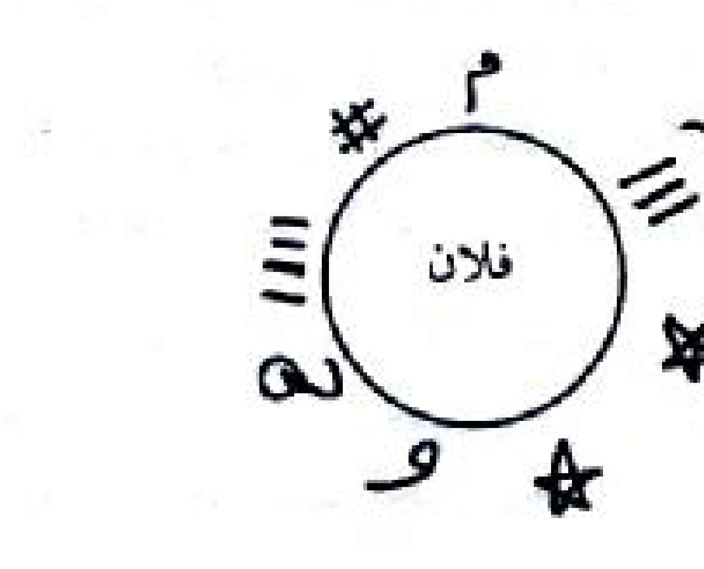

---

## HALAMAN 108 — PDF hal. 108 / bagian — Khawash ayat Al-Qur'an (riwayat Ahlulbait), ayat aman dari tenggelam, ayat syifa' sihir, dan ayat masuk tempat yang ditakuti

### 1. TEKS ARAB BERHARAKAT

أَيْضاً خَوَاصُّ مِنْ آيَاتِ الْقُرْآنِ الْعَظِيمِ: وَهُوَ كَمَا وَرَدَ فِي الْكَافِي:

عَنْ حُمَيْدِ بْنِ زِيَادٍ، عَنِ ابْنِ بُقَاحٍ، عَنْ عَمْرِو بْنِ جُمَيْعٍ، عَنْ حُمَيْدِ بْنِ الْحُسَيْنِ (عَلَيْهِمَا أَفْضَلُ الصَّلَاةِ وَالسَّلَامِ) أَنَّهُ قَالَ: قَالَ رَسُولُ اللَّهِ ﷺ: مَنْ قَرَأَ أَرْبَعَ آيَاتٍ مِنْ أَوَّلِ سُورَةِ الْبَقَرَةِ وَآيَةَ الْكُرْسِيِّ وَآيَتَيْنِ بَعْدَهَا وَثَلَاثَ آيَاتٍ مِنْ آخِرِهَا لَمْ يَرَ فِي نَفْسِهِ وَمَالِهِ شَيْئاً يَكْرَهُهُ، وَلَا يَقْرَبُهُ شَيْطَانٌ، وَلَا يَنْسَى الْقُرْآنَ. وَفِي رِوَايَةٍ ثَانِيَةٍ لَا يُقْرَأُ عَلَى مَجْنُونٍ إِلَّا أَفَاقَ.

وَفِي رِوَايَةٍ: خَوَاصُّ آيَاتِ مِنَ الْقُرْآنِ الْكَرِيمِ أَمَانٌ مِنَ الْغَرَقِ

(أَيْضاً خَوَاصُّ آيَاتِ مِنَ الْقُرْآنِ الْكَرِيمِ أَمَانٌ مِنَ الْغَرَقِ)

وَهُوَ كَمَا رُوِيَ عَنِ الْإِمَامِ الْحُسَيْنِ بْنِ عَلِيٍّ (عَلَيْهِمَا أَفْضَلُ السَّلَامِ) عَنِ النَّبِيِّ ﷺ فِي حَدِيثٍ: أَمَانٌ لِأُمَّتِي مِنَ الْغَرَقِ أَنْ يَقْرَأُوا ﴿بِسْمِ اللَّهِ مَجْرَاهَا وَمُرْسَاهَا﴾ ﴿وَمَا قَدَرُوا اللَّهَ حَقَّ قَدْرِهِ﴾.

أَيْضاً فَائِدَةُ آيَاتِ شِفَاءٍ مِنَ السِّحْرِ: وَرَدَ أَنَّ هَؤُلَاءِ الْآيَاتِ شِفَاءٌ مِنَ السِّحْرِ، عَلَى أَنْ تَقْرَأَ عَلَى رَأْسِ الْمَسْحُورِ، الْآيَةُ الَّتِي فِي سُورَةِ يُونُسَ وَهِيَ: ﴿فَلَمَّا أَلْقَوْا قَالَ مُوسَى مَا جِئْتُمْ بِهِ السِّحْرُ إِنَّ اللَّهَ سَيُبْطِلُهُ إِنَّ اللَّهَ لَا يُصْلِحُ عَمَلَ الْمُفْسِدِينَ﴾ ﴿وَيُحِقُّ اللَّهُ الْحَقَّ بِكَلِمَاتِهِ وَلَوْ كَرِهَ الْمُجْرِمُونَ﴾ وَقَوْلُهُ ﴿فَوَقَعَ الْحَقُّ وَبَطَلَ مَا كَانُوا يَعْمَلُونَ﴾ وَقَوْلُهُ ﴿إِنَّمَا صَنَعُوا كَيْدُ سَاحِرٍ وَلَا يُفْلِحُ السَّاحِرُ حَيْثُ أَتَى﴾.

أَيْضاً خَوَاصُّ آيَاتٍ أَنَّهُ رُوِيَ وَقِيلَ: مَنْ قَرَأَ عَشْرَ آيَاتٍ مِنْ سُورَةِ الْبَقَرَةِ عِنْدَ مَنَامِهِ لَمْ يَنْسَ الْقُرْآنَ، وَهُوَ أَنْ يَقْرَأَ أَرْبَعَ آيَاتٍ مِنْ أَوَّلِهَا، وَآيَةَ الْكُرْسِيِّ، وَآيَتَيْنِ بَعْدَهَا وَثَلَاثَ آيَاتٍ مِنْ آخِرِهَا.

أَيْضاً خَوَاصُّ آيَةٍ لِمَنْ دَخَلَ مَدْخَلاً يَخَافُهُ: وَهُوَ كَمَا وَرَدَ عَنْ أَبِي عَبْدِ اللَّهِ (عَلَيْهِ أَفْضَلُ السَّلَامِ): إِذَا دَخَلْتَ مَدْخَلاً تَخَافُهُ فَاقْرَأْ هَذِهِ الْآيَةَ ﴿رَبِّ أَدْخِلْنِي مُدْخَلَ صِدْقٍ وَأَخْرِجْنِي مُخْرَجَ صِدْقٍ وَاجْعَلْ لِي مِنْ لَدُنْكَ سُلْطَاناً نَصِيراً﴾.

أَيْضاً خَوَاصُّ آيَاتٍ لِمَنْ دَخَلَ مَدْخَلاً يَخَافُهُ: كَمَا وَرَدَ عَنِ الْإِمَامِ عَلِيِّ بْنِ مُوسَى الرِّضَا سُلْطَانِ السَّلَاطِينِ (عَلَيْهِ وَعَلَى آبَائِهِ وَأَجْدَادِهِ أَفْضَلُ الصَّلَوَاتِ

### 2. TRANSLITERASI LATIN

Aidhan khawashshun min ayatil-Qur'anil-'azhimi: wa huwa kama warada fil-Kafi:

'an Humaimi bni Ziyadin, 'anibni Buqahin, 'an 'Amri bni Jumai'in, 'an Humaimi bni al-Husaini ('alaihimaa afdhalush-shalati was-salamu) annahu qala: qala rasulullahi ﷺ: man qara'a arba'a ayatin min awwali suratil-Baqarati wa Ayatal-Kursiyyi wa ayataini ba'daha wa tsalatsa ayatin min akhiriha lam yara fi nafsihi wa malihi syai'an yakrahuhu, wa la yaqrabuhu syaithanun, wa la yansa al-Qur'ana. Wa fi riwayatin tsaniyatin la yuqra'u 'ala majnunin illa afaqa.

Wa fi riwayatin: khawashshu ayatin minal-Qur'anil-karimi amanun minal-gharaqi

(Aidhan khawashshu ayatin minal-Qur'anil-karimi amanun minal-gharaqi)

Wa huwa kama ruwiya 'anil-Imamil-Husaini bni 'Aliyyin ('alaihimaa afdhalus-salami) 'anin-Nabiyyi ﷺ fi haditsin: amanun li-ummati minal-gharaqi an yaqra'u ﴿Bismillahi majraha wa mursaha﴾ ﴿Wa ma qadarullaha haqqa qadrihi﴾.

Aidhan fa'idatu ayati syifa'in minas-sihri: warada anna haulai'il-ayati syifa'un minas-sihri, 'ala an taqra'a 'ala ra'sil-mashuri, al-ayatu'llati fi surati Yunusa wa hiya: ﴿Falamma alqau qala Musa ma ji'tum bihis-sihru innallaha sayubthiluhu innallaha la yushlihu 'amalal-mufsidin﴾ ﴿Wa yuh iqqullahul-haqqa bikalimatihi wa lau karihal-mujrimun﴾ wa qauluhu ﴿Fawaqa'al-haqqu wa bathala ma kanu ya'malun﴾ wa qauluhu ﴿Innama shana'u kaidu sahirin wa la yuflihus-sahiru haitsu ata﴾.

Aidhan khawashshu ayatin annahu ruwiya wa qila: man qara'a 'asyra ayatin min suratil-Baqarati 'inda manamihi lam yansa al-Qur'ana, wa huwa an yaqra'a arba'a ayatin min awwaliha, wa Ayatal-Kursiyyi, wa ayataini ba'daha wa tsalatsa ayatin min akhiriha.

Aidhan khawashshu ayatin liman dakhala madkhalan yakhafuhu: wa huwa kama warada 'an Abi 'Abdillahi ('alaihi afdhalus-salami): idza dakhalta madkhalan takhafuhu faqra' hadzihil-ayata ﴿Rabbi adkhilni mudkhala shidqin wa akhrijni mukhraja shidqin waj'al li min ladunka sulthanan nashiran﴾.

Aidhan khawashshu ayatin liman dakhala madkhalan yakhafuhu: kama warada 'anil-Imami 'Aliyyi bni Musa ar-Ridha sulthanis-salathini ('alaihi wa 'ala aba'ihi wa ajdadihi afdhalush-shalawati

### 3. TERJEMAHAN INDONESIA

Juga keistimewaan-keistimewaan dari ayat-ayat Al-Qur'an yang agung: sebagaimana disebutkan dalam kitab **Al-Kafi**:

Dari Humayd bin Ziyad, dari Ibnu Buqah, dari 'Amr bin Jumai', dari Humayd bin Al-Husain (semoga shalawat terbaik dan salam atas keduanya) bahwa ia berkata: Rasulullah ﷺ bersabda: "Barangsiapa membaca **empat ayat dari awal Surah Al-Baqarah**, **Ayatul Kursi**, **dua ayat setelahnya**, dan **tiga ayat dari akhirnya**, ia tidak akan melihat pada dirinya dan hartanya sesuatu yang dibencinya, tidak didekati setan, dan tidak lupa (hafalan) Al-Qur'an." Dalam riwayat kedua: "Tidak dibacakan kepada orang gila melainkan ia sadar."

Dan dalam riwayat (lain): keistimewaan ayat-ayat Al-Qur'an yang mulia (sebagai) **keamanan dari tenggelam**.

(Juga keistimewaan ayat-ayat Al-Qur'an yang mulia: keamanan dari tenggelam.)

Yaitu sebagaimana diriwayatkan dari Imam Husain bin Ali (semoga salam terbaik atas keduanya) dari Nabi ﷺ dalam suatu hadis: "Keamanan bagi umatku dari tenggelam (yaitu) agar mereka membaca 'Dengan (menyebut) nama Allah pada waktu berlayar dan berlabuhnya' serta 'Dan mereka tidak mengagungkan Allah dengan pengagungan yang semestinya'."

Juga faedah ayat-ayat **penyembuh dari sihir**: disebutkan bahwa ayat-ayat berikut adalah obat dari sihir, yaitu dengan membacanya di atas kepala orang yang disihir. Ayat itu terdapat dalam Surah Yunus, yaitu: "Maka ketika mereka melemparkan (tali-tali mereka), Musa berkata: 'Apa yang kamu datangkan itu adalah sihir. Sesungguhnya Allah akan membatalkannya. Sesungguhnya Allah tidak memperbaiki perbuatan orang-orang yang berbuat kerusakan'"; "Dan Allah menegakkan kebenaran dengan kalimat-kalimat-Nya, meskipun orang-orang yang berdosa membencinya"; dan firman-Nya "Maka jatuhlah yang benar dan batallah apa yang telah mereka kerjakan"; dan firman-Nya "Sesungguhnya yang mereka buat hanyalah tipu daya (seorang) tukang sihir, dan tidak akan beruntung tukang sihir itu di mana pun ia berada."

Juga keistimewaan ayat-ayat (untuk hafalan): diriwayatkan dan dikatakan: barangsiapa membaca **sepuluh ayat dari Surah Al-Baqarah** ketika hendak tidur, ia tidak akan lupa Al-Qur'an; yaitu membaca **empat ayat dari awalnya**, **Ayatul Kursi**, **dua ayat setelahnya**, dan **tiga ayat dari akhirnya**.

Juga keistimewaan ayat bagi orang yang memasuki tempat yang ia takuti: sebagaimana disebutkan dari Abu 'Abdillah (semoga salam terbaik atasnya): "Apabila engkau memasuki tempat yang engkau takuti, bacalah ayat ini: 'Ya Tuhanku, masukkanlah aku dengan masuk yang benar dan keluarkanlah aku dengan keluar yang benar, dan berikanlah kepadaku kekuasaan yang menolong dari sisi-Mu.'"

Juga keistimewaan ayat bagi orang yang memasuki tempat yang ia takuti: sebagaimana disebutkan dari Imam Ali bin Musa Ar-Ridha, sulthan para sultan (semoga shalawat terbaik atasnya, atas ayah-ayahnya dan kakek-kakeknya) — (lanjutan ada pada halaman 109).

### 4. TATACARA PRAKTIK LENGKAP

- **Amalan hafalan & perlindungan (10 ayat Al-Baqarah):** 4 ayat awal Surah Al-Baqarah + Ayatul Kursi + 2 ayat setelahnya + 3 ayat terakhir; dibaca **saat hendak tidur** → tidak lupa hafalan Al-Qur'an, tidak didekati setan, tidak melihat yang dibenci pada diri dan hartanya. Riwayat lain: dibacakan pada orang gila → sadar.
- **Keamanan dari tenggelam:** membaca "بِسْمِ اللَّهِ مَجْرَاهَا وَمُرْسَاهَا" dan "وَمَا قَدَرُوا اللَّهَ حَقَّ قَدْرِهِ".
- **Pengobatan sihir:** bacakan ayat-ayat Surah Yunus (yang disebut pada seksi 1) **di atas kepala orang yang disihir**.
- **Memasuki tempat yang ditakuti:** membaca "رَبِّ أَدْخِلْنِي مُدْخَلَ صِدْقٍ وَأَخْرِجْنِي مُخْرَجَ صِدْقٍ وَاجْعَلْ لِي مِنْ لَدُنْكَ سُلْطَاناً نَصِيراً".
- Semua amalan halaman ini **tanpa alat/tulisan** (hanya bacaan), kecuali disebutkan lain di halaman berikutnya.
- Pada halaman ini tidak ada kata فُلَان / فُلَانَة, sehingga keterangan Fulan/Fulanata tidak berlaku di sini.

---

## HALAMAN 109 — PDF hal. 109 / bagian — Lanjutan ayat perlindungan, ayat syifa', ayat hifzh dari jin, dan awal باب في ذكر خاتم سليمان بن داود

### 1. TEKS ARAB BERHARAKAT

وَالسَّلَامُ) قَوْلُهُ: آيَةٌ فِي سُورَةِ الْكَهْفِ، وَآيَةٌ فِي النَّحْلِ، وَآيَةٌ فِي الْجَاثِيَةِ، وَالْآيَاتُ الْكَرِيمَةُ هِيَ كَالْآتِي:

- سُورَةُ الْكَهْفِ الْآيَةُ: ﴿وَمَنْ أَظْلَمُ مِمَّنْ ذُكِّرَ بِآيَاتِ رَبِّهِ فَأَعْرَضَ عَنْهَا وَنَسِيَ مَا قَدَّمَتْ يَدَاهُ إِنَّا جَعَلْنَا عَلَى قُلُوبِهِمْ أَكِنَّةً أَنْ يَفْقَهُوهُ وَفِي آذَانِهِمْ وَقْراً وَإِنْ تَدْعُهُمْ إِلَى الْهُدَى فَلَنْ يَهْتَدُوا إِذاً أَبَداً﴾.

- وَفِي سُورَةِ النَّحْلِ الْآيَةُ: ﴿أُولَئِكَ الَّذِينَ طَبَعَ اللَّهُ عَلَى قُلُوبِهِمْ وَعَلَى سَمْعِهِمْ وَأَبْصَارِهِمْ وَأُولَئِكَ هُمُ الْغَافِلُونَ﴾.

- وَفِي سُورَةِ الْجَاثِيَةِ الْآيَةُ: ﴿أَفَرَأَيْتَ مَنِ اتَّخَذَ إِلَهَهُ هَوَاهُ وَأَضَلَّهُ اللَّهُ عَلَى عِلْمٍ وَخَتَمَ عَلَى سَمْعِهِ وَقَلْبِهِ وَجَعَلَ عَلَى بَصَرِهِ غِشَاوَةً فَمَنْ يَهْدِيهِ مِنْ بَعْدِ اللَّهِ أَفَلَا تَذَكَّرُونَ﴾.

أَيْضاً خَوَاصُّ آيَةٍ مِنَ الْقُرْآنِ الْكَرِيمِ وَهِيَ: ﴿وَنُنَزِّلُ مِنَ الْقُرْآنِ مَا هُوَ شِفَاءٌ وَرَحْمَةٌ لِلْمُؤْمِنِينَ﴾ مِنْ فَوَائِدِهَا: مَنْ حَمَلَهَا كَانَ سَعِيداً بِإِذْنِ اللَّهِ عَزَّ وَجَلَّ وَلَمْ يَرَ بَأْساً فِي مَالِهِ وَحَالِهِ، فَإِنْ كَانَ تَاجِراً رَبِحَتْ تِجَارَتُهُ، وَأَنَّ كَانَ مُسَافِراً أَمِنَتْهُ اللَّهُ فِي سَفَرِهِ، وَأَنَّ كَانَ رَجُلاً خَائِفاً مِنَ السِّحْرِ أَوِ امْرَأَةٌ وَعَلَّقَ عَلَيْهِ أَوْ عَلَى الْمَرْأَةِ لَمْ يَخَافَا مِنَ السِّحْرِ وَلَا مِنْ شَيْطَانٍ مَرِيدٍ وَلَا جَانٍ عَنِيدٍ.

أَيْضاً خَوَاصُّ آيَاتٍ لِلْحِفْظِ مِنْ طَوَارِقِ الْجِنِّ وَالْإِنْسِ: وَهِيَ ﴿بِسْمِ اللَّهِ الرَّحْمَنِ الرَّحِيمِ مُحَمَّدٌ رَسُولُ اللَّهِ وَالَّذِينَ مَعَهُ أَشِدَّاءُ عَلَى الْكُفَّارِ رُحَمَاءُ بَيْنَهُمْ تَرَاهُمْ رُكَّعاً سُجَّداً يَبْتَغُونَ فَضْلاً مِنَ اللَّهِ وَرِضْوَاناً سِيمَاهُمْ فِي وُجُوهِهِمْ مِنْ أَثَرِ السُّجُودِ ذَلِكَ مَثَلُهُمْ فِي التَّوْرَاةِ وَمَثَلُهُمْ فِي الْإِنْجِيلِ كَزَرْعٍ أَخْرَجَ شَطْأَهُ فَآزَرَهُ فَاسْتَغْلَظَ فَاسْتَوَى عَلَى سُوقِهِ يُعْجِبُ الزُّرَّاعَ لِيَغِيظَ بِهِمُ الْكُفَّارَ وَعَدَ اللَّهُ الَّذِينَ آمَنُوا وَعَمِلُوا الصَّالِحَاتِ مِنْهُمْ مَغْفِرَةً وَأَجْراً عَظِيماً﴾.

(بَابٌ فِي ذِكْرِ خَاتَمِ سُلَيْمَانَ بْنِ دَاوُدَ عَلَيْهِمَا السَّلَامُ)

قِيلَ: أَنْ مَنْ يُخْتَمُ بِهِ لَهُ خَوَاصُّ كَثِيرَةٌ: عَلَى أَنْ لَا يَقْدَمَ عَلَى مَعْصِيَةٍ، وَأَنْ يَكُونَ طَاهِرَ الثَّوْبِ وَالْبَدَنِ، وَحَافِظَ اللِّسَانِ تَارِكاً لِلْمَعَاصِي مُلَازِماً لِلطَّاعَاتِ مُتَيَقِّظاً فِي اللَّهِ عَزَّ وَجَلَّ وَهُوَ خَاتَمُ الطَّاعَاتِ لَا يَمَسُّهُ إِلَّا عَزِيزٌ. وَقَالَ وَهْبُ بْنُ مُنَبِّهٍ: كَانَ خَاتَمُ سُلَيْمَانَ عَلَيْهِ السَّلَامُ عَلَى أَرْبَعَةِ أَطْبَاقٍ وَفَوْقَ كُلِّ طَبَقٍ مَكْتُوبٌ عَلَى الْجَانِبِ

### 2. TRANSLITERASI LATIN

was-salamu) qauluhu: ayatun fi suratil-Kahfi, wa ayatun fin-Nahli, wa ayatun fil-Jatsiyati, wal-ayatul-karimatu hiya kal-ati:

- Suratul-Kahfil-ayatu: ﴿Wa man azhlamu mimman dzukkira bi-ayati rabbihi fa-a'radha 'anha wa nasiya ma qaddamat yadahu inna ja'alna 'ala qulubihim akinnatan an yafqahu wa fi adzanihim waqran wa in tad'uhum ilal-huda falan yahtadu idzan abada﴾.

- Wa fi suratin-Nahlil-ayatu: ﴿Ula'ikal-ladzina thaba'allahu 'ala qulubihim wa 'ala sam'ihim wa absharihim wa ula'ika humul-ghafiluna﴾.

- Wa fi suratil-Jatsiyatil-ayatu: ﴿Afara'aita manittakhadza ilahahu hawahu wa adhallahullahu 'ala 'ilmin wa khatama 'ala sam'ihi wa qalbihi wa ja'ala 'ala basharihi ghisyyawatan faman yahdihi min ba'dillahi afala tadzakkaruna﴾.

Aidhan khawashshu ayatin minal-Qur'anil-karimi wa hiya: ﴿Wa nunazzilu minal-Qur'ani ma huwa syifa'un wa rahmatun lil-mu'minina﴾ min fawa'idiha: man hamalaha kana sa'idan bi-idznillahi 'azza wa jalla wa lam yara ba'san fi malihi wa halihi, fa-in kana tajiran rabihat tijaratuhu, wa an kana musafiran amanathullahu fi safarihi, wa an kana rajulan kha'ifan minas-sihri au imra'atan wa 'allaqa 'alaihi au 'alal-mar'ati lam yakhafa minas-sihri wa la min syaithanin maridin wa la jannin 'anidin.

Aidhan khawashshu ayatin lil-hifzhi min thawariqil-jinni wal-insi: wa hiya ﴿Bismillahir-rahmanir-rahim Muhammadun rasulullahi wal-ladzina ma'ahu asyidda'u 'alal-kuffari ruhamau bainahum tarahum rukka'an sujjadan yabtaghuna fadhlan minallahi wa ridhwanaan simahum fi wujuhihim min atsaris-sujudi dzalika matsluhum fit-Taurati wa matsluhum fil-Injili kazar'in akhraja syath'ahu fa-azarahu fastaghlazha fastawa 'ala suqihi yu'jibuz-zurra'a liyaghizha bihimul-kuffara wa'adallahu alladzina amanu wa 'amilush-shalihh ti minhum maghfiratan wa ajran 'azhiman﴾.

(Babun fi dzikri khatami Sulaimana bni Dawuda 'alaihimas-salamu)

Qila: an man yukhtamu bihi lahu khawashshu katsiratun: 'ala an la yaqdama 'ala ma'shiyatin, wa an yakuna thahiras-tsaubi wal-badani, wa hafizhal-lisani tarikan lil-ma'ashi mulaziman lith-tha'ati mutayaqqizhan fillahi 'azza wa jalla wa huwa khatamuth-tha'ati la yamassuhu illa 'azizun. Wa qala Wahbu bnu Munabbihin: kana khatamu Sulaimana 'alaihis-salamu 'ala arba'ati athbaqin wa fauqa kulli thabaqin maktubun 'alal-janibi

### 3. TERJEMAHAN INDONESIA

…dan salam) — yaitu firman-Nya: satu ayat pada Surah Al-Kahf, satu ayat pada Surah An-Nahl, dan satu ayat pada Surah Al-Jatsiyah. Ayat-ayat yang mulia itu adalah sebagai berikut:

- Ayat Surah Al-Kahf: "Dan siapakah yang lebih zalim daripada orang yang telah diperingatkan dengan ayat-ayat Tuhannya, lalu ia berpaling darinya dan melupakan apa yang telah diperbuat oleh kedua tangannya? Kami telah meletakkan tutupan di atas hati mereka (sehingga mereka tidak) memahaminya, dan (Kami letakkan) sumbatan di telinga mereka. Dan jika engkau menyeru mereka kepada petunjuk, niscaya mereka tidak akan mendapat petunjuk selama-lamanya."

- Ayat Surah An-Nahl: "Mereka itulah orang-orang yang telah dikunci hatinya oleh Allah, dan (demikian pula) pendengaran serta penglihatan mereka; dan mereka itulah orang-orang yang lalai."

- Ayat Surah Al-Jatsiyah: "Maka apakah engkau (tidak) memperhatikan orang yang menjadikan hawa nafsunya sebagai tuhannya, dan Allah membiarkannya sesat berdasarkan ilmu-Nya, serta Dia telah mengunci pendengaran dan hatinya, dan meletakkan tutup di atas penglihatannya? Maka siapakah yang mampu memberinya petunjuk setelah Allah? Mengapa kamu tidak mengambil pelajaran?"

Juga keistimewaan satu ayat Al-Qur'an yang mulia, yaitu: "Dan Kami turunkan dari Al-Qur'an sesuatu yang menjadi penawar dan rahmat bagi orang-orang yang beriman." Di antara faedahnya: barangsiapa membawanya (menulisnya dan menggantungkannya) ia menjadi bahagia dengan izin Allah 'Azza wa Jalla dan tidak melihat kesulitan pada hartanya dan keadaannya; jika ia pedagang, perdagangannya beruntung; jika ia musafir, Allah menjaganya dalam perjalanannya; dan jika ia seorang lelaki yang takut sihir, atau seorang perempuan, lalu ia menggantungkannya pada dirinya atau pada perempuan itu, keduanya tidak akan takut terhadap sihir, tidak terhadap setan yang durhaka, dan tidak terhadap jin yang membangkang.

Juga keistimewaan ayat-ayat untuk **menjaga dari gangguan jin dan manusia**, yaitu: "Dengan nama Allah Yang Maha Pengasih, Maha Penyayang. Muhammad adalah utusan Allah, dan orang-orang yang bersamanya keras terhadap orang-orang kafir, tetapi berkasih sayang sesama mereka; engkau melihat mereka rukuk dan sujud mencari karunia dan keridhaan Allah; tanda-tanda mereka tampak pada wajah mereka dari bekas sujud. Demikianlah sifat mereka dalam Taurat dan sifat mereka dalam Injil, yaitu seperti tanaman yang mengeluarkan tunasnya, lalu tunas itu menjadikan tanaman itu kuat, lalu menjadi besarlah tanaman itu dan tegak lurus di atas pokoknya, sehingga menyenangkan hati para penanamnya, karena Allah hendak membuat marah orang-orang kafir dengan mereka. Allah menjanjikan ampunan dan pahala yang besar kepada orang-orang yang beriman dan mengerjakan amal saleh di antara mereka."

(Bab tentang penyebutan **cincin Sulaiman bin Dawud** 'alaihimas-salam)

Dikatakan bahwa barangsiapa memakai cincin ini (dengan tulisan/khatam Sulaiman) ia memiliki keistimewaan yang banyak, dengan syarat: ia tidak mendahului (melakukan) kemaksiatan, menjaga kesucian pakaian dan badan, menjaga lisan, meninggalkan kemaksiatan, senantiasa taat, dan waspada di hadapan Allah 'Azza wa Jalla; ia adalah "cincin ketaatan" yang tidak menyentuhnya kecuali orang yang mulia. Dan Wahb bin Munabbih berkata: cincin Sulaiman 'alaihis-salam terdiri atas **empat lapis**, dan di atas setiap lapis tertulis pada sisinya… — (lanjutan ada pada halaman 110).

### 4 TATACARA PRAKTIK LENGKAP

- **Ayat perlindungan (3 ayat: Al-Kahf, An-Nahl, Al-Jatsiyah)** — dibaca sebagai benteng dari orang yang berpaling dari ayat Allah; naskah menempatkannya dalam rangkaian ayat keamanan.
- **Ayat "وَنُنَزِّلُ مِنَ الْقُرْآنِ مَا هُوَ شِفَاءٌ…":** ditulis lalu **digantungkan/dibawa**; menurut teks: pedagang beruntung, musafir terjaga, dan yang takut sihir terbebas (untuk lelaki maupun perempuan).
- **Ayat hifzh dari jin dan manusia:** Surah Al-Fath ayat 29 (diawali basmalah) — dibaca/dibawa sebagai penjagaan.
- **Cincin Sulaiman:** syarat pemakainya ditegaskan naskah: tidak berbuat maksiat, suci badan & pakaian, menjaga lisan, taat, dan waspada kepada Allah. Bentuk/ukirannya dijelaskan pada halaman 110.
- Pada halaman ini tidak ada kata فُلَان / فُلَانَة, sehingga keterangan Fulan/Fulanata tidak berlaku di sini.

---

## HALAMAN 110 — PDF hal. 110 / bagian — Tulisan pada empat lapis cincin Sulaiman, gambar bentuknya, dan khawashnya (sihir, kerasukan, tahanan)

### 1. TEKS ARAB BERHARAKAT

الْأَيْمَنِ أَنَا لَمْ أَزَلْ، وَعَلَى الْجَانِبِ الْأَيْسَرِ أَنَا اللَّهُ الْحَيُّ الْقَيُّومُ، وَعَلَى الثَّالِثِ أَنَا اللَّهُ الْعَزِيزُ لَا عَزِيزَ غَيْرِي وَعَزِيزٌ مَنِ الْيَسْتَهُ خَاتَمِي، وَعَلَى الرَّابِعِ مَكْتُوبٌ آيَةُ الْكُرْسِيِّ مُحِيطٌ بِهَا مُحَمَّدٌ رَسُولُ اللَّهِ ﷺ.

وَكَمَا رُوِيَ وَقِيلَ: إِنَّ هَذِهِ الْأَسْمَاءَ الَّتِي كَانَتْ فِي خَاتَمِ سُلَيْمَانَ عَلَيْهِ السَّلَامُ هِيَ: «لَا إِلَهَ إِلَّا اللَّهُ وَحْدَهُ لَا شَرِيكَ لَهُ أَنَا اللَّهُ تَعَزَّزْتُ بِالْمُلْكِ وَالسُّلْطَانِ أَبْلَى إِيلٍ أَنَا اللَّهُ تَعَزَّزْتُ بِالْعِزَّةِ وَالْأَمْكَانِ يَا إِلَهَ يَا إِلَهَ يَا اللَّهُ يَا حَيُّ يَا قَيُّومُ لَا تَأَمَّ إِلَهَ إِلَهَ يَا إِلَهَ أَنَا اللَّهُ خَيْرٌ قَادِرٌ طَاعَتِي كُلُّ شَيْءٍ أَنُوخُ أَنُوخُ أَنُوخُ أَنَا اللَّهُ الرَّحْمَنُ الرَّحِيمُ، فَا عَوَجٌ فَيَمُوجُ فَا عَوَجٌ لَا إِلَهَ إِلَّا اللَّهُ حِصْنِي مِنْ دَخَلَهُ أَمِنَ مِنْ عَذَابِي تَحَصَّنْتُ بِأَسْمَاءِ هَذَا الْخَاتَمِ وَبِذِي الْعِزَّةِ وَالْجَبَرُوتِ وَاعْتَصَمْتُ بِذِي الْحَوْلِ وَالْقُوَّةِ وَبِذِي الْعِزَّةِ وَالْمَلَكُوتِ وَفَوَّضْتُ أَمْرِي إِلَى الْحَيِّ الَّذِي لَا يَمُوتُ وَرَمَيْتُ مَنْ أَرَادَنِي بِضُرٍّ بِلَا حَوْلَ وَلَا قُوَّةَ إِلَّا بِاللَّهِ الْعَلِيِّ الْعَظِيمِ وَحَسْبُنَا اللَّهُ وَنِعْمَ الْوَكِيلُ قُلِ اللَّهُمَّ مَالِكَ الْمُلْكِ تُؤْتِي الْمُلْكَ مَنْ تَشَاءُ وَذَلِكَ إِلَى قَوْلِهِ تَعَالَى بِغَيْرِ حِسَابٍ».

وَأَيْضاً إِنَّ هَذِهِ الْأَشْكَالَ الْآتِيَةَ كَانَتْ مَكْتُوبَةً عَلَى خَاتَمِ سُلَيْمَانَ بْنِ دَاوُدَ عَلَيْهِ السَّلَامُ ﷺ وَكَمَا قِيلَ أَيْضاً: إِنَّهَا مَكْتُوبَةٌ عَلَى بَابِ الْكَعْبَةِ الشَّرِيفَةِ وَهِيَ هَذَا الشَّكْلُ كَمَا تَرَى:

أَيْضاً وَكَمَا وَرَدَ فِي خَوَاصِّ الْخَاتَمِ السُّلَيْمَانِيِّ الْمُبَارَكِ وَاسْمِ اللَّهِ الْأَعْظَمِ: فِيهِ خَوَاصُّ كَثِيرَةٌ وَمَنَافِعُ عَظِيمَةٌ، وَإِشَارَاتٌ لَطِيفَةٌ وَمَعَانٍ ظَرِيفَةٌ وَأَسْرَارٌ لَا تُحْصَى وَعَجَائِبُ لَا تُسْتَقْصَى فِيهِ. تَجْلِبُ الْمَسَارَّ وَتَدْفَعُ الْمَضَارَّ وَمَنْ عَرَفَهُ اسْتَغْنَى بِهِ عَنْ غَيْرِهِ وَاكْتَفَى بِهِ عَمَّا عَدَاهُ.

وَمِنْ فَوَائِدِهِ: يَنْفَعُ لِإِبْطَالِ السِّحْرِ وَحَلِّ الْمَعْقُودِ، وَمَنْ طَالَ سِجْنُهُ، وَيَنْفَعُ لِلْمَصْرُوعِ وَإِخْرَاجِ الْعَارِضِ مِنَ الْجَسَدِ (يُكْتَبُ وَيُعَلَّقُ عَلَيْهِ) وَإِنْ قَامَ الْعَارِضُ احْتَرَقَ.

وَمِنْ خَوَاصِّهِ أَيْضاً لِخَلَاصِ الْمَسْجُونِينَ: هُوَ إِذَا أَرَدْتَ ذَلِكَ فَارْسُمِ الشَّكْلَ الْمُتَقَدِّمَ ذِكْرُهُ وَذَلِكَ عَلَى قَلِيلٍ مِنْ تُرَابِ الْمَقَابِرِ بَعْدَ عَجْنِهِ وَجَعَلَهُ شَقَقْهُ، ثُمَّ اقْرَأْ عَلَيْهِ الدَّعْوَةَ الْآتِيَةَ ثُمَّ أَعْطَهَا السَّجِينَ يَدْخُلُهَا مِنْ طَوْقِهِ وَيُخْرِجُهَا مِنْ كُمِّهِ؟ فَإِنَّهُ يَتَخَلَّصُ مِنْ سِجْنِهِ بِإِذْنِ اللَّهِ تَعَالَى (هَذَا إِذَا كَانَ السَّجِينُ مَظْلُوماً وَلَيْسَ مِنَ الْمُجْرِمِينَ الْقَاتِلِينَ وَإِلَّا لَا يَجُوزُ مُسَاعَدَتُهُ).

### 2. TRANSLITERASI LATIN

al-aimani ana lam azal, wa 'alal-janibil-aisari ana Allahul-hayyul-qayyumu, wa 'alats-tsalitsi ana Allahul-'azizu la 'aziza ghairi wa 'azizun manil yastahu khatami, wa 'alar-rabi'i maktubun Ayatul-Kursiyyi muhithun biha Muhammadun rasulullahi ﷺ.

Wa kama ruwiya wa qila: inna hadzihil-asma'allati kanat fi khatami Sulaimana 'alaihis-salamu hiya: «la ilaha illallahu wahdahu la syarika lahu ana Allahu ta'azzaztu bil-mulki was-sulthani abla ilin ana Allahu ta'azzaztu bil-'izzati wal-amkani ya ilaha ya ilaha ya Allahu ya hayyu ya qayyumu la ta-amm a ilaha ilaha ya ilaha ana Allahu khairun qadirun tha'ati kullu syai'in anukhu anukhu anukhu anallahu ar-rahmanu ar-rahimu, fa 'awajun fayamuju fa 'awajun la ilaha illallahu hishni man dakhalahu amina min 'adzabi tahashshantu bi-asma'i hadzal-khatami wa bidzil-'izzati wal-jabaruti wa'tashamtu bidzil-hauli wal-quwwati wa bidzil-'izzati wal-malakuti wa fawwadhtu amri ilal-hayyil-ladzi la yamutu wa ramaitu man aradani bidhurrin la haula wa la quwwata illa billahil-'aliyyil-'azhimi wa hasbunallahu wa ni'mal-wakilu qulillahumma malikal-mulki tu'til-mulka man tasyau wa dzalika ila qaulihi ta'ala bighairi hisabin».

Wa aidhan inna hadzihil-asykala al-atiyata kanat maktubatan 'ala khatami Sulaimana bni Dawuda 'alaihis-salamu ﷺ wa kama qila aidhan: innaha maktubatun 'ala babal-Ka'batisy-syarifati wa hiya hadzas-syaklu kama tara:

Aidhan wa kama warada fi khawashshil-khatamis-sulaimaniyyil-mubaraki wismillahil-a'zhzhami: fihi khawashshu katsiratun wa manafi'u 'azhimatun, wa isyaratun lathifatun wa ma'ani zharifatun wa asrarun la tuhsha wa 'aja'ibu la tustaqsha fihi. Tajlibul-masarra wa tadfa'ul-madharr wa man 'arafahustaghna bihi 'an ghairihi waktafa bihi 'amma 'adahu.

Wa min fawa'idihi: yanfa'u li-ibthalit-sihri wa hallil-ma'qudi, wa man thala sijnuhu, wa yanfa'u lil-mashru'i wa ikhrajil-'aridhi minal-jasadi (yuktabu wa yu'allaqu 'alaihi) wa in qamal-'aridhuhtaraqa.

Wa min khawashshihi aidhan likhalashil-masjunina: huwa idza aradta dzalika farsumisy-syakhla mutaqaddima dzikruhu wa dzalika 'ala qalilin min turabil-maqabiri ba'da 'ajnihi wa ja'lahu syaqqahu, tsummaqra' 'alaihid-da'watal-atiyata tsumma a'thihas-sajina yadkhuluha min thauqihi wa yukhrijuha min kummihi? Fa-innahu yatakhallashu min sijnihi bi-idznillahi ta'ala (hadza idza kanas-sajinu mazhluman wa laisa minal-mujriminil-qatilina wa illa la yajuzu musa'adatuhu).

### 3. TERJEMAHAN INDONESIA

…yang di sisi kanan: "AKU TIADA HENTI" (anā lam azal); pada sisi kiri: "AKU ALLAH, YANG MAHAHIDUP, YANG TERUS-MENERUS MENGURUS"; pada yang ketiga: "AKU ALLAH YANG MAHAPERKASA, TIADA YANG MAHAPERKASA SELAIN AKU, DAN MAHAPERKASALAH ORANG YANG CINCINKU MENJADI PAKAIANNYA"; dan pada yang keempat tertulis Ayatul Kursi, diliputi olehnya, (dan) "MUHAMMAD RASULULLAH ﷺ" **[TEKS ASLI DIJAGA – TIDAK DITERJEMAH KARENA THILASM/AZIMAH]**. *(Catatan: baris pertama dan ketiga pada naskah dicetak gundul tanpa harakat; terjemahan di atas hanya untuk memberi gambaran makna, redaksi aslinya dipertahankan.)*

Dan sebagaimana diriwayatkan dan dikatakan: sesungguhnya nama-nama yang ada pada cincin Sulaiman 'alaihis-salam adalah: «…» **[TEKS ASLI DIJAGA – TIDAK DITERJEMAH KARENA THILASM/AZIMAH]** — rangkaian panjang tanpa harakat pada naskah, berisi kalimat tauhid, "حِصْنِي مَنْ دَخَلَهُ أَمِنَ مِنْ عَذَابِي" (benteng-Ku, siapa memasukinya aman dari azab-Ku), tawassul dengan nama-nama, dan penutup ayat "قُلِ اللَّهُمَّ مَالِكَ الْمُلْكِ تُؤْتِي الْمُلْكَ مَنْ تَشَاءُ…".

Dan juga, sesungguhnya bentuk-bentuk berikut tertulis pada cincin Sulaiman bin Dawud 'alaihis-salam ﷺ; dan sebagaimana dikatakan pula: ia tertulis pada pintu Ka'bah yang mulia. Bentuknya adalah seperti gambar berikut yang engkau lihat:

Dan juga, sebagaimana disebutkan dalam keistimewaan **khatam Sulaimani** yang diberkahi dan (berisi) nama Allah yang Mahaagung: padanya terdapat keistimewaan yang banyak, manfaat yang besar, isyarat-isyarat yang halus, makna-makna yang indah, dan rahasia-rahasia yang tak terhitung serta keajaiban-keajaiban yang tak terselesaikan untuk diuraikan. Ia mendatangkan kegembiraan dan menolak marabahaya; barangsiapa mengenalnya, ia tercukupkan dengannya dari selainnya dan merasa cukup dengan itu dibanding yang lain.

Dan di antara faedahnya: bermanfaat untuk **membatalkan sihir dan melepas ikatan (sihir)**, dan bagi orang yang lama dipenjara; juga bermanfaat bagi **orang yang kerasukan** dan untuk mengeluarkan **'aridh (penyebab gangguan)** dari tubuh — (caranya) ditulis lalu **digantungkan** padanya; dan jika 'aridh itu tetap (di tubuh), ia terbakar.

Dan di antara keistimewaannya juga untuk **pelepasan orang-orang yang dipenjara**: apabila engkau menghendaki hal itu, gambarlah bentuk yang telah disebut terdahulu pada sedikit **tanah kuburan** setelah diuleni dan dibuat sobekan/lempengan; kemudian bacakan kepadanya doa yang berikut; lalu berikan kepada tahanan agar ia memasukkannya dari lehernya dan mengeluarkannya dari lengan bajunya; maka ia akan terbebas dari penjaranya dengan izin Allah Ta'ala. (Ini berlaku apabila tahanan itu **terzalimi** dan bukan termasuk para pelaku kejahatan/pembunuh; jika tidak demikian, tidak boleh membantunya.)

### 4. TATACARA PRAKTIK LENGKAP

- **Empat lapis cincin Sulaiman** (teks): sisi kanan, kiri, ketiga, dan keempat memuat kalimat tauhid serta Ayatul Kursi — semuanya **dicetak gundul** pada naskah; sesuai aturan, tidak diharakati dan tidak diterjemahkan sebagai mantra.
- **Bentuk (rajah) pada cincin Sulaiman** yang juga disebut tertulis pada pintu Ka'bah: lihat `hal-110-rajah-01.png`. Simbol di dalamnya **tidak diterjemahkan dan tidak ditafsirkan**; salin apa adanya dari gambar cetak.
- **Kegunaan menurut naskah:** membatalkan sihir, melepas ikatan sihir, untuk orang yang lama dipenjara, untuk orang kerasukan, dan mengeluarkan 'aridh dari tubuh (ditulis lalu digantungkan).
- **Pelepasan tahanan (kaifiyat):** gambar bentuk tersebut pada **tanah kuburan** yang sudah diuleni dan dijadikan lempengan → bacakan doa (lanjutan pada halaman 111) → tahanan memasukkan dari leher dan mengeluarkan dari lengan → terbebas. **Syarat tegas naskah:** hanya untuk tahanan yang **terzalimi**, bukan pembunuh/penjahat.
- Tanda tanya pada "وَيُخْرِجُهَا مِنْ كُمِّهِ؟" adalah bagian teks asli.
- Pada halaman ini tidak ada kata فُلَان / فُلَانَة, sehingga keterangan Fulan/Fulanata tidak berlaku di sini.

---

## HALAMAN 111 — PDF hal. 111 / bagian — Doa pengusir 'aridh, faedah bentuk khatam, dan rajah mahabbah suami–isteri (dua lingkaran)

### 1. TEKS ARAB BERHARAKAT

أَيْضاً طَرِيقَةٌ ثَانِيَةٌ لِإِخْرَاجِ الْعَارِضِ مِنَ الْجَسَدِ: إِذَا أَرَدْتَ ذَلِكَ فَاكْتُبْ عَلَى جَبْهَةِ الْمِصَابِ وَاقْرَأْ عَلَيْهِ الدَّعْوَةَ فَإِنَّ الْعَارِضَ يَنْصَرِفُ وَلَا يَعُودُ إِلَيْهِ أَبَداً. (وَهَذِهِ هِيَ الدَّعْوَةُ كَالْآتِي:)

بِسْمِ اللَّهِ الرَّحْمَنِ الرَّحِيمِ اللَّهُ أَحَدٌ الْبَدِيعُ الْقَادِرُ الْكَافِي الْوَدُودُ الْبَاسِطُ الْحَيُّ الْقَهَّارُ ذُو الْبَطْشِ الشَّدِيدِ الْحَلِيمُ الْخَلَّاقُ سَمْتِ السَّلَامِ الْبَارِي الثَّابِتِ الْقَوِيِّ الْمَتِينِ الْجَلِيلِ الْحَيِّ الْبَاقِي الرَّحِيمِ هُوَ اللَّهُ الْأَوَّلُ الْآخِرُ الظَّاهِرُ الْبَاطِنُ الْوَكِيلُ الْكَافِي الْقَابِضُ الرَّحْمَنِ الرَّحِيمِ الْفَتَّاحُ الْغَنِيُّ الْمُغْنِي الْقَوِيُّ الْمَتِينُ الْمُجِيبُ الْأَوَّلُ الْآخِرُ النُّورُ الْحَكَمُ الْعَدْلُ الْعَزِيزُ فِي جَبَرُوتِهِ الْمُعِزُّ الْمُبْدِئُ الْمُعِيدُ الْقَرِيبُ عَالِمُ السِّرُّ الْقَيُّومُ الْحَقُّ الْوَكِيلُ الْكَرِيمُ الْحَنَّانُ اللَّهُ غَالِبٌ عَلَى أَمْرِهِ الْحَسِيبُ رَبِّي الْمَحْيَا الْوَالِ الْمُتَعَالِ الْعَزِيزُ الرَّحْمَنِ الْمُغْنِي الْمُعِزُّ الْقَوِيُّ الْقَهَّارُ.

وَفَوَائِدُ وَخَوَاصُّ هَذِهِ الْأَشْكَالِ الْمُتَقَدِّمِ ذِكْرُهَا: إِذَا كُتِبَ بِمِسْكٍ وَزَعْفَرَانِ وَمَاءِ وَرْدٍ وَحَمَلَتْهُ الْبِنْتُ الْعَازِبَةُ تَزَوَّجَتْ وَخُصُوصاً الْبِنْتُ الْبِكْرِ. أَيْضاً مَنْ حَمَلَهُ مِنْ يَخَافُ أَمْرَ مَكْرُوهٍ فَإِنَّهُ يَأْمَنُ مِنْهُ. وَإِذَا عُلِّقَ عَلَى لِوَاءِ الْجَيْشِ وَالْعَسْكَرِ كَانَ مَنْصُوراً. (وَالْأَشْكَالُ هِيَ: ✡ آ م ا # ١١١١ ٨ م ٦ ✡).

وَمِنْ خَوَاصِّ هَذِهِ الْأَشْكَالِ: صَالِحَةٌ لِلصُّلْحِ بَيْنَ الْمَرْأَةِ وَزَوْجِهَا وَخَاصَّةً إِذَا كَانَ عِنْدَهُمْ أَوْلَادٌ، إِذَا أَرَدْتَ فَاكْتُبِ الْخَاتَمَ الْمَذْكُورَ فِي دَائِرَتَيْنِ وَاجْعَلِ اسْمَ الرَّجُلِ فِي أَحَدِهِمَا وَاسْمَ الْمَرْأَةِ فِي الدَّائِرَةِ الْأُخْرَى مُتَوَاجِهَتَيْنِ لِبَعْضِهِمَا وَضَعْ بَيْنَهُمَا قِطْعَةَ سُكَّرٍ ثُمَّ أَقْرَأِ الدَّعْوَةَ الْمَذْكُورَةَ آنِفاً (ثَلَاثَ مَرَّاتٍ) وَيُبَخِّرُ بِعُودٍ وَكَنْدَرٍ وَكَبْزِيرَةٍ يَابِسَةٍ، ثُمَّ اجْعَلْ ذَلِكَ فِي صُنْدُوقٍ (أَيْ الدَّائِرَتَيْنِ الْمَرْسُومَتَيْنِ) فَإِنَّهُمَا يَصْطَلِحَانِ وَتَدُومُ الْمَحَبَّةُ بَيْنَهُمَا بِإِذْنِ اللَّهِ تَعَالَى وَارْسُمْ الدَّائِرَتَيْنِ عَلَى هَذِهِ الْكَيْفِيَّةِ كَالشَّكْلِ الْآتِي كَمَا تَرَى:

### 2. TRANSLITERASI LATIN

Aidhan thariqatun tsaniyatun li-ikhrajil-'aridhi minal-jasadi: idza aradta dzalika faktub 'ala jabhatil-mishabi waqra' 'alaihid-da'wata fa-innnal-'aridha yansharifu wa la ya'udu ilaihi abadan. (Wa hadzihi hiyad-da'watu kal-ati:)

Bismillahir-rahmanir-rahim Allahu ahadun al-badi'ul-qadirul-kafil-wadudul-basithul-hayyul-qahharu dzul-bathsyiysy-syadidil-halimul-khallaqu samtis-salamil-barith-tsabitil-qawiyyil-matinil-jalilil-hayyil-baqir-rahimi huwallahu al-awwalul-akhiruzh-zhahirul-bathinul-wakilul-kafil-qabidhur-rahmanur-rahimul-fattahul-ghaniyyul-mughnil-qawiyyul-matinul-mujibul-awwalul-akhirun-nurul-hakamul-'adlul-'azizu fi jabarutihil-mu'izzul-mubdi'ul-mu'idul-qaribu 'alimus-sirril-qayyumul-haqqul-wakilul-karimul-hannanullahul-ghalibu 'ala amrihil-hasibu rabbil-mahyal-walil-muta'ali 'azizur-rahmanil-mughnil-mu'izzul-qawiyyul-qahharu.

Wa fawa'idu wa khawashshu hadzihil-asykalil-mutaqaddimi dzikruha: idza kutiba bimiskin wa za'faranin wa ma'i wardin wa hamalathul-bintul-'azibatu tazawwajat wa khushushan bintul-bikri. Aidhan man hamalahu man yakhafu amran makruhan fa-innahu ya'manu minhu. Wa idza 'ulliqa 'ala liwa'il-jaisyi wal-'askari kana manshuran. (Wal-asykalu hiya: ✡ آ م ا # ١١١١ ٨ م ٦ ✡).

Wa min khawashshi hadzihil-asykali: shalihatun lish-shulhi bainal-mar'ati wa zaujiha wa khashshatan idza kana 'indahum aula dun, idza aradta faktubil-khatamal-madzkura fi da'irataini waj'al ismar-rajuli fi ahadihima wasmal-mar'ati fid-da'iratil-ukhra mutawajihataini liba'dhihima wadha' bainahuma qith'ata sukkarin tsummaqra'id-da'watal-madzkurata anifan (tsalatsa marratin) wa yubakhkhiru bi'udin wa kandarin wa kabziratan yabisatin, tsumma ij'al dzalika fi shunduqin (ayid-da'iratainil-marsumatai) fa-innahuma yashtalihani wa tadumu al-mahabbatu bainahuma bi-idznillahi ta'ala warsumid-da'irataini 'ala hadzihil-kaifiyati kasy-syaklil-ati kama tara:

### 3. TERJEMAHAN INDONESIA

Juga **cara kedua** untuk mengeluarkan 'aridh dari tubuh: apabila engkau menghendaki hal itu, **tulislah pada dahi orang yang terkena** dan bacakan kepadanya doa (berikut); maka 'aridh itu akan pergi dan tidak akan kembali kepadanya selama-lamanya. (Dan inilah doanya sebagai berikut:)

"Dengan nama Allah Yang Maha Pengasih, Maha Penyayang. Allah Maha Esa, Yang Maha Pencipta, Yang Maha Kuasa, Yang Maha Mencukupi, Yang Maha Pengasih, Yang Maha Melapangkan, Yang Mahahidup, Yang Maha Memaksa, Yang memiliki azab yang keras, Yang Maha Penyantun, Yang Maha Pencipta… (rangkaian nama-nama Allah, sebagian tercetak tanpa harakat pada naskah)." **[TEKS ASLI DIJAGA – TIDAK DITERJEMAH KARENA 'AZIMAH]**

Dan faedah serta keistimewaan bentuk-bentuk yang telah disebut terdahulu: apabila ditulis dengan **misik, za'faran, dan air mawar** lalu dibawa oleh **gadis yang belum menikah**, ia akan segera menikah — khususnya gadis perawan. Juga barangsiapa membawanya saat khawatir akan perkara yang tidak diinginkan, ia akan aman darinya. Dan apabila digantungkan pada **bendera pasukan/tentara**, (pihaknya) akan menang. (Dan bentuk-bentuk itu adalah: ✡ آ م ا # ١١١١ ٨ م ٦ ✡) **[SIMBOL/THILASM – DISALIN APA ADANYA, TIDAK DITERJEMAH]**.

Dan di antara keistimewaan bentuk-bentuk ini: berguna untuk **perdamaian antara isteri dan suaminya**, khususnya bila mereka memiliki anak. Apabila engkau menghendaki, tulislah khatam tersebut dalam **dua lingkaran**; letakkan **nama lelaki pada salah satunya** dan **nama perempuan pada lingkaran yang lain**, keduanya **saling berhadapan**; letakkan di antara keduanya **sepotong gula**; kemudian bacakan doa yang telah disebut tadi **tiga kali**, dan asapi dengan **'ud (gaharu), kendur, dan kapur barus kering (kabzirah)**; lalu letakkan itu (yakni kedua lingkaran yang digambar) di dalam **kotak**; maka keduanya akan berdamai dan cinta di antara keduanya akan langgeng dengan izin Allah Ta'ala. Gambarlah kedua lingkaran itu dengan cara seperti gambar berikut yang engkau lihat:

### 4. TATACARA PRAKTIK LENGKAP

- **Mengeluarkan 'aridh (cara kedua):** tuliskan (nama/doa) pada **dahi** orang yang terkena, lalu bacakan doa panjang pada seksi 1; menurut teks, 'aridh pergi dan tidak kembali.
- **Bentuk khatam untuk pernikahan & keberanian:** tulis dengan **misik + za'faran + air mawar**; dibawa oleh **gadis** (khususnya perawan) → cepat menikah; dibawa saat khawatir → aman; digantungkan pada **bendera pasukan** → menang.
- **Mahabbah/islah suami–isteri (rajah dua lingkaran):** tulis khatam dalam **dua lingkaran**; **nama lelaki** di satu lingkaran, **nama perempuan** di lingkaran lain, saling berhadapan; letakkan **sepotong gula** di antaranya; bacakan doa tadi **3×**; asapi dengan **'ud, kendur, kabzirah kering**; simpan di dalam **kotak**.
- **Kaidah nama:** naskah memakai kata **فُلَان** di dalam gambar lingkaran. Untuk pengamalan: nama lelaki ditulis **Fulan ibni Fulanata**, nama perempuan ditulis **Fulanata binti Fulanata**.
- Bentuk/simbol pada `hal-111-rajah-01.png` dan deretan simbol ✡ آ م ا # ١١١١ ٨ م ٦ ✡ **disalin apa adanya**; tidak diterjemahkan dan tidak "dibetulkan".

---

## HALAMAN 112 — PDF hal. 112 / bagian — Daftar Karya Syaikh 'Athiyyah (salinan identik dengan Hal. 76)

### 1. TEKS ARAB BERHARAKAT

**Salinan identik dengan Hal. 76** (daftar karya/terbitan Syaikh 'Athiyyah 'Abdul Hamid, 39 judul) — terverifikasi dari render: halaman 112 pada PDF sumber **identik secara piksel** dengan halaman 76 (selisih rata-rata 0,004), bukan dengan halaman 77.

مِنْ إِصْدَارَاتِ شَيْخِ الرُّوحَانِيِّينَ الشَّيْخِ عَطِيَّةَ عَبْدِ الْحَمِيدِ فِي الْمَكْتَبَاتِ
مُجَلَّدُ السَّهْمِ الصَّائِبِ فِي تَنْقِيَةِ الْعُلُومِ الرُّوحَانِيَّةِ مِنَ الشَّوَائِبِ
مُجَلَّدُ الدَّعَوَاتِ الرُّوحَانِيَّةِ فِي حَلِّ الْأَرْصَادِ الْفَلَكِيَّةِ خَاصٌّ بِعِلْمِ الْكُنُوزِ
كِتَابُ الْأَبْرَاجِ اكْتَشِفْ أَسْرَارَ مَنْ تُرِيدُ
كِتَابُ عَجَائِبِ وَفَوَائِدِ النَّبَاتَاتِ وَالْحَيَوَانَاتِ وَخَوَاصِّهِمُ الرُّوحَانِيَّةِ
كِتَابُ الصَّوْلَجَانِ فِي الِاسْتِيلَاءِ عَلَى بَنَاتِ الْجَانِّ
كِتَابُ زَجَرَاتِ مَيْطَطَرُونَ فِي الْأَقْسَامِ الْحَاكِمَةِ عَلَى قَبَائِلِ الْجَانِّ
كِتَابُ تَصْرِيفِ دَعَوَاتِ الْبَرْهَتِيَّةِ الثُّلَاثِيَّةِ الرُّوحَانِيَّةِ وَالْأَرْضِيَّةِ وَالسُّفْلِيَّةِ
كِتَابُ حِكْمَةِ الْحُكَمَاءِ فِي عِلْمِ السِّيمِيَاءِ وَالْكِيمِيَاءِ
كِتَابُ الِاسْتِدْلَالِ عَلَى الضَّمَائِرِ الْخَفِيَّةِ بِالْقَوَانِينِ الْحَرْفِيَّةِ
كِتَابُ سِرِّ الْأَسْرَارِ فِي التَّوَاصُلِ مَعَ رُوحَانِيَّاتِ الْقُرْآنِ
كِتَابُ أَسْرَارٍ وَخَفَايَاتٍ فِي عِلْمِ الرُّوحَانِيَّاتِ
كِتَابُ الْأَوْرَادِ الصُّوفِيَّةِ أَوَّلُ طَرِيقِ الرُّوحَانِيَّةِ
كِتَابُ تَعْلِيمِ طُرُقِ التَّنْوِيمِ الْمِغْنَاطِيسِيِّ بِاحْتِرَافٍ
كِتَابُ الْأَمْلَاكِ فِي الْأَقْسَامِ وَالدَّعَوَاتِ
كِتَابُ الْأَسْرَارِ الرَّبَّانِيَّةِ فِي الْفَوَائِدِ الرُّوحَانِيَّةِ الْجُزْءُ الْأَوَّلُ
كِتَابُ الْأَسْرَارِ الرَّبَّانِيَّةِ فِي الْفَوَائِدِ الرُّوحَانِيَّةِ الْجُزْءُ الثَّانِي
كِتَابُ الْإِسْقَاطِ النَّجْمِيِّ وَكَيْفِيَّةِ تَعْلِيمِهِ
كِتَابُ الطَّرِيقَةِ الْوَاضِحَةِ فِي أَسْرَارِ الْفَاتِحَةِ
مَجْمُوعَةُ الرَّسَائِلِ الرُّوحَانِيَّةِ الْخَمْسَةِ
التَّارُوتُ الْأَعْظَمُ وَكَيْفِيَّةُ قِرَاءَةِ أَوْرَاقِهِ
السَّيْفُ الْقَاطِعُ فِي الْعِلَاجِ بِالرُّقْيَةِ وَكَيْفِيَّةِ الْعَمَلِ بِهِ
كِتَابُ الْكَفِّ وَأَسْرَارِهِ
كِتَابُ الْعِلَاجِ بِالْأَعْشَابِ وَكَيْفِيَّةِ الِاسْتِفَادَةِ مِنْ كُلِّ عُشْبٍ
شِفَاءُ الْعَلِيلِ بِالْفَوَائِدِ مِنَ الْقُرْآنِ وَالْإِنْجِيلِ
فَضْلُ الدُّعَاءِ وَالصَّلَاةِ عَلَى الْحَبِيبِ
عَجَائِبُ الْمُعَالِجِينَ بِالرُّقْيَةِ وَالْمَزْمُورِ وَحِكَايَاتِ الْمَرْضَى
كِتَابٌ خَاصٌّ بِالدُّرُوسِ الرُّوحَانِيَّةِ بِطَرِيقَةٍ بَسِيطَةٍ وَمُيَسَّرَةٍ لِلْجَمِيعِ
كِتَابُ مُلَخَّصِ لِسَفَرِ جَهَنَّمَ وَمَكَائِدِ بَنِي إِسْرَائِيلَ ٣٦٦ مَكِيدَةً بِدُونِ تَحْرِيفٍ
كِتَابُ تَحْضِيرِ الْأَرْوَاحِ وَسِحْرِ الْعُصُورِ الْوُسْطَى
مُجَلَّدُ الْفَوَائِدِ الرُّوحَانِيَّةِ مُتَرْجَمٌ لِلْإِنْجِلِيزِيَّةِ وَالْفَرَنْسِيَّةِ
كِتَابُ الْأَسْحَارِ فِي تَعْلِيمِ الرُّوحَانِيَّاتِ لِلْمَشَايِخِ الْكِبَارِ
كِتَابُ وَادِي الْجِنِّ وَطُرُقِ التَّحْضِيرِ وَشَرْحِ الْخَلَوَاتِ

### 2. TRANSLITERASI LATIN

Min Ishdarati Syaikhir-Ruhaniyyina asy-Syaikhi 'Athiyyata 'Abdil-Hamidi fil-Maktabati
Mujalladus-Sahmish-Sha'ibi fi Tanqiyatil-'Ulumir-Ruhaniyyati minasy-Syawa'ibi
Mujalladud-Da'awatir-Ruhaniyyati fi Hallil-Arshadil-Falakiyyati Khashshun bi-'Ilmil-Kunuzi
Kitabul-Abraji Iktasyif Asrara Man Turidu
Kitabu 'Aja'ibi wa Fawa'idin-Nabatati wal-Hayawanati wa Khawashshihimur-Ruhaniyyati
Kitabush-Shaulajani fil-Istila'i 'ala Banatil-Janni
Kitabu Zajarati Maithatharuna fil-Aqsamil-Hakimati 'ala Qaba'ilil-Janni
Kitabu Tashrifi Da'awatil-Barhatiyyatits-Tsulatsiyyatir-Ruhaniyyati wal-Ardhiyyati was-Sufliyyati
Kitabu Hikmatil-Hukama'i fi 'Ilmis-Simiya'i wal-Kimiya'i
Kitabul-Istidlali 'aladh-Dhama'iril-Khafiyyati bil-Qawaninil-Harfiyyati
Kitabu Sirril-Asrari fit-Tawashuli ma'a Ruhaniyyatil-Qur'ani
Kitabu Asrarin wa Khafayatin fi 'Ilmir-Ruhaniyyati
Kitabul-Auradish-Shufiyyati Awwalu Thariqir-Ruhaniyyati
Kitabu Ta'limi Thuruqit-Tanwimil-Mighnathisiyyi bi-Ihtirafin
Kitabul-Amlaki fil-Aqsami wad-Da'awati
Kitabul-Asrarir-Rabbaniyyati fil-Fawa'idir-Ruhaniyyati al-Juz'ul-Awwalu
Kitabul-Asrarir-Rabbaniyyati fil-Fawa'idir-Ruhaniyyati al-Juz'uts-Tsani
Kitabul-Isqathin-Najmiyyi wa Kaifiyyati Ta'limihi
Kitabuth-Thariqatil-Wadhihati fi Asraril-Fatihati
Majmu'atur-Rasa'ilir-Ruhaniyyatil-Khamsati
At-Tarutul-A'zhzhamu wa Kaifiyyatu Qira'ati Auraqihi
As-Saifil-Qathi'u fil-'Ilaji bir-Ruqyati wa Kaifiyyatil-'Amali bihi
Kitabul-Kaffi wa Asrarihi
Kitabul-'Ilaji bil-A'syabi wa Kaifiyyatil-Istifadati min Kulli 'Usybin
Syifa'ul-'Alili bil-Fawa'idi minal-Qur'ani wal-Injili
Fadhlud-Du'a'i wash-Shalati 'alal-Habibi
'Aja'ibul-Mu'alijina bir-Ruqyati wal-Mazmuri wa Hikayatil-Mardha
Kitabun Khashshun bid-Durusir-Ruhaniyyati bithariqatin basithatin wa muyassaratin lil-jami'i
Kitabu Mulakhkhasi lisafari Jahannama wa Maka'idi Bani Isra'ila 366 makidatan biduni tahrifin
Kitabu Takhdhiril-Arwahi wa Sihril-'Ushuril-Wustha
Mujalladul-Fawa'idir-Ruhaniyyati Mutarjamun lil-Injliziyyati wal-Faransiyyati
Kitabul-Ashari fi Ta'limir-Ruhaniyyati lil-Masyayikhil-Kibari
Kitabu Wadi al-Jinni wa Thuruqit-Takhdhiri wa Syarhil-Khalawati

### 3. TERJEMAHAN INDONESIA

**Salinan identik dengan halaman 76** — daftar karya/terbitan Syaikh para ruhaniyyin, Syaikh 'Athiyyah 'Abdul Hamid, di toko-toko buku; 39 judul, dengan nomor 1–39 sebagaimana pada halaman 76 (terjemahan judul per judul sudah ada di bagian Hal. 76).

### 4. TATACARA PRAKTIK LENGKAP

- Halaman ini adalah **halaman iklan/daftar karya** yang **berulang** (identik dengan Hal. 76; juga identik dengan Hal. 172 dan Hal. 207 menurut pemeriksaan render). **Tidak ditranskripsi ulang tiga kali**: teks AR/LAT/ID disalin sekali dari Hal. 76, dan halaman 172 serta 207 cukup merujuk ke sini.
- Tidak ada amalan, wafaq, dupa, atau angka yang diperintahkan pada halaman iklan ini.
- Tidak ada kata فُلَان / فُلَانَة pada halaman ini.
