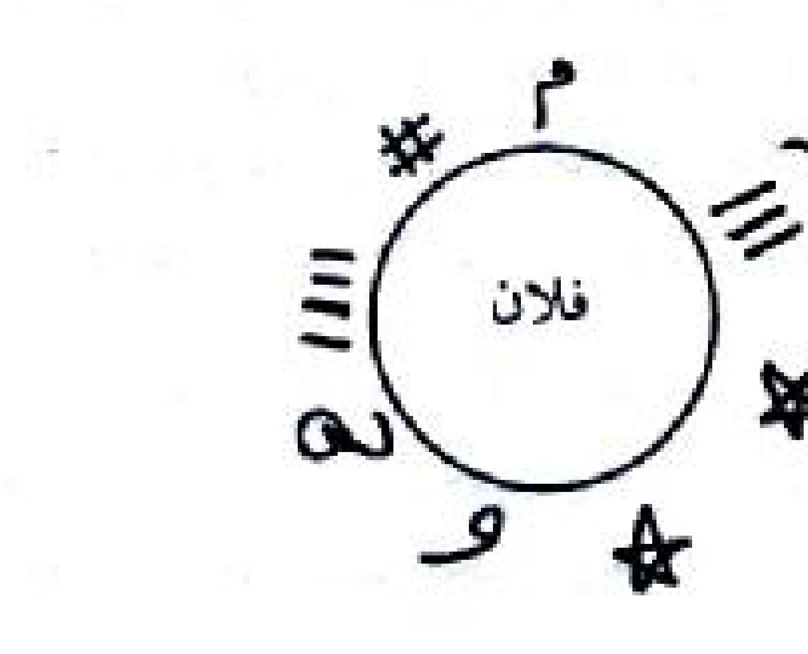
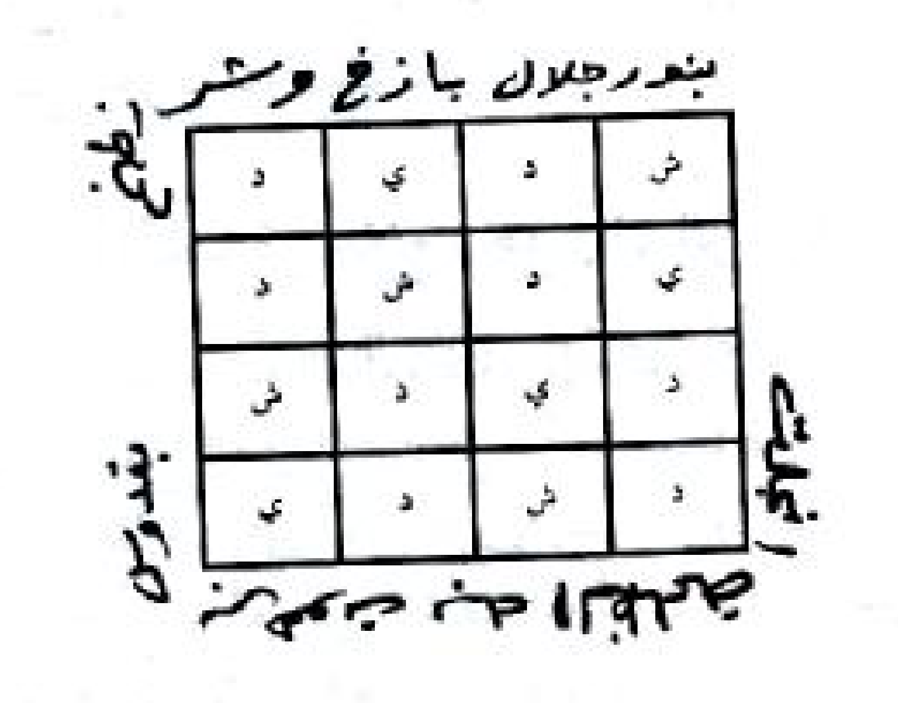
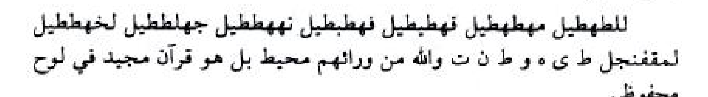
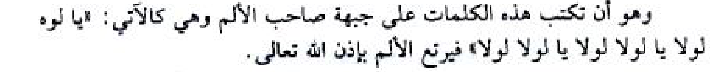
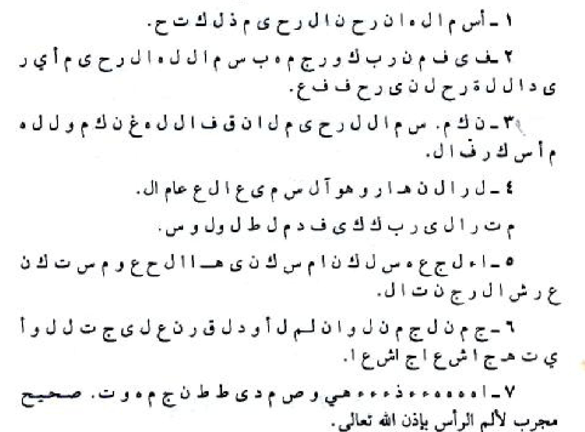
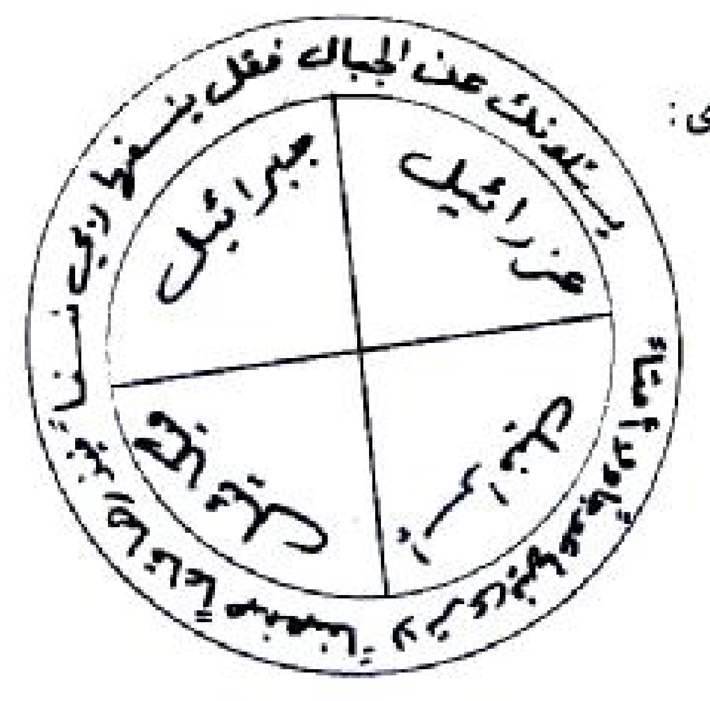
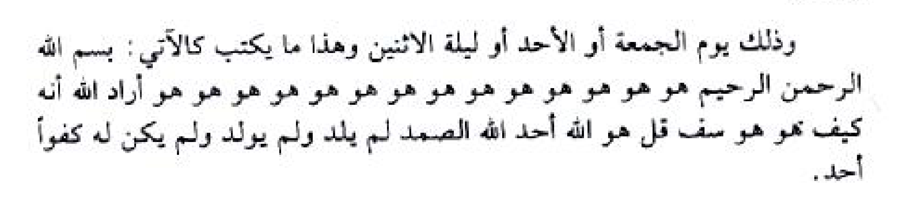

# TRANSKRIPSI BAB 2 — LANJUTAN HALAMAN 77 (format 4 sub-header, Aturan Ustadz Yoad)

Berkas ini memakai struktur baku 4 sub-header sesuai `ATURAN-USTADZ-YOAD.md`.
Sumber gambar: `sirrul asror ruhani.pdf` halaman 77, render **200 dpi + 600 dpi**, dibaca dengan mata.
Halaman 77 = lanjutan daftar karya Syaikh 'Athiyyah: **judul nomor 33–39** + baris penutup + nomor kontak.
Halaman 76 (berkas sebelumnya) memuat **judul nomor 1–32**; judul 33–39 yang dulu ikut tertulis di 76 sudah dipindahkan ke sini.

---

## HALAMAN 77 — PDF hal. 77 / bagian — Daftar Karya (lanjutan): judul 33–39 + baris penutup

### 1. TEKS ARAB BERHARAKAT

كِتَابُ نَهْرِ الرُّوحَانِيَّةِ فِيمَا يَتَعَلَّقُ بِالْأُمُورِ الْخَفِيَّةِ
كِتَابُ الشَّيْخِ الْكَبِيرِ فِي عِلْمِ التَّنْزِيلِ مِنَ الْمَزْمُورِ وَالْإِنْجِيلِ
كِتَابُ الْأَوْفَاقِ وَخَوَاصِّ كُلِّ وَفْقٍ وَكَيْفِيَّةِ عَمَلِهِ
كِتَابُ الْبَوَّابَةِ الْكَوْنِيَّةِ فِي اسْتِحْضَارِ الرُّوحَانِيَّةِ
كِتَابُ الْأَحْجَارِ الْكَرِيمَةِ وَطُرُقِ عَمَلِ الْخَوَاتِمِ الرُّوحَانِيَّةِ لِكُلِّ شَخْصٍ وَكَيْفِيَّةِ الِانْتِفَاعِ بِهِ
كِتَابُ ذُرْوَةِ الْأَسْرَارِ وَمَا يَتَعَلَّقُ بِطَلَاسِمِ اللَّيْلِ وَالنَّهَارِ
مُجَلَّدَاتُ الْجَوَاهِرِ التِّسْعَةِ الرُّوحَانِيَّةِ
بِيهْ
لِلْكَشْفِ وَالْمُتَابَعَةِ مَعَ شَيْخِ الرُّوحَانِيِّينَ فِي الْوَطَنِ الْعَرَبِيِّ الشَّيْخِ عَطِيَّةَ عَبْدِ الْحَمِيدِ

### 2. TRANSLITERASI LATIN

Kitabu Nahrir-Ruhaniyyati fima Yata'allaqu bil-Umuril-Khafiyyati
Kitabush-Syaikhil-Kabiri fi 'Ilmit-Tanzili minal-Mazmuri wal-Injili
Kitabul-Aufaqi wa Khawashshi Kulli Wafqin wa Kaifiyyati 'Amalihi
Kitabul-Bawwabatil-Kauniyyati fi Istihdharir-Ruhaniyyati
Kitabul-Ahjaril-Karimati wa Thuruqi 'Amalil-Khawatim ar-Ruhaniyyati li-Kulli Syakhshin wa Kaifiyyatil-Intifa'i bihi
Kitabu Dzurwatil-Asrari wa Ma Yata'allaqu bi-Thalasimil-Laili wan-Nahari
Mujalladatul-Jawahir at-Tis'ati ar-Ruhaniyyati
Bih
Lil-Kasyfi wal-Mutaba'ati ma'a Syaikhir-Ruhaniyyina fil-Wathanil-'Arabiyyisy-Syaikhi 'Athiyyata 'Abdil-Hamidi

### 3. TERJEMAHAN INDONESIA

Kitab Nahrur-Ruhaniyyah tentang hal-hal yang berkaitan dengan perkara-perkara yang tersembunyi
Kitab Asy-Syaikh Al-Kabir dalam ilmu Tanzil dari Mazmur dan Injil
Kitab Al-Aufaq dan keistimewaan setiap wafaq serta cara mengamalkannya
Kitab Al-Bawwabah Al-Kauniyyah dalam menghadirkan ruhaniyyah
Kitab Al-Ahjar Al-Karimah (batu-batu mulia) dan metode pembuatan khatam ruhaniyyah untuk setiap orang serta cara memanfaatkannya
Kitab Dzurwatul-Asrar dan hal-hal yang berkaitan dengan thalasim malam dan siang
Jilid-jilid Al-Jawahir At-Tis'ah Ar-Ruhaniyyah (sembilan jilid permata ruhani)
Bih — potongan kata tercetak terpisah (huruf ba'-ya'-ha' jelas), tanpa kelanjutan pada baris berikutnya; dipertahankan apa adanya, tidak ditambah dan tidak ditebak
Untuk kasyaf (penerawangan) dan bimbingan bersama Syaikh para ruhani, di negeri Arab, Syaikh 'Athiyyah 'Abdul Hamid

### 4. TATACARA PRAKTIK LENGKAP

- Halaman ini adalah **daftar karya (katalog terbitan)**, bukan amalan. Tidak ada bacaan, wafaq, dupa, tinta, atau waktu pelaksanaan yang diperintahkan di halaman ini, sehingga tidak ada panduan praktik yang dapat disusun.
- Daftar berlanjut dari halaman 76: nomor 33 sampai 39, lalu satu potongan kata (`بِيهْ`), baris penutup, dan nomor kontak penerbit yang menurut aturan dibersihkan dari transkrip.
- Potongan kata `بِيهْ` dipertahankan karena tercetak di kitab, tetapi tidak diberi tafsir apa pun: pada halaman ini ia berdiri sendiri tanpa kata penyambung, sehingga maknanya tidak dapat dipastikan dari halaman 77. Bila nanti ditemukan kelanjutannya pada halaman lain, catatan akan diperbarui.
- Kata `فُلَان` / `فُلَانَة` tidak terdapat pada halaman ini, jadi keterangan Fulan/Fulanah tidak berlaku di sini.
- Bagi pengamal, halaman ini berguna sebagai rujukan judul: bila suatu amalan di bagian lain kitab merujuk pada salah satu kitab di atas, judulnya dapat dicocokkan di sini. Ketujuh judul 33–39 berkaitan langsung dengan praktik wafaq, khatam, thalasim, dan kasyaf.

---

## HALAMAN 78 — PDF hal. 78 / halaman judul bagian — فصل في فضل البسملة والفاتحة

### 1. TEKS ARAB BERHARAKAT

فَصْلٌ
فِي فَضْلِ الْبَسْمَلَةِ وَالْفَاتِحَةِ
(ada rajah halaman 78 — bingkai hiasan halaman judul, bukan wafaq)

### 2. TRANSLITERASI LATIN

Fashlun,
fi fadhli al-basmalati wal-fatihah.

### 3. TERJEMAHAN INDONESIA

Pasal
tentang keutamaan basmalah dan Al-Fatihah.

### 4. TATACARA PRAKTIK LENGKAP

- Halaman ini adalah halaman judul bagian (divider). Tidak ada amalan, bacaan, atau syarat yang diperintahkan di sini.
- Yang tercetak hanya judul pasal; seluruh isi pasal dimulai pada halaman 79 dan berlanjut sampai halaman 82.
- Bingkai berhias pada halaman ini adalah hiasan cetak, bukan wafaq, sehingga tidak diberi tanda wafaq dan tidak ada angka yang perlu dicocokkan.
- Nama penulis, keterangan "untuk mengikuti dan berkomunikasi", serta nomor kontak yang tercetak di dalam bingkai dihapus sesuai aturan pembersihan elemen non-kitab.

---

## HALAMAN 79 — PDF hal. 79 / bagian — فضل القرآن العظيم: ayat syifa' dan keutamaan basmalah

### 1. TEKS ARAB BERHARAKAT

فَضْلُ الْقُرْآنِ الْعَظِيمِ
(بَابٌ فِي فَضْلِ الْقُرْآنِ الْعَظِيمِ وَالْبَسْمَلَةِ وَالْفَاتِحَةِ)
وَهُوَ فِي سِرِّ قَوْلِهِ سُبْحَانَهُ وَتَعَالَى ﴿وَنُنَزِّلُ مِنَ الْقُرْآنِ مَا هُوَ شِفَاءٌ وَرَحْمَةٌ لِلْمُؤْمِنِينَ﴾ مِمَّا يَدُلُّ مِنْ خِلَالِ هَذِهِ الْآيَةِ الْكَرِيمَةِ هُوَ شِفَاءُ الْأَجْسَامِ كَمَا فِيهِ شِفَاءٌ لِحَقَائِقِ الْقُلُوبِ لِذَلِكَ جَاءَ قَوْلُ النَّبِيِّ الْكَرِيمِ ﷺ أَنَّهُ قَالَ: (شِفَاءُ أُمَّتِي فِي ثَلَاثٍ: آيَةٌ مِنْ كِتَابِ اللَّهِ تَعَالَى أَوْ كَأْسٌ مِنْ يَدِ حَجَّامٍ، أَوْ لَعْقَةٌ مِنْ عَسَلِ النَّحْلِ).
وَأَيْضًا قَالَ ﷺ: (الْقُرْآنُ هُوَ الدُّرُّ). (فَكِّرْ تُرْشَدْ أَيُّهَا الْأَخُ الْمُؤْمِنُ بِاللَّهِ سُبْحَانَهُ وَتَعَالَى مَا أَوْدَعَ اللَّهُ جَلَّ وَعَلَا فِي الْقُرْآنِ الْكَرِيمِ الْمَكْنُونِ وَالسِّرِّ الْمَخْزُونِ مِنَ الْجَوَاهِرِ الَّتِي لَا تُقَدَّرُ بِأَيِّ شَيْءٍ مِنْ حَيْثُ يَصْلُحُ لِلْمَرْءِ فِي دِينِهِ وَدُنْيَاهُ وَآخِرَتِهِ وَمَثْوَاهُ إِلَّا وَهُوَ بِاتِّبَاعِ قَوْلِ الرَّسُولِ الْأَكْرَمِ ﷺ وَذَلِكَ بِالتَّمَسُّكِ بِكِتَابِ اللَّهِ الْعَزِيزِ) وَقَالَ بَعْضُ الْعَارِفِينَ مِنْ أَهْلِ التَّحْقِيقِ «بِسْمِ اللَّهِ مِنْكَ بِمَنْزِلَةِ كُنْ مِنْهُ» رُوِيَ أَنَّهُ قَالَ الْإِمَامُ الْحَسَنُ بْنُ عَلِيٍّ عَلَيْهِمَا أَفْضَلُ الصَّلَوَاتِ وَالسَّلَامُ: مَنْ أَحْسَنَ كِتَابَةَ بِسْمِ اللَّهِ الرَّحْمَنِ الرَّحِيمِ وَجَوَّدَهَا تَعْظِيمًا لِلَّهِ تَعَالَى دَخَلَ الْجَنَّةَ (أَيْ بِشَرْطِهَا وَشُرُوطِهَا).
وَرُوِيَ عَنْ أَبِي سَعِيدٍ الْخُدْرِيِّ رَضِيَ اللَّهُ تَعَالَى عَنْهُ قَالَ: سَمِعْتُ ابْنَ عَبَّاسٍ رَضِيَ اللَّهُ تَعَالَى عَنْهُ يَقُولُ: لِكُلِّ شَيْءٍ أَسَاسٌ وَأَسَاسُ الْكُتُبِ كُلِّهَا الْقُرْآنُ وَأَسَاسُ الْقُرْآنِ الْفَاتِحَةُ وَأَسَاسُ الْفَاتِحَةِ «بِسْمِ اللَّهِ الرَّحْمَنِ الرَّحِيمِ» فَإِذَا اشْتَكَيْتَ أَوْ غَفَلْتَ فَعَلَيْكَ بِالْأَسَاسِ لِتُشْفَى مِنْ كُلِّ دَاءٍ، وَقِيلَ مَنْ ذَكَرَ بِسْمِ اللَّهِ الرَّحْمَنِ الرَّحِيمِ أَرْبَعَ مِائَةٍ وَسَبْعَةً وَثَمَانِينَ مَرَّةً، عَلَى طِلَسْمٍ أَبْطَلَهُ لِوَقْتِهِ.
أَيْضًا مِنْ خَوَاصِّ بِسْمِ اللَّهِ الرَّحْمَنِ الرَّحِيمِ الْمُكَرَّمَةِ: هُوَ كَالْآتِي:
١ - وَمَنْ تَلَاهَا الْعَدَدَ الْمَذْكُورَ أَيْ أَرْبَعَةَ مِائَةٍ وَسَبْعَةً وَثَمَانِينَ مَرَّةً وَسَأَلَ اللَّهَ

### 2. TRANSLITERASI LATIN

Fadhlu al-Qur'anil-'azhim,
(babun fi fadhli al-Qur'anil-'azhimi wal-basmalati wal-fatihah).
Wa huwa fi sirri qaulihi subhanahu wa ta'ala ﴿Wa nunazzilu minal-Qur'ani ma huwa syifa'un wa rahmatun lil-mu'minin﴾ mimma yadullu min khilali hadzihil-ayatil-karimati huwa syifa'ul-ajsami kama fihi syifa'un li-haqa'iqil-qulubi lidzalika ja'a qaulun-nabiyyil-karimi ﷺ annahu qala: (Syifa'u ummati fi tsalatsin: ayatun min kitabillahi ta'ala au ka'sun min yadi hajjamin, au la'qatun min 'asalinnahl).
Wa aidhan qala ﷺ: (Al-Qur'anu huwad-durr). (Fakkir tursyad ayyuhal-akhul-mu'minu billahi subhanahu wa ta'ala ma auda'allahu jalla wa 'ala fil-Qur'anil-karimil-maknuni was-sirril-makhzuni minal-jawahiril-lati la tuqaddaru bi-ayyi syai'in min haitsu yashluhu lil-mar'i fi dinihi wa dunyahu wa akhiratihi wa matswahu illa wa huwa bittiba'i qaulir-rasulil-akrami ﷺ wa dzalika bittamassuki bikitabillahil-'aziz) wa qala ba'dhul-'arifina min ahlit-tahqiqi «bismillahi minka bimanzilati kun minhu» ruwiya annahu qalal-imamul-hasanu bnu 'aliyyin 'alaihima afdhalus-salawati was-salamu: man ahsana kitabata bismillahir-rahmanir-rahimi wa jawwadaha ta'zhiman lillahi ta'ala dakhalal-jannata (ay bi-syarthiha wa syuruthiha).
Wa ruwiya 'an abi sa'idil-khudriyyi radhiyallahu ta'ala 'anhu qala: sami'tubna 'abbasin radhiyallahu ta'ala 'anhu yaqulu: likulli syai'in asasun wa asasul-kutubi kullihal-Qur'anu wa asasul-Qur'anil-fatiha wa asasul-fatihah «bismillahir-rahmanir-rahim» fa-idzasytakaita au ghafalta fa'alaikal-biasasi litasysyfa min kulli da'in, wa qila man dzakara bismillahir-rahmanir-rahimi arba'a mi'atin wa sab'atan wa tsamanina marratan, 'ala thilsimin abthalahu liwaqtihi.
Aidhan min khawashshi bismillahir-rahmanir-rahimil-mukarramati: huwa kal-ati:
1 - Wa man talahal-'adadal-madzkura ay arba'a mi'atin wa sab'atan wa tsamanina marratan wa sa-alallaha

### 3. TERJEMAHAN INDONESIA

Keutamaan Al-Qur'an yang Agung.
(Bab tentang keutamaan Al-Qur'an yang Agung, basmalah, dan Al-Fatihah.)
Hal itu terdapat pada rahasia firman-Nya, Mahasuci dan Mahatinggi: "Dan Kami turunkan dari Al-Qur'an sesuatu yang menjadi penyembuh dan rahmat bagi orang-orang mukmin" — yang menunjukkan bahwa melalui ayat yang mulia ini terkandung penyembuhan badan, sebagaimana di dalamnya juga terdapat penyembuhan bagi hakikat hati. Karena itu datanglah sabda Nabi yang mulia ﷺ bahwa beliau bersabda: "Kesembuhan umatku ada pada tiga hal: ayat dari Kitab Allah Ta'ala, atau segelas dari tangan tukang bekam, atau sesendok madu lebah."
Dan beliau ﷺ juga bersabda: "Al-Qur'an adalah permata." (Berpikirlah, engkau akan mendapat petunjuk, wahai saudara mukmin yang beriman kepada Allah Mahasuci dan Mahatinggi, tentang apa yang telah Allah — Yang Mahaagung dan Mahatinggi — titipkan di dalam Al-Qur'an yang mulia, yang tersimpan dan rahasia yang terpendam, berupa permata-permata yang tidak dapat dinilai dengan apa pun, karena ia memberi kebaikan bagi seseorang dalam agama, dunia, akhirat, dan tempat kembalinya; semua itu hanyalah dengan mengikuti sabda Rasul yang paling mulia ﷺ, yaitu dengan berpegang teguh pada Kitab Allah Yang Mahaperkasa.) Sebagian orang 'arif dari kalangan ahli tahqiq berkata: "Basmalah dari sisi Allah menempati kedudukan 'kun' darinya." Diriwayatkan bahwa Imam Hasan bin Ali — semoga keduanya memperoleh shalawat dan salam yang paling utama — berkata: "Barangsiapa membaguskan penulisan 'bismillahir-rahmanir-rahim' dan memperindahnya karena mengagungkan Allah Ta'ala, ia masuk surga" (yakni dengan syarat-syaratnya).
Dan diriwayatkan dari Abu Sa'id Al-Khudri ra bahwa ia berkata: Aku mendengar Ibnu Abbas ra berkata: "Setiap sesuatu memiliki fondasi; fondasi seluruh kitab suci adalah Al-Qur'an, fondasi Al-Qur'an adalah Al-Fatihah, dan fondasi Al-Fatihah adalah 'bismillahir-rahmanir-rahim'. Maka jika engkau mengeluh sakit atau lalai, berpeganglah pada fondasi itu agar penyembuhan dari segala penyakit. Dan dikatakan: barangsiapa membaca 'bismillahir-rahmanir-rahim' empat ratus delapan puluh tujuh kali pada sebuah thilasm, thilasm itu menjadi batal pada saat itu juga."
Juga di antara keistimewaan basmalah yang dimuliakan adalah sebagai berikut:
1 — Barangsiapa membacanya sebanyak jumlah yang disebutkan, yaitu empat ratus delapan puluh tujuh kali, lalu memohon kepada Allah

### 4. TATACARA PRAKTIK LENGKAP

- Amalan pada halaman ini masih berupa keterangan keutamaan (fadhilah), dan hitungan amalnya bersambung ke halaman 80. Panduan lengkapnya disusun pada halaman 80.
- Teks pada halaman ini dipakai sebagai dasar tiga amalan yang akan dijelaskan kemudian: (a) menulis basmalah dengan bagus sebagai amalan 'adab, (b) mengulang basmalah 487 kali sebagai wirid/thilasm-batal, dan (c) mengamalkan basmalah untuk kebutuhan sehari-hari.
- Kata كَذَا / كَذَا وَكَذَا pada halaman ini belum muncul; yang muncul pada halaman 79 adalah lafaz umum. Keterangan Fulan/Fulanah baru berlaku pada halaman 80 nomor 6.
- Untuk latar belakang: penyembuhan yang dimaksud dalam ayat dan hadis di halaman ini adalah penyembuhan badan dan hati. Ayatnya dikutip apa adanya seperti tercetak, tanpa penambahan nomor surah.
- Kata فُلَان / فُلَانَة tidak terdapat pada halaman ini, jadi keterangan Fulan/Fulanah tidak berlaku di sini.

---

## HALAMAN 80 — PDF hal. 80 / bagian — Keutamaan basmalah (2–7) dan basmalah berhias

### 1. TEKS ARAB BERHARAKAT

تَعَالَى شَيْئًا أَعْطَاهُ، وَقَالَ بَعْضُ الْعُلَمَاءِ: مَنْ ذَكَرَ بِسْمِ اللَّهِ الرَّحْمَنِ الرَّحِيمِ كُلَّ يَوْمٍ (مِائَةَ مَرَّةٍ) أَطْلَعَهُ اللَّهُ عَلَى أَسْرَارِ الْعُلُومِ وَبِوَاطِنِ حَقَائِقِهَا.
٢ - أَيْضًا وَرَدَ فِي فَضْلِهَا وَكَرَامَتِهَا عِنْدَ اللَّهِ سُبْحَانَهُ وَتَعَالَى وَمَا قِيلَ مَنْ أَكْثَرَ ذِكْرَ بِسْمِ اللَّهِ الرَّحْمَنِ الرَّحِيمِ رُزِقَ الْهَيْبَةَ مِنَ الْعَالَمِ الْعُلْوِيِّ وَالسُّفْلِيِّ وَمَا أَوْدَعَ اللَّهُ فِيهَا مِنَ الْأَسْرَارِ وَفِيهَا اسْمُ اللَّهِ الْأَعْظَمُ وَهِيَ أَوَّلُ مَا خَطَّهُ الْقَلَمُ الْعُلْوِيُّ عَلَى صَفْحَةِ اللَّوْحِ.
٣ - وَهِيَ الَّتِي أَقَامَ اللَّهُ تَعَالَى مَلِكَ سُلَيْمَانَ بْنِ دَاوُدَ ﷺ بِهَا أَقَامَ اللَّهُ تَعَالَى شَجَرَةَ الْأَكْوَانِ وَظَهَرَ فِيهَا أَسْرَارُهَا.
٤ - مِنْ خَوَاصِّهَا: وَمَنْ رَسَمَ بِسْمِ اللَّهِ الرَّحْمَنِ الرَّحِيمِ عَلَى هَذِهِ الصِّفَةِ كَالْآتِي: «بِسْمِ اللَّهِ الرَّحْمَنِ الرَّحِيمِ» وَحَمَلَهَا مَعَهُ أَطْفَأَ بِهَا حَرَّ النَّارِ.
(ada rajah/tulisan basmalah berhias halaman 80..)

٥ - وَمَنْ كَتَبَهَا فِي بِطَاقَةٍ وَحَمَلَهَا مَعَهُ مَنْ بِهِ وَجَعُ الْفَرَسِ أَوِ الرَّأْسِ، بِشَرْطِ أَنْ يَضَعَهَا عَلَى الْوَجَعِ بِسَكَنٍ لِوَقْتِهِ.
٦ - أَيْضًا رُوِيَ عَنِ عَبْدِ اللَّهِ بْنِ عُمَرَ أَنَّهُ قَالَ: مَنْ كَانَتْ لَهُ حَاجَةٌ فَلْيَصُمْ يَوْمَ الْأَرْبِعَاءِ وَيَوْمَ الْخَمِيسِ وَالْجُمُعَةِ فَإِذَا كَانَ يَوْمُ الْجُمُعَةِ يَغْتَسِلُ وَيَذْهَبُ إِلَى الْمَسْجِدِ فَلْيَتَصَدَّقْ بِشَيْءٍ فِي طَرِيقِهِ وَبَعْدَ الْفَرَاغِ مِنَ الصَّلَاةِ الْجُمُعَةِ، يَقُولُ: اللَّهُمَّ إِنِّي أَسْأَلُكَ بِاسْمِكَ الْعَظِيمِ بِسْمِ اللَّهِ الرَّحْمَنِ الرَّحِيمِ الَّذِي لَا إِلَهَ إِلَّا هُوَ عَالِمُ الْغَيْبِ وَالشَّهَادَةِ هُوَ الرَّحْمَنُ الرَّحِيمُ أَسْأَلُكَ بِاسْمِكَ بِسْمِ اللَّهِ الرَّحْمَنِ الرَّحِيمِ الَّذِي عَنَتْ لَهُ الْوُجُوهُ وَخَشَعَتْ لَهُ الْأَصْوَاتُ وَوَجِلَتِ الْقُلُوبُ مِنْ خَشْيَتِهِ أَنْ تُصَلِّيَ عَلَى سَيِّدِنَا مُحَمَّدٍ وَعَلَى آلِهِ الطَّيِّبِينَ الطَّاهِرِينَ وَسَلِّمْ وَأَنْ تَقْضِيَ حَاجَتِي وَهِيَ كَذَا وَكَذَا أَوْ تُسَمِّيهَا فَإِنَّهَا تُقْضَى، وَكَانَ يَقُولُ: لَا تُعَلِّمُوهَا لِسُفَهَائِكُمْ فَيَدْعُو بِهَا لَا يُسْتَجَابُ لَهُمْ فِي الْوَقْتِ.
٧ - وَأَيْضًا وَيَنْتَظِمُ مِنْ حُرُوفِ بِسْمِ اللَّهِ الرَّحْمَنِ الرَّحِيمِ تِسْعَةَ عَشَرَ اسْمًا عَدَدَ

### 2. TRANSLITERASI LATIN

Ta'ala syai'an a'thahu, wa qala ba'dhul-'ulama'i: man dzakara bismillahir-rahmanir-rahimi kulla yaumin (mi'ata marratin) athla'ahullahu 'ala asraril-'ulumi wa bawathini haqa'iqiha.
2 — Aidhan warada fi fadhliha wa karamatiha 'indallahi subhanahu wa ta'ala wa ma qila man atsakara dzikra bismillahir-rahmanir-rahimi ruziqal-haibata minal-'alamil-'uluwiyyi was-sufliyyi wa ma auda'allahu fiha minal-asrari wa fiha ismullahil-a'zhamu wa hiya awwalu ma khatthahul-qalamul-'uluwiyyu 'ala shafhatil-lauhi.
3 — Wa hiyal-lati aqamallahu ta'ala malika sulaimana bni dawuda ﷺ biha aqamallahu ta'ala syajaratal-akwani wa zhahara fiha asraruha.
4 — Min khawashshiha: wa man rasama bismillahir-rahmanir-rahimi 'ala hadzihish-shifati kal-ati: «bismillahir-rahmanir-rahim» wa hamalaha ma'ahu athfa'a biha harran-nar.
5 — Wa man katabaha fi bithaqatin wa hamalaha ma'ahu man bihi waja'ul-farasi awir-ra'si, bisyarthi an yadha'aha 'alal-waja'i bisakanin liwaqtihi.
6 — Aidhan ruwiya 'an 'abdillahi bni 'umara annahu qala: man kanat lahu hajatun fal-yashum yaumal-arbi'a'i wa yaumal-khamisi wal-jumu'ati fa-idza kana yaumul-jumu'ati yaghtasilu wa yadzhabu ilal-masjidi fal-yatashaddaq bisyai'in fi thariqihi wa ba'dal-faraghi minash-shalatil-jumu'ati, yaqulu: Allahumma inni as-aluka bismikal-'azhimi bismillahir-rahmanir-rahimil-ladzi la ilaha illa huwa 'alimul-ghaibi wasy-syahadati huwar-rahmanur-rahimu as-aluka bismika bismillahir-rahmanir-rahimil-ladzi 'anat lahul-wujuhu wa khasy'at lahul-ashwatu wa wajilatil-qulubu min khasyyatihi an tushalliya 'ala sayyidina muhammadin wa 'ala alihith-thayyibinath-thahirin(a) wa sallim wa an taqdhiya hajati wa hiya kadza wa kadza au tusammiha fa-innaha tuqdha, wa kana yaqulu: la tu'allimuha lisufaha'ikum fayad'u biha la yustajabu lahum fil-waqti.
7 — Wa aidhan wa yantazhimu min hurufi bismillahir-rahmanir-rahimi tis'ata 'asyara isman 'adada

### 3. TERJEMAHAN INDONESIA

... Mahatinggi sesuatu, Dia memberikannya. Sebagian ulama berkata: "Barangsiapa menyebut 'bismillahir-rahmanir-rahim' setiap hari seratus kali, Allah akan memperlihatkan kepadanya rahasia-rahasia ilmu dan hakikat-hakikat yang tersembunyi di dalamnya."
2 — Juga telah datang riwayat tentang keutamaannya dan kemuliaannya di sisi Allah Mahasuci dan Mahatinggi, dan apa yang dikatakan: "Barangsiapa memperbanyak dzikir 'bismillahir-rahmanir-rahim', ia diberi kewibawaan dari alam atas dan alam bawah"; dan di dalamnya Allah menitipkan rahasia-rahasia; di dalamnya terdapat Ismullah Al-A'zham; dan ia adalah yang pertama kali ditulis oleh qalam 'ulwi pada lembaran Lauh.
3 — Ia adalah (kalimat) yang dengannya Allah Ta'ala meneguhkan kerajaan Sulaiman bin Dawud ﷺ; dengannya pula Allah Ta'ala menegakkan pohon segala wujud (syajaratul-akwan) dan padanya tampak rahasia-rahasianya.
4 — Di antara keistimewaannya: barangsiapa melukis "bismillahir-rahmanir-rahim" dengan bentuk seperti berikut: "بِسْمِ اللَّهِ الرَّحْمَنِ الرَّحِيمِ" lalu membawanya, ia telah memadamkan panas api dengannya.
5 — Dan barangsiapa menulisnya pada sebuah kertas (bithaqah) lalu membawanya bagi orang yang terkena sakit pada kuda atau pada kepala, dengan syarat ia meletakkannya di atas bagian yang sakit dengan tenang, maka (sakitnya) berhenti pada saat itu.
6 — Juga diriwayatkan dari Abdullah bin Umar bahwa ia berkata: "Barangsiapa memiliki suatu kebutuhan, hendaklah ia berpuasa pada hari Rabu, Kamis, dan Jumat. Apabila tiba hari Jumat, ia mandi, pergi ke masjid, bersedekah sesuatu di jalan, dan setelah selesai shalat Jumat ia membaca: 'Ya Allah, aku memohon kepada-Mu dengan nama-Mu Yang Agung, bismillahir-rahmanir-rahim, yang tiada tuhan selain Dia, Yang Maha Mengetahui yang gaib dan yang nyata, Dialah Yang Maha Pengasih lagi Maha Penyayang; aku memohon kepada-Mu dengan nama-Mu, bismillahir-rahmanir-rahim, yang kepada-Nya tunduk segala wajah, yang suara-suara merendah kepada-Nya, dan yang hati-hati bergetar karena takut kepada-Nya, agar Engkau bershalawat kepada penghulu kami Muhammad dan kepada keluarganya yang baik dan suci, dan Engkau penuhi kebutuhanku, yaitu demikian dan demikian — atau ia menyebutnya — maka kebutuhan itu pasti dipenuhi.'" Dan beliau berkata: "Jangan ajarkan ia kepada orang-orang bodoh di antara kalian, karena bila mereka berdoa dengannya, doa mereka tidak dikabulkan pada waktu itu."
7 — Dan juga tersusun dari huruf-huruf "bismillahir-rahmanir-rahim" sembilan belas nama, sebanyak jumlah

### 4. TATACARA PRAKTIK LENGKAP

Panduan lengkap untuk amalan yang dimulai di halaman 79 dan berlanjut di halaman 80:

- Wirid basmalah 487 kali (lanjutan dari halaman 79): membaca "بِسْمِ اللَّهِ الرَّحْمَنِ الرَّحِيمِ" sebanyak empat ratus delapan puluh tujuh kali; menurut teks, bila dibaca pada sebuah thilasm, thilasm itu batal seketika. Tidak ada ketentuan waktu khusus pada teks untuk wirid ini.
- Wirid harian 100 kali: membaca basmalah seratus kali setiap hari; menurut teks, Allah memperlihatkan rahasia ilmu dan hakikatnya.
- Amalan memadamkan panas api: melukis basmalah dengan bentuk berhias seperti pada gambar halaman 80, lalu membawanya. Menurut teks, pemiliknya tidak terbakar panas api.
- Amalan sakit pada kepala atau pada kuda: menulis basmalah pada sebuah kertas (bithaqah), lalu membawanya bagi penderita; diletakkan di atas bagian yang sakit dengan tenang, dan sakitnya berhenti saat itu juga.
- Amalan kebutuhan (hajat) menurut riwayat Abdullah bin Umar: puasa Rabu, Kamis, dan Jumat; pada hari Jumat mandi, pergi ke masjid, bersedekah sesuatu di jalan; setelah selesai shalat Jumat membaca doa yang tercetak di atas; di dalam doa disebutkan kebutuhan dengan kalimat "demikian dan demikian" atau menyebutnya secara langsung; menurut teks, kebutuhan itu dipenuhi. Teks juga memperingatkan agar amalan ini tidak diajarkan kepada orang bodoh, karena doanya tidak dikabulkan pada waktu itu.
- Pada nomor 6 terdapat kata كَذَا وَكَذَا ("demikian dan demikian"). Kata ini adalah kata ganti, bukan nama orang: pengamal menggantinya dengan kebutuhan yang dimaksud. Bila yang dituju adalah orang, maka untuk laki-laki dipakai فُلَان ibni فُلَانَة (Fulan ibni Fulanata, yaitu nama laki-laki disertai nama ibunya) dan untuk perempuan dipakai فُلَانَة binti فُلَانَة (Fulanata binti Fulanata, yaitu nama perempuan disertai nama ibunya).
- Pada halaman ini tidak ada kata فُلَان / فُلَانَة secara tertulis; yang ada hanya كَذَا وَكَذَا, sehingga keterangan Fulan/Fulanah di atas berlaku sebagai penjelasan cara menyebut nama bila kebutuhan itu menyangkut orang.

---

## HALAMAN 81 — PDF hal. 81 / bagian — Huruf-huruf basmalah, makna setiap huruf, dan wafaq 19×19

### 1. TEKS ARAB BERHARAKAT

حُرُوفُهَا وَهِيَ: اللَّهُ الرَّحْمَنُ الرَّحِيمُ الرَّبُّ، السَّلَامُ، الْمُؤْمِنُ، الْمُهَيْمِنُ، السِّتَارُ، الْحَيُّ، الْمُحْيِي، الْعَلِيمُ الْحَنَّانُ، الْمَنَّانُ، الْحَيُّ، الْقَيُّومُ، الْبَارِي، الْعَيْنُ، الرَّحِيمُ، الْحَبِيبُ، وَمَنْ وَضَعَ هَذِهِ الْأَسْمَاءَ الشَّرِيفَةَ فِي مُرَبَّعٍ تِسْعَةَ عَشَرَ فِي مِثْلِهَا وَحَمَلَهُ مَعَهُ فَإِنَّهُ لَا يَسْأَلُ اللَّهَ تَعَالَى شَيْئًا إِلَّا أَعْطَاهُ إِيَّاهُ وَفِيهِ اسْمُ اللَّهِ الْأَعْظَمُ وَيَكُونُ وَضْعُهُ أَيْ كِتَابَتُهُ فِي رَابِعِ يَوْمٍ مِنَ الشَّهْرِ الْعَرَبِيِّ فَإِنَّهُ أَبْلَغُ وَكَمَا وَرَدَ وَرُوِيَ.
فِي فَضْلِ وَشَأْنِ بِسْمِ اللَّهِ الرَّحْمَنِ الرَّحِيمِ الْمُبَارَكَةِ قِيلَ: إِنَّ كُلَّ حَرْفٍ مِنْ بِسْمِ اللَّهِ الرَّحْمَنِ الرَّحِيمِ (هُوَ مِفْتَاحُ اسْمٍ مِنْ أَسْمَاءِ اللَّهِ سُبْحَانَهُ وَتَعَالَى)...
- (فَالْبَاءُ مِفْتَاحُ اسْمِهِ بَصِيرٌ).
- (وَالسِّينُ مِفْتَاحُ اسْمِهِ سَمِيعٌ).
- (وَالْمِيمُ مِفْتَاحُ اسْمِهِ مَلِيكٌ).
- (وَالْأَلِفُ اللَّهُ).
- (وَاللَّامُ لَطِيفٌ).
- (وَالْهَاءُ هَادِي).
- (وَالرَّاءُ رَازِقٌ).
- (وَالْحَاءُ حَنَّانٌ).
- (وَالْمِيمُ مَانِعٌ وَمُعْطِي).
(وَهَذِهِ كُلُّهَا يُدْعَى بِهَا عِنْدَ افْتِتَاحِ كُلِّ شَيْءٍ وَالدُّعَاءُ بِهَذِهِ الْأَسْمَاءِ الْمُبَارَكَةِ مُجَابٌ لَا مَحَالَةَ كَمَا وَرَدَ فِي ذَلِكَ.
وَمِنْ خَوَاصِّ وَفْقِ الْمُرَبَّعِ التِّسْعَةِ عَشَرَ قِيلَ مَنْ حَمَلَهُ مَعَهُ فَإِنَّهُ لَا يَسْأَلُ اللَّهَ شَيْئًا إِلَّا أَعْطَاهُ وَهُوَ وَفْقٌ عَظِيمٌ بِهِ مُحِيطٌ مُخَمَّسٌ جَوْفِيٌّ فَمَنْ جَمَعَ بَيْنَ رُبْعِ الْحَرْفِ فِي مُرَبَّعٍ وَاحِدٍ وَحَمَلَهُ مَعَهُ رَأَى مِنْ لُطْفِ اللَّهِ تَعَالَى مَا تَعْجَزُ عَنْهُ الْأَوْصَافُ وَلَا يَدْخُلُ تَحْتَ حَصْرٍ وَمَنْ عَرَفَ قَدْرَهُ اسْتَغْنَى بِهِ عَنْ غَيْرِهِ فَإِنَّهُ فِيهِ اسْمُ اللَّهِ الْأَعْظَمُ الَّذِي دُعِيَ بِهِ أُجِيبَ وَإِذَا سُئِلَ بِهِ أُعْطِيَ وَبِالنِّهَايَةِ وَاللَّهُ وَحْدَهُ الْمُوَفِّقُ لِكُلِّ عَمَلٍ يُرَادُ فِعْلُهُ وَهَذِهِ هِيَ صُورَتُهُ كَالشَّكْلِ الْآتِي: فِي الصَّفْحَةِ الثَّانِيَةِ ـ

### 2. TRANSLITERASI LATIN

Hurufuha wa hiya: Allahu ar-Rahmanu ar-Rahimu ar-Rabbu, as-Salamu, al-Mu'minu, al-Muhaiminu, as-Sittaru, al-Hayyu, al-Muhyi, al-'Alimu al-Hannanu, al-Mannanu, al-Hayyu, al-Qayyumu, al-Bari, al-'Ainu, ar-Rahimu, al-Habibu, wa man wadha'a hadzihil-asma'asy-syarifata fi murabba'in tis'ata 'asyara fi mitsliha wa hamalahu ma'ahu fa-innahu la yas-alullaha ta'ala syai'an illa a'thahu iyyahu wa fihi ismullahil-a'zhamu wa yakunu wadh'uhu ay kitabatuhu fi rabi'i yaumin minasy-syah ril-'arabiyyi fa-innahu ablaghu wa kama warada wa ruwiya.
Fi fadhli wa sya'ni bismillahir-rahmanir-rahimil-mubarakati qila: inna kulla harfin min bismillahir-rahmanir-rahimi (huwa miftahu ismin min asma'illahi subhanahu wa ta'ala)...
- (Fal-ba'u miftahu ismihi Bashirun).
- (Was-sinu miftahu ismihi Sami'un).
- (Wal-mimu miftahu ismihi Malikun).
- (Wal-alifu Allahu).
- (Wal-lamu Lathifun).
- (Wal-ha'u Hadi).
- (War-ra'u Raziqun).
- (Wal-ha'u Hannanun).
- (Wal-mimu Mani'un wa Mu'thi).
(Wa hadzihi kulluha yud'a biha 'indaftitahi kulli syai'in wad-du'a'u bihadzihil-asma'il-mubarakati mujabun la mahalata kama warada fi dzalika.
Wa min khawashshi wafqil-murabba'it-tis'ati 'asyara qila man hamalahu ma'ahu fa-innahu la yas-alullaha syai'an illa a'thahu wa huwa wafqun 'azhimun bihi muhithun mukhammasun jaufiyyun faman jama'a baina rub'il-harfi fi murabba'in wahidin wa hamalahu ma'ahu ra'a min luthfillahi ta'ala ma ta'jazu 'anhul-aushafu wa la yadkhulu tahta hashrin wa man 'arafa qadrahu istaghna bihi 'an ghairihi fa-innahu fihi ismullahil-a'zhamul-ladzi du'iya bihi ujiba wa idza su'ila bihi u'thiya wa bin-nihayati wallahu wahdahul-muwaffiqu likulli 'amalin yuradu fi'luhu wa hadzihi hiya shuratuhu kasy-syaklil-ati: fish-shafhatits-tsaniyati.

### 3. TERJEMAHAN INDONESIA

Huruf-hurufnya, yaitu: Allah, Ar-Rahman, Ar-Rahim, Ar-Rabb, As-Salam, Al-Mu'min, Al-Muhaimin, As-Sittar, Al-Hayy, Al-Muhyi, Al-'Alim, Al-Hannan, Al-Mannan, Al-Hayy, Al-Qayyum, Al-Bari, Al-'Ain, Ar-Rahim, Al-Habib. Barangsiapa meletakkan nama-nama yang mulia ini dalam sebuah kotak sembilan belas kali sembilan belas, lalu membawanya, maka ia tidak meminta sesuatu kepada Allah Ta'ala kecuali Dia memberikannya; di dalamnya terdapat Ismullah Al-A'zham; dan peletakannya — yaitu penulisannya — hendaknya pada hari keempat dari bulan Arab, karena itu lebih utama, sebagaimana telah datang dan diriwayatkan.
Tentang keutamaan dan kedudukan basmalah yang diberkahi, dikatakan: bahwa setiap huruf dari "bismillahir-rahmanir-rahim" (adalah kunci sebuah nama dari nama-nama Allah Mahasuci dan Mahatinggi)...
- (Maka ba' adalah kunci nama-Nya Bashir).
- (Dan sin adalah kunci nama-Nya Sami').
- (Dan mim adalah kunci nama-Nya Malik).
- (Dan alif adalah Allah).
- (Dan lam adalah Lathif).
- (Dan ha' adalah Hadi).
- (Dan ra' adalah Raziq).
- (Dan ha' adalah Hannan).
- (Dan mim adalah Mani' dan Mu'thi).
(Dan semua ini diserukan dengannya pada permulaan segala sesuatu; dan doa dengan nama-nama yang diberkahi ini pasti dikabulkan, sebagaimana telah datang riwayatnya.
Di antara keistimewaan wafaq kotak sembilan belas: dikatakan barangsiapa membawanya, ia tidak meminta sesuatu kepada Allah kecuali Dia memberikannya. Ia adalah wafaq yang agung, padanya terdapat lingkaran mukhammas jaufi; barangsiapa menghimpun antara seperempat huruf dalam satu kotak dan membawanya, ia akan melihat kelembutan Allah Ta'ala yang tidak mampu digambarkan dan tidak terbatas; barangsiapa mengenal nilainya, ia akan merasa cukup dengan-Nya dari selain-Nya, karena di dalamnya terdapat Ismullah Al-A'zham yang apabila diseru dengannya pasti dijawab, dan apabila diminta dengannya pasti diberikan. Dan pada akhirnya, Allah semata yang memberi taufik pada setiap amal yang hendak dikerjakan. Dan inilah bentuknya seperti gambar berikut: pada halaman kedua.

### 4. TATACARA PRAKTIK LENGKAP

Panduan praktik yang berakhir di halaman ini dan bersambung ke gambar wafaq di halaman 82:

- Kartu nama-nama (wafaq 19×19): menuliskan sembilan belas nama mulia yang tercantum (Allah, Ar-Rahman, Ar-Rahim, Ar-Rabb, As-Salam, Al-Mu'min, Al-Muhaimin, As-Sittar, Al-Hayy, Al-Muhyi, Al-'Alim, Al-Hannan, Al-Mannan, Al-Hayy, Al-Qayyum, Al-Bari, Al-'Ain, Ar-Rahim, Al-Habib) ke dalam kotak 19×19; waktu penulisan menurut teks: hari keempat bulan Arab; kemudian dibawa (dihimpun/dipakai sebagai pegang). Menurut teks, pemiliknya tidak meminta sesuatu kecuali diberikan, karena di dalamnya Ismullah Al-A'zham.
- Wafaq mukhammas jaufi: teks menyebut bahwa wafaq ini memuat lingkaran mukhammas jaufi, dan cara menghimpunnya adalah menyatukan seperempat huruf dalam satu kotak, lalu dibawa. Bentuk wafaqnya dicetak pada halaman 82 dan tidak boleh dikarang angkanya.
- Doa dengan nama-nama huruf basmalah: setiap huruf basmalah dijadikan kunci nama (ba' → Bashir, sin → Sami', mim → Malik, alif → Allah, lam → Lathif, ha' → Hadi, ra' → Raziq, ha' → Hannan, mim → Mani' dan Mu'thi); nama-nama ini diserukan pada permulaan segala urusan.
- Tidak ada ketentuan dupa, tinta, atau hitungan bacaan pada halaman ini; yang diperintahkan hanya penulisan wafaq pada waktunya dan membawanya.
- Kata فُلَان / فُلَانَة tidak terdapat pada halaman ini, jadi keterangan Fulan/Fulanah tidak berlaku di sini.

---

## HALAMAN 82 — PDF hal. 82 / bagian — Wafaq 19×19 (gambar) dan keutamaan basmalah

### 1. TEKS ARAB BERHARAKAT

(هُوَ هَذَا وَفْقُ الْمُرَبَّعِ التِّسْعَةِ عَشَرَ الْمُبَارَكِ كَمَا تَرَى)
(ada wafaq halaman 82 — wafaq kotak 19×19, crop ketat, angka dan huruf tidak diterjemahkan)

١ - أَيْضًا مِنْ خَوَاصِّ بِسْمِ اللَّهِ الرَّحْمَنِ الرَّحِيمِ الْمُبَارَكَةِ: وَكَمَا وَرَدَ فِي فَضْلِهَا وَعُلُوِّ شَأْنِهَا قِيلَ: إِنَّ مَنْ عَلِمَ مَا أَوْدَعَ اللَّهُ سُبْحَانَهُ وَتَعَالَى فِي بِسْمِ اللَّهِ الرَّحْمَنِ الرَّحِيمِ مِنَ الْأَسْرَارِ لَمْ يَحْتَرِقْ بِالنَّارِ وَلَمْ تَأْكُلْهُ، وَمَنْ كَتَبَهَا وَوَفَّقَهَا لَمْ يَحْتَرِقْ بِالنَّارِ؟.
وَقَدِ اتَّفَقَ جَمِيعُ الْعُلَمَاءِ عَلَى أَنَّهُ يُسْتَحَبُّ الِابْتِدَاءُ بِبِسْمِ اللَّهِ الرَّحْمَنِ الرَّحِيمِ فِي كُلِّ أَمْرٍ ذِي بَالٍ اتِّبَاعًا لِلْكِتَابِ الْعَزِيزِ، وَكَمَا رُوِيَ عَنِ الرَّسُولِ الْأَكْرَمِ ﷺ أَنَّهُ قَالَ: كُلُّ أَمْرٍ ذِي بَالٍ لَا يُبْدَأُ فِيهِ بِبِسْمِ اللَّهِ الرَّحْمَنِ الرَّحِيمِ فَهُوَ أَقْطَعُ، وَفِي رِوَايَةٍ ثَالِثَةٍ أَبْتَرُ وَمَعْنَاهُ قَلِيلُ الْبَرَكَةِ وَلَا يُبَارَكُ فِيهِ.
وَرُوِيَ أَنَّ الْكُتُبَ الْمُنَزَّلَةَ مِنَ السَّمَاءِ إِلَى الْأَرْضِ مِائَةٌ وَأَرْبَعَةُ صُحُفٍ.
شِيثٌ عَلَيْهِ السَّلَامُ سِتُّونَ صَحِيفَةً.

### 2. TRANSLITERASI LATIN

(Huwa hadza wafqul-murabba'it-tis'ati 'asyaral-mubaraku kama tara)
1 — Aidhan min khawashshi bismillahir-rahmanir-rahimil-mubarakati: wa kama warada fi fadhliha wa 'uluwwi sya'niha qila: inna man 'alima ma auda'allahu subhanahu wa ta'ala fi bismillahir-rahmanir-rahimi minal-asrari lam yahtariq bin-nari wa lam ta'kuhu, wa man katabaha wa waffaqaha lam yahtariq bin-nari?.
Wa qadittafaqa jami'ul-'ulama'i 'ala annahu yustahabbul-ibtida'u bibismillahir-rahmanir-rahimi fi kulli amrin dzi balin ittiba'an lil-kitabil-'azizi, wa kama ruwiya 'anir-rasulil-akrami ﷺ annahu qala: kullu amrin dzi balin la yubda'u fihi bibismillahir-rahmanir-rahimi fahuwa aqtha'u, wa fi riwayatin tsalitsatin abtaru wa ma'nahu qalilul-barakati wa la yubaraku fihi.
Wa ruwiya annal-kutubal-munazzalata minas-sama'i ilal-ardhi mi'atun wa arba'atu shuhufin.
Syitsun 'alaihis-salamu sittuna shahifatan.

### 3. TERJEMAHAN INDONESIA

(Inilah wafaq kotak sembilan belas yang diberkahi, sebagaimana engkau lihat.)
1 — Juga di antara keistimewaan basmalah yang diberkahi: sebagaimana telah datang tentang keutamaannya dan ketinggian kedudukannya, dikatakan: barangsiapa mengetahui apa yang Allah Mahasuci dan Mahatinggi titipkan di dalam "bismillahir-rahmanir-rahim" berupa rahasia-rahasia, ia tidak akan terbakar api dan api tidak memakannya; dan barangsiapa menuliskannya serta menjadikannya wafaq, ia tidak terbakar api.
Seluruh ulama telah sepakat bahwa disunnahkan memulai dengan "bismillahir-rahmanir-rahim" pada setiap urusan yang penting, mengikuti Kitab Yang Mahaperkasa; dan sebagaimana diriwayatkan dari Rasul yang paling mulia ﷺ bahwa beliau bersabda: "Setiap urusan penting yang tidak dimulai dengan 'bismillahir-rahmanir-rahim' maka ia terputus (aqtha')." Dalam riwayat ketiga: "abtar" (terpotong), maknanya sedikit berkahnya dan tidak diberkahi.
Dan diriwayatkan bahwa kitab-kitab yang diturunkan dari langit ke bumi berjumlah seratus empat shuhuf (lembaran).
Syits as berjumlah enam puluh shuhuf.

### 4. TATACARA PRAKTIK LENGKAP

- Wafaq 19×19: gambar wafaq pada halaman ini adalah bentuk dari wafaq yang diterangkan pada halaman 81. Cara pakainya: ditulis sesuai bentuk cetak (angka dan huruf tidak boleh diubah atau dikarang), lalu dibawa. Menurut teks, pemiliknya tidak terbakar api dan tidak dimakan api.
- Waktu penulisan mengikuti keterangan halaman 81: hari keempat dari bulan Arab.
- Amalan menulis basmalah sebagai wafaq: menuliskan basmalah lalu menjadikannya wafaq, kemudian dibawa; menurut teks, tidak terbakar api.
- Adab memulai pekerjaan: memulai setiap urusan penting dengan basmalah; menurut hadis yang dikutip, urusan yang tidak dimulai dengan basmalah menjadi terputus dan sedikit berkahnya.
- Bagian akhir halaman memuat keterangan jumlah kitab yang diturunkan (seratus empat shuhuf) dan shuhuf Nabi Syits (enam puluh shuhuf). Ini keterangan, bukan amalan; tidak ada bacaan atau syarat praktik di dalamnya.
- Kata فُلَان / فُلَانَة tidak terdapat pada halaman ini, jadi keterangan Fulan/Fulanah tidak berlaku di sini.

## HALAMAN 83 — PDF hal. 83 / bagian — Lanjutan jumlah shuhuf + keutamaan basmalah: riwayat Jabir dan Ibnu Mas'ud

### 1. TEKS ARAB BERHARAKAT

وَصُحُفُ إِبْرَاهِيمَ عَلَيْهِ السَّلَامُ ثَلَاثُونَ صَحِيفَةً.
وَصُحُفُ مُوسَى عَلَيْهِ السَّلَامُ قَبْلَ التَّوْرَاةِ عَشْرَةُ صُحُفٍ.
وَالتَّوْرَاةُ وَالْإِنْجِيلُ وَالزَّبُورُ وَالْفُرْقَانُ.
وَمَعَانِي هَذِهِ الْكُتُبِ مَجْمُوعَةٌ فِي الْفُرْقَانِ وَمَعَانِي الْقُرْآنِ الْكَرِيمِ فِي سُورَةِ الْفَاتِحَةِ، وَمَعَانِي الْفَاتِحَةِ فِي الْبَسْمَلَةِ وَمَعَانِي الْبَسْمَلَةِ مَجْمُوعَةٌ فِي بَائِهَا، وَمَعْنَاهَا بِي كَانَ مَا كَانَ وَبِي يَكُونُ مَا يَكُونُ.
وَرُوِيَ أَنَّ بِسْمِ اللَّهِ الرَّحْمَنِ الرَّحِيمِ لَمَّا نَزَلَتِ اهْتَزَّ الْعَرْشُ لِنُزُولِهَا وَقَالَتِ الزَّبَانِيَةُ: لَمْ يَدْخُلِ النَّارَ مَنْ قَرَأَهَا وَهِيَ تِسْعَةَ عَشَرَ حَرْفًا عَلَى عَدَدِ الْمَلَائِكَةِ الْمُوَكَّلِينَ بِالنَّارِ. (عَافَانَا اللَّهُ مِنْهَا بِالْعَمَلِ الصَّالِحِ).
٢ - وَرُوِيَ عَنْ جَابِرٍ رَضِيَ اللَّهُ تَعَالَى عَنْهُ أَنَّهُ قَالَ: عَنِ النَّبِيِّ ﷺ لَمَّا نَزَلَتْ بِسْمِ اللَّهِ الرَّحْمَنِ الرَّحِيمِ سَكَنَتِ الرِّيَاحُ وَهَاجَتِ الْبِحَارُ وَرَجَمَتِ الشَّيَاطِينَ مِنَ السَّمَاءِ، وَأَقْسَمَ رَبُّ الْعِزِّ لَا يَسْمَى اسْمِي عَلَى مَرِيضٍ إِلَّا شُفِيَ وَلَا عَلَى شَيْءٍ إِلَّا بُورِكَ فِيهِ.
٣ - وَمِمَّا قَالَ ابْنُ مَسْعُودٍ رَضِيَ اللَّهُ تَعَالَى عَنْهُ: مَنْ أَرَادَ أَنْ يُنْجِيَهُ اللَّهُ مِنَ الزَّبَانِيَةِ التِّسْعَةِ عَشَرَ فَلْيُكْثِرْ مِنْهَا وَهِيَ تِسْعَةَ عَشَرَ حَرْفًا كُلُّ حَرْفٍ نَجَاةٌ مِنْ كُلِّ وَاحِدٍ مِنْهُمْ، وَمَنْ أَكْثَرَ مِنْ ذِكْرِهَا رُزِقَ الْهَيْبَةَ عِنْدَ الْعَالَمِ الْعُلْوِيِّ وَالسُّفْلِيِّ وَبِهَا قَامَ مُلْكُ سُلَيْمَانَ بْنِ دَاوُدَ ﷺ، وَمَنْ كَتَبَهَا (مِائَةَ مَرَّةٍ) وَحَمَلَهَا رُزِقَ الْهَيْبَةَ فِي الْقُلُوبِ.
رُوِيَ عَنِ النَّبِيِّ الْأَكْرَمِ ﷺ أَنَّهُ قَالَ: مَا بَيْنَ بِسْمِ اللَّهِ الرَّحْمَنِ الرَّحِيمِ وَبَيْنَ اسْمِ اللَّهِ الْأَعْظَمِ إِلَّا كَمَا بَيْنَ بَيَاضِ الْعَيْنِ وَسَوَادِهَا.
وَقَالَ النَّبِيُّ ﷺ أَيْضًا: مَا بَيْنَ الْآدَمِيِّينَ وَالشَّيَاطِينِ إِلَّا بِسْمِ اللَّهِ الرَّحْمَنِ الرَّحِيمِ.
٤ - أَيْضًا مَنْ كَتَبَ: الرَّحْمَنُ الرَّحِيمُ خَمْسِينَ مَرَّةً فِي وَرَقَةٍ وَتَلَا عَلَيْهَا الْبَسْمَلَةَ (مِائَةً وَخَمْسِينَ مَرَّةً) وَحَمَلَهَا وَدَخَلَ عَلَى سُلْطَانٍ أَوْ جَبَّارٍ أَمِنَ شَرَّهُ وَلَا يَنَالُهُ مَكْرُوهٌ.

### 2. TRANSLITERASI LATIN

Wa shuhufu Ibrahima 'alaihis-salamu tsalatsuna shahifatan.
Wa shuhufu Musa 'alaihis-salamu qablat-taurati 'asyru shuhufin.
Wat-tauratu wal-injilu waz-zaburu wal-furqanu.
Wa ma'ani hadzihil-kutubi majmu'atun fil-furqani wa ma'anil-Qur'anil-karimi fi suratil-Fatihah, wa ma'anil-Fatihah fil-basmalati wa ma'anil-basmalati majmu'atun fi ba'iha, wa ma'naha bi ka na ma kana wa bi yaku nu ma yakun.
Wa ruwiya anna bismillahir-rahmanir-rahimi lamma nazalatihtazzal-'arsyu linuzuliha wa qalatiz-zabaniyatu: lam yadkhulin-nara man qara'aha wa hiya tis'ata 'asyara harfan 'ala 'adadil-mala'ikatil-muwakkalina bin-nari. ('Afanallahu minha bil-'amalish-shalihi).
2 — Wa ruwiya 'an Jabirin radhiyallahu ta'ala 'anhu annahu qala: 'anin-nabiyyi ﷺ lamma nazalat bismillahir-rahmanir-rahimi sakanatir-riyahu wa hajatil-biharu wa rajamatisysyayathina minas-sama'i, wa aqsama rabbul-'izzati la yusma ismi 'ala maridhin illa syufiya wa la 'ala syai'in illa burika fihi.
3 — Wa mimma qala Ibn Mas'udin radhiyallahu ta'ala 'anhu: man arada an yunjiyahullahu minaz-zabaniyatit-tis'ati 'asyara fal-yuktsir minha wa hiya tis'ata 'asyara harfan kullu harfin najatun min kulli wahidin minhum, wa man aktsara min dzikriha ruziqal-haibata 'indal-'alamil-'uluwiyyi was-sufliyyi wa biha qama mulku Sulaimana bni Dawuda ﷺ, wa man katabaha (mi'ata marratin) wa hamalaha ruziqal-haibata fil-qulubi.
Ruwiya 'anin-nabiyyil-akrami ﷺ annahu qala: ma baina bismillahir-rahmanir-rahimi wa baina ismillahil-a'zhzhami illa kama baina bayadhil-'aini wa sawadiha.
Wa qalan-nabiyyu ﷺ aidhan: ma bainal-adamiyyina wasysyayathini illa bismillahir-rahmanir-rahimi.
4 — Aidhan man kataba: ar-rahmanur-rahimu khamsina marratan fi waraqatin wa tala 'alaihal-basmalata (mi'atan wa khamsina marratan) wa hamalaha wa dakhala 'ala sulthanin aw jabbarin amina syarahu wa la yanaluhu makruhun.

### 3. TERJEMAHAN INDONESIA

Dan shuhuf Ibrahim as. tiga puluh shahifah.
Dan shuhuf Musa as. sebelum Taurat sepuluh shuhuf.
Dan Taurat, Injil, Zabur, serta Furqan.
Dan makna kitab-kitab ini terkumpul di dalam Furqan, dan makna Al-Qur'an yang mulia terkumpul di dalam surah Al-Fatihah, dan makna Al-Fatihah terkumpul di dalam basmalah, dan makna basmalah terkumpul di dalam huruf ba'-nya; dan maknanya: "Dengan-Ku terjadilah apa yang telah terjadi dan dengan-Ku terjadilah apa yang akan terjadi."
Dan diriwayatkan bahwa ketika "bismillahir-rahmanir-rahim" diturunkan, Arasy bergetar karena turunnya, dan para zabaniyah (malaikat penjaga neraka) berkata: "Tidak masuk neraka orang yang membacanya"; dan ia terdiri atas sembilan belas huruf sesuai jumlah malaikat yang ditugaskan atas neraka. (Semoga Allah melindungi kami darinya dengan amal saleh.)
2 — Dan diriwayatkan dari Jabir ra. bahwa ia berkata: dari Nabi ﷺ, ketika "bismillahir-rahmanir-rahim" turun, angin menjadi tenang, lautan bergelora, dan setan-setan dilempari dari langit; dan Tuhan Yang Mahaperkasa bersumpah: "Tidak disebut nama-Ku atas orang sakit kecuali ia disembuhkan, dan tidak atas sesuatu kecuali ia diberkahi."
3 — Dan di antara yang dikatakan Ibnu Mas'ud ra.: "Barangsiapa ingin diselamatkan Allah dari sembilan belas zabaniyah, hendaklah ia memperbanyak (membaca)nya; ia terdiri atas sembilan belas huruf, setiap huruf menjadi keselamatan dari masing-masing mereka. Barangsiapa memperbanyak dzikirnya, ia diberi kewibawaan di sisi alam atas dan alam bawah; dengannya tegak kerajaan Sulaiman bin Dawud ﷺ; dan barangsiapa menuliskannya seratus kali lalu membawanya, ia diberi kewibawaan di dalam hati manusia."
Diriwayatkan dari Nabi yang paling mulia ﷺ bahwa beliau bersabda: "Jarak antara 'bismillahir-rahmanir-rahim' dan Ismullah Al-A'zham hanyalah seperti jarak antara putih mata dan hitamnya."
Dan Nabi ﷺ juga bersabda: "Jarak antara manusia dan setan hanyalah 'bismillahir-rahmanir-rahim'."
4 — Juga barangsiapa menulis "ar-rahmanur-rahim" lima puluh kali pada sebuah kertas, lalu membacakan basmalah atasnya seratus lima puluh kali, lalu membawanya dan masuk menemui seorang sultan atau seorang penguasa zalim, ia aman dari keburukannya dan tidak tertimpa sesuatu yang tidak disukai.

### 4. TATACARA PRAKTIK LENGKAP

- Keterangan jumlah shuhuf (Ibrahim 30, Musa sebelum Taurat 10, ditambah Taurat, Injil, Zabur, Furqan) dan keterangan "makna kitab terkumpul di Furqan, Furqan di Al-Fatihah, Al-Fatihah di basmalah, basmalah di huruf ba'" adalah keterangan ilmu, bukan amalan; tidak ada bacaan atau syarat praktik di dalamnya.
- Amalan kewibawaan: menulis basmalah seratus kali, lalu membawa tulisan itu. Menurut teks, pengamal diberi kewibawaan di dalam hati manusia. Tidak ada ketentuan waktu khusus pada teks untuk amalan ini.
- Amalan keamanan menghadap penguasa: menulis "ar-rahmanur-rahim" lima puluh kali pada kertas, membacakan basmalah atas kertas itu seratus lima puluh kali, lalu membawanya ketika menghadap sultan atau penguasa zalim. Menurut teks, ia aman dari keburukan penguasa itu dan tidak tertimpa hal yang dibenci.
- Batas halaman: butir 4 adalah amalan terakhir pada halaman ini. Amalan-amalan berikutnya (butir 5 dan seterusnya) dimulai pada halaman 84.
- Pada halaman ini tidak ada kata فُلَان / فُلَانَة, sehingga keterangan Fulan/Fulanah tidak berlaku di sini.

---

## HALAMAN 84 — PDF hal. 84 / bagian — Keutamaan basmalah butir 5–10: wirid 1000×, penulisan huruf terpisah, dan rajah keamanan

### 1. TEKS ARAB BERHARAKAT

٥ - إِذَا قَرَأَهَا كُلَّ يَوْمٍ (أَلْفَ مَرَّةٍ) بِنِيَّةٍ صَادِقَةٍ وَقَلْبٍ خَاشِعٍ بَعْدَ صِيَامٍ وَطَهَارَةِ الْجِسْمِ وَالْمَلْبَسِ مُدَّةَ أَرْبَعَةَ عَشَرَ يَوْمًا أَصْبَحَ ذَا هَيْبَةٍ وَوَقَارٍ وَنَالَ مَا يُرِيدُ.
٦ - وَفِي رِوَايَةٍ: أَيْضًا مَنْ قَرَأَهَا (أَلْفَ مَرَّةٍ) عَقِبَ كُلِّ صَلَاةٍ فَإِنَّهُ يَنْظُرُ الْمَلَائِكَةُ الرَّوْحَانِيِّينَ وَيُكَلِّمُهُمْ وَيُكَلِّمُونَهُ وَيُصَرِّفُهُمْ فِيمَا يُرِيدُ.
٧ - وَمَنْ كَتَبَهَا: مُكَسَّرَةً مِثْلَ هَذَا: ا ل ر ح م ن (سَبْعَ مَرَّاتٍ) وَكَتَبَ مَعَهُ اسْمَ الْعَبْدِ الَّذِي يَهْرَبُ وَدَفَنَ فِي الْبَيْتِ وَثَقُلَ بِحَجَرٍ ثُمَّ يَقُولُ اللَّهُمَّ إِنِّي أَسْأَلُكَ بِحَقِّ بِسْمِ اللَّهِ الرَّحْمَنِ الرَّحِيمِ وَبِحَقِّ اسْمِكَ الرَّحْمَنِ أَنْ تَمْنَعَ هَذَا الْعَبْدَ مِنَ الْآبَاقِ (الْهَرَبِ) يَا رَبَّ الْعَالَمِينَ فَإِنَّهُ لَا يَهْرَبُ أَبَدًا وَلَمْ يَخْرُجْ مِنَ الْبَيْتِ الَّذِي هُوَ فِيهِ وَذَلِكَ كَمَا وَرَدَ.
٨ - وَمَنْ كَتَبَ الرَّحْمَنِ عَلَى سِكِّينٍ بِوَلَادِ نَصْلِهَا مِنْهَا وَتَلَا عَلَيْهَا ثَلَاثُمِائَةٍ وَإِحْدَى وَثَلَاثِينَ مَرَّةً، وَذُبِحَ بِهَا دِيكًا وَعُزِلَ رَأْسُهُ بَعْدَ الذَّبْحِ عِنْ جُثَّتِهِ فَإِذَا مَشَى الدِّيكُ بِلَا رَأْسٍ خُذْ رَأْسَهُ بَعْدَ ذَلِكَ وَادْفِنْهُ تَحْتَ عَتَبَةِ بَابِ مَنْ تُرِيدُ فَإِنَّ جَمِيعَ الْحَشَرَاتِ تَخْرُجُ مِنْهُ وَكَذَلِكَ الْجَانُّ، أَيْضًا إِذَا قُلِبَ رَأْسُ الدِّيكِ بِزَيْتِ زَيْتُونٍ ثُمَّ دَهَنَ بِهِ صَاحِبُ الْآلَامِ نَفَعَهُ نَفْعًا جَيِّدًا.
أَيْضًا إِذَا الْمَرْأَةُ صَاحِبَةُ النَّزِيفِ الرَّحِمِ بَلَّتْ قِطْعَةً مِنْ هَذَا الزَّيْتِ وَوَضَعَتْهَا شَكْلَ تَحْمِيلَةٍ عَلَى بَابِ الرَّحِمِ نَفَعَهَا وَأَوْقَفَ النَّزِيفَ.
٩ - وَمَنْ كَتَبَ: الرَّحِيمُ فِي رَايَةٍ (مِائَةً وَتِسْعِينَ مَرَّةً) وَحَمَلَهَا وَدَخَلَ مَعْرَكَةَ الْحَرْبِ لَمْ يَفْعَلْ فِيهِ سِلَاحٌ وَلَا يَحْصُلْ لَهُ مَرَضٌ.
١٠ - وَمَنْ كَتَبَ الرَّحِيمُ فِي وَرَقَةٍ إِحْدَى وَعِشْرِينَ مَرَّةً وَعَلَّقَهَا عَلَى صَاحِبِ الصُّدَاعِ فِي رَأْسِهِ نَفَعَهُ. أَيْضًا مَنْ كَتَبَهَا عَلَى هَذِهِ الصِّفَةِ (ا م ي ح ر) وَذَلِكَ فِي مِرْآةٍ جَدِيدَةٍ يَوْمَ الِاثْنَيْنِ عِنْدَ طُلُوعِ الشَّمْسِ وَأَكْثَرَ النَّظَرَ فِيهَا أَيُّ صَاحِبِ الْقُوَّةِ عَافَاهُ اللَّهُ تَعَالَى.
أَيْضًا مَنْ كَتَبَ عَلَى هَذِهِ الصِّفَةِ (ا ل ر ح ي م) فِي خَاتَمِ فِضَّةٍ وَزْنِ دِرْهَمَيْنِ وَحَمَلَهُ مَعَهُ رَزَقَهُ اللَّهُ تَعَالَى الْهَيْبَةَ وَالطَّاعَةَ.

### 2. TRANSLITERASI LATIN

5 — Idza qara'aha kulla yaumin (alfa marratin) biniyyatin shadiqatin wa qalbin khasyi'in ba'da shiyamin wa thaharati jismi wal-malabisi muddata arba'ata 'asyara yauman ashbaha dza haibatin wa waqarin wa nala ma yuridu.
6 — Wa fi riwayatin: aidhan man qara'aha (alfa marratin) 'aqiba kulli shalatin fa-innahu yanzhurul-mala'ikatir-ruhaniyyina wa yukallimuhum wa yukallimunahu wa yusharrifuhum fima yuridu.
7 — Wa man katabaha: mukassaratan mitsla hadza: a l r h m n (sab'a marratin) wa kataba ma'ahu ismal-'abdil-ladzi yahrabu wa dafana fil-baiti wa tsaqula bihajarin tsumma yaqulu: Allahumma inni as-aluka bihaqqi bismillahir-rahmanir-rahimi wa bihaqqi ismikar-rahmani an tamna'a hadzal-'abda minal-abaqi (al-harabi) ya rabbal-'alamina fa-innahu la yahrabu abadan wa lam yakhruj minal-baitil-ladzi huwa fihi wa dzalika kama warada.
8 — Wa man kataba ar-rahmani 'ala sikkinin biwaladi nashliha minha wa tala 'alaiha tsalatsumi'atin wa ihda wa tsalatsina marratan, wa dzubiha biha dikan wa 'uzila ra'suhu ba'dadz-dzbhi 'in jutsatihi fa-idza masyad-diku bila ra'sin khudz ra'sahu ba'da dzalika wadfinhu tahta 'atabati babi man turidu fa-inna jami'al-hasyarati takhruju minhu wa kadzalikal-jannu, aidhan idza quliba ra'sud-diki bizaiti zaitunin tsumma dahana bihi shahibul-alaminafa'ahu naf'an jayyidan.
Aidhan idzal-mar'atu shahibatun-nazifir-rahimi ballat qith'atan min hadzaz-zaitti wa wadha'atha syakla tahmilatin 'ala babir-rahimi nafa'aha wa awqafan-nazifa.
9 — Wa man kataba: ar-rahimu fi rayatin (mi'atan wa tis'ina marratan) wa hamalaha wa dakhala ma'rakatal-harbi lam yaf'al fihi silahun wa la yahshulu lahu maradhun.
10 — Wa man kataba ar-rahimu fi waraqatin ihda wa 'isyrina marratan wa 'allaqaha 'ala shahibish-shuda'i fi ra'sihi nafa'ahu. Aidhan man katabaha 'ala hadzihish-shifati (a m y h r) wa dzalika fi mir'atin jadidatin yaumal-itsnaini 'inda thulu'isy-syamsi wa aktsaran-nazhara fiha ayyu shahibil-quwwati 'afahullahu ta'ala.
Aidhan man kataba 'ala hadzihish-shifati (a l r h y m) fi khatamin fiddhatin wazni dirhamaini wa hamalahu ma'ahu razaqahullahu ta'alal-haibata wath-tha'ata.

### 3. TERJEMAHAN INDONESIA

5 — Jika ia membacanya setiap hari seribu kali dengan niat yang benar dan hati yang khusyuk, setelah berpuasa serta menjaga kesucian badan dan pakaian selama empat belas hari, maka ia menjadi orang yang berwibawa dan mulia, dan memperoleh apa yang ia inginkan.
6 — Dalam riwayat lain: juga barangsiapa membacanya seribu kali setelah setiap shalat, maka ia akan melihat para malaikat ruhaniyyin, berbicara dengan mereka, mereka berbicara dengannya, dan ia dapat mengarahkan mereka pada apa yang ia kehendaki.
7 — Dan barangsiapa menuliskannya secara terpisah (mukassarah) seperti ini: ا ل ر ح م ن — tujuh kali — lalu menuliskan bersama tulisan itu nama hamba yang melarikan diri, lalu menguburnya di dalam rumah dan menekannya dengan batu, kemudian membaca: "Ya Allah, aku memohon kepada-Mu dengan hak 'bismillahir-rahmanir-rahim' dan dengan hak nama-Mu 'ar-rahman' agar Engkau mencegah hamba ini dari abaq (melarikan diri), wahai Tuhan semesta alam", maka ia tidak akan melarikan diri selama-lamanya dan tidak akan keluar dari rumah tempat ia berada; dan itu sebagaimana telah datang (dalam riwayat).
8 — Dan barangsiapa menulis "ar-rahman" pada sebuah pisau yang menyertai mata pisaunya, lalu membacakan atasnya tiga ratus tiga puluh satu kali, lalu menyembelih seekor ayam jantan dengannya, lalu memisahkan kepalanya dari tubuhnya setelah penyembelihan; apabila ayam jantan itu berjalan tanpa kepala, ambillah kepalanya setelah itu dan kuburkan di bawah ambang pintu orang yang engkau kehendaki, maka sesungguhnya segala serangga (hasyarat) akan keluar darinya, dan demikian pula jin. Juga apabila kepala ayam jantan itu dibalikkan ke dalam minyak zaitun, kemudian orang yang menderita sakit mengoleskan minyak itu, ia memberi manfaat yang sangat baik.
Juga apabila perempuan yang menderita pendarahan rahim (nazif) membasahi sepotong kapas dengan minyak ini dan meletakkannya dalam bentuk jimat (tahmilah) pada pintu rahim, maka itu bermanfaat baginya dan menghentikan pendarahan.
9 — Dan barangsiapa menulis "ar-rahim" pada sebuah bendera seratus sembilan puluh kali, lalu membawanya dan masuk ke medan perang, maka senjata tidak berbuat apa-apa padanya dan ia tidak tertimpa penyakit.
10 — Dan barangsiapa menulis "ar-rahim" pada selembar kertas dua puluh satu kali lalu menggantungkannya pada penderita sakit kepala di kepalanya, itu bermanfaat baginya. Juga barangsiapa menuliskannya dengan bentuk ini: ا م ي ح ر — pada sebuah cermin baru pada hari Senin ketika matahari terbit, lalu memperbanyak melihat ke dalamnya, maka orang yang memiliki kekuatan (pengaruh) itu akan disembuhkan Allah Ta'ala.
Juga barangsiapa menulis dengan bentuk ini: ا ل ر ح ي م — pada cincin perak seberat dua dirham, lalu membawanya, Allah Ta'ala memberinya kewibawaan dan ketaatan (orang kepada dirinya).

### 4. TATACARA PRAKTIK LENGKAP

- Wirid 1000× dengan riyadhah: membaca basmalah seribu kali setiap hari dengan niat benar dan hati khusyuk, setelah berpuasa serta menjaga kesucian badan dan pakaian selama empat belas hari. Menurut teks, pengamal menjadi berwibawa, mulia, dan tercapai keinginannya.
- Wirid 1000× setelah shalat: membacanya seribu kali setelah setiap shalat. Menurut teks, pengamal dapat melihat malaikat ruhaniyyin, berbicara dengan mereka, dan mengarahkan mereka.
- Amalan menahan hamba yang melarikan diri: menulis huruf-huruf basmalah secara terpisah (ا ل ر ح م ن) tujuh kali, menuliskan bersama tulisan itu nama hamba yang dimaksud, menguburnya di dalam rumah dengan ditindih batu, lalu membaca doa yang tercetak pada butir 7. Menurut teks, hamba tersebut tidak melarikan diri dan tidak keluar dari rumah itu. Nama hamba ditulis pada tempat yang disediakan; teks memakai kata العبد (hamba laki-laki) — bila yang dimaksud perempuan, sebutkan namanya sesuai kaidah Fulan/Fulanah pada keterangan di bawah.
- Amalan ayam jantan (butir 8): menulis "ar-rahman" pada pisau, membacakan atasnya 331 kali, menyembelih ayam jantan, memisahkan kepalanya, mengamati ayam berjalan tanpa kepala, lalu menguburkan kepala ayam di bawah ambang pintu orang yang dituju. Menurut teks, serangga dan jin keluar dari tempat itu.
- Penggunaan minyak butir 8: kepala ayam dibalikkan ke dalam minyak zaitun; minyak itu dioleskan pada bagian yang sakit (teks: صَاحِبُ الْآلَامِ, "penderita sakit"). Untuk pendarahan rahim: kapas dibasahi minyak tersebut dan diletakkan seperti tahmilah pada pintu rahim.
- Amalan bendera (butir 9): menulis "ar-rahim" pada bendera 190 kali, dibawa masuk ke medan perang. Menurut teks, senjata tidak melukainya dan ia tidak sakit.
- Amalan sakit kepala (butir 10): menulis "ar-rahim" pada kertas 21 kali, lalu digantungkan pada kepala penderita. Menurut teks, bermanfaat.
- Amalan cermin (butir 10): menulis ا م ي ح ر pada cermin baru, hari Senin saat matahari terbit, lalu memperbanyak melihat ke dalamnya. Menurut teks, penderita (pemilik pengaruh/kekuatan) disembuhkan Allah.
- Amalan cincin (butir 10): menulis ا ل ر ح ي م pada cincin perak seberat dua dirham, lalu dibawa. Menurut teks, pengamal diberi kewibawaan dan ketaatan.
- Huruf-huruf pada butir 7 dan 10 (ا ل ر ح م ن · ا م ي ح ر · ا ل ر ح ي م) adalah huruf yang diperintahkan ditulis: ditulis apa adanya, tanpa harakat, dan tidak diubah urutannya.
- Pada halaman ini tidak ada kata فُلَان / فُلَانَة secara tertulis; yang dipakai hanya kata العَبْد (hamba) dan المَرْأَة (perempuan), sehingga keterangan Fulan/Fulanah berlaku sebagai cara menyebut nama bila amalan ditujukan kepada orang tertentu: laki-laki = Fulan ibni Fulanata, perempuan = Fulanata binti Fulanata.

---

## HALAMAN 85 — PDF hal. 85 / bagian — Basmalah dalam lingkaran, hadis keutamaan, dan tafsir Hasan Al-Bashri

### 1. TEKS ARAB BERHARAKAT

١١ - (أَيْضًا مِنْ خَوَاصِّ بِسْمِ اللَّهِ الرَّحْمَنِ الرَّحِيمِ الْمُبَارَكَةِ).
وَمَنْ كَتَبَ الْبَسْمَلَةَ الشَّرِيفَةَ فِي وَسَطِ دَائِرَةٍ (ثَمَانِ مَرَّاتٍ) وَكَتَبَ حَوْلَهَا قَوْلَهُ تَعَالَى مُحَمَّدًا رَسُولُ اللَّهِ وَالَّذِينَ مَعَهُ إِلَى آخِرِ السُّورَةِ وَبَخَّرَهَا بِرَائِحَةٍ طَيِّبَةٍ فِي وَقْتِ سَعِيدٍ وَحَمَلَهَا فَإِنَّهُ يَصِيرُ مَهَابًا مُعَظَّمًا مُكَرَّمًا عِنْدَ النَّاسِ وَلَا يَرَاهُ أَحَدٌ إِلَّا أَحَبَّهُ وَمَالَ إِلَيْهِ بِطَبْعِهِ وَتَنْجَحُ لَهُ كُلُّ الْمَقَاصِدِ بِإِذْنِ اللَّهِ تَعَالَى.
١٢ - وَرُوِيَ أَنَّهُ قَالَ النَّبِيُّ ﷺ: مَنْ قَرَأَ بِسْمِ اللَّهِ الرَّحْمَنِ الرَّحِيمِ وَكَانَ مُؤْمِنًا حَقًّا سَبَّحَتْ لَهُ الْجِبَالُ وَاسْتَغْفَرَتْ لَهُ وَلَا يَسْمَعُ تَسْبِيحَهَا؛ وَقَالَ النَّبِيُّ الْأَكْرَمُ ﷺ: إِذَا قَالَ الْعَبْدُ بِسْمِ اللَّهِ الرَّحْمَنِ الرَّحِيمِ قَالَتِ الْجَنَّةُ لَبَّيْكَ وَسَعْدَيْكَ، اللَّهُمَّ إِنَّ عَبْدَكَ فُلَانًا قَالَ بِسْمِ اللَّهِ الرَّحْمَنِ الرَّحِيمِ فَتَقْبَلْ حَسَنَاتِهِمْ عَلَى سَيِّئَاتِهِمْ فَيَقُولُ الِاسْمُ سُبْحَانَ اللَّهِ رَبِّ رَجَعَ حَسَنَاتِ أُمَّةِ مُحَمَّدٍ صَلَّى اللَّهُ عَلَيْهِ وَآلِهِ الطَّيِّبِينَ الطَّاهِرِينَ وَسَلَّمَ فَتَقُولُ لَبَّيْنَا هُمْ إِنَّمَا كَانَ هَذَا لِأَنَّهُ كَانَ ابْتِدَاءُ كَلَامِهِمْ ثَلَاثَةُ أَسْمَاءٍ مِنْ أَسْمَاءِ اللَّهِ تَعَالَى الْعُظَّامِ لَوْ وُضِعَتْ فِي كِفَّةِ مِيزَانٍ وَوُضِعَتِ السَّمَاوَاتُ وَالْأَرْضُ وَمَا فِيهِنَّ وَمَا نَاسِبُهُنَّ فِي الْكِفَّةِ الثَّانِيَةِ لَرَجَحَتْ كِفَّةُ «بِسْمِ اللَّهِ الرَّحْمَنِ الرَّحِيمِ» الشَّرِيفَةِ صَاحِبَةِ الشَّأْنِ الرَّفِيعِ عِنْدَ اللَّهِ عَزَّ وَجَلَّ.
وَقَالَ النَّبِيُّ الْأَكْرَمُ ﷺ وَقَدْ جَعَلَهَا أَمْنًا مِنْ كُلِّ دَاءٍ وَبَلَاءٍ وَحِرْزًا مِنَ الشَّيْطَانِ الرَّجِيمِ وَقَدْ أَمِنَتْ هَذِهِ الْأُمَّةُ مِنَ الْخَسْفِ وَالْقَذْفِ وَالْمَسْخِ بِبَرَكَتِهَا فَقَدِّمُوا لَهَا وَبِهَا إِلَى ذِي الْجَلَالِ وَالْإِكْرَامِ.
وَرُوِيَ عَنِ الْحَسَنِ الْبَصْرِيِّ رَحِمَهُ اللَّهُ تَعَالَى أَنَّهُ قَالَ: فِي مَعْنَى قَوْلِهِ تَعَالَى ﴿إِذَا ذُكِرَ رَبُّكَ فِي الْقُرْآنِ وَحْدَهُ وَلَّوْا عَلَى أَدْبَارِهِمْ نُفُورًا﴾ وَمَعْنَى ذَلِكَ بِسْمِ اللَّهِ الرَّحْمَنِ الرَّحِيمِ أَيْضًا قَالَ فِي قَوْلِهِ تَعَالَى ﴿وَأَلْزَمَهُمْ كَلِمَةَ التَّقْوَى﴾ وَكَانُوا أَحَقَّ بِهَا وَأَهْلَهَا أَنَّهَا كَانَتْ بِسْمِ اللَّهِ الرَّحْمَنِ الرَّحِيمِ «وَقِيلَ لَا إِلَهَ إِلَّا اللَّهُ». وَهَذِهِ دَائِرَةُ بِسْمِ اللَّهِ الرَّحْمَنِ الرَّحِيمِ الشَّرِيفَةِ.

### 2. TRANSLITERASI LATIN

11 — (Aidhan min khawashshi bismillahir-rahmanir-rahimil-mubarakati).
Wa man katabal-basmalatas-syarifata fi wasathi da'iratin (tsamana marratin) wa kataba haulaha qaulahu ta'ala muhammadan rasulullahi wal-ladzina ma'ahu ila akhiris-surati wa bakhkharaha bira'ikhatin thayyibatin fi waqtin sa'idin wa hamalaha fa-innahu yashiru mahabaan mu'azhzhaman mukarraman 'indan-nasi wa la yarahu ahadun illa ahabbahu wa mala ilaihi bithab'ihi wa tanjahu lahu kullul-maqashidi bi-idznillahi ta'ala.
12 — Wa ruwiya annahu qalan-nabiyyu ﷺ: man qara'a bismillahir-rahmanir-rahimi wa kana mu'minan haqqan sabba hat lahul-jibalu wastaghfarat lahu wa la yasma'u tasbihaha; wa qalan-nabiyyul-akramu ﷺ: idza qalal-'abdu bismillahir-rahmanir-rahimi qalatil-jannatu labbaika wa sa'daika, Allahumma inna 'abdaka fulanan qala bismillahir-rahmanir-rahimi fataqbal hasanatihim 'ala sayyi'atihim fayaqulul-ismu subhanallahi rabbi raja'a hasanati ummati muhammadin shallallahu 'alaihi wa alihith-thayyibinath-thahirin(a) wa sallama fataqulu labbaina hum innama kana hadza li-annahu kana ibtida'u kalamihim tsalatsatu asma'in min asma'illahi ta'alal-'uzhzhami lau wudhi'at fi kiffati mizaniw wa wudhi'atis-samawatu wal-ardhu wa ma fihinna wa ma nasibuhunna fil-kiffatits-tsaniyati larajahat kiffatu «bismillahir-rahmanir-rahim»is-syarifati shahibatis-sya'nir-rafi'i 'indallahi 'azza wa jalla.
Wa qalan-nabiyyul-akramu ﷺ wa qad ja'alaha amnan min kulli da'in wa bala'in wa hirzan minasy-syaithanir-rajimi wa qad aminat hadzihil-ummatu minal-khasfi wal-qadzfi wal-maskhi bibarakatiha faqaddimu laha wa biha ila dzil-jalali wal-ikrami.
Wa ruwiya 'anil-hasanil-bashriyyi rahimahullahu ta'ala annahu qala: fi ma'na qaulihi ta'ala ﴿Idza dzukira rabbuka fil-Qur'ani wahdahu wallau 'ala adbarihim nufuran﴾ wa ma'na dzalika bismillahir-rahmanir-rahimi aidhan qala fi qaulihi ta'ala ﴿Wa alzamahum kalimatat-taqwa﴾ wa kanu ahaqqa biha wa ahlaha annaha kanat bismillahir-rahmanir-rahimi «wa qila la ilaha illallah». Wa hadzihi da'iratu bismillahir-rahmanir-rahimil-syarifati.

### 3. TERJEMAHAN INDONESIA

11 — (Juga di antara keistimewaan "bismillahir-rahmanir-rahim" yang diberkahi.)
Dan barangsiapa menulis basmalah yang mulia di tengah sebuah lingkaran delapan kali, lalu menuliskan di sekelilingnya firman Allah Ta'ala "Muhammad adalah Rasulullah dan orang-orang yang bersamanya" sampai akhir surah, lalu mengasapinya dengan wangi-wangian yang baik pada waktu yang penuh berkah, lalu membawanya, maka ia akan menjadi orang yang berwibawa, diagungkan, dan dimuliakan di sisi manusia; tidak ada seorang pun melihatnya kecuali mencintainya dan hatinya cenderung kepadanya; dan segala tujuan akan berhasil baginya dengan izin Allah Ta'ala.
12 — Dan diriwayatkan bahwa Nabi ﷺ bersabda: "Barangsiapa membaca 'bismillahir-rahmanir-rahim' dan ia benar-benar mukmin, gunung-gunung bertasbih untuknya dan memohon ampun untuknya, sedangkan ia tidak mendengar tasbihnya." Dan Nabi yang paling mulia ﷺ bersabda: "Apabila seorang hamba membaca 'bismillahir-rahmanir-rahim', surga berkata: 'Labbaika wa sa'daika (aku penuhi panggilanmu dan aku bahagiakan engkau), ya Allah, sesungguhnya hamba-Mu Fulan telah membaca 'bismillahir-rahmanir-rahim' — maka terimalah kebaikan-kebaikan mereka mengatasi keburukan-keburukan mereka.' Lalu nama itu berkata: 'Mahasuci Allah, Tuhanku, kembali kebaikan-kebaikan umat Muhammad shallallahu 'alaihi wa alihith-thayyibinath-thahirin wa sallam.' Maka mereka berkata: 'Kami penuhi panggilan mereka.' Yang demikian itu hanyalah karena permulaan ucapan mereka adalah tiga nama dari nama-nama Allah Yang Mahaagung; seandainya diletakkan di satu daun timbangan dan diletakkan langit, bumi, dan segala isinya serta yang sepadan dengannya di daun timbangan yang kedua, niscaya akan lebih berat daun timbangan "bismillahir-rahmanir-rahim" yang mulia, yang memiliki kedudukan tinggi di sisi Allah 'azza wa jalla."
Dan Nabi yang paling mulia ﷺ bersabda, dan sungguh beliau menjadikannya keamanan dari setiap penyakit dan bencana serta benteng dari setan yang terkutuk; dan dengan berkahnya umat ini aman dari penenggelaman (khasf), pelemparan batu (qadzf), dan perubahan bentuk (maskh). Maka dahulukanlah ia dan berwasilah dengannya kepada Yang Mahaagung dan Mahamulia.
Dan diriwayatkan dari Hasan Al-Bashri rahimahullah Ta'ala bahwa ia berkata tentang makna firman Allah Ta'ala ﴿Apabila disebutkan Tuhanmu di dalam Al-Qur'an sendirian, mereka berpaling ke belakang dengan lari﴾ — dan makna itu adalah "bismillahir-rahmanir-rahim"; juga ia berkata tentang firman Allah Ta'ala ﴿Dan Dia mewajibkan mereka memegang kalimat takwa﴾ dan mereka lebih berhak dengannya dan ahlinya, bahwa kalimat itu adalah "bismillahir-rahmanir-rahim" dan dikatakan pula "la ilaha illallah". Dan inilah lingkaran "bismillahir-rahmanir-rahim" yang mulia.

### 4. TATACARA PRAKTIK LENGKAP

- Amalan kewibawaan dan mahabbah (butir 11): menulis basmalah yang mulia di tengah lingkaran sebanyak delapan kali, menuliskan di sekeliling lingkaran firman Allah "مُحَمَّدًا رَسُولُ اللَّهِ وَالَّذِينَ مَعَهُ" sampai akhir surah (yakni surah Al-Fath ayat 29), lalu mengasapi (bukhur) tulisan itu dengan wangi-wangian yang baik, dikerjakan pada waktu yang dipilih penuh berkah, kemudian dibawa. Menurut teks, pengamal menjadi berwibawa dan dimuliakan manusia, dicintai, serta segala tujuannya berhasil dengan izin Allah.
- Bentuk lingkaran yang dimaksud digambarkan pada halaman berikutnya (halaman 86): pada halaman 85 hanya disebutkan "وَهَذِهِ دَائِرَةُ بِسْمِ اللَّهِ الرَّحْمَنِ الرَّحِيمِ الشَّرِيفَةِ" dan gambarnya tercetak di halaman 86.
- Butir 12 berisi riwayat keutamaan, bukan amalan bertatacara: membaca basmalah dengan iman yang benar (gunung bertasbih dan beristighfar untuknya), dan berita tentang tiga nama Allah Yang Mahaagung yang dibandingkan dengan langit dan bumi pada timbangan. Tidak ada jumlah bacaan, waktu, atau media khusus pada bagian ini.
- Keterangan nama: pada hadis butir 12 tercetak kata فُلَانًا ("Fulan") sebagai contoh nama hamba laki-laki. Bila yang dimaksud perempuan, dipakai Fulanata. Penulisan nama mengikuti kaidah: laki-laki = Fulan ibni Fulanata, perempuan = Fulanata binti Fulanata (nama orang disertai nama ibunya).
- Penutup halaman menyebut "lingkaran basmalah yang mulia" (دَائِرَةُ بِسْمِ اللَّهِ الرَّحْمَنِ الرَّحِيمِ الشَّرِيفَةِ) yang gambarannya ada di halaman 86; tidak ada angka yang perlu dicocokkan pada halaman ini.

---

## HALAMAN 86 — PDF hal. 86 / bagian — Gambar lingkaran basmalah + riwayat basmalah sebagai Ismullah Al-A'zham

### 1. TEKS ARAB BERHARAKAT

وَهَذَا هُوَ الشَّكْلُ دَائِرُ بِسْمِ اللَّهِ الرَّحْمَنِ الرَّحِيمِ الشَّرِيفَةِ.
(ada rajah halaman 86 — lingkaran basmalah bertulis, bukan wafaq angka; tulisan di dalamnya tidak diterjemahkan)

أَيْضًا مِنْ خَوَاصِّ بِسْمِ اللَّهِ الرَّحْمَنِ الرَّحِيمِ أَنَّ النَّبِيَّ الْأَكْرَمَ ﷺ قَالَ: مَنْ قَالَ حِينَ يُصْبِحُ (ثَلَاثَ مَرَّاتٍ) بِسْمِ اللَّهِ الْأَعْظَمِ الَّذِي لَا يَضُرُّ مَعَ اسْمِهِ شَيْءٌ فِي الْأَرْضِ وَلَا فِي السَّمَاءِ وَهُوَ السَّمِيعُ الْعَلِيمُ، لَمْ يَضُرَّهُ فَجْأَةٌ حَتَّى يُمْسِيَ، وَفِي رِوَايَةٍ أُخْرَى لَمْ يَضُرَّهُ فَالِجٌ.
وَرُوِيَ وَقِيلَ بِهَذَا الِاسْمِ الشَّرِيفِ: فَجَرَتْ سَفِينَةُ نُوحٍ عَلَيْهِ السَّلَامُ وَبِهَا نَجَا إِبْرَاهِيمُ عَلَيْهِ السَّلَامُ مِنَ النَّارِ وَجُعِلَتْ عَلَيْهِ بَرْدًا وَسَلَامًا.
أَيْضًا قَالَ النَّبِيُّ الْأَكْرَمُ ﷺ: وَلْتَقُلْ إِذَا دَخَلْتَ بَيْتَكَ وَخَرَجْتَ بِسْمِ اللَّهِ

### 2. TRANSLITERASI LATIN

Wa hadza huwasysyaklu da'iru bismillahir-rahmanir-rahimis-syarifati.
(Aidhan min khawashshi bismillahir-rahmanir-rahimi annan-nabiyyal-akrama ﷺ qala: man qala hina yushbihu (tsalatsa marratin) bismillahil-a'zhzhamil-ladzi la yadhurru ma'a ismihi syai'un fil-ardhi wa la fis-sama'i wa huwas-sami'ul-'alimu, lam yadhurrahu faj'atun hatta yumsiya, wa fi riwayatin ukhra lam yadhurrahu falijun.
Wa ruwiya wa qila bihadzal-ismis-syarifi: jarat safinatu Nuhin 'alaihis-salamu wa biha naja Ibrahima 'alaihis-salamu minan-nari wa ju'ilat 'alaihi bardan wa salaman.
Aidhan qalan-nabiyyul-akramu ﷺ: wa laqul idza dakhalta baitaka wa kharajta bismillahi

### 3. TERJEMAHAN INDONESIA

Dan inilah bentuk lingkaran "bismillahir-rahmanir-rahim" yang mulia.
Juga di antara keistimewaan "bismillahir-rahmanir-rahim" bahwa Nabi yang paling mulia ﷺ bersabda: "Barangsiapa membaca pada waktu pagi tiga kali: 'bismillahil-a'zhzhamil-ladzi la yadhurru ma'a ismihi syai'un fil-ardhi wa la fis-sama'i wa huwas-sami'ul-'alim' (dengan nama Allah Yang Mahaagung, yang tidak ada sesuatu pun di bumi dan di langit yang dapat memberi bahaya bersama nama-Nya, dan Dialah Yang Maha Mendengar lagi Maha Mengetahui), maka ia tidak akan ditimpa bahaya mendadak sampai sore." Dalam riwayat lain: "ia tidak akan ditimpa kelumpuhan (falij)."
Dan diriwayatkan, dan dengan nama yang mulia ini dikatakan: bahtera Nuh as. berlayar, dan dengannya Ibrahim as. selamat dari api serta api itu dijadikan dingin dan keselamatan baginya.
Juga Nabi yang paling mulia ﷺ bersabda: "dan hendaklah engkau membaca apabila engkau masuk rumahmu dan keluar: 'bismillah…'" — (lanjutan kalimat ada pada halaman 87).

### 4. TATACARA PRAKTIK LENGKAP

- Gambar pada halaman ini adalah bentuk "lingkaran basmalah yang mulia" yang diterangkan pada akhir halaman 85. Tulisan di dalam lingkaran adalah bagian dari rajah dan **tidak diterjemahkan** serta tidak boleh diubah; gambar dicetak apa adanya dari naskah.
- Amalan perlindungan pagi (butir hadis): membaca "بِسْمِ اللَّهِ الْأَعْظَمِ الَّذِي لَا يَضُرُّ مَعَ اسْمِهِ شَيْءٌ فِي الْأَرْضِ وَلَا فِي السَّمَاءِ وَهُوَ السَّمِيعُ الْعَلِيمُ" tiga kali pada waktu pagi. Menurut teks, pengamal tidak ditimpa bahaya mendadak sampai sore; dalam riwayat lain tidak ditimpa kelumpuhan (falij). Tidak ada ketentuan puasa, tinta, atau bukhur pada bagian ini.
- Keterangan riwayat: penyebutan bahtera Nuh dan keselamatan Ibrahim dari api adalah berita keutamaan nama tersebut, bukan tata cara amalan.
- Kalimat terakhir halaman (masuk dan keluar rumah dengan basmalah) terpotong di batas halaman; lanjutannya tercetak pada halaman 87 dan amalannya digabung utuh di halaman 87.
- Pada halaman ini tidak ada kata فُلَان / فُلَانَة, sehingga keterangan Fulan/Fulanah tidak berlaku di sini.

---

## HALAMAN 87 — PDF hal. 87 / bagian — Basmalah saat keluar-masuk rumah, tidur, makan, safar, dan riwayat Ali–Ibnu Abbas

### 1. TEKS ARAB BERHARAKAT

ارْتَحَلْنَا بِاسْمِ اللَّهِ خَرَجْنَا وَعَلَيْهِ تَوَكَّلْنَا وَتَقُولُهَا أَيْضًا عِنْدَ غَلْقِ الْبَابِ فَإِنَّ الشَّيْطَانَ لَا يَدْخُلُ بَيْتًا غُلِقَ عَلَيْهِ بِسْمِ اللَّهِ الرَّحْمَنِ الرَّحِيمِ وَلَا يَقْرَبُهُ؟ أَقُولُ أَيُّهَا الْأَخُ بِاللَّهِ سُبْحَانَهُ وَتَعَالَى وَبِهَا نَجَاتُكَ حِينَ تَدْخُلُ بَيْتَكَ وَحِينَ تَخْرُجُ مِنْهُ بَلْ هِيَ حِصْنُ حِصْنٍ.
وَمِنْ خَوَاصِّ بِسْمِ اللَّهِ الرَّحْمَنِ الرَّحِيمِ: عِنْدَ النَّوْمِ إِذَا دَخَلْتَ فِرَاشَكَ أَنْ تَقُولَ بِسْمِ اللَّهِ الرَّحْمَنِ الرَّحِيمِ وَعَلَى مِلَّةِ إِبْرَاهِيمَ وَدِينِ مُحَمَّدٍ ﷺ وَلَايَةِ مَنِ افْتَرَضَ اللَّهُ طَاعَتَهُ لَمْ يَضُرَّكَ شَيْءٌ.
وَكَمَا رُوِيَ عَنِ الرَّسُولِ ﷺ أَنَّهُ قَالَ: لَا وُضُوءَ لِمَنْ لَا يَسْمَى بِاسْمِ اللَّهِ، قَالَ وَزَادَ: وَمَنْ أَكَلَ مَعَ مَجْذُومٍ وَقَالَ بِاللَّهِ وَتَوَكَّلْ عَلَيْهِ لَمْ يَضُرَّهُ شَيْءٌ مِنْ ذَلِكَ.
أَيْضًا رُوِيَ إِذَا قَالَ الْعَبْدُ الْمُؤْمِنُ بِسْمِ اللَّهِ الرَّحْمَنِ الرَّحِيمِ صَغُرَ الشَّيْطَانُ حَتَّى يَصِيرَ مِثْلَ الذُّبَابِ، وَرُوِيَ أَنَّهُ كَانَ النَّبِيُّ ﷺ وَسَلَّمَ يَقْرَأُهَا لِمَنْ خَرَجَ مُسَافِرًا وَيَأْمُرُهُ إِذَا رَكِبَ أَنْ يَقُولَ بِسْمِ اللَّهِ وَعَلَى مِلَّةِ رَسُولِ اللَّهِ ﷺ، وَقَالَ أَيْضًا ﷺ لِيُفْتَحْ بِهَا سَفَرُهُ وَيَقُولُ أَعُوذُ بِاللَّهِ مِنَ الشَّيْطَانِ الرَّجِيمِ وَمِنْ وَعْثَاءِ السَّفَرِ، وَكَمَا قَالَ النَّبِيُّ ﷺ لِطَلْحَةَ بْنِ عَبْدِ اللَّهِ حِينَ وَقَعَتْ نَاقَتُهُ: لَوْ قُلْتَ بِسْمِ اللَّهِ الرَّحْمَنِ الرَّحِيمِ لَرَفَعَتْكَ الْمَلَائِكَةُ وَالنَّاسُ يَنْظُرُونَ (فَانْظُرْ إِلَى بَرَكَةِ هَذَا الِاسْمِ الشَّرِيفِ الَّذِي تَرْفَعُ الْمَلَائِكَةُ فَاعِلَهُ، وَالشَّيَاطِينُ تَذْهَبُ مِنْهُ عِنْدَ ذِكْرِ الِاسْمِ) فَلَا تَتَحَرَّكُ حَرَكَةٌ وَلَا تَسْكُنُ سَكِينَةٌ إِلَّا بِإِذْنِ اللَّهِ سُبْحَانَهُ وَتَعَالَى فَكُلُّ ذَلِكَ فِي طَيِّ «بِسْمِ اللَّهِ الرَّحْمَنِ الرَّحِيمِ».
وَمِنْ خَوَاصِّهَا: وَكَانَ عِيسَى عَلَيْهِ السَّلَامُ يَرْقِي بِهَا مِنَ الْأَوْجَاعِ وَالْآلَامِ.
وَكَمَا رُوِيَ وَوَرَدَ عَنِ ابْنِ عَبَّاسٍ (رَضِيَ اللَّهُ تَعَالَى عَنْهُ) أَنَّهُ قَالَ: أَخَذَ بِيَدِي عَلِيُّ بْنُ أَبِي طَالِبٍ (عَلَيْهِ أَفْضَلُ الصَّلَاةِ وَالسَّلَامِ) وَخَرَجْنَا إِلَى الْبَقِيعِ فِي أَوَّلِ اللَّيْلِ وَقَالَ لِي: اقْرَأْ يَا ابْنَ عَبَّاسٍ. قَالَ: فَقَرَأْتُ بِسْمِ اللَّهِ الرَّحْمَنِ الرَّحِيمِ فَأَخَذَ يَتَكَلَّمُ فِي الْبَاءِ وَمَقْصَدَاهَا إِلَى طُلُوعِ الْفَجْرِ (فَافْهَمْ ذَلِكَ) وَاللَّهُ يُؤْتِي مَلَكُوتَ الْآيَةِ، وَمِمَّا قَالَهُ الْإِمَامُ عَلِيٌّ (عَلَيْهِ أَفْضَلُ الصَّلَاةِ وَالسَّلَامِ): لَوْ شِئْتَ أَنْ أُوقِرَ مِنْ تَفْسِيرِ الْبَسْمَلَةِ وَفَاتِحَةِ الْكِتَابِ سَبْعِينَ بَعِيرًا لَفَعَلْتُ؟ وَقَالَ الرَّسُولُ الْأَكْرَمُ ﷺ: (أُعْطِيتُ فَاتِحَةَ

### 2. TRANSLITERASI LATIN

Irtahalna bismillahi kharajna wa 'alaihi tawakkalna wa taquluha aidhan 'inda ghalqil-babi fa-innasy-syaithana la yadkhulu baitan ghuliqa 'alaihi bismillahir-rahmanir-rahimi wa la yaqrabuhu? Aqulu ayyuhal-akhu billahi subhanahu wa ta'ala wa biha najatuka hina tadkhulu baitaka wa hina takhruju minhu bal hiya hishnu hishnin.
Wa min khawashshi bismillahir-rahmanir-rahimi: 'indan-naumi idza dakhalta firas yaka an taqula bismillahir-rahmanir-rahimi wa 'ala millati Ibrahima wa dini Muhammadin ﷺ walayati maniftaradhallahu tha'atahu lam yadhurraka syai'un.
Wa kama ruwiya 'anir-rasuli ﷺ annahu qala: la wudhu'a liman la yusamma bismillahi, qala wa zada: wa man akala ma'a majdzumin wa qala billahi wa tawakkal 'alaihi lam yadhurrahu syai'un min dzalika.
Aidhan ruwiya idza qalal-'abdul-mu'minu bismillahir-rahmanir-rahimi shaghurasy-syaithanu hatta yashira mitsladz-dzubabi, wa ruwiya annahu kanan-nabiyyu ﷺ wa sallama yaqra'uha liman kharaja musafiran wa ya'muruhu idza rakiba an yaqula bismillahi wa 'ala millati rasulillahi ﷺ, wa qala aidhan ﷺ liyuftah biha safaruhu wa yaqulu a'udzu billahi minasy-syaithanir-rajimi wa min wa'tsa'is-safari, wa kama qalan-nabiyyu ﷺ liThalhata bni 'Abdillahi hina waq'at naqatuhu: lau qulta bismillahir-rahmanir-rahimi larafa'atkal-mala'ikatu wan-nasu yanzhuruna (fanzhur ila barakati hadzal-ismis-syarifil-ladzi tarfa'ul-mala'ikatu fa'ilahu, wasysyayathinu tadzhabu minhu 'inda dzikril-ismi) fa la tataharraku harakatun wa la taskunu sakinatun illa bi-idznillahi subhanahu wa ta'ala fakullu dzalika fi thayyi «bismillahir-rahmanir-rahim».
Wa min khawashshiha: wa kana 'Is a 'alaihis-salamu yarqi biha minal-awja'i wal-alamin.
Wa kama ruwiya wa warada 'anibni 'Abbasin (radhiyallahu ta'ala 'anhu) annahu qala: akhadza biyadi 'Aliyyu bnu Abi Thalibin ('alaihi afdhalush-shalati was-salamu) wa kharajna ilal-Baqi'i fi awwalil-laili wa qala li: iqra' ya bna 'Abbasin. Qala: faqara'tu bismillahir-rahmanir-rahimi fa-akhadza yatakallamu fil-ba'i wa maqshadaha ila thulu'il-fajri (fafham dzalika) wallahu yu'ti malakutal-ayati, wa mimma qalahul-imamu 'Aliyyun ('alaihi afdhalush-shalati was-salamu): lau syi'ta an uqi ra min tafsiril-basmalati wa Fatibatil-kitabi sab'ina ba'iran lafa'altu? Wa qalar-rasulul-akramu ﷺ: (u'thitu Fatihata

### 3. TERJEMAHAN INDONESIA

"Kami berangkat dengan nama Allah, kami keluar, dan kepada-Nya kami bertawakal." Dan engkau membacanya juga ketika menutup pintu, karena setan tidak masuk ke rumah yang ditutup dengan "bismillahir-rahmanir-rahim" dan tidak mendekatinya. Aku katakan, wahai saudara, dengan Allah Mahasuci dan Mahatinggi — dan dengan basmalah itu keselamatanmu ketika engkau masuk rumahmu dan ketika engkau keluar darinya; bahkan ia adalah benteng di atas benteng.
Dan di antara keistimewaan "bismillahir-rahmanir-rahim": ketika tidur, apabila engkau masuk ke tempat tidurmu, engkau membaca "bismillahir-rahmanir-rahim wa 'ala millati Ibrahima wa dini Muhammadin ﷺ, walayati maniftaradhallahu tha'atahu" — maka tidak ada sesuatu pun yang membahayakanmu.
Dan sebagaimana diriwayatkan dari Rasul ﷺ bahwa beliau bersabda: "Tidak sah wudhu bagi orang yang tidak menyebut nama Allah." Ia berkata dan menambahkan: "Dan barangsiapa makan bersama penderita judzam (lepra) lalu membaca 'bismillah' dan bertawakal kepada-Nya, tidak ada sesuatu pun dari itu yang membahayakannya."
Juga diriwayatkan: apabila seorang hamba mukmin membaca "bismillahir-rahmanir-rahim", setan menjadi kecil hingga seperti lalat. Dan diriwayatkan bahwa Nabi ﷺ membacakannya untuk orang yang keluar bersafar dan memerintahkannya, apabila menaiki kendaraan, membaca "bismillahi wa 'ala millati rasulillah ﷺ". Dan beliau ﷺ juga bersabda agar safarnya dibuka dengan basmalah, dan membaca "a'udzu billahi minasy-syaithanir-rajim wa min wa'tsa'is-safar" (aku berlindung kepada Allah dari setan yang terkutuk dan dari kepayahan safar). Dan sebagaimana Nabi ﷺ bersabda kepada Thalhah bin Abdullah ketika untanya terjatuh: "Seandainya engkau membaca 'bismillahir-rahmanir-rahim', niscaya para malaikat akan mengangkatmu sedang manusia melihat." (Maka perhatikanlah berkah nama yang mulia ini, yang para malaikat mengangkat pelakunya dan setan-setan pergi darinya ketika nama itu disebut.) Tidak ada gerakan yang bergerak dan tidak ada ketenangan yang tenang kecuali dengan izin Allah Mahasuci dan Mahatinggi; maka semua itu terdapat dalam lipatan "bismillahir-rahmanir-rahim".
Dan di antara keistimewaannya: Isa as. mengobati (ruqyah) dengannya dari segala rasa sakit dan penderitaan.
Dan sebagaimana diriwayatkan dan datang dari Ibnu Abbas ra. bahwa ia berkata: "Ali bin Abi Thalib (semoga shalawat dan salam terbaik atasnya) mengambil tanganku, lalu kami keluar ke Baqi' pada awal malam; ia berkata kepadaku: 'Bacalah, wahai Ibnu Abbas.' Aku pun membaca 'bismillahir-rahmanir-rahim', lalu ia mulai berbicara tentang huruf ba' dan maksudnya hingga terbit fajar (maka pahamilah itu); dan Allah memberi kerajaan makna ayat." Dan di antara yang dikatakan Imam Ali (semoga shalawat dan salam terbaik atasnya): "Seandainya engkau mau, niscaya aku muatkan tujuh puluh unta dengan tafsir basmalah dan Fatihah al-Kitab." Dan Rasul yang paling mulia ﷺ bersabda: "(Aku diberi Fatihah…" — (lanjutan kalimat ada pada halaman 88).

### 4. TATACARA PRAKTIK LENGKAP

- Amalan keluar rumah (gabungan dengan kalimat yang terpotong di halaman 86): membaca "بِسْمِ اللَّهِ خَرَجْنَا وَعَلَيْهِ تَوَكَّلْنَا" — teks: "Kami berangkat dengan nama Allah, kami keluar, dan kepada-Nya kami bertawakal." Dibaca juga saat menutup pintu. Menurut teks, setan tidak masuk dan tidak mendekati rumah yang ditutup dengan basmalah.
- Amalan masuk rumah: membaca basmalah ketika masuk dan keluar rumah. Menurut teks, basmalah adalah keselamatan dan "benteng di atas benteng".
- Amalan sebelum tidur: setelah masuk tempat tidur membaca "بِسْمِ اللَّهِ الرَّحْمَنِ الرَّحِيمِ وَعَلَى مِلَّةِ إِبْرَاهِيمَ وَدِينِ مُحَمَّدٍ ﷺ وَلَايَةِ مَنِ افْتَرَضَ اللَّهُ طَاعَتَهُ". Menurut teks, tidak ada sesuatu pun yang membahayakan pengamal.
- Adab wudhu dan makan: menyebut nama Allah saat wudhu (teks: tidak sah wudhu bagi yang tidak menyebut nama Allah); dan ketika makan bersama penderita judzam membaca "bismillah" serta bertawakal kepada Allah — menurut teks, tidak membahayakan.
- Amalan safar: Nabi ﷺ membacakan basmalah bagi orang yang keluar bersafar; ketika menaiki kendaraan membaca "بِسْمِ اللَّهِ وَعَلَى مِلَّةِ رَسُولِ اللَّهِ ﷺ" dan "أَعُوذُ بِاللَّهِ مِنَ الشَّيْطَانِ الرَّجِيمِ وَمِنْ وَعْثَاءِ السَّفَرِ". Menurut teks, safar dibuka dengan basmalah dan setan menjauh.
- Amalan ketika terjatuh/tergelincir (riwayat Thalhah): membaca "بِسْمِ اللَّهِ الرَّحْمَنِ الرَّحِيمِ" — menurut teks, para malaikat mengangkatnya.
- Ruqyah Isa as.: teks menyebut Isa as. mengobati dengan basmalah dari segala rasa sakit; tidak disebutkan jumlah bacaan atau media tertentu.
- Riwayat Ali–Ibnu Abbas: pembacaan basmalah lalu penjelasan huruf ba' hingga fajar. Ini riwayat keilmuan (bukan tata cara amalan); teks menutup dengan perkataan Imam Ali tentang tafsir basmalah dan Fatihah.
- Kalimat terakhir halaman terpotong di batas halaman ("أُعْطِيتُ فَاتِحَةَ"); lanjutannya tercetak pada halaman 88 dan akan ditranskripsi pada batch berikutnya.
- Pada halaman ini tidak ada kata فُلَان / فُلَانَة, sehingga keterangan Fulan/Fulanah tidak berlaku di sini.

## HALAMAN 88 — PDF hal. 88 / bagian — Basmalah sebagai Ismullah Al-A'zham (lanjutan) + butir 1–8 keutamaan

### 1. TEKS ARAB BERHARAKAT

الْكِتَابُ مِنْ تَحْتِ الْعَرْشِ، وَقَالَ ﷺ: مَنْ أَتَى إِلَى مَنْزِلِهِ وَقَرَأَ سُورَةَ الْفَاتِحَةِ وَالْإِخْلَاصِ نُفِيَ عَنْهُ الْفَقْرُ وَكَثْرُ خَيْرِهِ وَقَالَ ﷺ: فَاتِحَةُ الْكِتَابِ شِفَاءٌ مِنْ كُلِّ دَاءٍ.

(أَيْضًا عَظَمَةُ وَشَأْنُ الْبَسْمَلَةِ الْمُبَارَكَةِ).

وَرَدَ فِيهِ: أَنَّ الْبَسْمَلَةَ فِيهَا الِاسْمُ الْأَعْظَمُ، وَلَمَّا نَزَلَتِ اهْتَزَّتِ السَّمَاوَاتُ وَتَزَلْزَلَتِ الْأَرْضُونَ وَزَادَتِ الْمَلَائِكَةُ فِي التَّسْبِيحِ وَخَرَّتِ الْجِبَالُ عَلَى وُجُوهِهَا وَهِيَ: مَكْتُوبَةٌ عَلَى جَبْهَةِ إِسْرَافِيلَ، وَعَلَى جَبْهَةِ آدَمَ عَلَيْهِ السَّلَامُ، وَعَلَى جَنَاحِ جِبْرَائِيلَ، وَعَلَى كَفِّ عِزْرَائِيلَ، وَعَلَى لِسَانِ عِيسَى، وَخَاتَمِ سُلَيْمَانَ.

وَهِيَ فَصْلٌ بَيْنَ الْقُرْآنِ (وَعِنْدَ الشَّافِعِيِّ آيَةٌ مِنْ كُلِّ سُورَةٍ وَبَرَكَتُهَا أُشْرِفَتْ عَلَى الْقُرْآنِ الْعَظِيمِ، وَلِنَذْكُرْ أَيْضًا إِضَافَةً جَدِيدَةً لِبَعْضِ خَوَاصِّهَا تَبَرُّكًا فِيهَا وَلِنَعْلُو مَرْتَبَتُهَا عِنْدَ اللَّهِ).

١ - إِذَا تَلَاهَا الْمَرِيضُ عَدَدَهَا لِمُدَّةِ سَبْعَةِ أَيَّامٍ عَافَاهُ اللَّهُ.

٢ - وَإِذَا تُلِيَتْ فِي وَجْهِ ظَالِمٍ خَمْسِينَ مَرَّةً، فَإِنَّ اللَّهَ يَكْفِيهِ شَرَّهُ، وَإِذَا تُلِيَتْ هَذَا الْعَدَدَ أَيِ الْخَمْسِينَ مَرَّةً لِقَضَاءِ الْحَوَائِجِ قُضِيَتْ بِإِذْنِ اللَّهِ تَعَالَى.

٣ - وَإِذَا تَلَاهَا عِنْدَ النَّوْمِ خَمْسِينَ مَرَّةً أَمَّنَهُ اللَّهُ مِنْ شَرِّ مَا يُؤْذِيهِ.

٤ - وَإِذَا تُلِيَتْ عَلَى مَرِيضٍ (مِائَةَ مَرَّةٍ) لِمُدَّةِ ثَلَاثَةِ أَيَّامٍ عُوفِيَ.

٥ - وَإِذَا تُلِيَتْ أَرْبَعِينَ مَرَّةً فِي أُذُنِ مَصْرُوعٍ أَفَاقَ.

٦ - وَإِذَا تُلِيَتْ عَلَى صَاحِبِ الْأَرْيَاحِ لِمُدَّةِ ثَلَاثَةِ أَيَّامٍ كُلَّ يَوْمٍ أَلْفَ مَرَّةٍ، فَإِنَّ اللَّهَ يُعَافِيهِ وَكَذَلِكَ الرِّيحُ الْأَحْمَرُ.

٧ - وَإِذَا تَلَاهَا مَسْجُونٌ وَمَأْسُورٌ عَدَدَهَا فَإِنَّ اللَّهَ يَفُكُّ أَسْرَهُ.

٨ - وَإِذَا تُلِيَتِ السَّاعَةُ السَّابِعَةُ صَبَاحًا مِنْ يَوْمِ الْجُمُعَةِ (مِائَةً وَثَلَاثَةً وَعِشْرِينَ مَرَّةً) وَيَسْأَلُ اللَّهَ مَا أَرَادَ مِنْ أُمُورِ الدُّنْيَا أَوِ الْآخِرَةِ إِلَّا أَعْطَاهُ اللَّهُ إِيَّاهُ بِعَوْنِ اللَّهِ تَعَالَى.

### 2. TRANSLITERASI LATIN

Al-kitabu min tahtil-'arsyi, wa qala ﷺ: man ata ila manzilihi wa qara'a suratal-Fatihati wal-ikhlashi nufiya 'anhul-faqru wa katsura khairuhu wa qala ﷺ: Fatih atul-kitabi syifa'un min kulli da'in.

(Aidhan 'azhamatu wa sya'nul-basmalatil-mubarakati).

Wa warada fihi: annal-basmalata fihal-ismul-a'zhzhamu, wa lamma nazalatihtazzatis-samawatu wa tazalzalatil-ardhuna wa zadatil-mala'ikatu fit-tasbihi wa kharratil-jibalu 'ala wujuhiha wa hiya: maktubatun 'ala jabhati Israfila, wa 'ala jabhati Adama 'alaihis-salamu, wa 'ala janahi Jibra'ila, wa 'ala kaffi 'Izra'ila, wa 'ala lisani 'Isa, wa khatami Sulaimana.

Wa hiya fashlun bainal-Qur'ani (wa 'indasy-Syafi'iyyi ayatun min kulli suratin wa barakatuhasynifat 'alal-Qur'anil-'azhimi, wa lindzkur aidhan idhafatan jadidatan liba'dhi khawashshiha tabarrukan fiha wa lina'luw martabatuha 'indallah).

1 — Idza talahal-maridhu 'adadaha limud dati sab'ati ayyamin 'afahullahu.

2 — Wa idza tuliyat fi wajhi zhalimin khamsina marratan, fa-innallaha yakfihi syarrahu, wa idza tuliyat hadzal-'adada ayil-khamsina marratan liqadha'il-hawa'iji qudhiyat bi-idznillahi ta'ala.

3 — Wa idza talaha 'indan-naumi khamsina marratan ammanahullahu min syarri ma yu'dzihi.

4 — Wa idza tuliyat 'ala maridhin (mi'ata marratin) limud dati tsalatsati ayyamin 'ufiya.

5 — Wa idza tuliyat arba'ina marratan fi udzuni mashru'in afaqa.

6 — Wa idza tuliyat 'ala shahibil-aryahi limud dati tsalatsati ayyamin kulla yaumin alfa marratin, fa-innallaha yu'afihi wa kadzalikar-rihul-ahmaru.

7 — Wa idza talaha masjunun wa ma'surun 'adadaha fa-innallaha yafukku asrahu.

8 — Wa idza tuliyatis-sa'atus-sabi'atu shabahan min yaumil-jumu'ati (mi'atan wa tsalatsatan wa 'isyrina marratan) wa yas'alullaha ma arada min umurid-dunya awil-akhirati illa a'thahullahu iyyahu bi'aunillahi ta'ala.

### 3. TERJEMAHAN INDONESIA

Kitab itu (diambil) dari bawah Arasy; dan beliau ﷺ bersabda: "Barangsiapa mendatangi rumahnya lalu membaca surah Al-Fatihah dan Al-Ikhlas, dihilangkan darinya kefakiran dan dilipatgandakan kebaikannya." Dan beliau ﷺ bersabda: "Fatihah al-Kitab adalah penyembuh dari segala penyakit."

(Juga keagungan dan kedudukan basmalah yang diberkahi.)

Disebutkan di dalamnya: bahwa basmalah mengandung Ismullah Al-A'zham; dan ketika ia diturunkan, langit-langit bergetar, bumi-bumi bergoncang, para malaikat menambah tasbih, dan gunung-gunung tersungkur di atas wajahnya. Dan ia tertulis pada dahi Israfil, pada dahi Adam as., pada sayap Jibril, pada telapak tangan Izrail, pada lisan Isa, dan pada cincin Sulaiman.

Dan ia adalah pemisah di antara Al-Qur'an (dan menurut Syafi'i ia adalah ayat dari setiap surah), dan berkahnya meliputi Al-Qur'an yang agung. Dan mari kami sebutkan pula tambahan baru sebagian keistimewaannya untuk mengambil berkah dan agar kedudukannya di sisi Allah semakin tinggi.

1 — Apabila orang sakit membacanya sebanyak bilangannya selama tujuh hari, Allah menyembuhkannya.
2 — Apabila dibacakan di hadapan orang zalim lima puluh kali, Allah mencukupkan (melindungi) dari keburukannya; dan apabila dibaca sebanyak ini — yaitu lima puluh kali — untuk memenuhi kebutuhan, kebutuhan itu ditunaikan dengan izin Allah Ta'ala.
3 — Apabila dibaca menjelang tidur lima puluh kali, Allah memberinya keamanan dari keburukan yang menyakitinya.
4 — Apabila dibacakan pada orang sakit seratus kali selama tiga hari, ia disembuhkan.
5 — Apabila dibacakan empat puluh kali di telinga orang yang kerasukan (mashru'), ia sadar.
6 — Apabila dibacakan pada penderita penyakit angin (aryah) selama tiga hari, setiap hari seribu kali, Allah menyembuhkannya; demikian pula (penyakit) angin merah (rih ahmar).
7 — Apabila orang yang dipenjara dan ditawan membacanya sebanyak bilangannya, Allah melepaskan tawanannya.
8 — Apabila dibaca pada pukul tujuh pagi hari Jumat seratus dua puluh tiga kali, lalu ia memohon kepada Allah apa yang ia kehendaki dari urusan dunia atau akhirat, niscaya Allah memberikannya kepadanya dengan pertolongan Allah Ta'ala.

### 4. TATACARA PRAKTIK LENGKAP

- Butir 1: membaca basmalah oleh orang sakit sebanyak 19 kali (bilangan huruf basmalah, sesuai keterangan halaman 83) selama tujuh hari; menurut teks, Allah menyembuhkannya.
- Butir 2: membacakan basmalah di hadapan orang zalim 50 kali; atau membacanya 50 kali untuk kebutuhan; menurut teks, keburukan orang zalim dicegah dan kebutuhan ditunaikan dengan izin Allah.
- Butir 3: membaca basmalah 50 kali menjelang tidur; menurut teks, pengamal aman dari keburukan yang menyakiti.
- Butir 4: membacakan basmalah pada orang sakit 100 kali selama tiga hari.
- Butir 5: membacakan basmalah 40 kali di telinga orang yang kerasukan; menurut teks, ia sadar.
- Butir 6: membacakan basmalah pada penderita penyakit angin selama tiga hari, tiap hari 1.000 kali; disebutkan pula penyakit "angin merah" (rih ahmar).
- Butir 7: membacakan basmalah oleh tahanan sebanyak bilangan hurufnya; menurut teks, Allah melepaskan tawanannya.
- Butir 8: membaca basmalah 123 kali pada pukul tujuh pagi hari Jumat, lalu berdoa memohon kebutuhan dunia atau akhirat.
- Teks penutup butir (tentang tertulisnya basmalah pada dahi Israfil, dahi Adam, sayap Jibril, telapak tangan Izrail, lisan Isa, dan cincin Sulaiman) adalah keterangan keutamaan, bukan tatacara amalan.
- Pada halaman ini tidak ada kata فُلَان / فُلَانَة, sehingga keterangan Fulan/Fulanah tidak berlaku di sini.

---

## HALAMAN 89 — PDF hal. 89 / bagian — Keutamaan butir 9–12 + rajah matsalats 3×3 + awal bab keagungan Al-Qur'an

### 1. TEKS ARAB BERHARAKAT

٩ - وَإِذَا تُلِيَتْ أَرْبَعُونَ صَبَاحًا كُلَّ يَوْمٍ أَلْفَ مَرَّةٍ، فَإِنَّ اللَّهَ يَكْشِفُ عَنْ قَلْبِهِ وَيُلْهِمُهُ غَوَامِضَ الْأَسْرَارِ وَيَرَى كُلَّ شَيْءٍ يَحْدُثُ فِي الْعَالَمِ، وَاللَّهُ الْعَالِمُ.

١٠ - وَكَمَا وَرَدَ إِذَا تُلِيَتْ فِي دُبُرِ (عَقِبِ) كُلِّ صَلَاةٍ مَفْرُوضَةٍ (أَلْفَيْنِ وَخَمْسِمِائَةِ مَرَّةٍ)، فَإِنَّهُ يَرَى كُلَّ شَيْءٍ يَحْدُثُ فِي الْعَالَمِ وَسَيُشَاهِدُ الْوَقَائِعَ قَبْلَ وُقُوعِهَا.

١١ - إِذَا كُتِبَتْ بِمِسْكٍ وَزَعْفَرَانٍ وَمَاءِ وَرْدٍ عَلَى وَرَقٍ أَبْيَضَ نَقِيٍّ وَذَلِكَ (تِسْعَةَ عَشْرَةَ مَرَّةً) وَحَمَلَتْهَا الْمَرْأَةُ الَّتِي لَا تَحْمِلُ أَوِ الشَّجَرَةُ لَا تَحْمِلُ حَمَلَتْ بِإِذْنِ اللَّهِ تَعَالَى.

١٢ - وَمِنْ خَوَاصِّهَا إِذَا كُتِبَتْ فِي مُثَلَّثٍ وَذَلِكَ فِي لَوْحٍ مِنْ رَصَاصٍ وُضِعَتْ فِي شَبَكَةِ صَيَّادٍ كَثُرَ صَيْدُهُ، وَأَيْضًا نَفْسُ الْمُثَلَّثِ إِذَا وُضِعَ فِي حَانُوتٍ (دُكَّانٍ) كَثُرَ زَبُونُهُ، أَيْضًا إِذَا كُتِبَ الْمُثَلَّثُ فِي لَوْحِ ذَهَبٍ أَوْ فِضَّةٍ وَحَمَلَهُ الْمَوْلُودُ حَفِظَهُ اللَّهُ تَعَالَى. وَهَذِهِ صُورَتُهُ كَالشَّكْلِ الْآتِي:

(ada wafaq halaman 89 — matsalats 3×3: sel pertama memuat بسم / الرحمن / الرحيم, sel tengah memuat tulisan طلسم, sel-sel lain memuat angka; angka pada cetakan tidak dapat dipastikan sehingga tidak dikarang)

(أَيْضًا بَابٌ فِي عَظَمَةِ الْقُرْآنِ الْكَرِيمِ وَعُلُوِّ شَأْنِهِ عِنْدَ اللَّهِ الْعَزِيزِ)

قَالَ اللَّهُ تَعَالَى ﴿مَا فَرَّطْنَا فِي الْكِتَابِ مِنْ شَيْءٍ﴾. وَقَدْ قَالَ الرَّسُولُ الْأَكْرَمُ ﷺ: إِنَّ لِلْقُرْآنِ ظَهْرًا وَبَطْنًا إِلَى سَبْعَةِ أَبْطُنٍ. وَقَالَ الْإِمَامُ عَلِيُّ بْنُ أَبِي طَالِبٍ (عَلَيْهِ وَعَلَى أَبْنَائِهِ الْكِرَامِ أَفْضَلُ الصَّلَاةِ وَالسَّلَامِ): فِي الْقُرْآنِ الْكَرِيمِ وَجْهٌ ظَاهِرٌ وَأَبْيَنُ وَبَاطِنُهُ عَمِيقٌ لَا يَفْنَى عَجَائِبُهُ وَلَا تَنْقَضِي غَرَائِبُهُ وَمَا مِنْ آيَةٍ مِنَ الْقُرْآنِ إِلَّا

### 2. TRANSLITERASI LATIN

9 — Wa idza tuliyat arba'una shabahan kulla yaumin alfa marratin, fa-innallaha yaksyifu 'an qalbihi wa yulhimuhu ghawamidhal-asrari wa yara kulla syai'in yahdutsu fil-'alami, wallahul-'alimu.

10 — Wa kama warada idza tuliyat fi duburi ('aqibi) kulli shalatin mafrudhatin (alfaini wa khamsimi'ati marratin), fa-innahu yara kulla syai'in yahdutsu fil-'alami wa sayusyahidu waqa'i'a qabla wuqi'iha.

11 — Idza kutibat bimiskin wa za'faranin wa ma'i wardin 'ala waraqin abyadha naqiyyin wa dzalika (tis'ata 'asyarata marratan) wa hamalatha al-mar'atul-lati la tahmilu awisy-syajaratu la tahmilu hamalat bi-idznillahi ta'ala.

12 — Wa min khawashshiha idza kutibat fi mutsallatsin wa dzalika fi lauhin min rashashin wudhi'at fi syabakati shayyadin katsura shaiduhu, wa aidhan naf sul-mutsallatsi idza wudhi'a fi hanutin (dukkanin) katsura zabunuhu, aidhan idza kutibal-mutsallatsu fi lauhin dzahabin aw fiddhatin wa hamalahul-mauludu hafizhahullahu ta'ala. Wa hadzihi shuratuhu kasy-syaklil-ati:

(Aidhan babun fi 'azhamatil-Qur'anil-karimi wa 'uluwwi sya'nihi 'indallahil-'azizi)

Qalallahu ta'ala ﴿Ma farrathna fil-kitabi min syai'﴾. Wa qad qalar-rasulul-akramu ﷺ: inna lil-Qur'ani zhahran wa bathnan ila sab'ati abthunin. Wa qalal-imamu 'Aliyyu bnu Abi Thalibin ('alaihi wa 'ala abna'ihil-kirami afdhalush-shalati was-salamu): fil-Qur'anil-karimi wajhun zhahirun wa abyannu wa bathinuhu 'amiqun la yafna 'aja'ibuhu wa la tanqadhi ghara'ibuhu wa ma min ayatin minal-Qur'ani illa

### 3. TERJEMAHAN INDONESIA

9 — Apabila dibaca empat puluh pagi, setiap hari seribu kali, maka Allah menyingkap (hijab) dari hatinya, mengilhamkan kepadanya rahasia-rahasia yang tersembunyi, dan ia melihat segala sesuatu yang terjadi di alam. Dan Allah Maha Mengetahui.
10 — Sebagaimana disebutkan: apabila dibaca setelah setiap shalat fardhu dua ribu lima ratus kali, maka ia melihat segala sesuatu yang terjadi di alam dan akan menyaksikan peristiwa-peristiwa sebelum terjadi.
11 — Apabila ditulis dengan misik, za'faran, dan air mawar pada kertas putih bersih — yaitu sembilan belas kali — lalu dibawa oleh perempuan yang tidak hamil (tidak bisa hamil) atau (diletakkan pada) pohon yang tidak berbuah, maka ia hamil/berbuah dengan izin Allah Ta'ala.
12 — Dan di antara keistimewaannya: apabila ditulis dalam bentuk matsalats (segitiga/matriks) pada lempeng timah (rashash), lalu diletakkan pada jaring penangkap ikan, maka tangkapannya menjadi banyak; juga matsalats yang sama, apabila diletakkan di toko (dakan), maka pembelinya menjadi banyak; juga apabila matsalats ditulis pada lempeng emas atau perak lalu dibawa oleh anak yang baru lahir, Allah menjaganya. Dan ini bentuknya seperti gambar berikut:

[Wafaq Hal. 89 — gambar disalin dari cetakan; tulisan dan angka di dalam sel tidak diterjemahkan dan tidak dikarang, lihat keterangan pada seksi 4]

(Juga bab tentang keagungan Al-Qur'an yang mulia dan ketinggian kedudukannya di sisi Allah Yang Mahaperkasa.)

Allah Ta'ala berfirman: "Kami tidak meninggalkan sesuatu pun di dalam Kitab" (QS Al-An'am: 38). Dan Rasul yang paling mulia ﷺ bersabda: "Sesungguhnya Al-Qur'an memiliki zhahir dan bathin sampai tujuh bathin." Dan Imam Ali bin Abi Thalib (semoga shalawat dan salam terbaik atasnya dan atas anak-anaknya yang mulia) berkata: "Di dalam Al-Qur'an yang mulia terdapat wajah yang zhahir dan yang lebih jelas, dan bathinnya sangat dalam; keajaiban-keajaibannya tidak habis dan hal-hal yang menakjubkan darinya tidak berakhir. Tidak ada satu ayat pun dari Al-Qur'an kecuali…" — (lanjutan kalimat ada pada halaman 90).

### 4. TATACARA PRAKTIK LENGKAP

- Butir 9: membaca basmalah seribu kali setiap pagi selama empat puluh pagi. Menurut teks, Allah menyingkap hijab hati, mengilhamkan rahasia-rahasia, dan pengamal dapat mengetahui kejadian di alam.
- Butir 10: membaca basmalah dua ribu lima ratus kali setelah setiap shalat fardhu. Menurut teks, pengamal menyaksikan peristiwa sebelum terjadi.
- Butir 11: menulis basmalah dengan misik, za'faran, dan air mawar pada kertas putih bersih sebanyak 19 kali; tulisan dibawa oleh perempuan yang belum/tidak bisa hamil, atau diletakkan pada pohon yang tidak berbuah. Menurut teks, dengan izin Allah ia hamil/berbuah.
- Butir 12 (rajah matsalats): menulis matsalats pada lempeng timah lalu diletakkan di jaring penangkap ikan (menurut teks, tangkapan banyak); meletakkannya di toko (pembeli banyak); atau menulisnya pada lempeng emas/perak lalu dibawa anak yang baru lahir (menurut teks, Allah menjaganya).
- Rajah halaman ini: sel wafaq memuat lafaz "بسم / الرحمن / الرحيم", satu sel memuat tulisan thilasm (طلسم), dan sel-sel lain memuat angka. Angka pada cetakan tidak terbaca pasti, sehingga **tidak dikarang**; gambar disalin apa adanya sebagai `[Wafak Hal. 89]` dan dicetak dari crop naskah. Bila akan dipakai, salin bentuk dan angka dari gambar cetak, jangan mengganti dengan perkiraan.
- Bab "keagungan Al-Qur'an" yang dimulai di akhir halaman ini adalah keterangan ilmu (bukan amalan); lanjutannya ada pada halaman 90.
- Pada halaman ini tidak ada kata فُلَان / فُلَانَة, sehingga keterangan Fulan/Fulanah tidak berlaku di sini.

---

## HALAMAN 90 — PDF hal. 90 / bagian — Tujuh makna Al-Qur'an, keutamaan basmalah, dan dua wafaq 4×4

### 1. TEKS ARAB BERHARAKAT

وَلَهَا سَبْعُ مَعَانٍ ظَاهِرٌ وَبَاطِنٌ وَإِشَارَاتٌ وَأَمَارَاتٌ وَلَطَائِفُ وَحَقَائِقُ، فَالظَّاهِرُ لِلْعَوَامِ وَالْبَاطِنُ لِلْخَوَاصِّ وَالْإِشَارَاتُ لِخَوَاصِّ الْخَوَاصِّ وَالْأَمَارَاتُ لِلْأَوْلِيَاءِ وَاللَّطَائِفُ لِلصَّادِقِينَ وَالْمُحِبِّينَ وَالْحَقَائِقُ لِلنَّبِيِّينَ ثُمَّ تَحْتَ كُلِّ كَلِمَةٍ بَلْ تَحْتَ كُلِّ حَرْفٍ مِنْهُ بِحْكَمٍ لُجَاجٍ وَبَحْرٍ عَجَّاجٍ وَأُفُقٍ مَوَّاجٍ فَإِذَا قَرَأَ الشَّاهِدُ مِنَ الْعَارِفِينَ، وَالصَّادِقُ مِنَ الْمُحِبِّينَ أَعْمَلَ لِكُلِّ حَرْفٍ مِنْهُ أَلْفَ فَهْمٍ وَلِكُلِّ فَهْمٍ أَلْفَ فِطْنَةٍ وَلِكُلِّ فَهْمٍ أَلْفَ عِبْرَةٍ وَالْعِبْرَةُ الْوَاحِدَةُ لَا يَقُومُ بِهَا مَنْ فِي السَّمَاوَاتِ وَالْأَرْضِ فَلِذَلِكَ قَالَ اللَّهُ تَعَالَى ﴿يُؤْتِي الْحِكْمَةَ مَنْ يَشَاءُ وَمَنْ يُؤْتَ الْحِكْمَةَ فَقَدْ أُوتِيَ خَيْرًا كَثِيرًا﴾.

أَيْضًا فِي مَعْنَى فَهْمِ الْقُرْآنِ وَمَعَانِيهِ: قَالَ بَعْضُ الْعُلَمَاءِ إِنَّ لِكُلِّ آيَةٍ مِنَ الْقُرْآنِ سِتِّينَ أَلْفَ فَهْمٍ وَمَا بَقِيَ مِنْ فَهْمِهَا فَهُوَ أَكْثَرُ، أَيْضًا قَالَ بَعْضُهُمُ الْقُرْآنُ مُحْتَوٍ عَلَى سَبْعَةٍ وَسَبْعِينَ أَلْفَ عِلْمٍ. وَقَالَ بَعْضُ الْأَكَابِرِ مِنْ أَرْبَابِ الْبَصَائِرِ حَقِيقَةُ الْقُرْآنِ عَلَى الْقُوَّةِ الْحَامِلَةِ لِلسَّمَاوَاتِ وَالْأَرْضِ وَمَا فِيهِمَا مِنْ يَوْمِ وُجُودِهِمَا إِلَى يَوْمِ عَوْدِهِمَا وَلِذَلِكَ كَانَ اشْتِرَاطُ السَّاعَةِ ذَهَابَهَا مِنْ صُدُورِ الرِّجَالِ وَمُصَاحَبَتِهِمْ كَطَيِّ السَّمَاوَاتِ وَقَبْضِ الْأَرْضِ، (تَدَبَّرْ ذَلِكَ وَافْهَمْ وَاللَّهُ وَلِيُّ التَّوْفِيقِ).

- أَيْضًا قَالَ الرَّسُولُ الْأَكْرَمُ ﷺ فِي فَضْلِ «بِسْمِ اللَّهِ الرَّحْمَنِ الرَّحِيمِ» أَنَّهُ مَنْ قَالَ بِسْمِ اللَّهِ الرَّحْمَنِ الرَّحِيمِ (مَرَّةً) لَمْ يَبْقَ مِنْ ذُنُوبِهِ ذَرَّةٌ. وَقَدْ رَوَى هَذَا الْحَدِيثَ عَبْدُ اللَّهِ بْنُ مَسْعُودٍ قَالَ: إِنَّ رَسُولَ اللَّهِ ﷺ أَنَّهُ قَالَ: كُلُّ مَنْ يَقْرَأُ هَذِهِ الْأَسْمَاءَ الثَّلَاثَةَ لَا تَبْقَى ذَرَّةٌ مِنَ الذُّنُوبِ. (يَعْنِي كَلِمَةَ بِسْمِ اللَّهِ الرَّحْمَنِ الرَّحِيمِ الْمُبَارَكَةَ).

أَيْضًا قَالَ أَحَدُ أَصْحَابِ الْمَعْرِفَةِ بِفَضَائِلِ «بِسْمِ اللَّهِ الرَّحْمَنِ الرَّحِيمِ» وَهُوَ كُلُّ مَنْ يُرِيدُ فَتْحَ أُمُورِهِ، وَالْحِفْظَ مِنَ الْبَلَايَا وَالِاعْتِيَادَ مِنْ مَكْرِ الشَّيْطَانِ، يَكْتُبُ وَيَرْسُمُ هَذَا الشَّكْلَ الْآتِي أَيْ هَذَيْنِ الْوَفْقَيْنِ أَرْبَعَةً فِي أَرْبَعَةٍ وَيَكُونَا مَعَهُ، وَيَكْتُبُهُمَا فِي شَرَفِ الشَّمْسِ مِنْ سَاعَاتِ السَّعْدِ فَسَوْفَ يَتَحَقَّقُ لَهَا خَوَاصُّ عَظِيمَةٌ وَكُلُّ مَنْ يَحْمِلُ مَعَهُ هَذَيْنِ الْوَفْقَيْنِ، وَيَقْرَأُ كُلَّ يَوْمٍ الْبَسْمَلَةَ (سَبْعَمِائَةٍ وَسِتَّةٍ وَثَمَانِينَ مَرَّةً) فَسَوْفَ يَحُلُّ الطِّلَسْمَ الَّذِي يُرِيدُ حَلَّهُ، وَتَرْتَفِعُ مُشْكِلَاتُهُ، وَبَعْدَ الْفَرَاغِ مِنْ ذَلِكَ عَلَيْهِ أَنْ يُصَلِّيَ عَلَى مُحَمَّدٍ وَآلِ مُحَمَّدٍ (مِائَةً وَاثْنَتَيْنِ وَثَلَاثِينَ مَرَّةً) فَسَيَكُونُ مُسْتَجَابَ الدَّعْوَةِ وَتُفْتَحُ أَمَامَهُ أَبْوَابُ الرِّزْقِ، وَيَصْفُو قَلْبُهُ، وَلَا يُوَاجِهُ أَيَّ مُشْكِلَةٍ فِي حَيَاتِهِ مِنْ بَرَكَةِ هَذَانِ الْوَفْقَانِ وَهِيَ هَذِهِ صُورَتُهَا كَالشَّكْلِ الْآتِي كَمَا تَرَى.

### 2. TRANSLITERASI LATIN

Wa laha sab'u ma'anin zhahirun wa bathinun wa isyaratun wa amaratun wa latha'ifu wa haqa'iqu, fazh-zhahiru lil-'awami wal-bathinu lil-khawashshi wal-isyaratu likhawashshil-khawashshi wal-amaratu lil-auliya'i wal-latha'ifu lish-shadiqina wal-muhibbina wal-haqa'iqu lin-nabiyyina tsumma tahta kulli kalimatin bal tahta kulli harfin minhu bihikamil-lujajin wa bahrin 'ajjajin wa ufuqin mawwajin fa-idza qara'asy-syahidu minal-'arifina, wash-shadiqu minal-muhibbina a'mala likulli harfin minhu alfa fahmin wa likulli fahmin alfa fitnatin wa likulli fahmin alfa 'ibratin wal-'ibratul-wahidatu la yaqumu biha man fis-samawati wal-ardhi falidzalika qalallahu ta'ala ﴿Yu'til-hikmata man yasya'u wa man yu'til-hikmata faqad utiya khairan katsiran﴾.

Aidhan fi ma'na fahmil-Qur'ani wa ma'anihi: qala ba'dhul-'ulama'i inna likulli ayatin minal-Qur'ani sittina alfa fahmin wa ma baqiya min fahmiha fahuwa aktsaru, aidhan qala ba'dhuhumul-Qur'anu muhtawin 'ala sab'atin wa sab'ina alfa 'ilmin. Wa qala ba'dhul-akabiri min arbab il-basha'iri haqiqatul-Qur'ani 'alal-quwwatil-hamilati lissamawati wal-ardhi wa ma fihima min yaumi wujudihima ila yaumi 'audihima wa lidzalika kanasy-tirathus-sa'ati dzahabaha min shudurir-rijali wa mushahabatihim kathayyis-samawati wa qabdil-ardhi, (tadabbar dzalika wafham wallahu waliyyut-taufiqi).

- Aidhan qalar-rasulul-akramu ﷺ fi fadhli «bismillahir-rahmanir-rahimi» annahu man qala bismillahir-rahmanir-rahimi (marratan) lam yabqa min dzunubihi dzarratun. Wa qad rawa hadzal-haditsa 'Abdullahi bnu Mas'udin qala: inna rasulallahi ﷺ annahu qala: kullu man yaqra'u hadzihil-asma'ats-tsalatsata la tabqa dzarratun minadz-dzunubi. (ya'ni kalimata bismillahir-rahmanir-rahimil-mubarakata).

Aidhan qala ahadu ashhabil-ma'rifati bifadha'ili «bismillahir-rahmanir-rahimi» wa huwa kullu man yuridu fatha umurihi, wal-hifzha minal-balaya wal-i'tiyada min makrisy-syaithani, yaktubu wa yarsumu hadzasy-syaklal-ati ay hadzainil-wafqaini arba'atan fi arba'atin wa yakuna ma'ahu, wa yaktubuhuma fi syarafisy-syamsi min sa'atisy-sa'di fasaufa yatahaqqaqu laha khawashshun 'azhimatun wa kullu man yahmilu ma'ahu hadzainil-wafqaini, wa yaqra'u kulla yaumil-basmalata (sab'ami'atin wa sittatin wa tsamanina marratan) fasaufa yahulluth-thilasmalladzi yuridu hallahu, wa tartafi'u musykilatuhu, wa ba'dal-faragh min dzalika 'alaihi an yushalliya 'ala Muhammadin wa ali Muhammadin (mi'atan watsnataini wa tsalatsina marratan) fasayakunu mustajabad-da'wati wa tuftahu amamahu abwabur-rizqi, wa yashfu qalbuhu, wa la yuwajihu ayya musykilatin fi hayatihi min barakati hadzanil-wafqani wa hiya hadzihi shuratuba kasy-syaklil-ati kama tara.

### 3. TERJEMAHAN INDONESIA

Dan ia (Al-Qur'an) memiliki tujuh makna: zhahir, bathin, isyarat, amarat, lathifah, dan hakikat. Yang zhahir untuk orang awam, yang bathin untuk orang khusus (khawash), isyarat untuk khawashul-khawash, amarat untuk para wali, lathifah untuk orang-orang jujur dan para pencinta, dan hakikat untuk para nabi. Kemudian di bawah setiap kata — bahkan di bawah setiap huruf darinya — terdapat hukum-hukum laksana lautan luas, gelombang yang bergulung, dan cakrawala yang bergelora. Maka apabila pembaca (syahid) dari kalangan 'arifin dan orang jujur dari kalangan muhibbin membaca, ia memberlakukan untuk setiap hurufnya seribu pemahaman, dan setiap pemahaman seribu kecerdasan, dan setiap pemahaman seribu pelajaran; sedangkan satu pelajaran saja tidak mampu ditanggung oleh siapa pun yang ada di langit dan bumi. Karena itulah Allah Ta'ala berfirman: "Dia memberikan hikmah kepada siapa yang Dia kehendaki; dan barangsiapa diberi hikmah, sungguh ia telah diberi kebaikan yang banyak" (QS Al-Baqarah: 269).

Juga mengenai makna pemahaman Al-Qur'an dan makna-maknanya: sebagian ulama berkata bahwa setiap ayat Al-Qur'an memiliki enam puluh ribu pemahaman, dan yang tersisa dari pemahamannya lebih banyak lagi. Sebagian yang lain berkata bahwa Al-Qur'an mengandung tujuh puluh tujuh ribu ilmu. Sebagian tokoh pemilik bashirah berkata bahwa hakikat Al-Qur'an berada pada kekuatan yang menanggung langit dan bumi serta segala isinya sejak hari keberadaannya sampai hari kembalinya; oleh karena itu syarat (terjadinya) Kiamat adalah hilangnya (Al-Qur'an) dari dada para lelaki dan dari hafalan mereka, seperti tergulungnya langit dan digenggamnya bumi. (Renungkanlah itu dan pahamilah; Allah adalah penolong taufik.)

- Juga Rasul yang paling mulia ﷺ bersabda tentang keutamaan "bismillahir-rahmanir-rahim": barangsiapa membaca "bismillahir-rahmanir-rahim" satu kali, tidak tersisa satu dzarrah pun dari dosa-dosanya. Hadis ini diriwayatkan oleh Abdullah bin Mas'ud, ia berkata: "Sesungguhnya Rasulullah ﷺ bersabda: 'Setiap orang yang membaca tiga nama ini, tidak tersisa satu dzarrah pun dari dosa.'" (yakni kalimat "bismillahir-rahmanir-rahim" yang diberkahi).

Juga berkata salah seorang ahli ma'rifat tentang keutamaan "bismillahir-rahmanir-rahim": barangsiapa ingin membuka segala urusannya, terjaga dari bencana, dan terpelihara dari tipu daya setan, hendaklah ia menulis dan menggambar bentuk berikut — yaitu dua wafaq empat kali empat — dan keduanya dibawa bersamanya; ia menulis keduanya pada (waktu) "syaraf asy-syams" dari saat-saat yang baik (sa'at sa'd), maka akan terwujud keistimewaan-keistimewaan yang besar. Dan setiap orang yang membawa kedua wafaq ini serta membaca basmalah setiap hari tujuh ratus delapan puluh enam kali, maka ia akan membuka thilasm yang ingin dibukanya dan masalah-masalahnya akan terangkat. Setelah selesai dari itu, hendaklah ia bershalawat kepada Muhammad dan keluarga Muhammad seratus tiga puluh dua kali, maka ia akan menjadi orang yang dikabulkan doanya, pintu-pintu rezeki terbuka di hadapannya, hatinya menjadi jernih, dan ia tidak menghadapi masalah apa pun dalam hidupnya berkat kedua wafaq ini. Dan inilah bentuk keduanya sebagaimana gambar berikut yang engkau lihat.

### 4. TATACARA PRAKTIK LENGKAP

- Keterangan tujuh makna Al-Qur'an (zhahir–batin–isyarat–amarat–lathifah–hakikat) dan perkataan ulama tentang enam puluh ribu pemahaman serta tujuh puluh tujuh ribu ilmu adalah keterangan ilmu, bukan amalan.
- Amalan pembuka segala urusan (butir wafaq): menulis **dua wafaq 4×4** (gambarnya tercetak pada halaman 91) pada waktu "syaraf asy-syams" di antara saat-saat yang baik, lalu keduanya dibawa.
- Wirid harian: membaca basmalah **786 kali** setiap hari.
- Setelah wirid selesai: bershalawat kepada Nabi dan keluarganya **132 kali**.
- Menurut teks, hasilnya: thilasm yang diinginkan terbuka, masalah terangkat, doa dikabulkan, pintu rezeki terbuka, hati jernih, dan tidak menghadapi masalah dalam hidup.
- Bentuk kedua wafaq tidak diuraikan angka/hurufnya di halaman ini; gambarnya ada pada halaman 91 dan wajib disalin dari cetakan (tidak dikarang).
- Pada halaman ini tidak ada kata فُلَان / فُلَانَة, sehingga keterangan Fulan/Fulanah tidak berlaku di sini.

---

## HALAMAN 91 — PDF hal. 91 / bagian — Dua wafaq 4×4 (gambar), adab membawanya, wirid ba'da 'Ashar, dan awal bab Khawash Ayatul Kursi

### 1. TEKS ARAB BERHARAKAT

(ada wafaq halaman 91 — dua wafaq 4×4: yang kanan memuat lafaz بسم / الله / الرحمن / الرحيم, yang kiri memuat angka-angka; angka pada cetakan tidak dapat dipastikan sehingga tidak dikarang)

(وَالَّذِي أَنْ يَحْمِلَ هَذَانِ الْوَفْقَانِ عَلَيْهِ أَنْ يَكُونَ دَائِمًا عَلَى طَهَارَةٍ، وَيُعَطِّرَ وَيُطَيِّبَ نَفْسَهُ، وَيَبْتَعِدَ عَنِ الذُّنُوبِ الصَّغِيرَةِ وَالْكَبِيرَةِ وَكَمَا وَرَدَ لِهَذَانِ الْوَفْقَانِ خَوَاصُّ كَثِيرَةٌ).

أَيْضًا مِنْ خَوَاصِّ بِسْمِ اللَّهِ الرَّحْمَنِ الرَّحِيمِ الْمُبَارَكَةِ: أَنَّهُ مَنْ أَرَادَ قَضَاءَ حَاجَاتِهِ وَحَلَّ مَشَاكِلِهِ وَكُلِّيَّةَ أُمُورِهِ، عَلَيْهِ أَنْ يَتَوَجَّهَ بَعْدَ صَلَاةِ الْعَصْرِ مِنْ يَوْمِ الْجُمُعَةِ الْمُفَضَّلِ، وَيَقْرَأَ «بِسْمِ اللَّهِ الرَّحْمَنِ الرَّحِيمِ» حَتَّى يَسْمَعَ أَذَانَ الْمَغْرِبِ، مِنْ ثَمَّ يَسْجُدُ إِلَى اللَّهِ سُبْحَانَهُ وَتَعَالَى وَيَطْلُبُ حَاجَتَهُ حَتَّى يَنْتَهِيَ الْمُؤَذِّنُ مِنَ الْأَذَانِ، عِنْدَهَا يَرْفَعُ وَجْهَهُ وَيَدَيْهِ إِلَى السَّمَاءِ وَيُصَلِّي عَلَى مُحَمَّدٍ وَآلِهِ وَيَدْعُو لِلْمُؤْمِنِينَ وَالْمُؤْمِنَاتِ وَيَطْلُبُ لَهُمُ الْمَغْفِرَةَ، وَلَوْ دَاوَمَ عَلَى هَذَا الْوِرْدِ فَسَوْفَ يَحْصُلُ عَلَى مُرَادِهِ بِبَرَكَةِ هَذِهِ الْأَسْمَاءِ الشَّرِيفَةِ. مِنْ ثَمَّ يَذْكُرُ أَحَدُ الْعُلَمَاءِ الْكِبَارِ أَنَّهُ يَذْكُرُ مِنْ مُعَلِّمِهِ وَأُسْتَاذِهِ كَمَا وَرَدَ فِي الرِّوَايَةِ أَنَّهُ قَالَ: لَا يُوجَدُ اسْمٌ مِنْ أَسْمَاءِ اللَّهِ تَبَارَكَ وَتَعَالَى أَعْظَمُ مِنْ هَذَا الِاسْمِ لِأَنَّهُ لَوْ كَانَ هُنَاكَ اسْمٌ أَعْظَمُ وَأَكْبَرُ مَنْزِلَةً مِنْهُ لَذَكَرَ اللَّهُ تَعَالَى وَجَعَلَهُ فِي الْبَسْمَلَةِ الَّتِي وَصَفَهَا فِي مُقَدِّمَةِ كُلِّ سُورَةٍ مِنْ سُوَرِ الْقُرْآنِ الْكَرِيمِ.

(بَابٌ فِي خَوَاصِّ آيَةِ الْكُرْسِيِّ الشَّرِيفَةِ)

١ - مِنْ خَوَاصِّ آيَةِ الْكُرْسِيِّ الشَّرِيفَةِ: مَنْ كَتَبَهَا حُرُوفًا مُفَرَّقَةً فِي جَامِ زُجَاجٍ بِمِسْكٍ وَزَعْفَرَانٍ وَمَاءِ وَرْدٍ وَشَرِبَتْ بِعَدَدِ كَلِمَاتِهَا أَيَّامًا وَيَكُونُ صَائِمًا لَا يُفْطِرُ إِلَّا

### 2. TRANSLITERASI LATIN

(Walladzi an yahmila hadzanil-wafqani 'alaihi an yakuna da'iman 'ala thaharatin, wa yu'aththira wa yuthayyiba nafsahu, wa yabta'ida 'anidz-dzunubish-shaghirati wal-kabirati wa kama warada lihadzanil-wafqani khawashshun katsiratun).

Aidhan min khawashshi bismillahir-rahmanir-rahimil-mubarakati: annahu man arada qadha'a hajatihi wa halla masyakilihi wa kulliyyata umurihi, 'alaihi an yatawajjaha ba'da shalatil-'ashri min yaumil-jumu'atil-mufadhdhal, wa yaqra'a «bismillahir-rahmanir-rahim» hatta yasma'a adzanl-maghribi, min tsamma yasjudu ilallahi subhanahu wa ta'ala wa yathlubu hajatahu hatta yantahiyal-mu'adzinu minal-adzani, 'indaha yarfa'u wajhahu wa yadaihi ilas-sama'i wa yushalliya 'ala Muhammadin wa alihi wa yad'u lil-mu'minina wal-mu'minati wa yathlubu lahumul-maghfirata, wa lau dawama 'ala hadzal-wirdi fasaufa yahshulu 'ala muradihi bibarakatihadzihil-asma'isy-syarifati. Min tsamma yadzkuru ahadul-'ulama'il-kibari annahu yadzkuru min mu'allimihi wa ustadzihi kama warada fir-riwayati annahu qala: la yujadu ismun min asma'illahi tabaraka wa ta'ala a'zhzhamu min hadzal-ismi li-annahu lau kana hunaka ismun a'zhzhamu wa akbaru manzilatan minhu ladzakarallahu ta'ala wa ja'alahu fil-basmalatil-lati washafaha fi muqaddimati kulli suratin min suwaril-Qur'anil-karimi.

(Babun fi khawashshi Ayatil-Kursiyyisy-syarifati)

1 — Min khawashshi Ayatil-Kursiyyisy-syarifati: man katabaha hurufan mufarraqatan fi jamin zujajin bimiskin wa za'faranin wa ma'i wardin wa syaribat bi'adadi kalimatiha ayyaman wa yakunu sha'iman la yufthiru illa

### 3. TERJEMAHAN INDONESIA

(Dan orang yang membawa kedua wafaq ini hendaklah senantiasa dalam keadaan suci, memakai wangi-wangian dan menyenangkan dirinya, serta menjauhi dosa-dosa kecil dan besar. Sebagaimana disebutkan, kedua wafaq ini memiliki keistimewaan yang banyak.)

Juga di antara keistimewaan "bismillahir-rahmanir-rahim" yang diberkahi: barangsiapa ingin menunaikan kebutuhannya, menyelesaikan masalahnya, dan semua urusannya, hendaklah ia menghadap setelah shalat Ashar pada hari Jumat yang diutamakan, lalu membaca "bismillahir-rahmanir-rahim" sampai ia mendengar adzan Maghrib. Kemudian ia bersujud kepada Allah Mahasuci dan Mahatinggi dan memohon kebutuhannya sampai muadzin selesai dari adzan; pada saat itu ia mengangkat wajah dan kedua tangannya ke langit, bershalawat kepada Muhammad dan keluarganya, mendoakan kaum mukmin laki-laki dan perempuan, serta memohon ampunan untuk mereka. Jika ia menjaga wirid ini, maka ia akan memperoleh keinginannya berkat nama-nama yang mulia ini. Kemudian salah seorang ulama besar menyebutkan dari gurunya dan ustaznya, sebagaimana disebutkan dalam riwayat, bahwa ia berkata: "Tidak ada satu nama pun dari nama-nama Allah Tabaraka wa Ta'ala yang lebih agung dari nama ini, karena jika ada nama yang lebih agung dan lebih tinggi kedudukannya darinya, niscaya Allah Ta'ala menyebutkannya dan menjadikannya di dalam basmalah yang Dia letakkan pada pembuka setiap surah dari surah-surah Al-Qur'an yang mulia."

(Bab tentang keistimewaan Ayatul Kursi yang mulia.)

1 — Di antara keistimewaan Ayatul Kursi yang mulia: barangsiapa menulisnya dalam keadaan huruf-huruf terpisah di dalam gelas kaca dengan misik, za'faran, dan air mawar, lalu meminumnya sebanyak bilangan kalimatnya selama beberapa hari dan ia berpuasa serta tidak berbuka kecuali… — (lanjutan ada pada halaman 92).

### 4. TATACARA PRAKTIK LENGKAP

- Rajah halaman ini: **dua wafaq 4×4** yang dijanjikan pada halaman 90. Wafaq kanan memuat lafaz "بسم / الله / الرحمن / الرحيم"; wafaq kiri memuat angka-angka. Angka pada cetakan tidak terbaca pasti, sehingga **tidak dikarang**; salin dari gambar cetak apa adanya.
- Adab membawa wafaq (teks): senantiasa dalam keadaan suci, memakai wangi-wangian, menjauhi dosa kecil dan besar.
- Amalan hajat ba'da Ashar Jumat: setelah shalat Ashar hari Jumat, membaca "بِسْمِ اللَّهِ الرَّحْمَنِ الرَّحِيمِ" terus-menerus sampai mendengar adzan Maghrib; lalu bersujud dan memohon hajat sampai muadzin selesai adzan; kemudian mengangkat wajah dan kedua tangan ke langit, bershalawat kepada Nabi dan keluarganya, mendoakan kaum mukminin/mukminat dan memohon ampunan bagi mereka. Menurut teks, dengan menjaga wirid ini hajat tercapai berkat nama-nama yang mulia.
- Awal bab Ayatul Kursi (butir 1): menulis Ayatul Kursi dengan huruf terpisah di dalam gelas kaca memakai misik, za'faran, dan air mawar, lalu meminumnya sebanyak bilangan kalimatnya selama beberapa hari, dengan berpuasa. Kalimat terpotong di batas halaman; lanjutannya pada halaman 92 dan amalannya digabung utuh di halaman 92.
- Pada halaman ini tidak ada kata فُلَان / فُلَانَة, sehingga keterangan Fulan/Fulanah tidak berlaku di sini.

---

## HALAMAN 92 — PDF hal. 92 / bagian — Khawash Ayatul Kursi 1–5 (lanjutan) dan riwayat rumah berhantu

### 1. TEKS ARAB BERHARAKAT

عَلَيْهَا (أَيْ بِمَعْنَى أَنْ لَا يَتَنَاوَلَ شَيْئًا قَبْلَهَا) أَنْفَذَهُ اللَّهُ بِفُنُونِ الْحِكْمَةِ وَيَكُونُ الِابْتِدَاءُ بِهَذَا الْعَمَلِ فِي شَهْرِ نَيْسَانَ وَأَنْ أَضَافَ إِلَيْهِ مِنْ مَائِهِ كَانَ أَجْوَدَ. وَإِذَا أَرَادَ الطُّهُورَ عَلَى الْآيَةِ كَمَا ذَكَرْنَا يَقْرَأُ الْآيَةَ سَبْعَ مَرَّاتٍ، ثُمَّ يَقُولُ: اللَّهُمَّ إِنِّي أَسْأَلُكَ بِحَقِّ هَذِهِ الْآيَةِ الشَّرِيفَةِ أَنْ تُلْهِمَنِي عِلْمَكَ اللَّدُنِّيَّ يَا اللَّهُ.

٢ - مِنْ خَوَاصِّ آيَةِ الْكُرْسِيِّ هِيَ لِإِفَاقَةِ الْمَصْرُوعِ: قِيلَ: إِذَا قَرَأْتَ آيَةَ الْكُرْسِيِّ عَلَى رَأْسِ مَصْرُوعٍ إِحْدَى عَشْرَةَ مَرَّةً، أَفَاقَ لِوَقْتِهِ وَإِنْ أَقَامَ الْعَارِضُ بِالْجُثَّةِ احْتَرَقَ.

٣ - أَيْضًا مِنْ خَوَاصِّ آيَةِ الْكُرْسِيِّ إِذَا كُنْتَ تَخَافُ مِنْ أَحَدٍ وَحَصَلَ لَكَ مِنْهُ ضَرَرٌ فَتُصَلِّي بَعْدَ الْمَغْرِبِ رَكْعَتَيْنِ بِالْفَاتِحَةِ وَتَقْرَأُ آيَةَ الْكُرْسِيِّ وَأَنْتَ سَاجِدٌ ثَلَاثَ مَرَّاتٍ فَإِذَا وَصَلْتَ إِلَى قَوْلِهِ تَعَالَى ﴿وَلَا يَئُودُهُ حِفْظُهُمَا وَهُوَ الْعَلِيُّ الْعَظِيمُ﴾ كَرَّرْهَا ثَلَاثًا أَوْ سَبْعًا وَتَقُولُ أَثْنَاءَ قِرَاءَتِكَ: اللَّهُمَّ حُلَّ بَيْنِي وَبَيْنَ فُلَانٍ ابْنِ فُلَانَةَ كَمَا حَلَلْتَ بَيْنَ السَّمَاءِ وَالْأَرْضِ وَالنَّجْمِ فَاهُ عَنِّي كَمَا أَلْجَمْتَ السِّبَاعَ عَنْ دَنِّيَالَ بِحَقِّ هَذِهِ الْأَسْمَاءِ الشَّرِيفَةِ فَإِنَّكَ تَكْفِينِي شَرَّهُ وَيُلْجِمُ اللَّهُ فَاهُ عَنْكَ حَتَّى لَا يَتَكَلَّمَ فِيكَ إِلَّا بِخَيْرٍ.

٤ - وَمِنْ خَوَاصِّهَا أَيْضًا: فِي جَمَاعَةٍ وَأَرَدْتَ أَنْ تَكْفِيَ شَرَّهُمْ وَأَذِيَّتَهُمْ فَاقْرَأْ آيَةَ الْكُرْسِيِّ ثَلَاثَ مَرَّاتٍ، وَانْفُثْ فِي كَفَّيْكَ ثَلَاثَ مَرَّاتٍ وَامْسَحْ بِيَدِكَ عَلَى وَجْهِكَ وَأَنْتَ تَقُولُ: اللَّهُمَّ اكْفِنِي شَرَّ هَؤُلَاءِ الْقَوْمِ يَا كَافِي وَعَافِنِي مِنْ أَذَاهُمْ يَا مُعَافِي فَإِنَّ اللَّهَ تَعَالَى يُؤَمِّنُكَ مِنْهُمْ وَلَا يَحْصُلُ لَكَ ضَرَرٌ.

٥ - أَيْضًا مِنْ خَوَاصِّ آيَةِ الْكُرْسِيِّ: إِذَا قَرَأْتَهَا لَيْلًا فَإِنَّكَ تَأْمَنُ إِلَى الصَّبَاحِ وَإِذَا قَرَأْتَهَا صَبَاحًا تَأْمَنُ إِلَى الْمَسَاءِ.

- وَرُوِيَ وَقِيلَ: أَنَّ رَجُلًا سَكَنَ دَارًا مَهْجُورَةً فَلَمَّا جُنَّ عَلَيْهِ اللَّيْلُ (أَيْ أَظْلَمَ) فَإِذَا يُفْتَحُ وَجَلْجَلَةٌ فَنَظَرَ الرَّجُلُ مَا فِي الْأَمْرِ فَإِذَا هُوَ مَارِدٌ قَاصِدُهُ قَالَ: فَلَمَّا رَأَيْتُهُ خِفْتُ فَأُلْهِمْتُ أَنْ قَرَأْتُ آيَةَ الْكُرْسِيِّ وَكُنْتُ كُلَّمَا أَقُولُ كَلِمَةً يَقُولُهَا مَعِي إِلَى قَوْلِهِ تَعَالَى ﴿وَلَا يَئُودُهُ حِفْظُهُمَا وَهُوَ الْعَلِيُّ الْعَظِيمُ﴾ فَلَمَّا قَالَهَا كَرَّرْتُهَا عَلَيْهِ مِرَارًا عَدِيدَةً فَغَابَ عَنِّي وَلَمْ أَرَهُ بَقِيَّةَ لَيْلِي فَلَمَّا كَانَ الصَّبَاحُ نَظَرْتُ فِي رُكْنِ الْبَيْتِ رَمَادٌ فَتَعَجَّبْتُ مِنْ ذَلِكَ. ثُمَّ قَصَصْتُ قِصَّتِي عَلَى

### 2. TRANSLITERASI LATIN

'alaiha (ay bima'na an la yatanawala syai'an qablahu) anfadzahullahu bifununil-hikmati wa yakunul-ibtida'u bihadzal-'amali fi syahri Naisana wa an adhafa ilaihi min ma'ihi kana ajwada. Wa idza aradath-thuhura 'alal-ayati kama dzakarna yaqra'ul-ayata sab'a marratin, tsumma yaqulu: Allahumma inni as-aluka bihaqqi hadzihil-ayatis-syarifati an tulhimani 'ilmakal-ladunniyya ya Allahu.

2 — Min khawashshi Ayatil-Kursiyyi hiya li-afaqatil-mashru'i: qila: idza qara'ta Ayatal-Kursiyyi 'ala ra'si mashru'in ihda 'asyarata marratan, afaqa liwaqtihi wa in aqamal-'aridhu bil-jutsatihtaraqa.

3 — Aidhan min khawashshi Ayatil-Kursiyyi idza kunta takhafu min ahadin wa hashala laka minhu dhararun fatushalliya ba'dal-maghribi rak'ataini bil-Fatihati wa taqra'u Ayatal-Kursiyyi wa anta sajidun tsalatsa marratin fa-idza washalta ila qaulihi ta'ala ﴿Wa la ya'uduhu hifzhuhuma wa huwal-'aliyyul-'azhimu﴾ karrarha tsalatsan aw sab'an wa taqulu atsna'a qira'atika: Allahumma hull baini wa baina fulanin ibni fulanata kama halalta bainas-sama'i wal-ardhi wan-najmi fahu 'anni kama aljamtas-siba'a 'an Danyala bihaqqi hadzihil-asma'isy-syarifati fa-innaka takfini syarrahu wa yuljimullahu fahu 'anka hatta la yatakallama fika illa bikhairin.

4 — Wa min khawashshiha aidhan: fi jama'atin wa aradta an takfiya syarrahum wa adziyyatahum faqra' Ayatal-Kursiyyi tsalatsa marratin, wanfuts fi kaffaika tsalatsa marratin wamsah biyadika 'ala wajhika wa anta taqulu: Allahummakfini syarra haulai il-qaumi ya kafiy wa 'afini min adzahum ya mu'afiy fa-innallaha ta'ala yu'amminuka minhum wa la yahshulu laka dhararun.

5 — Aidhan min khawashshi Ayatil-Kursiyyi: idza qara'taha lailan fa-innaka ta'manu ilas-shabahi wa idza qara'taha shabahan ta'manu ilal-masa'i.

- Wa ruwiya wa qila: anna rajulan sakana daran mahjuratan falamma junna 'alaihil-lailu (ay azh-lama) fa-idza yuftahu wa jaljalatun fanazharar-rajulu ma fil-amri fa-idza huwa maridun qashiduhu qala: falamma ra'aitukhu khuftu fa-ulhimtu an qara'tu Ayatal-Kursiyyi wa kuntu kullama aqulu kalimatan yaquluha ma'i ila qaulihi ta'ala ﴿Wa la ya'uduhu hifzhuhuma wa huwal-'aliyyul-'azhimu﴾ falamma qalaha karrartuha 'alaihi miraran 'adidatan faghaba 'anni wa lam arahu baqiyyata laili falamma kanash-shabahu nazhartu fi ruknil-baiti ramadun fata'ajjabtu min dzalika. Tsumma qashashtu qishshati 'ala

### 3. TERJEMAHAN INDONESIA

… atasnya (yakni dengan makna: ia tidak memakan sesuatu sebelum (minum itu)), maka Allah menjadikannya berhasil melalui berbagai macam hikmah. Hendaklah permulaan amalan ini dilakukan pada bulan Naisan (April); dan jika ia menambahkan air (lain) ke dalamnya, itu lebih baik. Dan apabila ia hendak melakukan "thuhur" (bersuci dengan air ayat) sebagaimana kami sebutkan, ia membaca ayat itu tujuh kali, lalu berkata: "Ya Allah, aku memohon kepada-Mu dengan hak ayat yang mulia ini agar Engkau mengilhamkan kepadaku ilmu-Mu yang ladunni (langsung dari sisi-Mu), ya Allah."

2 — Di antara keistimewaan Ayatul Kursi adalah untuk menyadarkan orang yang kerasukan: dikatakan, apabila engkau membaca Ayatul Kursi di atas kepala orang yang kerasukan sebelas kali, ia sadar pada saat itu; dan jika "al-'aridh" (penyebab kerasukan) tetap berada di tubuh, ia terbakar.

3 — Juga di antara keistimewaan Ayatul Kursi: apabila engkau takut kepada seseorang dan engkau mendapat bahaya darinya, maka shalatlah setelah Maghrib dua rakaat dengan (surah) Al-Fatihah, lalu bacalah Ayatul Kursi dalam keadaan sujud tiga kali. Apabila engkau sampai pada firman Allah "Dan Dia tidak merasa berat memelihara keduanya, dan Dialah Yang Mahatinggi lagi Mahabesar", ulangilah tiga atau tujuh kali, dan di tengah bacaanmu engkau berkata: "Ya Allah, pisahkanlah antara aku dan Fulan bin Fulanah sebagaimana Engkau memisahkan antara langit dan bumi, dan (keluarkan) bintang mulutnya dariku sebagaimana Engkau membungkam binatang-binatang buas dari Daniyal, dengan hak nama-nama yang mulia ini; sesungguhnya Engkau mencukupkanku dari keburukannya." Maka Allah akan membungkam mulutnya darimu sehingga ia tidak berbicara tentangmu kecuali dengan kebaikan.

4 — Dan di antara keistimewaannya juga: (apabila engkau berada) dalam suatu kelompok dan engkau ingin dicukupkan dari keburukan dan gangguan mereka, bacalah Ayatul Kursi tiga kali, tiupkan pada kedua telapak tanganmu tiga kali, dan usapkan tanganmu pada wajahmu sambil berkata: "Ya Allah, cukupkanlah aku dari keburukan kaum ini, wahai Yang Maha Mencukupi, dan lindungilah aku dari gangguan mereka, wahai Yang Maha Melindungi." Sesungguhnya Allah Ta'ala melindungimu dari mereka dan engkau tidak tertimpa bahaya.

5 — Juga di antara keistimewaan Ayatul Kursi: apabila engkau membacanya pada malam hari, engkau aman sampai pagi; dan apabila engkau membacanya pada pagi hari, engkau aman sampai sore.

- Diriwayatkan dan dikatakan: bahwa seorang lelaki tinggal di sebuah rumah yang ditinggalkan (kosong). Ketika malam telah gelap, tiba-tiba terdengar pintu terbuka dan suara gaduh. Lelaki itu melihat apa yang terjadi, ternyata ada makhluk perusak (marid) yang menghendakinya. Ia berkata: "Ketika aku melihatnya, aku takut, lalu aku diilhamkan untuk membaca Ayatul Kursi. Setiap kali aku mengucapkan satu kalimat, ia mengucapkannya bersamaku sampai firman Allah 'Dan Dia tidak merasa berat memelihara keduanya, dan Dialah Yang Mahatinggi lagi Mahabesar'. Ketika ia mengucapkannya, aku mengulanginya berkali-kali, lalu ia menghilang dariku dan aku tidak melihatnya sepanjang sisa malamku. Ketika pagi, aku melihat di sudut rumah ada abu, maka aku heran akan hal itu. Kemudian aku menceritakan kisahku kepada…" — (lanjutan ada pada halaman 93).

### 4. TATACARA PRAKTIK LENGKAP

- Amalan butir 1 (lanjutan dari halaman 91): menulis Ayatul Kursi dengan huruf terpisah pada gelas kaca memakai misik, za'faran, dan air mawar, lalu meminumnya sebanyak bilangan kalimatnya selama beberapa hari; pengamal berpuasa dan tidak memakan apa pun sebelum meminumnya. Waktu mulai: bulan Naisan (April); menambahkan air lain dianggap lebih baik. Untuk "bersuci" dengan air ayat: membaca ayat itu tujuh kali lalu membaca doa "اللَّهُمَّ إِنِّي أَسْأَلُكَ بِحَقِّ هَذِهِ الْآيَةِ الشَّرِيفَةِ أَنْ تُلْهِمَنِي عِلْمَكَ اللَّدُنِّيَّ يَا اللَّهُ".
- Butir 2: membaca Ayatul Kursi di atas kepala orang yang kerasukan 11 kali; menurut teks, ia sadar saat itu, dan bila penyebabnya tetap di tubuh ia terbakar.
- Butir 3: shalat dua rakaat setelah Maghrib dengan Al-Fatihah, lalu membaca Ayatul Kursi dalam sujud tiga kali; saat sampai pada "وَلَا يَئُودُهُ حِفْظُهُمَا…" diulang tiga atau tujuh kali; di tengah bacaan membaca doa pemisah dengan menyebut nama: **Fulan ibni Fulanata** (laki-laki = nama orang + nama ibunya) — bila yang dimaksud perempuan, dipakai **Fulanata binti Fulanata**. Teks mencetak فُلَانٍ ابْنِ فُلَانَةَ; keduanya disebut karena naskah memakai bentuk laki-laki.
- Butir 4: dalam kelompok yang dikhawatirkan, membaca Ayatul Kursi tiga kali, meniup kedua telapak tangan tiga kali, mengusap wajah, lalu membaca "اللَّهُمَّ اكْفِنِي شَرَّ هَؤُلَاءِ الْقَوْمِ يَا كَافِي وَعَافِنِي مِنْ أَذَاهُمْ يَا مُعَافِي".
- Butir 5: membaca Ayatul Kursi pada malam hari (aman sampai pagi) dan pada pagi hari (aman sampai sore).
- Riwayat rumah kosong berhantu: pembacaan Ayatul Kursi hingga ayat "وَلَا يَئُودُهُ حِفْظُهُمَا" dan pengulangannya; berita ini keterangan keutamaan, bukan tatacara tambahan.
- Kalimat terakhir halaman terpotong di batas halaman; lanjutannya ada pada halaman 93.
- Nama pada butir 3 adalah satu-satunya tempat di halaman ini yang memuat kata فُلَان / فُلَانَة; kaidah penulisannya dijelaskan pada butir di atas (laki-laki: Fulan ibni Fulanata; perempuan: Fulanata binti Fulanata).

---

## HALAMAN 93 — PDF hal. 93 / bagian — Sambungan riwayat rumah kosong, wafaq Ayatul Kursi 5×4, dan janji Imam Hasan bin Ali untuk 20 ayat

### 1. TEKS ARAB BERHARAKAT

أَخٌ مِنْ إِخْوَانِي وَكَانَ صَالِحاً فَقَالَ لِي: أَنَّ هَذَا عِفْرِيتٌ أَرَادَ أَذِيَّتَكَ فَحَرَقْتُهُ هَذِهِ الْآيَةُ لِأَنَّكَ أُلْهِمْتَ قِرَاءَتَهَا، فَلَمَّا سَمِعْتُ ذَلِكَ اتَّخَذْتُهَا وِرْداً وَذِكْراً لَيْلاً وَنَهَاراً فَرَأَيْتُ مِنْ بَرَكَتِهَا شَيْئاً عَظِيماً.

أَيْضاً مِنْ خَوَاصِّ آيَةِ الْكُرْسِيِّ قِيلَ: مَنْ رَسَمَ آيَةَ الْكُرْسِيِّ فِي وَفْقٍ مُخَمَّسٍ عَدَدِيٍّ وَحَرْفِيٍّ فِي سَاعَةٍ سَعِيدَةٍ لِلشَّمْسِ ثُمَّ وَضَعَ فِي أَعْمَالِ التِّجَارَةِ فَإِنَّهَا تَزْكُو وَتَرْبَحُ، وَإِنْ وَضَعَ الْوَفْقَ الْمَذْكُورَ فِي صُنْدُوقِ الْمَالِ حُفِظَ وَلَمْ يَفْرُغِ الْمَالُ مِنَ الصُّنْدُوقِ مَا دَامَ فِيهِ، وَذَلِكَ كَمَا وَرَدَ.

وَهَذِهِ صُورَتُهُ كَالشَّكْلِ الْآتِي كَمَا تَرَى.

وَرُوِيَ عَنِ الْإِمَامِ الْحَسَنِ بْنِ عَلِيٍّ (عَلَيْهِمَا أَفْضَلُ الصَّلَوَاتِ وَالسَّلَامِ) أَنَّهُ قَالَ: أَنَا ضَامِنٌ لِمَنْ قَرَأَ هَذِهِ الْآيَةَ الشَّرِيفَةَ إِلَى عِشْرِينَ آيَةً يَعْصِمُهُ اللَّهُ مِنْ كُلِّ جَبَّارٍ عَنِيدٍ وَشَيْطَانٍ مَرِيدٍ وَسُلْطَانٍ ظَالِمٍ وَنَصٍّ غَادِرٍ وَسِعٍ ضَارٍّ. وَالْآيَاتُ الْكَرِيمَةُ هِيَ: آيَةُ الْكُرْسِيِّ، وَثَلَاثُ آيَاتٍ مِنْ سُورَةِ الْأَعْرَافِ: ﴿إِنَّ رَبَّكُمُ اللَّهُ الَّذِي خَلَقَ السَّمَاوَاتِ وَالْأَرْضَ فِي سِتَّةِ أَيَّامٍ ثُمَّ اسْتَوَى عَلَى الْعَرْشِ يُغْشِي اللَّيْلَ النَّهَارَ يَطْلُبُهُ حَثِيثاً وَالشَّمْسَ وَالْقَمَرَ وَالنُّجُومَ مُسَخَّرَاتٍ بِأَمْرِهِ أَلَا لَهُ الْخَلْقُ وَالْأَمْرُ تَبَارَكَ اللَّهُ رَبُّ الْعَالَمِينَ﴾ ﴿ادْعُوا رَبَّكُمْ تَضَرُّعاً وَخُفْيَةً إِنَّهُ لَا يُحِبُّ الْمُعْتَدِينَ﴾ ﴿وَلَا تُفْسِدُوا فِي الْأَرْضِ بَعْدَ إِصْلَاحِهَا وَادْعُوهُ خَوْفاً وَطَمَعاً إِنَّ رَحْمَتَ اللَّهِ قَرِيبٌ مِنَ الْمُحْسِنِينَ﴾ وَعَشْرُ آيَاتٍ مِنْ أَوَّلِ سُورَةِ الصَّافَّاتِ إِلَى قَوْلِهِ تَعَالَى ﴿لَا يَسْمَعُونَ فِيهَا لَغْواً﴾ وَثَلَاثُ آيَاتٍ مِنْ

### 2. TRANSLITERASI LATIN

Akhun min ikhwani wa kana shalihan faqala li: anna hadza 'ifritun arada adziyyataka faharaqtuhu hadzihil-ayatu li-annaka ulhimta qira'ataha, falamma sami'tu dzalika ittakhadztuha wirdan wa dzikran lailan wa naharan fara'aitu min barakatiha syai'an 'azhiman.

Aidhan min khawashshi Ayatil-Kursiyyi qila: man rasama Ayatal-Kursiyyi fi wafqin mukhammasin 'adadiyyin wa harfiyyin fi sa'atin sa'idatin lisy-syamsi tsumma wadha'a fi a'malit-tijarati fa-innaha tazku wa tarbahu, wa in wadha'al-wafqal-madzkura fi shunduqil-mali hufizha wa lam yafrughil-malu minash-shunduqi ma dama fihi, wa dzalika kama warada.

Wa hadzihi shuratuhu kasy-syaklil-ati kama tara.

Wa ruwiya 'anil-Imamil-Hasani bni 'Aliyyin ('alaihimaa afdhalush-shalawati was-salamu) annahu qala: ana dhaminun liman qara'a hadzihil-ayatas-syarifata ila 'isyrina ayatan ya'shimuhullahu min kulli jabbarin 'anidin wa syaithanin maridin wa sulthanin zhalimin wa nashshin ghadirin wa si'in dharin. Wal-ayatur-karimatu hiya: Ayatul-Kursiyyi, wa tsalatsu ayatin min suratil-A'rafi: ﴿Inna rabbakumulladzi khalaqas-samawati wal-ardha fi sittati ayyamin tsummastawa 'alal-'arsyi yughsyil-lailan-nahara yathlubuhu hatsitsan wasy-syamsa wal-qamara wan-nujuma musakhkharatin bi-amrihi ala lahul-khalqu wal-amru tabarakallahu rabbul-'alamin﴾ ﴿Ud'u rabbakum tadharru'an wa khufyatan innahu la yuhibbul-mu'tadin﴾ ﴿Wa la tufsidu fil-ardhi ba'da ishlahiha wad'uhu khaufan wa thama'an inna rahmatallahi qaribun minal-muhsinin﴾ wa 'asyru ayatin min awwali suratish-Shaffati ila qaulihi ta'ala ﴿La yasma'una fiha laghwan﴾ wa tsalatsu ayatin min

### 3. TERJEMAHAN INDONESIA

Seorang saudara di antara saudara-saudaraku, dan ia adalah orang saleh, berkata kepadaku: "Sesungguhnya ini adalah 'ifrit (makhluk halus perusak) yang hendak mencelakaimu, maka ayat ini telah membakarnya, karena engkau diilhamkan membacanya." Ketika aku mendengar hal itu, aku menjadikannya wirid dan zikir pada malam dan siang, lalu aku melihat dari keberkahannya sesuatu yang besar.

Juga di antara keistimewaan Ayatul Kursi, dikatakan: barangsiapa menulis (menggambar) Ayatul Kursi dalam sebuah wafaq mukhammas (bersusun lima) yang berisi angka dan huruf pada saat sa'd (waktu baik) bagi matahari, kemudian meletakkannya dalam urusan perdagangan, maka perdagangannya akan berkembang dan beruntung; dan jika ia meletakkan wafaq tersebut di dalam kotak/lemari penyimpanan uang, maka (uang itu) terjaga dan harta tidak akan habis dari kotak itu selama wafaq masih berada di dalamnya — demikian sebagaimana disebutkan.

Dan inilah bentuknya sebagaimana gambar berikut yang engkau lihat.

Diriwayatkan dari Imam Hasan bin Ali (semoga Allah melimpahkan shalawat dan salam terbaik kepada keduanya) bahwa ia berkata: "Aku menjamin bagi siapa yang membaca ayat yang mulia ini sampai dua puluh ayat, Allah akan melindunginya dari setiap penguasa yang zalim, setan yang durhaka, sultan yang aniaya, dan… (kata yang tercetak tidak jelas), serta orang yang dengki yang membahayakan." Dan ayat-ayat yang mulia itu adalah: Ayatul Kursi, tiga ayat dari Surah Al-A'raf: "Sesungguhnya Tuhanmu adalah Allah yang menciptakan langit dan bumi dalam enam masa, kemudian Dia bersemayam di atas 'Arsy; Dia menutupkan malam kepada siang yang mengikutinya dengan cepat, dan (diciptakan-Nya pula) matahari, bulan, dan bintang-bintang (masing-masing) tunduk kepada perintah-Nya. Ingatlah, menciptakan dan memerintah hanyalah hak Allah. Mahasuci Allah, Tuhan semesta alam"; "Berdoalah kepada Tuhanmu dengan merendahkan diri dan suara yang lembut. Sesungguhnya Allah tidak menyukai orang-orang yang melampaui batas"; "Dan janganlah kamu membuat kerusakan di bumi sesudah (Allah) memperbaikinya, dan berdoalah kepada-Nya dengan rasa takut dan harapan. Sesungguhnya rahmat Allah amat dekat kepada orang-orang yang berbuat baik"; dan sepuluh ayat dari awal Surah Ash-Shaffat sampai firman Allah "mereka tidak mendengar di dalamnya perkataan yang sia-sia"; dan tiga ayat dari… — (lanjutan ada pada halaman 94).

### 4. TATACARA PRAKTIK LENGKAP

- Sambungan riwayat: teman yang saleh menjelaskan bahwa 'ifrit yang hendak mencelakai telah terbakar oleh Ayatul Kursi; si pembaca lalu menjadikannya wirid siang-malam dan merasakan keberkahannya. Bagian ini berita keutamaan, bukan tatacara baru.
- **Wafaq Ayatul Kursi (5 baris × 4 kolom):** ditulis pada **saat sa'd (waktu baik) bagi matahari**, berisi lafaz "لم / لا إله إلا هو / الحي / القيوم" pada baris pertama dan angka-angka pada empat baris berikutnya. Dua kegunaan yang disebut naskah: (a) diletakkan pada usaha dagang → dagang berkembang dan beruntung; (b) diletakkan di dalam **kotak/peti penyimpanan uang** → harta terjaga dan tidak habis selama wafaq masih di dalamnya. Rajah dicetak apa adanya; **angka pada cetakan tidak dikarang** — salin dari gambar cetak.
- **Janji Imam Hasan bin Ali:** pembacaan **20 ayat** menjamin perlindungan dari penguasa zalim, setan durhaka, orang dengki yang membahayakan. Daftar 20 ayat: Ayatul Kursi + 3 ayat Surah Al-A'raf (7:54, 7:55, 7:56) + 10 ayat awal Surah Ash-Shaffat sampai "لَا يَسْمَعُونَ فِيهَا لَغْواً" + 3 ayat berikutnya (daftar berlanjut di halaman 94).
- Kata pada daftar perlindungan ("نَصٍّ غَادِرٍ وَسِعٍ ضَارٍّ") tercetak tidak jelas; **tidak diubah dan tidak ditebak**.
- Pada halaman ini tidak ada kata فُلَان / فُلَانَة, sehingga keterangan Fulan/Fulanata tidak berlaku di sini.

---

## HALAMAN 94 — PDF hal. 94 / bagian — Daftar 20 ayat (lanjutan), shalat hajat sepertiga malam, doa panjang, dan penulisan Ayatul Kursi pada kafan

### 1. TEKS ARAB BERHARAKAT

سُورَةِ الرَّحْمَنِ ﴿يَا مَعْشَرَ الْجِنِّ وَالْإِنْسِ﴾ إِلَى قَوْلِهِ تَعَالَى ﴿إِلَّا بِسُلْطَانٍ﴾ وَخَوَاتِيمِ سُورَةِ الْحَشْرِ، وَآخِرِ سُورَةِ تَبَّتْ (طِبْقاً مَعَ الْبَسْمَلَةِ).

وَمِنْ خَوَاصِّ آيَةِ الْكُرْسِيِّ الْمُبَارَكَةِ هُوَ كَالْآتِي:

إِذَا هَمَّ أَحَدُكُمْ أَمْرٌ فَلْيَتَوَضَّأْ فِي جُنْحِ اللَّيْلِ وَيُصَلِّي رَكْعَتَيْنِ، كُلَّ رَكْعَةٍ بِالْفَاتِحَةِ (مَرَّةً) وَآيَةِ الْكُرْسِيِّ (ثَلَاثِ مَرَّاتٍ)، فَإِذَا سَلَّمَ يَقْرَأُ آيَةَ الْكُرْسِيِّ سَبْعَ مَرَّاتٍ، وَيَقُولُ بَعْدَهَا: «اللَّهُمَّ أَنْتَ تَسْمَعُ كَلَامِي وَتَرَى مَكَانِي وَتَعْلَمُ سِرِّي وَعَلَانِيَتِي، لَا يَخْفَى عَلَيْكَ شَيْءٌ مِنْ أَمْرِي، أَدْعُوكَ دُعَاءَ الْبَائِسِ الْمُسْتَغِيثِ الْمُعْتَرِفِ بِذَنْبِهِ وَالتَّقْصِيرِ، وَأَسْأَلُكَ مَسْأَلَةَ الْمِسْكِينِ، وَأَبْتَهِلُ إِلَيْكَ ابْتِهَالَ الْعَبْدِ الضَّعِيفِ الْمُذْنِبِ الْحَقِيرِ، ابْتِهَالَ مَنْ خَضَعَتْ لَكَ رَقَبَتُهُ وَفَاضَتْ إِلَيْكَ عَبْرَتُهُ وَأَذَلَّ لَكَ خَدَّهُ وَرَغِمَ لَكَ أَنْفُهُ، أَنْ تُحْيِيَ قُلُوبَنَا وَتَشْرَحَ صُدُورَنَا وَتَجْعَلَ مَسَاعِينَا خَالِصَةً لِوَجْهِكَ الْكَرِيمِ وَسَبَبَ الْفَوْزِ إِلَى نَعِيمٍ، وَفِّقْنَا لِمَا هُوَ مَحْضُ رِضَاكَ، وَاخْتِمْ لَنَا مِنْكَ بِخَيْرٍ، وَاجْعَلْنَا غَداً مَعَ الَّذِينَ أَنْعَمْتَ عَلَيْهِمْ مِنَ النَّبِيِّينَ وَالصِّدِّيقِينَ وَالشُّهَدَاءِ وَالصَّالِحِينَ وَحَسُنَ أُولَئِكَ رَفِيقاً، وَاكْفِنَا مَا أَهَمَّنَا مِنْ أُمُورِ الدُّنْيَا وَالْآخِرَةِ، وَلَا تُشْمِتْ بِنَا الْأَعْدَاءَ وَلَا الْقَوْمَ الْحَاسِدِينَ، وَلَا تَجْعَلْ مُصِيبَتَنَا فِي دِينِنَا، وَلَا تَجْعَلِ الدُّنْيَا أَكْبَرَ هَمِّنَا وَلَا مَبْلَغَ عِلْمِنَا، وَلَا تُسَلِّطْ عَلَيْنَا بِذُنُوبِنَا مَنْ لَا يَخَافُكَ وَلَا يَرْحَمُنَا، وَمَتِّعْنَا بِأَسْمَاعِنَا وَأَبْصَارِنَا وَأَحْيِنَا حَيَاةً طَيِّبَةً، وَافْتَحْ لَنَا أَبْوَابَ الْخَيْرِ وَارْزُقْنَا وَأَنْتَ خَيْرُ الرَّازِقِينَ، رَبَّنَا اغْفِرْ لَنَا وَلِإِخْوَانِنَا الَّذِينَ سَبَقُونَا بِالْإِيمَانِ وَلَا تَجْعَلْ فِي قُلُوبِنَا غِلّاً لِلَّذِينَ آمَنُوا رَبَّنَا إِنَّكَ رَءُوفٌ رَحِيمٌ. رَبَّنَا اغْفِرْ لَنَا ذُنُوبَنَا وَإِسْرَافَنَا فِي أَمْرِنَا وَثَبِّتْ أَقْدَامَنَا وَانْصُرْنَا عَلَى الْقَوْمِ الْكَافِرِينَ. رَبَّنَا آتِنَا فِي الدُّنْيَا حَسَنَةً وَفِي الْآخِرَةِ حَسَنَةً وَقِنَا عَذَابَ النَّارِ بِرَحْمَتِكَ يَا أَرْحَمَ الرَّاحِمِينَ.»

وَأَيْضاً مِنْ خَوَاصِّ آيَةِ الْكُرْسِيِّ الشَّرِيفَةِ: قِيلَ إِنَّهُ إِذَا كُتِبَتْ عَلَى كَفَنِ الْمَيِّتِ فِي ثَلَاثِ أَمَاكِنَ، وَهُوَ عِنْدَ رَأْسِهِ وَعِنْدَ وَسَطِهِ وَعِنْدَ سَاقَيْهِ، فَإِنَّ ذَلِكَ الْمَيِّتِ لَمْ يُعَذَّبْ فِي قَبْرِهِ وَيَرْتَفِقُ الْمَلَكَانِ بِهِ وَقْتَ السُّؤَالِ، لِأَنَّهَا أَعْظَمُ آيَةٍ فِي الْقُرْآنِ وَقَدِ ابْتُدِئَ فِيهَا بِاسْمِهِ الْكَرِيمِ.

- (فَاعْرِفْ قَدْرَهَا وَحَافِظْ بِالْمُدَاوَمَةِ لِمَا أَوْدَعَ اللَّهُ فِيهَا مِنَ الْأَسْرَارِ) وَخَاصَّةً فِي الْمُهِمَّاتِ وَعِنْدَ قَضَاءِ الْحَاجَاتِ.

### 2. TRANSLITERASI LATIN

suratir-Rahmani ﴿Ya ma'syaral-jinni wal-insi﴾ ila qaulihi ta'ala ﴿illa bisulthanin﴾ wa khawatimi suratil-Hasyri, wa akhiru surati Tabbat (thibqan ma'al-basmalah).

Wa min khawashshi Ayatil-Kursiyyil-mubarakati huwa kal-ati:

Idza hamma ahadukum amrun falyatawadhha' fi junhil-laili wa yushalli rak'ataini, kulla rak'atin bil-Fatihati (marratan) wa Ayatil-Kursiyyi (tsalatsi marratin), fa-idza sallama yaqra'u Ayatal-Kursiyyi sab'a marratin, wa yaqulu ba'daha: «Allahumma anta tasma'u kalami wa tara makani wa ta'lamu sirri wa 'alaniyati, la yakhfa 'alaika syai'un min amri, ad'uka du'a'al-ba'isil-mustaghyitsil-mu'tarifi bidzanbihi wat-taqshiri, wa as-aluka mas-alatal-miskini, wa abtahilu ilaika ibtihalal-'abdizh-zhza'ifil-mudznibil-haqiri, ibtihala man khadha'at laka raqabatuhu wa fadhbat ilaika 'abratuhu wa adzalla laka khaddahu wa raghima laka anfuhu, an tuhyiya qulubana wa tasyraha shudurana wa taj'ala masa'ina khalishatan liwajhikak-karimi wa sababal-fauzi ila na'imin, waffiqna lima huwa mahdhu ridhaka, wakhtim lana minka bikhairin, waj'alna ghadan ma'alladzina an'amta 'alaihim minan-nabiyyina wash-shiddiqina wasy-syuhada'i wash-shalihina wa hasuna ula'ika rafiqan, wakfina ma ahammanna min umurid-dunya wal-akhirati, wa la tusymit binal-a'da'a wa lal-qaumal-hasidina, wa la taj'al mushibatana fi dinina, wa la taj'alid-dunya akbara hammina wa la mablagha 'ilmina, wa la tusallith 'alaina bidzunubina man la yakhafuka wa la yarhamuna, wa matti'na bi-asma'ina wa absharina wa ahyina hayatan thayyibatan, waftah lana abwabal-khairi warzuqna wa anta khairur-raqin, rabbanaghfir lana wa li-ikhwaninalladzina sabaquna bil-imani wa la taj'al fi qulubina ghillan lilladzina amanu rabbana innaka ra'ufun rahim. Rabbanaghfir lana dzunubana wa israfana fi amrina wa tsabbit aqdamana wanshurna 'alal-qaumil-kafirin. Rabbana atina fid-dunya hasanatan wa fil-akhirati hasanatan wa qina 'adzaban-nari birahmatika ya arhamar-rahimin.»

Wa aidhan min khawashshi Ayatil-Kursiyyisy-syarifati: qila innahu idza kutibat 'ala kafanil-mayyiti fi tsalatsi amakina, wa huwa 'inda ra'sihi wa 'inda wasathihi wa 'inda saqaihi, fa-inna dzalikal-mayyiti lam yu'adzdzab fi qabrihi wa yartafiqul-malakani bihi waqtas-su'ali, li-annaha a'zhamu ayatin fil-Qur'ani wa qadibtudi'a fiha bismihil-karim.

- (Fa'rif qadraha wa hafizh bil-mudawamati lima auda'allahu fiha minal-asrari) wa khashshatan fil-muhimmati wa 'inda qadha'il-hajati.

### 3. TERJEMAHAN INDONESIA

… Surah Ar-Rahman: "Wahai golongan jin dan manusia" sampai firman Allah "kecuali dengan kekuasaan (dari Allah)", serta penutup-penutup Surah Al-Hasyr, dan akhir Surah Tabbat (dengan basmalah).

Dan di antara keistimewaan Ayatul Kursi yang diberkahi adalah sebagai berikut:

Apabila salah seorang dari kalian mempunyai suatu keperluan (hajat), hendaklah ia berwudhu pada tengah malam dan shalat dua rakaat; setiap rakaat dengan Al-Fatihah (satu kali) dan Ayatul Kursi (tiga kali). Apabila ia telah salam, ia membaca Ayatul Kursi tujuh kali, lalu setelahnya berdoa: "Ya Allah, Engkau mendengar perkataanku, melihat tempatku, mengetahui rahasiaku dan yang tampak dariku; tidak ada sesuatu pun dari urusanku yang tersembunyi bagi-Mu. Aku menyeru-Mu dengan seruan orang yang sengsara, yang meminta pertolongan, yang mengakui dosa dan kelalaiannya; aku memohon kepada-Mu dengan permohonan orang miskin, dan aku merendahkan diri kepada-Mu dengan kerendahan seorang hamba yang lemah, berdosa, dan hina; kerendahan orang yang telah tunduk lehernya kepada-Mu, yang mengalir air matanya kepada-Mu, yang telah direndahkan pipinya bagi-Mu dan yang telah dihinakan hidungnya bagi-Mu: (yaitu) agar Engkau menghidupkan hati kami, melapangkan dada kami, dan menjadikan usaha kami murni bagi wajah-Mu yang Mulia serta menjadi sebab kemenangan menuju kenikmatan. Taufikkanlah kami kepada apa yang merupakan keridhaan-Mu yang murni, akhiri (hidup) kami dari-Mu dengan kebaikan, jadikanlah kami esok bersama orang-orang yang telah Engkau beri nikmat, yaitu para nabi, shiddiqin, syuhada, dan orang-orang saleh, dan mereka itulah sebaik-baik teman. Cukupkanlah kami dalam perkara yang menyusahkan kami dari urusan dunia dan akhirat, jangan jadikan musuh dan kaum yang dengki bergembira atas (musibah) kami, jangan jadikan musibah kami pada agama kami, jangan jadikan dunia sebagai cita-cita terbesar kami dan tidak pula sebagai puncak ilmu kami, jangan Engkau kuasakan atas kami — karena dosa-dosa kami — orang yang tidak takut kepada-Mu dan tidak menyayangi kami, berilah kami kenikmatan pada pendengaran dan penglihatan kami, hidupkanlah kami dengan kehidupan yang baik, bukakanlah bagi kami pintu-pintu kebaikan, berilah kami rezeki, Engkaulah sebaik-baik pemberi rezeki. Ya Tuhan kami, ampunilah kami dan saudara-saudara kami yang telah mendahului kami dalam iman, dan jangan jadikan dalam hati kami kebencian terhadap orang-orang yang beriman; ya Tuhan kami, sesungguhnya Engkau Maha Penyayang lagi Maha Pengasih. Ya Tuhan kami, ampunilah dosa-dosa kami dan kelebihan-kelebihan kami dalam urusan kami, teguhkanlah pendirian kami, dan tolonglah kami terhadap kaum yang kafir. Ya Tuhan kami, berilah kami kebaikan di dunia dan kebaikan di akhirat, dan peliharalah kami dari siksa api neraka, dengan rahmat-Mu, wahai Yang Maha Pengasih dari segala yang mengasihi."

Dan juga di antara keistimewaan Ayatul Kursi yang mulia, dikatakan: apabila Ayatul Kursi dituliskan pada kafan mayit di tiga tempat — yakni di dekat kepalanya, di dekat tengahnya, dan di dekat kedua kakinya — maka mayit itu tidak akan disiksa di kuburnya, dan kedua malaikat (Munkar dan Nakir) akan memperlakukannya dengan lembut pada waktu pertanyaan, karena Ayatul Kursi adalah ayat paling agung dalam Al-Qur'an dan padanya dimulai dengan nama-Nya yang Mulia.

- "Maka kenalilah kemuliaannya dan jagalah dengan terus-menerus (mengamalkannya) karena rahasia-rahasia yang Allah titipkan di dalamnya," khususnya dalam perkara-perkara penting dan ketika menunaikan hajat-hajat.

### 4. TATACARA PRAKTIK LENGKAP

- **Pelengkap daftar 20 ayat** (lanjutan halaman 93): Surah Ar-Rahman dari "يَا مَعْشَرَ الْجِنِّ وَالْإِنْسِ" sampai "إِلَّا بِسُلْطَانٍ", penutup Surah Al-Hasyr, dan akhir Surah Tabbat — disebut dibaca **bersama basmalah**.
- **Shalat hajat pada sepertiga malam ("junhul-lail"):** berwudhu pada tengah malam, shalat **2 rakaat**; tiap rakaat: Al-Fatihah 1× + Ayatul Kursi **3×**; setelah salam membaca Ayatul Kursi **7×**; lalu membaca doa panjang "اللَّهُمَّ أَنْتَ تَسْمَعُ كَلَامِي…" sampai "…يَا أَرْحَمَ الرَّاحِمِينَ" (doa lengkap tercetak pada naskah dan disalin pada seksi 1).
- **Penulisan Ayatul Kursi pada kafan mayit:** ditulis di **tiga tempat** — dekat kepala, tengah, dan kedua kaki. Menurut teks: mayit terbebas dari siksa kubur, dan Munkar–Nakir bertanya dengan menyebut nama Allah yang Mulia.
- Penutup halaman: perintah mengenali kemuliaan Ayatul Kursi dan **menjaganya dengan mudawamah** (terus-menerus), terutama dalam perkara penting dan saat menunaikan hajat.
- Pada halaman ini tidak ada kata فُلَان / فُلَانَة, sehingga keterangan Fulan/Fulanata tidak berlaku di sini.

---

## HALAMAN 95 — PDF hal. 95 / bagian — Riwayat kapal & Ism A'zham, obat segala penyakit, dan fadhilah harian Ayatul Kursi

### 1. TEKS ARAB BERHARAKAT

أَيْضاً مِنْ بَابِ التَّشْوِيقِ لِتَعْدَادِ خَوَاصِّ الْآيَةِ الْكَرِيمَةِ الشَّرِيفَةِ: هُوَ أَنَّهُ رُوِيَ عَنْ بَعْضِ الصَّالِحِينَ أَنَّهُ كَانَ فِي سَفِينَةٍ فَهَبَّ أَوْ قَامَ عَلَيْهَا رِيحٌ سَوْدَاءُ الَّتِي قَلَّ مَنْ يَنْجُو مِنْهَا، فَرَسَمَ آيَةَ الْكُرْسِيِّ (أَيْ كَتَبَ) فِي قِرْطَاسٍ وَعَلَّقَهَا فِي مَهَبِّ الْهَوَاءِ وَبَسَطَ كَفَّيْهِ إِلَى اللَّهِ وَقَالَ: اللَّهُمَّ إِنِّي أَسْأَلُكَ بِاسْمِ الْعَظِيمِ «اللَّهُ لَا إِلَهَ إِلَّا هُوَ الْحَيُّ الْقَيُّومُ» إِلَى آخِرِ الْآيَةِ وَهُوَ الْعَلِيُّ الْعَظِيمُ، وَأَسْأَلُكَ بِبَرَكَتِهَا أَنْ تُنْجِيَنَا مِمَّا نَزَلَ بِنَا، وَأَنْتَ عَلَّامُ الْغُيُوبِ وَكَاشِفُ الْكُرُوبِ، وَأَسْأَلُكَ بِجَاهِ حَبِيبِكَ مُحَمَّدٍ ﷺ فَمَا اسْتَتَمَّ دُعَاءَهُ حَتَّى فَرَّجَ اللَّهُ عَنْهُمْ وَجَاءَتْهُمُ الرِّيحُ الطَّيِّبَةُ فَسَارُوا بِالْأَمْنِ وَالسَّلَامَةِ.

أَيْضاً مِنْ خَوَاصِّ آيَةِ الْكُرْسِيِّ: مَنْ أَرَادَ أَنْ يَشْفِيَهُ اللَّهُ مِنْ كُلِّ دَاءٍ فِي بَدَنِهِ مِنْ جَمِيعِ الْأَمْرَاضِ؟ عَلَى أَنْ تُكْتَبَ فِي جَامِ زُجَاجٍ (أَوْ صَحْنٍ صِينِيٍّ أَبْيَضَ) وَذَلِكَ بِمِسْكٍ وَزَعْفَرَانٍ وَمَاءِ وَرْدٍ آيَةُ الْكُرْسِيِّ الْمُبَارَكَةُ (ثَلَاثَ مَرَّاتٍ) وَيُكْتَبُ مَعَهَا ﴿لَوْ أَنْزَلْنَا هَذَا الْقُرْآنَ عَلَى جَبَلٍ﴾ إِلَى آخِرِ سُورَةِ الْحَشْرِ الْمُبَارَكَةِ، وَأَيْضاً قَوْلُهُ تَعَالَى ﴿وَلَوْ أَنَّ قُرْآناً سُيِّرَتْ بِهِ الْجِبَالُ أَوْ قُطِّعَتْ بِهِ الْأَرْضُ أَوْ كُلِّمَ بِهِ الْمَوْتَى بَلْ لِلَّهِ الْأَمْرُ جَمِيعاً﴾، فَإِذَا فَرَغَ مِنَ الْكِتَابَةِ يَقْرَأُ عَلَيْهَا آيَةَ الْكُرْسِيِّ (سَبْعَ مَرَّاتٍ) وَيُبَخِّرُهَا بِالرَّوَائِحِ الطَّيِّبَةِ وَيَشْرَبُهَا لِمُدَّةِ ثَلَاثِ أَيَّامٍ صَبَاحاً وَمَسَاءً فَإِنَّ اللَّهَ يَشْفِيهِ مِمَّا يَكُو. (وَمَنْ كَتَبَهَا وَعَلَّقَهَا عَلَيْهِ كَانَ أَبْلَغَ).

أَيْضاً مِنْ خَوَاصِّ آيَةِ الْكُرْسِيِّ الشَّرِيفَةِ: مَنْ قَرَأَهَا نَهَاراً حَفِظَهُ اللَّهُ تَعَالَى ذَلِكَ الْيَوْمَ. وَمَنْ قَرَأَهَا لَيْلاً حَفِظَهُ اللَّهُ فِي لَيْلَتِهِ.

أَيْضاً مِنْ خَوَاصِّ آيَةِ الْكُرْسِيِّ: مَنْ قَرَأَهَا عَقِبَ صَلَاةٍ غَفَرَ اللَّهُ ذُنُوبَهُ وَكَفَّرَ اللَّهُ سَيِّئَاتِهِ إِلَى الصَّلَاةِ الْأُخْرَى.

وَمِنْ خَوَاصِّهَا: مَنْ قَرَأَهَا عِنْدَ النَّوْمِ كَانَتْ لَهُ حِرْزاً مِنَ الشَّيْطَانِ الرَّجِيمِ.

وَمِنْ خَوَاصِّ آيَةِ الْكُرْسِيِّ: مَنْ قَرَأَهَا عِنْدَ غَضَبِهِ وَتِفْلِ شِمَالِهِ خَنَسَ شَيْطَانُهُ وَذَهَبَ غَضَبُهُ بِإِذْنِ اللَّهِ تَعَالَى.

وَمِنْ خَوَاصِّ آيَةِ الْكُرْسِيِّ: تُكْتَبُ لِوَجَعِ الْقَلْبِ وَالْخَفَقَانِ، وَوَجَعِ الْكَبِدِ، وَمَغَصِ الْبَطْنِ، وَهِيَ: تَنْفَعُ لِلْخَائِفِ إِذَا حَصَلَ لَهُ رَجَفَانٌ فَإِنَّهُ يَذْهَبُ عَنْهُ وَذَلِكَ بِالْقِرَاءَةِ عَلَيْهِ مَعَ تِكْرَارِهَا عِدَّةَ مَرَّاتٍ يَزُولُ الْخَوْفُ بِإِذْنِ اللَّهِ تَعَالَى.

(طَرِيقَةٌ ثَانِيَةٌ) لِإِزَالَةِ هَذِهِ الْأَمْرَاضِ الْمَذْكُورَةِ أَعْلَاهُ أَوْ آفَاقاً هُوَ أَنْ تُكْتَبَ آيَةُ

### 2. TRANSLITERASI LATIN

Aidhan min babit-tasywiqi li-ta'dadil-khawashshi lil-ayatil-karimatisy-syarifati: huwa annahu ruwiya 'an ba'dish-shalihina annahu kana fi safinatin fahabba au qama 'alaiha rihun saudau'llati qalla man yanju minha, farasama Ayatal-Kursiyyi (ay kataba) fi qirthasin wa 'allaqaha fi mahabbil-hawa'i wa basatha kaffaihi ilallahi wa qala: Allahumma inni as-aluka bismil-'azhimi «Allahu la ilaha illa huwal-hayyul-qayyumu» ila akhiril-ayati wa huwal-'aliyyul-'azhimu, wa as-aluka bibarakatiha an tunjina mimma nazala bina, wa anta 'allamul-ghuyubi wa kasyiful-kurubi, wa as-aluka bijahi habibika Muhammadin ﷺ famastatamma du'a'ahu hatta farrajallahu 'anhum wa ja'athumur-rihuth-thayyibatu fasara bil-amni was-salamati.

Aidhan min khawashshi Ayatil-Kursiyyi: man arada an yasyfiyahullahu min kulli da'in fi badanihi min jami'il-amradhi? 'ala an tuktaba fi jamin zujajin (au shahmin shiniyyin abyadha) wa dzalika bimiskin wa za'faranin wa ma'i wardin Ayatul-Kursiyyil-mubarakatu (tsalatsa marratin) wa yuktabu ma'aha ﴿Lau anzalna hadzal-Qur'ana 'ala jabal﴾ ila akhiril-Hasyril-mubarakati, wa aidhan qauluhu ta'ala ﴿Wa lau anna Qur'anan suyyirat bihil-jibalu au quththhi'at bihil-ardhu au kullima bihil-mauta bal lillahil-amru jami'an﴾, fa-idza faragha minal-kitabati yaqra'u 'alaiha Ayatal-Kursiyyi (sab'a marratin) wa yubakhkhiruha bir-rawaihith-thayyibati wa yasyrabuha limud dati tsalatsi ayyamin shabahan wa masa'an fa-innallaha yasyfihi mimma yaku. (Wa man katabaha wa 'allaqaha 'alaihi kana ablagha).

Aidhan min khawashshi Ayatil-Kursiyyisy-syarifati: man qara'aha naharan hafizhahullahu ta'ala dzalikal-yauma. Wa man qara'aha lailan hafizhahullahu fi lailatihi.

Aidhan min khawashshi Ayatil-Kursiyyi: man qara'aha 'aqiba shalatin ghafarallahu dzunubahu wa kaffarallahu sayyi'atihi ilash-shalatil-ukhra.

Wa min khawashshiha: man qara'aha 'indan-naumi kanat lahu hirzan minasy-syaithanir-rajim.

Wa min khawashshi Ayatil-Kursiyyi: man qara'aha 'inda ghadhabihi wa tafli syimalihi khanasa syaithanuhu wa dzahaba ghadhabuhu bi-idznillahi ta'ala.

Wa min khawashshi Ayatil-Kursiyyi: tuktabu liwaja'il-qalbi wal-khafaqani, wa waja'il-kabidi, wa maghshil-bathni, wa hiya: tanfa'u lil-kha'ifi idza hashala lahu rajafanun fa-innahu yadzhabu 'anhu wa dzalika bil-qira'ati 'alaihi ma'a tikrariha 'iddata marratin yazulul-khaufu bi-idznillahi ta'ala.

(Thariqatun tsaniyatun) li-izalatihadzihil-amradhil-madzkurati a'lahu au afaqan huwa an tuktaba Ayatu

### 3. TERJEMAHAN INDONESIA

Juga termasuk bab penyemangat untuk menyebutkan keistimewaan-keistimewaan ayat yang mulia: adalah bahwa diriwayatkan dari sebagian orang saleh, bahwa ia pernah berada di sebuah kapal, lalu bertiup (atau: bangkit) angin hitam yang sedikit sekali orang yang selamat darinya. Maka ia menulis Ayatul Kursi pada sebuah kertas dan menggantungnya di tempat angin bertiup, lalu menengadahkan kedua telapak tangannya kepada Allah dan berkata: "Ya Allah, aku memohon kepada-Mu dengan nama-Mu yang agung: 'Allah, tidak ada tuhan selain Dia, Yang Mahahidup, Yang terus-menerus mengurus (makhluk-Nya)' sampai akhir ayat, 'dan Dia Yang Mahatinggi lagi Mahabesar'; dan aku memohon kepada-Mu dengan keberkahannya agar Engkau menyelamatkan kami dari apa yang menimpa kami, Engkaulah Yang Maha Mengetahui yang gaib, Yang menyingkap segala kesulitan; dan aku memohon kepada-Mu dengan kedudukan kekasih-Mu Muhammad ﷺ." Maka belum selesai ia berdoa, Allah telah memberikan jalan keluar kepada mereka dan datanglah angin yang baik, lalu mereka berlayar dengan aman dan selamat.

Juga di antara keistimewaan Ayatul Kursi: barangsiapa ingin agar Allah menyembuhkannya dari segala penyakit di badannya, dari semua penyakit — hendaklah Ayatul Kursi yang diberkahi ditulis dalam gelas kaca (atau piring porselen putih) dengan misik, za'faran, dan air mawar, (ditulis) tiga kali; dan dituliskan bersamanya "Kalau sekiranya Kami menurunkan Al-Qur'an ini kepada sebuah gunung" sampai akhir Surah Al-Hasyr yang diberkahi, dan juga firman Allah "Dan kalau sekiranya ada suatu bacaan (kitab suci) yang dengannya gunung-gunung dapat digoncangkan, atau bumi dapat terbelah, atau orang yang sudah mati dapat berbicara (tentulah Al-Qur'an itu), bahkan segala urusan itu milik Allah". Apabila ia telah selesai menulis, ia membacakan Ayatul Kursi di atasnya tujuh kali, mengasapinya dengan wangi-wangian yang harum, lalu meminumnya selama tiga hari, pagi dan sore; maka Allah akan menyembuhkannya dari apa yang menimpanya. (Dan barangsiapa menulisnya lalu menggantungkannya pada dirinya, itu lebih mengena/lebih kuat).

Juga di antara keistimewaan Ayatul Kursi yang mulia: barangsiapa membacanya pada siang hari, Allah Ta'ala menjaganya sepanjang hari itu; dan barangsiapa membacanya pada malam hari, Allah menjaganya pada malam itu.

Juga di antara keistimewaan Ayatul Kursi: barangsiapa membacanya setelah shalat, Allah mengampuni dosanya dan menghapus kesalahan-kesalahannya sampai shalat berikutnya.

Dan di antara keistimewaannya: barangsiapa membacanya ketika hendak tidur, ia menjadi benteng (hirz) baginya dari setan yang terkutuk.

Dan di antara keistimewaan Ayatul Kursi: barangsiapa membacanya ketika marah lalu meniup ke arah kirinya, setannya akan mundur dan hilanglah marahnya dengan izin Allah Ta'ala.

Dan di antara keistimewaan Ayatul Kursi: dituliskan untuk nyeri jantung dan berdebar-debar, nyeri hati (liver), dan mulas perut. Ia juga bermanfaat bagi orang yang ketakutan apabila terjadi gemetar (pada tubuhnya), maka rasa itu hilang darinya; hal itu dilakukan dengan membacakannya kepadanya sambil mengulanginya beberapa kali, maka hilanglah rasa takut dengan izin Allah Ta'ala.

(Cara kedua) untuk menghilangkan penyakit-penyakit tersebut di atas atau rasa nyeri adalah hendaklah dituliskan Ayatul… — (lanjutan ada pada halaman 96).

### 4. TATACARA PRAKTIK LENGKAP

- **Riwayat kapal:** menulis Ayatul Kursi pada kertas, menggantungnya di tiang/tempat angin bertiup, menengadahkan kedua telapak tangan, lalu berdoa dengan **Ism A'zham** "اللَّهُ لَا إِلَهَ إِلَّا هُوَ الْحَيُّ الْقَيُّومُ" sampai "وَهُوَ الْعَلِيُّ الْعَظِيمُ" + "أَسْأَلُكَ بِبَرَكَتِهَا أَنْ تُنْجِيَنَا مِمَّا نَزَلَ بِنَا" + "بِجَاهِ حَبِيبِكَ مُحَمَّدٍ ﷺ". Naskah menyebut angin berubah menjadi baik dan mereka selamat.
- **Obat segala penyakit (cara pertama — tulis-lalu-minum):** tulis Ayatul Kursi **3×** pada **gelas kaca** (atau **piring porselen putih**) memakai **misik + za'faran + air mawar**; tambahkan "لَوْ أَنْزَلْنَا هَذَا الْقُرْآنَ عَلَى جَبَلٍ…" sampai akhir Surah Al-Hasyr, dan ayat "وَلَوْ أَنَّ قُرْآناً سُيِّرَتْ بِهِ الْجِبَالُ…". Setelah selesai menulis: bacakan Ayatul Kursi **7×** di atasnya, asapi dengan wangi-wangian, lalu diminum selama **3 hari pagi dan sore**. Alternatif yang dinilai lebih kuat: ditulis lalu **digantungkan/dibawa** pada badan.
- **Fadhilah harian (tanpa alat):** baca siang → dijaga sampai malam; baca malam → dijaga sampai pagi; baca **setelah shalat** → dosa antara dua shalat diampuni; baca **sebelum tidur** → hirz dari setan; baca **saat marah** lalu meniup ke kiri → setan mundur dan marah hilang.
- **Keluhan jantung/berdebar, nyeri hati, mulas perut, gemetar karena takut:** dituliskan (untuk dibawa), atau dibacakan berulang-ulang kepada penderitanya sampai rasa itu hilang.
- Halaman berakhir pada awal "cara kedua" yang lanjutannya ada di halaman 96.
- Pada halaman ini tidak ada kata فُلَان / فُلَانَة, sehingga keterangan Fulan/Fulanata tidak berlaku di sini.

---

## HALAMAN 96 — PDF hal. 96 / bagian — Air obat & limpa, mahabbah 5×, catatan penulis, dan awal wafaq mahabbah para pembesar

### 1. TEKS ARAB BERHARAKAT

الْكُرْسِيِّ فِي إِنَاءٍ طَاهِرٍ ثَلَاثَ مَرَّاتٍ بِالْمِسْكِ وَالزَّعْفَرَانِ وَمَاءِ الْوَرْدِ، مِنْ ثَمَّ تُمْحَى الْكِتَابَةُ بِمَاءٍ عَذْبٍ أَوْ مَاءِ زَمْزَمٍ الْمُبَارَكِ إِنْ وُجِدَ. (وَيَشْرَبُهَا صَاحِبُ الْعِلَّةِ) وَيَقُولُ عِنْدَ شُرْبِهَا: نَوَيْتُ الشِّفَاءَ مِنَ الْعِلَّةِ الْفُلَانِيَّةِ، وَيَذْكُرُ نَوْعَ الْعِلَّةِ، فَإِنَّ اللَّهَ تَعَالَى يُبْرِئُهُ بِهَذِهِ الْآيَةِ الشَّرِيفَةِ الْمُبَارَكَةِ، يَشْفِيهِ وَيُعَافِيهِ بِإِذْنِ اللَّهِ تَعَالَى (وَاللَّهُ وَحْدَهُ الشَّافِي وَالْمُعَافِي مِنْ جَمِيعِ هَذِهِ الْأَمْرَاضِ).

وَمِنْ خَوَاصِّ آيَةِ الْكُرْسِيِّ الْمُبَارَكَةِ: مِنْهَا تَنْفَعُ لِذَهَابِ الطِّحَالِ وَوَجَعِهِ، وَهُوَ أَنْ يُكْتَبَ الْآيَةُ الشَّرِيفَةُ وَتُعَلَّقُ فَوْقَ الطِّحَالِ، فَإِنَّ اللَّهَ تَعَالَى يُعَافِيهِ وَيَشْفِيهِ بِبَرَكَةِ الْآيَةِ الْمُبَارَكَةِ.

أَيْضاً مِنْ خَوَاصِّ آيَةِ الْكُرْسِيِّ: مَنْ أَضَرَّهُ الْعِشْقُ وَالْمَحَبَّةُ وَالْهَيَامُ إِلَى شَخْصٍ وَيَخْشَى الْفَضِيحَةَ مِنَ النَّاسِ أَوْ بَيْنَ أَهْلِهِ، فَلْيَكْتُبْ آيَةَ الْكُرْسِيِّ الشَّرِيفَةَ خَمْسَ مَرَّاتٍ فِي جَامِ زُجَاجٍ بِمِسْكٍ وَزَعْفَرَانٍ وَمَاءِ وَرْدٍ، وَمِنْ ثَمَّ يُنَجَّمُ تَحْتَ السَّمَاءِ بَعْدَ أَنْ يَكْتُبَ اسْمَ الشَّخْصِ الَّذِي يُرِيدُ سَلْبَ مَحَبَّتِهِ، فَإِذَا كَانَ الصَّبَاحُ يُذِيبُ الْكِتَابَةَ بِمَا وَرَدَ وَيَشْرَبُهَا عَلَى الرِّيقِ، يَفْعَلُ ذَلِكَ (ثَلَاثَ مَرَّاتٍ) عَلَى ثَلَاثَةِ أَيَّامٍ عَلَى الرِّيقِ، فَإِنَّ اللَّهَ تَعَالَى يُنْسِيهِ ذَلِكَ الشَّخْصَ وَيَقْطَعُ مَحَبَّتَهُ مِنْ قَلْبِهِ. (وَالثَّانِيَةُ سَابِقَةُ الْعَمَلِ، فَمَنْ أَخْلَصَ نِيَّتَهُ نَالَ أُمْنِيَتَهُ؟) اعْلَمْ أَيُّهَا الْأَخُ الْمُؤْمِنُ بِاللَّهِ تَعَالَى، وَفَّقَنَا اللَّهُ وَإِيَّاكَ إِلَى طَاعَتِهِ وَلِمَا فِيهِ الْخَيْرُ، وَذَلِكَ لِفَهْمِ أَسْرَارِ أَسْمَائِهِ تَعَالَى، إِنَّ آيَةَ الْكُرْسِيِّ الْمُبَارَكَةَ وَكَمَا وَرَدَ فِي حَقِّهَا وَقَبِلَ مَنْ قَبِلَ مِنْ أَصْحَابِ الْعِلْمِ وَالتَّحْقِيقِ أَنَّ لَهَا خَوَاصَّ كَثِيرَةً وَمَنَافِعَ غَزِيرَةً لَا تُحْصَى وَلَا تُعَدُّ؟ وَلِمَا وَرَدَ فِي أَصْلِ الرِّوَايَاتِ جَمِيعِهَا بِأَنَّ آيَةَ الْكُرْسِيِّ الْمُعَظَّمَةَ وَالْمُبَارَكَةَ لَهَا كَمَا ذُكِرَ مِرَاراً خَوَاصَّ وَمَنَافِعَ لَا تُحْصَى وَلَا تُعَدُّ لِأَنَّهَا أَعْظَمُ آيَةٍ فِي كِتَابِ اللَّهِ سُبْحَانَهُ وَتَعَالَى. وَلَا يُمْكِنُ بِالثَّانِي الْوُصُولُ إِلَى جَوْهَرِ وَحَقِيقَةِ هَذِهِ الْآيَةِ. - أَيْ آيَةُ الْكُرْسِيِّ الرَّفِيعَةُ الشَّأْنِ. مَهْمَا أَهْلُ الْعِلْمِ وَالتَّحْقِيقِ بِعِلْمِهِمْ وَصَلُوا، وَاللَّهُ وَحْدَهُ هُوَ الْأَعْلَمُ جَلَّتْ عَظَمَتُهُ وَتَعَالَتْ حِكْمَتُهُ، وَاعْلَمْ أَنَّ آيَةَ الْكُرْسِيِّ لَهَا خَاصِّيَّةٌ مُتَعَلِّقَةٌ بِأُمُورِ الْمَحَبَّةِ وَالْأُلْفَةِ بَيْنَ الْأَكَابِرِ وَلِقَاءِ الطَّيِّبَةِ فِي قُلُوبِهِمْ، وَهِيَ تَنْفَعُ لِمُقَابَلَةِ الْمُلُوكِ وَالْوُزَرَاءِ وَالْحُكَّامِ.

أَيْضاً وَرَدَ أَنَّ آيَةَ الْكُرْسِيِّ الشَّرِيفَةَ هِيَ: لِلْمَحَبَّةِ وَالْقَبُولِ وَالْجَاهِ عِنْدَ الْأَكَابِرِ، فَإِذَا أَرَدْتَ ذَلِكَ فَارْسُمْ الْوَفْقَ الْآتِي فِي رَقِّ غَزَالٍ (أَيْ جِلْدِ غَزَالٍ مُذَكَّرٍ) أَوْ وَرَقٍ أَبْيَضَ نَقِيٍّ بِمِسْكٍ وَزَعْفَرَانٍ وَمَاءِ وَرْدٍ، وَمِنْ ثَمَّ تَكْتُبُ حَوْلَ الْوَفْقِ آيَةَ الْكُرْسِيِّ وَتُبَخِّرُ

### 2. TRANSLITERASI LATIN

al-Kursiyyi fi ina'in thahirin tsalatsa marratin bil-miski waz-za'farani wa ma'il-wardi, min tsamma tumhal-kitabatu bima'in 'adzbin au ma'i zamzamal-mubaraki in wujida. (Wa yasyrabuha shahibul-'illati) wa yaqulu 'inda syurbiha: nawaidusy-syifa'a minal-'illatil-fulaniyyati, wa yadzkuru nau'al-'illati, fa-innallaha ta'ala yubri'uhu bihadzihil-ayatis-syarifatil-mubarakati, yasyfihi wa yu'afihi bi-idznillahi ta'ala (wallahu wahdahusy-syafi wal-mu'afi min jami'i hadzihil-amradhi).

Wa min khawashshi Ayatil-Kursiyyil-mubarakati: minha tanfa'u lidzahabith-thihali wa waja'ihi, wa huwa an yuktabal-ayatusy-syarifatu wa tu'allaqu fauqath-thihali, fa-innallaha ta'ala yu'afihi wa yasyfihi bibarakatil-ayatil-mubarakati.

Aidhan min khawashshi Ayatil-Kursiyyi: man adharrahul-'isysyu wal-mahabbatu wal-hayamu ila syakhshin wa yakhsyal-fadhihata minan-nasi au baina ahlihi, falyaktub Ayatal-Kursiyyisy-syarifata khamsa marratin fi jamin zujajin bimiskin wa za'faranin wa ma'i wardin, wa min tsamma yunajjamu tahtas-sama'i ba'da an yaktuba ismasy-syakhsil-ladzi yuridu salba mahabbatihi, fa-idza kanash-shabahu yudzibul-kitabata bima warada wa yasyrabuha 'alar-riqi, yaf'alu dzalika (tsalatsa marratin) 'ala tsalatsati ayyamin 'alar-riqi, fa-innallaha ta'ala yunsihi dzalikasy-syakhsa wa yaqtha'u mahabbatahu min qalbihi. (Wats-tsaniyatu sabiqatul-'amali, faman akhlasha niyyatahu nala umniyatahu?) I'lam ayyuhal-akhul-mu'minu billahi ta'ala, waffaqanallahu wa iyyaka ila tha'atihi wa lima fihil-khairu, wa dzalika lifahmi asrari asma'ihi ta'ala, inna Ayatal-Kursiyyil-mubarakata wa kama warada fi haqqiha wa qabila man qabila min ashhabil-'ilmi wat-tahqiqi anna laha khawashsha katsiratan wa manafi'a ghaziratan la tuhsha wa la tu'addu? Wa lima warada fi ashlir-riwayati jami'iha bi-anna Ayatal-Kursiyyil-mu'azhzhamata wal-mubarakata laha kama dzukira miraran khawashsha wa manafi'a la tuhsha wa la tu'addu li-annaha a'zhamu ayatin fi kitabillahi subhanahu wa ta'ala. Wa la yumkinu bits-tsani wushulu ila jauhari wa haqiqati hadzihil-ayati. - Ay Ayatal-Kursiyyir-rafi'atusy-sya'ni. Mahma ahlul-'ilmi wat-tahqiqi bi'ilmihim washalu, wallahu wahdahu huwal-a'lamu jallat 'azhamatuhu wa ta'alat hikmatuhu, wa'lam anna Ayatal-Kursiyyi laha khashshiyatun muta'alliqatun bi-umuril-mahabbati wal-ulfati bainal-akabiri wa liqa'ith-thayyibati fi qulubihim, wa hiya tanfa'u limuqabalatil-muluki wal-wuzara'i wal-hukkami.

Aidhan warada anna Ayatal-Kursiyyisy-syarifata hiya: lilmahabbati wal-qabuli wal-jahi 'indal-akabiri, fa-idza aradta dzalika farsumil-wafqal-ati fi raqqi ghazalin (ay jildi ghazalin mudzakkarin) au waraqin abyadha naqiyyin bimiskin wa za'faranin wa ma'i wardin, wa min tsamma taktubu haulaal-wafqi Ayatal-Kursiyyi wa tubakhkhiru

### 3. TERJEMAHAN INDONESIA

… Ayatul Kursi di dalam wadah yang suci tiga kali dengan misik, za'faran, dan air mawar; kemudian tulisan itu dihapus dengan air tawar atau air zamzam yang diberkahi jika ada. (Dan orang yang sakit meminumnya) serta berkata ketika meminumnya: "Aku berniat (memohon) kesembuhan dari penyakit … (nama penyakitnya)," dan ia menyebutkan jenis penyakitnya; maka sesungguhnya Allah Ta'ala menyembuhkannya dengan ayat yang mulia ini yang diberkahi, Dia menyembuhkan dan menyelamatkannya dengan izin Allah Ta'ala (dan Allah semata Yang Maha Menyembuhkan dan Maha Menyelamatkan dari semua penyakit ini).

Dan di antara keistimewaan Ayatul Kursi yang diberkahi: di antaranya bermanfaat untuk menghilangkan limpa (thihal) dan nyerinya, yaitu dengan menuliskan ayat yang mulia itu lalu menggantungkannya di atas limpa; maka sesungguhnya Allah Ta'ala menyelamatkan dan menyembuhkannya dengan keberkahan ayat yang diberkahi.

Juga di antara keistimewaan Ayatul Kursi: barangsiapa tertimpa cinta, kasih, dan gairah (asmara) kepada seseorang serta ia takut akan skandal di depan orang banyak atau di tengah keluarganya, hendaklah ia menulis Ayatul Kursi yang mulia lima kali di dalam gelas kaca dengan misik, za'faran, dan air mawar; kemudian ia menjemurnya/taruh di bawah langit setelah ia menuliskan nama orang yang ia ingin cabut cintanya. Apabila pagi, ia larutkan tulisan itu dengan (air) sebagaimana disebutkan, lalu meminumnya dalam keadaan perut kosong (di pagi hari); ia melakukan hal itu tiga kali selama tiga hari dengan perut kosong; maka sesungguhnya Allah Ta'ala membuatnya lupa akan orang itu dan memutuskan cintanya dari hatinya. (Dan yang kedua adalah amal yang telah lalu; maka barangsiapa mengikhlaskan niatnya, ia akan mencapai keinginannya.) Ketahuilah, wahai saudara yang beriman kepada Allah Ta'ala — semoga Allah memberi taufik kepada kami dan kepadamu untuk menaati-Nya dan kepada apa yang di dalamnya ada kebaikan — hal itu untuk memahami rahasia-rahasia nama-nama-Nya. Sesungguhnya Ayatul Kursi yang diberkahi, sebagaimana disebutkan dalam haknya dan sebagaimana diterima oleh orang-orang yang berilmu dan meneliti bahwa ia memiliki keistimewaan yang banyak dan manfaat yang berlimpah, tidak terhitung dan tidak dapat dihitung? Dan sebagaimana disebutkan pada asal semua riwayat bahwa Ayatul Kursi yang diagungkan dan diberkahi, sebagaimana disebut berulang kali, memiliki keistimewaan dan manfaat yang tidak terhitung dan tidak dapat dihitung, karena ia adalah ayat paling agung dalam Kitab Allah Mahasuci dan Mahatinggi. Dan tidak mungkin — dengan yang kedua (yakni upaya manusia) — sampai kepada inti dan hakikat ayat ini, yaitu Ayatul Kursi yang tinggi kedudukannya. Sejauh mana pun para ahli ilmu dan penelitian sampai dengan ilmunya, Allah semata Yang Maha Mengetahui, Mahaagung keagungan-Nya dan Mahatinggi hikmah-Nya. Dan ketahuilah bahwa Ayatul Kursi memiliki kekhususan yang berkaitan dengan perkara cinta dan keakraban di antara para pembesar serta diterimanya (yang baik) di dalam hati mereka; dan ia bermanfaat untuk menghadap raja, menteri, dan para hakim.

Juga disebutkan bahwa Ayatul Kursi yang mulia adalah untuk (mendapatkan) cinta, penerimaan, dan kedudukan di sisi para pembesar. Maka apabila engkau menghendaki hal itu, gambarlah wafaq berikut pada kulit kijang (yakni kulit kijang jantan) atau kertas putih bersih dengan misik, za'faran, dan air mawar; kemudian engkau tuliskan di sekitar wafaq itu Ayatul Kursi dan mengasapinya… — (lanjutan ada pada halaman 97).

### 4. TATACARA PRAKTIK LENGKAP

- **Air obat (cara kedua, lanjutan hal. 95):** tulis Ayatul Kursi **3×** pada wadah bersih dengan **misik + za'faran + air mawar**; lalu hapus tulisan itu dengan **air tawar atau air zamzam** (jika ada), dan **orang yang sakit sendiri yang meminumnya**; sebelum minum ia berniat: "Aku berniat (memohon) kesembuhan dari penyakit …," dengan **menyebut jenis penyakitnya**. Teks menutup dengan "(dan Allah semata Yang Menyembuhkan…)".
- **Limpa (thihal):** tulis Ayatul Kursi lalu **gantungkan di atas limpa**.
- **Mahabbah — mencabut cinta/asmara yang membahayakan:** tulis Ayatul Kursi **5×** pada gelas kaca dengan misik + za'faran + air mawar; kemudian taruh/tulis di bawah langit **dengan menuliskan nama orang yang hendak dicabut cintanya**; setelah pagi tulisan dilarutkan dengan air lalu diminum **pagi (perut kosong)**, diulang **3 hari**. Nama yang ditulis adalah nama orang yang dimaksud; bila pelaku laki-laki dan ia menulis namanya sendiri atau nama orang lain, kaidah penyebutan tetap: laki-laki **Fulan ibni Fulanata**, perempuan **Fulanata binti Fulanata** — naskah di sini tidak memakai kata فُلَان, sehingga kaidah ini hanya sebagai panduan penulisan.
- **Catatan penulis kitab (penting):** naskah menyatakan bahwa amalan mahabbah ini **bukan amalan mursyid/guru kami**, melainkan **amal salaf**; di dalam kurung ia menekankan "barangsiapa mengikhlaskan niatnya, ia mencapai keinginannya". Pertanyaan bertanda tanya pada cetakan adalah bagian dari teks asli, bukan salah baca.
- **Mahabbah agar diterima raja/menteri/hakim:** gambar **wafaq** (bentuknya ada di halaman 97) pada **kulit kijang jantan** (جِلْد غَزَال مُذَكَّر) atau **kertas putih bersih**, dengan **misik + za'faran + air mawar**; setelah wafaq ditulis, **tuliskan Ayatul Kursi di sekeliling wafaq**, lalu **asapi** dengan kayu wangi (lanjutan di halaman 97).

---

## HALAMAN 97 — PDF hal. 97 / bagian — Gambar wafaq 5×5 mahabbah dan riwayat Ibnu Mas'ud

### 1. TEKS ARAB BERHARAKAT

عِنْدَ حَمْلِهِ بِعُودٍ هِنْدِيٍّ وَجَاوِيٍّ وَعُودِ الصَّلِيبِ، وَهَذِهِ صُورَتُهُ كَالشَّكْلِ الْآتِي كَمَا تَرَى.

أَيْضاً مِنْ فَوَائِدِ وَخَوَاصِّ آيَةِ الْكُرْسِيِّ الشَّرِيفَةِ: رُوِيَ عَنِ ابْنِ مَسْعُودٍ (رَضِيَ اللَّهُ تَعَالَى عَنْهُ) قَالَ: قَالَ رَجُلٌ: يَا رَسُولَ اللَّهِ ﷺ عَلِّمْنِي شَيْئاً يَنْفَعُنِي اللَّهُ بِهِ. قَالَ: اقْرَأْ آيَةَ الْكُرْسِيِّ فَإِنَّهُ يَنْفَعُكَ وَذُرِّيَّتَكَ، وَيَحْفَظُ دَارَكَ حَتَّى الدُّوَيْرَاتِ الَّتِي حَوْلَ دَارِكَ.

### 2. TRANSLITERASI LATIN

'indahamlihi bi'udin hindiyyin wa jawiyyin wa 'udish-shalibi, wa hadzihi shuratuhu kasy-syaklil-ati kama tara.

Aidhan min fawa'idi wa khawashshi Ayatil-Kursiyyisy-syarifati: ruwiya 'anibni Mas'udin (radhiyallahu ta'ala 'anhu) qala: qala rajulun: ya rasulallahi ﷺ 'allimni syai'an yanfa'unillahu bihi. Qala: iqra' Ayatal-Kursiyyi fa-innahu yanfa'uka wa dzurriyyataka, wa yahfazhu daraka hattad-duwairatil-lati haula darika.

### 3. TERJEMAHAN INDONESIA

… ketika membawanya, dengan kayu **'ud hindi**, **jawi**, dan **kayu salib**; dan inilah bentuknya sebagaimana gambar berikut yang engkau lihat.

Juga di antara faedah dan keistimewaan Ayatul Kursi yang mulia: diriwayatkan dari Ibnu Mas'ud (semoga Allah Ta'ala meridhainya), ia berkata: seorang lelaki berkata: "Wahai Rasulullah ﷺ, ajarkanlah kepadaku sesuatu yang Allah akan memberi manfaat kepadaku dengannya." Beliau bersabda: "Bacalah Ayatul Kursi, karena sesungguhnya ia memberi manfaat kepadamu dan kepada keturunanmu, dan menjaga rumahmu sampai rumah-rumah kecil yang ada di sekitar rumahmu."

### 4. TATACARA PRAKTIK LENGKAP

- **Wafaq mahabbah 5×5 (gambar):** kotak 5 kolom × 5 baris; sel tengah memuat lafaz "الله", sel-sel lain memuat huruf dan angka (antara lain sel-sel bertuliskan nama-nama seperti "الأعلى" dan "أنا"). Di sekeliling bingkai wafaq ada tulisan tangan yang dicetak miring pada keempat sisi. **Tulisan tangan pada bingkai tidak terbaca utuh dan angka di dalam sel tampak terbalik/mirror pada cetakan**, sehingga **tidak ditafsirkan dan tidak "dibetulkan"** — salin apa adanya dari gambar cetak.
- **Cara memakai wafaq (lanjutan halaman 96):** wafaq digambar pada kulit kijang jantan atau kertas putih bersih dengan misik + za'faran + air mawar; Ayatul Kursi dituliskan mengelilingi wafaq; lalu **diasapi** dengan **'ud hindi, jawi, dan kayu salib** saat membawanya. Naskah menyebut tujuan: cinta, penerimaan, dan kedudukan di sisi raja/menteri/hakim.
- **Riwayat Ibnu Mas'ud:** membaca Ayatul Kursi memberi manfaat kepada pembaca dan keturunannya, serta menjaga rumahnya hingga rumah-rumah kecil di sekitarnya. Ini keterangan keutamaan (tanpa alat).
- Istilah **"عود الصليب"** ("kayu salib") tercetak demikian pada naskah; maknanya tidak dijelaskan oleh teks dan **tidak ditafsirkan** di sini — sebaiknya dikonfirmasi kepada ahli/guru.
- Pada halaman ini tidak ada kata فُلَان / فُلَانَة, sehingga keterangan Fulan/Fulanata tidak berlaku di sini.

---

## HALAMAN 98 — PDF hal. 98 / bagian — Fadhilah Ayatul Kursi (Imam ash-Shadiq), penulisan di smat rumah, dan awal kaifiyat wirid 10 mauqif

### 1. TEKS ARAB BERHARAKAT

أَيْضاً فَضْلُ آيَةِ الْكُرْسِيِّ الْمُبَارَكَةِ: وَهُوَ عَنِ الْإِمَامِ الصَّادِقِ (عَلَيْهِ أَفْضَلُ الصَّلَاةِ وَالسَّلَامِ) مَنْ قَرَأَ آيَةَ الْكُرْسِيِّ مَرَّةً صَرَفَ عَنْهُ أَلْفَ مَكْرُوهٍ مِنْ مَكْرُوهِ الدُّنْيَا، وَأَلْفَ مَكْرُوهٍ مِنْ مَكْرُوهِ الْآخِرَةِ أَكْثَرُ مِنْ مَكْرُوهِ الدُّنْيَا الْفَقْرُ، وَأَبْصَرَ مَكْرُوهَ الْآخِرَةِ عَذَابَ الْقَبْرِ. وَفِي رِوَايَةٍ أُخْرَى: وَإِنِّي لَأَسْتَعِينُ بِهَا عَلَى صُعُودِ الدَّرَجَةِ.

أَيْضاً فَضْلُ آيَةِ الْكُرْسِيِّ الْمُبَارَكَةِ: عَنِ الْإِمَامِ الصَّادِقِ (عَلَيْهِ أَفْضَلُ السَّلَامِ) فِي رِوَايَةٍ: فَإِذَا عَايَنْتَ الَّذِي تَخَافُهُ فَاقْرَأْ آيَةَ الْكُرْسِيِّ. وَعَنْهُ ﷺ قَالَ: فِي سَمْتِ الْبَيْتِ إِذَا رُفِعَ الْبَيْتُ بِالْعُلُوِّ ثَمَانِيَ أَذْرُعٍ آيَةُ الْكُرْسِيِّ. (أَيْ الْمَقْصُودُ مِنْ كَلَامِهِ عَلَيْهِ أَفْضَلُ الصَّلَوَاتِ وَالسَّلَامِ إِذَا رُفِعَ الْبَيْتُ بِالْعُلُوِّ ثَمَانِيَ أَذْرُعٍ آيَةُ الْكُرْسِيِّ أَيِ اكْتُبْهَا وَعَلِّقْهَا عَلَيْهِ فَإِنَّهَا تَحْفَظُهُ مِنْ طَوَارِقِ الْجِنِّ وَالشَّيَاطِينِ.

(أَيْضاً فَضْلُ آيَةِ الْكُرْسِيِّ الْمُبَارَكَةِ)

يَقُولُ السَّادَةُ الْعُلَمَاءُ فِي شَرْحِ اسْمِ اللَّهِ: إِنَّ آيَةَ الْكُرْسِيِّ آيَةٌ عَظِيمَةٌ وَمُكَرَّمَةٌ وَإِنَّ اللِّسَانَ عَاجِزٌ عَنْ وَصْفِ عَظَمَتِهَا وَأَنَّ لِلْآيَةِ الْكَرِيمَةِ خَوَاصَّ كَثِيرَةً وَمُجْرِيَةً (وَلِذَلِكَ نَحْنُ أَكْثَرْنَا مِنْ تَعْدَادِ خَوَاصِّهَا وَجَعَلْنَا لَهَا بَاباً خَاصّاً بِهَا) وَهُوَ مِنْ جِهَةِ ازْدِيَادِ النِّعَمِ، وَتَأْمِينِ السَّعَادَةِ وَالْمَنْزِلَةِ الْمُحْتَرَمَةِ بَيْنَ النَّاسِ وَدَفْعِ الْأَعْدَاءِ وَالْغَلَبِ عَلَيْهِمْ وَالْوُصُولِ إِلَى الْحَيَاةِ وَالنَّجَاةِ مِنَ الْبَلَايَا وَنَيْلِ الْمَقَاصِدِ.

أَقُولُ: الْعَمَلُ بِهَذِهِ الْآيَةِ الْمُكَرَّمَةِ مَوْقُوفٌ عَلَى حُضُورِ الْقُلُوبِ وَالنِّيَّةِ الصَّادِقَةِ وَالْخُشُوعِ لِلَّهِ جَلَّ عَظَمَتُهُ، وَمِنْ أَجْلِ ذَلِكَ أَنْ يَجْعَلَهَا وِرْداً بَعْدَ كُلِّ فَرِيضَةٍ: يَقْرَأُهَا مِنْ عَشْرَةِ مَوَاطِنَ وَقْفٍ، وَفِي كُلِّ وَقْفٍ يَأْخُذُ عَدَداً وَيَبْدَأُ مِنَ الْأُصْبُعِ الصَّغِيرِ لِيَدِهِ الْيُمْنَى، وَيَعْقِدُ آخِرَ أُصْبُعٍ كَبِيرٍ مِنْ يَدِهِ الْيُسْرَى، وَفِيمَا بَيْنَ الْعَيْنَيْنِ الَّذِي يَصِلُ إِلَى ﴿يَشْفَعُ عِنْدَهُ﴾ فَيُحْضِرُ حَاجَتَهُ فِي قَلْبِهِ، وَيَطْلُبُهَا، وَفِي يَمِينِ الَّذِي إِلَى ﴿يَعْلَمُ مَا بَيْنَ أَيْدِيهِمْ﴾ يَجْمَعُ فِي خَاطِرِهِ دَفْعَ الْأَعْدَاءِ وَغَلَبَهُمْ، وَعِنْدَمَا يَنْتَهِي مِنْ قِرَاءَةِ آيَةِ الْكُرْسِيِّ الْكَرِيمَةِ ثَلَاثَ مَرَّاتٍ.

يَقْرَأُ سُورَةَ ﴿أَلَمْ نَشْرَحْ لَكَ صَدْرَكَ﴾ مَرَّةً وَاحِدَةً.

وَيَقْرَأُ سُورَةَ الْإِخْلَاصِ أَيْضاً (ثَلَاثَ مَرَّاتٍ) وَيُصَلِّي عَلَى النَّبِيِّ وَآلِهِ (ثَلَاثَ مَرَّاتٍ) وَيَنْفُخُ بِجَانِبِ الْأَسْمَاءِ وَبِكُلِّ عَقْدٍ يَقْرَأُ مَرَّةً وَاحِدَةً، سُورَةَ الْحَمْدِ وَمَنْ ثَمَّ

### 2. TRANSLITERASI LATIN

Aidhan fadhlul Ayatil-Kursiyyil-mubarakati: wa huwa 'anil-Imamish-Shadiqi ('alaihi afdhalush-shalati was-salamu) man qara'a Ayatal-Kursiyyi marratan sharafa 'anhu alfa makruhin min makruhid-dunya, wa alfa makruhin min makruhil-akhirati aktsaru min makruhid-dunyal-faqru, wa abshara makruhal-akhirati 'adzabal-qabri. Wa fi riwayatin ukhra: wa inni la-asta'inu biha 'ala shu'udid-darajati.

Aidhan fadhlul Ayatil-Kursiyyil-mubarakati: 'anil-Imamish-Shadiqi ('alaihi afdhalus-salami) fi riwayatin: fa-idza 'ayanta alladzi takhafuhu faqra' Ayatal-Kursiyyi. Wa 'anhu ﷺ qala: fi samtit-baiti idza rufi'al-baitu bil-'uluwwi tsamaniya adzru'in Ayatul-Kursiyyi. (Ayil-maqshudu min kalamihi 'alaihi afdhalush-shalawati was-salami idza rufi'al-baitu bil-'uluwwi tsamaniya adzru'in Ayatul-Kursiyyi ayiktubha wa 'alliqha 'alaihi fa-innaha tahfazhuhu min thawariqil-jinni wasy-syayathini).

(Aidhan fadhlul Ayatil-Kursiyyil-mubarakati)

Yaqulus-sadatul-'ulama'u fi syarhismillahi: inna Ayatal-Kursiyyi ayatun 'azhimatun wa mukarramatun wa innal-lisana 'ajizun 'an washfi 'azhamatiha wa anna lil-ayatil-karimati khawashsha katsiratan wa mujriyatan (wa lidzalika nahnu aktsarna min ta'dadil-khawashshi wa ja'alna laha baban khashshan biha) wa huwa min jihatizdiyadin-ni'ami, wa ta'minis-sa'adati wal-manzilatil-muhtaramati bainan-nasi wa daf'il-a'da'i wal-ghalabi 'alaihim wal-wushuli ilal-hayati wan-najati minal-balaya wa nailil-maqashidi.

Aqulu: al-'amalu bihadzihil-ayati al-mukarramati mauqufun 'ala hudhuril-qulubi wan-niyyatish-shadiqati wal-khusyu'i lillahi jalla 'azhamatuhu, wa min ajli dzalika an yaj'alaha wirdan ba'da kulli faridhatin: yaqra'uha min 'asyrati mawathini waqfin, wa fi kulli waqfin ya'khudzu 'adadan wa yabda'u minal-ushbu'ish-shaghiri liyadihil-yumna, wa ya'qidu akhira ushbu'in kabirin min yadihil-yusra, wa fima bainal-'ainaini alladzi yashilu ila ﴿yasyfa'u 'indahu﴾ fayuhdhiru hajatahu fi qalbihi, wa yathlubuha, wa fi yamini alladzi ila ﴿ya'lamu ma baina aidihim﴾ yajma'u fi khathirihi daf'al-a'da'i wa ghalabahum, wa 'indama yantahi min qira'ati Ayatil-Kursiyyil-karimati tsalatsa marratin.

Yaqra'u surata ﴿Alam nasyrah laka shadraka﴾ marratan wahidatan.

Wa yaqra'u suratal-Ikhlash aidhan (tsalatsa marratin) wa yushalli 'alan-Nabiyyi wa alihi (tsalatsa marratin) wa yanfukhu bijanibil-asma'i wa bikulli 'aqdin yaqra'u marratan wahidatan, suratal-Hamdi wa min tsamma

### 3. TERJEMAHAN INDONESIA

Juga keutamaan Ayatul Kursi yang diberkahi — dari Imam ash-Shadiq (semoga shalawat dan salam terbaik atasnya): barangsiapa membaca Ayatul Kursi satu kali, maka Allah menyingkirkan darinya seribu kemalangan dari kemalangan dunia, dan seribu kemalangan dari kemalangan akhirat — dan yang paling besar dari kemalangan dunia adalah kemiskinan — dan ia memperlihatkan (terhindar dari) kemalangan akhirat berupa siksa kubur. Dalam riwayat lain: "dan sesungguhnya aku meminta pertolongan dengannya untuk naik derajat."

Juga keutamaan Ayatul Kursi yang diberkahi — dari Imam ash-Shadiq (semoga salam terbaik atasnya) dalam suatu riwayat: "Apabila engkau berhadapan dengan orang yang engkau takuti, bacalah Ayatul Kursi." Dan darinya ﷺ beliau bersabda: "Pada smat (ukuran/garis) rumah, apabila rumah ditinggikan (dibangun) setinggi delapan hasta, (tulislah) Ayatul Kursi." (Yakni maksud sabdanya — semoga salam terbaik atasnya — apabila rumah ditinggikan setinggi delapan hasta (tulislah) Ayatul Kursi, yaitu: tulislah ia dan gantungkan pada rumah itu, karena ia menjaga rumah itu dari gangguan jin dan setan.)

(Juga keutamaan Ayatul Kursi yang diberkahi)

Para ulama berkata dalam menjelaskan nama Allah: sesungguhnya Ayatul Kursi adalah ayat yang agung dan dimuliakan; lisan tidak mampu menggambarkan keagungannya, dan ayat yang mulia ini memiliki keistimewaan yang banyak dan berlaku (karena itu kami memperbanyak penyebutan keistimewaannya dan menjadikan untuknya bab tersendiri). Keistimewaan itu dari sisi bertambahnya nikmat, terjaminnya kebahagiaan dan kedudukan yang dihormati di antara manusia, tertolaknya musuh dan kemenangan atas mereka, serta sampainya (seseorang) kepada kehidupan dan keselamatan dari bencana dan tercapainya tujuan-tujuan.

Aku (penulis) berkata: mengamalkan ayat yang dimuliakan ini bergantung pada kehadiran hati, niat yang benar, dan kekhusyukan kepada Allah — Mahaagung keagungan-Nya. Karena itu hendaklah ia menjadikannya wirid setelah setiap shalat fardhu: ia membacanya pada **sepuluh tempat waqaf (titik berhenti)**; pada setiap waqaf ia mengambil hitungan dan memulai dari **jari kelingking tangan kanan**, dan mengikat (hitungan) pada **jari besar terakhir dari tangan kiri**; di antara kedua mata (yakni pada titik) yang sampai pada ﴿يَشْفَعُ عِنْدَهُ﴾ ia menghadirkan hajatnya dalam hati dan memohonnya; dan pada (titik) sebelah kanan yang sampai pada ﴿يَعْلَمُ مَا بَيْنَ أَيْدِيهِمْ﴾ ia menghimpun dalam pikirannya (niat) menolak musuh dan mengalahkan mereka; dan ketika ia telah selesai membaca Ayatul Kursi yang mulia **tiga kali**,

ia membaca surah ﴿أَلَمْ نَشْرَحْ لَكَ صَدْرَكَ﴾ satu kali,

dan membaca surah Al-Ikhlas juga **tiga kali**, lalu bershalawat kepada Nabi dan keluarganya **tiga kali**, dan meniup (ke arah) sisi nama-nama (jari); dan pada setiap ikatan (simpul hitungan) ia membaca satu kali Surah Al-Hamd, dan kemudian… — (lanjutan ada pada halaman 99).

### 4. TATACARA PRAKTIK LENGKAP

- **Fadhilah (Imam ash-Shadiq):** membaca Ayatul Kursi **1×** → tersingkir darinya seribu kemalangan dunia (yang terbesar: kefakiran) dan seribu kemalangan akhirat (yang terbesar: siksa kubur).
- **Saat berhadapan dengan orang yang ditakuti:** membaca Ayatul Kursi.
- **Penulisan pada rumah:** apabila rumah dibangun/ditinggikan setinggi **delapan hasta**, Ayatul Kursi **ditulis lalu digantungkan** pada rumah → menjaga dari gangguan jin dan setan.
- **Syarat amal (ditegaskan naskah):** kehadiran hati, niat benar, khusyuk; amalan ini dilakukan sebagai **wirid setelah setiap shalat fardhu**.
- **Kaifiyat hitungan 10 waqaf:** bacaan Ayatul Kursi dibagi menjadi **10 titik waqaf**. Pada setiap waqaf berhenti dan mengambil hitungan: mulai dari **jari kelingking tangan kanan**, hitungan terakhir diikat pada **jari besar (jempol) tangan kiri**. Pada titik ﴿يَشْفَعُ عِنْدَهُ﴾ hadirkan hajat dalam hati; pada titik ﴿يَعْلَمُ مَا بَيْنَ أَيْدِيهِمْ﴾ niatkan menolak musuh dan kemenangan atas mereka.
- **Setelah Ayatul Kursi 3×:** membaca Surah Alam Nasyrah **1×**, Surah Al-Ikhlas **3×**, shalawat kepada Nabi dan keluarga **3×**, meniup pada sisi jari-jari; pada setiap simpul hitungan membaca Surah Al-Fatihah **1×**.
- Kalimat berakhir di batas halaman; lanjutan pada halaman 99.
- Pada halaman ini tidak ada kata فُلَان / فُلَانَة, sehingga keterangan Fulan/Fulanata tidak berlaku di sini.

---

## HALAMAN 99 — PDF hal. 99 / bagian — Penyelesaian wirid 10 waqaf, syarat 12 hari, dan awal باب في معرفة اسم الله الأعظم (doa A'ma)

### 1. TEKS ARAB BERHARAKAT

يَمْسَحُ يَدَيْهِ عَلَى جَمِيعِ أَعْضَاءِ بَدَنِهِ، فَإِذَا عَمِلَ بِذَلِكَ وَقَرَأَ هَذَا الْوِرْدَ، فَإِنَّ جَمِيعَ حَوَائِجِهِ تُقْرَنُ بِالْإِجَابَةِ. وَمِنْ عَظَمَةِ هَذِهِ الْآيَةِ الْمُبَارَكَةِ أَيْ آيَةِ الْكُرْسِيِّ الشَّرِيفَةِ أَنَّهَا تَبْتَدِئُ بِاللَّهِ وَتُخْتَمُ بِاسْمِ الْعَلِيِّ الْعَظِيمِ. (مِنْ عَظَمَتِهَا) يَقُولُ الشَّارِحُونَ لِأَسْمَاءِ اللَّهِ تَعَالَى إِذَا هُنَاكَ فَقِيرٌ، لَيْسَ فِي أَصْلِهِ وَنَسَبِهِ الْعَظَمَةُ وَالسِّيَادَةُ، وَيُرِيدُ مَثَلاً أَنْ يَصِلَ إِلَى السِّيَادَةِ وَتُفَوَّضُ إِلَيْهِ أُمُورُ الْحُكْمِ وَالزَّعَامَةِ، عَلَيْهِ خِلَالَ اثْنَيْ عَشَرَ يَوْماً أَنْ يَتْرُكَ الْأُمُورَ الْحَيَوَانِيَّةَ (أَيْ تَنَاوُلَ الطَّعَامِ، مِنْ لُحُومِ الْحَيَوَانِيِّ) وَيَصُومَ وَيُفْطِرَ بِالْحَلَالِ، وَيَغْتَسِلَ كُلَّ يَوْمٍ وَيَلْبَسَ الثِّيَابَ الطَّاهِرَةَ، وَلَا يَتَكَلَّمَ مِنْ أَوَّلِ الْغُسْلِ حَتَّى يُصَلِّيَ رَكْعَتَيْنِ، وَلَا يَزَالُ يَقْرَأُ أَلْفَ مَرَّةٍ، (آيَةَ الْكُرْسِيِّ) فَإِذَا قَامَ مِنْ هَذِهِ الْأَيَّامِ بِهَذِهِ الشُّرُوطِ، بِصِدْقِ النِّيَّةِ فَسَوْفَ يَصِلُ إِلَى مُرَادِهِ وَيَحْصُلُ عَلَى مَقْصُودِهِ وَلَا يَشُكُّ فِي ذَلِكَ.

(بَابٌ فِي مَعْرِفَةِ اسْمِ اللَّهِ الْأَعْظَمِ)

مِنْ خَوَاصِّ اسْمِ اللَّهِ الْأَعْظَمِ: الَّذِي يُسَمَّى دُعَاءَ الْأَعْمَى فَدَعَا بِهِ اللَّهَ تَعَالَى فَرَدَّ عَلَيْهِ بَصَرَهُ بِبَرَكَتِهِ، وَإِلَيْكَ الْخَبَرُ: رُوِيَ أَنَّ رَجُلاً مِنَ الصَّالِحِينَ دَخَلَ قَرْيَةً مِنَ الْقُرَى عِنْدَ الْمَسَاءِ وَقَالَ لِأَهْلِهَا: مَنْ يُبَيِّتُنِي اللَّيْلَةَ عِنْدَهُ وَأَجْرُهُ عَلَى اللَّهِ؟ فَلَمْ يَلْتَفِتْ إِلَيْهِ أَحَدٌ مِنْهُمْ. قَالَ: فَبَيْنَمَا الرَّجُلُ وَاقِفٌ وَإِذَا هُوَ بِرَجُلٍ أَعْمَى مِنْ تِلْكَ الْقَرْيَةِ فَسَمِعَ الرَّجُلَ وَهُوَ يَقُولُ: يَا مَنْ يَأْوِينِي عِنْدَهُ هَذِهِ اللَّيْلَةَ إِلَى الصَّبَاحِ وَأَجْرُهُ عَلَى اللَّهِ تَعَالَى، فَقَالَ الرَّجُلُ الْأَعْمَى: أَنَا. ثُمَّ أَخَذَ الْأَعْمَى بِيَدِ ذَلِكَ الرَّجُلِ الْفَقِيرِ وَأَتَى مَنْزِلَهُ وَأَضَافَهُ تِلْكَ اللَّيْلَةَ وَأَكْرَمَهُ، فَلَمَّا كَانَ نِصْفُ اللَّيْلِ قَامَ الْأَعْمَى لِقَضَاءِ حَاجَتِهِ وَيَعُودُ، وَإِذَا سَمِعَ ذَلِكَ الرَّجُلُ الْفَقِيرُ يُنَاجِي رَبَّهُ وَيَدْعُو بِهَذَا الدُّعَاءِ الْآتِي ذِكْرُهُ، وَجَعَلَ الرَّجُلُ يُكَرِّرُهُ، فَأَلْهَمَ اللَّهُ تَعَالَى ذَلِكَ الرَّجُلَ الْأَعْمَى أَنْ يَحْفَظَ ذَلِكَ الدُّعَاءَ، فَلَمَّا أَقَامَ ذَلِكَ الْفَقِيرُ قَامَ الْأَعْمَى ثُمَّ تَوَضَّأَ وَصَلَّى رَكْعَتَيْنِ ثُمَّ دَعَا اللَّهَ تَعَالَى بِالدُّعَاءِ الَّذِي حَفِظَهُ مِنَ الْفَقِيرِ، فَمَا أَصْبَحَ الصَّبَاحُ إِلَّا رَدَّ اللَّهُ عَلَيْهِ بَصَرَهُ، فَطَلَبَ ذَلِكَ الْأَعْمَى ذَلِكَ الْفَقِيرَ فَلَمْ يَجِدْهُ، فَعَلِمَ أَنَّهُ مِنْ أَوْلِيَاءِ اللَّهِ تَعَالَى.

وَهُوَ هَذَا الدُّعَاءُ الْمُبَارَكُ: اللَّهُمَّ رَبَّ الْأَرْوَاحِ الْفَانِيَةِ وَالْأَجْسَادِ الْبَالِيَةِ، أَسْأَلُكَ بِطَاعَةِ الْأَرْوَاحِ الرَّاجِعَةِ إِلَى أَجْسَامِهَا الْمُلْتَئِمَةِ بِعُرُوقِهَا، وَبِطَاعَةِ الْقُبُورِ الْمُشَقَّقَةِ عَنْ أَهْلِهَا، وَدَعْوَتِكَ الصَّادِقَةِ فِيهِمْ، وَأَخْذِكَ الْحَقَّ مِنْهُمْ، وَقِيَامِ الْخَلْقِ كُلِّهِمْ مِنْ مَخَافَتِكَ

### 2. TRANSLITERASI LATIN

Yamsahu yadaihi 'ala jami'i a'dha'i badanihi, fa-idza 'amila bidzalika wa qara'a hadzal-wirda, fa-inna jami'a hawai'jihi tuqranu bil-ijabati. Wa min 'azhamati hadzihil-ayatil-mubarakati ay Ayatil-Kursiyyisy-syarifati annaha tabtadi'u billahi wa tukhtamu bismil-'aliyyil-'azhimi. (Min 'azhamatiha) yaqulusy-syarhuna li-asma'illahi ta'ala idza hunaka faqirun, laisa fi aslihi wa nasabihil-'azhamatu was-siyadatu, wa yuridu matsalan an yashila ilas-siyadati wa tufawwadhu ilaihi umurul-hukmi waz-za'amati, 'alaihi khilala itsnai 'asyara yauman an yatrukal-umural-hayawaniyyata (ay tanawulath-tha'ami, min luhumil-hayawaniyyi) wa yashuma wa yufthira bil-halali, wa yaghtasila kulla yaumin wa yalbasats-tsiyabath-thahirata, wa la yatakallama min awwalil-ghusli hatta yushalliya rak'ataini, wa la yazalu yaqra'u alfa marratin, (Ayatal-Kursiyyi) fa-idza qama min hadzihil-ayyami bihadzihisy-syuruthi, bishidqin-niyyati fasaufa yashilu ila muradihi wa yahshulu 'ala maqshudihi wa la yasyukku fi dzalika.

(Babun fi ma'rifati ismillahil-a'zhzhami)

Min khawashshi ismillahil-a'zhzhami: alladzi yusamma du'a'al-a'ma fada'a bihillaha ta'ala faradda 'alaihi basharahu bibarakatihi, wa ilaikal-khabaru: ruwiya anna rajulan minash-shalihina dakhala qaryatan minal-qura 'indal-masa'i wa qala li-ahliha: man yubayyituni al-lailata 'indahu wa ajruhu 'alallahi? Falam yaltafit ilaihi ahadun minhum. Qala: fabainama ar-rajulu waqifun wa idza huwa birajulin a'ma min tilkal-qaryati fasami'ar-rajula wa huwa yaqulu: ya man ya'wini 'indahu hadzihil-lailata ilash-shabahi wa ajruhu 'alallahi ta'ala, faqalar-rajulul-a'ma: ana. Tsumma akhadzal-a'ma biyadi dzalikar-rajulil-faqiri wa ata manzilahu wa adhafahu tilkal-lailata wa akramahu, falamma kana nishful-laili qamal-a'ma liqadha'i hajatihi wa ya'udu, wa idza sami'a dzalikar-rajulul-faqiru yunaji rabbahu wa yad'u bihadzad-du'a'il-ati dzikruhu, wa ja'alar-rajulu yukarriruhu, fa-alhamallahu ta'ala dzalikar-rajulal-a'ma an yahfazha dzalikad-du'a'a, falamma aqama dzalikal-faqiru qamal-a'ma tsumma tawadhtha'a wa shalla rak'ataini tsumma da'allaha ta'ala bid-du'a'il-ladzi hafizhahu minal-faqiri, fama ashbahash-shabahu illa raddallahu 'alaihi basharahu, fathalaba dzalikal-a'ma dzalikal-faqira falam yajidhu, fa'alima annahu min auliya'illahi ta'ala.

Wa huwa hadzad-du'a'ul-mubaraku: Allahumma rabbal-arwakhil-faniyati wal-ajsadil-baliyati, as-aluka bitha'atil-arwakhir-raji'ati ila ajsamihal-multa'imati bi'uruqiha, wa bitha'atil-quburil-musyaqqaqati 'an ahliha, wa da'watikash-shadiqati fihim, wa akhdzikal-haqqa minhum, wa qiyamil-khalqi kullihim min makhaftika

### 3. TERJEMAHAN INDONESIA

Ia mengusapkan kedua tangannya pada seluruh anggota badannya. Apabila ia mengerjakan hal itu dan membaca wirid ini, maka seluruh hajatnya akan disertai (dikabulkan) dengan ijabah. Dan di antara keagungan ayat yang diberkahi ini — yakni Ayatul Kursi yang mulia — adalah bahwa ia dimulai dengan (nama) Allah dan ditutup dengan nama Yang Mahatinggi lagi Mahaagung. (Termasuk keagungannya) para pensyarah nama-nama Allah Ta'ala berkata: apabila ada seorang fakir yang pada asal dan nasabnya tidak ada keagungan dan kepemimpinan, dan ia ingin — misalnya — sampai kepada kepemimpinan serta diserahkan kepadanya urusan pemerintahan dan kepemimpinan, maka hendaklah selama **dua belas hari** ia meninggalkan perkara-perkara "hewani" (yakni memakan makanan dari daging hewan), berpuasa dan berbuka dengan yang halal, mandi setiap hari, memakai pakaian yang suci, tidak berbicara sejak awal mandi sampai ia shalat dua rakaat, dan senantiasa membaca **seribu kali** (Ayatul Kursi). Apabila ia menunaikan hari-hari itu dengan syarat-syarat ini serta niat yang benar, maka ia akan sampai kepada kehendaknya dan memperoleh maksudnya, dan tidak ada keraguan dalam hal itu.

(Bab tentang pengenalan nama Allah yang Mahaagung)

Di antara keistimewaan nama Allah yang Mahaagung: yang disebut "doa orang buta", yang dengannya ia berdoa kepada Allah Ta'ala lalu Allah mengembalikan penglihatannya dengan keberkahannya. Berikut kisahnya: diriwayatkan bahwa seorang lelaki dari orang-orang saleh masuk ke salah satu desa pada waktu petang dan berkata kepada penduduknya: "Siapa yang mau menampungku bermalam di rumahnya, dan pahalanya atas Allah?" Maka tidak seorang pun dari mereka menoleh kepadanya. Ia berkata: ketika lelaki itu sedang berdiri, tiba-tiba ada seorang lelaki buta dari desa itu; ia mendengar lelaki (musafir) itu berkata: "Wahai siapa yang mau menampungku di rumahnya malam ini sampai pagi, dan pahalanya atas Allah Ta'ala." Maka lelaki buta itu berkata: "Aku." Kemudian orang buta itu memegang tangan lelaki fakir tersebut dan membawanya ke rumahnya, menjamunya malam itu dan memuliakannya. Ketika sampai tengah malam, orang buta itu bangun untuk keperluannya lalu kembali; tiba-tiba ia mendengar lelaki fakir itu bermunajat kepada Tuhannya dan berdoa dengan doa yang akan disebutkan berikut ini; dan lelaki fakir itu mengulang-ulangnya. Maka Allah Ta'ala mengilhamkan kepada orang buta itu untuk menghafal doa tersebut. Ketika lelaki fakir itu bangun (pergi), orang buta itu berdiri, berwudhu, shalat dua rakaat, lalu berdoa kepada Allah Ta'ala dengan doa yang ia hafal dari lelaki fakir itu. Tidaklah tiba pagi melainkan Allah mengembalikan penglihatannya. Maka orang buta itu mencari lelaki fakir tersebut tetapi tidak menemukannya, lalu ia tahu bahwa lelaki itu termasuk wali-wali Allah Ta'ala.

Dan inilah doa yang diberkahi itu: "Ya Allah, Tuhan (pemelihara) ruh-ruh yang binasa dan jasad-jasad yang usang, aku memohon kepada-Mu dengan (hak) ketaatan ruh-ruh yang kembali kepada jasad-jasadnya yang tersusun dengan urat-uratnya, dan dengan ketaatan kubur-kubur yang terbelah dari penghuninya, dan dengan seruan-Mu yang benar kepada mereka, dan dengan pengambilan-Mu hak dari mereka, dan dengan berdirinya seluruh makhluk karena takut kepada-Mu…" — (lanjutan ada pada halaman 100).

### 4. TATACARA PRAKTIK LENGKAP

- **Penutup wirid 10 waqaf (lanjutan hal. 98):** setelah bacaan dan tiupan, **kedua tangan diusapkan ke seluruh anggota badan**. Naskah menyatakan: siapa mengerjakan hal itu lalu membaca wirid ini, seluruh hajatnya dikabulkan.
- **Syarat "naik kedudukan" (12 hari)** — bagi orang yang ingin memperoleh kepemimpinan/ kedudukan: selama **12 hari** (a) meninggalkan makanan dari daging hewan, (b) **puasa** dan berbuka dengan yang halal, (c) **mandi setiap hari** dan memakai pakaian suci, (d) **tidak berbicara** sejak awal mandi sampai shalat dua rakaat, (e) membaca Ayatul Kursi **1.000×** (per hari). Syarat batin: **niat benar**. Teks menutup: "tidak ada keraguan dalam hal itu".
- **Doa A'ma (nama Allah yang Mahaagung):** kisah orang buta yang ditampung seorang musafir saleh; orang buta menghafal doa musafir itu, berwudhu, shalat **2 rakaat**, lalu berdoa → penglihatannya kembali. Doa lengkapnya tercetak pada seksi 1 dan lanjut di halaman 100; dianjurkan dibaca dengan tawassul kepada ruh-ruh dan kubur sebagaimana redaksi doa.
- Pada halaman ini tidak ada kata فُلَان / فُلَانَة, sehingga keterangan Fulan/Fulanata tidak berlaku di sini.

---

## HALAMAN 100 — PDF hal. 100 / bagian — Pelengkap doa A'ma, dua cara mengenal Ismullah Al-A'zham, dan awal riwayat Syuraih

### 1. TEKS ARAB BERHARAKAT

سُلْطَانَكَ يَنْتَظِرُونَ قَضَاءَكَ وَيَخَافُونَ عَذَابَكَ، أَسْأَلُكَ أَنْ تَجْعَلَ النُّورَ فِي بَصَرِي وَالْإِخْلَاصَ فِي عَمَلِي وَالشُّكْرَ فِي قَلْبِي وَذِكْرَكَ فِي لِسَانِي بِاللَّيْلِ وَالنَّهَارِ مَا أَبْقَيْتَنِي، يَا اللَّهُ يَا رَبَّ الْعَالَمِينَ، وَلَا حَوْلَ وَلَا قُوَّةَ إِلَّا بِاللَّهِ الْعَلِيِّ الْعَظِيمِ، وَصَلَّى اللَّهُ عَلَى سَيِّدِنَا مُحَمَّدٍ وَآلِهِ الطَّاهِرِينَ وَسَلَّمَ تَسْلِيماً كَثِيراً.

(أَيْضاً فِي مَعْرِفَةِ اسْمِ اللَّهِ الْأَعْظَمِ)

١ - وَمِمَّا وَرَدَ فِي اسْمِ اللَّهِ الْأَعْظَمِ: مَنْ أَرَادَ ذَلِكَ فَلْيَقْرَأْ مِنْ أَوَّلِ سُورَةِ الْحَدِيدِ إِلَى قَوْلِهِ تَعَالَى ﴿الصُّدُورِ﴾، وَآخِرِ سُورَةِ الْحَشْرِ ﴿لَوْ أَنْزَلْنَا هَذَا الْقُرْآنَ عَلَى جَبَلٍ﴾ إِلَى آخِرِ السُّورَةِ الْمُبَارَكَةِ، ثُمَّ تَقُولُ: اللَّهُمَّ يَا مَنْ هُوَ كَذَا وَلَا يَكُونُ أَحَدٌ كَذَا سِوَاهُ، أَنْ تَفْعَلَ بِي مَا هُوَ كَذَا وَكَذَا. (وَمِمَّا قَالَ بَعْضُهُمْ: إِذَا دَعَا بِهَا عَلَى مَيِّتٍ بِنِيَّةٍ صَادِقَةٍ وَقَلْبٍ حَاضِرٍ لَعَاشَ بِإِذْنِ اللَّهِ تَعَالَى).

وَكَمَا وَرَدَ وَذُكِرَ أَنَّهَا مَرْوِيَّةٌ عَنِ النَّبِيِّ الْأَكْرَمِ ﷺ: بِأَنْ يُقَالَ فِي الدُّعَاءِ بَعْدَ قِرَاءَةِ الْآيَاتِ (الْمَذْكُورَةِ أَعْلَاهُ): اللَّهُمَّ إِنِّي أَسْأَلُكَ بِاسْمِكَ الْمَخْزُونِ الْمَكْنُونِ الطَّاهِرِ الْمُقَدَّسِ الْحَيِّ الْقَيُّومِ الرَّحْمَنِ الرَّحِيمِ ذِي الْجَلَالِ وَالْإِكْرَامِ أَنْ نُصَلِّيَ وَنُسَلِّمَ عَلَى سَيِّدِنَا مُحَمَّدٍ وَآلِهِ، وَأَنْ تَفْعَلَ بِي مَا هُوَ كَذَا وَكَذَا، بِرَحْمَتِكَ يَا أَرْحَمَ الرَّاحِمِينَ.

٢ - أَيْضاً فِي مَعْرِفَةِ اسْمِ اللَّهِ الْأَعْظَمِ: قَالَ أَهْلُ الْعِلْمِ وَالتَّحْقِيقِ إِنَّ لِلَّهِ فِي كُلِّ كِتَابٍ سِرّاً، وَسِرُّهُ فِي الْقُرْآنِ هُوَ فَوَاتِحُ السُّوَرِ.

وَقِيلَ: اسْمُ اللَّهِ الْأَعْظَمُ فِي سُورَةِ الْبَقَرَةِ آيَتَانِ. وَفِي أَوَّلِ سُورَةِ عِمْرَانَ وَاحِدَةٌ، وَفِي سُورَةِ الْأَنْعَامِ ثَلَاثَةٌ، وَفِي سُورَةِ الْأَعْرَافِ آيَتَانِ، وَفِي سُورَةِ الْأَنْفَالِ آيَتَانِ، وَفِي سُورَةِ الرَّعْدِ آيَةٌ، وَفِي سُورَةِ مَرْيَمَ آيَةٌ، وَفِي سُورَةِ طه أَرْبَعَةٌ، وَفِي سُورَةِ الْمُؤْمِنُونَ آيَةٌ، وَفِي سُورَةِ الْقَبْلِ آيَةٌ، وَفِي سُورَةِ الرُّومِ آيَةٌ، وَفِي سُورَةِ السَّجْدَةِ آيَةٌ، وَفِي سُورَةِ يس آيَتَانِ، وَفِي سُورَةِ غَافِرٍ ثَلَاثَةٌ، وَفِي سُورَةِ الْجَاثِيَةِ وَاحِدَةٌ، وَفِي سُورَةِ الرَّحْمَنِ آيَتَانِ، وَفِي سُورَةِ الْحَشْرِ ثَلَاثَةٌ، وَفِي سُورَةِ الْمِلْكِ آيَةٌ، وَفِي سُورَةِ الْإِخْلَاصِ آيَتَانِ.

أَيْضاً رُوِيَ أَنَّهُ قَالَ: شُرَيْحٌ رَأَيْتُ فِي النَّوْمِ قَائِلاً يَقُولُ: امْضِ إِلَى فُلَانٍ فَقَدْ أَمَرْتُهُ أَنْ يُعَلِّمَكَ اسْمَ اللَّهِ الْأَعْظَمَ، فَلَمَّا أَصْبَحْتُ جَاءَ إِلَيَّ الرَّجُلُ فَقَالَ: رَأَيْتُ

### 2. TRANSLITERASI LATIN

sulthanaka yantazhiruna qadha'aka wa yakhafuna 'adzabaka, as-aluka an taj'alan-nura fi bashari wal-ikhlasha fi 'amali wasy-syukra fi qalbi wa dzikraka fi lisani bil-laili wan-nahari ma abqaitani, ya Allahu ya rabbal-'alamin, wa la haula wa la quwwata illa billahil-'aliyyil-'azhim, wa shallallahu 'ala sayyidina Muhammadin wa alihith-thahirina wa sallama tasliman katsiran.

(Aidhan fi ma'rifati ismillahil-a'zhzhami)

1 — Wa mimma warada fi ismillahil-a'zhzhami: man arada dzalika falyqra' min awwali suratil-Hadidi ila qaulihi ta'ala ﴿ash-shuduri﴾, wa akhiru suratil-Hasyri ﴿Lau anzalna hadzal-Qur'ana 'ala jabalin﴾ ila akhiris-suratil-mubarakati, tsumma taqulu: Allahumma ya man huwa kadza wa la yakunu ahadun kadza siwahu, an taf'ala bi ma huwa kadza wa kadza. (Wa mimma qala ba'dhuhum: idza da'a biha 'ala mayyitin biniyyatin shadiqatin wa qalbin hadhirin la'asya bi-idznillahi ta'ala).

Wa kama warada wa dzukira annaha marwiyyatun 'anin-Nabiyyil-akrami ﷺ: bi-an yuqala fid-du'a'i ba'da qira'atil-ayati (al-madzkurati a'lahu): Allahumma inni as-aluka bismikal-makhzunil-maknunith-thahiril-muqaddasil-hayyil-qayyumir-rahmanir-rahimi dzil-jalali wal-ikrami an nushalliya wa nusallima 'ala sayyidina Muhammadin wa alihi, wa an taf'ala bi ma huwa kadza wa kadza, birahmatika ya arhamar-rahimin.

2 — Aidhan fi ma'rifati ismillahil-a'zhzhami: qala ahlul-'ilmi wat-tahqiqi inna lillahi fi kulli kitabin sirran, wa sirruhu fil-Qur'ani huwal-fawatihus-suwar.

Wa qila: ismullahil-a'zhzhamu fi suratil-Baqarati ayatan. Wa fi awwali surati 'Imrana wahidatun, wa fi suratil-An'ami tsalatsatun, wa fi suratil-A'rafi ayatan, wa fi suratil-Anfali ayatan, wa fi suratir-Ra'di ayatun, wa fi surati Maryama ayatun, wa fi surati Thaha arba'atun, wa fi suratil-Mu'minuna ayatun, wa fi suratil-Qabli ayatun, wa fi suratir-Rumi ayatun, wa fi suratis-Sajdati ayatun, wa fi surati Yasina ayatan, wa fi surati Ghafirin tsalatsatun, wa fi suratil-Jatsiyati wahidatun, wa fi suratir-Rahmani ayatan, wa fi suratil-Hasyri tsalatsatun, wa fi suratil-Mulki ayatun, wa fi suratil-Ikhlashi ayatan.

Aidhan ruwiya annahu qala: Syuraihun ra'aitu fin-naumi qa'ilany yaqulu: imdhi ila fulanin faqad amartuhu an yu'allimaka ismallahil-a'zhzhami, falamma ashbahtu ja'a ilayyar-rajulu faqala: ra'aitu

### 3. TERJEMAHAN INDONESIA

… kekuasaan-Mu, mereka menunggu keputusan-Mu dan takut akan siksa-Mu. Aku memohon kepada-Mu agar Engkau menjadikan cahaya pada penglihatanku, keikhlasan pada amalku, syukur pada hatiku, dan zikir-Mu pada lisanku, siang dan malam, selama Engkau membiarkanku hidup. Ya Allah, ya Tuhan semesta alam, tidak ada daya dan kekuatan kecuali dengan (pertolongan) Allah Yang Mahatinggi lagi Mahaagung. Semoga Allah melimpahkan shalawat kepada junjungan kami Muhammad dan keluarganya yang suci, dan salam yang banyak.

(Juga tentang pengenalan nama Allah yang Mahaagung)

1 — Di antara yang disebutkan dalam (bab) nama Allah yang Mahaagung: barangsiapa menghendaki hal itu, hendaklah ia membaca dari **awal Surah Al-Hadid** sampai firman Allah "…(yang ada di dalam) dada", dan **akhir Surah Al-Hasyr** "Kalau sekiranya Kami menurunkan Al-Qur'an ini kepada sebuah gunung" sampai akhir surah yang diberkahi itu; kemudian engkau berkata: "Ya Allah, wahai Yang Dia adalah demikian, dan tidak ada seorang pun yang demikian selain Dia, (aku memohon) agar Engkau melakukan padaku apa yang demikian dan demikian." (Sebagian mereka berkata: apabila ia berdoa dengan doa ini untuk orang yang telah mati dengan niat yang benar dan hati yang hadir, orang itu akan hidup dengan izin Allah Ta'ala.)

Sebagaimana disebutkan dan dinukil bahwa doa ini diriwayatkan dari Nabi yang paling mulia ﷺ: yaitu hendaklah diucapkan dalam doa setelah membaca ayat-ayat (tersebut di atas): "Ya Allah, aku memohon kepada-Mu dengan nama-Mu yang tersimpan, yang terpendam, yang suci, yang disucikan, Yang Mahahidup, Yang terus-menerus mengurus, Yang Maha Pengasih, Yang Maha Penyayang, Yang memiliki keagungan dan kemuliaan, agar Engkau melimpahkan shalawat dan salam kepada junjungan kami Muhammad dan keluarganya, dan agar Engkau melakukan padaku apa yang demikian dan demikian, dengan rahmat-Mu, wahai Yang Maha Pengasih dari segala yang mengasihi."

2 — Juga tentang pengenalan nama Allah yang Mahaagung: para ahli ilmu dan penelitian berkata bahwa Allah memiliki rahasia pada setiap kitab, dan rahasia-Nya pada Al-Qur'an adalah **pembuka-pembuka surah (fawatihus-suwar)**.

Dan dikatakan: nama Allah yang Mahaagung pada **Surah Al-Baqarah dua ayat**; pada awal **Surah Ali 'Imran satu**; pada **Surah Al-An'am tiga**; pada **Surah Al-A'raf dua**; pada **Surah Al-Anfal dua**; pada **Surah Ar-Ra'd satu**; pada **Surah Maryam satu**; pada **Surah Thaha empat**; pada **Surah Al-Mu'minun satu**; pada **Surah Al-Qabl (Al-Qamar?) satu**; pada **Surah Ar-Rum satu**; pada **Surah As-Sajdah satu**; pada **Surah Yasin dua**; pada **Surah Ghafir tiga**; pada **Surah Al-Jatsiyah satu**; pada **Surah Ar-Rahman dua**; pada **Surah Al-Hasyr tiga**; pada **Surah Al-Mulk satu**; pada **Surah Al-Ikhlas dua**.

Juga diriwayatkan bahwa ia berkata: "Syuraih: aku bermimpi melihat seseorang berkata: 'Pergilah kepada Fulan, sungguh aku telah memerintahkannya agar ia mengajarkan kepadamu nama Allah yang Mahaagung.' Ketika pagi, lelaki itu datang kepadaku dan berkata: 'Aku bermimpi…'" — (lanjutan ada pada halaman 101).

### 4. TATACARA PRAKTIK LENGKAP

- **Penutup doa A'ma:** kalimat "…مِنْ مَخَافَتِكَ سُلْطَانَكَ يَنْتَظِرُونَ قَضَاءَكَ…" sampai "…تَسْلِيماً كَثِيراً" — permohonan cahaya pada penglihatan, keikhlasan amal, syukur hati, zikir lisan siang-malam. Doa ini dibaca setelah wudhu dan shalat **2 rakaat** (sebagaimana kisah pada hal. 99).
- **Cara 1 mengenal Ismullah Al-A'zham:** membaca **awal Surah Al-Hadid** sampai ﴿الصُّدُورِ﴾ + **akhir Surah Al-Hasyr** (dari "لَوْ أَنْزَلْنَا…" sampai akhir); lalu berdoa dengan redaksi "اللَّهُمَّ يَا مَنْ هُوَ كَذَا وَلَا يَكُونُ أَحَدٌ كَذَا سِوَاهُ…". Naskah menyebut sebagian ulama: bila didoakan untuk orang yang telah wafat dengan niat benar dan hati hadir, ia hidup dengan izin Allah.
- **Doa riwayat Nabi ﷺ** setelah membaca ayat-ayat itu: "اللَّهُمَّ إِنِّي أَسْأَلُكَ بِاسْمِكَ الْمَخْزُونِ الْمَكْنُونِ…" lalu shalawat dan hajat.
- **Cara 2:** rahasia nama Allah yang Mahaagung ada pada **fawatihus-suwar** (pembuka surah). Naskah mendaftar jumlah ayat per surah (Al-Baqarah 2 … Al-Ikhlas 2).
- Nama pada halaman ini memakai kata **فُلَانٍ** ("امْضِ إِلَى فُلَانٍ") → bila yang dimaksud laki-laki ditulis **Fulan ibni Fulanata**; bila perempuan **Fulanata binti Fulanata**.
- Nama surah "الْقَبْلِ" tercetak demikian pada naskah; **tidak diubah** (kemungkinan cetakan untuk surah lain) — tidak ditafsirkan.

---

## HALAMAN 101 — PDF hal. 101 / bagian — Daftar ayat "لا إله إلا هو" dalam Al-Qur'an (Ismullah Al-A'zham menurut Syuraih)

### 1. TEKS ARAB BERHARAKAT

الْبَارِحَةَ أَنَّ أَنْتَ شُرَيْحاً فَعَلَّمَهُ اسْمَ اللَّهِ الْأَعْظَمَ، وَهُوَ كُلُّ مَا فِي الْقُرْآنِ مِنْ «لَا إِلَهَ إِلَّا هُوَ»: الرَّحْمَنِ الرَّحِيمِ ﴿اللَّهُ لَا إِلَهَ إِلَّا هُوَ الْحَيُّ الْقَيُّومُ﴾ إِلَى آخِرِ الْآيَةِ، ﴿الم اللَّهُ لَا إِلَهَ إِلَّا هُوَ الْحَيُّ الْقَيُّومُ﴾ إِلَى آخِرِ الْآيَةِ، ﴿الم اللَّهُ لَا إِلَهَ إِلَّا هُوَ الْحَيُّ الْقَيُّومُ نَزَّلَ عَلَيْكَ الْكِتَابَ بِالْحَقِّ مُصَدِّقاً لِمَا بَيْنَ يَدَيْهِ وَأَنْزَلَ التَّوْرَاةَ وَالْإِنْجِيلَ﴾ الْآيَةَ، ﴿هُوَ الَّذِي يُصَوِّرُكُمْ فِي الْأَرْحَامِ كَيْفَ يَشَاءُ لَا إِلَهَ إِلَّا هُوَ الْعَزِيزُ الْحَكِيمُ﴾ الْآيَةَ، ﴿إِنَّ الدِّينَ عِنْدَ اللَّهِ الْإِسْلَامُ اللَّهُ لَا إِلَهَ إِلَّا هُوَ لَيَجْمَعَنَّكُمْ إِلَى يَوْمِ الْقِيَامَةِ﴾ الْآيَةَ، ﴿ذَلِكُمُ اللَّهُ رَبُّكُمْ لَا إِلَهَ إِلَّا هُوَ خَالِقُ كُلِّ شَيْءٍ فَاعْبُدُوهُ وَهُوَ عَلَى كُلِّ شَيْءٍ وَكِيلٌ لَا تُدْرِكُهُ الْأَبْصَارُ وَهُوَ يُدْرِكُ الْأَبْصَارَ وَهُوَ اللَّطِيفُ الْخَبِيرُ﴾ الْآيَةَ، ﴿اتَّبِعْ مَا أُوحِيَ إِلَيْكَ مِنْ رَبِّكَ لَا إِلَهَ إِلَّا هُوَ وَأَعْرِضْ عَنِ الْمُشْرِكِينَ﴾، ﴿قُلْ يَا أَيُّهَا النَّاسُ إِنِّي رَسُولُ اللَّهِ إِلَيْكُمْ جَمِيعاً الَّذِي لَهُ مُلْكُ السَّمَاوَاتِ وَالْأَرْضِ لَا إِلَهَ إِلَّا هُوَ يُحْيِي وَيُمِيتُ فَآمِنُوا بِاللَّهِ وَرَسُولِهِ النَّبِيِّ الْأُمِّيِّ الَّذِي يُؤْمِنُ بِاللَّهِ وَكَلِمَاتِهِ وَاتَّبِعُوهُ لَعَلَّكُمْ تَهْتَدُونَ﴾ ﴿وَمَا أُمِرُوا إِلَّا لِيَعْبُدُوا إِلَهاً وَاحِداً لَا إِلَهَ إِلَّا هُوَ سُبْحَانَهُ عَمَّا يُشْرِكُونَ﴾ ﴿فَإِنْ تَوَلَّوْا فَقُلْ حَسْبِيَ اللَّهُ لَا إِلَهَ إِلَّا هُوَ عَلَيْهِ تَوَكَّلْتُ وَهُوَ رَبُّ الْعَرْشِ الْعَظِيمِ﴾ ﴿حَتَّى إِذَا أَدْرَكَهُ الْغَرَقُ قَالَ آمَنْتُ أَنَّهُ لَا إِلَهَ إِلَّا الَّذِي آمَنَتْ بِهِ بَنُو إِسْرَائِيلَ وَأَنَا مِنَ الْمُسْلِمِينَ﴾ ﴿فَإِنْ لَمْ يَسْتَجِيبُوا لَكُمْ فَاعْلَمُوا إِنَّمَا أُنْزِلَ بِعِلْمِ اللَّهِ وَأَنْ لَا إِلَهَ إِلَّا هُوَ فَهَلْ أَنْتُمْ مُسْلِمُونَ﴾ ﴿قُلْ هُوَ رَبِّي لَا إِلَهَ إِلَّا هُوَ عَلَيْهِ تَوَكَّلْتُ وَإِلَيْهِ مَتَابِ﴾ ﴿يُنَزِّلُ الْمَلَائِكَةَ بِالرُّوحِ مِنْ أَمْرِهِ عَلَى مَنْ يَشَاءُ مِنْ عِبَادِهِ أَنْ أَنْذِرُوا أَنَّهُ لَا إِلَهَ إِلَّا أَنَا فَاتَّقُونِ﴾ ﴿وَأَنْ تَجْهَرُوا بِالْقَوْلِ فَإِنَّهُ يَعْلَمُ السِّرَّ وَأَخْفَى اللَّهُ لَا إِلَهَ إِلَّا هُوَ لَهُ الْأَسْمَاءُ الْحُسْنَى﴾ ﴿وَأَنَا اخْتَرْتُكَ فَاسْتَمِعْ لِمَا يُوحَى إِنَّنِي أَنَا اللَّهُ لَا إِلَهَ إِلَّا أَنَا فَاعْبُدْنِي وَأَقِمِ الصَّلَاةَ لِذِكْرِي﴾ ﴿إِنَّمَا إِلَهُكُمُ اللَّهُ الَّذِي لَا إِلَهَ إِلَّا هُوَ وَسِعَ كُلَّ شَيْءٍ عِلْماً﴾ ﴿وَمَا أَرْسَلْنَا مِنْ قَبْلِكَ مِنْ رَسُولٍ إِلَّا نُوحِي إِلَيْهِ أَنَّهُ لَا إِلَهَ إِلَّا أَنَا فَاعْبُدُونِ﴾ ﴿وَذَا النُّونِ إِذْ ذَهَبَ مُغَاضِباً فَظَنَّ أَنْ لَنْ نَقْدِرَ عَلَيْهِ فَنَادَى فِي الظُّلُمَاتِ أَنْ لَا إِلَهَ إِلَّا أَنْتَ سُبْحَانَكَ إِنِّي كُنْتُ مِنَ الظَّالِمِينَ فَاسْتَجَبْنَا لَهُ وَنَجَّيْنَاهُ مِنَ الْغَمِّ وَكَذَلِكَ نُنْجِي الْمُؤْمِنِينَ فَتَعَالَى اللَّهُ الْمَلِكُ الْحَقُّ لَا إِلَهَ إِلَّا هُوَ رَبُّ الْعَرْشِ الْكَرِيمِ﴾ ﴿وَهُوَ اللَّهُ لَا إِلَهَ إِلَّا هُوَ لَهُ الْحَمْدُ فِي الْأُولَى وَالْآخِرَةِ وَلَهُ الْحُكْمُ وَإِلَيْهِ تُرْجَعُونَ﴾ ﴿يَا أَيُّهَا النَّاسُ اذْكُرُوا نِعْمَةَ اللَّهِ عَلَيْكُمْ هَلْ مِنْ خَالِقٍ غَيْرُ اللَّهِ يَرْزُقُكُمْ مِنَ السَّمَاءِ وَالْأَرْضِ لَا إِلَهَ إِلَّا هُوَ فَأَنَّى تُؤْفَكُونَ﴾ فَهُمْ كَانُوا إِذَا قِيلَ لَهُمْ لَا إِلَهَ إِلَّا اللَّهُ يَسْتَكْبِرُونَ، ﴿ذَلِكُمُ اللَّهُ رَبُّكُمْ لَهُ الْمُلْكُ لَا إِلَهَ إِلَّا هُوَ فَأَنَّى تُصْرَفُونَ﴾ ﴿بِسْمِ اللَّهِ الرَّحْمَنِ الرَّحِيمِ حم تَنْزِيلُ الْكِتَابِ مِنَ اللَّهِ الْعَزِيزِ الْعَلِيمِ غَافِرِ الذَّنْبِ وَقَابِلِ التَّوْبِ شَدِيدِ الْعِقَابِ ذِي الطَّوْلِ لَا إِلَهَ إِلَّا هُوَ إِلَيْهِ الْمَصِيرُ﴾ ذَلِكُمُ اللَّهُ

### 2. TRANSLITERASI LATIN

al-barihata anna anta Syuraihan fa'allamahu ismallahil-a'zhzhami, wa huwa kullu ma fil-Qur'ani min «la ilaha illa huwa»: ar-Rahmanir-Rahim ﴿Allahu la ilaha illa huwal-hayyul-qayyumu﴾ ila akhiril-ayati, ﴿Alif lam mim Allahu la ilaha illa huwal-hayyul-qayyumu﴾ ila akhiril-ayati, ﴿Alif lam mim Allahu la ilaha illa huwal-hayyul-qayyumu nazzala 'alaikal-kitaba bil-haqqi mushaddiqan lima baina yadaihi wa anzalat-Taurata wal-Injila﴾ al-ayata, ﴿Huwalladzi yushawwirukum fil-arhami kaifa yasyau la ilaha illa huwal-'azizul-hakimu﴾ al-ayata, ﴿Innad-dina 'indallahil-Islamu Allahu la ilaha illa huwa layajma'annahum ila yaumil-qiyamati﴾ al-ayata, ﴿Dzalikumullahu rabbukum la ilaha illa huwa khaliqun kulli syai'in fa'buduhu wa huwa 'ala kulli syai'in wakilun la tudrikuhul-absharu wa huwa yudrikul-abshara wa huwal-lathiful-khabiru﴾ al-ayata, ﴿Ittabi' ma uhiya ilaika min rabbika la ilaha illa huwa wa a'ridh 'anil-musyrikina﴾, ﴿Qul ya ayyuhan-nasu inni rasulullahi ilaikum jami'anil-ladzi lahu mulkus-samawati wal-ardhi la ilaha illa huwa yuhyi wa yumitu fa-aminu billahi wa rasulihin-nabiyyil-ummiyyil-ladzi yu'minu billahi wa kalimatihi wattabi'uhu la'allakum tahtaduna﴾ ﴿Wa ma umiru illa liya'budu ilahan wahidan la ilaha illa huwa subhanahu 'amma yusyrikuna﴾ ﴿Fa-in tawallau faqul hasbiyallahu la ilaha illa huwa 'alaihi tawakkaltu wa huwa rabbul-'arsyil-'azhimi﴾ ﴿Hatta idza adrakahul-gharaqu qala amantu annahu la ilaha illal-ladzi amanat bihi banu Isra'ila wa ana minal-muslimina﴾ ﴿Fa-in lam yastajibu lakum fa'lamu innama unzila bi'ilmillahi wa an la ilaha illa huwa fahal antum muslimuna﴾ ﴿Qul huwa rabbi la ilaha illa huwa 'alaihi tawakkaltu wa ilaihi matabi﴾ ﴿Yunazzilul-mala'ikata bir-ruhi min amrihi 'ala man yasyau min 'ibadihi an andziru annahu la ilaha illa ana fattaquni﴾ ﴿Wa an tajharu bil-qauli fa-innahu ya'lamus-sirra wa akhfa Allahu la ilaha illa huwa lahul-asma'ul-husna﴾ ﴿Wa ana ikhtartuka fastami' lima yuha innani anallahu la ilaha illa ana fa'budni wa aqimish-shalata lidzikri﴾ ﴿Innama ilahukumullahu alladzi la ilaha illa huwa wasi'a kulla syai'in 'ilman﴾ ﴿Wa ma arsalna min qablika min rasulin illa nuhi ilaihi annahu la ilaha illa ana fa'buduni﴾ ﴿Wa dzan-nuni idz dzahaba mughadhiban fazhanna an lan naqdira 'alaihi fanada fizh-zhulumati an la ilaha illa anta subhanaka inni kuntu minazh-zhzalimina fastajabna lahu wa najjainahu minal-ghammi wa kadzalika nunjil-mu'minina fata'alallahu al-malikul-haqqu la ilaha illa huwa rabbul-'arsyil-karimi﴾ ﴿Wa huwallahu la ilaha illa huwa lahul-hamdu fil-ula wal-akhirati wa lahul-hukmu wa ilaihi turja'una﴾ ﴿Ya ayyuhan-nasu udzkuru ni'matallahi 'alaikum hal min khaliqin ghairullahi yarzuqukum minas-sama'i wal-ardhi la ilaha illa huwa fa-anna tu'fakuna﴾ fahum kanu idza qila lahum la ilaha illallahu yastakbiruna, ﴿Dzalikumullahu rabbukum lahul-mulku la ilaha illa huwa fa-anna tushrafuna﴾ ﴿Bismillahir-rahmanir-rahim hha mim tanzilul-kitabi minallahi al-'azizil-'alimi ghafiridz-dzanbi wa qabilit-taubi syadidil-'iqabi dzith-thauli la ilaha illa huwa ilaihil-mashiru﴾ dzalikumullahu

### 3. TERJEMAHAN INDONESIA

"…semalam, bahwa engkau, Syuraih, lalu ia mengajarkan kepadanya nama Allah yang Mahaagung. Dan ia adalah **setiap (ayat) yang di dalam Al-Qur'an mengandung 'lā ilāha illā huwa'**": (Yang Maha Pengasih, Maha Penyayang) "Allah, tidak ada tuhan selain Dia, Yang Mahahidup, Yang terus-menerus mengurus (makhluk-Nya)" sampai akhir ayat; "Alif lam mim, Allah, tidak ada tuhan selain Dia, Yang Mahahidup, Yang terus-menerus mengurus" sampai akhir ayat; "Alif lam mim, Allah, tidak ada tuhan selain Dia, Yang Mahahidup, Yang terus-menerus mengurus; Dia menurunkan Al-Kitab (Al-Qur'an) kepadamu dengan benar, membenarkan kitab-kitab yang sebelumnya, dan Dia menurunkan Taurat dan Injil" — ayat; "Dialah yang membentuk kamu dalam rahim menurut yang Dia kehendaki. Tidak ada tuhan selain Dia, Yang Mahaperkasa, Mahabijaksana" — ayat; "Sesungguhnya agama di sisi Allah adalah Islam. Allah, tidak ada tuhan selain Dia, (Dia) akan mengumpulkan kamu pada hari Kiamat" — ayat; "Itulah Allah, Tuhanmu; tidak ada tuhan selain Dia, Pencipta segala sesuatu, maka sembahlah Dia; dan Dia adalah Pemelihara segala sesuatu. Dia tidak dapat dicapai oleh penglihatan mata, sedang Dia dapat melihat segala penglihatan; dan Dialah Yang Mahahalus, Maha Mengetahui" — ayat; "Ikutilah apa yang telah diwahyukan kepadamu dari Tuhanmu; tidak ada tuhan selain Dia; dan berpalinglah dari orang-orang musyrik"; "Katakanlah: 'Hai manusia, sesungguhnya aku adalah utusan Allah kepadamu semua, yaitu Allah yang mempunyai kerajaan langit dan bumi; tidak ada tuhan selain Dia; Yang menghidupkan dan mematikan. Maka berimanlah kamu kepada Allah dan Rasul-Nya, Nabi yang ummi yang beriman kepada Allah dan kepada kalimat-kalimat-Nya (kitab-kitab-Nya), dan ikutilah dia, supaya kamu mendapat petunjuk'"; "Padahal mereka tidak disuruh kecuali supaya menyembah Allah dengan memurnikan ketaatan kepada-Nya… dan tidak ada tuhan selain Dia; Mahasuci Dia dari apa yang mereka persekutukan"; "Jika mereka berpaling (dari keimanan), maka katakanlah: 'Cukuplah Allah bagiku; tidak ada tuhan selain Dia. Hanya kepada-Nya aku bertawakal, dan Dia adalah Tuhan yang memiliki 'Arsy yang agung'"; "Hingga ketika (Fir'aun) hampir tenggelam, ia berkata: 'Aku percaya bahwa tidak ada tuhan selain (Tuhan) yang diyakini oleh Bani Israil, dan aku termasuk orang-orang yang berserah diri'"; "Jika mereka tidak memenuhi seruanmu, ketahuilah bahwa (Al-Qur'an) itu diturunkan dengan ilmu Allah, dan bahwa tidak ada tuhan selain Dia. Maka apakah kamu (hendak) berserah diri?"; "Katakanlah: 'Dialah Tuhanku, tidak ada tuhan selain Dia; hanya kepada-Nya aku bertawakal dan hanya kepada-Nya aku kembali'"; "Dia menurunkan para malaikat dengan (membawa) wahyu dengan perintah-Nya kepada siapa yang Dia kehendaki di antara hamba-hamba-Nya: 'Peringatkanlah (olehmu sekalian) bahwa tidak ada tuhan selain Aku, maka bertakwalah kepada-Ku'"; "…dan (janganlah) kamu mengeraskan ucapanmu… Sesungguhnya Dia mengetahui yang rahasia dan yang lebih tersembunyi. Allah, tidak ada tuhan selain Dia; Dia mempunyai nama-nama yang terbaik"; "Aku telah memilihmu, maka dengarkanlah apa yang akan diwahyukan (kepadamu). Sesungguhnya Aku ini adalah Allah, tidak ada tuhan selain Aku, maka sembahlah Aku dan dirikanlah shalat untuk mengingat-Ku"; "Sesungguhnya Tuhanmu hanyalah Allah, yang tidak ada tuhan selain Dia. Pengetahuan-Nya meliputi segala sesuatu"; "Dan Kami tidak mengutus seorang rasul pun sebelum engkau, melainkan Kami wahyukan kepadanya: 'Bahwasanya tidak ada tuhan selain Aku, maka sembahlah Aku'"; kisah Dzun-Nun (Yunus): "…lalu ia menyeru dalam keadaan yang sangat gelap: 'Tidak ada tuhan selain Engkau. Mahasuci Engkau, sesungguhnya aku termasuk orang-orang yang zalim.' Maka Kami kabulkan (doanya) dan Kami selamatkan dia dari kedukaan. Dan demikianlah Kami menyelamatkan orang-orang mukmin. Maka Mahatinggi Allah, Raja yang sebenar-benarnya, tidak ada tuhan selain Dia, Tuhan yang memiliki 'Arsy yang mulia"; "Dan Dialah Allah, tidak ada tuhan selain Dia. Bagi-Nya segala puji di dunia dan di akhirat, dan bagi-Nya segala hukum, dan kepada-Nya kamu dikembalikan"; "Hai manusia, ingatlah akan nikmat Allah kepadamu. Adakah pencipta selain Allah yang dapat memberikan rezeki kepadamu dari langit dan bumi? Tidak ada tuhan selain Dia; maka mengapa kamu berpaling (dari ketauhidan)?" — "Maka mereka, apabila dikatakan kepada mereka 'lā ilāha illallāh', mereka menyombongkan diri"; "Itulah Allah, Tuhanmu, bagi-Nya kerajaan. Tidak ada tuhan selain Dia; maka mengapa kamu dipalingkan?"; "Bismillahir-rahmanir-rahim. Ha mim. Kitab (ini) diturunkan dari Allah Yang Mahaperkasa, Maha Mengetahui, Yang mengampuni dosa, Yang menerima tobat, Yang keras azab-Nya, Yang mempunyai karunia. Tidak ada tuhan selain Dia; hanya kepada-Nya tempat kembali." Itulah Allah… — (lanjutan pada halaman 102).

### 4. TATACARA PRAKTIK LENGKAP

- Halaman ini adalah **daftar ayat** (bukan amalan baru): menurut riwayat Syuraih, "nama Allah yang Mahaagung adalah setiap ayat dalam Al-Qur'an yang memuat **لَا إِلَهَ إِلَّا هُوَ**". Naskah menyalin ayat-ayat itu berurutan (ayat-ayat Al-Qur'an dengan lafaz tauhid tersebut), sebagian ditandai kurung ayat ﴿﴾ dan sebagian tercetak tanpa kurung.
- Karena isinya kutipan ayat, **tidak ada thilasm/wafaq/azimah** pada halaman ini dan tidak ada angka yang perlu disalin.
- Pengamalan lanjutannya (cara membaca/mewiridkan) dijelaskan pada halaman 102 (lanjutan riwayat dan syarat membacanya).
- Pada halaman ini tidak ada kata فُلَان / فُلَانَة, sehingga keterangan Fulan/Fulanata tidak berlaku di sini.

---

## HALAMAN 102 — PDF hal. 102 / bagian — Penutup daftar ayat tauhid, riwayat Ibnu Abbas (37 tempat), dan syarat wirid untuk diterima para pembesar

### 1. TEKS ARAB BERHARAKAT

رَبُّكُمْ خَالِقُ كُلِّ شَيْءٍ لَا إِلَهَ إِلَّا هُوَ فَأَنَّى تُؤْفَكُونَ هُوَ الْحَيُّ لَا إِلَهَ إِلَّا هُوَ فَادْعُوهُ مُخْلِصِينَ لَهُ الدِّينَ الْحَمْدُ لِلَّهِ رَبِّ الْعَالَمِينَ اللَّهُ لَا إِلَهَ إِلَّا هُوَ يُحْيِي وَيُمِيتُ رَبُّكُمْ وَرَبُّ آبَائِكُمُ الْأَوَّلِينَ فَاعْلَمْ أَنَّهُ لَا إِلَهَ إِلَّا هُوَ وَاسْتَغْفِرْ لِذَنْبِكَ وَلِلْمُؤْمِنِينَ وَالْمُؤْمِنَاتِ وَاللَّهُ يَعْلَمُ مُتَقَلَّبَكُمْ وَمَثْوَاكُمْ هُوَ اللَّهُ لَا إِلَهَ إِلَّا هُوَ عَالِمُ الْغَيْبِ وَالشَّهَادَةِ هُوَ الرَّحْمَنُ الرَّحِيمُ هُوَ اللَّهُ الَّذِي لَا إِلَهَ إِلَّا هُوَ الْمَلِكُ الْقُدُّوسُ السَّلَامُ الْمُؤْمِنُ الْمُهَيْمِنُ الْعَزِيزُ الْجَبَّارُ الْمُتَكَبِّرُ سُبْحَانَ اللَّهِ عَمَّا يُشْرِكُونَ هُوَ اللَّهُ الْخَالِقُ الْبَارِئُ الْمُصَوِّرُ لَهُ الْأَسْمَاءُ الْحُسْنَى يُسَبِّحُ لَهُ مَا فِي السَّمَاوَاتِ وَالْأَرْضِ وَهُوَ الْعَزِيزُ الْحَكِيمُ ﴿اللَّهُ لَا إِلَهَ إِلَّا هُوَ وَعَلَى اللَّهِ فَلْيَتَوَكَّلِ الْمُؤْمِنُونَ رَبُّ الْمَشْرِقِ وَالْمَغْرِبِ لَا إِلَهَ إِلَّا هُوَ فَاتَّخِذْهُ وَكِيلاً﴾

(أَيْضاً رِوَايَةٌ ثَانِيَةٌ لِمَعْرِفَةِ اسْمِ اللَّهِ الْأَعْظَمِ مِنْ خِلَالِ آيَاتِ الْقُرْآنِ الْكَرِيمِ)

وَفِي هَذَا السِّيَاقِ: أَنَّهُ رَوَى عَبْدُ اللَّهِ بْنُ عَبَّاسٍ، أَنَّهُ سَمِعَ رَسُولَ اللَّهِ ﷺ يَقُولُ: فِي الْقُرْآنِ الْكَرِيمِ سَبْعٌ وَثَلَاثُونَ مَوْضِعاً قَوْلُ «لَا إِلَهَ إِلَّا هُوَ». مِنْ ثَمَّ يُؤَكِّدُ بَعْضُ الْعُلَمَاءِ الرَّبَّانِيِّينَ أَنَّ الْأَسْمَاءَ الْأَعْظَمَ لِلَّهِ تَعَالَى يَكُونُ مَوْجُوداً فِي هَذِهِ الْآيَاتِ، وَإِنَّ قَارِئَهُ هَذِهِ الْآيَاتِ سَوْفَ يُسْتَجَابُ دُعَاؤُهُ، وَقَدْ ذَكَرُوا خَوَاصَّ كَثِيرَةً لِهَذِهِ الْآيَاتِ.

التَّعْرِيفُ عَلَى آثَارِ وَخَوَاصِّ هَذِهِ الْآيَاتِ الْكَرِيمَةِ هُوَ كَالْآتِي: قِيلَ: كُلُّ مَنْ يُرِيدُ أَنْ يُسَخِّرَ قُلُوبَ الْأُمَرَاءِ وَالسَّلَاطِينِ وَالنَّاسِ أَجْمَعِينَ، وَإِذَا أَرَادَ أَنْ يَسْمَعَ النَّاسُ كَلَامَهُ مِنْ دُونِ اعْتِرَاضٍ وَيَكُونَ مَقْبُولاً فِي الْقُلُوبِ، وَيَظْهَرَ صَفَاءُ ظَاهِرِهِ وَبَاطِنِهِ، وَيَصِلَ إِلَى مَرْتَبَةٍ بِحَيْثُ كُلُّ مَنْ يَرَاهُ يَكُنُّ لَهُ الْحُبَّ وَالِاحْتِرَامَ، وَيُكْرِمُهُ الرَّحْمَنُ بِفَيْضٍ مِنْ عِلْمِهِ، وَيُخْرِجُهُ مِنْ هَذِهِ الدُّنْيَا بِمَعْرِفَةٍ كَامِلَةٍ؟

- مِنْ ثَمَّ قِيلَ: الَّذِي يُرِيدُ أَنْ يَصِلَ إِلَى هَذِهِ الْمَرْتَبَةِ، عَلَيْهِ أَنْ يَقُومَ بِصُنْعِ الْوِرْدِ الْمُبَارَكِ، وَيَقْرَأَهُ بَعْدَ كُلِّ صَلَاةٍ مَرَّةً وَاحِدَةً، (شَرْطُ أَنْ يَقْرَأَهَا بَعْدَ الصَّلَاةِ، دُونَ أَنْ يُغَيِّرَ وَجْهَهُ مُتَوَجِّهاً نَحْوَ الْقِبْلَةِ عَلَى السَّجَّادَةِ، وَلَا يَقْرَأُ ذَلِكَ فِي الطَّرِيقِ أَوْ قَبْلَ الصَّلَاةِ، وَدُونَ الطَّهَارَةِ، وَيَقْرَأُ بِخُشُوعٍ وَخُضُوعٍ، وَبِتَأَنٍّ وَإِمْعَانٍ، وَبِالشَّكْلِ الصَّحِيحِ حَتَّى يَحْصُلَ عَلَى مُرَادِهِ الدِّينِيِّ وَالدُّنْيَوِيِّ، يَصِلُ إِلَى مَقْصِدِهِ الْكُلِّيِّ فِي قِرَاءَةِ هَذِهِ الْآيَاتِ الشَّرِيفَةِ).

وَرُوِيَ عَنِ الرَّسُولِ الْأَكْرَمِ ﷺ أَنَّهُ قَالَ: كُلُّ مَنْ يَقْرَأُ فِي عُمْرِهِ مَرَّةً وَاحِدَةً

### 2. TRANSLITERASI LATIN

rabbukum khaliqun kulli syai'in la ilaha illa huwa fa-anna tu'fakuna huwal-hayyu la ilaha illa huwa fad'uhu mukhlisina lahud-dinal-hamdu lillahi rabbil-'alamina Allahu la ilaha illa huwa yuhyi wa yumitu rabbukum wa rabbu aba'ikumul-awwalina fa'lam annahu la ilaha illa huwa wastaghfir lidzanbika wa lil-mu'minina wal-mu'minati wallahu ya'lamu mutaqallabakum wa matswakum huwallahu la ilaha illa huwa 'alimul-ghaibi wasy-syahadati huwar-rahmanur-rahimu huwallahu alladzi la ilaha illa huwal-malikul-quddusus-salamul-mu'minul-muhaiminul-'azizul-jabbarul-mutakabbiru subhanallahi 'amma yusyrikuna huwallahul-khaliqul-bari'ul-mushawwiru lahul-asma'ul-husna yusabbihu lahu ma fis-samawati wal-ardhi wa huwal-'azizul-hakimu ﴿Allahu la ilaha illa huwa wa 'alallahi falyatawakkalil-mu'minuna rabbul-masyriqi wal-maghribi la ilaha illa huwa fattakhidzhu wakila﴾

(Aidhan riwayatun tsaniyatun lima'rifati ismillahil-a'zhzhami min khilali ayatil-Qur'anil-karimi)

Wa fi hadzas-siyaqi: annahu rawa 'Abdullahi bni 'Abbasin, annahu sami'a rasulallahi ﷺ yaqulu: fil-Qur'anil-karimi sab'un wa tsalatsuna maudhi'an qauluhu «la ilaha illa huwa». Min tsamma yu-akkidu ba'dhul-'ulama'ir-rabbaniyyina annal-asma'al-a'zhzhama lillahi ta'ala yakunu maujudan fi hadzihil-ayati, wa inna qari'ahu hadzihil-ayati saufa yustajabu du'a'uhu, wa qad dzakaru khawashsha katsiratan lihadzihil-ayati.

At-ta'rifu 'ala atsari wa khawashshi hadzihil-ayatil-karimati huwa kal-ati: qila: kullu man yuridu an yusakhkhira qulubal-umara'i was-salathini wan-nasi ajma'ina, wa idza arada an yasma'an-nasu kalamahu min duni'tiradhin wa yakuna maqbulan fil-qulubi, wa yazh-hara shafa'u zhahirihi wa bathinihi, wa yashila ila martabatin bihaitsu kullu man yarahu yakunnu lahul-hubba wal-ihtirama, wa yukrimuhur-rahmanu bifydhmin 'ilmihi, wa yukhrijuhu min hadzihid-dunya bima'rifatin kamilatin?

- Min tsamma qila: alladzi yuridu an yashila ila hadzihil-martabati, 'alaihi an yaquma bishun'il-wirdil-mubaraki, wa yaqra'ahu ba'da kulli shalatin marratan wahidatan, (syarthu an yaqra'aha ba'dash-shalati, duna an yughayyira wajhahu mutawajjihan nahwal-qiblati 'alas-sajjadati, wa la yaqra'u dzalika fith-thariqi au qablash-shalati, wa dunath-thaharati, wa yaqra'u bikhusyu'in wa khudhu'in, wa bita-annin wa im'anin, wa bisy-syaklish-shahihi hatta yahshula 'ala muradihid-diniyyi wad-dunyawiyyi, yashilu ila maqshidihil-kulliyyi fi qira'ati hadzihil-ayatis-syarifati).

Wa ruwiya 'anir-rasulil-akrami ﷺ annahu qala: kullu man yaqra'u fi 'umrihi marratan wahidatan

### 3. TERJEMAHAN INDONESIA

"…Tuhanmu, Pencipta segala sesuatu, tidak ada tuhan selain Dia; maka mengapa kamu dipalingkan? Dialah Yang Mahahidup, tidak ada tuhan selain Dia; maka sembahlah Dia dengan memurnikan ibadah kepada-Nya. Segala puji bagi Allah, Tuhan semesta alam. Allah, tidak ada tuhan selain Dia, Yang menghidupkan dan mematikan, Tuhanmu dan Tuhan nenek moyangmu yang terdahulu. Maka ketahuilah bahwa tidak ada tuhan selain Allah, dan mohonlah ampunan atas dosamu dan (dosa) orang-orang mukmin laki-laki dan perempuan. Dan Allah mengetahui tempat kamu berusaha dan tempat kamu tinggal. Dialah Allah, tidak ada tuhan selain Dia, Yang mengetahui yang gaib dan yang nyata; Dialah Yang Maha Pengasih, Maha Penyayang. Dialah Allah, tidak ada tuhan selain Dia, Raja, Yang Mahasuci, Yang Mahasejahtera, Yang Menjaga keamanan, Yang Mahaperkasa, Yang Mahakuasa, Yang Memiliki segala keagungan; Mahasuci Allah dari apa yang mereka persekutukan. Dialah Allah, Yang Menciptakan, Yang Mengadakan, Yang Membentuk rupa, bagi-Nya nama-nama yang terbaik. Apa yang ada di langit dan bumi bertasbih kepada-Nya; dan Dialah Yang Mahaperkasa, Mahabijaksana. Allah, tidak ada tuhan selain Dia; hanya kepada Allah-lah orang-orang mukmin bertawakal. Tuhan (yang memelihara) timur dan barat; tidak ada tuhan selain Dia; maka jadikanlah Dia sebagai pelindung."

(Juga riwayat kedua tentang pengenalan nama Allah yang Mahaagung melalui ayat-ayat Al-Qur'an yang mulia)

Dalam konteks ini: Abdullah bin Abbas meriwayatkan bahwa ia mendengar Rasulullah ﷺ bersabda: "Di dalam Al-Qur'an yang mulia terdapat **tiga puluh tujuh tempat** (yang memuat) ucapan 'lā ilāha illā huwa'." Karena itu sebagian ulama rabbani menegaskan bahwa nama Allah yang Mahaagung terdapat dalam ayat-ayat ini, dan bahwa orang yang membacanya akan dikabulkan doanya; mereka juga menyebutkan banyak keistimewaan bagi ayat-ayat ini.

Penjelasan tentang pengaruh dan keistimewaan ayat-ayat yang mulia ini adalah sebagai berikut. Dikatakan: barangsiapa ingin menundukkan hati para pemimpin, raja-raja, dan seluruh manusia; apabila ia ingin agar orang-orang mendengarkan perkataannya tanpa penolakan dan ia diterima di dalam hati; ingin tampak kejernihan lahir dan batinnya; dan ingin sampai pada kedudukan sehingga setiap orang yang melihatnya menyimpan cinta dan penghormatan kepadanya; serta Allah Yang Maha Pengasih memuliakannya dengan limpahan ilmu-Nya dan mengeluarkannya dari dunia ini dengan pengenalan yang sempurna (kepada-Nya)…

- Kemudian dikatakan: orang yang ingin sampai pada kedudukan ini hendaklah ia membuat/menulis **wirid yang diberkahi** ini dan membacanya **setelah setiap shalat satu kali** — dengan syarat: membacanya **setelah shalat**, tanpa memalingkan wajah, menghadap **kiblat** di atas sajadah; **tidak** membacanya di jalan, tidak sebelum shalat, dan (hendaklah) dengan berwudhu; membaca dengan **khusyuk dan tunduk**, dengan tenang dan penuh penghayatan, dengan cara yang benar, sehingga ia memperoleh tujuannya yang bersifat agama dan dunia; ia sampai kepada maksudnya yang menyeluruh dalam membaca ayat-ayat yang mulia ini.
- Diriwayatkan dari Rasul yang paling mulia ﷺ bahwa beliau bersabda: "Setiap orang yang membaca dalam hidupnya satu kali…" — (lanjutan ada pada halaman 103).

### 4. TATACARA PRAKTIK LENGKAP

- **Penutup daftar ayat tauhid (lanjutan hal. 101):** naskah menyelesaikan daftar dengan ayat-ayat Surah Ar-Rum, Al-Mu'min/Ghafir, Al-Hasyr, dan penutup "رَبُّ الْمَشْرِقِ وَالْمَغْرِبِ…" — jadi seluruh daftar adalah **kumpulan ayat Al-Qur'an yang memuat لَا إِلَهَ إِلَّا هُوَ**.
- **Bilangan yang disebut Ibnu Abbas:** **37 tempat** dalam Al-Qur'an.
- **Wirid untuk memperoleh penerimaan (mahabbah) dan kedudukan di sisi pembesar:** membaca **wirid ini** (yakni gabungan ayat-ayat tauhid tersebut) **1× setelah setiap shalat**. Syarat yang ditegaskan naskah: (1) dibaca setelah shalat, bukan di tengah jalan atau sebelum shalat; (2) menghadap **kiblat** di atas sajadah tanpa memalingkan wajah; (3) dalam keadaan **berwudhu**; (4) dengan **khusyuk, tunduk, tenang, dan penghayatan**; (5) dibaca dengan benar. Naskah menyatakan hasil: diterima manusia dan pembesar, serta wafat dengan pengenalan yang sempurna.
- Tanda tanya pada kalimat "…وَيُخْرِجُهُ مِنْ هَذِهِ الدُّنْيَا بِمَعْرِفَةٍ كَامِلَةٍ؟" adalah **bagian teks asli**, bukan salah baca.
- Kalimat terakhir terpotong di batas halaman (hadis "setiap orang yang membaca satu kali…"); lanjutannya pada halaman 103.
- Pada halaman ini tidak ada kata فُلَان / فُلَانَة, sehingga keterangan Fulan/Fulanata tidak berlaku di sini.

---

## HALAMAN 103 — PDF hal. 103 / bagian — Pahala 37 ayat, amalan Jumat (tulis–larutkan–minum), dan wirid untuk menundukkan pembesar

### 1. TEKS ARAB BERHARAKAT

هَذِهِ الْآيَاتُ لَهُ ثَوَابُ قِرَاءَةِ مَنْ قَرَأَ الْقُرْآنَ كُلَّهُ، وَغُفِرَ اللَّهُ جَمِيعُ ذُنُوبِهِ مَهْمَا كَانَتْ كَثِيرَةً، (شَرْطُ حُضُورِ الْقَلْبِ وَأَنْ يَقْرَأَهَا بِاعْتِقَادٍ صَحِيحٍ وَسَوْفَ يُبْدِلُ اللَّهُ سَيِّئَاتِهِ حَسَنَاتٍ).

أَيْضاً قَالَ بِفَضْلِ هَذِهِ الْآيَاتِ الْمُبَارَكَةِ الرَّسُولُ الْأَكْرَمُ ﷺ: كُلُّ مَنْ يَكُونُ صَائِماً يَوْمَ الْخَمِيسِ، وَيَكُونُ حَافِظاً لِلْآيَاتِ، وَيَكْتُبُهَا عَلَى إِنَاءٍ زُجَاجِيٍّ، ثُمَّ يَمْحُوهَا بِمَاءِ الْمَطَرِ أَوْ مَاءِ الْيَنْبُوعِ، وَيُفْطِرُ بِهَذَا الْمَاءِ، سَوْفَ يُوَفَّقُ لِتَعَلُّمِ وَفَهْمِ كُلِّ الَّذِي يَسْمَعُهُ، وَإِذَا سَحَرَهُ أَحَدٌ أَوْ عَقَدَ لِسَانَهُ سَوْفَ يُشْفَى مِنْ هَذَا الْمَاءِ.

- وَإِذَا كُتِبَ هَذِهِ الْآيَاتِ، وَحَمَلَهَا مَعَهُ، سَوْفَ يَحْفَظُ مِنْ كُلِّ الِابْتِلَاءَاتِ وَالْمَصَائِبِ، وَيَنْتَصِرُ عَلَى الْأَعْدَاءِ، وَيَكُونُ مَحْبُوباً أَمَامَ النَّاسِ. وَإِذَا كَانَ مَرِيضاً بِالْقَرَنْجِ (أَوْ أُصِيبَ بِمَرَضٍ لَا دَوَاءَ لَهُ، حَيْثُ يَحَارُ الْأَطِبَّاءُ فِي عِلَاجِهِ، فَالسَّبِيلُ هُوَ أَنْ يَكْتُبَ هَذِهِ الْآيَاتِ الْمُبَارَكَةَ يَوْمَ الْجُمُعَةِ قَبْلَ الصُّبْحِ، بِالْمِسْكِ وَالزَّعْفَرَانِ وَمَاءِ الْوَرْدِ عَلَى إِنَاءٍ زُجَاجِيٍّ، (وَيَمْحُوهَا بِمَاءِ زَمْزَمِ الْمُبَارَكِ هَذَا إِنْ وُجِدَ وَإِلَّا أَيُّ مَاءٍ عَذْبٍ) مِنْ ثَمَّ يَشْرَبُهُ عَلَى الرِّيقِ، فَسَوْفَ يُشْفَى وَيَصِحُّ مِنْ مَرَضِهِ بِإِذْنِ اللَّهِ تَعَالَى.

وَكُلُّ مَنْ يَقْرَأُ الْوِرْدَ مَرَّةً وَاحِدَةً بَعْدَ صَلَاةِ الصُّبْحِ سَوْفَ يَكُونُ مَصُوناً مِنْ كُلِّ الْبَلَايَا، وَيَكُونُ مَسْرُوراً وَمُبْتَهِجاً، وَيُسَخِّرُ كُلَّ أَعْلَامِ الزَّمَانِ لِخِدْمَتِهِ، وَإِنَّ اللَّهَ عَزَّ وَجَلَّ يَبْعَثُ سَبْعِينَ مَلَكاً مِنْ أَجْلِ حِفْظِهِ لَيْلَ نَهَارٍ، وَذَلِكَ مِنَ النَّكَبَاتِ وَالْبَلَايَا، وَالْآفَاتِ وَالْحُزْنِ وَالْكَآبَةِ، وَكُلُّ مَنْ عَلَيْهِ الدَّيْنِ وَيَكُونُ مُتَحَيِّراً فِي أَمْرِهِ يَقْرَأُ هَذِهِ الْآيَاتِ (وَاحِدٌ وَأَرْبَعِينَ مَرَّةً) بَعْدَ صَلَاةِ الْجُمُعَةِ بِنِيَّةِ حَلِّ مُشْكِلَاتِهِ يَصِلُ إِلَى مُرَادِهِ وَهَدَفِهِ بِحَوْلِ اللَّهِ تَعَالَى وَقُوَّتِهِ).

وَأَيْضاً مِنْ خَوَاصِّ هَذِهِ الْآيَاتِ الشَّرِيفَةِ: إِذَا أَرَادَ أَنْ يَكُونَ الْأُمَرَاءُ وَالسَّلَاطِينُ تَحْتَ أَمْرِهِ، عَلَيْهِ أَنْ يَصُومَ يَوْمَ الْأَرْبِعَاءِ، وَالْخَمِيسِ، وَالْجُمُعَةِ، وَيَغْتَسِلَ كُلَّ يَوْمٍ، وَيَقْرَأُ هَذِهِ الْآيَاتِ فِي كُلِّ يَوْمٍ (أَلْفَ مَرَّةٍ) فِي مَكَانٍ خَالٍ عَنْ أَحَدٍ، وَيُشْعِلُ الْبُخُورَ فِي الْيَوْمِ الرَّابِعِ، سَوْفَ يَكُونُ لَهُ الْقَلْبُ السَّلِيمُ وَالْفِكْرُ الْمُسْتَقِيمُ، وَسَوْفَ تُطِيعُهُ السَّلَاطِينُ، وَيَتَغَلَّبُ عَلَى قَوْمِهِ وَلَا يَسْتَطِيعُ أَحَدٌ أَنْ يَتَمَرَّدَ عَلَيْهِ، (وَنَكْتَفِي بِهَذَا الْمِقْدَارِ مِنْ تَعْدَادِ فَضَائِلِ وَخَوَاصِّ هَذِهِ الْآيَاتِ الْمُبَارَكَةِ مِنْ كِتَابِ اللَّهِ الْعَزِيزِ لِكَيْ لَا يَشْعُرَ الْقَارِئُ الْكَرِيمُ بِالْمَلَلِ).

### 2. TRANSLITERASI LATIN

Hadzihil-ayatu lahu tsawabu qira'ati man qara'al-Qur'ana kullahu, wa ghafarallahu jami'a dzunubihi mahma kanat katsiratan, (syarthu hudhuril-qalbi wa an yaqra'aha bi'tiqadin shahihin wa saufa yubdilullahu sayyi'atihi hasanatin).

Aidhan qala bifadhlil hadzihil-ayati mubarakatur-rasulul-akramu ﷺ: kullu man yakunu sha'iman yaumal-khamisi, wa yakunu hafizhan lil-ayati, wa yaktubuha 'ala ina'in zujajiyyin, tsumma yamhuha bima'il-mathari au ma'il-yanbu'i, wa yufthiru bihadzal-ma'i, saufa yuwaffaqu lita'allumi wa fahmi kullil-ladzi yasma'uhu, wa idza saharahu ahadun au 'aqada lisanahu saufa yusyfa min hadzal-ma'i.

- Wa idza kutibat hadzihil-ayatu, wa hamalaha ma'ahu, saufa yahfazhu min kullil-ibtila'ati wal-masha'ibi, wa yantasiru 'alal-a'da'i, wa yakunu mahbuban amaman-nasi. Wa idza kana maridhan bil-qaranji (au ushiba bimaredhin la dawa'a lahu, haitsu yaharu al-athibba'u fi 'ilajihi, fas-sabilu huwa an yaktuba hadzihil-ayati mubarakata yaumal-jumu'ati qablash-shubhi, bil-miski waz-za'farani wa ma'il-wardi 'ala ina'in zujajiyyin, (wa yamhuha bima'i zamzamal-mubaraki hadza in wujida wa illa ayyu ma'in 'adzbin) min tsamma yasyrabuhu 'alar-riqi, fasaufa yusyfa wa yashihhu min maradhihi bi-idznillahi ta'ala.

Wa kullu man yaqra'ul-wirda marratan wahidatan ba'da shalatish-shubhi saufa yakunu mashunan min kullil-balaya, wa yakunu masruran wa mubtahijan, wa yusakhkhiru kulla a'lamiz-zamani likhidmatihi, wa innallaha 'azza wa jalla yab'atsu sab'ina malakan min ajli hifzhihi laila naharin, wa dzalika minan-nakabati wal-balaya, wal-afati wal-huzni wal-ka'abati, wa kullu man 'alaihid-dainu wa yakunu mutahayyiran fi amrihi yaqra'u hadzihil-ayati (wahidun wa arba'ina marratan) ba'da shalatil-jumu'ati biniyyati halli musykilatihi yashilu ila muradihi wa hadafihi bihaullillahi ta'ala wa quwwatihi).

Wa aidhan min khawashshi hadzihil-ayatis-syarifati: idza arada an yakunal-umara'u was-salathinu tahta amrihi, 'alaihi an yashuma yaumal-arbi'a'i, wal-khamisi, wal-jumu'ati, wa yaghtasila kulla yaumin, wa yaqra'u hadzihil-ayati fi kulli yaumin (alfa marratin) fi makanin khalin 'an ahadin, wa yusy'ilul-bukhura fil-yaumir-rabi'i, saufa yakunu lahul-qalbis-salimu wal-fikrul-mustaqimu, wa saufa tuthi'uhus-salathinu, wa yataghallabu 'ala qaumihi wa la yastathi'u ahadun an yatamarrada 'alaihi, (wa naktafi bihadzal-miqdari min ta'dadi fadha'ili wa khawashshi hadzihil-ayati mubarakati min kitabillahil-'azizi likai la yasy'urar-qari'ul-karimu bil-malali).

### 3. TERJEMAHAN INDONESIA

Ayat-ayat ini (bagi pembacanya) memiliki pahala bacaan orang yang membaca seluruh Al-Qur'an, dan Allah mengampuni seluruh dosanya betapa pun banyaknya — (dengan syarat) kehadiran hati dan ia membacanya dengan keyakinan yang benar; dan Allah akan mengganti keburukannya dengan kebaikan.

Juga Rasulullah ﷺ bersabda tentang keutamaan ayat-ayat yang diberkahi ini: "Barangsiapa berpuasa pada hari **Kamis**, dan menghafal ayat-ayat ini, lalu menuliskannya pada wadah kaca, kemudian menghapusnya dengan air hujan atau air mata air, dan berbuka dengan air itu, maka ia akan diberi taufik untuk mempelajari dan memahami segala yang ia dengar; dan apabila ada orang yang menyihirnya atau mengikat lisannya, ia akan sembuh dengan air ini."

- Apabila ayat-ayat ini ditulis dan dibawa olehnya, ia akan terjaga dari segala cobaan dan musibah, menang atas musuh-musuh, dan dicintai di hadapan manusia. Apabila ia sakit **qaranj** (atau tertimpa penyakit yang tiada obatnya, sehingga para dokter bingung dalam mengobatinya), maka jalannya adalah menulis ayat-ayat yang diberkahi ini pada **hari Jumat sebelum Subuh** dengan **misik, za'faran, dan air mawar** pada wadah kaca — lalu menghapusnya dengan **air zamzam** yang diberkahi bila ada, dan bila tidak ada maka dengan air tawar — kemudian meminumnya dalam keadaan **perut kosong**; maka ia akan sembuh dan sehat dari penyakitnya dengan izin Allah Ta'ala.

Dan barangsiapa membaca **wirid** ini **satu kali setelah shalat Subuh**, ia akan terjaga dari segala bencana, menjadi gembira dan bahagia, dan (Allah) menundukkan segala tokoh zaman untuk melayaninya; sesungguhnya Allah 'Azza wa Jalla mengutus **tujuh puluh malaikat** untuk menjaganya siang dan malam — dari malapetaka, bencana, wabah, kesedihan, dan kesusahan. Dan barangsiapa memiliki utang serta kebingungan dalam urusannya, hendaklah ia membaca ayat-ayat ini **empat puluh satu kali** setelah shalat Jumat dengan niat memecahkan masalahnya; ia akan sampai kepada kehendak dan tujuannya dengan daya dan kekuatan Allah Ta'ala.

Dan juga di antara keistimewaan ayat-ayat yang mulia ini: apabila ia ingin agar para pemimpin dan raja-raja berada di bawah perintahnya, hendaklah ia berpuasa pada hari **Rabu, Kamis, dan Jumat**, mandi setiap hari, dan membaca ayat-ayat ini setiap hari **seribu kali** di tempat yang sepi dari orang, serta menyalakan **bukhur (dupa)** pada hari keempat; maka ia akan memiliki hati yang sehat dan pikiran yang lurus, para raja akan menaatinya, ia menang atas kaumnya, dan tidak ada seorang pun yang mampu membangkang kepadanya. (Dan kami cukupkan sekian banyak penyebutan keutamaan dan keistimewaan ayat-ayat yang diberkahi dari Kitab Allah yang Mahaperkasa ini, agar pembaca yang mulia tidak merasa bosan.)

### 4. TATACARA PRAKTIK LENGKAP

- **Pahala:** membaca 37 ayat tauhid ini dinilai seperti membaca seluruh Al-Qur'an; syarat: hati hadir + keyakinan benar.
- **Amalan hari Kamis (untuk mudah memahami ilmu & lepas dari sihir/'aqd lisan):** puasa **Kamis** → hafalkan ayat-ayat → tulis pada **wadah kaca** → hapus dengan **air hujan/air mata air** → berbuka dengan air itu.
- **Membawa tulisan (untuk keselamatan & wibawa):** ayat-ayat ditulis lalu **dibawa**; menurut teks: terjaga dari cobaan, menang atas musuh, dicintai manusia.
- **Obat penyakit berat (qaranj / penyakit tak terobati):** tulis ayat-ayat pada **hari Jumat sebelum Subuh** dengan **misik + za'faran + air mawar** pada wadah kaca; hapus dengan **air zamzam** (atau air tawar); diminum **sebelum makan (perut kosong)**.
- **Wirid harian:** membaca wirid ini **1× setelah shalat Subuh** → perlindungan dari bencana, kebahagiaan, dan (menurut teks) **70 malaikat** menjaganya siang-malam.
- **Melunasi utang/melepas kebingungan:** baca ayat-ayat ini **41× setelah shalat Jumat** dengan niat menyelesaikan masalah.
- **Menundukkan para pemimpin/raja:** puasa **Rabu–Kamis–Jumat**, mandi tiap hari, baca ayat-ayat **1.000× per hari** di tempat sepi, dan nyalakan **bukhur pada hari keempat**.
- Pada halaman ini tidak ada kata فُلَان / فُلَانَة, sehingga keterangan Fulan/Fulanata tidak berlaku di sini.

---

## HALAMAN 104 — PDF hal. 104 / bagian — Teks lengkap 37 ayat "لا إله إلا هو" (wirid Ismullah Al-A'zham)

### 1. TEKS ARAB BERHARAKAT

وَالْآيَاتُ الشَّرِيفَةُ الْمُبَارَكَةُ هِيَ كَالْآتِي:

بِسْمِ اللَّهِ الرَّحْمَنِ الرَّحِيمِ ﴿وَإِلَهُكُمْ إِلَهٌ وَاحِدٌ لَا إِلَهَ إِلَّا هُوَ الرَّحْمَنُ الرَّحِيمُ﴾ ﴿اللَّهُ لَا إِلَهَ إِلَّا هُوَ الْحَيُّ الْقَيُّومُ لَا تَأْخُذُهُ سِنَةٌ وَلَا نَوْمٌ لَهُ مَا فِي السَّمَاوَاتِ وَمَا فِي الْأَرْضِ مَنْ ذَا الَّذِي يَشْفَعُ عِنْدَهُ إِلَّا بِإِذْنِهِ يَعْلَمُ مَا بَيْنَ أَيْدِيهِمْ وَمَا خَلْفَهُمْ وَلَا يَحِيطُونَ بِشَيْءٍ مِنْ عِلْمِهِ إِلَّا بِمَا شَاءَ وَسِعَ كُرْسِيُّهُ السَّمَاوَاتِ وَالْأَرْضَ وَلَا يَئُودُهُ حِفْظُهُمَا وَهُوَ الْعَلِيُّ الْعَظِيمُ﴾ ﴿الم اللَّهُ لَا إِلَهَ إِلَّا هُوَ الْحَيُّ الْقَيُّومُ﴾ ﴿هُوَ الَّذِي يُصَوِّرُكُمْ فِي الْأَرْحَامِ كَيْفَ يَشَاءُ لَا إِلَهَ إِلَّا هُوَ الْعَزِيزُ الْحَكِيمُ﴾ ﴿شَهِدَ اللَّهُ أَنَّهُ لَا إِلَهَ إِلَّا هُوَ وَالْمَلَائِكَةُ وَأُولُو الْعِلْمِ قَائِماً بِالْقِسْطِ لَا إِلَهَ إِلَّا هُوَ الْعَزِيزُ الْحَكِيمُ﴾ ﴿اللَّهُ لَا إِلَهَ إِلَّا هُوَ خَالِقُ كُلِّ شَيْءٍ فَاعْبُدُوهُ وَهُوَ عَلَى كُلِّ شَيْءٍ وَكِيلٌ﴾ ﴿اتَّبِعْ مَا أُوحِيَ إِلَيْكَ مِنْ رَبِّكَ لَا إِلَهَ إِلَّا هُوَ وَأَعْرِضْ عَنِ الْمُشْرِكِينَ﴾ ﴿قُلْ يَا أَيُّهَا النَّاسُ إِنِّي رَسُولُ اللَّهِ إِلَيْكُمْ جَمِيعاً الَّذِي لَهُ مُلْكُ السَّمَاوَاتِ وَالْأَرْضِ لَا إِلَهَ إِلَّا هُوَ يُحْيِي وَيُمِيتُ فَآمِنُوا بِاللَّهِ وَرَسُولِهِ النَّبِيِّ الْأُمِّيِّ الَّذِي يُؤْمِنُ بِاللَّهِ وَكَلِمَاتِهِ وَاتَّبِعُوهُ لَعَلَّكُمْ تَهْتَدُونَ﴾ ﴿وَمَا أُمِرُوا إِلَّا لِيَعْبُدُوا اللَّهَ مُخْلِصِينَ لَهُ الدِّينَ لَا إِلَهَ إِلَّا هُوَ سُبْحَانَهُ وَتَعَالَى عَمَّا يُشْرِكُونَ﴾ ﴿فَإِنْ تَوَلَّوْا فَقُلْ حَسْبِيَ اللَّهُ لَا إِلَهَ إِلَّا هُوَ عَلَيْهِ تَوَكَّلْتُ وَهُوَ رَبُّ الْعَرْشِ الْعَظِيمِ﴾ ﴿حَتَّى إِذَا أَدْرَكَهُ الْغَرَقُ قَالَ آمَنْتُ أَنَّهُ لَا إِلَهَ إِلَّا الَّذِي آمَنَتْ بِهِ بَنُو إِسْرَائِيلَ وَأَنَا مِنَ الْمُسْلِمِينَ﴾ ﴿فَإِنْ لَمْ يَسْتَجِيبُوا لَكُمْ فَاعْلَمُوا إِنَّمَا أُنْزِلَ بِعِلْمِ اللَّهِ وَأَنْ لَا إِلَهَ إِلَّا هُوَ فَهَلْ أَنْتُمْ مُسْلِمُونَ﴾ ﴿وَمَنْ يَكْفُرْ بِالرَّحْمَنِ فَقُلْ هُوَ رَبِّي لَا إِلَهَ إِلَّا هُوَ عَلَيْهِ تَوَكَّلْتُ وَإِلَيْهِ مَتَابِ﴾ ﴿يُنَزِّلُ الْمَلَائِكَةَ بِالرُّوحِ مِنْ أَمْرِهِ عَلَى مَنْ يَشَاءُ مِنْ عِبَادِهِ أَنْ أَنْذِرُوا أَنَّهُ لَا إِلَهَ إِلَّا أَنَا فَاتَّقُونِ﴾ ﴿اللَّهُ لَا إِلَهَ إِلَّا هُوَ لَهُ الْأَسْمَاءُ الْحُسْنَى﴾ ﴿وَأَنَا اخْتَرْتُكَ فَاسْتَمِعْ لِمَا يُوحَى إِنَّنِي أَنَا اللَّهُ لَا إِلَهَ إِلَّا أَنَا فَاعْبُدْنِي وَأَقِمِ الصَّلَاةَ لِذِكْرِي﴾ ﴿وَذَا النُّونِ إِذْ ذَهَبَ مُغَاضِباً فَظَنَّ أَنْ لَنْ نَقْدِرَ عَلَيْهِ فَنَادَى فِي الظُّلُمَاتِ أَنْ لَا إِلَهَ إِلَّا أَنْتَ سُبْحَانَكَ إِنِّي كُنْتُ مِنَ الظَّالِمِينَ﴾ ﴿فَاسْتَجَبْنَا لَهُ وَنَجَّيْنَاهُ مِنَ الْغَمِّ وَكَذَلِكَ نُنْجِي الْمُؤْمِنِينَ﴾ ﴿إِنَّمَا إِلَهُكُمُ اللَّهُ الَّذِي لَا إِلَهَ إِلَّا هُوَ وَسِعَ كُلَّ شَيْءٍ عِلْماً﴾ ﴿وَمَا أَرْسَلْنَا مِنْ قَبْلِكَ مِنْ رَسُولٍ إِلَّا نُوحِي إِلَيْهِ أَنَّهُ لَا إِلَهَ إِلَّا أَنَا فَاعْبُدُونِ﴾ ﴿فَتَعَالَى اللَّهُ الْمَلِكُ الْحَقُّ لَا إِلَهَ إِلَّا هُوَ رَبُّ الْعَرْشِ الْكَرِيمِ﴾ ﴿هُوَ اللَّهُ الَّذِي لَا إِلَهَ إِلَّا هُوَ لَهُ الْحَمْدُ فِي الْأُولَى وَالْآخِرَةِ وَلَهُ الْحُكْمُ وَإِلَيْهِ تُرْجَعُونَ﴾ ﴿وَمَنْ يَدْعُ مَعَ اللَّهِ إِلَهاً آخَرَ لَا بُرْهَانَ لَهُ بِهِ فَإِنَّمَا حِسَابُهُ عِنْدَ رَبِّهِ﴾ ﴿يَا أَيُّهَا النَّاسُ اذْكُرُوا نِعْمَةَ اللَّهِ عَلَيْكُمْ هَلْ مِنْ خَالِقٍ غَيْرُ اللَّهِ يَرْزُقُكُمْ مِنَ السَّمَاءِ وَالْأَرْضِ لَا إِلَهَ إِلَّا هُوَ فَأَنَّى تُؤْفَكُونَ﴾ ﴿إِنَّهُمْ إِذَا قِيلَ لَهُمْ لَا إِلَهَ إِلَّا اللَّهُ يَسْتَكْبِرُونَ﴾

### 2. TRANSLITERASI LATIN

Wal-ayatusy-syarifatul-mubarakatu hiya kal-ati:

Bismillahir-rahmanir-rahim ﴿Wa ilahukum ilahun wahidun la ilaha illa huwar-rahmanur-rahimu﴾ ﴿Allahu la ilaha illa huwal-hayyul-qayyumu la ta'khudzuhu sinatun wa la naumun lahu ma fis-samawati wa ma fil-ardhi man dzal-ladzi yasyfa'u 'indahu illa bi-idznihi ya'lamu ma baina aidihim wa ma khalfahum wa la yuhithuna bisyai'in min 'ilmihi illa bima sya'a wasi'a kursiyyuhus-samawati wal-ardha wa la ya'uduhu hifzhuhuma wa huwal-'aliyyul-'azhimu﴾ ﴿Alif lam mim Allahu la ilaha illa huwal-hayyul-qayyumu﴾ ﴿Huwalladzi yushawwirukum fil-arhami kaifa yasyau la ilaha illa huwal-'azizul-hakimu﴾ ﴿Syahidallahu annahu la ilaha illa huwa wal-mala'ikatu wa ulul-'ilmi qa'iman bil-qisthi la ilaha illa huwal-'azizul-hakimu﴾ ﴿Allahu la ilaha illa huwa khaliqun kulli syai'in fa'buduhu wa huwa 'ala kulli syai'in wakilun﴾ ﴿Ittabi' ma uhiya ilaika min rabbika la ilaha illa huwa wa a'ridh 'anil-musyrikina﴾ ﴿Qul ya ayyuhan-nasu inni rasulullahi ilaikum jami'anil-ladzi lahu mulkus-samawati wal-ardhi la ilaha illa huwa yuhyi wa yumitu fa-aminu billahi wa rasulihin-nabiyyil-ummiyyi﴾ ﴿Wa ma umiru illa liya'budullaha mukhlisina lahud-dina la ilaha illa huwa subhanahu wa ta'ala 'amma yusyrikuna﴾ ﴿Fa-in tawallau faqul hasbiyallahu la ilaha illa huwa 'alaihi tawakkaltu wa huwa rabbul-'arsyil-'azhimi﴾ ﴿Hatta idza adrakahul-gharaqu qala amantu annahu la ilaha illal-ladzi amanat bihi banu Isra'ila wa ana minal-muslimina﴾ ﴿Fa-in lam yastajibu lakum fa'lamu innama unzila bi'ilmillahi wa an la ilaha illa huwa fahal antum muslimuna﴾ ﴿Wa man yakfur bir-rahmani faqul huwa rabbi la ilaha illa huwa 'alaihi tawakkaltu wa ilaihi matabi﴾ ﴿Yunazzilul-mala'ikata bir-ruhi min amrihi 'ala man yasyau min 'ibadihi an andziru annahu la ilaha illa ana fattaquni﴾ ﴿Allahu la ilaha illa huwa lahul-asma'ul-husna﴾ ﴿Wa ana ikhtartuka fastami' lima yuha innani anallahu la ilaha illa ana fa'budni wa aqimish-shalata lidzikri﴾ ﴿Wa dzan-nuni idz dzahaba mughadhiban fazhanna an lan naqdira 'alaihi fanada fizh-zhulumati an la ilaha illa anta subhanaka inni kuntu minazh-zhzalimina﴾ ﴿Fastajabna lahu wa najjainahu minal-ghammi wa kadzalika nunjil-mu'minina﴾ ﴿Innama ilahukumullahu alladzi la ilaha illa huwa wasi'a kulla syai'in 'ilman﴾ ﴿Wa ma arsalna min qablika min rasulin illa nuhi ilaihi annahu la ilaha illa ana fa'buduni﴾ ﴿Fata'alallahu al-malikul-haqqu la ilaha illa huwa rabbul-'arsyil-karimi﴾ ﴿Huwallahu alladzi la ilaha illa huwa lahul-hamdu fil-ula wal-akhirati wa lahul-hukmu wa ilaihi turja'una﴾ ﴿Wa man yad'u ma'allahi ilahan akhara la burhana lahu bihi fa-innama hisabuhu 'inda rabbihi﴾ ﴿Ya ayyuhan-nasu udzkuru ni'matallahi 'alaikum hal min khaliqin ghairullahi yarzuqukum minas-sama'i wal-ardhi la ilaha illa huwa fa-anna tu'fakuna﴾ ﴿Innahum idza qila lahum la ilaha illallahu yastakbiruna﴾

### 3. TERJEMAHAN INDONESIA

Dan ayat-ayat yang mulia lagi diberkahi itu adalah sebagai berikut:

Dengan nama Allah Yang Maha Pengasih, Maha Penyayang. "Dan Tuhanmu adalah Tuhan Yang Maha Esa; tidak ada tuhan selain Dia, Yang Maha Pengasih, Maha Penyayang." "Allah, tidak ada tuhan selain Dia, Yang Mahahidup, Yang terus-menerus mengurus (makhluk-Nya). Dia tidak mengantuk dan tidak tidur. Milik-Nya apa yang ada di langit dan di bumi. Tidak ada yang dapat memberi syafaat di sisi-Nya tanpa izin-Nya. Dia mengetahui apa yang di hadapan mereka dan apa yang di belakang mereka, dan mereka tidak mengetahui sesuatu apa pun tentang ilmu-Nya melainkan apa yang Dia kehendaki. Kursi-Nya meliputi langit dan bumi, dan Dia tidak merasa berat memelihara keduanya; dan Dialah Yang Mahatinggi lagi Mahabesar." "Alif lam mim. Allah, tidak ada tuhan selain Dia, Yang Mahahidup, Yang terus-menerus mengurus." "Dialah yang membentuk kamu dalam rahim menurut yang Dia kehendaki. Tidak ada tuhan selain Dia, Yang Mahaperkasa, Mahabijaksana." "Allah menyatakan bahwa tidak ada tuhan selain Dia; (demikian pula) para malaikat dan orang-orang yang berilmu (menyatakan yang demikian itu), dengan menegakkan keadilan. Tidak ada tuhan selain Dia, Yang Mahaperkasa, Mahabijaksana." "Allah, tidak ada tuhan selain Dia, Pencipta segala sesuatu, maka sembahlah Dia; dan Dia adalah Pemelihara segala sesuatu." "Ikutilah apa yang telah diwahyukan kepadamu dari Tuhanmu; tidak ada tuhan selain Dia; dan berpalinglah dari orang-orang musyrik." "Katakanlah: 'Hai manusia, sesungguhnya aku adalah utusan Allah kepadamu semua… yang menghidupkan dan mematikan. Maka berimanlah kamu kepada Allah dan Rasul-Nya, Nabi yang ummi…'" "Padahal mereka tidak disuruh kecuali supaya menyembah Allah dengan memurnikan ketaatan kepada-Nya… tidak ada tuhan selain Dia; Mahasuci Dia dan Mahatinggi dari apa yang mereka persekutukan." "Jika mereka berpaling (dari keimanan), maka katakanlah: 'Cukuplah Allah bagiku; tidak ada tuhan selain Dia. Hanya kepada-Nya aku bertawakal, dan Dia adalah Tuhan yang memiliki 'Arsy yang agung.'" "Hingga ketika (Fir'aun) hampir tenggelam, ia berkata: 'Aku percaya bahwa tidak ada tuhan selain (Tuhan) yang diyakini oleh Bani Israil, dan aku termasuk orang-orang yang berserah diri.'" "Jika mereka tidak memenuhi seruanmu, ketahuilah bahwa (Al-Qur'an) itu diturunkan dengan ilmu Allah, dan bahwa tidak ada tuhan selain Dia. Maka apakah kamu (hendak) berserah diri?" "Dan barangsiapa kafir kepada (Tuhan) Yang Maha Pengasih, maka katakanlah: 'Dialah Tuhanku, tidak ada tuhan selain Dia; hanya kepada-Nya aku bertawakal dan hanya kepada-Nya aku kembali.'" "Dia menurunkan para malaikat dengan (membawa) wahyu dengan perintah-Nya kepada siapa yang Dia kehendaki di antara hamba-hamba-Nya: 'Peringatkanlah bahwa tidak ada tuhan selain Aku, maka bertakwalah kepada-Ku.'" "Allah, tidak ada tuhan selain Dia; Dia mempunyai nama-nama yang terbaik." "Aku telah memilihmu, maka dengarkanlah apa yang akan diwahyukan: 'Sesungguhnya Aku ini adalah Allah, tidak ada tuhan selain Aku, maka sembahlah Aku dan dirikanlah shalat untuk mengingat-Ku.'" Kisah Dzun-Nun: "…lalu ia menyeru dalam keadaan yang sangat gelap: 'Tidak ada tuhan selain Engkau. Mahasuci Engkau, sesungguhnya aku termasuk orang-orang yang zalim.'" "Maka Kami kabulkan (doanya) dan Kami selamatkan dia dari kedukaan. Dan demikianlah Kami menyelamatkan orang-orang mukmin." "Sesungguhnya Tuhanmu hanyalah Allah, yang tidak ada tuhan selain Dia. Pengetahuan-Nya meliputi segala sesuatu." "Dan Kami tidak mengutus seorang rasul pun sebelum engkau, melainkan Kami wahyukan kepadanya: 'Bahwasanya tidak ada tuhan selain Aku, maka sembahlah Aku.'" "Maka Mahatinggi Allah, Raja yang sebenar-benarnya, tidak ada tuhan selain Dia, Tuhan yang memiliki 'Arsy yang mulia." "Dialah Allah, tidak ada tuhan selain Dia. Bagi-Nya segala puji di dunia dan di akhirat, dan bagi-Nya segala hukum, dan kepada-Nya kamu dikembalikan." "Dan barangsiapa menyembah tuhan yang lain di samping Allah, padahal tidak ada suatu bukti pun baginya tentang itu, maka perhitungannya ada pada Tuhannya." "Hai manusia, ingatlah akan nikmat Allah kepadamu. Adakah pencipta selain Allah yang dapat memberikan rezeki kepadamu dari langit dan bumi? Tidak ada tuhan selain Dia; maka mengapa kamu berpaling?" "Sesungguhnya mereka, apabila dikatakan kepada mereka 'lā ilāha illallāh', mereka menyombongkan diri."

### 4. TATACARA PRAKTIK LENGKAP

- Halaman ini adalah **teks lengkap wirid** yang kaifiyatnya dijelaskan pada halaman 102–103: 37 ayat Al-Qur'an yang memuat lafaz **لَا إِلَهَ إِلَّا هُوَ** (dan lafaz tauhid lain yang sejenis padanya).
- Ayat-ayat ini **ditulis** sebagai "wird yang diberkahi" dan **dibaca 1× setelah setiap shalat** (hal. 102), atau menurut hal. 103: 1× setelah Subuh, 41× setelah shalat Jumat (untuk melunasi utang/melepas kebingungan), dan 1.000×/hari selama 3 hari puasa (Rabu–Kamis–Jumat) untuk keperluan menundukkan para pemimpin.
- Seluruh isi halaman adalah **kutipan ayat** — tidak ada thilasm, wafaq, atau angka yang perlu disalin; tidak ada yang diterjemahkan sebagai "mantra" dan tidak ada yang dikarang.
- Pada halaman ini tidak ada kata فُلَان / فُلَانَة, sehingga keterangan Fulan/Fulanata tidak berlaku di sini.

---

## HALAMAN 105 — PDF hal. 105 / bagian — Lima tempat Ismullah Al-A'zham dan wirid 11× untuk segala hajat

### 1. TEKS ARAB BERHARAKAT

يَسْتَكْبِرُونَ ﴿ذَلِكُمُ اللَّهُ رَبُّكُمْ لَهُ الْمُلْكُ لَا إِلَهَ إِلَّا هُوَ فَأَنَّى تُصْرَفُونَ﴾ ﴿ذَلِكُمُ اللَّهُ رَبُّكُمْ خَالِقُ كُلِّ شَيْءٍ لَا إِلَهَ إِلَّا هُوَ فَأَنَّى تُؤْفَكُونَ﴾ ﴿هُوَ الْحَيُّ لَا إِلَهَ إِلَّا هُوَ فَادْعُوهُ مُخْلِصِينَ لَهُ الدِّينَ الْحَمْدُ لِلَّهِ رَبِّ الْعَالَمِينَ﴾ ﴿اللَّهُ لَا إِلَهَ إِلَّا هُوَ يُحْيِي وَيُمِيتُ رَبُّكُمْ وَرَبُّ آبَائِكُمُ الْأَوَّلِينَ﴾ ﴿هُوَ اللَّهُ الَّذِي لَا إِلَهَ إِلَّا هُوَ عَالِمُ الْغَيْبِ وَالشَّهَادَةِ هُوَ الرَّحْمَنُ الرَّحِيمُ﴾ ﴿هُوَ اللَّهُ الَّذِي لَا إِلَهَ إِلَّا هُوَ الْمَلِكُ الْقُدُّوسُ السَّلَامُ الْمُؤْمِنُ الْمُهَيْمِنُ الْعَزِيزُ الْجَبَّارُ الْمُتَكَبِّرُ سُبْحَانَ اللَّهِ عَمَّا يُشْرِكُونَ﴾ ﴿هُوَ اللَّهُ الْخَالِقُ الْبَارِئُ الْمُصَوِّرُ لَهُ الْأَسْمَاءُ الْحُسْنَى يُسَبِّحُ لَهُ مَا فِي السَّمَاوَاتِ وَالْأَرْضِ وَهُوَ الْعَزِيزُ الْحَكِيمُ﴾ ﴿اللَّهُ لَا إِلَهَ إِلَّا هُوَ وَعَلَى اللَّهِ فَلْيَتَوَكَّلِ الْمُؤْمِنُونَ﴾ ﴿رَبُّ الْمَشْرِقِ وَالْمَغْرِبِ لَا إِلَهَ إِلَّا هُوَ فَاتَّخِذْهُ وَكِيلاً﴾ وَصَلَّى اللَّهُ عَلَى سَيِّدِنَا مُحَمَّدٍ وَآلِهِ الطَّيِّبِينَ الطَّاهِرِينَ وَسَلَّمَ.

أَيْضاً ذَكَرَ بَعْضُ الْعُلَمَاءِ: أَنَّهُ قَدْ وَرَدَ اسْمُ اللَّهِ الْأَعْظَمُ فِي خَمْسِ مَوَاطِنَ فِي الْقُرْآنِ الْمَجِيدِ، وَذَلِكَ عَلَى النَّحْوِ التَّالِي.

الْأَوَّلُ فِي سُورَةِ الْبَقَرَةِ: اللَّهُ لَا إِلَهَ إِلَّا هُوَ.

الثَّانِي فِي سُورَةِ آلِ عِمْرَانَ: الم اللَّهُ لَا إِلَهَ إِلَّا هُوَ.

الثَّالِثُ فِي سُورَةِ النِّسَاءِ: اللَّهُ لَا إِلَهَ إِلَّا هُوَ لَيَجْمَعَنَّكُمْ إِلَى يَوْمِ الْقِيَامَةِ لَا رَيْبَ فِيهِ.

الرَّابِعُ فِي سُورَةِ طه: اللَّهُ لَا إِلَهَ إِلَّا هُوَ لَهُ الْأَسْمَاءُ الْحُسْنَى.

الْخَامِسُ فِي سُورَةِ التَّغَابُنِ: اللَّهُ لَا إِلَهَ إِلَّا هُوَ وَعَلَى اللَّهِ فَلْيَتَوَكَّلِ الْمُؤْمِنُونَ.

(مِنْ ثَمَّ يُؤَكِّدُ أَهْلُ الْعِلْمِ وَالْمَعْرِفَةِ مِنْ هَذَا إِنَّ الِاسْمَ الْأَعْظَمَ هُوَ: اللَّهُ لَا إِلَهَ إِلَّا هُوَ. وَكَمَا ذُكِرَ وَقِيلَ أَنَّ كُلَّ مَنْ أَرَادَ أَنْ يَجْعَلَ هَذِهِ الْآيَاتِ الشَّرِيفَةَ (الْخَمْسِ) وِرْداً) وَيَقْرَأُهَا فِي كُلِّ يَوْمٍ (إِحْدَى عَشْرَةَ مَرَّةً) سَوْفَ يَحْصُلُ عَلَى نِيَّتِهِ، مَهْمَا كَانَتْ كُلِّيَةً أَمْ جُزْئِيَّةً.

(اعْلَمْ أَيُّهَا الْأَخُ الْعَزِيزُ أَنَّ أَسْمَاءَ اللَّهِ الْعُظْمَى كَثِيرَةٌ لَا تُحْصَى؟. وَبَيَانُهَا عَلَى بَنِي الْبَشَرِ أَمْرٌ مُسْتَصْعَبٌ، ذَلِكَ لِأَنَّ اللَّهَ جَلَّ وَعَلَا يَقُولُ فِي كِتَابِهِ الْعَزِيزِ ﴿قُلْ لَوْ

### 2. TRANSLITERASI LATIN

yastakbiruna ﴿Dzalikumullahu rabbukum lahul-mulku la ilaha illa huwa fa-anna tushrafuna﴾ ﴿Dzalikumullahu rabbukum khaliqun kulli syai'in la ilaha illa huwa fa-anna tu'fakuna﴾ ﴿Huwal-hayyu la ilaha illa huwa fad'uhu mukhlisina lahud-dinal-hamdu lillahi rabbil-'alamina﴾ ﴿Allahu la ilaha illa huwa yuhyi wa yumitu rabbukum wa rabbu aba'ikumul-awwalina﴾ ﴿Huwallahu alladzi la ilaha illa huwa 'alimul-ghaibi wasy-syahadati huwar-rahmanur-rahimu﴾ ﴿Huwallahu alladzi la ilaha illa huwal-malikul-quddusus-salamul-mu'minul-muhaiminul-'azizul-jabbarul-mutakabbiru subhanallahi 'amma yusyrikuna﴾ ﴿Huwallahul-khaliqul-bari'ul-mushawwiru lahul-asma'ul-husna yusabbihu lahu ma fis-samawati wal-ardhi wa huwal-'azizul-hakimu﴾ ﴿Allahu la ilaha illa huwa wa 'alallahi falyatawakkalil-mu'minuna﴾ ﴿Rabbul-masyriqi wal-maghribi la ilaha illa huwa fattakhidzhu wakila﴾ wa shallallahu 'ala sayyidina Muhammadin wa alihith-thayyibinath-thahirin wa sallama.

Aidhan dzakara ba'dhul-'ulama'i: annahu qad warada ismullahil-a'zhzhamu fi khamsi mawathina fil-Qur'anil-majidi, wa dzalika 'alan-nahwit-tali.

Al-awwalu fi suratil-Baqarati: Allahu la ilaha illa huwa.

Ats-tsani fi surati Ali 'Imrana: Alif lam mim Allahu la ilaha illa huwa.

Ats-tsalitsu fi suratin-Nisa'i: Allahu la ilaha illa huwa layajma'annahum ila yaumil-qiyamati la raiba fihi.

Ar-rabi'u fi surati Thaha: Allahu la ilaha illa huwa lahul-asma'ul-husna.

Al-khamisu fi suratit-Taghabuni: Allahu la ilaha illa huwa wa 'alallahi falyatawakkalil-mu'minuna.

(Min tsamma yu-akkidu ahlul-'ilmi wal-ma'rifati min hadza innal-ismal-a'zhzhama huwa: Allahu la ilaha illa huwa. Wa kama dzukira wa qila anna kulla man arada an yaj'ala hadzihil-ayatis-syarifata (al-khamsa) wirdan) wa yaqra'uha fi kulli yaumin (ihda 'asyrata marratan) saufa yahshulu 'ala niyyatihi, mahma kanat kulliyatan am juz'iyyatan.

(I'lam ayyuhal-akhul-'azizu anna asma'allahi al-'uzhma katsiratun la tuhsha?. Wa bayanuha 'ala banil-basyari amrun mustash'abun, dzalika li-annallaha jalla wa 'ala yaqulu fi kitabihil-'azizi ﴿Qul lau

### 3. TERJEMAHAN INDONESIA

"…mereka menyombongkan diri." "Itulah Allah, Tuhanmu, bagi-Nya kerajaan. Tidak ada tuhan selain Dia; maka mengapa kamu dipalingkan?" "Itulah Allah, Tuhanmu, Pencipta segala sesuatu, tidak ada tuhan selain Dia; maka mengapa kamu dipalingkan (dari kebenaran)?" "Dialah Yang Mahahidup, tidak ada tuhan selain Dia; maka sembahlah Dia dengan memurnikan ibadah kepada-Nya. Segala puji bagi Allah, Tuhan semesta alam." "Allah, tidak ada tuhan selain Dia, Yang menghidupkan dan mematikan, Tuhanmu dan Tuhan nenek moyangmu yang terdahulu." "Dialah Allah, tidak ada tuhan selain Dia, Yang mengetahui yang gaib dan yang nyata; Dialah Yang Maha Pengasih, Maha Penyayang." "Dialah Allah, tidak ada tuhan selain Dia, Raja, Yang Mahasuci, Yang Mahasejahtera, Yang Menjaga keamanan, Yang Mahaperkasa, Yang Mahakuasa, Yang Memiliki segala keagungan; Mahasuci Allah dari apa yang mereka persekutukan." "Dialah Allah, Yang Menciptakan, Yang Mengadakan, Yang Membentuk rupa, bagi-Nya nama-nama yang terbaik. Apa yang ada di langit dan bumi bertasbih kepada-Nya; dan Dialah Yang Mahaperkasa, Mahabijaksana." "Allah, tidak ada tuhan selain Dia; hanya kepada Allah-lah orang-orang mukmin bertawakal." "Tuhan (yang memelihara) timur dan barat; tidak ada tuhan selain Dia; maka jadikanlah Dia sebagai pelindung." Semoga Allah melimpahkan shalawat kepada junjungan kami Muhammad dan keluarganya yang baik lagi suci, dan salam.

Juga sebagian ulama menyebutkan: nama Allah yang Mahaagung disebutkan pada **lima tempat** dalam Al-Qur'an yang mulia, yaitu sebagai berikut:

**Pertama** pada Surah Al-Baqarah: "Allah, tidak ada tuhan selain Dia."
**Kedua** pada Surah Ali 'Imran: "Alif lam mim. Allah, tidak ada tuhan selain Dia."
**Ketiga** pada Surah An-Nisa': "Allah, tidak ada tuhan selain Dia, (Dia) akan mengumpulkan kamu pada hari Kiamat, tidak ada keraguan tentangnya."
**Keempat** pada Surah Thaha: "Allah, tidak ada tuhan selain Dia; Dia mempunyai nama-nama yang terbaik."
**Kelima** pada Surah At-Taghabun: "Allah, tidak ada tuhan selain Dia; hanya kepada Allah-lah orang-orang mukmin bertawakal."

(Karena itu para ahli ilmu dan pengetahuan menegaskan dari sini bahwa nama yang Mahaagung adalah: "Allah, tidak ada tuhan selain Dia." Dan sebagaimana disebutkan dan dikatakan bahwa barangsiapa ingin menjadikan ayat-ayat yang mulia ini (yang lima) sebagai **wirid**), lalu membacanya setiap hari **sebelas kali**, maka ia akan memperoleh apa yang diniatkannya, baik yang bersifat menyeluruh maupun sebagian.

(Ketahuilah, wahai saudara yang mulia, bahwa nama-nama Allah yang Mahaagung itu banyak dan tidak terhitung. Dan penjelasannya kepada manusia adalah perkara yang sulit, karena Allah Jalla wa 'Ala berfirman dalam Kitab-Nya yang Mahaperkasa: "Katakanlah: 'Kalau…'" — (lanjutan ada pada halaman 106).

### 4. TATACARA PRAKTIK LENGKAP

- **Lima tempat Ismullah Al-A'zham** menurut sebagian ulama: Al-Baqarah, Ali 'Imran, An-Nisa', Thaha, At-Taghabun — semuanya memuat "اللَّهُ لَا إِلَهَ إِلَّا هُوَ".
- **Wirid 11×:** kelima ayat itu dijadikan **wirid** dan dibaca **11× setiap hari**; menurut teks, niatnya tercapai — baik yang bersifat menyeluruh (kulli) maupun sebagian (juz'i).
- Ayat-ayat sebelumnya (lanjutan daftar 37 tempat dari hal. 104) dibaca sebagai satu rangkaian wirid; tidak ada penulisan wafaq pada halaman ini.
- Tanda tanya pada "لَا تُحْصَى؟" adalah bagian teks asli (bukan salah baca).
- Pada halaman ini tidak ada kata فُلَان / فُلَانَة, sehingga keterangan Fulan/Fulanata tidak berlaku di sini.

---

## HALAMAN 106 — PDF hal. 106 / bagian — Awal باب في خواص الأسماء التي كان عيسى عليه السلام يحيي بها الموتى

### 1. TEKS ARAB BERHARAKAT

كَانَ الْبَحْرُ مِدَاداً لِكَلِمَاتِ رَبِّي لَنَفِدَ الْبَحْرُ قَبْلَ أَنْ تَنْفَدَ كَلِمَاتُ رَبِّي وَلَوْ جِئْنَا بِمِثْلِهِ مَدَداً﴾ صَدَقَ اللَّهُ الْعَظِيمُ وَصَدَقَ رَسُولُهُ الْكَرِيمُ.

(بَابٌ فِي خَوَاصِّ الْأَسْمَاءِ الَّتِي كَانَ عِيسَى عَلَيْهِ السَّلَامُ يَحْيِي بِهَا الْأَمْوَاتَ)

إِنَّ هَذِهِ الْأَسْمَاءَ عَظِيمَةُ الشَّأْنِ جَلِيلَةُ الْقَدْرِ — الَّتِي كَانَتْ مَكْتُوبَةً عَلَى عَصَا مُوسَى عَلَيْهِ السَّلَامُ. وَكَمَا رُوِيَ عَنْ هَذِهِ الْأَسْمَاءِ كَانَتْ مَكْتُوبَةً بِالْعَجَمِيَّةِ وَبَعْضُهَا بِالْعِبْرِيَّةِ لِئَلَّا يَعْرِفَهَا أَحَدٌ وَهِيَ هَذِهِ الْأَسْمَاءُ الْجَلِيلَةُ «يَا قَدِيمُ يَا دَائِمُ يَا أَحَدُ يَا وَاحِدُ يَا صَمَدُ».

وَرُوِيَ عَنْ عِيسَى عَلَيْهِ السَّلَامُ إِذَا أَرَادَ أَنْ يُحْيِيَ الْمَوْتَى يُصَلِّي رَكْعَتَيْنِ، فَإِذَا فَرَغَ سَجَدَ وَدَعَا بِهَذِهِ الْأَسْمَاءِ الْمَذْكُورَةِ أَعْلَاهُ.

أَيْضاً كَمَا رُوِيَ وَجَاءَ فِي الْخَبَرِ قَالَ مُقَاتِلُ بْنُ سُلَيْمَانَ (رَضِيَ اللَّهُ تَعَالَى عَنْهُ): كُنْتُ أَطْلُبُ الْأَسْمَاءَ الَّتِي كَانَ عِيسَى عَلَيْهِ السَّلَامُ يَحْيِي بِهَا الْمَوْتَى مُدَّةَ أَرْبَعِينَ سَنَةً حَتَّى وَجَدْتُهَا عِنْدَ رَجُلٍ مِنْ أَهْلِ الْعِلْمِ (أَيِ الْأَسْمَاءِ الْمُتَقَدِّمِ ذِكْرُهَا) وَهَذِهِ الْأَسْمَاءُ الْجَلِيلَةُ فَضْلُهَا وَبَرَكَتُهَا) كَمَا جَاءَ مَا حَدَّثَ بِهِ زِيَادُ بْنُ عَبْدِ اللَّهِ قَالَ: سَمِعْتُ رَجُلاً مِنْ أَهْلِ الْعِلْمِ يَقُولُ: فَضْلُ هَذِهِ الْأَسْمَاءِ عَلَى جَمِيعِ الْأَسْمَاءِ كَفَضْلِ لَيْلَةِ الْقَدْرِ عَلَى سَائِرِ اللَّيَالِي وَفَضْلِ يَوْمِ الْجُمُعَةِ عَلَى سَائِرِ الْأَيَّامِ.

وَكَمَا قَالَ الْخَوَارِزْمِيُّ (رَحِمَهُ اللَّهُ): وَجَدْتُهَا مَكْتُوبَةً بِقَلَمِ الْحِمْيَرِيِّ فِي مَوْضِعٍ يُقَالُ لَهُ قَرْوِينِ، (فَمَنْ فَهِمَ فَضْلَهَا يَصُونُهَا عَنْ غَيْرِ أَهْلِهَا وَلِيَتَّقِ اللَّهَ رَبَّهُ).

أَيْضاً فِي فَوَائِدِهَا: فَإِنَّهَا نَافِعَةٌ لِمَنْ يَفْزَعُ أَوْ جَزِعَ أَوْ شَيْءٌ مِنْ زُحَيْرٍ وَخَفَقَانِ الْقَلْبِ.

وَكَمَا رُوِيَ أَيْضاً عَنْ زِيَادِ بْنِ عَبْدِ اللَّهِ أَنَّهُ قَالَ: مَنْ صَامَ ثَلَاثَةَ أَيَّامٍ وَكَتَبَ هَذِهِ الْآيَةَ «بِسْمِ اللَّهِ الرَّحْمَنِ الرَّحِيمِ» مَعَ الْأَسْمَاءِ الْجَلِيلَةِ الْمَذْكُورَةِ أَنَفاً فِي رَقِّ غَزَالٍ إِنْ وَجَدَ وَإِلَّا فِي وَرَقٍ أَبْيَضَ نَقِيٍّ فِي مِسْكٍ وَزَعْفَرَانٍ وَمَاءِ وَرْدٍ وَحَمَلَهَا مَعَهُ صَاحِبُ الرِّيحِ، أَوِ النَّظْرَةِ، أَوْ غَيْرِ ذَلِكَ ذَهَبَ عَنْهُ فِي أَسْرَعِ وَقْتٍ.

وَفِي رِوَايَةٍ ثَانِيَةٍ يَكْتُبُهَا يَوْمَ السَّبْتِ وَيَكُونُ طَاهِراً صَائِماً وَالْقَمَرُ فِي حَالَةِ شَمَاعٍ كَامِلٍ وَيَحْمِلُهَا بِحَصْلِ الْمَطْلُوبِ بِإِذْنِ اللَّهِ تَعَالَى.

### 2. TRANSLITERASI LATIN

kana al-bahru midadan likalimati rabbi lanafidal-bahru qabla an tanfuda kalimatu rabbi wa lau ji'na bimitslihi madadan﴾ shadaqallahu al-'azhimu wa shadaqa rasuluhul-karimu.

(Babun fi khawashshil-asma'il-lati kana 'Isa 'alaihis-salamu yuhyi bihal-amwata)

Inna hadzihil-asma'a 'azhimatusy-sya'ni jalilatul-qadri — allati kanat maktubatan 'ala 'asha Musa 'alaihis-salamu. Wa kama ruwiya 'an hadzihil-asma'i kanat maktubatan bil-'ajamiyyati wa ba'dhuha bil-'ibriyyati li'alla ya'rifaha ahadun wa hiya hadzihil-asma'ul-jalilatu «ya qadimu ya da'imu ya ahadu ya wahidu ya shamadu».

Wa ruwiya 'an 'Isa 'alaihis-salamu idza arada an yuhyiyal-mauta yushalli rak'ataini, fa-idza faragha sajada wa da'a bihadzihil-asma'il-madzkurati a'lahu.

Aidhan kama ruwiya wa ja'a fil-khabari qala Muqatilu bnu Sulaimana (radhiyallahu ta'ala 'anhu): kuntu athlubul-asma'allati kana 'Isa 'alaihis-salamu yuhyi bihal-mauta muddata arba'ina sanatan hatta wajadtuha 'inda rajulin min ahlil-'ilmi (ayil-asma'il-mutaqaddimi dzikruha) wa hadzihil-asma'ul-jalilatu fadhluh a wa barakatuh a) kama ja'a ma haddatsa bihi Ziyadu bnu 'Abdillahi qala: sami'tu rajulan min ahlil-'ilmi yaqulu: fadhlul hadzihil-asma'i 'ala jami'il-asma'i kafadhli lailatil-qadri 'alas-sa'iril-layali wa fadhli yaumil-jumu'ati 'alas-sa'iril-ayyami.

Wa kama qalal-Khawarizmiyyu (rahimahullah): wajadtuha maktubatan biqalamil-himyariyyi fi maudhi'in yuqalu lahu Qarwin, (faman fahima fadhlaha yashunuha 'an ghairi ahliha waliyattaqillaha rabbahu).

Aidhan fi fawa'idiha: fa-innaha nafi'atun liman yafza'u au jazi'a au syai'un min zuhairin wa khafaqanil-qalbi.

Wa kama ruwiya aidhan 'an Ziyadi bni 'Abdillahi annahu qala: man shama tsalatsata ayyamin wa kataba hadzihil-ayata «bismillahir-rahmanir-rahim» ma'al-asma'il-jalilatil-madzkurati anafan fi raqqi ghazalin in wajada wa illa fi waraqin abyadha naqiyyin fi miskin wa za'faranin wa ma'i wardin wa hamalaha ma'ahu shahibur-rihi, awin-nazhrati, aw ghairi dzalika dzahaba 'anhu fi asra'i waqtin.

Wa fi riwayatin tsaniyatin yaktubuha yaumas-sabti wa yakunu thahiran sha'iman wal-qamaru fi halati syama'in kamilin wa yahmiluha bihashlil-mathlubi bi-idznillahi ta'ala.

### 3. TERJEMAHAN INDONESIA

"…Kalau sekiranya lautan menjadi tinta untuk (menulis) kalimat-kalimat Tuhanku, sungguh habislah lautan itu sebelum habis (ditulis) kalimat-kalimat Tuhanku, meskipun Kami datangkan tambahan sebanyak itu (pula)." Maha benar Allah Yang Mahaagung dan benar Rasul-Nya yang mulia.

(Bab tentang keistimewaan nama-nama yang dengannya Isa 'alaihis-salam menghidupkan orang mati)

Sesungguhnya nama-nama ini agung kedudukannya lagi besar nilainya — yang tertulis pada tongkat Nabi Musa 'alaihis-salam. Sebagaimana diriwayatkan tentang nama-nama ini, ia tertulis dalam bahasa 'ajam (non-Arab) dan sebagian dalam bahasa Ibrani agar tidak ada seorang pun yang mengetahuinya. Nama-nama yang agung itu adalah: "يَا قَدِيمُ يَا دَائِمُ يَا أَحَدُ يَا وَاحِدُ يَا صَمَدُ" **[TEKS ASLI DIJAGA – TIDAK DITERJEMAH KARENA ASMA' A'JAMIYYAH]**.

Dan diriwayatkan tentang Isa 'alaihis-salam: apabila ia hendak menghidupkan orang mati, ia shalat **dua rakaat**; setelah selesai ia bersujud dan berdoa dengan nama-nama yang tersebut di atas.

Juga sebagaimana diriwayatkan dan disebutkan dalam hadis/khabar, Muqatil bin Sulaiman (semoga Allah Ta'ala meridhainya) berkata: "Aku mencari nama-nama yang dengannya Isa 'alaihis-salam menghidupkan orang mati selama **empat puluh tahun**, hingga aku menemukannya pada seorang lelaki dari ahli ilmu" (yakni nama-nama yang telah disebutkan terdahulu); dan nama-nama yang agung ini memiliki keutamaan dan keberkahan. Sebagaimana disebutkan apa yang diceritakan Ziyad bin Abdullah, ia berkata: aku mendengar seorang lelaki dari ahli ilmu berkata: "Keutamaan nama-nama ini di atas seluruh nama adalah seperti keutamaan Lailatul Qadar di atas seluruh malam, dan keutamaan hari Jumat di atas seluruh hari."

Sebagaimana dikatakan Al-Khawarizmi (semoga Allah merahmatinya): "Aku menemukannya tertulis dengan pena Himyar di suatu tempat yang disebut Qarwin." (Maka barangsiapa memahami keutamaannya, ia menjaganya dari orang yang bukan ahlinya, dan hendaklah ia bertakwa kepada Allah, Tuhannya.)

Juga di antara faedahnya: nama-nama ini bermanfaat bagi orang yang terkejut, gelisah, atau terkena sesuatu dari **zuhair (?) dan berdebar-debar jantung**.

Sebagaimana juga diriwayatkan dari Ziyad bin Abdullah bahwa ia berkata: "Barangsiapa berpuasa **tiga hari** dan menuliskan ayat ini 'bismillahir-rahmanir-rahim' bersama nama-nama agung yang tersebut di atas pada **kulit kijang** bila ada, dan bila tidak ada pada **kertas putih bersih**, dengan **misik, za'faran, dan air mawar**, lalu membawanya bersamanya, maka orang yang terkena **angin (rih)**, **pandangan mata jahat (nazhrah)** atau selainnya akan hilang darinya dalam waktu yang paling cepat."

Dan dalam riwayat kedua: ia menuliskannya pada **hari Sabtu**, dalam keadaan **suci dan berpuasa**, serta **bulan dalam keadaan purnama sempurna**, lalu membawanya — (untuk) tercapainya yang diinginkan dengan izin Allah Ta'ala.

### 4. TATACARA PRAKTIK LENGKAP

- **Nama-nama agung** pada bab ini: "يَا قَدِيمُ يَا دَائِمُ يَا أَحَدُ يَا وَاحِدُ يَا صَمَدُ" — menurut naskah tertulis pada tongkat Nabi Musa, sebagian berbahasa 'ajam dan Ibrani. Teks asma' ini **tidak diterjemahkan** (aturan 'azimah/asma' a'jamiyyah).
- **Cara Isa menghidupkan orang mati:** shalat **2 rakaat** → sujud → berdoa dengan lima nama tersebut. Naskah menyebut ini sebagai bab keutamaan; tidak diperintahkan meniru perbuatan menghidupkan orang mati.
- **Menangkal "rih" (angin/kerasukan), nazhrah (mata jahat), kejutan, dan berdebar jantung:** puasa **3 hari** → tulis "بِسْمِ اللَّهِ الرَّحْمَنِ الرَّحِيمِ" + lima nama agung pada **kulit kijang** (atau **kertas putih bersih**) dengan **misik + za'faran + air mawar** → **dibawa**.
- **Riwayat kedua (lebih ketat):** menulis pada **hari Sabtu**, keadaan **suci + berpuasa**, dan **bulan purnama penuh**.
- Kata "زُحَيْرٍ" pada naskah (kemungkinan istilah penyakit/keadaan) **tidak ditafsirkan**; ditandai **[TIDAK JELAS]**.
- Pada halaman ini tidak ada kata فُلَان / فُلَانَة, sehingga keterangan Fulan/Fulanata tidak berlaku di sini.

---

## HALAMAN 107 — PDF hal. 107 / bagian — Kesaksian ahli tafsir tentang nama-nama Isa + awal باب في خواص بعض الآيات من القرآن الكريم (ayat syifa' dan ayat hifzh)

### 1. TEKS ARAB BERHARAKAT

وَكَانَ عِيسَى عَلَيْهِ السَّلَامُ كَمَا وَرَدَ يَحْيِي بِهِ الْمَوْتَى بِإِذْنِ اللَّهِ تَعَالَى وَيُبْرِئُ الْأَكْمَهَ وَالْأَبْرَصَ وَهِيَ مَكْتُوبَةٌ فِي سَمَاءِ الدُّنْيَا وَقَدِ اتَّفَقَ أَهْلُ الْعِلْمِ عَلَى تَفْسِيرِ بِذَلِكَ.

أَيْضاً كَمَا رُوِيَ عَنْ مُقَاتِلِ ابْنِ سُلَيْمَانَ رَضِيَ اللَّهُ عَنْهُ أَنَّهُ قَالَ: مَنْ دَعَا اللَّهَ بِهَا (أَيِ الْأَسْمَاءِ الْمُتَقَدِّمِ ذِكْرُهَا) فِي صَلَاةِ الصُّبْحِ مَرَّةً وَاحِدَةً، وَطَلَبَ أَيَّ حَاجَةٍ أَرَادَ قَضِيَتْ.

(بَابٌ فِي خَوَاصِّ بَعْضِ الْآيَاتِ مِنَ الْقُرْآنِ الْكَرِيمِ)

مِنْ خَوَاصِّ آيَاتِ الشِّفَاءِ وَفَوَائِدِهَا: آيَاتُ الشِّفَاءِ فَهِيَ عَظِيمَةُ الشَّأْنِ مَنْ كَتَبَهَا وَحَمَلَهَا أَوْ شَرِبَ مَاؤُهَا شُفِيَ مِنْ كُلِّ دَاءٍ وَالْآيَاتُ الْكَرِيمَةُ هِيَ ﴿وَيَشْفِي صُدُورَ قَوْمٍ مُؤْمِنِينَ﴾ ﴿وَرِشْفَاءٌ لِمَا فِي الصُّدُورِ﴾ ﴿وَيُخْرِجُ مِنْ بُطُونِهَا شَرَابٌ مُخْتَلِفٌ أَلْوَانُهُ فِيهِ شِفَاءٌ لِلنَّاسِ﴾ ﴿وَنُنَزِّلُ مِنَ الْقُرْآنِ مَا هُوَ شِفَاءٌ وَرَحْمَةٌ لِلْمُؤْمِنِينَ﴾ ﴿وَإِذَا مَرِضْتُ فَهُوَ يَشْفِينِ﴾ ﴿قُلْ هُوَ لِلَّذِينَ آمَنُوا هُدًى وَشِفَاءٌ﴾ ﴿ذَلِكَ تَخْفِيفٌ مِنْ رَبِّكُمْ وَرَحْمَةٌ﴾ ﴿الْآنَ خَفَّفَ اللَّهُ عَنْكُمْ﴾ ﴿يُرِيدُ اللَّهُ أَنْ يُخَفِّفَ عَنْكُمْ﴾ ﴿قُلْنَا يَا نَارُ كُونِي بَرْداً وَسَلَاماً عَلَى إِبْرَاهِيمَ﴾ ﴿وَأَرَادُوا بِهِ كَيْداً فَجَعَلْنَاهُمُ الْأَخْسَرِينَ﴾ ﴿أَلَمْ تَرَ إِلَى رَبِّكَ كَيْفَ مَدَّ الظِّلَّ وَلَوْ شَاءَ لَجَعَلَهُ سَاكِناً﴾ ﴿وَاللَّيْلُ وَالنَّهَارُ وَالشَّمْسُ...﴾ ﴿بِأَلْفِ أَلْفِ لَا حَوْلَ وَلَا قُوَّةَ إِلَّا بِاللَّهِ الْعَلِيِّ الْعَظِيمِ﴾.

أَيْضاً خَوَاصُّ آيَاتِ الْحِفْظِ: مَنْ تَلَاهَا أَوْ حَمَلَهَا كَانَ فِي حِفْظِ اللَّهِ وَرِعَايَتِهِ، وَالْآيَاتُ الْكَرِيمَةُ هِيَ: ﴿وَلَا يَؤُودُهُ حِفْظُهُمَا وَهُوَ الْعَلِيُّ الْعَظِيمُ﴾ ﴿فَاللَّهُ خَيْرٌ حَافِظاً وَهُوَ أَرْحَمُ الرَّاحِمِينَ﴾ ﴿لَهُ مُعَقِّبَاتٌ مِنْ بَيْنِ يَدَيْهِ وَمِنْ خَلْفِهِ يَحْفَظُونَهُ مِنْ أَمْرِ اللَّهِ﴾ ﴿إِنَّ رَبِّي عَلَى كُلِّ شَيْءٍ حَفِيظٌ﴾ ﴿إِنَّا نَحْنُ نَزَّلْنَا الذِّكْرَ وَإِنَّا لَهُ لَحَافِظُونَ﴾ ﴿وَحِفْظاً مِنْ كُلِّ شَيْطَانٍ مَارِدٍ﴾ ﴿إِنَّ كُلَّ نَفْسٍ لَمَّا عَلَيْهَا حَافِظٌ﴾ ﴿إِنَّ بَطْشَ رَبِّكَ لَشَدِيدٌ﴾ ﴿إِنَّهُ يَبْدِئُ وَيُعِيدُ﴾ ﴿وَهُوَ الْغَفُورُ الْوَدُودُ﴾ ﴿ذُو الْعَرْشِ الْمَجِيدُ﴾ ﴿فَعَّالٌ لِمَا يُرِيدُ﴾ ﴿هَلْ أَتَاكَ حَدِيثُ الْجُنُودِ﴾ ﴿فِرْعَوْنَ وَثَمُودَ﴾ ﴿بَلِ الَّذِينَ كَفَرُوا فِي تَكْذِيبٍ﴾ ﴿وَاللَّهُ مِنْ وَرَائِهِمْ مُحِيطٌ﴾ ﴿بَلْ هُوَ قُرْآنٌ مَجِيدٌ﴾ ﴿فِي لَوْحٍ مَحْفُوظٍ﴾.

### 2. TRANSLITERASI LATIN

Wa kana 'Isa 'alaihis-salamu kama warada yuhyi bihil-mauta bi-idznillahi ta'ala wa yubri'ul-akmaha wal-abrasha wa hiya maktubatun fi sama'id-dunya wa qadittafaqa ahlul-'ilmi 'ala tafsiri bidzalika.

Aidhan kama ruwiya 'an Muqatili bni Sulaimana radhiyallahu 'anhu annahu qala: man da'allaha biha (ayil-asma'il-mutaqaddimi dzikruha) fi shalatish-shubhi marratan wahidatan, wa thalaba ayya hajatin arada qudhiyat.

(Babun fi khawashshi ba'dhil-ayati minal-Qur'anil-karimi)

Min khawashshi ayatisy-syifa'i wa fawa'idiha: ayatusy-syifa'i fahiya 'azhimatusy-sya'ni man katabaha wa hamalaha au syariba ma'aha syufiya min kulli da'in wal-ayatul-karimatu hiya ﴿Wa yasyfi shudura qaumin mu'minina﴾ ﴿Wa risyfa'un lima fish-shuduri﴾ ﴿Wa yukhriju min buthuniha syarabun mukhtalifun alwanuhu fihi syifa'un lin-nasi﴾ ﴿Wa nunazzilu minal-Qur'ani ma huwa syifa'un wa rahmatun lil-mu'minina﴾ ﴿Wa idza maridhtu fahuwa yasyfini﴾ ﴿Qul huwa lilladzina amanu hudan wa syifa'un﴾ ﴿Dzalika takhfifun min rabbikum wa rahmatun﴾ ﴿Al-ana khaffafallahu 'ankum﴾ ﴿Yuridullahu an yukhaffifa 'ankum﴾ ﴿Qulna ya naru kuni bardan wa salaman 'ala Ibrahima﴾ ﴿Wa aradubihi kaidan faja'alnahumul-akhsarina﴾ ﴿Alam tara ila rabbika kaifa maddazh-zhilla wa lau sya'a laja'alahu sakina﴾ ﴿Wal-lailu wan-naharu wasy-syamsu...﴾ ﴿Bi-alfi alfi la haula wa la quwwata illa billahil-'aliyyil-'azhimi﴾.

Aidhan khawashshu ayatil-hifzhi: man talaha au hamalaha kana fi hifzhillahi wa ri'ayatihi, wal-ayatul-karimatu hiya: ﴿Wa la ya'uduhu hifzhuhuma wa huwal-'aliyyul-'azhimu﴾ ﴿Fallahu khairun hafizhan wa huwa arhamur-rahimina﴾ ﴿Lahu mu'aqqibatun min baini yadaihi wa min khalfihi yahfazhunahu min amrillahi﴾ ﴿Inna rabbi 'ala kulli syai'in hafizhun﴾ ﴿Inna nahnu nazzalnadz-dzikra wa inna lahu lahafizhuna﴾ ﴿Wa hifzhan min kulli syaithanin maridin﴾ ﴿Inna kulla nafsin lamma 'alaiha hafizhun﴾ ﴿Inna bathsya rabbika lasyadidun﴾ ﴿Innahu yabdi'u wa yu'idu﴾ ﴿Wa huwal-ghafurul-wadudu﴾ ﴿Dzul-'arsyil-majidu﴾ ﴿Fa''alun lima yuridu﴾ ﴿Hal ataka haditsul-junudi﴾ ﴿Fir'auna wa tsamudu﴾ ﴿Balil-ladzina kafaru fi takdzibin﴾ ﴿Wallahu min wara'ihim muhithun﴾ ﴿Bal huwa Qur'anun majidun﴾ ﴿Fi lauhin mahfuzhin﴾.

### 3. TERJEMAHAN INDONESIA

Dan Isa 'alaihis-salam — sebagaimana disebutkan — menghidupkan orang mati dengan izin Allah Ta'ala dan menyembuhkan orang buta serta orang berkudis; dan (nama-nama itu) tertulis di langit dunia. Para ahli ilmu telah sepakat atas tafsir hal tersebut.

Juga sebagaimana diriwayatkan dari Muqatil bin Sulaiman (semoga Allah meridhainya) bahwa ia berkata: "Barangsiapa berdoa kepada Allah dengan nama-nama itu (yakni nama-nama yang telah disebutkan terdahulu) pada **shalat Subuh satu kali**, lalu memohon hajat apa pun yang ia inginkan, maka hajatnya ditunaikan."

(Bab tentang keistimewaan sebagian ayat dari Al-Qur'an yang mulia)

Di antara keistimewaan **ayat-ayat syifa'** dan faedahnya: ayat-ayat syifa' itu agung kedudukannya; barangsiapa menuliskannya lalu membawanya atau meminum air (tulisan) nya, ia disembuhkan dari segala penyakit. Ayat-ayat yang mulia itu adalah: "…dan menyembuhkan dada orang-orang yang beriman"; "…dan (Al-Qur'an itu) penyembuh bagi penyakit-penyakit (yang berada) dalam dada"; "…dan dari perutnya keluar minuman (madu) yang bermacam-macam warnanya, di dalamnya terdapat obat yang menyembuhkan bagi manusia"; "Dan Kami turunkan dari Al-Qur'an sesuatu yang menjadi penawar dan rahmat bagi orang-orang yang beriman"; "dan apabila aku sakit, Dialah yang menyembuhkan aku"; "Katakanlah: 'Al-Qur'an itu adalah petunjuk dan penawar bagi orang-orang yang beriman'"; "…yang demikian itu adalah keringanan dari Tuhanmu dan rahmat"; "Sekarang Allah telah meringankan (beban) kamu"; "Allah hendak meringankan (beban) kamu"; "Kami berfirman: 'Hai api, jadilah dingin dan keselamatan bagi Ibrahim'"; "Mereka hendak mencelakakannya, lalu Kami jadikan mereka orang-orang yang paling merugi"; "Apakah engkau tidak memperhatikan (kekuasaan) Tuhanmu, bagaimana Dia memanjangkan (dan memendekkan) bayangan?…"; "…malam, siang, dan matahari…"; "…dengan seribu-seribu (kali): tidak ada daya dan kekuatan kecuali dengan (pertolongan) Allah Yang Mahatinggi lagi Mahaagung" — **[TEKS ASLI DIJAGA – bagian 'azimah tidak diterjemah]**.

Juga keistimewaan **ayat-ayat hifzh (penjagaan)**: barangsiapa membacanya atau membawanya, ia berada dalam penjagaan dan pemeliharaan Allah. Ayat-ayat yang mulia itu adalah: "…dan Dia tidak merasa berat memelihara keduanya, dan Dialah Yang Mahatinggi lagi Mahabesar"; "Maka Allah adalah sebaik-baik penjaga, dan Dia Maha Penyayang dari segala yang menyayangi"; "Bagi (manusia) ada malaikat-malaikat penjaga yang selalu berganti (menjaganya) dari depan dan dari belakangnya, mereka menjaganya atas perintah Allah"; "Sesungguhnya Tuhanku adalah Pemelihara segala sesuatu"; "Sesungguhnya Kamilah yang menurunkan Al-Qur'an, dan sesungguhnya Kami benar-benar memeliharanya"; "…dan (Kami) menjaganya dari setiap setan yang terkutuk"; "Setiap diri pasti ada penjaganya"; "Sesungguhnya azab Tuhanmu sangat keras"; "Sesungguhnya Dialah yang memulai (penciptaan) dan yang mengulanginya"; "Dan Dialah Yang Maha Pengampun, Maha Pengasih"; "Yang memiliki 'Arsy yang mulia"; "Maha Kuasa berbuat apa yang Dia kehendaki"; "Sudahkah sampai kepadamu berita tentang tentara-tentara?"; "(yaitu) Fir'aun dan Tsamud"; "Bahkan orang-orang kafir itu dalam (keadaan) mendustakan"; "Dan Allah meliputi mereka dari belakang"; "Bahkan (yang didustakan itu) adalah Al-Qur'an yang mulia"; "di dalam Lauh Mahfuzh".

### 4. TATACARA PRAKTIK LENGKAP

- **Doa dengan nama-nama Isa pada shalat Subuh:** menurut riwayat Muqatil, membaca/memohon dengan lima nama agung **1× pada shalat Subuh**; menurut teks, hajat yang diminta ditunaikan.
- **Ayat-ayat syifa'** (belasan ayat): ditulis lalu **dibawa**, atau air tulisan **diminum** → menurut teks disembuhkan dari segala penyakit.
- **Ayat-ayat hifzh** (19 ayat): **dibaca** atau **dibawa** → berada dalam penjagaan Allah.
- Bagian yang bersifat **'azimah/asma'** ("بِأَلْفِ أَلْفِ لَا حَوْلَ وَلَا قُوَّةَ…") **tidak diterjemahkan** sesuai aturan; hanya ditandai.
- Ayat "وَاللَّيْلُ وَالنَّهَارُ وَالشَّمْسُ..." tercetak terpotong pada naskah (dengan elipsis cetak); **tidak ditambahi** dan tidak dilengkapi.
- Pada halaman ini tidak ada kata فُلَان / فُلَانَة, sehingga keterangan Fulan/Fulanata tidak berlaku di sini.

---

## HALAMAN 108 — PDF hal. 108 / bagian — Khawash ayat Al-Qur'an (riwayat Ahlulbait), ayat aman dari tenggelam, ayat syifa' sihir, dan ayat masuk tempat yang ditakuti

### 1. TEKS ARAB BERHARAKAT

أَيْضاً خَوَاصُّ مِنْ آيَاتِ الْقُرْآنِ الْعَظِيمِ: وَهُوَ كَمَا وَرَدَ فِي الْكَافِي:

عَنْ حُمَيْدِ بْنِ زِيَادٍ، عَنِ ابْنِ بُقَاحٍ، عَنْ عَمْرِو بْنِ جُمَيْعٍ، عَنْ حُمَيْدِ بْنِ الْحُسَيْنِ (عَلَيْهِمَا أَفْضَلُ الصَّلَاةِ وَالسَّلَامِ) أَنَّهُ قَالَ: قَالَ رَسُولُ اللَّهِ ﷺ: مَنْ قَرَأَ أَرْبَعَ آيَاتٍ مِنْ أَوَّلِ سُورَةِ الْبَقَرَةِ وَآيَةَ الْكُرْسِيِّ وَآيَتَيْنِ بَعْدَهَا وَثَلَاثَ آيَاتٍ مِنْ آخِرِهَا لَمْ يَرَ فِي نَفْسِهِ وَمَالِهِ شَيْئاً يَكْرَهُهُ، وَلَا يَقْرَبُهُ شَيْطَانٌ، وَلَا يَنْسَى الْقُرْآنَ. وَفِي رِوَايَةٍ ثَانِيَةٍ لَا يُقْرَأُ عَلَى مَجْنُونٍ إِلَّا أَفَاقَ.

وَفِي رِوَايَةٍ: خَوَاصُّ آيَاتِ مِنَ الْقُرْآنِ الْكَرِيمِ أَمَانٌ مِنَ الْغَرَقِ

(أَيْضاً خَوَاصُّ آيَاتِ مِنَ الْقُرْآنِ الْكَرِيمِ أَمَانٌ مِنَ الْغَرَقِ)

وَهُوَ كَمَا رُوِيَ عَنِ الْإِمَامِ الْحُسَيْنِ بْنِ عَلِيٍّ (عَلَيْهِمَا أَفْضَلُ السَّلَامِ) عَنِ النَّبِيِّ ﷺ فِي حَدِيثٍ: أَمَانٌ لِأُمَّتِي مِنَ الْغَرَقِ أَنْ يَقْرَأُوا ﴿بِسْمِ اللَّهِ مَجْرَاهَا وَمُرْسَاهَا﴾ ﴿وَمَا قَدَرُوا اللَّهَ حَقَّ قَدْرِهِ﴾.

أَيْضاً فَائِدَةُ آيَاتِ شِفَاءٍ مِنَ السِّحْرِ: وَرَدَ أَنَّ هَؤُلَاءِ الْآيَاتِ شِفَاءٌ مِنَ السِّحْرِ، عَلَى أَنْ تَقْرَأَ عَلَى رَأْسِ الْمَسْحُورِ، الْآيَةُ الَّتِي فِي سُورَةِ يُونُسَ وَهِيَ: ﴿فَلَمَّا أَلْقَوْا قَالَ مُوسَى مَا جِئْتُمْ بِهِ السِّحْرُ إِنَّ اللَّهَ سَيُبْطِلُهُ إِنَّ اللَّهَ لَا يُصْلِحُ عَمَلَ الْمُفْسِدِينَ﴾ ﴿وَيُحِقُّ اللَّهُ الْحَقَّ بِكَلِمَاتِهِ وَلَوْ كَرِهَ الْمُجْرِمُونَ﴾ وَقَوْلُهُ ﴿فَوَقَعَ الْحَقُّ وَبَطَلَ مَا كَانُوا يَعْمَلُونَ﴾ وَقَوْلُهُ ﴿إِنَّمَا صَنَعُوا كَيْدُ سَاحِرٍ وَلَا يُفْلِحُ السَّاحِرُ حَيْثُ أَتَى﴾.

أَيْضاً خَوَاصُّ آيَاتٍ أَنَّهُ رُوِيَ وَقِيلَ: مَنْ قَرَأَ عَشْرَ آيَاتٍ مِنْ سُورَةِ الْبَقَرَةِ عِنْدَ مَنَامِهِ لَمْ يَنْسَ الْقُرْآنَ، وَهُوَ أَنْ يَقْرَأَ أَرْبَعَ آيَاتٍ مِنْ أَوَّلِهَا، وَآيَةَ الْكُرْسِيِّ، وَآيَتَيْنِ بَعْدَهَا وَثَلَاثَ آيَاتٍ مِنْ آخِرِهَا.

أَيْضاً خَوَاصُّ آيَةٍ لِمَنْ دَخَلَ مَدْخَلاً يَخَافُهُ: وَهُوَ كَمَا وَرَدَ عَنْ أَبِي عَبْدِ اللَّهِ (عَلَيْهِ أَفْضَلُ السَّلَامِ): إِذَا دَخَلْتَ مَدْخَلاً تَخَافُهُ فَاقْرَأْ هَذِهِ الْآيَةَ ﴿رَبِّ أَدْخِلْنِي مُدْخَلَ صِدْقٍ وَأَخْرِجْنِي مُخْرَجَ صِدْقٍ وَاجْعَلْ لِي مِنْ لَدُنْكَ سُلْطَاناً نَصِيراً﴾.

أَيْضاً خَوَاصُّ آيَاتٍ لِمَنْ دَخَلَ مَدْخَلاً يَخَافُهُ: كَمَا وَرَدَ عَنِ الْإِمَامِ عَلِيِّ بْنِ مُوسَى الرِّضَا سُلْطَانِ السَّلَاطِينِ (عَلَيْهِ وَعَلَى آبَائِهِ وَأَجْدَادِهِ أَفْضَلُ الصَّلَوَاتِ

### 2. TRANSLITERASI LATIN

Aidhan khawashshun min ayatil-Qur'anil-'azhimi: wa huwa kama warada fil-Kafi:

'an Humaimi bni Ziyadin, 'anibni Buqahin, 'an 'Amri bni Jumai'in, 'an Humaimi bni al-Husaini ('alaihimaa afdhalush-shalati was-salamu) annahu qala: qala rasulullahi ﷺ: man qara'a arba'a ayatin min awwali suratil-Baqarati wa Ayatal-Kursiyyi wa ayataini ba'daha wa tsalatsa ayatin min akhiriha lam yara fi nafsihi wa malihi syai'an yakrahuhu, wa la yaqrabuhu syaithanun, wa la yansa al-Qur'ana. Wa fi riwayatin tsaniyatin la yuqra'u 'ala majnunin illa afaqa.

Wa fi riwayatin: khawashshu ayatin minal-Qur'anil-karimi amanun minal-gharaqi

(Aidhan khawashshu ayatin minal-Qur'anil-karimi amanun minal-gharaqi)

Wa huwa kama ruwiya 'anil-Imamil-Husaini bni 'Aliyyin ('alaihimaa afdhalus-salami) 'anin-Nabiyyi ﷺ fi haditsin: amanun li-ummati minal-gharaqi an yaqra'u ﴿Bismillahi majraha wa mursaha﴾ ﴿Wa ma qadarullaha haqqa qadrihi﴾.

Aidhan fa'idatu ayati syifa'in minas-sihri: warada anna haulai'il-ayati syifa'un minas-sihri, 'ala an taqra'a 'ala ra'sil-mashuri, al-ayatu'llati fi surati Yunusa wa hiya: ﴿Falamma alqau qala Musa ma ji'tum bihis-sihru innallaha sayubthiluhu innallaha la yushlihu 'amalal-mufsidin﴾ ﴿Wa yuh iqqullahul-haqqa bikalimatihi wa lau karihal-mujrimun﴾ wa qauluhu ﴿Fawaqa'al-haqqu wa bathala ma kanu ya'malun﴾ wa qauluhu ﴿Innama shana'u kaidu sahirin wa la yuflihus-sahiru haitsu ata﴾.

Aidhan khawashshu ayatin annahu ruwiya wa qila: man qara'a 'asyra ayatin min suratil-Baqarati 'inda manamihi lam yansa al-Qur'ana, wa huwa an yaqra'a arba'a ayatin min awwaliha, wa Ayatal-Kursiyyi, wa ayataini ba'daha wa tsalatsa ayatin min akhiriha.

Aidhan khawashshu ayatin liman dakhala madkhalan yakhafuhu: wa huwa kama warada 'an Abi 'Abdillahi ('alaihi afdhalus-salami): idza dakhalta madkhalan takhafuhu faqra' hadzihil-ayata ﴿Rabbi adkhilni mudkhala shidqin wa akhrijni mukhraja shidqin waj'al li min ladunka sulthanan nashiran﴾.

Aidhan khawashshu ayatin liman dakhala madkhalan yakhafuhu: kama warada 'anil-Imami 'Aliyyi bni Musa ar-Ridha sulthanis-salathini ('alaihi wa 'ala aba'ihi wa ajdadihi afdhalush-shalawati

### 3. TERJEMAHAN INDONESIA

Juga keistimewaan-keistimewaan dari ayat-ayat Al-Qur'an yang agung: sebagaimana disebutkan dalam kitab **Al-Kafi**:

Dari Humayd bin Ziyad, dari Ibnu Buqah, dari 'Amr bin Jumai', dari Humayd bin Al-Husain (semoga shalawat terbaik dan salam atas keduanya) bahwa ia berkata: Rasulullah ﷺ bersabda: "Barangsiapa membaca **empat ayat dari awal Surah Al-Baqarah**, **Ayatul Kursi**, **dua ayat setelahnya**, dan **tiga ayat dari akhirnya**, ia tidak akan melihat pada dirinya dan hartanya sesuatu yang dibencinya, tidak didekati setan, dan tidak lupa (hafalan) Al-Qur'an." Dalam riwayat kedua: "Tidak dibacakan kepada orang gila melainkan ia sadar."

Dan dalam riwayat (lain): keistimewaan ayat-ayat Al-Qur'an yang mulia (sebagai) **keamanan dari tenggelam**.

(Juga keistimewaan ayat-ayat Al-Qur'an yang mulia: keamanan dari tenggelam.)

Yaitu sebagaimana diriwayatkan dari Imam Husain bin Ali (semoga salam terbaik atas keduanya) dari Nabi ﷺ dalam suatu hadis: "Keamanan bagi umatku dari tenggelam (yaitu) agar mereka membaca 'Dengan (menyebut) nama Allah pada waktu berlayar dan berlabuhnya' serta 'Dan mereka tidak mengagungkan Allah dengan pengagungan yang semestinya'."

Juga faedah ayat-ayat **penyembuh dari sihir**: disebutkan bahwa ayat-ayat berikut adalah obat dari sihir, yaitu dengan membacanya di atas kepala orang yang disihir. Ayat itu terdapat dalam Surah Yunus, yaitu: "Maka ketika mereka melemparkan (tali-tali mereka), Musa berkata: 'Apa yang kamu datangkan itu adalah sihir. Sesungguhnya Allah akan membatalkannya. Sesungguhnya Allah tidak memperbaiki perbuatan orang-orang yang berbuat kerusakan'"; "Dan Allah menegakkan kebenaran dengan kalimat-kalimat-Nya, meskipun orang-orang yang berdosa membencinya"; dan firman-Nya "Maka jatuhlah yang benar dan batallah apa yang telah mereka kerjakan"; dan firman-Nya "Sesungguhnya yang mereka buat hanyalah tipu daya (seorang) tukang sihir, dan tidak akan beruntung tukang sihir itu di mana pun ia berada."

Juga keistimewaan ayat-ayat (untuk hafalan): diriwayatkan dan dikatakan: barangsiapa membaca **sepuluh ayat dari Surah Al-Baqarah** ketika hendak tidur, ia tidak akan lupa Al-Qur'an; yaitu membaca **empat ayat dari awalnya**, **Ayatul Kursi**, **dua ayat setelahnya**, dan **tiga ayat dari akhirnya**.

Juga keistimewaan ayat bagi orang yang memasuki tempat yang ia takuti: sebagaimana disebutkan dari Abu 'Abdillah (semoga salam terbaik atasnya): "Apabila engkau memasuki tempat yang engkau takuti, bacalah ayat ini: 'Ya Tuhanku, masukkanlah aku dengan masuk yang benar dan keluarkanlah aku dengan keluar yang benar, dan berikanlah kepadaku kekuasaan yang menolong dari sisi-Mu.'"

Juga keistimewaan ayat bagi orang yang memasuki tempat yang ia takuti: sebagaimana disebutkan dari Imam Ali bin Musa Ar-Ridha, sulthan para sultan (semoga shalawat terbaik atasnya, atas ayah-ayahnya dan kakek-kakeknya) — (lanjutan ada pada halaman 109).

### 4. TATACARA PRAKTIK LENGKAP

- **Amalan hafalan & perlindungan (10 ayat Al-Baqarah):** 4 ayat awal Surah Al-Baqarah + Ayatul Kursi + 2 ayat setelahnya + 3 ayat terakhir; dibaca **saat hendak tidur** → tidak lupa hafalan Al-Qur'an, tidak didekati setan, tidak melihat yang dibenci pada diri dan hartanya. Riwayat lain: dibacakan pada orang gila → sadar.
- **Keamanan dari tenggelam:** membaca "بِسْمِ اللَّهِ مَجْرَاهَا وَمُرْسَاهَا" dan "وَمَا قَدَرُوا اللَّهَ حَقَّ قَدْرِهِ".
- **Pengobatan sihir:** bacakan ayat-ayat Surah Yunus (yang disebut pada seksi 1) **di atas kepala orang yang disihir**.
- **Memasuki tempat yang ditakuti:** membaca "رَبِّ أَدْخِلْنِي مُدْخَلَ صِدْقٍ وَأَخْرِجْنِي مُخْرَجَ صِدْقٍ وَاجْعَلْ لِي مِنْ لَدُنْكَ سُلْطَاناً نَصِيراً".
- Semua amalan halaman ini **tanpa alat/tulisan** (hanya bacaan), kecuali disebutkan lain di halaman berikutnya.
- Pada halaman ini tidak ada kata فُلَان / فُلَانَة, sehingga keterangan Fulan/Fulanata tidak berlaku di sini.

---

## HALAMAN 109 — PDF hal. 109 / bagian — Lanjutan ayat perlindungan, ayat syifa', ayat hifzh dari jin, dan awal باب في ذكر خاتم سليمان بن داود

### 1. TEKS ARAB BERHARAKAT

وَالسَّلَامُ) قَوْلُهُ: آيَةٌ فِي سُورَةِ الْكَهْفِ، وَآيَةٌ فِي النَّحْلِ، وَآيَةٌ فِي الْجَاثِيَةِ، وَالْآيَاتُ الْكَرِيمَةُ هِيَ كَالْآتِي:

- سُورَةُ الْكَهْفِ الْآيَةُ: ﴿وَمَنْ أَظْلَمُ مِمَّنْ ذُكِّرَ بِآيَاتِ رَبِّهِ فَأَعْرَضَ عَنْهَا وَنَسِيَ مَا قَدَّمَتْ يَدَاهُ إِنَّا جَعَلْنَا عَلَى قُلُوبِهِمْ أَكِنَّةً أَنْ يَفْقَهُوهُ وَفِي آذَانِهِمْ وَقْراً وَإِنْ تَدْعُهُمْ إِلَى الْهُدَى فَلَنْ يَهْتَدُوا إِذاً أَبَداً﴾.

- وَفِي سُورَةِ النَّحْلِ الْآيَةُ: ﴿أُولَئِكَ الَّذِينَ طَبَعَ اللَّهُ عَلَى قُلُوبِهِمْ وَعَلَى سَمْعِهِمْ وَأَبْصَارِهِمْ وَأُولَئِكَ هُمُ الْغَافِلُونَ﴾.

- وَفِي سُورَةِ الْجَاثِيَةِ الْآيَةُ: ﴿أَفَرَأَيْتَ مَنِ اتَّخَذَ إِلَهَهُ هَوَاهُ وَأَضَلَّهُ اللَّهُ عَلَى عِلْمٍ وَخَتَمَ عَلَى سَمْعِهِ وَقَلْبِهِ وَجَعَلَ عَلَى بَصَرِهِ غِشَاوَةً فَمَنْ يَهْدِيهِ مِنْ بَعْدِ اللَّهِ أَفَلَا تَذَكَّرُونَ﴾.

أَيْضاً خَوَاصُّ آيَةٍ مِنَ الْقُرْآنِ الْكَرِيمِ وَهِيَ: ﴿وَنُنَزِّلُ مِنَ الْقُرْآنِ مَا هُوَ شِفَاءٌ وَرَحْمَةٌ لِلْمُؤْمِنِينَ﴾ مِنْ فَوَائِدِهَا: مَنْ حَمَلَهَا كَانَ سَعِيداً بِإِذْنِ اللَّهِ عَزَّ وَجَلَّ وَلَمْ يَرَ بَأْساً فِي مَالِهِ وَحَالِهِ، فَإِنْ كَانَ تَاجِراً رَبِحَتْ تِجَارَتُهُ، وَأَنَّ كَانَ مُسَافِراً أَمِنَتْهُ اللَّهُ فِي سَفَرِهِ، وَأَنَّ كَانَ رَجُلاً خَائِفاً مِنَ السِّحْرِ أَوِ امْرَأَةٌ وَعَلَّقَ عَلَيْهِ أَوْ عَلَى الْمَرْأَةِ لَمْ يَخَافَا مِنَ السِّحْرِ وَلَا مِنْ شَيْطَانٍ مَرِيدٍ وَلَا جَانٍ عَنِيدٍ.

أَيْضاً خَوَاصُّ آيَاتٍ لِلْحِفْظِ مِنْ طَوَارِقِ الْجِنِّ وَالْإِنْسِ: وَهِيَ ﴿بِسْمِ اللَّهِ الرَّحْمَنِ الرَّحِيمِ مُحَمَّدٌ رَسُولُ اللَّهِ وَالَّذِينَ مَعَهُ أَشِدَّاءُ عَلَى الْكُفَّارِ رُحَمَاءُ بَيْنَهُمْ تَرَاهُمْ رُكَّعاً سُجَّداً يَبْتَغُونَ فَضْلاً مِنَ اللَّهِ وَرِضْوَاناً سِيمَاهُمْ فِي وُجُوهِهِمْ مِنْ أَثَرِ السُّجُودِ ذَلِكَ مَثَلُهُمْ فِي التَّوْرَاةِ وَمَثَلُهُمْ فِي الْإِنْجِيلِ كَزَرْعٍ أَخْرَجَ شَطْأَهُ فَآزَرَهُ فَاسْتَغْلَظَ فَاسْتَوَى عَلَى سُوقِهِ يُعْجِبُ الزُّرَّاعَ لِيَغِيظَ بِهِمُ الْكُفَّارَ وَعَدَ اللَّهُ الَّذِينَ آمَنُوا وَعَمِلُوا الصَّالِحَاتِ مِنْهُمْ مَغْفِرَةً وَأَجْراً عَظِيماً﴾.

(بَابٌ فِي ذِكْرِ خَاتَمِ سُلَيْمَانَ بْنِ دَاوُدَ عَلَيْهِمَا السَّلَامُ)

قِيلَ: أَنْ مَنْ يُخْتَمُ بِهِ لَهُ خَوَاصُّ كَثِيرَةٌ: عَلَى أَنْ لَا يَقْدَمَ عَلَى مَعْصِيَةٍ، وَأَنْ يَكُونَ طَاهِرَ الثَّوْبِ وَالْبَدَنِ، وَحَافِظَ اللِّسَانِ تَارِكاً لِلْمَعَاصِي مُلَازِماً لِلطَّاعَاتِ مُتَيَقِّظاً فِي اللَّهِ عَزَّ وَجَلَّ وَهُوَ خَاتَمُ الطَّاعَاتِ لَا يَمَسُّهُ إِلَّا عَزِيزٌ. وَقَالَ وَهْبُ بْنُ مُنَبِّهٍ: كَانَ خَاتَمُ سُلَيْمَانَ عَلَيْهِ السَّلَامُ عَلَى أَرْبَعَةِ أَطْبَاقٍ وَفَوْقَ كُلِّ طَبَقٍ مَكْتُوبٌ عَلَى الْجَانِبِ

### 2. TRANSLITERASI LATIN

was-salamu) qauluhu: ayatun fi suratil-Kahfi, wa ayatun fin-Nahli, wa ayatun fil-Jatsiyati, wal-ayatul-karimatu hiya kal-ati:

- Suratul-Kahfil-ayatu: ﴿Wa man azhlamu mimman dzukkira bi-ayati rabbihi fa-a'radha 'anha wa nasiya ma qaddamat yadahu inna ja'alna 'ala qulubihim akinnatan an yafqahu wa fi adzanihim waqran wa in tad'uhum ilal-huda falan yahtadu idzan abada﴾.

- Wa fi suratin-Nahlil-ayatu: ﴿Ula'ikal-ladzina thaba'allahu 'ala qulubihim wa 'ala sam'ihim wa absharihim wa ula'ika humul-ghafiluna﴾.

- Wa fi suratil-Jatsiyatil-ayatu: ﴿Afara'aita manittakhadza ilahahu hawahu wa adhallahullahu 'ala 'ilmin wa khatama 'ala sam'ihi wa qalbihi wa ja'ala 'ala basharihi ghisyyawatan faman yahdihi min ba'dillahi afala tadzakkaruna﴾.

Aidhan khawashshu ayatin minal-Qur'anil-karimi wa hiya: ﴿Wa nunazzilu minal-Qur'ani ma huwa syifa'un wa rahmatun lil-mu'minina﴾ min fawa'idiha: man hamalaha kana sa'idan bi-idznillahi 'azza wa jalla wa lam yara ba'san fi malihi wa halihi, fa-in kana tajiran rabihat tijaratuhu, wa an kana musafiran amanathullahu fi safarihi, wa an kana rajulan kha'ifan minas-sihri au imra'atan wa 'allaqa 'alaihi au 'alal-mar'ati lam yakhafa minas-sihri wa la min syaithanin maridin wa la jannin 'anidin.

Aidhan khawashshu ayatin lil-hifzhi min thawariqil-jinni wal-insi: wa hiya ﴿Bismillahir-rahmanir-rahim Muhammadun rasulullahi wal-ladzina ma'ahu asyidda'u 'alal-kuffari ruhamau bainahum tarahum rukka'an sujjadan yabtaghuna fadhlan minallahi wa ridhwanaan simahum fi wujuhihim min atsaris-sujudi dzalika matsluhum fit-Taurati wa matsluhum fil-Injili kazar'in akhraja syath'ahu fa-azarahu fastaghlazha fastawa 'ala suqihi yu'jibuz-zurra'a liyaghizha bihimul-kuffara wa'adallahu alladzina amanu wa 'amilush-shalihh ti minhum maghfiratan wa ajran 'azhiman﴾.

(Babun fi dzikri khatami Sulaimana bni Dawuda 'alaihimas-salamu)

Qila: an man yukhtamu bihi lahu khawashshu katsiratun: 'ala an la yaqdama 'ala ma'shiyatin, wa an yakuna thahiras-tsaubi wal-badani, wa hafizhal-lisani tarikan lil-ma'ashi mulaziman lith-tha'ati mutayaqqizhan fillahi 'azza wa jalla wa huwa khatamuth-tha'ati la yamassuhu illa 'azizun. Wa qala Wahbu bnu Munabbihin: kana khatamu Sulaimana 'alaihis-salamu 'ala arba'ati athbaqin wa fauqa kulli thabaqin maktubun 'alal-janibi

### 3. TERJEMAHAN INDONESIA

…dan salam) — yaitu firman-Nya: satu ayat pada Surah Al-Kahf, satu ayat pada Surah An-Nahl, dan satu ayat pada Surah Al-Jatsiyah. Ayat-ayat yang mulia itu adalah sebagai berikut:

- Ayat Surah Al-Kahf: "Dan siapakah yang lebih zalim daripada orang yang telah diperingatkan dengan ayat-ayat Tuhannya, lalu ia berpaling darinya dan melupakan apa yang telah diperbuat oleh kedua tangannya? Kami telah meletakkan tutupan di atas hati mereka (sehingga mereka tidak) memahaminya, dan (Kami letakkan) sumbatan di telinga mereka. Dan jika engkau menyeru mereka kepada petunjuk, niscaya mereka tidak akan mendapat petunjuk selama-lamanya."

- Ayat Surah An-Nahl: "Mereka itulah orang-orang yang telah dikunci hatinya oleh Allah, dan (demikian pula) pendengaran serta penglihatan mereka; dan mereka itulah orang-orang yang lalai."

- Ayat Surah Al-Jatsiyah: "Maka apakah engkau (tidak) memperhatikan orang yang menjadikan hawa nafsunya sebagai tuhannya, dan Allah membiarkannya sesat berdasarkan ilmu-Nya, serta Dia telah mengunci pendengaran dan hatinya, dan meletakkan tutup di atas penglihatannya? Maka siapakah yang mampu memberinya petunjuk setelah Allah? Mengapa kamu tidak mengambil pelajaran?"

Juga keistimewaan satu ayat Al-Qur'an yang mulia, yaitu: "Dan Kami turunkan dari Al-Qur'an sesuatu yang menjadi penawar dan rahmat bagi orang-orang yang beriman." Di antara faedahnya: barangsiapa membawanya (menulisnya dan menggantungkannya) ia menjadi bahagia dengan izin Allah 'Azza wa Jalla dan tidak melihat kesulitan pada hartanya dan keadaannya; jika ia pedagang, perdagangannya beruntung; jika ia musafir, Allah menjaganya dalam perjalanannya; dan jika ia seorang lelaki yang takut sihir, atau seorang perempuan, lalu ia menggantungkannya pada dirinya atau pada perempuan itu, keduanya tidak akan takut terhadap sihir, tidak terhadap setan yang durhaka, dan tidak terhadap jin yang membangkang.

Juga keistimewaan ayat-ayat untuk **menjaga dari gangguan jin dan manusia**, yaitu: "Dengan nama Allah Yang Maha Pengasih, Maha Penyayang. Muhammad adalah utusan Allah, dan orang-orang yang bersamanya keras terhadap orang-orang kafir, tetapi berkasih sayang sesama mereka; engkau melihat mereka rukuk dan sujud mencari karunia dan keridhaan Allah; tanda-tanda mereka tampak pada wajah mereka dari bekas sujud. Demikianlah sifat mereka dalam Taurat dan sifat mereka dalam Injil, yaitu seperti tanaman yang mengeluarkan tunasnya, lalu tunas itu menjadikan tanaman itu kuat, lalu menjadi besarlah tanaman itu dan tegak lurus di atas pokoknya, sehingga menyenangkan hati para penanamnya, karena Allah hendak membuat marah orang-orang kafir dengan mereka. Allah menjanjikan ampunan dan pahala yang besar kepada orang-orang yang beriman dan mengerjakan amal saleh di antara mereka."

(Bab tentang penyebutan **cincin Sulaiman bin Dawud** 'alaihimas-salam)

Dikatakan bahwa barangsiapa memakai cincin ini (dengan tulisan/khatam Sulaiman) ia memiliki keistimewaan yang banyak, dengan syarat: ia tidak mendahului (melakukan) kemaksiatan, menjaga kesucian pakaian dan badan, menjaga lisan, meninggalkan kemaksiatan, senantiasa taat, dan waspada di hadapan Allah 'Azza wa Jalla; ia adalah "cincin ketaatan" yang tidak menyentuhnya kecuali orang yang mulia. Dan Wahb bin Munabbih berkata: cincin Sulaiman 'alaihis-salam terdiri atas **empat lapis**, dan di atas setiap lapis tertulis pada sisinya… — (lanjutan ada pada halaman 110).

### 4 TATACARA PRAKTIK LENGKAP

- **Ayat perlindungan (3 ayat: Al-Kahf, An-Nahl, Al-Jatsiyah)** — dibaca sebagai benteng dari orang yang berpaling dari ayat Allah; naskah menempatkannya dalam rangkaian ayat keamanan.
- **Ayat "وَنُنَزِّلُ مِنَ الْقُرْآنِ مَا هُوَ شِفَاءٌ…":** ditulis lalu **digantungkan/dibawa**; menurut teks: pedagang beruntung, musafir terjaga, dan yang takut sihir terbebas (untuk lelaki maupun perempuan).
- **Ayat hifzh dari jin dan manusia:** Surah Al-Fath ayat 29 (diawali basmalah) — dibaca/dibawa sebagai penjagaan.
- **Cincin Sulaiman:** syarat pemakainya ditegaskan naskah: tidak berbuat maksiat, suci badan & pakaian, menjaga lisan, taat, dan waspada kepada Allah. Bentuk/ukirannya dijelaskan pada halaman 110.
- Pada halaman ini tidak ada kata فُلَان / فُلَانَة, sehingga keterangan Fulan/Fulanata tidak berlaku di sini.

---

## HALAMAN 110 — PDF hal. 110 / bagian — Tulisan pada empat lapis cincin Sulaiman, gambar bentuknya, dan khawashnya (sihir, kerasukan, tahanan)

### 1. TEKS ARAB BERHARAKAT

الْأَيْمَنِ أَنَا لَمْ أَزَلْ، وَعَلَى الْجَانِبِ الْأَيْسَرِ أَنَا اللَّهُ الْحَيُّ الْقَيُّومُ، وَعَلَى الثَّالِثِ أَنَا اللَّهُ الْعَزِيزُ لَا عَزِيزَ غَيْرِي وَعَزِيزٌ مَنِ الْيَسْتَهُ خَاتَمِي، وَعَلَى الرَّابِعِ مَكْتُوبٌ آيَةُ الْكُرْسِيِّ مُحِيطٌ بِهَا مُحَمَّدٌ رَسُولُ اللَّهِ ﷺ.

وَكَمَا رُوِيَ وَقِيلَ: إِنَّ هَذِهِ الْأَسْمَاءَ الَّتِي كَانَتْ فِي خَاتَمِ سُلَيْمَانَ عَلَيْهِ السَّلَامُ هِيَ: «لَا إِلَهَ إِلَّا اللَّهُ وَحْدَهُ لَا شَرِيكَ لَهُ أَنَا اللَّهُ تَعَزَّزْتُ بِالْمُلْكِ وَالسُّلْطَانِ أَبْلَى إِيلٍ أَنَا اللَّهُ تَعَزَّزْتُ بِالْعِزَّةِ وَالْأَمْكَانِ يَا إِلَهَ يَا إِلَهَ يَا اللَّهُ يَا حَيُّ يَا قَيُّومُ لَا تَأَمَّ إِلَهَ إِلَهَ يَا إِلَهَ أَنَا اللَّهُ خَيْرٌ قَادِرٌ طَاعَتِي كُلُّ شَيْءٍ أَنُوخُ أَنُوخُ أَنُوخُ أَنَا اللَّهُ الرَّحْمَنُ الرَّحِيمُ، فَا عَوَجٌ فَيَمُوجُ فَا عَوَجٌ لَا إِلَهَ إِلَّا اللَّهُ حِصْنِي مِنْ دَخَلَهُ أَمِنَ مِنْ عَذَابِي تَحَصَّنْتُ بِأَسْمَاءِ هَذَا الْخَاتَمِ وَبِذِي الْعِزَّةِ وَالْجَبَرُوتِ وَاعْتَصَمْتُ بِذِي الْحَوْلِ وَالْقُوَّةِ وَبِذِي الْعِزَّةِ وَالْمَلَكُوتِ وَفَوَّضْتُ أَمْرِي إِلَى الْحَيِّ الَّذِي لَا يَمُوتُ وَرَمَيْتُ مَنْ أَرَادَنِي بِضُرٍّ بِلَا حَوْلَ وَلَا قُوَّةَ إِلَّا بِاللَّهِ الْعَلِيِّ الْعَظِيمِ وَحَسْبُنَا اللَّهُ وَنِعْمَ الْوَكِيلُ قُلِ اللَّهُمَّ مَالِكَ الْمُلْكِ تُؤْتِي الْمُلْكَ مَنْ تَشَاءُ وَذَلِكَ إِلَى قَوْلِهِ تَعَالَى بِغَيْرِ حِسَابٍ».

وَأَيْضاً إِنَّ هَذِهِ الْأَشْكَالَ الْآتِيَةَ كَانَتْ مَكْتُوبَةً عَلَى خَاتَمِ سُلَيْمَانَ بْنِ دَاوُدَ عَلَيْهِ السَّلَامُ ﷺ وَكَمَا قِيلَ أَيْضاً: إِنَّهَا مَكْتُوبَةٌ عَلَى بَابِ الْكَعْبَةِ الشَّرِيفَةِ وَهِيَ هَذَا الشَّكْلُ كَمَا تَرَى:

أَيْضاً وَكَمَا وَرَدَ فِي خَوَاصِّ الْخَاتَمِ السُّلَيْمَانِيِّ الْمُبَارَكِ وَاسْمِ اللَّهِ الْأَعْظَمِ: فِيهِ خَوَاصُّ كَثِيرَةٌ وَمَنَافِعُ عَظِيمَةٌ، وَإِشَارَاتٌ لَطِيفَةٌ وَمَعَانٍ ظَرِيفَةٌ وَأَسْرَارٌ لَا تُحْصَى وَعَجَائِبُ لَا تُسْتَقْصَى فِيهِ. تَجْلِبُ الْمَسَارَّ وَتَدْفَعُ الْمَضَارَّ وَمَنْ عَرَفَهُ اسْتَغْنَى بِهِ عَنْ غَيْرِهِ وَاكْتَفَى بِهِ عَمَّا عَدَاهُ.

وَمِنْ فَوَائِدِهِ: يَنْفَعُ لِإِبْطَالِ السِّحْرِ وَحَلِّ الْمَعْقُودِ، وَمَنْ طَالَ سِجْنُهُ، وَيَنْفَعُ لِلْمَصْرُوعِ وَإِخْرَاجِ الْعَارِضِ مِنَ الْجَسَدِ (يُكْتَبُ وَيُعَلَّقُ عَلَيْهِ) وَإِنْ قَامَ الْعَارِضُ احْتَرَقَ.

وَمِنْ خَوَاصِّهِ أَيْضاً لِخَلَاصِ الْمَسْجُونِينَ: هُوَ إِذَا أَرَدْتَ ذَلِكَ فَارْسُمِ الشَّكْلَ الْمُتَقَدِّمَ ذِكْرُهُ وَذَلِكَ عَلَى قَلِيلٍ مِنْ تُرَابِ الْمَقَابِرِ بَعْدَ عَجْنِهِ وَجَعَلَهُ شَقَقْهُ، ثُمَّ اقْرَأْ عَلَيْهِ الدَّعْوَةَ الْآتِيَةَ ثُمَّ أَعْطَهَا السَّجِينَ يَدْخُلُهَا مِنْ طَوْقِهِ وَيُخْرِجُهَا مِنْ كُمِّهِ؟ فَإِنَّهُ يَتَخَلَّصُ مِنْ سِجْنِهِ بِإِذْنِ اللَّهِ تَعَالَى (هَذَا إِذَا كَانَ السَّجِينُ مَظْلُوماً وَلَيْسَ مِنَ الْمُجْرِمِينَ الْقَاتِلِينَ وَإِلَّا لَا يَجُوزُ مُسَاعَدَتُهُ).

### 2. TRANSLITERASI LATIN

al-aimani ana lam azal, wa 'alal-janibil-aisari ana Allahul-hayyul-qayyumu, wa 'alats-tsalitsi ana Allahul-'azizu la 'aziza ghairi wa 'azizun manil yastahu khatami, wa 'alar-rabi'i maktubun Ayatul-Kursiyyi muhithun biha Muhammadun rasulullahi ﷺ.

Wa kama ruwiya wa qila: inna hadzihil-asma'allati kanat fi khatami Sulaimana 'alaihis-salamu hiya: «la ilaha illallahu wahdahu la syarika lahu ana Allahu ta'azzaztu bil-mulki was-sulthani abla ilin ana Allahu ta'azzaztu bil-'izzati wal-amkani ya ilaha ya ilaha ya Allahu ya hayyu ya qayyumu la ta-amm a ilaha ilaha ya ilaha ana Allahu khairun qadirun tha'ati kullu syai'in anukhu anukhu anukhu anallahu ar-rahmanu ar-rahimu, fa 'awajun fayamuju fa 'awajun la ilaha illallahu hishni man dakhalahu amina min 'adzabi tahashshantu bi-asma'i hadzal-khatami wa bidzil-'izzati wal-jabaruti wa'tashamtu bidzil-hauli wal-quwwati wa bidzil-'izzati wal-malakuti wa fawwadhtu amri ilal-hayyil-ladzi la yamutu wa ramaitu man aradani bidhurrin la haula wa la quwwata illa billahil-'aliyyil-'azhimi wa hasbunallahu wa ni'mal-wakilu qulillahumma malikal-mulki tu'til-mulka man tasyau wa dzalika ila qaulihi ta'ala bighairi hisabin».

Wa aidhan inna hadzihil-asykala al-atiyata kanat maktubatan 'ala khatami Sulaimana bni Dawuda 'alaihis-salamu ﷺ wa kama qila aidhan: innaha maktubatun 'ala babal-Ka'batisy-syarifati wa hiya hadzas-syaklu kama tara:

Aidhan wa kama warada fi khawashshil-khatamis-sulaimaniyyil-mubaraki wismillahil-a'zhzhami: fihi khawashshu katsiratun wa manafi'u 'azhimatun, wa isyaratun lathifatun wa ma'ani zharifatun wa asrarun la tuhsha wa 'aja'ibu la tustaqsha fihi. Tajlibul-masarra wa tadfa'ul-madharr wa man 'arafahustaghna bihi 'an ghairihi waktafa bihi 'amma 'adahu.

Wa min fawa'idihi: yanfa'u li-ibthalit-sihri wa hallil-ma'qudi, wa man thala sijnuhu, wa yanfa'u lil-mashru'i wa ikhrajil-'aridhi minal-jasadi (yuktabu wa yu'allaqu 'alaihi) wa in qamal-'aridhuhtaraqa.

Wa min khawashshihi aidhan likhalashil-masjunina: huwa idza aradta dzalika farsumisy-syakhla mutaqaddima dzikruhu wa dzalika 'ala qalilin min turabil-maqabiri ba'da 'ajnihi wa ja'lahu syaqqahu, tsummaqra' 'alaihid-da'watal-atiyata tsumma a'thihas-sajina yadkhuluha min thauqihi wa yukhrijuha min kummihi? Fa-innahu yatakhallashu min sijnihi bi-idznillahi ta'ala (hadza idza kanas-sajinu mazhluman wa laisa minal-mujriminil-qatilina wa illa la yajuzu musa'adatuhu).

### 3. TERJEMAHAN INDONESIA

…yang di sisi kanan: "AKU TIADA HENTI" (anā lam azal); pada sisi kiri: "AKU ALLAH, YANG MAHAHIDUP, YANG TERUS-MENERUS MENGURUS"; pada yang ketiga: "AKU ALLAH YANG MAHAPERKASA, TIADA YANG MAHAPERKASA SELAIN AKU, DAN MAHAPERKASALAH ORANG YANG CINCINKU MENJADI PAKAIANNYA"; dan pada yang keempat tertulis Ayatul Kursi, diliputi olehnya, (dan) "MUHAMMAD RASULULLAH ﷺ" **[TEKS ASLI DIJAGA – TIDAK DITERJEMAH KARENA THILASM/AZIMAH]**. *(Catatan: baris pertama dan ketiga pada naskah dicetak gundul tanpa harakat; terjemahan di atas hanya untuk memberi gambaran makna, redaksi aslinya dipertahankan.)*

Dan sebagaimana diriwayatkan dan dikatakan: sesungguhnya nama-nama yang ada pada cincin Sulaiman 'alaihis-salam adalah: «…» **[TEKS ASLI DIJAGA – TIDAK DITERJEMAH KARENA THILASM/AZIMAH]** — rangkaian panjang tanpa harakat pada naskah, berisi kalimat tauhid, "حِصْنِي مَنْ دَخَلَهُ أَمِنَ مِنْ عَذَابِي" (benteng-Ku, siapa memasukinya aman dari azab-Ku), tawassul dengan nama-nama, dan penutup ayat "قُلِ اللَّهُمَّ مَالِكَ الْمُلْكِ تُؤْتِي الْمُلْكَ مَنْ تَشَاءُ…".

Dan juga, sesungguhnya bentuk-bentuk berikut tertulis pada cincin Sulaiman bin Dawud 'alaihis-salam ﷺ; dan sebagaimana dikatakan pula: ia tertulis pada pintu Ka'bah yang mulia. Bentuknya adalah seperti gambar berikut yang engkau lihat:

Dan juga, sebagaimana disebutkan dalam keistimewaan **khatam Sulaimani** yang diberkahi dan (berisi) nama Allah yang Mahaagung: padanya terdapat keistimewaan yang banyak, manfaat yang besar, isyarat-isyarat yang halus, makna-makna yang indah, dan rahasia-rahasia yang tak terhitung serta keajaiban-keajaiban yang tak terselesaikan untuk diuraikan. Ia mendatangkan kegembiraan dan menolak marabahaya; barangsiapa mengenalnya, ia tercukupkan dengannya dari selainnya dan merasa cukup dengan itu dibanding yang lain.

Dan di antara faedahnya: bermanfaat untuk **membatalkan sihir dan melepas ikatan (sihir)**, dan bagi orang yang lama dipenjara; juga bermanfaat bagi **orang yang kerasukan** dan untuk mengeluarkan **'aridh (penyebab gangguan)** dari tubuh — (caranya) ditulis lalu **digantungkan** padanya; dan jika 'aridh itu tetap (di tubuh), ia terbakar.

Dan di antara keistimewaannya juga untuk **pelepasan orang-orang yang dipenjara**: apabila engkau menghendaki hal itu, gambarlah bentuk yang telah disebut terdahulu pada sedikit **tanah kuburan** setelah diuleni dan dibuat sobekan/lempengan; kemudian bacakan kepadanya doa yang berikut; lalu berikan kepada tahanan agar ia memasukkannya dari lehernya dan mengeluarkannya dari lengan bajunya; maka ia akan terbebas dari penjaranya dengan izin Allah Ta'ala. (Ini berlaku apabila tahanan itu **terzalimi** dan bukan termasuk para pelaku kejahatan/pembunuh; jika tidak demikian, tidak boleh membantunya.)

### 4. TATACARA PRAKTIK LENGKAP

- **Empat lapis cincin Sulaiman** (teks): sisi kanan, kiri, ketiga, dan keempat memuat kalimat tauhid serta Ayatul Kursi — semuanya **dicetak gundul** pada naskah; sesuai aturan, tidak diharakati dan tidak diterjemahkan sebagai mantra.
- **Bentuk (rajah) pada cincin Sulaiman** yang juga disebut tertulis pada pintu Ka'bah: lihat `hal-110-rajah-01.png`. Simbol di dalamnya **tidak diterjemahkan dan tidak ditafsirkan**; salin apa adanya dari gambar cetak.
- **Kegunaan menurut naskah:** membatalkan sihir, melepas ikatan sihir, untuk orang yang lama dipenjara, untuk orang kerasukan, dan mengeluarkan 'aridh dari tubuh (ditulis lalu digantungkan).
- **Pelepasan tahanan (kaifiyat):** gambar bentuk tersebut pada **tanah kuburan** yang sudah diuleni dan dijadikan lempengan → bacakan doa (lanjutan pada halaman 111) → tahanan memasukkan dari leher dan mengeluarkan dari lengan → terbebas. **Syarat tegas naskah:** hanya untuk tahanan yang **terzalimi**, bukan pembunuh/penjahat.
- Tanda tanya pada "وَيُخْرِجُهَا مِنْ كُمِّهِ؟" adalah bagian teks asli.
- Pada halaman ini tidak ada kata فُلَان / فُلَانَة, sehingga keterangan Fulan/Fulanata tidak berlaku di sini.

---

## HALAMAN 111 — PDF hal. 111 / bagian — Doa pengusir 'aridh, faedah bentuk khatam, dan rajah mahabbah suami–isteri (dua lingkaran)

### 1. TEKS ARAB BERHARAKAT

أَيْضاً طَرِيقَةٌ ثَانِيَةٌ لِإِخْرَاجِ الْعَارِضِ مِنَ الْجَسَدِ: إِذَا أَرَدْتَ ذَلِكَ فَاكْتُبْ عَلَى جَبْهَةِ الْمِصَابِ وَاقْرَأْ عَلَيْهِ الدَّعْوَةَ فَإِنَّ الْعَارِضَ يَنْصَرِفُ وَلَا يَعُودُ إِلَيْهِ أَبَداً. (وَهَذِهِ هِيَ الدَّعْوَةُ كَالْآتِي:)

بِسْمِ اللَّهِ الرَّحْمَنِ الرَّحِيمِ اللَّهُ أَحَدٌ الْبَدِيعُ الْقَادِرُ الْكَافِي الْوَدُودُ الْبَاسِطُ الْحَيُّ الْقَهَّارُ ذُو الْبَطْشِ الشَّدِيدِ الْحَلِيمُ الْخَلَّاقُ سَمْتِ السَّلَامِ الْبَارِي الثَّابِتِ الْقَوِيِّ الْمَتِينِ الْجَلِيلِ الْحَيِّ الْبَاقِي الرَّحِيمِ هُوَ اللَّهُ الْأَوَّلُ الْآخِرُ الظَّاهِرُ الْبَاطِنُ الْوَكِيلُ الْكَافِي الْقَابِضُ الرَّحْمَنِ الرَّحِيمِ الْفَتَّاحُ الْغَنِيُّ الْمُغْنِي الْقَوِيُّ الْمَتِينُ الْمُجِيبُ الْأَوَّلُ الْآخِرُ النُّورُ الْحَكَمُ الْعَدْلُ الْعَزِيزُ فِي جَبَرُوتِهِ الْمُعِزُّ الْمُبْدِئُ الْمُعِيدُ الْقَرِيبُ عَالِمُ السِّرُّ الْقَيُّومُ الْحَقُّ الْوَكِيلُ الْكَرِيمُ الْحَنَّانُ اللَّهُ غَالِبٌ عَلَى أَمْرِهِ الْحَسِيبُ رَبِّي الْمَحْيَا الْوَالِ الْمُتَعَالِ الْعَزِيزُ الرَّحْمَنِ الْمُغْنِي الْمُعِزُّ الْقَوِيُّ الْقَهَّارُ.

وَفَوَائِدُ وَخَوَاصُّ هَذِهِ الْأَشْكَالِ الْمُتَقَدِّمِ ذِكْرُهَا: إِذَا كُتِبَ بِمِسْكٍ وَزَعْفَرَانِ وَمَاءِ وَرْدٍ وَحَمَلَتْهُ الْبِنْتُ الْعَازِبَةُ تَزَوَّجَتْ وَخُصُوصاً الْبِنْتُ الْبِكْرِ. أَيْضاً مَنْ حَمَلَهُ مِنْ يَخَافُ أَمْرَ مَكْرُوهٍ فَإِنَّهُ يَأْمَنُ مِنْهُ. وَإِذَا عُلِّقَ عَلَى لِوَاءِ الْجَيْشِ وَالْعَسْكَرِ كَانَ مَنْصُوراً. (وَالْأَشْكَالُ هِيَ: ✡ آ م ا # ١١١١ ٨ م ٦ ✡).

وَمِنْ خَوَاصِّ هَذِهِ الْأَشْكَالِ: صَالِحَةٌ لِلصُّلْحِ بَيْنَ الْمَرْأَةِ وَزَوْجِهَا وَخَاصَّةً إِذَا كَانَ عِنْدَهُمْ أَوْلَادٌ، إِذَا أَرَدْتَ فَاكْتُبِ الْخَاتَمَ الْمَذْكُورَ فِي دَائِرَتَيْنِ وَاجْعَلِ اسْمَ الرَّجُلِ فِي أَحَدِهِمَا وَاسْمَ الْمَرْأَةِ فِي الدَّائِرَةِ الْأُخْرَى مُتَوَاجِهَتَيْنِ لِبَعْضِهِمَا وَضَعْ بَيْنَهُمَا قِطْعَةَ سُكَّرٍ ثُمَّ أَقْرَأِ الدَّعْوَةَ الْمَذْكُورَةَ آنِفاً (ثَلَاثَ مَرَّاتٍ) وَيُبَخِّرُ بِعُودٍ وَكَنْدَرٍ وَكَبْزِيرَةٍ يَابِسَةٍ، ثُمَّ اجْعَلْ ذَلِكَ فِي صُنْدُوقٍ (أَيْ الدَّائِرَتَيْنِ الْمَرْسُومَتَيْنِ) فَإِنَّهُمَا يَصْطَلِحَانِ وَتَدُومُ الْمَحَبَّةُ بَيْنَهُمَا بِإِذْنِ اللَّهِ تَعَالَى وَارْسُمْ الدَّائِرَتَيْنِ عَلَى هَذِهِ الْكَيْفِيَّةِ كَالشَّكْلِ الْآتِي كَمَا تَرَى:

### 2. TRANSLITERASI LATIN

Aidhan thariqatun tsaniyatun li-ikhrajil-'aridhi minal-jasadi: idza aradta dzalika faktub 'ala jabhatil-mishabi waqra' 'alaihid-da'wata fa-innnal-'aridha yansharifu wa la ya'udu ilaihi abadan. (Wa hadzihi hiyad-da'watu kal-ati:)

Bismillahir-rahmanir-rahim Allahu ahadun al-badi'ul-qadirul-kafil-wadudul-basithul-hayyul-qahharu dzul-bathsyiysy-syadidil-halimul-khallaqu samtis-salamil-barith-tsabitil-qawiyyil-matinil-jalilil-hayyil-baqir-rahimi huwallahu al-awwalul-akhiruzh-zhahirul-bathinul-wakilul-kafil-qabidhur-rahmanur-rahimul-fattahul-ghaniyyul-mughnil-qawiyyul-matinul-mujibul-awwalul-akhirun-nurul-hakamul-'adlul-'azizu fi jabarutihil-mu'izzul-mubdi'ul-mu'idul-qaribu 'alimus-sirril-qayyumul-haqqul-wakilul-karimul-hannanullahul-ghalibu 'ala amrihil-hasibu rabbil-mahyal-walil-muta'ali 'azizur-rahmanil-mughnil-mu'izzul-qawiyyul-qahharu.

Wa fawa'idu wa khawashshu hadzihil-asykalil-mutaqaddimi dzikruha: idza kutiba bimiskin wa za'faranin wa ma'i wardin wa hamalathul-bintul-'azibatu tazawwajat wa khushushan bintul-bikri. Aidhan man hamalahu man yakhafu amran makruhan fa-innahu ya'manu minhu. Wa idza 'ulliqa 'ala liwa'il-jaisyi wal-'askari kana manshuran. (Wal-asykalu hiya: ✡ آ م ا # ١١١١ ٨ م ٦ ✡).

Wa min khawashshi hadzihil-asykali: shalihatun lish-shulhi bainal-mar'ati wa zaujiha wa khashshatan idza kana 'indahum aula dun, idza aradta faktubil-khatamal-madzkura fi da'irataini waj'al ismar-rajuli fi ahadihima wasmal-mar'ati fid-da'iratil-ukhra mutawajihataini liba'dhihima wadha' bainahuma qith'ata sukkarin tsummaqra'id-da'watal-madzkurata anifan (tsalatsa marratin) wa yubakhkhiru bi'udin wa kandarin wa kabziratan yabisatin, tsumma ij'al dzalika fi shunduqin (ayid-da'iratainil-marsumatai) fa-innahuma yashtalihani wa tadumu al-mahabbatu bainahuma bi-idznillahi ta'ala warsumid-da'irataini 'ala hadzihil-kaifiyati kasy-syaklil-ati kama tara:

### 3. TERJEMAHAN INDONESIA

Juga **cara kedua** untuk mengeluarkan 'aridh dari tubuh: apabila engkau menghendaki hal itu, **tulislah pada dahi orang yang terkena** dan bacakan kepadanya doa (berikut); maka 'aridh itu akan pergi dan tidak akan kembali kepadanya selama-lamanya. (Dan inilah doanya sebagai berikut:)

"Dengan nama Allah Yang Maha Pengasih, Maha Penyayang. Allah Maha Esa, Yang Maha Pencipta, Yang Maha Kuasa, Yang Maha Mencukupi, Yang Maha Pengasih, Yang Maha Melapangkan, Yang Mahahidup, Yang Maha Memaksa, Yang memiliki azab yang keras, Yang Maha Penyantun, Yang Maha Pencipta… (rangkaian nama-nama Allah, sebagian tercetak tanpa harakat pada naskah)." **[TEKS ASLI DIJAGA – TIDAK DITERJEMAH KARENA 'AZIMAH]**

Dan faedah serta keistimewaan bentuk-bentuk yang telah disebut terdahulu: apabila ditulis dengan **misik, za'faran, dan air mawar** lalu dibawa oleh **gadis yang belum menikah**, ia akan segera menikah — khususnya gadis perawan. Juga barangsiapa membawanya saat khawatir akan perkara yang tidak diinginkan, ia akan aman darinya. Dan apabila digantungkan pada **bendera pasukan/tentara**, (pihaknya) akan menang. (Dan bentuk-bentuk itu adalah: ✡ آ م ا # ١١١١ ٨ م ٦ ✡) **[SIMBOL/THILASM – DISALIN APA ADANYA, TIDAK DITERJEMAH]**.

Dan di antara keistimewaan bentuk-bentuk ini: berguna untuk **perdamaian antara isteri dan suaminya**, khususnya bila mereka memiliki anak. Apabila engkau menghendaki, tulislah khatam tersebut dalam **dua lingkaran**; letakkan **nama lelaki pada salah satunya** dan **nama perempuan pada lingkaran yang lain**, keduanya **saling berhadapan**; letakkan di antara keduanya **sepotong gula**; kemudian bacakan doa yang telah disebut tadi **tiga kali**, dan asapi dengan **'ud (gaharu), kendur, dan kapur barus kering (kabzirah)**; lalu letakkan itu (yakni kedua lingkaran yang digambar) di dalam **kotak**; maka keduanya akan berdamai dan cinta di antara keduanya akan langgeng dengan izin Allah Ta'ala. Gambarlah kedua lingkaran itu dengan cara seperti gambar berikut yang engkau lihat:

### 4. TATACARA PRAKTIK LENGKAP

- **Mengeluarkan 'aridh (cara kedua):** tuliskan (nama/doa) pada **dahi** orang yang terkena, lalu bacakan doa panjang pada seksi 1; menurut teks, 'aridh pergi dan tidak kembali.
- **Bentuk khatam untuk pernikahan & keberanian:** tulis dengan **misik + za'faran + air mawar**; dibawa oleh **gadis** (khususnya perawan) → cepat menikah; dibawa saat khawatir → aman; digantungkan pada **bendera pasukan** → menang.
- **Mahabbah/islah suami–isteri (rajah dua lingkaran):** tulis khatam dalam **dua lingkaran**; **nama lelaki** di satu lingkaran, **nama perempuan** di lingkaran lain, saling berhadapan; letakkan **sepotong gula** di antaranya; bacakan doa tadi **3×**; asapi dengan **'ud, kendur, kabzirah kering**; simpan di dalam **kotak**.
- **Kaidah nama:** naskah memakai kata **فُلَان** di dalam gambar lingkaran. Untuk pengamalan: nama lelaki ditulis **Fulan ibni Fulanata**, nama perempuan ditulis **Fulanata binti Fulanata**.
- Bentuk/simbol pada `hal-111-rajah-01.png` dan deretan simbol ✡ آ م ا # ١١١١ ٨ م ٦ ✡ **disalin apa adanya**; tidak diterjemahkan dan tidak "dibetulkan".

---

## HALAMAN 112 — PDF hal. 112 / bagian — Daftar Karya Syaikh 'Athiyyah (salinan identik dengan Hal. 76)

### 1. TEKS ARAB BERHARAKAT

**Salinan identik dengan Hal. 76** (daftar karya/terbitan Syaikh 'Athiyyah 'Abdul Hamid, 39 judul) — terverifikasi dari render: halaman 112 pada PDF sumber **identik secara piksel** dengan halaman 76 (selisih rata-rata 0,004), bukan dengan halaman 77.

مِنْ إِصْدَارَاتِ شَيْخِ الرُّوحَانِيِّينَ الشَّيْخِ عَطِيَّةَ عَبْدِ الْحَمِيدِ فِي الْمَكْتَبَاتِ
مُجَلَّدُ السَّهْمِ الصَّائِبِ فِي تَنْقِيَةِ الْعُلُومِ الرُّوحَانِيَّةِ مِنَ الشَّوَائِبِ
مُجَلَّدُ الدَّعَوَاتِ الرُّوحَانِيَّةِ فِي حَلِّ الْأَرْصَادِ الْفَلَكِيَّةِ خَاصٌّ بِعِلْمِ الْكُنُوزِ
كِتَابُ الْأَبْرَاجِ اكْتَشِفْ أَسْرَارَ مَنْ تُرِيدُ
كِتَابُ عَجَائِبِ وَفَوَائِدِ النَّبَاتَاتِ وَالْحَيَوَانَاتِ وَخَوَاصِّهِمُ الرُّوحَانِيَّةِ
كِتَابُ الصَّوْلَجَانِ فِي الِاسْتِيلَاءِ عَلَى بَنَاتِ الْجَانِّ
كِتَابُ زَجَرَاتِ مَيْطَطَرُونَ فِي الْأَقْسَامِ الْحَاكِمَةِ عَلَى قَبَائِلِ الْجَانِّ
كِتَابُ تَصْرِيفِ دَعَوَاتِ الْبَرْهَتِيَّةِ الثُّلَاثِيَّةِ الرُّوحَانِيَّةِ وَالْأَرْضِيَّةِ وَالسُّفْلِيَّةِ
كِتَابُ حِكْمَةِ الْحُكَمَاءِ فِي عِلْمِ السِّيمِيَاءِ وَالْكِيمِيَاءِ
كِتَابُ الِاسْتِدْلَالِ عَلَى الضَّمَائِرِ الْخَفِيَّةِ بِالْقَوَانِينِ الْحَرْفِيَّةِ
كِتَابُ سِرِّ الْأَسْرَارِ فِي التَّوَاصُلِ مَعَ رُوحَانِيَّاتِ الْقُرْآنِ
كِتَابُ أَسْرَارٍ وَخَفَايَاتٍ فِي عِلْمِ الرُّوحَانِيَّاتِ
كِتَابُ الْأَوْرَادِ الصُّوفِيَّةِ أَوَّلُ طَرِيقِ الرُّوحَانِيَّةِ
كِتَابُ تَعْلِيمِ طُرُقِ التَّنْوِيمِ الْمِغْنَاطِيسِيِّ بِاحْتِرَافٍ
كِتَابُ الْأَمْلَاكِ فِي الْأَقْسَامِ وَالدَّعَوَاتِ
كِتَابُ الْأَسْرَارِ الرَّبَّانِيَّةِ فِي الْفَوَائِدِ الرُّوحَانِيَّةِ الْجُزْءُ الْأَوَّلُ
كِتَابُ الْأَسْرَارِ الرَّبَّانِيَّةِ فِي الْفَوَائِدِ الرُّوحَانِيَّةِ الْجُزْءُ الثَّانِي
كِتَابُ الْإِسْقَاطِ النَّجْمِيِّ وَكَيْفِيَّةِ تَعْلِيمِهِ
كِتَابُ الطَّرِيقَةِ الْوَاضِحَةِ فِي أَسْرَارِ الْفَاتِحَةِ
مَجْمُوعَةُ الرَّسَائِلِ الرُّوحَانِيَّةِ الْخَمْسَةِ
التَّارُوتُ الْأَعْظَمُ وَكَيْفِيَّةُ قِرَاءَةِ أَوْرَاقِهِ
السَّيْفُ الْقَاطِعُ فِي الْعِلَاجِ بِالرُّقْيَةِ وَكَيْفِيَّةِ الْعَمَلِ بِهِ
كِتَابُ الْكَفِّ وَأَسْرَارِهِ
كِتَابُ الْعِلَاجِ بِالْأَعْشَابِ وَكَيْفِيَّةِ الِاسْتِفَادَةِ مِنْ كُلِّ عُشْبٍ
شِفَاءُ الْعَلِيلِ بِالْفَوَائِدِ مِنَ الْقُرْآنِ وَالْإِنْجِيلِ
فَضْلُ الدُّعَاءِ وَالصَّلَاةِ عَلَى الْحَبِيبِ
عَجَائِبُ الْمُعَالِجِينَ بِالرُّقْيَةِ وَالْمَزْمُورِ وَحِكَايَاتِ الْمَرْضَى
كِتَابٌ خَاصٌّ بِالدُّرُوسِ الرُّوحَانِيَّةِ بِطَرِيقَةٍ بَسِيطَةٍ وَمُيَسَّرَةٍ لِلْجَمِيعِ
كِتَابُ مُلَخَّصِ لِسَفَرِ جَهَنَّمَ وَمَكَائِدِ بَنِي إِسْرَائِيلَ ٣٦٦ مَكِيدَةً بِدُونِ تَحْرِيفٍ
كِتَابُ تَحْضِيرِ الْأَرْوَاحِ وَسِحْرِ الْعُصُورِ الْوُسْطَى
مُجَلَّدُ الْفَوَائِدِ الرُّوحَانِيَّةِ مُتَرْجَمٌ لِلْإِنْجِلِيزِيَّةِ وَالْفَرَنْسِيَّةِ
كِتَابُ الْأَسْحَارِ فِي تَعْلِيمِ الرُّوحَانِيَّاتِ لِلْمَشَايِخِ الْكِبَارِ
كِتَابُ وَادِي الْجِنِّ وَطُرُقِ التَّحْضِيرِ وَشَرْحِ الْخَلَوَاتِ

### 2. TRANSLITERASI LATIN

Min Ishdarati Syaikhir-Ruhaniyyina asy-Syaikhi 'Athiyyata 'Abdil-Hamidi fil-Maktabati
Mujalladus-Sahmish-Sha'ibi fi Tanqiyatil-'Ulumir-Ruhaniyyati minasy-Syawa'ibi
Mujalladud-Da'awatir-Ruhaniyyati fi Hallil-Arshadil-Falakiyyati Khashshun bi-'Ilmil-Kunuzi
Kitabul-Abraji Iktasyif Asrara Man Turidu
Kitabu 'Aja'ibi wa Fawa'idin-Nabatati wal-Hayawanati wa Khawashshihimur-Ruhaniyyati
Kitabush-Shaulajani fil-Istila'i 'ala Banatil-Janni
Kitabu Zajarati Maithatharuna fil-Aqsamil-Hakimati 'ala Qaba'ilil-Janni
Kitabu Tashrifi Da'awatil-Barhatiyyatits-Tsulatsiyyatir-Ruhaniyyati wal-Ardhiyyati was-Sufliyyati
Kitabu Hikmatil-Hukama'i fi 'Ilmis-Simiya'i wal-Kimiya'i
Kitabul-Istidlali 'aladh-Dhama'iril-Khafiyyati bil-Qawaninil-Harfiyyati
Kitabu Sirril-Asrari fit-Tawashuli ma'a Ruhaniyyatil-Qur'ani
Kitabu Asrarin wa Khafayatin fi 'Ilmir-Ruhaniyyati
Kitabul-Auradish-Shufiyyati Awwalu Thariqir-Ruhaniyyati
Kitabu Ta'limi Thuruqit-Tanwimil-Mighnathisiyyi bi-Ihtirafin
Kitabul-Amlaki fil-Aqsami wad-Da'awati
Kitabul-Asrarir-Rabbaniyyati fil-Fawa'idir-Ruhaniyyati al-Juz'ul-Awwalu
Kitabul-Asrarir-Rabbaniyyati fil-Fawa'idir-Ruhaniyyati al-Juz'uts-Tsani
Kitabul-Isqathin-Najmiyyi wa Kaifiyyati Ta'limihi
Kitabuth-Thariqatil-Wadhihati fi Asraril-Fatihati
Majmu'atur-Rasa'ilir-Ruhaniyyatil-Khamsati
At-Tarutul-A'zhzhamu wa Kaifiyyatu Qira'ati Auraqihi
As-Saifil-Qathi'u fil-'Ilaji bir-Ruqyati wa Kaifiyyatil-'Amali bihi
Kitabul-Kaffi wa Asrarihi
Kitabul-'Ilaji bil-A'syabi wa Kaifiyyatil-Istifadati min Kulli 'Usybin
Syifa'ul-'Alili bil-Fawa'idi minal-Qur'ani wal-Injili
Fadhlud-Du'a'i wash-Shalati 'alal-Habibi
'Aja'ibul-Mu'alijina bir-Ruqyati wal-Mazmuri wa Hikayatil-Mardha
Kitabun Khashshun bid-Durusir-Ruhaniyyati bithariqatin basithatin wa muyassaratin lil-jami'i
Kitabu Mulakhkhasi lisafari Jahannama wa Maka'idi Bani Isra'ila 366 makidatan biduni tahrifin
Kitabu Takhdhiril-Arwahi wa Sihril-'Ushuril-Wustha
Mujalladul-Fawa'idir-Ruhaniyyati Mutarjamun lil-Injliziyyati wal-Faransiyyati
Kitabul-Ashari fi Ta'limir-Ruhaniyyati lil-Masyayikhil-Kibari
Kitabu Wadi al-Jinni wa Thuruqit-Takhdhiri wa Syarhil-Khalawati

### 3. TERJEMAHAN INDONESIA

**Salinan identik dengan halaman 76** — daftar karya/terbitan Syaikh para ruhaniyyin, Syaikh 'Athiyyah 'Abdul Hamid, di toko-toko buku; 39 judul, dengan nomor 1–39 sebagaimana pada halaman 76 (terjemahan judul per judul sudah ada di bagian Hal. 76).

### 4. TATACARA PRAKTIK LENGKAP

- Halaman ini adalah **halaman iklan/daftar karya** yang **berulang** (identik dengan Hal. 76; juga identik dengan Hal. 172 dan Hal. 207 menurut pemeriksaan render). **Tidak ditranskripsi ulang tiga kali**: teks AR/LAT/ID disalin sekali dari Hal. 76, dan halaman 172 serta 207 cukup merujuk ke sini.
- Tidak ada amalan, wafaq, dupa, atau angka yang diperintahkan pada halaman iklan ini.
- Tidak ada kata فُلَان / فُلَانَة pada halaman ini.

---

## HALAMAN 113 — PDF hal. 113 / bagian — Daftar Karya (lanjutan 33–39 + penutup, salinan identik dengan Hal. 77)

### 1. TEKS ARAB BERHARAKAT

**Salinan identik dengan Hal. 77** — terverifikasi dari render: halaman 113 pada PDF sumber **identik secara piksel** dengan halaman 77 (selisih rata-rata 0,002), **bukan** dengan halaman 76.

كِتَابُ نَهْرِ الرُّوحَانِيَّةِ فِيمَا يَتَعَلَّقُ بِالْأُمُورِ الْخَفِيَّةِ
كِتَابُ الشَّيْخِ الْكَبِيرِ فِي عِلْمِ التَّنْزِيلِ مِنَ الْمَزْمُورِ وَالْإِنْجِيلِ
كِتَابُ الْأَوْفَاقِ وَخَوَاصِّ كُلِّ وَفْقٍ وَكَيْفِيَّةِ عَمَلِهِ
كِتَابُ الْبَوَّابَةِ الْكَوْنِيَّةِ فِي اسْتِحْضَارِ الرُّوحَانِيَّةِ
كِتَابُ الْأَحْجَارِ الْكَرِيمَةِ وَطُرُقِ عَمَلِ الْخَوَاتِمِ الرُّوحَانِيَّةِ لِكُلِّ شَخْصٍ وَكَيْفِيَّةِ الِانْتِفَاعِ بِهِ
كِتَابُ ذُرْوَةِ الْأَسْرَارِ وَمَا يَتَعَلَّقُ بِطَلَاسِمِ اللَّيْلِ وَالنَّهَارِ
مُجَلَّدَاتُ الْجَوَاهِرِ التِّسْعَةِ الرُّوحَانِيَّةِ
بِيهْ
لِلْكَشْفِ وَالْمُتَابَعَةِ مَعَ شَيْخِ الرُّوحَانِيِّينَ فِي الْوَطَنِ الْعَرَبِيِّ الشَّيْخِ عَطِيَّةَ عَبْدِ الْحَمِيدِ

### 2. TRANSLITERASI LATIN

Kitabu Nahrir-Ruhaniyyati fima Yata'allaqu bil-Umuril-Khafiyyati
Kitabush-Syaikhil-Kabiri fi 'Ilmit-Tanzili minal-Mazmuri wal-Injili
Kitabul-Aufaqi wa Khawashshi Kulli Wafqin wa Kaifiyyati 'Amalihi
Kitabul-Bawwabatil-Kauniyyati fi Istihdharir-Ruhaniyyati
Kitabul-Ahjaril-Karimati wa Thuruqi 'Amalil-Khawatim ar-Ruhaniyyati li-Kulli Syakhshin wa Kaifiyyatil-Intifa'i bihi
Kitabu Dzurwatil-Asrari wa Ma Yata'allaqu bi-Thalasimil-Laili wan-Nahari
Mujalladatul-Jawahir at-Tis'ati ar-Ruhaniyyati
Bih
Lil-Kasyfi wal-Mutaba'ati ma'a Syaikhir-Ruhaniyyina fil-Wathanil-'Arabiyyisy-Syaikhi 'Athiyyata 'Abdil-Hamidi

### 3. TERJEMAHAN INDONESIA

**Salinan identik dengan halaman 77** — tujuh judul penutup (33–39) daftar karya Syaikh 'Athiyyah 'Abdul Hamid beserta baris penutup dan nomor kontak penerbit (nomor kontak dibersihkan sesuai aturan). Terjemahan per judul sudah ada pada bagian Hal. 77.

### 4. TATACARA PRAKTIK LENGKAP

- Halaman ini **halaman iklan/daftar karya** yang berulang (identik dengan Hal. 77). Tidak ditranskripsi ulang: AR/LAT/ID disalin sekali dari Hal. 77.
- Potongan kata `بِيهْ` dipertahankan apa adanya tanpa tafsir, sama seperti pada Hal. 77.
- Tidak ada amalan, wafaq, atau angka perintah pada halaman ini.
- Tidak ada kata فُلَان / فُلَانَة pada halaman ini.

---

## HALAMAN 114 — PDF hal. 114 / bagian — Shalat hajat "Empat Nama" (الغني الكافي المغني الفتاح) pada hari Jumat

### 1. TEKS ARAB BERHARAKAT

(أَيْضاً لِقَضَاءِ الْحَاجَاتِ وَالْوُصُولِ إِلَى الْمَقَاصِدِ الْكُلِّيَّةِ)

وَهِيَ بِفَضْلِ ذِكْرِ هَذِهِ الْأَسْمَاءِ الْجَلِيلَةِ لِلَّهِ سُبْحَانَهُ وَتَعَالَى وَهِيَ: (الْغَنِيُّ الْكَافِي الْمُغْنِي الْفَتَّاحُ) وَالْعَمَلُ فِيهَا كَمَا جَاءَ وَوَرَدَ مِنْ قَبْلِ أَصْحَابِ هَذَا السِّرِّ وَالْفَنِّ؟. قِيلَ: مَنْ كَانَ يُرِيدُ الْقَدْرَ وَكِفَايَةَ الْمَعَاشِ وَتَحَقُّقَ الْمُرَادِ وَحُصُولَ الْمَقَاصِدِ الْكُلِّيَّةِ...

عَلَى صَاحِبِ الْحَاجَةِ عَلَيْهِ أَنْ يَغْتَسِلَ يَوْمَ الْجُمُعَةِ بَعْدَ صَلَاةِ الصُّبْحِ مِنْ ثَمَّ يَتَّخِذُ خَلْوَةً أَوْ يَذْهَبُ إِلَى الْمَسْجِدِ؟. وَيُعَيِّنُ زَاوِيَةً وَيَجْلِسُ فِيهَا ثُمَّ يَقُولُ هَذِهِ الْكَلِمَاتِ: سُبْحَانَ اللَّهِ وَالْحَمْدُ لِلَّهِ وَلَا إِلَهَ إِلَّا اللَّهُ وَاللَّهُ أَكْبَرُ وَلَا حَوْلَ وَلَا قُوَّةَ إِلَّا بِاللَّهِ الْعَلِيِّ الْعَظِيمِ؛ وَبَعْدَهَا مُبَاشَرَةً يُصَلِّي رَكْعَتَيْنِ سُنَّةً فَإِذَا مَا كَبَّرَ فَلْيَقُلْ هَذِهِ الْكَلِمَاتِ (سَبْعِينَ مَرَّةً) أَيْ نَفْسَ الْكَلِمَاتِ أَعْلَاهُ أَيْ «سُبْحَانَ اللَّهِ وَالْحَمْدُ لِلَّهِ وَلَا إِلَهَ إِلَّا اللَّهُ وَاللَّهُ أَكْبَرُ وَلَا حَوْلَ وَلَا قُوَّةَ إِلَّا بِاللَّهِ الْعَلِيِّ الْعَظِيمِ» مِنْ ثَمَّ يَسْتَعِيذُ بِاللَّهِ مِنَ الشَّيْطَانِ الرَّجِيمِ وَيَذْكُرُ الْبَسْمَلَةَ وَيَقْرَأُ فَاتِحَةَ الْكِتَابِ، وَيَقْرَأُ بَعْدَهَا سُورَةَ يَاسِين الْمُبَارَكَةَ إِلَى آخِرِ السُّورَةِ، ثُمَّ يَرْكَعُ وَيُكَرِّرُ نَفْسَ هَذِهِ الْكَلِمَاتِ فِي الرُّكُوعِ سَبْعَ مَرَّاتٍ وَكَذَلِكَ يُكَرِّرُ الْكَلِمَاتِ فِي السُّجُودِ سَبْعَ مَرَّاتٍ.

وَفِي الرَّكْعَةِ الثَّانِيَةِ: يَقْرَأُ سُورَةَ ﴿تَبَارَكَ الَّذِي بِيَدِهِ الْمُلْكُ﴾ وَمِنْ ثَمَّ يَقْرَأُ بَعْدَهَا سُورَةَ الْحَمْدِ، وَيُكَرِّرُ فِي الرُّكُوعِ وَالسُّجُودِ سَبْعَ مَرَّاتٍ، (أَيْ سُبْحَانَ اللَّهِ وَالْحَمْدُ لِلَّهِ وَلَا إِلَهَ إِلَّا اللَّهُ وَاللَّهُ أَكْبَرُ وَلَا حَوْلَ وَلَا قُوَّةَ إِلَّا بِاللَّهِ الْعَلِيِّ الْعَظِيمِ) كَمَا فَعَلَ فِي الرَّكْعَةِ الْأُولَى تَمَاماً؟، وَإِذَا مَا أَرَادَ التَّسْلِيمَ أَيْضاً فَلْيُكَرِّرْ تِلْكَ الْكَلِمَاتِ سَبْعَ مَرَّاتٍ، وَيَخْرُجُ مِنَ الصَّلَاةِ بِالتَّسْلِيمِ، (مِنْ ثَمَّ يَقْرَأُ هَذِهِ الْأَسْمَاءَ الْمُبَارَكَةَ (الْغَنِيُّ الْكَافِي الْمُغْنِي) وَذَلِكَ بِيَاءِ النِّدَاءِ وَهُوَ (أَرْبَعَةُ آلَافٍ وَسَبْعُمِائَةٍ وَأَرْبَعَةٌ وَثَلَاثُونَ مَرَّةً) وَعِنْدَمَا يَنْتَهِي لِيَطْلُبْ مِنَ اللَّهِ الْقُدْرَةَ مَعَ الْعَافِيَةِ. وَعَلَيْهِ أَنْ يُكَرِّرَ هَذَا الْوِرْدَ سَبْعَ جُمُعَاتٍ، وَإِذَا مَا أَدَّاهُ سَبْعَةَ جُمَعٍ مُتَتَالِيَةٍ (يَعْنِي ابْتَدَأَ بِهِ يَوْمَ الْجُمُعَةِ وَأَنْتَهَى مِنْهُ يَوْمَ الْخَمِيسِ) مَنَحَهُ اللَّهُ تَعَالَى الْقُدْرَةَ لَيْلَةَ الْجُمُعَةِ وَأَغْنَاهُ عَنِ الْمَخْلُوقَاتِ، وَلَكِنَّهُ يَكُونُ قَادِراً مَعَ التَّوَاضُعِ وَالتَّصَدُّقِ وَالْعَطَاءِ الْكَثِيرِ وَكَانَ قَلْبُهُ سَلِيماً وَبَاطِنُهُ نَيِّراً مَعَ الْقَنَاعَةِ.

أَيْضاً كَمَا وَرَدَ فِي خَوَاصِّ هَذِهِ الْأَسْمَاءِ الْأَرْبَعَةِ الْجَلِيلَةِ وَهِيَ: «الْغَنِيُّ الْمُغْنِي

### 2. TRANSLITERASI LATIN

(Aidhan liqadha'il-hajati wal-wushuli ilal-maqashidil-kulliyyati)

Wa hiya bifadhlidzikri hadzihil-asma'il-jalilati lillahi subhanahu wa ta'ala wa hiya: (al-ghaniyyul-kafil-mughnil-fattahu) wal-'amalu fiha kama ja'a wa warada min qabli ashhabil-hadzas-sirri walfanni?. Qila: man kana yuridul-qadra wa kifayatal-ma'asyi wa tahaqquqal-muradi wa hushulal-maqashidil-kulliyyati...

'Ala shahibil-hajati 'alaihi an yaghtasila yaumal-jumu'ati ba'da shalatish-shubhi min tsamma yattakhidzu khalwatan au yadzhaba ilal-masjidi?. Wa yu'ayyinu zawiyatan wa yajlisu fiha tsumma yaqulu hadzihil-kalimati: subhanallahi wal-hamdu lillahi wa la ilaha illallahu wallahu akbaru wa la haula wa la quwwata illa billahil-'aliyyil-'azhimi; wa ba'daha mubasyaratan yushalli rak'ataini sunnatan fa-idza ma kabbara falyaqul hadzihil-kalimati (sab'ina marratan) ay nafsal-kalimati a'lahu ay «subhanallahi wal-hamdu lillahi wa la ilaha illallahu wallahu akbaru wa la haula wa la quwwata illa billahil-'aliyyil-'azhimi» min tsamma yasta'idzu billahi minasy-syaithanir-rajimi wa yadzkurul-basmalata wa yaqra'u fatihatal-kitabi, wa yaqra'u ba'daha surata Yasin al-mubarakata ila akhiris-surati, tsumma yarka'u wa yukarriru nafsa hadzihil-kalimati fir-ruku'i sab'a marratin wa kadzalika yukarrirul-kalimati fis-sujudi sab'a marratin.

Wa fir-rak'atits-tsaniyati: yaqra'u surata ﴿Tabarakal-ladzi biyadihil-mulku﴾ wa min tsamma yaqra'u ba'daha suratal-hamdi, wa yukarriru fir-ruku'i was-sujudi sab'a marratin, (ay subhanallahi wal-hamdu lillahi wa la ilaha illallahu wallahu akbaru wa la haula wa la quwwata illa billahil-'aliyyil-'azhimi) kama fa'ala fir-rak'atil-ula tamaman?, wa idza ma aradat-taslima aidhan falyukarrir tilkal-kalimati sab'a marratin, wa yakhruju minash-shalati bit-taslimi, (min tsamma yaqra'u hadzihil-asma'al-mubarakata (al-ghaniyyul-kafil-mughni) wa dzalika biya'id-nida'i wa huwa (arba'atu alafin wa sab'umi'atin wa arba'atun wa tsalatsuna marratan) wa 'indama yantahi liyathlub minallahi al-qudrata ma'al-'afiyati. Wa 'alaihi an yukarriru hadzal-wirda sab'a jumu'atin, wa idza ma addahu sab'ata juma'in mutataliyatin (ya'ni ibtada'a bihi yaumal-jumu'ati wa antaha minhu yaumal-khamisi) manahullahu ta'ala al-qudrata lailatal-jumu'ati wa aghnahu 'anil-makhluqati, wa lakinahu yakunu qadiran ma'at-tawadhu'i wat-tashadduqi wal-'atha'il-katsiri wa kana qalbuhu saliman wa bathinuhu nayyiran ma'al-qana'ati.

Aidhan kama warada fi khawashshi hadzihil-asma'il-arba'atil-jalilati wa hiya: «al-ghaniyyul-mughni

### 3. TERJEMAHAN INDONESIA

(Juga untuk menunaikan hajat-hajat dan sampai kepada maksud-maksud yang menyeluruh.)

Yaitu dengan keberkahan zikir nama-nama Allah yang agung ini — Mahasuci Dia dan Mahatinggi — yaitu: (**الْغَنِيُّ الْكَافِي الْمُغْنِي الْفَتَّاحُ**: Yang Mahakaya, Yang Maha Mencukupi, Yang Maha Mengayakan, Yang Maha Pembuka). Amalannya sebagaimana datang dan disebutkan dari para pemilik rahasia dan keahlian ini. Dikatakan: barangsiapa menghendaki kedudukan, kecukupan penghidupan, tercapainya keinginan, dan diperolehnya maksud-maksud yang menyeluruh…

Hendaklah orang yang memiliki hajat itu **mandi pada hari Jumat setelah shalat Subuh**, kemudian mencari tempat sepi atau pergi ke masjid; ia menentukan satu sudut dan duduk di sana, lalu membaca kalimat-kalimat ini: "Mahasuci Allah, segala puji bagi Allah, tidak ada tuhan selain Allah, Allah Mahabesar, dan tidak ada daya serta kekuatan kecuali dengan (pertolongan) Allah Yang Mahatinggi lagi Mahaagung." Setelah itu langsung ia **shalat dua rakaat sunnah**; ketika sudah takbir, hendaklah ia membaca kalimat-kalimat itu **tujuh puluh kali** — yaitu kalimat yang sama di atas; kemudian ia berlindung kepada Allah dari setan yang terkutuk, menyebut basmalah, membaca Fatihah Al-Kitab, lalu membaca **Surah Yasin** yang diberkahi sampai akhir surah; kemudian rukuk dan mengulangi kalimat-kalimat itu dalam rukuk **tujuh kali**, dan juga mengulanginya dalam sujud **tujuh kali**.

Pada **rakaat kedua**: ia membaca ﴿تَبَارَكَ الَّذِي بِيَدِهِ الْمُلْكُ﴾, kemudian membaca Surah Al-Hamd (Fatihah), dan mengulangi (kalimat-kalimat itu) dalam rukuk dan sujud **tujuh kali** — seperti yang ia lakukan pada rakaat pertama dengan sempurna. Apabila hendak salam, ia juga mengulangi kalimat-kalimat itu **tujuh kali**, lalu keluar dari shalat dengan salam. Kemudian ia membaca nama-nama yang diberkahi ini — (**الْغَنِيُّ الْكَافِي الْمُغْنِي**) — dengan memakai **ya' nida' (ya…)**, sebanyak **empat ribu tujuh ratus tiga puluh empat kali**; dan ketika selesai, ia memohon kepada Allah **kekuasaan/kedudukan beserta kesehatan ('afiyah)**.

Dan hendaklah ia mengulangi wirid ini selama **tujuh Jumat**; apabila ia menunaikannya tujuh Jumat berturut-turut (yakni dimulai pada hari Jumat dan berakhir pada hari Kamis), Allah Ta'ala memberinya kekuasaan pada **malam Jumat** dan mengayakannya dari (ketergantungan kepada) makhluk; tetapi ia harus tetap rendah hati, bersedekah, dan banyak memberi, hatinya bersih, batinnya bercahaya, serta (bersikap) qana'ah.

Juga sebagaimana disebutkan dalam keistimewaan empat nama agung ini, yaitu: "الْغَنِيُّ الْمُغْنِي…" — (lanjutan ada pada halaman 115).

### 4. TATACARA PRAKTIK LENGKAP

- **Nama yang dipakai:** الْغَنِيُّ الْكَافِي الْمُغْنِي الْفَتَّاحُ (Yang Mahakaya, Mencukupi, Mengayakan, Pembuka).
- **Waktu & tempat:** hari **Jumat setelah shalat Subuh**; **mandi** dulu; tempat sepi atau sudut masjid.
- **Sebelum shalat:** duduk dan membaca "سُبْحَانَ اللَّهِ وَالْحَمْدُ لِلَّهِ وَلَا إِلَهَ إِلَّا اللَّهُ وَاللَّهُ أَكْبَرُ وَلَا حَوْلَ وَلَا قُوَّةَ إِلَّا بِاللَّهِ الْعَلِيِّ الْعَظِيمِ".
- **Rakaat 1:** takbir → kalimat itu **70×** → ta'awwudz + basmalah + Fatihah + **Surah Yasin** penuh → rukuk (kalimat **7×**) → sujud (kalimat **7×**).
- **Rakaat 2:** Surah Al-Mulk + Fatihah → rukuk & sujud masing-masing kalimat **7×** → sebelum salam kalimat **7×** → salam.
- **Setelah salam:** membaca "يا غني يا كافي يا مغني" **4.734×**, lalu memohon kedudukan + 'afiyah.
- **Durasi:** diulang **7 Jumat berturut-turut** (Jumat s.d. Kamis). Menurut teks: memperoleh kedudukan dan kecukupan; disertai syarat tawadhu', sedekah, dan qana'ah.
- Tanda tanya pada "وَالْفَنِّ؟" dan "تَمَاماً؟" adalah bagian teks asli.
- Pada halaman ini tidak ada kata فُلَان / فُلَانَة, sehingga keterangan Fulan/Fulanata tidak berlaku di sini.

---

## HALAMAN 115 — PDF hal. 115 / bagian — Wirid 3.000× selama 40 hari dan kisah kantung emas (empat nama: يا كافي يا غني يا فتاح يا رزاق)

### 1. TEKS ARAB BERHARAKAT

الْكَافِي الْفَتَّاحُ». قَالَ أَهْلُ التَّحْقِيقِ وَالْمَعْرِفَةِ بِفَضْلِ هَذِهِ الْأَسْمَاءِ الْمُبَارَكَةِ، أَنَّهُ كُلُّ مَنْ يُرِيدُ أَيَّ حَاجَةٍ أَوْ كُلُّ مَنْ كَانَ قَلِقاً لِجِهَةِ الرِّزْقِ وَالْمَعَاشِ فَعَلَيْهِ أَنْ يَقْرَأَ هَذِهِ الْأَسْمَاءَ الشَّرِيفَةَ كُلَّ يَوْمٍ (ثَلَاثَ آلَافِ مَرَّةٍ) لِمُدَّةِ أَرْبَعِينَ يَوْماً وَفِي الْيَوْمِ الْأَرْبَعِينَ يَقْرَأُ هَذِهِ الْأَسْمَاءَ (ثَلَاثَ آلَافٍ وَثَمَانِيَةَ عَشَرَ مَرَّةً) لِكَيْ يَصْبَحَ مَجْمُوعُ الْقِرَاءَةِ (مِائَةً وَعِشْرِينَ أَلْفاً وَثَمَانِيَةَ عَشَرَ مَرَّةً) وَبَعْدَهَا فَلْيَطْلُبْ مِنَ اللَّهِ تَعَالَى مَا يُرِيدُ فَيُعْطِيهِ اللَّهُ تَعَالَى.

أَيْضاً كَمَا وَرَدَ فِي ذِكْرِ فَضْلِ هَذِهِ الْأَسْمَاءِ الْجَلِيلَةِ وَهِيَ: (يَا كَافِي يَا غَنِي يَا فَتَّاحُ يَا رَزَّاقُ) أَنَّهُ قَالَ أَحَدُ الْمَشَايِخِ عِنْدَمَا كُنْتُ قَلِقاً لِمَعَاشِ عَائِلَتِي وَتَأْمِينِ رِزْقِهِمْ؟، فَإِنِّي دَاوَمْتُ عَلَى ذِكْرِ هَذِهِ الْأَسْمَاءِ الْأَرْبَعَةِ: «يَا كَافِي يَا غَنِي يَا فَتَّاحُ يَا رَزَّاقُ» فَاتَّخَذْتُ زَاوِيَةً خَالِيَةً فِي الْمَنْزِلِ وَبَدَأْتُ أُرَدِّدُ هَذِهِ الْأَسْمَاءَ الْمُبَارَكَةَ بِعَدَدِ التَّكْسِيرِ الَّذِي هُوَ (أَرْبَعَةٌ وَأَرْبَعُونَ أَلْفاً وَمِئَتَانِ وَسِتٌّ وَسَبْعُونَ مَرَّةً) وَكُنْتُ أَقْضِي أَيَّاماً هَكَذَا بِذِكْرٍ وَقِرَاءَةٍ هَذِهِ الْأَسْمَاءِ وَفِي الْيَوْمِ الْأَرْبَعِينَ فُتِحَ سَقْفُ الْمَنْزِلِ وَنَزَلَ مِنْهُ كِيسُ مَالٍ كَانَ فِيهِ أَرْبَعُونَ قِطْعَةً ذَهَبِيَّةً، وَسَمِعْتُ كَلَاماً بِلِسَانٍ فَصِيحٍ يَقُولُ: يَا فُلَانٌ (أَيْ يُنَادِي بِاسْمِي) إِذَا زِدْتَ فِي هَذَا الذِّكْرِ زِدْنَا لَكَ الْعَطَاءَ وَإِذَا قَلَّلْتَ قَلَّلْت؟.

(أَيْضاً فَائِدَةٌ لِقَضَاءِ الْحَوَائِجِ)

وَهُوَ مَنْ قَالَ: كُلَّ يَوْمٍ «يَا دَلِيلَ الْمُتَحَيِّرِينَ وَيَا غِيَاثَ الْمُسْتَغِيثِينَ أَغِثْنِي» وَذَلِكَ مِائَةً وَثَلَاثِينَ مَرَّةً، ثُمَّ يَذْهَبُ وَيُصَلِّي رَكْعَتَيْنِ بِنِيَّةِ قَضَاءِ الْحَاجَةِ. وَبَعْدَ الِانْتِهَاءِ مِنَ الصَّلَاةِ يَطْلُبُ حَاجَتَهُ مِنَ اللَّهِ سُبْحَانَهُ وَتَعَالَى أَعْطَاهُ اللَّهُ تَعَالَى إِيَّاهَا.

وَأَيْضاً رُوِيَ مَنْ كَانَ لَدَيْهِ أَمْرٌ مُهِمٌّ اضْطَرَبَ فِيهِ فَلْيُكَرِّرْ هَذَا الِاسْمَ وَهُوَ «يَا قَرِيبَ الْفَرَجِ» وَذَلِكَ عَشَرَةَ آلَافِ مَرَّةٍ وَهَذَا مُجَرَّبٌ، وَإِذَا لَمْ يَسْتَطِعْ ذَلِكَ؟ فَلْيُكَرِّرْهُ (أَلْفَ مَرَّةٍ) بَعْدَ صَلَاةِ الصُّبْحِ كَانَتْ لَهُ نَفْسُ الْخَاصَّةِ.

(أَيْضاً لِقَضَاءِ الْحَاجَاتِ وَالْوُصُولِ إِلَى الْمُرَادِ)

وَذَلِكَ بِفَضْلِ ذِكْرِ اسْمِهِ تَعَالَى «يَا بُرْهَانُ» وَلِهَذَا الِاسْمِ الشَّرِيفِ تَأْثِيرٌ مُبَاشِرٌ لِتَحْصِيلِ الْمَقَاصِدِ وَقَضَاءِ الْحَاجَاتِ وَكَمَا أَفْصَحُوا أَهْلُ الْعِلْمِ وَالتَّحْقِيقِ بِخُصُوصِ هَذَا الِاسْمِ الْمُبَارَكِ وَمَا قَالُوا: يَحْصُلُ الْمُرَادُ لِلدَّاعِي بِأَيَّةِ نِيَّةٍ دَعَا بِهَذَا الِاسْمِ. وَالدُّعَاءُ بِهِ يَحْتَاجُ لِسِتَّةِ أَيَّامٍ وَذَلِكَ يَقْرَأُ كُلَّ يَوْمٍ (ثَلَاثَةَ عَشَرَ أَلْفاً وَخَمْسَمِائَةٍ وَسِتِّينَ مَرَّةً) وَكَمَا رُوِيَ وَقِيلَ: (الْأُولَى أَنْ يَقْرَأَ هَذَا الْعَدَدَ كَامِلاً كُلَّ يَوْمٍ وَلَيْلَةٍ فِي خَلْوَةٍ) مِنْ ثَمَّ يَذْهَبُ فِي الْيَوْمِ الْعَاشِرِ إِلَى الْمَسْجِدِ وَيَقْرَأُ أَلْفَ مَرَّةٍ، وَيَطْلُبُ حَاجَتَهُ. وَحَتْماً يَنَالُ مَا يُرِيدُ فِي ذَلِكَ الْأُسْبُوعِ بِإِذْنِ اللَّهِ تَعَالَى.

### 2. TRANSLITERASI LATIN

al-kafil-fattahu». Qala ahlut-tahqiqi wal-ma'rifati bifadhlil hadzihil-asma'il-mubarakati, annahu kullu man yuridu ayya hajatin au kullu man kana qaliqan lijihatir-rizqi wal-ma'asyi fa'alaihi an yaqra'a hadzihil-asma'asy-syarifata kulla yaumin (tsalatsa alafi marratin) limuddati arba'ina yauman wa fil-yaumil-arba'ina yaqra'u hadzihil-asma'a (tsalatsa alafin wa tsamaniyata 'asyara marratan) likai yashbahal-majmu'ul-qira'ati (mi'atan wa 'isyrina alfan wa tsamaniyata 'asyara marratan) wa ba'daha falyathlub minallahi ta'ala ma yuridu fayu'thihilahu ta'ala.

Aidhan kama warada fi dzikri fadhli hadzihil-asma'il-jalilati wa hiya: (ya kafiy ya ghaniyy ya fattahu ya razzaqu) annahu qala ahadul-masyayikhi 'indama kuntu qaliqan lima'asyi 'a'ilati wa ta'mini rizqihim?, fa-inni dawamtu 'ala dzikri hadzihil-asma'il-arba'ati: «ya kafiy ya ghaniyy ya fattahu ya razzaqu» fattakhadztu zawiyatan khaliyatan fil-manzili wa bada'tu uraddidu hadzihil-asma'al-mubarakata bi'adadit-taksiri alladzi huwa (arba'atun wa arba'una alfan wa mi'atani wa sittun wa sab'una marratan) wa kuntu aqhdhi ayyaman hakadza bidzikrin wa qira'atin hadzihil-asma'i wa fil-yaumil-arba'ina futihas-saqful-manzili wa nazala minhu kisu malin kana fihi arba'una qith'atan dzahabiyyatan, wa sami'tu kalaman bilisani fashihin yaqulu: ya fulanun (ay yunadi bismi) idza zidta fi hadzadz-dzikri zidna lakal-'atha'a wa idza qallalta qallalt?.

(Aidhan fa'idatun liqadha'il-hawai'ji)

Wa huwa man qala: kulla yaumin «ya dalilal-mutahayyirina wa ya ghiyatsal-mustaghitsina aghitsni» wa dzalika mi'atan wa tsalatsina marratan, tsumma yadzhabu wa yushalli rak'ataini biniyyati qadha'il-hajati. Wa ba'dal-intiha'i minash-shalati yathlubu hajatahu minallahi subhanahu wa ta'ala a'thahullahu ta'ala iyyaha.

Wa aidhan ruwiya man kana ladaihi amrun muhimmun idhtharaba fihi falyukarrir hadzal-isma wa huwa «ya qariba al-faraji» wa dzalika 'asyarata alafi marratin wa hadza mujarrabun, wa idza lam yastathi' dzalika? falyukarrirhu (alfa marratin) ba'da shalatish-shubhi kanat lahu nafsul-khashshati.

(Aidhan liqadha'il-hajati wal-wushuli ilal-muradi)

Wa dzalika bifadhli dzikri ismihi ta'ala «ya burhanu» wa lihadzal-ismisy-syarifi ta'tsirun mubasyirun litahshilil-maqashidi wa qadha'il-hajati wa kama afshahu ahlul-'ilmi wat-tahqiqi bikhus_hushi hadzal-ismil-mubaraki wa ma qalu: yahshulul-murado lid-da'i bi-ayyati niyyatin da'a bihadzal-ismi. Wad-du'a'u bihi yahtaju lisittati ayyamin wa dzalika yaqra'u kulla yaumin (tsalatsata 'asyara alfan wa khamsumi'atin wa sittina marratan) wa kama ruwiya wa qila: (al-ula an yaqra'a hadzal-'adada kamilan kulla yaumin wa lailatin fi khalwatin) min tsamma yadzhabu fil-yaumil-'asyiri ilal-masjidi wa yaqra'u alfa marratin, wa yathlubu hajatahu. Wa hatman yanalu ma yuridu fi dzalikal-usbu'i bi-idznillahi ta'ala.

### 3. TERJEMAHAN INDONESIA

…الْكَافِي الْفَتَّاحُ." Para ahli tahqiq dan pengetahuan berkata tentang keutamaan nama-nama yang diberkahi ini: barangsiapa menghendaki suatu hajat, atau siapa saja yang gelisah menyangkut rezeki dan penghidupan, hendaklah ia membaca nama-nama yang mulia ini setiap hari **tiga ribu kali** selama **empat puluh hari**; dan pada hari keempat puluh ia membaca nama-nama ini **tiga ribu delapan belas kali**, sehingga jumlah seluruh bacaannya menjadi **seratus dua puluh ribu delapan belas kali**; setelah itu hendaklah ia memohon kepada Allah Ta'ala apa yang ia kehendaki, maka Allah Ta'ala memberikannya.

Juga sebagaimana disebutkan dalam penjelasan keutamaan nama-nama agung ini — yaitu: (**يا كافي يا غني يا فتاح يا رزاق**) — bahwa salah seorang syaikh berkata: "Ketika aku gelisah mengenai penghidupan keluargaku dan jaminan rezeki mereka, aku senantiasa berzikir dengan empat nama ini: 'يا كافي يا غني يا فتاح يا رزاق'. Aku mengambil satu sudut kosong di rumah dan mulai mengulang nama-nama yang diberkahi ini sebanyak bilangan taksir, yaitu **empat puluh empat ribu dua ratus tujuh puluh enam kali**. Aku menghabiskan beberapa hari dengan zikir dan pembacaan nama-nama ini; pada hari keempat puluh, **atap rumah terbuka** dan turun darinya **sebuah kantung berisi empat puluh keping emas**; dan aku mendengar perkataan dengan lisan yang fasih: 'Wahai **Fulan** (yakni ia memanggil namaku), jika engkau menambah zikir ini, Kami tambah pemberian untukmu; dan jika engkau mengurangi, (pemberian) Kami pun berkurang.'"

(Juga faedah untuk menunaikan hajat-hajat.)

Yaitu barangsiapa mengucapkan setiap hari "**يا دليل المتحيرين ويا غياث المستغيثين أغثني**" sebanyak **seratus tiga puluh kali**, kemudian ia pergi dan shalat **dua rakaat** dengan niat menunaikan hajat; setelah selesai shalat ia memohon hajatnya kepada Allah Mahasuci dan Mahatinggi, maka Allah Ta'ala memberikannya.

Juga diriwayatkan: barangsiapa memiliki perkara penting dan ia gelisah karenanya, hendaklah ia mengulang nama ini — "**يا قريب الفرج**" — sebanyak **sepuluh ribu kali**; ini sudah teruji. Apabila ia tidak mampu, hendaklah ia mengulangnya **seribu kali** setelah shalat Subuh; maka ia memperoleh kekhususan yang sama.

(Juga untuk menunaikan hajat-hajat dan sampai kepada yang dikehendaki.)

Yaitu dengan keberkahan zikir nama-Nya Ta'ala "**يا برهان**". Nama yang mulia ini memiliki pengaruh langsung untuk memperoleh maksud-maksud dan menunaikan hajat-hajat. Sebagaimana dijelaskan para ahli ilmu dan penelitian khususnya tentang nama yang diberkahi ini, mereka berkata: "Tercapailah keinginan orang yang berdoa dengan niat apa pun ia berdoa dengan nama ini." Berdoa dengannya memerlukan **enam hari**, yaitu membaca setiap hari **tiga belas ribu lima ratus enam puluh kali**. Sebagaimana diriwayatkan dan dikatakan: "(Yang utama ialah membaca bilangan ini dengan sempurna setiap siang dan malam dalam keadaan sepi/khalwat)." Kemudian pada **hari kesepuluh** ia pergi ke masjid dan membaca **seribu kali**, lalu memohon hajatnya. Dan pasti ia memperoleh apa yang ia kehendaki pada minggu itu dengan izin Allah Ta'ala.

### 4. TATACARA PRAKTIK LENGKAP

- **Wirid 40 hari (rezeki):** empat nama **يا كافي يا غني يا فتاح يا رزاق** dibaca **3.000×/hari** selama 40 hari; hari ke-40 **3.018×** → total **120.018×**; lalu memohon hajat.
- **Bilangan taksir** yang disebut untuk empat nama itu: **44.276×** (dibaca dalam khalwat di sudut rumah).
- **Hajat cepat — "يا دليل المتحيرين ويا غياث المستغيثين أغثني":** **130×/hari** → shalat **2 rakaat** niat hajat → memohon hajat.
- **Perkara penting/mendesak — "يا قريب الفرج":** **10.000×** (teruji); bila tidak mampu → **1.000× setelah Subuh**.
- **"يا برهان":** **13.560×/hari** selama **6 hari**, dalam khalwat (siang-malam); hari ke-10 ke masjid membaca **1.000×** lalu memohon hajat.
- **Kaidah nama:** naskah memakai kata **فُلَانٌ** ("يا فلان") pada kisah kantung emas — bila yang dimaksud laki-laki ditulis **Fulan ibni Fulanata**; bila perempuan **Fulanata binti Fulanata**.
- Tanda tanya pada "وَرِزْقِهِمْ؟" dan "قَلَّلْت؟" adalah bagian teks asli.

---

## HALAMAN 116 — PDF hal. 116 / bagian — Wirid dawat/majelis, empat surah untuk utang & rezeki, dan doa penutupnya

### 1. TEKS ARAB BERHARAKAT

(لِقَضَاءِ الْحَاجَاتِ وَدَفْعِ الْمَكْرُوهَاتِ)

أَنْ يُسَلِّمَ ثَلَاثَ مَرَّاتٍ بَعْدَ أَنْ يَتَوَضَّأَ، وَالسَّلَامُ هُوَ: «اللَّهُمَّ صَلِّ عَلَى مُحَمَّدٍ وَآلِ مُحَمَّدٍ بَلِّغْ كَلِمَاتِكَ وَأَلْطَافِكَ وَبَارِكْ عَلَى مُحَمَّدٍ وَآلِ مُحَمَّدٍ وَسَلِّمْ عَلَى مُحَمَّدٍ وَآلِ مُحَمَّدٍ بِعَدَدِ كُلِّ ذَرَّةٍ وَمِائَةِ أَلْفِ مَرَّةٍ» مِنْ ثَمَّ يُكَرِّرُ هَذِهِ الْكَلِمَاتِ مِائَةَ مَرَّةٍ بِصِدْقٍ وَإِخْلَاصٍ وَهِيَ: «يَا قَدِيمَ الْإِحْسَانِ أَحْسِنْ إِلَيْنَا بِإِحْسَانِكَ الْقَدِيمِ» وَالْمُدَاوَمَةُ عَلَى هَذَا حَسَبَ الِاسْتِطَاعَةِ يَحْصُلُ بِذَلِكَ الْمُرَادُ مِنْ رَبِّ الْعِبَادِ.

(أَيْضاً لِقَضَاءِ الْحَاجَاتِ وَتَحْقِيقِ الْمُرَادَاتِ)

وَهُوَ أَنْ يَقْرَأَ «يَا نَجِيَّ الْأَلْطَافِ نَجِّنِي مِمَّا أَخَافُ» وَذَلِكَ يَقْرَأُ كُلَّ يَوْمٍ (سَبْعِينَ مَرَّةً) وَأَخِيراً يَقُولُ: بِحَقِّ سُورَةِ الْأَعْرَافِ مِنْ ثَمَّ يَذْكُرُ حَاجَتَهُ وَمُرَادَهُ (وَكَمَا رُوِيَ حَتْماً سَيَكْفِيهِ إِيَّاهُ بِإِذْنِ اللَّهِ تَعَالَى).

(بَابٌ لِأَدَاءِ الدَّيْنِ وَدَفْعِ الْفَقْرِ وَالسَّعَةِ فِي الرِّزْقِ وَهُوَ عِدَّةُ أَبْوَابٍ)

وَهُوَ أَنْ يَقْرَأَ هَذِهِ السُّوَرَ الْأَرْبَعَةَ الْمُبَارَكَةَ وَهِيَ كَالْآتِي:

سُورَةُ إِذَا وَقَعَتِ الْوَاقِعَةُ.
سُورَةُ الْمُزَّمِّلِ.
سُورَةُ وَاللَّيْلِ.
سُورَةُ الْإِنْشِرَاحِ.

(عَلَى أَنْ تَقْرَأَ هَذِهِ السُّورَةَ الشَّرِيفَةَ مَرَّةً وَاحِدَةً كُلَّ يَوْمٍ) وَهَذَا مُجَرَّبٌ بِإِذْنِ اللَّهِ تَعَالَى. وَأَيْضاً يَقْرَأُ هَذَا الدُّعَاءَ بَعْدَ الِانْتِهَاءِ مِنْ قِرَاءَةِ السُّوَرِ

### 2. TRANSLITERASI LATIN

(Liqadha'il-hajati wa daf'il-makruhati)

An yusallima tsalatsa marratin ba'da an yatawadhtha'a, was-salamu huwa: «Allahumma shalli 'ala Muhammadin wa ali Muhammadin balligh kalimatika wa althafika wa barik 'ala Muhammadin wa ali Muhammadin wa sallim 'ala Muhammadin wa ali Muhammadin bi'adadi kulli dzarratin wa mi'ati alfi marratin» min tsamma yukarriru hadzihil-kalimati mi'ata marratin bishidqin wa ikhlashin wa hiya: «ya qadima al-ihsani ahsin ilaina bi-ihsanikal-qadimi» wal-mudawamatu 'ala hadza hasbal-istitha'ati yahshulu bidzalikal-murado min rabbil-'ibadi.

(Aidhan liqadha'il-hajati wa tahqiqil-muradati)

Wa huwa an yaqra'a «ya najiyyal-althafi najjini mimma akhafu» wa dzalika yaqra'u kulla yaumin (sab'ina marratan) wa akhiran yaqulu: bihaqqi suratil-A'rafi min tsamma yadzkuru hajatahu wa muradahu (wa kama ruwiya hatman sayakfihi iyyahu bi-idznillahi ta'ala).

(Babun li'ada'id-daini wa daf'il-faqri was-sa'ati fir-rizqi wa huwa 'iddatu abwabin)

Wa huwa an yaqra'a hadzihis-suwaral-arba'al-mubarakata wa hiya kal-ati:

Suratu ﴿Idza waqa'atil-waqi'atu﴾.
Suratul-Muzzammili.
Suratu wallaili.
Suratul-Insyirahi.

('Ala an taqra'a hadzihis-suratas-syarifata marratan wahidatan kulla yaumin) wa hadza mujarrabun bi-idznillahi ta'ala. Wa aidhan yaqra'u hadzad-du'a'a ba'dal-intiha'i min qira'atis-suwar

### 3. TERJEMAHAN INDONESIA

(Untuk menunaikan hajat-hajat dan menolak perkara-perkara yang dibenci.)

Yaitu ia bershalawat **tiga kali** setelah berwudhu; dan shalawat itu adalah: "Ya Allah, limpahkanlah shalawat kepada Muhammad dan keluarga Muhammad; sampaikanlah kalimat-kalimat-Mu dan kelembutan-Mu; berkatilah Muhammad dan keluarga Muhammad; dan limpahkanlah salam kepada Muhammad dan keluarga Muhammad sebanyak bilangan setiap zarrah dan seratus ribu kali." Kemudian ia mengulangi kalimat ini **seratus kali** dengan jujur dan ikhlas, yaitu: "**يا قديم الإحسان أحسن إلينا بإحسانك القديم**" (Wahai Yang Maha Dahulu dalam kebaikan, berbuat baiklah kepada kami dengan kebaikan-Mu yang dahulu). Dan mudawamah (melanggengkan) hal ini sesuai kemampuan akan mendatangkan yang dikehendaki dari Tuhan para hamba.

(Juga untuk menunaikan hajat-hajat dan mewujudkan keinginan-keinginan.)

Yaitu ia membaca "**يا نجي الألطاف نجني مما أخاف**" (Wahai penyelamat kelembutan-kelembutan, selamatkanlah aku dari apa yang aku takuti) sebanyak **tujuh puluh kali** setiap hari; dan di akhirnya ia berkata: "**بحق سورة الأعراف**" (dengan hak Surah Al-A'raf), kemudian ia menyebut hajat dan keinginannya. (Sebagaimana diriwayatkan, pasti Allah akan mencukupkannya dengan izin Allah Ta'ala.)

(Bab untuk melunasi utang, menolak kefakiran, dan kelapangan dalam rezeki — dan ini beberapa bab.)

Yaitu ia membaca empat surah yang diberkahi ini, sebagai berikut:

Surah ﴿إِذَا وَقَعَتِ الْوَاقِعَةُ﴾.
Surah Al-Muzzammil.
Surah ﴿وَاللَّيْلِ﴾.
Surah Al-Insyirah (Alam Nasyrah).

(Dengan syarat membaca surah yang mulia ini **satu kali setiap hari**); dan ini sudah teruji dengan izin Allah Ta'ala. Dan juga ia membaca **doa berikut** setelah selesai membaca surah-surah itu — (doa tercetak pada halaman 117).

### 4. TATACARA PRAKTIK LENGKAP

- **Menolak hal yang dibenci:** berwudhu → shalawat **3×** (redaksi panjang pada seksi 1) → kalimat "يا قديم الإحسان أحسن إلينا بإحسانك القديم" **100×** dengan jujur dan ikhlas; dilanggengkan sesuai kemampuan.
- **Hajat & keinginan:** "يا نجي الألطاف نجني مما أخاف" **70×/hari**, ditutup "بحق سورة الأعراف", lalu menyebut hajat.
- **Utang, kefakiran, kelapangan rezeki:** membaca **4 surah** — Al-Waqi'ah, Al-Muzzammil, Al-Lail, Al-Insyirah — masing-masing **1× setiap hari**; lalu doa yang tercetak di halaman 117.
- Naskah menegaskan amalan ini **mujarrab** (sudah teruji) dengan izin Allah.
- Halaman berakhir pada kalimat penyambung "…وَيَقْرَأُ هَذَا الدُّعَاءَ بَعْدَ الِانْتِهَاءِ مِنْ قِرَاءَةِ السُّوَرِ" — lanjutannya pada halaman 117.
- Pada halaman ini tidak ada kata فُلَان / فُلَانَة, sehingga keterangan Fulan/Fulanata tidak berlaku di sini.

---

## HALAMAN 117 — PDF hal. 117 / bagian — Doa "يا رزاق السائلين", wirid empat surah untuk rezeki, dan shalat hajat Surah Al-An'am

### 1. TEKS ARAB BERHARAKAT

مُبَاشِرَةً وَهُوَ «بِسْمِ اللَّهِ الرَّحْمَنِ الرَّحِيمِ يَا رَزَّاقَ السَّائِلِينَ يَا رَاحِمَ الْمَسَاكِينِ يَا وَلِيَّ الْمُؤْمِنِينَ وَيَا غِيَاثَ الْمُسْتَغِيثِينَ يَا أَرْحَمَ الرَّاحِمِينَ صَلِّ عَلَى مُحَمَّدٍ وَآلِ مُحَمَّدٍ وَاكْفِنِي بِحَلَالِكَ عَنْ حَرَامِكَ، وَبِطَاعَتِكَ عَنْ مَعْصِيَتِكَ وَبِفَضْلِكَ عَمَّنْ سِوَاكَ يَا إِلَهَ الْعَالَمِينَ وَصَلَّى اللَّهُ عَلَى مُحَمَّدٍ وَآلِهِ الطَّيِّبِينَ الطَّاهِرِينَ وَسَلَّمَ.

(أَيْضاً لِلسَّعَةِ فِي الرِّزْقِ وَزِيَادَةِ الْمَالِ مِنْ حَيْثُ لَا يَحْتَسِبُ)

رُوِيَ أَنَّهُ تَعْجِزُ الْعُقُولُ وَالْأَفْكَارُ عَنْ إِدْرَاكِ الطَّرِيقَةِ وَالْكَيْفِيَّةِ لِهَذَا الْمَدِّ الْمُقِيمِ؟ وَذَلِكَ يَكُونُ بِالْمُدَاوَمَةِ فِي قِرَاءَةِ هَذِهِ السُّوَرِ الْكَرِيمَةِ الْمُبَارَكَةِ وَهِيَ كَالتَّالِي: (سُورَةُ الذَّارِيَاتِ) (سُورَةُ الطَّلَاقِ) (سُورَةُ الْمُزَّمِّلِ) (سُورَةُ أَلَمْ نَشْرَحْ) وَذَلِكَ يَقْرَأُ كُلَّ الْأَيَّامِ بِصُورَةٍ مُتَوَاصِلَةٍ وَإِذَا فَاتَتْهُ الْقِرَاءَةُ نَهَاراً قَضَاهَا لَيْلاً وَهَذَا الْعَمَلُ مُجَرَّبٌ كَمَا وَرَدَ فِي ذَلِكَ أَيْضاً الْمُدَاوَمَةُ عَلَى قِرَاءَةِ سُورَةِ الذَّارِيَاتِ الشَّرِيفَةِ فِي كُلِّ الْأَوْقَاتِ يُوجِبُ الثَّرْوَةَ وَالنِّعْمَةَ الْوَافِرَةَ، بِإِذْنِ اللَّهِ تَعَالَى. (طَبْعاً مَعَ صِدْقِ النِّيَّةِ وَالْإِخْلَاصِ فِي الْعَمَلِ).

(أَيْضاً إِلَى كُلِّ مَنْ أَرَادَ السَّعَةَ فِي الرِّزْقِ الْحَلَالِ)

أَنَّهُ رُوِيَ: عَلَيْهِ أَنْ يَتَّجِهَ لَيْلَةَ الْخَمِيسِ، أَوْ يَوْمَ الْجُمُعَةِ أَوْ لَيْلَةَ الْجُمُعَةِ، نَحْوَ الْقِبْلَةِ مِنْ ثُمَّ يَقْرَأُ سُورَةَ «الْحَمْدِ» الْمُبَارَكَةَ وَبَعْدَهَا يَقْرَأُ (سُورَةَ الْإِنْعَامِ الشَّرِيفَةَ) حَتَّى يَصِلَ إِلَى الْآيَةِ «مَثَلَ مَا أُوتِيَ رُسُلُ اللَّهِ» عِنْدَهَا يَقُومُ مُبَاشَرَةً وَيُصَلِّي رَكْعَتَيْنِ، يَقْرَأُ فِي كُلِّ رَكْعَةٍ (سُورَةَ الْحَمْدِ) (سَبْعَ مَرَّاتٍ) وَآيَةَ الْكُرْسِيِّ (سَبْعَ مَرَّاتٍ) وَسُورَةَ «إِنَّا أَعْطَيْنَاهُ» (سَبْعَ مَرَّاتٍ) فَإِذَا مَا أَنْتَهَى مِنْ هَذِهِ الصَّلَاةِ تَوَجَّهَ نَحْوَ الْقِبْلَةِ وَيُكْمِلُ قِرَاءَةَ سُورَةِ الْإِنْعَامِ مِنَ الْآيَةِ «اللَّهُ أَعْلَمُ حَيْثُ يَجْعَلُ رِسَالَتَهُ» وَحَتَّى آخِرِ السُّورَةِ الْمُبَارَكَةِ؟. ثُمَّ يَضَعُ رَأْسَهُ عَلَى السَّجْدَةِ، وَيُكَرِّرُ قَوْلَ «لَا إِلَهَ إِلَّا اللَّهُ مُحَمَّدٌ رَسُولُ اللَّهِ» (سَبْعِينَ مَرَّةً) وَبَعْدَهَا يَطْلُبُ حَاجَتَهُ تُقْضَى بِإِذْنِ اللَّهِ تَعَالَى.

(أَيْضاً لِجِهَةِ السَّعَةِ فِي الرِّزْقِ)

وَهُوَ أَنْ يَقْرَأَ سُورَةَ «طه» الْمُبَارَكَةَ مَرَّةً وَاحِدَةً، مَعَ صِدْقِ النِّيَّةِ وَذَلِكَ عِنْدَ

### 2. TRANSLITERASI LATIN

mubasyaratan wa huwa «bismillahir-rahmanir-rahimi ya razzaqas-sa'ilina ya rahimil-masakini ya waliyyal-mu'minina wa ya ghiyatsal-mustaghitsina ya arhamar-rahimina shalli 'ala Muhammadin wa ali Muhammadin wakfini bihalalika 'an haramika, wa bitha'atika 'an ma'shiyatika wa bifadhlika 'amman siwaka ya ilahal-'alamina wa shallallahu 'ala Muhammadin wa alihith-thayyibinath-thahirin wa sallama.

(Aidhan lissa'ati fir-rizqi wa ziyadatil-mali min haitsu la yahtasibu)

Ruwiya annahu ta'jizul-'uqulu wal-afkaru 'an idrakith-thariqati wal-kaifiyati lihadzal-maddil-muqimi? wa dzalika yakunu bil-mudawamati fi qira'ati hadzihis-suwaril-karimatil-mubarakati wa hiya kat-tali: (suratudz-Dzariyati) (suratuth-Thalaqi) (suratul-Muzzammili) (suratu alam nasyrah) wa dzalika yaqra'u kullal-ayyami bishuratin mutawashilatin wa idza fatathul-qira'atu naharan qadhaha lailan wa hadzal-'amalu mujarrabun kama warada fi dzalika aidhanil-mudawamatu 'ala qira'ati suratidz-Dzariyatis-syarifati fi kullil-auqati yujibuts-tsarwata wan-ni'matal-wafirata, bi-idznillahi ta'ala. (thab'an ma'a shidqin-niyyati wal-ikhlashi fil-'amali).

(Aidhan ila kulli man aradas-sa'ata fir-rizqil-halali)

annahu ruwiya: 'alaihi an yattajiha lailatal-khamisi, au yaumal-jumu'ati au lailatal-jumu'ati, nahwal-qiblati min tsumma yaqra'u suratal-hamdil-mubarakata wa ba'daha yaqra'u (suratal-An'amis-syarifata) hatta yashila ilal-ayati «matsala ma utiya rusulullahi» 'indaha yaqumu mubasyaratan wa yushalli rak'ataini, yaqra'u fi kulli rak'atin (suratal-hamdi) (sab'a marratin) wa Ayatal-Kursiyyi (sab'a marratin) wa surata «inna a'thainahu» (sab'a marratin) fa-idza ma antaha min hadzihish-shalati tawajjaha nahwal-qiblati wa yukmilu qira'ata suratil-An'ami minal-ayati «Allahu a'lamu haitsu yaj'alu risalatahu» wa hatta akhiris-suratil-mubarakati?. Tsumma yadha'u ra'sahu 'alas-sajdati, wa yukarriru qaula «la ilaha illallahu Muhammadun rasulullahi» (sab'ina marratan) wa ba'daha yathlubu hajatahu tuqdha bi-idznillahi ta'ala.

(Aidhan lijihatis-sa'ati fir-rizqi)

Wa huwa an yaqra'a surata «Thaha» al-mubarakata marratan wahidatan, ma'a shidqin-niyyati wa dzalika 'inda

### 3. TERJEMAHAN INDONESIA

…langsung, yaitu: "Dengan nama Allah Yang Maha Pengasih, Maha Penyayang. Wahai Yang Maha Pemberi rezeki kepada para peminta, Wahai Yang Maha Penyayang kepada orang-orang miskin, Wahai Pelindung orang-orang mukmin, Wahai Penolong orang-orang yang meminta pertolongan, Wahai Yang Maha Penyayang dari segala yang menyayangi; limpahkanlah shalawat kepada Muhammad dan keluarga Muhammad; cukupkanlah aku dengan yang halal-Mu dari yang haram-Mu, dengan ketaatan kepada-Mu dari kemaksiatan kepada-Mu, dan dengan karunia-Mu dari (bergantung kepada) selain-Mu, wahai Tuhan semesta alam. Semoga Allah melimpahkan shalawat kepada Muhammad dan keluarganya yang baik lagi suci, dan salam."

(Juga untuk kelapangan rezeki dan bertambahnya harta dari arah yang tidak terhitung.)

Diriwayatkan bahwa akal dan pikiran menjadi lemah untuk memahami jalan dan cara bagi tambahan yang menetap ini. Dan hal itu terjadi dengan **mudawamah** (melanggengkan) membaca surah-surah yang mulia lagi diberkahi ini, yaitu: **Surah Adz-Dzariyat, Surah Ath-Thalaq, Surah Al-Muzzammil, Surah Alam Nasyrah**; dibaca setiap hari secara **bersambung**; apabila terlewat pada siang hari, ia mengqadhanya pada malam hari. Amalan ini sudah teruji; sebagaimana disebutkan pula bahwa mudawamah membaca **Surah Adz-Dzariyat** yang mulia di segala waktu mendatangkan kekayaan dan nikmat yang melimpah dengan izin Allah Ta'ala (tentu dengan syarat niat benar dan ikhlas dalam amal).

(Juga bagi setiap orang yang menghendaki kelapangan rezeki halal.)

Diriwayatkan bahwa hendaklah ia **menghadap kiblat** pada malam Kamis, atau hari Jumat, atau malam Jumat; kemudian membaca **Surah Al-Hamd** (Fatihah) yang diberkahi, setelah itu membaca **Surah Al-An'am** yang mulia sampai ia sampai pada ayat "**مَثَلَ مَا أُوتِيَ رُسُلُ اللَّهِ**"; pada saat itu ia langsung berdiri dan shalat **dua rakaat**; pada setiap rakaat ia membaca **Surah Al-Hamd 7×**, **Ayatul Kursi 7×**, dan **Surah "إِنَّا أَعْطَيْنَاهُ" (Al-Kautsar) 7×**; setelah selesai shalat ia menghadap kiblat dan **menyempurnakan bacaan Surah Al-An'am** dari ayat "**اللَّهُ أَعْلَمُ حَيْثُ يَجْعَلُ رِسَالَتَهُ**" sampai akhir surah yang diberkahi. Kemudian ia meletakkan kepalanya pada tempat sujud dan mengulangi ucapan "**لَا إِلَهَ إِلَّا اللَّهُ مُحَمَّدٌ رَسُولُ اللَّهِ**" **tujuh puluh kali**; setelah itu ia memohon hajatnya, maka akan ditunaikan dengan izin Allah Ta'ala.

(Juga untuk kelapangan rezeki.)

Yaitu ia membaca **Surah Thaha** yang diberkahi **satu kali** dengan niat yang benar, dan itu dilakukan pada… — (lanjutan ada pada halaman 118).

### 4. TATACARA PRAKTIK LENGKAP

- **Doa penutup** (lanjutan Hal. 116): "بِسْمِ اللَّهِ الرَّحْمَنِ الرَّحِيمِ يَا رَزَّاقَ السَّائِلِينَ… وَاكْفِنِي بِحَلَالِكَ عَنْ حَرَامِكَ…" dibaca setelah 4 surah pada Hal. 116.
- **Rezeki & harta tanpa diduga:** membaca **Adz-Dzariyat, Ath-Thalaq, Al-Muzzammil, Alam Nasyrah** setiap hari secara bersambung; bila terlewat siang, diqadha malam. **Surah Adz-Dzariyat** secara khusus disebut mendatangkan kekayaan.
- **Rezeki halal (shalat hajat Al-An'am):** menghadap kiblat pada **malam Kamis / Jumat / malam Jumat** → Fatihah → membaca **Surah Al-An'am** sampai ayat "مَثَلَ مَا أُوتِيَ رُسُلُ اللَّهِ" → berdiri, **shalat 2 rakaat** (tiap rakaat: Fatihah 7×, Ayatul Kursi 7×, Al-Kautsar 7×) → menghadap kiblat, **melanjutkan Al-An'am** dari "اللَّهُ أَعْلَمُ حَيْثُ يَجْعَلُ رِسَالَتَهُ" sampai akhir → **sujud**, membaca "لا إله إلا الله محمد رسول الله" **70×** → memohon hajat.
- **Rezeki dengan Surah Thaha:** dibaca **1×** dengan niat benar; kelanjutan pada halaman 118.
- Tanda tanya pada "الْمُقِيمِ؟" dan "الْمُبَارَكَةِ؟" adalah bagian teks asli.
- Pada halaman ini tidak ada kata فُلَان / فُلَانَة, sehingga keterangan Fulan/Fulanata tidak berlaku di sini.

---

## HALAMAN 118 — PDF hal. 118 / bagian — Surah Al-Waqi'ah untuk rezeki, wirid 12 hari Imam Zainal Abidin, dan doa "يا ماجد يا واحد"

### 1. TEKS ARAB BERHARAKAT

طُلُوعِ الْفَجْرِ الصَّادِقِ وَصَلَهُ رِزْقُهُ مِنْ حَيْثُ لَا يَحْتَسِبُ وَسَوْفَ يَنَالُ رِزْقاً جَدِيداً، وَكَمَا يُحِبُّ اللَّهُ قُلُوبَ الْخَلْقِ بِهِ.

(أَيْضاً لِجِهَةِ السَّعَةِ فِي الرِّزْقِ وَالْعَيْشِ الرَّغِيدِ)

هُوَ أَنْ يَقْرَأَ سُورَةَ «الْوَاقِعَةِ» الْمُبَارَكَةَ كُلَّ لَيْلَةٍ (ثَلَاثَ مَرَّاتٍ) وَيَجِبُ أَنْ يَبْدَأَ فِي قِرَاءَةِ السُّورَةِ، لَيْلَةَ السَّبْتِ، وَمِنْ ثَمَّ يَقْرَأُهَا لَيْلَةَ الْجُمُعَةِ (ثَمَانِيَ مَرَّاتٍ) وَيَسْتَمِرُّ عَلَى هَذِهِ الْكَيْفِيَّةِ لِمُدَّةِ خَمْسِ أَسَابِيعَ، وَيَجِبُ عَلَيْهِ قَبْلَ الْبُدْءِ بِقِرَاءَةِ السُّورَةِ. أَنْ يَقْرَأَ هَذَا الدُّعَاءَ الْمُبَارَكَ الْآتِي. وَهُوَ «اللَّهُمَّ ارْزُقْنَا رِزْقاً وَاسِعاً حَلَالاً طَيِّباً مِنْ غَيْرِ كَدٍّ، وَاسْتَجِبْ دَعْوَتِي مِنْ غَيْرِ رَدٍّ وَأَعُوذُ بِكَ مِنْ فَضِيحَةِ الْفَقْرِ وَالدَّيْنِ، وَادْفَعْ عَنِّي هَلْعَنِي بِحَقِّ الْإِمَامَيْنِ السِّبْطَيْنِ الْحَسَنِ وَالْحُسَيْنِ بِرَحْمَتِكَ، يَا أَرْحَمَ الرَّاحِمِينَ، وَهَذَا مِنَ الْمُجَرَّبَاتِ الَّتِي لَا يَشُكُّ بِهَا بَتَّاتاً. بِحَوْلِ اللَّهِ تَعَالَى وَقُوَّتِهِ.

(أَيْضاً لِلسَّعَةِ فِي الرِّزْقِ وَتَسْهِيلِ الْأُمُورِ الْمُعَقَّدَةِ وَأَدَاءِ الدَّيْنِ)

رُوِيَ عَنْ مَنَارَةِ الْعِلْمِ وَالْعُلَمَاءِ الْعَلَّامَةِ الْمَجْلِسِيِّ عَلَيْهِ رِضْوَانُ اللَّهِ تَعَالَى. عَنِ الْإِمَامِ عَلِيِّ بْنِ الْحُسَيْنِ سَيِّدِ السَّاجِدِينَ (عَلَيْهِ وَعَلَى أَبِيهِ وَأَبْنَائِهِ الْمَيَامِينِ الطَّاهِرِينَ أَفْضَلُ الصَّلَوَاتِ وَالسَّلَامِ) أَنَّهُ إِذَا كَانَ أَوَّلُ الشَّهْرِ يَوْمَ الِاثْنَيْنِ فَابْدَأْ بِقِرَاءَةِ سُورَةِ ﴿إِذَا وَقَعَتِ الْوَاقِعَةُ﴾ إِلَى يَوْمِ الرَّابِعَ عَشَرَ كُلَّ يَوْمٍ عَلَى عَدَدِ الْأَيَّامِ بِحَيْثُ يَقْرَأُ يَوْمَ الرَّابِعَ عَشَرَ أَرْبَعَةَ عَشَرَ مَرَّةً، (يَعْنِي أَوَّلَ يَوْمٍ مَرَّةً ـ ثَانِي يَوْمٍ مَرَّتَيْنِ وَهَكَذَا دَوَالِيكَ حَتَّى يَوْمِ الرَّابِعِ عَشَرَ).

أَيْضاً وَفِي كُلِّ يَوْمِ خَمِيسٍ اقْرَأْ هَذَا الدُّعَاءَ الْآتِي مَرَّةً:

وَهُوَ الدُّعَاءُ: «يَا وَاحِدُ يَا مَاجِدُ يَا جَوَادُ يَا حَلِيمُ يَا حَنَّانُ يَا مَنَّانُ يَا كَرِيمُ أَسْأَلُكَ تَحْفَةً مِنْ تَحَفِكَ تَلُمُّ بِهَا شَعْثِي وَتُقْضَى بِهَا دَيْنِي وَتَصْلُحُ بِهَا شَأْنِي بِرَحْمَتِكَ يَا سَيِّدِي اللَّهُمَّ إِنْ كَانَ رِزْقِي فِي السَّمَاءِ فَأَنْزِلْهُ وَإِنْ كَانَ فِي الْأَرْضِ فَأَخْرِجْهُ وَإِنْ كَانَ بَعِيداً فَقَرِّبْهُ وَإِنْ كَانَ قَلِيلاً فَكَثِّرْهُ وَإِنْ كَانَ كَثِيراً فَبَارِكْ لِي فِيهِ وَأَرْسِلْهُ عَلَى أَبْدِي خِيَارِ خَلْقِكَ وَلَا تُحَوِّجْنِي إِلَى شِرَارِ خَلْقِكَ وَإِنْ لَمْ يَكُنْ فَكَوِّنْهُ بِكَوْنِكَ وَوَحْدَانِيَّتِكَ اللَّهُمَّ أَنْقُلْهُ إِلَى حَيْثُ أَكُونُ وَلَا تَنْقُلْنِي إِلَيْهِ حَيْثُ يَكُونُ إِنَّكَ

### 2. TRANSLITERASI LATIN

thulu'il-fajrish-shadiqi washala rizquhu min haitsu la yahtasibu wa saufa yanalu rizqan jadidan, wa kama yuhibbullahu qulubal-khalqi bihi.

(Aidhan lijihatis-sa'ati fir-rizqi wal-'aisyir-raghidi)

Huwa an yaqra'a suratal «al-Waqi'ati» al-mubarakata kulla lailatin (tsalatsa marratin) wa yajibu an yabda'a fi qira'atis-surati, lailatas-sabti, wa min tsamma yaqra'uha lailatal-jumu'ati (tsamaniya marratin) wa yastamirru 'ala hadzihil-kaifiyati limuddati khamsi asabi'a, wa yajibu 'alaihi qablal-bud'i biqira'atis-surati. An yaqra'a hadzad-du'a'al-mubarakal-ati. Wa huwa «Allahummarzuqna rizqan wasi'an halalan thayyiban min ghairi kaddin, wastajib da'wati min ghairi raddin wa a'udzu bika min fadhiihatil-faqri wad-daini, wadfa' 'anni hal'ani bihaqqil-imamainis-sibthainil-Hasani wal-Husaini birahmatika, ya arhamar-rahimina, wa hadza minal-mujarrabatil-lati la yasyukku biha battatan. Bihaullillahi ta'ala wa quwwatihi.

(Aidhan lissа'ati fir-rizqi wa tashilil-umuril-mu'aqqadati wa ada'id-daini)

Ruwiya 'an manaratil-'ilmi wal-'ulama'il-'allamatil-Majlisiyyi 'alaihi ridhwanullahi ta'ala. 'Anil-Imami 'Aliyyi bni al-Husaini sayyidis-sajidina ('alaihi wa 'ala abihi wa abna'ihil-mayaminith-thahirina afdhalush-shalawati was-salamu) annahu idza kana awwalusy-syahri yaumal-itsnaini fabda' biqira'ati surati ﴿Idza waqa'atil-waqi'atu﴾ ila yaumir-rabi'a 'asyara kulla yaumin 'ala 'adadil-ayyami bihaitsu yaqra'u yaumar-rabi'a 'asyara arba'ata 'asyara marratan, (ya'ni awwala yaumin marratan — tsaniya yaumin marrataini wa hakadza dawalika hatta yaumir-rabi'i 'asyara).

Aidhan wa fi kulli yaumi khamisin iqra' hadzad-du'a'al-atiya marratan:

Wa huwad-du'a'u: «Ya wahidu ya majidu ya jawadu ya halimu ya hannanu ya mannanu ya karimu as-aluka tuhfatan min tuhafika talummu biha sya'tsi wa tuqdha biha daini wa tashluhu biha sya'ni birahmatika ya sayyidi Allahumma in kana rizqi fis-sama'i fa-anzilhu wa in kana fil-ardhi fa-akhrijhu wa in kana ba'idan faqarribhu wa in kana qalilan fakatsirhu wa in kana katsiran fabarik li fihi wa arsilhu 'ala abdi khіyari khalqika wa la tuhawwijni ila syirari khalqika wa in lam yakun fakawwinhu bikikaunika wa wahdaniyyatika Allahumma anqulhu ila haitsu akunu wa la tanqulni ilaihi haitsu yakunu innaka

### 3. TERJEMAHAN INDONESIA

…terbitnya fajar yang benar, rezekinya akan sampai dari arah yang tidak ia duga, dan ia akan memperoleh rezeki yang baru; dan sebagaimana Allah mencintai hati makhluk dengan (rezeki) itu.

(Juga untuk kelapangan rezeki dan kehidupan yang lapang.)

Yaitu ia membaca **Surah Al-Waqi'ah** yang diberkahi **setiap malam tiga kali**; dan ia wajib **memulai** membaca surah itu pada **malam Sabtu**, kemudian membacanya pada **malam Jumat delapan kali**, dan ia berlanjut dengan cara ini selama **lima minggu**. Dan wajib atasnya sebelum memulai membaca surah itu untuk membaca **doa yang diberkahi berikut**: "Ya Allah, berilah kami rezeki yang luas, halal, dan baik tanpa susah payah; kabulkanlah doaku tanpa penolakan; aku berlindung kepada-Mu dari kehinaan kefakiran dan utang; dan hindarkanlah dariku kegelisahanku dengan hak dua imam cucu Nabi, Hasan dan Husain, dengan rahmat-Mu, wahai Yang Maha Penyayang dari segala yang menyayangi." Ini termasuk amalan yang sudah teruji yang tidak diragukan sama sekali, dengan daya dan kekuatan Allah Ta'ala.

(Juga untuk kelapangan rezeki, memudahkan perkara-perkara yang rumit, dan melunasi utang.)

Diriwayatkan dari menara ilmu dan para ulama, 'Allamah Al-Majlisi (semoga keridhaan Allah Ta'ala atasnya), dari Imam Ali bin Al-Husain, penghulu para ahli sujud (semoga shalawat dan salam terbaik atasnya, atas ayahnya, dan atas anak-anaknya yang penuh berkah lagi suci), bahwa apabila **awal bulan jatuh pada hari Senin**, mulailah membaca Surah ﴿إِذَا وَقَعَتِ الْوَاقِعَةُ﴾ sampai **hari keempat belas**, setiap hari sesuai jumlah harinya — sehingga pada hari keempat belas ia membaca **empat belas kali** (yakni hari pertama sekali, hari kedua dua kali, dan seterusnya sampai hari keempat belas).

Juga pada **setiap hari Kamis** bacalah doa berikut satu kali:

Doanya: "Wahai Yang Maha Esa, Wahai Yang Mahamulia, Wahai Yang Maha Pemurah, Wahai Yang Maha Penyantun, Wahai Yang Maha Pengasih, Wahai Yang Maha Pemberi, Wahai Yang Maha Mulia, aku memohon kepada-Mu hadiah dari hadiah-hadiah-Mu yang dengannya Engkau menghimpun serak-usai keadaanku, melunasi utangku, dan memperbaiki keadaanku, dengan rahmat-Mu wahai Tuanku. Ya Allah, jika rezekiku ada di langit maka turunkanlah; jika ada di bumi maka keluarkanlah; jika jauh maka dekatkanlah; jika sedikit maka perbanyaklah; jika banyak maka berkatilah aku padanya; kirimkanlah kepadaku melalui tangan orang-orang pilihan di antara makhluk-Mu, dan jangan jadikan aku butuh kepada orang-orang jahat di antara makhluk-Mu; dan jika belum ada, jadikanlah ia ada dengan keberadaan-Mu dan keesaan-Mu. Ya Allah, pindahkanlah ia kepadaku di mana aku berada, dan jangan pindahkan aku kepadanya di mana ia berada. Sesungguhnya Engkau…" — (lanjutan ada pada halaman 119).

### 4. TATACARA PRAKTIK LENGKAP

- **Surah Thaha (kelanjutan Hal. 117):** dibaca **1×** pada **terbit fajar shadiq**; menurut teks, rezeki datang dari arah yang tidak diduga.
- **Wirid Al-Waqi'ah (pengamal):** **3× setiap malam**; dimulai **malam Sabtu**; pada **malam Jumat 8×**; berlangsung **5 minggu**. Sebelum mulai: baca doa "اللَّهُمَّ ارْزُقْنَا رِزْقاً وَاسِعاً حَلَالاً طَيِّباً…".
- **Wirid Al-Waqi'ah 14 hari (Imam Zainal Abidin):** bila awal bulan **hari Senin**, baca Surah Al-Waqi'ah pada hari ke-1 sebanyak 1×, hari ke-2 sebanyak 2×, dan seterusnya sampai **hari ke-14 sebanyak 14×**.
- **Doa Kamis:** "يَا وَاحِدُ يَا مَاجِدُ…" **1× setiap hari Kamis** (doa panjang untuk rezeki, melunasi utang, dan perbaikan keadaan).
- Naskah menegaskan amalan ini **mujarrab** (teruji).
- Pada halaman ini tidak ada kata فُلَان / فُلَانَة, sehingga keterangan Fulan/Fulanata tidak berlaku di sini.

---

## HALAMAN 119 — PDF hal. 119 / bagian — Catatan penyebaran faedah, Surah Al-Lail 40 malam, dan wirid Al-Ikhlas–Mu'awwidzatain untuk harta & kedudukan

### 1. TEKS ARAB BERHARAKAT

عَلَى كُلِّ شَيْءٍ قَدِيرٌ يَا رَحِيمُ يَا غَنِيُّ صَلِّ عَلَى مُحَمَّدٍ وَآلِ مُحَمَّدٍ وَتَمِّمْ عَلَيْنَا نِعْمَتَكَ وَهَنِّئْنَا كَرَامَتَكَ وَأَلْبِسْنَا عَافِيَتَكَ. وَهُوَ مُجَرَّبٌ مِرَاراً وَصَحَّ بِإِذْنِ اللَّهِ تَعَالَى، (وَعَلَى الْأَخِ الْكَرِيمِ وَالْأُخْتِ الْعَزِيزَةِ أَنْ يَكْتُمَ هَذِهِ الْفَائِدَةَ عَنِ الْجُهَّالِ وَالسُّفَهَاءِ الْبَتَّةَ وَلَا تُرَخِّصَ قُدْوَهَا وَلَا تَبْذُلَ فَائِدَتَهَا بِشَيْءٍ مَهْمَا اضْطُرَّتْ وَخَاصَّةً لِغَيْرِ الْمُؤْمِنِينَ بِاللَّهِ الْوَاحِدِ الْأَحَدِ؟).

(أَيْضاً مَنْ أَرَادَ الْعَيْشَ الرَّغِيدَ وَزِيَادَةَ الْمَالِ وَالْفَتْحَ وَالنَّصْرَ)

وَهُوَ مَنْ قَرَأَ سُورَةَ «اللَّيْلِ» لِمُدَّةِ أَرْبَعِينَ لَيْلَةٍ وَكُلَّ لَيْلَةٍ تَقْرَأُ أَرْبَعِينَ مَرَّةً وَعِنْدَمَا يَصِلُ الْقَارِئُ إِلَى آيَةِ ﴿وَمَا لِأَحَدٍ عِنْدَهُ مِنْ نِعْمَةٍ تُجْزَى﴾ يُكَرِّرُهَا ثَلَاثَ مَرَّاتٍ، مِنْ ثَمَّ يُنْهِي السُّورَةَ إِلَى آخِرِهَا، وَكَمَا لِلسُّورَةِ أَثَرٌ عَجِيبٌ وَنَفْعٌ غَرِيبٌ لَا نِهَايَةَ لَهُ فِي كَثْرَةِ الْمَالِ بِحَيْثُ تَعْجِزُ الْعُقُولُ عَنْ كَيْفِيَّةِ حُصُولِ ذَلِكَ الْأَمْرِ، وَمِنْ شُرُوطِ خَتْمِ هَذِهِ السُّورَةِ الْمُبَارَكَةِ مُرَاعَاةُ التَّقْوَى وَالْبُعْدِ وَالِاحْتِرَازِ عَنِ النَّوَاهِي بَلْ وَعَنْ كُلِّ شُبْهَةٍ وَمَحْرَمٍ.

(أَيْضاً لِمَنْ أَرَادَ كَثْرَةَ الْمَالِ وَالْجَاهِ وَالْمَزِيدَ)

فَلْيَقْرَأْ سُورَةَ «الْإِخْلَاصِ» الْمُبَارَكَةَ (سَبْعَ مَرَّاتٍ) وَسُورَتَيِ الْمُعَوِّذَتَيْنِ أَيْضاً كُلَّ سُورَةٍ (سَبْعَ مَرَّاتٍ) ثُمَّ يَقُولُ بَعْدَهَا: «اللَّهُمَّ أَجْعَلْ لِي مِنْ أَمْرِي فَرَجاً وَمَخْرَجاً» مِنْ ثَمَّ يَطْلُبُ حَاجَتَهُ فَيَحْصُلُ عَلَى مَالٍ كَثِيرٍ بِإِذْنِ اللَّهِ تَعَالَى. إِمَّا فِي اللَّيْلَةِ الْأُولَى أَوِ الثَّانِيَةِ أَوِ الثَّالِثَةِ أَوِ الرَّابِعَةِ أَوِ الْخَامِسَةِ أَوِ السَّادِسَةِ وَإِذَا لَمْ يَصِلْ إِلَى مَا هُوَ مَطْلُوبٌ فَهَذَا يَعْنِي هُنَاكَ يُوجَدُ خَلَلٌ فِي الشَّرَائِطِ.

(أَيْضاً مِنْ أَجْلِ الْغِنَى وَالْمَالِ الْكَثِيرِ)

وَهُوَ كَمَا وَرَدَ فِي ذَلِكَ: يَقْرَأُ سُورَةَ الْإِنْشِرَاحِ (سَبْعَ مَرَّاتٍ) وَيَقْرَأُ سُورَةَ ﴿وَالتِّينِ﴾ (سَبْعَ مَرَّاتٍ) وَسُورَةَ ﴿إِذَا جَاءَ نَصْرُ اللَّهِ وَالْفَتْحُ﴾ (سَبْعَ مَرَّاتٍ) وَسُورَةَ ﴿قُلْ هُوَ اللَّهُ أَحَدٌ﴾ (سَبْعَ مَرَّاتٍ) وَتَقْرَأُ هَذِهِ السُّوَرَ الْمُبَارَكَةَ يَوْمَ الْأَرْبِعَاءِ مِنْ آخِرِ أَرْبِعَاءَ فِي شَهْرِ صَفَرَ. يَحْصُلُ الْغِنَى وَكَثْرَةُ الْمَالِ (مِنْ هَذِهِ الدُّنْيَا الْفَانِيَةِ).

### 2. TRANSLITERASI LATIN

'ala kulli syai'in qadirun ya rahimu ya ghaniyyu shalli 'ala Muhammadin wa ali Muhammadin wa tammim 'alaina ni'mataka wa hanni'na karamataka wa albisna 'afiyataka. Wa huwa mujarrabun miraran wa shahha bi-idznillahi ta'ala, (wa 'alal-akhil-karimi wal-ukhtil-'azizati an yaktuma hadzihil-fa'idata 'anil-juhhali was-sufaha'il-battata wa la turakhkhisha qudwaha wa la tabdzula fa'idataha bisyai'in mahma idhthurrat wa khashshatan lighairil-mu'minina billahil-wahidil-ahadi?).

(Aidhan man aradal-'aisyir-raghida wa ziyadatal-mali wal-fatha wan-nashra)

Wa huwa man qara'a suratal «al-Laili» limuddati arba'ina lailatin wa kulla lailatin taqra'u arba'ina marratan wa 'indama yashilul-qari'u ila ayati ﴿Wa ma li-ahadin 'indahu min ni'matin tujza﴾ yukarriruha tsalatsa marratin, min tsamma yunhis-surata ila akhiriha, wa kama lissurati atsarun 'ajibun wa naf'un gharibun la nihayata lahu fi katsratil-mali bihaitsu ta'jizul-'uqulu 'an kaifiyati hushuli dzalikal-amri, wa min syuruthi khatmi hadzihis-suratil-mubarakati mura'atut-taqwa wal-bu'di wal-ihtirazi 'anin-nawahi bal wa 'an kulli syubhatin wa muharrimin.

(Aidhan liman arada katsratal-mali wal-jahi wal-mazida)

Falyaqra' suratal «al-Ikhlashi» al-mubarakata (sab'a marratin) wa suratail-mu'awwidzataini aidhan kulla suratin (sab'a marratin) tsumma yaqulu ba'daha: «Allahumma ij'al li min amri farajan wa makhrajan» min tsamma yathlubu hajatahu fayahshulu 'ala malin katsirin bi-idznillahi ta'ala. Imma fil-lailatil-ula awits-tsaniyati awits-tsalitsati awir-rabi'ati awil-khamisati awis-sadisati wa idza lam yashil ila ma huwa mathlubun fahadza ya'ni hunaka yujadu khalalun fis-syarai'thi.

(Aidhan min ajlil-ghina wal-malil-katsiri)

Wa huwa kama warada fi dzalika: yaqra'u suratal-Insyirahi (sab'a marratin) wa yaqra'u surata ﴿Wat-Tini﴾ (sab'a marratin) wa surata ﴿Idza ja'a nashrullahi wal-fathu﴾ (sab'a marratin) wa surata ﴿Qul huwallahu ahadun﴾ (sab'a marratin) wa taqra'u hadzihis-suwaral-mubarakata yaumal-arbi'a'i min akhiril-arbi'a'i fi syahri Shafara. Yahshulul-ghina wa katsratul-mali (min hadzihid-dunyal-faniyati).

### 3. TERJEMAHAN INDONESIA

…(Dia) Mahakuasa atas segala sesuatu, wahai Yang Maha Penyayang, wahai Yang Mahakaya, limpahkanlah shalawat kepada Muhammad dan keluarga Muhammad; sempurnakanlah nikmat-Mu kepada kami, berilah kami keridhaan atas kemuliaan-Mu, dan pakaikanlah kami 'afiyah-Mu. (Doa ini) sudah teruji berkali-kali dan benar dengan izin Allah Ta'ala. (Dan kewajiban bagi saudara yang mulia dan saudari yang terhormat untuk **menyembunyikan faedah ini dari orang-orang bodoh dan dungu sama sekali**, tidak memberikan keringanan padanya, dan tidak memberikan faedahnya dengan apa pun betapa pun terpaksa — khususnya kepada orang yang tidak beriman kepada Allah Yang Maha Esa lagi Maha Tunggal.)

(Juga bagi yang menghendaki kehidupan lapang, bertambah harta, dan kemenangan.)

Yaitu ia yang membaca **Surah Al-Lail** selama **empat puluh malam**; setiap malam membaca **empat puluh kali**; dan ketika pembaca sampai pada ayat ﴿وَمَا لِأَحَدٍ عِنْدَهُ مِنْ نِعْمَةٍ تُجْزَى﴾ ia mengulanginya **tiga kali**; kemudian ia menyelesaikan surah sampai akhirnya. Surah ini memiliki pengaruh yang mengagumkan dan manfaat yang menakjubkan tiada batas dalam hal banyaknya harta, sehingga akal tak mampu memahami cara memperolehnya. Dan di antara syarat mengkhatamkan surah yang diberkahi ini ialah menjaga **takwa**, menjauhkan diri, dan menghindari larangan-larangan bahkan setiap syubhat dan yang haram.

(Juga bagi yang menghendaki banyak harta, kedudukan, dan tambahan.)

Hendaklah ia membaca **Surah Al-Ikhlas** yang diberkahi **tujuh kali** dan **dua surah mu'awwidzat** (Al-Falaq dan An-Nas) masing-masing **tujuh kali**; kemudian membaca: "**اللَّهُمَّ أَجْعَلْ لِي مِنْ أَمْرِي فَرَجاً وَمَخْرَجاً**"; setelah itu memohon hajatnya, maka ia memperoleh harta yang banyak dengan izin Allah Ta'ala — entah pada malam pertama, kedua, ketiga, keempat, kelima, atau keenam. Dan apabila ia belum mencapai yang dimaksud, itu berarti ada kekurangan pada syarat-syaratnya.

(Juga demi kekayaan dan harta yang banyak.)

Yaitu sebagaimana disebutkan: membaca **Surah Al-Insyirah 7×**, **Surah At-Tin 7×**, **Surah An-Nashr 7×**, dan **Surah Al-Ikhlas 7×**, lalu membaca surah-surah yang diberkahi ini pada **hari Rabu terakhir di bulan Shafar**. (Menurut teks) diperoleh kekayaan dan harta yang banyak (dari dunia yang fana ini).

### 4. TATACARA PRAKTIK LENGKAP

- **Doa penutup Hal. 118:** "…يَا رَحِيمُ يَا غَنِيُّ… وَتَمِّمْ عَلَيْنَا نِعْمَتَكَ…". Naskah menegaskan doa ini **teruji berkali-kali**; dan pengamal diminta **menyembunyikan faedah** ini dari orang bodoh, khususnya dari yang tidak beriman kepada Allah Yang Maha Esa (karena itu tanda tanya pada akhir redaksi tidak diubah).
- **Surah Al-Lail (harta & kemenangan):** **40 malam**, tiap malam **40×**; pada ayat ﴿وَمَا لِأَحَدٍ عِنْدَهُ مِنْ نِعْمَةٍ تُجْزَى﴾ diulang **3×** sebelum menyelesaikan surah. Syarat: takwa + menjauhi syubhat dan yang haram.
- **Harta & kedudukan (cepat):** Al-Ikhlas **7×** + Al-Falaq **7×** + An-Nas **7×** → doa "اللَّهُمَّ أَجْعَلْ لِي مِنْ أَمْرِي فَرَجاً وَمَخْرَجاً" → memohon hajat. Menurut teks hasil bisa muncul malam ke-1 s.d. ke-6; bila tidak, ada kekurangan pada syarat.
- **Kekayaan (Rabu terakhir Shafar):** Al-Insyirah 7×, At-Tin 7×, An-Nashr 7×, Al-Ikhlas 7×.
- Pada halaman ini tidak ada kata فُلَان / فُلَانَة, sehingga keterangan Fulan/Fulanata tidak berlaku di sini.

---

## HALAMAN 120 — PDF hal. 120 / bagian — Al-Insyirah 41×, Surah Al-Qadr 256×, Al-Ma'un, dan Al-'Adiyat untuk utang & keamanan

### 1. TEKS ARAB BERHARAKAT

(أَيْضاً لِلسَّعَةِ فِي الرِّزْقِ)

هُوَ قِرَاءَةُ سُورَةِ «الْإِنْشِرَاحِ» ذَلِكَ وَاحِدٌ وَأَرْبَعِينَ مَرَّةً، تَحْصُلُ الْفَائِدَةُ بِعَوْنِ اللَّهِ تَعَالَى.

(أَيْضاً مِنْ أَجْلِ الْغِنَى وَالثَّرْوَةِ وَالْإِسْتِطَاعَةِ لِأَدَاءِ الدَّيْنِ)

قَالَ: بَعْضُ الْعَارِفِينَ مِنْ أَهْلِ التَّحْقِيقِ أَنَّهُ مَنْ قَرَأَ سُورَةَ ﴿إِنَّا أَنْزَلْنَاهُ فِي لَيْلَةِ الْقَدْرِ﴾ الْمُبَارَكَةَ وَذَلِكَ (ثَلَاثَمِائَةٍ وَسِتِّينَ مَرَّةً) قُضِيَتِ الْحَاجَةُ الْمَطْلُوبَةُ بِرَفْعِ الْفَقْرِ وَالْفَاقَةِ وَزَوَالِ الْحَالَةِ الْعَسِرَةِ؟. وَهِيَ مِنْ جُمْلَةِ الْمُجَرَّبَاتِ.

وَأَيْضاً مِنْ أَجْلِ الْإِسْتِطَاعَةِ وَالتَّخْفِيفِ فِي قِرَاءَةِ هَذِهِ السُّورَةِ الشَّرِيفَةِ إِنَّهُ وَرَدَ (لِلسَّعَةِ فِي الرِّزْقِ) تَقْرَأُ ﴿إِنَّا أَنْزَلْنَاهُ فِي لَيْلَةِ الْقَدْرِ﴾ كُلَّ يَوْمٍ عَشْرَ مَرَّاتٍ، وَذَلِكَ بَعْدَ صَلَاةِ الصُّبْحِ وَأَيْضاً هِيَ مِنَ الْمُجَرَّبَاتِ بِقُدْرَةِ الْحَقِّ جَلَّ جَلَالُهُ.

أَيْضاً قَدْ وَرَدَ وَجَاءَ عَنِ الْإِمَامِ جَعْفَرِ الصَّادِقِ (عَلَيْهِ أَفْضَلُ الصَّلَاةِ وَالسَّلَامِ): أَنَّهُ مَنْ دَاوَمَ عَلَى قِرَاءَةِ سُورَةِ ﴿إِنَّا أَنْزَلْنَاهُ فِي لَيْلَةِ الْقَدْرِ﴾ وَصَلَهُ رِزْقُهُ مِنْ حَيْثُ لَا يَحْتَسِبُ. وَقَالَ: بَعْضُ الْعُلَمَاءِ إِنَّ عَدَدَ خَتْمِ هَذِهِ السُّورَةِ الْمُبَارَكَةِ هُوَ (ثَلَاثُمِائَةٍ وَأَرْبَعَةٌ وَأَرْبَعُونَ مَرَّةٍ).

(أَيْضاً لِمَنْ أَرَادَ أَنْ يَرْفَعَ عَنْهُ حَالَةَ الْمَسْكَنَةِ وَالْفَقْرِ)

هُوَ أَنْ يَقْرَأَ (سُورَةَ الْمَاعُونِ) ذَلِكَ (وَاحِدٌ وَأَرْبَعِينَ مَرَّةً) كُلَّ يَوْمٍ فَلَنْ يَحْتَاجَ أَبْنَاؤُهُ لِشَيْءٍ وَكَانَ قَارِئُهَا فِي حِفْظِ اللَّهِ إِلَى يَوْمِ الْآخِرِ وَذَلِكَ كَمَا وَرَدَ فِي الرِّوَايَةِ.

(أَيْضاً لِأَدَاءِ الْقَرْضِ وَالْأَمْنِ مِنَ الْخَوْفِ)

هُوَ أَنْ يَقْرَأَ «سُورَةَ الْعَادِيَاتِ» الْمُبَارَكَةَ بِصُورَةٍ دَائِمَةٍ وَيُكْثِرْ مِنْ قِرَاءَتِهَا أَدَّى عَنْهُ ذَلِكَ الْقَرْضِ بِإِذْنِ اللَّهِ تَعَالَى وَكَمَا مِنْ كَتَبَهَا وَحَمَلَهَا أَمِنَ مِنَ الْخَوْفِ الَّذِي يَعْتَرِيهِ وَتُفْتَحُ أَمَامَهُ الْأَبْوَابُ الْمُغْلَقَةُ وَالسَّعَةُ فِي الرِّزْقِ بِحَوْلِ اللَّهِ تَعَالَى وَقُوَّتِهِ.

### 2. TRANSLITERASI LATIN

(Aidhan lissa'ati fir-rizqi)

Huwa qira'atu suratil «al-Insyirahi» dzalika wahidun wa arba'ina marratan, tahshulul-fa'idatu bi'aunillahi ta'ala.

(Aidhan min ajlil-ghina wats-tsarwati wal-istitha'ati li'ada'id-daini)

Qala: ba'dhul-'arifina min ahlit-tahqiqi annahu man qara'a surata ﴿Inna anzalnahu fi lailatil-qadri﴾ al-mubarakata wa dzalika (tsalatsami'atin wa sittina marratan) qudhiyatil-hajatul-mathlubatu biraf'il-faqri wal-faqati wa zawalil-halil-'asirati?. Wa hiya min jumlatil-mujarrabati.

Wa aidhan min ajlil-istitha'ati wat-takhfifi fi qira'ati hadzihis-suratisy-syarifati innahu warada (lissa'ati fir-rizqi) taqra'u ﴿Inna anzalnahu fi lailatil-qadri﴾ kulla yaumin 'asyra marratin, wa dzalika ba'da shalatish-shubhi wa aidhan hiya minal-mujarrabati biqudratil-haqqi jalla jalaluhu.

Aidhan qad warada wa ja'a 'anil-Imami Ja'farish-Shadiqi ('alaihi afdhalush-shalati was-salamu): annahu man dawama 'ala qira'ati surati ﴿Inna anzalnahu fi lailatil-qadri﴾ washala rizquhu min haitsu la yahtasibu. Wa qala: ba'dhul-'ulama'i inna 'adada khatmi hadzihis-suratil-mubarakati huwa (tsalatsumi'atin wa arba'atun wa arba'una marratan).

(Aidhan liman arada an yarfa'a 'anhu halatal-maskanati wal-faqri)

Huwa an yaqra'a (suratal-Ma'uni) dzalika (wahidun wa arba'ina marratan) kulla yaumin falan yahtaja abna'uhu lisyai'in wa kana qari'uha fi hifzhillahi ila yaumil-akhiri wa dzalika kama warada fir-riwayati.

(Aidhan li'ada'il-qardhi wal-amni minal-khaufi)

Huwa an yaqra'a «suratal-'Adiyati» al-mubarakata bishuratin da'imatin wa yuktsir min qira'atiha adda 'anhud dzalikal-qardhu bi-idznillahi ta'ala wa kama man katabaha wa hamalaha amina minal-khaufil-ladzi ya'tarihi wa tuftahu amamahul-abwabul-mughlaqatu was-sa'atu fir-rizqi bihaullillahi ta'ala wa quwwatihi.

### 3. TERJEMAHAN INDONESIA

(Juga untuk kelapangan rezeki.)

Yaitu membaca **Surah Al-Insyirah** sebanyak **empat puluh satu kali**; faedahnya diperoleh dengan pertolongan Allah Ta'ala.

(Juga demi kekayaan, harta, dan kemampuan melunasi utang.)

Berkata sebagian 'arifin dari ahli tahqiq: barangsiapa membaca **Surah ﴿إِنَّا أَنْزَلْنَاهُ فِي لَيْلَةِ الْقَدْرِ﴾** yang diberkahi sebanyak **tiga ratus enam puluh kali**, hajat yang dimaksud akan ditunaikan dengan terangkatnya kefakiran dan kemiskinan serta hilangnya keadaan yang sulit. Ini termasuk amalan yang sudah teruji.

Dan juga demi kemampuan serta keringanan dalam membaca surah yang mulia ini, disebutkan (untuk kelapangan rezeki): membaca ﴿إِنَّا أَنْزَلْنَاهُ فِي لَيْلَةِ الْقَدْرِ﴾ setiap hari **sepuluh kali**, yaitu setelah shalat Subuh; dan ini juga termasuk yang teruji dengan kekuasaan Allah Yang Mahabenar, Mahaagung keagungan-Nya.

Juga telah disebutkan dan datang dari Imam Ja'far ash-Shadiq (semoga shalawat dan salam terbaik atasnya): barangsiapa **melanggengkan** membaca Surah ﴿إِنَّا أَنْزَلْنَاهُ فِي لَيْلَةِ الْقَدْرِ﴾, rezekinya akan sampai kepadanya dari arah yang tidak ia duga. Dan sebagian ulama berkata bahwa jumlah khatam surah yang diberkahi ini adalah **tiga ratus empat puluh empat kali**.

(Juga bagi orang yang hendak mengangkat darinya keadaan kemiskinan dan kefakiran.)

Yaitu ia membaca **Surah Al-Ma'un** sebanyak **empat puluh satu kali** setiap hari; maka anak-anaknya tidak akan membutuhkan sesuatu pun, dan pembacanya berada dalam penjagaan Allah sampai hari akhir — demikian sebagaimana disebutkan dalam riwayat.

(Juga untuk melunasi utang dan keamanan dari rasa takut.)

Yaitu ia membaca **Surah Al-'Adiyat** yang diberkahi secara **terus-menerus** dan memperbanyak bacaannya; hal itu melunasi utangnya dengan izin Allah Ta'ala. Dan barangsiapa menulisnya lalu membawanya, ia aman dari rasa takut yang menimpanya; dan dibukakan di hadapannya pintu-pintu yang tertutup serta kelapangan rezeki dengan daya dan kekuatan Allah Ta'ala.

### 4. TATACARA PRAKTIK LENGKAP

- **Al-Insyirah:** **41×** (untuk kelapangan rezeki).
- **Surah Al-Qadr:** **360×** (melunasi hajat, mengangkat kefakiran); alternatifnya **10× setiap hari setelah Subuh**; dan jumlah khatam versi sebagian ulama: **344×**. Menurut Imam Ja'far ash-Shadiq: mudawamah → rezeki dari arah tak terduga.
- **Surah Al-Ma'un:** **41× setiap hari** → anak-anak tercukupi, pembaca dalam penjagaan Allah.
- **Surah Al-'Adiyat:** dibaca **terus-menerus** → melunasi utang; bila **ditulis lalu dibawa** → aman dari ketakutan dan pintu-pintu tertutup terbuka.
- Tanda tanya pada "الْعَسِرَةِ؟" adalah bagian teks asli.
- Pada halaman ini tidak ada kata فُلَان / فُلَانَة, sehingga keterangan Fulan/Fulanata tidak berlaku di sini.

---

## HALAMAN 121 — PDF hal. 121 / bagian — Ayat Thalaq "ومن يتق الله", wirid يا رزاق 358×, doa يا نداء عليا, dan awal wirid untuk melunasi utang

### 1. TEKS ARAB BERHARAKAT

(أَيْضاً مِنْ أَجْلِ السَّعَةِ فِي الرِّزْقِ)

وَهُوَ مَنْ قَرَأَ الْآيَةَ الْمُبَارَكَةَ مِنْ (سُورَةِ الطَّلَاقِ) وَهِيَ: ﴿وَمَنْ يَتَّقِ اللَّهَ يَجْعَلْ لَهُ مَخْرَجاً﴾ وَذَلِكَ تَقْرَأُ يَوْمَ الْخَمِيسِ مِنْ أَوَّلِ الشَّهْرِ إِلَى (وَاحِدٍ وَأَرْبَعِينَ يَوْماً) كُلَّ يَوْمٍ (ثَلَاثُمِائَةٍ وَتِسْعَةٍ وَخَمْسِينَ مَرَّةً) وَذَلِكَ بِصُورَةٍ مُتَوَاصِلَةٍ دُونَ أَنْ يَقْطَعَ الْقِرَاءَةَ بِكَلَامٍ آخَرَ. وَبَعْدَ الِانْتِهَاءِ كُلَّ مَرَّةٍ مِنْ قِرَاءَةِ هَذِهِ الْآيَةِ الشَّرِيفَةِ يَقُولُ: «يَا فَتَّاحُ يَا رَزَّاقُ يَا وَاسِعُ» وَهِيَ مَجْرُوبَةٌ بِإِذْنِ اللَّهِ تَعَالَى.

(أَيْضاً لِزِيَادَةِ الْمَالِ وَالرِّزْقِ وَفَتْحِ أَبْوَابِ الْمَعِيشَةِ)

أَلَا وَهِيَ الْآيَةُ الشَّرِيفَةُ ذَاتُهَا: وَهُوَ كَمَا رُوِيَ عَنِ الرَّسُولِ الْأَكْرَمِ ﷺ أَنَّهُ قَالَ: يَبْدَأُ بِقِرَاءَةِ الْآيَةِ ﴿وَمَنْ يَتَّقِ اللَّهَ يَجْعَلْ لَهُ مَخْرَجاً﴾ وَذَلِكَ مِنْ يَوْمِ الْجُمُعَةِ أَوِ الْخَمِيسِ أَوِ الِاثْنَيْنِ إِلَى مُدَّةِ أَرْبَعِينَ يَوْماً كُلَّ يَوْمٍ (مِائَةٌ وَتِسْعَةٌ وَخَمْسُونَ مَرَّةً) وَيُفَضَّلُ أَنْ يَكُونَ قِرَاءَتَهَا بَعْدَ صَلَاةِ الصُّبْحِ دُونَ أَنْ تَخْتَلِفَ عَنْ وَقْتِهَا مِنْ ثَمَّ يَقْرَأُ فِي يَوْمِ الْأَرْبَعِينَ (مِائَةً وَثَمَانِينَ مَرَّةً) وَيَجِبُ أَنْ يَغْتَسِلَ قَبْلَ الْبُدْءِ بِقِرَاءَتِهَا، وَأَنْ يَتَصَدَّقَ وَيُصَلِّي رَكْعَتَيْنِ صَلَاةَ بِنِيَّةِ قَضَاءِ الْحَاجَةِ، مِنْ ثَمَّ يُصَلِّي عَلَى النَّبِيِّ وَآلِهِ (مِائَةَ مَرَّةٍ) تُقْضَى الْحَاجَةُ بِعَوْنِ اللَّهِ سُبْحَانَهُ وَتَعَالَى وَهَذِهِ الْآيَةُ الْكَرِيمَةُ مِنْ جُمْلَةِ الْمُجَرَّبَاتِ.

(أَيْضاً لِمَنْ أَرَادَ السَّعَةَ فِي الرِّزْقِ وَزِيَادَةَ الْمَالِ)

رُوِيَ أَنَّهُ مَنْ قَالَ: «يَا رَزَّاقُ» ثَلَاثَمِائَةٍ وَثَمَانِيَةً وَخَمْسِينَ مَرَّةً وَذَلِكَ بَعْدَ صَلَاةِ الصُّبْحِ مُبَاشَرَةً مِنْ يَوْمِ الْخَمِيسِ رَزَقَهُ اللَّهُ تَعَالَى مَالاً كَثِيراً بِإِذْنِ اللَّهِ تَعَالَى. وَهَذَا مُجَرَّبٌ.

(أَيْضاً لِدَفْعِ الضِّيقِ وَسِعَةِ الْمَعِيشَةِ)

وَهُوَ أَنْ يَقْرَأَ «يَا نَدَاءَ عَلِيًّا مَظْهَرَ الْعَجَائِبِ تَجِدْهُ عَوْناً لَكَ عِنْدَ النَّوَائِبِ» وَذَلِكَ كُلَّ يَوْمٍ سَبْعِينَ مَرَّةً. وَهُوَ لِقَضَاءِ الْحَاجَاتِ وَدَفْعِ الْأَعْدَاءِ وَالْوُصُولِ إِلَى الْمُرَادِ وَهَذَا مُجَرَّبٌ بِحَوْلِ اللَّهِ تَعَالَى.

### 2. TRANSLITERASI LATIN

(Aidhan min ajlis-sa'ati fir-rizqi)

Wa huwa man qara'al-ayatal-mubarakata min (suratith-Thalaqi) wa hiya: ﴿Wa man yattaqillaha yaj'al lahu makhrajan﴾ wa dzalika taqra'u yaumal-khamisi min awwalisy-syahri ila (wahidin wa arba'ina yauman) kulla yaumin (tsalatsumi'atin wa tis'atin wa khamsina marratan) wa dzalika bishuratin mutawashilatin duna an yaqtha'al-qira'ata bikalamin akhara. Wa ba'dal-intiha'i kulla marratin min qira'ati hadzihil-ayatis-syarifati yaqulu: «ya fattahu ya razzaqu ya wasi'u» wa hiya majrubatun bi-idznillahi ta'ala.

(Aidhan liziyadatil-mali war-rizqi wa fathi abwabil-ma'isyati)

Ala wa hiyal-ayatusy-syarifatu dzatuha: wa huwa kama ruwiya 'anir-rasulil-akrami ﷺ annahu qala: yabda'u biqira'atil-ayati ﴿Wa man yattaqillaha yaj'al lahu makhrajan﴾ wa dzalika min yaumil-jumu'ati awil-khamisi awil-itsnaini ila muddati arba'ina yauman kulla yaumin (mi'atun wa tis'atun wa khamsuna marratan) wa yufadhdhalu an yakuna qira'atuha ba'da shalatish-shubhi duna an takhtalifa 'an waqtiha min tsamma yaqra'u fi yaumil-arba'ina (mi'atan wa tsamanina marratan) wa yajibu an yaghtasila qablal-bud'i biqira'atiha, wa an yatashaddaqa wa yushalliya rak'ataini shalatan biniyyati qadha'il-hajati, min tsamma yushalli 'alan-Nabiyyi wa alihi (mi'ata marratin) tuqdhal-hajatu bi'aunillahi subhanahu wa ta'ala wa hadzihil-ayatul-karimatu min jumlatil-mujarrabati.

(Aidhan liman aradas-sa'ata fir-rizqi wa ziyadatal-mali)

Ruwiya annahu man qala: «ya razzaqu» tsalatsami'atin wa tsamaniyatan wa khamsina marratan wa dzalika ba'da shalatish-shubhi mubasyaratan min yaumil-khamisi razaqahullahu ta'ala malan katsiran bi-idznillahi ta'ala. Wa hadza mujarrabun.

(Aidhan lidaf'idh-dhiqi wa si'atil-ma'isyati)

Wa huwa an yaqra'a «ya nida'a 'aliyyan mazhharal-'aja'ibi tajidhu 'aunan laka 'indan-nawa'ibi» wa dzalika kulla yaumin sab'ina marratan. Wa huwa liqadha'il-hajati wa daf'il-a'da'i wal-wushuli ilal-muradi wa hadza mujarrabun bihaullillahi ta'ala.

### 3. TERJEMAHAN INDONESIA

(Juga demi kelapangan rezeki.)

Yaitu barangsiapa membaca ayat yang diberkahi dari **Surah Ath-Thalaq**, yaitu: ﴿وَمَنْ يَتَّقِ اللَّهَ يَجْعَلْ لَهُ مَخْرَجاً﴾ (Dan barangsiapa bertakwa kepada Allah, niscaya Dia menjadikan jalan keluar baginya), maka ia membaca mulai **hari Kamis awal bulan** sampai **empat puluh satu hari**; setiap hari **tiga ratus lima puluh sembilan kali**, secara **bersambung** tanpa memutus bacaan dengan perkataan lain. Dan setelah selesai setiap kali membaca ayat yang mulia ini ia berkata: "**يَا فَتَّاحُ يَا رَزَّاقُ يَا وَاسِعُ**". Amalan ini teruji dengan izin Allah Ta'ala.

(Juga untuk bertambahnya harta dan rezeki serta terbukanya pintu-pintu penghidupan.)

Yaitu ayat yang mulia itu sendiri; sebagaimana diriwayatkan dari Rasulullah ﷺ bahwa beliau bersabda: hendaklah memulai dengan membaca ayat ﴿وَمَنْ يَتَّقِ اللَّهَ يَجْعَلْ لَهُ مَخْرَجاً﴾ mulai **hari Jumat atau Kamis atau Senin** sampai **empat puluh hari**; setiap hari **seratus lima puluh sembilan kali**; dan lebih utama bacaannya **setelah shalat Subuh** tanpa berubah dari waktunya. Kemudian pada **hari keempat puluh** ia membaca **seratus delapan puluh kali**. Dan wajib ia **mandi** sebelum memulai bacaannya, **bersedekah**, dan shalat **dua rakaat** dengan niat menunaikan hajat; kemudian bershalawat kepada Nabi dan keluarganya **seratus kali**. Hajatnya akan ditunaikan dengan pertolongan Allah Mahasuci dan Mahatinggi; dan ayat yang mulia ini termasuk amalan yang sudah teruji.

(Juga bagi yang menghendaki kelapangan rezeki dan bertambahnya harta.)

Diriwayatkan bahwa barangsiapa mengucapkan "**يَا رَزَّاقُ**" sebanyak **tiga ratus lima puluh delapan kali** langsung setelah shalat Subuh pada **hari Kamis**, Allah Ta'ala memberinya harta yang banyak dengan izin Allah Ta'ala. Dan ini teruji.

(Juga untuk menolak kesempitan dan kelapangan penghidupan.)

Yaitu ia membaca "**يَا نَدَاءَ عَلِيًّا مَظْهَرَ الْعَجَائِبِ تَجِدْهُ عَوْناً لَكَ عِنْدَ النَّوَائِبِ**" sebanyak **tujuh puluh kali setiap hari**. Ia (bermanfaat) untuk menunaikan hajat-hajat, menolak musuh-musuh, dan sampai kepada yang dikehendaki; dan ini teruji dengan daya (pertolongan) Allah Ta'ala.

### 4. TATACARA PRAKTIK LENGKAP

- **Ayat "وَمَنْ يَتَّقِ اللَّهَ يَجْعَلْ لَهُ مَخْرَجاً" (versi 41 hari):** mulai **Kamis awal bulan**, **41 hari**, **359×/hari**, bersambung tanpa diselingi bicara; setiap kali selesai membaca ayat, ucapkan "يا فتاح يا رزاق يا واسع".
- **Versi riwayat Nabi ﷺ (40 hari):** mulai **Jumat/Kamis/Senin**, **40 hari**, **159×/hari** (utama setelah Subuh); hari ke-40 **180×**; sebelumnya **mandi**, **sedekah**, shalat **2 rakaat** niat hajat, lalu shalawat **100×**.
- **"يا رزاق" 358×:** langsung setelah shalat Subuh pada **hari Kamis**.
- **"يا نداء عليا مظهر العجائب…":** **70×/hari** untuk hajat, menolak musuh, dan mencapai tujuan.
- Naskah menegaskan semuanya **mujarrab** (teruji).
- Pada halaman ini tidak ada kata فُلَان / فُلَانَة, sehingga keterangan Fulan/Fulanata tidak berlaku di sini.

---

## HALAMAN 122 — PDF hal. 122 / bagian — Doa "اللهم أغن فلان بن فلان" bertinta misik, Surah Ath-Thalaq 21×, dan riwayat orang fakir kepada Nabi ﷺ

### 1. TEKS ARAB BERHARAKAT

وَيَصْلُحُ مَا قَبْلَهُ بَلْ تُفَرِّدُ بِلُبْسِ شَعْثَهُ وَتُوَلِّ كِفَايَتَهُ وَانْظُرْ إِلَيْهِ فِي جَمِيعِ أُمُورِهِ إِنَّكَ إِنْ وَكَّلْتَهُ إِلَى خَلْقِكَ لَمْ يَنْفَعُوهُ وَإِنْ أَلْجَأْتَهُ إِلَى أَقْرِبَائِهِ حَرَمُوهُ وَإِنْ أَعْطَوْهُ أَعْطَوْهُ قَلِيلاً نَكِداً وَإِنْ مَنَعُوهُ مَنَعُوا كَثِيراً وَإِنْ بَخِلُوا فَهُمْ لِلْبُخْلِ أَهْلٌ اللَّهُمَّ أَغْنِ فُلَانَ بْنَ فُلَانٍ مِنْ فَضْلِكَ وَلَا تُخَلِّهِ مِنْهُ فَإِنَّهُ مُضْطَرٌّ إِلَيْكَ فَقِيرٌ إِلَى مَا فِي يَدَيْكَ وَأَنْتَ غَنِيٌّ عَنْهُ وَأَنْتَ بِهِ خَبِيرٌ عَلِيمٌ وَمَنْ يَتَوَكَّلْ عَلَى اللَّهِ فَهُوَ حَسْبُهُ إِنَّ اللَّهَ بَالِغُ أَمْرِهِ قَدْ جَعَلَ اللَّهُ لِكُلِّ شَيْءٍ قَدْراً إِنَّ مَعَ الْعُسْرِ يُسْراً إِنَّ مَعَ الْعُسْرِ يُسْراً وَمَنْ يَتَّقِ اللَّهَ يَجْعَلْ لَهُ مَخْرَجاً وَيَرْزُقْهُ مِنْ حَيْثُ لَا يَحْتَسِبُ. (يُكْتَبُ فِي مِسْكٍ وَزَعْفَرَانٍ وَمَاءِ وَرْدٍ وَيُعَلَّقُ بِالذِّرَاعِ الْأَيْمَنِ).

(أَيْضاً لِأَدَاءِ الْقَرْضِ)

وَهُوَ مَنْ قَرَأَ سُورَةَ «الطَّلَاقِ» الْمُبَارَكَةَ وَذَلِكَ (وَاحِدٌ وَعِشْرِينَ مَرَّةً) نَفَعَهُ لَمَا ذَكَرَ أَعْلَاهُ، لِأَدَاءِ الْقَرْضِ وَالدَّيْنِ، وَهَذِهِ السُّورَةُ الشَّرِيفَةُ هِيَ مِنَ الْمُجَرَّبَاتِ وَكَذَلِكَ مِنْ نَاحِيَةِ السَّعَةِ فِي الرِّزْقِ وَفَتْحِ الْأَبْوَابِ حَيْثُ تَقْرَأُ كُلَّ يَوْمٍ (ثَلَاثَ مَرَّاتٍ).

أَيْضاً لِمَنْ أَصْبَحَتْ مَعِيشَتُهُ ضَنْكاً: أَنَّهُ رُوِيَ إِذَا قَامَ صَبَاحاً وَبَخَّرَ الْمَكَانَ الَّذِي هُوَ فِيهِ بِالْعَنْبَرِ وَقَرَأَ هَذِهِ الْآيَةَ الْكَرِيمَةَ وَهِيَ: ﴿إِنَّ اللَّهَ هُوَ الرَّزَّاقُ ذُو الْقُوَّةِ الْمَتِينُ﴾ ذَلِكَ (أَلْفَ مَرَّةٍ وَمَرَّةً وَاحِدَةً) وَاسْتَمَرَّ عَلَى هَذَا النَّحْوِ لِمُدَّةِ أُسْبُوعٍ نَالَ مَقْصُودَهُ وَمَبْتَغَاهُ حَتْماً بِعَوْنِ اللَّهِ تَعَالَى خُصُوصاً لِجِهَةِ الرِّزْقِ الْحَلَالِ.

(أَيْضاً فَائِدَةٌ لِمَنْ كَانَ غَنِيّاً وَافْتَقَرَ)

رُوِيَ: أَنَّ رَجُلاً جَاءَ إِلَى النَّبِيِّ ﷺ وَقَالَ يَا رَسُولَ اللَّهِ إِنْ كُنْتُ غَنِيّاً فَافْتَقَرْتُ وَصَحِيحاً فَمَرِضْتُ وَكُنْتُ مَقْبُولاً عِنْدَ النَّاسِ، فَصِرْتُ مَبْغُوضاً وَخَفِيفاً عَلَى قُلُوبِهِمْ فَصِرْتُ ثَقِيلاً، وَكُنْتُ فَرِحاً فَاجْتَمَعَتْ عَلَيَّ الْهُمُومُ وَقَدْ ضَاقَتْ عَلَيَّ الْأَرْضُ بِمَا رَحُبَتْ وَأَجُولُ طُولَ نَهَارِي فِي طَلَبِ الرِّزْقِ فَلَا أَجِدُ مَا أَتَقَوَّتُ بِهِ.. كَأَنَّ اسْمِي قَدْ مُحِيَ مِنْ دِيوَانِ الْأَرْزَاقِ؟.

- فَقَالَ لَهُ النَّبِيُّ ﷺ لَعَلَّكَ تَسْتَعْمِلُ مِيرَاثَ الْهُمُومِ. فَقَالَ: وَمَا مِيرَاثُ الْهُمُومِ؟. قَالَ: لَعَلَّكَ تَنَعَّمُ مِنْ قُعُودٍ، أَوْ تَسْرُوُلُ مِنْ قِيَامٍ أَوْ تَقْلِمُ أَظْفَارَكَ بِسِنِّكَ

### 2. TRANSLITERASI LATIN

wa yashluhu ma qablahu bal tufarridu bilubsi sya'tsahu wa tuwalli kifayatahu wanzhur ilaihi fi jami'i umurihi innaka in wakkaltahu ila khalqika lam yanfa'uhu wa in alja'tahu ila aqriba'ihi haramuhu wa in a'thauhu a'thauhu qalilan nakidan wa in mana'uhu mana'u katsiran wa in bakhilu fahum lil-bukhli ahlun Allahumma aghni fulana bna fulanin min fadhlika wa la tukhallihi minhu fa-innahu mudhtharrun ilaika faqirun ila ma fi yadaika wa anta ghaniyyun 'anhu wa anta bihi khabirun 'alimun wa man yatawakkal 'alallahi fahuwa hasbuhu innallaha balighu amrihi qad ja'alallahu likulli syai'in qadran inna ma'al-'usri yusran inna ma'al-'usri yusran wa man yattaqillaha yaj'al lahu makhrajan wa yarzuqhu min haitsu la yahtasibu. (Yuktabu fi miskin wa za'faranin wa ma'i wardin wa yu'allaqu bidz-dzira'il-aimani).

(Aidhan li'ada'il-qardhi)

Wa huwa man qara'a suratal «ath-Thalaqi» al-mubarakata wa dzalika (wahidun wa 'isyrina marratan) nafa'ahu lima dzakara a'lahu, li'ada'il-qardhi wad-daini, wa hadzihis-suratusy-syarifatu hiya minal-mujarrabati wa kadzalika min nahiyatis-sa'ati fir-rizqi wa fathil-abwabi haitsu taqra'u kulla yaumin (tsalatsa marratin).

Aidhan liman ashbahat ma'isyatuhu dhankan: annahu ruwiya idza qama shabahan wa bakhkhara al-makana alladzi huwa fihi bil-'anbari wa qara'a hadzihil-ayatal-karimata wa hiya: ﴿Innallaha huwar-razzaqu dzul-quwwatil-matinu﴾ dzalika (alfa marratin wa marratan wahidatan) wastamarra 'ala hadzan-nahwi limuddati usbu'in nala maqshudahu wa mabtaghahu hatman bi'aunillahi ta'ala khushushan lijihatir-rizqil-halali.

(Aidhan fa'idatun liman kana ghaniyyan waftaqara)

Ruwiya: anna rajulan ja'a ilan-Nabiyyi ﷺ wa qala ya rasulallahi in kuntu ghaniyyan faftaqartu wa shahihan famaridhtu wa kuntu maqbUlan 'indan-nasi, fashirtu mabghudhan wa khafifan 'ala qulubihim fashirtu tsaqilan, wa kuntu farihan fajtama'at 'alayyal-humumu wa qad dhaqat 'alayyal-ardhu bima rahubat wa ajulu thulan-nahari fi thalabir-rizqi fala ajidu ma ataqawwatu bihi.. ka-anna ismi qad muhiya min diwanil-arzaqi?.

- Faqala lahun-Nabiyyu ﷺ la'allaka tasta'milu miratsal-humumi. Faqala: wa ma miratsul-humumi?. Qala: la'allaka tana''amu min qu'udin, au tasruulu min qiyamin au taqlimu azhfaraka bisinnika

### 3. TERJEMAHAN INDONESIA

…dan memperbaiki apa yang sebelumnya; bahkan Engkaulah yang menyendiri dalam menutupi serak-usainya dan menanggung kecukupannya; dan lihatlah kepadanya dalam segala urusannya. Sesungguhnya jika Engkau menyerahkannya kepada makhluk-Mu, mereka tidak akan memberinya manfaat; jika Engkau melindungkannya kepada kerabatnya, mereka menghalanginya; jika mereka memberinya, mereka memberi sedikit lagi menjengkelkan; jika mereka menolaknya, mereka menolak banyak; dan jika mereka kikir, merekalah orang yang layak kikir. **Ya Allah, kayakanlah Fulan bin Fulan dengan karunia-Mu dan jangan biarkan ia tanpa itu; sesungguhnya ia terpaksa (membutuhkan)-Mu, fakir terhadap apa yang ada di kedua tangan-Mu, sedangkan Engkau Mahakaya darinya dan Engkau Maha Mengetahui lagi Maha Mengetahui tentangnya.** "Dan barangsiapa bertawakal kepada Allah, niscaya Allah mencukupkannya. Sesungguhnya Allah melaksanakan urusan-Nya. Sungguh Allah telah mengadakan ketentuan bagi setiap sesuatu." "Sesungguhnya bersama kesulitan ada kemudahan, sesungguhnya bersama kesulitan ada kemudahan." "Dan barangsiapa bertakwa kepada Allah, niscaya Dia menjadikan jalan keluar baginya, dan memberinya rezeki dari arah yang tidak ia duga." (**Ditulis dengan misik, za'faran, dan air mawar, lalu digantungkan pada lengan kanan**.)

(Juga untuk melunasi utang.)

Yaitu barangsiapa membaca **Surah Ath-Thalaq** yang diberkahi sebanyak **dua puluh satu kali**, ia memperoleh manfaat sebagaimana disebut di atas, untuk melunasi utang dan pinjaman. Surah yang mulia ini termasuk amalan yang sudah teruji, juga dari sisi kelapangan rezeki dan terbukanya pintu-pintu, yaitu dibaca **tiga kali setiap hari**.

Juga bagi orang yang penghidupannya menjadi sempit: diriwayatkan bahwa apabila ia bangun pagi lalu **mengasapi (membakhuri) tempat ia berada dengan 'anbar (amber)**, lalu membaca ayat yang mulia ini — ﴿إِنَّ اللَّهَ هُوَ الرَّزَّاقُ ذُو الْقُوَّةِ الْمَتِينُ﴾ — sebanyak **seribu satu kali**, dan berlanjut dengan cara ini selama **satu minggu**, ia pasti memperoleh yang dimaksud dan dicita-citakan dengan pertolongan Allah Ta'ala, khususnya untuk rezeki halal.

(Juga faedah bagi orang yang tadinya kaya lalu menjadi fakir.)

Diriwayatkan: seorang lelaki datang kepada Nabi ﷺ dan berkata: "Wahai Rasulullah, dahulu aku kaya lalu aku menjadi fakir; dahulu aku sehat lalu aku sakit; dahulu aku diterima di hadapan manusia lalu aku menjadi dibenci dan ringan (tidak berharga) di hati mereka, sampai aku menjadi berat (beban); dahulu aku gembira lalu berkumpullah kesedihan-kesedihan atasku; bumi terasa sempit bagiku dengan segala keluasannya, dan aku berkeliling sepanjang siang mencari rezeki namun tidak menemukan apa yang dapat aku makan… seakan-akan namaku telah dihapus dari **diwan (daftar) rezeki**."

- Maka Nabi ﷺ berkata kepadanya: "Barangkali engkau mempergunakan **warisan kesedihan**." Ia bertanya: "Apa itu warisan kesedihan?" Beliau bersabda: "Barangkali engkau **bersandar/bersantai** saat duduk, atau **menurunkan kain** (memanjangkan sarung) saat berdiri, atau **memotong kukumu dengan gigimu**…" — (lanjutan ada pada halaman 123).

### 4. TATACARA PRAKTIK LENGKAP

- **Doa pengkayaan (ditulis):** teks doa "اللَّهُمَّ أَغْنِ فُلَانَ بْنَ فُلَانٍ…" beserta ayat "وَمَنْ يَتَوَكَّلْ عَلَى اللَّهِ…" dan "إِنَّ مَعَ الْعُسْرِ يُسْراً" **ditulis dengan misik + za'faran + air mawar** lalu **digantungkan pada lengan kanan**.
- **Kaidah nama (wajib):** naskah memakai **فُلَانَ بْنَ فُلَانٍ** → untuk laki-laki ditulis **Fulan ibni Fulanata** (nama orang + nama ibunya); bila yang dimaksud perempuan, ditulis **Fulanata binti Fulanata**.
- **Surah Ath-Thalaq:** **21×** untuk melunasi utang; **3× setiap hari** untuk kelapangan rezeki.
- **Penghidupan sempit:** bangun pagi → **bakhur 'anbar** di tempat itu → baca ﴿إِنَّ اللَّهَ هُوَ الرَّزَّاقُ ذُو الْقُوَّةِ الْمَتِينُ﴾ **1.001×** selama **1 minggu**.
- **Riwayat orang kaya yang menjadi fakir:** nasihat Nabi ﷺ menyebut tiga kebiasaan "warisan kesedihan" — kelanjutannya di halaman 123.

---

## HALAMAN 123 — PDF hal. 123 / bagian — Lanjutan riwayat orang kaya menjadi fakir: Doa Faraj + wirid Al-Waqi'ah 14× setelah Ashar

### 1. TEKS ARAB BERHARAKAT

أَوْ تَمْسَحْ وَجْهَكَ بِذَلِكَ أَوْ تَبُولَ فِي مَاءٍ رَاكِدٍ أَوْ تَنَامَ مُضْطَجِعاً عَلَى وَجْهِكَ: لَا أَفْعَلُ مِنْ ذَلِكَ شَيْئاً؟. فَقَالَ لَهُ النَّبِيُّ ﷺ اتَّقِ اللَّهَ وَأَخْلِصْ ضَمِيرَكَ وَادْعُ بِهَذَا الدُّعَاءِ وَهُوَ دُعَاءُ الْفَرَجِ: بِسْمِ اللَّهِ الرَّحْمَنِ الرَّحِيمِ إِلَهِي طُمُوحُ الْآمَالِ قَدْ خَابَتْ إِلَّا لَدَيْكَ وَمَعَاكِفُ الْهِمَمِ قَدْ تَقَطَّعَتْ إِلَّا عَلَيْكَ وَمَذَاهِبُ الْعُقُولِ قَدْ ضَلَّتْ إِلَّا إِلَيْكَ الرَّجَاءُ وَإِلَيْكَ الْمُلْتَجَأُ يَا أَكْرَمَ مَقْصُودٍ وَيَا أَجْوَدَ مَسْؤُولٍ هَرَبْتُ إِلَيْكَ بِنَفْسِي يَا مَلْجَأَ الْهَارِبِينَ بَثَقَلَاتِ الذُّنُوبِ أَحْمِلُهَا عَلَى ظَهْرِي وَمَا أَجِدُ إِلَيْكَ شَافِعاً سِوَى مَعْرِفَتِي بِأَنَّكَ أَقْرَبُ مِنْ رَجَاءِ الطَّالِبِينَ. وَلَجَأَ إِلَيْهِ الْمُضْطَرُّونَ وَأَقَلُّ مَا لَدَيْهِ الرَّاغِبُونَ،

- يَا مَنْ فَاقَ الْعُقُولَ بِمَعْرِفَتِهِ وَأَطْلَقَ الْأَلْسُنَ بِمَحْمَدَتِهِ وَجَعَلَ مَا أَنْعَمَ بِهِ عَلَى عِبَادِهِ كِفَاءً لِتَأْدِيَةِ حَقِّهِ صَلِّ عَلَى مُحَمَّدٍ وَآلِهِ وَلَا تَجْعَلْ لِلْهُمُومِ عَلَى عَقْلِي سَبِيلاً وَلَا لِلْبَاطِلِ عَلَى عَمَلِي دَلِيلاً وَافْتَحْ لِي بِخَيْرِ الدُّنْيَا وَالْآخِرَةِ يَا وَلِيَّ الْخَيْرِ. (فَلَمَّا دَعَا بِهِ الرَّجُلُ، وَأَخْلَصَ نِيَّتَهُ عَادَ إِلَى أَحْسَنِ حَالَاتِهِ بِإِذْنِ اللَّهِ تَعَالَى).

(أَيْضاً فَائِدَةٌ لِجَلْبِ الرِّزْقِ)

وَعَنِ النَّبِيِّ الْأَكْرَمِ ﷺ: فِي قَوْلِهِ تَعَالَى ﴿فَالْمُقَسِّمَاتِ أَمْراً﴾ قَالَ الْمَلَائِكَةُ تَقْسِمُ أَرْزَاقَ بَنِي آدَمَ مِنْ طُلُوعِ الْفَجْرِ إِلَى الشَّمْسِ فَمَنْ فِيهَا نَامَ عَنْ رِزْقِهِ لِذَلِكَ وَرَدَ فِي تَعَقُّبِ صَلَاةِ الصُّبْحِ وَإِذَا طَلَعَ الْفَجْرُ الْأَوَّلُ فَقُلْ: يَا خَالِقُ الْخَلْقِ مِنْ حَيْثُ لَا أَرَى وَمُخْرِجُهُ مِنْ حَيْثُ أَرَى صَلِّ عَلَى مُحَمَّدٍ وَآلِهِ وَاجْعَلْ أَوَّلَ يَوْمِنَا هَذَا صَلَاحاً وَأَوْسَطَهُ فَلَاحاً وَآخِرَهُ نَجَاحاً الْحَمْدُ لِلَّهِ فَالِقِ الْإِصْبَاحِ سُبْحَانَ اللَّهِ رَبِّ الْمَسَاءِ وَالصَّبَاحِ اللَّهُمَّ صَبِّحْ مُحَمَّداً وَآلَ مُحَمَّدٍ بِبَرَكَةٍ وَسُرُورٍ وَقُرَّةِ عَيْنٍ وَأَمْنٍ وَرِزْقٍ وَاسِعٍ اللَّهُمَّ إِنِّي مُنْزِلٌ فِي اللَّيْلِ وَالنَّهَارِ مَا تَشَاءُ فَأَنْزِلْ عَلَيَّ وَعَلَى أَهْلِ بَيْتِي مِنْ بَرَكَةِ السَّمَاوَاتِ وَالْأَرْضِ رِزْقاً وَاسِعاً وَتَفْتَحُنِي بِهِ عَنْ جَمِيعِ خَلْقِكَ. ثُمَّ قُمْ فَصَلِّ رُكْعَتَيِ الْفَجْرِ وَيَمْتَدُّ وَقْتُهَا إِلَى أَنْ تَطْلُعَ الْحُمْرَةُ فَافْرِضْ أُولَى كَمَا وَرَدَ.

(أَيْضاً فَائِدَةٌ لِفَتْحِ أَبْوَابِ الرِّزْقِ)

رُوِيَ أَنَّهُ مَنْ قَرَأَ سُورَةَ «الْوَاقِعَةِ» بَعْدَ صَلَاةِ الْعَصْرِ أَرْبَعَةَ عَشَرَ مَرَّةً وَأَسْمَاءَ

### 2. TRANSLITERASI LATIN

au tamsah wajhaka bidzalika au tabula fi ma'in rakidin au tanama mudhthaji'an 'ala wajhika: la af'alu min dzalika syai'an?. Faqala lahun-Nabiyyu ﷺ ittaqillaha wa akhlish dhamiraka wad'u bihadzad-du'a'i wa huwa du'a'ul-faraji: bismillahir-rahmanir-rahimi ilahi thumuḥul-amali qad khabat illa ladaika wa ma'akiful-himami qad taqaththa'at illa 'alaika wa madzahibul-'uquli qad dhalla illa ilaikar-raja'u wa ilaikal-multaja'u ya akrama maqshudin wa ya ajwada mas'ulin harabtu ilaika binafsi ya malja'al-haribina bitsaqalati adz-dzunubi ahmiluha 'ala zhahri wa ma ajidu ilaika syafi'an siwa ma'rifati bi-annaka aqrabu min raja'ith-thalibina. wa laja'a ilaihil-mudhtharruna wa aqallu ma ladaihir-raghibuna,

- ya man faqal-'uqula bima'rifatihi wa athlaqal-alsuna bimahmadatihi wa ja'ala ma an'ama bihi 'ala 'ibadihi kifa'an lita'diyati haqqihi shalli 'ala Muhammadin wa alihi wa la taj'al lil-humumi 'ala 'aqli sabilan wa la lil-bathili 'ala 'amali dalilan waftah li bikhairid-dunya wal-akhirati ya waliyyal-khairi. (Falammа da'a bihir-rajulu, wa akhlasha niyyatahu 'ada ila ahsani halatihi bi-idznillahi ta'ala).

(Aidhan fa'idatun lijalbir-rizqi)

Wa 'anin-Nabiyyil-akrami ﷺ: fi qaulihi ta'ala ﴿Fal-muqassimati amran﴾ qalal-mala'ikatu taqsimu arzaqa bani Adama min thulu'il-fajri ilasy-syamsi faman fiha nama 'an rizqihi lidzalika warada fi ta'aqqubi shalatish-shubhi wa idza thala'al-fajrul-awwalu faqul: ya khaliqal-khalqi min haitsu la ara wa mukhrijahu min haitsu ara shalli 'ala Muhammadin wa alihi waj'al awwala yaumina hadza shalahan wa ausathahu falahan wa akhirahu najahan al-hamdu lillahi faliqil-ishbahi subhanallahi rabbil-masa'i washabahi Allahumma shabbih Muhammadan wa ala Muhammadin bibarakatin wa sururin wa qurrati 'ainin wa amnin wa rizqin wasi'in Allahumma inni munzilun fil-laili wan-nahari ma tasya'u fa-anzil 'alayya wa 'ala ahli baiti min barakatis-samawati wal-ardhi rizqan wasi'an wa taftahunibi bihi 'an jami'i khalqika. Tsumma qum fashalli rak'atail-fajri wa yamtaddu waqtuha ila an tathlu'al-humratu fafridh ula kama warada.

(Aidhan fa'idatun lifathi abwabir-rizqi)

Ruwiya annahu man qara'a suratal «al-Waqi'ati» ba'da shalatil-'ashri arba'ata 'asyara marratan wa asma'a

### 3. TERJEMAHAN INDONESIA

…atau engkau mengusap wajahmu dengan itu, atau engkau kencing di air yang menggenang, atau engkau tidur tengkurap di atas wajahmu: (Nabi bersabda) "Aku tidak melakukan satu pun dari itu?" Maka Nabi ﷺ bersabda kepadanya: "**Bertakwalah kepada Allah, ikhlaskan hatimu, dan berdoalah dengan doa ini**" — yaitu **Doa Faraj**: "Dengan nama Allah Yang Maha Pengasih lagi Maha Penyayang. Tuhanku, cita-cita yang tinggi telah gagal kecuali pada-Mu; tempat-tempat ketergantungan telah terputus kecuali kepada-Mu; jalan-jalan akal telah tersesat kecuali kepada-Mu. Harapan hanya kepada-Mu dan kepada-Mu tempat berlindung, wahai Yang paling mulia yang dituju dan Yang paling dermawan yang dimintai. Aku lari kepada-Mu dengan diriku, wahai tempat berlindungnya para pelarian; dengan beban dosa-dosa yang aku pikul di punggungku, dan aku tidak menemukan syafaat kepada-Mu selain pengenalanku bahwa Engkau lebih dekat daripada harapan para pencari. Kepada-Nyalah orang-orang yang terpaksa berlindung, dan yang paling sedikit dimiliki oleh orang-orang yang berharap."

- "Wahai Yang mengungguli akal dengan pengenalan-Nya, Yang melepaskan lidah dengan pujian-Nya, dan Yang menjadikan nikmat yang Dia berikan kepada hamba-hamba-Nya sebagai penunaian hak-Nya: limpahkanlah shalawat kepada Muhammad dan keluarganya; jangan jadikan kesedihan punya jalan atas akalku, jangan jadikan kebatilan sebagai penunjuk atas amalku, dan bukakanlah bagiku kebaikan dunia dan akhirat, wahai Pemilik kebaikan." (Ketika lelaki itu berdoa dengannya dan mengikhlaskan niatnya, ia kembali kepada keadaan terbaiknya dengan izin Allah Ta'ala.)

(Juga faedah untuk menarik rezeki.)

Dari Nabi yang paling mulia ﷺ, tentang firman Allah ﴿فَالْمُقَسِّمَاتِ أَمْراً﴾: para malaikat membagi rezeki anak-anak Adam **dari terbit fajar sampai matahari (terbit)**; maka siapa yang tidur pada waktu itu dari rezekinya, itulah sebabnya disebutkan dalam mengiringi shalat Subuh. Dan apabila fajar pertama terbit, ucapkanlah: "Wahai Pencipta makhluk dari arah yang tidak aku lihat dan Yang mengeluarkannya dari arah yang aku lihat, limpahkanlah shalawat kepada Muhammad dan keluarganya; jadikanlah awal hari kami ini kesalehan, pertengahannya keberuntungan, dan akhirnya keberhasilan. Segala puji bagi Allah Yang membelah subuh; Mahasuci Allah Tuhan pagi dan petang. Ya Allah, berilah pagi kepada Muhammad dan keluarga Muhammad dengan berkah, kegembiraan, penyejuk mata, keamanan, dan rezeki yang luas. Ya Allah, aku menurunkan (permohonan) pada malam dan siang apa yang Engkau kehendaki, maka turunkanlah atasku dan atas keluargaku dari berkah langit dan bumi rezeki yang luas, dan bukalah (pintu) bagiku dengan itu dari seluruh makhluk-Mu." Kemudian bangkitlah dan shalatlah **dua rakaat fajar**; waktunya memanjang sampai terbit mega merah, maka tunaikanlah yang pertama sebagaimana disebutkan.

(Juga faedah untuk membuka pintu-pintu rezeki.)

Diriwayatkan bahwa barangsiapa membaca **Surah Al-Waqi'ah setelah shalat Ashar empat belas kali** beserta asma (Allah)…

### 4. TATACARA PRAKTIK LENGKAP

- **Lanjutan riwayat Hal. 122:** tiga kebiasaan itu (mengusap wajah, kencing di air menggenang, tidur tengkurap) **ditolak** Nabi ﷺ; gantinya: takwa + ikhlas + **Doa Faraj**.
- **Doa Faraj:** dibaca dengan niat ikhlas; menurut riwayat, lelaki itu kembali kepada keadaan terbaiknya.
- **Faedah rezeki Subuh:** malaikat membagi rezeki **antara fajar dan terbit matahari** — maka jangan tidur pada waktu itu. Doa "يَا خَالِقُ الْخَلْقِ مِنْ حَيْثُ لَا أَرَى…" dibaca saat **fajar pertama**; lalu shalat **2 rakaat fajar** (waktunya sampai mega merah).
- **Wirid Al-Waqi'ah:** **14× setelah shalat Ashar** (kelanjutannya di halaman 124).
- Tanda tanya pada redaksi adalah bagian teks asli.
- Pada halaman ini tidak ada kata فُلَان / فُلَانَة, sehingga keterangan Fulan/Fulanata tidak berlaku di sini.

---

## HALAMAN 124 — PDF hal. 124 / bagian — Lanjutan wirid Al-Waqi'ah 14× dan Doa Agung "بسم الله الرحمن الرحيم اللهم إني أسألك بعظيم قديم كريم"

### 1. TEKS ARAB BERHARAKAT

اللَّهِ الْحُسْنَى مِثْلَهَا، وَكَمَا أَنَّهُ يَقْرَأُ هَذَا الدُّعَاءَ الْمُبَارَكَ. ثُمَّ يُدَاوِمُ عَلَى قِرَاءَةِ ذَلِكَ أُسْبُوعاً أَوْ أُسْبُوعَيْنِ فَإِنَّ اللَّهَ يَفْتَحُ لَهُ بَابَ الْغِنَى وَيَرْزُقُهُ مِنْ حَيْثُ لَا يَحْتَسِبُ وَهُوَ هَذَا الدُّعَاءُ الْجَلِيلُ الْمُبَارَكُ الْآتِي. بِسْمِ اللَّهِ الرَّحْمَنِ الرَّحِيمِ اللَّهُمَّ إِنِّي أَسْأَلُكَ بِعَظِيمٍ قَدِيمٍ كَرِيمٍ مَخْزُونِ أَسْمَائِكَ وَبِأَصْنَافِ أَنْوَاعِ أَجْنَاسِ رُقُومِ نُقُوشِ أَنْوَارِكَ وَبِعَزِيزِ اعْتِزَازِ عِزَّتِكَ وَبِحَوْلِ طُولِ شَدِيدِ قُوَّتِكَ وَبِمِقْدَارِ اقْتِدَارِ قُدْرَتِكَ وَبِتَأْيِيدِ تَحْمِيدِ عَظَمَتِكَ، وَبِسُمُوِّ نُمُوِّ عُلُوِّ رِفْعَتِكَ وَبِقِيَامِ دَيْمُومِ دَوَامِ أَبَدِيَّتِكَ وَبِرِضْوَانِ أَمَانِ امْتِنَانِ مَفْزَعِكَ وَبِرَفِيعِ بَدِيعِ مَنِيعِ سُلْطَانِكَ وَبِصِلَاتِ سَعَةِ بَسَاطِ رَحْمَتِكَ، وَبِلَوَامِعِ بَرَاقِ صَوَاعِقِ عَجِيجِ بَهِيجِ وَهَجِ عِزَّتِكَ، وَبِبَهَرِ بَهْرِ مَيْمُونِ وَحْدَانِيَّتِكَ.

- وَبِتَهْدِيرِ غَدِيرِ أَمْوَاجِ بَحْرِكَ الْمُحِيطِ بِمَمْلَكَتِكَ، وَبَاتِسَاعِ انْفِسَاحِ مَهْدَانِ بَرَازِخِ كُرْسِيِّكَ، بِعُلْوِيَّاتِ رُوحَانِيَّاتِ لِعُلَالَةِ عَرْشِكَ، وَبِأَمْلَاكِ الرُّوحَانِيَّةِ الْمُدَبِّرِينَ لِكَوَاكِبِ الْأَفْلَاكِ وَتَحْنِينِ تَسْكِينِ مُرِيدِينَ مَغْفِرَتِكَ، وَبِحَرَقَاتِ زَفَرَاتِ خَطَرَاتِ الْخَائِفِينَ مِنْ سَطْوَتِكَ، وَبِالنِّزَالِ الْمُجْتَهِدِينَ فِي مَرْضَاتِكَ وَتَمْجِيدِ تَجْلِيلِ الْعَابِدِينَ لِطَاعَتِكَ، يَا أَوَّلُ يَا آخِرُ يَا ظَاهِرُ يَا بَاطِنُ يَا قَدِيمُ يَا مُقِيمُ أَطْمِسْ بِطِلَسْمِ بِسْمِ اللَّهِ الرَّحْمَنِ الرَّحِيمِ سَيِّدَ قُلُوبِ أَعْدَائِنَا وَأَعْدَائِكَ وَدُقَّ رُؤُوسَ الظَّلَمَةِ بِصَوَارِمِ سَيْفِ نَشْأَةِ قَهْرِ سَطْوَتِكَ، وَاحْجُبْنَا بِحِجَابِكَ الْمَنِيعِ مِنْ لَحَظَاتِ لَمَمَاتِ أَبْصَارِهِمُ الْغَوَاءَ بِحَوْلِكَ وَقُوَّتِكَ وَصُبَّ عَلَيْنَا وَضَحَاكَ مِنْ أَنَابِيبِ مَرَارِيبِ التَّوْفِيقِ فِي إِنَاءِ اللَّيْلِ وَأَطْرَافِ النَّهَارِ وَاغْمِسْنَا فِي سَانِي بَرْكِكَ وَرَحْمَتِكَ وَقَيِّدْنَا بِقُيُودِ السَّلَامَةِ عَنِ الْوُقُوعِ فِي مَعْصِيَتِكَ يَا أَوَّلُ يَا آخِرُ يَا بَاطِنُ يَا ظَاهِرُ يَا قَدِيمُ يَا مُقِيمُ يَا حَلِيمُ يَا عَلِيمُ، اللَّهُمَّ جَهِلَتِ الْعُقُولُ وَسُخِّرَتِ الْأَوْهَامُ وَضَاعَتِ الْأَفْهَامُ وَتَغَيَّرَتِ الظُّنُونُ وَحَارَتِ الْأَفْكَارُ وَقَصُرَتِ الْخَوَاطِرُ عَنْ إِدْرَاكِ كَيْفِيَّةِ مَا ظَهَرَ مِنْ نَوَادِرِ أَنْوَارِ عَجَائِبِ قُدْرَتِكَ دُونَ الْبُلُوغِ لِتَلَأْلُئِهِ لَمَعَاتِ طَاعَتِكَ.

اللَّهُمَّ مَحْوَرُكَ الْحَرَكَاتِ وَمَبْدَأُ الْغَايَاتِ وَمُشَقِّقُ صُمِّ صَلُوبِ الصُّخُورِ الرَّاسِيَاتِ وَالْمَنِيعِ فِيهَا مَاءً مَعِيناً لِلْمَخْلُوقَاتِ وَالْمُحْيِي سَائِرِ الْحَيَوَانَاتِ وَالشَّجَرَاتِ وَالْعَالِمِ بِمَا اخْتَلَعَ مِنْ سِرِّهِمْ بِنُطْقِ خَفِيَّاتِ لُغَاتِ النَّمْلِ السَّاجِدَاتِ وَمَنْ عَظَّمَ وَمَجَّدَ وَقَدَّسَ وَهَلَّلَ وَكَبَّرَ بِجَلَالِ كَمَالِ عَرْشِ مَلَائِكَةِ سَبْحِ سَمَوَاتٍ اجْعَلْنَا فِي هَذِهِ السَّاعَةِ الْمُبَارَكَةِ مِمَّنْ دَعَاكَ فَأَجَبْتَهُ وَسَأَلَكَ فَأَعْطَيْتَهُ وَتَضَرَّعَ إِلَيْكَ فَرَحِمْتَهُ وَاسْتَقَالَكَ مِنْ ذُنُوبِهِ فَأَقَلْتَهُ بِفَضْلِكَ وَأَحْسَانِكَ الْقَدِيمِ، (ثُمَّ تَقُولُ سَبْعَ مَرَّاتٍ) اللَّهُمَّ عَامِلْنَا بِمَا أَنْتَ أَهْلُهُ وَلَا تُعَامِلْنَا بِمَا نَحْنُ أَهْلُهُ إِنَّكَ أَهْلُ التَّقْوَى وَأَهْلُ الْمَغْفِرَةِ سُبْحَانَكَ لَا تُحْصَى

### 2. TRANSLITERASI LATIN

Allahil-husna mitslaha, wa kama annahu yaqra'u hadzad-du'a'al-mubaraka. Tsumma yudawimu 'ala qira'ati dzalika usbu'an au usbu'aini fa-innallaha yaftahu lahu babal-ghina wa yarzuquhu min haitsu la yahtasibu wa huwa hadzad-du'a'ul-jalilul-mubarakul-ati. Bismillahir-rahmanir-rahimi Allahumma inni as-aluka bi'azhimin qadimin karimin makhzuni asma'ika wa bi-ashnafi anwa'i ajnasi ruqumi nuqusyi anwarika wa bi'azizi i'tizazi 'izzatika wa bihauli thuli syadidi quwwatika wa bimiqdari iqtidari qudratika wa bita'yidi tahmidi 'azhamatika, wa bisumuwwi numuwwi 'uluwwi rif'atika wa biqiyami daimumi dawami abadiyyatika wa biridhwani amani imtinani mafza'ika wa birafi'i badi'i mani'i sulthanika wa bishilati sa'ati basathi rahmatika, wa bilawami'i baraqi shawa'iqi 'ajiji bahiji wahaji 'izzatika, wa bibahari bahri maimuni wahdaniyyatika.

- Wa bitahdiri ghadiri amwaji bahrikal-muhithi bimamlahatika, wa bitasā'i infisahi mahdani barazikhi kursiyyika, bi'ulwiyyati ruhaniyyati li'ulalati 'arsyika, wa bi-amlakir-ruhaniyyatil-mudabbirina likawakibil-aflaki wa tahnini taskini muridina maghfiratika, wa biharaqati zafarati khatharati al-kha'ifina min sathwatika, wa bin-nizali al-mujtahidina fi mardhatika wa tamjidi tajlilil-'abidina litha'atika, ya awwalu ya akhiru ya zhahiru ya bathinu ya qadimu ya muqimu athmis bithilsmi bismillahir-rahmanir-rahimi sayyida qulubi a'da'ina wa a'da'ika wa duqqa ru'usa zh-zholamati bishawarimi saifi nasy'ati qahri sathwatika, wahjubna bihijabikal-mani'i min lahazhati lamamati absharihimul-ghawa'a bihaulika wa quwwatika wa shubba 'alaina wadhaka min anabibi mararibi at-taufiqi fi ina'il-laili wa athrafin-nahari wagmisna fi sani barkika wa rahmatika wa qayyidna biquyudis-salamati 'anil-wuqu'i fi ma'shiyatika ya awwalu ya akhiru ya bathinu ya zhahiru ya qadimu ya muqimu ya halimu ya 'alimu, Allahumma jahilatil-'uqulu wa sukhkhiratil-auhamu wa dha'atil-afhamu wa taghayyarati zh-zhununu wa haratil-afkaru wa qashuratil-khawathiru 'an idraki kaifiyati ma zhahara min nawadiri anwari 'aja'ibi qudratika duna al-bulughi litala'lu'ihi lama'ati tha'atika.

Allahumma mahwarukal-harakati wa mabda'ul-ghayati wa musyaqqiqu shummi shulubi ash-shukhurir-rasiyati wal-mani'i fiha ma'an ma'inan lilmakhluqati wal-muhyi sa'iril-hayawanati wasy-syajarati wal-'alimi bima ikhtala'a min sirrihim binuthqi khafiyyati lughatin-namlis-sajidati wa man 'azhzhama wa majjada wa qaddasa wa hallala wa kabbara bijalali kamali 'arsyi mala'ikati sabhi samawatin ij'alna fi hadzihis-sa'atil-mubarakati mimman da'aka fa-ajabtahu wa sa'alaka fa-a'thaitahu wa tadharra'a ilaika farahimtahu wastaqalaka min dzunubihi fa-aqaltahu bifadhlika wa ahsanikal-qadimi, (tsumma taqulu sab'a marratin) Allahumma 'amilna bima anta ahluhu wa la tu'amilna bima nahnu ahluhu innaka ahlut-taqwa wa ahlul-maghfirati subhanaka la tuhsha

### 3. TERJEMAHAN INDONESIA

…asma Allah yang terbaik semisalnya; dan ia juga membaca doa yang diberkahi ini. Kemudian ia **melanggengkan** membaca itu selama **satu atau dua minggu**, maka sesungguhnya Allah membuka baginya pintu kekayaan dan memberinya rezeki dari arah yang tidak ia duga. Dan inilah **doa agung yang diberkahi berikut**: "Dengan nama Allah Yang Maha Pengasih lagi Maha Penyayang. Ya Allah, aku memohon kepada-Mu dengan (nama) yang agung, dahulu, mulia, yang tersimpan di antara nama-nama-Mu; dengan aneka ragam jenis-jenis gambaran ukiran cahaya-cahaya-Mu; dengan kemuliaan kebanggaan keagungan-Mu; dengan daya panjangnya kekuatan-Mu yang hebat; dengan ukuran kemampuan kekuasaan-Mu; dengan penguatan pujian keagungan-Mu; dengan ketinggian pertumbuhan ketinggian derajat-Mu; dengan berdirinya kelanggengan abadi keabadian-Mu; dengan keridhaan keamanan pemberian perlindungan-Mu; dengan ketinggian, keunikan, dan kekokohan kekuasaan-Mu; dengan hubungan luasnya hamparan rahmat-Mu; dengan kilauan kilat-kilat gemuruh yang indah dari keagungan-Mu; dan dengan kecemerlangan sinar keesaan-Mu yang penuh berkah."

- "Dan dengan gemuruh arus gelombang laut-Mu yang meliputi kerajaan-Mu; dengan luasnya hamparan barzakh kursi-Mu; dengan kerohanian yang tinggi dari keagungan arsy-Mu; dengan para malaikat rohani yang mengatur bintang-bintang cakrawala dan kelembutan penenangan orang-orang yang menghendaki ampunan-Mu; dengan baraan keluhan-keluhan bisikan orang-orang yang takut kepada kegagahan-Mu; dengan perjuangan orang-orang yang bersungguh-sungguh dalam keridhaan-Mu dan pemuliaan pengagungan para ahli ibadah terhadap ketaatan kepada-Mu: **wahai Yang Awal, Yang Akhir, Yang Zahir, Yang Batin, Yang Dahulu, Yang Tetap**, hapuskanlah dengan thilasm "Bismillahirrahmanirrahim" penghulu hati musuh-musuh kami dan musuh-musuh-Mu; remukkanlah kepala para penganiaya dengan pedang-pedang kilat kebinasaan kegagahan-Mu; dan hijablah kami dengan hijab-Mu yang kokoh dari pandangan-pandangan sasaran mata mereka yang sesat, dengan daya dan kekuatan-Mu. Tuangkanlah atasku cahaya-Mu dari saluran-saluran pipa taufik di bejana malam dan ujung-ujung siang; benamkanlah kami dalam cahaya berkah dan rahmat-Mu; dan ikatlah kami dengan ikatan keselamatan dari terjatuh dalam kemaksiatan kepada-Mu. Wahai Yang Awal, Yang Akhir, Yang Batin, Yang Zahir, Yang Dahulu, Yang Tetap, Yang Penyantun, Yang Maha Mengetahui. Ya Allah, akal-akal telah bodoh, waham-waham telah ditundukkan, pemahaman-pemahaman telah hilang, sangkaan-sangkaan telah berubah, pikiran-pikiran telah bingung, dan lintasan-lintasan hati telah pendek dari memahami bagaimana munculnya keajaiban-keajaiban cahaya kekuasaan-Mu yang langka, tanpa sampai kepada kilauan kilat ketaatan kepada-Mu."

"Ya Allah, Yang menjadi poros gerakan-gerakan, Yang menjadi awal tujuan-tujuan, Yang membelah batu-batu karang yang keras lagi kokoh dan Yang menjadikan di dalamnya air yang mengalir bagi makhluk-makhluk, Yang menghidupkan seluruh hewan dan pepohonan, Yang mengetahui apa yang tersembunyi dari rahasia mereka dengan ucapan bahasa-bahasa tersembunyi semut-semut yang bersujud; dan siapa yang mengagungkan, memuliakan, menyucikan, bertahlil, dan bertakbir dengan keagungan kesempurnaan arsy para malaikat penyuci langit-langit: **jadikanlah kami pada saat yang diberkahi ini termasuk orang yang Engkau seru lalu Engkau jawab, yang meminta kepada-Mu lalu Engkau beri, yang merendahkan diri kepada-Mu lalu Engkau sayangi, dan yang memohon pengunduran dosa-dosanya lalu Engkau mengampuninya** dengan karunia-Mu dan kebaikan-Mu yang dahulu." (Kemudian engkau mengucapkan **tujuh kali**): "Ya Allah, perlakukanlah kami dengan apa yang Engkau layak (melakukannya), dan jangan perlakukan kami dengan apa yang kami layak (menerimanya); sesungguhnya Engkau Pemilik ketakwaan dan Pemilik ampunan. Mahasuci Engkau, tak terhitung…"

### 4. TATACARA PRAKTIK LENGKAP

- **Wirid Al-Waqi'ah 14× setelah Ashar** (lanjutan Hal. 123) + **asma Allah yang husna** sebanyak itu pula (14×), lalu doa panjang di halaman ini.
- **Mudawamah:** dibaca terus selama **1–2 minggu** → pintu kekayaan dibuka dan rezeki dari arah tak terduga.
- **Doa agung:** "اللَّهُمَّ إِنِّي أَسْأَلُكَ بِعَظِيمٍ قَدِيمٍ كَرِيمٍ…" — memuat rangkaian asma "يا أول يا آخر يا ظاهر يا باطن يا قديم يا مقيم"; isi doa tetap dipertahankan apa adanya (termasuk kata **طِلَسْم** / thilasm — **tidak diterjemahkan sebagai amalan baru, hanya dialihbahasakan apa adanya**).
- **Penutup:** **"اللَّهُمَّ عَامِلْنَا بِمَا أَنْتَ أَهْلُهُ وَلَا تُعَامِلْنَا بِمَا نَحْنُ أَهْلُهُ"** dibaca **7×**.
- Naskah tidak menyebut jumlah hari qadha; ikuti bunyi teks.
- Pada halaman ini tidak ada kata فُلَان / فُلَانَة, sehingga keterangan Fulan/Fulanata tidak berlaku di sini.

---

## HALAMAN 125 — PDF hal. 125 / bagian — Bab pengobatan sakit kepala: rajah huruf "كهيعص … حم عسق", kalimat Syahadat kuno, dan huruf (ط ز هـ ج ا)

### 1. TEKS ARAB BERHARAKAT

(أَيْضاً بَابٌ لِعِلَاجِ الْوَجَعِ وَالصُّدَاعِ الشَّدِيدِ فِي الرَّأْسِ)

وَهَذَا مَا يُكْتَبُ: «بِسْمِ اللَّهِ الرَّحْمَنِ الرَّحِيمِ كهيعص ذِكْرُ رَحْمَةِ رَبِّكَ عَبْدَهُ زَكَرِيَّا إِذْ نَادَى رَبَّهُ نِدَاءً خَفِيّاً بِسْمِ اللَّهِ الرَّحْمَنِ الرَّحِيمِ حم عسق كَذَلِكَ يُوحِي إِلَيْكَ وَإِلَى الَّذِينَ مِنْ قَبْلِكَ اللَّهُ الْعَزِيزُ الْحَكِيمُ بِسْمِ اللَّهِ الرَّحْمَنِ الرَّحِيمِ كَمْ مِنْ نِعْمَةٍ لِلَّهِ عَلَى كُلِّ قَلْبٍ خَاشِعٍ وَغَيْرِ خَاشِعٍ وَكَمْ مِنْ نِعْمَةٍ لِلَّهِ عَلَى كُلِّ عِرْقٍ سَاكِنٍ وَغَيْرِ سَاكِنٍ اسْكُنْ اسْكُنْ أَيُّهَا الْوَجَعُ بِحَقِّ مَنْ سَكَنَ لَهُ مَا فِي اللَّيْلِ وَالنَّهَارِ وَهُوَ السَّمِيعُ الْعَلِيمُ» وَهُوَ صَحِيحٌ مُجَرَّبٌ بِعَوْنِ اللَّهِ تَعَالَى.

(أَيْضاً فِي عِلَاجِ وَجَعِ وَأَلَمِ الرَّأْسِ)

التَّعْرِيفُ عَلَى قَدْرِ هَذِهِ الْفَائِدَةِ قِيلَ: إِنَّهُ كَانَ كِسْرَى إِذَا مَرِضَ وَضَعَ هَذِهِ الْفَائِدَةَ فَيَبْرَأُ مِنَ الصُّدَاعِ الَّذِي اعْتَرَاهُ فِي رَأْسِهِ وَمِمَّا قِيلَ: هِيَ أَصْلاً كَانَتْ فِي قَلَنْسُوَتِهِ مَوْضُوعَةً وَكَمَا جَاءَ فِي أَصْلِ الرِّوَايَةِ عِنْدَمَا قُتِلَ كِسْرَى وَشَقُّوا قَلَنْسُوَتَهُ أَيْ مَزَّقُوهَا فَوَجَدُوهَا فِيهَا وَهَذِهِ هِيَ: «شَهِدَ اللَّهُ أَنَّهُ لَا إِلَهَ إِلَّا هُوَ وَالْمَلَائِكَةُ وَأُولُو الْعِلْمِ قَائِماً بِالْقِسْطِ لَا إِلَهَ إِلَّا هُوَ الْعَزِيزُ الْحَكِيمُ نُورٌ وَقُدْرَةٌ وَبُرْهَانٌ وَحِكْمَةٌ وَسُلْطَانٌ يَا هَادِيَ مَنِ اهْتَدَى يَا مَنْ لَا يَنَامُ أَبَداً لَا إِلَهَ إِلَّا اللَّهُ عِيسَى رُوحُ اللَّهِ وَكَلِمَتُهُ لَا إِلَهَ إِلَّا اللَّهُ مُحَمَّدٌ رَسُولُهُ وَحَبِيبُهُ اسْكُنْ أَيُّهَا الصُّدَاعُ بِالَّذِي سَكَنَ لَهُ مَا فِي اللَّيْلِ وَالنَّهَارِ وَهُوَ السَّمِيعُ الْعَلِيمُ» تُعَلَّقُ عَلَى صَاحِبِ الصُّدَاعِ فِي الرَّأْسِ فَيَبْرَأُ بِإِذْنِ اللَّهِ تَعَالَى وَهُوَ صَحِيحٌ مُجَرَّبٌ.

(أَيْضاً فِي عِلَاجِ وَجَعِ الشَّقِيقَةِ)

هُوَ أَنْ يُكْتَبَ فِي خِرْقَةِ حَرِيرٍ بَيْضَاءَ هَذِهِ الْأَحْرُفَ (ط ز هـ ج ا) وَتُعَلِّقُهُ عَلَى جِهَةِ الْوَجَعِ فِي الرَّأْسِ فَيَبْرَأُ بِإِذْنِ اللَّهِ تَعَالَى.

(وَمِمَّا يُقْرَأُ خَاصَّةً لِوَجَعِ الشَّقِيقَةِ)

الْآيَةُ وَهِيَ: ﴿قُلْ رَبُّ السَّمَاوَاتِ وَالْأَرْضِ قُلِ اللَّهُ قُلْ أَفَاتَّخَذْتُمْ مِنْ دُونِهِ أَوْلِيَاءَ لَا يَمْلِكُونَ لِأَنْفُسِهِمْ نَفْعاً وَلَا ضَرّاً﴾ وَذَلِكَ إِلَى قَوْلِهِ تَعَالَى ﴿الْقَهَّارُ﴾ وَالْآيَةُ فِي سُورَةِ الرَّعْدِ الْمُبَارَكَةِ رَقْم (١٥).

### 2. TRANSLITERASI LATIN

(Aidhan babun li'ilajil-waja'i wash-shuda'isy-syadidi fir-ra'si)

Wa hadza ma yuktabu: «bismillahir-rahmanir-rahimi kahiya'ashin dzikru rahmati rabbika 'abdahu Zakariyya idz nada rabbahu nida'an khafiyyan bismillahir-rahmanir-rahimi ha mim 'ain sin qaf kadzalika yuhi ilaika wa ilal-ladzina min qablika Allahul-'azizul-hakimu bismillahir-rahmanir-rahimi kam min ni'matin lillahi 'ala kulli qalbin khasyi'in wa ghairi khasyi'in wa kam min ni'matin lillahi 'ala kulli 'irqin sakinin wa ghairi sakinin uskun uskun ayyuhal-waja'u bihaqqi man sakana lahu ma fil-laili wan-nahari wa huwas-sami'ul-'alimu» wa huwa shahihun mujarrabun bi'aunillahi ta'ala.

(Aidhan fi 'ilaji waja'i wa alamir-ra'si)

At-ta'rifu 'ala qadri hadzihil-fa'idati qila: innahu kana Kisra idza maridha wadha'a hadzihil-fa'idata fayabra'u minash-shuda'il-ladzi i'tarahu fi ra'sihi wa mimma qila: hiya ashlan kanat fi qalansuwatihi maudhu'atan wa kama ja'a fi ashlir-riwayati 'indama qutila Kisra wa syaqqu qalansuwatahu ai mazzaquha fawajaduha fiha wa hadzihi hiya: «syahidallahu annahu la ilaha illa huwal-mala'ikatu wa ulul-'ilmi qa'iman bil-qisthi la ilaha illa huwal-'azizul-hakimu nurun wa qudratun wa burhanun wa hikmatun wa sulthanun ya hadiya man ihtada ya man la yanamu abadan la ilaha illallahu 'Isa ruhullahi wa kalimatuhu la ilaha illallahu Muhammadun rasuluhu wa habibuhu uskun ayyuhash-shuda'u billadzi sakana lahu ma fil-laili wan-nahari wa huwas-sami'ul-'alimu» tu'allaqu 'ala shahibish-shuda'i fir-ra'si fayabra'u bi-idznillahi ta'ala wa huwa shahihun mujarrabun.

(Aidhan fi 'ilaji waja'isy-syaqiqati)

Huwa an yuktaba fi khirqati haririn baidha'a hadzihil-ahrufa (tha za ha ja alif) wa tu'alliqhu 'ala jihatil-waja'i fir-ra'si fayabra'u bi-idznillahi ta'ala.

(Wa mimma yuqra'u khashshatan liwaja'isy-syaqiqati)

Al-ayatu wa hiya: ﴿Qul rabbus-samawati wal-ardhi qulillahu qul afattakhadztum min dunihi auliya'a la yamlikuna li-anfusihim naf'an wa la dharran﴾ wa dzalika ila qaulihi ta'ala ﴿Al-qahharu﴾ wal-ayatu fi suratir-Ra'dil-mubarakati raqm (15).

### 3. TERJEMAHAN INDONESIA

(Juga bab untuk mengobati rasa sakit dan sakit kepala berat di kepala.)

Dan inilah yang ditulis: "Dengan nama Allah Yang Maha Pengasih lagi Maha Penyayang. **كهيعص** — (Yang dibacakan itu adalah) penyebutan rahmat Tuhanmu kepada hamba-Nya Zakariya, ketika ia menyeru Tuhannya dengan seruan yang samar. Dengan nama Allah Yang Maha Pengasih lagi Maha Penyayang. **حم عسق** — demikianlah Allah Yang Mahakuasa lagi Mahabijaksana mewahyukan kepadamu dan kepada orang-orang sebelummu. Dengan nama Allah Yang Maha Pengasih lagi Maha Penyayang. Betapa banyak nikmat Allah atas setiap hati yang khusyuk dan yang tidak khusyuk, dan betapa banyak nikmat Allah atas setiap urat yang tenang dan yang tidak tenang. **Tenanglah, tenanglah, wahai rasa sakit, dengan hak (Allah) yang tenang bagi-Nya apa yang ada di malam dan siang, dan Dialah Yang Maha Mendengar lagi Maha Mengetahui.**" Dan ini shahih serta teruji dengan pertolongan Allah Ta'ala.

(Juga dalam mengobati rasa sakit dan nyeri kepala.)

Definisi sepadan dengan faedah ini: dikatakan bahwa **Kisra (Raja Persia)** apabila sakit meletakkan faedah ini, lalu ia sembuh dari sakit kepala yang menimpanya. Dan di antara yang dikatakan: semula ia berada di dalam **kulah (kopiah)-nya**, sebagaimana disebutkan dalam asal riwayat bahwa ketika Kisra terbunuh dan kopiahnya dibelah —yakni disobek—mereka menemukannya di dalamnya. Dan inilah (tulisannya): "Allah menyaksikan bahwa tiada tuhan selain Dia, dan para malaikat serta orang-orang berilmu (juga menyaksikan) dengan menegakkan keadilan; tiada tuhan selain Dia Yang Mahakuasa lagi Mahabijaksana. Cahaya, kekuasaan, bukti, hikmah, dan kekuasaan (bagi-Nya). Wahai Pemberi petunjuk bagi siapa yang mendapat petunjuk, wahai Yang tidak pernah tidur selamanya, tiada tuhan selain Allah; Isa adalah ruh Allah dan kalimat-Nya; tiada tuhan selain Allah; Muhammad adalah Rasul-Nya dan kekasih-Nya. Tenanglah wahai sakit kepala, dengan (Allah) yang tenang bagi-Nya apa yang ada di malam dan siang, dan Dialah Yang Maha Mendengar lagi Maha Mengetahui." — **Digantungkan pada orang yang sakit kepala di kepala**, maka ia sembuh dengan izin Allah Ta'ala; dan ini shahih serta teruji.

(Juga dalam mengobati nyeri migrain/syaqiqah.)

Yaitu **menulis pada kain sutra putih huruf-huruf ini (ط ز هـ ج ا)** lalu menggantungkannya pada sisi yang sakit di kepala, maka ia sembuh dengan izin Allah Ta'ala.

(Dan di antara yang dibaca khusus untuk nyeri migrain.)

Ayatnya, yaitu: ﴿قُلْ رَبُّ السَّمَاوَاتِ وَالْأَرْضِ قُلِ اللَّهُ قُلْ أَفَاتَّخَذْتُمْ مِنْ دُونِهِ أَوْلِيَاءَ لَا يَمْلِكُونَ لِأَنْفُسِهِمْ نَفْعاً وَلَا ضَرّاً﴾ sampai firman Allah ﴿الْقَهَّارُ﴾ — dan ayat ini ada dalam **Surah Ar-Ra'd** yang diberkahi, **nomor (15)**.

### 4. TATACARA PRAKTIK LENGKAP

- **Sakit kepala berat:** tulis teks "كهيعص … حم عسق … اسْكُنْ اسْكُنْ أَيُّهَا الْوَجَعُ…" lalu dipakai pada penderita. Teks menyebutnya shahih & teruji.
- **Nyeri kepala (riwayat Kisra):** tulis teks "شَهِدَ اللَّهُ أَنَّهُ لَا إِلَهَ إِلَّا هُوَ…" dan **gantungkan di kepala** penderita.
- **Migrain (syaqiqah):** tulis huruf **(ط ز هـ ج ا)** pada **kain sutra putih**, lalu gantungkan pada sisi yang sakit.
- **Bacaan khusus migrain:** **Surah Ar-Ra'd ayat 15** (dari "قُلْ رَبُّ السَّمَاوَاتِ…" sampai "الْقَهَّارُ").
- Nama "عِيسَى رُوحُ اللَّهِ وَكَلِمَتُهُ" dan susunan syahadat ini adalah bunyi naskah; **tidak diubah**.
- Pada halaman ini tidak ada kata فُلَان / فُلَانَة, sehingga keterangan Fulan/Fulanata tidak berlaku di sini.

---

## HALAMAN 126 — PDF hal. 126 / bagian — Rajah (wafaq) 4×4 untuk sakit kepala & migrain, Asma "حكيم حليم حي حفيظ حميد حنان حسب حكم", dan kaidah angka/simbol

### 1. TEKS ARAB BERHARAKAT

(أَيْضاً فِي عِلَاجِ وَجَعِ الرَّأْسِ وَالشَّقِيقَةِ)

هُوَ أَنْ تُكْتَبَ هَذِهِ الْوَفَقُ وَمَا حَوْلَهُ كَالشَّكْلِ الْآتِي:

(وَيُعَلَّقُ عَلَى مَنْ بِرَأْسِهِ شَقِيقَةٌ أَوْ صُدَاعٌ فَيَبْرَأُ بِإِذْنِ اللَّهِ تَعَالَى).

أَيْضاً مَنْ كَتَبَ هَذِهِ الْأَسْمَاءَ وَهِيَ «حَكِيمٌ حَلِيمٌ حَيٌّ حَفِيظٌ حَمِيدٌ حَنَّانٌ حَسِيبٌ حَكَمٌ» تُعَلَّقُ عَلَى صَاحِبِ الْوَجَعِ فَإِنَّهُ نَافِعٌ لِذَلِكَ بِإِذْنِ اللَّهِ تَعَالَى.

(أَيْضاً لِإِزَالَةِ وَجَعِ الرَّأْسِ وَالشَّقِيقَةِ مَعاً)

يُكْتَبُ عَلَى هَذِهِ الْكَيْفِيَّةِ: بِسْمِ اللَّهِ الرَّحْمَنِ الرَّحِيمِ ✱ ٲ۱۱ٲ ✱#۱۱۱۱ٲ ٦٤✱

الْحَمْدُ لِلَّهِ رَبِّ الْعَالَمِينَ الرَّحْمَنِ الرَّحِيمِ مَالِكِ يَوْمِ الدِّينِ إِيَّاكَ نَعْبُدُ وَإِيَّاكَ نَسْتَعِينُ اهْدِنَا الصِّرَاطَ الْمُسْتَقِيمَ صِرَاطَ الَّذِينَ أَنْعَمْتَ عَلَيْهِمْ غَيْرِ الْمَغْضُوبِ عَلَيْهِمْ وَلَا الضَّالِّينَ فَاللَّهُ خَيْرٌ حَافِظاً وَهُوَ أَرْحَمُ الرَّاحِمِينَ. وَكَمَا الْبَيْتُ التَّالِي:

يَا رَبَّ رَأْسِي فُرِقَنِي مِنْ وَجَعٍ فِيهِ مَسْكَنُ — أَنْتَ اللَّطِيفُ لِمَا تَشَاءُ وَأَنْتَ لَوْ شِئْتَ سَكَنَ — خَلَقْتَ عَرْشاً مَاءً بِاسْمِ لَطِيفٍ قَدْ سَكَنَ — فَعَافِنِي وَدَاوِنِي يَا مَنْ لَهُ الرِّيحُ سَكَنَ

### 2. TRANSLITERASI LATIN

(Aidhan fi 'ilaji waja'ir-ra'si wasy-syaqiqati)

Huwa an tuktaba hadzihil-wafaqu wa ma haulah u kasy-syaklil-ati:

(lihat rajah pada seksi 1 — tidak diulang di sini)

(Wa yu'allaqu 'ala man bira'sihi syaqiqatun au shuda'un fayabra'u bi-idznillahi ta'ala).

Aidhan man kataba hadzihil-asma'a wa hiya «hakimun halimun hayyun hafizhun hamidun hannanun hasibun hakamun» tu'allaqu 'ala shahibil-waja'i fa-innahu nafi'un lidzalika bi-idznillahi ta'ala.

(Aidhan li-izalati waja'ir-ra'si wasy-syaqiqati ma'an)

Yuktabu 'ala hadzihil-kaifiyati: bismillahir-rahmanir-rahimi ✱ ٲ۱۱ٲ ✱#۱۱۱۱ٲ ٦٤✱

Al-hamdu lillahi rabbil-'alamina ar-rahmani ar-rahimi maliki yaumid-dini iyyaka na'budu wa iyyaka nasta'inu ihdinash-shirathal-mustaqima shirathal-ladzina an'amta 'alaihim ghairil-maghdhubi 'alaihim wa ladh-dhallina fallahu khairun hafizhan wa huwa arhamur-rahimina. Wa kama al-baitu at-tali:

Ya rabba ra'si furiqani min waja'in fihi maskanu — anta al-lathifu lima tasya'u wa anta lau syi'ta sakana — khalaqta 'arsyan ma'an bismi lathifin qad sakana — fa'afini wa dawini ya man lahur-rihu sakana

### 3. TERJEMAHAN INDONESIA

(Juga dalam mengobati sakit kepala dan migrain.)

Yaitu hendaklah **wafaq ini ditulis beserta apa yang ada di sekelilingnya** seperti bentuk berikut: **[Wafak Hal. 126]** — lihat rajah hasil crop di atas (isi rajah **tidak diterjemahkan** dan angka/simbol di dalamnya **tidak dibetulkan**).

(Dan digantungkan pada orang yang di kepalanya ada migrain atau sakit kepala, maka ia sembuh dengan izin Allah Ta'ala.)

Juga barangsiapa menulis asma-asma ini, yaitu **«حَكِيمٌ حَلِيمٌ حَيٌّ حَفِيظٌ حَمِيدٌ حَنَّانٌ حَسِيبٌ حَكَمٌ»** — "Yang Mahabijaksana, Yang Penyantun, Yang Mahahidup, Yang Memelihara, Yang Terpuji, Yang Pengasih, Yang Maha Menghitung, Yang Menghakimi" — lalu digantungkan pada penderita nyeri, maka itu bermanfaat untuk itu dengan izin Allah Ta'ala.

(Juga untuk menghilangkan sakit kepala dan migrain sekaligus.)

Ditulis dengan cara ini: "Bismillahirrahmanirrahim **[rangkaian simbol/angka: ✱ ٲ۱۱ٲ ✱# ۱۱۱۱ٲ ٦٤ ✱ — bentuk asli tidak dibetulkan]**". (Lalu:) "Segala puji bagi Allah Tuhan semesta alam, Yang Maha Pengasih lagi Maha Penyayang, Pemilik hari pembalasan. Hanya kepada-Mu kami menyembah dan hanya kepada-Mu kami memohon pertolongan. Tunjukilah kami jalan yang lurus, jalan orang-orang yang Engkau beri nikmat, bukan (jalan) mereka yang dimurkai dan bukan (jalan) orang-orang yang tersesat." "Maka Allah adalah sebaik-baik pemelihara dan Dia adalah Yang paling penyayang di antara para penyayang." Dan sebagaimana bait berikut:

"Wahai Tuhanku, kepalaku terbelah oleh rasa sakit yang bersarang di dalamnya — Engkaulah Yang Mahalembut terhadap apa yang Engkau kehendaki, dan jika Engkau kehendaki, (rasa sakit itu) menjadi tenang — Engkau menciptakan arsy (dan) air dengan nama Yang Mahalembut, maka ia pun tenang — maka sehatkanlah aku dan obatilah aku, wahai Yang memiliki angin (yang) menjadi tenang."

### 4. TATACARA PRAKTIK LENGKAP

- **Wafaq 4×4 hal. 126:** ditulis "beserta apa yang ada di sekelilingnya" (ada tulisan pinggir: di atas, kiri, kanan, bawah) lalu **digantungkan** pada penderita migrain/sakit kepala. Gambar diambil dari crop ketat naskah; **isi rajah tidak dibaca/diterjemahkan dan tidak dibetulkan**.
- **Asma 8 nama:** حكيم حليم حي حفيظ حميد حنان حسيب حكم — ditulis lalu digantungkan pada penderita nyeri.
- **Kombinasi sakit kepala + migrain:** tulis "بسم الله الرحمن الرحيم" + **rangkaian simbol/angka** (bentuk asli dipertahankan, **tidak dibetulkan**) + **Surah Al-Fatihah** lengkap + ayat "فَاللَّهُ خَيْرٌ حَافِظاً" + **bait syair** "يَا رَبَّ رَأْسِي فُرِقَنِي…".
- Perhatikan: naskah menulis "خَلَقْتَ عَرْشاً مَاءً" — **dipertahankan sebagaimana tertulis**.
- Kaidah wajib: **angka/simbol rajah jangan dibetulkan** meski tampak tidak lazim.
- Pada halaman ini tidak ada kata فُلَان / فُلَانَة, sehingga keterangan Fulan/Fulanata tidak berlaku di sini.

---

## HALAMAN 127 — PDF hal. 127 / bagian — Lanjutan bait + hitungan makhraj huruf (100 ص / 100 دال), dan Hizb/Hirz lengkap sakit kepala & migrain

### 1. TEKS ARAB BERHARAKAT

أَنْتَ اللَّطِيفُ لِمَا تَشَاءُ وَأَنْتَ لَوْ شِئْتَ سَكَنَ — خَلَقْتَ عَرْشاً مَاءً بِاسْمِ لَطِيفٍ قَدْ سَكَنَ — فَعَافِنِي وَدَاوِنِي يَا مَنْ لَهُ الرِّيحُ سَكَنَ

وَلَهُ مَا سَكَنَ فِي اللَّيْلِ وَالنَّهَارِ وَهُوَ السَّمِيعُ الْعَلِيمُ ف ق ج م خ ت وَكَذَلِكَ مِائَةُ (ص) وَمِائَةُ (دَال) وَصَلَّى اللَّهُ عَلَى سَيِّدِنَا مُحَمَّدٍ وَآلِهِ وَصَحْبِهِ الْمُنْتَجَبِينَ وَسَلَّمَ) فَإِذَا حَمَلَ ذَلِكَ مَنْ بِهِ صُدَاعٌ فِي الرَّأْسِ أَوْ شَقِيقَةٌ زَالَ أَلَمُهُ سَرِيعاً بِإِذْنِ اللَّهِ تَعَالَى وَهُوَ صَحِيحٌ مُجَرَّبٌ؟.

(أَيْضاً صِفَةُ حِرْزٍ لِوَجَعِ الرَّأْسِ وَخَاصَّةً وَجَعِ الشَّقِيقَةِ)

يُكْتَبُ وَيُعَلَّقُ عَلَى الرَّأْسِ مِنَ الْجِهَةِ الْيُسْرَى فَإِنَّ الْمَرِيضَ يَبْرَأُ بِإِذْنِ اللَّهِ تَعَالَى وَهَذِهِ كَيْفِيَّةُ كِتَابَتِهِ: بِسْمِ اللَّهِ الرَّحْمَنِ الرَّحِيمِ الْحَمْدُ لِلَّهِ رَبِّ الْعَالَمِينَ وَصَلَّى اللَّهُ عَلَى سَيِّدِنَا مُحَمَّدٍ النَّبِيِّ الْأُمِّيِّ وَعَلَى آلِهِ الطَّاهِرِينَ وَسَلَّمَ صَلَوْحٌ وَطُرُوحٌ وَعَلَى اللَّهِ الِاتِّكَالُ يَا شَمْخِيَا يَا شَمْخِيَا لَوْ أَنْزَلْنَا هَذَا الْقُرْآنَ عَلَى جَبَلٍ لَرَأَيْتَهُ خَاشِعاً مُتَصَدِّعاً مِنْ خَشْيَةِ اللَّهِ اسْكُنْ أَيُّهَا الْوَجَعُ وَاخْشَعْ عَنْ حَامِلِ كِتَابِي هَذَا أَلَمْ تَرَ إِلَى رَبِّكَ كَيْفَ مَدَّ الظِّلَّ وَلَوْ شَاءَ لَجَعَلَهُ سَاكِناً سَاكِناً سَاكِناً اسْكُنْ أَيُّهَا الْوَجَعُ عَنْ حَامِلِ كِتَابِي هَذَا كَمَا سَكَنَ عَرْشُ الرَّحْمَنِ تَحْتَ السَّبْعِ الْمَثَانِي وَالْقُرْآنِ الْعَظِيمِ وَبِحَقِّ مَنْ يُحْيِي الْعِظَامَ وَهِيَ رَمِيمٌ وَبِحَقِّ هَذِهِ الْأَسْمَاءِ وَالْآيَاتِ ✱ ٲ۱۱۱۱ٲ ٦٤✱ اللَّهُ لَا إِلَهَ إِلَّا هُوَ الْحَيُّ الْقَيُّومُ لَا تَأْخُذُهُ سِنَةٌ وَلَا نَوْمٌ لَهُ مَا فِي السَّمَاوَاتِ وَمَا فِي الْأَرْضِ مَنْ ذَا الَّذِي يَشْفَعُ عِنْدَهُ إِلَّا بِإِذْنِهِ يَعْلَمُ مَا بَيْنَ أَيْدِيهِمْ وَمَا خَلْفَهُمْ وَلَا يُحِيطُونَ بِشَيْءٍ مِنْ عِلْمِهِ إِلَّا بِمَا شَاءَ وَسِعَ كُرْسِيُّهُ السَّمَاوَاتِ وَالْأَرْضَ وَلَا يَئُودُهُ حِفْظُهُمَا وَهُوَ الْعَلِيُّ الْعَظِيمُ لَا إِكْرَاهَ فِي الدِّينِ قَدْ تَبَيَّنَ الرُّشْدُ مِنَ الْغَيِّ فَمَنْ يَكْفُرْ بِالطَّاغُوتِ وَيُؤْمِنْ بِاللَّهِ فَقَدِ اسْتَمْسَكَ بِالْعُرْوَةِ الْوُثْقَى لَا انْفِصَامَ لَهَا وَاللَّهُ سَمِيعٌ عَلِيمٌ اللَّهُ وَلِيُّ الَّذِينَ آمَنُوا يُخْرِجُهُمْ مِنَ الظُّلُمَاتِ إِلَى النُّورِ وَالَّذِينَ كَفَرُوا أَوْلِيَاؤُهُمُ الطَّاغُوتُ يُخْرِجُونَهُمْ مِنَ النُّورِ إِلَى الظُّلُمَاتِ أُولَئِكَ أَصْحَابُ النَّارِ هُمْ فِيهَا خَالِدُونَ إِنَّا أَنْزَلْنَاهُ فِي لَيْلَةِ الْقَدْرِ وَمَا أَدْرَاكَ مَا لَيْلَةُ الْقَدْرِ لَيْلَةُ الْقَدْرِ خَيْرٌ مِنْ أَلْفِ شَهْرٍ تَنَزَّلُ الْمَلَائِكَةُ وَالرُّوحُ فِيهَا بِإِذْنِ رَبِّهِمْ مِنْ كُلِّ أَمْرٍ سَلَامٌ هِيَ مَطْلَعُ الْفَجْرِ بِسْمِ اللَّهِ

### 2. TRANSLITERASI LATIN

anta al-lathifu lima tasya'u wa anta lau syi'ta sakana — khalaqta 'arsyan ma'an bismi lathifin qad sakana — fa'afini wa dawini ya man lahur-rihu sakana

wa lahu ma sakana fil-laili wan-nahari wa huwas-sami'ul-'alimu fa qaf jim mim kha ta wa kadzalika mi'atu (shad) wa mi'atu (dal) wa shallallahu 'ala sayyidina Muhammadin wa alihi wa shahbihil-muntajabina wa sallama) fa-idza hamala dzalika man bihi shuda'un fir-ra'si au syaqiqatun zala alamuhu sari'an bi-idznillahi ta'ala wa huwa shahihun mujarrabun?.

(Aidhan shifatul-hirzi liwaja'ir-ra'si wa khashshatan waja'isy-syaqiqati)

Yuktabu wa yu'allaqu 'alar-ra'si minal-jihatil-yusra fa-innа al-maridha yabra'u bi-idznillahi ta'ala wa hadzihi kaifiyatu kitabatihi: bismillahir-rahmanir-rahimi al-hamdu lillahi rabbil-'alamina wa shallallahu 'ala sayyidina Muhammadin an-Nabiyyil-ummiyyi wa 'ala alihith-thahirina wa sallama shalawhun wa thuruhun wa 'alallahi iltikalu ya syamkhiya ya syamkhiya lau anzalna hadzal-qur'ana 'ala jabalin lara-aitahu khasyi'an mutashaddi'an min khasyyatillahi uskun ayyuhal-waja'u wakhsya' 'an hamil kitabi hadza alam tara ila rabbika kaifa maddazh-zhilla wa lau sya'a laja'alahu sakinan sakinan sakinan uskun ayyuhal-waja'u 'an hamil kitabi hadza kama sakana 'arsyur-rahmani tahtas-sab'il-matsani wal-qur'anil-'azhimi wa bihaqqi man yuhyil-'izhama wa hiya ramimun wa bihaqqi hadzihil-asma'i wal-ayati ✱ ٲ۱۱۱۱ٲ ٦٤✱ Allahu la ilaha illa huwal-hayyul-qayyumu la ta'khudzuhu sinatun wa la naumun lahu ma fis-samawati wa ma fil-ardhi man dzal-ladzi yasyfa'u 'indahu illa bi-idznihi ya'lamu ma baina aidihim wa ma khalfahum wa la yuhithuna bisyai'in min 'ilmihi illa bima sya'a wasi'a kursiyyuhus-samawati wal-ardha wa la ya'uduhu hifzhuhuma wa huwal-'aliyyul-'azhimu la ikraha fid-dini qad tabayyanar-rusydu minal-ghayyi faman yakfur bith-thaghuti wa yu'min billahi faqadistamsaka bil-'urwatil-wutsqa lanfishama laha wallahu sami'un 'alimun Allahu waliyyul-ladzina amanu yukhrijuhum minazh-zhulumati ilan-nuri wal-ladzina kafaru auliya'uhumuth-thaghutu yukhrijunahum minan-nuri ilazh-zhulumati ula'ika ashhabun-nari hum fiha khaliduna inna anzalnahu fi lailatil-qadri wa ma adraka ma lailatul-qadri lailatul-qadri khairun min alfi syahrin tanazzalul-mala'ikatu war-ruhu fiha bi-idzni rabbihim min kulli amrin salamun hiya mathla'ul-fajri bismillahi

### 3. TERJEMAHAN INDONESIA

"…Engkaulah Yang Mahalembut terhadap apa yang Engkau kehendaki, dan jika Engkau kehendaki, (rasa sakit) itu tenang — Engkau menciptakan arsy (dan) air dengan nama Yang Mahalembut, maka ia pun tenang — maka sehatkanlah aku dan obatilah aku, wahai Yang memiliki angin (yang) menjadi tenang."

"Dan bagi-Nya apa yang tenang di malam dan siang, dan Dialah Yang Maha Mendengar lagi Maha Mengetahui." **(ف ق ج م خ ت)** dan demikian pula **seratus (ص)** dan **seratus (دال)**; dan semoga Allah melimpahkan shalawat kepada penghulu kami Muhammad, keluarganya, dan para sahabatnya yang terpilih, dan semoga Dia memberi salam. — Maka apabila orang yang menderita sakit kepala atau migrain **membawa** itu, rasa sakitnya hilang dengan cepat dengan izin Allah Ta'ala; dan ini shahih serta teruji.

(Juga sifat **hirz** untuk sakit kepala, khususnya migrain.)

Ditulis lalu **digantungkan pada kepala dari sisi kiri**; sesungguhnya orang sakit itu sembuh dengan izin Allah Ta'ala. Dan inilah cara penulisannya: "Dengan nama Allah Yang Maha Pengasih lagi Maha Penyayang. Segala puji bagi Allah Tuhan semesta alam, dan semoga Allah melimpahkan shalawat kepada penghulu kami Muhammad, Nabi yang ummi, dan kepada keluarganya yang suci, dan semoga memberi salam. **(Kata-kata pembuka yang tidak jelas maknanya dalam naskah: صَلَوْحٌ وَطُرُوحٌ)** dan kepada Allah-lah bertawakal. Wahai **شَمْخِيَا** (dua kali), kalau sekiranya Kami turunkan Al-Qur'an ini kepada sebuah gunung, pasti engkau akan melihatnya tunduk lagi terbelah karena takut kepada Allah. **Tenanglah wahai rasa sakit dan tunduklah dari pembawa kitabku ini.** Tidakkah engkau memperhatikan Tuhanmu, bagaimana Dia memanjangkan bayangan; dan jika Dia menghendaki, niscaya Dia menjadikannya diam — diam, diam, diam. **Tenanglah wahai rasa sakit dari pembawa kitabku ini, sebagaimana tenang arsy Ar-Rahman di bawah As-Sab'ul-Matsani dan Al-Qur'an yang agung**; dengan hak (Allah) Yang menghidupkan tulang-tulang yang telah hancur; dan dengan hak asma-asma serta ayat-ayat ini **[✱ ٲ۱۱۱۱ٲ ٦٤✱ — bentuk asli dipertahankan]**."

(Lalu) **Ayatul Kursi** lengkap (الله لا إله إلا هو الحي القيوم … العظيم) + **"لَا إِكْرَاهَ فِي الدِّينِ…"** sampai "…سَمِيعٌ عَلِيمٌ" + **"اللَّهُ وَلِيُّ الَّذِينَ آمَنُوا…"** sampai "…خَالِدُونَ" + **Surah Al-Qadr** lengkap sampai "سَلَامٌ هِيَ مَطْلَعُ الْفَجْرِ" — kemudian "بسم الله" (bersambung ke halaman 128).

### 4. TATACARA PRAKTIK LENGKAP

- **Hitungan huruf:** (ف ق ج م خ ت) + **100× حرف ص** + **100× حرف دال**, ditutup shalawat. Bila penderita **membawa** tulisan ini, sakit kepala/migrain hilang cepat. (Redaksi tetap seperti naskah.)
- **Hirz sakit kepala/migrain:** ditulis, lalu **digantung di sisi kiri kepala**.
- **Isi hirz (urut):** Basmalah → Al-Fatihah/tahmid → shalawat → kalimat pembuka yang tidak jelas maknanya (dibiarkan) → "يا شمخيا" 2× → ayat Al-Hasyr 21 → "اسكن أيها الوجع…" 1× → ayat Azh-Zhilal (Al-Furqan 45) → "سَاكِناً" 3× → pengulangan "اسكن…" → penyebutan arsy & As-Sab'ul-Matsani → "وبحق من يحيي العظام…" → asma/ayat + simbol → **Ayatul Kursi** → ayat "لا إكراه في الدين" → ayat "الله ولي الذين آمنوا" → **Surah Al-Qadr**.
- **Jangan dibetulkan:** rangkaian simbol ✱ dan angka pada hirz.
- Pada halaman ini tidak ada kata فُلَان / فُلَانَة, sehingga keterangan Fulan/Fulanata tidak berlaku di sini.

---

## HALAMAN 128 — PDF hal. 128 / bagian — Lanjutan hirz dan amalan sakit kepala

### 1. TEKS ARAB BERHARAKAT

الرَّحْمَنِ الرَّحِيمِ قُلْ هُوَ اللَّهُ أَحَدٌ اللَّهُ الصَّمَدُ لَمْ يَلِدْ وَلَمْ يُولَدْ وَلَمْ يَكُنْ لَهُ كُفُوًا أَحَدٌ بِسْمِ اللَّهِ الرَّحْمَنِ الرَّحِيمِ قُلْ أَعُوذُ بِرَبِّ الْفَلَقِ مِنْ شَرِّ مَا خَلَقَ وَمِنْ شَرِّ غَاسِقٍ إِذَا وَقَبَ وَمِنْ شَرِّ النَّفَّاثَاتِ فِي الْعُقَدِ وَمِنْ شَرِّ حَاسِدٍ إِذَا حَسَدَ. أَيْضًا هَذِهِ الْأَسْمَاءُ وَهِيَ كَالْآتِي.

لِلْطَهْطِيلٍ مَهْطَهْطِيلٍ قَهْطَبْطِيلٍ فَهْطَبْطِيلٍ نَهَهْطَطِيلٍ جَهْلَطَطِيلٍ لَخَهْطَطِيلٍ لَمُقْفَنْجَلٍ ط ى ه و ط ن ت وَاللَّهُ مِنْ وَرَائِهِمْ مُحِيطٌ بَلْ هُوَ قُرْآنٌ مَجِيدٌ فِي لَوْحٍ مَحْفُوظٍ .

(أَيْضًا لِإِزَالَةِ أَوْجَاعِ الرَّأْسِ وَالشَّقِيقَةِ)

هُوَ أَنْ تَكْتُبَ فِي وَرَقَةٍ بَيْضَاءَ أَوْ حَمْرَاءَ وَيُعَلَّقُ عَلَى رَأْسِ صَاحِبِ الْأَلَمِ فَإِنَّهُ يَبْرَأُ بِإِذْنِ اللَّهِ تَعَالَى كَيْفِيَّةُ كِتَابَةِ هَذِهِ الْفَائِدَةِ هِيَ كَالْآتِي.

تَكْتُبُ الْبَسْمَلَةَ الشَّرِيفَةَ وَالسَّمَاءِ وَالطَّارِقِ إِلَى قَوْلِهِ تَعَالَى التَّرَائِبِ مِنْ ثُمَّ تُكَرِّرُ كِتَابَةً يَخْرُجُ مِنْ بَيْنِ الصُّلْبِ وَالتَّرَائِبِ ثَلَاثَ مَرَّاتٍ، كَذَلِكَ قَوْلُ يَخْرُجُ الضَّارِبُ وَالشَّقِيقَةُ مِنْ رَأْسِ حَامِلِ هَذَا الْحِجَابِ فُلَانِ ابْنِ فُلَانَةَ بِحَقِّ وَلَهُ مَا سَكَنَ فِي اللَّيْلِ وَالنَّهَارِ وَهُوَ السَّمِيعُ الْعَلِيمُ إِنْ يَشَأْ يُسْكِنِ الرِّيحَ فَيَظْلَلْنَ رَوَاكِدَ عَلَى ظَهْرِهَا إِنَّ فِي ذَلِكَ لَآيَاتٍ لِكُلِّ صَبَّارٍ شَكُورٍ أَلَمْ تَرَ إِلَى رَبِّكَ كَيْفَ مَدَّ الظِّلَّ لَوْ شَاءَ لَجَعَلَهُ سَاكِنًا سَاكِنًا سَاكِنًا ثُمَّ جَعَلْنَا الشَّمْسَ عَلَيْهِ دَلِيلًا ثُمَّ قَبَضْنَاهُ إِلَيْنَا قَبْضًا يَسِيرًا اسْكُنْ أَيُّهَا الصُّدَاعُ كَمَا سَكَنَ عَرْشُ الرَّحْمَنِ وَقِرَّ وَقِرَّ بِقَرَارِ اللَّهِ، ثُمَّ تَكْتُبُ بَعْدَ ذَلِكَ تِسْعِينَ صَادًا مِنْ غَيْرِ طَمْسٍ وَمَعَهُمْ هَذِهِ الْأَحْرُفُ: ر م ه ل ه. وَيُعَلَّقُ مَحَلَّ الْوَجَعِ فَإِنَّهُ يَزُولُ بِإِذْنِ اللَّهِ تَعَالَى.

(أَيْضًا فِي عِلَاجِ وَجَعِ الرَّأْسِ وَالشَّقِيقَةِ)

هُوَ أَنْ تَكْتُبَ قَوْلَهُ تَعَالَى ﴿وَلَهُ مَا سَكَنَ فِي اللَّيْلِ وَالنَّهَارِ وَهُوَ السَّمِيعُ الْعَلِيمُ﴾ اسْكُنْ أَيُّهَا الصُّدَاعُ كَمَا سَكَنَ الرِّيحُ لِسُلَيْمَانَ بْنِ دَاوُدَ عَلَيْهِ السَّلَامُ اسْكُنْ أَيُّهَا الصُّدَاعُ كَمَا سَكَنَ الْبُرَاقُ لِمُحَمَّدٍ صَلَّى اللَّهُ عَلَيْهِ وَسَلَّمَ اسْكُنْ كَمَا سَكَنَ عَرْشُ الرَّحْمَنِ ﴿أَلَمْ تَرَى إِلَى رَبِّكَ كَيْفَ مَدَّ الظِّلَّ﴾ إِلَى قَوْلِهِ تَعَالَى ﴿يَسِيرًا﴾ (سُورَةُ الْفُرْقَانِ) اسْكُنْ أَيُّهَا

### 2. TRANSLITERASI LATIN

Ar-rahmanir-rahimi Qul huwallahu ahadun Allahush-shamadu lam yalid wa lam yulad wa lam yakun lahu kufuwan ahadun Bismillahir-rahmanir-rahimi Qul a'udzu birabbil-falaqi min syarri ma khalaqa wa min syarri ghasiqin idza waqaba wa min syarrin-naffatsati fil-'uqadi wa min syarri hasidin idza hasada. Aidhan hadzihil-asma'u wa hiya kal-ati.

Lilthahthilin Mahthahthilin Qahthabthilin Fahthabthilin Nahahthathilin Jahlathathilin Lakhahthathilin Lamuqfanjalin Tha Ya Ha Wawu Tha Nun Ta Wallahu min wara'ihim muhithun bal huwa Qur'anun majidun fi lauhin mahfuzhin .

(Aidhan li-Izalati Auja'ir-Ra'si wasy-Syaqiqati)

Huwa an taktuba fi waraqatin baidha'a au hamra'a wa yu'allaqu 'ala ra'si shahibil-alami fa-innahu yabra'u bi-idznillahi ta'ala kaifiyyatu kitabati hadzihil-fa'idati hiya kal-ati.

Taktubul-basmalatasy-syarifata Was-sama'i wath-thariqi ila qaulihi ta'ala at-tara'ibi min tsumma tukarriru kitabatan yakhruju min bainish-shulbi wat-tara'ibi tsalatsa marratin, kadzalika qaulu yakhrujudh-dharibu wasy-syaqiqatu min ra'si hamili hadzal-hijabi Fulani-bni Fulanata bihaqqi Wa lahu ma sakana fil-laili wan-nahari wa huwas-sami'ul-'alimu In yasya' yuskinir-riha fayazhlalna rawakida 'ala zhahriha inna fi dzalika la-ayatin likulli shabbarin syakurin Alam tara ila rabbika kaifa maddazh-zhilla lau sya'a laja'alahu sakinan sakinan sakinan tsumma ja'alnasy-syamsa 'alaihi dalilan tsumma qabadhnahu ilaina qabdhan yasiran uskun ayyuhash-shuda'u kama sakana 'arsyur-rahmani wa qirra wa qirra biqararillahi, tsumma taktubu ba'da dzalika tis'ina shadan min ghairi thamsin wa ma'ahum hadzihil-ahrufu: Ra Mim Ha Lam Ha. Wa yu'allaqu mahallal-waja'i fa-innahu yazulu bi-idznillahi ta'ala.

(Aidhan fi 'Ilaji Waja'ir-Ra'si wasy-Syaqiqati)

Huwa an taktuba qaulahu ta'ala ﴿Wa lahu ma sakana fil-laili wan-nahari wa huwas-sami'ul-'alimu﴾ uskun ayyuhash-shuda'u kama sakanar-rihu li-Sulaimana-bni Dawuda 'alaihis-salamu uskun ayyuhash-shuda'u kama sakanal-Buraqu li-Muhammadin shallallahu 'alaihi wa sallama uskun kama sakana 'arsyur-rahmani ﴿Alam tara ila rabbika kaifa maddazh-zhilla﴾ ila qaulihi ta'ala ﴿yasiran﴾ (Suratul-Furqani) uskun ayyuha

### 3. TERJEMAHAN INDONESIA

Yang Maha Pengasih lagi Maha Penyayang. Katakanlah: "Dialah Allah, Yang Maha Esa. Allah adalah Tuhan yang bergantung kepada-Nya segala sesuatu. Dia tiada beranak dan tidak pula diperanakkan, dan tidak ada seorang pun yang setara dengan Dia." Dengan menyebut nama Allah Yang Maha Pengasih lagi Maha Penyayang. Katakanlah: "Aku berlindung kepada Tuhan Yang Menguasai subuh, dari kejahatan makhluk-Nya, dan dari kejahatan malam apabila telah gelap gulita, dan dari kejahatan wanita-wanita tukang sihir yang menghembus pada buhul-buhul, dan dari kejahatan pendengki bila ia dengki." Dan juga asma-asma ini, yaitu sebagai berikut:

لِلْطَهْطِيلٍ مَهْطَهْطِيلٍ قَهْطَبْطِيلٍ فَهْطَبْطِيلٍ نَهَهْطَطِيلٍ جَهْلَطَطِيلٍ لَخَهْطَطِيلٍ لَمُقْفَنْجَلٍ ط ى ه و ط ن ت Padahal Allah mengepung mereka dari belakang mereka. Bahkan yang didustakan mereka itu ialah Al-Qur'an yang mulia, yang tersimpan dalam Lauh Mahfuzh.

(Juga untuk Menghilangkan Sakit Kepala dan Migrain / Syaqiqah)

Yaitu engkau menulis pada selembar kertas berwarna putih atau merah, lalu digantungkan (ditempelkan) pada kepala orang yang menderita sakit tersebut, maka sesungguhnya ia akan sembuh dengan izin Allah Ta'ala. Tata cara penulisan faedah ini adalah sebagai berikut:

Engkau tulis Basmalah yang mulia dan surah Was-sama'i wath-thariq (Surah Ath-Thariq) sampai pada firman Allah Ta'ala: at-tara'ib (ayat 1 sampai 7), kemudian engkau ulangi penulisan ayat: yakhruju min bainish-shulbi wat-tara'ib (yang keluar dari antara tulang sulbi dan tulang dada) sebanyak tiga kali. Demikian pula dilanjutkan menulis kalimat: "Yakhrujudh-dharibu wasy-syaqiqatu min ra'si hamili hadzal-hijabi Fulani-bni Fulanata bihaqqi Wa lahu ma sakana fil-laili wan-nahari wa huwas-sami'ul-'alimu In yasya' yuskinir-riha fayazhlalna rawakida 'ala zhahriha inna fi dzalika la-ayatin likulli shabbarin syakurin Alam tara ila rabbika kaifa maddazh-zhilla lau sya'a laja'alahu sakinan sakinan sakinan tsumma ja'alnasy-syamsa 'alaihi dalilan tsumma qabadhnahu ilaina qabdhan yasiran uskun ayyuhash-shuda'u kama sakana 'arsyur-rahmani wa qirra wa qirra biqararillahi" (Keluarlah rasa nyeri yang berdenyut dan migrain/sakit kepala sebelah dari kepala pembawa hijab ini, yaitu Fulan bin Fulanah, dengan haq firman-Nya: "Dan milik-Nya lah segala apa yang diam pada waktu malam dan siang, dan Dialah Yang Maha Mendengar lagi Maha Mengetahui. Jika Dia menghendaki, niscaya Dia menenangkan angin, maka jadilah kapal-kapal itu terhenti di permukaan laut. Sesungguhnya pada yang demikian itu terdapat tanda-tanda kekuasaan-Nya bagi setiap orang yang banyak bersabar dan banyak bersyukur. Apakah kamu tidak memperhatikan penciptaan Tuhanmu, bagaimana Dia memanjangkan bayang-bayang; dan kalau Dia menghendaki niscaya Diaadikan bayang-bayang itu tetap diam, tetap diam, tetap diam, kemudian Kami jadikan matahari sebagai petunjuk atas bayang-bayang itu, kemudian Kami menarik bayang-bayang itu kepada Kami dengan tarikan yang mudah." Tenanglah/diamlah wahai sakit kepala sebagaimana tenangnya 'Arsy Tuhan Yang Maha Pengasih, dan menetaplah/redalah, menetaplah/redalah dengan ketetapan Allah). Kemudian setelah itu engkau tulis sembilan puluh huruf Shad (ص) tanpa menutup lubangnya (min ghairi thamsin), beserta huruf-huruf ini bersama mereka: ر م ه ل ه. Lalu digantungkan pada bagian yang sakit, maka sesungguhnya rasa sakit itu akan hilang dengan izin Allah Ta'ala.

(Juga tentang Pengobatan Sakit Kepala dan Migrain / Syaqiqah)

Yaitu engkau menulis firman Allah Ta'ala: ﴿Dan milik-Nya lah segala apa yang diam pada waktu malam dan siang, dan Dialah Yang Maha Mendengar lagi Maha Mengetahui﴾. Tenanglah/redalah wahai sakit kepala sebagaimana tenangnya angin bagi Nabi Sulaiman bin Dawud 'alaihis-salam. Tenanglah/redalah wahai sakit kepala sebagaimana tenangnya Buraq bagi Nabi Muhammad shallallahu 'alaihi wa sallam. Tenanglah/redalah sebagaimana tenangnya 'Arsy Tuhan Yang Maha Pengasih. ﴿Apakah kamu tidak memperhatikan penciptaan Tuhanmu, bagaimana Dia memanjangkan bayang-bayang﴾ sampai pada firman Allah Ta'ala: ﴿dengan tarikan yang mudah﴾ (Surah Al-Furqan: 45-46). Tenanglah/redalah wahai

### 4. TATACARA PRAKTIK LENGKAP

Berikut adalah panduan tata cara pengamalan untuk menghilangkan sakit kepala dan migrain (sakit kepala sebelah / syaqiqah) yang termuat pada halaman ini:

A. Amalan Penyempurnaan Hijab Surah Al-Ikhlash, Al-Falaq, dan Asma' Ath-Thahthiliyyah (Lanjutan dari Halaman 127)
1. Tulislah kelanjutan ayat dan asma berikut pada kertas hijab:
   - Basmalah dan Surah Al-Ikhlash lengkap.
   - Basmalah dan Surah Al-Falaq lengkap.
   - Rangkaian Asma' Sab'ah / Ath-Thahthiliyyah beserta huruf muqaththa'ah dan ayat penutupnya:
     لِلْطَهْطِيلٍ مَهْطَهْطِيلٍ قَهْطَبْطِيلٍ فَهْطَبْطِيلٍ نَهَهْطَطِيلٍ جَهْلَطَطِيلٍ لَخَهْطَطِيلٍ لَمُقْفَنْجَلٍ ط ى ه و ط ن ت وَاللَّهُ مِنْ وَرَائِهِمْ مُحِيطٌ بَلْ هُوَ قُرْآنٌ مَجِيدٌ فِي لَوْحٍ مَحْفُوظٍ

B. Amalan Hijab Kertas Putih atau Merah untuk Menghilangkan Sakit Kepala dan Migrain (Syaqiqah)
1. Siapkan selembar kertas bersih berwarna putih atau merah.
2. Dalam keadaan suci (berwudhu), tulislah rangkaian ayat, doa, dan huruf berikut secara berurutan:
   - Basmalah: بِسْمِ اللَّهِ الرَّحْمَنِ الرَّحِيمِ
   - Surah Ath-Thariq ayat 1 sampai 7, dengan mengulangi penulisan ayat ke-7 sebanyak 3 (tiga) kali:
     وَالسَّمَاءِ وَالطَّارِقِ وَمَا أَدْرَاكَ مَا الطَّارِقُ النَّجْمُ الثَّاقِبُ إِنْ كُلُّ نَفْسٍ لَمَّا عَلَيْهَا حَافِظٌ فَلْيَنْظُرِ الْإِنْسَانُ مِمَّ خُلِقَ خُلِقَ مِنْ مَاءٍ دَافِقٍ يَخْرُجُ مِنْ بَيْنِ الصُّلْبِ وَالتَّرَائِبِ يَخْرُجُ مِنْ بَيْنِ الصُّلْبِ وَالتَّرَائِبِ يَخْرُجُ مِنْ بَيْنِ الصُّلْبِ وَالتَّرَائِبِ
   - Lanjutkan dengan menulis kalimat taukil dan ayat-ayat penenang berikut:
     كَذَلِكَ يَخْرُجُ الضَّارِبُ وَالشَّقِيقَةُ مِنْ رَأْسِ حَامِلِ هَذَا الْحِجَابِ فُلَانِ ابْنِ فُلَانَةَ بِحَقِّ وَلَهُ مَا سَكَنَ فِي اللَّيْلِ وَالنَّهَارِ وَهُوَ السَّمِيعُ الْعَلِيمُ إِنْ يَشَأْ يُسْكِنِ الرِّيحَ فَيَظْلَلْنَ رَوَاكِدَ عَلَى ظَهْرِهَا إِنَّ فِي ذَلِكَ لَآيَاتٍ لِكُلِّ صَبَّارٍ شَكُورٍ أَلَمْ تَرَ إِلَى رَبِّكَ كَيْفَ مَدَّ الظِّلَّ لَوْ شَاءَ لَجَعَلَهُ سَاكِنًا سَاكِنًا سَاكِنًا ثُمَّ جَعَلْنَا الشَّمْسَ عَلَيْهِ دَلِيلًا ثُمَّ قَبَضْنَاهُ إِلَيْنَا قَبْضًا يَسِيرًا اسْكُنْ أَيُّهَا الصُّدَاعُ كَمَا سَكَنَ عَرْشُ الرَّحْمَنِ وَقِرَّ وَقِرَّ بِقَرَارِ اللَّهِ
   - Ketentuan penggantian lafaz فُلَانِ ابْنِ فُلَانَةَ:
      *Jika pasien yang sakit adalah laki-laki, ganti فُلَانِ ابْنِ فُلَانَةَ (Fulani-bni Fulanata) dengan nama pasien beserta nama ibu kandungnya.*
\*\*      Jika pasien yang sakit adalah perempuan, ganti dengan فُلَانَةَ بِنْتِ فُلَانَةَ (Fulanata binti Fulanata), yakni nama pasien beserta nama ibu kandungnya.
   - Selanjutnya, tulislah di bawahnya huruf Shad (ص) sebanyak 90 (sembilan puluh) kali dengan kepala huruf Shad yang terbuka/berlubang (tidak tertutup tinta/غير مطموسة).
   - Di akhir 90 huruf Shad tersebut, tulislah 5 huruf terpisah ini: ر م ه ل ه
3. Lipat kertas hijab tersebut dan gantungkan atau tempelkan tepat pada bagian kepala yang terasa sakit. Dengan izin Allah Ta'ala rasa sakit dan migrain tersebut akan segera hilang.

(Catatan: Adapun amalan kedua untuk pengobatan sakit kepala dan migrain pada bagian bawah halaman ini masih bersambung ke Halaman 129, sehingga tata cara praktiknya akan disajikan secara utuh pada Halaman 129).

## HALAMAN 129 — PDF hal. 129 / bagian — Lanjutan amalan sakit kepala

### 1. TEKS ARAB BERHARAKAT

الْوَجَعُ بِحَقِّ مَنْ يَقُولُ لِلشَّيْءِ كُنْ فَيَكُونُ ﴿وَضَرَبَ لَنَا مَثَلًا وَنَسِيَ خَلْقَهُ﴾ إِلَى قَوْلِهِ ﴿عَلِيمٌ﴾ (سُورَةُ يَاسِينَ آيَةُ ٧٧) أَيُّهَا الصُّدَاعُ وَالضَّارِبُ، وَالْوَجَعُ بِقُدْرَةِ اللَّهِ تَعَالَى اسْكُنْ بِتَوْرَاةِ مُوسَى وَإِنْجِيلِ عِيسَى وَفُرْقَانِ مُحَمَّدٍ صَلَّى اللَّهُ عَلَيْهِ وَسَلَّمَ وَاسْكُنْ بِلَا حَوْلَ وَلَا قُوَّةَ إِلَّا بِاللَّهِ الْعَلِيِّ الْعَظِيمِ.

(أَيْضًا فِي عِلَاجِ وَجَعِ الرَّأْسِ)

هُوَ أَنْ تَكْتُبَ «بِسْمِ اللَّهِ الرَّحْمَنِ الرَّحِيمِ بِسْمِ اللَّهِ دَوَاؤُكَ بِسْمِ اللَّهِ شِفَاؤُكَ بِسْمِ اللَّهِ شِفَاؤُكَ بِسْمِ اللَّهِ شِفَاؤُكَ حَسْبِيَ اللَّهُ وَكَفَى حَسْبِيَ اللَّهُ وَكَفَى بِسْمِ اللَّهِ دَوَاؤُكَ بِسْمِ اللَّهِ دَوَاؤُكَ بِسْمِ اللَّهِ دَوَاؤُكَ حَسْبِيَ اللَّهُ وَكَفَى حَسْبِيَ اللَّهُ وَكَفَى حَسْبِيَ اللَّهُ وَكَفَى وَنُنَزِّلُ مِنَ الْقُرْآنِ مَا هُوَ شِفَاءٌ وَرَحْمَةٌ لِلْمُؤْمِنِينَ قُلْ هُوَ لِلَّذِينَ آمَنُوا هُدًى وَشِفَاءٌ». (تُعَلَّقُ عَلَى صَاحِبِ الْوَجَعِ يَبْرَأُ بِإِذْنِ اللَّهِ تَعَالَى.

(أَيْضًا فَائِدَةٌ لِعِلَاجِ صُدَاعِ الرَّأْسِ)

وَهُوَ أَنْ تَكْتُبَ هَذِهِ الْحُرُوفَ وَتُوضَعَ عَلَى رَأْسِ الْمَرِيضِ يَرْتَفِعُ عَنْهُ الصُّدَاعُ بِعَوْنِ اللَّهِ تَعَالَى وَقُوَّتِهِ وَهِيَ هَذِهِ كَالْآتِي.

«دل دل دل ص د ق د ك ف ل م و و لا ع لا ك ا ا ل ك ا ح ح و د».

(أَيْضًا فَائِدَةٌ لِلصُّدَاعِ وَالْأَلَمِ فِي الرَّأْسِ)

وَهُوَ أَنْ تَكْتُبَ هَذِهِ الْكَلِمَاتِ عَلَى جَبْهَةِ صَاحِبِ الْأَلَمِ وَهِيَ كَالْآتِي: «يَا لُوهٍ لُولَا يَا لُولَا لُولَا يَا لُولَا لُولَا» فَيَرْتَعُ الْأَلَمُ بِإِذْنِ اللَّهِ تَعَالَى.

(أَيْضًا لِعِلَاجِ الْوَجَعِ النِّصْفِ فِي الرَّأْسِ)

هُوَ أَنْ تَكْتُبَ هَذِهِ الْآيَةَ الشَّرِيفَةَ ﴿وَكَلْبُهُمْ بَاسِطٌ ذِرَاعَيْهِ بِالْوَصِيدِ لَوِ اطَّلَعْتَ عَلَيْهِمْ لَوَلَّيْتَ مِنْهُمْ وَلَمُلِئْتَ مِنْهُمْ رُعْبًا﴾ وَتُعَلَّقُ لِجِهَةِ الْأَلَمِ فِي الرَّأْسِ وَهِيَ مُجَرَّبَةٌ لِذَلِكَ بِإِذْنِ اللَّهِ تَعَالَى.

### 2. TRANSLITERASI LATIN

al-waja'u bihaqqi man yaqulu lisy-syai'i kun fayakunu ﴿Wa dharaba lana matsalan wa nasiya khalqahu﴾ ila qaulihi ﴿'alimun﴾ (Suratu Yasina Ayatu sab'in wa sab'ina) ayyuhash-shuda'u wadh-dharibu, wal-waja'u biqudratillahi ta'ala uskun bi-Taurati Musa wa Injili 'Isa wa Furqani Muhammadin shallallahu 'alaihi wa sallama waskun bila haula wa la quwwata illa billahil-'aliyyil-'azhimi.

(Aidhan fi 'Ilaji Waja'ir-Ra'si)

Huwa an taktuba «Bismillahir-rahmanir-rahimi bismillahi dawa'uka bismillahi syifa'uka bismillahi syifa'uka bismillahi syifa'uka hasbiyallahu wa kafa hasbiyallahu wa kafa bismillahi dawa'uka bismillahi dawa'uka bismillahi dawa'uka hasbiyallahu wa kafa hasbiyallahu wa kafa hasbiyallahu wa kafa Wa nunazzilu minal-Qur'ani ma huwa syifa'un wa rahmatun lil-mu'minina Qul huwa lilladzina amanu hudan wa syifa'un». (Tu'allaqu 'ala shahibil-waja'i yabra'u bi-idznillahi ta'ala.

(Aidhan Fa'idatun li-'Ilaji Shuda'ir-Ra'si)

Wa huwa an taktuba hadzihil-hurufa wa tudha'a 'ala ra'sil-maridhi yartafi'u 'anhush-shuda'u bi'aunillahi ta'ala wa quwwatihi wa hiya hadzihi kal-ati.

«Dal-Lam Dal-Lam Dal-Lam Shad Dal Qaf Dal Kaf Fa Lam Mim Wawu Wawu Lam-Alif 'Ain Lam-Alif Kaf Alif Alif Lam Kaf Alif Ha Ha Wawu Dal».

(Aidhan Fa'idatun lish-Shuda'i wal-Alami fir-Ra'si)

Wa huwa an taktuba hadzihil-kalimati 'ala jabhati shahibil-alami wa hiya kal-ati: «Ya Luhin Lula Ya Lula Lula Ya Lula Lula» fayarta'ul-alamu bi-idznillahi ta'ala.

(Aidhan li-'Ilajil-Waja'in-Nishfi fir-Ra'si)

Huwa an taktuba hadzihil-ayatasy-syarifata ﴿Wa kalbuhum basithun dzira'aihi bil-washidi lawith-thala'ta 'alaihim lawallaita minhum wa lamuli'ta minhum ru'ban﴾ wa tu'allaqu lijihatil-alami fir-ra'si wa hiya mujarrabatun lidzalika bi-idznillahi ta'ala.

### 3. TERJEMAHAN INDONESIA

rasa sakit, dengan haq Dzat yang berfirman kepada sesuatu: "Jadilah!" maka jadilah ia. ﴿Dan dia membuat perumpamaan bagi Kami; dan dia lupa kepada kejadiannya﴾ sampai pada firman-Nya: ﴿Maha Mengetahui﴾ (Surah Yasin ayat 77-79). Wahai sakit kepala, rasa nyeri yang berdenyut, dan rasa sakit, dengan kekuasaan Allah Ta'ala tenanglah/redalah demi Taurat Musa, Injil 'Isa, dan Furqan (Al-Qur'an) Muhammad shallallahu 'alaihi wa sallam, dan tenanglah/redalah dengan kalimat: tiada daya dan tiada kekuatan melainkan dengan pertolongan Allah Yang Maha Tinggi lagi Maha Agung.

(Juga tentang Pengobatan Sakit Kepala)

Yaitu engkau menulis: «Bismillahir-rahmanir-rahimi bismillahi dawa'uka bismillahi syifa'uka bismillahi syifa'uka bismillahi syifa'uka hasbiyallahu wa kafa hasbiyallahu wa kafa bismillahi dawa'uka bismillahi dawa'uka bismillahi dawa'uka hasbiyallahu wa kafa hasbiyallahu wa kafa hasbiyallahu wa kafa Wa nunazzilu minal-Qur'ani ma huwa syifa'un wa rahmatun lil-mu'minina Qul huwa lilladzina amanu hudan wa syifa'un» (Dengan menyebut nama Allah Yang Maha Pengasih lagi Maha Penyayang. Dengan nama Allah obatmu, dengan nama Allah kesembuhanmu, dengan nama Allah kesembuhanmu, dengan nama Allah kesembuhanmu. Cukuplah Allah bagiku dan Dia telah mencukupi, cukuplah Allah bagiku dan Dia telah mencukupi. Dengan nama Allah obatmu, dengan nama Allah obatmu, dengan nama Allah obatmu. Cukuplah Allah bagiku dan Dia telah mencukupi, cukuplah Allah bagiku dan Dia telah mencukupi, cukuplah Allah bagiku dan Dia telah mencukupi. Dan Kami turunkan dari Al-Qur'an suatu yang menjadi penawar/kesembuhan dan rahmat bagi orang-orang yang beriman. Katakanlah: "Al-Qur'an itu adalah petunjuk dan penawar bagi orang-orang yang beriman"). (Digantungkan pada orang yang menderita sakit tersebut, niscaya ia akan sembuh dengan izin Allah Ta'ala).

(Juga Faedah untuk Mengobati Pusing / Sakit Kepala)

Yaitu engkau menulis huruf-huruf ini lalu diletakkan di atas kepala orang yang sakit, niscaya pusing (sakit kepala) tersebut akan terangkat darinya dengan pertolongan Allah Ta'ala dan kekuatan-Nya. Huruf-huruf tersebut adalah sebagai berikut:

«دل دل دل ص د ق د ك ف ل م و و لا ع لا ك ا ا ل ك ا ح ح و د».

(Juga Faedah untuk Pusing dan Rasa Nyeri di Kepala)

Yaitu engkau menulis kalimat-kalimat ini pada dahi (kening) orang yang menderita rasa sakit tersebut, yaitu sebagai berikut: «يَا لُوهٍ لُولَا يَا لُولَا لُولَا يَا لُولَا لُولَا» maka rasa sakit itu akan terangkat (hilang) dengan izin Allah Ta'ala.

(Juga untuk Mengobati Sakit Kepala Sebelah / Migrain)

Yaitu engkau menulis ayat yang mulia ini: ﴿Dan anjing mereka الصالح membentangkan kedua lengannya di muka pintu gua. Dan jika kamu menyaksikan mereka tentulah kamu akan berpaling dari mereka dengan melarikan diri dan tentulah hati kamu akan dipenuhi oleh ketakutan terhadap mereka﴾ (QS. Al-Kahfi: 18), lalu digantungkan (ditempelkan) pada sisi kepala yang terasa sakit. Amalan ini mujarab untuk keluhan tersebut dengan izin Allah Ta'ala.

### 4. TATACARA PRAKTIK LENGKAP

Berikut adalah panduan lengkap tata cara pengamalan 5 (lima) faedah pengobatan sakit kepala, pusing, dan migrain yang terdapat pada halaman ini:

A. Amalan Pertama: Pengobatan Sakit Kepala dan Migrain / Syaqiqah (Gabungan Akhir Halaman 128 dan Awal Halaman 129)
1. Siapkan selembar kertas bersih dalam keadaan suci (berwudhu).
2. Tulislah rangkaian ayat Al-Qur'an dan doa penenang sakit kepala berikut secara lengkap (dengan menyempurnakan penulisan ayat yang disingkat di dalam kitab):
   بِسْمِ اللَّهِ الرَّحْمَنِ الرَّحِيمِ وَلَهُ مَا سَكَنَ فِي اللَّيْلِ وَالنَّهَارِ وَهُوَ السَّمِيعُ الْعَلِيمُ اسْكُنْ أَيُّهَا الصُّدَاعُ كَمَا سَكَنَ الرِّيحُ لِسُلَيْمَانَ بْنِ دَاوُدَ عَلَيْهِ السَّلَامُ اسْكُنْ أَيُّهَا الصُّدَاعُ كَمَا سَكَنَ الْبُرَاقُ لِمُحَمَّدٍ صَلَّى اللَّهُ عَلَيْهِ وَسَلَّمَ اسْكُنْ كَمَا سَكَنَ عَرْشُ الرَّحْمَنِ أَلَمْ تَرَ إِلَى رَبِّكَ كَيْفَ مَدَّ الظِّلَّ وَلَوْ شَاءَ لَجَعَلَهُ سَاكِنًا ثُمَّ جَعَلْنَا الشَّمْسَ عَلَيْهِ دَلِيلًا ثُمَّ قَبَضْنَاهُ إِلَيْنَا قَبْضًا يَسِيرًا اسْكُنْ أَيُّهَا الْوَجَعُ بِحَقِّ مَنْ يَقُولُ لِلشَّيْءِ كُنْ فَيَكُونُ وَضَرَبَ لَنَا مَثَلًا وَنَسِيَ خَلْقَهُ قَالَ مَنْ يُحْيِي الْعِظَامَ وَهِيَ رَمِيمٌ قُلْ يُحْيِيهَا الَّذِي أَنْشَأَهَا أَوَّلَ مَرَّةٍ وَهُوَ بِكُلِّ خَلْقٍ عَلِيمٌ أَيُّهَا الصُّدَاعُ وَالضَّارِبُ، وَالْوَجَعُ بِقُدْرَةِ اللَّهِ تَعَالَى اسْكُنْ بِتَوْرَاةِ مُوسَى وَإِنْجِيلِ عِيسَى وَفُرْقَانِ مُحَمَّدٍ صَلَّى اللَّهُ عَلَيْهِ وَسَلَّمَ وَاسْكُنْ بِلَا حَوْلَ وَلَا قُوَّةَ إِلَّا بِاللَّهِ الْعَلِيِّ الْعَظِيمِ.
3. Lipat kertas tersebut dan gantungkan/tempelkan pada kepala orang yang sakit.

B. Amalan Kedua: Hijab Ayat Syifa' untuk Mengobati Sakit Kepala
1. Siapkan selembar kertas bersih, lalu tulislah kalimat dan ayat berikut:
   بِسْمِ اللَّهِ الرَّحْمَنِ الرَّحِيمِ بِسْمِ اللَّهِ دَوَاؤُكَ بِسْمِ اللَّهِ شِفَاؤُكَ بِسْمِ اللَّهِ شِفَاؤُكَ بِسْمِ اللَّهِ شِفَاؤُكَ حَسْبِيَ اللَّهُ وَكَفَى حَسْبِيَ اللَّهُ وَكَفَى بِسْمِ اللَّهِ دَوَاؤُكَ بِسْمِ اللَّهِ دَوَاؤُكَ بِسْمِ اللَّهِ دَوَاؤُكَ حَسْبِيَ اللَّهُ وَكَفَى حَسْبِيَ اللَّهُ وَكَفَى حَسْبِيَ اللَّهُ وَكَفَى وَنُنَزِّلُ مِنَ الْقُرْآنِ مَا هُوَ شِفَاءٌ وَرَحْمَةٌ لِلْمُؤْمِنِينَ قُلْ هُوَ لِلَّذِينَ آمَنُوا هُدًى وَشِفَاءٌ
2. Lipat dan gantungkan/ikatkan kertas tersebut pada kepala penderita sakit kepala.

C. Amalan Ketiga: Rajah Huruf untuk Mengangkat Pusing Kepala
1. Tulislah rangkaian huruf hijaiyah berikut pada selembar kertas bersih persis sesuai naskah:
   دل دل دل ص د ق د ك ف ل م و و لا ع لا ك ا ا ل ك ا ح ح و د
2. Letakkan kertas tersebut di atas kepala orang yang sakit pusing.

D. Amalan Keempat: Penulisan Asma' pada Dahi untuk Menghilangkan Nyeri dan Pusing Kepala
1. Tulislah langsung (menggunakan tinta yang suci/aman di kulit atau dengan ujung jari) pada dahi/kening orang yang sedang sakit kepala kalimat berikut:
   يَا لُوهٍ لُولَا يَا لُولَا لُولَا يَا لُولَا لُولَا
   (Ya Luhin Lula Ya Lula Lula Ya Lula Lula).
2. Dengan izin Allah Ta'ala rasa nyeri di kepalanya akan segera terangkat.

E. Amalan Kelima: Hijab Surah Al-Kahfi Ayat 18 Khusus untuk Sakit Kepala Sebelah (Migrain)
1. Tulislah potongan ayat 18 dari Surah Al-Kahfi berikut pada selembar kertas bersih:
   وَكَلْبُهُمْ بَاسِطٌ ذِرَاعَيْهِ بِالْوَصِيدِ لَوِ اطَّلَعْتَ عَلَيْهِمْ لَوَلَّيْتَ مِنْهُمْ وَلَمُلِئْتَ مِنْهُمْ رُعْبًا
2. Lipat kertas tersebut dan gantungkan atau tempelkan tepat pada sisi kepala (kanan atau kiri) yang mengalami migrain/sakit kepala sebelah. Amalan ini sangat mujarab dengan izin Allah Ta'ala.

## HALAMAN 130 — PDF hal. 130 / bagian — Huruf untuk sakit kepala dan awal bab penyakit mata

### 1. TEKS ARAB BERHARAKAT

(أَيْضًا بَابٌ لِعِلَاجِ الْوَجَعِ فِي الرَّأْسِ)

وَمِمَّا قِيلَ لِجِهَةِ عِلَاجِ الرَّأْسِ فِي هَذَا الْبَابِ : أَنَّهُ فَمَا وُجِدَ أَصَحُّ مِنْهُ وَهُوَ صَحِيحٌ مُجَرَّبٌ لِعِلَاجِ الْأَلَمِ وَالصُّدَاعِ فِي الرَّأْسِ : وَهُوَ أَنْ تَكْتُبَ هَذِهِ الْآيَاتِ وَالْأَسْمَاءَ الْمُبَارَكَةَ أَحْرُفٌ مُفَرَّقَةٌ عَلَى الشَّكْلِ الْآتِي.

١ - أ س م ا ل ه ا ن ر ح ن ا ل ر ح ى م ذ ل ك ت ح .

٢ - ف ى ف م ن ر ب ك و ر ج م ه ب س م ا ل ل ه ا ل ر ح ى م أ ي ر ى د ا ل ل ة ر ح ل ن ى ر ح ف ف ع .

٣ - ن ك م . س م ا ل ل ر ح ى م ل ا ن ق ف ا ل ل ه غ ن ك م و ل ل ه م أ س ك ر ف ا ل .

٤ - ل ر ا ل ن هـ ا ر و هـ و آ ل س م ى ع ا ل ع عام ا ل .

م ت ر ا ل ى ر ب ك ك ى ف د م ل ط ل و ل و س .

٥ - ا ء ل ج ع ه س ل ك ن ا م س ك ن ى هـ ا ا ل ح ع و م س ت ك ن ع ر ش ا ل ر ج ن ت ا ل .

٦ - ج م ن ل ج م ن ل و ا ن لـم ل أ و د ل ق ر ن ع ل ى ج ت ل ل و أ ي ت هـ ج ا ش ع ا ج اش ع ا .

٧ - ا ه ه ه ه ه ء ء ذ ء ء ء هـ ي و ص م د ى ط ط ن ج م ه و ت . صَحِيحٌ مُجَرَّبٌ لِأَلَمِ الرَّأْسِ بِإِذْنِ اللَّهِ تَعَالَى .

(بَابٌ فِي عِلَاجِ أَمْرَاضِ الْعَيْنَيْنِ وَهُوَ عِدَّةُ أَبْوَابٍ)

وَفِي كِتَابِ الْمِصْبَاحِ : عَنْ مُحَمَّدِ بْنِ الْجُعْفِيِّ عَنْ أَبِيهِ قَالَ : كُنْتُ كَثِيرًا مَا أَشْتَكِي عَيْنِي فَشَكَوْتُ ذَلِكَ إِلَى الْإِمَامِ جَعْفَرٍ الصَّادِقِ (عَلَيْهِ أَفْضَلُ الصَّلَوَاتِ وَالسَّلَامِ) فَقَالَ : أَلَا أُعَلِّمُكَ دُعَاءً لِدُنْيَاكَ وَآخِرَتِكَ وَيُكْفَى بِهِ وَجَعُ عَيْنِكَ قُلْتُ بَلَى قَالَ تَقُولُ فِي دُبُرِ الْفَجْرِ وَالْمَغْرِبِ : اللَّهُمَّ إِنِّي أَسْأَلُكَ بِحَقِّ مُحَمَّدٍ وَآلِ مُحَمَّدٍ أَنْ تُصَلِّيَ عَلَى مُحَمَّدٍ وَآلِ مُحَمَّدٍ وَأَسْأَلُكَ أَنْ تَجْعَلَ النُّورَ فِي بَصَرِي وَالْبَصِيرَةَ فِي

### 2. TRANSLITERASI LATIN

(Aidhan Babun li-'Ilajil-Waja'i fir-Ra'si)

Wa mimma qila lijihati 'ilajir-ra'si fi hadzal-babi : Annahu fama wujida ashahhu minhu wa huwa shahihun mujarrabun li-'ilajil-alami wash-shuda'i fir-ra'si : Wa huwa an taktuba hadzihil-ayati wal-asma'al-mubarakata ahrufun mufarraqatun 'alasy-syaklil-ati.

Wahidun - Alif Sin Mim Alif Lam Ha Alif Nun Ra Ha Nun Alif Lam Ra Ha Ya Mim Dzal Lam Kaf Ta Ha .

Itsnani - Fa Ya Fa Mim Nun Ra Ba Kaf Wawu Ra Jim Mim Ha Ba Sin Mim Alif Lam Lam Ha Alif Lam Ra Ha Ya Mim Alif Ya Ra Ya Dal Alif Lam Lam Ta-Marbuthah Ra Ha Lam Nun Ya Ra Ha Fa Fa 'Ain .

Tsalatsatun - Nun Kaf Mim . Sin Mim Alif Lam Lam Ra Ha Ya Mim Lam Alif Nun Qaf Fa Alif Lam Lam Ha Ghain Nun Kaf Mim Wawu Lam Lam Ha Mim Alif Sin Kaf Ra Fa Alif Lam .

Arba'atun - Lam Ra Alif Lam Nun Ha Alif Ra Wawu Ha Wawu Alif-Madd Lam Sin Mim Ya 'Ain Alif Lam 'Ain 'Ain-Alif-Mim Alif Lam .

Mim Ta Ra Alif Lam Ya Ra Ba Kaf Kaf Ya Fa Dal Mim Lam Tha Lam Wawu Lam Wawu Sin .

Khamsatun - Alif Hamzah Lam Jim 'Ain Ha Sin Lam Kaf Nun Alif Mim Sin Kaf Nun Ya Ha Alif Alif Lam Ha 'Ain Wawu Mim Sin Ta Kaf Nun 'Ain Ra Syin Alif Lam Ra Jim Nun Ta Alif Lam .

Sittatun - Jim Mim Nun Lam Jim Mim Nun Lam Wawu Alif Nun Lam-Mim Lam Alif Wawu Dal Lam Qaf Ra Nun 'Ain Lam Ya Jim Ta Lam Lam Wawu Alif Ya Ta Ha Jim Alif Syin 'Ain Alif Jim Alif-Syin 'Ain Alif .

Sab'atun - Alif Ha Ha Ha Ha Ha Hamzah Hamzah Dzal Hamzah Hamzah Hamzah Ha Ya Wawu Shad Mim Dal Ya Tha Tha Nun Jim Mim Ha Wawu Ta . Shahihun mujarrabun li-alamir-ra'si bi-idznillahi ta'ala .

(Babun fi 'Ilaji Amradhil-'Ainaini wa Huwa 'Iddatu Abwabin)

Wa fi Kitabil-Mishbahi : 'An Muhammadi-bnil-Ju'fiyyi 'an abihi qala : Kuntu katsiran ma asytaki 'aini fasyakautu dzalika ilal-Imami Ja'farinish-Shadiqi ('alaihi afdhalush-shalawati was-salami) faqala : Ala u'allimuka du'a'an lidunyaka wa akhiratika wa yukfa bihi waja'u 'ainika qultu bala qala taqulu fi duburil-fajri wal-maghribi : Allahumma inni as'aluka bihaqqi Muhammadin wa ali Muhammadin an tushalliya 'ala Muhammadin wa ali Muhammadin wa as'aluka an taj'alan-nura fi bashari wal-bashirata fi

### 3. TERJEMAHAN INDONESIA

(Juga Bab untuk Mengobati Rasa Sakit di Kepala)

Dan di antara hal yang disebutkan untuk pengobatan kepala di dalam bab ini: Bahwasanya tidak ditemukan yang lebih shahih darinya, dan amalan ini shahih lagi mujarab untuk mengobati rasa nyeri dan pusing (sakit kepala) di kepala: Yaitu engkau menulis ayat-ayat dan asma-asma yang penuh berkah ini dengan huruf-huruf yang terpisah (ahruf mufarraqah) mengikuti bentuk berikut ini:

١ - أ س م ا ل ه ا ن ر ح ن ا ل ر ح ى م ذ ل ك ت ح .

٢ - ف ى ف م ن ر ب ك و ر ج م ه ب س م ا ل ل ه ا ل ر ح ى م أ ي ر ى د ا ل ل ة ر ح ل ن ى ر ح ف ف ع .

٣ - ن ك م . س م ا ل ل ر ح ى م ل ا ن ق ف ا ل ل ه غ ن ك م و ل ل ه م أ س ك ر ف ا ل .

٤ - ل ر ا ل ن هـ ا ر و هـ و آ ل س م ى ع ا ل ع عام ا ل .

م ت ر ا ل ى ر ب ك ك ى ف د م ل ط ل و ل و س .

٥ - ا ء ل ج ع ه س ل ك ن ا م س ك ن ى هـ ا ا ل ح ع و م س ت ك ن ع ر ش ا ل ر ج ن ت ا ل .

٦ - ج م ن ل ج م ن ل و ا ن لـم ل أ و د ل ق ر ن ع ل ى ج ت ل ل و أ ي ت هـ ج ا ش ع ا ج اش ع ا .

٧ - ا ه ه ه ه ه ء ء ذ ء ء ء هـ ي و ص م د ى ط ط ن ج م ه و ت .

Amalan ini shahih lagi mujarab untuk sakit kepala dengan izin Allah Ta'ala.

(Bab tentang Pengobatan Penyakit-Penyakit Kedua Mata, dan di Dalamnya Terdapat Beberapa Bab)

Di dalam kitab Al-Mishbah disebutkan: Dari Muhammad bin Al-Ju'fi dari ayahnya, ia berkata: "Aku dahulu sangat sering mengeluhkan sakit pada mataku, lalu aku mengadukan hal tersebut kepada Imam Ja'far Ash-Shadiq (semoga shalawat dan salam paling utama tercurah kepada beliau). Maka beliau berkata: 'Maukah engkau kuajarkan sebuah doa untuk kebaikan duniamu dan akhiratmu serta dengannya rasa sakit pada matamu akan disembuhkan (dicukupkan)?' Aku menjawab: 'Tentu mau.' Beliau berkata: 'Ucapkanlah setiap selesai shalat Subuh (Fajar) dan shalat Maghrib: Ya Allah, sesungguhnya aku memohon kepada-Mu dengan haq (kemuliaan) Muhammad dan keluarga Muhammad agar Engkau melimpahkan shalawat kepada Muhammad dan keluarga Muhammad, dan aku memohon kepada-Mu agar Engkau menjadikan cahaya pada penglihatanku, mata hati (bashirah) pada

### 4. TATACARA PRAKTIK LENGKAP

Berikut adalah panduan tata cara pengamalan untuk mengobati sakit kepala dan pusing yang termuat secara lengkap pada halaman ini:

A. Amalan Rajah Huruf Terpisah (Ahruf Mufarraqah) untuk Mengobati Nyeri dan Sakit Kepala (Pusing)

1. Siapkan selembar kertas bersih dalam keadaan suci (berwudhu).

2. Tulislah 7 (tujuh) baris rangkaian huruf-huruf hijaiyah terpisah (asrar huruf dari ayat-ayat dan asma-asma berkah) persis sebagaimana bentuk yang tertera pada naskah tanpa diubah:

   - Baris 1: أ س م ا ل ه ا ن ر ح ن ا ل ر ح ى م ذ ل ك ت ح .

   - Baris 2: ف ى ف م ن ر ب ك و ر ج م ه ب س م ا ل ل ه ا ل ر ح ى م أ ي ر ى د ا ل ل ة ر ح ل ن ى ر ح ف ف ع .

   - Baris 3: ن ك م . س م ا ل ل ر ح ى م ل ا ن ق ف ا ل ل ه غ ن ك م و ل ل ه م أ س ك ر ف ا ل .

   - Baris 4: ل ر ا ل ن هـ ا ر و هـ و آ ل س م ى ع ا ل ع عام ا ل . م ت ر ا ل ى ر ب ك ك ى ف د م ل ط ل و ل و س .

   - Baris 5: ا ء ل ج ع ه س ل ك ن ا م س ك ن ى هـ ا ا ل ح ع و م س ت ك ن ع ر ش ا ل ر ج ن ت ا ل .

   - Baris 6: ج م ن ل ج م ن ل و ا ن لـم ل أ و د ل ق ر ن ع ل ى ج ت ل ل و أ ي ت هـ ج ا ش ع ا ج اش ع ا .

   - Baris 7: ا ه ه ه ه ه ء ء ذ ء ء ء هـ ي و ص م د ى ط ط ن ج م ه و ت .

3. Setelah selesai ditulis, lipat kertas tersebut dan gantungkan atau tempelkan/ikatkan pada kepala orang yang sedang mengalami sakit kepala atau pusing. Dengan izin Allah Ta'ala, sakit kepalanya akan sembuh.

(Catatan: Adapun amalan "Doa Pengobatan Penyakit Kedua Mata" dari kitab Al-Mishbah pada bagian bawah halaman ini masih bersambung ke Halaman 131, sehingga tata cara praktiknya akan disajikan secara lengkap pada halaman berikutnya).

## HALAMAN 131 — PDF hal. 131 / bagian — Doa dan amalan untuk mata

### 1. TEKS ARAB BERHARAKAT

دِينِي وَالْيَقِينَ فِي قَلْبِي وَالْإِخْلَاصَ فِي عَمَلِي وَالسَّلَامَةَ فِي نَفْسِي وَالسَّعَةَ فِي رِزْقِي وَالشُّكْرَ لَكَ أَبَدًا مَا أَبْقَيْتَنِي. ثُمَّ تَسْجُدُ سَجْدَتَيِ الشُّكْرِ وَقُلْ فِيهِمَا مَا شِئْتَ مِمَّا تَقَدَّمَ، فَإِذَا غَابَ الشَّفَقُ فَأَذِّنْ لِلْعِشَاءِ الْآخِرَةِ، وَقُلْ مَا تَقَدَّمَ ذِكْرُهُ وَذَلِكَ بَعْدَ الْأَذَانِ وَالْإِقَامَةِ، وَالْإِتْيَانِ بِالْفَرِيضَةِ وَبَعْدَ كُلِّ فَرِيضَةٍ (اسْتِحْبَابًا لِلْوُصُولِ إِلَى مَا هُوَ مَأْمُولٌ).

(أَيْضًا فِي عِلَاجِ مَرَضِ الْعُيُونِ)

هُوَ أَنْ يَقْرَأَ سُورَةَ التَّكْوِيرِ الْمُبَارَكَةَ عَلَى فِنْجَانِ مَاءِ وَرْدٍ (وَاحِدًا وَعِشْرِينَ مَرَّةً) مِنْ ثُمَّ يَمْسَحَ عَيْنَيْهِ بِشَيْءٍ مِنْهُ زَادَ نُورُ الْعَيْنِ وَكَمَا أَنَّهُ إِذَا قُرِئَتْ نَفْسُ السُّورَةِ الشَّرِيفَةِ عَلَى عَيْنٍ فِيهَا رَمَدٌ أَوْ مَرَضٌ شُفِيَتْ بِإِذْنِ الْبَارِئِ عَزَّ وَجَلَّ.

(أَيْضًا لِلشِّفَاءِ مِنْ أَمْرَاضِ الْعَيْنَيْنِ)

وَرَدَ فِي بِحَارِ الْأَنْوَارِ (مُجَلَّد ١٩) صَفْحَة ٦٥: الْكَافِي، عَنِ الْحُسَيْنِ بْنِ مُحَمَّدٍ، وَمُحَمَّدِ بْنِ يَحْيَى، عَنْ عَلِيِّ بْنِ مُحَمَّدِ بْنِ سَالِمٍ، عَنْ مُوسَى بْنِ عَبْدِ اللَّهِ بْنِ مُوسَى عَنْ مُحَمَّدِ بْنِ عَلِيِّ بْنِ جَعْفَرٍ، عَنِ الْإِمَامِ الرِّضَا (عَلَيْهِ أَفْضَلُ الصَّلَاةِ وَالسَّلَامِ) قَالَ: إِنَّمَا شِفَاءُ الْعَيْنِ قِرَاءَةُ الْحَمْدِ وَالْمُعَوِّذَتَيْنِ وَآيَةِ الْكُرْسِيِّ وَالْبَخُورِ بِالْقُسْطِ وَالْمُرِّ وَاللُّبَانِ.

(بَابٌ لِعِلَاجِ الضَّعْفِ فِي الْبَصَرِ)

رُوِيَ أَنَّهُ مَنْ أَرَادَ أَنْ يُشْفَى مِنَ الضَّعْفِ فِي بَصَرِهِ أَوْ رَمَدٍ أَصَابَهُ: فَلْيُقَابِلِ الْهِلَالَ أَوَّلَ لَيْلَةٍ أَوِ الثَّانِيَةَ أَوِ اللَّيْلَةَ الثَّالِثَةَ فَإِذَا رَآهُ فَلْيَمْسَحْ بِيَمِينِهِ عَلَى عَيْنَيْهِ وَهُوَ يَقْرَأُ أُمَّ الْقُرْآنِ سُورَةَ الْحَمْدِ عَشْرَ مَرَّاتٍ وَيُبَسْمِلُ فِي كُلِّ مَرَّةٍ، وَيُؤَمِّنُ فِي آخِرِهَا (مِنْ حَيْثُ النِّيَّةِ فِي الشِّفَاءِ) مِنْ ثُمَّ يَقْرَأُ قُلْ هُوَ اللَّهُ أَحَدٌ ثَلَاثَ مَرَّاتٍ، وَيَمْسَحُ عَلَى عَيْنَيْهِ وَيَقُولُ: شِفَاءٌ مِنْ كُلِّ دَاءٍ بِرَحْمَتِكَ يَا أَرْحَمَ الرَّاحِمِينَ سَبْعَ مَرَّاتٍ، فَإِنَّ اللَّهَ سُبْحَانَهُ وَتَعَالَى يُعَافِيهِ مِنْ كُلِّ دَاءٍ فِي بَصَرِهِ وَكُلِّ مَرَضٍ أَصَابَهُ وَاللَّهُ عَلَى كُلِّ شَيْءٍ قَدِيرٌ.

### 2. TRANSLITERASI LATIN

Dini wal-yaqina fi qalbi wal-ikhlasha fi 'amali was-salamata fi nafsi was-sa'ata fi rizqi wasy-syukra laka abadan ma abqaitani. Tsumma tasjudu sajdataisy-syukri wa qul fihima ma syi'ta mimma taqaddama, fa-idza ghaba asy-syafaqu fa-adzdzin lil-'isya'il-akhirati, wa qul ma taqaddama dzikruhu wa dzalika ba'dal-adzani wal-iqamati, wal-ityani bil-faridhati wa ba'da kulli faridhatin (istihbaban lil-wushuli ila ma huwa ma'mul).

(Aidhan fi 'ilaji maradhil-'uyun)

Huwa an yaqra'a suratat-Takwiri al-mubarakata 'ala finjani ma'i wardin (wahidan wa 'isyrina marratan) min tsumma yamsaha 'ainaihi bisyai'in minhu zada nurul-'aini wa kama annahu idza quri'at nafsus-suratisy-syarifati 'ala 'ainin fiha ramadun au maradhun syufiyat bi-idznil-Bari'i 'azza wa jalla.

(Aidhan lisy-syifa'i min amradhil-'ainain)

Warada fi Biharil-Anwar (mujallad 19) shafhah 65: al-Kafi, 'anil-Husaini bni Muhammad, wa Muhammadi bni Yahya, 'an 'Aliyyi bni Muhammadi bni Salim, 'an Musa bni 'Abdillahi bni Musa 'an Muhammadi bni 'Aliyyi bni Ja'far, 'anil-Imamir-Ridha ('alaihi afdhalush-shalati was-salam) qala: Innama syifa'ul-'aini qira'atul-hamdi wal-mu'awwidzataini wa ayatil-kursiyyi wal-bakhuri bil-qusthi wal-murri wal-luban.

(Babun li'ilajidh-dha'fi fil-bashar)

Ruwiya annahu man arada an yusyfa minadh-dha'fi fi basharihi au ramadin ashabahu: fal-yuqabilil-hilala awwala lailatin awits-tsaniyata awil-lailatats-tsalitsata fa-idza ra'ahu falyamsah biyaminihi 'ala 'ainaihi wa huwa yaqra'u ummal-Qur'ani suratal-hamdi 'asyra marratin wa yubasmilu fi kulli marratin, wa yu'amminu fi akhiriha (min haitsun-niyyati fisy-syifa') min tsumma yaqra'u qul huwallahu ahadun tsalatsa marratin, wa yamsahu 'ala 'ainaihi wa yaqulu: Syifa'un min kulli da'in birahmatika ya arhamar-rahimin sab'a marratin, fa-innallaha subhanahu wa ta'ala yu'afihi min kulli da'in fi basharihi wa kulli maradhin ashabahu wallahu 'ala kulli syai'in qadir.

### 3. TERJEMAHAN INDONESIA

[Lanjutan doa dari halaman 130:] agamaku, keyakinan dalam hatiku, keikhlasan dalam amalku, keselamatan diriku, kelapangan rezekiku dan rasa syukur kepada-Mu selama Engkau membiarkanku hidup. Kemudian lakukan dua sujud syukur dan ucapkan di dalamnya apa yang engkau kehendaki dari yang telah disebutkan. Ketika mega merah menghilang, kumandangkan azan untuk Isya dan ucapkan yang telah disebutkan tadi, setelah azan dan ikamah, pelaksanaan shalat wajib dan setelah setiap shalat wajib, sebagai anjuran untuk mencapai yang diharapkan.

(Juga tentang penanganan penyakit mata)

Bacalah Surah At-Takwir yang diberkahi pada secangkir air mawar sebanyak dua puluh satu kali, kemudian usapkan sedikit darinya ke kedua mata; disebutkan bahwa cahaya mata bertambah. Naskah juga menyatakan bahwa jika surah tersebut dibaca atas mata yang mengalami radang atau penyakit, mata itu sembuh dengan izin Sang Pencipta.

(Juga untuk kesembuhan penyakit kedua mata)

Dalam Bihar al-Anwar jilid 19 halaman 65 dikutip al-Kafi, dengan rangkaian perawi al-Husain bin Muhammad dan Muhammad bin Yahya, dari Ali bin Muhammad bin Salim, dari Musa bin Abdullah bin Musa, dari Muhammad bin Ali bin Ja'far, dari Imam ar-Ridha, yang berkata: kesembuhan mata adalah membaca Al-Hamd, dua surah perlindungan dan Ayat Kursi, serta memakai bakhur dari qusth, mur dan luban.

(Bab tentang penanganan lemahnya penglihatan)

Diriwayatkan: orang yang ingin sembuh dari lemahnya penglihatan atau radang yang menimpanya hendaknya menghadap hilal pada malam pertama, kedua atau ketiga. Ketika melihatnya, usap kedua mata dengan tangan kanan sambil membaca Ummul Qur'an, Surah Al-Hamd, sepuluh kali, membaca basmalah pada setiap kali dan mengucapkan amin di akhirnya dengan niat kesembuhan. Kemudian baca Qul Huwallahu Ahad tiga kali, usap kedua mata dan ucapkan tujuh kali: “Kesembuhan dari setiap penyakit dengan rahmat-Mu, wahai Yang Maha Penyayang di antara para penyayang.” Naskah menyatakan bahwa Allah akan menyembuhkannya; Allah Mahakuasa atas segala sesuatu.

### 4. CATATAN

- Bagian awal menyambung kalimat dari halaman 130; tidak dilengkapi dengan tebakan.
- Hitungan dalam naskah: 21, 10, 3 dan 7 kali. Nama-nama perawi dan rujukan masih memerlukan pemeriksaan akhir.
- Ini adalah riwayat naskah, bukan nasihat medis. Air mawar atau cairan yang tidak steril dapat membahayakan mata; periksakan keluhan mata kepada tenaga kesehatan.
- Tidak ada rajah pada halaman ini.

## HALAMAN 132 — PDF hal. 132 / bagian — Lemah penglihatan dan radang mata

### 1. TEKS ARAB BERHARAKAT

(أَيْضًا فِي عِلَاجِ ضَعْفِ الْبَصَرِ وَالرَّمَدِ فِي الْعَيْنَيْنِ)

رُوِيَ عَنْ عَبْدِ اللَّهِ ابْنِ مَسْعُودٍ أَنَّهُ قَالَ: اشْتَكَيْتُ مِنْ وَجَعِ عَيْنِي لِلنَّبِيِّ صَلَّى اللَّهُ عَلَيْهِ وَآلِهِ وَسَلَّمَ، فَقَالَ لِي انْظُرْ فِي الْمُصْحَفِ، فَنَظَرْتُ فِيهِ فَعَافَانِيَ اللَّهُ تَعَالَى.

(أَيْضًا فِي عِلَاجِ ضَعْفِ الْبَصَرِ)

وَفِي مُهَجِ الدَّعَوَاتِ لِابْنِ طَاوُوسٍ رَحِمَهُ اللَّهُ تَعَالَى قَالَ: وَجَدْتُ فِي مَجْمُوعِ ابْنِ عُقْبَةَ أَنَّ إِسْمَاعِيلَ الْحَضْرَمِيَّ عَمِيَ فَرَأَى فِي مَنَامِهِ قَائِلًا يَقُولُ لَهُ: قُلْ يَا قَرِيبُ يَا مُجِيبُ يَا سَمِيعَ الدُّعَاءِ يَا لَطِيفًا لِمَا تَشَاءُ رُدَّ عَلَيَّ بَصَرِي، فَقَالَ ذَلِكَ فَعَادَ إِلَيْهِ بَصَرُهُ (بِقُدْرَةِ اللَّهِ عَزَّ وَجَلَّ).

أَيْضًا قَالَ ابْنُ طَاوُوسٍ (رَحِمَهُ اللَّهُ تَعَالَى) وَرَأَيْتُ بِخَطِّ الرَّضِيِّ الْآوِيِّ (طَابَ ثَرَاهُ) مَا هَذَا لَفْظُهُ دُعَاءٌ عَلَّمَهُ النَّبِيُّ ﷺ أَعْمَى فَرَدَّ اللَّهُ بَصَرَهُ فَقَالَ لَهُ صَلِّ رَكْعَتَيْنِ ثُمَّ قُلْ: اللَّهُمَّ إِنِّي أَسْأَلُكَ وَأَدْعُوكَ وَأَرْغَبُ إِلَيْكَ وَأَتَوَجَّهُ إِلَيْكَ بِنَبِيِّكَ مُحَمَّدٍ ﷺ نَبِيِّ الرَّحْمَةِ يَا مُحَمَّدُ إِنِّي أَتَوَجَّهُ بِكَ إِلَى اللَّهِ رَبِّكَ وَرَبِّي لِيَرُدَّ بِكَ عَلَيَّ نُورَ بَصَرِي، فَرَدَّ اللَّهُ تَعَالَى عَلَيْهِ بَصَرَهُ مِنْ سَاعَتِهِ.

(أَيْضًا فِي عِلَاجِ ضَعْفِ الْبَصَرِ)

رُوِيَ فِي بَعْضِ الْكُتُبِ أَنَّ إِنْسَانًا ضَعُفَ بَصَرُهُ فَرَأَى فِي مَنَامِهِ قَائِلًا يَقُولُ لَهُ قُلْ: أُعِيذُ نُورَ بَصَرِي بِنُورِ اللَّهِ الَّذِي لَا يُطْفَأُ، وَامْسَحْ بِيَدِكَ عَلَى عَيْنَيْكَ وَأَتْبِعْهَا بِآيَةِ الْكُرْسِيِّ. (قَالَ فَصَحَّ بَصَرُهُ وَجُرِّبَ ذَلِكَ فَصَحَّتِ التَّجْرِبَةُ بِإِذْنِ اللَّهِ تَعَالَى).

(أَيْضًا بَابٌ فِي عِلَاجِ الرَّمَدِ فِي الْعَيْنَيْنِ)

رُوِيَ فِي بَعْضِ الْكُتُبِ الْمُعْتَبَرَةِ: أَنَّهُ مَنْ تَلَا اسْمَهُ تَعَالَى «الشَّكُورُ» عَلَى مَاءٍ نَظِيفٍ وَعَذْبٍ وَذَلِكَ (أَرْبَعِينَ مَرَّةً) وَغَسَلَتْ مِنْهُ الْعَيْنَيْنِ صَاحِبَةُ الرَّمَدِ بَرَأَتْ بِإِذْنِ اللَّهِ تَعَالَى.

### 2. TRANSLITERASI LATIN

(Aidhan fi 'ilaji dha'fil-bashari war-ramadi fil-'ainain)

Ruwiya 'an 'Abdillahi Ibni Mas'udin annahu qala: Isytakaitu min waja'i 'aini lin-Nabiyyi shallallahu 'alaihi wa alihi wa sallam, faqala li unzhur fil-mushhafi, fanazhartu fihi fa'afaniyallahu ta'ala.

(Aidhan fi 'ilaji dha'fil-bashar)

Wa fi Muhajid-Da'awati li Ibni Thawusin rahimahullahu ta'ala qala: Wajadtu fi majmu'i Ibni 'Uqbata anna Isma'ila al-Hadhramiyya 'amiya fara'a fi manamihi qa'ilan yaqulu lahu: Qul ya qaribu ya mujibu ya sami'ad-du'a'i ya lathifan lima tasya'u rudda 'alayya bashari, faqala dzalika fa'ada ilaihi basharuhu (biqudratillahi 'azza wa jalla).

Aidhan qala Ibnu Thawusin (rahimahullahu ta'ala) wa ra'aitu bikhaththir-Radhiyyil-Awiyyi (thaba tsarahu) ma hadza lafzhuhu du'a'un 'allamahun-Nabiyyu shallallahu 'alaihi wa sallam a'ma faraddallahu basharahu faqala lahu shalli rak'ataini tsumma qul: Allahumma inni as'aluka wa ad'uka wa arghabu ilaika wa atawajjahu ilaika binabiyyika Muhammadin shallallahu 'alaihi wa sallam nabiyyir-rahmati ya Muhammadu inni atawajjahu bika ilallahi rabbika wa rabbi liyarudda bika 'alayya nura bashari, faraddallahu ta'ala 'alaihi basharahu min sa'atihi.

(Aidhan fi 'ilaji dha'fil-bashar)

Ruwiya fi ba'dhil-kutubi anna insan-an dha'ufa basharuhu fara'a fi manamihi qa'ilan yaqulu lahu qul: U'idzu nura bashari binurillahil-ladzi la yuthfa'u, wamsah biyadika 'ala 'ainaika wa atbi'ha bi ayatil-kursiyyi. (Qala fashahha basharuhu wa jurriba dzalika fashahhatit-tajribatu bi-idznillahi ta'ala.)

(Aidhan babun fi 'ilajir-ramadi fil-'ainain)

Ruwiya fi ba'dhil-kutubil-mu'tabarati: annahu man tala ismahu ta'ala «asy-Syakur» 'ala ma'in nazhifin wa 'adzbin wa dzalika (arba'ina marratan) wa ghasalat minhul-'ainaini shahibat ur-ramadi bara'at bi-idznillahi ta'ala.

### 3. TERJEMAHAN INDONESIA

(Juga tentang penanganan lemahnya penglihatan dan radang pada kedua mata)

Diriwayatkan dari Abdullah bin Mas'ud bahwa ia berkata: Aku mengadukan sakit mataku kepada Nabi, semoga Allah melimpahkan shalawat dan salam kepada beliau dan keluarganya. Beliau berkata kepadaku, “Lihatlah mushaf.” Aku pun melihatnya, lalu Allah Ta'ala menyembuhkanku.

(Juga tentang penanganan lemahnya penglihatan)

Dalam Muhaj ad-Da'awat karya Ibnu Thawus, semoga Allah merahmatinya, disebutkan: Aku menemukan dalam kumpulan Ibnu 'Uqbah bahwa Ismail al-Hadhrami mengalami kebutaan. Dalam tidurnya ia melihat seseorang yang berkata: “Ucapkanlah: Wahai Yang Dekat, wahai Yang Mengabulkan, wahai Yang Mendengar doa, wahai Yang Mahalembut terhadap apa yang Engkau kehendaki, kembalikan penglihatanku kepadaku.” Ia pun mengucapkannya dan penglihatannya kembali, dengan kuasa Allah Yang Mahamulia dan Mahaagung.

Ibnu Thawus juga berkata bahwa ia melihat tulisan ar-Radhi al-Awi, semoga tanahnya harum, yang berbunyi: Sebuah doa yang diajarkan Nabi ﷺ kepada seorang buta, lalu Allah mengembalikan penglihatannya. Beliau berkata kepadanya: “Shalatlah dua rakaat, lalu ucapkan: Ya Allah, sesungguhnya aku memohon dan berdoa kepada-Mu, berharap kepada-Mu dan menghadap kepada-Mu dengan perantaraan Nabi-Mu Muhammad ﷺ, Nabi pembawa rahmat. Wahai Muhammad, sesungguhnya aku menghadap dengan perantaraanmu kepada Allah, Tuhanmu dan Tuhanku, agar Dia mengembalikan kepadaku cahaya penglihatanku dengan perantaraanmu.” Maka Allah Ta'ala mengembalikan penglihatannya saat itu juga.

(Juga tentang penanganan lemahnya penglihatan)

Diriwayatkan dalam sebagian kitab bahwa penglihatan seseorang melemah, lalu ia melihat dalam tidurnya seorang yang berkata: “Ucapkanlah: Aku memohon perlindungan bagi cahaya penglihatanku dengan cahaya Allah yang tidak padam. Usap kedua matamu dengan tanganmu dan susulkan dengan Ayat Kursi.” Disebutkan bahwa penglihatannya membaik dan hal itu dicoba, lalu berhasil dengan izin Allah Ta'ala.

(Juga bab tentang penanganan radang kedua mata)

Diriwayatkan dalam sebagian kitab yang dianggap terpercaya: siapa yang membaca nama-Nya, “Asy-Syakur”, pada air yang bersih dan tawar sebanyak empat puluh kali, lalu orang yang mengalami radang mata membasuh kedua matanya dengan air itu, ia sembuh dengan izin Allah Ta'ala.

### 4. CATATAN

- Teks ini adalah transkripsi dan terjemahan riwayat dalam naskah, bukan klaim medis yang telah diverifikasi. Jangan mengganti pemeriksaan atau pengobatan medis dengan amalan dalam naskah; air yang tidak steril dapat membahayakan mata.
- Ejaan nama dan redaksi, terutama الرضي الآوي dan kalimat terakhir, masih perlu pemeriksaan akhir pada scan.
- Tidak ada rajah pada halaman ini.

---

## HALAMAN 133 — PDF hal. 133 / bagian — Sakit mata, bulu mata dan awal sakit telinga

### 1. TEKS ARAB BERHARAKAT

(أَيْضًا فِي عِلَاجِ وَجَعِ الْعَيْنَيْنِ)

هُوَ أَنْ يَأْخُذَ قِطْعَةً صَغِيرَةً مِنَ الْقُطْنِ وَيَضَعَهَا عَلَى الْعَيْنِ الْمَوْجُوعَةِ وَيَقُولَ: «وَعَيْنِ الشَّمْسِ فِي لُجَّةِ الْبَحْرِ يَا نَارُ كُونِي بَرْدًا وَسَلَامًا عَلَى إِبْرَاهِيمَ» فَيُشْفَى بِإِذْنِ اللَّهِ تَعَالَى.

(أَيْضًا لِعِلَاجِ وَجَعِ الْعَيْنَيْنِ)

هُوَ أَنْ يَقُولَ: «أُعِيذُ نُورَ بَصَرِي بِنُورِ اللَّهِ الَّذِي لَا يُطْفَأُ» وَذَلِكَ ثَلَاثَ مَرَّاتٍ، وَيَمْسَحُ عَلَى عَيْنَيْهِ بِيَدِهِ وَمِنْ ثَمَّ يَقْرَأُ آيَةَ الْكُرْسِيِّ الشَّرِيفَةَ وَيَتَذَكَّرُ حَاجَتَهُ فِي خَاطِرِهِ فَيُشْفَى بِإِذْنِ اللَّهِ تَعَالَى.

أَيْضًا مَنْ تَلَا اسْمَهُ تَعَالَى «الْحَيُّ» عَلَى الْمَرِيضِ أَوْ أَرْمَدِ الْعَيْنَيْنِ (تِسْعَةَ عَشَرَ مَرَّةً) شُفِيَ بِإِذْنِ اللَّهِ تَعَالَى.

(أَيْضًا بَابٌ فِي عِلَاجِ تَسَاقُطِ رُمُوشِ الْعَيْنَيْنِ)

هُوَ أَنْ يَقْرَأَ هَذِهِ الْآيَةَ الْمُبَارَكَةَ وَيُعَلِّقَهَا عَلَى صَاحِبِ الرُّمُوشِ الْمُتَسَاقِطَةِ، الْآيَةُ: «بِسْمِ اللَّهِ الرَّحْمَنِ الرَّحِيمِ ثُمَّ أَفِيضُوا مِنْ حَيْثُ أَفَاضَ النَّاسُ وَاسْتَغْفِرُوا اللَّهَ وَالْيَوْمِ الْآخِرِ وَجَاهَدُوا فِي سَبِيلِ اللَّهِ لَا يَسْتَوُونَ عِنْدَ اللَّهِ وَاللَّهُ لَا يَهْدِي الْقَوْمَ الظَّالِمِينَ».

أَيْضًا رُوِيَ وَقِيلَ: مِمَّا جُرِّبَ لِوَجَعِ الْعَيْنَيْنِ وَجَمِيعِ وَجَعِ الْأَعْضَاءِ هُوَ التَّوَسُّلُ بِالْإِمَامِ الْكَاظِمِ مُوسَى بْنِ جَعْفَرٍ (عَلَيْهِمَا أَفْضَلُ الصَّلَاةِ وَالسَّلَامِ) وَكَذَا الْمَعْرُوفُ مِنْ عَامَّةِ الْمُجَاوِرِينَ لِمَرْقَدِ الْإِمَامِ السَّابِعِ مُوسَى بْنِ جَعْفَرٍ (عَلَيْهِ أَفْضَلُ الصَّلَاةِ وَالسَّلَامِ) بِأَنَّهُ قَاضِي الْحَوَائِجِ، (وَمَا الْأَعْمَالُ إِلَّا بِالنِّيَّاتِ كَمَا قَالَ رَسُولُ الْأَنَامِ مُحَمَّدُ بْنُ عَبْدِ اللَّهِ صَلَّى اللَّهُ عَلَيْهِ وَآلِهِ الطَّيِّبِينَ الطَّاهِرِينَ وَسَلَّمَ).

(بَابٌ فِي عِلَاجِ وَجَعِ الْأُذُنَيْنِ)

رُوِيَ عَنِ الْإِمَامِ الْبَاقِرِ (عَلَيْهِ أَفْضَلُ الصَّلَاةِ وَالسَّلَامِ) أَنَّهُ قَالَ: مَنْ كَانَ لَدَيْهِ [يَتْبَعُ فِي الصَّفْحَةِ ١٣٤].

### 2. TRANSLITERASI LATIN

(Aidhan fi 'ilaji waja'il-'ainain)

Huwa an ya'khudza qith'atan shaghiratan minal-quthni wa yadha'aha 'alal-'ainil-mauju'ati wa yaqula: «Wa 'ainisy-syamsi fi lujjatil-bahri ya naru kuni bardan wa salaman 'ala Ibrahima» fayusyfa bi-idznillahi ta'ala.

(Aidhan li'ilaji waja'il-'ainain)

Huwa an yaqula: «U'idzu nura bashari binurillahil-ladzi la yuthfa'u» wa dzalika tsalatsa marratin, wa yamsahu 'ala 'ainaihi biyadihi wa min tsumma yaqra'u ayatal-kursiyyisy-syarifata wa yatadzakkaru hajatahu fi khathirihi fayusyfa bi-idznillahi ta'ala.

Aidhan man tala ismahu ta'ala «al-Hayyu» 'alal-maridhi au armadil-'ainaini (tis'ata 'asyara marratan) syufiya bi-idznillahi ta'ala.

(Aidhan babun fi 'ilaji tasaquthi rumusyil-'ainain)

Huwa an yaqra'a hadzihil-ayatal-mubarakata wa yu'alliqaha 'ala shahibir-rumusyil-mutasaqithati, al-ayatu: «Bismillahir-rahmanir-rahim tsumma afidhu min haitsu afadhan-nasu wastaghfirullaha wal-yaumil-akhiri wa jahadu fi sabilillahi la yastawuna 'indallahi wallahu la yahdil-qaumazh-zhalimin».

Aidhan ruwiya wa qila: mimma jurriba liwaja'il-'ainaini wa jami'i waja'il-a'dha'i huwat-tawassulu bil-imamil-Kazhimi Musa bni Ja'far ('alaihima afdhalush-shalati was-salam) wa kadzal-ma'rufu min 'ammatil-mujawirina limarqadil-imamis-sabi'i Musa bni Ja'far ('alaihi afdhalush-shalati was-salam) bi-annahu qadhil-hawa'ij, (wa mal-a'malu illa bin-niyyati kama qala rasulul-anami Muhammadu bnu 'Abdillahi shallallahu 'alaihi wa alihith-thayyibinath-thahirin wa sallam).

(Babun fi 'ilaji waja'il-udzunain)

Ruwiya 'anil-imamil-Baqir ('alaihi afdhalush-shalati was-salam) annahu qala: man kana ladaihi [lanjut halaman 134].

### 3. TERJEMAHAN INDONESIA

(Juga tentang penanganan sakit kedua mata)

Ambillah sepotong kecil kapas dan letakkan pada mata yang sakit, lalu ucapkan: “Dan matahari di tengah lautan, wahai api, jadilah dingin dan selamat bagi Ibrahim.” Naskah menyatakan kesembuhan dengan izin Allah Ta'ala.

(Juga untuk sakit kedua mata)

Ucapkan tiga kali: “Aku memohon perlindungan bagi cahaya penglihatanku dengan cahaya Allah yang tidak padam.” Usapkan tangan pada kedua mata, lalu baca Ayat Kursi dan ingatlah hajat dalam hati. Naskah menyebutkan kesembuhan dengan izin Allah.

Siapa yang membaca nama-Nya «Al-Hayy» atas orang sakit atau orang yang kedua matanya meradang sebanyak sembilan belas kali, disebutkan sembuh dengan izin Allah.

(Juga bab tentang bulu mata yang rontok)

Baca bacaan yang dicantumkan dan gantungkan pada orang yang bulu matanya rontok: “Dengan nama Allah Yang Maha Pengasih, Maha Penyayang. Kemudian bertolaklah dari tempat orang-orang bertolak dan mohonlah ampun kepada Allah, dan hari akhir, serta berjihad di jalan Allah. Mereka tidak sama di sisi Allah, dan Allah tidak memberi petunjuk kepada kaum yang zalim.” Susunan kutipan dipertahankan menurut naskah, tanpa menyambungnya menurut dugaan.

Diriwayatkan dan dikatakan bahwa tawasul kepada Imam al-Kazhim Musa bin Ja'far disebut sebagai amalan untuk sakit mata dan anggota tubuh lainnya. Disebut pula bahwa orang-orang di sekitar makam imam ketujuh mengenalnya sebagai pemenuh hajat. Perbuatan bergantung pada niat, sebagaimana sabda Rasul Muhammad bin Abdullah ﷺ dan keluarganya.

(Bab penanganan sakit kedua telinga)

Diriwayatkan dari Imam al-Baqir bahwa beliau berkata: “Siapa yang mengalami ...” [bersambung pada halaman 134].

### 4. TATACARA PRAKTIK LENGKAP

1. Naskah menyebut kapas kecil diletakkan pada mata yang sakit, disertai bacaan pada teks Arab.
2. Untuk bacaan perlindungan cahaya penglihatan, naskah menyebut pembacaan tiga kali, mengusap mata dan membaca Ayat Kursi.
3. Nama «Al-Hayy» disebut dibaca 19 kali; bagian bulu mata menyebut bacaan yang dicantumkan dan menggantungkannya.
4. Riwayat tentang sakit telinga berlanjut pada halaman berikutnya; jangan melengkapi kalimat dengan dugaan.

Catatan keselamatan: ini transkripsi riwayat, bukan nasihat medis. Jangan menekan mata yang sakit atau mengganti pemeriksaan medis dengan amalan ini.

## HALAMAN 134 — PDF hal. 134 / bagian — Sakit telinga, tuli dan awal sakit gigi

### 1. TEKS ARAB BERHARAKAT

أَلَمٌ فِي أُذُنِهِ فَعَلَيْهِ أَنْ يَمْسَحَهَا بِيَدِهِ وَيَقْرَأَ هَذَا الدُّعَاءَ: «أَعُوذُ بِاللَّهِ الَّذِي سَكَنَ لَهُ مَا فِي الْبَرِّ وَالْبَحْرِ وَمَا فِي السَّمَاوَاتِ وَالْأَرْضِ وَهُوَ السَّمِيعُ الْعَلِيمُ» وَذَلِكَ يَقْرَأُ سَبْعَ مَرَّاتٍ.

(أَيْضًا لِعِلَاجِ وَجَعِ الْأُذُنَيْنِ)

هُوَ أَنْ يَأْخُذَ كَمِّيَّةً مِنْ زَيْتِ الزَّيْتُونِ وَيُسَخِّنَ عَلَى النَّارِ شِبْهَ فَاتِرٍ وَمِنْ ثَمَّ يَقْرَأَ هَذَا الدُّعَاءَ عَلَى الزَّيْتِ وَهُوَ الْآيَةُ «كَأَنْ لَمْ يَسْمَعْهَا كَأَنَّ فِي أُذُنَيْهِ وَقْرًا إِنَّ السَّمْعَ وَالْبَصَرَ وَالْفُؤَادَ كُلُّ أُولَئِكَ كَانَ عَنْهُ مَسْئُولًا» وَذَلِكَ سَبْعَ مَرَّاتٍ، وَيُقَطِّرَ مِنْ هَذَا الزَّيْتِ فِي الْأُذُنِ مِنْ نُقْطَةٍ إِلَى نُقْطَتَيْنِ فَإِنَّهُ نَافِعٌ لِذَلِكَ.

(بَابٌ فِي عِلَاجِ صَمَمِ الْأُذُنَيْنِ)

عَنِ الْإِمَامِ الْبَاقِرِ (عَلَيْهِ أَفْضَلُ الصَّلَاةِ وَالسَّلَامِ): ضَعْ يَدَكَ عَلَيْهِ (أَيْ عَلَى الْأُذُنِ) وَاقْرَأْ: «لَوْ أَنْزَلْنَا هَذَا الْقُرْآنَ عَلَى جَبَلٍ لَرَأَيْتَهُ خَاشِعًا مُتَصَدِّعًا مِنْ خَشْيَةِ اللَّهِ وَتِلْكَ الْأَمْثَالُ نَضْرِبُهَا لِلنَّاسِ لَعَلَّهُمْ يَتَفَكَّرُونَ، هُوَ اللَّهُ الَّذِي لَا إِلَهَ إِلَّا اللَّهُ عَالِمُ الْغَيْبِ وَالشَّهَادَةِ هُوَ الرَّحْمَنُ الرَّحِيمُ، هُوَ اللَّهُ الَّذِي لَا إِلَهَ إِلَّا هُوَ الْمَلِكُ الْقُدُّوسُ السَّلَامُ الْمُؤْمِنُ الْمُهَيْمِنُ الْعَزِيزُ الْجَبَّارُ الْمُتَكَبِّرُ سُبْحَانَ اللَّهِ عَمَّا يُشْرِكُونَ، هُوَ اللَّهُ الْخَالِقُ الْبَارِئُ الْمُصَوِّرُ لَهُ الْأَسْمَاءُ الْحُسْنَى يُسَبِّحُ لَهُ مَا فِي السَّمَاوَاتِ وَالْأَرْضِ وَهُوَ الْعَزِيزُ الْحَكِيمُ».

(بَابٌ فِي عِلَاجِ أَوْجَاعِ الْأَسْنَانِ وَالْأَضْرَاسِ وَهُوَ عِدَّةُ أَبْوَابٍ)

عَنِ الْإِمَامِ الصَّادِقِ (عَلَيْهِ أَفْضَلُ الصَّلَاةِ وَالسَّلَامِ) أَنَّهُ قَالَ: يُقْرَأُ عَلَيْهِ بَعْدَ وَضْعِ الْيَدِ عَلَى الضِّرْسِ (أَوِ السِّنِّ) الْأَلِيمَةِ الْحَمْدُ وَالتَّوْحِيدُ وَالْقَدْرُ، وَقَوْلُهُ تَعَالَى «وَتَرَى الْجِبَالَ تَحْسَبُهَا جَامِدَةً وَهِيَ تَمُرُّ مَرَّ السَّحَابِ صُنْعَ اللَّهِ الَّذِي أَتْقَنَ كُلَّ شَيْءٍ إِنَّهُ خَبِيرٌ بِمَا تَفْعَلُونَ».

### 2. TRANSLITERASI LATIN

[Lanjutan:] Alamun fi udzunihi fa'alaihi an yamsahaha biyadihi wa yaqra'a hadzad-du'a': «A'udzu billahil-ladzi sakana lahu ma fil-barri wal-bahri wa ma fis-samawati wal-ardhi wa huwas-sami'ul-'alim» wa dzalika yaqra'u sab'a marrat.

(Aidhan li'ilaji waja'il-udzunain)

Huwa an ya'khudza kammiyyatan min zaitiz-zaituni wa yusakhkhina 'alan-nari syibha fatirin wa min tsumma yaqra'a hadzad-du'a'a 'alaz-zaiti wa huwal-ayatu «ka-an lam yasma'ha ka-anna fi udzunaihi waqran innas-sam'a wal-bashara wal-fu'ada kullu ula'ika kana 'anhu mas'ula» wa dzalika sab'a marratin, wa yuqaththira min hadzaz-zaiti fil-udzuni min nuqthatin ila nuqthataini fa-innahu nafi'un lidzalik.

(Babun fi 'ilaji shamamil-udzunain)

'Anil-imamil-Baqir ('alaihi afdhalush-shalati was-salam): Dha' yadaka 'alaihi (ai 'alal-udzuni) waqra': «Lau anzalna hadzal-Qur'ana 'ala jabalin lara'aitahu khasyi'an mutashaddi'an min khasyyatillahi wa tilkal-amtsalu nadhribuha lin-nasi la'allahum yatafakkarun. Huwallahu alladzi la ilaha illallahu 'alimul-ghaibi wasy-syahadati huwar-rahmanur-rahim. Huwallahu alladzi la ilaha illa huwal-malikul-quddusus-salamul-mu'minul-muhaiminul-'azizul-jabbarul-mutakabbir subhanallahi 'amma yusyrikun. Huwallahu al-khaliqul-bari'ul-mushawwiru lahul-asma'ul-husna yusabbihu lahu ma fis-samawati wal-ardhi wa huwal-'azizul-hakim».

(Babun fi 'ilaji auja'il-asnani wal-adhrasi wa huwa 'iddatu abwab)

'Anil-imamish-Shadiq ('alaihi afdhalush-shalati was-salam) annahu qala: yuqra'u 'alaihi ba'da wadh'il-yadi 'aladh-dhirsi (awis-sinni) al-alimati al-hamdu wat-tauhidu wal-qadru, wa qauluhu ta'ala «wa taral-jibala tahsabuha jamidatan wa hiya tamurru marras-sahabi shun'allahil-ladzi atqana kulla syai'in innahu khabirun bima taf'alun».

### 3. TERJEMAHAN INDONESIA

[Lanjutan halaman 133:] Orang yang telinganya sakit hendaknya mengusapnya dengan tangan dan membaca tujuh kali: “Aku berlindung kepada Allah, yang bagi-Nya diam apa yang ada di darat dan di laut serta apa yang ada di langit dan di bumi, dan Dia Maha Mendengar, Maha Mengetahui.”

(Juga untuk sakit kedua telinga)

Naskah menyebut minyak zaitun dihangatkan hingga suam-suam kuku, dibacakan tujuh kali bacaan yang dicantumkan, lalu satu sampai dua tetes dimasukkan ke telinga. Bacaan itu memuat: “Seakan-akan ia tidak mendengarnya, seakan-akan ada sumbatan pada kedua telinganya; sesungguhnya pendengaran, penglihatan dan hati, semuanya akan dimintai pertanggungjawaban.”

(Bab tentang tuli pada kedua telinga)

Dari Imam al-Baqir: letakkan tangan pada telinga dan baca: “Sekiranya Kami menurunkan Al-Qur'an ini kepada sebuah gunung, niscaya engkau melihatnya tunduk dan terpecah karena takut kepada Allah. Perumpamaan-perumpamaan itu Kami buat bagi manusia agar mereka berpikir. Dialah Allah, tidak ada tuhan selain Allah, Yang Mengetahui yang gaib dan yang nyata; Dia Maha Pengasih, Maha Penyayang. Dialah Allah, tidak ada tuhan selain Dia, Raja, Yang Mahasuci, Yang Maha Sejahtera, Pemberi keamanan, Pemelihara, Mahaperkasa, Mahakuasa, Mahabesar. Mahasuci Allah dari apa yang mereka persekutukan. Dialah Allah, Pencipta, Yang Mengadakan, Yang Membentuk rupa; milik-Nya nama-nama yang indah. Apa yang di langit dan bumi bertasbih kepada-Nya; Dia Mahaperkasa, Mahabijaksana.”

(Bab tentang sakit gigi dan geraham)

Dari Imam ash-Shadiq: setelah meletakkan tangan pada gigi atau geraham yang sakit, baca Al-Hamd, At-Tauhid dan Al-Qadr serta firman-Nya: “Engkau melihat gunung-gunung, engkau mengiranya diam, padahal ia berjalan seperti awan; itulah ciptaan Allah yang menyempurnakan segala sesuatu. Sesungguhnya Dia Maha Mengetahui apa yang kamu kerjakan.”

### 4. TATACARA PRAKTIK LENGKAP

1. Bacaan awal menyambung halaman 133 dan disebut dibaca tujuh kali sambil mengusap telinga.
2. Naskah menyebut pembacaan tujuh kali pada minyak zaitun dan satu sampai dua tetes; bagian berikutnya menyebut meletakkan tangan pada telinga dan membaca ayat yang tercantum.
3. Untuk gigi atau geraham disebut meletakkan tangan dan membaca tiga surah serta ayat yang ditulis di atas.

Catatan keselamatan: riwayat ini bukan nasihat medis. Jangan meneteskan minyak atau cairan ke telinga tanpa nasihat tenaga kesehatan, terutama jika ada nyeri, cairan keluar atau kemungkinan gendang telinga berlubang; keluhan gigi memerlukan pemeriksaan dokter gigi.

## HALAMAN 135 — PDF hal. 135 / bagian — Sakit gigi dan geraham

### 1. TEKS ARAB BERHARAKAT

(أَيْضًا فِي عِلَاجِ وَجَعِ الْأَسْنَانِ)

رُوِيَ وَنُقِلَ عَنْ أَمِيرِ الْمُؤْمِنِينَ (عَلَيْهِ أَفْضَلُ الصَّلَاةِ وَالسَّلَامِ) أَنَّهُ قَالَ: تَكْتُبُ هَذِهِ الْآيَةَ وَيُعَلِّقُهَا عَلَى نَفْسِهِ وَذَلِكَ مِنْ سُورَةِ يَاسِينَ الْمُبَارَكَةِ مِنَ الْآيَةِ (٧٧) إِلَى الْآيَةِ (٨٣) لِآخِرِ السُّورَةِ وَهَذَا مَا يَكْتُبُ: «أَوَلَمْ يَرَ الْإِنْسَانُ أَنَّا خَلَقْنَاهُ مِنْ نُطْفَةٍ فَإِذَا هُوَ خَصِيمٌ مُبِينٌ وَضَرَبَ لَنَا مَثَلًا وَنَسِيَ خَلْقَهُ قَالَ مَنْ يُحْيِي الْعِظَامَ وَهِيَ رَمِيمٌ قُلْ يُحْيِيهَا الَّذِي أَنْشَأَهَا أَوَّلَ مَرَّةٍ وَهُوَ بِكُلِّ خَلْقٍ عَلِيمٌ الَّذِي جَعَلَ لَكُمْ مِنَ الشَّجَرِ الْأَخْضَرِ نَارًا فَإِذَا أَنْتُمْ مِنْهُ تُوقِدُونَ أَوَلَيْسَ الَّذِي خَلَقَ السَّمَاوَاتِ وَالْأَرْضَ بِقَادِرٍ عَلَى أَنْ يَخْلُقَ مِثْلَهُمْ بَلَى وَهُوَ الْخَلَّاقُ الْعَلِيمُ إِنَّمَا أَمْرُهُ إِذَا أَرَادَ شَيْئًا أَنْ يَقُولَ لَهُ كُنْ فَيَكُونُ فَسُبْحَانَ الَّذِي بِيَدِهِ مَلَكُوتُ كُلِّ شَيْءٍ وَإِلَيْهِ تُرْجَعُونَ» مِنْ ثَمَّ يَكْتُبُ قَوْلَهُ تَعَالَى «وَلَهُ مَا سَكَنَ فِي اللَّيْلِ وَالنَّهَارِ وَهُوَ السَّمِيعُ الْعَلِيمُ».

(أَيْضًا فِي عِلَاجِ وَجَعِ الْأَسْنَانِ)

هُوَ أَنْ يَقْرَأَ صَاحِبُ الْأَسْنَانِ الْأَلِيمَةِ بَعْدَ وَضْعِ يَدِهِ عَلَى السِّنِّ صَاحِبِ الْوَجَعِ هَذِهِ الْأَسْمَاءَ وَهِيَ: «الم المص كهيعص اسْكُنْ ذِكْرُ رَحْمَةِ رَبِّكَ عَبْدَهُ زَكَرِيَّا حَمَعَسَقْ اللَّهُ لَا إِلَهَ إِلَّا هُوَ رَبُّ الْعَرْشِ الْعَظِيمِ اسْكُنْ بِكَهْيَعَصْ اسْكُنْ بِالَّذِي لَهُ مَا فِي السَّمَاوَاتِ وَمَا فِي الْأَرْضِ وَهُوَ السَّمِيعُ الْعَلِيمُ» وَهَذَا مِنَ الْمُجَرَّبِ فِي عِلَاجِ أَلَمِ الْأَسْنَانِ وَالْأَضْرَاسِ بِإِذْنِ اللَّهِ تَعَالَى.

(أَيْضًا فِي عِلَاجِ وَجَعِ الضِّرْسِ وَالْأَسْنَانِ)

هُوَ أَنْ يَقْرَأَ عَلَى الْمَرِيضِ أَوَّلًا مِنْ ثُمَّ يَكْتُبَ وَيُعَلِّقَ عَلَيْهِ وَهَذَا مَا يَكْتُبُ وَيَقْرَأُ: «بِسْمِ اللَّهِ الرَّحْمَنِ الرَّحِيمِ بِسْمِ اللَّهِ وَبِاللَّهِ وَلَا حَوْلَ وَلَا قُوَّةَ إِلَّا بِاللَّهِ الْعَلِيِّ الْعَظِيمِ اسْكُنْ أَيُّهَا الْوَجَعُ بِاللَّهِ الَّذِي سَكَنَ لَهُ مَا فِي اللَّيْلِ وَالنَّهَارِ وَهُوَ السَّمِيعُ الْعَلِيمُ بِسْمِ اللَّهِ الرَّحْمَنِ الرَّحِيمِ بِسْمِ اللَّهِ وَبِاللَّهِ وَلَا حَوْلَ وَلَا قُوَّةَ إِلَّا بِاللَّهِ الْعَلِيِّ الْعَظِيمِ اسْكُنْ أَيُّهَا الْوَجَعُ بِإِذْنِ اللَّهِ الَّذِي إِنْ يَشَأْ يُسْكِنِ الرِّيحَ فَيَظْلَلْنَ رَوَاكِدَ عَلَى ظَهْرِهِ إِنَّ فِي ذَلِكَ لَآيَاتٍ لِكُلِّ صَبَّارٍ شَكُورٍ بِسْمِ اللَّهِ الرَّحْمَنِ الرَّحِيمِ بِسْمِ اللَّهِ وَبِاللَّهِ وَلَا حَوْلَ وَلَا قُوَّةَ إِلَّا بِاللَّهِ الْعَلِيِّ الْعَظِيمِ سَكَّنْتُكَ أَيُّهَا الْوَجَعُ بِإِذْنِ اللَّهِ الَّذِي يُمْسِكُ السَّمَاءَ أَنْ [يَتْبَعُ فِي الصَّفْحَةِ ١٣٦]».

### 2. TRANSLITERASI LATIN

(Aidhan fi 'ilaji waja'il-asnan)

Ruwiya wa nuqila 'an amiril-mu'minin ('alaihi afdhalush-shalati was-salam) annahu qala: taktubu hadzihil-ayata wa yu'alliquha 'ala nafsihi wa dzalika min surati Yasinal-mubarakati minal-ayati (77) ilal-ayati (83) li-akhiris-surati wa hadza ma yaktubu: «Awa lam yaral-insanu anna khalaqnahu min nuthfatin fa-idza huwa khashimun mubin. Wa dharaba lana matsalan wa nasiya khalqahu qala man yuhyil-'izhama wa hiya ramim. Qul yuhyihalladzi ansya'aha awwala marratin wa huwa bikulli khalqin 'alim. Alladzi ja'ala lakum minasy-syajaril-akhdhari naran fa-idza antum minhu tuqidun. Awa laisalladzi khalaqas-samawati wal-ardha biqadirin 'ala an yakhluqa mitslahum bala wa huwal-khallaqul-'alim. Innama amruhu idza arada syai'an an yaqula lahu kun fayakun. Fasubhanalladzi biyadihi malakutu kulli syai'in wa ilaihi turja'un». Min tsumma yaktubu qaulahu ta'ala «wa lahu ma sakana fil-laili wan-nahari wa huwas-sami'ul-'alim».

(Aidhan fi 'ilaji waja'il-asnan)

Huwa an yaqra'a shahibul-asnanil-alimati ba'da wadh'i yadihi 'alas-sinni shahibil-waja'i hadzihil-asma'a wa hiya: «Alif Lam Mim Alif Lam Mim Shad Kaf Ha Ya Ain Shad uskun dzikru rahmati rabbika 'abdahu Zakariyya hama'asaq Allahu la ilaha illa huwa rabbul-'arsyil-'azhim uskun bikahya'ash uskun billadzi lahu ma fis-samawati wa ma fil-ardhi wa huwas-sami'ul-'alim» wa hadza minal-mujarrabi fi 'ilaji alamil-asnani wal-adhrasi bi-idznillahi ta'ala.

(Aidhan fi 'ilaji waja'idh-dhirsi wal-asnan)

Huwa an yaqra'a 'alal-maridhi awwalan min tsumma yaktuba wa yu'alliqu 'alaihi wa hadza ma yaktubu wa yaqra': «Bismillahir-rahmanir-rahim bismillahi wa billahi wa la haula wa la quwwata illa billahil-'aliyyil-'azhim uskun ayyuhal-waja'u billahil-ladzi sakana lahu ma fil-laili wan-nahari wa huwas-sami'ul-'alim. Bismillahir-rahmanir-rahim bismillahi wa billahi wa la haula wa la quwwata illa billahil-'aliyyil-'azhim uskun ayyuhal-waja'u bi-idznillahil-ladzi in yasya' yuskinir-riha fayazhlalna rawakida 'ala zhahrihi inna fi dzalika la-ayatin likulli shabbarin syakur. Bismillahir-rahmanir-rahim bismillahi wa billahi wa la haula wa la quwwata illa billahil-'aliyyil-'azhim sakkantuka ayyuhal-waja'u bi-idznillahil-ladzi yumsikus-sama'a an [lanjut halaman 136]».

### 3. TERJEMAHAN INDONESIA

(Juga tentang sakit gigi)

Diriwayatkan dari Amirul Mukminin bahwa ayat-ayat Surah Yasin 77–83 hingga akhir surah ditulis dan digantungkan pada diri: “Tidakkah manusia melihat bahwa Kami menciptakannya dari setetes mani, lalu ia menjadi penantang yang nyata? Ia membuat perumpamaan bagi Kami dan melupakan penciptaannya; ia berkata, siapa yang menghidupkan tulang-belulang yang telah hancur? Katakanlah: Yang akan menghidupkannya ialah Dia yang menciptakannya pertama kali; Dia Maha Mengetahui setiap ciptaan. Dia yang menjadikan api dari pohon yang hijau bagi kalian, lalu kalian menyalakannya. Bukankah Dia yang menciptakan langit dan bumi mampu menciptakan yang serupa dengan mereka? Benar, dan Dia Maha Pencipta, Maha Mengetahui. Urusan-Nya apabila menghendaki sesuatu hanyalah berkata: Jadilah, maka jadilah. Mahasuci Dia yang di tangan-Nya kekuasaan atas segala sesuatu dan kepada-Nya kalian dikembalikan.” Kemudian tulis: “Milik-Nya apa yang diam pada malam dan siang; Dia Maha Mendengar, Maha Mengetahui.”

(Juga tentang sakit gigi)

Orang yang sakit gigi meletakkan tangannya pada gigi yang sakit, lalu membaca asma yang tercantum: «الم المص كهيعص», “Tenanglah; ini adalah kisah rahmat Tuhanmu kepada hamba-Nya Zakariya,” «حمعسق», “Allah, tidak ada tuhan selain Dia, Tuhan Arasy Yang Agung. Tenanglah dengan كهيعص; tenanglah demi Dia yang memiliki apa yang ada di langit dan di bumi, dan Dia Maha Mendengar, Maha Mengetahui.” Naskah menyebutnya telah dicoba untuk sakit gigi dan geraham dengan izin Allah.

(Juga tentang sakit geraham dan gigi)

Pertama bacaan dibacakan kepada orang sakit, kemudian ditulis dan digantungkan padanya. Inilah yang ditulis dan dibaca: “Dengan nama Allah Yang Maha Pengasih, Maha Penyayang. Dengan nama Allah dan dengan pertolongan Allah; tiada daya dan kekuatan kecuali dengan Allah Yang Mahatinggi, Mahaagung. Tenanglah, wahai sakit, demi Allah yang bagi-Nya diam apa yang ada pada malam dan siang, dan Dia Maha Mendengar, Maha Mengetahui. Dengan nama Allah Yang Maha Pengasih, Maha Penyayang. Dengan nama Allah dan dengan pertolongan Allah; tiada daya dan kekuatan kecuali dengan Allah Yang Mahatinggi, Mahaagung. Tenanglah, wahai sakit, dengan izin Allah yang jika Dia menghendaki akan menenangkan angin sehingga kapal-kapal berhenti di permukaannya; sesungguhnya pada yang demikian terdapat tanda-tanda bagi setiap orang yang banyak bersabar dan bersyukur. Dengan nama Allah Yang Maha Pengasih, Maha Penyayang. Dengan nama Allah dan dengan pertolongan Allah; tiada daya dan kekuatan kecuali dengan Allah Yang Mahatinggi, Mahaagung. Aku menenangkanmu, wahai sakit, dengan izin Allah yang menahan langit agar ...” [bersambung ke halaman 136].

### 4. TATACARA PRAKTIK LENGKAP

1. Naskah menyebut menulis Surah Yasin ayat 77–83, diikuti «وَلَهُ مَا سَكَنَ فِي اللَّيْلِ وَالنَّهَارِ وَهُوَ السَّمِيعُ الْعَلِيمُ», lalu menggantungnya.
2. Untuk asma pada bagian kedua, tangan diletakkan pada gigi yang sakit dan bacaan Arab dibaca sebagaimana tercantum.
3. Bacaan bagian ketiga disebut dibaca, ditulis dan digantungkan; kalimat terakhir berlanjut pada halaman 136.

Catatan keselamatan: riwayat bukan pengganti pemeriksaan dokter gigi. Huruf-huruf muqaththa'ah dan rangkaian nama tidak diterjemahkan.

## HALAMAN 136 — PDF hal. 136 / bagian — Lanjutan doa, sakit mulut dan mimisan

### 1. TEKS ARAB BERHARAKAT

تَقَعَ عَلَى الْأَرْضِ إِلَّا بِإِذْنِهِ إِنَّ اللَّهَ بِالنَّاسِ لَرَءُوفٌ رَحِيمٌ بِسْمِ اللَّهِ الرَّحْمَنِ الرَّحِيمِ بِسْمِ اللَّهِ وَبِاللَّهِ وَلَا حَوْلَ وَلَا قُوَّةَ إِلَّا بِاللَّهِ الْعَلِيِّ الْعَظِيمِ اسْكُنْ أَيُّهَا الْوَجَعُ بِإِذْنِ اللَّهِ الَّذِي يُمْسِكُ السَّمَاوَاتِ وَالْأَرْضَ أَنْ تَزُولَا وَلَئِنْ زَالَتَا إِنْ أَمْسَكَهُمَا مِنْ أَحَدٍ مِنْ بَعْدِهِ إِنَّهُ كَانَ حَلِيمًا غَفُورًا وَصَلَّى اللَّهُ عَلَى سَيِّدِنَا مُحَمَّدٍ وَعَلَى آلِهِ وَصَحْبِهِ الْمُنْتَجَبِينَ وَسَلَّمَ». وَكَمَا يُفِيدُ هَذَا الْحِجَابُ إِذَا عُلِّقَ وَقُرِئَ عَلَى صَاحِبِ الصُّدَاعِ فِي الرَّأْسِ أَوْ وَجَعِ الْقَلْبِ وَالْمَغَصِ فِي الْمَعِدَةِ بِإِذْنِ اللَّهِ تَعَالَى.

(فَائِدَةٌ لِعِلَاجِ أَمْرَاضِ الْفَمِ)

عَنِ الْإِمَامِ الصَّادِقِ (عَلَيْهِ أَفْضَلُ السَّلَامِ) ضَعْ يَدَكَ وَقُلْ: «بِسْمِ اللَّهِ الرَّحْمَنِ الرَّحِيمِ بِسْمِ اللَّهِ الَّذِي لَا يَضُرُّ مَعَ اسْمِهِ دَاءٌ أَعُوذُ بِكَلِمَاتِ اللَّهِ الَّتِي لَا يَضُرُّ مَعَهَا شَيْءٌ قُدُّوسٌ قُدُّوسٌ قُدُّوسٌ أَسْأَلُكَ يَا رَبِّ بِاسْمِكَ الطَّاهِرِ الْمُقَدَّسِ الْمُبَارَكِ الَّذِي مَنْ سَأَلَكَ بِهِ أَعْطَيْتَهُ وَمَنْ دَعَاكَ بِهِ أَجَبْتَهُ أَسْأَلُكَ يَا اللَّهُ يَا اللَّهُ يَا اللَّهُ أَنْ تُصَلِّيَ عَلَى مُحَمَّدٍ النَّبِيِّ وَأَهْلِ بَيْتِهِ وَأَنْ تُعَافِيَنِي مِمَّا أَجِدُ فِي فَمِي وَفِي رَأْسِي وَفِي سَمْعِي وَفِي بَصَرِي وَفِي بَطْنِي وَفِي ظَهْرِي وَفِي يَدِي وَفِي رِجْلِي وَفِي جَوَارِحِي كُلِّهَا». فَيُشْفَى إِنْ شَاءَ اللَّهُ تَعَالَى.

(بَابٌ فِي عِلَاجِ قَطْعِ دَمِ الرُّعَافِ مِنَ الْأَنْفِ)

هُوَ أَنْ تَكْتُبَ هَذِهِ الصِّيغَةَ «طب طب مطب مطب طب مطب» مِنْ ثُمَّ يُعَلَّقُ عَلَى جَبْهَةِ الْمَرْعُوفِ يَنْقَطِعُ الدَّمُ بِإِذْنِ اللَّهِ تَعَالَى.

(أَيْضًا لِعِلَاجِ قَطْعِ دَمِ الرُّعَافِ)

وَرَدَ أَنَّهُ يُكْتَبُ «يَا مَنْ حَمَلَ الْفِيلَ مِنْ بَيْتِكَ الْحَرَامِ اسْكُنْ دَمُ فُلَانِ ابْنِ فُلَانٍ» وَتُوضَعُ عَلَى الْأَنْفِ فَيَنْقَطِعُ الدَّمُ.

(أَيْضًا فَائِدَةٌ لِقَطْعِ دَمِ الرُّعَافِ مِنَ الْأَنْفِ وَغَيْرِهِ)

قِيلَ: أَنَّهُ مَنْ لَبِسَ حَجَرَ خَاتَمٍ مِنَ الْعَقِيقِ الْأَحْمَرِ وَالَّذِي لَوْنُهُ لَوْنُ اللَّحْمِ [يَتْبَعُ فِي الصَّفْحَةِ ١٣٧].

### 2. TRANSLITERASI LATIN

[Lanjutan:] Taqa'a 'alal-ardhi illa bi-idznih, innallaha bin-nasi lara'ufur-rahim. Bismillahir-rahmanir-rahim bismillahi wa billahi wa la haula wa la quwwata illa billahil-'aliyyil-'azhim uskun ayyuhal-waja'u bi-idznillahil-ladzi yumsikus-samawati wal-ardha an tazula wa la-in zalata in amsakahuma min ahadin min ba'dihi innahu kana haliman ghafura wa shallallahu 'ala sayyidina Muhammadin wa 'ala alihi wa shahbihil-muntajabina wa sallam. Wa kama yufidu hadzal-hijabu idza 'ulliqa wa quri'a 'ala shahibish-shuda'i fir-ra'si au waja'il-qalbi wal-maghshi fil-ma'idati bi-idznillahi ta'ala.

(Fa'idatun li'ilaji amradhil-fam)

'Anil-imamish-Shadiq ('alaihi afdhalus-salam) dha' yadaka wa qul: «Bismillahir-rahmanir-rahim bismillahil-ladzi la yadhurru ma'a ismihi da', a'udzu bikalimatillahil-lati la yadhurru ma'aha syai', quddusun quddusun quddus, as'aluka ya rabbi bismikath-thahiril-muqaddasil-mubarakilladzi man sa'alaka bihi a'thaitahu wa man da'aka bihi ajabtahu, as'aluka ya Allah ya Allah ya Allah an tushalliya 'ala Muhammadin an-nabiyyi wa ahli baitihi wa an tu'afiyani mimma ajidu fi fami wa fi ra'si wa fi sam'i wa fi bashari wa fi bathni wa fi zhahri wa fi yadi wa fi rijli wa fi jawarihi kulliha». Fayusyfa in sya'allahu ta'ala.

(Babun fi 'ilaji qath'i damir-ru'afi minal-anf)

Huwa an taktuba hadzihish-shighata «thab thab mathb mathb thab mathb» min tsumma yu'allaqu 'ala jabhati al-mar'ufi yanqathi'ud-damu bi-idznillahi ta'ala.

(Aidhan li'ilaji qath'i damir-ru'af)

Warada annahu yuktabu «ya man hamalal-fila min baitikal-harami uskun damu fulani bni fulan» wa tudha'u 'alal-anfi fayanqathi'ud-dam.

(Aidhan fa'idatun liqath'i damir-ru'afi minal-anfi wa ghairih)

Qila: annahu man labisa hajara khatamin minal-'aqiqil-ahmari walladzi launuhu launul-lahmi [lanjut halaman 137].

### 3. TERJEMAHAN INDONESIA

[Lanjutan halaman 135:] “... jatuh ke bumi kecuali dengan izin-Nya. Sesungguhnya Allah Maha Pengasih dan Maha Penyayang kepada manusia. Dengan nama Allah Yang Maha Pengasih lagi Maha Penyayang. Dengan nama Allah dan dengan pertolongan Allah, tiada daya dan kekuatan kecuali dengan Allah Yang Mahatinggi, Mahaagung. Tenanglah wahai sakit dengan izin Allah yang menahan langit dan bumi agar tidak lenyap; jika keduanya lenyap, tidak seorang pun setelah-Nya dapat menahannya. Sesungguhnya Dia Maha Penyantun, Maha Pengampun. Semoga Allah melimpahkan shalawat dan salam kepada junjungan kami Muhammad, keluarga dan para sahabatnya yang terpilih.” Naskah menyebut hijab ini juga dibacakan dan digantungkan untuk sakit kepala, sakit jantung dan mulas.

(Faedah tentang penyakit mulut)

Dari Imam ash-Shadiq: letakkan tangan dan ucapkan: “Dengan nama Allah Yang Maha Pengasih, Maha Penyayang. Dengan nama Allah yang bersama nama-Nya tiada penyakit yang membahayakan. Aku berlindung dengan kalimat-kalimat Allah yang bersamanya tiada sesuatu yang membahayakan. Mahasuci, Mahasuci, Mahasuci. Aku memohon kepada-Mu, wahai Tuhanku, dengan nama-Mu yang suci, disucikan dan diberkahi, yang dengannya Engkau memberi kepada orang yang memohon kepada-Mu dan menjawab orang yang berdoa kepada-Mu. Aku memohon kepada-Mu, ya Allah, ya Allah, ya Allah, agar Engkau melimpahkan shalawat kepada Muhammad sang Nabi dan keluarganya, dan memberi kesehatan kepadaku dari apa yang kurasakan pada mulutku, kepalaku, pendengaranku, penglihatanku, perutku, punggungku, tanganku, kakiku dan seluruh anggota tubuhku.” Naskah menyebut kesembuhan jika Allah menghendaki.

(Bab menghentikan mimisan)

Tuliskan rangkaian «طب طب مطب مطب طب مطب», kemudian gantungkan pada dahi orang yang mimisan. Naskah menyatakan darah berhenti dengan izin Allah.

(Juga untuk menghentikan mimisan)

Ditulis: “Wahai yang membawa gajah dari Rumah-Mu yang suci, tenanglah darah Fulan putra Fulan,” lalu diletakkan pada hidung; naskah menyatakan darah berhenti.

(Juga faedah menghentikan darah dari hidung dan lainnya)

Dikatakan bahwa orang yang memakai batu cincin akik merah yang warnanya seperti daging ... [bersambung halaman 137].

### 4. TATACARA PRAKTIK LENGKAP

1. Bacaan pertama menyambung halaman 135; naskah juga menyebut penggunaannya untuk sakit kepala, jantung dan mulas.
2. Pada doa mulut naskah menyebut meletakkan tangan dan membaca doa yang tercantum.
3. Dua rangkaian untuk mimisan ditulis sebagaimana tercantum; kisah akik berlanjut pada halaman 137.

Catatan keselamatan: pendarahan, sakit dada dan keluhan mulut memerlukan pertolongan medis. Untuk mimisan, duduk tegak, condong ke depan dan tekan bagian lunak hidung; cari pertolongan bila perdarahan berat atau tidak berhenti.

## HALAMAN 137 — PDF hal. 137 / bagian — Mimisan, nyeri dada dan jantung

### 1. TEKS ARAB BERHARAKAT

الْأَحْمَرِ قَطَعَ الدَّمَ عَنْهُ، وَكَذَلِكَ مِنْ أَيِّ مَوْضِعٍ كَانَ وَخَاصَّةً النِّسَاءِ اللَّوَاتِي يَدُومُ عَلَيْهِنَّ دَمُ الْحَيْضِ.

(أَيْضًا فَائِدَةٌ لِقَطْعِ دَمِ الرُّعَافِ مِنَ الْأَنْفِ)

هُوَ أَنْ يَكْتُبَ عَلَى جَبْهَةِ الْمَرْعُوفِ «لِكُلِّ نَبَإٍ مُسْتَقَرٌّ وَسَوْفَ تَعْلَمُونَ».

أَيْضًا يُكْتَبُ لِقَطْعِ دَمِ الرُّعَافِ: قَوْلُهُ تَعَالَى «يَا أَرْضُ ابْلَعِي مَاءَكِ إِلَى الْجُودِيِّ» وَيُعَلَّقُ عَلَى جَبْهَةِ الْمَرْعُوفِ.

(بَابٌ فِي عِلَاجِ آلَامِ الصَّدْرِ)

هُوَ أَنْ تَقْرَأَ هَذِهِ الْآيَةَ الْكَرِيمَةَ وَهِيَ «رَبِّ اشْرَحْ لِي وَيَسِّرْ لِي أَمْرِي وَاحْلُلْ عُقْدَةً مِنْ لِسَانِي يَفْقَهُوا قَوْلِي» وَذَلِكَ عَلَى كُوبِ مَاءٍ كَبِيرٍ ثَلَاثَ مَرَّاتٍ، يُعْطَى لِلْمَرِيضِ فَيَشْرَبُ مِنْهُ وَيَمْسَحُ أَيْضًا صَدْرَهُ مِنْ هَذَا الْمَاءِ فَيُشْفَى بِإِذْنِ اللَّهِ تَعَالَى.

(بَابٌ فِي عِلَاجِ أَوْجَاعِ الْقَلْبِ)

رُوِيَ فِي كِتَابِ مَكَارِمِ الْأَخْلَاقِ يَقْرَأُ الْآيَةَ: «فَإِذَا قَرَأْتَ الْقُرْآنَ فَاسْتَعِذْ بِاللَّهِ مِنَ الشَّيْطَانِ الرَّجِيمِ» مَعَ سُورَتَا الْمُعَوِّذَتَيْنِ مِنْ ثُمَّ يَكْتُبُ فِي وَرَقٍ أَبْيَضَ نَقِيٍّ نَفْسَ الْآيَةِ الشَّرِيفَةِ وَتُحَلُّ هَذِهِ الْكِتَابَةُ بِالْمَاءِ وَيَشْرَبُ مِنْ هَذَا الْمَاءِ الْمَرِيضُ فَيَسْكُنُ الْأَلَمُ.

(أَيْضًا لِعِلَاجِ دَقَّاتِ الْقَلْبِ السَّرِيعَةِ)

يَقْرَأُ الْآيَةَ الشَّرِيفَةَ وَهِيَ «الَّذِينَ آمَنُوا وَتَطْمَئِنُّ قُلُوبُهُمْ بِذِكْرِ اللَّهِ أَلَا بِذِكْرِ اللَّهِ تَطْمَئِنُّ الْقُلُوبُ، لَئِنْ أَنْجَيْتَنَا مِنْ هَذِهِ لَنَكُونَنَّ مِنَ الشَّاكِرِينَ» وَذَلِكَ تُقْرَأُ عَلَى كُوبِ مَاءٍ وَيَشْرَبُ نِصْفَهُ مَسَاءً عِنْدَ النَّوْمِ وَمِنْ ثَمَّ يَشْرَبُ النِّصْفَ الْآخَرَ صَبَاحًا عَلَى الرِّيقِ فَإِنَّهُ نَافِعٌ لِذَلِكَ بِإِذْنِ اللَّهِ تَعَالَى.

### 2. TRANSLITERASI LATIN

[Lanjutan:] Al-ahmari qatha'ad-dama 'anhu, wa kadzalika min ayyi mawdhi'in kana wa khashshatan an-nisa'allati yadumu 'alaihinna damul-haidh.

(Aidhan fa'idatun liqath'i damir-ru'afi minal-anf)

Huwa an yaktuba 'ala jabhati al-mar'ufi «likulli naba'in mustaqarrun wa saufa ta'lamun».

Aidhan yuktabu liqath'i damir-ru'af: qauluhu ta'ala «ya ardhu ibla'i ma'aki ilal-Judiyyi» wa yu'allaqu 'ala jabhati al-mar'uf.

(Babun fi 'ilaji alamis-shadr)

Huwa an taqra'a hadzihil-ayatal-karimata wa hiya «rabbi isyrah li wa yassir li amri wahlul 'uqdatan min lisani yafqahu qauli» wa dzalika 'ala kubi ma'in kabirin tsalatsa marratin, yu'tha lil-maridhi fayasyrabu minhu wa yamsahu aidhan shadrahu min hadzal-ma'i fayusyfa bi-idznillahi ta'ala.

(Babun fi 'ilaji auja'il-qalb)

Ruwiya fi kitabi Makarimil-Akhlaq yaqra'ul-ayata: «fa-idza qara'tal-Qur'ana fasta'idz billahi minasy-syaithanir-rajim» ma'a suratayil-mu'awwidzataini min tsumma yaktubu fi waraqin abyadha naqiyyin nafsal-ayatisy-syarifati wa tuhallu hadzihil-kitabatu bil-ma'i wa yasyrabu min hadzal-ma'il-maridhu fayaskunul-alam.

(Aidhan li'ilaji daqqatil-qalbis-sari'ah)

Yaqra'ul-ayata asy-syarifata wa hiya «alladzina amanu wa tathma'innu qulubuhum bidzikrillahi ala bidzikrillahi tathma'innul-qulub, la-in anjaitana min hadzihi lanakunanna minasy-syakirin» wa dzalika tuqra'u 'ala kubi ma'in wa yasyrabu nishfahu masa'an 'indan-naumi wa min tsumma yasyrabun-nishfal-akhara shabahan 'alar-riqi fa-innahu nafi'un lidzalika bi-idznillahi ta'ala.

### 3. TERJEMAHAN INDONESIA

[Lanjutan halaman 136:] Akik merah tersebut dikatakan menghentikan darah, demikian juga darah dari tempat lain, khususnya bagi perempuan yang mengalami darah haid terus-menerus.

(Juga faedah untuk mimisan)

Tuliskan pada dahi orang yang mimisan: “Setiap berita mempunyai waktu kenyataannya dan kelak kamu akan mengetahui.”

Juga dituliskan untuk mimisan firman-Nya: “Wahai bumi, telanlah airmu ... sampai al-Judi,” lalu digantungkan pada dahinya.

(Bab tentang nyeri dada)

Bacalah tiga kali ayat yang dikutip: “Tuhanku, lapangkanlah bagiku, mudahkanlah urusanku, lepaskanlah kekakuan lidahku agar mereka memahami perkataanku,” pada segelas besar air. Naskah menyebut air itu diberikan kepada orang sakit untuk diminum dan diusapkan pada dada.

(Bab tentang sakit jantung)

Diriwayatkan dalam Makarim al-Akhlaq agar membaca “Apabila engkau membaca Al-Qur'an, berlindunglah kepada Allah dari setan yang terkutuk” bersama dua surah perlindungan. Kemudian ayat itu ditulis pada kertas putih bersih, tulisannya dilarutkan dalam air dan airnya diminum. Naskah menyatakan rasa sakit menjadi tenang.

(Juga untuk detak jantung yang cepat)

Bacalah kutipan: “Orang-orang yang beriman dan hati mereka tenteram dengan mengingat Allah; ketahuilah, dengan mengingat Allah hati menjadi tenteram. Jika Engkau menyelamatkan kami dari ini, niscaya kami termasuk orang-orang yang bersyukur.” Naskah menyebut pembacaan pada segelas air, setengahnya diminum saat akan tidur dan setengah lainnya pagi hari sebelum makan.

### 4. TATACARA PRAKTIK LENGKAP

1. Naskah melanjutkan keterangan batu akik dan menyebut dua bacaan untuk mimisan.
2. Untuk dada, bacaan disebut tiga kali pada segelas besar air; air diminum dan diusapkan pada dada.
3. Untuk sakit jantung, disebut pembacaan ayat dan dua surah perlindungan, lalu tulisan ayat dilarutkan dalam air.
4. Untuk detak cepat, bacaan disebut pada segelas air yang diminum setengah malam dan setengah pagi.

Catatan keselamatan: nyeri dada, detak jantung cepat atau perdarahan berkelanjutan dapat menjadi keadaan darurat. Segera cari pertolongan medis; jangan meminum tinta atau air yang tercemar.

---

## HALAMAN 138 — PDF hal. 138 / bagian — Sakit limpa dan rajah

### 1. TEKS ARAB BERHARAKAT

(فِي عِلَاجِ وَجَعِ الطِّحَالِ)

وَرَدَ فِي كِتَابِ طِبِّ الْأَئِمَّةِ (عَلَيْهِمْ أَفْضَلُ الصَّلَاةِ وَالسَّلَامِ) عَنْ مُحَمَّدِ بْنِ عَبْدِ اللَّهِ بْنِ مِهْرَانَ الْكُوفِيِّ، قَالَ: حَدَّثَنَا أَيُّوبُ عَنْ عَمْرُو بْنِ شِمْرٍ، عَنْ جَابِرٍ عَنْ أَبِي جَعْفَرٍ (عَلَيْهِ أَفْضَلُ السَّلَامِ) قَالَ: جَاءَ رَجُلٌ مِنْ خُرَاسَانَ إِلَى عَلِيِّ بْنِ الْحُسَيْنِ (عَلَيْهِمَا أَفْضَلُ السَّلَامِ) فَقَالَ يَا بْنَ رَسُولِ اللَّهِ حَجَجْتُ وَنَوَيْتُ عِنْدَ خُرُوجِي أَنْ أَقْصِدَكَ فَإِنَّ بِي وَجَعَ الطِّحَالِ وَأَنْ تَدْعُوَ لِي بِالْفَرَجِ، فَقَالَ لَهُ عَلِيُّ بْنُ الْحُسَيْنِ (عَلَيْهِمَا أَفْضَلُ الصَّلَاةِ وَالسَّلَامِ) قَدْ كَفَاكَ اللَّهُ ذَلِكَ وَلَهُ الْحَمْدُ، فَإِذَا أَحْسَسْتَ بِهِ فَاكْتُبْ هَذِهِ الْآيَةَ بِزَعْفَرَانٍ وَمَاءِ زَمْزَمَ وَاشْرَبْهُ، فَإِنَّ اللَّهَ تَعَالَى يَدْفَعُ عَنْكَ ذَلِكَ الْوَجَعَ «قُلِ ادْعُوا اللَّهَ أَوِ ادْعُوا الرَّحْمَنَ أَيًّا مَا تَدْعُوا فَلَهُ الْأَسْمَاءُ الْحُسْنَى وَلَا تَجْهَرْ بِصَلَاتِكَ وَلَا تُخَافِتْ بِهَا وَابْتَغِ بَيْنَ ذَلِكَ سَبِيلًا وَقُلِ الْحَمْدُ لِلَّهِ الَّذِي لَمْ يَتَّخِذْ وَلَدًا وَلَمْ يَكُنْ لَهُ شَرِيكٌ فِي الْمُلْكِ وَلَمْ يَكُنْ لَهُ وَلِيٌّ مِنَ الذُّلِّ وَكَبِّرْهُ تَكْبِيرًا».

(أَيْضًا فَائِدَةٌ لِعِلَاجِ وَجَعِ الطِّحَالِ)

وَهُوَ إِذَا رَأَيْتَ مَنْ يَشْتَكِي وَجَعَ الطِّحَالِ فَاكْتُبْ لَهُ هَذَا الطِّلَسْمَ الْمُبَارَكَ فِي وَرَقَةٍ بَيْضَاءَ نَقِيَّةٍ وَضَعِ الطِّلَسْمَ وَالْوَرَقَةَ فَوْقَ الطِّحَالِ مِنْ فَوْقِ الْقَمِيصِ ثُمَّ خُذْ مِلْعَقَةً جَدِيدَةً وَضَعْ فِيهَا قَلِيلًا مِنَ الرَّمَادِ وَضَعْ فَوْقَ الرَّمَادِ جَمْرَةَ نَارٍ ثُمَّ ضَعِ الْمِلْعَقَةَ فَوْقَ الطِّلَسْمِ فَإِنَّ النَّارَ يَحِسُّ بِهَا صَاحِبُ الطِّحَالِ إِنَّهَا دَاخِلَ جَوْفِهِ فَحَكِّمْهَا عَلَى قَدْرِ اسْتِطَاعَةِ الْمَرِيضِ وَتَحَمُّلِهِ وَلَوْ كَانَ نِصْفَ دَرَجَةٍ وَارْفَعْهَا فَإِنَّ الطِّحَالَ لَا يَمْكُثُ بَعْدَهَا حَتَّى يَنْقَلِعَ مَعَ الْغَائِطِ وَكَمَا قِيلَ وَوَرَدَ يَبْرَأُ صَاحِبُهُ مِنْهُ بِإِذْنِ اللَّهِ تَعَالَى. وَهَذِهِ هِيَ صِفَةُ الطِّلَسْمِ كَالشَّكْلِ الْآتِي:

وَهَذِهِ صُورَةُ الطِّلَسْمِ الْمَذْكُورِ كَمَا تَرَى:

### 2. TRANSLITERASI LATIN

(Fi 'ilaji waja'ith-thihal)

Warada fi kitabi Thibbil-A'immati ('alaihim afdhalush-shalati was-salam) 'an Muhammadi bni 'Abdillahi bni Mihranal-Kufiyyi, qala: haddatsana Ayyubu 'an 'Amri bni Syimrin, 'an Jabirin 'an Abi Ja'far ('alaihi afdhalus-salam) qala: ja'a rajulun min Khurasana ila 'Aliyyi bnil-Husain ('alaihima afdhalus-salam) faqala ya bna rasulillahi hajajtu wa nawaitu 'inda khuruji an aqshidaka fa-inna bi waja'ath-thihali wa an tad'u li bil-faraj, faqala lahu 'Aliyyu bnul-Husain ('alaihima afdhalush-shalati was-salam) qad kafakallahu dzalika wa lahul-hamd, fa-idza ahsasta bihi faktub hadzihil-ayata biza'faranin wa ma'i Zamzama wasyrabhu, fa-innallaha ta'ala yadfa'u 'anka dzalikal-waja': «Qulid'ullaha awid'ur-rahmana ayyan ma tad'u falahul-asma'ul-husna wa la tajhar bishalatika wa la tukhafit biha wabtaghi baina dzalika sabila. Wa quli alhamdu lillahil-ladzi lam yattakhidz waladan wa lam yakun lahu syarikun fil-mulki wa lam yakun lahu waliyyun minadz-dzulli wa kabbirhu takbira».

(Aidhan fa'idatun li'ilaji waja'ith-thihal)

Wa huwa idza ra'aita man yasytaki waja'ath-thihali faktub lahu hadzath-thilasm al-mubarak fi waraqatin baidha'a naqiyyatin wa dha'ith-thilasma wal-waraqata fauqath-thihali min fauqil-qamishi tsumma khudz mil'aqatan jadidatan wa dha' fiha qalilan minar-ramadi wa dha' fauqar-ramadi jamrata narin tsumma dha'il-mil'aqata fauqath-thilasmi fa-innan-nara yahissu biha shahibuth-thihali innaha dakhila jaufihi fahakkimha 'ala qadri istitha'atil-maridhi wa tahammulihi wa lau kana nishfa darajatin warfa'ha fa-innath-thihala la yamkutsu ba'daha hatta yanqali'a ma'al-gha'ithi wa kama qila wa warada yabra'u shahibuhu minhu bi-idznillahi ta'ala. Wa hadzihi hiya shifatut-thilasmi kasy-syaklil-ati.

Wa hadzihi shuratuth-thilasmil-madzkuri kama tara.

### 3. TERJEMAHAN INDONESIA

(Tentang sakit limpa)

Dalam kitab Thibb al-A'immah diriwayatkan melalui Muhammad bin Abdullah bin Mihran al-Kufi, Ayyub, Amr bin Syimr, Jabir dan Abu Ja'far: Seorang laki-laki dari Khurasan datang kepada Ali bin Husain dan berkata, “Wahai putra Rasulullah, aku telah berhaji dan ketika berangkat aku berniat mendatangimu, karena aku menderita sakit limpa; mohonkanlah kelapangan untukku.” Ali bin Husain berkata kepadanya, “Allah telah mencukupkanmu dari hal itu, dan segala puji bagi-Nya. Jika engkau merasakannya, tulislah ayat ini dengan za'faran dan air Zamzam, lalu minumlah; Allah Ta'ala akan menjauhkan sakit itu darimu: ‘Katakanlah: Serulah Allah atau serulah Ar-Rahman. Dengan nama mana pun kamu menyeru, Dia mempunyai nama-nama yang terbaik. Janganlah engkau mengeraskan dan jangan pula merendahkan bacaan shalatmu; carilah jalan di antara keduanya. Dan katakanlah: Segala puji bagi Allah yang tidak mengambil anak, tidak mempunyai sekutu dalam kerajaan-Nya, dan tidak mempunyai penolong karena kelemahan; agungkanlah Dia dengan sebesar-besarnya.’”

(Juga faedah tentang sakit limpa)

Naskah menyebut: jika melihat orang yang mengeluhkan sakit limpa, tuliskan rajah ini pada kertas putih bersih dan letakkan kertas itu di atas daerah limpa, di luar pakaian. Kemudian ambil sendok baru, letakkan sedikit abu di dalamnya dan bara api di atas abu, lalu letakkan sendok di atas rajah. Disebutkan bahwa orang yang sakit akan merasakan panas itu di dalam perutnya; aturlah sesuai kemampuan dan daya tahannya, walaupun setengah derajat, lalu angkat. Naskah mengklaim bahwa setelah itu limpa akan keluar bersama kotoran dan orang itu sembuh dengan izin Allah. 

Berikut gambar rajahnya; tulisan dan simbol di dalamnya dipertahankan dalam gambar tanpa diterjemahkan atau ditebak.

### 4. TATACARA PRAKTIK LENGKAP

1. Riwayat pertama menyebut penulisan bacaan dengan za'faran dan air Zamzam, lalu diminum.
2. Riwayat kedua menyebut rajah pada kertas putih di atas pakaian dan penggunaan sendok berisi abu serta bara. Gambar rajah dipertahankan sebagaimana scan. [TIDAK JELAS] Sebagian tulisan melingkar dan dalam rajah belum terbaca utuh; jangan ditebak.

Peringatan keselamatan: jangan menerapkan bara atau benda panas pada tubuh atau pakaian, dan jangan meminum tinta atau larutan yang tidak aman. Klaim bahwa limpa keluar bersama kotoran bukan keterangan medis yang dapat diandalkan; sakit perut kiri atau dugaan penyakit limpa harus diperiksa tenaga kesehatan.

## HALAMAN 139 — PDF hal. 139 / bagian — Sakit limpa, perut dan usus besar

### 1. TEKS ARAB BERHARAKAT

أَيْضًا فِي عِلَاجِ وَجَعِ الطِّحَالِ: هُوَ مَنْ دَاوَمَ عَلَى شُرْبِ كُوبٍ مِنْ مَغْلِي خَشَبِ شَجَرَةِ الطَّرْفَاءِ كُلَّ يَوْمٍ وَلِمُدَّةِ سَبْعَةِ أَيَّامٍ بِصُورَةٍ دَائِمَةٍ يَبْرَأُ مِنْ وَجَعِ الطِّحَالِ كَمَا وَرَدَ فِي ذَلِكَ.

(بَابٌ فِي عِلَاجِ وَجَعِ الْبَطْنِ)

رُوِيَ عَنِ النَّبِيِّ الْأَكْرَمِ ﷺ أَنَّهُ قَالَ: يَشْرَبُ شَرْبَةَ عَسَلٍ بِمَاءٍ حَارٍّ وَيُعَوِّذُهُ بِفَاتِحَةِ الْكِتَابِ سَبْعًا يُشْفَى إِنْ شَاءَ اللَّهُ تَعَالَى.

(أَيْضًا فِي عِلَاجِ وَجَعِ الْبَطْنِ)

عَنْ عَلِيٍّ (عَلَيْهِ أَفْضَلُ الصَّلَوَاتِ وَالسَّلَامِ) أَنَّهُ قَالَ يَشْرَبُ مَاءً حَارًّا وَيَقُولُ: «يَا اللَّهُ يَا اللَّهُ يَا اللَّهُ يَا رَحْمَنُ يَا رَحِيمُ يَا رَبَّ الْأَرْبَابِ يَا إِلَهَ الْآلِهَةِ مَلِكَ الْمُلُوكِ يَا سَيِّدَ السَّادَاتِ اشْفِنِي بِشِفَائِكَ مِنْ كُلِّ دَاءٍ وَسَقَمٍ فَإِنِّي عَبْدُكَ وَابْنُ عَبْدَيْكَ أَتَقَلَّبُ فِي قَبْضَتِكَ».

(بَابٌ فِي عِلَاجِ أَمْرَاضِ الْقَوْلَنْجِ وَالْمُسَمَّى الْقُولُونَ (مِصْرَانِ الْغَلِيظِ))

التَّعْرِيفُ وَمِنْ أَعْرَاضِهِ: اعْتِقَالُ الطَّبِيعَةِ وَانْسِدَادُ الْمِعَاءِ الْمُسَمَّى مِصْرَانَ الْغَلِيظِ مِنْ أَسْبَابِهِ كَثْرَةُ الرِّيَاحِ وَالنَّفْخِ فِي الْأَمْعَاءِ. (الْعِلَاجُ).

رُوِيَ عَنِ الْإِمَامِ الصَّادِقِ (عَلَيْهِ أَفْضَلُ الصَّلَاةِ وَالسَّلَامِ) تَكْتُبُ لَهُ الْفَاتِحَةَ وَالتَّوْحِيدَ وَالْمُعَوِّذَتَيْنِ ثُمَّ تَكْتُبُ «أَعُوذُ بِوَجْهِ اللَّهِ الْعَظِيمِ وَبِعِزَّتِهِ الَّتِي لَا تُرَامُ وَبِقُدْرَتِكَ الَّتِي لَا يَمْتَنِعُ مِنْهَا شَيْءٌ مِنْ شَرِّ هَذَا الْوَجَعِ وَمِنْ شَرِّ مَا فِيهِ» ثُمَّ تَشْرَبُهُ عَلَى الرِّيقِ (يُكْتَبُ بِالْمِسْكِ وَالزَّعْفَرَانِ وَمَاءِ الْوَرْدِ وَيُحَلُّ بِالْمَاءِ وَيُشْرَبُ) يُشْفَى بِعَوْنِ اللَّهِ تَعَالَى.

فِي عِلَاجِ وَجَعِ اللَّوَى (قِيلَ اللَّوَى الْوَجَعُ النَّاتِجُ عَنِ التُّخْمَةِ فِي الْمَعِدَةِ) وَعَنِ الْإِمَامِ مُوسَى الْكَاظِمِ (عَلَيْهِ أَفْضَلُ الصَّلَاةِ وَالسَّلَامِ) خُذْ مَاءً وَاقْرَأْ عَلَيْهِ ثَلَاثًا «يُرِيدُ اللَّهُ بِكُمُ الْيُسْرَ وَلَا يُرِيدُ بِكُمُ الْعُسْرَ أَوَلَمْ يَرَ الَّذِينَ كَفَرُوا أَنَّ السَّمَاوَاتِ وَالْأَرْضَ كَانَتَا رَتْقًا فَفَتَقْنَاهُمَا وَجَعَلْنَا مِنَ الْمَاءِ كُلَّ شَيْءٍ حَيٍّ أَفَلَا يُؤْمِنُونَ» ثُمَّ اشْرَبْهُ وَمُرَّ [يَتْبَعُ فِي الصَّفْحَةِ ١٤٠].

### 2. TRANSLITERASI LATIN

Aidhan fi 'ilaji waja'ith-thihal: huwa man dawama 'ala syurbi kubin min maghli khasyabi syajaratith-tharfa'i kulla yaumin wa limuddati sab'ati ayyamin bishuratin da'imatin yabra'u min waja'ith-thihal kama warada fi dzalik.

(Babun fi 'ilaji waja'il-bathn)

Ruwiya 'anin-nabiyyil-akram shallallahu 'alaihi wa sallam annahu qala: yasyrabu syarbata 'asalin bima'in harrin wa yu'awwidzhuhu bifatihatil-kitabi sab'an yusyfa in sya'allahu ta'ala.

(Aidhan fi 'ilaji waja'il-bathn)

'An 'Aliyyin ('alaihi afdhalush-shalawati was-salam) annahu qala yasyrabu ma'an harran wa yaqul: «Ya Allah ya Allah ya Allah ya Rahman ya Rahim ya rabbal-arbab ya ilahal-alihah malikal-muluk ya sayyidas-sadat isyfini bisyifa'ika min kulli da'in wa saqamin fa-inni 'abduka wabnu 'abdaika ataqallabu fi qabdhatik».

(Babun fi 'ilaji amradhil-qaulanji wal-musammal-quluna, mishranil-ghalizh)

At-ta'rifu wa min a'radhihi: i'tiqaluth-thabi'ati w insidadul-mi'a'il-musamma mishranal-ghalizh min asbabihi katsratur-riyahi wan-nafkhi fil-am'a'. (Al-'ilaj).

Ruwiya 'anil-imamish-Shadiq ('alaihi afdhalush-shalati was-salam) taktubu lahul-Fatihata wat-tauhida wal-mu'awwidzataini tsumma taktubu «a'udzu biwajhillahil-'azhimi wa bi'izzatihi allati la turamu wa biqudratikallati la yamtani'u minha syai'un min syarri hadzal-waja'i wa min syarri ma fihi» tsumma tasyrabuhu 'alar-riqi (yuktabu bil-miski waz-za'farani wa ma'il-wardi wa yuhallu bil-ma'i wa yusyrabu) yusyfa bi'aunillahi ta'ala.

Fi 'ilaji waja'il-lawa (qilal-lawa al-waja'un-natiju 'anit-tukhmati fil-ma'idah) wa 'anil-imami Musal-Kazhim ('alaihi afdhalush-shalati was-salam) khudz ma'an waqra' 'alaihi tsalatsan «yuridullahu bikumul-yusra wa la yuridu bikumul-'usra awalam yaralladzina kafaru annas-samawati wal-ardha kanata ratqan fafataqnahuma wa ja'alna minal-ma'i kulla syai'in hayyin afala yu'minun» tsummasyrabhu wa murra [lanjut halaman 140].

### 3. TERJEMAHAN INDONESIA

Juga tentang sakit limpa: disebutkan bahwa orang yang terus minum segelas rebusan kayu pohon tharfa setiap hari selama tujuh hari akan sembuh dari sakit limpa, sebagaimana diriwayatkan.

(Bab tentang sakit perut)

Diriwayatkan dari Nabi ﷺ: minumlah madu dengan air panas dan bacakan perlindungan dengan Surah Al-Fatihah tujuh kali; naskah menyebut kesembuhan jika Allah menghendaki.

(Juga tentang sakit perut)

Dari Ali: minum air panas dan ucapkan: “Ya Allah, ya Allah, ya Allah, wahai Yang Maha Pengasih, wahai Yang Maha Penyayang, wahai Tuhan para tuan, wahai Tuhan segala yang dipertuhan, Raja segala raja, wahai pemimpin para pemimpin, sembuhkan aku dengan kesembuhan-Mu dari setiap penyakit dan sakit. Sesungguhnya aku hamba-Mu, anak dari dua hamba-Mu, dan aku berada dalam genggaman-Mu.”

(Bab tentang penyakit qaulanj, yang disebut kolon atau usus besar)

Naskah mendefinisikan gejalanya sebagai tertahannya buang air dan tersumbatnya usus besar, serta menyebut banyaknya angin dan kembung dalam usus sebagai sebab. Berikut penanganan yang diriwayatkan.

Dari Imam ash-Shadiq: tuliskan Al-Fatihah, At-Tauhid dan dua surah perlindungan, kemudian tuliskan: “Aku berlindung dengan wajah Allah Yang Mahaagung, dengan kemuliaan-Nya yang tidak dapat dikalahkan dan dengan kekuasaan-Mu yang tiada sesuatu pun dapat menghindarinya, dari keburukan sakit ini dan dari keburukan yang ada padanya.” Kemudian diminum sebelum makan. Naskah menyebut tulisan dibuat dengan misik, za'faran dan air mawar, dilarutkan dalam air, lalu diminum; disebutkan sembuh dengan pertolongan Allah.

Tentang sakit al-lawa, yang dikatakan sebagai rasa sakit akibat kekenyangan pada perut, dari Imam Musa al-Kazhim: ambillah air dan baca padanya tiga kali: “Allah menghendaki kemudahan bagimu dan tidak menghendaki kesulitan bagimu. Tidakkah orang-orang kafir melihat bahwa langit dan bumi dahulu menyatu, lalu Kami pisahkan keduanya, dan Kami jadikan dari air setiap sesuatu yang hidup? Tidakkah mereka beriman?” Kemudian minumlah dan usapkan ... [bersambung halaman 140].

### 4. TATACARA PRAKTIK LENGKAP

1. Naskah menyebut rebusan pohon tharfa selama tujuh hari, serta madu dan air panas disertai pembacaan Al-Fatihah tujuh kali.
2. Doa kedua dibaca sebagaimana teks Arab di atas; riwayat usus besar menyebut tulisan surah dan doa yang dilarutkan.
3. Riwayat al-lawa menyebut membaca pada air tiga kali, lalu minum; kalimatnya bersambung pada halaman 140.

Peringatan keselamatan: sumbatan usus dan sakit perut berat memerlukan pemeriksaan medis segera. Jangan meminum ramuan, misik, tinta atau bahan lain yang keamanan dan takarannya tidak diketahui; hindari air yang terlalu panas.

## HALAMAN 140 — PDF hal. 140 / bagian — Sakit pinggang, sisi tubuh, pusar dan kandung kemih

### 1. TEKS ARAB BERHARAKAT

يَدَكَ عَلَى بَطْنِكَ تَتَعَافَى إِنْ شَاءَ اللَّهُ تَعَالَى (يُكْتَبُ ذَلِكَ بِالْمِسْكِ وَالزَّعْفَرَانِ وَمَاءِ الْوَرْدِ).

(بَابٌ فِي عِلَاجِ وَجَعِ الْخَاصِرَةِ)

عَنِ الْإِمَامِ الْبَاقِرِ (عَلَيْهِ أَفْضَلُ الصَّلَوَاتِ وَالسَّلَامِ) إِذَا فَرَغْتَ مِنْ صَلَوَاتِكَ فَضَعْ يَدَكَ مَوْضِعَ السُّجُودِ وَاقْرَأْ: «أَفَحَسِبْتُمْ أَنَّمَا خَلَقْنَاكُمْ عَبَثًا وَأَنَّكُمْ إِلَيْنَا لَا تُرْجَعُونَ فَتَعَالَى اللَّهُ الْمَلِكُ الْحَقُّ لَا إِلَهَ إِلَّا هُوَ رَبُّ الْعَرْشِ الْكَرِيمِ، وَمَنْ يَدْعُ مَعَ اللَّهِ إِلَهًا آخَرَ لَا بُرْهَانَ لَهُ بِهِ فَإِنَّمَا حِسَابُهُ عِنْدَ رَبِّهِ إِنَّهُ لَا يُفْلِحُ الْكَافِرُونَ وَقُلْ رَبِّ اغْفِرْ وَارْحَمْ وَأَنْتَ خَيْرُ الرَّاحِمِينَ».

(بَابٌ فِي عِلَاجِ وَجَعِ الْجَنْبِ)

هُوَ أَنْ يَكْتُبَ الْآيَةَ: «الَّذِينَ يَذْكُرُونَ اللَّهَ قِيَامًا وَقُعُودًا وَعَلَى جُنُوبِهِمْ» اسْكُنْ أَيُّهَا الْوَجَعُ عَنْ حَامِلِ كِتَابِي هَذَا بِاللَّهِ الْعَلِيِّ الْعَظِيمِ الَّذِي سَكَنَ لَهُ مَا فِي السَّمَاوَاتِ وَمَا فِي الْأَرْضِ، وَيُعَلَّقُ عَلَى الْجَنْبِ الْأَلِيمِ فَإِنَّهُ نَافِعٌ لِذَلِكَ بِعَوْنِ اللَّهِ.

(بَابٌ فِي عِلَاجِ وَجَعِ السُّرَّةِ)

وَعَنِ الْإِمَامِ الصَّادِقِ (عَلَيْهِ أَفْضَلُ الصَّلَاةِ وَالسَّلَامِ) ضَعْ يَدَكَ عَلَى الْوَجَعِ وَقُلْ ثَلَاثًا: «وَإِنَّهُ لَكِتَابٌ عَزِيزٌ لَا يَأْتِيهِ الْبَاطِلُ مِنْ بَيْنِ يَدَيْهِ وَلَا مِنْ خَلْفِهِ تَنْزِيلٌ مِنْ حَكِيمٍ حَمِيدٍ».

(بَابٌ فِي وَجَعِ الْمَثَانَةِ (الْبْرُوسْتَات))

أَيْضًا عَنِ الْإِمَامِ الصَّادِقِ (عَلَيْهِ أَفْضَلُ الصَّلَاةِ وَالسَّلَامِ) عَوِّذِ الْوَجَعَ إِذَا نِمْتَ ثَلَاثًا وَإِذَا انْتَبَهْتَ وَاحِدَةً بِقَوْلِهِ تَعَالَى «أَلَمْ تَعْلَمْ أَنَّ اللَّهَ عَلَى كُلِّ شَيْءٍ قَدِيرٌ أَلَمْ تَعْلَمْ أَنَّ اللَّهَ لَهُ مُلْكُ السَّمَاوَاتِ وَالْأَرْضِ وَمَا لَكُمْ مِنْ دُونِ اللَّهِ مِنْ وَلِيٍّ وَلَا نَصِيرٍ».

### 2. TRANSLITERASI LATIN

[Lanjutan:] Yadaka 'ala bathnika tata'afa in sya'allahu ta'ala (yuktabu dzalika bil-miski waz-za'farani wa ma'il-ward).

(Babun fi 'ilaji waja'il-khashirah)

'Anil-imamil-Baqir ('alaihi afdhalush-shalawati was-salam) idza faraghta min shalawatika fadha' yadaka mawdhi'as-sujudi waqra': «Afahasibtum annama khalaqnakum 'abatsan wa annakum ilaina la turja'un. Fata'alallahu al-malikul-haqqu la ilaha illa huwa rabbul-'arsyil-karim. Wa man yad'u ma'allahi ilahan akhara la burhana lahu bihi fa-innama hisabuhu 'inda rabbihi innahu la yuflihul-kafirun. Wa qul rabbighfir warham wa anta khairur-rahimin».

(Babun fi 'ilaji waja'il-janb)

Huwa an yaktubal-ayata: «Alladzina yadzkurunallaha qiyaman wa qu'udan wa 'ala junubihim» uskun ayyuhal-waja'u 'an hamili kitabi hadza billahil-'aliyyil-'azhim alladzi sakana lahu ma fis-samawati wa ma fil-ardh, wa yu'allaqu 'alal-janbil-alimi fa-innahu nafi'un lidzalika bi'aunillah.

(Babun fi 'ilaji waja'is-surrah)

Wa 'anil-imamish-Shadiq ('alaihi afdhalush-shalati was-salam) dha' yadaka 'alal-waja'i wa qul tsalatsan: «Wa innahu lakitabun 'aziz la ya'tihil-bathilu min baini yadaihi wa la min khalfihi tanzilun min hakimin hamid».

(Babun fi waja'il-matsanah, al-burustat)

Aidhan 'anil-imamish-Shadiq ('alaihi afdhalush-shalati was-salam) 'awwidzil-waja'a idza nimta tsalatsan wa idzantabahta wahidatan biqaulihi ta'ala «alam ta'lam annallaha 'ala kulli syai'in qadir alam ta'lam annallaha lahu mulkus-samawati wal-ardhi wa ma lakum min dunillahi min waliyyin wa la nashir».

### 3. TERJEMAHAN INDONESIA

[Lanjutan halaman 139:] Usapkan tanganmu pada perutmu; engkau akan sehat jika Allah menghendaki. Naskah menambahkan bahwa itu ditulis dengan misik, za'faran dan air mawar.

(Bab tentang sakit pinggang)

Dari Imam al-Baqir: setelah selesai shalat, letakkan tangan pada tempat sujud dan bacalah: “Apakah kamu mengira bahwa Kami menciptakanmu sia-sia dan kamu tidak akan dikembalikan kepada Kami? Mahatinggi Allah, Raja yang sebenarnya; tidak ada tuhan selain Dia, Tuhan Arasy yang mulia. Siapa yang menyeru tuhan lain bersama Allah tanpa bukti, perhitungannya ada pada Tuhannya; sungguh orang kafir tidak beruntung. Katakanlah: Tuhanku, ampunilah dan rahmatilah, dan Engkau sebaik-baik pemberi rahmat.”

(Bab tentang sakit pada sisi tubuh)

Tulislah ayat: “Mereka yang mengingat Allah sambil berdiri, duduk dan berbaring pada sisi mereka,” lalu: “Tenanglah wahai sakit dari pembawa tulisanku ini, demi Allah Yang Mahatinggi dan Mahaagung, yang bagi-Nya diam apa yang ada di langit dan di bumi.” Gantungkan pada sisi yang sakit; naskah menyebutnya bermanfaat dengan pertolongan Allah.

(Bab tentang sakit pusar)

Dari Imam ash-Shadiq: letakkan tangan pada tempat sakit dan ucapkan tiga kali: “Sesungguhnya ia adalah kitab yang mulia; kebatilan tidak datang kepadanya dari depan maupun dari belakang; diturunkan dari Yang Mahabijaksana, Maha Terpuji.”

(Bab tentang sakit kandung kemih, disebut prostat dalam naskah)

Dari Imam ash-Shadiq: bacakan perlindungan atas sakit ketika bermalam tiga kali dan ketika bangun sekali dengan firman-Nya: “Tidakkah engkau mengetahui bahwa Allah Mahakuasa atas segala sesuatu? Tidakkah engkau mengetahui bahwa milik Allah kerajaan langit dan bumi, dan tidak ada bagimu selain Allah pelindung maupun penolong?”

### 4. TATACARA PRAKTIK LENGKAP

1. Lanjutan dari halaman 139 menyebut mengusapkan tangan pada perut.
2. Riwayat sakit pinggang menyebut meletakkan tangan pada tempat sujud setelah shalat dan membaca ayat yang tercantum.
3. Untuk sisi tubuh naskah menyebut tulisan yang digantung; untuk pusar bacaan dibaca tiga kali dengan tangan pada tempat sakit.
4. Untuk kandung kemih naskah menyebut bacaan tiga kali ketika bermalam dan sekali ketika bangun.

Catatan keselamatan: keluhan kandung kemih, kesulitan berkemih dan nyeri perut atau pinggang memerlukan pemeriksaan kesehatan; istilah kandung kemih dan prostat dalam judul naskah bukan penetapan diagnosis.

## HALAMAN 141 — PDF hal. 141 / bagian — Sakit punggung dan anggota kaki

### 1. TEKS ARAB BERHARAKAT

(بَابٌ فِي عِلَاجِ وَجَعِ الظَّهْرِ)

عَنِ الْإِمَامِ الْبَاقِرِ (عَلَيْهِ أَفْضَلُ الصَّلَاةِ وَالسَّلَامِ) ضَعْ يَدَكَ عَلَيْهِ وَاقْرَأْ: «وَمَا كَانَ لِنَفْسٍ أَنْ تَمُوتَ إِلَّا بِإِذْنِ اللَّهِ كِتَابًا مُؤَجَّلًا وَمَنْ يُرِدْ ثَوَابَ الدُّنْيَا نُؤْتِهِ مِنْهَا وَمَنْ يُرِدْ ثَوَابَ الْآخِرَةِ نُؤْتِهِ مِنْهَا وَسَنَجْزِي الشَّاكِرِينَ» ثُمَّ يَقْرَأُ سُورَةَ الْقَدْرِ سَبْعًا.

(بَابٌ فِي عِلَاجِ وَجَعِ الْفَخِذَيْنِ)

أَيْضًا عَنِ الْإِمَامِ الْبَاقِرِ (عَلَيْهِ أَفْضَلُ السَّلَامِ) يَجْلِسُ فِي طَشْتٍ فِي الْمَاءِ الْمُسَخَّنِ وَيَضَعُ يَدَهُ عَلَى الْأَلَمِ وَيَقْرَأُ: «أَوَلَمْ يَرَ الَّذِينَ كَفَرُوا أَنَّ السَّمَاوَاتِ وَالْأَرْضَ كَانَتَا رَتْقًا فَفَتَقْنَاهُمَا وَجَعَلْنَا مِنَ الْمَاءِ كُلَّ شَيْءٍ حَيٍّ أَفَلَا يُؤْمِنُونَ».

(بَابٌ فِي عِلَاجِ وَجَعِ الرُّكَبِ)

عَنِ الْإِمَامِ الْبَاقِرِ (عَلَيْهِ أَفْضَلُ الصَّلَاةِ وَالسَّلَامِ) تَقُولُ بَعْدَ الصَّلَاةِ: «يَا أَجْوَدَ مَنْ أَعْطَى وَيَا خَيْرَ مَنْ سُئِلَ وَيَا أَرْحَمَ مَنِ اسْتُرْحِمَ ارْحَمْ ضَعْفِي وَقِلَّةَ حِيلَتِي وَعَافِنِي مِنْ وَجَعِي».

(بَابٌ فِي عِلَاجِ السَّاقَيْنِ)

عَنِ الْإِمَامِ الصَّادِقِ (عَلَيْهِ أَفْضَلُ السَّلَامِ) اقْرَأْ عَلَيْهِمَا سَبْعًا: «وَاتْلُ مَا أُوحِيَ إِلَيْكَ مِنْ كِتَابِ رَبِّكَ لَا مُبَدِّلَ لِكَلِمَاتِهِ وَلَنْ تَجِدَ مِنْ دُونِهِ مُلْتَحَدًا».

(فِي عِلَاجِ الْعَرَاقِيبِ وَبَاطِنِ الْقَدَمِ)

عَنِ الْإِمَامِ الْحُسَيْنِ (عَلَيْهِ أَفْضَلُ الصَّلَوَاتِ وَالسَّلَامِ) ضَعْ يَدَكَ عَلَى الْأَلَمِ إِذَا أَحْسَسْتَ بِهِ وَقُلْ: «بِسْمِ اللَّهِ وَبِاللَّهِ وَمَا قَدَرُوا اللَّهَ حَقَّ قَدْرِهِ وَالْأَرْضُ جَمِيعًا قَبْضَتُهُ يَوْمَ الْقِيَامَةِ وَالسَّمَاوَاتُ مَطْوِيَّاتٌ بِيَمِينِهِ سُبْحَانَهُ وَتَعَالَى عَمَّا يُشْرِكُونَ».

### 2. TRANSLITERASI LATIN

(Babun fi 'ilaji waja'izh-zhahr)

'Anil-imamil-Baqir ('alaihi afdhalush-shalati was-salam) dha' yadaka 'alaihi waqra': «Wa ma kana linafsin an tamuta illa bi-idznillahi kitaban mu'ajjala wa man yurid tsawabad-dunya nu'tihi minha wa man yurid tsawabal-akhirati nu'tihi minha wa sanajzisy-syakirin» tsumma yaqra'u suratal-Qadri sab'an.

(Babun fi 'ilaji waja'il-fakhidzain)

Aidhan 'anil-imamil-Baqir ('alaihi afdhalus-salam) yajlisu fi thasytin fil-ma'il-musakhkhani wa yadha'u yadahu 'alal-alami wa yaqra': «Awa lam yaralladzina kafaru annas-samawati wal-ardha kanata ratqan fafataqnahuma wa ja'alna minal-ma'i kulla syai'in hayyin afala yu'minun».

(Babun fi 'ilaji waja'ir-rukab)

'Anil-imamil-Baqir ('alaihi afdhalush-shalati was-salam) taqulu ba'dash-shalah: «Ya ajwada man a'tha wa ya khaira man su'ila wa ya arhama manisturhima irham dha'fi wa qillata hilati wa 'afini min waja'i».

(Babun fi 'ilajis-saqain)

'Anil-imamish-Shadiq ('alaihi afdhalus-salam) iqra' 'alaihima sab'an: «Watlu ma uhiya ilaika min kitabi rabbika la mubaddila likalimatihi wa lan tajida min dunihi multahada».

(Fi 'ilajil-'araqibi wa bathinil-qadam)

'Anil-imamil-Husain ('alaihi afdhalush-shalawati was-salam) dha' yadaka 'alal-alami idza ahsasta bihi wa qul: «Bismillahi wa billahi wa ma qadarullaha haqqa qadrihi wal-ardhu jami'an qabdhatuhu yaumal-qiyamati was-samawatu mathwiyyatun biyaminihi subhanahu wa ta'ala 'amma yusyrikun».

### 3. TERJEMAHAN INDONESIA

(Bab tentang sakit punggung)

Dari Imam al-Baqir: letakkan tangan pada tempat sakit dan baca: “Tidak ada satu jiwa pun yang mati kecuali dengan izin Allah, menurut ketetapan waktu. Siapa menghendaki ganjaran dunia, Kami berikan darinya; siapa menghendaki ganjaran akhirat, Kami berikan darinya; dan Kami akan memberi balasan kepada orang yang bersyukur.” Kemudian baca Surah Al-Qadr tujuh kali.

(Bab tentang sakit kedua paha)

Dari Imam al-Baqir: duduk dalam baskom berisi air hangat, letakkan tangan pada tempat sakit dan baca: “Tidakkah orang-orang kafir melihat bahwa langit dan bumi dahulu menyatu, lalu Kami pisahkan keduanya dan Kami jadikan dari air setiap sesuatu yang hidup? Tidakkah mereka beriman?”

(Bab tentang sakit lutut)

Dari Imam al-Baqir: setelah shalat ucapkan: “Wahai yang paling dermawan dalam memberi, wahai sebaik-baik yang dimintai, wahai yang paling penyayang ketika dimintai rahmat, kasihilah kelemahanku dan sedikitnya dayaku serta sehatkan aku dari sakitku.”

(Bab tentang kedua tungkai)

Dari Imam ash-Shadiq: baca tujuh kali atas keduanya: “Bacalah apa yang diwahyukan kepadamu dari kitab Tuhanmu; tidak ada yang dapat mengubah kalimat-kalimat-Nya, dan engkau tidak akan menemukan tempat berlindung selain Dia.”

(Tentang tumit dan telapak kaki)

Dari Imam al-Husain: letakkan tangan pada tempat sakit ketika merasakannya dan ucapkan: “Dengan nama Allah dan dengan pertolongan Allah. Mereka tidak mengagungkan Allah sebagaimana mestinya. Seluruh bumi dalam genggaman-Nya pada hari kiamat dan langit dilipat dengan tangan kanan-Nya. Mahasuci dan Mahatinggi Dia dari apa yang mereka persekutukan.”

### 4. TATACARA PRAKTIK LENGKAP

1. Untuk punggung: tangan diletakkan pada tempat sakit, bacaan yang tercantum dibaca, lalu Surah Al-Qadr tujuh kali.
2. Untuk paha: naskah menyebut air hangat, tangan pada tempat sakit dan bacaan yang tercantum.
3. Untuk lutut: doa dibaca setelah shalat; untuk kedua tungkai bacaan disebut tujuh kali.
4. Untuk tumit atau telapak kaki: tangan diletakkan pada tempat sakit dan bacaan diucapkan.

Catatan keselamatan: air terlalu panas dapat menyebabkan luka bakar. Nyeri berat, bengkak, mati rasa atau keluhan yang menetap perlu diperiksa tenaga kesehatan.

## HALAMAN 142 — PDF hal. 142 / bagian — Nyeri saraf, wasir, kutil dan luka

### 1. TEKS ARAB BERHARAKAT

(بَابٌ فِي عِلَاجِ عِرْقِ النَّسَا)

عَنِ الْإِمَامِ عَلِيٍّ (عَلَيْهِ أَفْضَلُ الصَّلَوَاتِ وَالسَّلَامِ) إِذَا أَحْسَسْتَ بِهِ فَضَعْ يَدَكَ عَلَيْهِ وَقُلْ: «بِسْمِ اللَّهِ الرَّحْمَنِ الرَّحِيمِ بِسْمِ اللَّهِ وَبِاللَّهِ أَعُوذُ بِاسْمِ اللَّهِ الْكَبِيرِ وَأَعُوذُ بِاسْمِ اللَّهِ الْعَظِيمِ مِنْ شَرِّ كُلِّ عِرْقٍ نَعَّارٍ وَمِنْ شَرِّ حَرِّ النَّارِ».

(فِي عِلَاجِ دَاءِ الْبَوَاسِيرِ)

عَنِ الْإِمَامِ عَلِيِّ بْنِ أَبِي طَالِبٍ (عَلَيْهِ أَفْضَلُ الصَّلَوَاتِ وَالسَّلَامِ) قُلْ عَلَيْهَا: «يَا جَوَادُ يَا مَاجِدُ يَا رَحِيمُ يَا قَرِيبُ يَا مُجِيبُ يَا بَارِئُ يَا رَاحِمُ صَلِّ عَلَى مُحَمَّدٍ وَآلِهِ وَارْدُدْ عَلَيَّ نِعْمَتَكَ وَاكْفِنِي أَمْرَ وَجَعِي».

(بَابٌ لِعِلَاجِ الثَّآلِيلِ)

عَنْ عَلِيِّ بْنِ مُوسَى الرِّضَا (عَلَيْهِ أَفْضَلُ الصَّلَاةِ وَالسَّلَامِ) خُذْ لِكُلِّ ثُؤْلُولٍ سَبْعَ شَعِيرَاتٍ وَاقْرَأْ عَلَى كُلِّ شَعِيرَةٍ مِنْ أَوَّلِ سُورَةِ الْوَاقِعَةِ وَهُوَ: «بِسْمِ اللَّهِ الرَّحْمَنِ الرَّحِيمِ إِذَا وَقَعَتِ الْوَاقِعَةُ لَيْسَ لِوَقْعَتِهَا كَاذِبَةٌ خَافِضَةٌ رَافِعَةٌ إِذَا رُجَّتِ الْأَرْضُ رَجًّا وَبُسَّتِ الْجِبَالُ بَسًّا فَكَانَتْ هَبَاءً مُنْبَثًّا» ثُمَّ قَوْلَهُ تَعَالَى «وَيَسْأَلُونَكَ عَنِ الْجِبَالِ فَقُلْ يَنْسِفُهَا رَبِّي نَسْفًا فَيَذَرُهَا قَاعًا صَفْصَفًا لَا تَرَى فِيهَا عِوَجًا وَلَا أَمْتًا» سَبْعًا، ثُمَّ خُذْ شَعِيرَةً شَعِيرَةً وَامْسَحْ بِهَا عَلَى الثُّؤْلُولِ ثُمَّ صُرَّهَا فِي خِرْقَةٍ وَارْبِطْ عَلَى الْخِرْقَةِ حَجَرًا وَأَلْقِهَا فِي كَنِيفٍ، وَقِيلَ وَيَنْبَغِي أَنْ تُعَالِجَ فِي مُحَاقِ الشَّهْرِ (أَيْ آخِرِ الشَّهْرِ).

(بَابٌ فِي عِلَاجِ الدَّمَامِيلِ وَالْقُرُوحِ)

عَنِ الْإِمَامِ الصَّادِقِ (عَلَيْهِ أَفْضَلُ الصَّلَاةِ وَالسَّلَامِ) أَنَّهُ مَنْ غَلَبَتْ عَلَيْهِ شَيْءٌ مِنْ ذَلِكَ فَلْيَقُلْ إِذَا أَوَى إِلَى فِرَاشِهِ: «أَعُوذُ بِوَجْهِ اللَّهِ الْعَظِيمِ وَكَلِمَاتِهِ التَّامَّاتِ الَّتِي لَا يُجَاوِزُهُنَّ بَرٌّ وَلَا فَاجِرٌ مِنْ شَرِّ كُلِّ ذِي شَرٍّ».

### 2. TRANSLITERASI LATIN

(Babun fi 'ilaji 'irqin-nasa)

'Anil-imami 'Aliyyin ('alaihi afdhalush-shalawati was-salam) idza ahsasta bihi fadha' yadaka 'alaihi wa qul: «Bismillahir-rahmanir-rahim bismillahi wa billahi a'udzu bismillahil-kabiri wa a'udzu bismillahil-'azhimi min syarri kulli 'irqin na'arin wa min syarri harrin-nar».

(Fi 'ilaji da'il-bawasir)

'Anil-imami 'Aliyyi bni Abi Thalib ('alaihi afdhalush-shalawati was-salam) qul 'alaiha: «Ya jawadu ya majidu ya rahimu ya qaribu ya mujibu ya bari'u ya rahimu shalli 'ala Muhammadin wa alihi wardud 'alayya ni'mataka wakfini amra waja'i».

(Babun li'ilajits-tsa'alil)

'An 'Aliyyi bni Musar-Ridha ('alaihi afdhalush-shalati was-salam) khudz likulli tsu'lulin sab'a sya'iratin waqra' 'ala kulli sya'iratin min awwali suratil-Waqi'ati wa huwa: «Bismillahir-rahmanir-rahim idza waqa'atil-waqi'ah laisa liwaq'atiha kadzibah khafidhatur-rafi'ah idza rujjatil-ardhu rajja wa bussatil-jibalu bassa fakanat haba'an munbatstsa» tsumma qaulahu ta'ala «wa yas'alunaka 'anil-jibali faqul yansifuha rabbi nasfa fayadzaruha qa'an shafshafa la tara fiha 'iwajan wa la amta» sab'an, tsumma khudz sya'iratan sya'iratan wamsah biha 'alats-tsu'luli tsumma shurraha fi khirqatin warbith 'alal-khirqati hajaran wa alqiha fi kanif, wa qila wa yanbaghi an tu'alija fi muhaqisy-syahri (ai akhirisy-syahr).

(Babun fi 'ilajid-damamili wal-quruh)

'Anil-imamish-Shadiq ('alaihi afdhalush-shalati was-salam) annahu man ghalabat 'alaihi syai'un min dzalika falyaqul idza awa ila firasyihi: «A'udzu biwajhillahil-'azhimi wa kalimatihit-tammatil-lati la yujawizuhunna barrun wa la fajirun min syarri kulli dzi syarr».

### 3. TERJEMAHAN INDONESIA

(Bab tentang nyeri saraf skiatika)

Dari Imam Ali: bila merasakan sakit itu, letakkan tangan di atasnya dan ucapkan: “Dengan nama Allah Yang Maha Pengasih, Maha Penyayang. Dengan nama Allah dan dengan pertolongan Allah. Aku berlindung dengan nama Allah Yang Mahabesar dan dengan nama Allah Yang Mahaagung dari keburukan setiap urat yang berdenyut dan dari buruknya panas api.”

(Tentang wasir)

Dari Imam Ali bin Abi Thalib: ucapkan padanya: “Wahai Yang Dermawan, wahai Yang Mulia, wahai Yang Penyayang, wahai Yang Dekat, wahai Yang Mengabulkan, wahai Pencipta, wahai Yang Mengasihi, limpahkanlah shalawat kepada Muhammad dan keluarganya, kembalikanlah nikmat-Mu kepadaku dan cukupkanlah aku dari urusan sakitku.”

(Bab tentang kutil)

Dari Ali bin Musa ar-Ridha: ambil tujuh butir jelai untuk setiap kutil dan bacakan pada setiap butir awal Surah Al-Waqi'ah: “Dengan nama Allah Yang Maha Pengasih, Maha Penyayang. Apabila peristiwa itu terjadi, tidak ada yang mendustakan terjadinya; ia merendahkan dan meninggikan. Apabila bumi diguncangkan dengan kuat dan gunung-gunung dihancurkan sehancur-hancurnya sehingga menjadi debu yang beterbangan.” Kemudian bacalah tujuh kali: “Mereka bertanya kepadamu tentang gunung-gunung; katakanlah: Tuhanku akan menghancurkannya sehancur-hancurnya, lalu menjadikannya dataran yang rata; engkau tidak melihat padanya tempat yang bengkok maupun yang tinggi.” Kemudian ambil butir demi butir dan usapkan pada kutil, bungkus dalam kain, ikatkan batu pada kain dan buang ke tempat buang air. Disebutkan pula agar dilakukan pada akhir bulan.

(Bab tentang bisul dan luka)

Dari Imam ash-Shadiq: orang yang banyak mengalami hal itu hendaknya ketika beranjak ke tempat tidur mengucapkan: “Aku berlindung dengan wajah Allah Yang Mahaagung dan kalimat-kalimat-Nya yang sempurna, yang tidak dapat dilampaui oleh orang baik maupun jahat, dari keburukan setiap pemilik keburukan.”

### 4. TATACARA PRAKTIK LENGKAP

1. Untuk nyeri saraf, naskah menyebut tangan diletakkan pada tempat sakit dan doa dibaca; untuk wasir disebut doa sebagaimana teks.
2. Untuk tiap kutil disebut tujuh butir jelai, pembacaan ayat, pengusapan dan pembungkusan; naskah menyebut akhir bulan.
3. Untuk bisul dan luka disebut bacaan ketika beranjak tidur.

Catatan keselamatan: jangan mengoleskan bahan kotor pada kutil atau luka. Periksakan luka bernanah, wasir berdarah, atau nyeri saraf disertai kelemahan dan gangguan berkemih kepada tenaga kesehatan.

---

## HALAMAN 143 — PDF hal. 143 / bagian — Benjolan, penyakit kulit dan lanjutan perlindungan

### 1. TEKS ARAB BERHARAKAT

(بَابٌ فِي عِلَاجِ دَاءِ الْخَنَازِيرِ)

التَّعْرِيفُ عَلَى هَذَا الدَّاءِ: هُوَ أَوْرَامٌ صُلْبَةٌ جَافَّةٌ مُسْتَدِيرَةٌ أَكْثَرُ حُدُوثِهَا فِي الْعُرُوقِ وَالْإِبْطَيْنِ، وَقِيلَ أَيْضًا دَاءُ الْخَنَازِيرِ هُوَ شِبْهُ الْغُدَدِ فِي الْعُنُقِ. (الْعِلَاجُ لِذَلِكَ الدَّاءِ) رُوِيَ عَنِ الْإِمَامِ عَلِيِّ بْنِ مُوسَى الرِّضَا (عَلَيْهِ أَفْضَلُ الصَّلَاةِ وَالسَّلَامِ) قُلْ عَلَيْهَا: «يَا رَءُوفُ يَا رَحِيمُ يَا رَبُّ يَا سَيِّدِي».

(بَابٌ فِي عِلَاجِ السِّلْعَةِ)

التَّعْرِيفُ: قِيلَ السِّلْعَةُ هِيَ لَحْمَةٌ زَائِدَةٌ تَحْدُثُ فِي الْبَدَنِ كَالْغُدَّةِ تَجِيءُ وَتَذْهَبُ بَيْنَ اللَّحْمِ. (الْعِلَاجُ لِذَلِكَ الْآفَةِ مَا يَلِي).

عَنِ الْإِمَامِ جَعْفَرٍ الصَّادِقِ (عَلَيْهِ أَفْضَلُ الصَّلَاةِ وَالسَّلَامِ) هُوَ اغْتَسِلْ بَعْدَ صَوْمِ ثَلَاثَةِ أَيَّامٍ وَعِنْدَ الزَّوَالِ وَلْيَكُنْ خِرْقَةٌ (أَيْ قِطْعَةٌ مِنَ الْقُمَاشِ) نَظِيفَةٌ ثُمَّ صَلِّ أَرْبَعَ رَكَعَاتٍ تَقْرَأُ فِيهِنَّ مَا شِئْتَ فَإِذَا فَرَغْتَ فَأَلْقِ ثِيَابَكَ وَاتَّزِرْ بِالْخِرْقَةِ وَأَلْصِقْ خَدَّكَ عَلَى الْأَرْضِ وَقُلْ بِابْتِهَالٍ وَتَضَرُّعٍ وَخُشُوعٍ: «يَا وَاحِدُ يَا أَحَدُ يَا صَمَدُ يَا كَرِيمُ يَا جَبَّارُ يَا قَدِيمُ يَا قَرِيبُ يَا مُجِيبُ يَا أَرْحَمَ الرَّاحِمِينَ صَلِّ عَلَى مُحَمَّدٍ وَآلِهِ وَاكْشِفْ مَا بِي مِنْ ضُرٍّ وَأَلْبِسْنِي الْعَافِيَةَ الشَّافِيَةَ الْكَافِيَةَ فِي الدُّنْيَا وَالْآخِرَةِ وَامْنُنْ عَلَيَّ بِتَمَامِ النِّعْمَةِ وَاذْهَبْ مَا بِي فَقَدْ آذَانِي وَغَمَّنِي».

(بَابٌ فِي عِلَاجِ دَاءِ الْبَرَصِ)

عَنِ الْإِمَامِ الصَّادِقِ (عَلَيْهِ أَفْضَلُ السَّلَامِ) يَتَطَهَّرُ مَنْ بِهِ ذَلِكَ ثُمَّ يُصَلِّي رَكْعَتَيْنِ وَيَقُولُ: «يَا اللَّهُ يَا رَحْمَنُ يَا رَحِيمُ يَا سَامِعَ الْأَصْوَاتِ يَا مُعْطِيَ الْخَيْرَاتِ أَعْطِنِي خَيْرَ الدُّنْيَا وَالْآخِرَةِ وَقِنِي شَرَّ الدُّنْيَا وَالْآخِرَةِ وَأَذْهِبْ عَنِّي مَا أَجِدُ فَقَدْ غَاظَنِي وَأَحْزَنَنِي».

(أَيْضًا فَائِدَةٌ لِلْأَمْنِ مِنَ الْجُذَامِ وَالْبَرَصِ)

هُوَ أَنَّهُ قِيلَ: مَنْ كَتَبَ اسْمَهُ تَعَالَى «يَا بَارِئَ النُّفُوسِ بِلَا مِثَالٍ خَلَا مِنْ غَيْرِهِ» (وَذَلِكَ بِالْمِسْكِ وَالزَّعْفَرَانِ وَمَاءِ الْوَرْدِ) وَحَمَلَهُ مَعَهُ أَمِنَ مِنَ الْجُذَامِ وَالْبَرَصِ. كَذَلِكَ [يَتْبَعُ فِي الصَّفْحَةِ ١٤٤].

### 2. TRANSLITERASI LATIN

(Babun fi 'ilaji da'il-khanazir)

At-ta'rifu 'ala hadzad-da': huwa awramun shulbatun jaffatun mustadiratun aktsaru hudutsiha fil-'uruqi wal-ibthain, wa qila aidhan da'ul-khanaziri huwa syibhul-ghudadi fil-'unuq. (Al-'ilaju lidzalika ad-da') ruwiya 'anil-imami 'Aliyyi bni Musar-Ridha ('alaihi afdhalush-shalati was-salam) qul 'alaiha: «Ya ra'ufu ya rahimu ya rabbu ya sayyidi».

(Babun fi 'ilajis-sil'ah)

At-ta'rif: qila as-sil'atu hiya lahmatun za'idatun tahdutsu fil-badani kal-ghuddati taji'u wa tadzhabu bainal-lahm. (Al-'ilaju lidzalikal-afati ma yali).

'Anil-imami Ja'farinish-Shadiq ('alaihi afdhalush-shalati was-salam) huwa ightasil ba'da shaumi tsalatsati ayyamin wa 'indaz-zawali walyakun khirqatun (ai qith'atun minal-qumasyi) nazhifatun tsumma shalli arba'a raka'atin taqra'u fihinna ma syi'ta fa-idza faraghta fa-alqi tsiyabaka wat-tazir bil-khirqati wa alshiq khaddaka 'alal-ardhi wa qul bibtihalin wa tadharru'in wa khusyu': «Ya wahidu ya ahadu ya shamadu ya karimu ya jabbaru ya qadimu ya qaribu ya mujibu ya arhamar-rahimina shalli 'ala Muhammadin wa alihi waksyif ma bi min dhurrin wa albisnil-'afiyatas-syafiyatal-kafiyata fid-dunya wal-akhirati wamnun 'alayya bitamamin-ni'mati wadzhib ma bi faqad adzani wa ghammani».

(Babun fi 'ilaji da'il-barash)

'Anil-imamish-Shadiq ('alaihi afdhalus-salam) yatathahharu man bihi dzalika tsumma yushalli rak'ataini wa yaqul: «Ya Allah ya Rahman ya Rahim ya sami'al-ashwat ya mu'thiyal-khairat a'thini khairad-dunya wal-akhirati wa qini syarrad-dunya wal-akhirati wa adzhib 'anni ma ajidu faqad ghazhani wa ahzanani».

(Aidhan fa'idatun lil-amni minal-judzami wal-barash)

Huwa annahu qila: man kataba ismahu ta'ala «ya bari'an-nufusi bila mitsalin khala min ghairih» (wa dzalika bil-miski waz-za'farani wa ma'il-ward) wa hamalahu ma'ahu amina minal-judzami wal-barash. Kadzalika [lanjut halaman 144].

### 3. TERJEMAHAN INDONESIA

(Bab tentang penyakit khanazir)

Naskah mendefinisikan penyakit ini sebagai benjolan keras, kering dan bulat yang sering muncul pada urat dan ketiak; disebut pula sebagai sesuatu menyerupai kelenjar pada leher. Diriwayatkan dari Imam Ali bin Musa ar-Ridha agar mengucapkan padanya: “Wahai Yang Maha Pengasih, wahai Yang Maha Penyayang, wahai Tuhanku, wahai junjunganku.”

(Bab tentang benjolan atau sil'ah)

Naskah menyebut sil'ah sebagai daging tambahan yang muncul pada tubuh seperti kelenjar dan bergerak di antara daging. Penanganan yang disebut adalah sebagai berikut.

Dari Imam Ja'far ash-Shadiq: setelah berpuasa tiga hari dan ketika matahari tergelincir, mandilah; siapkan sehelai kain bersih dan shalatlah empat rakaat dengan bacaan yang dikehendaki. Setelah selesai, lepaskan pakaian dan kenakan kain sebagai sarung, tempelkan pipi ke tanah dan ucapkan dengan permohonan, kerendahan hati dan khusyuk: “Wahai Yang Esa, wahai Yang Tunggal, wahai tempat bergantung, wahai Yang Mulia, wahai Yang Mahaperkasa, wahai Yang Mahaada sejak dahulu, wahai Yang Dekat, wahai Yang Mengabulkan, wahai Yang Maha Penyayang di antara para penyayang, limpahkan shalawat kepada Muhammad dan keluarganya. Hilangkanlah mudarat yang ada padaku, kenakanlah kepadaku kesehatan yang menyembuhkan dan mencukupi di dunia dan akhirat, anugerahkan kepadaku kesempurnaan nikmat dan hilangkan apa yang ada padaku, karena ia telah menyakitiku dan menyedihkanku.”

(Bab tentang penyakit barash)

Dari Imam ash-Shadiq: orang yang mengalami hal itu bersuci, kemudian shalat dua rakaat dan berkata: “Ya Allah, wahai Yang Maha Pengasih, wahai Yang Maha Penyayang, wahai Yang Mendengar suara-suara, wahai Pemberi segala kebaikan, berikan kepadaku kebaikan dunia dan akhirat, lindungilah aku dari keburukan dunia dan akhirat dan hilangkan dariku apa yang kurasakan, karena hal itu telah menyusahkan dan menyedihkanku.”

(Juga faedah untuk perlindungan dari judzam dan barash)

Disebutkan bahwa siapa menulis nama-Nya «يَا بَارِئَ النُّفُوسِ بِلَا مِثَالٍ خَلَا مِنْ غَيْرِهِ» dengan misik, za'faran dan air mawar lalu membawanya, akan terlindung dari judzam dan barash. Demikian pula ... [bersambung halaman 144].

### 4. TATACARA PRAKTIK LENGKAP

1. Pada bagian khanazir naskah mencantumkan bacaan «يَا رَءُوفُ يَا رَحِيمُ يَا رَبُّ يَا سَيِّدِي».
2. Pada bagian sil'ah naskah menyebut puasa tiga hari, mandi, empat rakaat, kain bersih dan doa yang tercantum.
3. Pada bagian barash disebut bersuci, shalat dua rakaat dan membaca doa. Bagian penulisan nama berlanjut pada halaman berikutnya.

Catatan keselamatan: istilah penyakit ini berasal dari naskah dan tidak menetapkan diagnosis modern. Benjolan yang baru muncul, membesar atau menetap dan perubahan kulit perlu diperiksa tenaga kesehatan; riwayat bukan pengganti pengobatan.

## HALAMAN 144 — PDF hal. 144 / bagian — Penyakit kuning, penyakit paru dan anak

### 1. TEKS ARAB BERHARAKAT

مَنْ نَقَشَ هَذَا الِاسْمَ الْكَرِيمَ عَلَى لَوْحٍ مِنَ الْفِضَّةِ وَحَمَلَهُ مَنْ قَدْ أُصِيبَ بِالْعَيْنِ أَوِ الْحَسَدِ ذَهَبَ عَنْهُ ذَلِكَ بِإِذْنِ اللَّهِ تَعَالَى وَأَنْعَمَ عَلَيْهِ بِسَعَةِ الرِّزْقِ.

(بَابٌ فِي عِلَاجِ مَرَضِ الصُّفَيْرَةِ (الْيَرَقَانِ))

رُوِيَ فِي حَدِيثِ النَّبِيِّ الْأَكْرَمِ صَلَّى اللَّهُ عَلَيْهِ وَآلِهِ وَسَلَّمَ أَنَّهُ قَالَ: يَا عَلِيُّ مَنْ كَانَ فِي بَطْنِهِ مَاءٌ أَصْفَرُ فَكُتِبَ آيَةَ الْكُرْسِيِّ وَشَرِبَ ذَلِكَ الْمَاءَ يَبْرَأُ بِإِذْنِ اللَّهِ تَعَالَى.

(بَابٌ فِي عِلَاجِ دَاءِ السِّلِّ)

عَنِ الْإِمَامِ الصَّادِقِ (عَلَيْهِ أَفْضَلُ الصَّلَاةِ وَالسَّلَامِ) تَقُولُ عَلَى الْمَرَضِ ثَلَاثًا: «يَا اللَّهُ يَا رَبَّ الْأَرْبَابِ وَيَا سَيِّدَ السَّادَاتِ وَيَا إِلَهَ الْآلِهَةِ وَيَا مَلِكَ الْمُلُوكِ وَيَا جَبَّارَ السَّمَاوَاتِ وَالْأَرْضِ اشْفِنِي وَعَافِنِي مِنْ دَائِي هَذَا فَإِنِّي عَبْدُكَ وَابْنُ عَبْدِكَ أَتَقَلَّبُ فِي قَبْضَتِكَ نَاصِيَتِي بِيَدِكَ».

(بَابٌ خَاصٌّ فِي تَدْبِيرِ شُؤُونِ الطِّفْلِ مِنْ مَرَضٍ وَغَيْرِهِ)

١ - إِذَا الطِّفْلُ أَلَمَتْ بِهِ أَسْنَانُهُ أَثْنَاءَ النَّوْمِ يُكْتَبُ لَهُ هَذِهِ الْأَشْكَالُ كَالْآتِي، وَتُرْبَطُ بِهِمْ عَلَيْهِ وَهِيَ: «بِسْمِ اللَّهِ [TIDAK JELAS]».

٢ - أَيْضًا عِلَاجُ الطِّفْلِ بِحَالِ تَأَخُّرٍ عَنِ النُّطْقِ وَالْكَلَامِ: يُكْتَبُ لَهُ سُورَةُ الْإِسْرَاءِ الْمُبَارَكَةُ بِالْمِسْكِ وَالزَّعْفَرَانِ وَمَاءِ الزَّهْرِ أَوْ مَاءِ الْوَرْدِ عَلَى وَرَقٍ أَبْيَضَ نَقِيٍّ مِنْ ثَمَّ تُحَلُّ هَذِهِ الْكِتَابَةُ بِمَاءِ زَمْزَمَ الْمُبَارَكِ إِنْ وُجِدَ وَإِمَّا مَاءٌ عَادِيٌّ عَذْبٌ وَيَشْرَبُ مِنْهَا الطِّفْلُ وَتُغْسَلُ وَجْهُهُ بِمَائِهَا أَيْضًا فَيَنْطَلِقُ لِسَانُهُ بِحَوْلِ اللَّهِ وَقُدْرَتِهِ.

٣ - فِي حَالِ وَرَمِ الْخُصْيَةِ عِنْدَ الطِّفْلِ: أَلَا وَهُوَ إِذَا أُصِيبَ الطِّفْلُ بِوَرَمٍ وَانْتِفَاخٍ فِي إِحْدَى خُصْيَتَيْهِ، مِمَّا قِيلَ وَجُرِّبَ هُوَ أَنْ تَثْقُبَ أُذُنَهُ الَّتِي بِعَكْسِ الْخُصْيَةِ الْمُنْتَفِخَةِ وَذَلِكَ مِنْ جِرَّاءِ فَتْقٍ أَوْ غَيْرِهِ (مِثَالٌ) إِذَا وَرِمَتْ خُصْيَتُهُ الْيُمْنَى اثْقُبْ أُذُنَهُ الْيُسْرَى.

وَإِذَا وَرِمَتْ خُصْيَتُهُ الْيُسْرَى اثْقُبْ أُذُنَهُ الْيُمْنَى، وَإِذَا وَرِمَتِ الْخُصْيَتَانِ مَعًا [يَتْبَعُ فِي الصَّفْحَةِ ١٤٥].

### 2. TRANSLITERASI LATIN

[Lanjutan:] Man naqasya hadzal-ismal-karima 'ala lauhin minal-fidhdhati wa hamalahu man qad ushiba bil-'aini awil-hasadi dzahaba 'anhu dzalika bi-idznillahi ta'ala wa an'ama 'alaihi bisa'atir-rizq.

(Babun fi 'ilaji maradhish-shufairah, al-yaraqan)

Ruwiya fi haditsin-nabiyyil-akram shallallahu 'alaihi wa alihi wa sallama annahu qala: Ya 'Aliyyu man kana fi bathnihi ma'un ashfaru fakutiba ayatal-kursiyyi wa syariba dzalikal-ma'a yabra'u bi-idznillahi ta'ala.

(Babun fi 'ilaji da'is-sill)

'Anil-imamish-Shadiq ('alaihi afdhalush-shalati was-salam) taqulu 'alal-maradhi tsalatsan: «Ya Allah ya rabbal-arbabi wa ya sayyidas-sadati wa ya ilahal-alihati wa ya malikal-muluki wa ya jabbaras-samawati wal-ardhi isyfini wa 'afini min da'i hadza fa-inni 'abduka wabnu 'abdika ataqallabu fi qabdhatika nashiyati biyadik».

(Babun khashshun fi tadbiri syu'unith-thifli min maradhin wa ghairih)

1. Idzath-thiflu alamat bihi asnanuhu atsna'an-naumi yuktabu lahu hadzihil-asykalu kal-ati, wa turbathu bihim 'alaihi wa hiya: «Bismillahi [TIDAK JELAS]».

2. Aidhan 'ilajuth-thifli bihali ta'akhkhurin 'anin-nuthqi wal-kalam: yuktabu lahu suratul-Isra'il-mubarakatu bil-miski waz-za'farani wa ma'iz-zahri au ma'il-wardi 'ala waraqin abyadha naqiyyin min tsumma tuhallu hadzihil-kitabatu bima'i Zamzamal-mubaraki in wujida wa imma ma'un 'adiyyun 'adzbun wa yasyrabu minhath-thiflu wa tughsalu wajhuhu bima'iha aidhan fayanthaliqu lisanuhu bihaullahi wa qudratih.

3. Fi hali waramil-khush-yati 'indath-thifl: ala wa huwa idza ushibath-thiflu biwaramin wantifakhin fi ihda khushyataihi, mimma qila wa jurriba huwa an tatsquba udzunahul-lati bi'aksil-khushyatil-muntafikhati wa dzalika min jirra'i fatqin au ghairihi (mitsal) idza warimat khushyatuhul-yumna utsqub udzunahul-yusra.

Wa idza warimat khushyatuhul-yusra utsqub udzunahul-yumna, wa idza warimatil-khushyatani ma'an [lanjut halaman 145].

### 3. TERJEMAHAN INDONESIA

[Lanjutan halaman 143:] Disebutkan bahwa orang yang terkena pandangan buruk atau dengki membawa nama mulia yang diukir pada lempeng perak; hal itu dikatakan hilang dengan izin Allah dan ia diberi kelapangan rezeki.

(Bab tentang penyakit kuning)

Diriwayatkan dalam hadis Nabi ﷺ: “Wahai Ali, orang yang dalam perutnya terdapat air kuning, lalu Ayat Kursi ditulis dan air itu diminum, akan sembuh dengan izin Allah.”

(Bab tentang penyakit paru / sill)

Dari Imam ash-Shadiq: ucapkan tiga kali atas penyakit: “Ya Allah, Tuhan para tuan, pemimpin para pemimpin, Tuhan segala yang dipertuhan, Raja segala raja, Penguasa langit dan bumi, sembuhkan dan sehatkan aku dari penyakitku ini. Sesungguhnya aku hamba-Mu dan anak hamba-Mu, aku berada dalam genggaman-Mu dan ubun-ubunku dalam tangan-Mu.”

(Bab khusus tentang urusan anak, penyakit dan lainnya)

1. Jika gigi anak menyakitinya ketika tidur, naskah menyebut penulisan bentuk-bentuk yang diikatkan padanya. Rangkaian sesudah basmalah [TIDAK JELAS]; bentuknya disertakan sebagai gambar dan tidak ditebak.

2. Tentang anak yang terlambat berbicara, naskah menyebut penulisan Surah Al-Isra dengan misik, za'faran dan air bunga atau mawar pada kertas putih bersih. Tulisan itu dilarutkan dengan air Zamzam jika ada, atau air tawar biasa, lalu diminumkan dan diusapkan pada wajah anak; naskah mengklaim kemampuan bicara akan muncul dengan kuasa Allah.

3. Tentang pembengkakan salah satu buah zakar anak, naskah menyebut tindakan melubangi telinga pada sisi yang berlawanan dengan pembengkakan, baik akibat hernia maupun sebab lain. Contohnya, bila sisi kanan bengkak, telinga kiri dilubangi.

Bila sisi kiri bengkak, telinga kanan dilubangi. Jika keduanya bengkak ... [bersambung halaman 145].

### 4. TATACARA PRAKTIK LENGKAP

1. Teks awal meneruskan amalan nama dari halaman 143. Riwayat berikut menyebut Ayat Kursi dan doa yang dibaca tiga kali.
2. Bagian anak memuat bentuk huruf yang belum seluruhnya terbaca, tulisan Surah Al-Isra, serta riwayat pembengkakan yang berlanjut pada halaman 145.

Peringatan keselamatan: jangan melubangi telinga atau melukai anak untuk mengobati pembengkakan. Pembengkakan atau nyeri mendadak pada buah zakar adalah keadaan yang memerlukan pemeriksaan darurat; jangan menunda penanganan. Keterlambatan bicara perlu penilaian kesehatan dan tumbuh kembang, dan jangan memberikan larutan tinta atau bahan tak aman kepada anak.

## HALAMAN 145 — PDF hal. 145 / bagian — Lanjutan anak dan sengatan kalajengking

### 1. TEKS ARAB BERHARAKAT

اثْقُبِ الْأُذُنَيْنِ الْيُمْنَى وَالْيُسْرَى فَإِنَّهُ يَزُولُ الْوَرَمُ بِإِذْنِ اللَّهِ تَعَالَى وَكَمَا جَاءَ فِي الرِّوَايَةِ هَذَا مُجَرَّبٌ.

٤ - فَائِدَةٌ لِمُعَالَجَةِ بَوْلِ الْأَطْفَالِ لَيْلًا: هُوَ أَنْ يَنْقُشَ هَذِهِ الْأَشْكَالَ التَّالِيَةَ عَلَى قِطْعَةِ نُحَاسٍ أَوْ رَقِّ غَزَالٍ (جِلْدِ غَزَالٍ) مِنْ ثَمَّ تُوضَعُ فِي فِرَاشِ الطِّفْلِ (لِجِهَةِ رَأْسِهِ).

وَذَلِكَ يَوْمَ الْجُمُعَةِ أَوِ الْأَحَدِ أَوْ لَيْلَةَ الِاثْنَيْنِ وَهَذَا مَا يُكْتَبُ كَالْآتِي: «بِسْمِ اللَّهِ الرَّحْمَنِ الرَّحِيمِ [TIDAK JELAS: تَكْرَارُ هُوَ] أَرَادَ اللَّهُ أَنَّهُ كَيْفَ هُوَ هُوَ سَفْ قُلْ هُوَ اللَّهُ أَحَدٌ اللَّهُ الصَّمَدُ لَمْ يَلِدْ وَلَمْ يُولَدْ وَلَمْ يَكُنْ لَهُ كُفُوًا أَحَدٌ».

(بَابٌ فِي الْأَدْوِيَةِ النَّافِعَةِ لِعِلَاجِ لَسْعِ الْعَقَارِبِ وَالْحَيَّاتِ وَالْهَوَامِّ)

١ - عِنْدَ لَسْعِ الْعَقْرَبِ: يُؤْخَذُ كَمِّيَّةٌ مِنَ الْحَرْمَلِ وَتُدَقُّ وَمِنْ ثَمَّ يُوضَعُ مَكَانَ اللَّسْعَةِ بِشَكْلِ ضِمَادٍ فَإِنَّهُ نَافِعٌ لِذَلِكَ.

٢ - أَيْضًا ثَمَرَةُ التِّينِ غَيْرُ النَّاضِجِ (أَيِ الْفَجِّ) يُدَقُّ وَيُوضَعُ مَكَانَ اللَّسْعَةِ مُفِيدٌ.

٣ - أَيْضًا دَقِيقُ حَبِّ الْحُلْبَةِ مَمْزُوجٌ مَعَ خَلِّ الْعِنَبِ يُوضَعُ مِنْهُ مَكَانَ الْإِصَابَةِ فَإِنَّهُ نَافِعٌ لِذَلِكَ بِإِذْنِ اللَّهِ تَعَالَى.

٤ - الثُّومُ يُدَقُّ وَيُوضَعُ مَكَانَ اللَّسْعَةِ فَإِنَّهُ نَافِعٌ لِذَلِكَ، كَذَا الْبَصَلُ إِذَا دُقَّ.

٥ - رُوِيَ وَقِيلَ: أَنَّهُ مَنْ أَكَلَ فِجْلًا لَمْ تَضُرَّهُ لَسْعَةُ الْعَقْرَبِ.

٦ - مِنْ بَابِ التَّحْذِيرِ عِنْدَ لَسْعِ الْعَقَارِبِ أَوْ غَيْرِهَا هُوَ عَدَمُ تَنَاوُلِ الْكَرَفْسِ، لِأَنَّهُ قِيلَ مَنْ أَكَلَ كَرَفْسًا وَلَسَعَهُ عَقْرَبٌ أَوْ غَيْرُهُ مَاتَ فِي يَوْمِهِ أَوْ لَيْلَتِهِ.

٧ - رُوِيَ فِي بَعْضِ الْكُتُبِ: أَنَّ بَعْرَ الْغَنَمِ الْيَابِسَ إِذَا حُرِقَ وَعُجِنَ بِخَلٍّ وَطُلِيَ بِهِ مَكَانُ اللَّسْعَةِ نَفَعَهَا وَكَذَا مَاءُ الْفِجْلِ إِذَا دُقَّ الرُّؤُوسُ وَعَصَرَهَا مَاؤُهَا وَدَلَكَ بِهِ مَكَانَ اللَّسْعَةِ نَفَعَهَا.

### 2. TRANSLITERASI LATIN

[Lanjutan:] Utsqubil-udzunainil-yumna wal-yusra fa-innahu yazulul-waramu bi-idznillahi ta'ala wa kama ja'a fir-riwayati hadza mujarrab.

4. Fa'idatun limu'alajati bawlil-athfali lailan: huwa an yanqusha hadzihil-asykalat-taliyata 'ala qith'ati nuhasin au raqqi ghazalin (jildi ghazal) min tsumma tudha'u fi firasyith-thifli (lijihati ra'sih).

Wa dzalika yaumal-jumu'ati awil-ahadi au lailatal-itsnaini wa hadza ma yuktabu kal-ati: «Bismillahir-rahmanir-rahim [TIDAK JELAS: pengulangan huwa] aradallahu annahu kaifa huwa huwa saf qul huwallahu ahad allahush-shamad lam yalid wa lam yulad wa lam yakun lahu kufuwan ahad».

(Babun fil-adwiyatin-nafi'ati li'ilaji las'il-'aqaribi wal-hayyati wal-hawamm)

1. 'Inda las'il-'aqrab: yu'khadzu kammiyyatun minal-harmali wa tudaqqu wa min tsumma yudha'u makanan-las'ati bisyakli dhimadin fa-innahu nafi'un lidzalik.

2. Aidhan tsamaratut-tin ghairun-nadhij (ayil-fajj) yudaqqu wa yudha'u makanan-las'ati mufid.

3. Aidhan daqiqu habbil-hulbati mamzujun ma'a khallil-'inabi yudha'u minhu makanan-ishabati fa-innahu nafi'un lidzalika bi-idznillahi ta'ala.

4. Ats-tsumu yudaqqu wa yudha'u makanan-las'ati fa-innahu nafi'un lidzalik, kadzal-bashalu idza duqq.

5. Ruwiya wa qila: annahu man akala fijlan lam tadhurruhu las'atul-'aqrab.

6. Min babit-tahdziri 'inda las'il-'aqaribi au ghairiha huwa 'adamu tanawulil-karafsi, li-annahu qila man akala karafsan wa lasa'ahu 'aqrabun au ghairuhu mata fi yaumihi au lailatih.

7. Ruwiya fi ba'dhil-kutub: anna ba'ral-ghanamil-yabisa idza huriqa wa 'ujina bikhallin wa thuliya bihi makanan-las'ati nafa'aha wa kadza ma'ul-fijli idza duqqar-ru'usu wa 'asharaha ma'uha wa dalaka bihi makanan-las'ati nafa'aha.

### 3. TERJEMAHAN INDONESIA

[Lanjutan halaman 144:] Naskah menyebut kedua telinga dilubangi bila kedua buah zakar bengkak dan mengklaim pembengkakan akan hilang dengan izin Allah.

4. Tentang anak yang mengompol pada malam hari, naskah menyebut bentuk-bentuk diukir pada tembaga atau kulit kijang, lalu diletakkan dalam tempat tidur anak di dekat kepalanya.

Waktunya disebut hari Jumat atau Minggu atau malam Senin. Bacaan yang ditulis diawali basmalah, diikuti pengulangan «هو» yang jumlahnya [TIDAK JELAS], kemudian rangkaian dan Surah Al-Ikhlas sebagaimana scan. Bentuknya disertakan tanpa menebak jumlah pengulangan.

(Bab tentang obat yang disebut untuk sengatan kalajengking, ular dan binatang berbisa)

1. Untuk sengatan kalajengking, naskah menyebut harmal ditumbuk dan diletakkan sebagai balutan pada tempat sengatan.

2. Buah tin yang belum matang ditumbuk dan diletakkan pada tempat sengatan.

3. Tepung biji hulbah dicampur cuka anggur dan diletakkan pada tempat yang terkena.

4. Bawang putih ditumbuk dan diletakkan pada tempat sengatan; demikian juga bawang merah yang ditumbuk.

5. Diriwayatkan klaim bahwa orang yang makan lobak tidak akan dirugikan oleh sengatan kalajengking.

6. Naskah memperingatkan agar tidak makan seledri ketika tersengat, berdasarkan klaim bahwa orang yang makan seledri lalu tersengat akan meninggal hari atau malam itu.

7. Disebutkan kotoran domba kering dibakar, diaduk dengan cuka dan dioleskan; juga air perasan lobak digosokkan pada tempat sengatan. Keduanya diklaim bermanfaat.

### 4. TATACARA PRAKTIK LENGKAP

1. Naskah melanjutkan riwayat pembengkakan anak dan menyebut bentuk tulisan untuk mengompol. Jangan melakukan tindakan yang melukai anak.
2. Tujuh butir berikutnya adalah riwayat bahan untuk sengatan; klaim manfaat dan larangan di atas merupakan isi naskah, bukan petunjuk pertolongan medis.

Peringatan keselamatan: gigitan ular dan sengatan kalajengking dapat mengancam jiwa. Segera cari pertolongan medis, tenangkan dan batasi gerak korban, dan jangan menempelkan kotoran, bahan iritan atau ramuan pada luka. Jangan menunda perawatan dengan klaim makanan tertentu dapat mencegah racun.

## HALAMAN 146 — PDF hal. 146 / bagian — Lanjutan sengatan kalajengking dan gigitan ular

### 1. TEKS ARAB BERHARAKAT

٨ - وَرَدَ أَنَّهُ مَنْ أَكَلَ الثُّومَ وَالْبُنْدُقَ مَعَ بَعْضٍ يَنْفَعُ لَسْعَةَ الْعَقْرَبِ وَكَمَا قِيلَ كَذَا وَضْعُ الْفِضَّةِ عَلَى الْمَوْضِعِ الْمُصَابِ بِاللَّسْعَةِ نَفَعَهَا.

٩ - جَاءَ فِي بَعْضِ الرِّوَايَاتِ: أَنَّهُ مَنْ شَدَّ فِي سَرَاوِيلِهِ بُنْدُقَةً مِنْ حَبِّ الْبُنْدُقِ الْهِنْدِيِّ لَمْ يَضُرَّهُ بِهِ عَقْرَبٌ.

(أَيْضًا مِنَ الْأَدْوِيَةِ النَّافِعَةِ فِي عِلَاجِ لَسْعِ الْعَقَارِبِ)

هُوَ مَنْ أَخَذَ كَمِّيَّةً مِنَ الْفُلْفُلِ الْحَبِّ وَسَحَقَ نَاعِمًا وَخَلَطَ مَعَ زَيْتِ الزَّيْتُونِ نَفَعَهَا. كَذَا اسْتَفَّ قَلِيلًا مِنْ مِلْحِ الطَّعَامِ عَنْ طَرِيقِ الْفَمِ.

(أَيْضًا دَوَاءٌ لِعِلَاجِ لَسْعِ الْعَقَارِبِ)

أَنَّهُ رُوِيَ وَقِيلَ دَوَاءٌ عَجِيبٌ وَكَمَا جَاءَ مِنْ عَجِيبِ الْمَخْلُوقَاتِ أَنَّهُ مَنْ عَلَّقَ شَيْئًا مِنْ عُرُوقِ شَجَرَةِ الزَّيْتُونِ الْمُبَارَكَةِ عَلَى مَنْ لَسَعَتْهُ الْعَقْرَبُ يَبْرَأُ مِنْ سَاعَتِهِ.

أَيْضًا رُوِيَ فِي كِتَابِ لَفْظِ الْفَوَائِدِ: أَنَّهُ إِذَا شَرِبَ الْمَلْسُوعُ مِنَ الْعَقْرَبِ وَزْنَ رُبْعِ دِرْهَمٍ مِنْ نُشَادِرٍ قَدْ حُلَّ فِي زَيْتِ زَيْتُونٍ بَرِئَ. (وَكُلُّ هَذِهِ الْأَدْوِيَةِ تَتَعَلَّقُ فِي عِلَاجِ لَسْعِ الْعَقَارِبِ).

(أَمَّا بَابُ أَدْوِيَةِ لَسْعِ الْحَيَّاتِ هُوَ كَالْآتِي)

رُوِيَ فِي بَعْضِ الْكُتُبِ أَنَّهُ أَيِ الْمَلْسُوعَ مِنَ الْحَيَّةِ: يُسْقَى السَّمْنَ (الْبَلَدِيَّ) وَذَلِكَ مَمْزُوجٌ مَعَ الْعَسَلِ مُسَخَّنًا عَلَى نَارٍ خَفِيفَةٍ وَمِنْ ثَمَّ أَعْطِهِ (ثَلَاثَةَ دَرَاهِمَ مِنْ حَبِّ الْأُتْرُجِّ الْمَدْقُوقِ بِمَاءٍ) وَمِنْ ثَمَّ ضَمِّدْ مَوْضِعَ اللَّسْعَةِ بِالْبَصَلِ الْمَدْقُوقِ، أَوْ بِالْجُبْنِ الْعَتِيقِ.

أَيْضًا طَرِيقَةٌ ثَانِيَةٌ لِعِلَاجِ الْمَلْسُوعِ: هُوَ إِذَا أَمْكَنَ شَقُّ بُطُونِ فِرَاخِ الدَّجَاجِ الصِّغَارِ وَمِنْ ثَمَّ ضُمِّدَ بِهَا مَوْضِعُ اللَّسْعَةِ وَهِيَ حَارَّةٌ، وَمِنْ ثَمَّ أَطْلِ حَوْلَ الْعُضْوِ الْمُصَابِ بِالْخَلِّ وَالطِّينِ.

### 2. TRANSLITERASI LATIN

8. Warada annahu man akalats-tsuma wal-bunduqa ma'a ba'dhin yanfa'u las'atal-'aqrab wa kama qila kadza wadh'ul-fidhdhati 'alal-mawdhi'il-mushabi bil-las'ati nafa'aha.

9. Ja'a fi ba'dhir-riwayati annahu man syadda fi sarawilihi bunduqatan min habbil-bunduqil-hindiyyi lam yadhurruhu bihi 'aqrab.

(Aidhan minal-adwiyatin-nafi'ati fi 'ilaji las'il-'aqarib)

Huwa man akhadza kammiyyatan minal-fulfulil-habbi wa sahaqa na'iman wa khalatha ma'a zaitiz-zaituni nafa'aha. Kadza istaffa qalilan min milhith-tha'ami 'an thariqil-fam.

(Aidhan dawa'un li'ilaji las'il-'aqarib)

Annahu ruwiya wa qila dawa'un 'ajibun wa kama ja'a min 'aja'ibil-makhluqati annahu man 'allaqa syai'an min 'uruqi syajaratiz-zaitunil-mubarakati 'ala man lasa'at-hul-'aqrabu yabra'u min sa'atih.

Aidhan ruwiya fi kitabi Lafzhil-Fawa'id: annahu idza syaribal-malsu'u minal-'aqrabi wazna rub'i dirhamin min nusyadirin qad hulla fi zaiti zaitunin bari'a. (Wa kullu hadzihil-adwiyati tata'allaqu fi 'ilaji las'il-'aqarib).

(Amma babu adwiyati las'il-hayyati huwa kal-ati)

Ruwiya fi ba'dhil-kutubi annahu ayil-malsu'a minal-hayyah: yusqas-samna (al-baladiyya) wa dzalika mamzujun ma'al-'asali musakhkhanan 'ala narin khafifatin wa min tsumma a'thihi (tsalatsata darahima min habbil-utrujjil-madquqi bima') wa min tsumma dhammid mawdhi'al-las'ati bil-bashalil-madquqi, au bil-jubnil-'atiq.

Aidhan thariqatun tsaniyatun li'ilajil-malsu': huwa idza amkana syaqqu buthuni firakhid-dajajish-shighari wa min tsumma dhummida biha mawdhi'ul-las'ati wa hiya harratun, wa min tsumma athli hawlal-'udhwil-mushabi bil-khalli wath-thin.

### 3. TERJEMAHAN INDONESIA

8. Naskah menyebut makan bawang putih bersama hazelnut bermanfaat untuk sengatan kalajengking; disebut pula bahwa meletakkan perak pada tempat sengatan bermanfaat.

9. Dalam sebagian riwayat disebutkan klaim bahwa orang yang mengikat sebutir kacang India pada celananya tidak akan dicelakai kalajengking.

(Juga bahan yang disebut untuk sengatan kalajengking)

Lada butir ditumbuk halus dan dicampur minyak zaitun; naskah mengklaim manfaat. Disebut pula menelan sedikit garam makan.

(Juga obat untuk sengatan kalajengking)

Diriwayatkan dan dikatakan bahwa menggantungkan sesuatu dari akar pohon zaitun pada orang yang tersengat akan menyembuhkannya saat itu.

Dalam kitab Lafzh al-Fawa'id juga diriwayatkan klaim bahwa orang yang tersengat akan sembuh jika meminum seperempat dirham nusyadir yang dilarutkan dalam minyak zaitun. Naskah menyatakan seluruh keterangan itu berkaitan dengan sengatan kalajengking.

(Adapun bab bahan untuk gigitan ular)

Dalam sebagian kitab diriwayatkan pemberian minyak samin tradisional yang dicampur madu dan dihangatkan perlahan kepada orang yang digigit ular. Kemudian disebut memberikan tiga dirham biji utruj yang ditumbuk dengan air, lalu membalut tempat gigitan dengan bawang yang ditumbuk atau keju tua.

Naskah juga menyebut cara kedua: jika memungkinkan, membelah perut anak ayam, lalu menggunakan bagian itu dalam keadaan panas sebagai balutan pada tempat gigitan, dan mengoleskan cuka serta tanah liat di sekitar anggota tubuh yang terkena.

### 4. TATACARA PRAKTIK LENGKAP

1. Naskah melanjutkan dua butir tentang sengatan kalajengking dan menyebut lada, garam, akar zaitun dan nusyadir.
2. Bagian ular mencatat dua riwayat bahan dan balutan sebagaimana terjemahan, bukan prosedur medis yang telah dibuktikan.

Peringatan keselamatan: gigitan ular dan sengatan kalajengking dapat mengancam jiwa; segera cari pertolongan medis, tenangkan korban dan batasi gerak anggota tubuh yang terkena. Jangan menelan nusyadir atau bahan tak aman, memakai bahan hewan/kotoran pada luka, menyayat luka atau menunda layanan kesehatan.

## HALAMAN 147 — PDF hal. 147 / bagian — Gigitan ular dan sengatan serangga

### 1. TEKS ARAB BERHARAKAT

(أَيْضًا دَوَاءٌ لِعِلَاجِ لَسْعِ الْحَيَّةِ)

رُوِيَ أَنَّهُ مَاءُ النُّوشَادِرِ يُبْرِئُ مِنْ لَسْعَةِ الْحَيَّةِ وَالْعَقْرَبِ وَكَذَلِكَ إِذَا شُرِبَ مِثْقَالَيْنِ مِنْ حَبِّ الْأُتْرُجِّ، وَمِنْ ثَمَّ الثُّومُ يُحْرَقُ وَيُوضَعُ عَلَى لَسْعَةِ الْحَيَّةِ سَكَّنَهَا.

(أَيْضًا دَوَاءٌ لِعِلَاجِ لَسْعَةِ الْحَيَّةِ)

هُوَ أَنْ يُؤْخَذَ كَمِّيَّةٌ مِنْ نُخَالَةِ الْحِنْطَةِ وَمِنْ ثَمَّ تُمْزَجُ بِالْخَلِّ وَتُضَمَّدُ بِهِ مَوْضِعُ اللَّسْعَةِ أَنَّهُ يَنْفَعُهَا بِإِذْنِ اللَّهِ تَعَالَى. كَذَلِكَ رَمَادُ قُضْبَانِ الْكَرْمِ الْعِنَبِ مَمْزُوجًا مَعَ الْخَلِّ فَإِنَّهُ نَافِعٌ لِذَلِكَ.

أَيْضًا الْكُرَّاثُ أَوِ الْقِطْرَانُ مَخْلُوطًا بِالْمِلْحِ فَإِنَّهُ نَافِعٌ لِلسْعَةِ.

أَيْضًا يَنْفَعُ شُرْبُ حَسَاءِ دَقِيقِ الْحِنْطَةِ مُفِيدٌ.

(أَيْضًا مِنْ أَدْوِيَةِ لَسْعِ الْحَيَّاتِ)

أَلَا وَهُوَ بَيْضُ الدَّجَاجِ الْبَلَدِيِّ الطَّازِجِ إِذَا خَلَطَ صُفَارَهُ بِبَيَاضِهِ وَذُرَّ عَلَيْهِ مِلْحًا وَشُرِبَ مُسَخَّنًا عَلَى نَارٍ خَفِيفَةٍ يَنْفَعُ ذَلِكَ.

أَيْضًا أَكْلُ السِّمْسِمِ وَالْفِجْلِ نَافِعٌ لِذَلِكَ. أَيْضًا يَنْفَعُ مِنْهَا التَّخَتُّمُ بِالْفَيْرُوزَجِ يُؤْمِنُ مِنْ لَدْغَةِ الْعَقْرَبِ وَالْحَيَّةِ، وَكَذَا يَنْفَعُ مِنْ نَهْشَةِ الرُّتَيْلَاءِ.

أَيْضًا التَّضْمِيدُ بِعُصَارَةِ وَرَقِ الْآسِ أَخْضَرَ (شَجَرَةِ الرَّيْحَانِ) وَذَلِكَ فِي قِطْعَةِ قُمَاشٍ مِنَ الْكِتَّانِ رَقِيقَةٍ عَلَى طَاقَيْنِ، وَكَذَا حَبُّ الْآسِ وَوَرَقُهُ يَنْفَعُ.

أَيْضًا يُفِيدُ لَسْعَةَ الْحَيَّةِ بَعْرُ الْغَنَمِ الْجَافُّ وَالْمَحْرُوقُ بِالنَّارِ إِذَا عُجِنَ بِالْخَلِّ.

(أَيْضًا دَوَاءٌ لِعِلَاجِ لَدْغِ الزَّنَابِيرِ (الدَّبَابِيرِ) وَالزَّرْقَطِ وَالنَّحْلِ)

هُوَ أَنْ يُضَمَّدَ بِأَحْشَاءِ الْبَقَرِ، أَوْ بِوَاسِطَةِ الطَّلَاءِ بِزَيْتِ الزَّيْتُونِ، أَوِ التَّضْمِيدِ بِمِلْحِ الطَّعَامِ الْمَمْزُوجِ بِالْخَلِّ وَالْعَسَلِ وَالْكَافُورِ، أَوْ بَعْرِ الْمَاعِزِ الْمَدْقُوقِ نَاعِمًا مَمْزُوجًا مَعَ الْخَلِّ وَيُضَمَّدُ بِهِ مَوْضِعُ اللَّدْغِ.

### 2. TRANSLITERASI LATIN

(Aidhan dawa'un li'ilaji las'il-hayyah)

Ruwiya annahu ma'un-nusyadiri yubri'u min las'atil-hayyati wal-'aqrabi wa kadzalika idza syuriba mitsqalaini min habbil-utrujj, wa min tsummats-tsumu yuhraqu wa yudha'u 'ala las'atil-hayyati sakkanaha.

(Aidhan dawa'un li'ilaji las'atil-hayyah)

Huwa an yu'khadza kammiyyatun min nukhalatil-hinthati wa min tsumma tumzaju bil-khalli wa tudhammadu bihi mawdhi'ul-las'ati annahu yanfa'uha bi-idznillahi ta'ala. Kadzalika ramadu qudhbanil-karmil-'inabi mamzujan ma'al-khalli fa-innahu nafi'un lidzalik.

Aidhan al-kurratsu awil-qathranu makhluthan bil-milhi fa-innahu nafi'un lil-las'ah.

Aidhan yanfa'u syurbu hasa'i daqiqil-hinthati mufid.

(Aidhan min adwiyati las'il-hayyat)

Ala wa huwa baidhud-dajajil-baladiyyith-thaziji idza khalatha shufarahu bibayadhihi wa dzurra 'alaihi milhan wa syuriba musakhkhanan 'ala narin khafifatin yanfa'u dzalik.

Aidhan aklus-simsimi wal-fijli nafi'un lidzalik. Aidhan yanfa'u minhattakhattumu bil-fairuzaji yu'minu min ladghatil-'aqrabi wal-hayyah, wa kadza yanfa'u min nahsyatir-rutila'.

Aidhan at-tadhmidu bi'usharati waraqil-asi akhdhara (syajarati ar-raihan) wa dzalika fi qith'ati qumasyin minal-kattani raqiqatin 'ala thaqaini, wa kadza habbul-asi wa waraqahu yanfa'.

Aidhan yufidu las'atal-hayyati ba'rul-ghanamil-jaf wal-mahruqu bin-nari idza 'ujina bil-khall.

(Aidhan dawa'un li'ilaji ladghiz-zanabir (ad-dababir) waz-zarqath wan-nahl)

Huwa an yudhammada bi-ahsya'il-baqari, au biwasithatith-thila'i bizaitiz-zaitun, awit-tadhmidi bimilhit-tha'amil-mamzuji bil-khalli wal-'asali wal-kafur, au ba'ril-ma'izil-madquqi na'iman mamzujan ma'al-khalli wa yudhammadu bihi mawdhi'ul-ladgh.

### 3. TERJEMAHAN INDONESIA

(Juga obat yang disebut untuk gigitan ular)

Diriwayatkan klaim bahwa air nusyadir menyembuhkan gigitan ular dan sengatan kalajengking, demikian pula minum dua mitsqal biji utruj; lalu bawang putih dibakar dan diletakkan pada gigitan ular untuk menenangkannya.

(Juga obat yang disebut untuk gigitan ular)

Naskah menyebut bekatul gandum dicampur cuka dan dibalutkan pada tempat gigitan; abu ranting anggur yang dicampur cuka juga disebut bermanfaat.

Daun bawang atau ter yang dicampur garam juga diklaim bermanfaat untuk gigitan.

Minum kuah tepung gandum juga disebut bermanfaat.

(Juga bahan yang disebut untuk gigitan ular)

Naskah menyebut telur ayam kampung segar, kuning dan putihnya dicampur dan ditaburi garam, lalu diminum setelah dihangatkan pada api kecil.

Makan wijen dan lobak juga disebut bermanfaat. Memakai cincin batu pirus diklaim melindungi dari sengatan kalajengking, gigitan ular dan gigitan tarantula.

Disebut pula balutan dengan perasan daun as yang hijau pada kain linen tipis berlapis dua; biji dan daun as juga disebut bermanfaat.

Kotoran domba kering yang dibakar dan diaduk dengan cuka juga diklaim bermanfaat untuk gigitan ular.

(Juga bahan yang disebut untuk sengatan tawon dan lebah)

Naskah menyebut balutan dengan isi perut sapi, olesan minyak zaitun, balutan garam yang dicampur cuka, madu dan kapur barus, atau kotoran kambing yang ditumbuk halus dan dicampur cuka pada tempat sengatan.

### 4. TATACARA PRAKTIK LENGKAP

Naskah mencatat beragam bahan untuk gigitan ular dan sengatan serangga sebagaimana terjemahan di atas. Keterangan ini adalah riwayat sejarah, bukan petunjuk medis.

Peringatan keselamatan: segera cari pertolongan medis untuk gigitan ular atau reaksi berat akibat sengatan. Jangan menelan nusyadir, kapur barus atau bahan yang tidak aman; jangan mengoleskan kotoran atau jaringan hewan pada luka. Jangan menyayat, mengisap luka, atau menunda penanganan dengan ramuan.

## HALAMAN 148 — PDF hal. 148 — Khasiat beberapa surah

### 1. TEKS ARAB BERHARAKAT

أَيْضًا يَنْفَعُ لِلَدْغِ الزَّنَابِيرِ، إِذَا أُخِذَ الْكُرَّاثُ وَدُقَّ وَجُعِلَ بِشَكْلِ لَطُوخٍ مَكَانَ اللَّدْغِ نَفَعَهُ بِإِذْنِ اللَّهِ تَعَالَى.

(بَابٌ فِي خَوَاصِّ بَعْضِ سُوَرِ الْقُرْآنِ الْكَرِيمِ وَهُوَ عِدَّةُ أَبْوَابٍ)

١ - وَرَدَ فِي مَجْمَعِ الْبَيَانِ: أَنَّهُ رُوِيَ عَنْ سَهْلِ بْنِ سَعْدٍ قَالَ: قَالَ رَسُولُ اللَّهِ ﷺ: أَنَّ لِكُلِّ شَيْءٍ سَنَامًا وَسَنَامَ الْقُرْآنِ سُورَةُ الْبَقَرَةِ، مَنْ قَرَأَهَا فِي بَيْتِهِ نَهَارًا لَمْ يَدْخُلْ بَيْتَهُ شَيْطَانٌ ثَلَاثَةَ أَيَّامٍ، وَمَنْ قَرَأَهَا فِي بَيْتِهِ لَيْلًا لَمْ يَدْخُلْهُ شَيْطَانٌ ثَلَاثَ لَيَالٍ.

٢ - أَيْضًا وَرَدَ فِي خَوَاصِّ سُورَةِ الْبَقَرَةِ الْمُبَارَكَةِ: قَالَ الْإِمَامُ أَبُو عَبْدِ اللَّهِ جَعْفَرُ الصَّادِقُ بْنُ مُحَمَّدٍ بْنِ زَيْنِ الْعَابِدِينَ بْنِ الْحُسَيْنِ الشَّهِيدِ بْنِ عَلِيِّ بْنِ أَبِي طَالِبٍ عَلَيْهِمْ جَمِيعًا أَفْضَلُ الصَّلَوَاتِ وَالسَّلَامِ: مَنْ كَتَبَ سُورَةَ الْبَقَرَةِ وَعَلَّقَهَا عَلَيْهِ زَالَتْ عَنْهُ الْأَوْجَاعُ كُلُّهَا، وَإِنْ عُلِّقَتْ عَلَى صَغِيرٍ زَالَتْ عَنْهُ الْأَوْجَاعُ، وَهَانَ عَلَيْهِ الْفِطَامُ، وَلَمْ يَخَفْ هَوَامًّا وَلَا جَانًّا بِإِذْنِ اللَّهِ تَعَالَى، وَإِنْ عُلِّقَتْ عَلَى الْمَصْرُوعِ زَالَ عَنْهُ الصَّرْعُ بِإِذْنِ اللَّهِ تَعَالَى وَفِيهَا مِنَ الْمَنَافِعِ مَا لَا حَدَّ لَهُ وَلَا نِهَايَةَ.

(خَوَاصُّ سُورَةِ آلِ عِمْرَانَ الْمُبَارَكَةِ)

١ - عَنِ الْإِمَامِ جَعْفَرٍ الصَّادِقِ (عَلَيْهِ أَفْضَلُ الصَّلَاةِ وَالسَّلَامِ): مَنْ كَتَبَهَا بِزَعْفَرَانٍ شَعْرٍ، (زَعْفَرَانٍ وَمِسْكٍ وَمَاءِ الْوَرْدِ) وَعَلَّقَهَا عَلَى امْرَأَةٍ تُرِيدُ الْحَمْلَ حَمَلَتْ بِإِذْنِ اللَّهِ تَعَالَى. (تُعَلَّقُ عَلَى الْمَرْأَةِ لِلْجِهَةِ الْيُمْنَى).

٢ - إِذَا عُلِّقَتْ عَلَى الْمُعْسِرِ فِي عُنُقِهِ يَسَّرَ اللَّهُ عَلَيْهِ وَرَزَقَهُ. (بِرَحْمَتِهِ الْوَاسِعَةِ).

(خَوَاصُّ سُورَةِ الْمَائِدَةِ الْمُبَارَكَةِ)

١ - قَالَ الْإِمَامُ جَعْفَرُ بْنُ مُحَمَّدٍ الصَّادِقُ (عَلَيْهِ أَفْضَلُ الصَّلَاةِ وَالسَّلَامِ) مَنْ كَتَبَهَا وَجَعَلَهَا فِي صُنْدُوقٍ أَمِنَ أَنْ يُؤْخَذَ قُمَاشُهُ وَمَتَاعُهُ وَلَا يُسْرَقُ لَهُ شَيْءٌ، وَلَوْ كَانَ مَتَاعُهُ عَلَى قَارِعَةِ الطَّرِيقِ حُرِسَ بِإِذْنِ اللَّهِ تَعَالَى.

### 2. TRANSLITERASI LATIN

Aidhan yanfa'u lidaghiz-zanabir, idza ukhidzal-kurratsu wa duqqa wa ju'ila bisyakli lathukhin makanad-ladghi nafa'ahu bi-idznillahi ta'ala.

(Babun fi khawashshi ba'dhi suwaril-Qur'anil-karim wa huwa 'iddatu abwab)

1. Warada fi Majma'il-Bayan: annahu ruwiya 'an Sahli bni Sa'din qala: qala Rasulullahi shallallahu 'alaihi wa sallam: anna likulli syai'in sanaman wa sanamal-Qur'ani suratul-Baqarah, man qara'aha fi baitihi naharan lam yadkhul baitahu syaithanun tsalatsata ayyamin, wa man qara'aha fi baitihi lailan lam yadkhulhu syaithanun tsalatsa layal.

2. Aidhan warada fi khawashshi suratil-Baqaratil-mubarakah: qalal-imamu Abu 'Abdillah Ja'farush-Shadiqu bnu Muhammadin bni Zainil-'Abidina bnil-Husainisy-syahidi bni 'Aliyyi bni Abi Thalib 'alaihim jami'an afdhalush-shalawati was-salam: man kataba suratal-Baqarati wa 'allaqaha 'alaihi zalat 'anhul-auja'u kulluha, wa in 'ulliqat 'ala shaghirin zalat 'anhul-auja', wa hana 'alaihil-fitham, wa lam yakhaf hawamman wa la jannan bi-idznillahi ta'ala, wa in 'ulliqat 'alal-mashru'i zala 'anhush-shar'u bi-idznillahi ta'ala wa fiha minal-manafi'i ma la hadda lahu wa la nihayah.

(Khawashshu surati Ali 'Imranil-mubarakah)

1. 'Anil-imami Ja'farinish-Shadiq ('alaihi afdhalush-shalati was-salam): man katabaha biza'farani sya'rin (za'faranin wa miskin wa ma'il-wardi) wa 'allaqaha 'ala imra'atin turidul-hamla hamalat bi-idznillahi ta'ala. (Tu'allaqu 'alal-mar'ati lil-jihatil-yumna).

2. Idza 'ulliqat 'alal-mu'siri fi 'unuqihi yassarallahu 'alaihi wa razaqah (birahmatihil-wasi'ah).

(Khawashshu suratil-Ma'idatil-mubarakah)

1. Qalal-imamu Ja'faru bnu Muhammadinish-Shadiq ('alaihi afdhalush-shalati was-salam): man katabaha wa ja'alaha fi shunduqin amina an yu'khadza qumasyuhu wa mata'uhu wa la yusraqu lahu syai'un, wa law kana mata'uhu 'ala qari'atith-thariqi hurisa bi-idznillahi ta'ala.

### 3. TERJEMAHAN INDONESIA

[Lanjutan:] Disebutkan pula bahwa untuk sengatan tawon, daun bawang ditumbuk dan dioleskan pada tempat sengatan; disebut bermanfaat dengan izin Allah.

(Bab tentang khasiat beberapa surah Al-Qur'an yang mulia, terdiri atas beberapa bagian)

1. Dalam Majma' al-Bayan diriwayatkan dari Sahl bin Sa'd bahwa Rasulullah ﷺ bersabda: setiap sesuatu mempunyai puncak, dan puncak Al-Qur'an adalah Surah Al-Baqarah. Siapa membacanya di rumah pada siang hari, setan tidak memasuki rumahnya selama tiga hari; siapa membacanya di rumah pada malam hari, setan tidak memasukinya selama tiga malam.

2. Disebutkan dari Imam Abu Abdullah Ja'far ash-Shadiq bin Muhammad bin Zainal Abidin bin Husain asy-Syahid bin Ali bin Abi Thalib, semoga shalawat dan salam tercurah kepada mereka semua: orang yang menulis Surah Al-Baqarah dan menggantungkannya pada dirinya disebut hilang segala sakitnya. Jika digantungkan pada anak kecil, disebut hilang sakitnya, mudah penyapihannya dan ia tidak takut binatang berbisa atau jin dengan izin Allah. Jika digantungkan pada orang yang mengalami kejang, naskah menyebut kejang itu hilang dengan izin Allah; manfaatnya disebut tidak terbatas.

(Khasiat Surah Ali Imran)

1. Dari Imam Ja'far ash-Shadiq: siapa menulisnya dengan za'faran sya'r (za'faran, misik dan air mawar) lalu menggantungkannya pada perempuan yang ingin hamil, disebut ia akan hamil dengan izin Allah. Naskah menyebut digantungkan pada sisi kanan perempuan.

2. Jika digantungkan di leher orang yang kesulitan, disebut Allah memudahkan dan memberinya rezeki, dengan rahmat-Nya yang luas.

(Khasiat Surah Al-Ma'idah)

1. Imam Ja'far bin Muhammad ash-Shadiq menyebut bahwa siapa menulisnya dan meletakkannya di dalam peti akan aman dari kehilangan kain dan barangnya; sesuatu miliknya tidak dicuri, bahkan bila barangnya berada di tepi jalan, disebut terjaga dengan izin Allah.

### 4. TATACARA PRAKTIK LENGKAP

1. Naskah menyebut pembacaan Surah Al-Baqarah di rumah pada siang atau malam hari; juga penulisan dan penggantungannya sebagaimana riwayat di atas.
2. Naskah menyebut penulisan Surah Ali Imran dengan bahan yang disebut, lalu penggantungannya pada sisi kanan perempuan atau leher orang yang kesulitan.
3. Untuk Surah Al-Ma'idah, naskah menyebut menuliskannya dan meletakkannya di dalam peti.

Catatan keselamatan: pernyataan mengenai sengatan, kejang, kesuburan dan penyakit adalah isi riwayat, bukan pengganti penanganan medis. Sengatan dengan sesak napas, pembengkakan berat atau reaksi menyeluruh memerlukan pertolongan darurat.

## HALAMAN 149 — PDF hal. 149 — Lanjutan Al-Ma'idah dan khasiat Al-An'am

### 1. TEKS ARAB BERHARAKAT

٢ - وَإِذَا شَرِبَهَا الْجَائِعُ وَالْعَطْشَانُ شَبِعَ وَرَوِيَ وَلَمْ يَضُرَّهُ عَدَمُ الْخُبْزِ وَالْمَاءِ بِقُدْرَةِ اللَّهِ تَعَالَى.

(فِي خَوَاصِّ سُورَةِ الْأَنْعَامِ الْمُبَارَكَةِ)

وَرَدَ فِي كِتَابِ ثَوَابِ الْأَعْمَالِ قَوْلُهُ: قَالَ أَبُو عَبْدِ اللَّهِ (عَلَيْهِ أَفْضَلُ الصَّلَاةِ وَالسَّلَامِ) فِي خَوَاصِّ سُورَةِ الْأَنْعَامِ الشَّرِيفَةِ، مَنْ كَانَتْ لَهُ إِلَى اللَّهِ حَاجَةٌ يُرِيدُ قَضَاءَهَا فَلْيُصَلِّ أَرْبَعَ رَكَعَاتٍ بِفَاتِحَةِ الْكِتَابِ وَسُورَةِ الْأَنْعَامِ وَلْيَقُلْ فِي صَلَاتِهِ إِذَا فَرَغَ مِنَ الْقِرَاءَةِ: «يَا كَرِيمُ يَا كَرِيمُ يَا كَرِيمُ يَا عَظِيمُ يَا عَظِيمُ يَا عَظِيمُ يَا أَعْظَمَ مِنْ كُلِّ عَظِيمٍ يَا سَمِيعَ الدُّعَاءِ يَا مَنْ لَا تُغَيِّرُهُ اللَّيَالِي وَالْأَيَّامُ صَلِّ عَلَى مُحَمَّدٍ وَآلِ مُحَمَّدٍ وَارْحَمْ ضَعْفِي وَفَقْرِي وَفَاقَتِي وَمَسْكَنَتِي، يَا مَنْ رَحِمَ الشَّيْخَ يَعْقُوبَ حِينَ رَدَّ عَلَيْهِ يُوسُفَ قُرَّةَ عَيْنِهِ، يَا مَنْ رَحِمَ أَيُّوبَ بَعْدَ طُولِ بَلَائِهِ، يَا مَنْ رَحِمَ مُحَمَّدًا وَمِنَ الْيُتْمِ آوَاهُ وَنَصَرَهُ عَلَى جَبَابِرَةِ قُرَيْشٍ وَطَوَاغِيتِهَا وَأَمْكَنَهُ مِنْهُمْ، يَا مُغِيثُ يَا مُغِيثُ يَا مُغِيثُ» تَقُولُ ذَلِكَ مِرَارًا، فَوَالَّذِي نَفْسِي بِيَدِهِ لَوْ دَعَوْتَ اللَّهَ بِهَا ثُمَّ سَأَلْتَ اللَّهَ جَمِيعَ حَوَائِجِكَ لَأَعْطَاكَ.

٢ - أَيْضًا خَوَاصُّ سُورَةِ الْأَنْعَامِ الْمُبَارَكَةِ: وَرَدَ فِي كِتَابِ طِبِّ الْأَئِمَّةِ عَلَيْهِمْ أَفْضَلُ السَّلَامِ، عَنْ سَلَامَةَ بْنِ عَمْرٍو الْهَمْدَانِيِّ، قَالَ: دَخَلْتُ الْمَدِينَةَ فَأَتَيْتُ أَبَا عَبْدِ اللَّهِ (عَلَيْهِ أَفْضَلُ السَّلَامِ) فَقُلْتُ لَهُ يَا بْنَ رَسُولِ اللَّهِ اعْتَلَلْتُ عَلَى أَهْلِ بَيْتِي بِالْحَجِّ وَأَتَيْتُكَ مُسْتَجِيرًا مُسْتَسِرًّا مِنْ أَهْلِ بَيْتِي مِنْ عِلَّةٍ أَصَابَتْنِي وَهِيَ الدَّاءُ الْخَبِيثَةُ (سُلْطَانٌ)، قَالَ أَقِمْ فِي جِوَارِ رَسُولِ اللَّهِ ﷺ وَفِي حَرَمِهِ وَأَمْنِهِ، وَاكْتُبْ سُورَةَ الْأَنْعَامِ بِالْعَسَلِ وَاشْرَبْهُ فَإِنَّهُ يَذْهَبُ عَنْكَ.

٣ - أَيْضًا مِنْ خَوَاصِّ سُورَةِ الْأَنْعَامِ الْمُبَارَكَةِ: عَنِ الْإِمَامِ جَعْفَرٍ الصَّادِقِ (عَلَيْهِ أَفْضَلُ السَّلَامِ) أَنَّهُ قَالَ: إِذَا كُتِبَتْ بِمِسْكٍ وَزَعْفَرَانٍ شَعْرٍ وَشَرِبَهَا الْمَرْءُ ثَلَاثَةَ أَيَّامٍ مُتَوَالِيَةٍ نَظَرَ أَبَدًا خَيْرًا وَلَمْ يَرَ سُوءًا وَعُوفِيَ مِنَ الْأَوْجَاعِ كُلِّهَا وَالْأَوْرَامِ وَالطِّحَالِ، وَإِذَا عُلِّقَتْ عَلَى الدَّوَابِّ أَمِنَتْ مِنْ جَمِيعِ الْمَخَافَاتِ وَصَحَّتِ الدَّابَّةُ فِي جِسْمِهَا وَأَمِنَتْ مِنَ الْهُزَالِ وَالِاصْطِكَاكِ وَمَا يَحْدُثُ فِي الدَّوَابِّ مِنَ الْأَمْرَاضِ إِلَى الْوَقْتِ الْمَعْلُومِ بِإِذْنِ اللَّهِ تَعَالَى، وَمَنْ قَرَأَهَا فِي كُلِّ لَيْلَةٍ أَمِنَ فِيهَا مِمَّنْ يَطْرُقُ وَيُحْرَسُ بِإِذْنِ اللَّهِ تَعَالَى إِلَى النَّهَارِ.

### 2. TRANSLITERASI LATIN

2. Wa idza syaribahal-ja'i'u wal-'athsyanu syabi'a wa rawiya wa lam yadhurruhu 'adamul-khubzi wal-ma'i biqudratillahi ta'ala.

(Fi khawashshi suratil-An'amil-mubarakah)

Warada fi kitabi Tsawabil-A'mali qauluh: qala Abu 'Abdillah ('alaihi afdhalush-shalati was-salam) fi khawashshi suratil-An'amis-syarifah, man kanat lahu ilallahi hajatun yuridu qadha'aha falyushalli arba'a raka'atin bifatihatil-kitabi wa suratil-An'ami walyaqul fi shalatihi idza faragha minal-qira'ah: «Ya karimu ya karimu ya karim ya 'azhimu ya 'azhimu ya 'azhim ya a'zhama min kulli 'azhim ya sami'ad-du'a ya man la tughayyiruhul-layali wal-ayyamu shalli 'ala Muhammadin wa ali Muhammadin warham dha'fi wa faqri wa faqati wa maskanati, ya man rahimasy-syaikha Ya'quba hina radda 'alaihi Yusufa qurrata 'ainih, ya man rahima Ayyuba ba'da thuli bala'ih, ya man rahima Muhammadan wa minal-yutmi awahu wa nasharahu 'ala jababirati Quraisyin wa thawaghitiha wa amkanahu minhum, ya mughitsu ya mughitsu ya mughits» taqulu dzalika miraran, fawalladzi nafsi biyadihi law da'autallaha biha tsumma sa'altallaha jami'a hawa'ijika la-a'thak.

2. Aidhan khawashshu suratil-An'amil-mubarakah: warada fi kitabi Thibbil-A'immati 'alaihim afdhalus-salam, 'an Salamata bni 'Amrin al-Hamdani, qala: dakhaltul-Madinata fa-ataitu Aba 'Abdillah ('alaihi afdhalus-salam) faqultu lahu ya bna rasulillahi i'talaltu 'ala ahli baiti bil-hajji wa ataituka mustajiran mustasirr'an min ahli baiti min 'illatin ashabatni wa hiyad-da'ul-khabitsah (sulthan), qala aqim fi jiwari rasulillahi shallallahu 'alaihi wa sallam wa fi haramihi wa amnihi, waktub suratal-An'ami bil-'asali wasyrabhu fa-innahu yadzhabu 'ank.

3. Aidhan min khawashshi suratil-An'amil-mubarakah: 'anil-imami Ja'farinish-Shadiq ('alaihi afdhalus-salam) annahu qala: idza kutibat bimiskin wa za'farani sya'rin wa syaribahal-mar'u tsalatsata ayyamin mutawaliyatin nazhara abadan khairan wa lam yara su'an wa 'ufiya minal-auja'i kulliha wal-awrami wath-thihal, wa idza 'ulliqat 'alad-dawabbi aminat min jami'il-makhafati wa shahhatid-dabbatu fi jismiha wa aminat minal-huzali wal-isthikaki wa ma yahdutsu fid-dawabbi minal-amradhi ilal-waqtil-ma'lumi bi-idznillahi ta'ala, wa man qara'aha fi kulli lailatin amina fiha mimman yathruqu wa yuhrasu bi-idznillahi ta'ala ilan-nahar.

### 3. TERJEMAHAN INDONESIA

2. [Lanjutan:] Disebutkan bahwa apabila orang lapar dan haus meminumnya, ia kenyang dan hilang hausnya serta tidak dirugikan oleh ketiadaan roti dan air, dengan kuasa Allah.

(Tentang khasiat Surah Al-An'am)

Dalam Tsawab al-A'mal disebutkan dari Abu Abdullah: orang yang mempunyai hajat kepada Allah dan ingin hajatnya dipenuhi hendaklah shalat empat rakaat dengan Al-Fatihah dan Surah Al-An'am. Setelah selesai membaca dalam shalatnya, hendaklah ia mengucapkan: “Wahai Yang Mulia, wahai Yang Mulia, wahai Yang Mulia; wahai Yang Mahaagung, wahai Yang Mahaagung, wahai Yang Mahaagung; wahai Yang lebih agung dari setiap yang agung; wahai Yang Mendengar doa; wahai yang tidak diubah oleh malam dan hari, limpahkan shalawat kepada Muhammad dan keluarga Muhammad dan kasihilah kelemahan, kemiskinan, kekurangan dan ketidakberdayaanku. Wahai yang mengasihi Ya'qub yang lanjut usia ketika mengembalikan Yusuf, penyejuk matanya; wahai yang mengasihi Ayyub setelah panjang cobaannya; wahai yang mengasihi Muhammad, memberinya tempat berlindung dari keadaan yatim, menolongnya atas para penguasa angkuh dan durjana Quraisy, serta memberinya kuasa atas mereka. Wahai Penolong, wahai Penolong, wahai Penolong.” Ucapkan berulang kali; naskah menyebut bahwa orang yang memohon hajatnya dengan doa ini akan diberi.

2. Dalam Thibb al-A'immah diriwayatkan dari Salamah bin Amr al-Hamdani: ia datang ke Madinah menemui Abu Abdullah dan mengatakan bahwa ia menggunakan haji sebagai alasan kepada keluarganya, padahal ia datang diam-diam untuk meminta pertolongan karena penyakit berat yang menimpanya, disebut dalam naskah sebagai penyakit ganas, dengan kata «سلطان» dalam tanda kurung. Ia diminta tinggal di sekitar Rasulullah ﷺ, di tanah haram dan tempat aman beliau, serta menulis Surah Al-An'am dengan madu dan meminumnya; naskah menyatakan penyakit itu akan hilang.

3. Dari Imam Ja'far ash-Shadiq: naskah menyebut surah ditulis dengan misik dan za'faran lalu diminum selama tiga hari berturut-turut; disebut orang itu melihat kebaikan dan mendapat kesehatan dari sakit, benjolan dan sakit limpa. Jika digantungkan pada hewan tunggangan, naskah menyebut hewan itu terjaga dari ketakutan, sehat tubuhnya dan aman dari kekurusan, gesekan dan penyakit hingga waktu yang ditentukan. Siapa membacanya setiap malam disebut aman dari orang yang datang dan dijaga sampai pagi dengan izin Allah.

### 4. TATACARA PRAKTIK LENGKAP

1. Riwayat pertama menyebut shalat empat rakaat dengan Al-Fatihah dan Al-An'am, lalu membaca doa yang tercantum berulang kali setelah bacaan dalam shalat.
2. Riwayat lainnya menyebut tulisan surah dengan madu atau misik dan za'faran, termasuk jangka tiga hari; ada pula keterangan tentang hewan dan membaca setiap malam.

Peringatan keselamatan: pernyataan tentang kanker, kelaparan, kehausan dan penyakit hewan adalah riwayat naskah, bukan bukti pengobatan. Jangan mengganti makanan, air, diagnosis atau terapi medis dan dokter hewan; jangan meminum bahan yang keamanannya tidak diketahui.

## HALAMAN 150 — PDF hal. 150 — Khasiat Al-A'raf, Al-Anfal dan At-Taubah

### 1. TEKS ARAB BERHARAKAT

(خَوَاصُّ سُورَةِ الْأَعْرَافِ الْمُبَارَكَةِ)

١ - قَالَ الْإِمَامُ جَعْفَرٌ الصَّادِقُ (عَلَيْهِ أَفْضَلُ السَّلَامِ): فِي خَوَاصِّ سُورَةِ الْأَعْرَافِ، مَنْ كَتَبَهَا بِمَاءِ وَرْدٍ وَزَعْفَرَانٍ وَعَلَّقَهَا عَلَيْهِ أَمِنَ السَّبُعَ وَأَمِنَ كَيْدَ النَّاسِ وَالْعَيْنَ وَوَجَعَ الْفُؤَادِ، وَلَمْ يَضِلَّ الطَّرِيقَ، وَسَلِمَ مِنَ الْعَدُوِّ وَمِنَ الْحَيَّةِ وَلَسْعَتِهَا بِإِذْنِ اللَّهِ تَعَالَى.

(خَوَاصُّ سُورَةِ الْأَنْفَالِ الشَّرِيفَةِ)

١ - وَرَدَ فِي تَفْسِيرِ الْبُرْهَانِ: رُوِيَ عَنِ النَّبِيِّ ﷺ أَنَّهُ قَالَ: مَنْ قَرَأَ هَذِهِ السُّورَةَ فَأَنَا شَفِيعٌ لَهُ يَوْمَ الْقِيَامَةِ، وَشَاهِدٌ أَنَّهُ بَرِيءٌ مِنَ النِّفَاقِ، وَكُتِبَ لَهُ الْحَسَنَاتُ بِعَدَدِ كُلِّ مُنَافِقٍ.

٢ - وَمَنْ كَتَبَهَا وَعَلَّقَهَا عَلَيْهِ لَمْ يَقِفْ بَيْنَ حَاكِمٍ إِلَّا وَأَخَذَ حَقَّهُ وَقَضَى حَاجَتَهُ، وَلَمْ يَسْتَعْدِ عَلَيْهِ أَحَدٌ وَلَا يُنَازِعُهُ أَحَدٌ إِلَّا وَظَفِرَ بِهِ وَخَرَجَ عَنْهُ مَسْرُورًا وَكَانَ لَهُ حِصْنًا.

(خَوَاصُّ سُورَةِ التَّوْبَةِ)

١ - أَيْضًا تَفْسِيرُ الْبُرْهَانِ: رُوِيَ عَنِ النَّبِيِّ الْأَكْرَمِ ﷺ أَنَّهُ قَالَ: مَنْ قَرَأَ هَذِهِ السُّورَةَ «التَّوْبَةَ» بَعَثَهُ اللَّهُ يَوْمَ الْقِيَامَةِ بَرِيئًا مِنَ النِّفَاقِ.

٢ - وَمَنْ كَتَبَهَا وَجَعَلَهَا فِي عِمَامَتِهِ أَوْ قَلَنْسُوَتِهِ أَمِنَ اللُّصُوصَ فِي كُلِّ مَكَانٍ، وَإِذَا هُمْ رَأَوْهُ انْحَرَفُوا عَنْهُ.

٣ - أَيْضًا لَوِ احْتَرَقَتْ مَحَلَّتُهُ بِأَسْرِهَا لَمْ يَصِلِ النَّارُ إِلَى مَنْزِلِهِ، وَلَمْ يَقْرَبْهُ أَحَدٌ مَا دَامَتْ عِنْدَهُ مَكْتُوبَةً.

٤ - أَيْضًا تَفْسِيرُ الْبُرْهَانِ: عَنِ الْإِمَامِ عَلِيٍّ (عَلَيْهِ أَفْضَلُ الصَّلَوَاتِ وَالسَّلَامِ) أَنَّهُ قَالَ: لَمْ تَنْزِلْ «بِسْمِ اللَّهِ الرَّحْمَنِ الرَّحِيمِ» عَلَى رَأْسِ سُورَةِ بَرَاءَةَ لِأَنَّ «بِسْمِ اللَّهِ الرَّحْمَنِ الرَّحِيمِ» لِلْأَمَانِ وَالرَّحْمَةِ وَنَزَلَتْ بَرَاءَةُ لِرَفْعِ الْأَمَانِ وَالسَّيْفِ فِيهِ.

### 2. TRANSLITERASI LATIN

(Khawashshu suratil-A'rafil-mubarakah)

1. Qalal-imamu Ja'farush-Shadiq ('alaihi afdhalus-salam): fi khawashshi suratil-A'raf, man katabaha bima'i wardin wa za'faranin wa 'allaqaha 'alaihi aminas-sabu'a wa amina kaidan-nasi wal-'aina wa waja'al-fu'ad, wa lam yadhillath-thariqa, wa salima minal-'aduwwi wa minal-hayyati wa las'atiha bi-idznillahi ta'ala.

(Khawashshu suratil-Anfalisy-syarifah)

1. Warada fi Tafsiril-Burhan: ruwiya 'anin-nabiyyi shallallahu 'alaihi wa sallam annahu qala: man qara'a hadzihis-surata fa-ana syafi'un lahu yaumal-qiyamati, wa syahidun annahu bari'un minan-nifaq, wa kutiba lahul-hasanatu bi'adadi kulli munafiq.

2. Wa man katabaha wa 'allaqaha 'alaihi lam yaqif baina hakimin illa wa akhadza haqqahu wa qadha hajatahu, wa lam yasta'di 'alaihi ahadun wa la yunazi'uhu ahadun illa wa zhafira bihi wa kharaja 'anhu masruran wa kana lahu hishnan.

(Khawashshu surat it-Taubah)

1. Aidhan Tafsirul-Burhan: ruwiya 'anin-nabiyyil-akrami shallallahu 'alaihi wa sallam annahu qala: man qara'a hadzihis-surata «At-Taubah» ba'atsahullahu yaumal-qiyamati bari'an minan-nifaq.

2. Wa man katabaha wa ja'alaha fi 'imamatihi au qalansuwatihi aminal-lushusha fi kulli makanin, wa idza hum ra'auhu inharafu 'anhu.

3. Aidhan lawihtaraqat mahallatuhu bi-asriha lam yashilin-naru ila manzilihi, wa lam yaqrabhu ahadun ma damat 'indahu maktubah.

4. Aidhan Tafsirul-Burhan: 'anil-imami 'Aliyyin ('alaihi afdhalush-shalawati was-salam) annahu qala: lam tanzil «Bismillahir-rahmanir-rahim» 'ala ra'si surati Bara'ata li-anna «Bismillahir-rahmanir-rahim» lil-amani war-rahmati wa nazalat Bara'atu liraf'il-amani was-saifi fih.

### 3. TERJEMAHAN INDONESIA

(Khasiat Surah Al-A'raf)

1. Imam Ja'far ash-Shadiq menyebut bahwa siapa menulisnya dengan air mawar dan za'faran lalu menggantungkannya pada dirinya, akan aman dari binatang buas, tipu daya manusia, 'ain dan sakit hati; ia tidak tersesat dan selamat dari musuh, ular dan sengatannya dengan izin Allah.

(Khasiat Surah Al-Anfal)

1. Dalam Tafsir al-Burhan diriwayatkan dari Nabi ﷺ bahwa orang yang membaca surah ini akan memperoleh syafaat dan kesaksian beliau pada hari kiamat bahwa ia bebas dari kemunafikan, dan dicatat baginya kebaikan sebanyak setiap orang munafik.

2. Naskah menyebut bahwa orang yang menulis dan menggantungkannya akan memperoleh hak dan terpenuhi hajatnya ketika menghadap hakim. Siapa pun yang memusuhi atau bersengketa dengannya akan dikalahkannya; ia keluar dengan gembira dan surah itu menjadi benteng baginya.

(Khasiat Surah At-Taubah)

1. Dalam Tafsir al-Burhan diriwayatkan dari Nabi ﷺ: siapa membaca Surah At-Taubah akan dibangkitkan Allah pada hari kiamat dalam keadaan bebas dari kemunafikan.

2. Siapa menulisnya dan meletakkannya pada serban atau pecinya, disebut aman dari pencuri di setiap tempat; apabila pencuri melihatnya mereka menjauh.

3. Naskah juga menyebut bahwa sekalipun seluruh lingkungan terbakar, api tidak mencapai rumahnya dan tidak seorang pun mendekatinya selama tulisan itu ada padanya.

4. Dalam Tafsir al-Burhan diriwayatkan dari Imam Ali bahwa basmalah tidak turun di awal Surah Bara'ah karena basmalah untuk keamanan dan rahmat, sedangkan Bara'ah turun untuk mengangkat keamanan dan di dalamnya ada pedang.

### 4. TATACARA PRAKTIK LENGKAP

Naskah menyebut penulisan dan penggantungan Surah Al-A'raf dengan air mawar dan za'faran, pembacaan serta penulisan dan penggantungan Al-Anfal, dan pembacaan atau penulisan At-Taubah yang diletakkan dalam serban atau peci.

Catatan keselamatan: pernyataan perlindungan adalah riwayat naskah. Jangan mengandalkannya sebagai pengganti upaya keselamatan kebakaran, menghindari hewan berbahaya, atau penanganan medis segera setelah gigitan ular.

## HALAMAN 151 — PDF hal. 151 — Khasiat Hud, Yusuf, Ar-Ra'd dan Ibrahim

### 1. TEKS ARAB BERHARAKAT

(خَوَاصُّ سُورَةِ هُودٍ الْمُبَارَكَةِ)

١ - أَيْضًا تَفْسِيرُ الْبُرْهَانِ: رُوِيَ عَنِ الْإِمَامِ جَعْفَرٍ الصَّادِقِ (عَلَيْهِ أَفْضَلُ السَّلَامِ): مَنْ كَتَبَ هَذِهِ السُّورَةَ «هُودًا» عَلَى رَقِّ ظَبْيٍ (جِلْدِ غَزَالٍ) وَيَأْخُذُهَا مَعَهُ أَعْطَاهُ اللَّهُ قُوَّةً، وَمَنْ يُحَارِبْ مَعَهُ لَنَصَرَ عَلَيْهِمْ وَغَلَبَهُمْ، وَكُلُّ مَنْ رَآهُ يَخَافُ مِنْهُ.

(خَوَاصُّ سُورَةِ يُوسُفَ الْمُبَارَكَةِ)

١ - وَكَمَا وَرَدَ عَنِ الْإِمَامِ الصَّادِقِ (عَلَيْهِ أَفْضَلُ الصَّلَاةِ وَالسَّلَامِ) مَنْ كَتَبَهَا وَجَعَلَهَا فِي مَنْزِلِهِ ثَلَاثَةَ أَيَّامٍ وَأَخْرَجَهَا إِلَى جِدَارٍ مِنْ جُدْرَانٍ مِنْ خَارِجِ الْبَيْتِ وَدَفَنَهَا لَمْ يَشْعُرْ إِلَّا وَرَسُولُ السُّلْطَانِ يَدْعُوهُ إِلَى خِدْمَتِهِ وَيَصْرِفُهُ إِلَى حَوَائِجِهِ بِإِذْنِ اللَّهِ تَعَالَى.

٢ - وَخَوَاصُّهَا الْأَحْسَنُ مِنْ هَذَا كُلِّهِ أَنْ يَكْتُبَهَا وَيَشْرَبَهَا سَهَّلَ اللَّهُ لَهُ الرِّزْقَ وَيَجْعَلُ اللَّهُ لَهُ الْحَظَّ بِإِذْنِهِ تَعَالَى.

(خَوَاصُّ سُورَةِ الرَّعْدِ الشَّرِيفَةِ)

١ - أَيْضًا تَفْسِيرُ الْبُرْهَانِ: عَنِ الْإِمَامِ الصَّادِقِ (عَلَيْهِ أَفْضَلُ السَّلَامِ) أَنَّهُ قَالَ: مَنْ كَتَبَهَا فِي لَيْلَةٍ مُظْلِمَةٍ بَعْدَ صَلَاةِ الْعَتَمَةِ وَجَعَلَهَا مِنْ طَاعَتِهِ عَلَى بَابِ السُّلْطَانِ الْجَائِرِ الظَّالِمِ قَامَ عَسْكَرُهُ وَرَعِيَّتُهُ فَلَا يَسْمَعُ كَلَامَهُ وَيَقْصُرُ عُمْرُهُ.

٢ - وَإِنْ جُعِلَتْ عَلَى بَابِ الظَّالِمِ أَوِ الْكَافِرِ أَوْ زِنْدِيقٍ فَهِيَ تُهْلِكُهُ بِإِذْنِ اللَّهِ تَعَالَى.

(خَوَاصُّ سُورَةِ إِبْرَاهِيمَ (ع))

١ - وَرَدَ فِي كِتَابِ ثَوَابِ الْأَعْمَالِ: عَنِ الْحَسَنِ، عَنْ أَبِي الْمِعْزَاءِ عَنْ عُيَيْنَةَ ابْنِ مُصْعَبٍ عَنْ أَبِي عَبْدِ اللَّهِ (عَلَيْهِ أَفْضَلُ الصَّلَاةِ وَالسَّلَامِ) قَالَ: مَنْ قَرَأَ سُورَةَ إِبْرَاهِيمَ وَالْحِجْرَ فِي رَكْعَتَيْنِ جَمِيعًا فِي كُلِّ جُمُعَةٍ لَمْ يُصِبْهُ فَقْرٌ أَبَدًا وَلَا جُنُونٌ وَلَا بَلْوَى.

### 2. TRANSLITERASI LATIN

(Khawashshu surati Hudil-mubarakah)

1. Aidhan Tafsirul-Burhan: ruwiya 'anil-imami Ja'farinish-Shadiq ('alaihi afdhalus-salam): man kataba hadzihis-surata «Hudan» 'ala raqqi zhabyin (jildi ghazalin) wa ya'khudzuha ma'ahu a'thahullahu quwwatan, wa man yuharib ma'ahu lanashara 'alaihim wa ghalabahum, wa kullu man ra'ahu yakhafu minh.

(Khawashshu surati Yusufal-mubarakah)

1. Wa kama warada 'anil-imamish-Shadiq ('alaihi afdhalush-shalati was-salam) man katabaha wa ja'alaha fi manzilihi tsalatsata ayyamin wa akhrajaha ila jidarin min judranin min kharijil-baiti wa dafanaha lam yasy'ur illa wa rasulus-sulthani yad'uhu ila khidmatihi wa yashrifuhu ila hawa'ijihi bi-idznillahi ta'ala.

2. Wa khawashshuha al-ahsanu min hadza kullihi an yaktubaha wa yasyrabaha sahhalallahu lahur-rizqa wa yaj'alullahu lahul-hazhzh bi-idznihita'ala.

(Khawashshu suratir-Ra'disy-syarifah)

1. Aidhan Tafsirul-Burhan: 'anil-imamish-Shadiq ('alaihi afdhalus-salam) annahu qala: man katabaha fi lailatin muzhlimatin ba'da shalatil-'atamati wa ja'alaha min tha'atihi 'ala babis-sulthanil-ja'irizh-zhalimi qama 'askaruhu wa ra'iyyatuhu fala yasma'u kalamahu wa yaqshuru 'umruh.

2. Wa in ju'ilat 'ala babizh-zhalimi awil-kafiri au zindiqin fahiya tuhlikuhu bi-idznillahi ta'ala.

(Khawashshu surati Ibrahim 'alaihis-salam)

1. Warada fi kitabi Tsawabil-A'mal: 'anil-Hasani 'an Abil-Mi'za'i 'an 'Uyainata bni Mush'abin 'an Abi 'Abdillah ('alaihi afdhalush-shalati was-salam) qala: man qara'a surata Ibrahima wal-Hijra fi rak'ataini jami'an fi kulli jumu'atin lam yushibhu faqrun abadan wa la jununun wa la balwa.

### 3. TERJEMAHAN INDONESIA

(Khasiat Surah Hud)

1. Dalam Tafsir al-Burhan diriwayatkan dari Imam Ja'far ash-Shadiq: siapa menulis Surah Hud pada lembar kulit kijang dan membawanya, disebut Allah memberinya kekuatan; terhadap orang yang memeranginya ia mendapat pertolongan dan kemenangan, dan orang yang melihatnya takut kepadanya.

(Khasiat Surah Yusuf)

1. Diriwayatkan dari Imam ash-Shadiq: siapa menulis surah ini dan meletakkannya di rumah selama tiga hari, lalu membawanya ke dinding di luar rumah dan menguburnya, disebut akan didatangi utusan penguasa yang mengundangnya untuk mengabdi dan menugaskannya mengurus keperluannya, dengan izin Allah.

2. Khasiat yang disebut lebih baik daripada itu semua ialah menulis dan meminumnya; naskah menyebut Allah memudahkan rezekinya dan memberinya keberuntungan dengan izin-Nya.

(Khasiat Surah Ar-Ra'd)

1. Dalam Tafsir al-Burhan diriwayatkan dari Imam ash-Shadiq: orang yang menulisnya pada malam gelap setelah shalat Isya dan menempatkannya pada pintu penguasa yang lalim, disebut pasukan dan rakyatnya akan bangkit, tidak mendengarkan perkataannya, dan usianya pendek.

2. Jika diletakkan pada pintu orang yang lalim, kafir atau zindiq, naskah menyebut hal itu membinasakannya dengan izin Allah.

(Khasiat Surah Ibrahim)

1. Dalam Tsawab al-A'mal diriwayatkan melalui al-Hasan, Abu al-Mi'za dan 'Uyainah bin Mush'ab dari Abu Abdullah: siapa membaca Surah Ibrahim dan Al-Hijr bersama-sama dalam dua rakaat setiap Jumat, disebut tidak akan ditimpa kemiskinan, kegilaan atau cobaan.

### 4. TATACARA PRAKTIK LENGKAP

Naskah menyebut penulisan Surah Hud pada kulit kijang dan membawanya; penulisan Surah Yusuf, menyimpannya tiga hari lalu menguburnya di luar rumah, serta menulis dan meminumnya; penulisan Ar-Ra'd pada malam gelap sesudah Isya dan penempatannya pada pintu; serta pembacaan Ibrahim dan Al-Hijr dalam dua rakaat setiap Jumat.

Catatan keselamatan: uraian ini adalah riwayat naskah. Jangan meminum tinta atau bahan yang keamanannya tidak diketahui, melakukan tindakan merugikan orang lain atau memasuki properti orang lain tanpa izin.

## HALAMAN 152 — PDF hal. 152 — Lanjutan Ibrahim, khasiat Al-Hijr, An-Nahl dan Al-Isra'

### 1. TEKS ARAB BERHARAKAT

٢ - مِنْ خَوَاصِّهَا: تُكْتَبُ لِأَمْنِ الْأَطْفَالِ مِنَ الْبُكَاءِ وَالْفَزَعِ، وَأَيْضًا عَنِ الْإِمَامِ الصَّادِقِ (عَلَيْهِ أَفْضَلُ السَّلَامِ) أَنَّهُ قَالَ: مَنْ كَتَبَهَا عَلَى خِرْقَةٍ بَيْضَاءَ وَجَعَلَهُ عَلَى عَضُدِ الطِّفْلِ الصَّغِيرِ أَمِنَ مِنَ الْبُكَاءِ وَالْفَزَعِ وَالتَّوَابِعِ وَسَهَّلَ اللَّهُ فِطَامَهُ عَلَيْهِ بِإِذْنِ اللَّهِ تَعَالَى.

(خَوَاصُّ سُورَةِ الْحِجْرِ الْمُبَارَكَةِ)

١ - وَرَدَ فِي تَفْسِيرِ الْبُرْهَانِ: رُوِيَ عَنِ النَّبِيِّ الْأَكْرَمِ ﷺ أَنَّهُ قَالَ: مَنْ قَرَأَ هَذِهِ السُّورَةَ «الْحِجْرَ» أُعْطِيَ مِنَ الْحَسَنَاتِ بِعَدَدِ الْمُهَاجِرِينَ وَالْأَنْصَارِ.

٢ - وَمَنْ كَتَبَهَا بِزَعْفَرَانٍ وَسَقَى امْرَأَةً قَلِيلَةَ اللَّبَنِ (الْحَلِيبِ) أَكْثَرَ لَبَنَهَا.

٣ - وَمَنْ كَتَبَهَا وَجَعَلَهُ فِي عَضُدِهِ (الْأَيْمَنِ) وَهُوَ يَبِيعُ وَيَشْتَرِي كَثُرَ بَيْعُهُ وَشِرَاؤُهُ وَيُحِبُّ النَّاسُ مُعَامَلَتَهُ وَكَثُرَ رِزْقُهُ بِإِذْنِ اللَّهِ تَعَالَى مَا دَامَتْ عَلَيْهِ.

(خَوَاصُّ سُورَةِ النَّحْلِ الْمُبَارَكَةِ)

١ - وَرَدَ فِي كِتَابِ ثَوَابِ الْأَعْمَالِ: عَنِ الْحَسَنِ بْنِ عَاصِمٍ الْخَيَّاطِ، عَنْ مُسْلِمٍ، عَنْ أَبِي جَعْفَرٍ الصَّادِقِ (عَلَيْهِ أَفْضَلُ السَّلَامِ) أَنَّهُ قَالَ: مَنْ قَرَأَ سُورَةَ النَّحْلِ فِي كُلِّ شَهْرٍ كُفِيَ الْمَغْرَمَ فِي الدُّنْيَا وَسَبْعِينَ نَوْعًا مِنْ أَنْوَاعِ الْبَلَاءِ أَهْوَنُهُ الْجُنُونُ وَالْجُذَامُ وَالْبَرَصُ وَكَانَ مَسْكَنُهُ فِي جَنَّةِ عَدْنٍ وَهِيَ وَسَطُ الْجِنَانِ.

(خَوَاصُّ سُورَةِ الْإِسْرَاءِ الْمُبَارَكَةِ)

١ - تَفْسِيرُ الْبُرْهَانِ: عَنِ الْإِمَامِ الصَّادِقِ (عَلَيْهِ أَفْضَلُ الصَّلَاةِ وَالسَّلَامِ) أَنَّهُ قَالَ: مَنْ كَتَبَهَا فِي خِرْقَةِ حَرِيرٍ خَضْرَاءَ وَتَحَرَّزَ عَلَيْهَا (تَجْلِيدُ شَكْلِ حِجَابٍ) وَعَلَّقَهَا عَلَيْهِ، وَيَرْمِي بِالنُّشَّابِ أَصَابَ وَلَمْ يُخْطِئْ أَبَدًا.

٢ - وَإِنْ كَتَبَهَا لِصَغِيرٍ تَعَذَّرَ عَلَيْهِ الْكَلَامُ (عَلَى أَنْ تُكْتَبَ بِالْمِسْكِ وَالزَّعْفَرَانِ وَيُسْقَى مَاؤُهَا أَنْطَقَ اللَّهُ لِسَانَهُ بِإِذْنِهِ تَعَالَى وَتَكَلَّمَ.

٣ - مِنْ خَوَاصِّ سُورَةِ الْإِسْرَاءِ هِيَ: لِرُؤْيَةِ الْقَائِمِ عَجَّلَ اللَّهُ فَرَجَهُ الشَّرِيفَ [يَتْبَعُ فِي الصَّفْحَةِ ١٥٣].

### 2. TRANSLITERASI LATIN

2. Min khawashshiha: tuktabu li-amnil-athfali minal-buka'i wal-faza', wa aidhan 'anil-imamish-Shadiq ('alaihi afdhalus-salam) annahu qala: man katabaha 'ala khirqatin baidha'a wa ja'alahu 'ala 'adhudit-thiflish-shaghiri amina minal-buka'i wal-faza'i wat-tawabi'i wa sahhalallahu fithamahu 'alaihi bi-idznillahi ta'ala.

(Khawashshu suratil-Hijril-mubarakah)

1. Warada fi Tafsiril-Burhan: ruwiya 'anin-nabiyyil-akrami shallallahu 'alaihi wa sallam annahu qala: man qara'a hadzihis-surata «al-Hijra» u'thiya minal-hasanati bi'adadil-muhajirina wal-anshar.

2. Wa man katabaha biza'faranin wa saqa imra'atan qalilatal-labani (al-halib) aktsara labanaha.

3. Wa man katabaha wa ja'alahu fi 'adhudihil-aimani wa huwa yabi'u wa yasytari katsura bai'uhu wa syira'uhu wa yuhibbun-nasu mu'amalatahu wa katsura rizquhu bi-idznillahi ta'ala ma damat 'alaihi.

(Khawashshu suratin-Nahlil-mubarakah)

1. Warada fi kitabi Tsawabil-A'mal: 'anil-Hasani bni 'Ashimin al-Khayyath, 'an Muslimin, 'an Abi Ja'farinish-Shadiq ('alaihi afdhalus-salam) annahu qala: man qara'a suratan-Nahli fi kulli syahrin kufiyal-maghrama fid-dunya wa sab'ina nau'an min anwa'il-bala'i ahwanuhul-jununu wal-judzamu wal-barashu wa kana maskanuhu fi jannati 'adnin wa hiya wasathul-jinan.

(Khawashshu suratil-Isra'il-mubarakah)

1. Tafsirul-Burhan: 'anil-imamish-Shadiq ('alaihi afdhalush-shalati was-salam) annahu qala: man katabaha fi khirqati haririn khadhra'a wa taharraza 'alaiha (tajlidu syakli hijabin) wa 'allaqaha 'alaihi, wa yarmi bin-nusysyabi ashaba wa lam yukhti' abada.

2. Wa in katabaha lishaghirin ta'adzdzara 'alaihil-kalam ('ala an taktuba bil-miski waz-za'farani wa yusqa ma'uha anthaqallahu lisanahu bi-idznihi ta'ala wa takallam.

3. Min khawashshi suratil-Isra'i hiya: liru'yatil-Qa'im 'ajjalallahu farajahus-syarif [bersambung ke halaman 153].

### 3. TERJEMAHAN INDONESIA

2. [Lanjutan Surah Ibrahim:] Di antara khasiat yang disebut ialah menulisnya agar anak-anak aman dari tangisan dan ketakutan. Dari Imam ash-Shadiq disebutkan: siapa menulisnya pada kain putih dan meletakkannya pada lengan anak kecil, anak itu aman dari tangisan, ketakutan dan gangguan pengikut, serta Allah memudahkan penyapihannya dengan izin-Nya.

(Khasiat Surah Al-Hijr)

1. Dalam Tafsir al-Burhan diriwayatkan dari Nabi ﷺ bahwa siapa membaca surah ini diberi kebaikan sebanyak jumlah kaum Muhajirin dan Anshar.

2. Siapa menulisnya dengan za'faran dan memberikannya untuk diminum perempuan yang sedikit air susunya, disebut air susunya menjadi banyak.

3. Siapa menulisnya dan menempatkannya pada lengan kanan ketika berjual beli, disebut banyak jual beli dan rezekinya, serta orang-orang senang berhubungan dagang dengannya selama tulisan itu ada padanya, dengan izin Allah.

(Khasiat Surah An-Nahl)

1. Dalam Tsawab al-A'mal diriwayatkan melalui al-Hasan bin 'Ashim al-Khayyath dan Muslim dari Abu Ja'far ash-Shadiq: siapa membaca An-Nahl setiap bulan disebut terhindar dari kerugian di dunia dan tujuh puluh jenis cobaan, yang paling ringan adalah gangguan jiwa, kusta dan belang, dan tempat tinggalnya di surga 'Adn, di tengah surga-surga.

(Khasiat Surah Al-Isra')

1. Dalam Tafsir al-Burhan diriwayatkan dari Imam ash-Shadiq: siapa menulisnya pada kain sutra hijau, melindungi atau membungkusnya berbentuk hijab, lalu menggantungkannya pada dirinya, disebut tidak pernah luput ketika memanah.

2. Jika ditulis untuk anak kecil yang kesulitan berbicara dengan misik dan za'faran dan airnya diberikan kepadanya, naskah menyebut Allah akan membuat lidahnya berbicara dengan izin-Nya.

3. Salah satu khasiat Surah Al-Isra' yang disebut ialah untuk melihat al-Qa'im, semoga Allah menyegerakan kemunculannya yang mulia. [Bersambung ke halaman 153.]

### 4. TATACARA PRAKTIK LENGKAP

Naskah menyebut tulisan Surah Ibrahim pada kain putih untuk anak; Al-Hijr dengan za'faran atau pada lengan kanan; membaca An-Nahl setiap bulan; dan Al-Isra' pada sutra hijau atau ditulis dengan misik dan za'faran. Keterangan terakhir bersambung ke halaman berikutnya.

Catatan keselamatan: klaim kesehatan dan perkembangan anak adalah riwayat, bukan pengganti pemeriksaan profesional. Jangan memberikan kepada anak tinta, bahan atau cairan yang keamanannya tidak diketahui; jangan memasang ikatan yang dapat membahayakan anak.

## HALAMAN 153 — PDF hal. 153 — Lanjutan Al-Isra' dan khasiat Al-Kahfi

### 1. TEKS ARAB BERHARAKAT

وَعَلَيْهِ وَعَلَى آبَائِهِ وَأَجْدَادِهِ (أَفْضَلُ الصَّلَوَاتِ وَالسَّلَامِ) وَكَمَا جَاءَ وَوَرَدَ فِي كِتَابِ ثَوَابِ الْأَعْمَالِ: عَنِ الْحَسَنِ بْنِ عَاصِمٍ الْخَيَّاطِ، عَنْ مُحَمَّدِ بْنِ مُسْلِمٍ، عَنْ أَبِي عَبْدِ اللَّهِ (عَلَيْهِ أَفْضَلُ الصَّلَاةِ وَالسَّلَامِ): مَنْ قَرَأَ سُورَةَ بَنِي إِسْرَائِيلَ فِي كُلِّ لَيْلَةِ جُمُعَةٍ لَمْ يَمُتْ حَتَّى يُدْرِكَ الْقَائِمَ (عَلَيْهِ أَفْضَلُ الصَّلَوَاتِ وَالسَّلَامِ) وَيَكُونَ مِنْ أَصْحَابِهِ.

(خَوَاصُّ سُورَةِ الْكَهْفِ الْمُبَارَكَةِ)

١ - أَيْضًا تَفْسِيرُ الْبُرْهَانِ: عَنِ الْإِمَامِ جَعْفَرٍ الصَّادِقِ (عَلَيْهِ أَفْضَلُ السَّلَامِ) أَنَّهُ مَنْ كَتَبَهَا وَجَعَلَهَا فِي إِنَاءٍ زُجَاجٍ ضَيِّقِ الرَّأْسِ وَجَعَلَهُ فِي مَنْزِلِهِ أَمِنَ مِنَ الْفَقْرِ وَالدَّيْنِ هُوَ وَأَهْلُهُ، وَأَمِنَ مِنْ أَذَى النَّاسِ.

٢ - وَإِنْ كُتِبَتْ وَجُعِلَتْ فِي مَخَازِنِ الْحُبُوبِ مِنَ الْقَمْحِ وَالشَّعِيرِ وَالْأَرُزِّ وَالْحِمَّصِ وَغَيْرِ ذَلِكَ دَفَعَ اللَّهُ عَنْهُ، بِإِذْنِ اللَّهِ تَعَالَى كُلَّ مُؤْذٍ مِمَّا يَطْرُقُ الْحُبُوبَ.

٣ - خَوَاصُّ سُورَةِ الْكَهْفِ الشَّرِيفَةِ: أَنَّهُ يُوجَدُ آيَةٌ كَرِيمَةٌ فِيهَا لِإِيقَاظِ الشَّخْصِ مِنْ نَوْمِهِ السَّاعَةَ الَّتِي يُرِيدُهَا وَالْآيَةُ هِيَ ﴿قُلْ إِنَّمَا أَنَا بَشَرٌ مِثْلُكُمْ يُوحَى إِلَيَّ أَنَّمَا إِلَهُكُمْ إِلَهٌ وَاحِدٌ فَمَنْ كَانَ يَرْجُو لِقَاءَ رَبِّهِ فَلْيَعْمَلْ عَمَلًا صَالِحًا وَلَا يُشْرِكْ بِعِبَادَةِ رَبِّهِ أَحَدًا﴾ (صَدَقَ اللَّهُ الْعَظِيمُ وَرَسُولُهُ الْكَرِيمُ) تَأْكِيدًا عَلَى ذَلِكَ وَرَدَ فِي الْكَافِي: عَنْ أَحْمَدَ بْنِ مُحَمَّدِ بْنِ أَحْمَدَ، عَنْ مُحَمَّدِ بْنِ أَحْمَدَ النَّهْدِيِّ عَنْ مُحَمَّدِ بْنِ الْوَلِيدِ، عَنْ أَبَانَ عَنْ عَامِرٍ، عَنْ عَبْدِ اللَّهِ بْنِ جُذَاعَةَ، عَنْ أَبِي عَبْدِ اللَّهِ (عَلَيْهِ أَفْضَلُ الصَّلَاةِ وَالسَّلَامِ) أَنَّهُ قَالَ: مَا عَبْدٌ يَقْرَأُ آخِرَ سُورَةِ الْكَهْفِ إِلَّا يَتَيَقَّظُ فِي السَّاعَةِ الَّتِي يُرِيدُهَا.

٤ - يُوجَدُ، خَاصَّةٌ مُهِمَّةٌ لِسُورَةِ الْكَهْفِ الْمُعَظَّمَةِ ذَاتِ الشَّأْنِ الرَّفِيعِ وَهُوَ كَمَا وَرَدَ فِي كِتَابِ مَجْمَعِ الْبَيَانِ: عَنِ النَّبِيِّ الْأَكْرَمِ ﷺ قَالَ: أَلَا أَدُلُّكُمْ عَلَى سُورَةٍ شَيَّعَهَا سَبْعُونَ أَلْفَ مَلَكٍ حِينَ نَزَلَتْ، مَلَأَ عَظَمَتُهَا مَا بَيْنَ السَّمَاءِ وَالْأَرْضِ؟ قَالُوا: بَلَى. قَالَ: سُورَةُ أَصْحَابِ الْكَهْفِ، مَنْ قَرَأَهَا يَوْمَ الْجُمُعَةِ غَفَرَ اللَّهُ لَهُ إِلَى الْجُمُعَةِ الْأُخْرَى وَزِيَادَةِ ثَلَاثَةِ أَيَّامٍ، وَأُعْطِيَ نُورًا يَبْلُغُ السَّمَاءَ وَالْأَرْضَ وَوُقِيَ فِتْنَةَ الدَّجَّالِ.

(خَوَاصُّ سُورَةِ مَرْيَمَ عَلَيْهَا السَّلَامُ)

١ - وَفِي تَفْسِيرِ الْبُرْهَانِ: عَنِ الْإِمَامِ جَعْفَرٍ الصَّادِقِ (عَلَيْهِ أَفْضَلُ السَّلَامِ): [يَتْبَعُ فِي الصَّفْحَةِ ١٥٤].

### 2. TRANSLITERASI LATIN

Wa 'alaihi wa 'ala aba'ihi wa ajdadihi (afdhalush-shalawati was-salam) wa kama ja'a wa warada fi kitabi Tsawabil-A'mal: 'anil-Hasani bni 'Ashimin al-Khayyath, 'an Muhammadi bni Muslimin, 'an Abi 'Abdillah ('alaihi afdhalush-shalati was-salam): man qara'a surata Bani Isra'ila fi kulli lailati jumu'atin lam yamut hatta yudrikal-Qa'im ('alaihi afdhalush-shalawati was-salam) wa yakuna min ashhabih.

(Khawashshu suratil-Kahfil-mubarakah)

1. Aidhan Tafsirul-Burhan: 'anil-imami Ja'farinish-Shadiq ('alaihi afdhalus-salam) annahu man katabaha wa ja'alaha fi ina'in zujajin dhayyiqir-ra'si wa ja'alahu fi manzilihi amina minal-faqri wad-daini huwa wa ahluhu, wa amina min adzan-nas.

2. Wa in kutibat wa ju'ilat fi makhazinil-hububi minal-qamhi wasy-sya'iri wal-aruzzi wal-himmishi wa ghairi dzalika dafa'allahu 'anhu, bi-idznillahi ta'ala kulla mu'dzin mimma yathruqul-hubub.

3. Khawashshu suratil-Kahfisy-syarifah: annahu yujadu ayatun karimatun fiha li-iqazhisy-syakhshi min naumihis-sa'atal-lati yuriduha wal-ayatu hiya «Qul innama ana basyarun mitslukum yuha ilayya annama ilahukum ilahun wahidun faman kana yarju liqa'a rabbihi falya'mal 'amalan shalihan wa la yusyrik bi'ibadati rabbihi ahada» (shadaqallahu al-'azhimu wa rasuluhul-karim) ta'kidan 'ala dzalika warada fil-Kafi: 'an Ahmada bni Muhammadi bni Ahmad, 'an Muhammadi bni Ahmad an-Nahdi 'an Muhammadi bnil-Walid, 'an Abana 'an 'Amir, 'an 'Abdillahi bni Judza'ah, 'an Abi 'Abdillah ('alaihi afdhalush-shalati was-salam) annahu qala: ma 'abdun yaqra'u akhira suratil-Kahfi illa yatayaqqazhu fis-sa'atil-lati yuriduha.

4. Yujadu khashshatun muhimmatun lisurati al-Kahfil-mu'azhzhama dzatisy-sya'nir-rafi' wa huwa kama warada fi kitabi Majma'il-Bayan: 'anin-nabiyyil-akrami shallallahu 'alaihi wa sallam qala: ala adullukum 'ala suratin syayya'aha sab'una alfa malakin hina nazalat, mala'a 'azhamatuha ma bainas-sama'i wal-ardh? Qalu: bala. Qala: suratu ash-habil-Kahf, man qara'aha yaumal-jumu'ati ghafarallahu lahu ilal-jumu'atil-ukhra wa ziyadati tsalatsati ayyamin, wa u'thiya nuran yablughus-sama'a wal-ardha wa wuqiya fitnatad-Dajjal.

(Khawashshu surati Maryama 'alaihas-salam)

1. Wa fi Tafsiril-Burhan: 'anil-imami Ja'farinish-Shadiq ('alaihi afdhalus-salam): [bersambung ke halaman 154].

### 3. TERJEMAHAN INDONESIA

[Lanjutan:] Semoga shalawat dan salam tercurah atas beliau, para ayah dan leluhurnya. Dalam Tsawab al-A'mal diriwayatkan dari al-Hasan bin 'Ashim al-Khayyath, dari Muhammad bin Muslim, dari Abu Abdullah: siapa membaca Surah Bani Israil setiap malam Jumat disebut tidak meninggal sebelum menjumpai al-Qa'im dan termasuk sahabatnya.

(Khasiat Surah Al-Kahfi)

1. Dalam Tafsir al-Burhan diriwayatkan dari Imam Ja'far ash-Shadiq: siapa menulisnya, memasukkannya dalam wadah kaca berleher sempit dan meletakkannya di rumah, disebut ia dan keluarganya aman dari kemiskinan dan utang serta dari gangguan orang.

2. Jika ditulis dan diletakkan di gudang biji-bijian seperti gandum, jelai, beras, kacang arab dan lainnya, disebut Allah menjauhkannya dari setiap gangguan yang menimpa biji-bijian.

3. Disebut ada ayat untuk membangunkan seseorang dari tidur pada waktu yang dikehendakinya: “Katakanlah, sesungguhnya aku hanya seorang manusia seperti kamu, diwahyukan kepadaku bahwa Tuhanmu adalah Tuhan Yang Esa. Maka barang siapa mengharap perjumpaan dengan Tuhannya hendaklah ia beramal saleh dan tidak mempersekutukan seorang pun dalam beribadah kepada Tuhannya.” Naskah menyebut riwayat dalam al-Kafi melalui Ahmad bin Muhammad bin Ahmad, Muhammad bin Ahmad an-Nahdi, Muhammad bin al-Walid, Aban, 'Amir dan Abdullah bin Judza'ah dari Abu Abdullah: tidaklah seorang hamba membaca akhir Surah Al-Kahfi melainkan ia bangun pada waktu yang diinginkannya.

4. Dalam Majma' al-Bayan diriwayatkan Nabi ﷺ bertanya apakah beliau boleh menunjukkan suatu surah yang diiringi tujuh puluh ribu malaikat ketika turun dan keagungannya memenuhi antara langit dan bumi. Mereka menjawab, “Ya.” Beliau menyebut Surah Ashhab al-Kahfi: orang yang membacanya pada hari Jumat disebut diampuni sampai Jumat berikutnya ditambah tiga hari, diberi cahaya yang mencapai langit dan bumi dan dilindungi dari fitnah Dajjal.

(Khasiat Surah Maryam)

1. Dalam Tafsir al-Burhan diriwayatkan dari Imam Ja'far ash-Shadiq: [bersambung ke halaman 154].

### 4. TATACARA PRAKTIK LENGKAP

Naskah menyebut membaca Surah Bani Israil pada malam Jumat; menulis Surah Al-Kahfi dan meletakkannya dalam wadah kaca di rumah atau di gudang biji-bijian; membaca ayat terakhir Al-Kahfi untuk bangun pada waktu yang dikehendaki; serta membacanya pada hari Jumat. Riwayat tentang Surah Maryam bersambung pada halaman berikutnya.

## HALAMAN 154 — PDF hal. 154 — Lanjutan Maryam, khasiat Thaha dan Al-Anbiya'

### 1. TEKS ARAB BERHARAKAT

مَنْ كَتَبَهَا وَجَعَلَهَا فِي جَامِ زُجَاجٍ ضَيِّقِ الرَّأْسِ، وَجَعَلَهَا فِي مَنْزِلِهِ كَثُرَ خَيْرُهُ وَيَرَى الْخَيْرَ فِي مَنَامِهِ كَمَا يَرَى أَهْلَ مَنْزِلِهِ.

٢ - إِذَا كُتِبَتْ عَلَى حَائِطِ الْبَيْتِ مَنَعَتْ طَوَارِقَهُ وَحَرَسَتْ مَا فِيهِ، وَإِذَا شَرِبَهَا الْخَائِفُ أَمِنَ بِإِذْنِ اللَّهِ تَعَالَى.

(خَوَاصُّ سُورَةِ طه الشَّرِيفَةِ)

١ - تَفْسِيرُ الْبُرْهَانِ: عَنِ النَّبِيِّ ﷺ قَالَ: مَنْ قَرَأَ هَذِهِ السُّورَةَ «طه» أُعْطِيَ يَوْمَ الْقِيَامَةِ مِثْلَ ثَوَابِ الْمُهَاجِرِينَ وَالْأَنْصَارِ.

٢ - وَمَنْ كَتَبَهَا وَجَعَلَهَا فِي خِرْقَةِ حَرِيرٍ خَضْرَاءَ وَقَصَدَ إِلَى قَوْمٍ يُرِيدُ التَّزْوِيجَ لَمْ يُرَدَّ، وَقُضِيَتْ حَاجَتُهُ وَإِنْ مَشَى بَيْنَ عَسْكَرَيْنِ يَقْتَتِلَانِ افْتَرَقُوا وَلَمْ يُقَاتِلْ أَحَدٌ مِنْهُمُ الْآخَرَ.

٣ - وَإِنْ دَخَلَ عَلَى سُلْطَانٍ كَفَاهُ اللَّهُ شَرَّهُ وَقَضَى لَهُ جَمِيعَ حَوَائِجِهِ، وَكَانَ عِنْدَهُ جَلِيلَ الْقَدْرِ.

٤ - وَرَدَ فِي بَعْضِ الْكُتُبِ إِذَا اغْتَسَلَتْ بِمَائِهَا الَّتِي طَالَتْ عُزُوبَتُهَا تَزَوَّجَتْ سَرِيعًا وَسَهَّلَ اللَّهُ تَعَالَى عَلَيْهَا ذَلِكَ الْأَمْرَ الَّتِي تُرِيدُ الْوُصُولَ إِلَيْهِ.

(خَوَاصُّ سُورَةِ الْأَنْبِيَاءِ الْمُبَارَكَةِ)

١ - رُوِيَ عَنِ الْإِمَامِ جَعْفَرٍ الصَّادِقِ (عَلَيْهِ أَفْضَلُ السَّلَامِ): مَنْ كَتَبَهَا فِي رَقِّ ظَبْيٍ (جِلْدِ غَزَالٍ) وَجَعَلَهَا فِي وَسَطِهِ وَنَامَ لَمْ يَسْتَيْقِظْ حَتَّى يُرْفَعَ الْكِتَابُ مِنْ وَسَطِهِ.

٢ - وَهِيَ تَصْلُحُ لِلْمَرْضَى، وَمَنْ طَالَ سَهَرُهُ مِنْ فِكْرٍ أَوْ خَوْفٍ أَوْ مَرَضٍ فَإِنَّهُ يَبْرَأُ بِإِذْنِ اللَّهِ تَعَالَى.

٣ - مِنْ خَوَاصِّ سُورَةِ الْأَنْبِيَاءِ: الْإِدْمَانُ فِي قِرَاءَتِهَا أَصْبَحَ مَهَابًا، وَمِمَّا جَاءَ وَوَرَدَ فِي كِتَابِ ثَوَابِ الْأَعْمَالِ: عَنِ الْحَسَنِ، عَنْ يَحْيَى بْنِ مُسَاوِرٍ، عَنْ فَضْلٍ الْغَسَّانِيِّ، عَنْ أَبِي عَبْدِ اللَّهِ (عَلَيْهِ أَفْضَلُ السَّلَامِ) قَالَ: مَنْ قَرَأَ سُورَةَ الْأَنْبِيَاءِ حُبًّا لَهَا [يَتْبَعُ فِي الصَّفْحَةِ ١٥٥].

### 2. TRANSLITERASI LATIN

Man katabaha wa ja'alaha fi jami zujajin dhayyiqir-ra'si, wa ja'alaha fi manzilihi katsura khairuhu wa yaral-khaira fi manamihi kama yara ahla manzilih.

2. Idza kutibat 'ala ha'ithil-baiti mana'at thawariqahu wa harasat ma fihi, wa idza syaribahal-kha'ifu amina bi-idznillahi ta'ala.

(Khawashshu surati Thaha asy-syarifah)

1. Tafsirul-Burhan: 'anin-nabiyyi shallallahu 'alaihi wa sallam qala: man qara'a hadzihis-surata «Thaha» u'thiya yaumal-qiyamati mitsla tsawabil-muhajirina wal-anshar.

2. Wa man katabaha wa ja'alaha fi khirqati haririn khadhra'a wa qashada ila qaumin yuridut-tazwija lam yuradd, wa qudhiyat hajatuhu wa in masya baina 'askarayni yaqtatilani iftaraqu wa lam yuqatil ahadun minhumul-akhar.

3. Wa in dakhala 'ala sulthanin kafahullahu syarrahu wa qadha lahu jami'a hawa'ijihi, wa kana 'indahu jalilal-qadr.

4. Warada fi ba'dhil-kutubi idzaghtasalat bima'iha allati thalat 'uzubatuha tazawwajat sari'an wa sahhalallahu ta'ala 'alaiha dzalikal-amra allati turidul-wushula ilaih.

(Khawashshu suratil-Anbiya'il-mubarakah)

1. Ruwiya 'anil-imami Ja'farinish-Shadiq ('alaihi afdhalus-salam): man katabaha fi raqqi zhabyin (jildi ghazalin) wa ja'alaha fi wasathihi wa nama lam yastaiqizh hatta yurfa'al-kitabu min wasathih.

2. Wa hiya tashluhu lil-mardha, wa man thala saharuhu min fikrin au khaufin au maradhin fa-innahu yabra'u bi-idznillahi ta'ala.

3. Min khawashshi suratil-Anbiya': al-idmanu fi qira'atiha ashbaha mahaban, wa mimma ja'a wa warada fi kitabi Tsawabil-A'mal: 'anil-Hasani, 'an Yahya bni Musawirin, 'an Fadhlil-Ghassani, 'an Abi 'Abdillah ('alaihi afdhalus-salam) qala: man qara'a suratal-Anbiya'i hubban laha [bersambung ke halaman 155].

### 3. TERJEMAHAN INDONESIA

[Lanjutan Surah Maryam:] Siapa menulisnya dan meletakkannya dalam wadah kaca berleher sempit lalu meletakkannya di rumah, disebut bertambah kebaikannya dan ia melihat kebaikan dalam tidurnya sebagaimana ia melihat anggota rumahnya.

2. Jika ditulis pada dinding rumah, disebut dapat mencegah orang yang datang mengganggu dan menjaga isinya. Apabila orang yang takut meminumnya, ia disebut aman dengan izin Allah.

(Khasiat Surah Thaha)

1. Dalam Tafsir al-Burhan diriwayatkan dari Nabi ﷺ: siapa membaca Surah Thaha diberi pada hari kiamat pahala seperti pahala Muhajirin dan Anshar.

2. Siapa menulisnya dan meletakkannya dalam kain sutra hijau lalu mendatangi suatu kaum untuk meminang, disebut tidak ditolak dan hajatnya dipenuhi. Jika ia berjalan di antara dua pasukan yang bertempur, disebut mereka berpisah dan tidak saling memerangi.

3. Jika ia masuk menghadap penguasa, disebut Allah mencukupinya dari keburukan penguasa itu, memenuhi seluruh hajatnya, dan ia menjadi orang yang tinggi kedudukannya di hadapannya.

4. Dalam sebagian kitab disebut perempuan yang lama belum menikah, apabila mandi dengan airnya, akan segera menikah dan Allah memudahkan urusan yang ingin dicapainya.

(Khasiat Surah Al-Anbiya')

1. Diriwayatkan dari Imam Ja'far ash-Shadiq: siapa menulisnya pada kulit kijang, meletakkannya di pinggang dan tidur, disebut tidak akan bangun sampai tulisan itu diangkat dari pinggangnya.

2. Naskah menyebutnya baik bagi orang sakit dan orang yang lama terjaga karena pikiran, ketakutan atau penyakit; ia disebut sembuh dengan izin Allah.

3. Di antara khasiat yang disebut: orang yang tekun membacanya menjadi disegani. Dalam Tsawab al-A'mal diriwayatkan dari al-Hasan melalui Yahya bin Musawir dan Fadhl al-Ghassani dari Abu Abdullah: siapa membaca Surah Al-Anbiya' karena mencintainya [bersambung ke halaman 155].

### 4. TATACARA PRAKTIK LENGKAP

Naskah menyebut penulisan Surah Maryam dalam wadah kaca atau pada dinding; pembacaan dan penulisan Thaha pada kain sutra hijau dan penggunaan airnya; serta penulisan Al-Anbiya' pada kulit kijang dan pembacaannya secara tekun. Riwayat terakhir bersambung pada halaman 155.

Catatan keselamatan: klaim tentang tidur dan penyakit adalah riwayat naskah, bukan pengobatan yang terbukti. Kesulitan tidur yang menetap atau penyakit memerlukan pemeriksaan kesehatan; jangan meminum bahan yang keamanannya tidak diketahui dan jangan memasuki situasi pertempuran.
