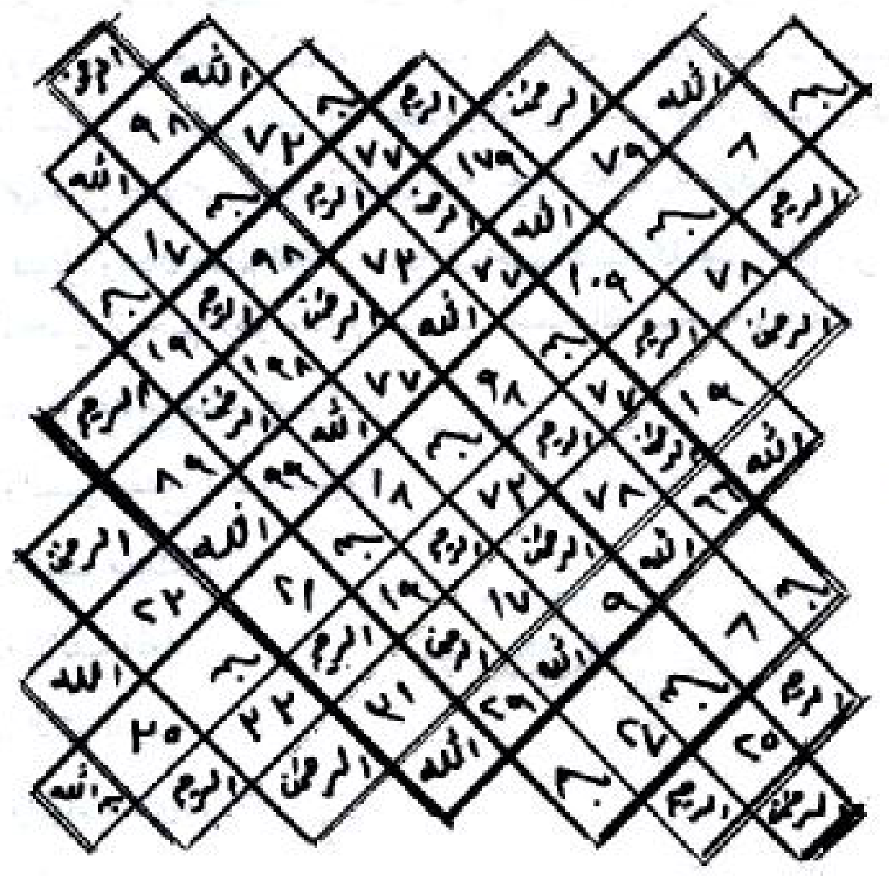
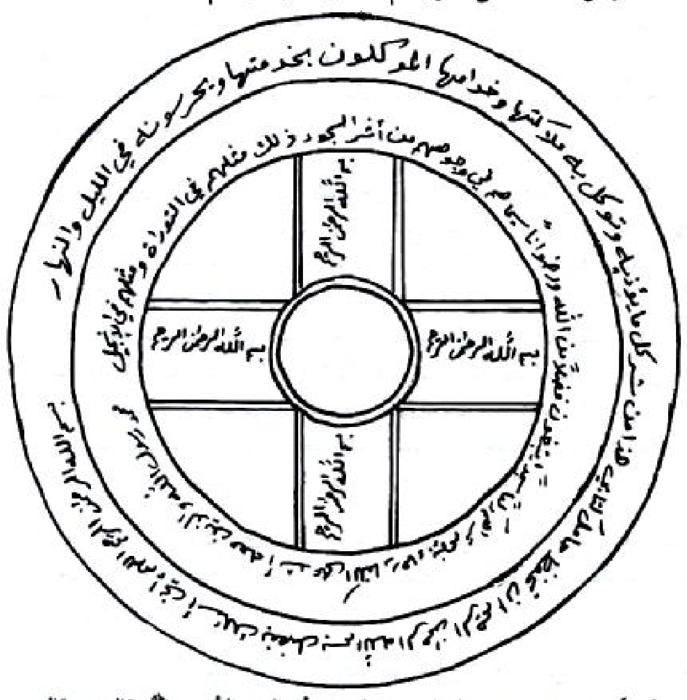
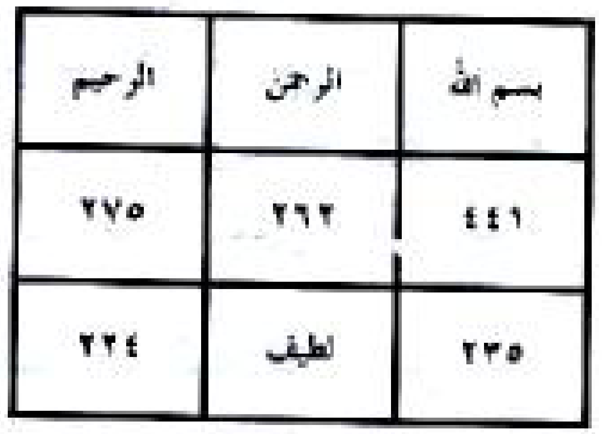
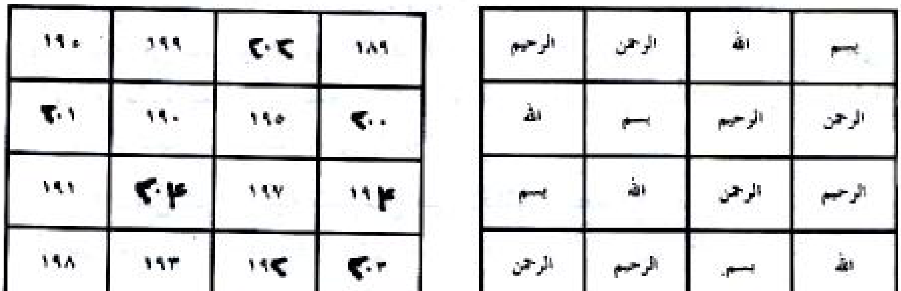
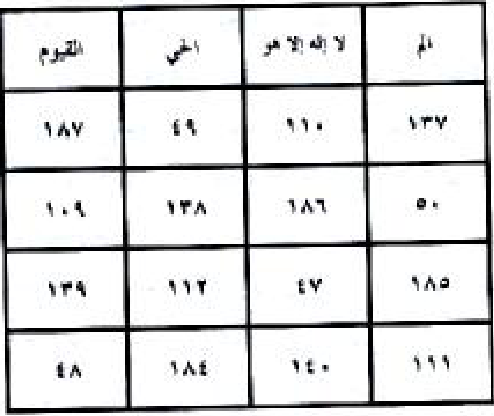
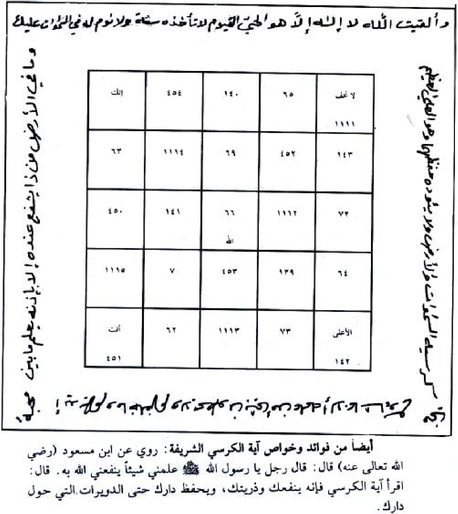

# TRANSKRIPSI BAB 2 — LANJUTAN HALAMAN 77 (format 4 sub-header, Aturan Ustadz Yoad)

Berkas ini memakai struktur baku 4 sub-header sesuai `ATURAN-USTADZ-YOAD.md`.
Sumber gambar: `sirrul asror ruhani.pdf` halaman 77, render **200 dpi + 600 dpi**, dibaca dengan mata.
Halaman 77 = lanjutan daftar karya Syaikh 'Athiyyah: **judul nomor 33–39** + baris penutup + nomor kontak.
Halaman 76 (berkas sebelumnya) memuat **judul nomor 1–32**; judul 33–39 yang dulu ikut tertulis di 76 sudah dipindahkan ke sini.

---

## HALAMAN 77 — PDF hal. 77 / bagian — Daftar Karya (lanjutan): judul 33–39 + baris penutup

### 1. TEKS ARAB BERHARAKAT

كِتَابُ نَهْرِ الرُّوحَانِيَّةِ فِيمَا يَتَعَلَّقُ بِالْأُمُورِ الْخَفِيَّةِ
كِتَابُ الشَّيْخِ الْكَبِيرِ فِي عِلْمِ التَّنْزِيلِ مِنَ الْمَزْمُورِ وَالْإِنْجِيلِ
كِتَابُ الْأَوْفَاقِ وَخَوَاصِّ كُلِّ وَفْقٍ وَكَيْفِيَّةِ عَمَلِهِ
كِتَابُ الْبَوَّابَةِ الْكَوْنِيَّةِ فِي اسْتِحْضَارِ الرُّوحَانِيَّةِ
كِتَابُ الْأَحْجَارِ الْكَرِيمَةِ وَطُرُقِ عَمَلِ الْخَوَاتِمِ الرُّوحَانِيَّةِ لِكُلِّ شَخْصٍ وَكَيْفِيَّةِ الِانْتِفَاعِ بِهِ
كِتَابُ ذُرْوَةِ الْأَسْرَارِ وَمَا يَتَعَلَّقُ بِطَلَاسِمِ اللَّيْلِ وَالنَّهَارِ
مُجَلَّدَاتُ الْجَوَاهِرِ التِّسْعَةِ الرُّوحَانِيَّةِ
بِيهْ
لِلْكَشْفِ وَالْمُتَابَعَةِ مَعَ شَيْخِ الرُّوحَانِيِّينَ فِي الْوَطَنِ الْعَرَبِيِّ الشَّيْخِ عَطِيَّةَ عَبْدِ الْحَمِيدِ

### 2. TRANSLITERASI LATIN

Kitabu Nahrir-Ruhaniyyati fima Yata'allaqu bil-Umuril-Khafiyyati
Kitabush-Syaikhil-Kabiri fi 'Ilmit-Tanzili minal-Mazmuri wal-Injili
Kitabul-Aufaqi wa Khawashshi Kulli Wafqin wa Kaifiyyati 'Amalihi
Kitabul-Bawwabatil-Kauniyyati fi Istihdharir-Ruhaniyyati
Kitabul-Ahjaril-Karimati wa Thuruqi 'Amalil-Khawatim ar-Ruhaniyyati li-Kulli Syakhshin wa Kaifiyyatil-Intifa'i bihi
Kitabu Dzurwatil-Asrari wa Ma Yata'allaqu bi-Thalasimil-Laili wan-Nahari
Mujalladatul-Jawahir at-Tis'ati ar-Ruhaniyyati
Bih
Lil-Kasyfi wal-Mutaba'ati ma'a Syaikhir-Ruhaniyyina fil-Wathanil-'Arabiyyisy-Syaikhi 'Athiyyata 'Abdil-Hamidi

### 3. TERJEMAHAN INDONESIA

Kitab Nahrur-Ruhaniyyah tentang hal-hal yang berkaitan dengan perkara-perkara yang tersembunyi
Kitab Asy-Syaikh Al-Kabir dalam ilmu Tanzil dari Mazmur dan Injil
Kitab Al-Aufaq dan keistimewaan setiap wafaq serta cara mengamalkannya
Kitab Al-Bawwabah Al-Kauniyyah dalam menghadirkan ruhaniyyah
Kitab Al-Ahjar Al-Karimah (batu-batu mulia) dan metode pembuatan khatam ruhaniyyah untuk setiap orang serta cara memanfaatkannya
Kitab Dzurwatul-Asrar dan hal-hal yang berkaitan dengan thalasim malam dan siang
Jilid-jilid Al-Jawahir At-Tis'ah Ar-Ruhaniyyah (sembilan jilid permata ruhani)
Bih — potongan kata tercetak terpisah (huruf ba'-ya'-ha' jelas), tanpa kelanjutan pada baris berikutnya; dipertahankan apa adanya, tidak ditambah dan tidak ditebak
Untuk kasyaf (penerawangan) dan bimbingan bersama Syaikh para ruhani, di negeri Arab, Syaikh 'Athiyyah 'Abdul Hamid

### 4. TATACARA PRAKTIK LENGKAP

- Halaman ini adalah **daftar karya (katalog terbitan)**, bukan amalan. Tidak ada bacaan, wafaq, dupa, tinta, atau waktu pelaksanaan yang diperintahkan di halaman ini, sehingga tidak ada panduan praktik yang dapat disusun.
- Daftar berlanjut dari halaman 76: nomor 33 sampai 39, lalu satu potongan kata (`بِيهْ`), baris penutup, dan nomor kontak penerbit yang menurut aturan dibersihkan dari transkrip.
- Potongan kata `بِيهْ` dipertahankan karena tercetak di kitab, tetapi tidak diberi tafsir apa pun: pada halaman ini ia berdiri sendiri tanpa kata penyambung, sehingga maknanya tidak dapat dipastikan dari halaman 77. Bila nanti ditemukan kelanjutannya pada halaman lain, catatan akan diperbarui.
- Kata `فُلَان` / `فُلَانَة` tidak terdapat pada halaman ini, jadi keterangan Fulan/Fulanah tidak berlaku di sini.
- Bagi pengamal, halaman ini berguna sebagai rujukan judul: bila suatu amalan di bagian lain kitab merujuk pada salah satu kitab di atas, judulnya dapat dicocokkan di sini. Ketujuh judul 33–39 berkaitan langsung dengan praktik wafaq, khatam, thalasim, dan kasyaf.

---

## HALAMAN 78 — PDF hal. 78 / halaman judul bagian — فصل في فضل البسملة والفاتحة

### 1. TEKS ARAB BERHARAKAT

فَصْلٌ
فِي فَضْلِ الْبَسْمَلَةِ وَالْفَاتِحَةِ
(ada rajah halaman 78 — bingkai hiasan halaman judul, bukan wafaq)

### 2. TRANSLITERASI LATIN

Fashlun,
fi fadhli al-basmalati wal-fatihah.

### 3. TERJEMAHAN INDONESIA

Pasal
tentang keutamaan basmalah dan Al-Fatihah.

### 4. TATACARA PRAKTIK LENGKAP

- Halaman ini adalah halaman judul bagian (divider). Tidak ada amalan, bacaan, atau syarat yang diperintahkan di sini.
- Yang tercetak hanya judul pasal; seluruh isi pasal dimulai pada halaman 79 dan berlanjut sampai halaman 82.
- Bingkai berhias pada halaman ini adalah hiasan cetak, bukan wafaq, sehingga tidak diberi tanda wafaq dan tidak ada angka yang perlu dicocokkan.
- Nama penulis, keterangan "untuk mengikuti dan berkomunikasi", serta nomor kontak yang tercetak di dalam bingkai dihapus sesuai aturan pembersihan elemen non-kitab.

---

## HALAMAN 79 — PDF hal. 79 / bagian — فضل القرآن العظيم: ayat syifa' dan keutamaan basmalah

### 1. TEKS ARAB BERHARAKAT

فَضْلُ الْقُرْآنِ الْعَظِيمِ
(بَابٌ فِي فَضْلِ الْقُرْآنِ الْعَظِيمِ وَالْبَسْمَلَةِ وَالْفَاتِحَةِ)
وَهُوَ فِي سِرِّ قَوْلِهِ سُبْحَانَهُ وَتَعَالَى ﴿وَنُنَزِّلُ مِنَ الْقُرْآنِ مَا هُوَ شِفَاءٌ وَرَحْمَةٌ لِلْمُؤْمِنِينَ﴾ مِمَّا يَدُلُّ مِنْ خِلَالِ هَذِهِ الْآيَةِ الْكَرِيمَةِ هُوَ شِفَاءُ الْأَجْسَامِ كَمَا فِيهِ شِفَاءٌ لِحَقَائِقِ الْقُلُوبِ لِذَلِكَ جَاءَ قَوْلُ النَّبِيِّ الْكَرِيمِ ﷺ أَنَّهُ قَالَ: (شِفَاءُ أُمَّتِي فِي ثَلَاثٍ: آيَةٌ مِنْ كِتَابِ اللَّهِ تَعَالَى أَوْ كَأْسٌ مِنْ يَدِ حَجَّامٍ، أَوْ لَعْقَةٌ مِنْ عَسَلِ النَّحْلِ).
وَأَيْضًا قَالَ ﷺ: (الْقُرْآنُ هُوَ الدُّرُّ). (فَكِّرْ تُرْشَدْ أَيُّهَا الْأَخُ الْمُؤْمِنُ بِاللَّهِ سُبْحَانَهُ وَتَعَالَى مَا أَوْدَعَ اللَّهُ جَلَّ وَعَلَا فِي الْقُرْآنِ الْكَرِيمِ الْمَكْنُونِ وَالسِّرِّ الْمَخْزُونِ مِنَ الْجَوَاهِرِ الَّتِي لَا تُقَدَّرُ بِأَيِّ شَيْءٍ مِنْ حَيْثُ يَصْلُحُ لِلْمَرْءِ فِي دِينِهِ وَدُنْيَاهُ وَآخِرَتِهِ وَمَثْوَاهُ إِلَّا وَهُوَ بِاتِّبَاعِ قَوْلِ الرَّسُولِ الْأَكْرَمِ ﷺ وَذَلِكَ بِالتَّمَسُّكِ بِكِتَابِ اللَّهِ الْعَزِيزِ) وَقَالَ بَعْضُ الْعَارِفِينَ مِنْ أَهْلِ التَّحْقِيقِ «بِسْمِ اللَّهِ مِنْكَ بِمَنْزِلَةِ كُنْ مِنْهُ» رُوِيَ أَنَّهُ قَالَ الْإِمَامُ الْحَسَنُ بْنُ عَلِيٍّ عَلَيْهِمَا أَفْضَلُ الصَّلَوَاتِ وَالسَّلَامُ: مَنْ أَحْسَنَ كِتَابَةَ بِسْمِ اللَّهِ الرَّحْمَنِ الرَّحِيمِ وَجَوَّدَهَا تَعْظِيمًا لِلَّهِ تَعَالَى دَخَلَ الْجَنَّةَ (أَيْ بِشَرْطِهَا وَشُرُوطِهَا).
وَرُوِيَ عَنْ أَبِي سَعِيدٍ الْخُدْرِيِّ رَضِيَ اللَّهُ تَعَالَى عَنْهُ قَالَ: سَمِعْتُ ابْنَ عَبَّاسٍ رَضِيَ اللَّهُ تَعَالَى عَنْهُ يَقُولُ: لِكُلِّ شَيْءٍ أَسَاسٌ وَأَسَاسُ الْكُتُبِ كُلِّهَا الْقُرْآنُ وَأَسَاسُ الْقُرْآنِ الْفَاتِحَةُ وَأَسَاسُ الْفَاتِحَةِ «بِسْمِ اللَّهِ الرَّحْمَنِ الرَّحِيمِ» فَإِذَا اشْتَكَيْتَ أَوْ غَفَلْتَ فَعَلَيْكَ بِالْأَسَاسِ لِتُشْفَى مِنْ كُلِّ دَاءٍ، وَقِيلَ مَنْ ذَكَرَ بِسْمِ اللَّهِ الرَّحْمَنِ الرَّحِيمِ أَرْبَعَ مِائَةٍ وَسَبْعَةً وَثَمَانِينَ مَرَّةً، عَلَى طِلَسْمٍ أَبْطَلَهُ لِوَقْتِهِ.
أَيْضًا مِنْ خَوَاصِّ بِسْمِ اللَّهِ الرَّحْمَنِ الرَّحِيمِ الْمُكَرَّمَةِ: هُوَ كَالْآتِي:
١ - وَمَنْ تَلَاهَا الْعَدَدَ الْمَذْكُورَ أَيْ أَرْبَعَةَ مِائَةٍ وَسَبْعَةً وَثَمَانِينَ مَرَّةً وَسَأَلَ اللَّهَ

### 2. TRANSLITERASI LATIN

Fadhlu al-Qur'anil-'azhim,
(babun fi fadhli al-Qur'anil-'azhimi wal-basmalati wal-fatihah).
Wa huwa fi sirri qaulihi subhanahu wa ta'ala ﴿Wa nunazzilu minal-Qur'ani ma huwa syifa'un wa rahmatun lil-mu'minin﴾ mimma yadullu min khilali hadzihil-ayatil-karimati huwa syifa'ul-ajsami kama fihi syifa'un li-haqa'iqil-qulubi lidzalika ja'a qaulun-nabiyyil-karimi ﷺ annahu qala: (Syifa'u ummati fi tsalatsin: ayatun min kitabillahi ta'ala au ka'sun min yadi hajjamin, au la'qatun min 'asalinnahl).
Wa aidhan qala ﷺ: (Al-Qur'anu huwad-durr). (Fakkir tursyad ayyuhal-akhul-mu'minu billahi subhanahu wa ta'ala ma auda'allahu jalla wa 'ala fil-Qur'anil-karimil-maknuni was-sirril-makhzuni minal-jawahiril-lati la tuqaddaru bi-ayyi syai'in min haitsu yashluhu lil-mar'i fi dinihi wa dunyahu wa akhiratihi wa matswahu illa wa huwa bittiba'i qaulir-rasulil-akrami ﷺ wa dzalika bittamassuki bikitabillahil-'aziz) wa qala ba'dhul-'arifina min ahlit-tahqiqi «bismillahi minka bimanzilati kun minhu» ruwiya annahu qalal-imamul-hasanu bnu 'aliyyin 'alaihima afdhalus-salawati was-salamu: man ahsana kitabata bismillahir-rahmanir-rahimi wa jawwadaha ta'zhiman lillahi ta'ala dakhalal-jannata (ay bi-syarthiha wa syuruthiha).
Wa ruwiya 'an abi sa'idil-khudriyyi radhiyallahu ta'ala 'anhu qala: sami'tubna 'abbasin radhiyallahu ta'ala 'anhu yaqulu: likulli syai'in asasun wa asasul-kutubi kullihal-Qur'anu wa asasul-Qur'anil-fatiha wa asasul-fatihah «bismillahir-rahmanir-rahim» fa-idzasytakaita au ghafalta fa'alaikal-biasasi litasysyfa min kulli da'in, wa qila man dzakara bismillahir-rahmanir-rahimi arba'a mi'atin wa sab'atan wa tsamanina marratan, 'ala thilsimin abthalahu liwaqtihi.
Aidhan min khawashshi bismillahir-rahmanir-rahimil-mukarramati: huwa kal-ati:
1 - Wa man talahal-'adadal-madzkura ay arba'a mi'atin wa sab'atan wa tsamanina marratan wa sa-alallaha

### 3. TERJEMAHAN INDONESIA

Keutamaan Al-Qur'an yang Agung.
(Bab tentang keutamaan Al-Qur'an yang Agung, basmalah, dan Al-Fatihah.)
Hal itu terdapat pada rahasia firman-Nya, Mahasuci dan Mahatinggi: "Dan Kami turunkan dari Al-Qur'an sesuatu yang menjadi penyembuh dan rahmat bagi orang-orang mukmin" — yang menunjukkan bahwa melalui ayat yang mulia ini terkandung penyembuhan badan, sebagaimana di dalamnya juga terdapat penyembuhan bagi hakikat hati. Karena itu datanglah sabda Nabi yang mulia ﷺ bahwa beliau bersabda: "Kesembuhan umatku ada pada tiga hal: ayat dari Kitab Allah Ta'ala, atau segelas dari tangan tukang bekam, atau sesendok madu lebah."
Dan beliau ﷺ juga bersabda: "Al-Qur'an adalah permata." (Berpikirlah, engkau akan mendapat petunjuk, wahai saudara mukmin yang beriman kepada Allah Mahasuci dan Mahatinggi, tentang apa yang telah Allah — Yang Mahaagung dan Mahatinggi — titipkan di dalam Al-Qur'an yang mulia, yang tersimpan dan rahasia yang terpendam, berupa permata-permata yang tidak dapat dinilai dengan apa pun, karena ia memberi kebaikan bagi seseorang dalam agama, dunia, akhirat, dan tempat kembalinya; semua itu hanyalah dengan mengikuti sabda Rasul yang paling mulia ﷺ, yaitu dengan berpegang teguh pada Kitab Allah Yang Mahaperkasa.) Sebagian orang 'arif dari kalangan ahli tahqiq berkata: "Basmalah dari sisi Allah menempati kedudukan 'kun' darinya." Diriwayatkan bahwa Imam Hasan bin Ali — semoga keduanya memperoleh shalawat dan salam yang paling utama — berkata: "Barangsiapa membaguskan penulisan 'bismillahir-rahmanir-rahim' dan memperindahnya karena mengagungkan Allah Ta'ala, ia masuk surga" (yakni dengan syarat-syaratnya).
Dan diriwayatkan dari Abu Sa'id Al-Khudri ra bahwa ia berkata: Aku mendengar Ibnu Abbas ra berkata: "Setiap sesuatu memiliki fondasi; fondasi seluruh kitab suci adalah Al-Qur'an, fondasi Al-Qur'an adalah Al-Fatihah, dan fondasi Al-Fatihah adalah 'bismillahir-rahmanir-rahim'. Maka jika engkau mengeluh sakit atau lalai, berpeganglah pada fondasi itu agar penyembuhan dari segala penyakit. Dan dikatakan: barangsiapa membaca 'bismillahir-rahmanir-rahim' empat ratus delapan puluh tujuh kali pada sebuah thilasm, thilasm itu menjadi batal pada saat itu juga."
Juga di antara keistimewaan basmalah yang dimuliakan adalah sebagai berikut:
1 — Barangsiapa membacanya sebanyak jumlah yang disebutkan, yaitu empat ratus delapan puluh tujuh kali, lalu memohon kepada Allah

### 4. TATACARA PRAKTIK LENGKAP

- Amalan pada halaman ini masih berupa keterangan keutamaan (fadhilah), dan hitungan amalnya bersambung ke halaman 80. Panduan lengkapnya disusun pada halaman 80.
- Teks pada halaman ini dipakai sebagai dasar tiga amalan yang akan dijelaskan kemudian: (a) menulis basmalah dengan bagus sebagai amalan 'adab, (b) mengulang basmalah 487 kali sebagai wirid/thilasm-batal, dan (c) mengamalkan basmalah untuk kebutuhan sehari-hari.
- Kata كَذَا / كَذَا وَكَذَا pada halaman ini belum muncul; yang muncul pada halaman 79 adalah lafaz umum. Keterangan Fulan/Fulanah baru berlaku pada halaman 80 nomor 6.
- Untuk latar belakang: penyembuhan yang dimaksud dalam ayat dan hadis di halaman ini adalah penyembuhan badan dan hati. Ayatnya dikutip apa adanya seperti tercetak, tanpa penambahan nomor surah.
- Kata فُلَان / فُلَانَة tidak terdapat pada halaman ini, jadi keterangan Fulan/Fulanah tidak berlaku di sini.

---

## HALAMAN 80 — PDF hal. 80 / bagian — Keutamaan basmalah (2–7) dan basmalah berhias

### 1. TEKS ARAB BERHARAKAT

تَعَالَى شَيْئًا أَعْطَاهُ، وَقَالَ بَعْضُ الْعُلَمَاءِ: مَنْ ذَكَرَ بِسْمِ اللَّهِ الرَّحْمَنِ الرَّحِيمِ كُلَّ يَوْمٍ (مِائَةَ مَرَّةٍ) أَطْلَعَهُ اللَّهُ عَلَى أَسْرَارِ الْعُلُومِ وَبِوَاطِنِ حَقَائِقِهَا.
٢ - أَيْضًا وَرَدَ فِي فَضْلِهَا وَكَرَامَتِهَا عِنْدَ اللَّهِ سُبْحَانَهُ وَتَعَالَى وَمَا قِيلَ مَنْ أَكْثَرَ ذِكْرَ بِسْمِ اللَّهِ الرَّحْمَنِ الرَّحِيمِ رُزِقَ الْهَيْبَةَ مِنَ الْعَالَمِ الْعُلْوِيِّ وَالسُّفْلِيِّ وَمَا أَوْدَعَ اللَّهُ فِيهَا مِنَ الْأَسْرَارِ وَفِيهَا اسْمُ اللَّهِ الْأَعْظَمُ وَهِيَ أَوَّلُ مَا خَطَّهُ الْقَلَمُ الْعُلْوِيُّ عَلَى صَفْحَةِ اللَّوْحِ.
٣ - وَهِيَ الَّتِي أَقَامَ اللَّهُ تَعَالَى مَلِكَ سُلَيْمَانَ بْنِ دَاوُدَ ﷺ بِهَا أَقَامَ اللَّهُ تَعَالَى شَجَرَةَ الْأَكْوَانِ وَظَهَرَ فِيهَا أَسْرَارُهَا.
٤ - مِنْ خَوَاصِّهَا: وَمَنْ رَسَمَ بِسْمِ اللَّهِ الرَّحْمَنِ الرَّحِيمِ عَلَى هَذِهِ الصِّفَةِ كَالْآتِي: «بِسْمِ اللَّهِ الرَّحْمَنِ الرَّحِيمِ» وَحَمَلَهَا مَعَهُ أَطْفَأَ بِهَا حَرَّ النَّارِ.
(ada rajah/tulisan basmalah berhias halaman 80..)

٥ - وَمَنْ كَتَبَهَا فِي بِطَاقَةٍ وَحَمَلَهَا مَعَهُ مَنْ بِهِ وَجَعُ الْفَرَسِ أَوِ الرَّأْسِ، بِشَرْطِ أَنْ يَضَعَهَا عَلَى الْوَجَعِ بِسَكَنٍ لِوَقْتِهِ.
٦ - أَيْضًا رُوِيَ عَنِ عَبْدِ اللَّهِ بْنِ عُمَرَ أَنَّهُ قَالَ: مَنْ كَانَتْ لَهُ حَاجَةٌ فَلْيَصُمْ يَوْمَ الْأَرْبِعَاءِ وَيَوْمَ الْخَمِيسِ وَالْجُمُعَةِ فَإِذَا كَانَ يَوْمُ الْجُمُعَةِ يَغْتَسِلُ وَيَذْهَبُ إِلَى الْمَسْجِدِ فَلْيَتَصَدَّقْ بِشَيْءٍ فِي طَرِيقِهِ وَبَعْدَ الْفَرَاغِ مِنَ الصَّلَاةِ الْجُمُعَةِ، يَقُولُ: اللَّهُمَّ إِنِّي أَسْأَلُكَ بِاسْمِكَ الْعَظِيمِ بِسْمِ اللَّهِ الرَّحْمَنِ الرَّحِيمِ الَّذِي لَا إِلَهَ إِلَّا هُوَ عَالِمُ الْغَيْبِ وَالشَّهَادَةِ هُوَ الرَّحْمَنُ الرَّحِيمُ أَسْأَلُكَ بِاسْمِكَ بِسْمِ اللَّهِ الرَّحْمَنِ الرَّحِيمِ الَّذِي عَنَتْ لَهُ الْوُجُوهُ وَخَشَعَتْ لَهُ الْأَصْوَاتُ وَوَجِلَتِ الْقُلُوبُ مِنْ خَشْيَتِهِ أَنْ تُصَلِّيَ عَلَى سَيِّدِنَا مُحَمَّدٍ وَعَلَى آلِهِ الطَّيِّبِينَ الطَّاهِرِينَ وَسَلِّمْ وَأَنْ تَقْضِيَ حَاجَتِي وَهِيَ كَذَا وَكَذَا أَوْ تُسَمِّيهَا فَإِنَّهَا تُقْضَى، وَكَانَ يَقُولُ: لَا تُعَلِّمُوهَا لِسُفَهَائِكُمْ فَيَدْعُو بِهَا لَا يُسْتَجَابُ لَهُمْ فِي الْوَقْتِ.
٧ - وَأَيْضًا وَيَنْتَظِمُ مِنْ حُرُوفِ بِسْمِ اللَّهِ الرَّحْمَنِ الرَّحِيمِ تِسْعَةَ عَشَرَ اسْمًا عَدَدَ

### 2. TRANSLITERASI LATIN

Ta'ala syai'an a'thahu, wa qala ba'dhul-'ulama'i: man dzakara bismillahir-rahmanir-rahimi kulla yaumin (mi'ata marratin) athla'ahullahu 'ala asraril-'ulumi wa bawathini haqa'iqiha.
2 — Aidhan warada fi fadhliha wa karamatiha 'indallahi subhanahu wa ta'ala wa ma qila man atsakara dzikra bismillahir-rahmanir-rahimi ruziqal-haibata minal-'alamil-'uluwiyyi was-sufliyyi wa ma auda'allahu fiha minal-asrari wa fiha ismullahil-a'zhamu wa hiya awwalu ma khatthahul-qalamul-'uluwiyyu 'ala shafhatil-lauhi.
3 — Wa hiyal-lati aqamallahu ta'ala malika sulaimana bni dawuda ﷺ biha aqamallahu ta'ala syajaratal-akwani wa zhahara fiha asraruha.
4 — Min khawashshiha: wa man rasama bismillahir-rahmanir-rahimi 'ala hadzihish-shifati kal-ati: «bismillahir-rahmanir-rahim» wa hamalaha ma'ahu athfa'a biha harran-nar.
5 — Wa man katabaha fi bithaqatin wa hamalaha ma'ahu man bihi waja'ul-farasi awir-ra'si, bisyarthi an yadha'aha 'alal-waja'i bisakanin liwaqtihi.
6 — Aidhan ruwiya 'an 'abdillahi bni 'umara annahu qala: man kanat lahu hajatun fal-yashum yaumal-arbi'a'i wa yaumal-khamisi wal-jumu'ati fa-idza kana yaumul-jumu'ati yaghtasilu wa yadzhabu ilal-masjidi fal-yatashaddaq bisyai'in fi thariqihi wa ba'dal-faraghi minash-shalatil-jumu'ati, yaqulu: Allahumma inni as-aluka bismikal-'azhimi bismillahir-rahmanir-rahimil-ladzi la ilaha illa huwa 'alimul-ghaibi wasy-syahadati huwar-rahmanur-rahimu as-aluka bismika bismillahir-rahmanir-rahimil-ladzi 'anat lahul-wujuhu wa khasy'at lahul-ashwatu wa wajilatil-qulubu min khasyyatihi an tushalliya 'ala sayyidina muhammadin wa 'ala alihith-thayyibinath-thahirin(a) wa sallim wa an taqdhiya hajati wa hiya kadza wa kadza au tusammiha fa-innaha tuqdha, wa kana yaqulu: la tu'allimuha lisufaha'ikum fayad'u biha la yustajabu lahum fil-waqti.
7 — Wa aidhan wa yantazhimu min hurufi bismillahir-rahmanir-rahimi tis'ata 'asyara isman 'adada

### 3. TERJEMAHAN INDONESIA

... Mahatinggi sesuatu, Dia memberikannya. Sebagian ulama berkata: "Barangsiapa menyebut 'bismillahir-rahmanir-rahim' setiap hari seratus kali, Allah akan memperlihatkan kepadanya rahasia-rahasia ilmu dan hakikat-hakikat yang tersembunyi di dalamnya."
2 — Juga telah datang riwayat tentang keutamaannya dan kemuliaannya di sisi Allah Mahasuci dan Mahatinggi, dan apa yang dikatakan: "Barangsiapa memperbanyak dzikir 'bismillahir-rahmanir-rahim', ia diberi kewibawaan dari alam atas dan alam bawah"; dan di dalamnya Allah menitipkan rahasia-rahasia; di dalamnya terdapat Ismullah Al-A'zham; dan ia adalah yang pertama kali ditulis oleh qalam 'ulwi pada lembaran Lauh.
3 — Ia adalah (kalimat) yang dengannya Allah Ta'ala meneguhkan kerajaan Sulaiman bin Dawud ﷺ; dengannya pula Allah Ta'ala menegakkan pohon segala wujud (syajaratul-akwan) dan padanya tampak rahasia-rahasianya.
4 — Di antara keistimewaannya: barangsiapa melukis "bismillahir-rahmanir-rahim" dengan bentuk seperti berikut: "بِسْمِ اللَّهِ الرَّحْمَنِ الرَّحِيمِ" lalu membawanya, ia telah memadamkan panas api dengannya.
5 — Dan barangsiapa menulisnya pada sebuah kertas (bithaqah) lalu membawanya bagi orang yang terkena sakit pada kuda atau pada kepala, dengan syarat ia meletakkannya di atas bagian yang sakit dengan tenang, maka (sakitnya) berhenti pada saat itu.
6 — Juga diriwayatkan dari Abdullah bin Umar bahwa ia berkata: "Barangsiapa memiliki suatu kebutuhan, hendaklah ia berpuasa pada hari Rabu, Kamis, dan Jumat. Apabila tiba hari Jumat, ia mandi, pergi ke masjid, bersedekah sesuatu di jalan, dan setelah selesai shalat Jumat ia membaca: 'Ya Allah, aku memohon kepada-Mu dengan nama-Mu Yang Agung, bismillahir-rahmanir-rahim, yang tiada tuhan selain Dia, Yang Maha Mengetahui yang gaib dan yang nyata, Dialah Yang Maha Pengasih lagi Maha Penyayang; aku memohon kepada-Mu dengan nama-Mu, bismillahir-rahmanir-rahim, yang kepada-Nya tunduk segala wajah, yang suara-suara merendah kepada-Nya, dan yang hati-hati bergetar karena takut kepada-Nya, agar Engkau bershalawat kepada penghulu kami Muhammad dan kepada keluarganya yang baik dan suci, dan Engkau penuhi kebutuhanku, yaitu demikian dan demikian — atau ia menyebutnya — maka kebutuhan itu pasti dipenuhi.'" Dan beliau berkata: "Jangan ajarkan ia kepada orang-orang bodoh di antara kalian, karena bila mereka berdoa dengannya, doa mereka tidak dikabulkan pada waktu itu."
7 — Dan juga tersusun dari huruf-huruf "bismillahir-rahmanir-rahim" sembilan belas nama, sebanyak jumlah

### 4. TATACARA PRAKTIK LENGKAP

Panduan lengkap untuk amalan yang dimulai di halaman 79 dan berlanjut di halaman 80:

- Wirid basmalah 487 kali (lanjutan dari halaman 79): membaca "بِسْمِ اللَّهِ الرَّحْمَنِ الرَّحِيمِ" sebanyak empat ratus delapan puluh tujuh kali; menurut teks, bila dibaca pada sebuah thilasm, thilasm itu batal seketika. Tidak ada ketentuan waktu khusus pada teks untuk wirid ini.
- Wirid harian 100 kali: membaca basmalah seratus kali setiap hari; menurut teks, Allah memperlihatkan rahasia ilmu dan hakikatnya.
- Amalan memadamkan panas api: melukis basmalah dengan bentuk berhias seperti pada gambar halaman 80, lalu membawanya. Menurut teks, pemiliknya tidak terbakar panas api.
- Amalan sakit pada kepala atau pada kuda: menulis basmalah pada sebuah kertas (bithaqah), lalu membawanya bagi penderita; diletakkan di atas bagian yang sakit dengan tenang, dan sakitnya berhenti saat itu juga.
- Amalan kebutuhan (hajat) menurut riwayat Abdullah bin Umar: puasa Rabu, Kamis, dan Jumat; pada hari Jumat mandi, pergi ke masjid, bersedekah sesuatu di jalan; setelah selesai shalat Jumat membaca doa yang tercetak di atas; di dalam doa disebutkan kebutuhan dengan kalimat "demikian dan demikian" atau menyebutnya secara langsung; menurut teks, kebutuhan itu dipenuhi. Teks juga memperingatkan agar amalan ini tidak diajarkan kepada orang bodoh, karena doanya tidak dikabulkan pada waktu itu.
- Pada nomor 6 terdapat kata كَذَا وَكَذَا ("demikian dan demikian"). Kata ini adalah kata ganti, bukan nama orang: pengamal menggantinya dengan kebutuhan yang dimaksud. Bila yang dituju adalah orang, maka untuk laki-laki dipakai فُلَان ibni فُلَانَة (Fulan ibni Fulanata, yaitu nama laki-laki disertai nama ibunya) dan untuk perempuan dipakai فُلَانَة binti فُلَانَة (Fulanata binti Fulanata, yaitu nama perempuan disertai nama ibunya).
- Pada halaman ini tidak ada kata فُلَان / فُلَانَة secara tertulis; yang ada hanya كَذَا وَكَذَا, sehingga keterangan Fulan/Fulanah di atas berlaku sebagai penjelasan cara menyebut nama bila kebutuhan itu menyangkut orang.

---

## HALAMAN 81 — PDF hal. 81 / bagian — Huruf-huruf basmalah, makna setiap huruf, dan wafaq 19×19

### 1. TEKS ARAB BERHARAKAT

حُرُوفُهَا وَهِيَ: اللَّهُ الرَّحْمَنُ الرَّحِيمُ الرَّبُّ، السَّلَامُ، الْمُؤْمِنُ، الْمُهَيْمِنُ، السِّتَارُ، الْحَيُّ، الْمُحْيِي، الْعَلِيمُ الْحَنَّانُ، الْمَنَّانُ، الْحَيُّ، الْقَيُّومُ، الْبَارِي، الْعَيْنُ، الرَّحِيمُ، الْحَبِيبُ، وَمَنْ وَضَعَ هَذِهِ الْأَسْمَاءَ الشَّرِيفَةَ فِي مُرَبَّعٍ تِسْعَةَ عَشَرَ فِي مِثْلِهَا وَحَمَلَهُ مَعَهُ فَإِنَّهُ لَا يَسْأَلُ اللَّهَ تَعَالَى شَيْئًا إِلَّا أَعْطَاهُ إِيَّاهُ وَفِيهِ اسْمُ اللَّهِ الْأَعْظَمُ وَيَكُونُ وَضْعُهُ أَيْ كِتَابَتُهُ فِي رَابِعِ يَوْمٍ مِنَ الشَّهْرِ الْعَرَبِيِّ فَإِنَّهُ أَبْلَغُ وَكَمَا وَرَدَ وَرُوِيَ.
فِي فَضْلِ وَشَأْنِ بِسْمِ اللَّهِ الرَّحْمَنِ الرَّحِيمِ الْمُبَارَكَةِ قِيلَ: إِنَّ كُلَّ حَرْفٍ مِنْ بِسْمِ اللَّهِ الرَّحْمَنِ الرَّحِيمِ (هُوَ مِفْتَاحُ اسْمٍ مِنْ أَسْمَاءِ اللَّهِ سُبْحَانَهُ وَتَعَالَى)...
- (فَالْبَاءُ مِفْتَاحُ اسْمِهِ بَصِيرٌ).
- (وَالسِّينُ مِفْتَاحُ اسْمِهِ سَمِيعٌ).
- (وَالْمِيمُ مِفْتَاحُ اسْمِهِ مَلِيكٌ).
- (وَالْأَلِفُ اللَّهُ).
- (وَاللَّامُ لَطِيفٌ).
- (وَالْهَاءُ هَادِي).
- (وَالرَّاءُ رَازِقٌ).
- (وَالْحَاءُ حَنَّانٌ).
- (وَالْمِيمُ مَانِعٌ وَمُعْطِي).
(وَهَذِهِ كُلُّهَا يُدْعَى بِهَا عِنْدَ افْتِتَاحِ كُلِّ شَيْءٍ وَالدُّعَاءُ بِهَذِهِ الْأَسْمَاءِ الْمُبَارَكَةِ مُجَابٌ لَا مَحَالَةَ كَمَا وَرَدَ فِي ذَلِكَ.
وَمِنْ خَوَاصِّ وَفْقِ الْمُرَبَّعِ التِّسْعَةِ عَشَرَ قِيلَ مَنْ حَمَلَهُ مَعَهُ فَإِنَّهُ لَا يَسْأَلُ اللَّهَ شَيْئًا إِلَّا أَعْطَاهُ وَهُوَ وَفْقٌ عَظِيمٌ بِهِ مُحِيطٌ مُخَمَّسٌ جَوْفِيٌّ فَمَنْ جَمَعَ بَيْنَ رُبْعِ الْحَرْفِ فِي مُرَبَّعٍ وَاحِدٍ وَحَمَلَهُ مَعَهُ رَأَى مِنْ لُطْفِ اللَّهِ تَعَالَى مَا تَعْجَزُ عَنْهُ الْأَوْصَافُ وَلَا يَدْخُلُ تَحْتَ حَصْرٍ وَمَنْ عَرَفَ قَدْرَهُ اسْتَغْنَى بِهِ عَنْ غَيْرِهِ فَإِنَّهُ فِيهِ اسْمُ اللَّهِ الْأَعْظَمُ الَّذِي دُعِيَ بِهِ أُجِيبَ وَإِذَا سُئِلَ بِهِ أُعْطِيَ وَبِالنِّهَايَةِ وَاللَّهُ وَحْدَهُ الْمُوَفِّقُ لِكُلِّ عَمَلٍ يُرَادُ فِعْلُهُ وَهَذِهِ هِيَ صُورَتُهُ كَالشَّكْلِ الْآتِي: فِي الصَّفْحَةِ الثَّانِيَةِ ـ

### 2. TRANSLITERASI LATIN

Hurufuha wa hiya: Allahu ar-Rahmanu ar-Rahimu ar-Rabbu, as-Salamu, al-Mu'minu, al-Muhaiminu, as-Sittaru, al-Hayyu, al-Muhyi, al-'Alimu al-Hannanu, al-Mannanu, al-Hayyu, al-Qayyumu, al-Bari, al-'Ainu, ar-Rahimu, al-Habibu, wa man wadha'a hadzihil-asma'asy-syarifata fi murabba'in tis'ata 'asyara fi mitsliha wa hamalahu ma'ahu fa-innahu la yas-alullaha ta'ala syai'an illa a'thahu iyyahu wa fihi ismullahil-a'zhamu wa yakunu wadh'uhu ay kitabatuhu fi rabi'i yaumin minasy-syah ril-'arabiyyi fa-innahu ablaghu wa kama warada wa ruwiya.
Fi fadhli wa sya'ni bismillahir-rahmanir-rahimil-mubarakati qila: inna kulla harfin min bismillahir-rahmanir-rahimi (huwa miftahu ismin min asma'illahi subhanahu wa ta'ala)...
- (Fal-ba'u miftahu ismihi Bashirun).
- (Was-sinu miftahu ismihi Sami'un).
- (Wal-mimu miftahu ismihi Malikun).
- (Wal-alifu Allahu).
- (Wal-lamu Lathifun).
- (Wal-ha'u Hadi).
- (War-ra'u Raziqun).
- (Wal-ha'u Hannanun).
- (Wal-mimu Mani'un wa Mu'thi).
(Wa hadzihi kulluha yud'a biha 'indaftitahi kulli syai'in wad-du'a'u bihadzihil-asma'il-mubarakati mujabun la mahalata kama warada fi dzalika.
Wa min khawashshi wafqil-murabba'it-tis'ati 'asyara qila man hamalahu ma'ahu fa-innahu la yas-alullaha syai'an illa a'thahu wa huwa wafqun 'azhimun bihi muhithun mukhammasun jaufiyyun faman jama'a baina rub'il-harfi fi murabba'in wahidin wa hamalahu ma'ahu ra'a min luthfillahi ta'ala ma ta'jazu 'anhul-aushafu wa la yadkhulu tahta hashrin wa man 'arafa qadrahu istaghna bihi 'an ghairihi fa-innahu fihi ismullahil-a'zhamul-ladzi du'iya bihi ujiba wa idza su'ila bihi u'thiya wa bin-nihayati wallahu wahdahul-muwaffiqu likulli 'amalin yuradu fi'luhu wa hadzihi hiya shuratuhu kasy-syaklil-ati: fish-shafhatits-tsaniyati.

### 3. TERJEMAHAN INDONESIA

Huruf-hurufnya, yaitu: Allah, Ar-Rahman, Ar-Rahim, Ar-Rabb, As-Salam, Al-Mu'min, Al-Muhaimin, As-Sittar, Al-Hayy, Al-Muhyi, Al-'Alim, Al-Hannan, Al-Mannan, Al-Hayy, Al-Qayyum, Al-Bari, Al-'Ain, Ar-Rahim, Al-Habib. Barangsiapa meletakkan nama-nama yang mulia ini dalam sebuah kotak sembilan belas kali sembilan belas, lalu membawanya, maka ia tidak meminta sesuatu kepada Allah Ta'ala kecuali Dia memberikannya; di dalamnya terdapat Ismullah Al-A'zham; dan peletakannya — yaitu penulisannya — hendaknya pada hari keempat dari bulan Arab, karena itu lebih utama, sebagaimana telah datang dan diriwayatkan.
Tentang keutamaan dan kedudukan basmalah yang diberkahi, dikatakan: bahwa setiap huruf dari "bismillahir-rahmanir-rahim" (adalah kunci sebuah nama dari nama-nama Allah Mahasuci dan Mahatinggi)...
- (Maka ba' adalah kunci nama-Nya Bashir).
- (Dan sin adalah kunci nama-Nya Sami').
- (Dan mim adalah kunci nama-Nya Malik).
- (Dan alif adalah Allah).
- (Dan lam adalah Lathif).
- (Dan ha' adalah Hadi).
- (Dan ra' adalah Raziq).
- (Dan ha' adalah Hannan).
- (Dan mim adalah Mani' dan Mu'thi).
(Dan semua ini diserukan dengannya pada permulaan segala sesuatu; dan doa dengan nama-nama yang diberkahi ini pasti dikabulkan, sebagaimana telah datang riwayatnya.
Di antara keistimewaan wafaq kotak sembilan belas: dikatakan barangsiapa membawanya, ia tidak meminta sesuatu kepada Allah kecuali Dia memberikannya. Ia adalah wafaq yang agung, padanya terdapat lingkaran mukhammas jaufi; barangsiapa menghimpun antara seperempat huruf dalam satu kotak dan membawanya, ia akan melihat kelembutan Allah Ta'ala yang tidak mampu digambarkan dan tidak terbatas; barangsiapa mengenal nilainya, ia akan merasa cukup dengan-Nya dari selain-Nya, karena di dalamnya terdapat Ismullah Al-A'zham yang apabila diseru dengannya pasti dijawab, dan apabila diminta dengannya pasti diberikan. Dan pada akhirnya, Allah semata yang memberi taufik pada setiap amal yang hendak dikerjakan. Dan inilah bentuknya seperti gambar berikut: pada halaman kedua.

### 4. TATACARA PRAKTIK LENGKAP

Panduan praktik yang berakhir di halaman ini dan bersambung ke gambar wafaq di halaman 82:

- Kartu nama-nama (wafaq 19×19): menuliskan sembilan belas nama mulia yang tercantum (Allah, Ar-Rahman, Ar-Rahim, Ar-Rabb, As-Salam, Al-Mu'min, Al-Muhaimin, As-Sittar, Al-Hayy, Al-Muhyi, Al-'Alim, Al-Hannan, Al-Mannan, Al-Hayy, Al-Qayyum, Al-Bari, Al-'Ain, Ar-Rahim, Al-Habib) ke dalam kotak 19×19; waktu penulisan menurut teks: hari keempat bulan Arab; kemudian dibawa (dihimpun/dipakai sebagai pegang). Menurut teks, pemiliknya tidak meminta sesuatu kecuali diberikan, karena di dalamnya Ismullah Al-A'zham.
- Wafaq mukhammas jaufi: teks menyebut bahwa wafaq ini memuat lingkaran mukhammas jaufi, dan cara menghimpunnya adalah menyatukan seperempat huruf dalam satu kotak, lalu dibawa. Bentuk wafaqnya dicetak pada halaman 82 dan tidak boleh dikarang angkanya.
- Doa dengan nama-nama huruf basmalah: setiap huruf basmalah dijadikan kunci nama (ba' → Bashir, sin → Sami', mim → Malik, alif → Allah, lam → Lathif, ha' → Hadi, ra' → Raziq, ha' → Hannan, mim → Mani' dan Mu'thi); nama-nama ini diserukan pada permulaan segala urusan.
- Tidak ada ketentuan dupa, tinta, atau hitungan bacaan pada halaman ini; yang diperintahkan hanya penulisan wafaq pada waktunya dan membawanya.
- Kata فُلَان / فُلَانَة tidak terdapat pada halaman ini, jadi keterangan Fulan/Fulanah tidak berlaku di sini.

---

## HALAMAN 82 — PDF hal. 82 / bagian — Wafaq 19×19 (gambar) dan keutamaan basmalah

### 1. TEKS ARAB BERHARAKAT

(هُوَ هَذَا وَفْقُ الْمُرَبَّعِ التِّسْعَةِ عَشَرَ الْمُبَارَكِ كَمَا تَرَى)
(ada wafaq halaman 82 — wafaq kotak 19×19, crop ketat, angka dan huruf tidak diterjemahkan)

١ - أَيْضًا مِنْ خَوَاصِّ بِسْمِ اللَّهِ الرَّحْمَنِ الرَّحِيمِ الْمُبَارَكَةِ: وَكَمَا وَرَدَ فِي فَضْلِهَا وَعُلُوِّ شَأْنِهَا قِيلَ: إِنَّ مَنْ عَلِمَ مَا أَوْدَعَ اللَّهُ سُبْحَانَهُ وَتَعَالَى فِي بِسْمِ اللَّهِ الرَّحْمَنِ الرَّحِيمِ مِنَ الْأَسْرَارِ لَمْ يَحْتَرِقْ بِالنَّارِ وَلَمْ تَأْكُلْهُ، وَمَنْ كَتَبَهَا وَوَفَّقَهَا لَمْ يَحْتَرِقْ بِالنَّارِ؟.
وَقَدِ اتَّفَقَ جَمِيعُ الْعُلَمَاءِ عَلَى أَنَّهُ يُسْتَحَبُّ الِابْتِدَاءُ بِبِسْمِ اللَّهِ الرَّحْمَنِ الرَّحِيمِ فِي كُلِّ أَمْرٍ ذِي بَالٍ اتِّبَاعًا لِلْكِتَابِ الْعَزِيزِ، وَكَمَا رُوِيَ عَنِ الرَّسُولِ الْأَكْرَمِ ﷺ أَنَّهُ قَالَ: كُلُّ أَمْرٍ ذِي بَالٍ لَا يُبْدَأُ فِيهِ بِبِسْمِ اللَّهِ الرَّحْمَنِ الرَّحِيمِ فَهُوَ أَقْطَعُ، وَفِي رِوَايَةٍ ثَالِثَةٍ أَبْتَرُ وَمَعْنَاهُ قَلِيلُ الْبَرَكَةِ وَلَا يُبَارَكُ فِيهِ.
وَرُوِيَ أَنَّ الْكُتُبَ الْمُنَزَّلَةَ مِنَ السَّمَاءِ إِلَى الْأَرْضِ مِائَةٌ وَأَرْبَعَةُ صُحُفٍ.
شِيثٌ عَلَيْهِ السَّلَامُ سِتُّونَ صَحِيفَةً.

### 2. TRANSLITERASI LATIN

(Huwa hadza wafqul-murabba'it-tis'ati 'asyaral-mubaraku kama tara)
1 — Aidhan min khawashshi bismillahir-rahmanir-rahimil-mubarakati: wa kama warada fi fadhliha wa 'uluwwi sya'niha qila: inna man 'alima ma auda'allahu subhanahu wa ta'ala fi bismillahir-rahmanir-rahimi minal-asrari lam yahtariq bin-nari wa lam ta'kuhu, wa man katabaha wa waffaqaha lam yahtariq bin-nari?.
Wa qadittafaqa jami'ul-'ulama'i 'ala annahu yustahabbul-ibtida'u bibismillahir-rahmanir-rahimi fi kulli amrin dzi balin ittiba'an lil-kitabil-'azizi, wa kama ruwiya 'anir-rasulil-akrami ﷺ annahu qala: kullu amrin dzi balin la yubda'u fihi bibismillahir-rahmanir-rahimi fahuwa aqtha'u, wa fi riwayatin tsalitsatin abtaru wa ma'nahu qalilul-barakati wa la yubaraku fihi.
Wa ruwiya annal-kutubal-munazzalata minas-sama'i ilal-ardhi mi'atun wa arba'atu shuhufin.
Syitsun 'alaihis-salamu sittuna shahifatan.

### 3. TERJEMAHAN INDONESIA

(Inilah wafaq kotak sembilan belas yang diberkahi, sebagaimana engkau lihat.)
1 — Juga di antara keistimewaan basmalah yang diberkahi: sebagaimana telah datang tentang keutamaannya dan ketinggian kedudukannya, dikatakan: barangsiapa mengetahui apa yang Allah Mahasuci dan Mahatinggi titipkan di dalam "bismillahir-rahmanir-rahim" berupa rahasia-rahasia, ia tidak akan terbakar api dan api tidak memakannya; dan barangsiapa menuliskannya serta menjadikannya wafaq, ia tidak terbakar api.
Seluruh ulama telah sepakat bahwa disunnahkan memulai dengan "bismillahir-rahmanir-rahim" pada setiap urusan yang penting, mengikuti Kitab Yang Mahaperkasa; dan sebagaimana diriwayatkan dari Rasul yang paling mulia ﷺ bahwa beliau bersabda: "Setiap urusan penting yang tidak dimulai dengan 'bismillahir-rahmanir-rahim' maka ia terputus (aqtha')." Dalam riwayat ketiga: "abtar" (terpotong), maknanya sedikit berkahnya dan tidak diberkahi.
Dan diriwayatkan bahwa kitab-kitab yang diturunkan dari langit ke bumi berjumlah seratus empat shuhuf (lembaran).
Syits as berjumlah enam puluh shuhuf.

### 4. TATACARA PRAKTIK LENGKAP

- Wafaq 19×19: gambar wafaq pada halaman ini adalah bentuk dari wafaq yang diterangkan pada halaman 81. Cara pakainya: ditulis sesuai bentuk cetak (angka dan huruf tidak boleh diubah atau dikarang), lalu dibawa. Menurut teks, pemiliknya tidak terbakar api dan tidak dimakan api.
- Waktu penulisan mengikuti keterangan halaman 81: hari keempat dari bulan Arab.
- Amalan menulis basmalah sebagai wafaq: menuliskan basmalah lalu menjadikannya wafaq, kemudian dibawa; menurut teks, tidak terbakar api.
- Adab memulai pekerjaan: memulai setiap urusan penting dengan basmalah; menurut hadis yang dikutip, urusan yang tidak dimulai dengan basmalah menjadi terputus dan sedikit berkahnya.
- Bagian akhir halaman memuat keterangan jumlah kitab yang diturunkan (seratus empat shuhuf) dan shuhuf Nabi Syits (enam puluh shuhuf). Ini keterangan, bukan amalan; tidak ada bacaan atau syarat praktik di dalamnya.
- Kata فُلَان / فُلَانَة tidak terdapat pada halaman ini, jadi keterangan Fulan/Fulanah tidak berlaku di sini.

## HALAMAN 83 — PDF hal. 83 / bagian — Lanjutan jumlah shuhuf + keutamaan basmalah: riwayat Jabir dan Ibnu Mas'ud

### 1. TEKS ARAB BERHARAKAT

وَصُحُفُ إِبْرَاهِيمَ عَلَيْهِ السَّلَامُ ثَلَاثُونَ صَحِيفَةً.
وَصُحُفُ مُوسَى عَلَيْهِ السَّلَامُ قَبْلَ التَّوْرَاةِ عَشْرَةُ صُحُفٍ.
وَالتَّوْرَاةُ وَالْإِنْجِيلُ وَالزَّبُورُ وَالْفُرْقَانُ.
وَمَعَانِي هَذِهِ الْكُتُبِ مَجْمُوعَةٌ فِي الْفُرْقَانِ وَمَعَانِي الْقُرْآنِ الْكَرِيمِ فِي سُورَةِ الْفَاتِحَةِ، وَمَعَانِي الْفَاتِحَةِ فِي الْبَسْمَلَةِ وَمَعَانِي الْبَسْمَلَةِ مَجْمُوعَةٌ فِي بَائِهَا، وَمَعْنَاهَا بِي كَانَ مَا كَانَ وَبِي يَكُونُ مَا يَكُونُ.
وَرُوِيَ أَنَّ بِسْمِ اللَّهِ الرَّحْمَنِ الرَّحِيمِ لَمَّا نَزَلَتِ اهْتَزَّ الْعَرْشُ لِنُزُولِهَا وَقَالَتِ الزَّبَانِيَةُ: لَمْ يَدْخُلِ النَّارَ مَنْ قَرَأَهَا وَهِيَ تِسْعَةَ عَشَرَ حَرْفًا عَلَى عَدَدِ الْمَلَائِكَةِ الْمُوَكَّلِينَ بِالنَّارِ. (عَافَانَا اللَّهُ مِنْهَا بِالْعَمَلِ الصَّالِحِ).
٢ - وَرُوِيَ عَنْ جَابِرٍ رَضِيَ اللَّهُ تَعَالَى عَنْهُ أَنَّهُ قَالَ: عَنِ النَّبِيِّ ﷺ لَمَّا نَزَلَتْ بِسْمِ اللَّهِ الرَّحْمَنِ الرَّحِيمِ سَكَنَتِ الرِّيَاحُ وَهَاجَتِ الْبِحَارُ وَرَجَمَتِ الشَّيَاطِينَ مِنَ السَّمَاءِ، وَأَقْسَمَ رَبُّ الْعِزِّ لَا يَسْمَى اسْمِي عَلَى مَرِيضٍ إِلَّا شُفِيَ وَلَا عَلَى شَيْءٍ إِلَّا بُورِكَ فِيهِ.
٣ - وَمِمَّا قَالَ ابْنُ مَسْعُودٍ رَضِيَ اللَّهُ تَعَالَى عَنْهُ: مَنْ أَرَادَ أَنْ يُنْجِيَهُ اللَّهُ مِنَ الزَّبَانِيَةِ التِّسْعَةِ عَشَرَ فَلْيُكْثِرْ مِنْهَا وَهِيَ تِسْعَةَ عَشَرَ حَرْفًا كُلُّ حَرْفٍ نَجَاةٌ مِنْ كُلِّ وَاحِدٍ مِنْهُمْ، وَمَنْ أَكْثَرَ مِنْ ذِكْرِهَا رُزِقَ الْهَيْبَةَ عِنْدَ الْعَالَمِ الْعُلْوِيِّ وَالسُّفْلِيِّ وَبِهَا قَامَ مُلْكُ سُلَيْمَانَ بْنِ دَاوُدَ ﷺ، وَمَنْ كَتَبَهَا (مِائَةَ مَرَّةٍ) وَحَمَلَهَا رُزِقَ الْهَيْبَةَ فِي الْقُلُوبِ.
رُوِيَ عَنِ النَّبِيِّ الْأَكْرَمِ ﷺ أَنَّهُ قَالَ: مَا بَيْنَ بِسْمِ اللَّهِ الرَّحْمَنِ الرَّحِيمِ وَبَيْنَ اسْمِ اللَّهِ الْأَعْظَمِ إِلَّا كَمَا بَيْنَ بَيَاضِ الْعَيْنِ وَسَوَادِهَا.
وَقَالَ النَّبِيُّ ﷺ أَيْضًا: مَا بَيْنَ الْآدَمِيِّينَ وَالشَّيَاطِينِ إِلَّا بِسْمِ اللَّهِ الرَّحْمَنِ الرَّحِيمِ.
٤ - أَيْضًا مَنْ كَتَبَ: الرَّحْمَنُ الرَّحِيمُ خَمْسِينَ مَرَّةً فِي وَرَقَةٍ وَتَلَا عَلَيْهَا الْبَسْمَلَةَ (مِائَةً وَخَمْسِينَ مَرَّةً) وَحَمَلَهَا وَدَخَلَ عَلَى سُلْطَانٍ أَوْ جَبَّارٍ أَمِنَ شَرَّهُ وَلَا يَنَالُهُ مَكْرُوهٌ.

### 2. TRANSLITERASI LATIN

Wa shuhufu Ibrahima 'alaihis-salamu tsalatsuna shahifatan.
Wa shuhufu Musa 'alaihis-salamu qablat-taurati 'asyru shuhufin.
Wat-tauratu wal-injilu waz-zaburu wal-furqanu.
Wa ma'ani hadzihil-kutubi majmu'atun fil-furqani wa ma'anil-Qur'anil-karimi fi suratil-Fatihah, wa ma'anil-Fatihah fil-basmalati wa ma'anil-basmalati majmu'atun fi ba'iha, wa ma'naha bi ka na ma kana wa bi yaku nu ma yakun.
Wa ruwiya anna bismillahir-rahmanir-rahimi lamma nazalatihtazzal-'arsyu linuzuliha wa qalatiz-zabaniyatu: lam yadkhulin-nara man qara'aha wa hiya tis'ata 'asyara harfan 'ala 'adadil-mala'ikatil-muwakkalina bin-nari. ('Afanallahu minha bil-'amalish-shalihi).
2 — Wa ruwiya 'an Jabirin radhiyallahu ta'ala 'anhu annahu qala: 'anin-nabiyyi ﷺ lamma nazalat bismillahir-rahmanir-rahimi sakanatir-riyahu wa hajatil-biharu wa rajamatisysyayathina minas-sama'i, wa aqsama rabbul-'izzati la yusma ismi 'ala maridhin illa syufiya wa la 'ala syai'in illa burika fihi.
3 — Wa mimma qala Ibn Mas'udin radhiyallahu ta'ala 'anhu: man arada an yunjiyahullahu minaz-zabaniyatit-tis'ati 'asyara fal-yuktsir minha wa hiya tis'ata 'asyara harfan kullu harfin najatun min kulli wahidin minhum, wa man aktsara min dzikriha ruziqal-haibata 'indal-'alamil-'uluwiyyi was-sufliyyi wa biha qama mulku Sulaimana bni Dawuda ﷺ, wa man katabaha (mi'ata marratin) wa hamalaha ruziqal-haibata fil-qulubi.
Ruwiya 'anin-nabiyyil-akrami ﷺ annahu qala: ma baina bismillahir-rahmanir-rahimi wa baina ismillahil-a'zhzhami illa kama baina bayadhil-'aini wa sawadiha.
Wa qalan-nabiyyu ﷺ aidhan: ma bainal-adamiyyina wasysyayathini illa bismillahir-rahmanir-rahimi.
4 — Aidhan man kataba: ar-rahmanur-rahimu khamsina marratan fi waraqatin wa tala 'alaihal-basmalata (mi'atan wa khamsina marratan) wa hamalaha wa dakhala 'ala sulthanin aw jabbarin amina syarahu wa la yanaluhu makruhun.

### 3. TERJEMAHAN INDONESIA

Dan shuhuf Ibrahim as. tiga puluh shahifah.
Dan shuhuf Musa as. sebelum Taurat sepuluh shuhuf.
Dan Taurat, Injil, Zabur, serta Furqan.
Dan makna kitab-kitab ini terkumpul di dalam Furqan, dan makna Al-Qur'an yang mulia terkumpul di dalam surah Al-Fatihah, dan makna Al-Fatihah terkumpul di dalam basmalah, dan makna basmalah terkumpul di dalam huruf ba'-nya; dan maknanya: "Dengan-Ku terjadilah apa yang telah terjadi dan dengan-Ku terjadilah apa yang akan terjadi."
Dan diriwayatkan bahwa ketika "bismillahir-rahmanir-rahim" diturunkan, Arasy bergetar karena turunnya, dan para zabaniyah (malaikat penjaga neraka) berkata: "Tidak masuk neraka orang yang membacanya"; dan ia terdiri atas sembilan belas huruf sesuai jumlah malaikat yang ditugaskan atas neraka. (Semoga Allah melindungi kami darinya dengan amal saleh.)
2 — Dan diriwayatkan dari Jabir ra. bahwa ia berkata: dari Nabi ﷺ, ketika "bismillahir-rahmanir-rahim" turun, angin menjadi tenang, lautan bergelora, dan setan-setan dilempari dari langit; dan Tuhan Yang Mahaperkasa bersumpah: "Tidak disebut nama-Ku atas orang sakit kecuali ia disembuhkan, dan tidak atas sesuatu kecuali ia diberkahi."
3 — Dan di antara yang dikatakan Ibnu Mas'ud ra.: "Barangsiapa ingin diselamatkan Allah dari sembilan belas zabaniyah, hendaklah ia memperbanyak (membaca)nya; ia terdiri atas sembilan belas huruf, setiap huruf menjadi keselamatan dari masing-masing mereka. Barangsiapa memperbanyak dzikirnya, ia diberi kewibawaan di sisi alam atas dan alam bawah; dengannya tegak kerajaan Sulaiman bin Dawud ﷺ; dan barangsiapa menuliskannya seratus kali lalu membawanya, ia diberi kewibawaan di dalam hati manusia."
Diriwayatkan dari Nabi yang paling mulia ﷺ bahwa beliau bersabda: "Jarak antara 'bismillahir-rahmanir-rahim' dan Ismullah Al-A'zham hanyalah seperti jarak antara putih mata dan hitamnya."
Dan Nabi ﷺ juga bersabda: "Jarak antara manusia dan setan hanyalah 'bismillahir-rahmanir-rahim'."
4 — Juga barangsiapa menulis "ar-rahmanur-rahim" lima puluh kali pada sebuah kertas, lalu membacakan basmalah atasnya seratus lima puluh kali, lalu membawanya dan masuk menemui seorang sultan atau seorang penguasa zalim, ia aman dari keburukannya dan tidak tertimpa sesuatu yang tidak disukai.

### 4. TATACARA PRAKTIK LENGKAP

- Keterangan jumlah shuhuf (Ibrahim 30, Musa sebelum Taurat 10, ditambah Taurat, Injil, Zabur, Furqan) dan keterangan "makna kitab terkumpul di Furqan, Furqan di Al-Fatihah, Al-Fatihah di basmalah, basmalah di huruf ba'" adalah keterangan ilmu, bukan amalan; tidak ada bacaan atau syarat praktik di dalamnya.
- Amalan kewibawaan: menulis basmalah seratus kali, lalu membawa tulisan itu. Menurut teks, pengamal diberi kewibawaan di dalam hati manusia. Tidak ada ketentuan waktu khusus pada teks untuk amalan ini.
- Amalan keamanan menghadap penguasa: menulis "ar-rahmanur-rahim" lima puluh kali pada kertas, membacakan basmalah atas kertas itu seratus lima puluh kali, lalu membawanya ketika menghadap sultan atau penguasa zalim. Menurut teks, ia aman dari keburukan penguasa itu dan tidak tertimpa hal yang dibenci.
- Batas halaman: butir 4 adalah amalan terakhir pada halaman ini. Amalan-amalan berikutnya (butir 5 dan seterusnya) dimulai pada halaman 84.
- Pada halaman ini tidak ada kata فُلَان / فُلَانَة, sehingga keterangan Fulan/Fulanah tidak berlaku di sini.

---

## HALAMAN 84 — PDF hal. 84 / bagian — Keutamaan basmalah butir 5–10: wirid 1000×, penulisan huruf terpisah, dan rajah keamanan

### 1. TEKS ARAB BERHARAKAT

٥ - إِذَا قَرَأَهَا كُلَّ يَوْمٍ (أَلْفَ مَرَّةٍ) بِنِيَّةٍ صَادِقَةٍ وَقَلْبٍ خَاشِعٍ بَعْدَ صِيَامٍ وَطَهَارَةِ الْجِسْمِ وَالْمَلْبَسِ مُدَّةَ أَرْبَعَةَ عَشَرَ يَوْمًا أَصْبَحَ ذَا هَيْبَةٍ وَوَقَارٍ وَنَالَ مَا يُرِيدُ.
٦ - وَفِي رِوَايَةٍ: أَيْضًا مَنْ قَرَأَهَا (أَلْفَ مَرَّةٍ) عَقِبَ كُلِّ صَلَاةٍ فَإِنَّهُ يَنْظُرُ الْمَلَائِكَةُ الرَّوْحَانِيِّينَ وَيُكَلِّمُهُمْ وَيُكَلِّمُونَهُ وَيُصَرِّفُهُمْ فِيمَا يُرِيدُ.
٧ - وَمَنْ كَتَبَهَا: مُكَسَّرَةً مِثْلَ هَذَا: ا ل ر ح م ن (سَبْعَ مَرَّاتٍ) وَكَتَبَ مَعَهُ اسْمَ الْعَبْدِ الَّذِي يَهْرَبُ وَدَفَنَ فِي الْبَيْتِ وَثَقُلَ بِحَجَرٍ ثُمَّ يَقُولُ اللَّهُمَّ إِنِّي أَسْأَلُكَ بِحَقِّ بِسْمِ اللَّهِ الرَّحْمَنِ الرَّحِيمِ وَبِحَقِّ اسْمِكَ الرَّحْمَنِ أَنْ تَمْنَعَ هَذَا الْعَبْدَ مِنَ الْآبَاقِ (الْهَرَبِ) يَا رَبَّ الْعَالَمِينَ فَإِنَّهُ لَا يَهْرَبُ أَبَدًا وَلَمْ يَخْرُجْ مِنَ الْبَيْتِ الَّذِي هُوَ فِيهِ وَذَلِكَ كَمَا وَرَدَ.
٨ - وَمَنْ كَتَبَ الرَّحْمَنِ عَلَى سِكِّينٍ بِوَلَادِ نَصْلِهَا مِنْهَا وَتَلَا عَلَيْهَا ثَلَاثُمِائَةٍ وَإِحْدَى وَثَلَاثِينَ مَرَّةً، وَذُبِحَ بِهَا دِيكًا وَعُزِلَ رَأْسُهُ بَعْدَ الذَّبْحِ عِنْ جُثَّتِهِ فَإِذَا مَشَى الدِّيكُ بِلَا رَأْسٍ خُذْ رَأْسَهُ بَعْدَ ذَلِكَ وَادْفِنْهُ تَحْتَ عَتَبَةِ بَابِ مَنْ تُرِيدُ فَإِنَّ جَمِيعَ الْحَشَرَاتِ تَخْرُجُ مِنْهُ وَكَذَلِكَ الْجَانُّ، أَيْضًا إِذَا قُلِبَ رَأْسُ الدِّيكِ بِزَيْتِ زَيْتُونٍ ثُمَّ دَهَنَ بِهِ صَاحِبُ الْآلَامِ نَفَعَهُ نَفْعًا جَيِّدًا.
أَيْضًا إِذَا الْمَرْأَةُ صَاحِبَةُ النَّزِيفِ الرَّحِمِ بَلَّتْ قِطْعَةً مِنْ هَذَا الزَّيْتِ وَوَضَعَتْهَا شَكْلَ تَحْمِيلَةٍ عَلَى بَابِ الرَّحِمِ نَفَعَهَا وَأَوْقَفَ النَّزِيفَ.
٩ - وَمَنْ كَتَبَ: الرَّحِيمُ فِي رَايَةٍ (مِائَةً وَتِسْعِينَ مَرَّةً) وَحَمَلَهَا وَدَخَلَ مَعْرَكَةَ الْحَرْبِ لَمْ يَفْعَلْ فِيهِ سِلَاحٌ وَلَا يَحْصُلْ لَهُ مَرَضٌ.
١٠ - وَمَنْ كَتَبَ الرَّحِيمُ فِي وَرَقَةٍ إِحْدَى وَعِشْرِينَ مَرَّةً وَعَلَّقَهَا عَلَى صَاحِبِ الصُّدَاعِ فِي رَأْسِهِ نَفَعَهُ. أَيْضًا مَنْ كَتَبَهَا عَلَى هَذِهِ الصِّفَةِ (ا م ي ح ر) وَذَلِكَ فِي مِرْآةٍ جَدِيدَةٍ يَوْمَ الِاثْنَيْنِ عِنْدَ طُلُوعِ الشَّمْسِ وَأَكْثَرَ النَّظَرَ فِيهَا أَيُّ صَاحِبِ الْقُوَّةِ عَافَاهُ اللَّهُ تَعَالَى.
أَيْضًا مَنْ كَتَبَ عَلَى هَذِهِ الصِّفَةِ (ا ل ر ح ي م) فِي خَاتَمِ فِضَّةٍ وَزْنِ دِرْهَمَيْنِ وَحَمَلَهُ مَعَهُ رَزَقَهُ اللَّهُ تَعَالَى الْهَيْبَةَ وَالطَّاعَةَ.

### 2. TRANSLITERASI LATIN

5 — Idza qara'aha kulla yaumin (alfa marratin) biniyyatin shadiqatin wa qalbin khasyi'in ba'da shiyamin wa thaharati jismi wal-malabisi muddata arba'ata 'asyara yauman ashbaha dza haibatin wa waqarin wa nala ma yuridu.
6 — Wa fi riwayatin: aidhan man qara'aha (alfa marratin) 'aqiba kulli shalatin fa-innahu yanzhurul-mala'ikatir-ruhaniyyina wa yukallimuhum wa yukallimunahu wa yusharrifuhum fima yuridu.
7 — Wa man katabaha: mukassaratan mitsla hadza: a l r h m n (sab'a marratin) wa kataba ma'ahu ismal-'abdil-ladzi yahrabu wa dafana fil-baiti wa tsaqula bihajarin tsumma yaqulu: Allahumma inni as-aluka bihaqqi bismillahir-rahmanir-rahimi wa bihaqqi ismikar-rahmani an tamna'a hadzal-'abda minal-abaqi (al-harabi) ya rabbal-'alamina fa-innahu la yahrabu abadan wa lam yakhruj minal-baitil-ladzi huwa fihi wa dzalika kama warada.
8 — Wa man kataba ar-rahmani 'ala sikkinin biwaladi nashliha minha wa tala 'alaiha tsalatsumi'atin wa ihda wa tsalatsina marratan, wa dzubiha biha dikan wa 'uzila ra'suhu ba'dadz-dzbhi 'in jutsatihi fa-idza masyad-diku bila ra'sin khudz ra'sahu ba'da dzalika wadfinhu tahta 'atabati babi man turidu fa-inna jami'al-hasyarati takhruju minhu wa kadzalikal-jannu, aidhan idza quliba ra'sud-diki bizaiti zaitunin tsumma dahana bihi shahibul-alaminafa'ahu naf'an jayyidan.
Aidhan idzal-mar'atu shahibatun-nazifir-rahimi ballat qith'atan min hadzaz-zaitti wa wadha'atha syakla tahmilatin 'ala babir-rahimi nafa'aha wa awqafan-nazifa.
9 — Wa man kataba: ar-rahimu fi rayatin (mi'atan wa tis'ina marratan) wa hamalaha wa dakhala ma'rakatal-harbi lam yaf'al fihi silahun wa la yahshulu lahu maradhun.
10 — Wa man kataba ar-rahimu fi waraqatin ihda wa 'isyrina marratan wa 'allaqaha 'ala shahibish-shuda'i fi ra'sihi nafa'ahu. Aidhan man katabaha 'ala hadzihish-shifati (a m y h r) wa dzalika fi mir'atin jadidatin yaumal-itsnaini 'inda thulu'isy-syamsi wa aktsaran-nazhara fiha ayyu shahibil-quwwati 'afahullahu ta'ala.
Aidhan man kataba 'ala hadzihish-shifati (a l r h y m) fi khatamin fiddhatin wazni dirhamaini wa hamalahu ma'ahu razaqahullahu ta'alal-haibata wath-tha'ata.

### 3. TERJEMAHAN INDONESIA

5 — Jika ia membacanya setiap hari seribu kali dengan niat yang benar dan hati yang khusyuk, setelah berpuasa serta menjaga kesucian badan dan pakaian selama empat belas hari, maka ia menjadi orang yang berwibawa dan mulia, dan memperoleh apa yang ia inginkan.
6 — Dalam riwayat lain: juga barangsiapa membacanya seribu kali setelah setiap shalat, maka ia akan melihat para malaikat ruhaniyyin, berbicara dengan mereka, mereka berbicara dengannya, dan ia dapat mengarahkan mereka pada apa yang ia kehendaki.
7 — Dan barangsiapa menuliskannya secara terpisah (mukassarah) seperti ini: ا ل ر ح م ن — tujuh kali — lalu menuliskan bersama tulisan itu nama hamba yang melarikan diri, lalu menguburnya di dalam rumah dan menekannya dengan batu, kemudian membaca: "Ya Allah, aku memohon kepada-Mu dengan hak 'bismillahir-rahmanir-rahim' dan dengan hak nama-Mu 'ar-rahman' agar Engkau mencegah hamba ini dari abaq (melarikan diri), wahai Tuhan semesta alam", maka ia tidak akan melarikan diri selama-lamanya dan tidak akan keluar dari rumah tempat ia berada; dan itu sebagaimana telah datang (dalam riwayat).
8 — Dan barangsiapa menulis "ar-rahman" pada sebuah pisau yang menyertai mata pisaunya, lalu membacakan atasnya tiga ratus tiga puluh satu kali, lalu menyembelih seekor ayam jantan dengannya, lalu memisahkan kepalanya dari tubuhnya setelah penyembelihan; apabila ayam jantan itu berjalan tanpa kepala, ambillah kepalanya setelah itu dan kuburkan di bawah ambang pintu orang yang engkau kehendaki, maka sesungguhnya segala serangga (hasyarat) akan keluar darinya, dan demikian pula jin. Juga apabila kepala ayam jantan itu dibalikkan ke dalam minyak zaitun, kemudian orang yang menderita sakit mengoleskan minyak itu, ia memberi manfaat yang sangat baik.
Juga apabila perempuan yang menderita pendarahan rahim (nazif) membasahi sepotong kapas dengan minyak ini dan meletakkannya dalam bentuk jimat (tahmilah) pada pintu rahim, maka itu bermanfaat baginya dan menghentikan pendarahan.
9 — Dan barangsiapa menulis "ar-rahim" pada sebuah bendera seratus sembilan puluh kali, lalu membawanya dan masuk ke medan perang, maka senjata tidak berbuat apa-apa padanya dan ia tidak tertimpa penyakit.
10 — Dan barangsiapa menulis "ar-rahim" pada selembar kertas dua puluh satu kali lalu menggantungkannya pada penderita sakit kepala di kepalanya, itu bermanfaat baginya. Juga barangsiapa menuliskannya dengan bentuk ini: ا م ي ح ر — pada sebuah cermin baru pada hari Senin ketika matahari terbit, lalu memperbanyak melihat ke dalamnya, maka orang yang memiliki kekuatan (pengaruh) itu akan disembuhkan Allah Ta'ala.
Juga barangsiapa menulis dengan bentuk ini: ا ل ر ح ي م — pada cincin perak seberat dua dirham, lalu membawanya, Allah Ta'ala memberinya kewibawaan dan ketaatan (orang kepada dirinya).

### 4. TATACARA PRAKTIK LENGKAP

- Wirid 1000× dengan riyadhah: membaca basmalah seribu kali setiap hari dengan niat benar dan hati khusyuk, setelah berpuasa serta menjaga kesucian badan dan pakaian selama empat belas hari. Menurut teks, pengamal menjadi berwibawa, mulia, dan tercapai keinginannya.
- Wirid 1000× setelah shalat: membacanya seribu kali setelah setiap shalat. Menurut teks, pengamal dapat melihat malaikat ruhaniyyin, berbicara dengan mereka, dan mengarahkan mereka.
- Amalan menahan hamba yang melarikan diri: menulis huruf-huruf basmalah secara terpisah (ا ل ر ح م ن) tujuh kali, menuliskan bersama tulisan itu nama hamba yang dimaksud, menguburnya di dalam rumah dengan ditindih batu, lalu membaca doa yang tercetak pada butir 7. Menurut teks, hamba tersebut tidak melarikan diri dan tidak keluar dari rumah itu. Nama hamba ditulis pada tempat yang disediakan; teks memakai kata العبد (hamba laki-laki) — bila yang dimaksud perempuan, sebutkan namanya sesuai kaidah Fulan/Fulanah pada keterangan di bawah.
- Amalan ayam jantan (butir 8): menulis "ar-rahman" pada pisau, membacakan atasnya 331 kali, menyembelih ayam jantan, memisahkan kepalanya, mengamati ayam berjalan tanpa kepala, lalu menguburkan kepala ayam di bawah ambang pintu orang yang dituju. Menurut teks, serangga dan jin keluar dari tempat itu.
- Penggunaan minyak butir 8: kepala ayam dibalikkan ke dalam minyak zaitun; minyak itu dioleskan pada bagian yang sakit (teks: صَاحِبُ الْآلَامِ, "penderita sakit"). Untuk pendarahan rahim: kapas dibasahi minyak tersebut dan diletakkan seperti tahmilah pada pintu rahim.
- Amalan bendera (butir 9): menulis "ar-rahim" pada bendera 190 kali, dibawa masuk ke medan perang. Menurut teks, senjata tidak melukainya dan ia tidak sakit.
- Amalan sakit kepala (butir 10): menulis "ar-rahim" pada kertas 21 kali, lalu digantungkan pada kepala penderita. Menurut teks, bermanfaat.
- Amalan cermin (butir 10): menulis ا م ي ح ر pada cermin baru, hari Senin saat matahari terbit, lalu memperbanyak melihat ke dalamnya. Menurut teks, penderita (pemilik pengaruh/kekuatan) disembuhkan Allah.
- Amalan cincin (butir 10): menulis ا ل ر ح ي م pada cincin perak seberat dua dirham, lalu dibawa. Menurut teks, pengamal diberi kewibawaan dan ketaatan.
- Huruf-huruf pada butir 7 dan 10 (ا ل ر ح م ن · ا م ي ح ر · ا ل ر ح ي م) adalah huruf yang diperintahkan ditulis: ditulis apa adanya, tanpa harakat, dan tidak diubah urutannya.
- Pada halaman ini tidak ada kata فُلَان / فُلَانَة secara tertulis; yang dipakai hanya kata العَبْد (hamba) dan المَرْأَة (perempuan), sehingga keterangan Fulan/Fulanah berlaku sebagai cara menyebut nama bila amalan ditujukan kepada orang tertentu: laki-laki = Fulan ibni Fulanata, perempuan = Fulanata binti Fulanata.

---

## HALAMAN 85 — PDF hal. 85 / bagian — Basmalah dalam lingkaran, hadis keutamaan, dan tafsir Hasan Al-Bashri

### 1. TEKS ARAB BERHARAKAT

١١ - (أَيْضًا مِنْ خَوَاصِّ بِسْمِ اللَّهِ الرَّحْمَنِ الرَّحِيمِ الْمُبَارَكَةِ).
وَمَنْ كَتَبَ الْبَسْمَلَةَ الشَّرِيفَةَ فِي وَسَطِ دَائِرَةٍ (ثَمَانِ مَرَّاتٍ) وَكَتَبَ حَوْلَهَا قَوْلَهُ تَعَالَى مُحَمَّدًا رَسُولُ اللَّهِ وَالَّذِينَ مَعَهُ إِلَى آخِرِ السُّورَةِ وَبَخَّرَهَا بِرَائِحَةٍ طَيِّبَةٍ فِي وَقْتِ سَعِيدٍ وَحَمَلَهَا فَإِنَّهُ يَصِيرُ مَهَابًا مُعَظَّمًا مُكَرَّمًا عِنْدَ النَّاسِ وَلَا يَرَاهُ أَحَدٌ إِلَّا أَحَبَّهُ وَمَالَ إِلَيْهِ بِطَبْعِهِ وَتَنْجَحُ لَهُ كُلُّ الْمَقَاصِدِ بِإِذْنِ اللَّهِ تَعَالَى.
١٢ - وَرُوِيَ أَنَّهُ قَالَ النَّبِيُّ ﷺ: مَنْ قَرَأَ بِسْمِ اللَّهِ الرَّحْمَنِ الرَّحِيمِ وَكَانَ مُؤْمِنًا حَقًّا سَبَّحَتْ لَهُ الْجِبَالُ وَاسْتَغْفَرَتْ لَهُ وَلَا يَسْمَعُ تَسْبِيحَهَا؛ وَقَالَ النَّبِيُّ الْأَكْرَمُ ﷺ: إِذَا قَالَ الْعَبْدُ بِسْمِ اللَّهِ الرَّحْمَنِ الرَّحِيمِ قَالَتِ الْجَنَّةُ لَبَّيْكَ وَسَعْدَيْكَ، اللَّهُمَّ إِنَّ عَبْدَكَ فُلَانًا قَالَ بِسْمِ اللَّهِ الرَّحْمَنِ الرَّحِيمِ فَتَقْبَلْ حَسَنَاتِهِمْ عَلَى سَيِّئَاتِهِمْ فَيَقُولُ الِاسْمُ سُبْحَانَ اللَّهِ رَبِّ رَجَعَ حَسَنَاتِ أُمَّةِ مُحَمَّدٍ صَلَّى اللَّهُ عَلَيْهِ وَآلِهِ الطَّيِّبِينَ الطَّاهِرِينَ وَسَلَّمَ فَتَقُولُ لَبَّيْنَا هُمْ إِنَّمَا كَانَ هَذَا لِأَنَّهُ كَانَ ابْتِدَاءُ كَلَامِهِمْ ثَلَاثَةُ أَسْمَاءٍ مِنْ أَسْمَاءِ اللَّهِ تَعَالَى الْعُظَّامِ لَوْ وُضِعَتْ فِي كِفَّةِ مِيزَانٍ وَوُضِعَتِ السَّمَاوَاتُ وَالْأَرْضُ وَمَا فِيهِنَّ وَمَا نَاسِبُهُنَّ فِي الْكِفَّةِ الثَّانِيَةِ لَرَجَحَتْ كِفَّةُ «بِسْمِ اللَّهِ الرَّحْمَنِ الرَّحِيمِ» الشَّرِيفَةِ صَاحِبَةِ الشَّأْنِ الرَّفِيعِ عِنْدَ اللَّهِ عَزَّ وَجَلَّ.
وَقَالَ النَّبِيُّ الْأَكْرَمُ ﷺ وَقَدْ جَعَلَهَا أَمْنًا مِنْ كُلِّ دَاءٍ وَبَلَاءٍ وَحِرْزًا مِنَ الشَّيْطَانِ الرَّجِيمِ وَقَدْ أَمِنَتْ هَذِهِ الْأُمَّةُ مِنَ الْخَسْفِ وَالْقَذْفِ وَالْمَسْخِ بِبَرَكَتِهَا فَقَدِّمُوا لَهَا وَبِهَا إِلَى ذِي الْجَلَالِ وَالْإِكْرَامِ.
وَرُوِيَ عَنِ الْحَسَنِ الْبَصْرِيِّ رَحِمَهُ اللَّهُ تَعَالَى أَنَّهُ قَالَ: فِي مَعْنَى قَوْلِهِ تَعَالَى ﴿إِذَا ذُكِرَ رَبُّكَ فِي الْقُرْآنِ وَحْدَهُ وَلَّوْا عَلَى أَدْبَارِهِمْ نُفُورًا﴾ وَمَعْنَى ذَلِكَ بِسْمِ اللَّهِ الرَّحْمَنِ الرَّحِيمِ أَيْضًا قَالَ فِي قَوْلِهِ تَعَالَى ﴿وَأَلْزَمَهُمْ كَلِمَةَ التَّقْوَى﴾ وَكَانُوا أَحَقَّ بِهَا وَأَهْلَهَا أَنَّهَا كَانَتْ بِسْمِ اللَّهِ الرَّحْمَنِ الرَّحِيمِ «وَقِيلَ لَا إِلَهَ إِلَّا اللَّهُ». وَهَذِهِ دَائِرَةُ بِسْمِ اللَّهِ الرَّحْمَنِ الرَّحِيمِ الشَّرِيفَةِ.

### 2. TRANSLITERASI LATIN

11 — (Aidhan min khawashshi bismillahir-rahmanir-rahimil-mubarakati).
Wa man katabal-basmalatas-syarifata fi wasathi da'iratin (tsamana marratin) wa kataba haulaha qaulahu ta'ala muhammadan rasulullahi wal-ladzina ma'ahu ila akhiris-surati wa bakhkharaha bira'ikhatin thayyibatin fi waqtin sa'idin wa hamalaha fa-innahu yashiru mahabaan mu'azhzhaman mukarraman 'indan-nasi wa la yarahu ahadun illa ahabbahu wa mala ilaihi bithab'ihi wa tanjahu lahu kullul-maqashidi bi-idznillahi ta'ala.
12 — Wa ruwiya annahu qalan-nabiyyu ﷺ: man qara'a bismillahir-rahmanir-rahimi wa kana mu'minan haqqan sabba hat lahul-jibalu wastaghfarat lahu wa la yasma'u tasbihaha; wa qalan-nabiyyul-akramu ﷺ: idza qalal-'abdu bismillahir-rahmanir-rahimi qalatil-jannatu labbaika wa sa'daika, Allahumma inna 'abdaka fulanan qala bismillahir-rahmanir-rahimi fataqbal hasanatihim 'ala sayyi'atihim fayaqulul-ismu subhanallahi rabbi raja'a hasanati ummati muhammadin shallallahu 'alaihi wa alihith-thayyibinath-thahirin(a) wa sallama fataqulu labbaina hum innama kana hadza li-annahu kana ibtida'u kalamihim tsalatsatu asma'in min asma'illahi ta'alal-'uzhzhami lau wudhi'at fi kiffati mizaniw wa wudhi'atis-samawatu wal-ardhu wa ma fihinna wa ma nasibuhunna fil-kiffatits-tsaniyati larajahat kiffatu «bismillahir-rahmanir-rahim»is-syarifati shahibatis-sya'nir-rafi'i 'indallahi 'azza wa jalla.
Wa qalan-nabiyyul-akramu ﷺ wa qad ja'alaha amnan min kulli da'in wa bala'in wa hirzan minasy-syaithanir-rajimi wa qad aminat hadzihil-ummatu minal-khasfi wal-qadzfi wal-maskhi bibarakatiha faqaddimu laha wa biha ila dzil-jalali wal-ikrami.
Wa ruwiya 'anil-hasanil-bashriyyi rahimahullahu ta'ala annahu qala: fi ma'na qaulihi ta'ala ﴿Idza dzukira rabbuka fil-Qur'ani wahdahu wallau 'ala adbarihim nufuran﴾ wa ma'na dzalika bismillahir-rahmanir-rahimi aidhan qala fi qaulihi ta'ala ﴿Wa alzamahum kalimatat-taqwa﴾ wa kanu ahaqqa biha wa ahlaha annaha kanat bismillahir-rahmanir-rahimi «wa qila la ilaha illallah». Wa hadzihi da'iratu bismillahir-rahmanir-rahimil-syarifati.

### 3. TERJEMAHAN INDONESIA

11 — (Juga di antara keistimewaan "bismillahir-rahmanir-rahim" yang diberkahi.)
Dan barangsiapa menulis basmalah yang mulia di tengah sebuah lingkaran delapan kali, lalu menuliskan di sekelilingnya firman Allah Ta'ala "Muhammad adalah Rasulullah dan orang-orang yang bersamanya" sampai akhir surah, lalu mengasapinya dengan wangi-wangian yang baik pada waktu yang penuh berkah, lalu membawanya, maka ia akan menjadi orang yang berwibawa, diagungkan, dan dimuliakan di sisi manusia; tidak ada seorang pun melihatnya kecuali mencintainya dan hatinya cenderung kepadanya; dan segala tujuan akan berhasil baginya dengan izin Allah Ta'ala.
12 — Dan diriwayatkan bahwa Nabi ﷺ bersabda: "Barangsiapa membaca 'bismillahir-rahmanir-rahim' dan ia benar-benar mukmin, gunung-gunung bertasbih untuknya dan memohon ampun untuknya, sedangkan ia tidak mendengar tasbihnya." Dan Nabi yang paling mulia ﷺ bersabda: "Apabila seorang hamba membaca 'bismillahir-rahmanir-rahim', surga berkata: 'Labbaika wa sa'daika (aku penuhi panggilanmu dan aku bahagiakan engkau), ya Allah, sesungguhnya hamba-Mu Fulan telah membaca 'bismillahir-rahmanir-rahim' — maka terimalah kebaikan-kebaikan mereka mengatasi keburukan-keburukan mereka.' Lalu nama itu berkata: 'Mahasuci Allah, Tuhanku, kembali kebaikan-kebaikan umat Muhammad shallallahu 'alaihi wa alihith-thayyibinath-thahirin wa sallam.' Maka mereka berkata: 'Kami penuhi panggilan mereka.' Yang demikian itu hanyalah karena permulaan ucapan mereka adalah tiga nama dari nama-nama Allah Yang Mahaagung; seandainya diletakkan di satu daun timbangan dan diletakkan langit, bumi, dan segala isinya serta yang sepadan dengannya di daun timbangan yang kedua, niscaya akan lebih berat daun timbangan "bismillahir-rahmanir-rahim" yang mulia, yang memiliki kedudukan tinggi di sisi Allah 'azza wa jalla."
Dan Nabi yang paling mulia ﷺ bersabda, dan sungguh beliau menjadikannya keamanan dari setiap penyakit dan bencana serta benteng dari setan yang terkutuk; dan dengan berkahnya umat ini aman dari penenggelaman (khasf), pelemparan batu (qadzf), dan perubahan bentuk (maskh). Maka dahulukanlah ia dan berwasilah dengannya kepada Yang Mahaagung dan Mahamulia.
Dan diriwayatkan dari Hasan Al-Bashri rahimahullah Ta'ala bahwa ia berkata tentang makna firman Allah Ta'ala ﴿Apabila disebutkan Tuhanmu di dalam Al-Qur'an sendirian, mereka berpaling ke belakang dengan lari﴾ — dan makna itu adalah "bismillahir-rahmanir-rahim"; juga ia berkata tentang firman Allah Ta'ala ﴿Dan Dia mewajibkan mereka memegang kalimat takwa﴾ dan mereka lebih berhak dengannya dan ahlinya, bahwa kalimat itu adalah "bismillahir-rahmanir-rahim" dan dikatakan pula "la ilaha illallah". Dan inilah lingkaran "bismillahir-rahmanir-rahim" yang mulia.

### 4. TATACARA PRAKTIK LENGKAP

- Amalan kewibawaan dan mahabbah (butir 11): menulis basmalah yang mulia di tengah lingkaran sebanyak delapan kali, menuliskan di sekeliling lingkaran firman Allah "مُحَمَّدًا رَسُولُ اللَّهِ وَالَّذِينَ مَعَهُ" sampai akhir surah (yakni surah Al-Fath ayat 29), lalu mengasapi (bukhur) tulisan itu dengan wangi-wangian yang baik, dikerjakan pada waktu yang dipilih penuh berkah, kemudian dibawa. Menurut teks, pengamal menjadi berwibawa dan dimuliakan manusia, dicintai, serta segala tujuannya berhasil dengan izin Allah.
- Bentuk lingkaran yang dimaksud digambarkan pada halaman berikutnya (halaman 86): pada halaman 85 hanya disebutkan "وَهَذِهِ دَائِرَةُ بِسْمِ اللَّهِ الرَّحْمَنِ الرَّحِيمِ الشَّرِيفَةِ" dan gambarnya tercetak di halaman 86.
- Butir 12 berisi riwayat keutamaan, bukan amalan bertatacara: membaca basmalah dengan iman yang benar (gunung bertasbih dan beristighfar untuknya), dan berita tentang tiga nama Allah Yang Mahaagung yang dibandingkan dengan langit dan bumi pada timbangan. Tidak ada jumlah bacaan, waktu, atau media khusus pada bagian ini.
- Keterangan nama: pada hadis butir 12 tercetak kata فُلَانًا ("Fulan") sebagai contoh nama hamba laki-laki. Bila yang dimaksud perempuan, dipakai Fulanata. Penulisan nama mengikuti kaidah: laki-laki = Fulan ibni Fulanata, perempuan = Fulanata binti Fulanata (nama orang disertai nama ibunya).
- Penutup halaman menyebut "lingkaran basmalah yang mulia" (دَائِرَةُ بِسْمِ اللَّهِ الرَّحْمَنِ الرَّحِيمِ الشَّرِيفَةِ) yang gambarannya ada di halaman 86; tidak ada angka yang perlu dicocokkan pada halaman ini.

---

## HALAMAN 86 — PDF hal. 86 / bagian — Gambar lingkaran basmalah + riwayat basmalah sebagai Ismullah Al-A'zham

### 1. TEKS ARAB BERHARAKAT

وَهَذَا هُوَ الشَّكْلُ دَائِرُ بِسْمِ اللَّهِ الرَّحْمَنِ الرَّحِيمِ الشَّرِيفَةِ.
(ada rajah halaman 86 — lingkaran basmalah bertulis, bukan wafaq angka; tulisan di dalamnya tidak diterjemahkan)

أَيْضًا مِنْ خَوَاصِّ بِسْمِ اللَّهِ الرَّحْمَنِ الرَّحِيمِ أَنَّ النَّبِيَّ الْأَكْرَمَ ﷺ قَالَ: مَنْ قَالَ حِينَ يُصْبِحُ (ثَلَاثَ مَرَّاتٍ) بِسْمِ اللَّهِ الْأَعْظَمِ الَّذِي لَا يَضُرُّ مَعَ اسْمِهِ شَيْءٌ فِي الْأَرْضِ وَلَا فِي السَّمَاءِ وَهُوَ السَّمِيعُ الْعَلِيمُ، لَمْ يَضُرَّهُ فَجْأَةٌ حَتَّى يُمْسِيَ، وَفِي رِوَايَةٍ أُخْرَى لَمْ يَضُرَّهُ فَالِجٌ.
وَرُوِيَ وَقِيلَ بِهَذَا الِاسْمِ الشَّرِيفِ: فَجَرَتْ سَفِينَةُ نُوحٍ عَلَيْهِ السَّلَامُ وَبِهَا نَجَا إِبْرَاهِيمُ عَلَيْهِ السَّلَامُ مِنَ النَّارِ وَجُعِلَتْ عَلَيْهِ بَرْدًا وَسَلَامًا.
أَيْضًا قَالَ النَّبِيُّ الْأَكْرَمُ ﷺ: وَلْتَقُلْ إِذَا دَخَلْتَ بَيْتَكَ وَخَرَجْتَ بِسْمِ اللَّهِ

### 2. TRANSLITERASI LATIN

Wa hadza huwasysyaklu da'iru bismillahir-rahmanir-rahimis-syarifati.
(Aidhan min khawashshi bismillahir-rahmanir-rahimi annan-nabiyyal-akrama ﷺ qala: man qala hina yushbihu (tsalatsa marratin) bismillahil-a'zhzhamil-ladzi la yadhurru ma'a ismihi syai'un fil-ardhi wa la fis-sama'i wa huwas-sami'ul-'alimu, lam yadhurrahu faj'atun hatta yumsiya, wa fi riwayatin ukhra lam yadhurrahu falijun.
Wa ruwiya wa qila bihadzal-ismis-syarifi: jarat safinatu Nuhin 'alaihis-salamu wa biha naja Ibrahima 'alaihis-salamu minan-nari wa ju'ilat 'alaihi bardan wa salaman.
Aidhan qalan-nabiyyul-akramu ﷺ: wa laqul idza dakhalta baitaka wa kharajta bismillahi

### 3. TERJEMAHAN INDONESIA

Dan inilah bentuk lingkaran "bismillahir-rahmanir-rahim" yang mulia.
Juga di antara keistimewaan "bismillahir-rahmanir-rahim" bahwa Nabi yang paling mulia ﷺ bersabda: "Barangsiapa membaca pada waktu pagi tiga kali: 'bismillahil-a'zhzhamil-ladzi la yadhurru ma'a ismihi syai'un fil-ardhi wa la fis-sama'i wa huwas-sami'ul-'alim' (dengan nama Allah Yang Mahaagung, yang tidak ada sesuatu pun di bumi dan di langit yang dapat memberi bahaya bersama nama-Nya, dan Dialah Yang Maha Mendengar lagi Maha Mengetahui), maka ia tidak akan ditimpa bahaya mendadak sampai sore." Dalam riwayat lain: "ia tidak akan ditimpa kelumpuhan (falij)."
Dan diriwayatkan, dan dengan nama yang mulia ini dikatakan: bahtera Nuh as. berlayar, dan dengannya Ibrahim as. selamat dari api serta api itu dijadikan dingin dan keselamatan baginya.
Juga Nabi yang paling mulia ﷺ bersabda: "dan hendaklah engkau membaca apabila engkau masuk rumahmu dan keluar: 'bismillah…'" — (lanjutan kalimat ada pada halaman 87).

### 4. TATACARA PRAKTIK LENGKAP

- Gambar pada halaman ini adalah bentuk "lingkaran basmalah yang mulia" yang diterangkan pada akhir halaman 85. Tulisan di dalam lingkaran adalah bagian dari rajah dan **tidak diterjemahkan** serta tidak boleh diubah; gambar dicetak apa adanya dari naskah.
- Amalan perlindungan pagi (butir hadis): membaca "بِسْمِ اللَّهِ الْأَعْظَمِ الَّذِي لَا يَضُرُّ مَعَ اسْمِهِ شَيْءٌ فِي الْأَرْضِ وَلَا فِي السَّمَاءِ وَهُوَ السَّمِيعُ الْعَلِيمُ" tiga kali pada waktu pagi. Menurut teks, pengamal tidak ditimpa bahaya mendadak sampai sore; dalam riwayat lain tidak ditimpa kelumpuhan (falij). Tidak ada ketentuan puasa, tinta, atau bukhur pada bagian ini.
- Keterangan riwayat: penyebutan bahtera Nuh dan keselamatan Ibrahim dari api adalah berita keutamaan nama tersebut, bukan tata cara amalan.
- Kalimat terakhir halaman (masuk dan keluar rumah dengan basmalah) terpotong di batas halaman; lanjutannya tercetak pada halaman 87 dan amalannya digabung utuh di halaman 87.
- Pada halaman ini tidak ada kata فُلَان / فُلَانَة, sehingga keterangan Fulan/Fulanah tidak berlaku di sini.

---

## HALAMAN 87 — PDF hal. 87 / bagian — Basmalah saat keluar-masuk rumah, tidur, makan, safar, dan riwayat Ali–Ibnu Abbas

### 1. TEKS ARAB BERHARAKAT

ارْتَحَلْنَا بِاسْمِ اللَّهِ خَرَجْنَا وَعَلَيْهِ تَوَكَّلْنَا وَتَقُولُهَا أَيْضًا عِنْدَ غَلْقِ الْبَابِ فَإِنَّ الشَّيْطَانَ لَا يَدْخُلُ بَيْتًا غُلِقَ عَلَيْهِ بِسْمِ اللَّهِ الرَّحْمَنِ الرَّحِيمِ وَلَا يَقْرَبُهُ؟ أَقُولُ أَيُّهَا الْأَخُ بِاللَّهِ سُبْحَانَهُ وَتَعَالَى وَبِهَا نَجَاتُكَ حِينَ تَدْخُلُ بَيْتَكَ وَحِينَ تَخْرُجُ مِنْهُ بَلْ هِيَ حِصْنُ حِصْنٍ.
وَمِنْ خَوَاصِّ بِسْمِ اللَّهِ الرَّحْمَنِ الرَّحِيمِ: عِنْدَ النَّوْمِ إِذَا دَخَلْتَ فِرَاشَكَ أَنْ تَقُولَ بِسْمِ اللَّهِ الرَّحْمَنِ الرَّحِيمِ وَعَلَى مِلَّةِ إِبْرَاهِيمَ وَدِينِ مُحَمَّدٍ ﷺ وَلَايَةِ مَنِ افْتَرَضَ اللَّهُ طَاعَتَهُ لَمْ يَضُرَّكَ شَيْءٌ.
وَكَمَا رُوِيَ عَنِ الرَّسُولِ ﷺ أَنَّهُ قَالَ: لَا وُضُوءَ لِمَنْ لَا يَسْمَى بِاسْمِ اللَّهِ، قَالَ وَزَادَ: وَمَنْ أَكَلَ مَعَ مَجْذُومٍ وَقَالَ بِاللَّهِ وَتَوَكَّلْ عَلَيْهِ لَمْ يَضُرَّهُ شَيْءٌ مِنْ ذَلِكَ.
أَيْضًا رُوِيَ إِذَا قَالَ الْعَبْدُ الْمُؤْمِنُ بِسْمِ اللَّهِ الرَّحْمَنِ الرَّحِيمِ صَغُرَ الشَّيْطَانُ حَتَّى يَصِيرَ مِثْلَ الذُّبَابِ، وَرُوِيَ أَنَّهُ كَانَ النَّبِيُّ ﷺ وَسَلَّمَ يَقْرَأُهَا لِمَنْ خَرَجَ مُسَافِرًا وَيَأْمُرُهُ إِذَا رَكِبَ أَنْ يَقُولَ بِسْمِ اللَّهِ وَعَلَى مِلَّةِ رَسُولِ اللَّهِ ﷺ، وَقَالَ أَيْضًا ﷺ لِيُفْتَحْ بِهَا سَفَرُهُ وَيَقُولُ أَعُوذُ بِاللَّهِ مِنَ الشَّيْطَانِ الرَّجِيمِ وَمِنْ وَعْثَاءِ السَّفَرِ، وَكَمَا قَالَ النَّبِيُّ ﷺ لِطَلْحَةَ بْنِ عَبْدِ اللَّهِ حِينَ وَقَعَتْ نَاقَتُهُ: لَوْ قُلْتَ بِسْمِ اللَّهِ الرَّحْمَنِ الرَّحِيمِ لَرَفَعَتْكَ الْمَلَائِكَةُ وَالنَّاسُ يَنْظُرُونَ (فَانْظُرْ إِلَى بَرَكَةِ هَذَا الِاسْمِ الشَّرِيفِ الَّذِي تَرْفَعُ الْمَلَائِكَةُ فَاعِلَهُ، وَالشَّيَاطِينُ تَذْهَبُ مِنْهُ عِنْدَ ذِكْرِ الِاسْمِ) فَلَا تَتَحَرَّكُ حَرَكَةٌ وَلَا تَسْكُنُ سَكِينَةٌ إِلَّا بِإِذْنِ اللَّهِ سُبْحَانَهُ وَتَعَالَى فَكُلُّ ذَلِكَ فِي طَيِّ «بِسْمِ اللَّهِ الرَّحْمَنِ الرَّحِيمِ».
وَمِنْ خَوَاصِّهَا: وَكَانَ عِيسَى عَلَيْهِ السَّلَامُ يَرْقِي بِهَا مِنَ الْأَوْجَاعِ وَالْآلَامِ.
وَكَمَا رُوِيَ وَوَرَدَ عَنِ ابْنِ عَبَّاسٍ (رَضِيَ اللَّهُ تَعَالَى عَنْهُ) أَنَّهُ قَالَ: أَخَذَ بِيَدِي عَلِيُّ بْنُ أَبِي طَالِبٍ (عَلَيْهِ أَفْضَلُ الصَّلَاةِ وَالسَّلَامِ) وَخَرَجْنَا إِلَى الْبَقِيعِ فِي أَوَّلِ اللَّيْلِ وَقَالَ لِي: اقْرَأْ يَا ابْنَ عَبَّاسٍ. قَالَ: فَقَرَأْتُ بِسْمِ اللَّهِ الرَّحْمَنِ الرَّحِيمِ فَأَخَذَ يَتَكَلَّمُ فِي الْبَاءِ وَمَقْصَدَاهَا إِلَى طُلُوعِ الْفَجْرِ (فَافْهَمْ ذَلِكَ) وَاللَّهُ يُؤْتِي مَلَكُوتَ الْآيَةِ، وَمِمَّا قَالَهُ الْإِمَامُ عَلِيٌّ (عَلَيْهِ أَفْضَلُ الصَّلَاةِ وَالسَّلَامِ): لَوْ شِئْتَ أَنْ أُوقِرَ مِنْ تَفْسِيرِ الْبَسْمَلَةِ وَفَاتِحَةِ الْكِتَابِ سَبْعِينَ بَعِيرًا لَفَعَلْتُ؟ وَقَالَ الرَّسُولُ الْأَكْرَمُ ﷺ: (أُعْطِيتُ فَاتِحَةَ

### 2. TRANSLITERASI LATIN

Irtahalna bismillahi kharajna wa 'alaihi tawakkalna wa taquluha aidhan 'inda ghalqil-babi fa-innasy-syaithana la yadkhulu baitan ghuliqa 'alaihi bismillahir-rahmanir-rahimi wa la yaqrabuhu? Aqulu ayyuhal-akhu billahi subhanahu wa ta'ala wa biha najatuka hina tadkhulu baitaka wa hina takhruju minhu bal hiya hishnu hishnin.
Wa min khawashshi bismillahir-rahmanir-rahimi: 'indan-naumi idza dakhalta firas yaka an taqula bismillahir-rahmanir-rahimi wa 'ala millati Ibrahima wa dini Muhammadin ﷺ walayati maniftaradhallahu tha'atahu lam yadhurraka syai'un.
Wa kama ruwiya 'anir-rasuli ﷺ annahu qala: la wudhu'a liman la yusamma bismillahi, qala wa zada: wa man akala ma'a majdzumin wa qala billahi wa tawakkal 'alaihi lam yadhurrahu syai'un min dzalika.
Aidhan ruwiya idza qalal-'abdul-mu'minu bismillahir-rahmanir-rahimi shaghurasy-syaithanu hatta yashira mitsladz-dzubabi, wa ruwiya annahu kanan-nabiyyu ﷺ wa sallama yaqra'uha liman kharaja musafiran wa ya'muruhu idza rakiba an yaqula bismillahi wa 'ala millati rasulillahi ﷺ, wa qala aidhan ﷺ liyuftah biha safaruhu wa yaqulu a'udzu billahi minasy-syaithanir-rajimi wa min wa'tsa'is-safari, wa kama qalan-nabiyyu ﷺ liThalhata bni 'Abdillahi hina waq'at naqatuhu: lau qulta bismillahir-rahmanir-rahimi larafa'atkal-mala'ikatu wan-nasu yanzhuruna (fanzhur ila barakati hadzal-ismis-syarifil-ladzi tarfa'ul-mala'ikatu fa'ilahu, wasysyayathinu tadzhabu minhu 'inda dzikril-ismi) fa la tataharraku harakatun wa la taskunu sakinatun illa bi-idznillahi subhanahu wa ta'ala fakullu dzalika fi thayyi «bismillahir-rahmanir-rahim».
Wa min khawashshiha: wa kana 'Is a 'alaihis-salamu yarqi biha minal-awja'i wal-alamin.
Wa kama ruwiya wa warada 'anibni 'Abbasin (radhiyallahu ta'ala 'anhu) annahu qala: akhadza biyadi 'Aliyyu bnu Abi Thalibin ('alaihi afdhalush-shalati was-salamu) wa kharajna ilal-Baqi'i fi awwalil-laili wa qala li: iqra' ya bna 'Abbasin. Qala: faqara'tu bismillahir-rahmanir-rahimi fa-akhadza yatakallamu fil-ba'i wa maqshadaha ila thulu'il-fajri (fafham dzalika) wallahu yu'ti malakutal-ayati, wa mimma qalahul-imamu 'Aliyyun ('alaihi afdhalush-shalati was-salamu): lau syi'ta an uqi ra min tafsiril-basmalati wa Fatibatil-kitabi sab'ina ba'iran lafa'altu? Wa qalar-rasulul-akramu ﷺ: (u'thitu Fatihata

### 3. TERJEMAHAN INDONESIA

"Kami berangkat dengan nama Allah, kami keluar, dan kepada-Nya kami bertawakal." Dan engkau membacanya juga ketika menutup pintu, karena setan tidak masuk ke rumah yang ditutup dengan "bismillahir-rahmanir-rahim" dan tidak mendekatinya. Aku katakan, wahai saudara, dengan Allah Mahasuci dan Mahatinggi — dan dengan basmalah itu keselamatanmu ketika engkau masuk rumahmu dan ketika engkau keluar darinya; bahkan ia adalah benteng di atas benteng.
Dan di antara keistimewaan "bismillahir-rahmanir-rahim": ketika tidur, apabila engkau masuk ke tempat tidurmu, engkau membaca "bismillahir-rahmanir-rahim wa 'ala millati Ibrahima wa dini Muhammadin ﷺ, walayati maniftaradhallahu tha'atahu" — maka tidak ada sesuatu pun yang membahayakanmu.
Dan sebagaimana diriwayatkan dari Rasul ﷺ bahwa beliau bersabda: "Tidak sah wudhu bagi orang yang tidak menyebut nama Allah." Ia berkata dan menambahkan: "Dan barangsiapa makan bersama penderita judzam (lepra) lalu membaca 'bismillah' dan bertawakal kepada-Nya, tidak ada sesuatu pun dari itu yang membahayakannya."
Juga diriwayatkan: apabila seorang hamba mukmin membaca "bismillahir-rahmanir-rahim", setan menjadi kecil hingga seperti lalat. Dan diriwayatkan bahwa Nabi ﷺ membacakannya untuk orang yang keluar bersafar dan memerintahkannya, apabila menaiki kendaraan, membaca "bismillahi wa 'ala millati rasulillah ﷺ". Dan beliau ﷺ juga bersabda agar safarnya dibuka dengan basmalah, dan membaca "a'udzu billahi minasy-syaithanir-rajim wa min wa'tsa'is-safar" (aku berlindung kepada Allah dari setan yang terkutuk dan dari kepayahan safar). Dan sebagaimana Nabi ﷺ bersabda kepada Thalhah bin Abdullah ketika untanya terjatuh: "Seandainya engkau membaca 'bismillahir-rahmanir-rahim', niscaya para malaikat akan mengangkatmu sedang manusia melihat." (Maka perhatikanlah berkah nama yang mulia ini, yang para malaikat mengangkat pelakunya dan setan-setan pergi darinya ketika nama itu disebut.) Tidak ada gerakan yang bergerak dan tidak ada ketenangan yang tenang kecuali dengan izin Allah Mahasuci dan Mahatinggi; maka semua itu terdapat dalam lipatan "bismillahir-rahmanir-rahim".
Dan di antara keistimewaannya: Isa as. mengobati (ruqyah) dengannya dari segala rasa sakit dan penderitaan.
Dan sebagaimana diriwayatkan dan datang dari Ibnu Abbas ra. bahwa ia berkata: "Ali bin Abi Thalib (semoga shalawat dan salam terbaik atasnya) mengambil tanganku, lalu kami keluar ke Baqi' pada awal malam; ia berkata kepadaku: 'Bacalah, wahai Ibnu Abbas.' Aku pun membaca 'bismillahir-rahmanir-rahim', lalu ia mulai berbicara tentang huruf ba' dan maksudnya hingga terbit fajar (maka pahamilah itu); dan Allah memberi kerajaan makna ayat." Dan di antara yang dikatakan Imam Ali (semoga shalawat dan salam terbaik atasnya): "Seandainya engkau mau, niscaya aku muatkan tujuh puluh unta dengan tafsir basmalah dan Fatihah al-Kitab." Dan Rasul yang paling mulia ﷺ bersabda: "(Aku diberi Fatihah…" — (lanjutan kalimat ada pada halaman 88).

### 4. TATACARA PRAKTIK LENGKAP

- Amalan keluar rumah (gabungan dengan kalimat yang terpotong di halaman 86): membaca "بِسْمِ اللَّهِ خَرَجْنَا وَعَلَيْهِ تَوَكَّلْنَا" — teks: "Kami berangkat dengan nama Allah, kami keluar, dan kepada-Nya kami bertawakal." Dibaca juga saat menutup pintu. Menurut teks, setan tidak masuk dan tidak mendekati rumah yang ditutup dengan basmalah.
- Amalan masuk rumah: membaca basmalah ketika masuk dan keluar rumah. Menurut teks, basmalah adalah keselamatan dan "benteng di atas benteng".
- Amalan sebelum tidur: setelah masuk tempat tidur membaca "بِسْمِ اللَّهِ الرَّحْمَنِ الرَّحِيمِ وَعَلَى مِلَّةِ إِبْرَاهِيمَ وَدِينِ مُحَمَّدٍ ﷺ وَلَايَةِ مَنِ افْتَرَضَ اللَّهُ طَاعَتَهُ". Menurut teks, tidak ada sesuatu pun yang membahayakan pengamal.
- Adab wudhu dan makan: menyebut nama Allah saat wudhu (teks: tidak sah wudhu bagi yang tidak menyebut nama Allah); dan ketika makan bersama penderita judzam membaca "bismillah" serta bertawakal kepada Allah — menurut teks, tidak membahayakan.
- Amalan safar: Nabi ﷺ membacakan basmalah bagi orang yang keluar bersafar; ketika menaiki kendaraan membaca "بِسْمِ اللَّهِ وَعَلَى مِلَّةِ رَسُولِ اللَّهِ ﷺ" dan "أَعُوذُ بِاللَّهِ مِنَ الشَّيْطَانِ الرَّجِيمِ وَمِنْ وَعْثَاءِ السَّفَرِ". Menurut teks, safar dibuka dengan basmalah dan setan menjauh.
- Amalan ketika terjatuh/tergelincir (riwayat Thalhah): membaca "بِسْمِ اللَّهِ الرَّحْمَنِ الرَّحِيمِ" — menurut teks, para malaikat mengangkatnya.
- Ruqyah Isa as.: teks menyebut Isa as. mengobati dengan basmalah dari segala rasa sakit; tidak disebutkan jumlah bacaan atau media tertentu.
- Riwayat Ali–Ibnu Abbas: pembacaan basmalah lalu penjelasan huruf ba' hingga fajar. Ini riwayat keilmuan (bukan tata cara amalan); teks menutup dengan perkataan Imam Ali tentang tafsir basmalah dan Fatihah.
- Kalimat terakhir halaman terpotong di batas halaman ("أُعْطِيتُ فَاتِحَةَ"); lanjutannya tercetak pada halaman 88 dan akan ditranskripsi pada batch berikutnya.
- Pada halaman ini tidak ada kata فُلَان / فُلَانَة, sehingga keterangan Fulan/Fulanah tidak berlaku di sini.

## HALAMAN 88 — PDF hal. 88 / bagian — Basmalah sebagai Ismullah Al-A'zham (lanjutan) + butir 1–8 keutamaan

### 1. TEKS ARAB BERHARAKAT

الْكِتَابُ مِنْ تَحْتِ الْعَرْشِ، وَقَالَ ﷺ: مَنْ أَتَى إِلَى مَنْزِلِهِ وَقَرَأَ سُورَةَ الْفَاتِحَةِ وَالْإِخْلَاصِ نُفِيَ عَنْهُ الْفَقْرُ وَكَثْرُ خَيْرِهِ وَقَالَ ﷺ: فَاتِحَةُ الْكِتَابِ شِفَاءٌ مِنْ كُلِّ دَاءٍ.

(أَيْضًا عَظَمَةُ وَشَأْنُ الْبَسْمَلَةِ الْمُبَارَكَةِ).

وَرَدَ فِيهِ: أَنَّ الْبَسْمَلَةَ فِيهَا الِاسْمُ الْأَعْظَمُ، وَلَمَّا نَزَلَتِ اهْتَزَّتِ السَّمَاوَاتُ وَتَزَلْزَلَتِ الْأَرْضُونَ وَزَادَتِ الْمَلَائِكَةُ فِي التَّسْبِيحِ وَخَرَّتِ الْجِبَالُ عَلَى وُجُوهِهَا وَهِيَ: مَكْتُوبَةٌ عَلَى جَبْهَةِ إِسْرَافِيلَ، وَعَلَى جَبْهَةِ آدَمَ عَلَيْهِ السَّلَامُ، وَعَلَى جَنَاحِ جِبْرَائِيلَ، وَعَلَى كَفِّ عِزْرَائِيلَ، وَعَلَى لِسَانِ عِيسَى، وَخَاتَمِ سُلَيْمَانَ.

وَهِيَ فَصْلٌ بَيْنَ الْقُرْآنِ (وَعِنْدَ الشَّافِعِيِّ آيَةٌ مِنْ كُلِّ سُورَةٍ وَبَرَكَتُهَا أُشْرِفَتْ عَلَى الْقُرْآنِ الْعَظِيمِ، وَلِنَذْكُرْ أَيْضًا إِضَافَةً جَدِيدَةً لِبَعْضِ خَوَاصِّهَا تَبَرُّكًا فِيهَا وَلِنَعْلُو مَرْتَبَتُهَا عِنْدَ اللَّهِ).

١ - إِذَا تَلَاهَا الْمَرِيضُ عَدَدَهَا لِمُدَّةِ سَبْعَةِ أَيَّامٍ عَافَاهُ اللَّهُ.

٢ - وَإِذَا تُلِيَتْ فِي وَجْهِ ظَالِمٍ خَمْسِينَ مَرَّةً، فَإِنَّ اللَّهَ يَكْفِيهِ شَرَّهُ، وَإِذَا تُلِيَتْ هَذَا الْعَدَدَ أَيِ الْخَمْسِينَ مَرَّةً لِقَضَاءِ الْحَوَائِجِ قُضِيَتْ بِإِذْنِ اللَّهِ تَعَالَى.

٣ - وَإِذَا تَلَاهَا عِنْدَ النَّوْمِ خَمْسِينَ مَرَّةً أَمَّنَهُ اللَّهُ مِنْ شَرِّ مَا يُؤْذِيهِ.

٤ - وَإِذَا تُلِيَتْ عَلَى مَرِيضٍ (مِائَةَ مَرَّةٍ) لِمُدَّةِ ثَلَاثَةِ أَيَّامٍ عُوفِيَ.

٥ - وَإِذَا تُلِيَتْ أَرْبَعِينَ مَرَّةً فِي أُذُنِ مَصْرُوعٍ أَفَاقَ.

٦ - وَإِذَا تُلِيَتْ عَلَى صَاحِبِ الْأَرْيَاحِ لِمُدَّةِ ثَلَاثَةِ أَيَّامٍ كُلَّ يَوْمٍ أَلْفَ مَرَّةٍ، فَإِنَّ اللَّهَ يُعَافِيهِ وَكَذَلِكَ الرِّيحُ الْأَحْمَرُ.

٧ - وَإِذَا تَلَاهَا مَسْجُونٌ وَمَأْسُورٌ عَدَدَهَا فَإِنَّ اللَّهَ يَفُكُّ أَسْرَهُ.

٨ - وَإِذَا تُلِيَتِ السَّاعَةُ السَّابِعَةُ صَبَاحًا مِنْ يَوْمِ الْجُمُعَةِ (مِائَةً وَثَلَاثَةً وَعِشْرِينَ مَرَّةً) وَيَسْأَلُ اللَّهَ مَا أَرَادَ مِنْ أُمُورِ الدُّنْيَا أَوِ الْآخِرَةِ إِلَّا أَعْطَاهُ اللَّهُ إِيَّاهُ بِعَوْنِ اللَّهِ تَعَالَى.

### 2. TRANSLITERASI LATIN

Al-kitabu min tahtil-'arsyi, wa qala ﷺ: man ata ila manzilihi wa qara'a suratal-Fatihati wal-ikhlashi nufiya 'anhul-faqru wa katsura khairuhu wa qala ﷺ: Fatih atul-kitabi syifa'un min kulli da'in.

(Aidhan 'azhamatu wa sya'nul-basmalatil-mubarakati).

Wa warada fihi: annal-basmalata fihal-ismul-a'zhzhamu, wa lamma nazalatihtazzatis-samawatu wa tazalzalatil-ardhuna wa zadatil-mala'ikatu fit-tasbihi wa kharratil-jibalu 'ala wujuhiha wa hiya: maktubatun 'ala jabhati Israfila, wa 'ala jabhati Adama 'alaihis-salamu, wa 'ala janahi Jibra'ila, wa 'ala kaffi 'Izra'ila, wa 'ala lisani 'Isa, wa khatami Sulaimana.

Wa hiya fashlun bainal-Qur'ani (wa 'indasy-Syafi'iyyi ayatun min kulli suratin wa barakatuhasynifat 'alal-Qur'anil-'azhimi, wa lindzkur aidhan idhafatan jadidatan liba'dhi khawashshiha tabarrukan fiha wa lina'luw martabatuha 'indallah).

1 — Idza talahal-maridhu 'adadaha limud dati sab'ati ayyamin 'afahullahu.

2 — Wa idza tuliyat fi wajhi zhalimin khamsina marratan, fa-innallaha yakfihi syarrahu, wa idza tuliyat hadzal-'adada ayil-khamsina marratan liqadha'il-hawa'iji qudhiyat bi-idznillahi ta'ala.

3 — Wa idza talaha 'indan-naumi khamsina marratan ammanahullahu min syarri ma yu'dzihi.

4 — Wa idza tuliyat 'ala maridhin (mi'ata marratin) limud dati tsalatsati ayyamin 'ufiya.

5 — Wa idza tuliyat arba'ina marratan fi udzuni mashru'in afaqa.

6 — Wa idza tuliyat 'ala shahibil-aryahi limud dati tsalatsati ayyamin kulla yaumin alfa marratin, fa-innallaha yu'afihi wa kadzalikar-rihul-ahmaru.

7 — Wa idza talaha masjunun wa ma'surun 'adadaha fa-innallaha yafukku asrahu.

8 — Wa idza tuliyatis-sa'atus-sabi'atu shabahan min yaumil-jumu'ati (mi'atan wa tsalatsatan wa 'isyrina marratan) wa yas'alullaha ma arada min umurid-dunya awil-akhirati illa a'thahullahu iyyahu bi'aunillahi ta'ala.

### 3. TERJEMAHAN INDONESIA

Kitab itu (diambil) dari bawah Arasy; dan beliau ﷺ bersabda: "Barangsiapa mendatangi rumahnya lalu membaca surah Al-Fatihah dan Al-Ikhlas, dihilangkan darinya kefakiran dan dilipatgandakan kebaikannya." Dan beliau ﷺ bersabda: "Fatihah al-Kitab adalah penyembuh dari segala penyakit."

(Juga keagungan dan kedudukan basmalah yang diberkahi.)

Disebutkan di dalamnya: bahwa basmalah mengandung Ismullah Al-A'zham; dan ketika ia diturunkan, langit-langit bergetar, bumi-bumi bergoncang, para malaikat menambah tasbih, dan gunung-gunung tersungkur di atas wajahnya. Dan ia tertulis pada dahi Israfil, pada dahi Adam as., pada sayap Jibril, pada telapak tangan Izrail, pada lisan Isa, dan pada cincin Sulaiman.

Dan ia adalah pemisah di antara Al-Qur'an (dan menurut Syafi'i ia adalah ayat dari setiap surah), dan berkahnya meliputi Al-Qur'an yang agung. Dan mari kami sebutkan pula tambahan baru sebagian keistimewaannya untuk mengambil berkah dan agar kedudukannya di sisi Allah semakin tinggi.

1 — Apabila orang sakit membacanya sebanyak bilangannya selama tujuh hari, Allah menyembuhkannya.
2 — Apabila dibacakan di hadapan orang zalim lima puluh kali, Allah mencukupkan (melindungi) dari keburukannya; dan apabila dibaca sebanyak ini — yaitu lima puluh kali — untuk memenuhi kebutuhan, kebutuhan itu ditunaikan dengan izin Allah Ta'ala.
3 — Apabila dibaca menjelang tidur lima puluh kali, Allah memberinya keamanan dari keburukan yang menyakitinya.
4 — Apabila dibacakan pada orang sakit seratus kali selama tiga hari, ia disembuhkan.
5 — Apabila dibacakan empat puluh kali di telinga orang yang kerasukan (mashru'), ia sadar.
6 — Apabila dibacakan pada penderita penyakit angin (aryah) selama tiga hari, setiap hari seribu kali, Allah menyembuhkannya; demikian pula (penyakit) angin merah (rih ahmar).
7 — Apabila orang yang dipenjara dan ditawan membacanya sebanyak bilangannya, Allah melepaskan tawanannya.
8 — Apabila dibaca pada pukul tujuh pagi hari Jumat seratus dua puluh tiga kali, lalu ia memohon kepada Allah apa yang ia kehendaki dari urusan dunia atau akhirat, niscaya Allah memberikannya kepadanya dengan pertolongan Allah Ta'ala.

### 4. TATACARA PRAKTIK LENGKAP

- Butir 1: membaca basmalah oleh orang sakit sebanyak 19 kali (bilangan huruf basmalah, sesuai keterangan halaman 83) selama tujuh hari; menurut teks, Allah menyembuhkannya.
- Butir 2: membacakan basmalah di hadapan orang zalim 50 kali; atau membacanya 50 kali untuk kebutuhan; menurut teks, keburukan orang zalim dicegah dan kebutuhan ditunaikan dengan izin Allah.
- Butir 3: membaca basmalah 50 kali menjelang tidur; menurut teks, pengamal aman dari keburukan yang menyakiti.
- Butir 4: membacakan basmalah pada orang sakit 100 kali selama tiga hari.
- Butir 5: membacakan basmalah 40 kali di telinga orang yang kerasukan; menurut teks, ia sadar.
- Butir 6: membacakan basmalah pada penderita penyakit angin selama tiga hari, tiap hari 1.000 kali; disebutkan pula penyakit "angin merah" (rih ahmar).
- Butir 7: membacakan basmalah oleh tahanan sebanyak bilangan hurufnya; menurut teks, Allah melepaskan tawanannya.
- Butir 8: membaca basmalah 123 kali pada pukul tujuh pagi hari Jumat, lalu berdoa memohon kebutuhan dunia atau akhirat.
- Teks penutup butir (tentang tertulisnya basmalah pada dahi Israfil, dahi Adam, sayap Jibril, telapak tangan Izrail, lisan Isa, dan cincin Sulaiman) adalah keterangan keutamaan, bukan tatacara amalan.
- Pada halaman ini tidak ada kata فُلَان / فُلَانَة, sehingga keterangan Fulan/Fulanah tidak berlaku di sini.

---

## HALAMAN 89 — PDF hal. 89 / bagian — Keutamaan butir 9–12 + rajah matsalats 3×3 + awal bab keagungan Al-Qur'an

### 1. TEKS ARAB BERHARAKAT

٩ - وَإِذَا تُلِيَتْ أَرْبَعُونَ صَبَاحًا كُلَّ يَوْمٍ أَلْفَ مَرَّةٍ، فَإِنَّ اللَّهَ يَكْشِفُ عَنْ قَلْبِهِ وَيُلْهِمُهُ غَوَامِضَ الْأَسْرَارِ وَيَرَى كُلَّ شَيْءٍ يَحْدُثُ فِي الْعَالَمِ، وَاللَّهُ الْعَالِمُ.

١٠ - وَكَمَا وَرَدَ إِذَا تُلِيَتْ فِي دُبُرِ (عَقِبِ) كُلِّ صَلَاةٍ مَفْرُوضَةٍ (أَلْفَيْنِ وَخَمْسِمِائَةِ مَرَّةٍ)، فَإِنَّهُ يَرَى كُلَّ شَيْءٍ يَحْدُثُ فِي الْعَالَمِ وَسَيُشَاهِدُ الْوَقَائِعَ قَبْلَ وُقُوعِهَا.

١١ - إِذَا كُتِبَتْ بِمِسْكٍ وَزَعْفَرَانٍ وَمَاءِ وَرْدٍ عَلَى وَرَقٍ أَبْيَضَ نَقِيٍّ وَذَلِكَ (تِسْعَةَ عَشْرَةَ مَرَّةً) وَحَمَلَتْهَا الْمَرْأَةُ الَّتِي لَا تَحْمِلُ أَوِ الشَّجَرَةُ لَا تَحْمِلُ حَمَلَتْ بِإِذْنِ اللَّهِ تَعَالَى.

١٢ - وَمِنْ خَوَاصِّهَا إِذَا كُتِبَتْ فِي مُثَلَّثٍ وَذَلِكَ فِي لَوْحٍ مِنْ رَصَاصٍ وُضِعَتْ فِي شَبَكَةِ صَيَّادٍ كَثُرَ صَيْدُهُ، وَأَيْضًا نَفْسُ الْمُثَلَّثِ إِذَا وُضِعَ فِي حَانُوتٍ (دُكَّانٍ) كَثُرَ زَبُونُهُ، أَيْضًا إِذَا كُتِبَ الْمُثَلَّثُ فِي لَوْحِ ذَهَبٍ أَوْ فِضَّةٍ وَحَمَلَهُ الْمَوْلُودُ حَفِظَهُ اللَّهُ تَعَالَى. وَهَذِهِ صُورَتُهُ كَالشَّكْلِ الْآتِي:

(ada wafaq halaman 89 — matsalats 3×3: sel pertama memuat بسم / الرحمن / الرحيم, sel tengah memuat tulisan طلسم, sel-sel lain memuat angka; angka pada cetakan tidak dapat dipastikan sehingga tidak dikarang)

(أَيْضًا بَابٌ فِي عَظَمَةِ الْقُرْآنِ الْكَرِيمِ وَعُلُوِّ شَأْنِهِ عِنْدَ اللَّهِ الْعَزِيزِ)

قَالَ اللَّهُ تَعَالَى ﴿مَا فَرَّطْنَا فِي الْكِتَابِ مِنْ شَيْءٍ﴾. وَقَدْ قَالَ الرَّسُولُ الْأَكْرَمُ ﷺ: إِنَّ لِلْقُرْآنِ ظَهْرًا وَبَطْنًا إِلَى سَبْعَةِ أَبْطُنٍ. وَقَالَ الْإِمَامُ عَلِيُّ بْنُ أَبِي طَالِبٍ (عَلَيْهِ وَعَلَى أَبْنَائِهِ الْكِرَامِ أَفْضَلُ الصَّلَاةِ وَالسَّلَامِ): فِي الْقُرْآنِ الْكَرِيمِ وَجْهٌ ظَاهِرٌ وَأَبْيَنُ وَبَاطِنُهُ عَمِيقٌ لَا يَفْنَى عَجَائِبُهُ وَلَا تَنْقَضِي غَرَائِبُهُ وَمَا مِنْ آيَةٍ مِنَ الْقُرْآنِ إِلَّا

### 2. TRANSLITERASI LATIN

9 — Wa idza tuliyat arba'una shabahan kulla yaumin alfa marratin, fa-innallaha yaksyifu 'an qalbihi wa yulhimuhu ghawamidhal-asrari wa yara kulla syai'in yahdutsu fil-'alami, wallahul-'alimu.

10 — Wa kama warada idza tuliyat fi duburi ('aqibi) kulli shalatin mafrudhatin (alfaini wa khamsimi'ati marratin), fa-innahu yara kulla syai'in yahdutsu fil-'alami wa sayusyahidu waqa'i'a qabla wuqi'iha.

11 — Idza kutibat bimiskin wa za'faranin wa ma'i wardin 'ala waraqin abyadha naqiyyin wa dzalika (tis'ata 'asyarata marratan) wa hamalatha al-mar'atul-lati la tahmilu awisy-syajaratu la tahmilu hamalat bi-idznillahi ta'ala.

12 — Wa min khawashshiha idza kutibat fi mutsallatsin wa dzalika fi lauhin min rashashin wudhi'at fi syabakati shayyadin katsura shaiduhu, wa aidhan naf sul-mutsallatsi idza wudhi'a fi hanutin (dukkanin) katsura zabunuhu, aidhan idza kutibal-mutsallatsu fi lauhin dzahabin aw fiddhatin wa hamalahul-mauludu hafizhahullahu ta'ala. Wa hadzihi shuratuhu kasy-syaklil-ati:

(Aidhan babun fi 'azhamatil-Qur'anil-karimi wa 'uluwwi sya'nihi 'indallahil-'azizi)

Qalallahu ta'ala ﴿Ma farrathna fil-kitabi min syai'﴾. Wa qad qalar-rasulul-akramu ﷺ: inna lil-Qur'ani zhahran wa bathnan ila sab'ati abthunin. Wa qalal-imamu 'Aliyyu bnu Abi Thalibin ('alaihi wa 'ala abna'ihil-kirami afdhalush-shalati was-salamu): fil-Qur'anil-karimi wajhun zhahirun wa abyannu wa bathinuhu 'amiqun la yafna 'aja'ibuhu wa la tanqadhi ghara'ibuhu wa ma min ayatin minal-Qur'ani illa

### 3. TERJEMAHAN INDONESIA

9 — Apabila dibaca empat puluh pagi, setiap hari seribu kali, maka Allah menyingkap (hijab) dari hatinya, mengilhamkan kepadanya rahasia-rahasia yang tersembunyi, dan ia melihat segala sesuatu yang terjadi di alam. Dan Allah Maha Mengetahui.
10 — Sebagaimana disebutkan: apabila dibaca setelah setiap shalat fardhu dua ribu lima ratus kali, maka ia melihat segala sesuatu yang terjadi di alam dan akan menyaksikan peristiwa-peristiwa sebelum terjadi.
11 — Apabila ditulis dengan misik, za'faran, dan air mawar pada kertas putih bersih — yaitu sembilan belas kali — lalu dibawa oleh perempuan yang tidak hamil (tidak bisa hamil) atau (diletakkan pada) pohon yang tidak berbuah, maka ia hamil/berbuah dengan izin Allah Ta'ala.
12 — Dan di antara keistimewaannya: apabila ditulis dalam bentuk matsalats (segitiga/matriks) pada lempeng timah (rashash), lalu diletakkan pada jaring penangkap ikan, maka tangkapannya menjadi banyak; juga matsalats yang sama, apabila diletakkan di toko (dakan), maka pembelinya menjadi banyak; juga apabila matsalats ditulis pada lempeng emas atau perak lalu dibawa oleh anak yang baru lahir, Allah menjaganya. Dan ini bentuknya seperti gambar berikut:

[Wafaq Hal. 89 — gambar disalin dari cetakan; tulisan dan angka di dalam sel tidak diterjemahkan dan tidak dikarang, lihat keterangan pada seksi 4]

(Juga bab tentang keagungan Al-Qur'an yang mulia dan ketinggian kedudukannya di sisi Allah Yang Mahaperkasa.)

Allah Ta'ala berfirman: "Kami tidak meninggalkan sesuatu pun di dalam Kitab" (QS Al-An'am: 38). Dan Rasul yang paling mulia ﷺ bersabda: "Sesungguhnya Al-Qur'an memiliki zhahir dan bathin sampai tujuh bathin." Dan Imam Ali bin Abi Thalib (semoga shalawat dan salam terbaik atasnya dan atas anak-anaknya yang mulia) berkata: "Di dalam Al-Qur'an yang mulia terdapat wajah yang zhahir dan yang lebih jelas, dan bathinnya sangat dalam; keajaiban-keajaibannya tidak habis dan hal-hal yang menakjubkan darinya tidak berakhir. Tidak ada satu ayat pun dari Al-Qur'an kecuali…" — (lanjutan kalimat ada pada halaman 90).

### 4. TATACARA PRAKTIK LENGKAP

- Butir 9: membaca basmalah seribu kali setiap pagi selama empat puluh pagi. Menurut teks, Allah menyingkap hijab hati, mengilhamkan rahasia-rahasia, dan pengamal dapat mengetahui kejadian di alam.
- Butir 10: membaca basmalah dua ribu lima ratus kali setelah setiap shalat fardhu. Menurut teks, pengamal menyaksikan peristiwa sebelum terjadi.
- Butir 11: menulis basmalah dengan misik, za'faran, dan air mawar pada kertas putih bersih sebanyak 19 kali; tulisan dibawa oleh perempuan yang belum/tidak bisa hamil, atau diletakkan pada pohon yang tidak berbuah. Menurut teks, dengan izin Allah ia hamil/berbuah.
- Butir 12 (rajah matsalats): menulis matsalats pada lempeng timah lalu diletakkan di jaring penangkap ikan (menurut teks, tangkapan banyak); meletakkannya di toko (pembeli banyak); atau menulisnya pada lempeng emas/perak lalu dibawa anak yang baru lahir (menurut teks, Allah menjaganya).
- Rajah halaman ini: sel wafaq memuat lafaz "بسم / الرحمن / الرحيم", satu sel memuat tulisan thilasm (طلسم), dan sel-sel lain memuat angka. Angka pada cetakan tidak terbaca pasti, sehingga **tidak dikarang**; gambar disalin apa adanya sebagai `[Wafak Hal. 89]` dan dicetak dari crop naskah. Bila akan dipakai, salin bentuk dan angka dari gambar cetak, jangan mengganti dengan perkiraan.
- Bab "keagungan Al-Qur'an" yang dimulai di akhir halaman ini adalah keterangan ilmu (bukan amalan); lanjutannya ada pada halaman 90.
- Pada halaman ini tidak ada kata فُلَان / فُلَانَة, sehingga keterangan Fulan/Fulanah tidak berlaku di sini.

---

## HALAMAN 90 — PDF hal. 90 / bagian — Tujuh makna Al-Qur'an, keutamaan basmalah, dan dua wafaq 4×4

### 1. TEKS ARAB BERHARAKAT

وَلَهَا سَبْعُ مَعَانٍ ظَاهِرٌ وَبَاطِنٌ وَإِشَارَاتٌ وَأَمَارَاتٌ وَلَطَائِفُ وَحَقَائِقُ، فَالظَّاهِرُ لِلْعَوَامِ وَالْبَاطِنُ لِلْخَوَاصِّ وَالْإِشَارَاتُ لِخَوَاصِّ الْخَوَاصِّ وَالْأَمَارَاتُ لِلْأَوْلِيَاءِ وَاللَّطَائِفُ لِلصَّادِقِينَ وَالْمُحِبِّينَ وَالْحَقَائِقُ لِلنَّبِيِّينَ ثُمَّ تَحْتَ كُلِّ كَلِمَةٍ بَلْ تَحْتَ كُلِّ حَرْفٍ مِنْهُ بِحْكَمٍ لُجَاجٍ وَبَحْرٍ عَجَّاجٍ وَأُفُقٍ مَوَّاجٍ فَإِذَا قَرَأَ الشَّاهِدُ مِنَ الْعَارِفِينَ، وَالصَّادِقُ مِنَ الْمُحِبِّينَ أَعْمَلَ لِكُلِّ حَرْفٍ مِنْهُ أَلْفَ فَهْمٍ وَلِكُلِّ فَهْمٍ أَلْفَ فِطْنَةٍ وَلِكُلِّ فَهْمٍ أَلْفَ عِبْرَةٍ وَالْعِبْرَةُ الْوَاحِدَةُ لَا يَقُومُ بِهَا مَنْ فِي السَّمَاوَاتِ وَالْأَرْضِ فَلِذَلِكَ قَالَ اللَّهُ تَعَالَى ﴿يُؤْتِي الْحِكْمَةَ مَنْ يَشَاءُ وَمَنْ يُؤْتَ الْحِكْمَةَ فَقَدْ أُوتِيَ خَيْرًا كَثِيرًا﴾.

أَيْضًا فِي مَعْنَى فَهْمِ الْقُرْآنِ وَمَعَانِيهِ: قَالَ بَعْضُ الْعُلَمَاءِ إِنَّ لِكُلِّ آيَةٍ مِنَ الْقُرْآنِ سِتِّينَ أَلْفَ فَهْمٍ وَمَا بَقِيَ مِنْ فَهْمِهَا فَهُوَ أَكْثَرُ، أَيْضًا قَالَ بَعْضُهُمُ الْقُرْآنُ مُحْتَوٍ عَلَى سَبْعَةٍ وَسَبْعِينَ أَلْفَ عِلْمٍ. وَقَالَ بَعْضُ الْأَكَابِرِ مِنْ أَرْبَابِ الْبَصَائِرِ حَقِيقَةُ الْقُرْآنِ عَلَى الْقُوَّةِ الْحَامِلَةِ لِلسَّمَاوَاتِ وَالْأَرْضِ وَمَا فِيهِمَا مِنْ يَوْمِ وُجُودِهِمَا إِلَى يَوْمِ عَوْدِهِمَا وَلِذَلِكَ كَانَ اشْتِرَاطُ السَّاعَةِ ذَهَابَهَا مِنْ صُدُورِ الرِّجَالِ وَمُصَاحَبَتِهِمْ كَطَيِّ السَّمَاوَاتِ وَقَبْضِ الْأَرْضِ، (تَدَبَّرْ ذَلِكَ وَافْهَمْ وَاللَّهُ وَلِيُّ التَّوْفِيقِ).

- أَيْضًا قَالَ الرَّسُولُ الْأَكْرَمُ ﷺ فِي فَضْلِ «بِسْمِ اللَّهِ الرَّحْمَنِ الرَّحِيمِ» أَنَّهُ مَنْ قَالَ بِسْمِ اللَّهِ الرَّحْمَنِ الرَّحِيمِ (مَرَّةً) لَمْ يَبْقَ مِنْ ذُنُوبِهِ ذَرَّةٌ. وَقَدْ رَوَى هَذَا الْحَدِيثَ عَبْدُ اللَّهِ بْنُ مَسْعُودٍ قَالَ: إِنَّ رَسُولَ اللَّهِ ﷺ أَنَّهُ قَالَ: كُلُّ مَنْ يَقْرَأُ هَذِهِ الْأَسْمَاءَ الثَّلَاثَةَ لَا تَبْقَى ذَرَّةٌ مِنَ الذُّنُوبِ. (يَعْنِي كَلِمَةَ بِسْمِ اللَّهِ الرَّحْمَنِ الرَّحِيمِ الْمُبَارَكَةَ).

أَيْضًا قَالَ أَحَدُ أَصْحَابِ الْمَعْرِفَةِ بِفَضَائِلِ «بِسْمِ اللَّهِ الرَّحْمَنِ الرَّحِيمِ» وَهُوَ كُلُّ مَنْ يُرِيدُ فَتْحَ أُمُورِهِ، وَالْحِفْظَ مِنَ الْبَلَايَا وَالِاعْتِيَادَ مِنْ مَكْرِ الشَّيْطَانِ، يَكْتُبُ وَيَرْسُمُ هَذَا الشَّكْلَ الْآتِي أَيْ هَذَيْنِ الْوَفْقَيْنِ أَرْبَعَةً فِي أَرْبَعَةٍ وَيَكُونَا مَعَهُ، وَيَكْتُبُهُمَا فِي شَرَفِ الشَّمْسِ مِنْ سَاعَاتِ السَّعْدِ فَسَوْفَ يَتَحَقَّقُ لَهَا خَوَاصُّ عَظِيمَةٌ وَكُلُّ مَنْ يَحْمِلُ مَعَهُ هَذَيْنِ الْوَفْقَيْنِ، وَيَقْرَأُ كُلَّ يَوْمٍ الْبَسْمَلَةَ (سَبْعَمِائَةٍ وَسِتَّةٍ وَثَمَانِينَ مَرَّةً) فَسَوْفَ يَحُلُّ الطِّلَسْمَ الَّذِي يُرِيدُ حَلَّهُ، وَتَرْتَفِعُ مُشْكِلَاتُهُ، وَبَعْدَ الْفَرَاغِ مِنْ ذَلِكَ عَلَيْهِ أَنْ يُصَلِّيَ عَلَى مُحَمَّدٍ وَآلِ مُحَمَّدٍ (مِائَةً وَاثْنَتَيْنِ وَثَلَاثِينَ مَرَّةً) فَسَيَكُونُ مُسْتَجَابَ الدَّعْوَةِ وَتُفْتَحُ أَمَامَهُ أَبْوَابُ الرِّزْقِ، وَيَصْفُو قَلْبُهُ، وَلَا يُوَاجِهُ أَيَّ مُشْكِلَةٍ فِي حَيَاتِهِ مِنْ بَرَكَةِ هَذَانِ الْوَفْقَانِ وَهِيَ هَذِهِ صُورَتُهَا كَالشَّكْلِ الْآتِي كَمَا تَرَى.

### 2. TRANSLITERASI LATIN

Wa laha sab'u ma'anin zhahirun wa bathinun wa isyaratun wa amaratun wa latha'ifu wa haqa'iqu, fazh-zhahiru lil-'awami wal-bathinu lil-khawashshi wal-isyaratu likhawashshil-khawashshi wal-amaratu lil-auliya'i wal-latha'ifu lish-shadiqina wal-muhibbina wal-haqa'iqu lin-nabiyyina tsumma tahta kulli kalimatin bal tahta kulli harfin minhu bihikamil-lujajin wa bahrin 'ajjajin wa ufuqin mawwajin fa-idza qara'asy-syahidu minal-'arifina, wash-shadiqu minal-muhibbina a'mala likulli harfin minhu alfa fahmin wa likulli fahmin alfa fitnatin wa likulli fahmin alfa 'ibratin wal-'ibratul-wahidatu la yaqumu biha man fis-samawati wal-ardhi falidzalika qalallahu ta'ala ﴿Yu'til-hikmata man yasya'u wa man yu'til-hikmata faqad utiya khairan katsiran﴾.

Aidhan fi ma'na fahmil-Qur'ani wa ma'anihi: qala ba'dhul-'ulama'i inna likulli ayatin minal-Qur'ani sittina alfa fahmin wa ma baqiya min fahmiha fahuwa aktsaru, aidhan qala ba'dhuhumul-Qur'anu muhtawin 'ala sab'atin wa sab'ina alfa 'ilmin. Wa qala ba'dhul-akabiri min arbab il-basha'iri haqiqatul-Qur'ani 'alal-quwwatil-hamilati lissamawati wal-ardhi wa ma fihima min yaumi wujudihima ila yaumi 'audihima wa lidzalika kanasy-tirathus-sa'ati dzahabaha min shudurir-rijali wa mushahabatihim kathayyis-samawati wa qabdil-ardhi, (tadabbar dzalika wafham wallahu waliyyut-taufiqi).

- Aidhan qalar-rasulul-akramu ﷺ fi fadhli «bismillahir-rahmanir-rahimi» annahu man qala bismillahir-rahmanir-rahimi (marratan) lam yabqa min dzunubihi dzarratun. Wa qad rawa hadzal-haditsa 'Abdullahi bnu Mas'udin qala: inna rasulallahi ﷺ annahu qala: kullu man yaqra'u hadzihil-asma'ats-tsalatsata la tabqa dzarratun minadz-dzunubi. (ya'ni kalimata bismillahir-rahmanir-rahimil-mubarakata).

Aidhan qala ahadu ashhabil-ma'rifati bifadha'ili «bismillahir-rahmanir-rahimi» wa huwa kullu man yuridu fatha umurihi, wal-hifzha minal-balaya wal-i'tiyada min makrisy-syaithani, yaktubu wa yarsumu hadzasy-syaklal-ati ay hadzainil-wafqaini arba'atan fi arba'atin wa yakuna ma'ahu, wa yaktubuhuma fi syarafisy-syamsi min sa'atisy-sa'di fasaufa yatahaqqaqu laha khawashshun 'azhimatun wa kullu man yahmilu ma'ahu hadzainil-wafqaini, wa yaqra'u kulla yaumil-basmalata (sab'ami'atin wa sittatin wa tsamanina marratan) fasaufa yahulluth-thilasmalladzi yuridu hallahu, wa tartafi'u musykilatuhu, wa ba'dal-faragh min dzalika 'alaihi an yushalliya 'ala Muhammadin wa ali Muhammadin (mi'atan watsnataini wa tsalatsina marratan) fasayakunu mustajabad-da'wati wa tuftahu amamahu abwabur-rizqi, wa yashfu qalbuhu, wa la yuwajihu ayya musykilatin fi hayatihi min barakati hadzanil-wafqani wa hiya hadzihi shuratuba kasy-syaklil-ati kama tara.

### 3. TERJEMAHAN INDONESIA

Dan ia (Al-Qur'an) memiliki tujuh makna: zhahir, bathin, isyarat, amarat, lathifah, dan hakikat. Yang zhahir untuk orang awam, yang bathin untuk orang khusus (khawash), isyarat untuk khawashul-khawash, amarat untuk para wali, lathifah untuk orang-orang jujur dan para pencinta, dan hakikat untuk para nabi. Kemudian di bawah setiap kata — bahkan di bawah setiap huruf darinya — terdapat hukum-hukum laksana lautan luas, gelombang yang bergulung, dan cakrawala yang bergelora. Maka apabila pembaca (syahid) dari kalangan 'arifin dan orang jujur dari kalangan muhibbin membaca, ia memberlakukan untuk setiap hurufnya seribu pemahaman, dan setiap pemahaman seribu kecerdasan, dan setiap pemahaman seribu pelajaran; sedangkan satu pelajaran saja tidak mampu ditanggung oleh siapa pun yang ada di langit dan bumi. Karena itulah Allah Ta'ala berfirman: "Dia memberikan hikmah kepada siapa yang Dia kehendaki; dan barangsiapa diberi hikmah, sungguh ia telah diberi kebaikan yang banyak" (QS Al-Baqarah: 269).

Juga mengenai makna pemahaman Al-Qur'an dan makna-maknanya: sebagian ulama berkata bahwa setiap ayat Al-Qur'an memiliki enam puluh ribu pemahaman, dan yang tersisa dari pemahamannya lebih banyak lagi. Sebagian yang lain berkata bahwa Al-Qur'an mengandung tujuh puluh tujuh ribu ilmu. Sebagian tokoh pemilik bashirah berkata bahwa hakikat Al-Qur'an berada pada kekuatan yang menanggung langit dan bumi serta segala isinya sejak hari keberadaannya sampai hari kembalinya; oleh karena itu syarat (terjadinya) Kiamat adalah hilangnya (Al-Qur'an) dari dada para lelaki dan dari hafalan mereka, seperti tergulungnya langit dan digenggamnya bumi. (Renungkanlah itu dan pahamilah; Allah adalah penolong taufik.)

- Juga Rasul yang paling mulia ﷺ bersabda tentang keutamaan "bismillahir-rahmanir-rahim": barangsiapa membaca "bismillahir-rahmanir-rahim" satu kali, tidak tersisa satu dzarrah pun dari dosa-dosanya. Hadis ini diriwayatkan oleh Abdullah bin Mas'ud, ia berkata: "Sesungguhnya Rasulullah ﷺ bersabda: 'Setiap orang yang membaca tiga nama ini, tidak tersisa satu dzarrah pun dari dosa.'" (yakni kalimat "bismillahir-rahmanir-rahim" yang diberkahi).

Juga berkata salah seorang ahli ma'rifat tentang keutamaan "bismillahir-rahmanir-rahim": barangsiapa ingin membuka segala urusannya, terjaga dari bencana, dan terpelihara dari tipu daya setan, hendaklah ia menulis dan menggambar bentuk berikut — yaitu dua wafaq empat kali empat — dan keduanya dibawa bersamanya; ia menulis keduanya pada (waktu) "syaraf asy-syams" dari saat-saat yang baik (sa'at sa'd), maka akan terwujud keistimewaan-keistimewaan yang besar. Dan setiap orang yang membawa kedua wafaq ini serta membaca basmalah setiap hari tujuh ratus delapan puluh enam kali, maka ia akan membuka thilasm yang ingin dibukanya dan masalah-masalahnya akan terangkat. Setelah selesai dari itu, hendaklah ia bershalawat kepada Muhammad dan keluarga Muhammad seratus tiga puluh dua kali, maka ia akan menjadi orang yang dikabulkan doanya, pintu-pintu rezeki terbuka di hadapannya, hatinya menjadi jernih, dan ia tidak menghadapi masalah apa pun dalam hidupnya berkat kedua wafaq ini. Dan inilah bentuk keduanya sebagaimana gambar berikut yang engkau lihat.

### 4. TATACARA PRAKTIK LENGKAP

- Keterangan tujuh makna Al-Qur'an (zhahir–batin–isyarat–amarat–lathifah–hakikat) dan perkataan ulama tentang enam puluh ribu pemahaman serta tujuh puluh tujuh ribu ilmu adalah keterangan ilmu, bukan amalan.
- Amalan pembuka segala urusan (butir wafaq): menulis **dua wafaq 4×4** (gambarnya tercetak pada halaman 91) pada waktu "syaraf asy-syams" di antara saat-saat yang baik, lalu keduanya dibawa.
- Wirid harian: membaca basmalah **786 kali** setiap hari.
- Setelah wirid selesai: bershalawat kepada Nabi dan keluarganya **132 kali**.
- Menurut teks, hasilnya: thilasm yang diinginkan terbuka, masalah terangkat, doa dikabulkan, pintu rezeki terbuka, hati jernih, dan tidak menghadapi masalah dalam hidup.
- Bentuk kedua wafaq tidak diuraikan angka/hurufnya di halaman ini; gambarnya ada pada halaman 91 dan wajib disalin dari cetakan (tidak dikarang).
- Pada halaman ini tidak ada kata فُلَان / فُلَانَة, sehingga keterangan Fulan/Fulanah tidak berlaku di sini.

---

## HALAMAN 91 — PDF hal. 91 / bagian — Dua wafaq 4×4 (gambar), adab membawanya, wirid ba'da 'Ashar, dan awal bab Khawash Ayatul Kursi

### 1. TEKS ARAB BERHARAKAT

(ada wafaq halaman 91 — dua wafaq 4×4: yang kanan memuat lafaz بسم / الله / الرحمن / الرحيم, yang kiri memuat angka-angka; angka pada cetakan tidak dapat dipastikan sehingga tidak dikarang)

(وَالَّذِي أَنْ يَحْمِلَ هَذَانِ الْوَفْقَانِ عَلَيْهِ أَنْ يَكُونَ دَائِمًا عَلَى طَهَارَةٍ، وَيُعَطِّرَ وَيُطَيِّبَ نَفْسَهُ، وَيَبْتَعِدَ عَنِ الذُّنُوبِ الصَّغِيرَةِ وَالْكَبِيرَةِ وَكَمَا وَرَدَ لِهَذَانِ الْوَفْقَانِ خَوَاصُّ كَثِيرَةٌ).

أَيْضًا مِنْ خَوَاصِّ بِسْمِ اللَّهِ الرَّحْمَنِ الرَّحِيمِ الْمُبَارَكَةِ: أَنَّهُ مَنْ أَرَادَ قَضَاءَ حَاجَاتِهِ وَحَلَّ مَشَاكِلِهِ وَكُلِّيَّةَ أُمُورِهِ، عَلَيْهِ أَنْ يَتَوَجَّهَ بَعْدَ صَلَاةِ الْعَصْرِ مِنْ يَوْمِ الْجُمُعَةِ الْمُفَضَّلِ، وَيَقْرَأَ «بِسْمِ اللَّهِ الرَّحْمَنِ الرَّحِيمِ» حَتَّى يَسْمَعَ أَذَانَ الْمَغْرِبِ، مِنْ ثَمَّ يَسْجُدُ إِلَى اللَّهِ سُبْحَانَهُ وَتَعَالَى وَيَطْلُبُ حَاجَتَهُ حَتَّى يَنْتَهِيَ الْمُؤَذِّنُ مِنَ الْأَذَانِ، عِنْدَهَا يَرْفَعُ وَجْهَهُ وَيَدَيْهِ إِلَى السَّمَاءِ وَيُصَلِّي عَلَى مُحَمَّدٍ وَآلِهِ وَيَدْعُو لِلْمُؤْمِنِينَ وَالْمُؤْمِنَاتِ وَيَطْلُبُ لَهُمُ الْمَغْفِرَةَ، وَلَوْ دَاوَمَ عَلَى هَذَا الْوِرْدِ فَسَوْفَ يَحْصُلُ عَلَى مُرَادِهِ بِبَرَكَةِ هَذِهِ الْأَسْمَاءِ الشَّرِيفَةِ. مِنْ ثَمَّ يَذْكُرُ أَحَدُ الْعُلَمَاءِ الْكِبَارِ أَنَّهُ يَذْكُرُ مِنْ مُعَلِّمِهِ وَأُسْتَاذِهِ كَمَا وَرَدَ فِي الرِّوَايَةِ أَنَّهُ قَالَ: لَا يُوجَدُ اسْمٌ مِنْ أَسْمَاءِ اللَّهِ تَبَارَكَ وَتَعَالَى أَعْظَمُ مِنْ هَذَا الِاسْمِ لِأَنَّهُ لَوْ كَانَ هُنَاكَ اسْمٌ أَعْظَمُ وَأَكْبَرُ مَنْزِلَةً مِنْهُ لَذَكَرَ اللَّهُ تَعَالَى وَجَعَلَهُ فِي الْبَسْمَلَةِ الَّتِي وَصَفَهَا فِي مُقَدِّمَةِ كُلِّ سُورَةٍ مِنْ سُوَرِ الْقُرْآنِ الْكَرِيمِ.

(بَابٌ فِي خَوَاصِّ آيَةِ الْكُرْسِيِّ الشَّرِيفَةِ)

١ - مِنْ خَوَاصِّ آيَةِ الْكُرْسِيِّ الشَّرِيفَةِ: مَنْ كَتَبَهَا حُرُوفًا مُفَرَّقَةً فِي جَامِ زُجَاجٍ بِمِسْكٍ وَزَعْفَرَانٍ وَمَاءِ وَرْدٍ وَشَرِبَتْ بِعَدَدِ كَلِمَاتِهَا أَيَّامًا وَيَكُونُ صَائِمًا لَا يُفْطِرُ إِلَّا

### 2. TRANSLITERASI LATIN

(Walladzi an yahmila hadzanil-wafqani 'alaihi an yakuna da'iman 'ala thaharatin, wa yu'aththira wa yuthayyiba nafsahu, wa yabta'ida 'anidz-dzunubish-shaghirati wal-kabirati wa kama warada lihadzanil-wafqani khawashshun katsiratun).

Aidhan min khawashshi bismillahir-rahmanir-rahimil-mubarakati: annahu man arada qadha'a hajatihi wa halla masyakilihi wa kulliyyata umurihi, 'alaihi an yatawajjaha ba'da shalatil-'ashri min yaumil-jumu'atil-mufadhdhal, wa yaqra'a «bismillahir-rahmanir-rahim» hatta yasma'a adzanl-maghribi, min tsamma yasjudu ilallahi subhanahu wa ta'ala wa yathlubu hajatahu hatta yantahiyal-mu'adzinu minal-adzani, 'indaha yarfa'u wajhahu wa yadaihi ilas-sama'i wa yushalliya 'ala Muhammadin wa alihi wa yad'u lil-mu'minina wal-mu'minati wa yathlubu lahumul-maghfirata, wa lau dawama 'ala hadzal-wirdi fasaufa yahshulu 'ala muradihi bibarakatihadzihil-asma'isy-syarifati. Min tsamma yadzkuru ahadul-'ulama'il-kibari annahu yadzkuru min mu'allimihi wa ustadzihi kama warada fir-riwayati annahu qala: la yujadu ismun min asma'illahi tabaraka wa ta'ala a'zhzhamu min hadzal-ismi li-annahu lau kana hunaka ismun a'zhzhamu wa akbaru manzilatan minhu ladzakarallahu ta'ala wa ja'alahu fil-basmalatil-lati washafaha fi muqaddimati kulli suratin min suwaril-Qur'anil-karimi.

(Babun fi khawashshi Ayatil-Kursiyyisy-syarifati)

1 — Min khawashshi Ayatil-Kursiyyisy-syarifati: man katabaha hurufan mufarraqatan fi jamin zujajin bimiskin wa za'faranin wa ma'i wardin wa syaribat bi'adadi kalimatiha ayyaman wa yakunu sha'iman la yufthiru illa

### 3. TERJEMAHAN INDONESIA

(Dan orang yang membawa kedua wafaq ini hendaklah senantiasa dalam keadaan suci, memakai wangi-wangian dan menyenangkan dirinya, serta menjauhi dosa-dosa kecil dan besar. Sebagaimana disebutkan, kedua wafaq ini memiliki keistimewaan yang banyak.)

Juga di antara keistimewaan "bismillahir-rahmanir-rahim" yang diberkahi: barangsiapa ingin menunaikan kebutuhannya, menyelesaikan masalahnya, dan semua urusannya, hendaklah ia menghadap setelah shalat Ashar pada hari Jumat yang diutamakan, lalu membaca "bismillahir-rahmanir-rahim" sampai ia mendengar adzan Maghrib. Kemudian ia bersujud kepada Allah Mahasuci dan Mahatinggi dan memohon kebutuhannya sampai muadzin selesai dari adzan; pada saat itu ia mengangkat wajah dan kedua tangannya ke langit, bershalawat kepada Muhammad dan keluarganya, mendoakan kaum mukmin laki-laki dan perempuan, serta memohon ampunan untuk mereka. Jika ia menjaga wirid ini, maka ia akan memperoleh keinginannya berkat nama-nama yang mulia ini. Kemudian salah seorang ulama besar menyebutkan dari gurunya dan ustaznya, sebagaimana disebutkan dalam riwayat, bahwa ia berkata: "Tidak ada satu nama pun dari nama-nama Allah Tabaraka wa Ta'ala yang lebih agung dari nama ini, karena jika ada nama yang lebih agung dan lebih tinggi kedudukannya darinya, niscaya Allah Ta'ala menyebutkannya dan menjadikannya di dalam basmalah yang Dia letakkan pada pembuka setiap surah dari surah-surah Al-Qur'an yang mulia."

(Bab tentang keistimewaan Ayatul Kursi yang mulia.)

1 — Di antara keistimewaan Ayatul Kursi yang mulia: barangsiapa menulisnya dalam keadaan huruf-huruf terpisah di dalam gelas kaca dengan misik, za'faran, dan air mawar, lalu meminumnya sebanyak bilangan kalimatnya selama beberapa hari dan ia berpuasa serta tidak berbuka kecuali… — (lanjutan ada pada halaman 92).

### 4. TATACARA PRAKTIK LENGKAP

- Rajah halaman ini: **dua wafaq 4×4** yang dijanjikan pada halaman 90. Wafaq kanan memuat lafaz "بسم / الله / الرحمن / الرحيم"; wafaq kiri memuat angka-angka. Angka pada cetakan tidak terbaca pasti, sehingga **tidak dikarang**; salin dari gambar cetak apa adanya.
- Adab membawa wafaq (teks): senantiasa dalam keadaan suci, memakai wangi-wangian, menjauhi dosa kecil dan besar.
- Amalan hajat ba'da Ashar Jumat: setelah shalat Ashar hari Jumat, membaca "بِسْمِ اللَّهِ الرَّحْمَنِ الرَّحِيمِ" terus-menerus sampai mendengar adzan Maghrib; lalu bersujud dan memohon hajat sampai muadzin selesai adzan; kemudian mengangkat wajah dan kedua tangan ke langit, bershalawat kepada Nabi dan keluarganya, mendoakan kaum mukminin/mukminat dan memohon ampunan bagi mereka. Menurut teks, dengan menjaga wirid ini hajat tercapai berkat nama-nama yang mulia.
- Awal bab Ayatul Kursi (butir 1): menulis Ayatul Kursi dengan huruf terpisah di dalam gelas kaca memakai misik, za'faran, dan air mawar, lalu meminumnya sebanyak bilangan kalimatnya selama beberapa hari, dengan berpuasa. Kalimat terpotong di batas halaman; lanjutannya pada halaman 92 dan amalannya digabung utuh di halaman 92.
- Pada halaman ini tidak ada kata فُلَان / فُلَانَة, sehingga keterangan Fulan/Fulanah tidak berlaku di sini.

---

## HALAMAN 92 — PDF hal. 92 / bagian — Khawash Ayatul Kursi 1–5 (lanjutan) dan riwayat rumah berhantu

### 1. TEKS ARAB BERHARAKAT

عَلَيْهَا (أَيْ بِمَعْنَى أَنْ لَا يَتَنَاوَلَ شَيْئًا قَبْلَهَا) أَنْفَذَهُ اللَّهُ بِفُنُونِ الْحِكْمَةِ وَيَكُونُ الِابْتِدَاءُ بِهَذَا الْعَمَلِ فِي شَهْرِ نَيْسَانَ وَأَنْ أَضَافَ إِلَيْهِ مِنْ مَائِهِ كَانَ أَجْوَدَ. وَإِذَا أَرَادَ الطُّهُورَ عَلَى الْآيَةِ كَمَا ذَكَرْنَا يَقْرَأُ الْآيَةَ سَبْعَ مَرَّاتٍ، ثُمَّ يَقُولُ: اللَّهُمَّ إِنِّي أَسْأَلُكَ بِحَقِّ هَذِهِ الْآيَةِ الشَّرِيفَةِ أَنْ تُلْهِمَنِي عِلْمَكَ اللَّدُنِّيَّ يَا اللَّهُ.

٢ - مِنْ خَوَاصِّ آيَةِ الْكُرْسِيِّ هِيَ لِإِفَاقَةِ الْمَصْرُوعِ: قِيلَ: إِذَا قَرَأْتَ آيَةَ الْكُرْسِيِّ عَلَى رَأْسِ مَصْرُوعٍ إِحْدَى عَشْرَةَ مَرَّةً، أَفَاقَ لِوَقْتِهِ وَإِنْ أَقَامَ الْعَارِضُ بِالْجُثَّةِ احْتَرَقَ.

٣ - أَيْضًا مِنْ خَوَاصِّ آيَةِ الْكُرْسِيِّ إِذَا كُنْتَ تَخَافُ مِنْ أَحَدٍ وَحَصَلَ لَكَ مِنْهُ ضَرَرٌ فَتُصَلِّي بَعْدَ الْمَغْرِبِ رَكْعَتَيْنِ بِالْفَاتِحَةِ وَتَقْرَأُ آيَةَ الْكُرْسِيِّ وَأَنْتَ سَاجِدٌ ثَلَاثَ مَرَّاتٍ فَإِذَا وَصَلْتَ إِلَى قَوْلِهِ تَعَالَى ﴿وَلَا يَئُودُهُ حِفْظُهُمَا وَهُوَ الْعَلِيُّ الْعَظِيمُ﴾ كَرَّرْهَا ثَلَاثًا أَوْ سَبْعًا وَتَقُولُ أَثْنَاءَ قِرَاءَتِكَ: اللَّهُمَّ حُلَّ بَيْنِي وَبَيْنَ فُلَانٍ ابْنِ فُلَانَةَ كَمَا حَلَلْتَ بَيْنَ السَّمَاءِ وَالْأَرْضِ وَالنَّجْمِ فَاهُ عَنِّي كَمَا أَلْجَمْتَ السِّبَاعَ عَنْ دَنِّيَالَ بِحَقِّ هَذِهِ الْأَسْمَاءِ الشَّرِيفَةِ فَإِنَّكَ تَكْفِينِي شَرَّهُ وَيُلْجِمُ اللَّهُ فَاهُ عَنْكَ حَتَّى لَا يَتَكَلَّمَ فِيكَ إِلَّا بِخَيْرٍ.

٤ - وَمِنْ خَوَاصِّهَا أَيْضًا: فِي جَمَاعَةٍ وَأَرَدْتَ أَنْ تَكْفِيَ شَرَّهُمْ وَأَذِيَّتَهُمْ فَاقْرَأْ آيَةَ الْكُرْسِيِّ ثَلَاثَ مَرَّاتٍ، وَانْفُثْ فِي كَفَّيْكَ ثَلَاثَ مَرَّاتٍ وَامْسَحْ بِيَدِكَ عَلَى وَجْهِكَ وَأَنْتَ تَقُولُ: اللَّهُمَّ اكْفِنِي شَرَّ هَؤُلَاءِ الْقَوْمِ يَا كَافِي وَعَافِنِي مِنْ أَذَاهُمْ يَا مُعَافِي فَإِنَّ اللَّهَ تَعَالَى يُؤَمِّنُكَ مِنْهُمْ وَلَا يَحْصُلُ لَكَ ضَرَرٌ.

٥ - أَيْضًا مِنْ خَوَاصِّ آيَةِ الْكُرْسِيِّ: إِذَا قَرَأْتَهَا لَيْلًا فَإِنَّكَ تَأْمَنُ إِلَى الصَّبَاحِ وَإِذَا قَرَأْتَهَا صَبَاحًا تَأْمَنُ إِلَى الْمَسَاءِ.

- وَرُوِيَ وَقِيلَ: أَنَّ رَجُلًا سَكَنَ دَارًا مَهْجُورَةً فَلَمَّا جُنَّ عَلَيْهِ اللَّيْلُ (أَيْ أَظْلَمَ) فَإِذَا يُفْتَحُ وَجَلْجَلَةٌ فَنَظَرَ الرَّجُلُ مَا فِي الْأَمْرِ فَإِذَا هُوَ مَارِدٌ قَاصِدُهُ قَالَ: فَلَمَّا رَأَيْتُهُ خِفْتُ فَأُلْهِمْتُ أَنْ قَرَأْتُ آيَةَ الْكُرْسِيِّ وَكُنْتُ كُلَّمَا أَقُولُ كَلِمَةً يَقُولُهَا مَعِي إِلَى قَوْلِهِ تَعَالَى ﴿وَلَا يَئُودُهُ حِفْظُهُمَا وَهُوَ الْعَلِيُّ الْعَظِيمُ﴾ فَلَمَّا قَالَهَا كَرَّرْتُهَا عَلَيْهِ مِرَارًا عَدِيدَةً فَغَابَ عَنِّي وَلَمْ أَرَهُ بَقِيَّةَ لَيْلِي فَلَمَّا كَانَ الصَّبَاحُ نَظَرْتُ فِي رُكْنِ الْبَيْتِ رَمَادٌ فَتَعَجَّبْتُ مِنْ ذَلِكَ. ثُمَّ قَصَصْتُ قِصَّتِي عَلَى

### 2. TRANSLITERASI LATIN

'alaiha (ay bima'na an la yatanawala syai'an qablahu) anfadzahullahu bifununil-hikmati wa yakunul-ibtida'u bihadzal-'amali fi syahri Naisana wa an adhafa ilaihi min ma'ihi kana ajwada. Wa idza aradath-thuhura 'alal-ayati kama dzakarna yaqra'ul-ayata sab'a marratin, tsumma yaqulu: Allahumma inni as-aluka bihaqqi hadzihil-ayatis-syarifati an tulhimani 'ilmakal-ladunniyya ya Allahu.

2 — Min khawashshi Ayatil-Kursiyyi hiya li-afaqatil-mashru'i: qila: idza qara'ta Ayatal-Kursiyyi 'ala ra'si mashru'in ihda 'asyarata marratan, afaqa liwaqtihi wa in aqamal-'aridhu bil-jutsatihtaraqa.

3 — Aidhan min khawashshi Ayatil-Kursiyyi idza kunta takhafu min ahadin wa hashala laka minhu dhararun fatushalliya ba'dal-maghribi rak'ataini bil-Fatihati wa taqra'u Ayatal-Kursiyyi wa anta sajidun tsalatsa marratin fa-idza washalta ila qaulihi ta'ala ﴿Wa la ya'uduhu hifzhuhuma wa huwal-'aliyyul-'azhimu﴾ karrarha tsalatsan aw sab'an wa taqulu atsna'a qira'atika: Allahumma hull baini wa baina fulanin ibni fulanata kama halalta bainas-sama'i wal-ardhi wan-najmi fahu 'anni kama aljamtas-siba'a 'an Danyala bihaqqi hadzihil-asma'isy-syarifati fa-innaka takfini syarrahu wa yuljimullahu fahu 'anka hatta la yatakallama fika illa bikhairin.

4 — Wa min khawashshiha aidhan: fi jama'atin wa aradta an takfiya syarrahum wa adziyyatahum faqra' Ayatal-Kursiyyi tsalatsa marratin, wanfuts fi kaffaika tsalatsa marratin wamsah biyadika 'ala wajhika wa anta taqulu: Allahummakfini syarra haulai il-qaumi ya kafiy wa 'afini min adzahum ya mu'afiy fa-innallaha ta'ala yu'amminuka minhum wa la yahshulu laka dhararun.

5 — Aidhan min khawashshi Ayatil-Kursiyyi: idza qara'taha lailan fa-innaka ta'manu ilas-shabahi wa idza qara'taha shabahan ta'manu ilal-masa'i.

- Wa ruwiya wa qila: anna rajulan sakana daran mahjuratan falamma junna 'alaihil-lailu (ay azh-lama) fa-idza yuftahu wa jaljalatun fanazharar-rajulu ma fil-amri fa-idza huwa maridun qashiduhu qala: falamma ra'aitukhu khuftu fa-ulhimtu an qara'tu Ayatal-Kursiyyi wa kuntu kullama aqulu kalimatan yaquluha ma'i ila qaulihi ta'ala ﴿Wa la ya'uduhu hifzhuhuma wa huwal-'aliyyul-'azhimu﴾ falamma qalaha karrartuha 'alaihi miraran 'adidatan faghaba 'anni wa lam arahu baqiyyata laili falamma kanash-shabahu nazhartu fi ruknil-baiti ramadun fata'ajjabtu min dzalika. Tsumma qashashtu qishshati 'ala

### 3. TERJEMAHAN INDONESIA

… atasnya (yakni dengan makna: ia tidak memakan sesuatu sebelum (minum itu)), maka Allah menjadikannya berhasil melalui berbagai macam hikmah. Hendaklah permulaan amalan ini dilakukan pada bulan Naisan (April); dan jika ia menambahkan air (lain) ke dalamnya, itu lebih baik. Dan apabila ia hendak melakukan "thuhur" (bersuci dengan air ayat) sebagaimana kami sebutkan, ia membaca ayat itu tujuh kali, lalu berkata: "Ya Allah, aku memohon kepada-Mu dengan hak ayat yang mulia ini agar Engkau mengilhamkan kepadaku ilmu-Mu yang ladunni (langsung dari sisi-Mu), ya Allah."

2 — Di antara keistimewaan Ayatul Kursi adalah untuk menyadarkan orang yang kerasukan: dikatakan, apabila engkau membaca Ayatul Kursi di atas kepala orang yang kerasukan sebelas kali, ia sadar pada saat itu; dan jika "al-'aridh" (penyebab kerasukan) tetap berada di tubuh, ia terbakar.

3 — Juga di antara keistimewaan Ayatul Kursi: apabila engkau takut kepada seseorang dan engkau mendapat bahaya darinya, maka shalatlah setelah Maghrib dua rakaat dengan (surah) Al-Fatihah, lalu bacalah Ayatul Kursi dalam keadaan sujud tiga kali. Apabila engkau sampai pada firman Allah "Dan Dia tidak merasa berat memelihara keduanya, dan Dialah Yang Mahatinggi lagi Mahabesar", ulangilah tiga atau tujuh kali, dan di tengah bacaanmu engkau berkata: "Ya Allah, pisahkanlah antara aku dan Fulan bin Fulanah sebagaimana Engkau memisahkan antara langit dan bumi, dan (keluarkan) bintang mulutnya dariku sebagaimana Engkau membungkam binatang-binatang buas dari Daniyal, dengan hak nama-nama yang mulia ini; sesungguhnya Engkau mencukupkanku dari keburukannya." Maka Allah akan membungkam mulutnya darimu sehingga ia tidak berbicara tentangmu kecuali dengan kebaikan.

4 — Dan di antara keistimewaannya juga: (apabila engkau berada) dalam suatu kelompok dan engkau ingin dicukupkan dari keburukan dan gangguan mereka, bacalah Ayatul Kursi tiga kali, tiupkan pada kedua telapak tanganmu tiga kali, dan usapkan tanganmu pada wajahmu sambil berkata: "Ya Allah, cukupkanlah aku dari keburukan kaum ini, wahai Yang Maha Mencukupi, dan lindungilah aku dari gangguan mereka, wahai Yang Maha Melindungi." Sesungguhnya Allah Ta'ala melindungimu dari mereka dan engkau tidak tertimpa bahaya.

5 — Juga di antara keistimewaan Ayatul Kursi: apabila engkau membacanya pada malam hari, engkau aman sampai pagi; dan apabila engkau membacanya pada pagi hari, engkau aman sampai sore.

- Diriwayatkan dan dikatakan: bahwa seorang lelaki tinggal di sebuah rumah yang ditinggalkan (kosong). Ketika malam telah gelap, tiba-tiba terdengar pintu terbuka dan suara gaduh. Lelaki itu melihat apa yang terjadi, ternyata ada makhluk perusak (marid) yang menghendakinya. Ia berkata: "Ketika aku melihatnya, aku takut, lalu aku diilhamkan untuk membaca Ayatul Kursi. Setiap kali aku mengucapkan satu kalimat, ia mengucapkannya bersamaku sampai firman Allah 'Dan Dia tidak merasa berat memelihara keduanya, dan Dialah Yang Mahatinggi lagi Mahabesar'. Ketika ia mengucapkannya, aku mengulanginya berkali-kali, lalu ia menghilang dariku dan aku tidak melihatnya sepanjang sisa malamku. Ketika pagi, aku melihat di sudut rumah ada abu, maka aku heran akan hal itu. Kemudian aku menceritakan kisahku kepada…" — (lanjutan ada pada halaman 93).

### 4. TATACARA PRAKTIK LENGKAP

- Amalan butir 1 (lanjutan dari halaman 91): menulis Ayatul Kursi dengan huruf terpisah pada gelas kaca memakai misik, za'faran, dan air mawar, lalu meminumnya sebanyak bilangan kalimatnya selama beberapa hari; pengamal berpuasa dan tidak memakan apa pun sebelum meminumnya. Waktu mulai: bulan Naisan (April); menambahkan air lain dianggap lebih baik. Untuk "bersuci" dengan air ayat: membaca ayat itu tujuh kali lalu membaca doa "اللَّهُمَّ إِنِّي أَسْأَلُكَ بِحَقِّ هَذِهِ الْآيَةِ الشَّرِيفَةِ أَنْ تُلْهِمَنِي عِلْمَكَ اللَّدُنِّيَّ يَا اللَّهُ".
- Butir 2: membaca Ayatul Kursi di atas kepala orang yang kerasukan 11 kali; menurut teks, ia sadar saat itu, dan bila penyebabnya tetap di tubuh ia terbakar.
- Butir 3: shalat dua rakaat setelah Maghrib dengan Al-Fatihah, lalu membaca Ayatul Kursi dalam sujud tiga kali; saat sampai pada "وَلَا يَئُودُهُ حِفْظُهُمَا…" diulang tiga atau tujuh kali; di tengah bacaan membaca doa pemisah dengan menyebut nama: **Fulan ibni Fulanata** (laki-laki = nama orang + nama ibunya) — bila yang dimaksud perempuan, dipakai **Fulanata binti Fulanata**. Teks mencetak فُلَانٍ ابْنِ فُلَانَةَ; keduanya disebut karena naskah memakai bentuk laki-laki.
- Butir 4: dalam kelompok yang dikhawatirkan, membaca Ayatul Kursi tiga kali, meniup kedua telapak tangan tiga kali, mengusap wajah, lalu membaca "اللَّهُمَّ اكْفِنِي شَرَّ هَؤُلَاءِ الْقَوْمِ يَا كَافِي وَعَافِنِي مِنْ أَذَاهُمْ يَا مُعَافِي".
- Butir 5: membaca Ayatul Kursi pada malam hari (aman sampai pagi) dan pada pagi hari (aman sampai sore).
- Riwayat rumah kosong berhantu: pembacaan Ayatul Kursi hingga ayat "وَلَا يَئُودُهُ حِفْظُهُمَا" dan pengulangannya; berita ini keterangan keutamaan, bukan tatacara tambahan.
- Kalimat terakhir halaman terpotong di batas halaman; lanjutannya ada pada halaman 93.
- Nama pada butir 3 adalah satu-satunya tempat di halaman ini yang memuat kata فُلَان / فُلَانَة; kaidah penulisannya dijelaskan pada butir di atas (laki-laki: Fulan ibni Fulanata; perempuan: Fulanata binti Fulanata).

---

## HALAMAN 93 — PDF hal. 93 / bagian — Sambungan riwayat rumah kosong, wafaq Ayatul Kursi 5×4, dan janji Imam Hasan bin Ali untuk 20 ayat

### 1. TEKS ARAB BERHARAKAT

أَخٌ مِنْ إِخْوَانِي وَكَانَ صَالِحاً فَقَالَ لِي: أَنَّ هَذَا عِفْرِيتٌ أَرَادَ أَذِيَّتَكَ فَحَرَقْتُهُ هَذِهِ الْآيَةُ لِأَنَّكَ أُلْهِمْتَ قِرَاءَتَهَا، فَلَمَّا سَمِعْتُ ذَلِكَ اتَّخَذْتُهَا وِرْداً وَذِكْراً لَيْلاً وَنَهَاراً فَرَأَيْتُ مِنْ بَرَكَتِهَا شَيْئاً عَظِيماً.

أَيْضاً مِنْ خَوَاصِّ آيَةِ الْكُرْسِيِّ قِيلَ: مَنْ رَسَمَ آيَةَ الْكُرْسِيِّ فِي وَفْقٍ مُخَمَّسٍ عَدَدِيٍّ وَحَرْفِيٍّ فِي سَاعَةٍ سَعِيدَةٍ لِلشَّمْسِ ثُمَّ وَضَعَ فِي أَعْمَالِ التِّجَارَةِ فَإِنَّهَا تَزْكُو وَتَرْبَحُ، وَإِنْ وَضَعَ الْوَفْقَ الْمَذْكُورَ فِي صُنْدُوقِ الْمَالِ حُفِظَ وَلَمْ يَفْرُغِ الْمَالُ مِنَ الصُّنْدُوقِ مَا دَامَ فِيهِ، وَذَلِكَ كَمَا وَرَدَ.

وَهَذِهِ صُورَتُهُ كَالشَّكْلِ الْآتِي كَمَا تَرَى.

وَرُوِيَ عَنِ الْإِمَامِ الْحَسَنِ بْنِ عَلِيٍّ (عَلَيْهِمَا أَفْضَلُ الصَّلَوَاتِ وَالسَّلَامِ) أَنَّهُ قَالَ: أَنَا ضَامِنٌ لِمَنْ قَرَأَ هَذِهِ الْآيَةَ الشَّرِيفَةَ إِلَى عِشْرِينَ آيَةً يَعْصِمُهُ اللَّهُ مِنْ كُلِّ جَبَّارٍ عَنِيدٍ وَشَيْطَانٍ مَرِيدٍ وَسُلْطَانٍ ظَالِمٍ وَنَصٍّ غَادِرٍ وَسِعٍ ضَارٍّ. وَالْآيَاتُ الْكَرِيمَةُ هِيَ: آيَةُ الْكُرْسِيِّ، وَثَلَاثُ آيَاتٍ مِنْ سُورَةِ الْأَعْرَافِ: ﴿إِنَّ رَبَّكُمُ اللَّهُ الَّذِي خَلَقَ السَّمَاوَاتِ وَالْأَرْضَ فِي سِتَّةِ أَيَّامٍ ثُمَّ اسْتَوَى عَلَى الْعَرْشِ يُغْشِي اللَّيْلَ النَّهَارَ يَطْلُبُهُ حَثِيثاً وَالشَّمْسَ وَالْقَمَرَ وَالنُّجُومَ مُسَخَّرَاتٍ بِأَمْرِهِ أَلَا لَهُ الْخَلْقُ وَالْأَمْرُ تَبَارَكَ اللَّهُ رَبُّ الْعَالَمِينَ﴾ ﴿ادْعُوا رَبَّكُمْ تَضَرُّعاً وَخُفْيَةً إِنَّهُ لَا يُحِبُّ الْمُعْتَدِينَ﴾ ﴿وَلَا تُفْسِدُوا فِي الْأَرْضِ بَعْدَ إِصْلَاحِهَا وَادْعُوهُ خَوْفاً وَطَمَعاً إِنَّ رَحْمَتَ اللَّهِ قَرِيبٌ مِنَ الْمُحْسِنِينَ﴾ وَعَشْرُ آيَاتٍ مِنْ أَوَّلِ سُورَةِ الصَّافَّاتِ إِلَى قَوْلِهِ تَعَالَى ﴿لَا يَسْمَعُونَ فِيهَا لَغْواً﴾ وَثَلَاثُ آيَاتٍ مِنْ

### 2. TRANSLITERASI LATIN

Akhun min ikhwani wa kana shalihan faqala li: anna hadza 'ifritun arada adziyyataka faharaqtuhu hadzihil-ayatu li-annaka ulhimta qira'ataha, falamma sami'tu dzalika ittakhadztuha wirdan wa dzikran lailan wa naharan fara'aitu min barakatiha syai'an 'azhiman.

Aidhan min khawashshi Ayatil-Kursiyyi qila: man rasama Ayatal-Kursiyyi fi wafqin mukhammasin 'adadiyyin wa harfiyyin fi sa'atin sa'idatin lisy-syamsi tsumma wadha'a fi a'malit-tijarati fa-innaha tazku wa tarbahu, wa in wadha'al-wafqal-madzkura fi shunduqil-mali hufizha wa lam yafrughil-malu minash-shunduqi ma dama fihi, wa dzalika kama warada.

Wa hadzihi shuratuhu kasy-syaklil-ati kama tara.

Wa ruwiya 'anil-Imamil-Hasani bni 'Aliyyin ('alaihimaa afdhalush-shalawati was-salamu) annahu qala: ana dhaminun liman qara'a hadzihil-ayatas-syarifata ila 'isyrina ayatan ya'shimuhullahu min kulli jabbarin 'anidin wa syaithanin maridin wa sulthanin zhalimin wa nashshin ghadirin wa si'in dharin. Wal-ayatur-karimatu hiya: Ayatul-Kursiyyi, wa tsalatsu ayatin min suratil-A'rafi: ﴿Inna rabbakumulladzi khalaqas-samawati wal-ardha fi sittati ayyamin tsummastawa 'alal-'arsyi yughsyil-lailan-nahara yathlubuhu hatsitsan wasy-syamsa wal-qamara wan-nujuma musakhkharatin bi-amrihi ala lahul-khalqu wal-amru tabarakallahu rabbul-'alamin﴾ ﴿Ud'u rabbakum tadharru'an wa khufyatan innahu la yuhibbul-mu'tadin﴾ ﴿Wa la tufsidu fil-ardhi ba'da ishlahiha wad'uhu khaufan wa thama'an inna rahmatallahi qaribun minal-muhsinin﴾ wa 'asyru ayatin min awwali suratish-Shaffati ila qaulihi ta'ala ﴿La yasma'una fiha laghwan﴾ wa tsalatsu ayatin min

### 3. TERJEMAHAN INDONESIA

Seorang saudara di antara saudara-saudaraku, dan ia adalah orang saleh, berkata kepadaku: "Sesungguhnya ini adalah 'ifrit (makhluk halus perusak) yang hendak mencelakaimu, maka ayat ini telah membakarnya, karena engkau diilhamkan membacanya." Ketika aku mendengar hal itu, aku menjadikannya wirid dan zikir pada malam dan siang, lalu aku melihat dari keberkahannya sesuatu yang besar.

Juga di antara keistimewaan Ayatul Kursi, dikatakan: barangsiapa menulis (menggambar) Ayatul Kursi dalam sebuah wafaq mukhammas (bersusun lima) yang berisi angka dan huruf pada saat sa'd (waktu baik) bagi matahari, kemudian meletakkannya dalam urusan perdagangan, maka perdagangannya akan berkembang dan beruntung; dan jika ia meletakkan wafaq tersebut di dalam kotak/lemari penyimpanan uang, maka (uang itu) terjaga dan harta tidak akan habis dari kotak itu selama wafaq masih berada di dalamnya — demikian sebagaimana disebutkan.

Dan inilah bentuknya sebagaimana gambar berikut yang engkau lihat.

Diriwayatkan dari Imam Hasan bin Ali (semoga Allah melimpahkan shalawat dan salam terbaik kepada keduanya) bahwa ia berkata: "Aku menjamin bagi siapa yang membaca ayat yang mulia ini sampai dua puluh ayat, Allah akan melindunginya dari setiap penguasa yang zalim, setan yang durhaka, sultan yang aniaya, dan… (kata yang tercetak tidak jelas), serta orang yang dengki yang membahayakan." Dan ayat-ayat yang mulia itu adalah: Ayatul Kursi, tiga ayat dari Surah Al-A'raf: "Sesungguhnya Tuhanmu adalah Allah yang menciptakan langit dan bumi dalam enam masa, kemudian Dia bersemayam di atas 'Arsy; Dia menutupkan malam kepada siang yang mengikutinya dengan cepat, dan (diciptakan-Nya pula) matahari, bulan, dan bintang-bintang (masing-masing) tunduk kepada perintah-Nya. Ingatlah, menciptakan dan memerintah hanyalah hak Allah. Mahasuci Allah, Tuhan semesta alam"; "Berdoalah kepada Tuhanmu dengan merendahkan diri dan suara yang lembut. Sesungguhnya Allah tidak menyukai orang-orang yang melampaui batas"; "Dan janganlah kamu membuat kerusakan di bumi sesudah (Allah) memperbaikinya, dan berdoalah kepada-Nya dengan rasa takut dan harapan. Sesungguhnya rahmat Allah amat dekat kepada orang-orang yang berbuat baik"; dan sepuluh ayat dari awal Surah Ash-Shaffat sampai firman Allah "mereka tidak mendengar di dalamnya perkataan yang sia-sia"; dan tiga ayat dari… — (lanjutan ada pada halaman 94).

### 4. TATACARA PRAKTIK LENGKAP

- Sambungan riwayat: teman yang saleh menjelaskan bahwa 'ifrit yang hendak mencelakai telah terbakar oleh Ayatul Kursi; si pembaca lalu menjadikannya wirid siang-malam dan merasakan keberkahannya. Bagian ini berita keutamaan, bukan tatacara baru.
- **Wafaq Ayatul Kursi (5 baris × 4 kolom):** ditulis pada **saat sa'd (waktu baik) bagi matahari**, berisi lafaz "لم / لا إله إلا هو / الحي / القيوم" pada baris pertama dan angka-angka pada empat baris berikutnya. Dua kegunaan yang disebut naskah: (a) diletakkan pada usaha dagang → dagang berkembang dan beruntung; (b) diletakkan di dalam **kotak/peti penyimpanan uang** → harta terjaga dan tidak habis selama wafaq masih di dalamnya. Rajah dicetak apa adanya; **angka pada cetakan tidak dikarang** — salin dari gambar cetak.
- **Janji Imam Hasan bin Ali:** pembacaan **20 ayat** menjamin perlindungan dari penguasa zalim, setan durhaka, orang dengki yang membahayakan. Daftar 20 ayat: Ayatul Kursi + 3 ayat Surah Al-A'raf (7:54, 7:55, 7:56) + 10 ayat awal Surah Ash-Shaffat sampai "لَا يَسْمَعُونَ فِيهَا لَغْواً" + 3 ayat berikutnya (daftar berlanjut di halaman 94).
- Kata pada daftar perlindungan ("نَصٍّ غَادِرٍ وَسِعٍ ضَارٍّ") tercetak tidak jelas; **tidak diubah dan tidak ditebak**.
- Pada halaman ini tidak ada kata فُلَان / فُلَانَة, sehingga keterangan Fulan/Fulanata tidak berlaku di sini.

---

## HALAMAN 94 — PDF hal. 94 / bagian — Daftar 20 ayat (lanjutan), shalat hajat sepertiga malam, doa panjang, dan penulisan Ayatul Kursi pada kafan

### 1. TEKS ARAB BERHARAKAT

سُورَةِ الرَّحْمَنِ ﴿يَا مَعْشَرَ الْجِنِّ وَالْإِنْسِ﴾ إِلَى قَوْلِهِ تَعَالَى ﴿إِلَّا بِسُلْطَانٍ﴾ وَخَوَاتِيمِ سُورَةِ الْحَشْرِ، وَآخِرِ سُورَةِ تَبَّتْ (طِبْقاً مَعَ الْبَسْمَلَةِ).

وَمِنْ خَوَاصِّ آيَةِ الْكُرْسِيِّ الْمُبَارَكَةِ هُوَ كَالْآتِي:

إِذَا هَمَّ أَحَدُكُمْ أَمْرٌ فَلْيَتَوَضَّأْ فِي جُنْحِ اللَّيْلِ وَيُصَلِّي رَكْعَتَيْنِ، كُلَّ رَكْعَةٍ بِالْفَاتِحَةِ (مَرَّةً) وَآيَةِ الْكُرْسِيِّ (ثَلَاثِ مَرَّاتٍ)، فَإِذَا سَلَّمَ يَقْرَأُ آيَةَ الْكُرْسِيِّ سَبْعَ مَرَّاتٍ، وَيَقُولُ بَعْدَهَا: «اللَّهُمَّ أَنْتَ تَسْمَعُ كَلَامِي وَتَرَى مَكَانِي وَتَعْلَمُ سِرِّي وَعَلَانِيَتِي، لَا يَخْفَى عَلَيْكَ شَيْءٌ مِنْ أَمْرِي، أَدْعُوكَ دُعَاءَ الْبَائِسِ الْمُسْتَغِيثِ الْمُعْتَرِفِ بِذَنْبِهِ وَالتَّقْصِيرِ، وَأَسْأَلُكَ مَسْأَلَةَ الْمِسْكِينِ، وَأَبْتَهِلُ إِلَيْكَ ابْتِهَالَ الْعَبْدِ الضَّعِيفِ الْمُذْنِبِ الْحَقِيرِ، ابْتِهَالَ مَنْ خَضَعَتْ لَكَ رَقَبَتُهُ وَفَاضَتْ إِلَيْكَ عَبْرَتُهُ وَأَذَلَّ لَكَ خَدَّهُ وَرَغِمَ لَكَ أَنْفُهُ، أَنْ تُحْيِيَ قُلُوبَنَا وَتَشْرَحَ صُدُورَنَا وَتَجْعَلَ مَسَاعِينَا خَالِصَةً لِوَجْهِكَ الْكَرِيمِ وَسَبَبَ الْفَوْزِ إِلَى نَعِيمٍ، وَفِّقْنَا لِمَا هُوَ مَحْضُ رِضَاكَ، وَاخْتِمْ لَنَا مِنْكَ بِخَيْرٍ، وَاجْعَلْنَا غَداً مَعَ الَّذِينَ أَنْعَمْتَ عَلَيْهِمْ مِنَ النَّبِيِّينَ وَالصِّدِّيقِينَ وَالشُّهَدَاءِ وَالصَّالِحِينَ وَحَسُنَ أُولَئِكَ رَفِيقاً، وَاكْفِنَا مَا أَهَمَّنَا مِنْ أُمُورِ الدُّنْيَا وَالْآخِرَةِ، وَلَا تُشْمِتْ بِنَا الْأَعْدَاءَ وَلَا الْقَوْمَ الْحَاسِدِينَ، وَلَا تَجْعَلْ مُصِيبَتَنَا فِي دِينِنَا، وَلَا تَجْعَلِ الدُّنْيَا أَكْبَرَ هَمِّنَا وَلَا مَبْلَغَ عِلْمِنَا، وَلَا تُسَلِّطْ عَلَيْنَا بِذُنُوبِنَا مَنْ لَا يَخَافُكَ وَلَا يَرْحَمُنَا، وَمَتِّعْنَا بِأَسْمَاعِنَا وَأَبْصَارِنَا وَأَحْيِنَا حَيَاةً طَيِّبَةً، وَافْتَحْ لَنَا أَبْوَابَ الْخَيْرِ وَارْزُقْنَا وَأَنْتَ خَيْرُ الرَّازِقِينَ، رَبَّنَا اغْفِرْ لَنَا وَلِإِخْوَانِنَا الَّذِينَ سَبَقُونَا بِالْإِيمَانِ وَلَا تَجْعَلْ فِي قُلُوبِنَا غِلّاً لِلَّذِينَ آمَنُوا رَبَّنَا إِنَّكَ رَءُوفٌ رَحِيمٌ. رَبَّنَا اغْفِرْ لَنَا ذُنُوبَنَا وَإِسْرَافَنَا فِي أَمْرِنَا وَثَبِّتْ أَقْدَامَنَا وَانْصُرْنَا عَلَى الْقَوْمِ الْكَافِرِينَ. رَبَّنَا آتِنَا فِي الدُّنْيَا حَسَنَةً وَفِي الْآخِرَةِ حَسَنَةً وَقِنَا عَذَابَ النَّارِ بِرَحْمَتِكَ يَا أَرْحَمَ الرَّاحِمِينَ.»

وَأَيْضاً مِنْ خَوَاصِّ آيَةِ الْكُرْسِيِّ الشَّرِيفَةِ: قِيلَ إِنَّهُ إِذَا كُتِبَتْ عَلَى كَفَنِ الْمَيِّتِ فِي ثَلَاثِ أَمَاكِنَ، وَهُوَ عِنْدَ رَأْسِهِ وَعِنْدَ وَسَطِهِ وَعِنْدَ سَاقَيْهِ، فَإِنَّ ذَلِكَ الْمَيِّتِ لَمْ يُعَذَّبْ فِي قَبْرِهِ وَيَرْتَفِقُ الْمَلَكَانِ بِهِ وَقْتَ السُّؤَالِ، لِأَنَّهَا أَعْظَمُ آيَةٍ فِي الْقُرْآنِ وَقَدِ ابْتُدِئَ فِيهَا بِاسْمِهِ الْكَرِيمِ.

- (فَاعْرِفْ قَدْرَهَا وَحَافِظْ بِالْمُدَاوَمَةِ لِمَا أَوْدَعَ اللَّهُ فِيهَا مِنَ الْأَسْرَارِ) وَخَاصَّةً فِي الْمُهِمَّاتِ وَعِنْدَ قَضَاءِ الْحَاجَاتِ.

### 2. TRANSLITERASI LATIN

suratir-Rahmani ﴿Ya ma'syaral-jinni wal-insi﴾ ila qaulihi ta'ala ﴿illa bisulthanin﴾ wa khawatimi suratil-Hasyri, wa akhiru surati Tabbat (thibqan ma'al-basmalah).

Wa min khawashshi Ayatil-Kursiyyil-mubarakati huwa kal-ati:

Idza hamma ahadukum amrun falyatawadhha' fi junhil-laili wa yushalli rak'ataini, kulla rak'atin bil-Fatihati (marratan) wa Ayatil-Kursiyyi (tsalatsi marratin), fa-idza sallama yaqra'u Ayatal-Kursiyyi sab'a marratin, wa yaqulu ba'daha: «Allahumma anta tasma'u kalami wa tara makani wa ta'lamu sirri wa 'alaniyati, la yakhfa 'alaika syai'un min amri, ad'uka du'a'al-ba'isil-mustaghyitsil-mu'tarifi bidzanbihi wat-taqshiri, wa as-aluka mas-alatal-miskini, wa abtahilu ilaika ibtihalal-'abdizh-zhza'ifil-mudznibil-haqiri, ibtihala man khadha'at laka raqabatuhu wa fadhbat ilaika 'abratuhu wa adzalla laka khaddahu wa raghima laka anfuhu, an tuhyiya qulubana wa tasyraha shudurana wa taj'ala masa'ina khalishatan liwajhikak-karimi wa sababal-fauzi ila na'imin, waffiqna lima huwa mahdhu ridhaka, wakhtim lana minka bikhairin, waj'alna ghadan ma'alladzina an'amta 'alaihim minan-nabiyyina wash-shiddiqina wasy-syuhada'i wash-shalihina wa hasuna ula'ika rafiqan, wakfina ma ahammanna min umurid-dunya wal-akhirati, wa la tusymit binal-a'da'a wa lal-qaumal-hasidina, wa la taj'al mushibatana fi dinina, wa la taj'alid-dunya akbara hammina wa la mablagha 'ilmina, wa la tusallith 'alaina bidzunubina man la yakhafuka wa la yarhamuna, wa matti'na bi-asma'ina wa absharina wa ahyina hayatan thayyibatan, waftah lana abwabal-khairi warzuqna wa anta khairur-raqin, rabbanaghfir lana wa li-ikhwaninalladzina sabaquna bil-imani wa la taj'al fi qulubina ghillan lilladzina amanu rabbana innaka ra'ufun rahim. Rabbanaghfir lana dzunubana wa israfana fi amrina wa tsabbit aqdamana wanshurna 'alal-qaumil-kafirin. Rabbana atina fid-dunya hasanatan wa fil-akhirati hasanatan wa qina 'adzaban-nari birahmatika ya arhamar-rahimin.»

Wa aidhan min khawashshi Ayatil-Kursiyyisy-syarifati: qila innahu idza kutibat 'ala kafanil-mayyiti fi tsalatsi amakina, wa huwa 'inda ra'sihi wa 'inda wasathihi wa 'inda saqaihi, fa-inna dzalikal-mayyiti lam yu'adzdzab fi qabrihi wa yartafiqul-malakani bihi waqtas-su'ali, li-annaha a'zhamu ayatin fil-Qur'ani wa qadibtudi'a fiha bismihil-karim.

- (Fa'rif qadraha wa hafizh bil-mudawamati lima auda'allahu fiha minal-asrari) wa khashshatan fil-muhimmati wa 'inda qadha'il-hajati.

### 3. TERJEMAHAN INDONESIA

… Surah Ar-Rahman: "Wahai golongan jin dan manusia" sampai firman Allah "kecuali dengan kekuasaan (dari Allah)", serta penutup-penutup Surah Al-Hasyr, dan akhir Surah Tabbat (dengan basmalah).

Dan di antara keistimewaan Ayatul Kursi yang diberkahi adalah sebagai berikut:

Apabila salah seorang dari kalian mempunyai suatu keperluan (hajat), hendaklah ia berwudhu pada tengah malam dan shalat dua rakaat; setiap rakaat dengan Al-Fatihah (satu kali) dan Ayatul Kursi (tiga kali). Apabila ia telah salam, ia membaca Ayatul Kursi tujuh kali, lalu setelahnya berdoa: "Ya Allah, Engkau mendengar perkataanku, melihat tempatku, mengetahui rahasiaku dan yang tampak dariku; tidak ada sesuatu pun dari urusanku yang tersembunyi bagi-Mu. Aku menyeru-Mu dengan seruan orang yang sengsara, yang meminta pertolongan, yang mengakui dosa dan kelalaiannya; aku memohon kepada-Mu dengan permohonan orang miskin, dan aku merendahkan diri kepada-Mu dengan kerendahan seorang hamba yang lemah, berdosa, dan hina; kerendahan orang yang telah tunduk lehernya kepada-Mu, yang mengalir air matanya kepada-Mu, yang telah direndahkan pipinya bagi-Mu dan yang telah dihinakan hidungnya bagi-Mu: (yaitu) agar Engkau menghidupkan hati kami, melapangkan dada kami, dan menjadikan usaha kami murni bagi wajah-Mu yang Mulia serta menjadi sebab kemenangan menuju kenikmatan. Taufikkanlah kami kepada apa yang merupakan keridhaan-Mu yang murni, akhiri (hidup) kami dari-Mu dengan kebaikan, jadikanlah kami esok bersama orang-orang yang telah Engkau beri nikmat, yaitu para nabi, shiddiqin, syuhada, dan orang-orang saleh, dan mereka itulah sebaik-baik teman. Cukupkanlah kami dalam perkara yang menyusahkan kami dari urusan dunia dan akhirat, jangan jadikan musuh dan kaum yang dengki bergembira atas (musibah) kami, jangan jadikan musibah kami pada agama kami, jangan jadikan dunia sebagai cita-cita terbesar kami dan tidak pula sebagai puncak ilmu kami, jangan Engkau kuasakan atas kami — karena dosa-dosa kami — orang yang tidak takut kepada-Mu dan tidak menyayangi kami, berilah kami kenikmatan pada pendengaran dan penglihatan kami, hidupkanlah kami dengan kehidupan yang baik, bukakanlah bagi kami pintu-pintu kebaikan, berilah kami rezeki, Engkaulah sebaik-baik pemberi rezeki. Ya Tuhan kami, ampunilah kami dan saudara-saudara kami yang telah mendahului kami dalam iman, dan jangan jadikan dalam hati kami kebencian terhadap orang-orang yang beriman; ya Tuhan kami, sesungguhnya Engkau Maha Penyayang lagi Maha Pengasih. Ya Tuhan kami, ampunilah dosa-dosa kami dan kelebihan-kelebihan kami dalam urusan kami, teguhkanlah pendirian kami, dan tolonglah kami terhadap kaum yang kafir. Ya Tuhan kami, berilah kami kebaikan di dunia dan kebaikan di akhirat, dan peliharalah kami dari siksa api neraka, dengan rahmat-Mu, wahai Yang Maha Pengasih dari segala yang mengasihi."

Dan juga di antara keistimewaan Ayatul Kursi yang mulia, dikatakan: apabila Ayatul Kursi dituliskan pada kafan mayit di tiga tempat — yakni di dekat kepalanya, di dekat tengahnya, dan di dekat kedua kakinya — maka mayit itu tidak akan disiksa di kuburnya, dan kedua malaikat (Munkar dan Nakir) akan memperlakukannya dengan lembut pada waktu pertanyaan, karena Ayatul Kursi adalah ayat paling agung dalam Al-Qur'an dan padanya dimulai dengan nama-Nya yang Mulia.

- "Maka kenalilah kemuliaannya dan jagalah dengan terus-menerus (mengamalkannya) karena rahasia-rahasia yang Allah titipkan di dalamnya," khususnya dalam perkara-perkara penting dan ketika menunaikan hajat-hajat.

### 4. TATACARA PRAKTIK LENGKAP

- **Pelengkap daftar 20 ayat** (lanjutan halaman 93): Surah Ar-Rahman dari "يَا مَعْشَرَ الْجِنِّ وَالْإِنْسِ" sampai "إِلَّا بِسُلْطَانٍ", penutup Surah Al-Hasyr, dan akhir Surah Tabbat — disebut dibaca **bersama basmalah**.
- **Shalat hajat pada sepertiga malam ("junhul-lail"):** berwudhu pada tengah malam, shalat **2 rakaat**; tiap rakaat: Al-Fatihah 1× + Ayatul Kursi **3×**; setelah salam membaca Ayatul Kursi **7×**; lalu membaca doa panjang "اللَّهُمَّ أَنْتَ تَسْمَعُ كَلَامِي…" sampai "…يَا أَرْحَمَ الرَّاحِمِينَ" (doa lengkap tercetak pada naskah dan disalin pada seksi 1).
- **Penulisan Ayatul Kursi pada kafan mayit:** ditulis di **tiga tempat** — dekat kepala, tengah, dan kedua kaki. Menurut teks: mayit terbebas dari siksa kubur, dan Munkar–Nakir bertanya dengan menyebut nama Allah yang Mulia.
- Penutup halaman: perintah mengenali kemuliaan Ayatul Kursi dan **menjaganya dengan mudawamah** (terus-menerus), terutama dalam perkara penting dan saat menunaikan hajat.
- Pada halaman ini tidak ada kata فُلَان / فُلَانَة, sehingga keterangan Fulan/Fulanata tidak berlaku di sini.

---

## HALAMAN 95 — PDF hal. 95 / bagian — Riwayat kapal & Ism A'zham, obat segala penyakit, dan fadhilah harian Ayatul Kursi

### 1. TEKS ARAB BERHARAKAT

أَيْضاً مِنْ بَابِ التَّشْوِيقِ لِتَعْدَادِ خَوَاصِّ الْآيَةِ الْكَرِيمَةِ الشَّرِيفَةِ: هُوَ أَنَّهُ رُوِيَ عَنْ بَعْضِ الصَّالِحِينَ أَنَّهُ كَانَ فِي سَفِينَةٍ فَهَبَّ أَوْ قَامَ عَلَيْهَا رِيحٌ سَوْدَاءُ الَّتِي قَلَّ مَنْ يَنْجُو مِنْهَا، فَرَسَمَ آيَةَ الْكُرْسِيِّ (أَيْ كَتَبَ) فِي قِرْطَاسٍ وَعَلَّقَهَا فِي مَهَبِّ الْهَوَاءِ وَبَسَطَ كَفَّيْهِ إِلَى اللَّهِ وَقَالَ: اللَّهُمَّ إِنِّي أَسْأَلُكَ بِاسْمِ الْعَظِيمِ «اللَّهُ لَا إِلَهَ إِلَّا هُوَ الْحَيُّ الْقَيُّومُ» إِلَى آخِرِ الْآيَةِ وَهُوَ الْعَلِيُّ الْعَظِيمُ، وَأَسْأَلُكَ بِبَرَكَتِهَا أَنْ تُنْجِيَنَا مِمَّا نَزَلَ بِنَا، وَأَنْتَ عَلَّامُ الْغُيُوبِ وَكَاشِفُ الْكُرُوبِ، وَأَسْأَلُكَ بِجَاهِ حَبِيبِكَ مُحَمَّدٍ ﷺ فَمَا اسْتَتَمَّ دُعَاءَهُ حَتَّى فَرَّجَ اللَّهُ عَنْهُمْ وَجَاءَتْهُمُ الرِّيحُ الطَّيِّبَةُ فَسَارُوا بِالْأَمْنِ وَالسَّلَامَةِ.

أَيْضاً مِنْ خَوَاصِّ آيَةِ الْكُرْسِيِّ: مَنْ أَرَادَ أَنْ يَشْفِيَهُ اللَّهُ مِنْ كُلِّ دَاءٍ فِي بَدَنِهِ مِنْ جَمِيعِ الْأَمْرَاضِ؟ عَلَى أَنْ تُكْتَبَ فِي جَامِ زُجَاجٍ (أَوْ صَحْنٍ صِينِيٍّ أَبْيَضَ) وَذَلِكَ بِمِسْكٍ وَزَعْفَرَانٍ وَمَاءِ وَرْدٍ آيَةُ الْكُرْسِيِّ الْمُبَارَكَةُ (ثَلَاثَ مَرَّاتٍ) وَيُكْتَبُ مَعَهَا ﴿لَوْ أَنْزَلْنَا هَذَا الْقُرْآنَ عَلَى جَبَلٍ﴾ إِلَى آخِرِ سُورَةِ الْحَشْرِ الْمُبَارَكَةِ، وَأَيْضاً قَوْلُهُ تَعَالَى ﴿وَلَوْ أَنَّ قُرْآناً سُيِّرَتْ بِهِ الْجِبَالُ أَوْ قُطِّعَتْ بِهِ الْأَرْضُ أَوْ كُلِّمَ بِهِ الْمَوْتَى بَلْ لِلَّهِ الْأَمْرُ جَمِيعاً﴾، فَإِذَا فَرَغَ مِنَ الْكِتَابَةِ يَقْرَأُ عَلَيْهَا آيَةَ الْكُرْسِيِّ (سَبْعَ مَرَّاتٍ) وَيُبَخِّرُهَا بِالرَّوَائِحِ الطَّيِّبَةِ وَيَشْرَبُهَا لِمُدَّةِ ثَلَاثِ أَيَّامٍ صَبَاحاً وَمَسَاءً فَإِنَّ اللَّهَ يَشْفِيهِ مِمَّا يَكُو. (وَمَنْ كَتَبَهَا وَعَلَّقَهَا عَلَيْهِ كَانَ أَبْلَغَ).

أَيْضاً مِنْ خَوَاصِّ آيَةِ الْكُرْسِيِّ الشَّرِيفَةِ: مَنْ قَرَأَهَا نَهَاراً حَفِظَهُ اللَّهُ تَعَالَى ذَلِكَ الْيَوْمَ. وَمَنْ قَرَأَهَا لَيْلاً حَفِظَهُ اللَّهُ فِي لَيْلَتِهِ.

أَيْضاً مِنْ خَوَاصِّ آيَةِ الْكُرْسِيِّ: مَنْ قَرَأَهَا عَقِبَ صَلَاةٍ غَفَرَ اللَّهُ ذُنُوبَهُ وَكَفَّرَ اللَّهُ سَيِّئَاتِهِ إِلَى الصَّلَاةِ الْأُخْرَى.

وَمِنْ خَوَاصِّهَا: مَنْ قَرَأَهَا عِنْدَ النَّوْمِ كَانَتْ لَهُ حِرْزاً مِنَ الشَّيْطَانِ الرَّجِيمِ.

وَمِنْ خَوَاصِّ آيَةِ الْكُرْسِيِّ: مَنْ قَرَأَهَا عِنْدَ غَضَبِهِ وَتِفْلِ شِمَالِهِ خَنَسَ شَيْطَانُهُ وَذَهَبَ غَضَبُهُ بِإِذْنِ اللَّهِ تَعَالَى.

وَمِنْ خَوَاصِّ آيَةِ الْكُرْسِيِّ: تُكْتَبُ لِوَجَعِ الْقَلْبِ وَالْخَفَقَانِ، وَوَجَعِ الْكَبِدِ، وَمَغَصِ الْبَطْنِ، وَهِيَ: تَنْفَعُ لِلْخَائِفِ إِذَا حَصَلَ لَهُ رَجَفَانٌ فَإِنَّهُ يَذْهَبُ عَنْهُ وَذَلِكَ بِالْقِرَاءَةِ عَلَيْهِ مَعَ تِكْرَارِهَا عِدَّةَ مَرَّاتٍ يَزُولُ الْخَوْفُ بِإِذْنِ اللَّهِ تَعَالَى.

(طَرِيقَةٌ ثَانِيَةٌ) لِإِزَالَةِ هَذِهِ الْأَمْرَاضِ الْمَذْكُورَةِ أَعْلَاهُ أَوْ آفَاقاً هُوَ أَنْ تُكْتَبَ آيَةُ

### 2. TRANSLITERASI LATIN

Aidhan min babit-tasywiqi li-ta'dadil-khawashshi lil-ayatil-karimatisy-syarifati: huwa annahu ruwiya 'an ba'dish-shalihina annahu kana fi safinatin fahabba au qama 'alaiha rihun saudau'llati qalla man yanju minha, farasama Ayatal-Kursiyyi (ay kataba) fi qirthasin wa 'allaqaha fi mahabbil-hawa'i wa basatha kaffaihi ilallahi wa qala: Allahumma inni as-aluka bismil-'azhimi «Allahu la ilaha illa huwal-hayyul-qayyumu» ila akhiril-ayati wa huwal-'aliyyul-'azhimu, wa as-aluka bibarakatiha an tunjina mimma nazala bina, wa anta 'allamul-ghuyubi wa kasyiful-kurubi, wa as-aluka bijahi habibika Muhammadin ﷺ famastatamma du'a'ahu hatta farrajallahu 'anhum wa ja'athumur-rihuth-thayyibatu fasara bil-amni was-salamati.

Aidhan min khawashshi Ayatil-Kursiyyi: man arada an yasyfiyahullahu min kulli da'in fi badanihi min jami'il-amradhi? 'ala an tuktaba fi jamin zujajin (au shahmin shiniyyin abyadha) wa dzalika bimiskin wa za'faranin wa ma'i wardin Ayatul-Kursiyyil-mubarakatu (tsalatsa marratin) wa yuktabu ma'aha ﴿Lau anzalna hadzal-Qur'ana 'ala jabal﴾ ila akhiril-Hasyril-mubarakati, wa aidhan qauluhu ta'ala ﴿Wa lau anna Qur'anan suyyirat bihil-jibalu au quththhi'at bihil-ardhu au kullima bihil-mauta bal lillahil-amru jami'an﴾, fa-idza faragha minal-kitabati yaqra'u 'alaiha Ayatal-Kursiyyi (sab'a marratin) wa yubakhkhiruha bir-rawaihith-thayyibati wa yasyrabuha limud dati tsalatsi ayyamin shabahan wa masa'an fa-innallaha yasyfihi mimma yaku. (Wa man katabaha wa 'allaqaha 'alaihi kana ablagha).

Aidhan min khawashshi Ayatil-Kursiyyisy-syarifati: man qara'aha naharan hafizhahullahu ta'ala dzalikal-yauma. Wa man qara'aha lailan hafizhahullahu fi lailatihi.

Aidhan min khawashshi Ayatil-Kursiyyi: man qara'aha 'aqiba shalatin ghafarallahu dzunubahu wa kaffarallahu sayyi'atihi ilash-shalatil-ukhra.

Wa min khawashshiha: man qara'aha 'indan-naumi kanat lahu hirzan minasy-syaithanir-rajim.

Wa min khawashshi Ayatil-Kursiyyi: man qara'aha 'inda ghadhabihi wa tafli syimalihi khanasa syaithanuhu wa dzahaba ghadhabuhu bi-idznillahi ta'ala.

Wa min khawashshi Ayatil-Kursiyyi: tuktabu liwaja'il-qalbi wal-khafaqani, wa waja'il-kabidi, wa maghshil-bathni, wa hiya: tanfa'u lil-kha'ifi idza hashala lahu rajafanun fa-innahu yadzhabu 'anhu wa dzalika bil-qira'ati 'alaihi ma'a tikrariha 'iddata marratin yazulul-khaufu bi-idznillahi ta'ala.

(Thariqatun tsaniyatun) li-izalatihadzihil-amradhil-madzkurati a'lahu au afaqan huwa an tuktaba Ayatu

### 3. TERJEMAHAN INDONESIA

Juga termasuk bab penyemangat untuk menyebutkan keistimewaan-keistimewaan ayat yang mulia: adalah bahwa diriwayatkan dari sebagian orang saleh, bahwa ia pernah berada di sebuah kapal, lalu bertiup (atau: bangkit) angin hitam yang sedikit sekali orang yang selamat darinya. Maka ia menulis Ayatul Kursi pada sebuah kertas dan menggantungnya di tempat angin bertiup, lalu menengadahkan kedua telapak tangannya kepada Allah dan berkata: "Ya Allah, aku memohon kepada-Mu dengan nama-Mu yang agung: 'Allah, tidak ada tuhan selain Dia, Yang Mahahidup, Yang terus-menerus mengurus (makhluk-Nya)' sampai akhir ayat, 'dan Dia Yang Mahatinggi lagi Mahabesar'; dan aku memohon kepada-Mu dengan keberkahannya agar Engkau menyelamatkan kami dari apa yang menimpa kami, Engkaulah Yang Maha Mengetahui yang gaib, Yang menyingkap segala kesulitan; dan aku memohon kepada-Mu dengan kedudukan kekasih-Mu Muhammad ﷺ." Maka belum selesai ia berdoa, Allah telah memberikan jalan keluar kepada mereka dan datanglah angin yang baik, lalu mereka berlayar dengan aman dan selamat.

Juga di antara keistimewaan Ayatul Kursi: barangsiapa ingin agar Allah menyembuhkannya dari segala penyakit di badannya, dari semua penyakit — hendaklah Ayatul Kursi yang diberkahi ditulis dalam gelas kaca (atau piring porselen putih) dengan misik, za'faran, dan air mawar, (ditulis) tiga kali; dan dituliskan bersamanya "Kalau sekiranya Kami menurunkan Al-Qur'an ini kepada sebuah gunung" sampai akhir Surah Al-Hasyr yang diberkahi, dan juga firman Allah "Dan kalau sekiranya ada suatu bacaan (kitab suci) yang dengannya gunung-gunung dapat digoncangkan, atau bumi dapat terbelah, atau orang yang sudah mati dapat berbicara (tentulah Al-Qur'an itu), bahkan segala urusan itu milik Allah". Apabila ia telah selesai menulis, ia membacakan Ayatul Kursi di atasnya tujuh kali, mengasapinya dengan wangi-wangian yang harum, lalu meminumnya selama tiga hari, pagi dan sore; maka Allah akan menyembuhkannya dari apa yang menimpanya. (Dan barangsiapa menulisnya lalu menggantungkannya pada dirinya, itu lebih mengena/lebih kuat).

Juga di antara keistimewaan Ayatul Kursi yang mulia: barangsiapa membacanya pada siang hari, Allah Ta'ala menjaganya sepanjang hari itu; dan barangsiapa membacanya pada malam hari, Allah menjaganya pada malam itu.

Juga di antara keistimewaan Ayatul Kursi: barangsiapa membacanya setelah shalat, Allah mengampuni dosanya dan menghapus kesalahan-kesalahannya sampai shalat berikutnya.

Dan di antara keistimewaannya: barangsiapa membacanya ketika hendak tidur, ia menjadi benteng (hirz) baginya dari setan yang terkutuk.

Dan di antara keistimewaan Ayatul Kursi: barangsiapa membacanya ketika marah lalu meniup ke arah kirinya, setannya akan mundur dan hilanglah marahnya dengan izin Allah Ta'ala.

Dan di antara keistimewaan Ayatul Kursi: dituliskan untuk nyeri jantung dan berdebar-debar, nyeri hati (liver), dan mulas perut. Ia juga bermanfaat bagi orang yang ketakutan apabila terjadi gemetar (pada tubuhnya), maka rasa itu hilang darinya; hal itu dilakukan dengan membacakannya kepadanya sambil mengulanginya beberapa kali, maka hilanglah rasa takut dengan izin Allah Ta'ala.

(Cara kedua) untuk menghilangkan penyakit-penyakit tersebut di atas atau rasa nyeri adalah hendaklah dituliskan Ayatul… — (lanjutan ada pada halaman 96).

### 4. TATACARA PRAKTIK LENGKAP

- **Riwayat kapal:** menulis Ayatul Kursi pada kertas, menggantungnya di tiang/tempat angin bertiup, menengadahkan kedua telapak tangan, lalu berdoa dengan **Ism A'zham** "اللَّهُ لَا إِلَهَ إِلَّا هُوَ الْحَيُّ الْقَيُّومُ" sampai "وَهُوَ الْعَلِيُّ الْعَظِيمُ" + "أَسْأَلُكَ بِبَرَكَتِهَا أَنْ تُنْجِيَنَا مِمَّا نَزَلَ بِنَا" + "بِجَاهِ حَبِيبِكَ مُحَمَّدٍ ﷺ". Naskah menyebut angin berubah menjadi baik dan mereka selamat.
- **Obat segala penyakit (cara pertama — tulis-lalu-minum):** tulis Ayatul Kursi **3×** pada **gelas kaca** (atau **piring porselen putih**) memakai **misik + za'faran + air mawar**; tambahkan "لَوْ أَنْزَلْنَا هَذَا الْقُرْآنَ عَلَى جَبَلٍ…" sampai akhir Surah Al-Hasyr, dan ayat "وَلَوْ أَنَّ قُرْآناً سُيِّرَتْ بِهِ الْجِبَالُ…". Setelah selesai menulis: bacakan Ayatul Kursi **7×** di atasnya, asapi dengan wangi-wangian, lalu diminum selama **3 hari pagi dan sore**. Alternatif yang dinilai lebih kuat: ditulis lalu **digantungkan/dibawa** pada badan.
- **Fadhilah harian (tanpa alat):** baca siang → dijaga sampai malam; baca malam → dijaga sampai pagi; baca **setelah shalat** → dosa antara dua shalat diampuni; baca **sebelum tidur** → hirz dari setan; baca **saat marah** lalu meniup ke kiri → setan mundur dan marah hilang.
- **Keluhan jantung/berdebar, nyeri hati, mulas perut, gemetar karena takut:** dituliskan (untuk dibawa), atau dibacakan berulang-ulang kepada penderitanya sampai rasa itu hilang.
- Halaman berakhir pada awal "cara kedua" yang lanjutannya ada di halaman 96.
- Pada halaman ini tidak ada kata فُلَان / فُلَانَة, sehingga keterangan Fulan/Fulanata tidak berlaku di sini.

---

## HALAMAN 96 — PDF hal. 96 / bagian — Air obat & limpa, mahabbah 5×, catatan penulis, dan awal wafaq mahabbah para pembesar

### 1. TEKS ARAB BERHARAKAT

الْكُرْسِيِّ فِي إِنَاءٍ طَاهِرٍ ثَلَاثَ مَرَّاتٍ بِالْمِسْكِ وَالزَّعْفَرَانِ وَمَاءِ الْوَرْدِ، مِنْ ثَمَّ تُمْحَى الْكِتَابَةُ بِمَاءٍ عَذْبٍ أَوْ مَاءِ زَمْزَمٍ الْمُبَارَكِ إِنْ وُجِدَ. (وَيَشْرَبُهَا صَاحِبُ الْعِلَّةِ) وَيَقُولُ عِنْدَ شُرْبِهَا: نَوَيْتُ الشِّفَاءَ مِنَ الْعِلَّةِ الْفُلَانِيَّةِ، وَيَذْكُرُ نَوْعَ الْعِلَّةِ، فَإِنَّ اللَّهَ تَعَالَى يُبْرِئُهُ بِهَذِهِ الْآيَةِ الشَّرِيفَةِ الْمُبَارَكَةِ، يَشْفِيهِ وَيُعَافِيهِ بِإِذْنِ اللَّهِ تَعَالَى (وَاللَّهُ وَحْدَهُ الشَّافِي وَالْمُعَافِي مِنْ جَمِيعِ هَذِهِ الْأَمْرَاضِ).

وَمِنْ خَوَاصِّ آيَةِ الْكُرْسِيِّ الْمُبَارَكَةِ: مِنْهَا تَنْفَعُ لِذَهَابِ الطِّحَالِ وَوَجَعِهِ، وَهُوَ أَنْ يُكْتَبَ الْآيَةُ الشَّرِيفَةُ وَتُعَلَّقُ فَوْقَ الطِّحَالِ، فَإِنَّ اللَّهَ تَعَالَى يُعَافِيهِ وَيَشْفِيهِ بِبَرَكَةِ الْآيَةِ الْمُبَارَكَةِ.

أَيْضاً مِنْ خَوَاصِّ آيَةِ الْكُرْسِيِّ: مَنْ أَضَرَّهُ الْعِشْقُ وَالْمَحَبَّةُ وَالْهَيَامُ إِلَى شَخْصٍ وَيَخْشَى الْفَضِيحَةَ مِنَ النَّاسِ أَوْ بَيْنَ أَهْلِهِ، فَلْيَكْتُبْ آيَةَ الْكُرْسِيِّ الشَّرِيفَةَ خَمْسَ مَرَّاتٍ فِي جَامِ زُجَاجٍ بِمِسْكٍ وَزَعْفَرَانٍ وَمَاءِ وَرْدٍ، وَمِنْ ثَمَّ يُنَجَّمُ تَحْتَ السَّمَاءِ بَعْدَ أَنْ يَكْتُبَ اسْمَ الشَّخْصِ الَّذِي يُرِيدُ سَلْبَ مَحَبَّتِهِ، فَإِذَا كَانَ الصَّبَاحُ يُذِيبُ الْكِتَابَةَ بِمَا وَرَدَ وَيَشْرَبُهَا عَلَى الرِّيقِ، يَفْعَلُ ذَلِكَ (ثَلَاثَ مَرَّاتٍ) عَلَى ثَلَاثَةِ أَيَّامٍ عَلَى الرِّيقِ، فَإِنَّ اللَّهَ تَعَالَى يُنْسِيهِ ذَلِكَ الشَّخْصَ وَيَقْطَعُ مَحَبَّتَهُ مِنْ قَلْبِهِ. (وَالثَّانِيَةُ سَابِقَةُ الْعَمَلِ، فَمَنْ أَخْلَصَ نِيَّتَهُ نَالَ أُمْنِيَتَهُ؟) اعْلَمْ أَيُّهَا الْأَخُ الْمُؤْمِنُ بِاللَّهِ تَعَالَى، وَفَّقَنَا اللَّهُ وَإِيَّاكَ إِلَى طَاعَتِهِ وَلِمَا فِيهِ الْخَيْرُ، وَذَلِكَ لِفَهْمِ أَسْرَارِ أَسْمَائِهِ تَعَالَى، إِنَّ آيَةَ الْكُرْسِيِّ الْمُبَارَكَةَ وَكَمَا وَرَدَ فِي حَقِّهَا وَقَبِلَ مَنْ قَبِلَ مِنْ أَصْحَابِ الْعِلْمِ وَالتَّحْقِيقِ أَنَّ لَهَا خَوَاصَّ كَثِيرَةً وَمَنَافِعَ غَزِيرَةً لَا تُحْصَى وَلَا تُعَدُّ؟ وَلِمَا وَرَدَ فِي أَصْلِ الرِّوَايَاتِ جَمِيعِهَا بِأَنَّ آيَةَ الْكُرْسِيِّ الْمُعَظَّمَةَ وَالْمُبَارَكَةَ لَهَا كَمَا ذُكِرَ مِرَاراً خَوَاصَّ وَمَنَافِعَ لَا تُحْصَى وَلَا تُعَدُّ لِأَنَّهَا أَعْظَمُ آيَةٍ فِي كِتَابِ اللَّهِ سُبْحَانَهُ وَتَعَالَى. وَلَا يُمْكِنُ بِالثَّانِي الْوُصُولُ إِلَى جَوْهَرِ وَحَقِيقَةِ هَذِهِ الْآيَةِ. - أَيْ آيَةُ الْكُرْسِيِّ الرَّفِيعَةُ الشَّأْنِ. مَهْمَا أَهْلُ الْعِلْمِ وَالتَّحْقِيقِ بِعِلْمِهِمْ وَصَلُوا، وَاللَّهُ وَحْدَهُ هُوَ الْأَعْلَمُ جَلَّتْ عَظَمَتُهُ وَتَعَالَتْ حِكْمَتُهُ، وَاعْلَمْ أَنَّ آيَةَ الْكُرْسِيِّ لَهَا خَاصِّيَّةٌ مُتَعَلِّقَةٌ بِأُمُورِ الْمَحَبَّةِ وَالْأُلْفَةِ بَيْنَ الْأَكَابِرِ وَلِقَاءِ الطَّيِّبَةِ فِي قُلُوبِهِمْ، وَهِيَ تَنْفَعُ لِمُقَابَلَةِ الْمُلُوكِ وَالْوُزَرَاءِ وَالْحُكَّامِ.

أَيْضاً وَرَدَ أَنَّ آيَةَ الْكُرْسِيِّ الشَّرِيفَةَ هِيَ: لِلْمَحَبَّةِ وَالْقَبُولِ وَالْجَاهِ عِنْدَ الْأَكَابِرِ، فَإِذَا أَرَدْتَ ذَلِكَ فَارْسُمْ الْوَفْقَ الْآتِي فِي رَقِّ غَزَالٍ (أَيْ جِلْدِ غَزَالٍ مُذَكَّرٍ) أَوْ وَرَقٍ أَبْيَضَ نَقِيٍّ بِمِسْكٍ وَزَعْفَرَانٍ وَمَاءِ وَرْدٍ، وَمِنْ ثَمَّ تَكْتُبُ حَوْلَ الْوَفْقِ آيَةَ الْكُرْسِيِّ وَتُبَخِّرُ

### 2. TRANSLITERASI LATIN

al-Kursiyyi fi ina'in thahirin tsalatsa marratin bil-miski waz-za'farani wa ma'il-wardi, min tsamma tumhal-kitabatu bima'in 'adzbin au ma'i zamzamal-mubaraki in wujida. (Wa yasyrabuha shahibul-'illati) wa yaqulu 'inda syurbiha: nawaidusy-syifa'a minal-'illatil-fulaniyyati, wa yadzkuru nau'al-'illati, fa-innallaha ta'ala yubri'uhu bihadzihil-ayatis-syarifatil-mubarakati, yasyfihi wa yu'afihi bi-idznillahi ta'ala (wallahu wahdahusy-syafi wal-mu'afi min jami'i hadzihil-amradhi).

Wa min khawashshi Ayatil-Kursiyyil-mubarakati: minha tanfa'u lidzahabith-thihali wa waja'ihi, wa huwa an yuktabal-ayatusy-syarifatu wa tu'allaqu fauqath-thihali, fa-innallaha ta'ala yu'afihi wa yasyfihi bibarakatil-ayatil-mubarakati.

Aidhan min khawashshi Ayatil-Kursiyyi: man adharrahul-'isysyu wal-mahabbatu wal-hayamu ila syakhshin wa yakhsyal-fadhihata minan-nasi au baina ahlihi, falyaktub Ayatal-Kursiyyisy-syarifata khamsa marratin fi jamin zujajin bimiskin wa za'faranin wa ma'i wardin, wa min tsamma yunajjamu tahtas-sama'i ba'da an yaktuba ismasy-syakhsil-ladzi yuridu salba mahabbatihi, fa-idza kanash-shabahu yudzibul-kitabata bima warada wa yasyrabuha 'alar-riqi, yaf'alu dzalika (tsalatsa marratin) 'ala tsalatsati ayyamin 'alar-riqi, fa-innallaha ta'ala yunsihi dzalikasy-syakhsa wa yaqtha'u mahabbatahu min qalbihi. (Wats-tsaniyatu sabiqatul-'amali, faman akhlasha niyyatahu nala umniyatahu?) I'lam ayyuhal-akhul-mu'minu billahi ta'ala, waffaqanallahu wa iyyaka ila tha'atihi wa lima fihil-khairu, wa dzalika lifahmi asrari asma'ihi ta'ala, inna Ayatal-Kursiyyil-mubarakata wa kama warada fi haqqiha wa qabila man qabila min ashhabil-'ilmi wat-tahqiqi anna laha khawashsha katsiratan wa manafi'a ghaziratan la tuhsha wa la tu'addu? Wa lima warada fi ashlir-riwayati jami'iha bi-anna Ayatal-Kursiyyil-mu'azhzhamata wal-mubarakata laha kama dzukira miraran khawashsha wa manafi'a la tuhsha wa la tu'addu li-annaha a'zhamu ayatin fi kitabillahi subhanahu wa ta'ala. Wa la yumkinu bits-tsani wushulu ila jauhari wa haqiqati hadzihil-ayati. - Ay Ayatal-Kursiyyir-rafi'atusy-sya'ni. Mahma ahlul-'ilmi wat-tahqiqi bi'ilmihim washalu, wallahu wahdahu huwal-a'lamu jallat 'azhamatuhu wa ta'alat hikmatuhu, wa'lam anna Ayatal-Kursiyyi laha khashshiyatun muta'alliqatun bi-umuril-mahabbati wal-ulfati bainal-akabiri wa liqa'ith-thayyibati fi qulubihim, wa hiya tanfa'u limuqabalatil-muluki wal-wuzara'i wal-hukkami.

Aidhan warada anna Ayatal-Kursiyyisy-syarifata hiya: lilmahabbati wal-qabuli wal-jahi 'indal-akabiri, fa-idza aradta dzalika farsumil-wafqal-ati fi raqqi ghazalin (ay jildi ghazalin mudzakkarin) au waraqin abyadha naqiyyin bimiskin wa za'faranin wa ma'i wardin, wa min tsamma taktubu haulaal-wafqi Ayatal-Kursiyyi wa tubakhkhiru

### 3. TERJEMAHAN INDONESIA

… Ayatul Kursi di dalam wadah yang suci tiga kali dengan misik, za'faran, dan air mawar; kemudian tulisan itu dihapus dengan air tawar atau air zamzam yang diberkahi jika ada. (Dan orang yang sakit meminumnya) serta berkata ketika meminumnya: "Aku berniat (memohon) kesembuhan dari penyakit … (nama penyakitnya)," dan ia menyebutkan jenis penyakitnya; maka sesungguhnya Allah Ta'ala menyembuhkannya dengan ayat yang mulia ini yang diberkahi, Dia menyembuhkan dan menyelamatkannya dengan izin Allah Ta'ala (dan Allah semata Yang Maha Menyembuhkan dan Maha Menyelamatkan dari semua penyakit ini).

Dan di antara keistimewaan Ayatul Kursi yang diberkahi: di antaranya bermanfaat untuk menghilangkan limpa (thihal) dan nyerinya, yaitu dengan menuliskan ayat yang mulia itu lalu menggantungkannya di atas limpa; maka sesungguhnya Allah Ta'ala menyelamatkan dan menyembuhkannya dengan keberkahan ayat yang diberkahi.

Juga di antara keistimewaan Ayatul Kursi: barangsiapa tertimpa cinta, kasih, dan gairah (asmara) kepada seseorang serta ia takut akan skandal di depan orang banyak atau di tengah keluarganya, hendaklah ia menulis Ayatul Kursi yang mulia lima kali di dalam gelas kaca dengan misik, za'faran, dan air mawar; kemudian ia menjemurnya/taruh di bawah langit setelah ia menuliskan nama orang yang ia ingin cabut cintanya. Apabila pagi, ia larutkan tulisan itu dengan (air) sebagaimana disebutkan, lalu meminumnya dalam keadaan perut kosong (di pagi hari); ia melakukan hal itu tiga kali selama tiga hari dengan perut kosong; maka sesungguhnya Allah Ta'ala membuatnya lupa akan orang itu dan memutuskan cintanya dari hatinya. (Dan yang kedua adalah amal yang telah lalu; maka barangsiapa mengikhlaskan niatnya, ia akan mencapai keinginannya.) Ketahuilah, wahai saudara yang beriman kepada Allah Ta'ala — semoga Allah memberi taufik kepada kami dan kepadamu untuk menaati-Nya dan kepada apa yang di dalamnya ada kebaikan — hal itu untuk memahami rahasia-rahasia nama-nama-Nya. Sesungguhnya Ayatul Kursi yang diberkahi, sebagaimana disebutkan dalam haknya dan sebagaimana diterima oleh orang-orang yang berilmu dan meneliti bahwa ia memiliki keistimewaan yang banyak dan manfaat yang berlimpah, tidak terhitung dan tidak dapat dihitung? Dan sebagaimana disebutkan pada asal semua riwayat bahwa Ayatul Kursi yang diagungkan dan diberkahi, sebagaimana disebut berulang kali, memiliki keistimewaan dan manfaat yang tidak terhitung dan tidak dapat dihitung, karena ia adalah ayat paling agung dalam Kitab Allah Mahasuci dan Mahatinggi. Dan tidak mungkin — dengan yang kedua (yakni upaya manusia) — sampai kepada inti dan hakikat ayat ini, yaitu Ayatul Kursi yang tinggi kedudukannya. Sejauh mana pun para ahli ilmu dan penelitian sampai dengan ilmunya, Allah semata Yang Maha Mengetahui, Mahaagung keagungan-Nya dan Mahatinggi hikmah-Nya. Dan ketahuilah bahwa Ayatul Kursi memiliki kekhususan yang berkaitan dengan perkara cinta dan keakraban di antara para pembesar serta diterimanya (yang baik) di dalam hati mereka; dan ia bermanfaat untuk menghadap raja, menteri, dan para hakim.

Juga disebutkan bahwa Ayatul Kursi yang mulia adalah untuk (mendapatkan) cinta, penerimaan, dan kedudukan di sisi para pembesar. Maka apabila engkau menghendaki hal itu, gambarlah wafaq berikut pada kulit kijang (yakni kulit kijang jantan) atau kertas putih bersih dengan misik, za'faran, dan air mawar; kemudian engkau tuliskan di sekitar wafaq itu Ayatul Kursi dan mengasapinya… — (lanjutan ada pada halaman 97).

### 4. TATACARA PRAKTIK LENGKAP

- **Air obat (cara kedua, lanjutan hal. 95):** tulis Ayatul Kursi **3×** pada wadah bersih dengan **misik + za'faran + air mawar**; lalu hapus tulisan itu dengan **air tawar atau air zamzam** (jika ada), dan **orang yang sakit sendiri yang meminumnya**; sebelum minum ia berniat: "Aku berniat (memohon) kesembuhan dari penyakit …," dengan **menyebut jenis penyakitnya**. Teks menutup dengan "(dan Allah semata Yang Menyembuhkan…)".
- **Limpa (thihal):** tulis Ayatul Kursi lalu **gantungkan di atas limpa**.
- **Mahabbah — mencabut cinta/asmara yang membahayakan:** tulis Ayatul Kursi **5×** pada gelas kaca dengan misik + za'faran + air mawar; kemudian taruh/tulis di bawah langit **dengan menuliskan nama orang yang hendak dicabut cintanya**; setelah pagi tulisan dilarutkan dengan air lalu diminum **pagi (perut kosong)**, diulang **3 hari**. Nama yang ditulis adalah nama orang yang dimaksud; bila pelaku laki-laki dan ia menulis namanya sendiri atau nama orang lain, kaidah penyebutan tetap: laki-laki **Fulan ibni Fulanata**, perempuan **Fulanata binti Fulanata** — naskah di sini tidak memakai kata فُلَان, sehingga kaidah ini hanya sebagai panduan penulisan.
- **Catatan penulis kitab (penting):** naskah menyatakan bahwa amalan mahabbah ini **bukan amalan mursyid/guru kami**, melainkan **amal salaf**; di dalam kurung ia menekankan "barangsiapa mengikhlaskan niatnya, ia mencapai keinginannya". Pertanyaan bertanda tanya pada cetakan adalah bagian dari teks asli, bukan salah baca.
- **Mahabbah agar diterima raja/menteri/hakim:** gambar **wafaq** (bentuknya ada di halaman 97) pada **kulit kijang jantan** (جِلْد غَزَال مُذَكَّر) atau **kertas putih bersih**, dengan **misik + za'faran + air mawar**; setelah wafaq ditulis, **tuliskan Ayatul Kursi di sekeliling wafaq**, lalu **asapi** dengan kayu wangi (lanjutan di halaman 97).

---

## HALAMAN 97 — PDF hal. 97 / bagian — Gambar wafaq 5×5 mahabbah dan riwayat Ibnu Mas'ud

### 1. TEKS ARAB BERHARAKAT

عِنْدَ حَمْلِهِ بِعُودٍ هِنْدِيٍّ وَجَاوِيٍّ وَعُودِ الصَّلِيبِ، وَهَذِهِ صُورَتُهُ كَالشَّكْلِ الْآتِي كَمَا تَرَى.

أَيْضاً مِنْ فَوَائِدِ وَخَوَاصِّ آيَةِ الْكُرْسِيِّ الشَّرِيفَةِ: رُوِيَ عَنِ ابْنِ مَسْعُودٍ (رَضِيَ اللَّهُ تَعَالَى عَنْهُ) قَالَ: قَالَ رَجُلٌ: يَا رَسُولَ اللَّهِ ﷺ عَلِّمْنِي شَيْئاً يَنْفَعُنِي اللَّهُ بِهِ. قَالَ: اقْرَأْ آيَةَ الْكُرْسِيِّ فَإِنَّهُ يَنْفَعُكَ وَذُرِّيَّتَكَ، وَيَحْفَظُ دَارَكَ حَتَّى الدُّوَيْرَاتِ الَّتِي حَوْلَ دَارِكَ.

### 2. TRANSLITERASI LATIN

'indahamlihi bi'udin hindiyyin wa jawiyyin wa 'udish-shalibi, wa hadzihi shuratuhu kasy-syaklil-ati kama tara.

Aidhan min fawa'idi wa khawashshi Ayatil-Kursiyyisy-syarifati: ruwiya 'anibni Mas'udin (radhiyallahu ta'ala 'anhu) qala: qala rajulun: ya rasulallahi ﷺ 'allimni syai'an yanfa'unillahu bihi. Qala: iqra' Ayatal-Kursiyyi fa-innahu yanfa'uka wa dzurriyyataka, wa yahfazhu daraka hattad-duwairatil-lati haula darika.

### 3. TERJEMAHAN INDONESIA

… ketika membawanya, dengan kayu **'ud hindi**, **jawi**, dan **kayu salib**; dan inilah bentuknya sebagaimana gambar berikut yang engkau lihat.

Juga di antara faedah dan keistimewaan Ayatul Kursi yang mulia: diriwayatkan dari Ibnu Mas'ud (semoga Allah Ta'ala meridhainya), ia berkata: seorang lelaki berkata: "Wahai Rasulullah ﷺ, ajarkanlah kepadaku sesuatu yang Allah akan memberi manfaat kepadaku dengannya." Beliau bersabda: "Bacalah Ayatul Kursi, karena sesungguhnya ia memberi manfaat kepadamu dan kepada keturunanmu, dan menjaga rumahmu sampai rumah-rumah kecil yang ada di sekitar rumahmu."

### 4. TATACARA PRAKTIK LENGKAP

- **Wafaq mahabbah 5×5 (gambar):** kotak 5 kolom × 5 baris; sel tengah memuat lafaz "الله", sel-sel lain memuat huruf dan angka (antara lain sel-sel bertuliskan nama-nama seperti "الأعلى" dan "أنا"). Di sekeliling bingkai wafaq ada tulisan tangan yang dicetak miring pada keempat sisi. **Tulisan tangan pada bingkai tidak terbaca utuh dan angka di dalam sel tampak terbalik/mirror pada cetakan**, sehingga **tidak ditafsirkan dan tidak "dibetulkan"** — salin apa adanya dari gambar cetak.
- **Cara memakai wafaq (lanjutan halaman 96):** wafaq digambar pada kulit kijang jantan atau kertas putih bersih dengan misik + za'faran + air mawar; Ayatul Kursi dituliskan mengelilingi wafaq; lalu **diasapi** dengan **'ud hindi, jawi, dan kayu salib** saat membawanya. Naskah menyebut tujuan: cinta, penerimaan, dan kedudukan di sisi raja/menteri/hakim.
- **Riwayat Ibnu Mas'ud:** membaca Ayatul Kursi memberi manfaat kepada pembaca dan keturunannya, serta menjaga rumahnya hingga rumah-rumah kecil di sekitarnya. Ini keterangan keutamaan (tanpa alat).
- Istilah **"عود الصليب"** ("kayu salib") tercetak demikian pada naskah; maknanya tidak dijelaskan oleh teks dan **tidak ditafsirkan** di sini — sebaiknya dikonfirmasi kepada ahli/guru.
- Pada halaman ini tidak ada kata فُلَان / فُلَانَة, sehingga keterangan Fulan/Fulanata tidak berlaku di sini.
