# TRANSKRIPSI BAB 2 — Halaman 239–278 (Batch 1–4)

Buku: *Sirrul Asrar fi at-Tawashul ma'a Ruhaniyyatil Qur'an*  
Sumber: `sirrul asror ruhani.pdf` (teks dan wafaq ditranskripsi/verifikasi dari gambar scan; `raw_extract.txt` hanya alat bantu konteks, bukan sumber angka wafaq)
Format: AR | LAT | ID + 7 Kaidah  
Branch: `arena/02ad7a12-sirrul-asrar-fit-tawashul-ma-a`

---

## HALAMAN 239 — Wafaq Surah Al-Baqarah, Ali ‘Imran, An-Nisa

**Rajah/wafaq asli (crop dari PDF):**  
  
  
  

**AR:** سورة البَقَرَة  
**LAT:** Sūrat al-Baqarah  
**ID:** Surah Al-Baqarah (QS 2).

**AR:** كُتِبَتْ وَعُلِّقَتْ عَلَيْهِ، زَالَتْ الْأَوْجَاعُ عَنْهُ، وَإِنْ هِيَ خَائِفَةٌ، وَلَمْ يَكُنْ، وَهُنَاكَ الْفِطَامُ عَنْهُ، زَالَتِ الْأَوْجَاعُ عَنْهُ عَلى صَغِيرٍ، وَلا بَإِذْنِ اللَّهِ تَعَالَى.  
**LAT:** Katibatha wa-'alliqat 'alayhi, zalat al-awjā‘u ‘anhu, wa-in hiya khā'ifatun, wa-lam yakūn, wa-hunāka al-fiṭāmu ‘anhu, zalat al-awjā‘u ‘anhu ‘alā ṣaghīr, wa-lā bi-idhni Allāhi ta‘ālā.  
**ID:** Ditulis dan digantung padanya, nyeri hilang darinya. Dan jika takut, dan tidak ada, dan menyapih darinya, nyeri hilang darinya pada yang kecil, dan tidak dengan izin Allah Ta'ala.

**AR:** إِنْ عُلِّقَتْ عَلَى الْمَصْرُوعِ، زَالَ الصَّعْدُ بِإِذْنِ اللَّهِ تَعَالَى. لَهُ وَلا نِهَايَةَ فِيهَا مَنْ الْمَنَافِعِ مَا لَا حَدَّ لِلْبَقَرَةِ  
**LAT:** In ‘ulliqat ‘ala al-maṣrū‘i, zāla al-ṣa‘du bi-idhni Allāhi ta‘ālā. Lahu wa-lā nihāyata fīhā min al-manāfi‘i mā lā ḥadda lil-Baqarah  
**ID:** Jika digantung pada orang yang kena sihir, hilanglah pusing dengan izin Allah Ta'ala. Baginya dan tidak ada akhir dalamnya dari manfaat apa yang tidak terbatas untuk Al-Baqarah.

**AR:** سورة آل عِمْرَان  
**LAT:** Sūrat Ālu ‘Imrān  
**ID:** Surah Ali 'Imran (QS 3).

**AR:** كَتَبَهَا زَعْمَ امْرَأَةٍ عَمَّنْ كَتَبَهَا بِزَيْدِ الْحَدِيثِ حَتَّى مَلَأَ بِإِذْنِ اللَّهِ تَعَالَى، وَرُزِقَهُ فِي الْعُسْرِ، وَعَقَّلَهُ اللَّهُ عَلَيْهِ، وَرَزَقَهُ اللَّهُ عَزَّ وَجَلَّ، يَنْسَى فِي الْعَرْضِ  
**LAT:** Katabathā za‘ma imra‘atin ‘amman katabathā bi-Zaydi al-ḥadīthī ḥattā mala‘a bi-idhni Allāhi ta‘ālā, wa-ruziqahu fī al-‘usri, wa-‘aqqalahu Allāhu ‘alayh, wa-razaqahu Allāhu ‘azza wa-jall, yansā fī al-‘arḍ  
**ID:** Menulisnya menurut seorang wanita... yang menulisnya dengan Zayd al-ḥadīth sampai penuh dengan izin Allah Ta'ala, dan diberi rezeki dalam kesempitan, dan diamanakannya Allah padanya, dan diberi rezeki-Nya Allah yang Mahagaya lagi Mahatinggi, lupa dalam tampilan.

**AR:** آَل عِمْرَان  
**LAT:** Ālu ‘Imrān  
**ID:** Ali 'Imran.

**AR:** سورة النِّسَاء  
**LAT:** Sūrat al-Nisā’  
**ID:** Surah An-Nisa (QS 4).

**AR:** قَالَ جَعْفَرُ الصَّادِقُ عَلَيْهِ السَّلَامُ: كَتَبَهَا وَجَعَلَهَا فِي مِطْرَلٍ أَرْبَعِينَ يَوْمًا، ثُمَّ خَرَجَهَا، فَمَنْ سَكَنَهَا مِنْ غَيْرِ دَارٍ، وَيَحْبُوهَا، لَا يُصْحَبُ السَّكَنُ الْمَنَازِلَ، بِمَاءِ الْمَطَرِ، وَإِنْ خَافَ، آمَنَ بِإِذْنِ اللَّهِ تَعَالَى  
**LAT:** Qāla Ja‘far al-Ṣādiqu ‘alayhi al-salām: katabathā wa-ja‘alahā fī miṭrilin arba‘īna yawman, thumma kharajathā, fa-man sakannahā min ghayri dārin, wa-yuḥbuhā, lā yuṣḥabu al-sakunu al-manāzila, bi-mā‘i al-maṭari, wa-in khāfa, āmana bi-idhni Allāhi ta‘ālā  
**ID:** Ja'far al-Shadiq 'alaihissalam berkata: Menulisnya dan menjadikannya dalam selimut selama empat puluh hari, kemudian mengeluarkannya, barangsiapa tinggalnya bukan dari rumah, dan mencintainya, tidak ditemani tempat tinggal oleh rumah-rumah, dengan air hujan, dan jika takut, aman dengan izin Allah Ta'ala.

**AR:** النِّسَاء  
**LAT:** al-Nisā’
**ID:** An-Nisa.

### Wafaq Surah Baqarah — tabel scan halaman 239
**AR:** ٤٥٦٣٦٧ ٤٥٦٣٨١ ٤٥٦٣٧٨ ٤٥٦٣٧٥ ٤٥٦٣٧٩ ٤٥٦٣٧٤ ٤٥٦٣٦٨ ٤٥٦٣٨٠ ٤٥٦٣٧٣ ٤٥٦٣٧٦ ٤٥٦٣٨٣ ٤٥٦٣٦٩ ٤٥٦٣٨٢ ٤٥٦٣٧٠ ٤٥٦٣٧٢ ٤٥٦٣٧٧  
**LAT:** 456367 456381 456378 456375 456379 456374 456368 456380 456373 456376 456383 456369 456382 456370 456372 456377  
**ID:** Deret 16 angka dicocokkan satu per satu dengan gambar scan PDF halaman 239 (bukan raw_extract). [TERVERIFIKASI DARI GAMBAR SCAN HAL. 239].

### Wafaq Surah Ali 'Imran — tabel scan halaman 239
**AR:** ٢٦٤٠٠٦ ٢٦٤٠١٩ ٢٦٤٠١٦ ٢٦٤٠١٣ ٢٦٤٠١٧ ٢٦٤٠١٢ ٢٦٤٠٠٧ ٢٦٤٠١٨ ٢٦٤٠١١ ٢٦٤٠١٤ ٢٦٤٠٢١ ٢٦٤٠٠٨ ٢٦٤٠٢٠ ٢٦٤٠٠٩ ٢٦٤٠١٠ ٢٦٤٠١٥  
**LAT:** 264006 264019 264016 264013 264017 264012 264007 264018 264011 264014 264021 264008 264020 264009 264010 264015  
**ID:** Deret 16 angka dicocokkan satu per satu dengan gambar scan PDF halaman 239 (bukan raw_extract). [TERVERIFIKASI DARI GAMBAR SCAN HAL. 239].

### Wafaq Surah An-Nisa — tabel scan halaman 239
**AR:** ٢٧٩٣٤٠ ٢٧٩٣٥٤ ٢٧٩٣٥١ ٢٧٩٣٤٨ ٢٧٩٣٥٢ ٢٧٩٣٤٧ ٢٧٩٣٤١ ٢٧٩٣٥٣ ٢٧٩٣٤٦ ٢٧٩٣٤٩ ٢٧٩٣٥٦ ٢٧٩٣٤٢ ٢٧٩٣٥٥ ٢٧٩٣٤٣ ٢٧٩٣٤٥ ٢٧٩٣٥٠  
**LAT:** 279340 279354 279351 279348 279352 279347 279341 279353 279346 279349 279356 279342 279355 279343 279345 279350  
**ID:** Deret 16 angka dicocokkan satu per satu dengan gambar scan PDF halaman 239 (bukan raw_extract). [TERVERIFIKASI DARI GAMBAR SCAN HAL. 239].

---

## HALAMAN 240 — Surah Al-Ma’idah and Al-An‘am; teks Al-A‘raf (wafaq pada hal. 241)

**Rajah/wafaq asli (crop dari PDF):**  
  
  

**AR:** سورة المَائِدَة  
**LAT:** Sūrat al-Mā’idah  
**ID:** Surah Al-Ma'idah (QS 5).

**AR:** قَالَ جَعْفَرُ الصَّادِقُ عَلَيْهِ السَّلَامُ: قِمَاشُهُ، أَمَّا أَنْ يَكْتُبَهَا وَيَجْعَلَهَا فِي صَدْرِهِ، وَلَا يَخَافُ شَيْئًا، فَإِذَا كَانَ غَرِيبًا طَارِقَ الطَّرِيقِ، حَوْلَهُ وَقُوَّتُهُ، وَعَابِدٌ وَرَاشِحٌ وَالْجَائِعُ وَالْمَاءُ وَالْخُبْزُ بِقَدْرَةِ اللَّهِ تَعَالَى عَدَمُ الضَّرَرِ عَلَيْهِ، الْمَاءُ  
**LAT:** Qāla Ja‘far al-Ṣādiqu ‘alayhi al-salām: qimāshuhu, amma an yaktubhā wa-ya‘jalahā fī ṣadrih, wa-lā yakhāfu shay’an, fa-idhā kāna gharībān ṭāriqa al-ṭarīqi, ḥawlah wa-quwwatuh, wa-‘ābidun wa-rāshiḥun wal-jā‘i‘u wal-mā’u wal-khubzu bi-qadrati Allāhi ta‘ālā ‘adamu al-ḍarari ‘alayh, al-mā’u  
**ID:** Ja'far al-Shadiq 'alaihissalam berkata: Pakaiannya, bahwa ia menulisnya dan menjadikannya dalam dadanya, dan tidak takut sesuatu, lalu jika orang asing mengetuk jalan, di sekelilingnya dan kekuatannya, dan ibadah dan berkeringat dan yang lapar dan air dan roti dengan kuasa Allah Ta'ala tidak ada kerusakan padanya, air...

**AR:** الْمَائِدَة  
**LAT:** al-Mā’idah  
**ID:** Al-Ma'idah.

**AR:** سورة الأنْعَام  
**LAT:** Sūrat al-An‘ām  
**ID:** Surah Al-An'am (QS 6).

**AR:** الْإِنْسَانُ ثَلَاثَةٌ شَعْرٌ، وَإِذَا كَتَبَتْ تَوَلَّتْ خَيْرًا، وَلَمْ تَكُنْ فِي السُّوءِ الْأَوْجَاعُ، وَالْقُرْحَاتُ وَالْأَوْرَامُ وَالْطُّمُورُ، وَمِنْهَا، أَمِنَتْ وَإِذَا عُلِّقَتْ عَلَى الدَّابَّةِ، وَصَحَّتْ مَسْمَعُهَا، مِنْ الْهَزَلِ وَالْإِصَابَةِ، وَمِنَ الْأَمْرَاضِ إِلَى الْوَقْتِ الْمَعْلُومِ بِإِذْنِ اللَّهِ تَعَالَى  
**LAT:** al-insānu thalāthatun sha‘run, wa-idhā katabat tawallat khayran, wa-lam takūn fī al-su‘i al-awjā‘u, wal-quruḥātu wal-awrām wa al-tumūr, wa-minhā, āmanat wa-idhā ‘ulliqat ‘ala al-dābbati, wa-ṣaḥḥat sam‘uhā, min al-hazal wal-iṣābah, wa-min al-aḍrābi ilā al-waqti al-ma‘lūm bi-idhni Allāhi ta‘ālā  
**ID:** Manusia adalah tiga: rambut... dan jika menulisnya, berbalik kepada kebaikan, dan tidak ada dalam keburukan nyeri, dan luka-luka dan bengkak dan tumor, dan darinya, aman dan jika digantung pada hewan, dan sembuh pendengarannya, dari kekurangan dan cedera, dan dari penyakit hingga waktu yang telah ditetapkan dengan izin Allah Ta'ala.

**AR:** قِسْماً بِإِذْنِ اللَّهِ تَعَالَى، وَحَفِظَهَا فِيهَا مَا قَرَأَهَا فِي كُلِّ لَيْلَةٍ، آمَنَ مِنَ النُّهَارِ  
**LAT:** Qasman bi-idhni Allāhi ta‘ālā, wa-ḥafiẓathā fīhā mā qara‘aha fī kullay laylatin, āmana min al-nuhār  
**ID:** Sumpah dengan izin Allah Ta'ala, dan melindunginya dalamnya apa yang dibacanya dalam setiap malam, aman dari siang hari.

**AR:** الْأَنْعَام  
**LAT:** al-An‘ām  
**ID:** Al-An'am.

**AR:** عِنْدَهُ، وَقَرَأَهَا فِي شَهْرٍ بِنِيَّةٍ صَلَّى فِي لَيْلَةٍ أَوْ كَعْتَيْنِ، ثُمَّ سَلَّمَ صَلَاتُهُ فِي ذَلِكَ الشَّهْرِ مِنْ كُلِّ خَوْفٍ، وَيَسْأَلُ اللَّهَ تَعَالَى مَا يَكْرَهُهُ شَهْرًا بَعِيدًا، وَيَحْذَرُ الْوَجْهَ بِإِذْنِ اللَّهِ تَعَالَى  
**LAT:** ‘indah, wa-qara‘aha fī shahrin bi-niyyatin ṣallā fī laylatin aw ka‘tain, thumma sallama ṣalātuh fī dhālika al-shahri min kulli khawfin, wa-yas'alu Allāha ta‘ālā mā yakrahuhu shahran ba‘īdan, wa-yahdharu al-wajha bi-idhni Allāhi ta‘ālā  
**ID:** Padanya, dan membacanya dalam sebulan dengan niat, shalat dalam satu malam atau dua kali, lalu selesaikan shalatnya dalam bulan itu dari semua ketakutan, dan meminta Allah Ta'ala apa yang dibencinya bulan yang jauh, dan waspada wajah dengan izin Allah Ta'ala.

**AR:** الأنْعَام  
**LAT:** al-An‘ām  
**ID:** Al-An'am.

**AR:** سورة الأَعرَاف  
**LAT:** Sūrat al-A‘rāf  
**ID:** Surah Al-A'raf (QS 7).

**AR:** مِنْ عِفْرَانٍ وَعُلِّقَتْ عَلَيْهِ، أَمِنَ كُتِبَتْ بِمَاءٍ وَرَدٍّ، وَزَيْنَ، مِنْ كَيْدِ النَّاسِ، وَأَمِنَ السَّبِيلِ، وَضَعَ الْفُؤَادَ، وَلَمْ يَقْنَعْ، وَوَجَدَ، بِإِذْنِ اللَّهِ تَعَالَى، عِنْدَ اللِّسَانِ، وَمَنْ حَلِمَ مِنَ الْعَدُوِّ  
**LAT:** min ‘ifrān wa-‘ulliqat ‘alayh, āmana katabat bi-mā'in wa-wardin, wa-zayna, min kaydi al-nāsi, wa-āmina al-sabīl, wa-ḍa‘a al-fu’ād, wa-lam yaqna‘, wa-wajada, bi-idhni Allāhi ta‘ālā, ‘inda al-lisān, wa-man ḥalima min al-‘aduww  
**ID:** Dari kebalikan dan digantung padanya, aman ditulis dengan air dan bunga mawar, dan hiasan, dari tipu daya manusia, dan aman jalan, dan menempatkan hati, dan tidak puas, dan found, dengan izin Allah Ta'ala, di lidah, dan yang sabar dari musuh.

**AR:** [WAFAQ DI SCAN HAL. 241]
**LAT:** Wafaq tabel Al-A‘raf tercantum pada halaman scan 241; dicatat pada bagian hal. 241.
**ID:** Tidak ada tabel wafaq Al-A‘raf di scan halaman 240; lihat daftar scan halaman 241.

### Wafaq Surah Al-Ma'idah — tabel scan halaman 240
**AR:** ٢٠٦١٦١ ٢٠٦١٧٤ ٢٠٦١٧١ ٢٠٦١٦٨ ٢٠٦١٧٢ ٢٠٦١٦٧ ٢٠٦١٦٢ ٢٠٦١٧٣ ٢٠٦١٦٦ ٢٠٦١٦٩ ٢٠٦١٧٦ ٢٠٦١٦٣ ٢٠٦١٧٥ ٢٠٦١٦٤ ٢٠٦١٦٥ ٢٠٦١٧٠  
**LAT:** 206161 206174 206171 206168 206172 206167 206162 206173 206166 206169 206176 206163 206175 206164 206165 206170  
**ID:** Deret 16 angka dicocokkan satu per satu dengan gambar scan PDF halaman 240 (bukan raw_extract). [TERVERIFIKASI DARI GAMBAR SCAN HAL. 240].

### Wafaq Surah Al-An'am — tabel scan halaman 240
**AR:** ٢٣٣٣٤٥ ٢٣٣٣٥٨ ٢٣٣٣٥٥ ٢٣٣٣٥٢ ٢٣٣٣٥٦ ٢٣٣٣٥١ ٢٣٣٣٤٦ ٢٣٣٣٥٧ ٢٣٣٣٥٠ ٢٣٣٣٥٣ ٢٣٣٣٦٠ ٢٣٣٣٤٧ ٢٣٣٣٥٩ ٢٣٣٣٤٨ ٢٣٣٣٤٩ ٢٣٣٣٥٤  
**LAT:** 233345 233358 233355 233352 233356 233351 233346 233357 233350 233353 233360 233347 233359 233348 233349 233354  
**ID:** Deret 16 angka dicocokkan satu per satu dengan gambar scan PDF halaman 240 (bukan raw_extract). [TERVERIFIKASI DARI GAMBAR SCAN HAL. 240].

---

## HALAMAN 241 — Wafaq Surah Al-A‘raf, Al-Anfal, At-Tawbah; awal Yunus

**Rajah/wafaq asli (crop dari PDF):**  
  
  
  

**AR:** الأَعرَاف  
**LAT:** al-A‘rāf  
**ID:** Al-A'raf.

### Wafaq Surah Al-A'raf — tabel scan halaman 241
**AR:** ٢٦٣٥٤٦ ٢٦٣٥٦٠ ٢٦٣٥٥٦ ٢٦٣٥٥٣ ٢٦٣٥٥٧ ٢٦٣٥٥٢ ٢٦٣٥٤٧ ٢٦٣٥٥٩ ٢٦٣٥٥١ ٢٦٣٥٥٤ ٢٦٣٥٦٢ ٢٦٣٥٤٨ ٢٦٣٥٦١ ٢٦٣٥٤٩ ٢٦٣٥٥٠ ٢٦٣٥٥٥  
**LAT:** 263546 263560 263556 263553 263557 263552 263547 263559 263551 263554 263562 263548 263561 263549 263550 263555  
**ID:** Deret 16 angka dicocokkan satu per satu dengan gambar scan PDF halaman 241 (bukan raw_extract). [TERVERIFIKASI DARI GAMBAR SCAN HAL. 241].

### Wafaq Surah Al-Anfal — tabel scan halaman 241
**AR:** ٩٣٨٦٥ ٩٣٨٧٩ ٩٣٨٧٥ ٩٣٨٧٢ ٩٣٨٧٦ ٩٣٨٧١ ٩٣٨٦٦ ٩٣٨٧٨ ٩٣٨٧٠ ٩٣٨٧٣ ٩٣٨٨١ ٩٣٨٦٧ ٩٣٨٨٠ ٩٣٨٦٨ ٩٣٨٦٩ ٩٣٨٧٤  
**LAT:** 93865 93879 93875 93872 93876 93871 93866 93878 93870 93873 93881 93867 93880 93868 93869 93874  
**ID:** Deret 16 angka dicocokkan satu per satu dengan gambar scan PDF halaman 241 (bukan raw_extract). [TERVERIFIKASI DARI GAMBAR SCAN HAL. 241].

### Wafaq Surah At-Tawbah — tabel scan halaman 241
**AR:** ١٨٤٥٢٨ ١٨٤٥٤٢ ١٨٤٥٣٩ ١٨٤٥٣٦ ١٨٤٥٤٠ ١٨٤٥٣٥ ١٨٤٥٢٩ ١٨٤٥٤١ ١٨٤٥٣٤ ١٨٤٥٣٧ ١٨٤٥٤٤ ١٨٤٥٣٠ ١٨٤٥٤٣ ١٨٤٥٣١ ١٨٤٥٣٣ ١٨٤٥٣٨  
**LAT:** 184528 184542 184539 184536 184540 184535 184529 184541 184534 184537 184544 184530 184543 184531 184533 184538  
**ID:** Deret 16 angka dicocokkan satu per satu dengan gambar scan PDF halaman 241 (bukan raw_extract). [TERVERIFIKASI DARI GAMBAR SCAN HAL. 241].

---

## HALAMAN 242 — Wafaq Surah Yunus dan Hud; awal Yusuf

**Rajah/wafaq asli (crop dari PDF):**  
  
  

**AR:** سورة الأنْفَال  
**LAT:** Sūrat al-Anfāl  
**ID:** Surah Al-Anfal (QS 8).

**AR:** كَتَبَهَا وَعَلَّقَهَا عَلَيْهِ، لَمْ يَقِفْ أَبَدًا بَيْنَ يَدَيْهِ، وَهِيَ، وَأَحْكَمُ إِذَا كَانَتْ لَهُ الْحُجَّةُ عَلَيْهِ، وَإِذَا وَجَبَ حَقُّهُ، وَإِنْ كَانَ غَرِيبًا طَارِقَ الطَّرِيقِ، حَوْلَهُ وَقُوَّتُهُ، وَعَابِدٌ وَرَاشِحٌ وَالْجَائِعُ وَالْمَاءُ وَالْخُبْزُ بِقَدْرَةِ اللَّهِ تَعَالَى عَدَمُ الضَّرَرِ عَلَيْهِ  
**LAT:** Katabatha wa-‘alliqat ‘alayh, lam yaqif abadan bayna yadayh, wa-hiya, wa-aḥkamu idhā kānat lahu al-ḥujjatu ‘alayh, wa-idhā wajaba ḥaqquh, wa-in kāna gharībān ṭāriqa al-ṭarīqi, ḥawlah wa-quwwatuh, wa-‘ābidun wa-rāshiḥun wal-jā‘i‘u wal-mā’u wal-khubzu bi-qadrati Allāhi ta‘ālā ‘adamu al-ḍarari ‘alayh  
**ID:** Menulisnya dan menggantungnya padanya, tidak pernah berhenti di hadapannya, dan itu, dan paling bijaksana jika hujjahnya padanya, dan jika haknya wajib, dan jika orang asing mengetuk jalan, di sekelilingnya dan kekuatannya, dan ibadah dan berkeringat dan yang lapar dan air dan roti dengan kuasa Allah Ta'ala tidak ada kerusakan padanya.

**AR:** الْأَنْفَال  
**LAT:** al-Anfāl  
**ID:** Al-Anfal.

**AR:** سورة بَرَاءة  
**LAT:** Sūrat Barā’ah (al-Tawbah)  
**ID:** Surah At-Tawbah / Barā’ah (QS 9).

**AR:** مَنْهَا، أَمِنَ السَّعَادَةِ أَوْ قَلَنَ كَتَبَهَا وَجَعَلَهَا فِي سِجْنِهِ، وَإِنْ رَامُوا، قَدَّ لَهُ التَّعَرُّضُ، رُوُوا عَلَيْهِ، وَأَمِنَ الْمَدِينَةَ بِأَسْرِهَا وَأَتَتِ النَّارُ، وَلَوْ أَحْرَقَتِ النَّارُ الْحَرِيقَ فِي مِتْرِهِ، وَلَمْ يَقِفْ بِنِعْمَةِ اللَّهِ تَعَالَى وَبَرَكَةِ الْقُرْآنِ وَقَفَتْ فِي إِنَاءٍ وَإِذَا كُتِبَتْ، كُنْ سَادًا فِي الْبَحْرِ، وَغُسِلَ الْحَرِيقُ  
**LAT:** Minhā, āmina al-sa‘ādah aw qalnā katabathā wa-ja‘alahā fī sijnih, wa-in rāmū, qadda lahu al-ta‘arrud, rūwā ‘alayh, wa-āmina al-madinata bi-asrihā wa-atati al-nār, wa-law aḥraqat al-nār al-ḥarīqa fī mitrih, wa-lam yaqif bi-ni‘mati Allāhi ta‘ālā wa-barakati al-Qur’āni waqafat fī inā'in, wa-idhā katabat, kun sādan fī al-baḥri, wa-ghusila al-ḥarīqu  
**ID:** Darinya, aman kebahagiaan atau kita menulisnya dan menjadikannya dalam penjara, dan jika mereka berniat, menyediakan untuknya, rui padanya, dan aman kota bersama isinya dan api datang, dan jika api membakar kebakaran di mitrnya, dan tidak berhenti dengan nikmat Allah Ta'ala dan berkah Al-Qur'an dan berdiri dalam wadah dan jika ditulis, jadilah pemimpin di laut, dan dibasahi kebakaran.

**AR:** التَّوْبَة  
**LAT:** al-Tawbah  
**ID:** At-Tawbah.

**AR:** سورة يُونَس  
**LAT:** Sūrat Yūnus  
**ID:** Surah Yunus (QS 10).

**AR:** هُمُومُهُمْ، وَيَأْكُلُ كُلُّ وَاحِدٍ عَلَيْهِ ذَلِكَ وَجِدٌ، وَكُسِرَ بِسُرْعَةٍ، ثُمَّ خُلِقَ لُقْمَةً، إِذَا السَّارِقُ لَا يَكَادُ يَفْلُتُ مِنْهُمْ لُقْمَةٍ، وَلَوْ حَارَأَ قَلْبُهُ بِقُوَّتِهِ، أَخَذَ الرَّجُلُ الَّذِي ضَاعَ لَهُ قَمِيصُهُ، لِيَحْلِفَ أَنَّهُ  
**LAT:** Humūhum, wa-ya’kulu kullu wāḥidin ‘alayh dhālika wajad, wa-kusira bi-sur‘ah, thumma khuliqa luqmatin, idhā al-sāriqu lā yakādu yafallutu minhum luqmatin, wa-law ḥāra qalbuh bi-quwwatih, akhadha al-rajulu alladhī ḍā‘a lahu qamīṣuh, li-yahlifa annah  
**ID:** Rasa kesedihan mereka, dan setiap orang makan padanya itu ketegangan, dan patah dengan cepat, kemudian diciptakan suapan, jika pencuri tidak hampir lepas dari mereka suapan, dan jika bingung hatinya dengan kekuatannya, mengambil pria yang kemejanya hilang, untuk bersumpah bahwa.

**AR:** يُونُس  
**LAT:** Yūnus  
**ID:** Yunus.

**AR:** سورة هُود  
**LAT:** Sūrat Hūd  
**ID:** Surah Hud (QS 11).

**AR:** هَذِهِ كَتَبَهَا فِي رِقٍّ، وَعَلَّقَهَا عَلَيْهِ، أَعْطَاهُ الْمَاءُ مِائَةَ رَجُلٍ، وَلَوْ قَاتَلَتْهُمْ وَنَصَرَهُمْ اللَّهُ، وَقَهَّرَهُمْ، وَخَافُوا مِنْهُ، وَأَعْطَاهُ النَّصْرَ، وَإِذَا رَآهُ طَارَ مِنْ هَيْبَتِهِ وَمُخَافَتِهِ وَسُرُعَتِهِ، كَادَ أَنْ يَصِيحَ صَيْحَةً مُفْزِعَةً يَتَكَلَّمْ بِحَضْرَتِهِ إِلَّا بِمَا يَكُونُ، وَلَا يَتَجَاسَرُ عَلَيْهِ، لَا يَتَكَلَّمُ بِحَضْرَتِهِ إِلَّا بِمَا يَكُونُ، قَوْلُهُ، قَلْبُهُ قَوِيٌّ، وَلَا يَفْزَعُ شَيْئًا، وَيَكُونُ مَعَهُ ثَلَاثَةُ أَيَّامٍ وَثَلَاثُ لَيَالٍ، وَلَوْ قَاتَلَهُمْ مِنَ الْأَهْوَالِ الْمَنَاظِرِ وَاخْتِلَافِ الْأَجْنَاسِ، لَا يَفْزَعُ الْجِنُّ  
**LAT:** Hādhihi katabathā fī riqqin, wa-‘alliqat ‘alayh, a‘ṭāhu al-mā’u mi’ata rajulin, wa-law qātalat-hum wa-naṣarahumu Allāh, wa-qahharahum, wa-khāfū minhu, wa-a‘ṭāhu al-naṣra, wa-idhā ra’āhū ṭāra min haybatihi wa-mukhāfatihi wa-sur‘atihi, kāda an yaṣīḥa ṣayḥatan mufzi‘atan yatakallam bi-ḥaḍratihi illā bimā yakūn, wa-lā yatajassaru ‘alayh, lā yatakallamu bi-ḥaḍratihi illā bimā yakūn, qawluh, qalbuh qawiyyun, wa-lā yakhāfu shay’an, wa-yakūnu ma‘ahu thalāthatu ayyāmin wa-thalāthu layālin, wa-law qātalahum min al-ahwāli al-manāẓiri wa-ikhtilāfi al-ajnās, lā yakhāfu al-jinn  
**ID:** Ini ditulis dalam kertas, dan digantung padanya, air memberi padanya seratus laki-laki, dan jika melawan mereka dan Allah menolong mereka, dan mengalahkan mereka, dan takut padanya, dan memberi padanya kemenangan, dan jika melihatnya terbang dari keagungan dan ketakutan dan cepatnya, hampir berteriak dengan teriakan yang menakjutkan bicara di hadirnya kecuali apa yang akan, dan tidak berani melawannya, tidak bicara di hadirnya kecuali apa yang akan, katanya, hatinya kuat, dan tidak takut sesuatu, dan akan bersama tiga hari dan tiga malam, dan jika melawan mereka dari keheboan pemandangan dan perbedaan jenis, jin tidak takut.

**AR:** هُود  
**LAT:** Hūd  
**ID:** Hud.

### Wafaq Surah Yunus — tabel scan halaman 242
**AR:** ١٣٤٠٠٩ ١٣٤٠٢٣ ١٣٤٠٢٠ ١٣٤٠١٧ ١٣٤٠٢١ ١٣٤٠١٦ ١٣٤٠١٠ ١٣٤٠٢٢ ١٣٤٠١٥ ١٣٤٠١٨ ١٣٤٠٢٥ ١٣٤٠١١ ١٣٤٠٢٤ ١٣٤٠١٢ ١٣٤٠١٤ ١٣٤٠١٩  
**LAT:** 134009 134023 134020 134017 134021 134016 134010 134022 134015 134018 134025 134011 134024 134012 134014 134019  
**ID:** Deret 16 angka dicocokkan satu per satu dengan gambar scan PDF halaman 242 (bukan raw_extract). [TERVERIFIKASI DARI GAMBAR SCAN HAL. 242].

### Wafaq Surah Hud — tabel scan halaman 242
**AR:** ١٣٤٣٥١ ١٣٤٣٦٤ ١٣٤٣٦١ ١٣٤٣٥٨ ١٣٤٣٦٢ ١٣٤٣٥٧ ١٣٤٣٥٢ ١٣٤٣٦٣ ١٣٤٣٥٦ ١٣٤٣٥٩ ١٣٤٣٦٦ ١٣٤٣٥٣ ١٣٤٣٦٥ ١٣٤٣٥٤ ١٣٤٣٥٥ ١٣٤٣٦٠  
**LAT:** 134351 134364 134361 134358 134362 134357 134352 134363 134356 134359 134366 134353 134365 134354 134355 134360  
**ID:** Deret 16 angka dicocokkan satu per satu dengan gambar scan PDF halaman 242 (bukan raw_extract). [TERVERIFIKASI DARI GAMBAR SCAN HAL. 242].

---

## HALAMAN 243 — Wafaq Surah Yusuf, Ar-Ra‘d, Ibrahim; awal Al-Hijr

**Rajah/wafaq asli (crop dari PDF):**  
  
  
  

**AR:** سورة يُوسُف  
**LAT:** Sūrat Yūsuf  
**ID:** Surah Yusuf (QS 12).

**AR:** كَتَبَهَا وَجَعَلَهَا فِي مِطْرَلِهِ ثَلَاثَةَ أَيَّامٍ، وَأَخْرَجَهَا إِلَى حَائِطِ الْبَيْتِ مِنْ أَيِّنَ الْمُخْرِجُهُ، لَا يَشْعُرُ السُّلْطَانُ يَدْعُوهُ إِلَى خِدْمَتِهِ، وَيَصْرِفُهُ فِي حَوَائِجِهِ بِإِذْنِ اللَّهِ تَعَالَى، وَإِنَّهُ، وَجَعَلَ لَهُ الْحُظْوَةَ بِقَدْرَةِ اللَّهِ تَعَالَى، سَهَّلَ اللَّهُ عَلَيْهِ الرِّزْقَ، كَتَبَهَا وَشَهَدَ  
**LAT:** Katabathā wa-ja‘alahā fī miṭralihī thalāthata ayyāmin, wa-akhrajathā ilā ḥā’iṭi al-bayti min ayyna al-mukhrijuh, lā yash‘uru al-sulṭānu yad‘uhu ilā khidmatih, wa-yaṣrifuh fī ḥawā’ijih bi-idhni Allāhi ta‘ālā, wa-innah, wa-ja‘ala lahu al-ḥawżata bi-qadrati Allāhi ta‘ālā, sahhala Allāhu ‘alayh al-rizq, katabathā wa-shahida  
**ID:** Menulisnya dan menjadikannya dalam selimutnya selama tiga hari, dan mengeluarkannya ke dinding rumah dari mana keluarnya, tidak tahu sultan memanggilnya untuk menyebabinya, dan mengalihkannya ke keperluan dengan izin Allah Ta'ala, dan sesungguhnya, dan menjadikan untuknya kemuliaan dengan kuasa Allah Ta'ala, memudahkan Allah rezeki padanya, menulisnya dan menyaksikan.

**AR:** يُوسُف  
**LAT:** Yūsuf  
**ID:** Yusuf.

**AR:** سورة الرَّعْد  
**LAT:** Sūrat al-Ra‘d  
**ID:** Surah Ar-Ra'd (QS 13).

**ar:** عِدَّةُ السُّورَةِ، كُتِبَتْ فِيهَا فِي لَيْلَةٍ مُظْلِمَةٍ بَعْدَ صَلَاةِ الْعِشَاءِ عَلَى ضَوْءِ نَارٍ، وَجُعِلَتْ فِي سَاعَتِهَا عَلَى بَابِ السُّلْطَانِ، أَوْ مَسْجِدِهِ، وَيَضِيقُ صَدْرُهُ — فَأَللَّهُ، لَا تَقْصُرْ أَمْرَهُ وَكَلِمَتَهُ، وَيَخْلُفُهُ مِنْ يَمْلِكُ بَابًا ظَالِمًا أَوْ كَافِرًا أَوْ زِنْدِيقًا — بِإِذْنِ اللَّهِ تَعَالَى  
**LAT:** ‘iddatu al-sūrah, katabat fīhā fī laylatin muẓlimatin ba‘da ṣalāti al-‘ishā’ ‘alā ḍaw’i nār, wa-ju‘ilat fī sā‘atihā ‘alā bābi al-sulṭāni, aw masjidih, wa-yaḍīqu ṣudruh — fa-Allāh, lā taqṣur amrah wa-kalimatah, wa-yakhluquhu min yamliku bāban ẓāliman aw kāfiran aw zindīqan — bi-idhni Allāhi ta‘ālā  
**ID:** Hitungan surah, ditulis dalamnya dalam malam yang gelap setelah shalat Isya di terang api, dan dijadikannya dalam waktunya di pintu sultan, atau masjidnya, dan sempit dada — maka Allah, jangan memendekkan urusannya dan katanya, dan menggantikan dari yang memiliki pintu yang zalim atau kafir atau zindiq — dengan izin Allah Ta'ala.

**AR:** الرَّعْد  
**LAT:** al-Ra‘d  
**ID:** Ar-Ra'd.

**AR:** سورة إِبْرَاهِيم عَلَيْهِ السَّلَامُ  
**LAT:** Sūrat Ibrāhīma ‘alayhi al-salām  
**ID:** Surah Ibrahim (QS 14).

**AR:** كُتِبَتْ عَلَى خِرْقَةٍ بَيْضَاءَ طِفْلٍ رَضِيعٍ، وَجُعِلَتْ عَلَى عَيْنِهِ، مِنْ الْبُكَاءِ وَالْفَزَعِ الصَّغِيرِ، أَمِنَ الْخَوْفِ، وَسَهَّلَ عَلَيْهِ فِطَامَهُ، إِبْرَاهِيم  
**LAT:** Katabat ‘alā khirqatin bayḍā‘a tiflin raḍi‘in, wa-ju‘ilat ‘alay ‘aynih, min al-bukā’i wal-faza‘i al-ṣaghīr, āmina al-khawfi, wa-sahhala ‘alayhi fiṭāmuh, Ibrāhīm  
**ID:** Ditulis pada kain putih bayi yang menyusui, dan dijadikan pada matanya, dari tangis dan ketakutan kecil, aman dari ketakutan, dan memudahkan untuknya penyapihan, Ibrahim.

**AR:** إِبْرَاهِيم  
**LAT:** Ibrāhīm  
**ID:** Ibrahim.

**AR:** سورة الْحِجْر  
**LAT:** Sūrat al-Ḥijr  
**ID:** Surah Al-Hijr (QS 15).

**AR:** [33]، عِفْرَانٌ وَسَقَاهَا امْرَأَةٌ قَلِيلَةُ اللَّيْلِ كَتَبَهَا بِزَيْتٍ، [34] فَكَتَبَهَا وَجَعَلَهَا فِي جَوْفِهَا، وَغَدًا وَرَاحٌ، وَهِيَ [فِي]هُ، فَإِنْ صَبَّحَتْهُ، فَإِنَّهُ يَكْثُرُ كَبِدُهُ، وَلَا يَكُونُ [أَحَدٍ] []٥٧] [مِعْنَهُ، فَإِنَّهُ يَكُونُ عِنْدَهُ ٦٧] [ضَحِكَ، وَيَتَّبِعُ وَيَتْبَعُهُ مُعَامَلَتَهُ  
**LAT:** [33], ‘ifrān wa-saqāhā imra‘atun qalīlatu al-layl katabathā bi-zayt, [34] fa-katabathā wa-ja‘alahā fī jawfihā, wa-ghadan wa-rāh, wa-hiya [fī]h, fa-in ṣabbaḥat-hu, fa-innahu yakthuru kabiduh, wa-lā yakūnu [aḥad] []57] [ma‘nahu, fa-innahu yakūnu ‘indah 67] [ḍaḥika, wa-yattabi‘u wa-yatba‘uhu mu‘āmalatuh  
**ID:** [33], kebalikan dan memberinya minuman seorang wanita yang sedikit waktu malam menulisnya dengan minyak, [34] lalu menulisnya dan menjadikannya dalam perutnya, dan esok dan istirahat, dan dia dalamnya [di dalam]nya, jika paginya, maka itu, maka itu banyak hati, dan tidak akan [seseorang] []57] [maknanya, maka itu akan padanya 67] [tertawa, dan mengikuti dan mengikuti padanya perlakuan.

**AR:** الْحِجْر  
**LAT:** al-Ḥijr  
**ID:** Al-Hijr.

**AR:** [WAFAQ DI SCAN HAL. 244]
**LAT:** Wafaq tabel dipindahkan ke entri halaman 244.
**ID:** Tabel wafaq surah ini berada pada scan halaman 244; daftar angka dicantumkan di sana.

### Wafaq Surah Yusuf — tabel scan halaman 243
**AR:** ١٢٣٩٢٨ ١٢٣٩٤٢ ١٢٣٩٣٩ ١٢٣٩٣٦ ١٢٣٩٤٠ ١٢٣٩٣٥ ١٢٣٩٢٩ ١٢٣٩٤١ ١٢٣٩٣٤ ١٢٣٩٣٧ ١٢٣٩٤٤ ١٢٣٩٣٠ ١٢٣٩٤٣ ١٢٣٩٣١ ١٢٣٩٣٣ ١٢٣٩٣٨  
**LAT:** 123928 123942 123939 123936 123940 123935 123929 123941 123934 123937 123944 123930 123943 123931 123933 123938  
**ID:** Deret 16 angka dicocokkan satu per satu dengan gambar scan PDF halaman 243 (bukan raw_extract). [TERVERIFIKASI DARI GAMBAR SCAN HAL. 243].

### Wafaq Surah Ar-Ra'd — tabel scan halaman 243
**AR:** ٥٩٧٧٠ ٥٩٧٨٤ ٥٩٧٨١ ٥٩٧٧٧ ٥٩٧٨٢ ٥٩٧٧٦ ٥٩٧٧١ ٥٩٧٨٣ ٥٩٧٧٥ ٥٩٧٧٩ ٥٩٧٨٦ ٥٩٧٧٢ ٥٩٧٨٥ ٥٩٧٧٣ ٥٩٧٧٤ ٥٩٧٨٠  
**LAT:** 59770 59784 59781 59777 59782 59776 59771 59783 59775 59779 59786 59772 59785 59773 59774 59780  
**ID:** Deret 16 angka dicocokkan satu per satu dengan gambar scan PDF halaman 243 (bukan raw_extract). [TERVERIFIKASI DARI GAMBAR SCAN HAL. 243].

### Wafaq Surah Ibrahim — tabel scan halaman 243
**AR:** ٦٥٧٨٨ ٦٥٨٠٢ ٦٥٧٩٩ ٦٥٧٩٦ ٦٥٨٠٠ ٦٥٧٩٥ ٦٥٧٨٩ ٦٥٨٠١ ٦٥٧٩٤ ٦٥٧٩٧ ٦٥٨٠٤ ٦٥٧٩٠ ٦٥٨٠٣ ٦٥٧٩١ ٦٥٧٩٣ ٦٥٧٩٨  
**LAT:** 65788 65802 65799 65796 65800 65795 65789 65801 65794 65797 65804 65790 65803 65791 65793 65798  
**ID:** Deret 16 angka dicocokkan satu per satu dengan gambar scan PDF halaman 243 (bukan raw_extract). [TERVERIFIKASI DARI GAMBAR SCAN HAL. 243].

---

## HALAMAN 244 — Wafaq Surah Al-Hijr, An-Nahl, Al-Kahf

**Rajah/wafaq asli (crop dari PDF):**  
  
  
  

**AR:** الْحِجْر  
**LAT:** al-Ḥijr  
**ID:** Al-Hijr (lanjutan).

**AR:** سورة النحل  
**LAT:** Sūrat al-Naḥl  
**ID:** Surah An-Nahl (QS 16).

**AR:** كَتَبَهَا فِي خِرْقَةٍ حَرِيرٍ وَأَحْرَزَهَا عَلَيْهِ، ثُمَّ عُلِّقَتْ عَلَيْهِ، وَشُورَ بَعْدَهُ بِالنَّهَارِ، وَإِنْ كُتِبَتْ عِفْرَانًا بِزَيْتٍ، فَهِيَ، قَامَ فِي كَلَامِهِ بِإِذْنِ اللَّهِ تَعَالَى، وَسُعِدَ الْكَلَامُ عَلَيْهِ بِإِذْنِ اللَّهِ تَعَالَى  
**LAT:** Katabathā fī khirqatin haririn wa-aḥrazathā ‘alayh, thumma ‘ulliqat ‘alayh, wa-shūra ba‘duhu bi-al-nahār, wa-in katabat ‘ifrānan bi-zaytin, fā hiya, qāma fī kalāmihi bi-idhni Allāhi ta‘ālā, wa-su‘ida al-kalāmu ‘alayh bi-idhni Allāhi ta‘ālā  
**ID:** Menulisnya dalam kain sutra dan melindunginya padanya, kemudian digantung padanya, dan disyurui setelahnya dengan siang hari, dan jika ditulis kebalikan dengan minyak, maka itu, berdiri dalam katanya dengan izin Allah Ta'ala, dan kebahagiaan katanya padanya dengan izin Allah Ta'ala.

**AR:** النَّحْل  
**LAT:** al-Naḥl  
**ID:** An-Nahl.

### Surah Al-Hijr — wafaq tabel scan halaman 244
**AR (wafaq):** ٤٤٩٦٢ ٤٤٩٧٦ ٤٤٩٧٣ ٤٤٩٦٩ ٤٤٩٦٧ ٤٤٩٦٨ ٤٤٩٦٣ ٤٤٩٧٥ ٤٤٩٦٧ ٤٤٩٧١ ٤٤٩٧٨ ٤٤٩٦٤ ٤٤٩٧٧ ٤٤٩٦٥ ٤٤٩٦٦ ٤٤٩٧٢
**LAT:** 44962 44976 44973 44969 44967 44968 44963 44975 44967 44971 44978 44964 44977 44965 44966 44972
**ID:** Deret angka dibaca dari tabel gambar scan halaman 244. [DIPERBAIKI DARI GAMBAR SCAN HAL. 244].

### Surah Al-Kahf — wafaq tabel scan halaman 244
**AR (wafaq):** ١٢٣٨٩٩ ١٢٣٩١٣ ١٢٣٩٠٩ ١٢٣٩٠٦ ١٢٣٩١٠ ١٢٣٩٠٥ ١٢٣٩٠٠ ١٢٣٩١٢ ١٢٣٩٠٤ ١٢٣٩٠٧ ١٢٣٩١٥ ١٢٣٩٠١ ١٢٣٩١٤ ١٢٣٩٠٢ ١٢٣٩٠٣ ١٢٣٩٠٨
**LAT:** 123899 123913 123909 123906 123910 123905 123900 123912 123904 123907 123915 123901 123914 123902 123903 123908
**ID:** Deret angka dibaca dari tabel gambar scan halaman 244. [DIPERBAIKI DARI GAMBAR SCAN HAL. 244].

### Wafaq Surah Al-Hijr — tabel scan halaman 244
**AR:** ٤٤٩٦٢ ٤٤٩٧٦ ٤٤٩٧٣ ٤٤٩٦٩ ٤٤٩٦٧ ٤٤٩٦٨ ٤٤٩٦٣ ٤٤٩٧٥ ٤٤٩٦٧ ٤٤٩٧١ ٤٤٩٧٨ ٤٤٩٦٤ ٤٤٩٧٧ ٤٤٩٦٥ ٤٤٩٦٦ ٤٤٩٧٢  
**LAT:** 44962 44976 44973 44969 44967 44968 44963 44975 44967 44971 44978 44964 44977 44965 44966 44972  
**ID:** Deret 16 angka dicocokkan satu per satu dengan gambar scan PDF halaman 244 (bukan raw_extract). [TERVERIFIKASI DARI GAMBAR SCAN HAL. 244].

### Wafaq Surah An-Nahl — tabel scan halaman 244
**AR:** ١٣٩٤٢٤ ١٣٩٤٣٨ ١٣٩٤٣٤ ١٣٩٤٣١ ١٣٩٤٣٥ ١٣٩٤٣٠ ١٣٩٤٢٥ ١٣٩٤٣٧ ١٣٩٤٢٩ ١٣٩٤٣٢ ١٣٩٤٤٠ ١٣٩٤٢٦ ١٣٩٤٣٩ ١٣٩٤٢٧ ١٣٩٤٢٨ ١٣٩٤٣٣  
**LAT:** 139424 139438 139434 139431 139435 139430 139425 139437 139429 139432 139440 139426 139439 139427 139428 139433  
**ID:** Deret 16 angka dicocokkan satu per satu dengan gambar scan PDF halaman 244 (bukan raw_extract). [TERVERIFIKASI DARI GAMBAR SCAN HAL. 244].

### Wafaq Surah Al-Kahf — tabel scan halaman 244
**AR:** ١٢٣٨٩٩ ١٢٣٩١٣ ١٢٣٩٠٩ ١٢٣٩٠٦ ١٢٣٩١٠ ١٢٣٩٠٥ ١٢٣٩٠٠ ١٢٣٩١٢ ١٢٣٩٠٤ ١٢٣٩٠٧ ١٢٣٩١٥ ١٢٣٩٠١ ١٢٣٩١٤ ١٢٣٩٠٢ ١٢٣٩٠٣ ١٢٣٩٠٨  
**LAT:** 123899 123913 123909 123906 123910 123905 123900 123912 123904 123907 123915 123901 123914 123902 123903 123908  
**ID:** Deret 16 angka dicocokkan satu per satu dengan gambar scan PDF halaman 244 (bukan raw_extract). [TERVERIFIKASI DARI GAMBAR SCAN HAL. 244].

---

## HALAMAN 245 — Wafaq Surah Maryam dan Taha; awal Al-Anbiya

**Rajah/wafaq asli (crop dari PDF):**  
  
  

**AR:** سورة الكَهْف  
**LAT:** Sūrat al-Kahf  
**ID:** Surah Al-Kahf (QS 18).

**AR:** أَصْبَاحًا، دَقَّ الرَّجَاجُ، كَتَبَهَا وَجَعَلَهَا فِي إِنَاءٍ زِجَاجٍ، وَجَعَلَهَا فِي مِطْرَلِهِ، يَأْمَنُ مِنَ الْفَقْرِ وَالدَّيْنِ، وَأَمِنَهُ، وَلَا يَحْتَاجُ إِلَى أَحَدٍ أَبَدًا، وَفِيهَا عِلْمٌ وَجَعَلَتْ الْقَمْحَ وَالشَّعِيرَ وَالْأَرْضَ، كُلُّهُمْ مَأْمُونٌ بِإِذْنِ اللَّهِ تَعَالَى، مِنْ كُلِّ مَا يَطْرَأُ عَلَى الْحُبُوبِ فِي خَزَائِنِ الْحُبُوبِ إِنْ شَاءَ اللَّهُ تَعَالَى  
**LAT:** Aṣbāḥan, daqqa al-rajāj, katabathā wa-ja‘alahā fī inā'in zijāj, wa-ja‘alahā fī miṭralih, yāmanu min al-faqri wal-dayn, wa-āminah, wa-lā yaḥtaju ilā aḥadin abadan, wa-fīhā ‘ilmun wa-ja‘alat al-qamḥa wal-sha‘īra wal-arḍa, kulluhum ma’mūnun bi-idhni Allāhi ta‘ālā, min kulli mā yaṭra‘u ‘ala al-ḥubūbi fī khazā'in al-ḥubūbi in shā'a Allāhu ta‘ālā  
**ID:** Pagi-pagi, kaca berdesis, menulisnya dan menjadikannya dalam kaca kaca, dan menjadikannya dalam selimutnya, aman dari kemiskinan dan hutang, dan aman darinya, dan tidak membutuhkan siapa pun selamanya, dan dalamnya ilmu dan menjadikan gandum dan beras dan tanah, semuanya aman dengan izin Allah Ta'ala, dari semua yang menimpa biji-bijian dalam gudang biji-bijian jika Allah Ta'ala kehendaki.

**AR:** الْكهْف  
**LAT:** al-Kahf  
**ID:** Al-Kahf.

**AR:** [WAFAQ DI SCAN HAL. 244]
**LAT:** Wafaq tabel dipindahkan ke entri halaman 244.
**ID:** Tabel wafaq surah ini berada pada scan halaman 244; daftar angka dicantumkan di sana.

**AR:** سورة مَرْيَم عَلَيْهِ السَّلَامُ  
**LAT:** Sūrat Maryama ‘alayhi al-salām  
**ID:** Surah Maryam (QS 19).

**AR:** قَالَ جَعْفَرُ الصَّادِقُ عَلَيْهِ السَّلَامُ: كُتِبَتْ هِيَ فِي لَيْلَةٍ مُظْلِمَةٍ بَعْدَ صَلَاةِ الْعِشَاءِ، وَأَضَاءَ عَلَيْهَا بِضَوْءِ نَارٍ، وَجَعَلَهَا فِي مِطْرَلِهِ، كَثُرَ خَيْرُهُ، وَيَرَى الْخَيْرَاتِ فِي مَنَامِهِ، كَمَا يَرَى أَهْلُ مِطْرَلِهِ، وَلَوْ أَقَامَ عِنْدَهُ أَحَدٌ خَيْرًا، لَا يَأْتِيهِ إِلَّا عَلَى طَوَارِقِهِ، وَحُرِسَ عَلَى حَائِطِ بَيْتٍ، مَنْعَتْ مَا فِيهِ، بِإِذْنِ اللَّهِ تَعَالَى، الْمَرْيَمُ، إِذَا شَرَّ، آمَنَ  
**LAT:** Qāla Ja‘far al-Ṣādiqu ‘alayhi al-salām: katabat hiya fī laylatin muẓlimatin ba‘da ṣalāti al-‘ishā’, wa-aḍā ‘alayhā bi-ḍaw’i nār, wa-ja‘alahā fī miṭralih, kathura khayruh, wa-yarā al-khayrāt fī manāmih, kamā yarā ahlu miṭralih, wa-law aquāma ‘indahū aḥadun khayran, lā ya’tīhi illā ‘alā ṭawāriqih, wa-ḥuris ‘alā ḥā’iṭi baytin, mana‘ta mā fīh, bi-idhni Allāhi ta‘ālā, al-Maryamu, idhā sharra, āmana  
**ID:** Ja'far al-Shadiq 'alaihissalam berkata: Ditulislah dalam malam yang gelap setelah shalat Isya, dan diterangi dengan terang api, dan menjadikannya dalam selimutnya, banyak kebaikannya, dan melihat kebaikan dalam tidurnya, seperti melihat ahli selimutnya, dan jika tinggal padanya kebaikan, tidak datang kepadanya kecuali pada tawariqnya, dan dijaga di dinding rumah, mencegah apa yang dalamnya, dengan izin Allah Ta'ala, Maryam, jika jahat, aman.

**AR:** مَرْيَم  
**LAT:** Maryam  
**ID:** Maryam.

**AR:** سورة طه عَلَيْهِ السَّلَامُ  
**LAT:** Sūrat Ṭahā ‘alayhi al-salām  
**ID:** Surah Taha (QS 20).

**AR:** قَالَ جَعْفَرُ الصَّادِقُ عَلَيْهِ السَّلَامُ: كَتَبَهَا وَجَعَلَهَا فِي خِرْقَةٍ حَرِيرٍ خَضْرَاءَ، وَقَصَدَ إِلَى قَوْمٍ يَرِيدُ التَّزَوُّدَ مِنْهُمْ، فَخَالَفَهُ أَحَدٌ، وَلَمْ يَقْتَلْ، وَإِذَا مَشَى بَيْنَ عَسْكَرَيْنِ افْتَرَقَا، وَلَمْ يَضْرِبْ بَعْضُهُمْ بَعْضًا، وَدَخَلَ عَلَى الْمَطْلُوبِ مِنْ أَهْلِ السُّلْطَانِ، فَطَلَبَهُ بِقَدْرَةِ اللَّهِ تَعَالَى، وَخَرَجَ مِنْ بَيْنِ يَدَيْهِ مَسْرُورًا  
**LAT:** Qāla Ja‘far al-Ṣādiqu ‘alayhi al-salām: katabathā wa-ja‘alahā fī khirqatin haririn khaḍrā’, wa-qaṣada ilā qawmin yurīdu al-tazawwud minhum, fa-khālafa-hu aḥad, wa-lam yaqtul, wa-idhā mashā bayna ‘askarayni iftaraqā, wa-lam yaḍrib ba‘ḍuhum ba‘ḍan, wa-dakhala ‘alā al-maṭlūbi min ahl al-sulṭān, fa-ṭalabahu bi-qadrati Allāhi ta‘ālā, wa-kharaḍa min bayni yadayhi masrūrān  
**ID:** Ja'far al-Shadiq 'alaihissalam berkata: Menulisnya dan menjadikannya dalam kain sutra hijau, dan bermaksud kepada kaum yang ingin mengambil bekal darinya, lalu salah satu mereka melawannya, dan tidak membunuh, dan jika berjalan antara dua tentara, mereka terpisah, dan tidak mereka pukul satu sama lain, dan masuk ke pada yang diminta dari kalangan sultan, lalu memintanya dengan kuasa Allah Ta'ala, dan keluar dari hadapannya gembira.

**AR:** طه  
**LAT:** Ṭahā  
**ID:** Taha.

**AR:** سورة الأنْبِيَاء عَلَيْهِمُ السَّلَامُ  
**LAT:** Sūrat al-Anbiyā’ ‘alayhim al-salām  
**ID:** Surah Al-Anbiya (QS 21).

**AR:** قَالَ جَعْفَرُ الصَّادِقُ عَلَيْهِ السَّلَامُ: كَتَبَهَا وَجَعَلَهَا فِي وَسَطِهِ وَنَامَ، فَلَا يَسْتَيْقِظُ مِنْ نَوْمِهِ حَتَّى يَقْطَعَ الْكِتَابَ مِنْ وَسَطِهِ، وَصَلَحَ لِلْمَرِيضِ، وَمَنْ سَهَرَ مِنْ فِكْرٍ أَوْ خَوْفٍ أَوْ مَرَضٍ  
**LAT:** Qāla Ja‘far al-Ṣādiqu ‘alayhi al-salām: katabathā wa-ja‘alahā fī waṭṭihi wa-nāma, falā yastaīqiẓu min nawmihi ḥattā yaqṭa‘a al-kitāba min waṭṭih, wa-ṣaliḥa lil-marīḍ, wa-man sahhara min fikrin aw khawfin aw maḍin  
**ID:** Ja'far al-Shadiq 'alaihissalam berkata: Menulisnya dan menjadikannya dalam pertengahan dan tidur, maka tidak terbangun dari tidurnya sampai memotong kitab dari pertengahan, dan cocok untuk sakit, dan yang terjaga dari pikiran atau ketakutan atau sakit.

**AR:** الأنْبِيَاء  
**LAT:** al-Anbiyā’  
**ID:** Al-Anbiya.

**AR:** [WAFAQ DI SCAN HAL. 246]
**LAT:** Wafaq tabel dipindahkan ke entri halaman 246.
**ID:** Tabel wafaq surah ini berada pada scan halaman 246; daftar angka dicantumkan di sana.

### Wafaq Surah Maryam — tabel scan halaman 245
**AR:** ٧٠١٧٧ ٧٠١٩١ ٧٠١٨٧ ٧٠١٨٤ ٧٠١٨٨ ٧٠١٨٣ ٧٠١٧٨ ٧٠١٩٠ ٧٠١٨٢ ٧٠١٨٥ ٧٠١٩٣ ٧٠١٧٩ ٧٠١٩٢ ٧٠١٨٠ ٧٠١٨١ ٧٠١٨٦  
**LAT:** 70177 70191 70187 70184 70188 70183 70178 70190 70182 70185 70193 70179 70192 70180 70181 70186  
**ID:** Deret 16 angka dicocokkan satu per satu dengan gambar scan PDF halaman 245 (bukan raw_extract). [TERVERIFIKASI DARI GAMBAR SCAN HAL. 245].

### Wafaq Surah Taha — tabel scan halaman 245
**AR:** ٩٦٩٢٨ ٩٦٩٤٢ ٩٦٩٣٨ ٩٦٩٣٥ ٩٦٩٣٩ ٩٦٩٣٤ ٩٦٩٢٩ ٩٦٩٤١ ٩٦٩٣٣ ٩٦٩٣٦ ٩٦٩٤٤ ٩٦٩٣٠ ٩٦٩٤٣ ٩٦٩٣١ ٩٦٩٣٢ ٩٦٩٣٧  
**LAT:** 96928 96942 96938 96935 96939 96934 96929 96941 96933 96936 96944 96930 96943 96931 96932 96937  
**ID:** Deret 16 angka dicocokkan satu per satu dengan gambar scan PDF halaman 245 (bukan raw_extract). [TERVERIFIKASI DARI GAMBAR SCAN HAL. 245].

---

## HALAMAN 246 — Wafaq Surah Al-Anbiya, Al-Hajj, Al-Mu’minun; awal An-Nur

**Rajah/wafaq asli (crop dari PDF):**  
  
  
  

**AR:** الأنْبِيَاء  
**LAT:** al-Anbiyā’  
**ID:** Al-Anbiya (lanjutan).

**AR:** الْحجُّ، قَدْ أُمِنَ مِنْهُ، كَتَبَهَا فِي رِقٍّ، وَعَلَّقَهَا عَلَيْهِ، وَيَأْمَنُ الْجَائِعُ، وَيَأْمَنُ الْمُسَافِرُ، وَيَأْمَنُ السُّلْطَانُ، وَإِذَا كَانَ غَرِيبًا طَارِقَ الطَّرِيقِ، حَوْلَهُ وَقُوَّتُهُ، وَعَابِدٌ وَرَاشِحٌ وَالْجَائِعُ وَالْمَاءُ وَالْخُبْزُ بِقَدْرَةِ اللَّهِ تَعَالَى عَدَمُ الضَّرَرِ عَلَيْهِ  
**LAT:** al-ḥajj, qad āmina minh, katabathā fī riqqin, wa-‘alliqat ‘alayh, wa-yāmanu al-jā‘i‘u, wa-yāmanu al-musāfir, wa-yāmanu al-sulṭān, wa-idhā kāna gharībān ṭāriqa al-ṭarīqi, ḥawlah wa-quwwatuh, wa-‘ābidun wa-rāshiḥun wal-jā‘i‘u wal-mā’u wal-khubzu bi-qadrati Allāhi ta‘ālā ‘adamu al-ḍarari ‘alayh  
**ID:** Haji, aman darinya, ditulis dalam kertas, dan digantung padanya, dan aman yang lapar, dan aman musafir, dan aman sultan, dan jika orang asing mengetuk jalan, di sekelilingnya dan kekuatannya, dan ibadah dan berkeringat dan yang lapar dan air dan roti dengan kuasa Allah Ta'ala tidak ada kerusakan padanya.

**AR:** الْحَجُّ  
**LAT:** al-Ḥajj  
**ID:** Al-Hajj (QS 22).

**AR:** سورة الْمُؤْمِنُونَ  
**LAT:** Sūrat al-Mu’minūn  
**ID:** Surah Al-Mu’minun (QS 23).

**AR:** [50]، كَتَبَهَا ثَلَاثَةَ أَيَّامٍ، وَعَلَّقَهَا عَلَيْهِ لَيْلًا فِي خِرْقَةٍ بَيْضَاءَ، وَأَطْعَمَهَا، وَعَلَّقَهَا عَلَيْهِ، وَيَشْرَبُ الْخَمْرَ، لَا يَأْتِيهِ الْخَمْرُ أَبَدًا، وَيَشْرَبُهَا، وَأَمِّنَهُ مِنْهُ، وَإِذَا شَرَبَ، شَرِبَ الْخَمْرَ، وَمَنْعَهُ، وَإِذَا شَرَبَ الْخَمْرَ، شَرِبَ الْخَمْرَ، وَمَنْعَهُ، وَإِذَا شَرَبَ الْخَمْرَ، شَرِبَ الْخَمْرَ  
**LAT:** [50], katabathā thalāthata ayyāmin, wa-‘alliqat ‘alayh laylan fī khirqatin bayḍā’, wa-aṭ‘amathā, wa-‘alliqat ‘alayh, wa-yashrabu al-khamr, lā ya’tīhi al-khamru abadan, wa-yashrabuhā, wa-āminahu minhu, wa-idhā shariba, shariba al-khamr, wa-man‘ahu, wa-idhā shariba al-khamr, shariba al-khamr, wa-man‘ahu, wa-idhā shariba al-khamr, shariba al-khamr  
**ID:** [50], menulisnya selama tiga hari, dan menggantungnya padanya malam dalam kain putih, dan memberinya makan, dan menggantungnya padanya, dan minum anggur, anggur tidak pernah datang kepadanya, dan minum itu, dan aman darinya, dan jika minum, minum anggur, dan mencegahnya, dan jika minum anggur, minum anggur, dan mencegahnya, dan jika minum anggur, minum anggur.

**AR:** الْمُؤْمِنُونَ  
**LAT:** al-Mu’minūn  
**ID:** Al-Mu’minun.

**AR:** سورة النُّور  
**LAT:** Sūrat al-Nūr  
**ID:** Surah An-Nur (QS 24).

**AR:** [51] كَتَبَهَا وَعَلَّقَهَا فِيهِ، فِيهِ أَبَدًا، ثِيَابَهُ، أَوْ جَعَلَهَا فِي فِرَاشِهِ، لَا يَجْنِبُهُ أَحَدٌ، [52] وَإِنْ كَتَبَهَا، قَطَعَ عَنْهُ الْجِمَاعَ، وَلَا يَبْقَى لَهُ شَيْءٌ وَشُرْبُهُ، بِقَدْرَةِ اللَّهِ تَعَالَى  
**LAT:** [51] katabathā wa-‘alliqathā fīh, fīh abadan, thiyābah, aw ja‘alahā fī firāshih, lā yajnibu-hu aḥad, [52] wa-in katabathā, qata‘a ‘anhu al-jimā‘, wa-lā yabqā lahū shay’un wa-shurbuh, bi-qadrati Allāhi ta‘ālā  
**ID:** [51] menulisnya dan menggantungnya padanya, padanya selamanya, pakaiannya, atau menjadikannya dalam tempat tidurnya, tidak seorang pun menyentuhnya, [52] dan jika menulisnya, memotong dari padanya berhubungan intim, dan tidak ada yang tinggal padanya dan minumnya, dengan kuasa Allah Ta'ala.

**AR:** النُّور  
**LAT:** al-Nūr  
**ID:** An-Nur.

**AR:** [WAFAQ DI SCAN HAL. 247]
**LAT:** Wafaq tabel dipindahkan ke entri halaman 247.
**ID:** Tabel wafaq surah ini berada pada scan halaman 247; daftar angka dicantumkan di sana.

### Surah Al-Anbiya — wafaq tabel scan halaman 246
**AR (wafaq):** ٨٧٨٤١ ٨٧٨٥٥ ٨٧٨٥٢ ٨٧٨٤٨ ٨٧٨٥٣ ٨٧٨٤٧ ٨٧٨٤٢ ٨٧٨٥٤ ٨٧٨٤٦ ٨٧٨٥٠ ٨٧٨٥٧ ٨٧٨٤٣ ٨٧٨٥٦ ٨٧٨٤٤ ٨٧٨٤٥ ٨٧٨٥١
**LAT:** 87841 87855 87852 87848 87853 87847 87842 87854 87846 87850 87857 87843 87856 87844 87845 87851
**ID:** Deret angka dibaca dari tabel gambar scan halaman 246. [DIPERBAIKI DARI GAMBAR SCAN HAL. 246].

### Wafaq Surah Al-Anbiya — tabel scan halaman 246
**AR:** ٨٧٨٤١ ٨٧٨٥٥ ٨٧٨٥٢ ٨٧٨٤٨ ٨٧٨٥٣ ٨٧٨٤٧ ٨٧٨٤٢ ٨٧٨٥٤ ٨٧٨٤٦ ٨٧٨٥٠ ٨٧٨٥٧ ٨٧٨٤٣ ٨٧٨٥٦ ٨٧٨٤٤ ٨٧٨٤٥ ٨٧٨٥١  
**LAT:** 87841 87855 87852 87848 87853 87847 87842 87854 87846 87850 87857 87843 87856 87844 87845 87851  
**ID:** Deret 16 angka dicocokkan satu per satu dengan gambar scan PDF halaman 246 (bukan raw_extract). [TERVERIFIKASI DARI GAMBAR SCAN HAL. 246].

### Wafaq Surah Al-Hajj — tabel scan halaman 246
**AR:** ٩١١٩٠ ٩١٢٠٤ ٩١٢٠٠ ٩١١٩٧ ٩١٢٠١ ٩١١٩٦ ٩١١٩١ ٩١٢٠٣ ٩١١٩٥ ٩١١٩٨ ٩١٢٠٦ ٩١١٩٢ ٩١٢٠٥ ٩١١٩٣ ٩١١٩٤ ٩١١٩٩  
**LAT:** 91190 91204 91200 91197 91201 91196 91191 91203 91195 91198 91206 91192 91205 91193 91194 91199  
**ID:** Deret 16 angka dicocokkan satu per satu dengan gambar scan PDF halaman 246 (bukan raw_extract). [TERVERIFIKASI DARI GAMBAR SCAN HAL. 246].

### Wafaq Surah Al-Mu’minun — tabel scan halaman 246
**AR:** ٨٥٨٤٧ ٨٥٨٦١ ٨٥٨٥٨ ٨٥٨٥٥ ٨٥٨٥٩ ٨٥٨٥٤ ٨٥٨٤٨ ٨٥٨٦٠ ٨٥٨٥٣ ٨٥٨٥٦ ٨٥٨٦٣ ٨٥٨٤٩ ٨٥٨٦٢ ٨٥٨٥٠ ٨٥٨٥٢ ٨٥٨٥٧  
**LAT:** 85847 85861 85858 85855 85859 85854 85848 85860 85853 85856 85863 85849 85862 85850 85852 85857  
**ID:** Deret 16 angka dicocokkan satu per satu dengan gambar scan PDF halaman 246 (bukan raw_extract). [TERVERIFIKASI DARI GAMBAR SCAN HAL. 246].

---

## HALAMAN 247 — Wafaq Surah An-Nur, Al-Furqan, Ash-Shu‘ara; awal An-Naml

**Rajah/wafaq asli (crop dari PDF):**  
  
  
  

**AR:** النُّور  
**LAT:** al-Nūr  
**ID:** An-Nur (lanjutan).

**AR:** سورة الْفُرْقَان  
**LAT:** Sūrat al-Furqān  
**ID:** Surah Al-Furqan (QS 25).

**AR:** قَالَ جَعْفَرُ الصَّادِقُ عَلَيْهِ السَّلَامُ: كُنْ ثَلَاثَ لَيَالٍ، وَعَلَّقْهَا عَلَيْهِ، لَمْ يَكُنْ مَرَامٌ، إِلَّا قَامَتْ ثَلَاثَةَ أَيَّامٍ جَمِيعًا وَلَا دَابَّةَ، وَمَتَتْ فِي بَطْنِهَا، وَلَمْ يُطِعِ امْرَأَةً، وَقُضِيَ بَيْنَهَا وَحَوْلَهَا، وَأَوْفَى فِيهَا، وَإِذَا دَخَلَ إِلَى قَوْمٍ بَيْنَهُمْ بَيْعٌ أَوْ شِرَاءٌ، لَا يَتِمُّ، وَإِذَا قُرِئَتْ عَلَى الْجُحِّ، بِإِذْنِ اللَّهِ تَعَالَى، خَبَّانٌ أَوْ شَيْءٌ مِنَ الْهَوَامِّ، قَتَلَ اللَّهُ تَعَالَى  
**LAT:** Qāla Ja‘far al-Ṣādiqu ‘alayhi al-salām: kun thalāthata layālin, wa-‘alliqathā ‘alayh, lam yakūn marām, illā qāmat thalāthata ayyāmin jami‘an wa-lā dābbah, wa-matat fī baṭnih, wa-lam uṭi‘i imra’atan, wa-quḍiya baynahā wa-ḥawlaha, wa-awfā fīhā, wa-idhā dakhala ilā qawmin baynahum bay‘un aw shirā‘un, lā yatimm, wa-idhā quri‘at ‘ala al-juḥ, bi-idhni Allāhi ta‘ālā, khabban aw shay’un min al-hawāmm, qatala Allāhu ta‘ālā  
**ID:** Ja'far al-Shadiq 'alaihissalam berkata: Jadilah tiga malam, dan gantungkan padanya, tidak ada keinginan, kecuali berdiri tiga hari bersama dan tidak ada hewan, dan mati dalam perutnya, dan tidak menurut wanita, dan dijatuhkan di antaranya dan di sekelilingnya, dan penuh padanya, dan jika masuk ke kaum di antara mereka jual beli, tidak sempurna, dan jika dibaca pada jubah, dengan izin Allah Ta'ala, burung atau sesuatu dari hama-hama, membunuh Allah Ta'ala.

**AR:** الْفُرْقَان  
**LAT:** al-Furqān  
**ID:** Al-Furqan.

**AR:** سورة الشُّعَرَاء  
**LAT:** Sūrat al-Shu‘arā’  
**ID:** Surah Ash-Shu'ara (QS 26).

**AR:** كَتَبَهَا وَعَلَّقَهَا عَلَيْهِ، بَيْضَةٍ أَفْرَدَهُ، يَمْشِي وَيَقِفُ عَلَى مَوْضِعٍ، فَإِذَا وَقَفَ حَيْثُمَا وَقَفَا، وَالْإِحْفَرُ أَوْ السِّحْرُ، يَكُونُ ضَعِيفًا، وَإِذَا عَلَّقَهَا عَلَيْهِ، وَمَا خِيفَ، وَرَبِطَتْ عَلَيْهِ الطَّلَاقُ، خَرَجَتْ مِنْهُ بِإِذْنِ اللَّهِ تَعَالَى، هَٰذَا مَا أُشْرِكَ أَوْ أُورِثَ، وَإِذَا دَخَلَ ذَلِكَ الْمَوْضِعُ بِإِذْنِ اللَّهِ تَعَالَى، مَضَى ذَٰلِكَ الْمَوْضِعُ  
**LAT:** Katabathā wa-‘alliqathā ‘alayh, bayḍatīn afradah, yamshī wa-yaqif ‘alā mawḍi‘in, fa-idhā waqafa ḥaythumā waqafā, wal-iḥfār aw al-siḥru, yakūn ḍa‘īfan, wa-idhā ‘alliqa ‘alayh, wa-mā khīf, wa-rābitat ‘alayh al-ṭalāq, kharajati minhu bi-idhni Allāhi ta‘ālā, hādhā mā ashraka aw ūritah, wa-idhā dakhala dhālika al-mawḍu‘ bi-idhni Allāhi ta‘ālā, maḍhā dhālika al-mawḍu‘  
**ID:** Menulisnya dan menggantungnya padanya, putihnya memisahkannya, berjalan dan berdiri di tempat, lalu jika berdiri di mana mereka berdiri, dan menggali atau sihir, akan lemah, dan jika menggantungnya padanya, dan apa yang ditakutkan, dan talak terikat padanya, keluar darinya dengan izin Allah Ta'ala, ini apa yang dipersekutukan atau diwariskan, dan jika masuk ke tempat itu dengan izin Allah Ta'ala, pergi tempat itu.

**AR:** الشُّعَرَاء  
**LAT:** al-Shu‘arā’  
**ID:** Ash-Shu'ara.

**AR:** سورة النمل  
**LAT:** Sūrat al-Naml  
**ID:** Surah An-Naml (QS 27).

**AR:** زَجٌ، أَوْ طُومَارٍ، وَجَعَلَهَا فِي قَدْرِ غَزَالٍ، أَوْ وَقَتَهَا لَيْلًا فِي رِقٍّ  
**LAT:** Zaj, aw tūmār, wa-ja‘alahā fī qadri ghazāl, aw waqtathā laylan fī riqq  
**ID:** Zaj, atau gulungan, dan menjadikannya dalam ukuran gazella, atau waktu malam dalam kertas.

### Wafaq Surah An-Nur — tabel scan halaman 247
**AR:** ١٠٣٥٠٨ ١٠٣٥٢١ ١٠٣٥١٨ ١٠٣٥١٥ ١٠٣٥١٩ ١٠٣٥١٤ ١٠٣٥٠٩ ١٠٣٥٢٠ ١٠٣٥١٣ ١٠٣٥١٦ ١٠٣٥٢٣ ١٠٣٥١٠ ١٠٣٥٢٢ ١٠٣٥١١ ١٠٣٥١٢ ١٠٣٥١٧  
**LAT:** 103508 103521 103518 103515 103519 103514 103509 103520 103513 103516 103523 103510 103522 103511 103512 103517  
**ID:** Deret 16 angka dicocokkan satu per satu dengan gambar scan PDF halaman 247 (bukan raw_extract). [TERVERIFIKASI DARI GAMBAR SCAN HAL. 247].

### Wafaq Surah Al-Furqan — tabel scan halaman 247
**AR:** ٧٣٠٨٥ ٧٣٠٩٩ ٧٣٠٩٦ ٧٣٠٩٢ ٧٣٠٩٧ ٧٣٠٩١ ٧٣٠٨٦ ٧٣٠٩٨ ٧٣٠٩٠ ٧٣٠٩٤ ٧٣١٠١ ٧٣٠٨٧ ٧٣١٠٠ ٧٣٠٨٨ ٧٣٠٨٩ ٧٣٠٩٥  
**LAT:** 73085 73099 73096 73092 73097 73091 73086 73098 73090 73094 73101 73087 73100 73088 73089 73095  
**ID:** Deret 16 angka dicocokkan satu per satu dengan gambar scan PDF halaman 247 (bukan raw_extract). [TERVERIFIKASI DARI GAMBAR SCAN HAL. 247].

### Wafaq Surah Ash-Shu'ara — tabel scan halaman 247
**AR:** ٩٨٠٢٦ ٩٨٠٣٩ ٩٨٠٣٦ ٩٨٠٣٣ ٩٨٠٣٧ ٩٨٠٣٢ ٩٨٠٢٧ ٩٨٠٣٨ ٩٨٠٣١ ٩٨٠٣٤ ٩٨٠٤١ ٩٨٠٢٨ ٩٨٠٤٠ ٩٨٠٢٩ ٩٨٠٣٠ ٩٨٠٣٥  
**LAT:** 98026 98039 98036 98033 98037 98032 98027 98038 98031 98034 98041 98028 98040 98029 98030 98035  
**ID:** Deret 16 angka dicocokkan satu per satu dengan gambar scan PDF halaman 247 (bukan raw_extract). [TERVERIFIKASI DARI GAMBAR SCAN HAL. 247].

---

## HALAMAN 248 — Wafaq Surah An-Naml, Al-Qasas, Al-‘Ankabut

**Rajah/wafaq asli (crop dari PDF):**  
  
  
  

**AR:** النمل  
**LAT:** al-Naml  
**ID:** An-Naml (lanjutan).

### Surah Al-Qasas — wafaq tabel scan halaman 248
**AR (wafaq):** ٨٤٨٤٥ ٨٤٨٥٩ ٨٤٨٥٥ ٨٤٨٥٢ ٨٤٨٥٦ ٨٤٨٥١ ٨٤٨٤٦ ٨٤٨٥٨ ٨٤٨٥٠ ٨٤٨٥٣ ٨٤٨٦١ ٨٤٨٤٧ ٨٤٨٦٠ ٨٤٨٤٨ ٨٤٨٤٩ ٨٤٨٥٤
**LAT:** 84845 84859 84855 84852 84856 84851 84846 84858 84850 84853 84861 84847 84860 84848 84849 84854
**ID:** Deret angka dibaca dari tabel gambar scan halaman 248. [DIPERBAIKI DARI GAMBAR SCAN HAL. 248].

### Surah Al-Ankabut — wafaq tabel scan halaman 248
**AR (wafaq):** ٦٨٥٤٨ ٦٨٥٦٢ ٦٨٥٥٩ ٦٨٥٥٦ ٦٨٥٦٠ ٦٨٥٥٥ ٦٨٥٤٩ ٦٨٥٦١ ٦٨٥٥٤ ٦٨٥٥٧ ٦٨٥٦٤ ٦٨٥٥٠ ٦٨٥٦٣ ٦٨٥٥١ ٦٨٥٥٣ ٦٨٥٥٨
**LAT:** 68548 68562 68559 68556 68560 68555 68549 68561 68554 68557 68564 68550 68563 68551 68553 68558
**ID:** Deret angka dibaca dari tabel gambar scan halaman 248. [DIPERBAIKI DARI GAMBAR SCAN HAL. 248].

---

**Batch 1 Bab 2 (halaman 239–248):** seluruh 27 tabel wafaq diverifikasi ulang langsung dari scan PDF; 393 angka transkripsi lama dikoreksi, tabel Al-Qasas dan Al-‘Ankabut ditambahkan, dan crop asli setiap tabel disisipkan di atas.  
**Selanjutnya:** halaman 249+ (Batch 2).

### Wafaq Surah An-Naml — tabel scan halaman 248
**AR:** ٨٣٦٠٥ ٨٣٦١٩ ٨٣٦١٦ ٨٣٦١٣ ٨٣٦١٧ ٨٣٦١٢ ٨٣٦٠٦ ٨٣٦١٨ ٨٣٦١١ ٨٣٦١٤ ٨٣٦٢١ ٨٣٦٠٧ ٨٣٦٢٠ ٨٣٦٠٨ ٨٣٦١٠ ٨٣٦١٥  
**LAT:** 83605 83619 83616 83613 83617 83612 83606 83618 83611 83614 83621 83607 83620 83608 83610 83615  
**ID:** Deret 16 angka dicocokkan satu per satu dengan gambar scan PDF halaman 248 (bukan raw_extract). [TERVERIFIKASI DARI GAMBAR SCAN HAL. 248].

### Wafaq Surah Al-Qasas — tabel scan halaman 248
**AR:** ٨٤٨٤٥ ٨٤٨٥٩ ٨٤٨٥٥ ٨٤٨٥٢ ٨٤٨٥٦ ٨٤٨٥١ ٨٤٨٤٦ ٨٤٨٥٨ ٨٤٨٥٠ ٨٤٨٥٣ ٨٤٨٦١ ٨٤٨٤٧ ٨٤٨٦٠ ٨٤٨٤٨ ٨٤٨٤٩ ٨٤٨٥٤  
**LAT:** 84845 84859 84855 84852 84856 84851 84846 84858 84850 84853 84861 84847 84860 84848 84849 84854  
**ID:** Deret 16 angka dicocokkan satu per satu dengan gambar scan PDF halaman 248 (bukan raw_extract). [TERVERIFIKASI DARI GAMBAR SCAN HAL. 248].

### Wafaq Surah Al-Ankabut — tabel scan halaman 248
**AR:** ٦٨٥٤٨ ٦٨٥٦٢ ٦٨٥٥٩ ٦٨٥٥٦ ٦٨٥٦٠ ٦٨٥٥٥ ٦٨٥٤٩ ٦٨٥٦١ ٦٨٥٥٤ ٦٨٥٥٧ ٦٨٥٦٤ ٦٨٥٥٠ ٦٨٥٦٣ ٦٨٥٥١ ٦٨٥٥٣ ٦٨٥٥٨  
**LAT:** 68548 68562 68559 68556 68560 68555 68549 68561 68554 68557 68564 68550 68563 68551 68553 68558  
**ID:** Deret 16 angka dicocokkan satu per satu dengan gambar scan PDF halaman 248 (bukan raw_extract). [TERVERIFIKASI DARI GAMBAR SCAN HAL. 248].

---

## HALAMAN 249 — Wafaq Surah Ar-Rum, Luqman, As-Sajdah

### Surah Ar-Rum (الرُّوم)

**AR:** كَتَبَهَا وَجَعَلَهَا فِي إِنَاءٍ مَنْ أَرَادَ اعْتِلَاءَ جَمِيعِ الْمُزَاجِ ضِعْفِ ذَلِكَ الْمِطْرَلِ، … مَنْ غُلُولٍ دَخَلَ أَحَدٌ أَهْلِهِ … أَيْضًا مَعَ أَهْلِ الدَّار … وَإِذَا … مَنْ أَرَادَ مِنَ الْأَعْدَاءِ … وَمَاءِ الْمَطَرِ، وَجَعَلَ فِي إِنَاءٍ … ضَعُفَ بِقُدْرَةِ اللَّهِ تَعَالَى
**LAT:** Katabathā wa-ja‘alahā fī inā'in mimman arada i‘tilā'a jamī‘i al-muzāj, ḍa‘fa dhālika al-miṭril, … min ghulūlin dakhalat aḥadun ahlīhi … ayḍan ma‘a ahl al-dār … wa-idhā … mimman arada min al-a‘da' … wa-mā'i al-maṭari, wa-ja‘ala fī inā'in … ḍa‘afa bi-qudrati Allāhi ta‘ālā
**ID:** Menulisnya dan menjadikannya dalam sebuah wadah bagi barangsiapa yang ingin naik di atas semua campuran, kelemahan kain itu … dari pengkhianatan salah satu anggota keluarganya … juga bersama keluarga rumah … dan jika … barangsiapa dari musuh-musuh … dan air hujan, dan menaruhnya dalam sebuah wadah … lemah dengan kuasa Allah Ta'ala.
*(Teks diekstrak dari lapisan teks PDF dan diverifikasi dari gambar scan halaman 249; rasm dijaga apa adanya per Hukum 1. Angka wafaq diverifikasi dari gambar scan halaman 249, bukan dari raw_extract.txt.)*

**Wafaq:** 67000 67014 67011 67007 67012 67006 67001 67013 67005 67009 67016 67002 67015 67003 67004 67010  
**ID:** Angka wafaq Surah Ar-Rum dibaca langsung dari tabel gambar scan halaman 249; daftar sebelumnya tidak sesuai dengan digit scan. [DIPERBAIKI DARI GAMBAR SCAN HAL. 249].

**[TIDAK ADA RAJAH DI HALAMAN INI]**

### Surah Luqman (لُقْمَان)

**AR:** كَتَبَهَا وَسَقَاهَا لِرَجُلٍ أَوْ امْرَأَةٍ فِي جَوْفِهَا الْغَاشِيَةُ أَوْ عِلَّةٌ مِنْ الْعِلَلِ، وَأَمِنَ آدَمَ ابْنَ صِيَابٍ، وَزَالَ عَنْهُ كُلُّ عِلَّةٍ … بَعْدٍ وَالْمُثَلَّثَةُ إِلَى الرَّحِيمِ مَاءٌ هَذَا زَالَ عَنْهُ … بِإِذْنِ اللَّهِ تَعَالَى  
**LAT:** Katabathā wa-saqāhā li-rajulin aw imra'atin fī jawfihā al-ghāshiyatu aw 'illatun min al-'alāli, wa-āmina Ādama ibna Ṣiyābin, wa-zāla 'anhu kullu 'illatin … ba'dan wal-muthallathatu ilā al-raḥīmi mā'un hādhā zāla 'anhu … bi-idhni Allāhi ta‘ālā  
**ID:** Menulisnya dan memberinya minuman kepada seorang laki-laki atau perempuan dalam perutnya kesedihan atau penyakit dari penyakit-penyakit, dan aman dari Adam ibnu Ṣiyāb, dan hilang darinya semua penyakit … setelah dan yang tiga kali kepada yang Maha Penyayang air ini hilang darinya … dengan izin Allah Ta'ala.  
*(Catatan: Teks amalan diekstrak secara terputus; rasm dijaga apa adanya per Hukum 1.)*

**Wafaq:** 38857 38871 38868 38865 38869 38846 38858 38870 38863 38866 38873 38859 38872 38860 38862 38867  
**ID:** Angka wafaq Surah Luqman dibaca dan dibandingkan langsung dengan tabel scan halaman 249. [DIPERBAIKI DARI GAMBAR SCAN HAL. 249].

**[TIDAK ADA RAJAH DI HALAMAN INI]**

### Surah As-Sajdah (السَّجْدَة)

**AR:** كَتَبَهَا وَعَلَّقَهَا عَلَيْهِ … مَرْعٍ بِإِذْنِ اللَّهِ تَعَالَى وَالصَّدَّعُ وَالشَّهْيَ وَالصَّ … مِنْ جَمِيعِ الْحُ …  
**LAT:** Katabathā wa-‘alliqat ‘alayh … mar‘an bi-idhni Allāhi ta‘ālā wa al-ṣaddāqu wal-shahya wal-ṣa … min jamī‘i al-ḥu …  
**ID:** Menulisnya dan menggantungnya padanya … … dengan izin Allah Ta'ala dan patah dan … dan … dari semua …  
*(Catatan: Teks amalan diekstrak secara terputus; rasm dijaga apa adanya per Hukum 1.)*

**Wafaq:** 27611 27625 27622 27618 27623 27617 27612 27624 27616 27620 27627 27613 27626 27614 27615 27621  
**ID:** Angka wafaq Surah As-Sajdah dibaca dan dibandingkan langsung dengan tabel scan halaman 249. [DIPERBAIKI DARI GAMBAR SCAN HAL. 249].

**[TIDAK ADA RAJAH DI HALAMAN INI]**

---

## HALAMAN 250 — Wafaq Surah Al-Ahzab, Saba, Fatir, Ya-Sin (awal)

### Surah Al-Ahzab (الْأَحْزَاب)

**AR:** كَتَبَهَا فِي رِقٍّ أَوْ طُومَارٍ، وَجَعَلَهَا فِي رَقِّ مِرْتِهِ، كَثُرَ الْخُطَّابُ إِلَيْهِ فِي أَهْلِهِ، وَطُلِبَ التَّزْوِيجُ إِلَيْهِ مِنْ بَنَاتِهِ وَأَخَوَاتِهِ وَجَمِيعِ أَهْلِهِ وَأَقَارِبِهِ  
**LAT:** Katabathā fī riqqin aw tūmārin, wa-ja‘alahā fī raqqi mirtih, kathura al-khuṭṭābu ilayhi fī ahlīhi, wa-ṭuliba al-tazwīju ilayhi min banātihi wa-akhawātihi wa-jamī‘i ahlīhi wa-aqāribihi  
**ID:** Menulisnya dalam kertas atau gulungan, dan menjadikannya di kulit pakaiannya, banyak peminang datang kepadanya di keluarganya, dan diminta pernikahan kepadanya dari putrinya dan saudarinya dan semua keluarganya dan kerabatnya.

**Wafaq:** 78050 87050 88050 98050 78057 87057 88057 98057 78052 87052 88052 98052 78051 87051 88051 98051  
**ID:** Angka wafaq Surah Al-Ahzab [DIPERBAIKI DARI GAMBAR SCAN HAL. 250 - raw_extract.txt salah].

**[TIDAK ADA RAJAH DI HALAMAN INI]**

### Surah Saba (سَبَأ)

**AR:** كَتَبَهَا فِي خِرْقَةٍ، أَمِنَهُ مِنَ الْهَوَامِّ، وَقَالَ الْعَقُوبَةُ مَادَامَتْ عَلَيْهِ، وَمَنَّ … عَلَى وَجْهِهِ، أَزَالَ عَنْهُ ضِيقٌ، وَنَوَّرَ الْمَاءُ صَاحِبَهُ إِذَا شَرِبَ ذَلِكَ بِإِذْنِ اللَّهِ تَعَالَى  
**LAT:** Katabathā fī khirqatin, āminahu min al-hawāmm, wa-qāla al-‘uqūbu mā dāmat ‘alayhi, wa-manna … ‘alā wajhihi, azāla ‘anhu ḍīqun, wa-nawwara al-mā'u ṣāḥibahū idhā shariba dhālika bi-idhni Allāhi ta‘ālā  
**ID:** Menulisnya dalam kain, aman darinya dari serangga, dan disebut siksaannya selama masih padanya, dan memberi … pada wajahnya, dan hilang darinya kesempitan, dan cahaya air peminumnya jika ia minum itu dengan izin Allah Ta'ala.

**Wafaq:** 73552 83552 93552 85532 73559 83559 93559 85539 73558 83558 93558 85538 73551 83551 93551 85531  
**ID:** Angka wafaq Surah Saba [DIPERBAIKI DARI GAMBAR SCAN HAL. 250 - raw_extract.txt salah].

**[TIDAK ADA RAJAH DI HALAMAN INI]**

### Surah Fatir (فَاطِر)

**AR:** كَتَبَهَا فِي خِرْقَةٍ، وَحَرَزَهَا مَنْ أَرَادَ أَنْ يَخْرُجَ مِنْ مَكَانِهِ، ثُمَّ أَحْرَزَهَا وَجَعَلَهَا مَعَ مَنْ يَرْفَعُهَا عَنْهُ، فَقَدْرُ أَنْ يَقُومَ رَجُلٌ عَلَى غَفْلَةٍ، … تَرَكَهَا فِي حِجْنٍ … يَرْفَعُ عَنْهُ … حِفْظَةٌ مِنْ كُلِّ طَارِقٍ، وَإِذَا عَلَّقَهَا عَلَى دَابَّةٍ …  
**LAT:** Katabathā fī khirqatin, wa-ḥarazathā mimman arada an yakhraja min makānih, thumma aḥrazathā wa-ja‘alahā ma‘a man yarfa‘uhā ‘anhu, fa-qadru an yaqūma rajulun ‘alā ghaflatin, … tarakathā fī ḥajnin … yarfa‘u ‘anhu … ḥifẓatun min kullī ṭāriq, wa-idhā ‘alliqat ‘alā dābbatin …  
**ID:** Menulisnya dalam kain, dan melindunginya bagi yang ingin keluar dari tempatnya, lalu melindunginya dan menjadikannya dengan yang mengangkatnya darinya, maka ukuran seorang laki-laki berdiri di waktu lengang … meninggalkannya dalam kandang … mengangkat dari padanya … penjaga dari setiap yang datang malam, dan jika digantungnya pada hewan …

**Wafaq:** 11025 21025 31025 91024 11022 21022 31022 91022 11020 21020 31020 91020 11029 21029 31029 91029  
**ID:** Angka wafaq Surah Fatir [DIPERBAIKI DARI GAMBAR SCAN HAL. 250 - raw_extract.txt salah].

**[TIDAK ADA RAJAH DI HALAMAN INI]**

### Surah Ya-Sin (يَس) — awal

**AR:** كَتَبَهَا بِمَاءٍ وَرَدٍّ … عَفْرَانٍ سَبْعَةٌ … كُلُّ شَيْءٍ … كُلَّ يَوْمٍ سَبْعَةُ أَيَّامٍ … نَظَرَهُ … وَعَظُمَ فِي أَعْيُنِ النَّاسِ … يَسْمَعُهُ … وَيَحْفَظُهُ …  
**LAT:** Katabathā bi-mā'in wa-wardin … ‘ifrān sab‘atun … kullu shay'in … kullay yawmin sab‘atu ayyāmin … naẓaruh … wa-‘ẓuma fī a‘yūni al-nāsi … yasma‘uhu … wa-yaḥfaẓuhu …  
**ID:** Menulisnya dengan air dan bunga mawar … kebalikan tujuh … semua sesuatu … setiap hari tujuh hari … melihatnya … dan besar dalam mata orang … dan dengarnya … dan menjaganya …

**Wafaq:** *(dilanjutkan di halaman 251)*  
**[TIDAK ADA RAJAH DI HALAMAN INI]**

---

## HALAMAN 251 — Wafaq Surah Ya-Sin, As-Saffat, Sad, Az-Zumar (awal)

### Surah Ya-Sin (يَس) — lanjutan

**AR:** … مِنَ الْجِنِّ وَالْإِنْسِ، وَمِنَ الْعَيْنِ السَّوْءِ، وَمِنَ الْجِنِّ … كَتَبَهَا وَعَلَّقَهَا عَلَى جَسَدِهِ، أَمِنَ … وَالْأَرْجَاسِ وَالْأَوْجَاعِ بِإِذْنِ اللَّهِ تَعَالَى  
**LAT:** … min al-jinn wal-ins, wa-min al-‘ayni al-saw’i, wa-min al-jinn … katabathā wa-‘alliqat ‘alā jasadīh, āmina … wal-arjās wal-awjā‘i bi-idhni Allāhi ta‘ālā  
**ID:** … dari jin dan manusia, dan dari mata yang buruk, dan dari jin … menulisnya dan menggantungnya pada tubuhnya, aman dari … dan kotoran dan nyeri dengan izin Allah Ta'ala.

**Wafaq:** 03128 83128 23128 38128 53128 23128 93128 63128 03126 93128 23128 13128 83126 73128 13128 83128  
**ID:** Angka wafaq Surah Ya-Sin [DIPERBAIKI DARI GAMBAR SCAN HAL. 251 - raw_extract.txt salah].

**[TIDAK ADA RAJAH DI HALAMAN INI]**

### Surah As-Saffat (الصَّفَّات)

**AR:** كَتَبَهَا وَجَعَلَهَا فِي إِنَاءٍ زِجَاجٍ، وَجَعَلَهَا فِي رَقِّ الرَّأْسِ، وَقَالَ الرَّأْسِ … وَنَادَأَ أَحَدًا … يَذْهَبُونَ وَيَأْتُونَ أَفْوَاجًا أَفْوَاجًا، لَا يَضِ … الْجِنُّ … جَفَّلَهَا وَالرَّوْحُ … وَيَسْتَقْبِلُ … وَيَبْرَأُ مِنْ جَمِيعِ مَا بِهِ … بِإِذْنِ اللَّهِ تَعَالَى …  
**LAT:** Katabathā wa-ja‘alahā fī inā'in zijāj, wa-ja‘alahā fī raqqi al-ra's, wa-qāla al-ra's … wa-nāda'a aḥadan … yadhhabūna wa-yatūna afwājan afwājan, lā yaḍi' … al-jinn … jaffalaha wal-rūḥ … wa-yastaqbilu … wa-yabra'u min jamī‘i mā bihi … bi-idhni Allāhi ta‘ālā …  
**ID:** Menulisnya dan menjadikannya dalam wadah kaca, dan menjadikannya di kulit kepala, dan katanya kepala … dan memanggil seseorang … mereka pergi dan datang rombongan rombongan, tidak hilang … jin … menjadikannya dan roh … dan menghadapkan … dan sembuh dari semua yang padanya … dengan izin Allah Ta'ala …

**Wafaq:** 76914 26914 96914 66914 26914 66914 56914 86914 26913 66914 56914 86914 26911 66914 56914 86914  
**ID:** Angka wafaq Surah As-Saffat [DIPERBAIKI DARI GAMBAR SCAN HAL. 251 - raw_extract.txt salah].

**[TIDAK ADA RAJAH DI HALAMAN INI]**

### Surah Sad (ص)

**AR:** كَتَبَهَا وَجَعَلَهَا فِي مَوْضِعٍ قَازِجٍ أَوْ خَضْرَاءَ …، …، وَلَا يَنْفُذُ أَمْرُهُ …، … قَصَصٍ وَقَدْ ظَهَرَتْ عِيُوبُهُ …، … بَعْدَ ذَلِكَ، وَيَبْقَى …ةٍ وَعَامِرِ الْمَرَضِ فِي ضِيقٍ وَشِدَّةٍ …  
**LAT:** Katabathā wa-ja‘alahā fī mawḍi‘in qāzijin aw khaḍrā' …, …, wa-lā yanudfu'u amruhu …, … qiṣṣatin wa-qad ẓaharat ‘uyūbuhu …, … ba'da dhālika, wa-yabqā …atin wa-‘āmiri al-maḍri fī ḍayqin wa-shiddatin …  
**ID:** Menulisnya dan menjadikannya di tempat kaca atau hijau …, …, dan tidak dapat menolak perintahnya …, … cerita dan telah muncul cacatnya …, … setelah itu, dan akan tinggal … dan penduduk sakit dalam kesempitan dan kesulitan …

**Wafaq:** 96921 26921 96921 76921 26926 66926 56926 86926 26925 66925 56925 86925 26922 66922 56922 86922  
**ID:** Angka wafaq Surah Sad [DIPERBAIKI DARI GAMBAR SCAN HAL. 251 - raw_extract.txt salah].

**[TIDAK ADA RAJAH DI HALAMAN INI]**

### Surah Az-Zumar (الزُّمَر) — awal

**AR:** … دِهَ، أَوْ … كَتَبَهَا وَعَلَّقَهَا عَلَى … تَرَكَهَا فِي فِرَاشِهِ، … كُلُّ مَنْ … مِنْ الرِّجَالِ عَلَيْهِ أَوْ …  
**LAT:** … dihā, aw … katabathā wa-‘alliqat ‘alā … tarakathā fī firāshih, … kullu man … min al-rijālī ‘alayhi aw …  
**ID:** … dih, atau … menulisnya dan menggantungnya pada … meninggalkannya di tempat tidurnya, … setiap orang … dari laki-laki padanya atau …

**Wafaq:** *(dilanjutkan di halaman 252)*  
**[TIDAK ADA RAJAH DI HALAMAN INI]**

---

## HALAMAN 252 — Wafaq Surah Az-Zumar, Ghafir, As-Sajdah

### Surah Az-Zumar (الزُّمَر) — lanjutan dari halaman 251

**AR:** … عَنْهُ أَثْنَى عَلَيْهِ خَيْرًا، وَذَكَرَ فِيهِ الْجَمِيلَ، … من الناس إلا شكره […]. لم يكره، […] ولم يزالوا مقيمين على […]. أحبه […]. ذُكر فيه الجميل، ولم […]
**LAT:** … ‘anhu athnā ‘alayhi khayran, wa-dhakara fīhi al-jamīl, … min al-nāsi illā shukrahu […]. lam yukrah, […]. wa-lam yazālū qā’imīn ‘alā […]. uḥibbah […]. dhukira fīhi al-jamīl, wa-lam […]
**ID:** … tentangnya dipuji dengan baik, dan disebut yang indah di dalamnya, … orang kecuali syukurnya […]. tidak tidak suka, […] dan masih tetap pada […]. disukai […]. yang indah disebut di dalamnya, dan tidak […]
*(Teks diekstrak dari PDF halaman 252; rasm dijaga apa adanya per Hukum 1. Beberapa bagian tidak jelas.)*

**Wafaq:** 91237 91238 91231 91237 91230 91238 91233 91239 91239 91233 91234 91237 91232 91231 91230 91238  
**ID:** Angka wafaq Surah Az-Zumar [DIPERBAIKI DARI GAMBAR SCAN HAL. 252 - raw_extract.txt salah].

### Surah Ghafir (غَافِر)

**AR:** قال جعفر الصادق […]: في الحواميم فضل كثير […] في […] قال جعفر رضي الله عنه: كتبتها وجعلها في […] حائل […]. عامرة كبيرة، أخطأ أو […] في وقته، […] وصار حرها […]. ورؤاها فيها، وكان كثير فيها البيع والشراء في حائط […]. […] إن شاء الله تعالى […] أو به داملات أو قروح […]. وهكذا المفروق يزول […] عنهُ الفَر […]. زَابيب خبيث، […] وماءها دقيق […]. […] يعود يابسًا بمترلة […]. دقًا نائمًا، […] وقد […] في فؤاده، أو […]. من احتاج إليه لأغله في إناء نظيف […]. […]. منه، […] ففيه الشف […] كبد كبيرة أو طحال، […]. الله تعالى
**LAT:** Qāla Ja‘far al-Ṣādiq […]: fī al-ḥawāmīm faḍlun kathīr […] fī […] qāla Ja‘far raḍiya Allāhu ‘anhu: katabathā wa-ja‘alahā fī […] ḥā'il […]. ‘āmira kabīratun, akhta'a aw […] fī waqtih, […]. wa-ṣāra ḥarruhā […]. wa-ru’āhā fīhā, wa-kāna kathīran fīhā al-bay‘u wal-shirā’u fī ḥā'iṭ […]. […]. in shā'a Allāh ta‘ālā […]. aw bihi dāmilāt aw quṭūr […]. wa-hādhā al-mafruqu yazuul […] ‘anhu al-far […]. zā'ibun khabīth, […]. wa-mā'uha daqīq […]. […]. ya‘ūdu yābisan bi-mitrat […]. daqqa nā'iman, […]. wa-qad […] fī fu’ādih, aw […]. man iḥtāja ilayhi ughlih fī inā'in naẓīf […]. […]. minhu, […]. fīhi al-shifā’ […]. kabīratun aw ṭiḥāl […]. Allāh ta‘ālā
**ID:** Ja'far al-Shadiq berkata: … dalam ḥawāmīm banyak kelebihan […] dalam […] Ja'far raḍiya Allāhu ‘anhu berkata: Menulisnya dan menjadikannya dalam […] […]. […] besar, salah atau […] dalam waktunya, […] dan menjadi panasnya […]. dan pemandangannya di dalamnya, dan banyak jual beli di dalamnya di dinding […]. […]. insya Allah Ta'ala […] atau dengan luka atau berukur […]. dan yang terpisah hilang […] darinya lepas […]. buah yang busuk, […] dan airnya halus […]. […]. akan kembali kering dengan […]. halus tertidur, […] dan […] di hatinya, atau […]. barangsiapa yang membutuhkannya untuk dididihkan dalam wadah yang bersih […]. […]. darinya, […] dalamnya ada penyembuhan […]. hati besar atau tenggorokan […]. Allah Ta'ala
*(Teks diekstrak dari PDF halaman 252; rasm dijaga apa adanya per Hukum 1. Beberapa bagian tidak jelas.)*

**Wafaq:** 90123 90128 90120 90127 90129 90127 90123 90128 90128 90123 90120 90121 90124 90120 90129 90121  
**ID:** Angka wafaq Surah Ghafir [DIPERBAIKI DARI GAMBAR SCAN HAL. 252 - raw_extract.txt salah].

### Surah As-Sajdah (السَّجْدَة) — lanjutan

**AR:** كتبتها وماءها بماء […]. بذلك الماء محترس، […] وعينه بياض كحلاً، واكتحل به […]. ذلك بقدر الله تعالى […]. أو […] في العين، زُلَ عنه […]. ومدة، ولم […]. يعذر الكحل، […] غسل العين بذلك الماء، […]. لكل مرض بإذن الله تعالى […]
**LAT:** Katabathā wa-mā'uhā bi-mā'in […]. bi-dhālika al-mā'i muḥtaris, […]. wa-‘aynahā bayāḍ kuḥlan, wa-iktaḥala bihi […]. dhālika bi-qadri Allāh ta‘ālā […]. aw […] fī al-‘ayn, zuila ‘anhu […]. wa-muddatun, wa-lam […]. ya‘dhiru al-kuḥl, […]. ghusila al-‘ayn bi-dhālika al-mā'i […]. li-kullī maradin bi-idhni Allāh ta‘ālā […]
**ID:** Menulisnya dan airnya dengan air […]. dengan air itu berhati-hati, […]. dan matanya putih sebagai kohl, dan mengkohl dengan […]. itu dengan kuasa Allah Ta'ala […]. atau […] di mata, hilang darinya […]. dan waktu, dan tidak […]. kohl tidak dapat, […]. mata dicuci dengan air itu […]. untuk setiap penyakit dengan izin Allah Ta'ala […]
*(Teks diekstrak dari PDF halaman 252; rasm dijaga apa adanya per Hukum 1. Beberapa bagian tidak jelas.)*

**[TIDAK ADA WAFAQ DI HALAMAN INI UNTUK AS-SAJDAH]**

**[TIDAK ADA RAJAH DI HALAMAN INI]**

---

## HALAMAN 253 — Wafaq Surah Fussilat, Ash-Shura, Az-Zukhruf

### Surah Fussilat (فُصِّلَت)

**AR:** فُصِّلَت […] قَال جَعْفَرُ الصَّادِقُ رَضِيَ اللَّهُ عَنْهُ […]: مَنْ شَرَّ كَتَبَهَا وَعَلَّقَهَا عَلَيْهِ، أَمَنَ مِنَ الناس […] إِلَى مَا بَعْدَهَا، […] حَرَبَ مِنْ مَائِهَا، لَمْ […] ، وَكَرِهَتْهُ نَفْسُهُ […] لَا تَطْلُبُهُ نَفْسُهُ أَبَدًا […]. […] إِذَا رَشَّدَهُ […] عَادَ إِلَيْهِ بَعْدَهَا، وَلَمْ […] شَيْطَانًا رَجِيمًا، أَحْرَ الْمَاءَ عَلَى الْمَصْ […]. بٌ مِنْهُ، […]. يَشْرَبُ مِنَهَا كَوْزًا وَقَدْحًا وَمِنَ الْفَوَاخِرِ، وَعِنْدَ مَائِهَا طِينٌ، وَإِنْ عَاشَ […] ، فَيَشْرَبُ الدَّوَاءَ وَالْمَاءَ […] لِمَنْ بَقِيَ فِي هَذَا الْفَنِّ، وَاللَّهُ أَعْلَمُ […]
**LAT:** Fussilat […]. qāla Ja‘far al-Ṣādiqu raḍiya Allāhu ‘anhu […]: man sharra katabathā wa-‘alliqat ‘alayh, āmina min al-nāsi […]. ilā mā ba‘dahā, […]. ḥaraba min mā'ihā, lam […]. wa-karihat-hu nafsuhu […]. lā taṭlubuhu nafsuhu abadan […]. […]. idhā rashshadahu […]. ‘āda ilayhi ba‘dahā, wa-lam […]. shaiṭānan rajīman, aḥra al-mā'a ‘alā al-ṣa […]. bi-minhu, […]. yashrabu minahā kawzan wa-qadḥan wa-min al-fawākhiri, wa-‘inda mā'ihā ṭīnun, wa-in ‘āsha […]. fayashrabu al-dawā'a wa-al-mā'a […]. liman baqiya fī hādhā al-fann, wa-Allāhu a‘lam […]
**ID:** Fussilat […] Ja'far al-Shadiq raḍiya Allāhu ‘anhu berkata: … barangsiapa yang buruk menulisnya dan menggantungnya padanya, aman dari orang-orang […] […] ke sesudahnya, […]. perang dari airnya, tidak […]. dan dirinya tidak menyukainya […]. dirinya tidak memintanya selamanya […]. […]. jika […] kembali kepadanya sesudahnya, dan tidak […] setan yang dikutuk, air panas di atas […]. dari padanya, […]. minumnya segelas dan segelas dan dari yang memiliki, dan di dekat airnya ada tanah, dan jika hidup […]. maka minum obat dan air […]. bagi yang tetap dalam seni ini, dan Allah lebih Mengetahui […]
*(Teks diekstrak dari PDF halaman 253; rasm dijaga apa adanya per Hukum 1. Beberapa bagian tidak jelas.)*

**Wafaq:** 09106 09108 09123 09128 09111 09119 09106 09109 09100 09113 09102 09103 09107 09103 09101 09103  
**ID:** Angka wafaq Surah Fussilat [DIPERBAIKI DARI GAMBAR SCAN HAL. 253 - raw_extract.txt salah].

### Surah Ash-Shura (الشُّورَى)

**AR:** قَال جَعْفَرُ الصَّادِقُ رَضِيَ اللَّهُ عَنْهُ […]: مَنْ كَتَبَهَا وَعَلَّقَهَا عَلَيْهِ، أَمَنَ مِنَ الناس […] إِلَى مَا بَعْدَهَا، […] حَرَبَ مِنْ مَائِهَا، لَمْ […]، وَكَرِهَتْهُ نَفْسُهُ، […] إِذَا رَشَّدَهُ، عَادَ إِلَيْهِ بَعْدَهَا، وَلَمْ […]. شَيْطَانًا رَجِيمًا، أَحْرَ الْمَاءَ عَلَى الْمَصْ […]. بٌ مِنْهُ، […]. يَشْرَبُ مِنَهَا كَوْزًا وَقَدْحًا وَمِنَ الْفَوَاخِرِ، وَعِنْدَ مَائِهَا طِينٌ، وَإِنْ عَاشَ […]. فَيَشْرَبُ الدَّوَاءَ وَالْمَاءَ […] لِمَنْ بَقِيَ فِي هَذَا الْفَنِّ، وَاللَّهُ أَعْلَمُ […]
**LAT:** qāla Ja‘far al-Ṣādiqu raḍiya Allāhu ‘anhu […]: man katabathā wa-‘alliqat ‘alayh, āmina min al-nāsi […]. ilā mā ba‘dahā, […]. ḥaraba min mā'ihā, lam […]. wa-karihat-hu nafsuhu, […]. idhā rashshadahu, ‘āda ilayhi ba‘dahā, wa-lam […]. shaiṭānan rajīman, aḥra al-mā'a ‘alā al-ṣa […]. bi-minhu, […]. yashrabu minahā kawzan wa-qadḥan wa-min al-fawākhiri, wa-‘inda mā'ihā ṭīnun, wa-in ‘āsha […]. fayashrabu al-dawā'a wa-al-mā'a […]. liman baqiya fī hādhā al-fann, wa-Allāhu a‘lam […]
**ID:** Ja'far al-Shadiq raḍiya Allāhu ‘anhu berkata: … barangsiapa menulisnya dan menggantungnya padanya, aman dari orang-orang […] […] ke sesudahnya, […]. perang dari airnya, tidak […]. dan dirinya tidak menyukainya, […]. jika […] kembali kepadanya sesudahnya, dan tidak […]. setan yang dikutuk, air panas di atas […]. dari padanya, […]. minumnya segelas dan segelas dan dari yang memiliki, dan di dekat airnya ada tanah, dan jika hidup […]. maka minum obat dan air […]. bagi yang tetap dalam seni ini, dan Allah lebih Mengetahui […]
*(Teks diekstrak dari PDF halaman 253; rasm dijaga apa adanya per Hukum 1. Beberapa bagian tidak jelas.)*

**Wafaq:** 71129 71123 71127 71127 71120 71123 71128 71123 71122 71128 71120 71127 71121 71127 71120 71127  
**ID:** Angka wafaq Surah Ash-Shura [DIPERBAIKI DARI GAMBAR SCAN HAL. 253 - raw_extract.txt salah].

### Surah Az-Zukhruf (الزُّخْرُف)

**AR:** الفزخرف […] كَتَبَهَا وَجَعَلَهَا تَحْتَ رَأْسِهِ، لَمْ […]، وَأَمِنَ […] قَلَقَهُ، […] مَاءَ هَاهِ، صَاحِبُ […] .إِذَا اشْتَفَى مِنْهَا، وَأَفَاقَ وَالشَّرَابُ […]. […]. إِذَا كُتِبَتْ عَلَى حَائِطِ دُكَّانٍ أَوْ بِيعَ، تِجَارَةُ صَاحِبِهَا، وَكَثُرَ الزَّبْحُ أَوِ الشِّرَاءُ، وَرُبِحَتْ تِجَارَتُهُ بِإِذْنِ اللَّهِ تَعَالَى […]
**LAT:** al-Zukhruf […]. katabathā wa-ja‘alahā taḥta ra’sih, lam […]. wa-āmina […]. qalqahu, […]. mā' hāh, ṣāḥib […]. idhā ishtāfā minhā, wa-afāqa wal-sharāb […]. […]. idhā kutibat ‘alā ḥā'iṭi dukkānin aw bi‘a, tijāratu ṣāhibihā, wa-kathura al-ẓabḥu awi al-shirā'u, wa-rubiḥat tijāratuhu bi-idhni Allāh ta‘ālā […]
**ID:** Az-Zukhruf […]. Menulisnya dan menjadikannya di bawah kepalanya, tidak […]. dan aman dari […] kegelisahan, […]. air ini, pemiliknya […]. jika minum darinya, dan sadar serta minuman […]. […]. jika ditulis pada dinding toko atau dijual, dagangan pemiliknya, dan banyak penyembelihan atau pembelian, dan dagangannya untung dengan izin Allah Ta'ala […]
*(Teks diekstrak dari PDF halaman 253; rasm dijaga apa adanya per Hukum 1. Beberapa bagian tidak jelas.)*

**Wafaq:** 73491 73496 73492 73493 38996 38993 38993 38999 38990 38992 38994 38995 38998 38997 38994 38998  
**ID:** Angka wafaq Surah Az-Zukhruf [DIPERBAIKI DARI GAMBAR SCAN HAL. 253 - raw_extract.txt salah].

**[TIDAK ADA RAJAH DI HALAMAN INI]**

---

## HALAMAN 254 — Wafaq Surah Ad-Dukhan, Al-Jathiyah, Al-Ahqaf, Muhammad (awal)

### Surah Ad-Dukhan (الدُّخَان)

**AR:** الدخان […] أَمِنَ مَنْ شَرِّ كَتَبَهَا وَعَلَّقَهَا عَلَيْهِ، أَمَنَ مِنْ [لِقَائِهِ]، […]. يَهِبُ فِي وَجْهِ كُلِّ مَلِكٍ، وَكَانَ مَكْرُوبًا عِنْدَ جَمِيعِ الْمُحِبِّينَ، […] مَاءَهَا، نَفَعَهُ اللَّهُ وَإِذَا شَرِبَ [بِهِ]، […] مِنْ انْعِصَارِ الْبَطْنِ، وَسَهَّلَ الْمُخْرَجَ […]
**LAT:** al-Dukhan […]. āmina min sharri katabathā wa-‘alliqat ‘alayh, āmina min [liqā'ih], […]. yahibu fī wajhi kullī malik, wa-kāna makrūban ‘anā jamī‘i al-muḥibbīn, […]. mā'uhā, nafa‘ahu Allāh wa-idhā shariba [bihi], […]. min in‘iṣāri al-baṭni, wa-sahhala al-makhraja […]
**ID:** Ad-Dukhan […]. Aman dari keburukan menulisnya dan menggantungnya padanya, aman dari [pertemuan dengan dia], […]. cinta di wajah setiap raja, dan menjadi kesedihan di tengah semua peminat, […]. airnya, Allah meluaskannya dan jika minum [dari dalamnya], […]. dari kepepet perut, dan melancarkan keluarannya […]
*(Teks diekstrak dari PDF halaman 254; rasm dijaga apa adanya per Hukum 1. Beberapa bagian tidak jelas.)*

**Wafaq:** 50286 50289 50282 50288 50281 50289 50280 50280 50280 50283 50287 50283 50288 50283 50281 50283  
**ID:** Angka wafaq Surah Ad-Dukhan [DIPERBAIKI DARI GAMBAR SCAN HAL. 254 - raw_extract.txt salah].

### Surah Al-Jathiyah (الْجَاثِيَة)

**AR:** الجاثية […] كَتَبَهَا [مِنْ] حَابٍ، وَلَمْ يَغْتَمْ كُلُّ نَفْسٍ مِنْ شَرِّ مَا هَذَا، أَمِنَ وَعَلَّقَهَا، أَوْ شَرَبَ مَاءَهَا، أَمِنَ [رَبِّ]، وَمِنْ الْجَانِّ، مَحْفُوظًا مِنْ جَمِيعِ الْهَمُومِ بِإِذْنِ اللَّهِ تَعَالَى […]. [٣٩١]، كَانَ مَحْفُوظًا مِنْ جَمِيعِ الْهَمُومِ بِإِذْنِ اللَّهِ تَعَالَى
**LAT:** al-Jāthiyah […]. katabathā [min] ḥābin, wa-lam yaghtam kullu nafsin min sharri mā hādhā, āmina wa-‘alliqat-hā, aw shariba mā'ahā, āmina [rabbi], wa-min al-jānn, maḥfūẓan min jamī‘i al-humūmi bi-idhni Allāh ta‘ālā […]. [391], kāna maḥfūẓan min jamī‘i al-humūmi bi-idhni Allāh ta‘ālā
**ID:** Al-Jathiyah […]. Menulisnya dari [orang yang], dan tidak ada jiwa yang bersedih dari keburukan ini, aman dan menggantungnya, atau minum airnya, aman [dari Tuhan], dan dari jin, terlindungi dari semua kesedihan dengan izin Allah Ta'ala […]. [391], terlindungi dari semua kesedihan dengan izin Allah Ta'ala
*(Teks diekstrak dari PDF halaman 254; rasm dijaga apa adanya per Hukum 1. Beberapa bagian tidak jelas.)*

**Wafaq:** 50688 50689 50680 50681 50681 50682 50687 50681 50682 50681 50689 50682 50681 50680 50686 50681  
**ID:** Angka wafaq Surah Al-Jathiyah [DIPERBAIKI DARI GAMBAR SCAN HAL. 254 - raw_extract.txt salah].

### Surah Al-Ahqaf (الأَحْقَاف)

**AR:** الأحقاف […] كَتَبَهَا [مِنْ] حَابٍ، وَلَمْ يَغْتَمْ كُلُّ نَفْسٍ مِنْ شَرِّ مَا هَذِهِ، أَمِنَ وَعَلَّقَهَا، أَوْ شَرَبَ مَاءَهَا، أَمِنَ [رَبِّ]، وَمِنْ الْجَانِّ، مَحْفُوظًا مِنْ جَمِيعِ الْهَمُومِ بِإِذْنِ اللَّهِ تَعَالَى […]
**LAT:** al-Aḥqāf […]. katabathā [min] ḥābin, wa-lam yaghtam kullu nafsin min sharri mā hādhihi, āmina wa-‘alliqat-hā, aw shariba mā'ahā, āmina [rabbi], wa-min al-jānn, maḥfūẓan min jamī‘i al-humūmi bi-idhni Allāh ta‘ālā […]
**ID:** Al-Ahqaf […]. Menulisnya dari [orang yang], dan tidak ada jiwa yang bersedih dari keburukan ini, aman dan menggantungnya, atau minum airnya, aman [dari Tuhan], dan dari jin, terlindungi dari semua kesedihan dengan izin Allah Ta'ala […]
*(Teks diekstrak dari PDF halaman 254; rasm dijaga apa adanya per Hukum 1. Beberapa bagian tidak jelas.)*

**Wafaq:** 25320 25323 25327 25328 25320 25323 25329 25325 25326 25328 25321 25328 25322 25327 25320 25327  
**ID:** Angka wafaq Surah Al-Ahqaf [DIPERBAIKI DARI GAMBAR SCAN HAL. 254 - raw_extract.txt salah].

### Surah Muhammad (مُحَمَّد) — awal

**AR:** محمد […] وَآلِهِ، […] وَسَلَّمَ […]. قَالَ جَعْفَرُ الصَّادِقُ [عَلَيْهِ السَّلَام]: كَتَبَهَا وَجَعَلَهَا فِي صَحِيفَةٍ، وَغَسَلَهَا بِمَاءٍ […]. زَمْنٍ زَائِدٍ، كَانَ عِنْدَ النَّاسِ وَجِيهًا مَحْبُوبًا، ذَا كَلِمَةٍ مَسْمَعَةٍ، وَقَوْلٍ مَقْبُولٍ، وَلَمْ […]
**LAT:** Muḥammad […]. wa-ālihi, […]. wa-sallam […]. qāla Ja‘far al-Ṣādiq [‘alayhi al-salām]: katabathā wa-ja‘alahā fī ṣaḥīfatin, wa-ghasalathā bi-mā'in […]. zamnin zā'id, kāna ‘inda al-nāsi vajīhan maḥbūban, dhā kalimatin masma‘atin, wa-qawlin maqbūlin, wa-lam […]
**ID:** Muhammad […]. dan keluarganya, […]. dan salam […]. Ja'far al-Shadiq [‘alaihissalam] berkata: Menulisnya dan menjadikannya dalam lembaran, dan mencucinya dengan air […]. waktu tambahan, adalah dihormati dan disukai oleh orang-orang, memiliki kata yang didengar, dan ucapan yang diterima, dan tidak […]
*(Teks diekstrak dari PDF halaman 254; rasm dijaga apa adanya per Hukum 1. Beberapa bagian tidak jelas.)*

**[TIDAK ADA WAFAQ DI HALAMAN INI UNTUK MUHAMMAD AWAL]**

**[TIDAK ADA RAJAH DI HALAMAN INI]**

---

## HALAMAN 255 — Wafaq Surah Muhammad (lanjutan), Al-Fath, Al-Hujurat

### Surah Muhammad (مُحَمَّد) — lanjutan

**AR:** شيئًا إلا وعاءه، […] كُلَّ الْأَمْرَاضِ، حَيَّ، وَغَسَّمَحَ، وَتَابَ، وَتَكَتَّفَ جَمِيعَ الْأَمْرَاضِ، شُفِيَتْ بِقُدْرَةِ اللَّهِ تَعَالَى […]
**LAT:** syai'an illā awā'ah, […]. kull al-amrāḍ, ḥayy, wa-ghassamaḥa, wa-tāba, wa-takattafa jamī‘ al-amrāḍ, shufiyat bi-qudrati Allāh ta‘ālā […]
**ID:** sesuatu kecuali wadahnya, […]. semua penyakit, hidup, dan dicuci, dan bertaubat, dan tertutup semua penyakit, sembuh dengan kuasa Allah Ta'ala […]
*(Teks diekstrak dari PDF halaman 255; rasm dijaga apa adanya per Hukum 1. Beberapa bagian tidak jelas.)*

**Wafaq:** 30543 30544 30542 30543 30541 30549 30540 30540 30545 30548 30541 30548 30548 30547 30540 30547  
**ID:** Angka wafaq Surah Muhammad (lanjutan) [DIPERBAIKI DARI GAMBAR SCAN HAL. 255 - raw_extract.txt salah].

### Surah Al-Fath (الْفَتْح)

**AR:** الفتح […] كَتَبَهَا وَعَلَّقَهَا [مِنْ] عَلَيْهِ، […] خَيْرٌ عَلَيْهِ، بَابٌ فُتِحَ […]. يَسْكُنُ الرَّوْحِ مَائِهَا، يَشْرَبُ، وَيُطْلَقُ حِيرَهُ، […] الْبَحْرِ، قَرَأَهَا فِي رَوْعٍ، إِنْ شَاءَ اللَّهُ تَعَالَى […]
**LAT:** al-Fath […]. katabathā wa-‘alliqat-hā [min] ‘alayh, […]. khayrun ‘alayh, bārun futiḥa […]. yaskunu al-rūḥ mā'ihā, yashrabu, wa-yuṭlaqu ḥirruh, […]. al-baḥri, qara'ahā fī raw‘in, in shā'a Allāh ta‘ālā […]
**ID:** Al-Fath […]. Menulisnya dan menggantungnya [dari] padanya, […]. kebaikan padanya, pintu yang terbuka […]. jiwa tenang dengan airnya, minum, dan dilepaskan kebingungannya, […]. laut, membacanya dalam rasa takut, insya Allah Ta'ala […]
*(Teks diekstrak dari PDF halaman 255; rasm dijaga apa adanya per Hukum 1. Beberapa bagian tidak jelas.)*

**Wafaq:** 50688 50689 50680 50681 50681 50682 50687 50681 50682 50681 50689 50682 50681 50680 50686 50681  
**ID:** Angka wafaq Surah Al-Fath [DIPERBAIKI DARI GAMBAR SCAN HAL. 255 - raw_extract.txt salah].

### Surah Al-Hujurat (الْحُجُرَات)

**AR:** الحجرات […] قَالَ جَعْفَرُ الصَّادِقُ رَضِيَ اللَّهُ عَنْهُ […]: مَنْ شَيْطَانِهِ، بُعْدٌ أَمِنَ كَتَبَهَا وَعَلَّقَهَا عَلَى الْمَتْنِ،، مَا دَامَتْ مُعَلَّقَةً عَلَيْهِ، […] لَا يَعُودُ إِلَيْهِ بَعْدَ […]. عَلى حَوْلِهِ، إِذَا كُتِبَتْ،، […]. لَا يَدْخُلُ الشَّيْطَانُ الْبَيْتُ أَبَدًا، مَا دَامَتْ فِيهِ قِرَاءَةٌ، […]. مَرْأَةٌ مِنْ مَائِهَا، وَإِنْ شَاءَ […]. بَعْدَ إِمْسَاكِهِ، […]. وَأَمِنتْ الْجِنِّ حَامِلًا، وَإِنْ كَانَتْ نَفْسُهَا مِنْ كُلِّ مَذْوُرٍ بِإِذْنِ اللَّهِ تَعَالَى […]
**LAT:** al-Ḥujurat […]. qāla Ja‘far al-Ṣādiqu raḍiya Allāhu ‘anhu […]: man shaiṭānih, bu‘dun āmina katabathā wa-‘alliqat-hā ‘alā al-matn, mā dāmat mu‘alliqat ‘alayh, […]. lā ya‘ūdu ilayhi ba‘da […]. ‘alā ḥawlihi, idhā kutibat, […]. lā yadkhulu al-shaiṭān al-baytu abadan, mā dāmat fīhi qirā'ah, […]. imra'atun min mā'ihā, wa-in shā'a […]. ba‘da imsākih, […]. wa-āminat al-jinn ḥāmilan, wa-in kānat nafsuhā min kullī maḏwūrin bi-idhni Allāh ta‘ālā […]
**ID:** Al-Hujurat […]. Ja'far al-Shadiq raḍiya Allāhu ‘anhu berkata: … setan itu, jauh aman menulisnya dan menggantungnya di dada, selama masih menggantung padanya, […]. tidak kembali kepadanya setelah […]. di sekitarnya, jika ditulis, […]. setan tidak masuk rumah selamanya, selama masih ada bacaan di dalamnya, […]. seorang wanita dari airnya, dan jika chaa […]. setelah menahannya, […]. dan aman dari jin yang hamil, dan jika dirinya dari semua bahaya dengan izin Allah Ta'ala […]
*(Teks diekstrak dari PDF halaman 255; rasm dijaga apa adanya per Hukum 1. Beberapa bagian tidak jelas.)*

**Wafaq:** 25320 25323 25327 25328 25320 25323 25329 25325 25326 25328 25321 25328 25322 25327 25320 25327  
**ID:** Angka wafaq Surah Al-Hujurat [DIPERBAIKI DARI GAMBAR SCAN HAL. 255 - raw_extract.txt salah].

**[TIDAK ADA RAJAH DI HALAMAN INI]**

---

## HALAMAN 256 — Wafaq Surah Qaf, Adh-Dhariyat, At-Tur

### Surah Qaf (قَاف)

**AR:** قاف […] كَتَبَهَا فِي صَحِيفَةٍ، وَمَحَاهَا بِمَاءِ الْمَطَرِ، وَشَرِبَ لُهَانُهُ وَفَمُهُ، زَالَ عَنْهُ كُلُّ مَكْرُوهٍ وَجَمِيعُ الْأَمْرَاضِ […]. [113] وَإِذَا غُسِلَ بِمَائِهَا الطِّفْلُ الصَّغِيرُ، خَرَجَ بِغَيْرِ أَلَمٍ وَلَا وَجَعٍ بِإِذْنِ اللَّهِ تَعَالَى […]
**LAT:** Qāf […]. katabathā fī ṣaḥīfatin, wa-maḥāhā bi-mā'i al-maṭari, wa-shariba luḥānahu wa-famuhu, zāla ‘anhu kullu makruhin wa-jamī‘ al-amrāḍ […]. [113] wa-idhā ghusila bi-mā'ihā al-ṭiflu al-ṣaghīru, kharaja bi-ghayri alamin wa-lā waj‘in bi-idhni Allāh ta‘ālā […]
**ID:** Qaf […]. Menulisnya dalam lembaran, dan memadamkannya dengan air hujan, dan lidahnya dan mulutnya minum, hilang darinya semua yang tidak disukai dan semua penyakit […]. [113] dan jika dicuci dengan airnya anak kecil, keluar tanpa rasa sakit dan nyeri dengan izin Allah Ta'ala […]
*(Teks diekstrak dari PDF halaman 256; rasm dijaga apa adanya per Hukum 1. Beberapa bagian tidak jelas.)*

**Wafaq:** 33533 33534 33532 33533 33531 33539 33530 33530 33538 33537 33536 33537 33537 33535 33530 33534  
**ID:** Angka wafaq Surah Qaf [DIPERBAIKI DARI GAMBAR SCAN HAL. 256 - raw_extract.txt salah].

### Surah Adh-Dhariyat (الذَّارِيَات)

**AR:** الذاريات […] قَرَأَهَا عِنْدَ مَرِيضٍ، سَهَّلَ […]. قُطْعَةٌ، وَعُلِّقَتْ عَلَيْهِ […] لِلْوَقْتِ […]
**LAT:** al-Dhāriyāt […]. qara'ahā ‘inda marīḍin, sahhala […]. quṭ‘atun, wa-‘ulliqat ‘alayhi […]. lil-waqti […]
**ID:** Adz-Dzariyat […]. Membacanya di dekat orang sakit, memudahkan […]. potongan, dan digantung padanya […] untuk waktu […]
*(Teks diekstrak dari PDF halaman 256; rasm dijaga apa adanya per Hukum 1. Beberapa bagian tidak jelas.)*

**Wafaq:** 26326 26327 26325 26326 26324 26328 26323 26328 26322 26321 26320 26321 26320 26321 26322 26320  
**ID:** Angka wafaq Surah Adh-Dhariyat [DIPERBAIKI DARI GAMBAR SCAN HAL. 256 - raw_extract.txt salah].

### Surah At-Tur (الطُّور)

**AR:** الطور […] قَالَ جَعْفَرُ الصَّادِقُ رَضِيَ اللَّهُ عَنْهُ […]: […].، وَلَوْ كَانَ رَجُلٌ مِنْ خَشْيَةِ اللَّهِ حُدُودًا مَا كَانَ […].، أَمِنَ الْمُسَافِرِينَ قِرَاءَتُهُمْ، […] بِإِذْنِ اللَّهِ تَعَالَى، وَحُكْرًا فِي طَرِيقِهِمْ […]
**LAT:** al-Ṭūr […]. qāla Ja‘far al-Ṣādiqu raḍiya Allāhu ‘anhu […]: […]. wa-law kāna rajulun min khashyati Allāhi ḥudūdan mā kān […]. āmina al-musāfirīna qirā'atuhum, […]. bi-idhni Allāh ta‘ālā, wa-ḥukran fī ṭariqihim […]
**ID:** At-Tur […]. Ja'far al-Shadiq raḍiya Allāhu ‘anhu berkata: […]. dan jika seorang laki-laki karena takut Allah dalam batas-batas apa yang ada […]. aman dari para pelancong, bacaan mereka, […]. dengan izin Allah Ta'ala, dan dihormati dalam jalannya […]
*(Teks diekstrak dari PDF halaman 256; rasm dijaga apa adanya per Hukum 1. Beberapa bagian tidak jelas.)*

**Wafaq:** 35323 35324 35322 35323 35321 35329 35320 35320 35328 35327 35326 35327 35327 35325 35320 35324  
**ID:** Angka wafaq Surah At-Tur [DIPERBAIKI DARI GAMBAR SCAN HAL. 256 - raw_extract.txt salah].

**[TIDAK ADA RAJAH DI HALAMAN INI]**

---

## HALAMAN 257 — Wafaq Surah An-Najm, Al-Qamar, Ar-Rahman, Al-Waqiah (awal)

### Surah An-Najm (النَّجْم)

**AR:** النجوم […] كَتَبَهَا فِي جِلْدِ نَمِيرٍ، أَمِنَ […] كَتَبَهَا وَعَلَّقَهَا عَلَى كُلِّ قَوِيٍّ […] خَادِمِهِمْ مِنَ الشَّيَاطِينِ، وَيَغْلِبُهُمْ بِقُدْرَةِ اللَّهِ تَعَالَى، وَيَقْهَرُهُمْ […]. وَمَا، وَقَوْلُ أَحَدٍ إِلَّا قَهَرَهُ، وَكَانَ لَهُ الْيَخْصَاصُ […]
**LAT:** al-Nujūm […]. katabathā fī jildin namirin, āmina […]. katabathā wa-‘alliqat-hā ‘alā kullin qawiyyin […]. khādimihim min al-shayāṭīn, wa-yaghlibuhum bi-qudrati Allāh ta‘ālā, wa-yuqhariruhum […]. wa-mā, wa-qawlu aḥadin illā qaharahu, wa-kāna lahu al-yakhaṣṣu […]
**ID:** An-Najm […]. Menulisnya dalam kulit harimau, aman dari […]. menulisnya dan menggantungnya pada setiap yang kuat […]. penakluk mereka dari syaitan, dan mengalahkannya dengan kuasa Allah Ta'ala, dan mengalahkan mereka […]. dan apa, dan ucapan siapa pun melainkan mengalahkannya, dan ada untuknya kesempatan […]
*(Teks diekstrak dari PDF halaman 257; rasm dijaga apa adanya per Hukum 1. Beberapa bagian tidak jelas.)*

**Wafaq:** 84554 84555 84552 84553 84551 84559 84550 84550 84558 84557 84556 84557 84557 84555 84550 84554  
**ID:** Angka wafaq Surah An-Najm [DIPERBAIKI DARI GAMBAR SCAN HAL. 257 - raw_extract.txt salah].

### Surah Al-Qamar (الْقَمَر)

**AR:** القمر […] كَتَبَهَا فِي يَوْمِ الْجُمْعَةِ، وَقَتٌ مِنْ الْجُمْعَةِ، وَعَلَّقَهَا عَلَيْهِ، أَوْ تَحْتَ عِمَامَتِهِ، كَانَ عِنْدَ [...] وَجِيهًا، وَسَخَّرَ الْأُمُورَ لَهُ بِإِذْنِ اللَّهِ تَعَالَى […]
**LAT:** al-Qamar […]. katabathā fī yawmi al-jum‘ati, wa-qat min al-jum‘ati, wa-‘alliqat-hā ‘alayh, aw taḥta ‘imāmatih, kāna ‘inda [...] vajīhan, wa-sakhkhara al-umūra lahu bi-idhni Allāh ta‘ālā […]
**ID:** Al-Qamar […]. Menulisnya pada hari Jumat, dan waktu pada hari Jumat, dan menggantungnya padanya, atau di bawah amamannya, adalah di sisi [...] dihormati, dan menundukkan segala urusan baginya dengan izin Allah Ta'ala […]
*(Teks diekstrak dari PDF halaman 257; rasm dijaga apa adanya per Hukum 1. Beberapa bagian tidak jelas.)*

**Wafaq:** 23522 23523 23520 23521 23521 23528 23527 23528 23526 23525 23524 23525 23525 23523 23522 23523  
**ID:** Angka wafaq Surah Al-Qamar [DIPERBAIKI DARI GAMBAR SCAN HAL. 257 - raw_extract.txt salah].

### Surah Ar-Rahman (الرَّحْمَن)

**AR:** الرحمن […] كَتَبَهَا وَعَلَّقَهَا عَلَى الرَّقَبَةِ، فَقَدْ أَمَنَهُ اللَّهُ تَعَالَى مِنْهَا، وَمِنْ دَوَابِّ الْأَرْضِ، وَإِذَا عُلِّقَتِ الْوَلَدُ […]. إِذَا عُلِّقَتِ الْوَلَدَةُ عَلَى حَائِطِ الْبَيْتِ، وُلِدَ الْوَلَدُ سَرِيعًا، وَتَنْفَعُ الْعِلَلُ بِإِذْنِ اللَّهِ تَعَالَى […]
**LAT:** al-Raḥmān […]. katabathā wa-‘alliqat-hā ‘alā al-raqabah, fa-qad āmanah Allāh ta‘ālā minhuā, wa-min dawābb al-arḍ, wa-idhā ‘ulliqat al-waladu […]. idhā ‘ulliqat al-waladatu ‘alā ḥā'iṭi al-bayti, wulida al-waladu sarī'an, wa-tanfa‘u al-‘ilal bi-idhni Allāh ta‘ālā […]
**ID:** Ar-Rahman […]. Menulisnya dan menggantungnya di leher, maka Allah Ta'ala melindunginya darinya, dan dari binatang-binatang di bumi, dan jika anak digantung […]. jika anak perempuan digantung di dinding rumah, anak akan lahir dengan cepat, dan penyakit bermanfaat dengan izin Allah Ta'ala […]
*(Teks diekstrak dari PDF halaman 257; rasm dijaga apa adanya per Hukum 1. Beberapa bagian tidak jelas.)*

**Wafaq:** 82524 82525 82522 82523 82521 82529 82520 82520 82528 82527 82526 82527 82527 82525 82520 82524  
**ID:** Angka wafaq Surah Ar-Rahman [DIPERBAIKI DARI GAMBAR SCAN HAL. 257 - raw_extract.txt salah].

### Surah Al-Waqiah (الْوَاقِعَة) — awal

**AR:** الواقعة […] كَتَبَهَا [مِنْ] وَعَلَّقَهَا فِي مِطْرَلِهِ، كَثُرَ الْخَيْرُ عَلَيْهِ، […]. قَالَ جَعْفَرُ [عَلَيْهِ السَّلَام]: […]: إِذَا أَخَذَهُ بَعْضُ الْعُلَمَاءِ، فِيهَا مَا […]. حَفِظَ، فَمَنْ ذَلِكَ […]. إِذَا، [أَجَلُهُ]، سَهْلٌ قَرَأَ عَلَى مُقْرِئٍ، […] وَحُجَّةٌ خُرُوجُهُ، […]. إِذَا عُلِّقَتِ الْوَلَدَةُ عَلَى حَائِطِ الْبَيْتِ، وَجَمِيعُ مَا تَسْرَعُ، وَتَنْفَعُ الْعِلَلُ بِإِذْنِ اللَّهِ تَعَالَى […]
**LAT:** al-Wāqi‘ah […]. katabathā [min] wa-‘alliqat-hā fī miṭrilih, kathura al-khayru ‘alayh, […]. qāla Ja‘far [‘alayhi al-salām]: […]: idhā akhadhahu ba‘du al-‘ulamā’, fīhā mā […]. ḥafiẓa, fa-man dhālika […]. idhā, [ajaluh], sahlun qara‘a ‘alā muqri'in, […]. wa-ḥujjatun khurūjuh, […]. idhā ‘ulliqat al-waladatu ‘alā ḥā'iṭi al-bayti, wa-jamī‘u mā tasra‘u, wa-tanfa‘u al-‘ilal bi-idhni Allāh ta‘ālā […]
**ID:** Al-Waqiah […]. Menulisnya [dari] dan menggantungnya dalam kainnya, banyak kebaikan padanya, […]. Ja'far [‘alaihissalam] berkata: […]: jika diambil oleh beberapa ulama, di dalamnya ada […]. menjaga, maka barangsiapa itu […]. jika, [ ajalnya ], mudah dibaca pada pembaca Quran, […]. dan dalil keluarannya, […]. jika anak perempuan digantung di dinding rumah, dan semua yang cepat, dan penyakit bermanfaat dengan izin Allah Ta'ala […]
*(Teks diekstrak dari PDF halaman 257; rasm dijaga apa adanya per Hukum 1. Beberapa bagian tidak jelas.)*

**[TIDAK ADA WAFAQ DI HALAMAN INI UNTUK AL-WAQIAH AWAL]**

**[TIDAK ADA RAJAH DI HALAMAN INI]**

---

## HALAMAN 258 — Wafaq Surah Al-Waqiah, Al-Hadid, Al-Mujadila

### Surah Al-Waqiah (الْوَاقِعَة) — lanjutan

**AR:** الواقعة […] كَتَبَهَا [مِنْ] وَعَلَّقَهَا فِي مِطْرَلِهِ، كَثُرَ الْخَيْرُ عَلَيْهِ، […]. قَالَ جَعْفَرُ [عَلَيْهِ السَّلَام]: […]: إِذَا أَخَذَهُ بَعْضُ الْعُلَمَاءِ، فِيهَا مَا […]. حَفِظَ، فَمَنْ ذَلِكَ […]. إِذَا، [أَجَلُهُ]، سَهْلٌ قَرَأَ عَلَى مُقْرِئٍ، […]. وَحُجَّةٌ خُرُوجُهُ، […]. إِذَا عُلِّقَتِ الْوَلَدَةُ عَلَى حَائِطِ الْبَيْتِ، وَجَمِيعُ مَا تَسْرَعُ، وَتَنْفَعُ الْعِلَلُ بِإِذْنِ اللَّهِ تَعَالَى […]
**LAT:** al-Wāqi‘ah […]. katabathā [min] wa-‘alliqat-hā fī miṭrilih, kathura al-khayru ‘alayh, […]. qāla Ja‘far [‘alayhi al-salām]: […]: idhā akhadhahu ba‘du al-‘ulamā’, fīhā mā […]. ḥafiẓa, fa-man dhālika […]. idhā, [ajaluh], sahlun qara‘a ‘alā muqri'in, […]. wa-ḥujjatun khurūjuh, […]. idhā ‘ulliqat al-waladatu ‘alā ḥā'iṭi al-bayti, wa-jamī‘u mā tasra‘u, wa-tanfa‘u al-‘ilal bi-idhni Allāh ta‘ālā […]
**ID:** Al-Waqiah […]. Menulisnya [dari] dan menggantungnya dalam kainnya, banyak kebaikan padanya, […]. Ja'far [‘alaihissalam] berkata: […]: jika diambil oleh beberapa ulama, di dalamnya ada […]. menjaga, maka barangsiapa itu […]. jika, [ ajalnya ], mudah dibaca pada pembaca Quran, […]. dan dalil keluarannya, […]. jika anak perempuan digantung di dinding rumah, dan semua yang cepat, dan penyakit bermanfaat dengan izin Allah Ta'ala […]
*(Teks diekstrak dari PDF halaman 258; rasm dijaga apa adanya per Hukum 1. Beberapa bagian tidak jelas.)*

**Wafaq:** 26921 26922 26920 26921 26928 26927 26926 26927 26924 26923 26922 26923 26925 26923 26920 26924  
**ID:** Angka wafaq Surah Al-Waqiah (lanjutan) [DIPERBAIKI DARI GAMBAR SCAN HAL. 258 - raw_extract.txt salah].

### Surah Al-Hadid (الْحَدِيد)

**AR:** الحديد […] إِذَا كُتِبَتْ، يُرِيدُ اللَّقَاءَ، وَلَمْ يَخَفْ قَتَالًا، وَلَمْ يَكُنْ خَائِفًا، […] الْحَدِيدَ، وَكَانَ قَوِيًّا فِيهِ، وَلَمْ يَصْفَ، […] خَائِلَةً أَوْ حَرَّةً وَالْحُمْرَةُ تَنْفَعُ، […] وَإِذَا غُسِلَ بِمَائِهَا ذَلِكَ جَمِيعًا زَالَ، […] وَإِذَا قُرِئَتْ عَلَى مَوْضِعِ الْحَدِيدِ، أَخْرَجَتْهُ بِغَيْرِ أَلَمٍ، […] وَإِذَا غُسِلَ بِمَائِهَا الْجُرْحُ خَطَرَ، خَرَجَ بِغَيْرِ تَأَهُّمٍ، وَأَزَالَتْهُ بِقُدْرَةِ اللَّهِ بِغَيْرِ أَلَمٍ عَلَى الْقَدِّ إِذَا عُلِّقَتْ، […] أَلَمٌ […]
**LAT:** al-Ḥadīd […]. idhā kutibat, yurīdu al-liqā', wa-lam yakhaf qitālān, wa-lam yakun khā'ifan, […]. al-ḥadīd, wa-kāna qawiyyan fīhi, wa-lam ṣaff, […]. khā'ilatan aw ḥarratan wal-ḥumra'u tanfa‘u, […]. wa-idhā ghusila bi-mā'ihā dhālika jamī‘an zāla, […]. wa-idhā quri'at ‘alā mawḍi‘ al-ḥadīdi, akhrajet-hu bi-ghayri alamin, […]. wa-idhā ghusila bi-mā'ihā al-jurḥ khatara, kharaja bi-ghayri ta‘ahhumin, wa-azalathu bi-qudrati Allāh bi-ghayri alamin ‘alā al-qad idhā ‘ulliqat, […]. al-alam […]
**ID:** Al-Hadid […]. jika ditulis, ingin bertemu, dan tidak takut perang, dan tidak takut, […]. besi, dan kuat di dalamnya, dan tidak […] , […] khawatir atau panas dan kemerahan bermanfaat, […]. dan jika dicuci dengan airnya semuanya hilang, […]. dan jika dibaca di tempat besi, mengeluarkannya tanpa rasa sakit, […]. dan jika dicuci dengan airnya luka bahaya, keluar tanpa khawatir, dan menghilangkannya dengan kuasa Allah tanpa rasa sakit pada waktu tertentu jika digantung, […]. rasa sakit […]
*(Teks diekstrak dari PDF halaman 258; rasm dijaga apa adanya per Hukum 1. Beberapa bagian tidak jelas.)*

**Wafaq:** 32523 32524 32522 32523 32521 32529 32520 32520 32528 32527 32526 32527 32527 32525 32520 32524  
**ID:** Angka wafaq Surah Al-Hadid [DIPERBAIKI DARI GAMBAR SCAN HAL. 258 - raw_extract.txt salah].

### Surah Al-Mujadila (الْمُجَادِلَة)

**AR:** المجادلة […] كَتَبَهَا وَقَرَأَهَا عَلَى مَرِيضٍ، سَكَنَتْهُ، وَوَهْهَا فِي لَيْلِهِ، قَرَأَ أَدَمٌ مِنْهَا، حَارِسُهُ، وَمِنْ كُلِّ طَارِقٍ يَخْخَشُ، […] وَإِذَا قُرِئَتْ، حَفِظَ إِلَى أَنَّ يَكُونُ، حَرَكَتْهُ وَيَخْزَانُ، […]. وَإِذَا، […]. فَسَدَهَا وَيَزِيدُ عَلَى الْحُبُوبِ، أَزَالَتْ عَنِهَا مَا يَتَ، وَطُرِحَ كِتَبَتَهَا، […]. وَإِذَا، […]. فَسَدَهَا وَيَزِيدُ عَلَى الْحُبُوبِ، أَزَالَتْ عَنِهَا مَا يَتَ، وَطُرِحَ كِتَبَتَهَا، […]
**LAT:** al-Mujādala […]. katabathā wa-qara'ahā ‘alā marīḍin, sakunat-hu, wa-wahhā fī laylīhi, qara'a ādum minhu, ḥārisuh, wa-min kullī ṭāriqin yakhkhush, […]. wa-idhā quri‘at, ḥafiẓa ilā an yakūn, ḥarrakathu wa-yakhzan, […]. wa-idhā, […]. fasadathā wa-yazīdu ‘alā al-ḥubūbi, azālat ‘anhā mā yata, wa-tuḥi katabathā, […]. wa-idhā, […]. fasadathā wa-yazīdu ‘alā al-ḥubūbi, azālat ‘anhā mā yata, wa-tuḥi katabathā, […]
**ID:** Al-Mujadila […]. Menulisnya dan membacanya kepada orang sakit, tenang, dan padanya dalam malamnya, Adam membacanya darinya, penjaganya, dan dari setiap yang datang malam yang menakutkan, […]. dan jika dibaca, melindungi sampai akan menjadi, memindahkannya dan sedih, […]. dan jika, […]. merusaknya dan menambah pada biji-bijian, menghilangkan darinya apa yang ada, dan ditolak tulisannya, […]. dan jika, […]. merusaknya dan menambah pada biji-bijian, menghilangkan darinya apa yang ada, dan ditolak tulisannya, […]
*(Teks diekstrak dari PDF halaman 258; rasm dijaga apa adanya per Hukum 1. Beberapa bagian tidak jelas.)*

**Wafaq:** 61823 61824 61822 61823 61821 61829 61820 61820 61828 61827 61826 61827 61827 61825 61820 61824  
**ID:** Angka wafaq Surah Al-Mujadila [DIPERBAIKI DARI GAMBAR SCAN HAL. 258 - raw_extract.txt salah].

**[TIDAK ADA RAJAH DI HALAMAN INI]**

---

## BATCH 3 — HALAMAN 259–268 (DITRANSKRIPSI DARI GAMBAR SCAN)

**Metode:** Setiap halaman 259–268 dirender lebih dahulu dari PDF pada 200 DPI. Teks dan tiap tabel wafaq dibaca dari gambar halaman; nilai di bawah disalin dari tabel visual, bukan diambil dari `raw_extract.txt`. Crop tabel disertakan di bagian halaman terkait. Teks yang tidak dapat dipastikan dari gambar ditandai `[tidak jelas pada scan]`, tanpa mengarang bacaan.

### Kaidah yang diterapkan pada Batch 3
1. Rasm Arab dipertahankan; bacaan yang kabur ditandai, tidak dikoreksi spekulatif.
2. Nama surah dan lafaz khusus dijaga; tidak ada huruf muqaṭṭa‘ah pada halaman batch ini.
3. Angka wafaq disalin persis sebagaimana tampak pada tabel scan, termasuk angka berawalan nol.
4. Tidak ditemukan asma’ Suryani/thilasm khusus pada halaman ini.
5. Istilah khusus/ungkapan pengobatan diterjemahkan sedekat mungkin dan tidak dinormalisasi menjadi klaim medis.
6. Rujukan ayat dicantumkan hanya bila ada; teks batch ini memuat fadhilah/amalan, bukan kutipan ayat.
7. Peringatan syar‘i yang tampak diterjemahkan utuh; tidak menambahkan klaim agama dari luar naskah.

---

## HALAMAN 259 — Al-Hashr, Al-Mumtahanah, As-Saff

**Rajah/wafaq yang dicrop dari PDF:**

### Surah Al-Hashr (الحشر)
**AR:** قال جعفر عليه السلام: من قرأها ليلة الجمعة أمن من بلائها إلى أن يصبح. ومن توضأ في طلب الحاجة، ثم صلى أربع ركعات يقرأ في كل ركعة الحمد والسورة، إلى أن يفرغ منها ويتوجه في أي حاجة أرادها، سهل الله عليه أمرها وقضيت له. ومن كتبها في جام وغسلها بماء طاهر وشربها ورث الذكاء والفطنة وقلة النسيان بإذن الله تعالى.
**LAT:** Qāla Ja‘far ‘alayhi al-salām: man qara’ahā laylata al-jum‘ah amina min balā’ihā ilā an yuṣbiḥ. Wa-man tawadda’a fī ṭalabi al-ḥājah, thumma ṣallā arba‘a raka‘ātin yaqra’u fī kulli rak‘atin al-ḥamda wa-al-sūrah, fa-idhā faragha minhā wa-tawajjaha fī ayy ḥājatin arādahā, sahhala Allāhu amrahā wa-quḍiyat lahu. Wa-man katabahā fī jāmin wa-ghasalahā bi-mā’in ṭāhirin wa-sharibahā waritha al-dhakā’a wa-al-fiṭnata wa-qillata al-nisyān bi-idhni Allāh ta‘ālā.
**ID:** Ja‘far berkata: siapa yang membacanya pada malam Jumat akan aman dari bala hingga pagi. Siapa yang berwudu untuk suatu hajat, lalu salat empat rakaat dan membaca Al-Fatihah serta surah pada setiap rakaat, kemudian memohon hajatnya, Allah memudahkan urusannya dan mengabulkannya. Siapa yang menulisnya pada wadah, membasuhnya dengan air suci lalu meminumnya, akan memperoleh kecerdasan, ketajaman pemahaman, dan berkurangnya lupa, dengan izin Allah.
**AR (wafaq Al-Hashr):** ٣٢٣٤١ ٣٢٣٥٥ ٣٢٣٥٢ ٣٢٣٤٩ ٣٢٣٥٣ ٣٢٣٤٨ ٣٢٣٤٢ ٣٢٣٥٤ ٣٢٣٤٧ ٣٢٣٥٠ ٣٢٣٥٧ ٣٢٣٤٣ ٣٢٣٥٦ ٣٢٣٤٤ ٣٢٣٤٦ ٣٢٣٥١
**LAT:** 32341 32355 32352 32349 32353 32348 32342 32354 32347 32350 32357 32343 32356 32344 32346 32351
**ID:** Deret angka wafaq Al-Hashr disalin persis dari tabel pada gambar scan halaman terkait.

### Surah Al-Mumtahanah (الممتحنة)
**AR:** من بلي بالطحال، وعسر عليه برؤه، يكتبها في [TIDAK JELAS — LIHAT SCAN HALAMAN 259]، ويشربها ثلاثة أيام متوالية، يزول عنه الطحال بإذن الله تعالى.
**LAT:** Man buliya bi-al-ṭiḥāl wa-‘asura ‘alayhi bur’uhu, yaktubuhā fī [TIDAK JELAS — LIHAT SCAN HALAMAN 259], wa-yashrabuhā thalāthata ayyāmin mutawāliyah, yazūlu ‘anhu al-ṭiḥāl bi-idhni Allāh ta‘ālā.
**ID:** Bagi orang yang mengalami penyakit limpa dan sulit pulih, surah ini ditulis pada [TIDAK JELAS], lalu diminum selama tiga hari berturut-turut; naskah menyebut keluhan limpa itu hilang dengan izin Allah.
**Hasil zoom scan (200 DPI, pembesaran bagian teks):** bagian tepat setelah «يكتبها في» tercetak sebagai tiga tanda tanya (؟؟؟), bukan huruf yang dapat dibaca. Karena itu bahan/tempat penulisan tidak dapat dipastikan dan tidak saya tebak. Konteks di gambar, sebelum bagian ini: «من بلي بالطحال» (menderita limpa), «وعسر عليه برؤه» (sulit pulih); sesudahnya: «ويشربها ثلاثة أيام متوالية» (diminum tiga hari berturut-turut), «يزول عنه الطحال بإذن الله تعالى» (keluhan limpa hilang dengan izin Allah). Kalimat di sekelilingnya: tepat sebelumnya pada Al-Hashr «ومن كتبها في جام… وشربها ورث الذكاء والفطنة وقلة النسيان»، dan sesudahnya pada As-Saff «من قرأها وأدمن قراءتها في سفر… أمن فيه من كل داء وآفة… وكان محفوظًا إلى أن يرجع إلى بيته». Konteks tidak mengungkap apa yang seharusnya ditulis pada tempat yang ditandai tanda tanya; tag dipertahankan.
**AR (wafaq Al-Mumtahanah):** ٢٤٧٢٠ ٢٤٧٣٣ ٢٤٧٣٠ ٢٤٧٢٧ ٢٤٧٣١ ٢٤٧٢٦ ٢٤٧٢١ ٢٤٧٣٢ ٢٤٧٢٥ ٢٤٧٢٨ ٢٤٧٣٥ ٢٤٧٢٢ ٢٤٧٣٤ ٢٤٧٢٣ ٢٤٧٢٤ ٢٤٧٢٩
**LAT:** 24720 24733 24730 24727 24731 24726 24721 24732 24725 24728 24735 24722 24734 24723 24724 24729
**ID:** Deret angka wafaq Al-Mumtahanah disalin persis dari tabel pada gambar scan halaman terkait.

### Surah As-Saff (الصف)
**AR:** من قرأها وأدمن قراءتها في سفر، أمن فيه من كل داء وآفة، وكان محفوظًا إلى أن يرجع إلى بيته.
**LAT:** Man qara’ahā wa-admana qirā’atahā fī safarin, amina fīhi min kulli dā’in wa-āfah, wa-kāna maḥfūẓan ilā an yarji‘a ilā baytih.
**ID:** Siapa yang membaca dan merutinkan bacaannya saat bepergian, menurut naskah akan terlindung dari penyakit dan musibah serta dijaga hingga kembali ke rumah.
**AR (wafaq As-Saff):** ١٥٤٤٣ ١٥٤٥٧ ١٥٤٥٤ ١٥٤٥٠ ١٥٤٥٥ ١٥٤٤٩ ١٥٤٤٤ ١٥٤٥٦ ١٥٤٤٨ ١٥٤٥٢ ١٥٤٥٩ ١٥٤٤٥ ١٥٤٥٨ ١٥٤٤٦ ١٥٤٤٧ ١٥٤٥٣
**LAT:** 15443 15457 15454 15450 15455 15449 15444 15456 15448 15452 15459 15445 15458 15446 15447 15453
**ID:** Deret angka wafaq As-Saff disalin persis dari tabel pada gambar scan halaman terkait.

---

## HALAMAN 260 — Al-Jumu‘ah, Al-Munafiqun, At-Taghabun

**Rajah/wafaq yang dicrop dari PDF:**

### Surah Al-Jumu‘ah (الجمعة)
**AR:** من قرأها في ليله ونهاره وصباحه ومسائه، أمن من وسوسة الشيطان، وغفر له ما يأتي في الليل والنهار.
**LAT:** Man qara’ahā fī laylihi wa-nahārihi wa-ṣabāḥihi wa-masā’ihi, amina min waswasati al-shayṭān, wa-ghufira lahu mā ya’tī fī al-layli wa-al-nahār.
**ID:** Siapa yang membacanya pada malam, siang, pagi, dan petangnya, menurut naskah akan aman dari bisikan setan dan diampuni dosa-dosanya.
**AR (wafaq Al-Jumu‘ah):** ١٤٩٠١ ١٤٩١٥ ١٤٩١٢ ١٤٩٠٨ ١٤٩١٣ ١٤٩٠٧ ١٤٩٠٢ ١٤٩١٤ ١٤٩٠٦ ١٤٩١٠ ١٤٩١٧ ١٤٩٠٣ ١٤٩١٦ ١٤٩٠٤ ١٤٩٠٥ ١٤٩١١
**LAT:** 14901 14915 14912 14908 14913 14907 14902 14914 14906 14910 14917 14903 14916 14904 14905 14911
**ID:** Deret angka wafaq Al-Jumu‘ah disalin persis dari tabel pada gambar scan halaman terkait.

### Surah Al-Munafiqun (المنافقون)
**AR:** من قرأها على الرمد خف عنه، وأزاله الله تعالى. ومن قرأها على الأوجاع الباطنية أزالها بقدرة الله تعالى.
**LAT:** Man qara’ahā ‘alā al-ramad khaffa ‘anhu wa-azālahu Allāhu ta‘ālā. Wa-man qara’ahā ‘alā al-awjā‘i al-bāṭiniyyah azālahā bi-qudrati Allāh ta‘ālā.
**ID:** Jika dibacakan atas sakit mata, naskah menyebut sakitnya diringankan dan dihilangkan. Jika dibacakan atas nyeri bagian dalam, naskah menyatakan nyeri itu dihilangkan dengan kuasa Allah.
**AR (wafaq Al-Munafiqun):** ١٣٣٢٨ ١٣٣٤٢ ١٣٣٣٩ ١٣٣٣٥ ١٣٣٤٠ ١٣٣٣٤ ١٣٣٢٩ ١٣٣٤١ ١٣٣٣٣ ١٣٣٣٧ ١٣٣٤٤ ١٣٣٣٠ ١٣٣٤٣ ١٣٣٣١ ١٣٣٣٢ ١٣٣٣٨
**LAT:** 13328 13342 13339 13335 13340 13334 13329 13341 13333 13337 13344 13330 13343 13331 13332 13338
**ID:** Deret angka wafaq Al-Munafiqun disalin persis dari tabel pada gambar scan halaman terkait.

### Surah At-Taghabun (التغابن)
**AR:** من خاف من سلطان جائر أو خاف أحدًا يدخل عليه، فليقرأها فإنه يكفى شره بإذن الله تعالى. إذا كتبت وغسلت ورش ماؤها في موضع، لم يسكن أبدًا، وإن كان مسكونًا أثار القتال في ذلك الموضع والبغضاء، وربما صار إلى الفراق.
**LAT:** Man khāfa min sulṭānin jā’ir aw khāfa aḥadan yadkhulu ‘alayh, fal-yaqra’ahā fa-innahū yukfā sharrahu bi-idhni Allāh ta‘ālā. Idhā kutibat wa-ghusilat wa-rushsha mā’uhā fī mawḍi‘in, lam yaskun abadan; wa-in kāna maskūnan athāra al-qitāla fī dhālika al-mawḍi‘i wa-al-baghḍā’a, wa-rubbamā ṣāra ilā al-firāq.
**ID:** Siapa yang takut kepada penguasa zalim atau orang yang hendak mendatanginya, hendaklah membacanya; naskah menyatakan ia dicukupkan dari keburukannya dengan izin Allah. Naskah kemudian menyebut penulisan, pembasuhan, dan pemercikan airnya di suatu tempat sebagai amalan yang menimbulkan pertengkaran dan permusuhan di tempat itu. (Terjemahan menyampaikan isi naskah, bukan anjuran.)
**AR (wafaq At-Taghabun):** ١٩٦٥١ ١٩٦٦٥ ١٩٦٦٢ ١٩٦٥٨ ١٩٦٦٣ ١٩٦٥٧ ١٩٦٥٢ ١٩٦٦٤ ١٩٦٥٦ ١٩٦٦٠ ١٩٦٦٧ ١٩٦٥٣ ١٩٦٦٦ ١٩٦٥٤ ١٩٦٥٥ ١٩٦٦١
**LAT:** 19651 19665 19662 19658 19663 19657 19652 19664 19656 19660 19667 19653 19666 19654 19655 19661
**ID:** Deret angka wafaq At-Taghabun disalin persis dari tabel pada gambar scan halaman terkait.

---

## HALAMAN 261 — At-Tahrim, At-Talaq, Al-Mulk; awal Al-Haqqah

**Rajah/wafaq yang dicrop dari PDF:**

### Surah At-Tahrim (التحريم)
**AR:** قال جعفر الصادق عليه السلام: من قرأها على الرمد أزاله، وقراءتها على المسلوع تخفف عنه. وقراءتها على السهران تنومه. ومن أدمن قراءتها وكان عليه دين كثير، لم يبق عليه دين ولا خردلة بإذن الله تعالى.
**LAT:** Qāla Ja‘far al-Ṣādiq ‘alayhi al-salām: man qara’ahā ‘alā al-ramad azālahu, wa-qirā’atuhā ‘alā al-maslu‘ tukhaffifu ‘anhu. Wa-qirā’atuhā ‘alā al-sahrān tunawwimuhu. Wa-man admana qirā’atahā wa-kāna ‘alayhi daynun kathīr, lam yabqa ‘alayhi daynun wa-lā khardalah bi-idhni Allāh ta‘ālā.
**ID:** Ja‘far aṣ-Ṣādiq berkata: membacakannya atas sakit mata menghilangkannya; membacakannya kepada orang yang terkena [istilah pada naskah kurang jelas] meringankan keadaannya, dan membacakannya kepada orang yang tidak tidur membuatnya tertidur. Siapa yang merutinkan bacaannya ketika memiliki banyak utang, naskah menyatakan utangnya akan lunas.
**AR (wafaq At-Tahrim):** ٢١١٠٨ ٢١١٢٢ ٢١١١٨ ٢١١١٥ ٢١١١٩ ٢١١١٤ ٢١١٠٩ ٢١١٢١ ٢١١١٣ ٢١١١٦ ٢١١٢٤ ٢١١١٠ ٢١١٢٣ ٢١١١١ ٢١١١٢ ٢١١١٧
**LAT:** 21108 21122 21118 21115 21119 21114 21109 21121 21113 21116 21124 21110 21123 21111 21112 21117
**ID:** Deret angka wafaq At-Tahrim disalin persis dari tabel pada gambar scan halaman terkait.

### Surah At-Talaq (الطلاق)
**AR:** من قرأها على ميت، خفف عنه ما هو فيه. وإذا قرئت على الموتى وأهديت إليهم أسرعت إليهم كالبرق الخاطف، وأنستهم وخففت عنهم.
**LAT:** Man qara’ahā ‘alā mayyitin, khuffifa ‘anhu mā huwa fīh. Wa-idhā quri’at ‘alā al-mawtā wa-uhdiyat ilayhim, asra‘at ilayhim ka-al-barqi al-khāṭif, wa-anasathum wa-khaffafat ‘anhum.
**ID:** Membacakannya kepada orang yang wafat, menurut teks, meringankan keadaannya. Jika dibacakan dan dihadiahkan kepada orang-orang yang wafat, pahalanya segera sampai seperti kilat, menghibur dan meringankan mereka.
**AR (wafaq At-Talaq):** ٢٢٣٦٤ ٢٢٣٧٨ ٢٢٣٧٥ ٢٢٣٧١ ٢٢٣٧٦ ٢٢٣٧٠ ٢٢٣٦٥ ٢٢٣٧٧ ٢٢٣٦٩ ٢٢٣٧٣ ٢٢٣٨٠ ٢٢٣٦٦ ٢٢٣٧٩ ٢٢٣٦٧ ٢٢٣٦٨ ٢٢٣٧٤
**LAT:** 22364 22378 22375 22371 22376 22370 22365 22377 22369 22373 22380 22366 22379 22367 22368 22374
**ID:** Deret angka wafaq At-Talaq disalin persis dari tabel pada gambar scan halaman terkait.

### Surah Al-Mulk (الملك)
**AR:** قال جعفر عليه السلام: من قرأها على الصداع الدائم أزالته، وإذا علقت على صاحب الضرس الدائم الضربان أسكنته بإذن الله تعالى بلا ألم.
**LAT:** Qāla Ja‘far ‘alayhi al-salām: man qara’ahā ‘alā al-ṣudā‘i al-dā’im azālat-hu; wa-idhā ‘ulliqāt ‘alā ṣāḥibi al-ḍirsi al-dā’imi al-ḍarabān askanat-hu bi-idhni Allāh ta‘ālā bilā alam.
**ID:** Ja‘far berkata: membacakannya atas sakit kepala yang menetap akan menghilangkannya; jika digantungkan pada orang yang mengalami denyutan sakit geraham, naskah menyatakan rasa sakitnya mereda dengan izin Allah.
**AR (wafaq Al-Mulk):** ٢٥٥٥٩ ٢٥٥٧٣ ٢٥٥٧٠ ٢٥٥٦٦ ٢٥٥٧١ ٢٥٥٦٥ ٢٥٥٦٠ ٢٥٥٧٢ ٢٥٥٦٤ ٢٥٥٦٨ ٢٥٥٧٥ ٢٥٥٦١ ٢٥٥٧٤ ٢٥٥٦٢ ٢٥٥٦٣ ٢٥٥٦٩
**LAT:** 25559 25573 25570 25566 25571 25565 25560 25572 25564 25568 25575 25561 25574 25562 25563 25569
**ID:** Deret angka wafaq Al-Mulk disalin persis dari tabel pada gambar scan halaman terkait.

### Surah Al-Haqqah (الحاقة) — teks amalan berlanjut di halaman 262
**AR:** قال جعفر الصادق رضي الله عنه: إذا علقت على الحامل وضعت الجنين من ساعته، وأمن من كل مخافة ووجع. وإذا سقي منه الولد ساعة يوضع، ذكاه الله تعالى وسلمه من كل ما يصيب الأطفال في صغرهم، ونشأ أحسن نشأة، وحفظ من جميع الهوام والشياطين بإذن الله تعالى.
**LAT:** Qāla Ja‘far al-Ṣādiq raḍiya Allāhu ‘anhu: idhā ‘ulliqāt ‘alā al-ḥāmil waḍa‘at al-janīna min sā‘atih, wa-aminat min kulli makhāfatin wa-waja‘. Wa-idhā suqiya minhu al-waladu sā‘ata yūḍa‘, dhakkāhu Allāhu ta‘ālā wa-sallamahu min kulli mā yuṣību al-aṭfāl fī ṣigharihim, wa-nasha’a aḥsana nasha’ah, wa-ḥufiẓa min jamī‘i al-hawāmm wa-al-shayāṭīn bi-idhni Allāh ta‘ālā.
**ID:** Ja‘far aṣ-Ṣādiq berkata: jika digantungkan pada perempuan hamil, naskah menyatakan persalinan terjadi saat itu dan ia aman dari ketakutan serta rasa sakit. Jika airnya diberikan kepada bayi yang baru lahir, teks menyebut bayi itu tumbuh cerdas, terlindungi dari hal-hal yang menimpa anak kecil, dan terjaga dari binatang melata serta setan, dengan izin Allah.

---

## HALAMAN 262 — Al-Haqqah (wafaq), Al-Ma‘arij, Nuh; awal Al-Jinn

**Rajah/wafaq yang dicrop dari PDF:**

### Surah Al-Haqqah (الحاقة) — wafaq
**AR:** الحاقة
**LAT:** Al-Ḥāqqah.
**ID:** Nama surah sebagaimana judul tabel.
**AR (wafaq Al-Haqqah):** ٢١٠١٩ ٢١٠٣٣ ٢١٠٣٠ ٢١٠٢٦ ٢١٠٣١ ٢١٠٢٥ ٢١٠٢٠ ٢١٠٢١ ٢١٠٢٤ ٢١٠٢٨ ٢١٠٣٥ ٢١٠٢١ ٢١٠٣٤ ٢١٠٢٢ ٢١٠٢٣ ٢١٠٢٩
**LAT:** 21019 21033 21030 21026 21031 21025 21020 21021 21024 21028 21035 21021 21034 21022 21023 21029
**ID:** Deret angka wafaq Al-Haqqah disalin persis dari tabel pada gambar scan halaman terkait.

### Surah Al-Ma‘arij (المعارج)
**AR:** قال جعفر رضي الله عنه: من قرأها في كل ليلة، أمن من الجنابة والأحلام المفزعة، وحفظ من تمام ليلته إلى أن يصبح.
**LAT:** Qāla Ja‘far raḍiya Allāhu ‘anhu: man qara’ahā fī kulli laylah, amina min al-janābah wa-al-aḥlām al-mufzi‘ah, wa-ḥufiẓa min tamāmi laylatih ilā an yuṣbiḥ.
**ID:** Ja‘far berkata: siapa yang membacanya setiap malam, menurut naskah akan aman dari junub dan mimpi yang menakutkan, serta dijaga sepanjang malam hingga pagi.
**AR (wafaq Al-Ma‘arij):** ١٧٦٤٢ ١٧٦٥٦ ١٧٦٥٣ ١٧٦٤٩ ١٧٦٥٤ ١٧٦٤٨ ١٧٦٤٣ ١٧٦٥٥ ١٧٦٤٧ ١٧٦٥١ ١٧٦٥٨ ١٧٦٤٤ ١٧٦٥٧ ١٧٦٤٥ ١٧٦٤٦ ١٧٦٥٢
**LAT:** 17642 17656 17653 17649 17654 17648 17643 17655 17647 17651 17658 17644 17657 17645 17646 17652
**ID:** Deret angka wafaq Al-Ma‘arij disalin persis dari tabel pada gambar scan halaman terkait.

### Surah Nuh (نوح)
**AR:** قال جعفر رضي الله عنه: من قرأها في كل ليلة لم يمت حتى يرى مقعده من الجنة. وإذا قرئت في طلب الحاجة، سهلت وقضيت بإذن الله تعالى.
**LAT:** Qāla Ja‘far raḍiya Allāhu ‘anhu: man qara’ahā fī kulli laylah lam yamut ḥattā yarā maq‘adahu min al-jannah. Wa-idhā quri’at fī ṭalabi al-ḥājah, sahulat wa-quḍiyat bi-idhni Allāh ta‘ālā.
**ID:** Ja‘far berkata: siapa yang membacanya setiap malam, naskah menyebut ia tidak wafat sebelum melihat tempatnya di surga. Jika dibaca untuk memohon hajat, hajat itu dimudahkan dan dikabulkan, dengan izin Allah.
**AR (wafaq Nuh):** ١٨٨٢٤ ١٨٨٣٨ ١٨٨٣٥ ١٨٨٣١ ١٨٨٣٦ ١٨٨٣٠ ١٨٨٢٥ ١٨٨٣٧ ١٨٨٢٩ ١٨٨٣٣ ١٨٨٤٠ ١٨٨٢٦ ١٨٨٣٩ ١٨٨٢٧ ١٨٨٢٨ ١٨٨٣٤
**LAT:** 18824 18838 18835 18831 18836 18830 18825 18837 18829 18833 18840 18826 18839 18827 18828 18834
**ID:** Deret angka wafaq Nuh disalin persis dari tabel pada gambar scan halaman terkait.

### Surah Al-Jinn (الجن) — teks amalan berlanjut di halaman 263
**AR:** قال جعفر رضي الله عنه: قراءتها تهرب الجان من الموضع. ومن قرأها وهو قاصد إلى سلطان جائر، أمن منه. ومن قرأها على مخزون حفظ بإذن الله تعالى. ومن قرأها وهو معتقل، سهل عليه الخروج. ومن أراد الفرج من الأسر، أدمن قراءتها وحفظ إلى أن يرجع إلى أهله سالمًا.
**LAT:** Qāla Ja‘far raḍiya Allāhu ‘anhu: qirā’atuhā tahru bu al-jāna min al-mawḍi‘. Wa-man qara’ahā wa-huwa qāṣidun ilā sulṭānin jā’ir, amina minhu. Wa-man qara’ahā ‘alā makhzūnin ḥufiẓa bi-idhni Allāh ta‘ālā. Wa-man qara’ahā wa-huwa mu‘taqal, sahula ‘alayhi al-khurūj. Wa-man arāda al-faraja min al-asr, admana qirā’atahā wa-ḥufiẓa ilā an yarji‘a ilā ahlihi sāliman.
**ID:** Ja‘far berkata: teks menyebut bacaannya mengusir jin dari suatu tempat; orang yang membacanya saat menuju penguasa zalim akan aman darinya; orang yang membacanya atas harta simpanan akan dijaga; dan bagi tahanan, jalan keluar dimudahkan. Orang yang mengharap bebas dari penawanan dianjurkan merutinkan bacaannya hingga kembali kepada keluarganya dengan selamat.

---

## HALAMAN 263 — Al-Jinn (wafaq), Al-Muzzammil, Al-Muddaththir; awal Al-Qiyamah

**Rajah/wafaq yang dicrop dari PDF:**

### Surah Al-Jinn (الجن) — wafaq
**AR:** الجن
**LAT:** Al-Jinn.
**ID:** Nama surah sebagaimana judul tabel.
**AR (wafaq Al-Jinn):** ١٦٦٢٨ ١٦٦٤١ ١٦٦٣٨ ١٦٦٣٥ ١٦٦٣٩ ١٦٦٣٤ ١٦٦٢٩ ١٦٦٤٠ ١٦٦٣٣ ١٦٦٣٦ ١٦٦٤٣ ١٦٦٣٠ ١٦٦٤٢ ١٦٦٣١ ١٦٦٣٢ ١٦٦٣٧
**LAT:** 16628 16641 16638 16635 16639 16634 16629 16640 16633 16636 16643 16630 16642 16631 16632 16637
**ID:** Deret angka wafaq Al-Jinn disalin persis dari tabel pada gambar scan halaman terkait.

### Surah Al-Muzzammil (المزمل)
**AR:** من أدمن قراءتها، رأى النبي صلى الله عليه وآله وسلم، وسأله فيما يريده. ومن قرأها ليلة الجمعة مائة مرة، غفر له مائة ذنب، وكتب له مائة حسنة؛ الحسنة بعشر أمثالها كما قال الله تعالى.
**LAT:** Man admana qirā’atahā ra’ā al-nabiyya ṣallā Allāhu ‘alayhi wa-ālihi wa-sallam wa-sa’alahu fīmā yurīd. Wa-man qara’ahā laylata al-jum‘ah mi’ata marrah, ghufira lahu mi’atu dhanb, wa-kutiba lahu mi’atu ḥasanah; al-ḥasanatu bi-‘ashri amthālihā kamā qāla Allāhu ta‘ālā.
**ID:** Siapa yang merutinkan bacaannya, naskah menyebut ia akan melihat Nabi dan menanyakan apa yang diinginkannya. Siapa yang membacanya seratus kali pada malam Jumat, diampuni seratus dosa dan dicatat seratus kebaikan; satu kebaikan dilipatgandakan sepuluh kali, sebagaimana disebutkan dalam teks.
**AR (wafaq Al-Muzzammil):** ١٦٧٩٣ ١٦٨٠٧ ١٦٨٠٤ ١٦٨٠٠ ١٦٨٠٥ ١٦٧٩٩ ١٦٧٩٤ ١٦٨٠٦ ١٦٧٩٨ ١٦٨٠٢ ١٦٨٠٩ ١٦٧٩٥ ١٦٨٠٨ ١٦٧٩٦ ١٦٧٩٧ ١٦٨٠٣
**LAT:** 16793 16807 16804 16800 16805 16799 16794 16806 16798 16802 16809 16795 16808 16796 16797 16803
**ID:** Deret angka wafaq Al-Muzzammil disalin persis dari tabel pada gambar scan halaman terkait.

### Surah Al-Muddaththir (المدثر)
**AR:** قال جعفر عليه السلام: من أدمن قراءتها وسأل الله تعالى في آخرها حفظ القرآن، لم يمت حتى يحفظه، أو سأل الله تعالى حاجة قضاها، والله أعلم.
**LAT:** Qāla Ja‘far ‘alayhi al-salām: man admana qirā’atahā wa-sa’ala Allāha ta‘ālā fī ākhirihā ḥifẓa al-Qur’ān, lam yamut ḥattā yaḥfaẓah; aw sa’ala Allāha ta‘ālā ḥājatan qaḍāhā, wa-Allāhu a‘lam.
**ID:** Ja‘far berkata: siapa yang merutinkan bacaannya dan memohon kepada Allah di akhirnya agar hafal Al-Qur’an, naskah menyebut ia tidak wafat sebelum menghafalnya; atau jika memohon suatu hajat, hajat itu dikabulkan. Allah lebih mengetahui.
**AR (wafaq Al-Muddaththir):** ٢١٦٥١ ٢١٦٦٤ ٢١٦٦١ ٢١٦٥٨ ٢١٦٦٢ ٢١٦٥٧ ٢١٦٥٢ ٢١٦٦٣ ٢١٦٥٦ ٢١٦٥٩ ٢١٦٦٦ ٢١٦٥٣ ٢١٦٦٥ ٢١٦٥٤ ٢١٦٥٥ ٢١٦٦٠
**LAT:** 21651 21664 21661 21658 21662 21657 21652 21663 21656 21659 21666 21653 21665 21654 21655 21660
**ID:** Deret angka wafaq Al-Muddaththir disalin persis dari tabel pada gambar scan halaman terkait.

### Surah Al-Qiyamah (القيامة) — teks amalan berlanjut di halaman 264
**AR:** قال جعفر الصادق عليه السلام: قراءتها تخشع، وتجلب العفاف والصيانة، وتحبب قراءتها إلى الناس. ومن قرأها لم يخف من سلطان قط، وحفظ في ليله ونهاره بإذن الله تعالى.
**LAT:** Qāla Ja‘far al-Ṣādiq ‘alayhi al-salām: qirā’atuhā takhsha‘u wa-tajlibu al-‘afāfa wa-al-ṣiyānah, wa-tuḥabbibu qirā’atahā ilā al-nās. Wa-man qara’ahā lam yakhaf min sulṭānin qaṭṭ, wa-ḥufiẓa fī laylihi wa-nahārihi bi-idhni Allāh ta‘ālā.
**ID:** Ja‘far aṣ-Ṣādiq berkata: bacaannya menumbuhkan kekhusyukan, menjaga kehormatan dan perlindungan, serta membuat orang menyukai pembacanya. Naskah menyebut pembacanya tidak takut kepada penguasa dan dijaga siang-malam, dengan izin Allah.

---

## HALAMAN 264 — Al-Qiyamah (wafaq), Al-Insan, Al-Mursalat, ‘Amma Yatasa’alun

**Rajah/wafaq yang dicrop dari PDF:**

### Surah Al-Qiyamah (القيامة) — wafaq
**AR:** القيامة
**LAT:** Al-Qiyāmah.
**ID:** Nama surah sebagaimana judul tabel.
**AR (wafaq Al-Qiyamah):** ١٢٢٥٩ ١٢٢٧٣ ١٢٢٧٠ ١٢٢٦٦ ١٢٢٧١ ١٢٢٦٥ ١٢٢٦٠ ١٢٢٧٢ ١٢٢٦٤ ١٢٢٦٨ ١٢٢٧٥ ١٢٢٦١ ١٢٢٧٤ ١٢٢٦٢ ١٢٢٦٣ ١٢٢٦٩
**LAT:** 12259 12273 12270 12266 12271 12265 12260 12272 12264 12268 12275 12261 12274 12262 12263 12269
**ID:** Deret angka wafaq Al-Qiyamah disalin persis dari tabel pada gambar scan halaman terkait.

### Surah Al-Insan (الإنسان)
**AR:** قال جعفر الصادق عليه السلام: قراءتها تقوي النفس، وتشد العصب، وتسكن القلق. وإن ضعف عن قراءتها، كتبت ومحيت وشرب ماؤها لضعف النفس، يزول عنه ذلك بإذن الله تعالى.
**LAT:** Qāla Ja‘far al-Ṣādiq ‘alayhi al-salām: qirā’atuhā tuqawwī al-nafs, wa-tashuddu al-‘aṣab, wa-tusakkinu al-qalaq. Wa-in ḍa‘ufa ‘an qirā’atihā, kutibat wa-muḥiyat wa-shuriba mā’uhā li-ḍa‘fi al-nafs, yazūlu ‘anhu dhālika bi-idhni Allāh ta‘ālā.
**ID:** Ja‘far aṣ-Ṣādiq berkata: bacaannya menguatkan jiwa, meneguhkan saraf, dan menenangkan kecemasan. Jika seseorang tidak mampu membacanya, naskah menyebut surah itu ditulis, dihapus dengan air, lalu airnya diminum; kelemahan jiwa akan hilang dengan izin Allah.
**AR (wafaq Al-Insan):** ١٨٣٧٤ ١٨٣٨٨ ١٨٣٨٥ ١٨٣٨٢ ١٨٣٨٦ ١٨٣٨١ ١٨٣٧٥ ١٨٣٨٧ ١٨٣٨٠ ١٨٣٨٣ ١٨٣٩٠ ١٨٣٧٦ ١٨٣٨٩ ١٨٣٧٧ ١٨٣٧٩ ١٨٣٨٤
**LAT:** 18374 18388 18385 18382 18386 18381 18375 18387 18380 18383 18390 18376 18389 18377 18379 18384
**ID:** Deret angka wafaq Al-Insan disalin persis dari tabel pada gambar scan halaman terkait.

### Surah Al-Mursalat (المرسلات)
**AR:** قال جعفر رضي الله عنه: من قرأها في حكومة قوي فيها، وقدر على من يحاكمه. وإذا كتبت في فخار وغربل، ثم شربه بماء المطر من به مرض في بطنه، زال عنه المرض بقدرة الله تعالى ولم يعد إليه. ومن علقها على حامل به دمل، أزالهن بغير ألم بإذن الله تعالى.
**LAT:** Qāla Ja‘far raḍiya Allāhu ‘anhu: man qara’ahā fī ḥukūmatin qawiya fīhā wa-qadara ‘alā man yuḥākimuhu. Wa-idhā kutibat fī fakhkhārin wa-ghuribil, thumma shuriba bi-mā’i al-maṭar man bihi maraḍun fī baṭnih, zāla ‘anhu al-maraḍu bi-qudrati Allāh ta‘ālā wa-lam ya‘ud ilayh. Wa-man ‘allaqahā ‘alā ḥāmilin bihi dummal, azālahunna bi-ghayri alamin bi-idhni Allāh ta‘ālā.
**ID:** Ja‘far berkata: siapa yang membacanya dalam perkara hukum akan menjadi kuat dan mampu menghadapi lawannya. Naskah juga menyebut penulisan pada tembikar, lalu airnya diminum oleh orang yang sakit perut, sebagai amalan yang menghilangkan penyakit. Jika digantungkan pada orang yang memiliki bisul, teks menyatakan bisulnya hilang tanpa rasa sakit. (Klaim pengobatan diterjemahkan sebagai isi naskah.)
**AR (wafaq Al-Mursalat):** ١٧٩٤٧ ١٧٩٦١ ١٧٩٥٨ ١٧٩٥٥ ١٧٩٥٩ ١٧٩٥٤ ١٧٩٤٨ ١٧٩٦٠ ١٧٩٥٣ ١٧٩٥٦ ١٧٩٦٣ ١٧٩٤٩ ١٧٩٦٢ ١٧٩٥٠ ١٧٩٥٢ ١٧٩٥٧
**LAT:** 17947 17961 17958 17955 17959 17954 17948 17960 17953 17956 17963 17949 17962 17950 17952 17957
**ID:** Deret angka wafaq Al-Mursalat disalin persis dari tabel pada gambar scan halaman terkait.

### Surah ‘Amma Yatasa’alun (عم يتساءلون) — juga dikenal sebagai An-Naba’
**AR:** قال جعفر الصادق رضي الله عنه: قراءتها لمن أراد السهر يسهر، وقراءتها لمن هو مسافر بالليل يحفظ من كل طارق.
**LAT:** Qāla Ja‘far al-Ṣādiq raḍiya Allāhu ‘anhu: qirā’atuhā li-man arāda al-sahar yusahhir, wa-qirā’atuhā li-man huwa musāfirun bi-al-layl taḥfaẓuhu min kulli ṭāriq.
**ID:** Ja‘far aṣ-Ṣādiq berkata: bacaannya membantu orang yang ingin berjaga tetap terjaga; bagi musafir malam, naskah menyebut ia terjaga dari setiap gangguan yang datang.

---

## HALAMAN 265 — An-Naba’, An-Nazi‘at, ‘Abasa; awal At-Takwir

**Rajah/wafaq yang dicrop dari PDF:**

### Surah An-Naba’ (النبأ)
**AR:** ومن جعلها في وسطه لم يقربه قتل ولا غيره من الهوام، وإذا علقت على الذراع كان فيه قوة عظيمة.
**LAT:** Wa-man ja‘alahā fī wasaṭih lam yaqrubhu qatlu wa-lā ghayruhu min al-hawāmm; wa-idhā ‘ulliqāt ‘alā al-dhirā‘ kāna fīhi quwwatun ‘aẓīmah.
**ID:** Naskah menyatakan bahwa orang yang meletakkannya di bagian tengah tubuhnya terhindar dari bahaya dan gangguan binatang; jika diikatkan pada lengan, ia memperoleh kekuatan besar.
**AR (wafaq An-Naba’):** ١٣٢٦٧ ١٣٢٨٠ ١٣٢٧٧ ١٣٢٧٤ ١٣٢٧٨ ١٣٢٧٣ ١٣٢٦٨ ١٣٢٧٩ ١٣٢٧٢ ١٣٢٧٥ ١٣٢٨٢ ١٣٢٦٩ ١٣٢٨١ ١٣٢٧٠ ١٣٢٧١ ١٣٢٧٦
**LAT:** 13267 13280 13277 13274 13278 13273 13268 13279 13272 13275 13282 13269 13281 13270 13271 13276
**ID:** Deret angka wafaq An-Naba’ disalin persis dari tabel pada gambar scan halaman terkait.

### Surah An-Nazi‘at (النازعات)
**AR:** من قرأها وهو مواجه العدو لم ينتصروا وانحرفوا عنه. ومن قرأها وهو داخل على سلطان يخافه، أمن منه وسلم بقدرة الله تعالى.
**LAT:** Man qara’ahā wa-huwa muwājihu al-‘aduww lam yantaṣirū wa-inḥarafū ‘anhu. Wa-man qara’ahā wa-huwa dākhilun ‘alā sulṭānin yakhāfuh, amina minhu wa-salima bi-qudrati Allāh ta‘ālā.
**ID:** Siapa yang membacanya ketika berhadapan dengan musuh, menurut teks, musuh akan gagal dan berpaling. Siapa yang membacanya saat menghadap penguasa yang ditakuti, akan aman dan selamat dengan kuasa Allah.
**AR (wafaq An-Nazi‘at):** ١٤٩٥٢ ١٤٩٦٦ ١٤٩٦٣ ١٤٩٥٩ ١٤٩٦٤ ١٤٩٥٨ ١٤٩٥٣ ١٤٩٦٥ ١٤٩٥٧ ١٤٩٦١ ١٤٩٦٨ ١٤٩٥٤ ١٤٩٦٧ ١٤٩٥٥ ١٤٩٥٦ ١٤٩٦٢
**LAT:** 14952 14966 14963 14959 14964 14958 14953 14965 14957 14961 14968 14954 14967 14955 14956 14962
**ID:** Deret angka wafaq An-Nazi‘at disalin persis dari tabel pada gambar scan halaman terkait.

### Surah ‘Abasa (عبس)
**AR:** قال جعفر الصادق رضي الله عنه وعن آبائه الطاهرين: من كتبها في رق بياض، وجعله معه حيث يتوجه، لم ير في طريقه إلا خيرًا، وكفي غائلة الطريق بقدرة الله تعالى.
**LAT:** Qāla Ja‘far al-Ṣādiq raḍiya Allāhu ‘anhu wa-‘an ābā’ihi al-ṭāhirīn: man katabahā fī riqqin bayāḍ, wa-ja‘alahu ma‘ahu ḥaythu yatawajjahu, lam yara fī ṭarīqihi illā khayran, wa-kufiya ghā’ilata al-ṭarīq bi-qudrati Allāh ta‘ālā.
**ID:** Ja‘far aṣ-Ṣādiq berkata: siapa yang menulisnya pada lembaran putih dan membawanya ke mana pun ia pergi, menurut naskah hanya akan menjumpai kebaikan dalam perjalanan dan terlindung dari bahaya perjalanan dengan kuasa Allah.
**AR (wafaq ‘Abasa):** ١١٧٥٠ ١١٧٦٤ ١١٧٦٠ ١١٧٥٧ ١١٧٦١ ١١٧٦٦ ١١٧٥١ ١١٧٦٣ ١١٧٥٥ ١١٧٥٨ ١١٧٦٦ ١١٧٥٢ ١١٧٦٥ ١١٧٥٣ ١١٧٥٤ ١١٧٥٩
**LAT:** 11750 11764 11760 11757 11761 11766 11751 11763 11755 11758 11766 11752 11765 11753 11754 11759
**ID:** Deret angka wafaq ‘Abasa disalin persis dari tabel pada gambar scan halaman terkait.

### Surah At-Takwir (التكوير) — teks amalan berlanjut di halaman 266
**AR:** من قرأها وقت الغيث، غفر الله بكل قطرة تسقط إلى وقت فراغ المطر. وقراءتها على العينين تقوي نظرهما وتزيل الرمد والغشاوة بقدرة الله تعالى.
**LAT:** Man qara’ahā waqt al-ghayth, ghafara Allāhu bi-kulli qaṭratin tasquṭ ilā waqt farāgh al-maṭar. Wa-qirā’atuhā ‘alā al-‘aynayn tuqawwī naẓarahumā wa-tuzīlu al-ramad wa-al-ghishāwah bi-qudrati Allāh ta‘ālā.
**ID:** Siapa yang membacanya saat hujan, naskah menyebut Allah mengampuni sebanyak tetes hujan hingga hujan berhenti. Membacakannya atas kedua mata dikatakan menguatkan penglihatan dan menghilangkan sakit mata serta selaput, dengan kuasa Allah.

---

## HALAMAN 266 — At-Takwir (wafaq), Al-Infitar, Al-Mutaffifin; awal Al-Inshiqaq

**Rajah/wafaq yang dicrop dari PDF:**

### Surah At-Takwir (التكوير) — wafaq
**AR:** التكوير
**LAT:** At-Takwīr.
**ID:** Nama surah sebagaimana judul tabel.
**AR (wafaq At-Takwir):** ١٠٠٧٥ ١٠٠٨٨ ١٠٠٨٥ ١٠٠٨٢ ١٠٠٨٦ ١٠٠٨١ ١٠٠٧٦ ١٠٠٨٧ ١٠٠٨٠ ١٠٠٨٣ ١٠٠٩٠ ١٠٠٧٧ ١٠٠٨٩ ١٠٠٧٨ ١٠٠٧٩ ١٠٠٧٤
**LAT:** 10075 10088 10085 10082 10086 10081 10076 10087 10080 10083 10090 10077 10089 10078 10079 10074
**ID:** Deret angka wafaq At-Takwir disalin persis dari tabel pada gambar scan halaman terkait.

### Surah Al-Infitar (الانفطار)
**AR:** قال جعفر الصادق رحمة الله عليه: إذا قرأها المسجون سهل الله عليه الخروج، وهكذا المسحور والخائف. وإذا غسل بمائها من به الحمرة موضع الحمرة أزالها بإذن الله تعالى.
**LAT:** Qāla Ja‘far al-Ṣādiq raḥmatu Allāhi ‘alayh: idhā qara’ahā al-masjūn sahhala Allāhu ‘alayhi al-khurūj, wa-hākadhā al-masḥūr wa-al-khā’if. Wa-idhā ghusila bi-mā’ihā man bihi al-ḥumrah mawḍi‘a al-ḥumrah azālahā bi-idhni Allāh ta‘ālā.
**ID:** Ja‘far aṣ-Ṣādiq berkata: jika orang yang dipenjara membacanya, Allah memudahkan jalan keluarnya; demikian pula bagi orang yang terkena sihir dan yang ketakutan. Jika airnya digunakan membasuh bagian yang mengalami kemerahan, naskah menyebutnya akan hilang dengan izin Allah.
**AR (wafaq Al-Infitar):** ٦٥٦٠ ٦٥٧٤ ٦٥٧١ ٦٥٦٨ ٦٥٧٢ ٦٥٦٧ ٦٥٦١ ٦٥٧٣ ٦٥٦٦ ٦٥٦٩ ٦٥٧٦ ٦٥٦٢ ٦٥٧٥ ٦٥٦٣ ٦٥٦٥ ٦٥٧٠
**LAT:** 6560 6574 6571 6568 6572 6567 6561 6573 6566 6569 6576 6562 6575 6563 6565 6570
**ID:** Deret angka wafaq Al-Infitar disalin persis dari tabel pada gambar scan halaman terkait.

### Surah Al-Mutaffifin (المطففين)
**AR:** قال جعفر رحمة الله عليه: لا تقرأ على مخزون إلا حفظ، وكفي شر حشاش الأرض، وأمن من الدبيب كله بإذن الله تعالى.
**LAT:** Qāla Ja‘far raḥmatu Allāhi ‘alayh: lā tuqra’ ‘alā makhzūnin illā ḥufiẓ, wa-kufiya sharra ḥashāshi al-arḍ, wa-umina min al-dabīb kullih bi-idhni Allāh ta‘ālā.
**ID:** Ja‘far berkata: teks menyebut pembacaan atas harta simpanan menjaganya, mencukupkan dari keburukan makhluk yang merayap di bumi, dan memberi perlindungan dari binatang melata.
**AR (wafaq Al-Mutaffifin):** ١٤١٧٨ ١٤١٩١ ١٤١٨٨ ١٤١٨٥ ١٤١٨٩ ١٤١٨٤ ١٤١٧٩ ١٤١٩٠ ١٤١٨٣ ١٤١٨٦ ١٤١٩٣ ١٤١٨٠ ١٤١٩٢ ١٤١٨١ ١٤١٨٢ ١٤١٨٧
**LAT:** 14178 14191 14188 14185 14189 14184 14179 14190 14183 14186 14193 14180 14192 14181 14182 14187
**ID:** Deret angka wafaq Al-Mutaffifin disalin persis dari tabel pada gambar scan halaman terkait.

### Surah Al-Inshiqaq (الانشقاق) — teks amalan berlanjut di halaman 267
**AR:** إذا علقت على المطلوقة وضعت، ويحرص الواضع لها أن ينزعها عن المطلوقة سريعًا لئلا تلقي جميع ما في بطنها. وتعليقها على الدابة يحفظها من آفات الدواب، وقراءتها على اللَّسعة تسكنه، وإذا كتبت على حائط المنزل لم يدخله مؤذٍ من جميع الهوام.
**LAT:** Idhā ‘ulliqāt ‘alā al-maṭlūqah waḍa‘at, wa-yaḥriṣu al-wāḍi‘u lahā an yanzi‘ahā ‘an al-maṭlūqah sarī‘an li’allā tulqiya jamī‘a mā fī baṭnihā. Wa-ta‘līquhā ‘alā al-dābbah yaḥfaẓuhā min āfāti al-dawābb, wa-qirā’atuhā ‘alā al-las‘ah tusakkinuhā, wa-idhā kutibat ‘alā ḥā’iṭ al-manzil lam yadkhulhu mu’dhin min jamī‘i al-hawāmm.
**ID:** Teks menyebut jika digantungkan pada perempuan yang sedang melahirkan, ia akan melahirkan; orang yang memasangnya harus segera melepasnya agar seluruh kandungan tidak keluar. Jika digantung pada hewan, ia melindunginya dari gangguan; membacakannya pada sengatan meredakannya; dan tulisan di dinding rumah mencegah binatang pengganggu masuk. (Instruksi tentang persalinan dicatat sebagai isi sumber, bukan saran medis.)

---

## HALAMAN 267 — Al-Inshiqaq (wafaq), Al-Buruj, At-Tariq; awal Al-A‘la

**Rajah/wafaq yang dicrop dari PDF:**

### Surah Al-Inshiqaq (الانشقاق) — wafaq
**AR:** الانشقاق
**LAT:** Al-Inshiqāq.
**ID:** Nama surah sebagaimana judul tabel.
**AR (wafaq Al-Inshiqaq):** ٨٢٣٥ ٨٢٤٩ ٨٢٤٦ ٨٢٤٣ ٨٢٤٧ ٨٢٤٢ ٨٢٣٦ ٨٢٤٨ ٨٢٤١ ٨٢٤٤ ٨٢٥١ ٨٢٣٧ ٨٢٥٠ ٨٢٣٨ ٨٢٤٠ ٨٢٤٥
**LAT:** 8235 8249 8246 8243 8247 8242 8236 8248 8241 8244 8251 8237 8250 8238 8240 8245
**ID:** Deret angka wafaq Al-Inshiqaq disalin persis dari tabel pada gambar scan halaman terkait.

### Surah Al-Buruj (البروج)
**AR:** ما علقت على مولود مفطوم إلا سهل الله عليه فطامه، وكان فيه غناء حسن. ومن قرأها في فراشه كان في أمان الله تعالى حتى يصبح.
**LAT:** Mā ‘ulliqāt ‘alā mawlūdin mafṭūmin illā sahhala Allāhu ‘alayhi fiṭāmah, wa-kāna fīhi ghinā’un ḥasan. Wa-man qara’ahā fī firāshih kāna fī amāni Allāhi ta‘ālā ḥattā yuṣbiḥ.
**ID:** Jika digantungkan pada anak yang disapih, naskah menyebut Allah memudahkan penyapihannya dan memberi kecukupan yang baik. Siapa yang membacanya di tempat tidurnya berada dalam perlindungan Allah hingga pagi.
**AR (wafaq Al-Buruj):** ٨٢٠٨ ٨٢٢٢ ٨٢١٩ ٨٢١٥ ٨٢٢٠ ٨٢١٤ ٨٢٠٩ ٨٢٢١ ٨٢١٣ ٨٢١٧ ٨٢٢٤ ٨٢١٠ ٨٢٢٣ ٨٢١١ ٨٢١٢ ٨٢١٨
**LAT:** 8208 8222 8219 8215 8220 8214 8209 8221 8213 8217 8224 8210 8223 8211 8212 8218
**ID:** Deret angka wafaq Al-Buruj disalin persis dari tabel pada gambar scan halaman terkait.

### Surah At-Tariq (الطارق)
**AR:** قال جعفر الصادق عليه السلام وعلى آبائه الطاهرين: من غسل بها الجرح لم يفتح وسكن ألمه وكان فيه الشفاء. وقراءتها على كل مشروب ودواء، تأمن فيه القيء بإذن الله تعالى.
**LAT:** Qāla Ja‘far al-Ṣādiq ‘alayhi al-salām wa-‘alā ābā’ihi al-ṭāhirīn: man ghasala bihā al-jurḥ lam yaftaḥ wa-sakana alamuhu wa-kāna fīhi al-shifā’. Wa-qirā’atuhā ‘alā kulli mashrūbin wa-dawā’, ta’mana fīhi al-qay’ bi-idhni Allāh ta‘ālā.
**ID:** Ja‘far aṣ-Ṣādiq dan para leluhurnya yang suci berkata: membasuh luka dengannya mencegah luka terbuka dan meredakan sakit; teks menyebut adanya kesembuhan. Membacakannya atas minuman dan obat disebut melindungi dari muntah dengan izin Allah.
**AR (wafaq At-Tariq):** ٤١٤١ ٤١٥٥ ٤١٥٢ ٤١٤٩ ٤١٥٣ ٤١٤٨ ٤١٤٢ ٤١٥٤ ٤١٤٧ ٤١٥٠ ٤١٥٧ ٤١٤٣ ٤١٥٦ ٤١٤٤ ٤١٤٦ ٤١٥١
**LAT:** 4141 4155 4152 4149 4153 4148 4142 4154 4147 4150 4157 4143 4156 4144 4146 4151
**ID:** Deret angka wafaq At-Tariq disalin persis dari tabel pada gambar scan halaman terkait.

### Surah Al-A‘la (سبح) — teks amalan berlanjut di halaman 268
**AR:** قال جعفر الصادق رحمة الله عليه: من قرأها على الأذن الدوية سكنتها أو أزالتها بإذن الله تعالى. وقراءتها على البواسير تقلعهن بإذن الله تعالى، وتقرأ على الموضع المنتفخ يسكن بإذن الله تعالى.
**LAT:** Qāla Ja‘far al-Ṣādiq raḥmatu Allāhi ‘alayh: man qara’ahā ‘alā al-udhun al-dawiyyah sakkanathā aw azālat-hā bi-idhni Allāh ta‘ālā. Wa-qirā’atuhā ‘alā al-bawāsīr taqla‘uhunna bi-idhni Allāh ta‘ālā, wa-tuqra’u ‘alā al-mawḍi‘i al-muntifikh yaskun bi-idhni Allāh ta‘ālā.
**ID:** Ja‘far aṣ-Ṣādiq berkata: teks menyebut pembacaannya atas sakit telinga meredakan atau menghilangkannya; atas wasir disebut dapat menghilangkannya; dan pembacaan pada bagian yang bengkak meredakannya, dengan izin Allah.

---

## HALAMAN 268 — Al-A‘la (wafaq), Al-Ghashiyah, Al-Fajr; awal Al-Balad

**Rajah/wafaq yang dicrop dari PDF:**

### Surah Al-A‘la (الأعلى) — wafaq
**AR:** الأعلى
**LAT:** Al-A‘lā.
**ID:** Nama surah sebagaimana judul tabel.
**AR (wafaq Al-A‘la):** ٦٣٦٨ ٦٣٨٢ ٦٣٧٩ ٦٣٧٥ ٦٣٨٠ ٦٣٧٤ ٦٣٦٩ ٦٣٨١ ٦٣٧٣ ٦٣٧٧ ٦٣٨٤ ٦٣٧٠ ٦٣٨٣ ٦٣٧١ ٦٣٧٢ ٦٣٧٨
**LAT:** 6368 6382 6379 6375 6380 6374 6369 6381 6373 6377 6384 6370 6383 6371 6372 6378
**ID:** Deret angka wafaq Al-A‘la disalin persis dari tabel pada gambar scan halaman terkait.

### Surah Al-Ghashiyah (الغاشية)
**AR:** قال جعفر الصادق رضي الله عنه: من قرأها على ما يؤلمه سكنته وهدأته بإذن الله تعالى. ومن قرأها على ما يؤكل أمن من الكدر، ورزق فيه السلامة بقدرة الله تعالى.
**LAT:** Qāla Ja‘far al-Ṣādiq raḍiya Allāhu ‘anhu: man qara’ahā ‘alā mā yu’limuhu sakkanathu wa-hadda’at-hu bi-idhni Allāh ta‘ālā. Wa-man qara’ahā ‘alā mā yu’kulu amina min al-kadar, wa-ruziqa fīhi al-salāmah bi-qudrati Allāh ta‘ālā.
**ID:** Ja‘far aṣ-Ṣādiq berkata: jika dibacakan atas sesuatu yang menyakitkan, naskah menyebut rasa sakitnya reda dan tenang dengan izin Allah. Jika dibacakan atas makanan, teks menyebut makanan itu aman dari kekeruhan dan membawa keselamatan dengan kuasa Allah.
**AR (wafaq Al-Ghashiyah):** ٧٧٧٢ ٧٧٨٦ ٧٧٨٣ ٧٧٧٩ ٧٧٨٤ ٧٧٧٨ ٧٧٧٣ ٧٧٨٥ ٧٧٧٧ ٧٧٨١ ٧٧٨٨ ٧٧٧٤ ٧٧٨٧ ٧٧٧٥ ٧٧٧٦ ٧٧٨٢
**LAT:** 7772 7786 7783 7779 7784 7778 7773 7785 7777 7781 7788 7774 7787 7775 7776 7782
**ID:** Deret angka wafaq Al-Ghashiyah disalin persis dari tabel pada gambar scan halaman terkait.

### Surah Al-Fajr (الفجر)
**AR:** من قرأها وقت طلوع الفجر، أمن من كل شيء يخافه إلى حين طلوعه من اليوم الثاني، ويكون ذلك إحدى عشرة مرة. ومن كتبها وعلقها على وسطه، ثم جامع زوجته، رزق به ولدًا وأقر عينه به، ويفرح به، ويسر عند الله تعالى.
**LAT:** Man qara’ahā waqt ṭulū‘i al-fajr, amina min kulli shay’in yakhāfuhu ilā ḥīni ṭulū‘ihi min al-yawmi al-thānī, wa-yakūnu dhālika iḥdā ‘ashrata marrah. Wa-man katabahā wa-‘allaqahā ‘alā wasaṭih, thumma jāma‘a zawjatah, ruziqa bihi waladan wa-qarrat ‘aynuhu bih, wa-yafraḥu bih, wa-yusarru ‘inda Allāh ta‘ālā.
**ID:** Siapa yang membacanya saat fajar, sebelas kali, naskah menyebut ia aman dari hal yang ditakutinya hingga fajar hari berikutnya. Siapa yang menulis dan mengikatkannya di pinggang lalu bersetubuh dengan istrinya, teks menyebut ia dikaruniai anak yang menyenangkan hatinya.
**AR (wafaq Al-Fajr):** ١١٩٩٥ ١٢٠٠٨ ١٢٠٠٥ ١٢٠٠٢ ١٢٠٠٦ ١٢٠٠١ ١١٩٩٦ ١٢٠٠٧ ١٢٠٠٠ ١٢٠٠٣ ١٢٠١٠ ١١٩٩٧ ١٢٠٠٩ ١١٩٩٨ ١١٩٩٩ ١٢٠٠٤
**LAT:** 11995 12008 12005 12002 12006 12001 11996 12007 12000 12003 12010 11997 12009 11998 11999 12004
**ID:** Deret angka wafaq Al-Fajr disalin persis dari tabel pada gambar scan halaman terkait.

### Surah Al-Balad (البلد) — teks berlanjut ke halaman berikutnya
**AR:** قال جعفر الصادق رضي الله عنه: إذا علقت على الطفل أول ولادته، أمن من النقص. وإذا سقي من مائها برئ مما يؤلم الغياشيم، ونشأ نشأ صالحًا إن شاء الله تعالى.
**LAT:** Qāla Ja‘far al-Ṣādiq raḍiya Allāhu ‘anhu: idhā ‘ulliqāt ‘alā al-ṭifli awwala wilādatih, amina min al-naqṣ. Wa-idhā suqiya min mā’ihā bari’a mimmā yu’limu al-ghiyāshim, wa-nasha’a nasha’an ṣāliḥan in shā’a Allāh ta‘ālā.
**ID:** Ja‘far aṣ-Ṣādiq berkata: jika digantungkan pada anak segera setelah lahir, naskah menyebut ia terlindung dari kekurangan. Jika diberi minum airnya, teks menyebut gangguan yang menyakitkan hilang dan anak tumbuh dengan baik, jika Allah menghendaki. Bagian istilah “الغياشيم” kurang jelas maknanya pada scan.

**[RAJAH DI HALAMAN INI SUDAH DICROP DAN DISISIPKAN DI ATAS; tidak ada gambar lain selain tabel wafaq yang terlihat pada scan.]**
---

## HALAMAN 269 — Al-Balad, Ash-Shams, Al-Layl, Ad-Duha (awal)

**Rajah/wafaq asli (crop dari PDF):**  
  
  
  

### Teks manfaat yang tampak pada scan
**AR:** قال جعفر الصادق رضي الله عنه: يستحب لمن يكون قليل التوفيق كثير التحيّر أن يدمن قراءتها، فإن فيها زيادة حظوة وتوفيق وقبول لكل الناس. وشرب مائها يسكن الرجف بإذن الله تعالى.
**LAT:** Qāla Ja‘far al-Ṣādiq raḍiya Allāhu ‘anhu: yustaḥabbu liman yakūnu qalīla al-tawfīq kathīra al-taḥayyur an yudmina qirā’atahā; fa-inna fīhā ziyādatan ḥaẓwatin wa-tawfīqin wa-qabūlin li-kulli al-nās. Wa-shurbu mā’ihā yusakkinu al-ra‘sha bi-idhni Allāhi ta‘ālā.
**ID:** Naskah menganjurkan merutinkan bacaan bagi orang yang merasa sedikit mendapat taufik dan banyak kebingungan; disebut membawa tambahan penerimaan dan taufik. Airnya disebut menenangkan getaran/gemetar, dengan izin Allah.

### Surah Al-Layl
**AR:** من قرأها بالليل خمس عشرة مرة، لم ير ما يكره، ونام بخير إلى أن يصبح. ومن قرأها في أذن مغشي عليه أو مصروع، قام من ساعته. وهي تنفع من به الحمى الدائمة، يشرب من مائها، فإنها تزول عنه بإذن الله تعالى.
**LAT:** Man qara’ahā bi-al-layli khamsa ‘ashrata marratan, lam yara mā yakrah, wa-nāma bi-khayrin ilā an yuṣbiḥ. Wa-man qara’ahā fī udhuni maghshiyyin ‘alayhi aw maṣrū‘, qāma min sā‘atihi. Wa-hiya tanfa‘u man bihi al-ḥummā al-dā’imah; yashrabu min mā’ihā fa-tazūlu ‘anhu bi-idhni Allāh ta‘ālā.
**ID:** Siapa yang membacanya lima belas kali pada malam hari, menurut naskah tidak akan melihat hal yang dibencinya dan tidur hingga pagi dengan baik. Dibaca ke telinga orang pingsan/terserang kejang agar segera sadar; juga disebut untuk demam menetap.

### Surah Ad-Duha (awal teks; berlanjut hal. 270)
**AR:** إذا قرئت على اسم الضائع رجع إلى منزله سالما في أسرع وقت، وإذا قرئت على شيء قد فقد عن صاحبه افتكر موضعه بإذن الله تعالى.
**LAT:** Idhā quri’at ‘alā ismi al-ḍā’i‘i raja‘a ilā manzilih sāliman fī asra‘i waqt; wa-idhā quri’at ‘alā shay’in qad fuqida ‘an ṣāḥibih, iftakara mawḍi‘ahu bi-idhni Allāhi ta‘ālā.
**ID:** Jika dibaca untuk orang yang hilang, ia pulang dengan selamat secepatnya; jika dibacakan atas sesuatu yang hilang dari pemiliknya, ia teringat tempatnya, menurut teks.

### Daftar angka wafaq (urutan baca kanan-ke-kiri, baris demi baris)

#### Al-Balad
**AR:** ٥٠٧٣ ٥٠٨٧ ٥٠٨٤ ٥٠٨١ ٥٠٨٥ ٥٠٨٠ ٥٠٧٤ ٥٠٨٦ ٥٠٧٩ ٥٠٨٢ ٥٠٨٩ ٥٠٧٥ ٥٠٨٨ ٥٠٧٦ ٥٠٧٨ ٥٠٨٣  
**LAT:** 5073 5087 5084 5081 5085 5080 5074 5086 5079 5082 5089 5075 5088 5076 5078 5083  
**ID:** Tabel 4×4 dibaca dari gambar scan PDF halaman 269; seluruh angka dipertahankan persis seperti tampak, termasuk bentuk yang tidak lazim. [TERVERIFIKASI DARI GAMBAR SCAN HAL. 269].

#### Ash-Shams
**AR:** ٤٧٣٧ ٤٧٥١ ٤٧٤٨ ٤٧٤٥ ٤٧٤٩ ٤٧٤٤ ٤٧٣٨ ٤٧٥٠ ٤٧٤٣ ٤٧٤٦ ٤٧٥٣ ٤٧٣٩ ٤٧٥٢ ٤٧٤٠ ٤٧٤٢ ٤٧٤٧  
**LAT:** 4737 4751 4748 4745 4749 4744 4738 4750 4743 4746 4753 4739 4752 4740 4742 4747  
**ID:** Tabel 4×4 dibaca dari gambar scan PDF halaman 269; seluruh angka dipertahankan persis seperti tampak, termasuk bentuk yang tidak lazim. [TERVERIFIKASI DARI GAMBAR SCAN HAL. 269].

#### Al-Layl
**AR:** ٧٢٠٢ ٧٢١٥ ٧٢١٢ ٧٢٠٩ ٧٢١٣ ٧٢٠٨ ٧٢٠٣ ٧٢١٤ ٧٢٠٧ ٧٢١٠ ٧٢١٧ ٧٢٠٤ ٧٢١٦ ٧٢٠٥ ٧٢٠٦ ٧٢١١  
**LAT:** 7202 7215 7212 7209 7213 7208 7203 7214 7207 7210 7217 7204 7216 7205 7206 7211  
**ID:** Tabel 4×4 dibaca dari gambar scan PDF halaman 269; seluruh angka dipertahankan persis seperti tampak, termasuk bentuk yang tidak lazim. [TERVERIFIKASI DARI GAMBAR SCAN HAL. 269].
---

## HALAMAN 270 — Ad-Duha (lanjutan), At-Tin, Ash-Sharh, Al-‘Alaq, Al-Qadr (awal)

**Rajah/wafaq asli (crop dari PDF):**  
  
  
  

### Lanjutan Surah Ad-Duha
**AR:** ومن نسي أمرا أدمن على قراءتها هداه الله تعالى إليه ودله عليه بقدرة الله تعالى.
**LAT:** Wa-man nasiya amran, admana ‘alā qirā’atihā, hadāhu Allāhu ta‘ālā ilayh wa-dallahu ‘alayh bi-qudrati Allāhi ta‘ālā.
**ID:** Orang yang melupakan suatu perkara diminta merutinkan bacaannya; teks menyebut Allah akan membimbing dan menunjukkannya.

### Surah At-Tin
**AR:** من قرأها على من يخشى منه ضر، صرف عنه خشية، وكان فيه الشفاء بإذن الله تعالى.
**LAT:** Man qara’ahā ‘alā man yakhshā minhu ḍarran, ṣurifa ‘anhu khashyah, wa-kāna fīhi al-shifā’u bi-idhni Allāhi ta‘ālā.
**ID:** Dibaca atas orang yang dikhawatirkan bahayanya; naskah menyatakan rasa takut tersingkir dan ada kesembuhan, dengan izin Allah.

### Surah Ash-Sharh
**AR:** [نص الفائدة كما في scan:] إذا قرئت على من ضاق صدره، انشرح صدره بإذن الله تعالى.
**LAT:** Idhā quri’at ‘alā man ḍāqa ṣadruhu, insharaḥa ṣadruhu bi-idhni Allāhi ta‘ālā.
**ID:** Jika dibaca bagi orang yang dadanya terasa sempit, naskah menyebut dadanya akan lapang.

### Surah Al-‘Alaq
**AR:** قال جعفر الصادق رحمة الله تعالى عليه: من قرأها وهو راكب البحر، أمن فيه من الغرق وغيره، وكان في حرز من الله تعالى.
**LAT:** Qāla Ja‘far al-Ṣādiq raḥmatu Allāhi ta‘ālā ‘alayh: man qara’ahā wa-huwa rākibu al-baḥr, amina fīhi min al-gharqi wa-ghayrih, wa-kāna fī ḥirzin min Allāhi ta‘ālā.
**ID:** Ja‘far berkata: siapa yang membacanya saat berada di laut, menurut naskah aman dari tenggelam dan lainnya serta berada dalam perlindungan Allah.

### Surah Al-Qadr (awal teks; berlanjut hal. 271)
**AR:** من قرأها بعد العشاء الآخرة خمسا وعشرين مرة، كان في أمان الله تعالى إلى الصباح.
**LAT:** Man qara’ahā ba‘da al-‘ishā’i al-ākhirah khamsan wa-‘ishrīna marratan, kāna fī amāni Allāhi ta‘ālā ilā al-ṣabāḥ.
**ID:** Siapa yang membacanya 25 kali setelah salat Isya, menurut teks berada dalam perlindungan Allah hingga pagi.

### Daftar angka wafaq (urutan baca kanan-ke-kiri, baris demi baris)

#### Ad-Duha
**AR:** ٣١٢٥ ٣١٣٩ ٣١٣٦ ٣١٣٢ ٣١٣٧ ٣١٣١ ٣١٢٦ ٣١٣٨ ٣١٣٠ ٣١٣٤ ٣١٤١ ٣١٢٧ ٣١٤٠ ٣١٢٨ ٣١٢٩ ٣١٣٥  
**LAT:** 3125 3139 3136 3132 3137 3131 3126 3138 3130 3134 3141 3127 3140 3128 3129 3135  
**ID:** Tabel 4×4 dibaca dari gambar scan PDF halaman 270; seluruh angka dipertahankan persis seperti tampak, termasuk bentuk yang tidak lazim. [TERVERIFIKASI DARI GAMBAR SCAN HAL. 270].

#### Ash-Sharh
**AR:** ٣٠٩٦ ٣١١٠ ٣١٠٧ ٣١٠٣ ٣١٠٨ ٣١٠٢ ٣٠٩٧ ٣١٠٩ ٣١٠١ ٣١٠٥ ٣١١٢ ٣٠٩٨ ٣١١١ ٣٠٩٩ ٣١٠٠ ٣١٠٦  
**LAT:** 3096 3110 3107 3103 3108 3102 3097 3109 3101 3105 3112 3098 3111 3099 3100 3106  
**ID:** Tabel 4×4 dibaca dari gambar scan PDF halaman 270; seluruh angka dipertahankan persis seperti tampak, termasuk bentuk yang tidak lazim. [TERVERIFIKASI DARI GAMBAR SCAN HAL. 270].

#### Al-‘Alaq
**AR:** ٥١٣٣ ٥١٤٧ ٥١٤٤ ٥١٤ ٥١٤٥ ٥١٣٩ ٥١٣٤ ٥١٤٦ ٥١٣٨ ٥١٤٢ ٥١٤٩ ٥١٣٥ ٥١٤٨ ٥١٣٦ ٥١٣٧ ٥١٤٣  
**LAT:** 5133 5147 5144 514 5145 5139 5134 5146 5138 5142 5149 5135 5148 5136 5137 5143  
**ID:** Tabel 4×4 dibaca dari gambar scan PDF halaman 270; seluruh angka dipertahankan persis seperti tampak, termasuk bentuk yang tidak lazim. [TERVERIFIKASI DARI GAMBAR SCAN HAL. 270].
---

## HALAMAN 271 — Al-Qadr (lanjutan), Al-Bayyinah, Az-Zalzalah (awal)

**Rajah/wafaq asli (crop dari PDF):**  
  
  

### Lanjutan Surah Al-Qadr
**AR:** ومن قرأها في كل ليلة سبع مرات، حرس تلك الليلة بإذن الله تعالى. ومن قرأها في كل خوف لا بد أن يدخله، سلم من جميعه ودخله سالما.
**LAT:** Wa-man qara’ahā fī kulli laylatin sab‘a marrāt, ḥurisa tilka al-laylah bi-idhni Allāh ta‘ālā. Wa-man qara’ahā fī kulli khawfin lā budda an yadkhulah, salima min jamī‘ih wa-dakhala sāliman.
**ID:** Teks menyebut bacaan tujuh kali tiap malam sebagai perlindungan malam itu; dibaca ketika menghadapi ketakutan agar terhindar dan masuk dengan selamat.

### Surah Al-Bayyinah
**AR:** من كتبها وعلقها عليه، وكان به اليرقان، أزاله الله عنه وعن كل من هو عليه. وإذا علقت على صاحب البياض بعد أن يشرب من مائها دفعه الله عنه.
**LAT:** Man katabahā wa-‘allaqahā ‘alayh, wa-kāna bihi al-yaraqān, azālahu Allāhu ‘anhu wa-‘an kulli man huwa ‘alayh. Wa-idhā ‘ulliqah ‘alā ṣāḥibi al-bayāḍ ba‘da an yashraba min mā’ihā, dafa‘ahu Allāhu ‘anhu.
**ID:** Naskah menyebut tulisan yang digantungkan untuk penyakit kuning dan keluhan “putih”; juga menyebut airnya diminum.

### Surah Az-Zalzalah (awal teks; berlanjut hal. 272)
**AR:** قال جعفر الصادق عليه السلام: من قرأها وهو داخل على سلطان يخاف منه، زلزل مقعده ونجا مما يحذر.
**LAT:** Qāla Ja‘far al-Ṣādiq ‘alayhi al-salām: man qara’ahā wa-huwa dākhilun ‘alā sulṭānin yakhāfu minhu, zalzala maq‘adahu wa-najā mimmā yaḥdhar.
**ID:** Naskah menyebut bacaan ini ketika menemui penguasa yang ditakuti; teks mengklaim orang itu akan selamat dari hal yang dikhawatirkannya.

### Daftar angka wafaq (urutan baca kanan-ke-kiri, baris demi baris)

#### Al-Qadr
**AR:** ١٦٧٣ ١٦٨٧ ١٦٨٤ ١٦٨١ ١٦٨٥ ١٦٨٠ ١٦٧٤ ١٦٨٦ ١٦٧٩ ١٦٨٢ ١٦٨٩ ١٦٧٥ ١٦٨٨ ١٦٧٦ ١٦٧٨ ١٦٨٣  
**LAT:** 1673 1687 1684 1681 1685 1680 1674 1686 1679 1682 1689 1675 1688 1676 1678 1683  
**ID:** Tabel 4×4 dibaca dari gambar scan PDF halaman 271; seluruh angka dipertahankan persis seperti tampak, termasuk bentuk yang tidak lazim. [TERVERIFIKASI DARI GAMBAR SCAN HAL. 271].

#### Al-Bayyinah
**AR:** ٧٠١١ ٧٠٢٥ ٧٠٢١ ٧٠١٨ ٧٠٢٢ ٧٠١٧ ٧٠١٢ ٧٠٢٤ ٧٠١٦ ٧٠١٩ ٧٠٢٧ ٧٠١٣ ٧٠٢٦ ٧٠١٤ ٧٠١٥ ٧٠٢٠  
**LAT:** 7011 7025 7021 7018 7022 7017 7012 7024 7016 7019 7027 7013 7026 7014 7015 7020  
**ID:** Tabel 4×4 dibaca dari gambar scan PDF halaman 271; seluruh angka dipertahankan persis seperti tampak, termasuk bentuk yang tidak lazim. [TERVERIFIKASI DARI GAMBAR SCAN HAL. 271].
---

## HALAMAN 272 — Az-Zalzalah (tabel), Al-‘Adiyat, Al-Qari‘ah, At-Takathur (awal)

**Rajah/wafaq asli (crop dari PDF):**  
  
  
  

### Lanjutan Surah Az-Zalzalah
**AR:** وإذا كتبت في طشت جديد لم يستعمل قط، ونظر فيه صاحب القوة، ارتد وجهه بإذن الله تعالى بعد ثلاث أو أقل منها، ويستعمل ماؤه ويغسل وجهه، فإنها تنفعه إن شاء الله تعالى.
**LAT:** Wa-idhā kutibat fī ṭashtin jadīdin lam yusta‘mal qaṭṭ, wa-naẓara fīhi ṣāḥibu al-quwwah, irtadda wajhuhu bi-idhni Allāh ta‘ālā ba‘da thalāthin aw aqalla minhā; wa-yasta‘milu mā’ahu wa-yaghsilu wajhahu, fa-innahā tanfa‘uhu in shā’a Allāh ta‘ālā.
**ID:** Teks melanjutkan petunjuk menulisnya pada bejana baru yang belum dipakai, melihat ke dalamnya, lalu menggunakan airnya untuk membasuh wajah.

### Surah Al-‘Adiyat
**AR:** من قرأها وكان خائفا، أمن من الخوف. وقراءتها للولهان يهدأ من ولهه، وللجائع يسكن جوعه، وللعطشان يسكن عطشه.
**LAT:** Man qara’ahā wa-kāna khā’ifan, amina min al-khawf. Wa-qirā’atuhā li-al-walhān yahda’u min walahih, wa-li-al-jā’i‘i yaskunu jū‘uh, wa-li-al-‘aṭshān yaskunu ‘aṭashuh.
**ID:** Teks menyebut rasa aman bagi yang takut; bacaan untuk orang gelisah, lapar, dan haus disebut menenangkan kegelisahan, lapar, dan dahaganya.

### Surah Al-Qari‘ah
**AR:** إذا قرئت على من تعطل أو كسل، رزقه الله ووسع عليه، وهكذا كل من أدمن قراءتها يفعل به ذلك بإذن الله تعالى.
**LAT:** Idhā quri’at ‘alā man ta‘aṭṭala aw kasila, razaqahu Allāhu wa-wassa‘a ‘alayh; wa-hākadhā kullu man admana qirā’atahā yaf‘alu bihi dhālika bi-idhni Allāh ta‘ālā.
**ID:** Jika dibaca bagi orang yang terhenti urusannya atau malas, naskah menyebut rezekinya dilapangkan; dikatakan demikian pula bagi yang merutinkan bacaannya.

### Surah At-Takathur (awal; berlanjut hal. 273)
**AR:** قال جعفر عليه السلام: من قرأها وقت نزول القطر، غفر الله له.
**LAT:** Qāla Ja‘far ‘alayhi al-salām: man qara’ahā waqt nuzūli al-qaṭr, ghafara Allāhu lah.
**ID:** Ja‘far berkata: siapa yang membacanya ketika hujan turun, Allah mengampuninya.

### Daftar angka wafaq (urutan baca kanan-ke-kiri, baris demi baris)

#### Az-Zalzalah
**AR:** ٤١٤٤ ٤١٥٨ ٤١٥٥ ٤١٥٢ ٤١٥٦ ٤١٥١ ٤١٤٥ ٤١٥٧ ٤١٥٠ ٤١٥٣ ٤١٦٠ ٤١٤٦ ٤١٥٩ ٤١٤٧ ٤١٤٩ ٤١٥٤  
**LAT:** 4144 4158 4155 4152 4156 4151 4145 4157 4150 4153 4160 4146 4159 4147 4149 4154  
**ID:** Tabel 4×4 dibaca dari gambar scan PDF halaman 272; seluruh angka dipertahankan persis seperti tampak, termasuk bentuk yang tidak lazim. [TERVERIFIKASI DARI GAMBAR SCAN HAL. 272].

#### Al-‘Adiyat
**AR:** ٣٣٣٥ ٣٣٤٩ ٣٣٤٥ ٣٣٤٢ ٣٣٤٦ ٣٣٤١ ٣٣٣٦ ٣٣٤٨ ٣٣٤٠ ٣٣٤٣ ٣٣٥١ ٣٣٣٧ ٣٣٥٠ ٣٣٣٨ ٣٣٣٩ ٣٣٤٤  
**LAT:** 3335 3349 3345 3342 3346 3341 3336 3348 3340 3343 3351 3337 3350 3338 3339 3344  
**ID:** Tabel 4×4 dibaca dari gambar scan PDF halaman 272; seluruh angka dipertahankan persis seperti tampak, termasuk bentuk yang tidak lazim. [TERVERIFIKASI DARI GAMBAR SCAN HAL. 272].

#### Al-Qari‘ah
**AR:** ٢٤٦٣ ٢٤٧٧ ٢٤٧٤ ٢٤٧١ ٢٤٧٥ ٢٤٧٠ ٢٤٦٤ ٢٤٧٦ ٢٤٦٩ ٢٤٧٢ ٢٤٧٩ ٢٤٦٥ ٢٤٧٨ ٢٤٦٦ ٢٤٦٨ ٢٤٧٣  
**LAT:** 2463 2477 2474 2471 2475 2470 2464 2476 2469 2472 2479 2465 2478 2466 2468 2473  
**ID:** Tabel 4×4 dibaca dari gambar scan PDF halaman 272; seluruh angka dipertahankan persis seperti tampak, termasuk bentuk yang tidak lazim. [TERVERIFIKASI DARI GAMBAR SCAN HAL. 272].
---

## HALAMAN 273 — At-Takathur (lanjutan), Al-‘Asr, Al-Humazah, Al-Fil

**Rajah/wafaq asli (crop dari PDF):**  
  
  
  
  

### Lanjutan Surah At-Takathur
**AR:** ومن قرأها بعد صلاة العصر عند غروب الشمس، كان في أمان الله إلى غروب الشمس. ومن قرأها على صداع، سكن وينفعه بإذن الله تعالى.
**LAT:** Wa-man qara’ahā ba‘da ṣalāti al-‘aṣri ‘inda ghurūbi al-shams, kāna fī amāni Allāh ilā ghurūbi al-shams. Wa-man qara’ahā ‘alā ṣudā‘, sakana wa-yanfa‘uhu bi-idhni Allāh ta‘ālā.
**ID:** Dibaca setelah Asar saat matahari terbenam, naskah menyebut perlindungan hingga matahari terbenam; dibaca atas sakit kepala disebut menenangkannya.

### Surah Al-‘Asr
**AR:** إذا قرئت على ما يدفن، حفظ بإذن الله تعالى، ووكل الله تعالى به من يحرسه إلى أن يخرج منه.
**LAT:** Idhā quri’at ‘alā mā yudfanu, ḥufiẓa bi-idhni Allāh ta‘ālā, wa-wakkala Allāhu ta‘ālā bihi man yaḥrusuhu ilā an yakhruja minhu.
**ID:** Jika dibaca atas sesuatu yang dikubur, naskah menyebut benda itu dijaga hingga dikeluarkan.

### Surah Al-Humazah
**AR:** إذا قرئت على سعاديـر العين، زالت عنه بإذن الله تعالى.
**LAT:** Idhā quri’at ‘alā [lafaz scan: سعاديـر العين], zālat ‘anhu bi-idhni Allāh ta‘ālā.
**ID:** Ada frasa tentang keluhan mata yang bacaan/istilahnya tidak terang pada salinan; bagian ini dipertahankan dekat dengan rasm dan tidak ditafsirkan lebih jauh.

### Surah Al-Fil
**AR:** ما قرئت قط في مصاف إلا انصرع المصاف الثاني المقابل له المعادي، وكان قارئها قوي القلب. وإذا علقت على الرماح التي تصادم، كسرت ما تصادمه بإذن الله تعالى.
**LAT:** Mā quri’at qaṭṭu fī maṣāffin illā inṣara‘a al-maṣāffu al-thānī al-muqābilu lahu al-mu‘ādī, wa-kāna qāri’uhā qawiyya al-qalb. Wa-idhā ‘ulliqāt ‘alā al-rimāḥ allatī tuṣādim, kasarāt mā tuṣādimuhu bi-idhni Allāh ta‘ālā.
**ID:** Teks sumber memuat klaim tentang pertempuran dan tombak; disajikan sebagai isi naskah, bukan anjuran atau fakta yang diverifikasi.

### Daftar angka wafaq (urutan baca kanan-ke-kiri, baris demi baris)

#### At-Takathur
**AR:** ٢٥٨٦ ٢٦٠٠ ٢٥٩٧ ٢٥٩٤ ٢٥٩٨ ٢٥٩٣ ٢٥٨٦ ٢٥٩٩ ٢٥٩٢ ٢٥٩٥ ٢٦٠٢ ٢٥٨٨ ٢٦٠١ ٢٥٨٩ ٢٥٩١ ٢٥٩٦  
**LAT:** 2586 2600 2597 2594 2598 2593 2586 2599 2592 2595 2602 2588 2601 2589 2591 2596  
**ID:** Tabel 4×4 dibaca dari gambar scan PDF halaman 273; seluruh angka dipertahankan persis seperti tampak, termasuk bentuk yang tidak lazim. [TERVERIFIKASI DARI GAMBAR SCAN HAL. 273].

#### Al-‘Asr
**AR:** ١١٧٨ ١١٩١ ١١٨٨ ١١٨٥ ١١٨٩ ١١٨٤ ١١٧٩ ١١٩٠ ١١٨٣ ١١٨٦ ١١٩٣ ١١٨٠ ١١٩٢ ١١٨١ ١١٨٢ ١١٨٧  
**LAT:** 1178 1191 1188 1185 1189 1184 1179 1190 1183 1186 1193 1180 1192 1181 1182 1187  
**ID:** Tabel 4×4 dibaca dari gambar scan PDF halaman 273; seluruh angka dipertahankan persis seperti tampak, termasuk bentuk yang tidak lazim. [TERVERIFIKASI DARI GAMBAR SCAN HAL. 273].

#### Al-Humazah
**AR:** ١٤٨٢ ١٤٩٥ ١٤٩٢ ١٤٨٩ ١٤٩٣ ١٤٨٨ ١٤٨٣ ١٨٩٥ ١٤٨٧ ١٤٩٠ ١٤٩٧ ١٤٨٤ ١٤٩٦ ١٤٨٥ ١٤٨٦ ١٤٩١  
**LAT:** 1482 1495 1492 1489 1493 1488 1483 1895 1487 1490 1497 1484 1496 1485 1486 1491  
**ID:** Tabel 4×4 dibaca dari gambar scan PDF halaman 273; seluruh angka dipertahankan persis seperti tampak, termasuk bentuk yang tidak lazim. [TERVERIFIKASI DARI GAMBAR SCAN HAL. 273].

#### Al-Fil
**AR:** ١٣٦٠ ١٣٧٤ ١٣٧٠ ١٣٦٧ ١٣٧١ ١٣٦٦ ١٣٦١ ١٣٧٣ ١٣٦٥ ١٣٦٨ ١٣٧٦ ١٣٦٢ ١٣٧٥ ١٣٦٣ ١٣٦٤ ١٣٦٩  
**LAT:** 1360 1374 1370 1367 1371 1366 1361 1373 1365 1368 1376 1362 1375 1363 1364 1369  
**ID:** Tabel 4×4 dibaca dari gambar scan PDF halaman 273; seluruh angka dipertahankan persis seperti tampak, termasuk bentuk yang tidak lazim. [TERVERIFIKASI DARI GAMBAR SCAN HAL. 273].
---

## HALAMAN 274 — Quraysh, Al-Ma‘un, Al-Kawthar, Al-Kafirun (awal)

**Rajah/wafaq asli (crop dari PDF):**  
  
  
  

### Surah Quraysh
**AR:** من قرأها على طعام يخاف منه، كان فيه الشفاء من كل داء، وقراءتها إلى آخرها.
**LAT:** Man qara’ahā ‘alā ṭa‘āmin yakhāfu minhu, kāna fīhi al-shifā’u min kulli dā’.
**ID:** Naskah mengaitkan bacaannya atas makanan yang dikhawatirkan dengan kesembuhan.

### Surah Al-Ma‘un
**AR:** إذا قرئت على ماء، ثم أخذ ذلك الماء ورش به على من اشتغل قلبه بهم ولم يعرف سببه، صرف الله عنه وفرج بإذن الله تعالى.
**LAT:** Idhā quri’at ‘alā mā’in, thumma akhadha dhālika al-mā’a wa-rushsha bihi ‘alā man ishtaghal qalbuhu bi-hammin wa-lam ya‘rif sababah, ṣarafa Allāhu ‘anhu wa-farraja bi-idhni Allāh ta‘ālā.
**ID:** Teks menyebut air yang dibacakan lalu dipercikkan kepada orang yang terbebani kekhawatiran tanpa mengetahui sebabnya.

### Surah Al-Kawthar
**AR:** من قرأها بعد صلاة يصليها نصف الليل سرًا من ليلة الجمعة ألف مرة مكملة، رأى النبي صلى الله عليه وآله وسلم في منامه.
**LAT:** Man qara’ahā ba‘da ṣalātin yuṣallīhā niṣfa al-layli sirran min laylati al-jum‘ah alfan marratin mukammalatan, ra’ā al-nabiyya ṣallā Allāhu ‘alayhi wa-ālihi wa-sallama fī manāmih.
**ID:** Teks menyebut membaca seribu kali setelah salat tengah malam pada malam Jumat agar bermimpi bertemu Nabi.

### Surah Al-Kafirun (awal; tabel di hal. 275)
**AR:** من قرأها وقت طلوع الشمس وهي طالعة عشر مرات، قضى الله له حاجته.
**LAT:** Man qara’ahā waqt ṭulū‘i al-shams wa-hiya ṭāli‘ah ‘ashara marrāt, qaḍā Allāhu lahu ḥājatah.
**ID:** Teks mengaitkan bacaan sepuluh kali saat matahari terbit dengan terkabulnya hajat.

### Daftar angka wafaq (urutan baca kanan-ke-kiri, baris demi baris)

#### Quraysh
**AR:** ١٤٠٩ ١٤٢٣ ١٤٢٠ ١٤١٧ ١٤٢١ ١٤١٦ ١٤١٠ ١٤٢٢ ١٤١٥ ١٤١٨ ١٤٢٥ ١٤١١ ١٤٢٤ ١٤١٢ ١٤١٤ ١٤١٩  
**LAT:** 1409 1423 1420 1417 1421 1416 1410 1422 1415 1418 1425 1411 1424 1412 1414 1419  
**ID:** Tabel 4×4 dibaca dari gambar scan PDF halaman 274; seluruh angka dipertahankan persis seperti tampak, termasuk bentuk yang tidak lazim. [TERVERIFIKASI DARI GAMBAR SCAN HAL. 274].

#### Al-Ma‘un
**AR:** ٢٢٩٥ ٢٣٠٩ ٢٣٠٦ ٢٣٠٣ ٢٣٠٧ ٢٣٠٢ ٢٢٩٦ ٢٣٠٨ ٢٣٠١ ٢٣٠٤ ٢٣١١ ١١٩٧ ٢٣١٠ ٢٢٩٨ ٢٣٠٠ ٢٣٠٥  
**LAT:** 2295 2309 2306 2303 2307 2302 2296 2308 2301 2304 2311 1197 2310 2298 2300 2305  
**ID:** Tabel 4×4 dibaca dari gambar scan PDF halaman 274; seluruh angka dipertahankan persis seperti tampak, termasuk bentuk yang tidak lazim. [TERVERIFIKASI DARI GAMBAR SCAN HAL. 274].

#### Al-Kawthar
**AR:** ٦٨٣ ٦٩٧ ٦٩٤ ٦٩٠ ٥٦٥ ٦٨٩ ٦٨٤ ٦٩٦ ٦٨٨ ٦٩٢ ٦٩٩ ٦٨٥ ٦٩٨ ٦٨٦ ٦٨٧ ٦٩٣  
**LAT:** 683 697 694 690 565 689 684 696 688 692 699 685 698 686 687 693  
**ID:** Tabel 4×4 dibaca dari gambar scan PDF halaman 274; seluruh angka dipertahankan persis seperti tampak, termasuk bentuk yang tidak lazim. [TERVERIFIKASI DARI GAMBAR SCAN HAL. 274].
---

## HALAMAN 275 — Al-Kafirun (tabel), An-Nasr, Al-Masad, Al-Ikhlas

**Rajah/wafaq asli (crop dari PDF):**  
  
  
  
  

### Lanjutan Surah Al-Kafirun
**AR:** وما ذلك على الله بعزيز.
**LAT:** Wa-mā dhālika ‘alā Allāhi bi-‘azīz.
**ID:** “Hal itu tidak sulit bagi Allah.”

### Surah An-Nasr
**AR:** من قرأها في كل صلاة سبع مرات، قبلت منه تلك الصلوات أحسن قبول، وحبيت إليه في أوقاتها.
**LAT:** Man qara’ahā fī kulli ṣalātin sab‘a marrāt, qubilat minhu tilka al-ṣalawātu aḥsana qabūl, wa-ḥubbibat ilayhi fī awqātihā.
**ID:** Teks menyebut salat orang yang membacanya tujuh kali dalam tiap salat diterima dengan baik dan waktu-waktunya terasa dicintai.

### Surah Al-Masad (Tabbat)
**AR:** من قرأها على الأمغاص أزالتها وسكنتها، ومن قرأها في فراشه كان في حفظ الله وأمانه.
**LAT:** Man qara’ahā ‘alā al-amghāṣ azālat-hā wa-sakkanat-hā; wa-man qara’ahā fī firāshih kāna fī ḥifẓi Allāhi wa-amānih.
**ID:** Bacaan ini disebut untuk meredakan keluhan perut yang istilahnya tidak lazim; membaca sebelum tidur dikaitkan dengan perlindungan.

### Surah Al-Ikhlas
**AR:** من قرأها وأهداها إلى الموتى، كان فيها من الثواب ما في جميع القرآن. ومن قرأها على الرمد هدأ الله وسكنه ونفعه ولم يعد إليه بإذن الله تعالى.
**LAT:** Man qara’ahā wa-’ahdāhā ilā al-mawtā, kāna lahā min al-thawābi mā fī jamī‘i al-Qur’ān. Wa-man qara’ahā ‘alā al-ramad, hadda’ Allāhu wa-sakkanahu wa-nafa‘ahu wa-lam ya‘ud ilayhi bi-idhni Allāh ta‘ālā.
**ID:** Teks menyebut pahala bagi yang menghadiahkan bacaannya kepada orang meninggal dan manfaat bagi radang mata.

### Daftar angka wafaq (urutan baca kanan-ke-kiri, baris demi baris)

#### Al-Kafirun
**AR:** ٩٥٠ ٩٦٤ ٩٦١ ٩٥٧ ٩٦٢ ٩٥٦ ٩٥١ ٩٦٣ ٩٥٥ ٩٥٩ ٩٦٦ ٩٥٢ ٩٦٥ ٩٥٣ ٩٥٤ ٩٦٠  
**LAT:** 950 964 961 957 962 956 951 963 955 959 966 952 965 953 954 960  
**ID:** Tabel 4×4 dibaca dari gambar scan PDF halaman 275; seluruh angka dipertahankan persis seperti tampak, termasuk bentuk yang tidak lazim. [TERVERIFIKASI DARI GAMBAR SCAN HAL. 275].

#### An-Nasr
**AR:** ١٥٢٣ ١٥٣٧ ١٥٣٤ ١٥٣٠ ١٥٣٥ ١٥٢٩ ١٥٢٤ ١٥٣٦ ١٥٢٨ ١٥٣٢ ١٥٣٩ ١٥٢٥ ١٥٣٨ ١٥٢٦ ١٥٢٧ ١٥٣٣  
**LAT:** 1523 1537 1534 1530 1535 1529 1524 1536 1528 1532 1539 1525 1538 1526 1527 1533  
**ID:** Tabel 4×4 dibaca dari gambar scan PDF halaman 275; seluruh angka dipertahankan persis seperti tampak, termasuk bentuk yang tidak lazim. [TERVERIFIKASI DARI GAMBAR SCAN HAL. 275].

#### Al-Masad
**AR:** ١١٢٥ ١١٣٩ ١١٣٥ ١١٣٢ ١١٣٦ ١١٣١ ١١٢٦ ١١٣٨ ١١٣٠ ١١٣٣ ١١٤١ ١١٢٧ ١١٤٠ ١١٢٨ ١١٢٩ ١١٣٤  
**LAT:** 1125 1139 1135 1132 1136 1131 1126 1138 1130 1133 1141 1127 1140 1128 1129 1134  
**ID:** Tabel 4×4 dibaca dari gambar scan PDF halaman 275; seluruh angka dipertahankan persis seperti tampak, termasuk bentuk yang tidak lazim. [TERVERIFIKASI DARI GAMBAR SCAN HAL. 275].

#### Al-Ikhlas
**AR:** ٢٤٣ ٢٥٦ ٢٥٣ ٢٥٠ ٢٥٤ ٢٤٩ ٢٤٤ ٢٥٥ ٢٨٤ ٢٥١ ٢٥٨ ٢٤٥ ٢٥٧ ٢٤٦ ٢٤٧ ٢٥٢  
**LAT:** 243 256 253 250 254 249 244 255 284 251 258 245 257 246 247 252  
**ID:** Tabel 4×4 dibaca dari gambar scan PDF halaman 275; seluruh angka dipertahankan persis seperti tampak, termasuk bentuk yang tidak lazim. [TERVERIFIKASI DARI GAMBAR SCAN HAL. 275].
---

## HALAMAN 276 — Al-Falaq dan An-Nas

**Rajah/wafaq asli (crop dari PDF):**  
  
  

### Surah Al-Falaq
**AR:** من قرأها في كل ليلة من ليالي شهر رمضان، في كل صلاة نافلة أو فريضة، كان كمن صام أو صلى في مكة، وكمن حج واعتمر بإذن الله تعالى.
**LAT:** Man qara’ahā fī kulli laylatin min layālī shahri Ramaḍān, fī kulli ṣalātin nāfilatin aw farīḍah, kāna ka-man ṣāma aw ṣallā fī Makkah, wa-ka-man ḥajja wa-‘tamara bi-idhni Allāh ta‘ālā.
**ID:** Teks menyebut keutamaan membaca Surah Al-Falaq pada tiap malam Ramadan dan dalam salat wajib maupun sunah.

### Surah An-Nas
**AR:** من قرأها في كل ليلة في منزله، أمن من الوسواس والجنون، وحفظوا من كل جان وهوام بإذن الله تعالى. ومن قرأها في كل ساعة غفر له جميع الذنوب، وهي لكل مرض تقرأ عليه يبرأ بإذن الله تعالى.
**LAT:** Man qara’ahā fī kulli laylatin fī manzilih, amina min al-waswās wa-al-junūn, wa-ḥufiẓū min kulli jānn wa-hawāmm bi-idhni Allāh ta‘ālā. Wa-man qara’ahā fī kulli sā‘ah ghufira lahu jamī‘u al-dhunūb; wa-hiya li-kulli maraḍin tuqra’u ‘alayh, yubra’u bi-idhni Allāh ta‘ālā.
**ID:** Teks mengaitkan bacaan malam hari dengan perlindungan dari waswas dan jin; juga menyebut ampunan dan bacaan bagi orang sakit.

**Konteks halaman:** Bagian ini meneruskan daftar khawass surah-surah pendek; setelah Surah Al-Falaq, teks berakhir pada Surah An-Nas.

### Daftar angka wafaq (urutan baca kanan-ke-kiri, baris demi baris)

#### Al-Falaq
**AR:** ٢١٦١ ٦١٧٥ ٢١٧٢ ٢١٦٩ ٢١٧٣ ٢١٦٨ ٢١٦٢ ٢١٧٤ ٢١٦٧ ٢١٧٠ ٢١٧٧ ٢١٦٣ ٢١٦٧ ٢١٦٤ ٢١٦٦ ٢١٧١  
**LAT:** 2161 6175 2172 2169 2173 2168 2162 2174 2167 2170 2177 2163 2167 2164 2166 2171  
**ID:** Tabel 4×4 dibaca dari gambar scan PDF halaman 276; seluruh angka dipertahankan persis seperti tampak, termasuk bentuk yang tidak lazim. [TERVERIFIKASI DARI GAMBAR SCAN HAL. 276].

#### An-Nas
**AR:** ١٢١٧ ١٢٣١ ١٢٢٨ ١٢٢٥ ١٢٢٩ ١٢٢٤ ١٢١٨ ١٢٣٠ ١٢٢٣ ١٢٢٦ ١٢٣٣ ١٢١٩ ١٢٣٢ ١٢٢٠ ١٢٢٢ ١٢٢٧  
**LAT:** 1217 1231 1228 1225 1229 1224 1218 1230 1223 1226 1233 1219 1232 1220 1222 1227  
**ID:** Tabel 4×4 dibaca dari gambar scan PDF halaman 276; seluruh angka dipertahankan persis seperti tampak, termasuk bentuk yang tidak lazim. [TERVERIFIKASI DARI GAMBAR SCAN HAL. 276].
---

## HALAMAN 277 — Lembar penutup: judul دعوات روحانية لا غنى عنها

**AR:** دعوات روحانية لا غنى عنها
**LAT:** Da‘awāt rūḥāniyyah lā ghinā ‘anhā.
**ID:** “Doa-doa ruhani yang tidak dapat diabaikan.” Ini adalah lembar judul dekoratif; tidak ada tabel wafaq/rajah amalan pada halaman ini.

**[TIDAK ADA RAJAH/WAFAQ AMALAN DI HALAMAN INI - TERVERIFIKASI DARI GAMBAR SCAN; ADA HIASAN JUDUL]**
---

## HALAMAN 278 — Mukadimah dan doa untuk khawass Surah Ya-Sin

### Mukadimah
**AR:** بسم الله الرحمن الرحيم الحمد لله الذي أودع في قلوب أحبابه الأسرار، والصلاة على سيد الأبرار وعلى آله وأصحابه السادة الأخيار. أيها الإخوة المحبين للعلوم الروحانية، أردت أن أضع بين أيديكم السر المبين في خواص سورة يس، وهذه الفوائد من المجربات لشيخ الروحانيين الشيخ عطية عبد الحميد والمعمول بها. وقد أضع هذه الفائدة للانتفاع بها، أعلموا وفقنا الله وإياكم إلى طاعته أني سأذكر لكم عدة طرق لهذه السورة الشريفة.
**LAT:** Bismi Allāhi al-Raḥmāni al-Raḥīm. Al-ḥamdu li-Allāhi alladhī awda‘a fī qulūbi aḥbābihi al-asrār, wa-al-ṣalātu ‘alā sayyidi al-abrār wa-‘alā ālihi wa-aṣḥābihi al-sādati al-akhyār. Ayyuhā al-ikhwatu al-muḥibbūna li-al-‘ulūmi al-rūḥāniyyah, aradtu an aḍa‘a bayna aydīkum al-sirra al-mubīna fī khawāṣṣi sūrati Yā Sīn.
**ID:** Dengan nama Allah Yang Maha Pengasih, Maha Penyayang. Segala puji bagi Allah yang menitipkan rahasia di hati para kekasih-Nya; selawat bagi Nabi dan keluarga serta sahabat pilihan. Penulis menyatakan hendak menyampaikan khasiat Surah Ya-Sin dan beberapa amalan yang ia nisbatkan kepada Syekh ‘Atiyyah ‘Abd al-Hamid. Klaim-klaim berikut adalah isi sumber, bukan rekomendasi.

### Nama-nama doa dan bagian amalan
**AR:** إن لهذه الدعوة أسماء كثيرة، منها القسم الأعظم والقسم الكبير والقسم الباهر وسنة الخائفين ومجمع الدعوات والسيف الأبتر ومغنية الفقير والمانعة والقاهرة والباحرة والمستجابة وسوط الله الأعظم وسر العزائم والزجر المطاع والسلسلة الكبرى وسراج الأملاك والزجر المدهش والزجر المقبول. [TEKS ASLI DIJAGA]
**LAT:** Inna li-hādhihi al-da‘wati asmā’an kathīrah, minhā al-qism al-a‘ẓam, al-qism al-kabīr, al-qism al-bāhir, sunnat al-khā’ifīn, majma‘ al-da‘awāt, al-sayf al-abtar, mughniyat al-faqīr, al-māni‘ah, al-qāhirah, al-bāhirah, al-mustajābah, sawṭ Allāh al-a‘ẓam, sirr al-‘azā’im, al-zajr al-muṭā‘, al-silsilah al-kubrā, sirāj al-amlāk, al-zajr al-mudhish wa-al-zajr al-maqbūl. [TEKS ASLI DIJAGA]
**ID:** Naskah mencantumkan banyak nama bagi doa ini—antara lain “bagian terbesar”, “pedang yang memutus”, “penghimpun doa”, “cambuk Allah yang terbesar”, dan nama-nama lain. Nama-nama khusus dipertahankan, tidak dinormalisasi atau diterjemahkan sebagai istilah baku.

### Klaim tentang cara dan hasil doa (isi sumber)
**AR:** دعوة تجلب عوالم الروحانية وخاصة الملوك والمشايخ الروحانية بدون انزعاجات، تحضرهم بقوة بل يأتوا بشدة المحبة كالمغناطيس الذي يجلب برادة الحديد. ولهذا تأتي الأملاك من قبل نفسها حبًا في الذاكر، وعندها تعطيك خزائن العلم وتقدر تطرق جميع أبواب الروحانيات ولو كانت مطلسمة أو مرمزة، وتشتغل معك جميع العزائم والطلاسم. هذه الطريقة تأتي عوالمها منامًا وتأتيك أهوال مخيفة في المنام لتختبر حالك وهل أنت أهل لهذا العلم، فإذا تحملت نلت ما تريد، وإذا عندك قوة حال ستراها يقظة. ولهذا أنصحكم بالتأدب والتزام جميع الشروط لتنالوا الإجابة. ومن عجائب هذه الطريقة بعد ما تنال روحانيتها تقدر تتشكل على شكل طيور أو حيوانات أو غيرها.
**LAT:** Da‘watun tajlibu ‘awālima al-rūḥāniyyah, wa-khāṣṣatan al-mulūka wa-al-mashāyikha al-rūḥāniyyah bidūni inzi‘ājāt; taḥḍuruhum bi-quwwatin, bal ya’tūna bi-shiddati al-maḥabbah ka-al-mighnāṭīs alladhī yajlibu burādata al-ḥadīd. Wa-li-hādhā ta’tī al-amlāku min qibali nafsihā ḥubban fī al-dhākir, wa-‘indahā tu‘ṭīka khazā’ina al-‘ilmi wa-taqdiru an taṭruqa jamī‘a abwābi al-rūḥāniyyāt wa-law kānat muṭalsamatan aw mumarramzah, wa-tashtaghilu ma‘aka jamī‘u al-‘azā’imi wa-al-ṭalāsimi. Hādhihi al-ṭarīqatu ta’tī ‘awālimuhā manāman wa-ta’tīka ahwālun mukhīfatun fī al-manām li-takhtabira ḥālaka; wa-hal anta ahlun li-hādhā al-‘ilm? Fa-idhā taḥammalta nilta mā turīd, wa-idhā ‘indaka quwwatu ḥālin satarāhā yaqẓatan. Wa-li-hādhā anṣaḥukum bi-al-ta’addubi wa-iltizāmi jamī‘i al-shurūṭ li-tanālū al-ijābah. Wa-min ‘ajā’ibi hādhihi al-ṭarīqah ba‘da mā tanālu rūḥāniyyatahā taqdiru an tatashakkala ‘alā shakli ṭuyūrin aw ḥayawānātin aw ghayrihā.
**ID:** Sumber mengklaim doa ini dapat menghadirkan alam ruhani dan menyebut penampakan makhluk dalam mimpi atau bentuk burung/hewan. Penulis lalu menganjurkan adab dan pemenuhan syarat. Klaim-klaim tersebut ditranskripsikan sebagai isi naskah, bukan fakta yang diverifikasi atau anjuran.

### Cara yang disebutkan untuk doa Surah Ya-Sin
**AR:** لهذه الدعوة طريقتين: تقرأ سورة يس إحدى وعشرين مرة لمدة واحد وعشرين يومًا، أو سبع مرات لمدة ستة وثلاثين يومًا، أو ثلاث مرات لمدة واحد وأربعين يومًا. وفي جميع الطرق تلاوتها ليلًا سواء رياضة أو تروحن، ولا تحتاج هذه الدعوات إلى خاتم، لكن من الممكن تحمل خاتمها معك. وهذه الطريقة تحتاج لبخور اللبان والجاوي والصندل الأحمر.
**LAT:** Li-hādhihi al-da‘wati ṭarīqatān: tuqra’u sūratu Yā Sīn iḥdā wa-‘ishrīna marratan li-muddati wāḥidin wa-‘ishrīna yawman, aw sab‘a marrāt li-muddati sittatin wa-thalāthīna yawman, aw thalātha marrāt li-muddati wāḥidin wa-arba‘īna yawman. Wa-fī jamī‘i al-ṭuruqi tilāwatuhā laylan; wa-lā taḥtāju al-da‘awātu ilā khātam, wa-hādhihi al-ṭarīqatu taḥtāju li-bukhūri al-lubān wa-al-jāwī wa-al-ṣandal al-aḥmar.
**ID:** Scan menyebut tiga hitungan: 21 kali selama 21 hari, atau 7 kali selama 36 hari, atau 3 kali selama 41 hari. Naskah menambahkan pembacaan malam, menyatakan cincin tidak diperlukan, dan menyebut dupa kemenyan, jawi, serta cendana merah. Angka dan petunjuk dipertahankan sebagai isi sumber, bukan disahkan sebagai tuntunan agama.

### Doa yang dicantumkan
**AR:** وهذه الدعوة المشار إليها: بسم الله الرحمن الرحيم، اللهم إني أسألك وأدعوك أنك أنت الله الذي لا إله إلا أنت وحدك لا شريك لك، وأن محمدًا عبدك ورسولك، يا الله أنت الحق المبين، يا الله أنت الثابت النصير، يا الله أنت المعروف بالجود، يا الله أنت المصور البديع، يا الله أنت نور السماوات والأرض، يا الله أنت نور الدنيا والآخرة، يا الله أنت الواحد الأحد، يا الله أنت الحي القيوم، يا الله أنت العزيز الجبار، يا الله أنت المتوحد بالصمدانية، يا الله أنت الله الذي لم يلد ولم يولد ولم يكن له كفوًا أحد. [TEKS ASLI DIJAGA]
**LAT:** Wa-hādhihi al-da‘watu al-mushāru ilayhā: bismi Allāhi al-Raḥmāni al-Raḥīm. Allāhumma innī as’aluka wa-ad‘ūka annaka anta Allāhu alladhī lā ilāha illā anta waḥdaka lā sharīka lak, wa-anna Muḥammadan ‘abduka wa-rasūluka. Yā Allāh anta al-ḥaqqu al-mubīn, anta al-thābit al-naṣīr, anta al-ma‘rūfu bi-al-jūd, anta al-muṣawwir al-badī‘, anta nūru al-samāwāti wa-al-arḍ, anta nūru al-dunyā wa-al-ākhirah, anta al-wāḥidu al-aḥad, anta al-ḥayyu al-qayyūm, anta al-‘azīzu al-jabbār, anta al-mutawaḥḥidu bi-al-ṣamadāniyyah; anta Allāhu alladhī lam yalid wa-lam yūlad wa-lam yakun lahu kufuwan aḥad. Yā Allāh anta alladhī lā… [TEKS ASLI DIJAGA; al-naṣṣu yataṣilu fī al-ṣafḥati al-tāliyah]
**ID:** Doa memuji keesaan Allah dan menyebut sejumlah nama/sifat-Nya, termasuk Yang Maha Benar, Maha Pemberi, Pencipta, Cahaya langit dan bumi, Yang Maha Hidup, Maha Berdiri Sendiri, Maha Perkasa; penutup «لم يلد ولم يولد ولم يكن له كفوا أحد» sejalan dengan QS Al-Ikhlas 112:3–4. Lafaz doa dipertahankan sebagai teks sumber; bagian akhir yang tampak pada scan berbunyi «يا الله أنت الذي لا…» dan berlanjut di luar rentang Batch 4.

**Catatan konteks:** Halaman 278 memulai uraian khusus khawass Surah Ya-Sin setelah lembar judul halaman 277. Teks menyebut nama-nama doa, metode hitungan, bahan dupa, lalu doa; frasa penutup pada scan berlanjut ke halaman berikut yang berada di luar Batch 4.

**[TIDAK ADA RAJAH DI HALAMAN INI - TERVERIFIKASI DARI GAMBAR SCAN]**

---

# TRANSKRIPSI BAB 2 — BATCH 5 (Halaman 279–288)

Sumber langsung: scan PDF yang dirender pada 200 DPI sebelum penulisan. Ekstraksi teks hanya dipakai sebagai alat bantu baca; lafaz khusus dan bilangan rajah dicocokkan pada gambar. Bagian doa/mantra di bawah ini dipertahankan sebagai isi naskah, bukan petunjuk yang dianjurkan atau klaim yang diverifikasi.

## HALAMAN 279 — Doa lanjutan dan ayat Ya-Sin 1–21

### Doa sebelum pembacaan ayat
**AR:** ضد له ولا ند ولا شبيه له، يا الله أنت الله الأول بلا غاية، يا الله أنت الله الباقي المعبود، يا الله أنت الله المكرم المتفضل، يا الله أنت ربي ذو الجلال والإكرام. اللهم إني أسألك بحرمة سورة يس أن تسهل كل عسير وأن تسخر لي خدام هذه السورة الشريفة يكونون لي عونًا على ما أريده من كل خير. اللهم إني أسألك بحرمة يس.
**LAT:** Ḍiddun lahu wa-lā nidda wa-lā shabīha lahu. Yā Allāh, anta Allāh al-awwalu bilā ghāyah; yā Allāh, anta Allāh al-bāqī al-ma‘būd; yā Allāh, anta Allāh al-mukarrim al-mutafaḍḍil; yā Allāh, anta rabbī dhū al-jalāli wa-al-ikrām. Allāhumma innī as’aluka bi-ḥurmati sūrati Yā Sīn an tusahhila kulla ‘asīrin wa-an tusakhkhira lī khuddāma hādhihi al-sūrati al-sharīfati yakūnūna lī ‘awnan ‘alā mā urīduhu min kulli khayr. Allāhumma innī as’aluka bi-ḥurmati Yā Sīn.
**ID:** “Tidak ada tandingan bagi-Nya, tidak ada sekutu dan tidak ada yang menyerupai-Nya. Ya Allah, Engkaulah Allah Yang Awal tanpa batas; Engkaulah Allah Yang Kekal, yang disembah; Engkaulah Allah Yang Memuliakan dan melimpahkan karunia; Engkaulah Tuhanku, Pemilik keagungan dan kemuliaan. Ya Allah, aku memohon kepada-Mu dengan kehormatan Surah Ya-Sin agar Engkau memudahkan setiap kesulitan dan menundukkan para khadam surah yang mulia ini agar menjadi penolong bagiku dalam segala kebaikan yang kuinginkan. Ya Allah, aku memohon kepada-Mu dengan kehormatan Ya-Sin.” Permohonan mengenai khadam adalah isi naskah, bukan anjuran.

### Bacaan Ya-Sin dan ayat 1–21
**AR:** يس يس يس يس يس يس يس (١). وَالْقُرْآنِ الْحَكِيمِ (٢) إِنَّكَ لَمِنَ الْمُرْسَلِينَ (٣) عَلَىٰ صِرَاطٍ مُسْتَقِيمٍ (٤) تَنْزِيلَ الْعَزِيزِ الرَّحِيمِ (٥) لِتُنْذِرَ قَوْمًا مَا أُنْذِرَ آبَاؤُهُمْ فَهُمْ غَافِلُونَ (٦) لَقَدْ حَقَّ الْقَوْلُ عَلَىٰ أَكْثَرِهِمْ فَهُمْ لَا يُؤْمِنُونَ (٧) إِنَّا جَعَلْنَا فِي أَعْنَاقِهِمْ أَغْلَالًا فَهِيَ إِلَى الْأَذْقَانِ فَهُمْ مُقْمَحُونَ (٨) وَجَعَلْنَا مِنْ بَيْنِ أَيْدِيهِمْ سَدًّا وَمِنْ خَلْفِهِمْ سَدًّا فَأَغْشَيْنَاهُمْ فَهُمْ لَا يُبْصِرُونَ (٩).
**LAT:** Yā Sīn (diulang tujuh kali) (1). Wa-al-Qur’āni al-ḥakīm (2); innaka lamina al-mursalīn (3); ‘alā ṣirāṭin mustaqīm (4); tanzīla al-‘azīzi al-raḥīm (5); li-tundhira qawman mā undhira ābā’uhum fa-hum ghāfilūn (6); laqad ḥaqqa al-qawlu ‘alā aktharihim fa-hum lā yu’minūn (7); innā ja‘alnā fī a‘nāqihim aghlālan fa-hiya ilā al-adhqāni fa-hum muqmaḥūn (8); wa-ja‘alnā min bayni aydīhim saddan wa-min khalfihim saddan fa-aghshaynāhum fa-hum lā yubṣirūn (9).
**ID:** (1) “Yā-Sīn” (diulang tujuh kali). (2) Demi Al-Qur’an yang penuh hikmah; (3) sungguh, engkau benar-benar salah seorang rasul; (4) di atas jalan yang lurus; (5) sebagai wahyu yang diturunkan oleh Yang Mahaperkasa, Maha Penyayang; (6) agar engkau memberi peringatan kepada kaum yang nenek moyangnya belum diberi peringatan, sehingga mereka lalai; (7) sungguh, ketetapan telah berlaku atas kebanyakan mereka, maka mereka tidak beriman; (8) sungguh, Kami telah memasang belenggu di leher mereka sampai ke dagu sehingga kepala mereka terangkat; (9) Kami jadikan sekat di hadapan dan di belakang mereka, lalu Kami tutup penglihatan mereka sehingga mereka tidak dapat melihat. (QS Ya-Sin 36:1–9; penomoran mengikuti tanda pada scan.)

**AR:** أسألك اللهم أن تنزل عظيم انتقامك وعذابك الشديد وعقابك على من دعوتة وتخلف عني من الملوك الروحانية والملوك الأرضية.
**LAT:** As’aluka Allāhumma an tunzila ‘aẓīma intiqāmika wa-‘adhābaka al-shadīda wa-‘iqābaka ‘alā man da‘awtuhu wa-takhallafa ‘annī mina al-mulūki al-rūḥāniyyati wa-al-mulūki al-arḍiyyah.
**ID:** “Ya Allah, aku memohon agar Engkau menurunkan pembalasan-Mu yang besar, azab-Mu yang keras, dan hukuman-Mu atas mereka yang telah kuseru tetapi tidak datang kepadaku, dari kalangan raja-raja ruhani dan raja-raja bumi.” Ini adalah permohonan dalam teks sumber.

**AR:** وَسَوَاءٌ عَلَيْهِمْ أَأَنْذَرْتَهُمْ أَمْ لَمْ تُنْذِرْهُمْ لَا يُؤْمِنُونَ (١٠) إِنَّمَا تُنْذِرُ مَنِ اتَّبَعَ الذِّكْرَ وَخَشِيَ الرَّحْمَٰنَ بِالْغَيْبِ فَبَشِّرْهُ بِمَغْفِرَةٍ وَأَجْرٍ كَرِيمٍ (١١) إِنَّا نَحْنُ نُحْيِي الْمَوْتَىٰ وَنَكْتُبُ مَا قَدَّمُوا وَآثَارَهُمْ وَكُلَّ شَيْءٍ أَحْصَيْنَاهُ فِي إِمَامٍ مُبِينٍ (١٢) وَاضْرِبْ لَهُمْ مَثَلًا أَصْحَابَ الْقَرْيَةِ إِذْ جَاءَهَا الْمُرْسَلُونَ (١٣) إِذْ أَرْسَلْنَا إِلَيْهِمُ اثْنَيْنِ فَكَذَّبُوهُمَا فَعَزَّزْنَا بِثَالِثٍ فَقَالُوا إِنَّا إِلَيْكُمْ مُرْسَلُونَ (١٤) قَالُوا مَا أَنْتُمْ إِلَّا بَشَرٌ مِثْلُنَا وَمَا أَنْزَلَ الرَّحْمَٰنُ مِنْ شَيْءٍ إِنْ أَنْتُمْ إِلَّا تَكْذِبُونَ (١٥) قَالُوا رَبُّنَا يَعْلَمُ إِنَّا إِلَيْكُمْ لَمُرْسَلُونَ (١٦) وَمَا عَلَيْنَا إِلَّا الْبَلَاغُ الْمُبِينُ (١٧) قَالُوا إِنَّا تَطَيَّرْنَا بِكُمْ لَئِنْ لَمْ تَنْتَهُوا لَنَرْجُمَنَّكُمْ وَلَيَمَسَّنَّكُمْ مِنَّا عَذَابٌ أَلِيمٌ (١٨) قَالُوا طَائِرُكُمْ مَعَكُمْ أَئِنْ ذُكِّرْتُمْ بَلْ أَنْتُمْ قَوْمٌ مُسْرِفُونَ (١٩) وَجَاءَ مِنْ أَقْصَى الْمَدِينَةِ رَجُلٌ يَسْعَىٰ قَالَ يَا قَوْمِ اتَّبِعُوا الْمُرْسَلِينَ (٢٠) اتَّبِعُوا مَنْ لَا يَسْأَلُكُمْ أَجْرًا وَهُمْ مُهْتَدُونَ (٢١).
**LAT:** Wa-sawā’un ‘alayhim a-andhartahum am lam tundhirhum lā yu’minūn (10); innamā tundhiru mani-ttaba‘a al-dhikra wa-khashiya al-Raḥmāna bi-al-ghaybi fa-bashshirhu bi-maghfiratin wa-ajrin karīm (11); innā naḥnu nuḥyī al-mawtā wa-naktubu mā qaddamū wa-āthārahum wa-kulla shay’in aḥṣaynāhu fī imāmin mubīn (12); wa-iḍrib lahum mathalan aṣḥāba al-qaryati idh jā’ahā al-mursalūn (13); idh arsalnā ilayhimu ithnayn fa-kadhdhabūhumā fa-‘azzaznā bi-thālithin fa-qālū innā ilaykum mursalūn (14); qālū mā antum illā basharun mithlunā wa-mā anzala al-Raḥmānu min shay’in in antum illā takdhibūn (15); qālū rabbunā ya‘lamu innā ilaykum la-mursalūn (16); wa-mā ‘alaynā illā al-balāghu al-mubīn (17); qālū innā taṭayyarnā bikum la’in lam tantahū la-narjumannakum wa-la-yamassannakum minnā ‘adhābun alīm (18); qālū ṭā’irukum ma‘akum a-in dhukkirtum bal antum qawmun musrifūn (19); wa-jā’a min aqṣā al-madīnati rajulun yas‘ā qāla yā qawmi ittabi‘ū al-mursalīn (20); ittabi‘ū man lā yas’alukum ajran wa-hum muhtadūn (21).
**ID:** (10) Sama saja bagi mereka, engkau beri peringatan atau tidak, mereka tidak beriman. (11) Engkau hanya memberi peringatan kepada orang yang mengikuti peringatan dan takut kepada Yang Maha Pengasih walaupun tidak melihat-Nya; sampaikan kabar gembira kepadanya berupa ampunan dan pahala mulia. (12) Kamilah yang menghidupkan orang-orang mati; Kami mencatat apa yang telah mereka kerjakan dan bekas-bekas yang mereka tinggalkan; segala sesuatu Kami kumpulkan dalam Kitab yang nyata. (13) Buatlah perumpamaan bagi mereka tentang penduduk suatu negeri ketika para utusan datang kepadanya. (14) Ketika Kami mengutus dua orang kepada mereka, mereka mendustakan keduanya, lalu Kami kuatkan dengan utusan ketiga. Mereka berkata, “Sungguh, kami diutus kepadamu.” (15) Mereka menjawab, “Kamu hanyalah manusia seperti kami; Yang Maha Pengasih tidak menurunkan sesuatu pun; kamu hanyalah berdusta.” (16) Para utusan berkata, “Tuhan kami mengetahui bahwa kami benar-benar diutus kepadamu.” (17) Kewajiban kami hanyalah menyampaikan dengan jelas. (18) Mereka berkata, “Kami menganggap kamu pembawa sial. Jika kamu tidak berhenti, niscaya kami rajam kamu dan kamu akan ditimpa azab yang pedih dari kami.” (19) Para utusan menjawab, “Kemalanganmu itu karena dirimu sendiri. Apakah karena kamu diberi peringatan? Bahkan kamu adalah kaum yang melampaui batas.” (20) Seorang laki-laki datang bergegas dari ujung kota dan berkata, “Wahai kaumku, ikutilah para utusan.” (21) “Ikutilah orang yang tidak meminta imbalan kepadamu dan mereka mendapat petunjuk.” (QS Ya-Sin 36:10–21; penomoran sesuai tanda pada scan.)

### Seruan selepas ayat 21
**AR:** أقسمت عليك يا روقيائيل وأنت يا جبرائيل وأنت يا سمسمائيل وأنت يا ميكائيل وأنت يا أصرفيائيل وأنت يا عنيائيل وأنت يا كسفيائيل وأنت يا شرنطيائيل وأنت يا ميططرون، بمن هو في السماء إله وفي الأرض إله وهو الحكيم العليم، وتبارك الذي له ملك السماوات والأرض وما بينهما وعنده علم الساعة وإليه ترجعون. الله أكبر. أن تجيبوا أيتها الأرواح الروحانية الطاهرة الزكية بالسمع والطاعة، وأن تحضروا بالقوة والاستطاعة لما إليه دعوتكم وامتثلوا لما إليه أمرتكم واقضوا ما عليه وكلتكم، وازجروا الملوك الأرضية وبناتكم ومذهب ومرة والأحمر وبرقان وشمهورش والأبيض وميمون وفاطمة ومارية وياقوتة وعروية وقسورة وشمس القرامد والغمامة وجميع أعوانهم، وائتوني بهم أجمعين مسرعين طائعين لأسماء رب العالمين أينما تكونوا يأت بكم الله جميعًا إن الله على كل شيء قدير. يا جميع الملوك الأرضية وبناتكم وجميع الجن والشياطين، السماء بكم تعصف وارعد بكم يقصف والهواء بكم يقذف والأرض بكم ترجف والملائكة بالشهب عليكم، نار أحاط بهم سرادقها، وإن يستغيثوا يغاثوا بماء كالمهل يشوي الوجوه، بئس الشراب وساءت مرتفقًا، وليس لكم ...
**LAT:** Uqsimtu ‘alayka yā Rūqiyā’īl, wa-anta yā Jibrā’īl, wa-anta yā Samsamā’īl, wa-anta yā Mīkā’īl, wa-anta yā Aṣrafiyā’īl, wa-anta yā ‘Aniyā’īl, wa-anta yā Kasfiyā’īl, wa-anta yā Sharnṭiyā’īl, wa-anta yā Mīṭaṭrūn; bi-man huwa fī al-samā’i ilāhun wa-fī al-arḍi ilāhun, wa-huwa al-ḥakīmu al-‘alīm. Wa-tabāraka alladhī lahu mulku al-samāwāti wa-al-arḍi wa-mā baynahumā, wa-‘indahu ‘ilmu al-sā‘ati wa-ilayhi turja‘ūn. Allāhu akbar. An tujībū ayyuhā al-arwāḥ al-rūḥāniyyah al-ṭāhirah al-zakiyyah bi-al-sam‘i wa-al-ṭā‘ah, wa-an taḥḍurū bi-al-quwwati wa-al-istiṭā‘ah limā ilayhi da‘awtukum, wa-imtathilū limā ilayhi amartukum, wa-iqḍū mā ‘alayhi wallaytukum, wa-uzjurū al-mulūka al-arḍiyyah wa-banātakum wa-Madhhab wa-Murrah wa-al-Aḥmar wa-Barqān wa-Shamhūrish wa-al-Abyaḍ wa-Maymūn wa-Fāṭimah wa-Māriyah wa-Yāqūtah wa-‘Urwiyah wa-Qaswarah wa-Shams al-Qarāmid wa-al-Ghamāmah wa-jamī‘a a‘wānihim; wa’tūnī bihim ajma‘īna musri‘īna ṭā’i‘īna li-asmā’i rabbi al-‘ālamīn. Aynamā takūnū ya’ti bikumu Allāhu jamī‘an, inna Allāha ‘alā kulli shay’in qadīr. Yā jamī‘a al-mulūki al-arḍiyyati wa-banātakum wa-jamī‘a al-jinni wa-al-shayāṭīn: al-samā’u bikum ta‘ṣifu, wa-al-ra‘du bikum yaqṣifu, wa-al-hawā’u bikum yaqdhifu, wa-al-arḍu bikum tarjufu, wa-al-malā’ikatu bi-al-shuhubi ‘alaykum; nārun aḥāṭa bihim surādiquhā, wa-in yastaghīthū yughāthū bi-mā’in ka-al-muhli yashwī al-wujūha, bi’sa al-sharābu wa-sā’at murtafaqā, wa-laysa lakum.
**ID:** “Aku bersumpah atasmu, wahai Rūqiyā’īl, Jibrā’īl, Samsamā’īl, Mīkā’īl, Aṣrafiyā’īl, ‘Aniyā’īl, Kasfiyā’īl, Sharnṭiyā’īl, dan Mīṭaṭrūn, demi Dia yang menjadi Tuhan di langit dan Tuhan di bumi, Yang Mahabijaksana lagi Maha Mengetahui; Mahaberkah Dia yang memiliki kerajaan langit, bumi dan segala yang ada di antara keduanya, yang pada-Nya pengetahuan tentang Kiamat, dan kepada-Nya kamu dikembalikan. Allah Mahabesar. Agar kalian, wahai ruh-ruh ruhani yang suci dan bersih, menjawab dengan mendengar dan taat, hadir dengan kekuatan dan kemampuan atas seruan ini, mematuhi perintah yang diberikan, menunaikan urusan yang dipercayakan, dan menghardik para raja bumi serta nama-nama yang disebut sesudahnya—Madhhab, Murrah, al-Aḥmar, Barqān, Shamhūrish, al-Abyaḍ, Maymūn, Fāṭimah, Māriyah, Yāqūtah, ‘Urwiyah, Qaswarah, Shams al-Qarāmid, al-Ghamāmah dan seluruh pembantu mereka. Datanglah kepadaku semuanya dengan segera dan taat demi nama-nama Tuhan seluruh alam. Di mana pun kamu berada, Allah akan mendatangkan kamu semua; sungguh Allah Mahakuasa atas segala sesuatu. Wahai seluruh raja bumi, para pengikutmu, jin dan setan: langit mengamuk atasmu, guruh menghantam, angin melemparkan, bumi berguncang dan para malaikat menghujanimu dengan meteor. Api yang dinding-dindingnya mengepung mereka; jika mereka meminta pertolongan, mereka diberi air seperti logam cair yang menghanguskan wajah. Itulah minuman yang paling buruk dan tempat istirahat yang paling buruk; dan tidak ada bagi kalian …” Kalimat terakhir terputus pada batas halaman dan berlanjut pada halaman 280. Nama-nama khusus dipertahankan sebagai teks sumber, bukan ditafsirkan.

**Konteks ayat:** Halaman ini memuat ayat Ya-Sin 1–21 di antara doa pembuka dan seruan panjang sesudah ayat 21; batas halaman memotong kalimat terakhir seruan. Rujukan ayat telah dicantumkan dan terjemahan ayat diberikan utuh sebagai satu rangkaian.
**[TIDAK ADA RAJAH DI HALAMAN INI - TERVERIFIKASI DARI GAMBAR SCAN]**

## HALAMAN 280 — Lanjutan seruan dan ayat Ya-Sin 22–45

### Kelanjutan seruan pada halaman sebelumnya
**AR:** من العذاب راحة يا جميع الملوك الأرضية وبناتكم وجميع الجن والشياطين حتى تحضروا مجلسي وتسمعوا كلامي وتشموا دخاني وتقضوا حاجتي وتفعلوا ما أنتم به مأمورون.
**LAT:** Mina al-‘adhābi rāḥatan, yā jamī‘a al-mulūki al-arḍiyyati wa-banātikum wa-jamī‘i al-jinni wa-al-shayāṭīni, ḥattā taḥḍurū majlisī wa-tasma‘ū kalāmī wa-tashummū dukhānī wa-taqḍū ḥājatī wa-taf‘alū mā antum bihi ma’mūrūn.
**ID:** “Tidak ada kelonggaran bagi kalian dari azab, wahai seluruh raja bumi, para pengikut kalian, seluruh jin dan setan, sampai kalian menghadiri majelisku, mendengar ucapanku, mencium asapku, menunaikan hajatku, dan melakukan apa yang diperintahkan kepada kalian.” Ini menyambung kalimat halaman 279.

### Ayat 22–27
**AR:** وَمَا لِيَ لَا أَعْبُدُ الَّذِي فَطَرَنِي وَإِلَيْهِ تُرْجَعُونَ (٢٢) أَأَتَّخِذُ مِنْ دُونِهِ آلِهَةً إِنْ يُرِدْنِ الرَّحْمَٰنُ بِضُرٍّ لَا تُغْنِ عَنِّي شَفَاعَتُهُمْ شَيْئًا وَلَا يُنْقِذُونِ (٢٣) إِنِّي إِذًا لَفِي ضَلَالٍ مُبِينٍ (٢٤) إِنِّي آمَنْتُ بِرَبِّكُمْ فَاسْمَعُونِ (٢٥) قِيلَ ادْخُلِ الْجَنَّةَ قَالَ يَا لَيْتَ قَوْمِي يَعْلَمُونَ (٢٦) بِمَا غَفَرَ لِي رَبِّي وَجَعَلَنِي مِنَ الْمُكْرَمِينَ (٢٧).
**LAT:** Wa-mā liya lā a‘budu alladhī faṭaranī wa-ilayhi turja‘ūn (22); a-attakhidhu min dūnihi ālihatan in yuridni al-Raḥmānu bi-ḍurrin lā tughni ‘annī shafā‘atuhum shay’an wa-lā yunqidhūn (23); innī idhan la-fī ḍalālin mubīn (24); innī āmantu bi-rabbikum fa-isma‘ūn (25); qīla udkhuli al-jannata qāla yā layta qawmī ya‘lamūn (26); bimā ghafara lī rabbī wa-ja‘alanī mina al-mukramīn (27).
**ID:** (22) “Mengapa aku tidak menyembah Dia yang telah menciptakanku, dan kepada-Nya kamu dikembalikan? (23) Patutkah aku mengambil tuhan-tuhan selain Dia? Jika Yang Maha Pengasih menghendaki bencana atasku, syafaat mereka tidak berguna sedikit pun bagiku dan mereka tidak dapat menyelamatkanku. (24) Sungguh, jika demikian, aku benar-benar berada dalam kesesatan yang nyata. (25) Sungguh, aku telah beriman kepada Tuhanmu, maka dengarkanlah aku. (26) Dikatakan kepadanya, ‘Masuklah ke surga.’ Ia berkata, ‘Alangkah baiknya sekiranya kaumku mengetahui (27) bahwa Tuhanku telah mengampuniku dan menjadikanku termasuk orang-orang yang dimuliakan.’” (QS Ya-Sin 36:22–27).

### Seruan di antara kutipan ayat
**AR:** احضروا إلي يا معاشر الملوك الأرضية وبناتكم وأعوانكم وخدامكم وأهل مملكتكم وجميع الجن والشياطين من قبل أن نرسل عليكم شواظ من نار ونحاس فلا تنتصران. أجيبوا يا من دعوتكم في دعوتي وافعلوا ما أنتم به مكلفون ومأمورون من قبل أن ترسل عليكم صاعقة مثل صاعقة عاد وثمود ونفخ في الصور فجمعناهم جمعًا وترى الجبال تحسبها جامدة وهي تمر مر السحاب صنع الله.
**LAT:** Iḥḍurū ilayya yā ma‘shara al-mulūki al-arḍiyyati wa-banātikum wa-a‘wānikum wa-khuddāmikum wa-ahli mamlakatikum wa-jamī‘i al-jinni wa-al-shayāṭīn, min qabli an nursila ‘alaykum shawāẓan min nārin wa-nuḥāsin fa-lā tantaṣirān. Ajībū yā man da‘awtukum fī da‘watī wa-if‘alū mā antum bihi mukallafūna wa-ma’mūrūn, min qabli an tursala ‘alaykum ṣā‘iqatu mithli ṣā‘iqati ‘Ādin wa-Thamūd, wa-nufikha fī al-ṣūri fa-jama‘nāhum jam‘an wa-tarā al-jibāla taḥsabuhā jāmidatan wa-hiya tamurru marra al-saḥāb; ṣun‘a Allāh.
**ID:** “Hadirkan diri kalian kepadaku, wahai golongan raja bumi, para pengikut, pembantu, pelayan dan rakyat kalian, seluruh jin dan setan, sebelum Kami kirimkan kepada kalian nyala api dan tembaga cair sehingga kalian tidak dapat membela diri. Jawablah, kalian yang kuseru dalam seruanku, dan lakukan apa yang dibebankan serta diperintahkan kepada kalian, sebelum dikirimkan kepada kalian petir seperti petir yang menimpa kaum ‘Ad dan Tsamud. Sangkakala ditiup, lalu Kami kumpulkan mereka seluruhnya; engkau melihat gunung-gunung yang engkau sangka diam, padahal ia berjalan seperti awan. Itulah ciptaan Allah.” Kutipan ancaman/ayat di sini merupakan isi seruan naskah; frasa nyala api dan tembaga merujuk QS Ar-Rahman 55:35, sedangkan perumpamaan gunung bergerak merujuk QS An-Naml 27:88.

### Ayat 28–32
**AR:** وَمَا أَنْزَلْنَا عَلَىٰ قَوْمِهِ مِنْ بَعْدِهِ مِنْ جُنْدٍ مِنَ السَّمَاءِ وَمَا كُنَّا مُنْزِلِينَ (٢٨) إِنْ كَانَتْ إِلَّا صَيْحَةً وَاحِدَةً فَإِذَا هُمْ خَامِدُونَ (٢٩) يَا حَسْرَةً عَلَى الْعِبَادِ مَا يَأْتِيهِمْ مِنْ رَسُولٍ إِلَّا كَانُوا بِهِ يَسْتَهْزِئُونَ (٣٠) أَلَمْ يَرَوْا كَمْ أَهْلَكْنَا قَبْلَهُمْ مِنَ الْقُرُونِ أَنَّهُمْ إِلَيْهِمْ لَا يَرْجِعُونَ (٣١) وَإِنْ كُلٌّ لَمَّا جَمِيعٌ لَدَيْنَا مُحْضَرُونَ (٣٢).
**LAT:** Wa-mā anzalnā ‘alā qawmihi min ba‘dihi min jundin mina al-samā’i wa-mā kunnā munzilīn (28); in kānat illā ṣayḥatan wāḥidatan fa-idhā hum khāmidūn (29); yā ḥasratan ‘alā al-‘ibād, mā ya’tīhim min rasūlin illā kānū bihi yastahzi’ūn (30); a-lam yaraw kam ahlaknā qablahum mina al-qurūni annahum ilayhim lā yarji‘ūn (31); wa-in kullun lammā jamī‘un ladaynā muḥḍarūn (32).
**ID:** (28) “Setelah dia (utusan itu), Kami tidak menurunkan suatu pasukan pun dari langit kepada kaumnya dan memang Kami tidak menurunkannya. (29) Tidak ada siksaan terhadap mereka selain satu teriakan saja; seketika itu mereka mati. (30) Alangkah besar penyesalan terhadap hamba-hamba itu! Tidak datang seorang rasul pun kepada mereka, melainkan mereka selalu memperolok-olokkannya. (31) Tidakkah mereka mengetahui berapa banyak umat sebelum mereka yang telah Kami binasakan, bahwa mereka tidak akan kembali kepada mereka? (32) Mereka semua pasti akan dihadapkan kepada Kami.” (QS Ya-Sin 36:28–32).

### Seruan kepada makhluk yang dipanggil
**AR:** احضروا في حضرتي واسمعوا وأطيعوا وافعلوا ما أمرتكم به يا جميع من استدعيته في دعوتي من ملوك علوية وخدام أرضية وأعوانكم وأهل مملكتكم، ولا تتأخروا عن أمري طرفة عين.
**LAT:** Iḥḍurū fī ḥaḍratī wa-asma‘ū wa-aṭī‘ū wa-if‘alū mā amartukum bihi, yā jamī‘a man istad‘aytuhu fī da‘watī min mulūkin ‘ulwiyyatin wa-khuddāmi arḍiyyatin wa-a‘wānikum wa-ahli mamlakatikum; wa-lā tata’akhkharū ‘an amrī ṭarfata ‘ayn.
**ID:** “Hadir di hadapanku, dengarkan, taatilah, dan lakukan apa yang kuperintahkan, kalian semua yang kupanggil dalam seruanku dari kalangan raja langit, pelayan bumi, pembantu dan rakyat kalian. Jangan terlambat dari perintahku walau sekejap mata.”

### Ayat 33–38
**AR:** وَآيَةٌ لَهُمُ الْأَرْضُ الْمَيْتَةُ أَحْيَيْنَاهَا وَأَخْرَجْنَا مِنْهَا حَبًّا فَمِنْهُ يَأْكُلُونَ (٣٣) وَجَعَلْنَا فِيهَا جَنَّاتٍ مِنْ نَخِيلٍ وَأَعْنَابٍ وَفَجَّرْنَا فِيهَا مِنَ الْعُيُونِ (٣٤) لِيَأْكُلُوا مِنْ ثَمَرِهِ وَمَا عَمِلَتْهُ أَيْدِيهِمْ أَفَلَا يَشْكُرُونَ (٣٥) سُبْحَانَ الَّذِي خَلَقَ الْأَزْوَاجَ كُلَّهَا مِمَّا تُنْبِتُ الْأَرْضُ وَمِنْ أَنْفُسِهِمْ وَمِمَّا لَا يَعْلَمُونَ (٣٦) وَآيَةٌ لَهُمُ اللَّيْلُ نَسْلَخُ مِنْهُ النَّهَارَ فَإِذَا هُمْ مُظْلِمُونَ (٣٧) وَالشَّمْسُ تَجْرِي لِمُسْتَقَرٍّ لَهَا ذَٰلِكَ تَقْدِيرُ الْعَزِيزِ الْعَلِيمِ (٣٨).
**LAT:** Wa-āyatun lahumu al-arḍu al-maytatu aḥyaynāhā wa-akhrajnā minhā ḥabban fa-minhu ya’kulūn (33); wa-ja‘alnā fīhā jannātin min nakhīlin wa-a‘nābin wa-fajjarnā fīhā mina al-‘uyūn (34); li-ya’kulū min thamarihi wa-mā ‘amilathu aydīhim a-fa-lā yashkurūn (35); subḥāna alladhī khalaqa al-azwāja kullahā mimmā tunbitu al-arḍu wa-min anfusihim wa-mimmā lā ya‘lamūn (36); wa-āyatun lahumu al-laylu naslakhu minhu al-nahāra fa-idhā hum muẓlimūn (37); wa-al-shamsu tajrī li-mustaqarrin lahā dhālika taqdīru al-‘azīzi al-‘alīm (38).
**ID:** (33) “Suatu tanda bagi mereka ialah bumi yang mati. Kami hidupkan bumi itu dan Kami keluarkan darinya biji-bijian, lalu dari biji-bijian itu mereka makan. (34) Kami jadikan di bumi itu kebun-kebun kurma dan anggur, dan Kami pancarkan beberapa mata air di sana. (35) Agar mereka makan dari buahnya, padahal tangan mereka tidak membuatnya. Maka mengapa mereka tidak bersyukur? (36) Mahasuci Dia yang menciptakan semuanya berpasang-pasangan, baik dari apa yang ditumbuhkan bumi, dari diri mereka sendiri maupun dari apa yang tidak mereka ketahui. (37) Suatu tanda bagi mereka ialah malam: Kami tanggalkan siang darinya, maka seketika itu mereka berada dalam kegelapan. (38) Matahari berjalan di tempat peredarannya. Demikianlah ketetapan Yang Mahaperkasa lagi Maha Mengetahui.” (QS Ya-Sin 36:33–38).

### Seruan dan sumpah
**AR:** أقسمت عليكم يا معشر الأرواح الروحانية والملائكة الطاهرة الزكية برب الأرباب ورب الظل والحرور والظلام والنور وبالكتب والكتاب المسطور في رق منشور والبيت المعمور والسقف المرفوع والبحر المسجور، أن تأتوني وتحضروا في حضرتي كنفخة الصور، وتجيبوا لي بالطاعة والظهور والامتثال أمامي، وتحضروا لي بالقوة والاستطاعة، وأن تأتوني بالملوك جميعها العلوية والأرضية وأعوانهم وخدامهم وأهل مملكتهم بالعجلة والفور، وأن تحضروا بهم يا روحانية هذه الآيات الكريمة مسرعين طائعين لأسماء رب العالمين، وبالاسم الذي أمره بين الكاف والنون.
**LAT:** Uqsimtu ‘alaykum yā ma‘shara al-arwāḥ al-rūḥāniyyati wa-al-malā’ikati al-ṭāhirati al-zakiyyati bi-rabbi al-arbābi wa-rabbi al-ẓilli wa-al-ḥarūri wa-al-ẓalāmi wa-al-nūri, wa-bi-al-kutubi wa-al-kitābi al-masṭūri fī raqqin manshūrin wa-al-bayti al-ma‘mūri wa-al-saqfi al-marfū‘i wa-al-baḥri al-masjūri, an ta’tūnī wa-taḥḍurū fī ḥaḍratī ka-nafkhi al-ṣūri, wa-tujībū lī bi-al-ṭā‘ati wa-al-ẓuhūri wa-al-imthāli amāmī, wa-taḥḍurū lī bi-al-quwwati wa-al-istiṭā‘ati, wa-an ta’tūnī bi-al-mulūki jamī‘ihā al-‘ulwiyyati wa-al-arḍiyyati wa-a‘wānihim wa-khuddāmihim wa-ahli mamlakatihim bi-al-‘ajalati wa-al-fawri, wa-an taḥḍurū bihim yā rūḥāniyyata hādhihi al-āyāti al-karīmati musri‘īna ṭā’i‘īna li-asmā’i rabbi al-‘ālamīn, wa-bi-al-ismi alladhī amruhu bayna al-kāfi wa-al-nūn.
**ID:** “Aku bersumpah atas kalian, wahai golongan ruh-ruh ruhani dan malaikat yang suci lagi bersih, demi Tuhan segala tuhan, Tuhan bayangan, panas terik, kegelapan dan cahaya; demi kitab-kitab, kitab yang tertulis pada lembaran terbuka, Baitulmakmur, atap yang ditinggikan dan laut yang dipanaskan: datanglah dan hadir di hadapanku seperti tiupan sangkakala; jawablah aku dengan ketaatan, menampakkan diri dan patuh di hadapanku; datanglah dengan kekuatan dan kemampuan; bawalah seluruh raja langit dan bumi, pembantu, pelayan dan rakyat mereka dengan segera. Hadirkan mereka, wahai ruhani ayat-ayat mulia ini, dengan cepat dan taat demi nama-nama Tuhan seluruh alam dan demi nama yang perintah-Nya berada di antara huruf kāf dan nūn.” Ungkapan-ungkapan khusus dipertahankan sebagai teks sumber.

### Ayat 39–45 (ayat terakhir terpotong pada batas halaman)
**AR:** وَالْقَمَرَ قَدَّرْنَاهُ مَنَازِلَ حَتَّىٰ عَادَ كَالْعُرْجُونِ الْقَدِيمِ (٣٩) لَا الشَّمْسُ يَنْبَغِي لَهَا أَنْ تُدْرِكَ الْقَمَرَ وَلَا اللَّيْلُ سَابِقُ النَّهَارِ وَكُلٌّ فِي فَلَكٍ يَسْبَحُونَ (٤٠) وَآيَةٌ لَهُمْ أَنَّا حَمَلْنَا ذُرِّيَّتَهُمْ فِي الْفُلْكِ الْمَشْحُونِ (٤١) وَخَلَقْنَا لَهُمْ مِنْ مِثْلِهِ مَا يَرْكَبُونَ (٤٢) وَإِنْ نَشَأْ نُغْرِقْهُمْ فَلَا صَرِيخَ لَهُمْ وَلَا هُمْ يُنْقَذُونَ (٤٣) إِلَّا رَحْمَةً مِنَّا وَمَتَاعًا إِلَىٰ حِينٍ (٤٤) وَإِذَا قِيلَ لَهُمُ اتَّقُوا مَا بَيْنَ أَيْدِيكُمْ وَمَا خَلْفَكُمْ
**LAT:** Wa-al-qamara qaddarnāhu manāzila ḥattā ‘āda ka-al-‘urjūni al-qadīm (39); lā al-shamsu yanbaghī lahā an tudrika al-qamara wa-lā al-laylu sābiqu al-nahāri wa-kullun fī falakin yasbaḥūn (40); wa-āyatun lahum annā ḥamalnā dhurriyyatahum fī al-fulki al-mashḥūn (41); wa-khalaqnā lahum min mithlihi mā yarkabūn (42); wa-in nasha’ nughriqhum fa-lā ṣarīkha lahum wa-lā hum yunqadhūn (43); illā raḥmatan minnā wa-matā‘an ilā ḥīn (44); wa-idhā qīla lahumu ittaqū mā bayna aydīkum wa-mā khalfakum
**ID:** (39) “Bulan telah Kami tetapkan tempat-tempat peredarannya hingga kembali seperti tandan tua. (40) Tidaklah mungkin bagi matahari mengejar bulan dan malam pun tidak dapat mendahului siang. Masing-masing beredar pada garis edarnya. (41) Suatu tanda bagi mereka ialah bahwa Kami mengangkut keturunan mereka dalam kapal yang penuh muatan, (42) dan Kami ciptakan untuk mereka kendaraan serupa yang dapat mereka naiki. (43) Jika Kami menghendaki, Kami tenggelamkan mereka; tidak ada penolong bagi mereka dan mereka tidak diselamatkan, (44) kecuali karena rahmat dari Kami dan untuk memberi mereka kesenangan hidup sampai waktu tertentu. (45, awal ayat) “Dan apabila dikatakan kepada mereka, ‘Takutlah kamu akan apa yang ada di hadapanmu dan apa yang ada di belakangmu.’” Ayat 45 berlanjut di halaman 281 (QS Ya-Sin 36:39–45).

**Catatan kesinambungan:** Halaman dimulai dengan lanjutan ancaman dari hal. 279; ayat Ya-Sin 22–45 diselang-selingi seruan. Ayat 45 dimulai di baris terakhir dan berlanjut di hal. 281. Seluruh kalimat peringatan pada halaman ini diterjemahkan tanpa diringkas menjadi petunjuk.
**[TIDAK ADA RAJAH DI HALAMAN INI - TERVERIFIKASI DARI GAMBAR SCAN]**

## HALAMAN 281 — Ayat Ya-Sin 45–64, seruan, dan rangkaian nama khusus

### Kelanjutan ayat 45–53
**AR:** لَعَلَّكُمْ تُرْحَمُونَ (٤٥) وَمَا تَأْتِيهِمْ مِنْ آيَةٍ مِنْ آيَاتِ رَبِّهِمْ إِلَّا كَانُوا عَنْهَا مُعْرِضِينَ (٤٦) وَإِذَا قِيلَ لَهُمْ أَنْفِقُوا مِمَّا رَزَقَكُمُ اللَّهُ قَالَ الَّذِينَ كَفَرُوا لِلَّذِينَ آمَنُوا أَنُطْعِمُ مَنْ لَوْ يَشَاءُ اللَّهُ أَطْعَمَهُ إِنْ أَنْتُمْ إِلَّا فِي ضَلَالٍ مُبِينٍ (٤٧) وَيَقُولُونَ مَتَىٰ هَذَا الْوَعْدُ إِنْ كُنْتُمْ صَادِقِينَ (٤٨) مَا يَنْظُرُونَ إِلَّا صَيْحَةً وَاحِدَةً تَأْخُذُهُمْ وَهُمْ يَخِصِّمُونَ (٤٩) فَلَا يَسْتَطِيعُونَ تَوْصِيَةً وَلَا إِلَىٰ أَهْلِهِمْ يَرْجِعُونَ (٥٠) وَنُفِخَ فِي الصُّورِ فَإِذَا هُمْ مِنَ الْأَجْدَاثِ إِلَىٰ رَبِّهِمْ يَنْسِلُونَ (٥١) قَالُوا يَا وَيْلَنَا مَنْ بَعَثَنَا مِنْ مَرْقَدِنَا هَذَا مَا وَعَدَ الرَّحْمَٰنُ وَصَدَقَ الْمُرْسَلُونَ (٥٢) إِنْ كَانَتْ إِلَّا صَيْحَةً وَاحِدَةً فَإِذَا هُمْ جَمِيعٌ لَدَيْنَا مُحْضَرُونَ (٥٣).
**LAT:** La‘allakum turḥamūn (45); wa-mā ta’tīhim min āyatin min āyāti rabbihim illā kānū ‘anhā mu‘riḍīn (46); wa-idhā qīla lahum anfiqū mimmā razaqakumu Allāhu qāla alladhīna kafarū lilladhīna āmanū a-nuṭ‘imu man law yashā’u Allāhu aṭ‘amahu in antum illā fī ḍalālin mubīn (47); wa-yaqūlūna matā hādhā al-wa‘du in kuntum ṣādiqīn (48); mā yanẓurūna illā ṣayḥatan wāḥidatan ta’khudhuhum wa-hum yakhiṣṣimūn (49); fa-lā yastaṭī‘ūna tawṣiyatan wa-lā ilā ahlihim yarji‘ūn (50); wa-nufikha fī al-ṣūri fa-idhā hum mina al-ajdāthi ilā rabbihim yansilūn (51); qālū yā waylanā man ba‘athanā min marqadinā hādhā mā wa‘ada al-Raḥmānu wa-ṣadaqa al-mursalūn (52); in kānat illā ṣayḥatan wāḥidatan fa-idhā hum jamī‘un ladaynā muḥḍarūn (53).
**ID:** (45) “Agar kamu mendapat rahmat.” (46) Tidak satu pun tanda dari tanda-tanda Tuhan mereka datang kepada mereka, melainkan mereka berpaling darinya. (47) Apabila dikatakan kepada mereka, “Infakkanlah sebagian rezeki yang Allah berikan kepadamu,” orang-orang kafir berkata kepada orang-orang beriman, “Apakah kami harus memberi makan orang yang jika Allah menghendaki tentu Dia memberinya makan? Kamu benar-benar dalam kesesatan yang nyata.” (48) Mereka berkata, “Kapankah janji ini, jika kamu orang yang benar?” (49) Mereka hanya menunggu satu teriakan yang akan membinasakan mereka ketika sedang bertengkar. (50) Mereka tidak sempat membuat wasiat dan tidak dapat kembali kepada keluarga mereka. (51) Sangkakala ditiup, lalu mereka segera keluar dari kubur menuju Tuhan mereka. (52) Mereka berkata, “Celakalah kami! Siapakah yang membangkitkan kami dari tempat tidur kami?” Inilah yang dijanjikan Yang Maha Pengasih dan benarlah para rasul. (53) Hanya satu teriakan; seketika itu mereka semua dihadapkan kepada Kami. (QS Ya-Sin 36:45–53).

### Seruan dan petikan Ayat Kursi
**AR:** والصافات صفا فالزاجرات زجرًا فالتاليات ذكرًا إن إلهكم لواحد رب السماوات والأرض وما بينهما ورب المشارق. أقسمت عليكم يا معشر الأرواح الروحانية والملائكة الطاهرة الزكية أن تأتوني بالملوك الأرضية وبناتهم وأعوانهم وخدامهم وأهل مملكتهم، وقربوهم مني حتى أراهم بعيني، واحفظوني منهم ومن جميع الجن والإنس والشياطين بحق الله لا إله إلا هو الحي القيوم لا تأخذه سنة ولا نوم له ما في السماوات وما في الأرض من ذا الذي يشفع عنده إلا بإذنه يعلم ما بين أيديهم وما خلفهم ولا يحيطون بشيء من علمه إلا بما شاء وسع كرسيه السماوات والأرض ولا يؤوده حفظهما وهو العلي العظيم.
**LAT:** Wa-al-ṣāffāti ṣaffan fa-al-zājirāti zajran fa-al-tāliyāti dhikran, inna ilāhakum la-wāḥid, rabbu al-samāwāti wa-al-arḍi wa-mā baynahumā wa-rabbu al-mashāriq. Uqsimtu ‘alaykum yā ma‘shara al-arwāḥ al-rūḥāniyyati wa-al-malā’ikati al-ṭāhirati al-zakiyyati an ta’tūnī bi-al-mulūki al-arḍiyyati wa-banātihim wa-a‘wānihim wa-khuddāmihim wa-ahli mamlakatihim, wa-qarribūhum minnī ḥattā arāhum bi-‘aynī, wa-iḥfaẓūnī minhum wa-min jamī‘i al-jinni wa-al-insi wa-al-shayāṭīn bi-ḥaqqi Allāh, lā ilāha illā huwa al-ḥayyu al-qayyūm, lā ta’khudhuhu sinatun wa-lā nawm, lahu mā fī al-samāwāti wa-mā fī al-arḍ, man dhā alladhī yashfa‘u ‘indahu illā bi-idhnih, ya‘lamu mā bayna aydīhim wa-mā khalfahum wa-lā yuḥīṭūna bi-shay’in min ‘ilmihi illā bimā shā’, wasi‘a kursiyyuhu al-samāwāti wa-al-arḍa wa-lā ya’ūduhu ḥifẓuhumā wa-huwa al-‘aliyyu al-‘aẓīm..
**ID:** Sebelum seruan, naskah mengutip QS As-Saffat 37:1–5: “Demi yang berbaris-baris, yang menghardik dengan keras, dan yang membacakan peringatan; sungguh, Tuhanmu benar-benar Esa, Tuhan langit dan bumi serta segala yang ada di antara keduanya, dan Tuhan tempat-tempat terbit matahari.” Kemudian penulis bersumpah atas para ruh dan malaikat agar mendatangkan raja-raja bumi beserta para pengikut, pembantu, pelayan dan rakyat mereka, mendekatkan mereka agar terlihat, dan melindungi penulis dari mereka serta jin, manusia dan setan. Setelahnya disalin Ayat Kursi (QS Al-Baqarah 2:255): “Allah, tidak ada tuhan selain Dia, Yang Maha Hidup, Yang terus-menerus mengurus (makhluk-Nya); tidak mengantuk dan tidak tidur. Milik-Nya apa yang ada di langit dan apa yang ada di bumi. Siapakah yang dapat memberi syafaat di sisi-Nya tanpa izin-Nya? Dia mengetahui apa yang di hadapan dan di belakang mereka. Mereka tidak mengetahui sesuatu apa pun dari ilmu-Nya selain apa yang Dia kehendaki. Kursi-Nya meliputi langit dan bumi. Dia tidak merasa berat memelihara keduanya. Dia Mahatinggi lagi Mahaagung.” Bagian ini adalah teks doa/seruan yang mengutip ayat; ejaan nama khusus tidak ditafsirkan.

### Ayat 54–61
**AR:** فَالْيَوْمَ لَا تُظْلَمُ نَفْسٌ شَيْئًا وَلَا تُجْزَوْنَ إِلَّا مَا كُنْتُمْ تَعْمَلُونَ (٥٤) إِنَّ أَصْحَابَ الْجَنَّةِ الْيَوْمَ فِي شُغُلٍ فَاكِهُونَ (٥٥) هُمْ وَأَزْوَاجُهُمْ فِي ظِلَالٍ عَلَى الْأَرَائِكِ مُتَّكِئُونَ (٥٦) لَهُمْ فِيهَا فَاكِهَةٌ وَلَهُمْ مَا يَدَّعُونَ (٥٧) سَلَامٌ قَوْلًا مِنْ رَبٍّ رَحِيمٍ (٥٨) وَامْتَازُوا الْيَوْمَ أَيُّهَا الْمُجْرِمُونَ (٥٩) أَلَمْ أَعْهَدْ إِلَيْكُمْ يَا بَنِي آدَمَ أَنْ لَا تَعْبُدُوا الشَّيْطَانَ إِنَّهُ لَكُمْ عَدُوٌّ مُبِينٌ (٦٠) وَأَنِ اعْبُدُونِي هَذَا صِرَاطٌ مُسْتَقِيمٌ (٦١).
**LAT:** Fa-al-yawma lā tuẓlamu nafsun shay’an wa-lā tujzawna illā mā kuntum ta‘malūn (54); inna aṣḥāba al-jannati al-yawma fī shughulin fākihūn (55); hum wa-azwājuhum fī ẓilālin ‘alā al-arā’iki muttaki’ūn (56); lahum fīhā fākihatun wa-lahum mā yadda‘ūn (57); salāmun qawlan min rabbin raḥīm (58); wa-imtāzū al-yawma ayyuhā al-mujrimūn (59); a-lam a‘had ilaykum yā Banī Ādama an lā ta‘budū al-shayṭāna innahu lakum ‘aduwwun mubīn (60); wa-ani‘budūnī hādhā ṣirāṭun mustaqīm (61).
**ID:** (54) “Pada hari ini seseorang tidak dirugikan sedikit pun dan kamu tidak diberi balasan kecuali sesuai dengan apa yang telah kamu kerjakan. (55) Sesungguhnya penghuni surga pada hari itu bersenang-senang dalam kesibukan mereka. (56) Mereka dan pasangan-pasangan mereka berada di tempat yang teduh, bersandar di atas dipan-dipan. (57) Di surga itu mereka memperoleh buah-buahan dan apa saja yang mereka inginkan. (58) ‘Salam,’ sebagai ucapan dari Tuhan Yang Maha Penyayang. (59) ‘Berpisahlah kamu (dari orang-orang beriman) pada hari ini, wahai orang-orang yang berdosa.’ (60) Bukankah Aku telah memerintahkan kepadamu, wahai anak cucu Adam, agar kamu tidak menyembah setan? Sungguh, ia musuh yang nyata bagimu. (61) Dan hendaklah kamu menyembah-Ku. Inilah jalan yang lurus.” (QS Ya-Sin 36:54–61).

### Seruan lanjutan selepas ayat 61
**AR:** ائتوني بمن قال وما أمرنا إلا واحدة كلمح بالبصر أجب يا شمهوش أنت وجميع الملوك الأرضية وبناتكم وأعوانكم وخدامكم وأهل مملكتكم وتوكلوا في خدمتي وطاعتي في كل ما أمرتكم به بحق درميش دردمش وبحق الملك الغالب عليك أمرة صرفيائيل وبحق من قال للسماوات والأرض ائتيا طوعًا أو كرهًا قالتا أتينا طائعين كذلك تأتون طائعين لرب العالمين وأن تكونوا عونًا لي على قضاء حوائجي. قالت يا أيها الملأ إني ألقي إلي كتاب كريم إنه من سليمان وإنه بسم الله الرحمن الرحيم ألا تعلوا علي وأتوني مسلمين مسرعين طائعين لأسماء رب العالمين.
**LAT:** I’tūnī bi-man qāla wa-mā amrunā illā wāḥidatun ka-lamḥin bi-al-baṣar. Ajib yā Shamhūrish, anta wa-jamī‘u al-mulūki al-arḍiyyati wa-banātikum wa-a‘wānikum wa-khuddāmikum wa-ahli mamlakatikum; wa-tawakkalū fī khidmatī wa-ṭā‘atī fī kulli mā amartukum bihi bi-ḥaqqi Darmīsh Dardamīsh, wa-bi-ḥaqqi al-maliki al-ghālib ‘alayka amratu Ṣarfiyā’īl, wa-bi-ḥaqqi man qāla li-al-samāwāti wa-al-arḍi i’tiyā ṭaw‘an aw karhan qālatā ataynā ṭā’i‘īn; kadhālika ta’tūna ṭā’i‘īna li-rabbi al-‘ālamīn wa-an takūnū ‘awnan lī ‘alā qaḍā’i ḥawā’ijī. Qālat yā ayyuhā al-mala’u innī ulqiya ilayya kitābun karīm, innahu min Sulaymāna wa-innahu bismi Allāhi al-Raḥmāni al-Raḥīm, allā ta‘lū ‘alayya wa’tūnī muslimīn, musri‘īna ṭā’i‘īna li-asmā’i rabbi al-‘ālamīn..
**ID:** Naskah menyeru agar mengikuti ucapan “Perintah Kami hanyalah satu, seperti sekejap mata,” lalu memanggil Shamhūrish dan seluruh raja bumi beserta pengikut serta pembantu mereka agar taat dan membantu memenuhi hajat. Doa menyebut perintah kepada langit dan bumi untuk datang dengan sukarela atau terpaksa; keduanya menjawab bahwa mereka datang dengan patuh (QS Fussilat 41:11). Naskah kemudian mengutip kisah surat Nabi Sulaiman: “Wahai para pembesar, sesungguhnya telah disampaikan kepadaku sebuah surat yang mulia. Sesungguhnya surat itu dari Sulaiman dan sesungguhnya isinya: Dengan nama Allah Yang Maha Pengasih, Maha Penyayang; janganlah kamu berlaku sombong terhadapku dan datanglah kepadaku sebagai orang-orang yang berserah diri” (QS An-Naml 27:29–31). Nama dan rumus khusus dipertahankan sebagai lafaz naskah.

### Ayat 62–64 dan seruan penutup halaman
**AR:** وَلَقَدْ أَضَلَّ مِنْكُمْ جِبِلًّا كَثِيرًا أَفَلَمْ تَكُونُوا تَعْقِلُونَ (٦٢) هَذِهِ جَهَنَّمُ الَّتِي كُنْتُمْ تُوعَدُونَ (٦٣) اصْلَوْهَا الْيَوْمَ بِمَا كُنْتُمْ تَكْفُرُونَ (٦٤). الْعَجَلَ الْعَجَلَ الْعَجَلَ، يَا مَنْ دَعَوْتُكُمْ فِي دَعْوَتِي أَنْ تَكْشِفُوا الْحِجَابَ بَيْنِي وَبَيْنَكُمْ حَتَّى أَرَاكُمْ بِعَيْنِي وَأُخَاطِبَكُمْ بِاللِّسَانِ، وَلَا تَتَأَخَّرُوا فِي طَلَبِي طَرْفَةَ عَيْنٍ، وَأَنْ تَتَوَكَّلُوا بِكَذَا وَكَذَا بِحَقِّ الْعَهْدِ الْقَدِيمِ الْمَأْخُوذِ عَلَيْكُمْ بِبِرْهَتِيَّةٍ (٢) كُوَيْرٍ (٢) تَتْلِيهٍ (٢) طُوزَانٍ (٢) مُتْجَلٍ (٢) تَرْجَلٍ (٢) تَرَقُّبٍ (٢) بَرْهَشٍ (٢) غَلْمَشٍ (٢) خَوَاطِيرَ (٢) خَوَاطِيرَ (٢) قَلْنُوذٍ (٢) بَرْشَانٍ (٢) كَظْهِيرٍ (٢) نَمُوسَلَخٍ (٢) بَرْهُولَا (٢) بَشْكَلِيَاخٍ (٢) قَرٍّ (٢) مِنْ (٢) أَنْغَلِيطٍ (٢) قِبْرَاتٍ (٢) غِيَاهَا (٢).
**LAT:** Wa-laqad aḍalla minkum jibillan kathīran a-fa-lam takūnū ta‘qilūn (62); hādhihi jahannamu allatī kuntum tū‘adūn (63); iṣlawhā al-yawma bimā kuntum takfurūn (64). Al-‘ajala al-‘ajala al-‘ajala, yā man da‘awtukum fī da‘watī an takshifū al-ḥijāba baynī wa-baynikum ḥattā arākum bi-‘aynī wa-ukhāṭibakum bi-al-lisān, wa-lā tata’akhkharū fī ṭalabī ṭarfata ‘ayn, wa-an tatawakkalū bi-kadhā wa-kadhā bi-ḥaqqi al-‘ahdi al-qadīm al-ma’khūdhi ‘alaykum bi-Birhatiyyah (2), Kuwayr (2), Tatlīh (2), Ṭūzān (2), Mutajall (2), Tarajjal (2), Taraqqub (2), Barhash (2), Ghalmash (2), Khawāṭīr (2), Khawāṭīr (2), Qalnūdh (2), Barshān (2), Kaẓhīr (2), Namūsalakh (2), Barhūlā (2), Bashkalyākh (2), Qarr (2), Min (2), Anghalīṭ (2), Qibrāt (2), Ghayāhā (2)..
**ID:** (62) “Sungguh, setan itu telah menyesatkan banyak di antara kamu. Maka apakah kamu tidak mengerti? (63) Inilah Jahanam yang dahulu dijanjikan kepadamu. (64) Masuklah ke dalamnya pada hari ini karena dahulu kamu mengingkarinya.” (QS Ya-Sin 36:62–64). Setelahnya sumber berseru: “Segera, segera, segera! Wahai yang telah kuseru dalam seruanku, bukalah tabir antara aku dan kalian agar aku melihat kalian dengan mataku dan berbicara kepada kalian dengan lisan. Jangan terlambat memenuhi panggilanku walau sekejap mata. Laksanakan ini dan itu demi perjanjian lama yang diambil darimu, dengan nama-nama khusus berikut, masing-masing ditandai dua kali pada cetakan.” Lafaz thilasm yang terlihat ditranskripsikan dan dipertahankan, bukan diberi arti.

**[TIDAK ADA RAJAH DI HALAMAN INI - TERVERIFIKASI DARI GAMBAR SCAN]**

## HALAMAN 282 — Ayat Ya-Sin 65–83, seruan, dan doa penutup

### Kelanjutan lafaz khusus dan seruan
**AR:** كِيدَهُولا (٢) شَخَاخْمِير (٢) شَهَامَاهِير (٢) بِكَهْطُوتِيَة (٢) بَشَارِش (٢) طُوَيَاش (٢) بِكَهْكَهِيج كَجَكَلَم وَرُودِيَة مَهْفِيَاح بِلَطْشَغْشَغُوِيل أَمْوِيل، جِلْد يَهْجَمَا هَلْمَج وَرُودِيَة مَهْفِيَاح بِعِزَّتِكَ إِلَّا مَا أَخَذْتَ سَمْعَهُمْ وَأَبْصَارَهُمْ. سُبْحَانَ مَنْ لَيْسَ كَمِثْلِهِ شَيْءٌ وَهُوَ السَّمِيعُ الْبَصِيرُ. وَأَوْفُوا بِعَهْدِ اللَّهِ إِذَا عَاهَدْتُمْ وَلَا تَنْقُضُوا الْأَيْمَانَ بَعْدَ تَوْكِيدِهَا وَقَدْ جَعَلْتُمُ اللَّهَ عَلَيْكُمْ كَفِيلًا. احْضُرُوا وَاسْمَعُوا وَأَطِيعُوا وَكُونُوا عَوْنِي عَلَى جَمِيعِ مَا أَمَرْتُكُمْ بِهِ مِنْ تَهْيِيجٍ وَتَسْخِيرٍ وَجَلْبِ قَلْبٍ وَعَقْلِ جَمِيعِ الْخَلْقِ وَالْبَشَرِ مِنْ كُلِّ أُنْثَى وَذَكَرٍ، وَبِحَقِّ الْمُعْتَزِّ فِي عِزِّ عِزَّتِهِ، وَأَوْفُوا بِعَهْدِ اللَّهِ إِذَا عَاهَدْتُمْ وَلَا تَنْقُضُوا الْأَيْمَانَ بَعْدَ تَوْكِيدِهَا وَقَدْ جَعَلْتُمُ اللَّهَ عَلَيْكُمْ كَفِيلًا. أَقْسَمْتُ عَلَيْكُمْ بِحَقِّ ق وَالذَّارِيَاتِ وَالْحُجُرَاتِ وَالْحَوَامِيمِ وَالْجَاثِيَاتِ وَالطَّوَاسِيمِ وَكهيعص وَحم عسق وَالطُّورِ وَكِتَابٍ مَسْطُورٍ فِي رَقٍّ مَنْشُورٍ وَالْبَيْتِ الْمَعْمُورِ وَالسَّقْفِ الْمَرْفُوعِ.
**LAT:** Kīdhūlā (2), Shakhākhmīr (2), Shahāmāhīr (2), Bikahṭūtiyah (2), Bashārish (2), Ṭūyāsh (2), Bikahkahīj Kajakalam wa-Rūdiyah Mahfiyāḥ Bilaṭshaghshaghūwīl Amwīl; Jild Yahjamā Halmāj wa-Rūdiyah Mahfiyāḥ bi-‘izzatika illā mā akhadhta sam‘ahum wa-abṣārahum. Subḥāna man laysa ka-mithlihi shay’un wa-huwa al-samī‘u al-baṣīr. Wa-awfū bi-‘ahdi Allāhi idhā ‘āhadtum wa-lā tanquḍū al-aymāna ba‘da tawqīdihā wa-qad ja‘altumu Allāha ‘alaykum kafīlā. Iḥḍurū wa-asma‘ū wa-aṭī‘ū wa-kūnū ‘awnī ‘alā jamī‘i mā amartukum bihi min tahyījin wa-taskhīrin wa-jalbi qalbin wa-‘aqli jamī‘i al-khalqi wa-al-bashari min kulli unthā wa-dhakar, wa-bi-ḥaqqi al-mu‘tazzi fī ‘izzi ‘izzatihi; wa-awfū bi-‘ahdi Allāhi idhā ‘āhadtum wa-lā tanquḍū al-aymāna ba‘da tawqīdihā wa-qad ja‘altumu Allāha ‘alaykum kafīlā. Uqsimtu ‘alaykum bi-ḥaqqi Qāf, wa-al-Dhāriyāt, wa-al-Ḥujurāt, wa-al-Ḥawāmīm, wa-al-Jāthiyāt, wa-al-Ṭawāsīm, Kāf-Hā-Yā-‘Ayn-Ṣād, Ḥā-Mīm-‘Ayn-Sīn-Qāf, wa-al-Ṭūr, wa-kitābin masṭūrin fī raqqin manshūrin, wa-al-bayti al-ma‘mūri wa-al-saqfi al-marfū‘..
**ID:** Deretan nama dan rumus di awal halaman dipertahankan sebagai lafaz khusus, dengan angka 2 yang tercetak setelah tiap nama. Sesudahnya penulis menyeru agar mereka hadir, mendengar dan taat, serta menjadi penolong dalam apa yang diperintahkan: menggerakkan/menundukkan dan menarik hati serta pikiran semua makhluk, laki-laki maupun perempuan. Teks lalu mengulang perintah menepati perjanjian Allah dan tidak melanggar sumpah setelah diteguhkan, serta menyebut Allah sebagai penjamin. Seruan berikut bersumpah demi huruf Qāf, Surah Adh-Dhariyat, Al-Hujurat, kelompok surah Ḥā-Mīm, Al-Jathiyah, kelompok Ṭā-Sīn, huruf muqaṭṭa‘āt Kāf-Hā-Yā-‘Ayn-Ṣād dan Ḥā-Mīm-‘Ayn-Sīn-Qāf, Gunung Ṭūr, kitab yang tertulis pada lembaran terbuka, Baitulmakmur, dan atap yang ditinggikan. Lafaz Suryani/thilasm dibiarkan sebagai teks asli.

### Ayat Ya-Sin 65–80
**AR:** الْيَوْمَ نَخْتِمُ عَلَىٰ أَفْوَاهِهِمْ وَتُكَلِّمُنَا أَيْدِيهِمْ وَتَشْهَدُ أَرْجُلُهُمْ بِمَا كَانُوا يَكْسِبُونَ (٦٥) وَلَوْ نَشَاءُ لَطَمَسْنَا عَلَىٰ أَعْيُنِهِمْ فَاسْتَبَقُوا الصِّرَاطَ فَأَنَّىٰ يُبْصِرُونَ (٦٦) وَلَوْ نَشَاءُ لَمَسَخْنَاهُمْ عَلَىٰ مَكَانَتِهِمْ فَمَا اسْتَطَاعُوا مُضِيًّا وَلَا يَرْجِعُونَ (٦٧) وَمَنْ نُعَمِّرْهُ نُنَكِّسْهُ فِي الْخَلْقِ أَفَلَا يَعْقِلُونَ (٦٨) وَمَا عَلَّمْنَاهُ الشِّعْرَ وَمَا يَنْبَغِي لَهُ إِنْ هُوَ إِلَّا ذِكْرٌ وَقُرْآنٌ مُبِينٌ (٦٩) لِيُنْذِرَ مَنْ كَانَ حَيًّا وَيَحِقَّ الْقَوْلُ عَلَى الْكَافِرِينَ (٧٠) أَوَلَمْ يَرَوْا أَنَّا خَلَقْنَا لَهُمْ مِمَّا عَمِلَتْ أَيْدِينَا أَنْعَامًا فَهُمْ لَهَا مَالِكُونَ (٧١) وَذَلَّلْنَاهَا لَهُمْ فَمِنْهَا رَكُوبُهُمْ وَمِنْهَا يَأْكُلُونَ (٧٢) وَلَهُمْ فِيهَا مَنَافِعُ وَمَشَارِبُ أَفَلَا يَشْكُرُونَ (٧٣) وَاتَّخَذُوا مِنْ دُونِ اللَّهِ آلِهَةً لَعَلَّهُمْ يُنْصَرُونَ (٧٤) لَا يَسْتَطِيعُونَ نَصْرَهُمْ وَهُمْ لَهُمْ جُنْدٌ مُحْضَرُونَ (٧٥) فَلَا يَحْزُنْكَ قَوْلُهُمْ إِنَّا نَعْلَمُ مَا يُسِرُّونَ وَمَا يُعْلِنُونَ (٧٦) أَوَلَمْ يَرَ الْإِنْسَانُ أَنَّا خَلَقْنَاهُ مِنْ نُطْفَةٍ فَإِذَا هُوَ خَصِيمٌ مُبِينٌ (٧٧) وَضَرَبَ لَنَا مَثَلًا وَنَسِيَ خَلْقَهُ قَالَ مَنْ يُحْيِي الْعِظَامَ وَهِيَ رَمِيمٌ (٧٨) قُلْ يُحْيِيهَا الَّذِي أَنْشَأَهَا أَوَّلَ مَرَّةٍ وَهُوَ بِكُلِّ خَلْقٍ عَلِيمٌ (٧٩) الَّذِي جَعَلَ لَكُمْ مِنَ الشَّجَرِ الْأَخْضَرِ نَارًا فَإِذَا أَنْتُمْ مِنْهُ تُوقِدُونَ (٨٠).
**LAT:** Al-yawma nakhtimu ‘alā afwāhihim wa-tukallimunā aydīhim wa-tashhadu arjuluhum bimā kānū yaksibūn (65); wa-law nashā’u laṭamasnā ‘alā a‘yunihim fa-stabaqū al-ṣirāṭa fa-annā yubṣirūn (66); wa-law nashā’u la-masakhnāhum ‘alā makānatihim fa-mā istaṭā‘ū muḍiyyan wa-lā yarji‘ūn (67); wa-man nu‘ammirhu nunakkishu fī al-khalqi a-fa-lā ya‘qilūn (68); wa-mā ‘allamnāhu al-shi‘ra wa-mā yanbaghī lahu in huwa illā dhikrun wa-Qur’ānun mubīn (69); li-yundhira man kāna ḥayyan wa-yaḥiqqa al-qawlu ‘alā al-kāfirīn (70); a-wa-lam yaraw annā khalaqnā lahum mimmā ‘amilat aydīnā an‘āman fa-hum lahā mālikūn (71); wa-dhallalnāhā lahum fa-minhā rakūbuhum wa-minhā ya’kulūn (72); wa-lahum fīhā manāfi‘u wa-mashāribu a-fa-lā yashkurūn (73); wa-ittakhadhū min dūni Allāhi ālihatan la‘allahum yunṣarūn (74); lā yastaṭī‘ūna naṣrahum wa-hum lahum jundun muḥḍarūn (75); fa-lā yaḥzunka qawluhum innā na‘lamu mā yusirrūna wa-mā yu‘linūn (76); a-wa-lam yara al-insānu annā khalaqnāhu min nuṭfatin fa-idhā huwa khaṣīmun mubīn (77); wa-ḍaraba lanā mathalan wa-nasiya khalqahu qāla man yuḥyī al-‘iẓāma wa-hiya ramīm (78); qul yuḥyīhā alladhī ansha’ahā awwala marratin wa-huwa bi-kulli khalqin ‘alīm (79); alladhī ja‘ala lakum mina al-shajari al-akhḍari nāran fa-idhā antum minhu tūqidūn (80).
**ID:** (65) “Pada hari ini Kami tutup mulut mereka; tangan mereka berbicara kepada Kami dan kaki mereka menjadi saksi atas apa yang dahulu mereka kerjakan. (66) Jika Kami menghendaki, niscaya Kami hapus penglihatan mereka; lalu mereka berlomba-lomba mencari jalan, tetapi bagaimana mereka dapat melihat? (67) Jika Kami menghendaki, niscaya Kami ubah bentuk mereka di tempatnya, sehingga mereka tidak sanggup berjalan maju dan tidak pula kembali. (68) Barang siapa Kami panjangkan umurnya, Kami kembalikan dia kepada keadaan lemah. Tidakkah mereka mengerti? (69) Kami tidak mengajarkan syair kepadanya (Nabi), dan bersyair itu tidak patut baginya. Al-Qur’an itu tidak lain hanyalah pelajaran dan bacaan yang jelas, (70) agar dia memberi peringatan kepada orang yang hidup dan agar ketetapan (azab) berlaku terhadap orang-orang kafir. (71) Tidakkah mereka melihat bahwa Kami telah menciptakan hewan ternak untuk mereka dari apa yang telah Kami ciptakan dengan kekuasaan Kami, lalu mereka menguasainya? (72) Kami menundukkannya untuk mereka; sebagian menjadi tunggangan dan sebagian mereka makan. (73) Pada hewan itu terdapat berbagai manfaat dan minuman. Mengapa mereka tidak bersyukur? (74) Mereka mengambil tuhan-tuhan selain Allah agar mendapat pertolongan. (75) Tuhan-tuhan itu tidak mampu menolong mereka, padahal para penyembahnya menjadi tentara yang disiapkan untuk membela mereka. (76) Maka janganlah ucapan mereka menyedihkan engkau. Sungguh, Kami mengetahui apa yang mereka rahasiakan dan apa yang mereka nyatakan. (77) Tidakkah manusia melihat bahwa Kami menciptakannya dari setetes mani? Ternyata dia menjadi penentang yang nyata. (78) Dia membuat perumpamaan bagi Kami dan melupakan asal kejadiannya; dia berkata, ‘Siapakah yang dapat menghidupkan tulang-belulang yang telah hancur?’ (79) Katakanlah, ‘Yang menghidupkannya ialah Dia yang menciptakannya pertama kali. Dia Maha Mengetahui segala ciptaan. (80) Dialah yang menjadikan api bagimu dari kayu yang hijau; maka seketika itu kamu menyalakan api darinya.’” (QS Ya-Sin 36:65–80).

### Seruan, basmalah, dan ayat 81–83
**AR:** الله أكبر الله أكبر، قول هو الله أحد الله الصمد لم يلد ولم يولد ولم يكن له كفوًا أحد. قل أعوذ برب الفلق ... قل أعوذ برب الناس ... الله أكبر الله أكبر، أقسم عليك أيها السيد الكريم والملك العظيم جبرائيل الأمين بعزة الله وكبريائه وعظمته في علائه وقهر جبروت أسمائه وعزة كلامه القديم وبنبيه الكريم، عليك يا جبرائيل أن تأمر الملائكة أن يزجروا الروحانية ويأتوني. أَوَلَيْسَ الَّذِي خَلَقَ السَّمَاوَاتِ وَالْأَرْضَ بِقَادِرٍ عَلَىٰ أَنْ يَخْلُقَ مِثْلَهُمْ بَلَىٰ وَهُوَ الْخَلَّاقُ الْعَلِيمُ (٨١) إِنَّمَا أَمْرُهُ إِذَا أَرَادَ شَيْئًا أَنْ يَقُولَ لَهُ كُنْ فَيَكُونُ (٨٢) فَسُبْحَانَ الَّذِي بِيَدِهِ مَلَكُوتُ كُلِّ شَيْءٍ وَإِلَيْهِ تُرْجَعُونَ (٨٣).
**LAT:** Allāhu akbar, Allāhu akbar. Qul huwa Allāhu aḥad, Allāhu al-ṣamad, lam yalid wa-lam yūlad wa-lam yakun lahu kufuwan aḥad. Qul a‘ūdhu bi-rabbi al-falaq … Qul a‘ūdhu bi-rabbi al-nās … Allāhu akbar, Allāhu akbar. Uqsimu ‘alayka ayyuhā al-sayyidu al-karīmu wa-al-maliku al-‘aẓīmu Jibrā’īlu al-amīn bi-‘izzati Allāhi wa-kibriyā’ihi wa-‘aẓamatihi fī ‘alā’ihi wa-qahri jabarūti asmā’ihi wa-‘izzati kalāmihi al-qadīm wa-bi-nabiyyihi al-karīm; ‘alayka yā Jibrā’īlu an ta’mura al-malā’ikata an yazjurū al-rūḥāniyyata wa-ya’tūnī. A-wa-laysa alladhī khalaqa al-samāwāti wa-al-arḍa bi-qādirin ‘alā an yakhluqa mithlahum? Balā, wa-huwa al-khallāqu al-‘alīm (81); innamā amruhu idhā arāda shay’an an yaqūla lahu kun fa-yakūn (82); fa-subḥāna alladhī bi-yadihi malakūtu kulli shay’in wa-ilayhi turja‘ūn (83).
**ID:** “Allah Mahabesar” diulang, kemudian dibaca Surah Al-Ikhlas 112:1–4 (pada scan dilanjutkan dengan perintah membaca Surah Al-Falaq dan An-Nas, dengan titik-titik sebagai tanda pemisah). Berikutnya penulis bersumpah atas Jibril yang terpercaya demi kemuliaan, kebesaran, keagungan dan kekuasaan nama-nama Allah serta kalam-Nya yang qadim, memerintahkannya agar menyuruh para malaikat menghardik para ruhani dan mendatangkan mereka. Ayat Ya-Sin 36:81–83: (81) “Tidakkah Dia yang menciptakan langit dan bumi mampu menciptakan kembali yang serupa dengan mereka? Tentu mampu; Dialah Maha Pencipta, Maha Mengetahui. (82) Sesungguhnya urusan-Nya apabila Dia menghendaki sesuatu hanyalah berkata kepadanya, ‘Jadilah!’ Maka jadilah ia. (83) Mahasuci Dia yang di tangan-Nya kekuasaan atas segala sesuatu dan kepada-Nya kamu dikembalikan.”

**Catatan kesinambungan:** Ayat Ya-Sin 65–83 disalin berurutan dari scan. Ayat 81–83 diselingi seruan dan bacaan pendek; titik-titik sesudah Al-Falaq dan An-Nas memang tercetak pada halaman sebagai pemisah. Lafaz khusus tetap ditandai dan tidak diterjemahkan secara spekulatif.
**[TIDAK ADA RAJAH DI HALAMAN INI - TERVERIFIKASI DARI GAMBAR SCAN]**

## HALAMAN 283 — Penutup seruan, kutipan ayat, dan tabel lafaz Ya-Sin

**AR:** بشمهورش وقسورة أسرع من البرق الخاطف والريح العاصف وما أمر الساعة إلا كلمح البصر أو هو أقرب إن الله على كل شيء قدير. أقسمت عليك يا روقيائيل وأنت يا جبرائيل وأنت يا سمسمائيل وأنت يا ميكائيل وأنت يا أصرفيائيل وأنت يا عنيائيل وأنت يا كسفيائيل وأنت يا شرنطيائيل وأنت يا ميططرون بأسماء الله العظام وآياته الكرام أن تجيبوا أيتها الأرواح الروحانية الطاهرة الزكية لما إليه دعوتكم وامتثلوا لما أمرتكم به واقضوا حاجتي وما وكلتكم عليه وازجروا من عليه سلطت بحق السيد الكريم والملك العظيم أمين وحي رب العالمين وبكلامه القديم وبقسم سورة يس أن تزجروا الروحانية يأتوني بشمهورش صاحب يوم الخميس وقسورة. وإن لا تجعلوا دعاء الرسول بينكم كدعاء بعضكم لبعض قد يعلم الذين يتسللون منكم لواذًا فليحذر الذين يخالفون عن أمره أن تصيبهم فتنة أو يصيبهم عذاب أليم. ولا تكونوا كالذين تفرقوا واختلفوا من بعد ما جاءهم البينات وأولئك لهم عذاب عظيم. وقفوهم إنهم مسؤولون ما لكم لا تناصرون. وأوفوا بعهد الله إذا عاهدتم ولا تنقضوا الأيمان بعد توكيدها وقد جعلتم الله عليكم كفيلًا. واعلم أن هذه الدعوة المباركة تتصرف في جميع الأمور على حسب اختلافها ولها خواتم وتصاريف تأتي في محلها، وهذه صفة الخواتم للدعوة الجليلة هدية من شيخ الروحانيين الشيخ عطية عبد الحميد إلى محبيه وطلاب الروحانيين.
**LAT:** Shamhūrish wa-Qaswarah asra‘u mina al-barqi al-khāṭifi wa-al-rīḥi al-‘āṣifi, wa-mā amru al-sā‘ati illā ka-lamḥi al-baṣari aw huwa aqrab; inna Allāha ‘alā kulli shay’in qadīr. Uqsimtu ‘alayka yā Rūqiyā’īl, wa-anta yā Jibrā’īl, wa-anta yā Samsamā’īl, wa-anta yā Mīkā’īl, wa-anta yā Aṣrafiyā’īl, wa-anta yā ‘Aniyā’īl, wa-anta yā Kasfiyā’īl, wa-anta yā Sharnṭiyā’īl, wa-anta yā Mīṭaṭrūn, bi-asmā’i Allāhi al-‘iẓāmi wa-āyātihi al-kirām, an tujībū ayyuhā al-arwāḥ al-rūḥāniyyatu al-ṭāhiratu al-zakiyyah limā ilayhi da‘awtukum, wa-imtathilū limā amartukum bihi, wa-iqḍū ḥājatī wa-mā wakkaltukum ‘alayhi, wa-uzjurū man ‘alayhi sallaṭtu, bi-ḥaqqi al-sayyidi al-karīmi wa-al-maliki al-‘aẓīmi amīni waḥyi rabbi al-‘ālamīn, wa-bi-kalāmihi al-qadīm wa-bi-qasami sūrati Yā Sīn, an tazjurū al-rūḥāniyyata ya’tūnī bi-Shamhūrish ṣāḥibi yawmi al-khamīs wa-Qaswarah. Wa-an lā taj‘alū du‘ā’a al-rasūli baynakum ka-du‘ā’i ba‘ḍikum li-ba‘ḍ; qad ya‘lamu alladhīna yatasallalūna minkum liwādhan, fa-liyaḥdhari alladhīna yukhālifūna ‘an amrihi an tuṣībahum fitnatun aw yuṣībahum ‘adhābun alīm. Wa-lā takūnū ka-alladhīna tafarraqū wa-ikhtalafū min ba‘di mā jā’athumu al-bayyināt, wa-ulā’ika lahum ‘adhābun ‘aẓīm. Wa-qifūhum innahum mas’ūlūn, mā lakum lā tanāṣarūn. Wa-awfū bi-‘ahdi Allāhi idhā ‘āhadtum wa-lā tanquḍū al-aymāna ba‘da tawqīdihā wa-qad ja‘altumu Allāha ‘alaykum kafīlā. Wa-i‘lam anna hādhihi al-da‘wata al-mubārakata tataṣarrafu fī jamī‘i al-umūri ‘alā ḥasabi ikhtilāfihā, wa-lahā khawātim wa-taṣārīfu ta’tī fī maḥallihā; wa-hādhihi ṣifatu al-khawātimi li-al-da‘wati al-jalīlah, hadiyyatun min shaykhi al-rūḥāniyyīn al-shaykh ‘Aṭiyyah ‘Abd al-Ḥamīd ilā muḥibbīhi wa-ṭullābi al-rūḥāniyyīn..
**ID:** Shamhūrish dan Qaswarah disebut lebih cepat daripada kilat yang menyambar dan angin yang bertiup kencang. “Perintah Kiamat itu hanya sekejap mata, atau lebih cepat lagi. Sungguh, Allah Mahakuasa atas segala sesuatu.” (QS An-Nahl 16:77). Penulis bersumpah atas nama-nama ruhani yang disebut, demi nama-nama Allah yang agung dan ayat-ayat-Nya yang mulia, agar mereka menjawab panggilan, mematuhi perintah, memenuhi hajat yang dipercayakan, dan menghardik pihak yang ditugaskan; lalu meminta agar Shamhūrish—yang disebut sebagai pemilik hari Kamis—dan Qaswarah datang. Nama-nama khusus dipertahankan sebagai lafaz naskah.

**AR:** وَلَا تَجْعَلُوا دُعَاءَ الرَّسُولِ بَيْنَكُمْ كَدُعَاءِ بَعْضِكُمْ بَعْضًا قَدْ يَعْلَمُ اللَّهُ الَّذِينَ يَتَسَلَّلُونَ مِنْكُمْ لِوَاذًا فَلْيَحْذَرِ الَّذِينَ يُخَالِفُونَ عَنْ أَمْرِهِ أَنْ تُصِيبَهُمْ فِتْنَةٌ أَوْ يُصِيبَهُمْ عَذَابٌ أَلِيمٌ. وَلَا تَكُونُوا كَالَّذِينَ تَفَرَّقُوا وَاخْتَلَفُوا مِنْ بَعْدِ مَا جَاءَهُمُ الْبَيِّنَاتُ وَأُولَئِكَ لَهُمْ عَذَابٌ عَظِيمٌ. وَقِفُوهُمْ إِنَّهُمْ مَسْئُولُونَ. مَا لَكُمْ لَا تَنَاصَرُونَ. وَأَوْفُوا بِعَهْدِ اللَّهِ إِذَا عَاهَدْتُمْ وَلَا تَنْقُضُوا الْأَيْمَانَ بَعْدَ تَوْكِيدِهَا وَقَدْ جَعَلْتُمُ اللَّهَ عَلَيْكُمْ كَفِيلًا.
**LAT:** Wa-lā taj‘alū du‘ā’a al-rasūli baynakum ka-du‘ā’i ba‘ḍikum ba‘ḍan; qad ya‘lamu Allāhu alladhīna yatasallalūna minkum liwādhan; fa-liyaḥdhari alladhīna yukhālifūna ‘an amrihi an tuṣībahum fitnatun aw yuṣībahum ‘adhābun alīm. Wa-lā takūnū ka-alladhīna tafarraqū wa-ikhtalafū min ba‘di mā jā’ahumu al-bayyinātu wa-ulā’ika lahum ‘adhābun ‘aẓīm. Wa-qifūhum innahum mas’ūlūn. Mā lakum lā tanāṣarūn. Wa-awfū bi-‘ahdi Allāhi idhā ‘āhadtum wa-lā tanquḍū al-aymāna ba‘da tawqīdihā wa-qad ja‘altumu Allāha ‘alaykum kafīlā.
**ID:** “Janganlah kamu menjadikan panggilan Rasul di antara kamu seperti panggilan sebagian kamu kepada sebagian yang lain. Sungguh, Allah mengetahui orang-orang yang pergi dengan sembunyi-sembunyi di antara kamu. Hendaklah orang-orang yang menyalahi perintah Rasul takut akan ditimpa cobaan atau ditimpa azab yang pedih.” (QS An-Nur 24:63). “Janganlah kamu menjadi seperti orang-orang yang bercerai-berai dan berselisih setelah bukti-bukti yang nyata datang kepada mereka. Mereka itulah yang mendapat azab yang besar.” (QS Ali ‘Imran 3:105). “Tahanlah mereka, sesungguhnya mereka akan ditanya. Mengapa kamu tidak saling menolong?” (QS As-Saffat 37:24–25). “Tepatilah janji kepada Allah apabila kamu berjanji dan janganlah kamu melanggar sumpah setelah diteguhkan, padahal kamu telah menjadikan Allah sebagai saksimu.” (QS An-Nahl 16:91). Terjemahan peringatan dipertahankan utuh.

**AR:** واعلم أن هذه الدعوة المباركة تتصرف في جميع الأمور على حسب اختلافها ولها خواتم وتصاريف تأتي في محلها، وهذه صفة الخواتم للدعوة الجليلة هدية من شيخ الروحانيين الشيخ عطية عبد الحميد إلى محبيه وطلاب الروحانيين.
**LAT:** Wa-i‘lam anna hādhihi al-da‘wata al-mubārakata tataṣarrafu fī jamī‘i al-umūri ‘alā ḥasabi ikhtilāfihā, wa-lahā khawātim wa-taṣārīfu ta’tī fī maḥallihā; wa-hādhihi ṣifatu al-khawātimi li-al-da‘wati al-jalīlah, hadiyyatun min shaykhi al-rūḥāniyyīn al-shaykh ‘Aṭiyyah ‘Abd al-Ḥamīd ilā muḥibbīhi wa-ṭullābi al-rūḥāniyyīn.
**ID:** “Ketahuilah, seruan yang diberkahi ini bekerja dalam berbagai urusan sesuai ragamnya; ia memiliki khatam-khatam dan cara-cara yang akan datang pada tempatnya. Inilah bentuk khatam bagi seruan yang mulia, hadiah dari Syekh para ruhani, Syekh ‘Atiyyah ‘Abd al-Hamid, kepada para pencinta dan murid ruhani.” Istilah *khawātim* dan *taṣārīf* dipertahankan sebagai istilah dalam sumber.

### Rajah lafaz/ayat Ya-Sin
**AR:** جدول ٦×٦ من ألفاظ سورة يس، يورد في خلاياه ألفاظ: يس، والقرآن، الحكيم، إنك، لمن، المرسلين. ترتيب الصفوف كما في المسح، من اليمين إلى اليسار:
١) يس | والقرآن | الحكيم | إنك | لمن | المرسلين
٢) والقرآن | الحكيم | إنك | لمن | المرسلين | يس
٣) الحكيم | إنك | لمن | المرسلين | يس | والقرآن
٤) إنك | لمن | المرسلين | يس | والقرآن | الحكيم
٥) لمن | المرسلين | يس | والقرآن | الحكيم | إنك
٦) المرسلين | يس | والقرآن | الحكيم | إنك | لمن
**LAT:** Jadwalun sittiyyun bi-sittatin min alfāẓi sūrati Yā Sīn; fī khulāyāhu alfāẓ: Yā Sīn, wa-al-Qur’ān, al-ḥakīm, innaka, lamina, al-mursalīn. Tartību al-ṣufūfi kamā fī al-masḥ, min al-yamīni ilā al-yasār: (1) Yā Sīn | wa-al-Qur’ān | al-ḥakīm | innaka | lamina | al-mursalīn; (2) wa-al-Qur’ān | al-ḥakīm | innaka | lamina | al-mursalīn | Yā Sīn; (3) al-ḥakīm | innaka | lamina | al-mursalīn | Yā Sīn | wa-al-Qur’ān; (4) innaka | lamina | al-mursalīn | Yā Sīn | wa-al-Qur’ān | al-ḥakīm; (5) lamina | al-mursalīn | Yā Sīn | wa-al-Qur’ān | al-ḥakīm | innaka; (6) al-mursalīn | Yā Sīn | wa-al-Qur’ān | al-ḥakīm | innaka | lamina.
**ID:** Tabel 6×6 menyusun enam lafaz awal rangkaian Ya-Sin secara berulang dalam urutan yang tampak. Tabel tidak diubah menjadi angka; crop menjadi bukti visual susunan petak.

**Rajah/wafaq asli (crop dari PDF):**

**Catatan:** Tabel lafaz terdapat pada scan halaman 283; tidak ada deret angka wafaq pada tabel ini.
**[TIDAK ADA RAJAH LAIN DI HALAMAN INI - TERVERIFIKASI DARI GAMBAR SCAN]**

## HALAMAN 284 — Rajah lafaz dan wafaq angka

### Rajah lafaz: tulisan pada bidang diagonal
**AR:** الظاهر في خلايا الرسم: «والقرآن»، «يس»، «الحكيم»، «إنك»، «لمن»، «المرسلين»، «على»، «صراط»، «تنزيل»، «العزيز»، «الرحيم»، «مستقيم»، «الرحمن»، «المجيد»، «العليم»، «الأكرم»؛ وتبقى ألفاظ أخرى في بعض المثلثات متداخلة مع خطوط الرسم ولا يمكن فصلها بثقة.
**LAT:** Al-ẓāhiru fī khalāyā al-rasmi: “wa-al-Qur’ān,” “Yā Sīn,” “al-ḥakīm,” “innaka,” “lamina,” “al-mursalīn,” “‘alā,” “ṣirāṭ,” “tanzīl,” “al-‘azīz,” “al-raḥīm,” “mustaqīm,” “al-Raḥmān,” “al-majīd,” “al-‘alīm,” and “al-akram”; wa-tabaqā alfāẓun ukhrā fī ba‘ḍ al-muthallathāti mutadākhilatun ma‘a khuṭūṭi al-rasmi wa-lā yumkinu faṣluhā bi-thiqah.
**ID:** Rajah p.284 berada pada bagian atas halaman dan terdiri atas beberapa segitiga bersilang. Teks di beberapa bidang tampak bertumpuk dengan garis rajah. Lafaz yang terbaca mencakup “demi Al-Qur’an”, “Ya-Sin”, “Maha Bijaksana”, “sesungguhnya engkau”, “termasuk”, “para rasul”, “di atas”, “jalan”, “wahyu”, “Yang Mahaperkasa”, “Maha Penyayang”, dan “lurus”. **[TIDAK JELAS - HALAMAN 284]** Kata-kata yang tersisa pada beberapa segitiga tidak dapat dipisahkan dengan yakin karena tinta bertumpuk pada garis silang. Scan tidak memuat kalimat prosa sebelum rajah; sesudahnya langsung tampak wafaq angka 4×4. Crop dari PDF memperlihatkan bentuk lengkap sumber, tetapi tidak cukup untuk memastikan setiap tulisan samar.

**Rajah pertama (crop PDF):**

### Wafaq angka 4×4 — diperiksa dari scan
**AR:** ١ ١٣ ١١ ٨ / ١٤ ٧ ٢ ١٣ / ٦ ٩ ١٦ ٣ / ١٥ ٤ ٥ ١٠
**LAT:** 1 13 11 8 / 14 7 2 13 / 6 9 16 3 / 15 4 5 10.
**ID:** Tabel dibaca kanan-ke-kiri pada setiap baris, dari baris paling atas: (1) 1, 13, 11, 8; (2) 14, 7, 2, 13; (3) 6, 9, 16, 3; (4) 15, 4, 5, 10. **[DIPERBAIKI DARI GAMBAR SCAN]** Sel pertama baris kedua dibaca 14 pada scan 200 DPI (bukan 12 dalam transkripsi sebelumnya); angka 13 yang berulang tetap sebagaimana tercetak dan tidak dinormalkan.

**Rajah kedua (crop PDF):**

## HALAMAN 285 — Dua rajah berisi lafaz dan tulisan khusus

### Rajah pertama: kisi enam baris
**AR:** Bacaan tulisan tangan pada sebagian sel tidak dapat dipastikan; lihat penanda dan crop pada catatan Indonesia.
**LAT:** Catatan editor: kisi pertama memiliki enam baris; urutan tulisan dalam sel yang kabur tidak ditebak.
**ID:** (Keterangan editor) Bagian atas halaman memuat rajah pertama. Rajah itu tersusun atas kisi enam baris dengan tulisan tangan pada petaknya. Scan tidak memiliki prosa pengantar yang menerangkan bacaan tiap sel. **[TIDAK JELAS - HALAMAN 285]** Sebagian goresan tampak seperti huruf Arab, tetapi tinta pecah dan bentuknya bertumpuk sehingga bacaan sel demi sel tidak dapat dipastikan. Saya tidak menebak kata seperti “Allah” atau “Al-Malik”. Tepat di bawahnya terdapat kisi kedua delapan baris, lalu halaman berakhir tanpa teks penjelas.

**Rajah pertama (crop PDF):**

### Rajah kedua: kisi delapan baris
**AR:** Tulisan tangan dalam banyak sel tidak dapat dibaca dengan yakin; lihat penanda dan crop pada catatan Indonesia.
**LAT:** Catatan editor: kisi kedua terdiri atas delapan baris; bacaan sel yang buram tidak direkonstruksi.
**ID:** (Keterangan editor) Kisi kedua berada tepat di bawah rajah enam baris. Bentuknya berupa kisi delapan baris dengan tulisan tangan di dalam sel. Tidak ada prosa sumber yang mengapit rajah ini. **[TIDAK JELAS - HALAMAN 285]** Goresan terlihat, tetapi huruf saling bertumpuk dan kabur sehingga pembacaan tiap sel akan menjadi dugaan. Tidak ada kata yang saya lengkapi berdasarkan pola atau tebakan. Crop asli mempertahankan keseluruhan susunan untuk pemeriksaan visual.

**Rajah kedua (crop PDF):**

## HALAMAN 286 — Dua rajah lafaz khusus

### Rajah pertama: kisi tujuh baris
**AR:** «القرآن»؛ «سليمان»؛ «الملك»؛ «الرحمن»؛ «الأنبياء»؛ [بقية الخلايا غير مؤكدة].
**LAT:** “al-Qur’ān”; “Sulaymān”; “al-Malik”; “al-Raḥmān”; “al-anbiyā’”; [susunan sel lainnya tidak dapat dipastikan].
**ID:** (Keterangan editor) Rajah pertama langsung memenuhi bagian atas halaman, tanpa kalimat prosa pengantar. Kisi tersebut memiliki tujuh baris dan sejumlah frasa Arab pendek yang tampak berulang. Beberapa lafaz yang cukup terbaca ialah “Al-Qur’an”, “Sulaiman”, “Raja”, “Yang Maha Pengasih”, dan “para nabi”. **[TIDAK JELAS - LIHAT PDF HALAMAN 286]** Tinta rusak dan sel berhimpitan, sehingga susunan kata dan bacaan sebagian besar petak tidak dapat dipastikan tanpa menebak. Saya hanya mencatat unsur yang bentuk hurufnya cukup jelas dan tidak merekonstruksi bagian yang samar. Crop mempertahankan seluruh kisi seperti pada scan.

**Rajah pertama (crop PDF):**

### Rajah kedua: kisi delapan baris
**AR:** «الله»؛ «القرآن»؛ «كن»؛ «له»؛ «قبل»؛ [بقية الخلايا غير مؤكدة].
**LAT:** “Allāh”; “al-Qur’ān”; “kun”; “lahu”; “qabla”; [bacaan sel lainnya tidak dapat dipastikan].
**ID:** (Keterangan editor) Rajah kedua berada di bawah kisi tujuh baris dan memiliki delapan baris. Goresannya lebih besar dan bentuk susunannya berbeda dari kisi pertama. Halaman tidak memuat kalimat prosa pengantar atau penutup di sekitar rajah. **[TIDAK JELAS - LIHAT PDF HALAMAN 286]** Lafaz “Allah”, “Al-Qur’an”, “Jadilah”, “bagi-Nya”, dan “sebelum” tampak, tetapi banyak petak lain kabur atau berhimpitan sehingga bacaannya tidak dapat dipastikan. Saya tidak melengkapi kata yang samar berdasarkan dugaan. Crop asli menjaga semua petak yang belum dapat ditranskripsi.

**Rajah kedua (crop PDF):**

**Catatan verifikasi halaman 285–286:** Kedua halaman berupa rajah, bukan paragraf berjalan. Crop beresolusi tinggi dari PDF digunakan untuk memeriksa bentuk huruf; scan tetap menunjukkan banyak sel kabur, berhimpitan atau berupa tanda grafis. Lafaz yang terbaca dicatat dan sisanya tidak direkonstruksi.

## HALAMAN 287 — Tata cara alternatif Surah Ya-Sin dan doa

### Nama cara dan pengulangan
**AR:** دعوة لسورة يس بطريقة أخرى. بسم الله نبدأ. تقرأ يس ٧ مرات، وطبعًا في سورة يس ٧ مبينات، وكلما تصل إلى مبين تقول: (يا الله يا مبين) ١٠ مرات. ثم تقرأ هذا الذكر وهذا هو الدعاء:
**LAT:** Da‘watun li-sūrati Yā Sīn bi-ṭarīqatin ukhrā. Bismi Allāhi nabda’. Tuqra’u Yā Sīn sab‘a marrāt; wa-ṭab‘an fī sūrati Yā Sīn sab‘atu mubīnāt, wa-kullamā taṣilu ilā mubīnin taqūlu: “Yā Allāh, yā Mubīn” ‘ashara marrāt. Thumma taqra’u hādhā al-dhikra wa-hādhā huwa al-du‘ā’.
**ID:** “Doa untuk Surah Ya-Sin dengan cara yang lain. Dengan nama Allah kita mulai. Bacalah Ya-Sin tujuh kali. Di dalam Surah Ya-Sin terdapat tujuh kata *mubīn*; setiap kali sampai pada kata *mubīn*, ucapkan ‘Ya Allah, Ya Mubīn’ sepuluh kali. Kemudian bacalah zikir ini; inilah doanya.” *Mubīn* dipertahankan sebagai kata kunci.

### Doa yang dicetak
**AR:** إلهي ما أسرع التكوين بكلماتك وأقرب الانفعالات بأمرك، أسألك بما أظهرت في العرش من نور اسمك العلي العظيم الرفيع المجيد المحيط، فانتشأت ملائكتك انتشاء مناسبًا لتلك الحضرة، فكل منهم روح وكل نفس من أنفاسهم روح وكل ذكر من أذكارهم روح، وكل منهم أذهلته عظمة تجليك في أسمائك فانقطعت ذواتهم بتلك الأذكار، فهم ذاكرون من الذهول وذاهلون من الذكر. فذكرهم من حيث الاسم أنت أنت، ومن حيث الذهول هو هو، ومن حيث العظمة آه آه، ومن حيث التجلي ها ها، ومن حيث الستر هي هي، ومن حيث التسبيح سبحانك سبحانك. ما أعظم سلطانك وأعز شأنك، أحاط علمك وسبق تقديرك ونفذت إرادتك. وجهني وجهة مرضية من تصريف قدرتك في كل فعل بعزم أو فكر ظاهر أو باطن، فإن حضرتك لا تقبل الغير حتى تصدر لي أفعال الأكوان ومن فيهن أتصرف فيها بما أريد، فإنك فعال لما تريد وأنت ألطف اللطفاء وأرحم الرحماء وعلى كل شيء قدير وبالإجابة جدير. وصلى الله على سيدنا محمد وعلى آله وصحبه وسلم. انتهى الدعاء.
**LAT:** Ilāhī, mā asra‘a al-takwīnu bi-kalimātika wa-aqraba al-infi‘ālāt bi-amrika; as’aluka bimā aẓharta fī al-‘arshi min nūri ismika al-‘aliyyi al-‘aẓīmi al-rafī‘i al-majīdi al-muḥīṭ. Fa-intasha’at malā’ikatuka intishā’an munāsiban li-tilka al-ḥaḍrah; fa-kullun minhum rūḥun wa-kullu nafsin min anfāsihim rūḥun wa-kullu dhikrin min adhkārihim rūḥun; wa-kullun minhum adhhālathu ‘aẓamatu tajallīka fī asmā’ika fa-inqaṭa‘at dhawātuhum bi-tilka al-adhkār; fa-hum dhākirūna mina al-dhuhūli wa-dhāhilūna mina al-dhikr. Fa-dhakkirhum min ḥaythu al-ismi: anta anta; wa-min ḥaythu al-dhuhūli: huwa huwa; wa-min ḥaythu al-‘aẓamati: āh āh; wa-min ḥaythu al-tajallī: hā hā; wa-min ḥaythu al-satri: hiya hiya; wa-min ḥaythu al-tasbīḥi: subḥānaka subḥānaka. Mā a‘ẓama sulṭānaka wa-a‘azza sha’naka; aḥāṭa ‘ilmuka wa-sabaqa taqdīruka wa-nafadhat irādatuka. Wajjihnī wijhatan marḍiyyatan min taṣrīfi qudratika fī kulli fi‘lin bi-‘azmin aw fikrin ẓāhirin aw bāṭin. Fa-inna ḥaḍrataka lā taqbalu al-ghayra ḥattā tuṣdira lī af‘āla al-akwāni wa-man fīhinna ataṣarrafu fīhā bimā urīd. Fa-innaka fa‘‘ālun limā turīd, wa-anta alṭafu al-luṭafā’i wa-arḥamu al-ruḥamā’i, wa-‘alā kulli shay’in qadīr wa-bi-al-ijābati jadīr. Wa-ṣallā Allāhu ‘alā sayyidinā Muḥammad wa-‘alā ālihi wa-ṣaḥbihi wa-sallam. Intahā al-du‘ā’.
**ID:** “Tuhanku, betapa cepat penciptaan terjadi melalui firman-Mu dan betapa dekat segala perubahan terjadi atas perintah-Mu. Aku memohon kepada-Mu dengan cahaya nama-Mu yang Engkau tampakkan di atas Arasy—Yang Mahatinggi, Mahaagung, Mahamulia dan meliputi segalanya. Maka para malaikat-Mu terwujud sesuai dengan hadirat itu; setiap mereka adalah ruh, setiap napas mereka adalah ruh, dan setiap zikir mereka adalah ruh. Keagungan penampakan-Mu melalui nama-nama-Mu membuat mereka takjub hingga diri mereka terputus oleh zikir-zikir itu; mereka berzikir dalam keadaan takjub dan takjub karena zikir. Ingatkanlah mereka: dari segi nama, ‘Engkau, Engkau’; dari segi ketakjuban, ‘Dia, Dia’; dari segi keagungan, ‘Ah, Ah’; dari segi penampakan, ‘Hā, Hā’; dari segi tirai, ‘Hī, Hī’; dan dari segi tasbih, ‘Mahasuci Engkau, Mahasuci Engkau.’ Betapa agung kekuasaan-Mu dan mulia kedudukan-Mu; ilmu-Mu meliputi segala sesuatu, ketetapan-Mu mendahului, dan kehendak-Mu terlaksana. Tujukanlah aku kepada arah yang Engkau ridai melalui pengaturan kuasa-Mu dalam setiap perbuatan, dengan tekad atau pikiran, lahir maupun batin. Hadirat-Mu tidak menerima selain-Mu hingga Engkau menerbitkan bagiku perbuatan-perbuatan alam semesta dan makhluk di dalamnya untuk kuatur sebagaimana yang kuinginkan. Sungguh, Engkau Maha Melakukan apa yang Engkau kehendaki; Engkau paling lembut di antara yang lembut, paling penyayang di antara yang penyayang, Mahakuasa atas segala sesuatu dan layak mengabulkan. Semoga Allah melimpahkan selawat kepada junjungan kami Muhammad, keluarga dan sahabatnya. Doa selesai.” Teks doa dipertahankan sebagai bacaan sumber.

### Bilangan dan jadwal yang dinyatakan naskah
**AR:** فيصير عندما تختم السورة قد ذكرت يا الله يا مبين ٧٠ مرة والدعاء ٧ مرات. وهكذا إلى أن تختم العدد المطلوب: ٢١ مرة كل ليلة لمدة ٢١ يومًا، أو ٧ مرات لمدة ٣٦ يومًا، أو ٣ مرات لمدة ٤١ يومًا، وبالله التوفيق. وتأويلها يأتي منامًا ويأتي على شكل أحلام مهولة، ثم بعدها تعاهدك الروحانية منامًا. استخدمها رياضة ونال التصريف الأكبر. وفقكم الله.
**LAT:** Fa-yaṣīru ‘indamā takhtimu al-sūrata qad dhakarta “yā Allāh, yā Mubīn” sab‘īna marratan wa-al-du‘ā’a sab‘a marrāt. Wa-hākadhā ilā an takhtima al-‘adada al-maṭlūb: 21 marratan kulla laylatin li-muddati 21 yawman, aw 7 marrāt li-muddati 36 yawman, aw 3 marrāt li-muddati 41 yawman; wa-bi-Allāhi al-tawfīq. Wa-ta’wīluhā ya’tī manāman wa-ya’tī ‘alā shakli aḥlāmin mahūlatin, thumma ba‘dahā tu‘āhiduka al-rūḥāniyyah manāman. Istakhdim-hā riyāḍatan wa-nāl al-taṣrīfa al-akbar. Waffaqakumu Allāh.
**ID:** “Setelah menyelesaikan surah, berarti engkau telah mengucapkan ‘Ya Allah, Ya Mubīn’ 70 kali dan doa 7 kali. Lanjutkan demikian sampai jumlah yang diminta selesai: 21 kali setiap malam selama 21 hari, atau 7 kali selama 36 hari, atau 3 kali selama 41 hari. Dengan pertolongan Allah. Tafsir/penjelasannya datang dalam mimpi dan berbentuk mimpi-mimpi menakutkan; setelah itu ruhani berjanji kepadamu dalam mimpi. Gunakanlah sebagai riyāḍah agar memperoleh pengaturan yang lebih besar. Semoga Allah memberi taufik.” Angka dan klaim ini mengikuti naskah, bukan penetapan atau anjuran praktik.

### Kemenyan, perlindungan, dan ketentuan cara
**AR:** لا تنسوا البخور هو اللبان ويشترط صرف العمار عند الشروع في العمل ثم إعادتهم بعد الانتهاء، والتحصينات الصحيحة هي أهم شيء في هذه الطريقة، وكلمة هي هي بتسكين الياء. وهذه الطريقة تنفع للمبتدئين، لكن تروحن في أول الأمر حتى تألف معك الروحانية وتخدمك، وبعدها تقدر تدخل بها رياضة. أيها الطالب الكريم، إذا استخدمتها تروحن فلا تحتاج صيامًا، أما إذا استخدمتها رياضة فلا بد من صيام. وقت البدء أيام زيادة القمر، وأفضل أن تدخل بها رياضة ليلة الأحد من الأسبوع الأول من أي شهر كان. إذا استخدمتها تروحن فلا تحتاج خلوة، أما رياضة فلا بد من خلوة تامة. لا يحتاج كشف منامي لهذه الطريقة، فالاستخارة تكفي قبل الشروع في العمل. إذا أردت الوصول بها للمكاشفة فالطريقة السليمة لذلك بعد كل مبين تقول: يا مبين.
**LAT:** Lā tansaw al-bukhūra, huwa al-lubān; wa-yushtaraṭu ṣarfu al-‘ummāri ‘inda al-shurū‘i fī al-‘amali thumma i‘ādatuhum ba‘da al-intihā’; wa-al-taḥṣīnātu al-ṣaḥīḥatu hiya ahammu shay’in fī hādhihi al-ṭarīqah; wa-kalimatu “hī hī” bi-taskīni al-yā’. Wa-hādhihi al-ṭarīqatu tanfa‘u li-al-mubtadi’īn, lākin tarawwaḥan fī awwali al-amri ḥattā ta’laf ma‘aka al-rūḥāniyyah wa-takhdimaka, wa-ba‘dahā taqdiru an tadkhula bihā riyāḍatan. Ayyuhā al-ṭālibu al-karīm, idhā istakhdamtahā tarawwaḥan fa-lā taḥtāju ṣiyāman; ammā idhā istakhdamtahā riyāḍatan fa-lā budda min ṣiyām. Waqtu al-bad’i ayyāmu ziyādati al-qamari, wa-afḍalu an tadkhula bihā riyāḍatan laylata al-aḥadi min al-usbū‘i al-awwali min ayyi shahrin kān. Idhā istakhdamtahā tarawwaḥan fa-lā taḥtāju khalwatan; ammā riyāḍatan fa-lā budda min khalwatin tāmmah. Lā yaḥtāju kashfun manāmiyyun li-hādhihi al-ṭarīqah, fa-al-istikhāratu takfī qabla al-shurū‘i fī al-‘amal. Idhā aradta al-wuṣūla bihā li-al-mukāshafati fa-al-ṭarīqatu al-salīmatu li-dhālika ba‘da kulli mubīnin taqūlu: yā Mubīn.
**ID:** “Jangan lupakan dupa, yaitu kemenyan. Disyaratkan mengusir para penghuni tempat ketika mulai bekerja, kemudian mengembalikan mereka setelah selesai; bacaan-bacaan perlindungan yang benar adalah hal terpenting dalam cara ini. Lafaz ‘hī hī’ dibaca dengan yā’ bersukun. Cara ini bermanfaat bagi pemula; pada awalnya lakukan *tarawwuḥ* sampai ruhani itu akrab dan melayanimu, lalu setelah itu engkau dapat memasuki *riyāḍah* dengannya. Wahai penuntut yang mulia, jika digunakan untuk *tarawwuḥ* engkau tidak perlu berpuasa; tetapi jika digunakan sebagai *riyāḍah*, harus berpuasa. Waktu memulainya ialah hari-hari ketika bulan bertambah; waktu terbaik untuk memasuki *riyāḍah* adalah malam Ahad pada pekan pertama bulan apa pun. Jika digunakan untuk *tarawwuḥ*, tidak perlu khalwat; untuk *riyāḍah* harus berkhalwat sepenuhnya. Cara ini tidak memerlukan penyingkapan melalui mimpi; istikharah cukup sebelum mulai bekerja. Jika ingin mencapai mukāshafah dengannya, cara yang disebut naskah ialah setelah setiap kata *mubīn* mengucapkan ‘Ya Mubīn.’” Istilah *‘ummār*, *tarawwuḥ*, *riyāḍah*, *khalwah* dan *mukāshafah* dipertahankan sebagai istilah naskah; petunjuk bukan rekomendasi.

**[TIDAK ADA RAJAH DI HALAMAN INI - TERVERIFIKASI DARI GAMBAR SCAN]**

## HALAMAN 288 — Kelanjutan cara, perlindungan, dan doa yang diklaim mujarab

### Kelanjutan cara mukāshafah
**AR:** بيّن لي الأمر كذا ويأتيك الكشف منامي وهذا ٧ مرات في كل مبين، وهذه للذي استخدمها تروحن، وهذه الطريقة تنفع للمبتدئين، أما من استخدمها رياضة فعوالمها تريك ما أردت عيانًا.
**LAT:** Bayyin lī al-amra kadhā wa-ya’tīka al-kashfu manāmiyyan, wa-hādhā sab‘a marrātin fī kulli mubīnin. Wa-hādhihi li-alladhī istakhdamahā tarawwaḥan, wa-hādhihi al-ṭarīqatu tanfa‘u li-al-mubtadi’īn; ammā man istakhdamahā riyāḍatan fa-‘awālimuhā turīka mā aradta ‘iyānan.
**ID:** “Jelaskanlah kepadaku perkara ini,” lalu—menurut naskah—penyingkapan datang dalam mimpi; kalimat itu diulang tujuh kali pada setiap *mubīn*. Cara ini ditujukan bagi orang yang menggunakannya untuk *tarawwuḥ* dan bermanfaat bagi pemula; bagi yang menggunakannya sebagai *riyāḍah*, alam-alamnya akan memperlihatkan secara nyata apa yang diinginkan.

### Ketentuan riyāḍah dan khalwah
**AR:** الرياضة طبعًا تتهيأ لها في أيام زيادة القمر، والأفضل يوم الأحد الأسبوع الأول من كل شهر. تختلي في مكان بعيد عن الأصوات وخالٍ من الصور ويكون منعزلًا، وتضرب منديلًا أرضيًا، وطبعًا تكون صائمًا بالنهار وبالليل يكون فطورك على التمر والزبيب المبسوس بزيت اللوز الحلو. وتبخر نفسك ببخور اللبان في هذه الخلوة، ولا تخرج من الخلوة إلا في قضاء الحاجة، ويشترط أحد يساعدك ليجلب لك الطعام والماء في الخلوات الطويلة. ولا تنس عندما تخرج من الخلوة لقضاء حاجتك يكون عليك الحجاب المحمول.
**LAT:** Al-riyāḍatu ṭab‘an tatahayya’u lahā fī ayyāmi ziyādati al-qamari, wa-al-afḍalu yawmu al-aḥadi al-usbū‘i al-awwali min kulli shahr. Takhtalī fī makānin ba‘īdin ‘an al-aṣwāti wa-khālin mina al-ṣuwari wa-yakūnu mun‘azilan, wa-taḍribu mandīlan arḍiyyan; wa-ṭab‘an takūnu ṣā’iman bi-al-nahār, wa-bi-al-layli yakūnu ifṭāruka ‘alā al-tamri wa-al-zabībi al-mabsūsi bi-zayti al-lawzi al-ḥulw. Wa-tubakhkhiru nafsaka bi-bukhūri al-lubāni fī hādhihi al-khalwah, wa-lā takhruj mina al-khalwati illā li-qaḍā’i al-ḥājah, wa-yushtaraṭu aḥadun yusā‘iduka li-yajliba laka al-ṭa‘āma wa-al-mā’a fī al-khalawāti al-ṭawīlah. Wa-lā tansa ‘indamā takhruju mina al-khalwati li-qaḍā’i ḥājatika an yakūna ‘alayka al-ḥijābu al-maḥmūl.
**ID:** “Riyāḍah dipersiapkan pada hari-hari bertambahnya bulan; yang terbaik ialah hari Ahad pada pekan pertama setiap bulan. Menyendirilah di tempat yang jauh dari suara, bebas gambar dan terisolasi; bentangkan alas di lantai. Berpuasalah pada siang hari dan berbukalah pada malam hari dengan kurma serta kismis yang dicampur minyak almon manis. Asapi dirimu dengan dupa kemenyan selama khalwah ini. Jangan keluar dari khalwah kecuali untuk keperluan; harus ada seseorang yang membantu membawa makanan dan air selama khalwah panjang. Jangan lupa, ketika keluar untuk keperluan, kenakanlah hijab yang dibawa.” Ini disalin sebagai isi sumber, bukan nasihat praktik.

### Bacaan perlindungan ketika keluar dan niat perlindungan
**AR:** ولا تنس في حالة خروجك تذكر: «وَجَعَلْنَا مِنْ بَيْنِ أَيْدِيهِمْ سَدًّا وَمِنْ خَلْفِهِمْ سَدًّا فَأَغْشَيْنَاهُمْ فَهُمْ لَا يُبْصِرُونَ» (يس ٣٦:٩). «لَهُ مُعَقِّبَاتٌ مِنْ بَيْنِ يَدَيْهِ وَمِنْ خَلْفِهِ يَحْفَظُونَهُ مِنْ أَمْرِ اللَّهِ» (الرعد ١٣:١١). ثم تقرأ آية الكرسي وتردد: «وَلَا يَئُودُهُ حِفْظُهُمَا وَهُوَ الْعَلِيُّ الْعَظِيمُ» (البقرة ٢:٢٥٥)، تكررها وتتوقف عن قراءتها إذا دخلت بيت الخلاء. في التروحن ممكن ذلك في بيتك ولا مشكلة. ونية التحصين كما أشرت: «أحفظني وأحفظ أهلي وأولادي» أو «أستحفظ نفسي وأهلي وأولادي ومالي» ب... ثم تذكر آيات التحصين.
**LAT:** Wa-lā tansa fī ḥālati khurūjika an tadhkura: “Wa-ja‘alnā min bayni aydīhim saddan wa-min khalfihim saddan fa-aghshaynāhum fa-hum lā yubṣirūn” (Yā Sīn 36:9). “Lahu mu‘aqqibātun min bayni yadayhi wa-min khalfihi yaḥfaẓūnahu min amri Allāh” (al-Ra‘d 13:11). Thumma taqra’u Āyata al-Kursī wa-turaddidu: “Wa-lā ya’ūduhu ḥifẓuhumā wa-huwa al-‘aliyyu al-‘aẓīm” (al-Baqarah 2:255); tukarriruhā wa-tatawaqqafu ‘an qirā’atihā idhā dakhala bayta al-khalā’. Fī al-tarawwuḥi mumkinun dhālika fī baytika wa-lā mushkilah. Wa-niyyatu al-taḥṣīni kamā ashar(tu): “Aḥfaẓnī wa-aḥfaẓ ahlī wa-awlādī” aw “astaḥfiẓ nafsī wa-ahlī wa-awlādī wa-mālī” bi-… thumma tadhkuru āyāti al-taḥṣīn.
**ID:** “Jangan lupa, ketika keluar, ingatlah: ‘Kami jadikan di hadapan dan di belakang mereka sekat, lalu Kami tutup mereka sehingga tidak dapat melihat’” (QS Ya-Sin 36:9). “Baginya (manusia) ada malaikat-malaikat yang selalu mengikutinya secara bergiliran, di hadapan dan di belakangnya, yang menjaganya atas perintah Allah” (QS Ar-Ra‘d 13:11). Lalu bacalah Ayat Kursi dan ulangi: “Pemeliharaan keduanya tidak memberatkan-Nya; Dia Mahatinggi lagi Mahaagung” (bagian akhir QS Al-Baqarah 2:255); ulangi dan hentikan bacaan ketika masuk ke toilet. Untuk cara *tarawwuḥ*, hal itu dapat dilakukan di rumah. Niat perlindungan yang disebut penulis ialah “Lindungilah aku, keluargaku dan anak-anakku,” atau “Aku memohon perlindungan bagi diriku, keluargaku, anak-anakku dan hartaku,” dengan …; lalu sebutkan ayat-ayat perlindungan. Tanda titik dan «ب...» menunjukkan pemendekan yang memang tercetak pada naskah, bukan teks scan yang tak terbaca.

### Klaim tentang hijab dan doa
**AR:** هذا الحجاب فيه خواص لا تعد ولا تحصى وفي الترقي والقرب من الله، وكذلك من يقرأه تخدمه الروحانية وتسهل عليه في خلواته. وأفضل تقرأه بعد قراءة آيات التحصين ٣ مرات. لقد قال عنه بن جاعل رحمه الله: «إني أستقي منه ثلاثمائة علم» وذكر له فوائد كثيرة. وهو هذا الدعاء المبارك:
**LAT:** Hādhā al-ḥijābu fīhi khawāṣṣu lā tu‘addu wa-lā tuḥṣā fī al-taraqqī wa-al-qurbi mina Allāh; wa-kadhālika man yaqra’uhu takhdumuhu al-rūḥāniyyatu wa-tusahhilu ‘alayhi fī khalawātihi. Wa-afḍalu an taqra’ahu ba‘da qirā’ati āyāti al-taḥṣīni thalātha marrāt. Laqad qāla ‘anhu Ibn Jā‘il raḥimahu Allāh: “Innī astaqī minhu thalāthami’ata ‘ilmin,” wa-dhakara lahu fawā’ida kathīrah. Wa-huwa hādhā al-du‘ā’u al-mubārak.
**ID:** “Hijab ini memiliki khasiat yang tidak terhitung dalam peningkatan rohani dan kedekatan kepada Allah; siapa pun yang membacanya, menurut sumber, akan dilayani ruhani dan dimudahkan dalam khalwahnya. Sebaiknya dibaca tiga kali setelah membaca ayat-ayat perlindungan. Ibn Jā‘il—semoga Allah merahmatinya—disebut berkata, ‘Aku mengambil darinya tiga ratus ilmu,’ dan disebutkan banyak manfaat baginya. Inilah doa yang diberkahi itu.” Ini adalah klaim penulis/sumber, bukan fakta yang diverifikasi.

### Awal doa dan keterangan penulis
**AR:** بسم الله الرحمن الرحيم وصلى الله على سيدنا محمد وعلى آله وصحبه وسلم. بسم الله على يميني ـــــــــــــــــــــــــــــــــــــــ إلخ. جربته بنفسي مدة من الزمن وكان سلاحًا فعلًا في الوقت والساعة. والذي نفسي بيده فيه أسرار كثيرة ويغنيك عن سائر التحاصين ويحفظك من شر كل الجن حتى الغيلان والسكاكين الذين يغتالون الطالب من تحته كما قال المنذري.
**LAT:** Bismi Allāhi al-Raḥmāni al-Raḥīm, wa-ṣallā Allāhu ‘alā sayyidinā Muḥammad wa-‘alā ālihi wa-ṣaḥbihi wa-sallam. Bismi Allāhi ‘alā yamīnī — ilā ākhirihi. Jarrabtuhu bi-nafsī muddatan mina al-zamani wa-kāna silāḥan fi‘lan fī al-waqti wa-al-sā‘ah. Wa-alladhī nafsī biyadihi fīhi asrārun kathīratun wa-yughnīka ‘an sā’iri al-taḥāṣīni wa-yaḥfaẓuka min sharri kulli al-jinni ḥattā al-ghīlāni wa-al-sakākīni alladhīna yaghtālūna al-ṭāliba min taḥtihi kamā qāla al-Mundhirī.
**ID:** “Dengan nama Allah Yang Maha Pengasih, Maha Penyayang. Semoga Allah melimpahkan selawat kepada junjungan kami Muhammad, keluarga dan sahabatnya. Dengan nama Allah di sebelah kananku—[hingga akhir].” Garis dan «إلخ» (“dan seterusnya”) memang tercetak demikian; sumber tidak menuliskan isi sela itu pada halaman ini. Penulis berkata, “Aku telah mencobanya sendiri selama suatu masa dan ia benar-benar menjadi senjata pada waktu dan saatnya. Demi Dia yang jiwaku berada di tangan-Nya, di dalamnya terdapat banyak rahasia; ia mencukupkanmu dari perlindungan-perlindungan lain dan melindungimu dari keburukan semua jin, bahkan ghilan dan sakakin yang menyerang penuntut dari bawahnya, sebagaimana dikatakan al-Mundhirī.” Klaim ini adalah keterangan penulis, bukan anjuran atau jaminan.

### Hitungan lain yang dicetak
**AR:** وسأعطيك طريقة فعالة في هذا الدعاء، وهو إذا قرأته ٦١ مرة ترى فوائده المكتومة. وإذا أردت تصريفه الأعظم وهذه الطريقة صعبة شوية لكن تنال به العز الأكبر، وهو أن تقرأ الدعاء ٥ مرات خلف كل صلاة، وعندما تصل «سلام قولًا من رب رحيم» تكررها ٣٢٠٠، يصير المجموع ١٦٠٠٠ مرة في اليوم والليلة بطريقة كل حرف ١٠٠٠، وطبعًا
**LAT:** Wa-sa-u‘ṭīka ṭarīqatan fa‘‘ālata fī hādhā al-du‘ā’; wa-huwa idhā qara’tahu 61 marratan tarā fawā’idahu al-maktūmah. Wa-idhā aradta taṣrīfahu al-a‘ẓama, wa-hādhihi al-ṭarīqatu ṣa‘batun shwayyah lākin tanālu bihi al-‘izza al-akbar, wa-huwa an taqra’a al-du‘ā’a khamsa marrātin khalf kulli ṣalātin; wa-‘indamā taṣilu “salāmun qawlan min rabbin raḥīm” tukarriruhā 3200; yaṣīru al-majmū‘u 16000 marratan fī al-yawmi wa-al-laylati bi-ṭarīqati kulli ḥarfin 1000, wa-ṭab‘an
**ID:** “Akan kuberikan cara yang efektif untuk doa ini: jika engkau membacanya 61 kali, engkau akan melihat manfaatnya yang tersembunyi. Jika menginginkan pengaturan yang paling besar—cara ini agak sulit tetapi, menurut sumber, menghasilkan kemuliaan yang besar—bacalah doa lima kali setelah setiap salat. Ketika sampai pada ‘Salam, sebagai ucapan dari Tuhan Yang Maha Penyayang,’ ulangi 3.200 kali; jumlahnya menjadi 16.000 kali dalam sehari-semalam dengan cara setiap huruf 1.000 kali, dan tentu saja” Angka 3.200, 16.000 dan 1.000 disalin sebagaimana tercetak meskipun perhitungannya tidak selaras; tidak dinormalkan. «وطبعًا» menandai teks yang diteruskan/dipotong oleh sumber pada batas halaman.

**Catatan kesinambungan:** Halaman ini meneruskan petunjuk dan kalimat niat dari hal. 287, memuat kutipan ayat perlindungan, lalu menyajikan klaim penulis, awal doa, dan hitungan penutup. Elipsis hanya digunakan pada tanda pemendekan yang tampak tercetak; tidak ada kalimat lengkap yang diringkas.
**[TIDAK ADA RAJAH DI HALAMAN INI - TERVERIFIKASI DARI GAMBAR SCAN]**

### Catatan verifikasi Batch 5
- Render scan 200 DPI dilakukan untuk seluruh halaman 279–288 sebelum transkripsi; pemeriksaan visual memastikan rajah: hal. 283 (1), 284 (2), 285 (2), 286 (2). Tidak ada rajah pada hal. 279–282 dan 287–288.
- Tujuh crop diambil langsung dari PDF asli dan ditempatkan di bawah catatan halaman masing-masing; tidak ada gambar halaman penuh di direktori crop.
- Wafaq angka: satu tabel 4×4 pada hal. 284, total **16 angka** ditranskripsi dari scan. Deret tidak dinormalkan. Ayat bernomor dan hitungan amalan pada halaman lain bukan angka wafaq.
- Audit ulang pp.279–298: **5 area ketidakjelasan** tetap dipertahankan (hal.284 satu, hal.285 dua kisi, hal.286 dua kisi). **11 kemunculan penanda lama** dihapus atau dikonsolidasikan setelah perbandingan scan: dua bagian pada hal.281 dan 282 dapat dibaca; delapan penanda berulang pada uraian AR/LAT rajah hal.285–286 diringkas menjadi satu catatan per kisi; satu tag literal pada catatan verifikasi lama dibersihkan. Isi sel yang benar-benar kabur tetap ditandai.
- Ayat suci yang tampak dikutip diberi rujukan surah/ayat; istilah thilasm/Suryani ditandai dan tidak ditafsirkan; ancaman/kalimat peringatan diterjemahkan sebagai isi naskah.
## HALAMAN 289 — Cara-cara membaca dan keterangan tentang latihan

### Bilangan zikir «سلام قولًا من رب رحيم»
**AR:** عدد سلام قولًا من رب رحيم ١٦ حرف. وهذه الطريقة الكبرى. أما الطريقة الوسطى وهي الأنسب تقرأ الدعاء مرتين خلف كل صلاة وكل مرة عندما تصل سلام قولًا من رب رحيم تقرأه ٤٠٩، يصير العدد ٨١٨ عدد سلام قولًا من رب رحيم بالجمل الكبير. اتبع أحد هذه الطرق تستفيد إن شاء الله تعالى.
**LAT:** ‘Adadu “salāmun qawlan min rabbin raḥīm” sittata ‘ashara ḥarfan. Wa-hādhihi al-ṭarīqatu al-kubrā. Ammā al-ṭarīqatu al-wusṭā wa-hiya al-ansab, taqra’u al-du‘ā’a marratayn khalf kulli ṣalātin, wa-kulla marratin ‘indamā taṣilu “salāmun qawlan min rabbin raḥīm” taqra’uhu 409; yaṣīru al-‘adadu 818 ‘adada “salāmun qawlan min rabbin raḥīm” bi-al-jumali al-kabīr. Ittabi‘ aḥada hādhihi al-ṭuruqi tastafidu in shā’a Allāh ta‘ālā.
**ID:** “Jumlah huruf ‘Salāmun qawlan min rabbin raḥīm’ ialah 16 huruf; inilah cara besar. Adapun cara menengah—yang lebih sesuai—bacalah doa dua kali setelah setiap salat. Setiap kali sampai pada ‘Salāmun qawlan min rabbin raḥīm’, bacalah 409 kali; jumlahnya menjadi 818 bacaan frasa itu menurut nilai *al-jumal al-kabīr*. Ikutilah salah satu cara ini, niscaya engkau mendapat manfaat, insyaallah.” Hitungan dipertahankan sebagaimana tercetak.

### Catatan tentang ruhani dan latihan
**AR:** الأرواح هي تجلب خدامها بهدوء تام ولا تجلبها بالقوة، وقبيح فيها روح المحبة، ولهذا تأتي روحانيتها زائرة كل يوم وليلة وتتابع أذكارك، فإذا علمت منك الإخلاص خلصت بالإخلاص ونلت الإجابة. ولا تغفل عن التحصين حتى ولو كنت تتلو وردًا وليست رياضة، لأن عالم الأرواح به أرواح مترصدة بالطالب وهي من الموانع القاطعة تحاول تقطع عليك الطريق، وأكثرها من سكان العمار أو من أتباع عيطلوش.
**LAT:** Al-arwāḥu tajlibu khuddāmahā bi-hudū’in tāmm, wa-lā tajlibuhum bi-al-quwwah; wa-qabīḥun fīhā rūḥu al-maḥabbah. Wa-li-hādhā ta’tī rūḥāniyyatuhā zā’iratan kulla yawmin wa-laylah wa-tutābi‘u adhkārak; fa-idhā ‘alimat minka al-ikhlāṣa akhlaṣat bi-al-ikhlāṣi wa-nilta al-ijābah. Wa-lā taghful ‘an al-taḥṣīni ḥattā wa-law kunta tatlū wirdan wa-laysat riyāḍatan, li-anna ‘ālama al-arwāḥi bihi arwāḥun mutaraṣṣidatun bi-al-ṭālib, wa-hiya mina al-mawāni‘i al-qāṭi‘ati tuḥāwilu an taqṭa‘a ‘alayka al-ṭarīq; wa-aktharuhā min sukkāni al-‘ummār aw min atbā‘i ‘Ayṭalūsh.
**ID:** “Ruh-ruh mendatangkan para khadamnya dengan tenang sepenuhnya, bukan dengan paksaan; di dalamnya terdapat ruh kasih. Karena itu, ruhaniyahnya datang mengunjungi setiap siang dan malam serta mengikuti zikir-zikirmu. Jika ia mengetahui keikhlasanmu, ia membalas dengan tulus dan engkau memperoleh jawaban. Jangan lalai melakukan perlindungan sekalipun engkau hanya membaca wirid, bukan menjalani riyāḍah, sebab di alam ruh terdapat ruh-ruh yang mengintai penuntut; mereka termasuk penghalang yang berusaha memutus jalanmu, kebanyakan dari penghuni tempat atau pengikut ‘Ayṭalūsh.” Lafaz nama terakhir dipertahankan sesuai yang tampak.

**AR:** وبخصوص الرياضة فإنها تجلبهم روحانيتها بالعزيمة. وذلك عندما يتلو الذاكر الأسماء أو الآيات ويصبح الذاكر متفعّلًا بروح الذكر بسبب انفعالات علوية تظهر لها علامة عند الملائكة الموكلة بالأسماء والآيات، فتضرب سياط الزجر فتذهب آثار تلك السياط إلى روحانية ذلك الذاكر، سواء اسم أو آية كالنار عليهم، فيذهبوا مسرعين نحو الذاكر ولا يتخلفوا عنه البتة وإلا احترقتم. ولهذا السبب يأتوا للذاكر في حالة مجبرة بغير إرادتهم، وإذا لم يكن الذاكر متحصنًا منهم نالت منه وربما أهلكته أو أصابته بالجنون حتى لا يرجع للذكر مرة أخرى. ولهذا لازم من التحصينات الأرضية والأحجبة القوية. ولا بد من شيخ لأنهم أحيانًا تتخلل الرياضات وساوس وأوهام تبعدك عما أنت فيه، وهنا يكون الشيخ في مكانه لينزل عنك بالتلبس. وشيخ يتقلد عنك تأويلات الذكر وقصد القواطع، خاصة إذا كان ذلك الشيخ من الواصلين وإلا فلا منفعة منه. فإذا كان ذلك الشيخ مرتاضًا بذلك الاسم وأعطاك الإذن فيه وتابعك عن قرب فإن رياضتك أقرب إلى النجاح، وبدون شيخ يكون التحصيل صعبًا وبه أهوال ومخاطر جمة.
**LAT:** Wa-bi-khuṣūṣi al-riyāḍati fa-innahā tajlibuhum rūḥāniyyatuhā bi-al-‘azīmah. Wa-dhālika ‘indamā yatlū al-dhākiru al-asmā’a aw al-āyāti wa-yuṣbiḥu al-dhākiru mutafa‘‘ilan bi-rūḥi al-dhikri bi-sababi infi‘ālātin ‘ulwiyyatin taẓharu lahā ‘alāmatun ‘inda al-malā’ikati al-muwakkalati bi-al-asmā’i wa-al-āyāt; fa-taḍribu siyāṭu al-zajri fa-tadhhabu āthāru tilka al-siyāṭi ilā rūḥāniyyati dhālika al-dhākir, sawā’un ismun aw āyatun ka-al-nāri ‘alayhim, fa-yadhhabūna musri‘īna naḥwa al-dhākir wa-lā yatakhalla fūna ‘anhu al-battah wa-illā iḥtaraq(tum). Wa-li-hādhā al-sababi ya’tūna li-al-dhākiri fī ḥālatin mujbaratin bi-ghayri irādatihim; wa-idhā lam yakun al-dhākiru mutaḥaṣṣinan minhum nālat minhu wa-rubbamā ahlakat-hu aw aṣābat-hu bi-al-junūn ḥattā lā yarji‘a li-al-dhikri marratan ukhrā. Wa-li-hādhā lāzima min al-taḥṣīnāti al-arḍiyyati wa-al-aḥjibati al-qawiyyah. Wa-lā budda min shaykhin li-annahum aḥyānan tatakhallalu al-riyāḍāti wasāwisu wa-awhāmun tub‘iduka ‘ammā anta fīh; wa-hunā yakūnu al-shaykhu fī makānihi li-yanzila ‘anka bi-al-talabbus. Wa-shaykhun yataqalladu ‘anka ta’wīlāti al-dhikri wa-qaṣda al-qawāṭi‘, khāṣṣatan idhā kāna dhālika al-shaykhu mina al-wāṣilīn wa-illā fa-lā manfa‘ata minhu. Fa-idhā kāna dhālika al-shaykhu murtaḍan bi-dhālika al-ismi wa-a‘ṭāka al-idhn fīhi wa-tāba‘aka ‘an qurb fa-inna riyāḍataka aqrabu ilā al-najāḥ; wa-bidūni shaykhin yakūnu al-taḥṣīlu ṣa‘ban wa-bihi ahwālun wa-makhāṭiru jammatun.
**ID:** “Adapun riyāḍah, ruhaniyahnya mendatangkan mereka melalui tekad. Ketika orang yang berzikir melafalkan nama-nama atau ayat-ayat dan menjadi terpaut pada ruh zikir, timbul—menurut teks—pengaruh-pengaruh tinggi yang menjadi tanda bagi malaikat yang ditugaskan atas nama dan ayat tersebut. Cambuk penghardik dipukulkan; pengaruhnya sampai kepada ruhaniyah orang yang berzikir, baik nama maupun ayat, seolah-olah menjadi api bagi mereka; maka mereka segera mendatangi orang yang berzikir dan tidak meninggalkannya, atau mereka akan terbakar. Karena itu mereka datang dalam keadaan terpaksa, bukan atas kehendak sendiri. Jika orang yang berzikir tidak terlindungi dari mereka, mereka dapat mencelakakannya, bahkan membinasakan atau membuatnya gila agar tidak kembali berzikir. Karena itu diperlukan perlindungan dan hijab yang kuat. Harus ada seorang syekh, sebab kadang-kadang riyāḍah disusupi waswas dan khayalan yang menjauhkanmu dari keadaanmu; pada saat itu syekh berada di tempatnya untuk mengangkat gangguan yang melekat. Syekh itu mengarahkan penafsiran zikir dan maksud bagian-bagian pemutus, khususnya jika ia termasuk orang yang telah mencapai; jika tidak, tidak ada manfaat darinya. Jika syekh tersebut telah berlatih dengan nama itu, memberimu izin, dan mendampingimu dari dekat, riyāḍahmu lebih dekat kepada keberhasilan. Tanpa syekh, pencapaian sulit dan penuh kengerian serta bahaya.” Ejaan pada beberapa istilah dalam kalimat ini kurang lazim; maknanya tidak diperluas di luar bacaan yang tampak.

### Jika digunakan untuk *tarawwuḥ*
**AR:** أما إذا استخدمتها تروحن، واستخدامها تروحن تقضي لك الحوائج بدون رؤية الخدام إلا إذا عندك طريقة كشف حينها تعرف من يخدمك. وأحب أن أخبرك هذه الطريقة عوالمها كثير جدًا. ولا أنصحك برياضة إلا إذا عندك رياضات مسبقة أو معك شيخ متمكن. أما بخصوص التروحن فلا مشكلة، لكن لازم التحصينات اليومية والتحصينات المحمولة وخاصة التحصين الذي ذكرته وكذلك التحصين الذي ذكرناه في كتابي المذكور في شموس الأنوار فإنه غاية في الحفظ.
**LAT:** Ammā idhā istakhdamtahā tarawwuḥan, wa-istikhdāmuhā tarawwuḥan taqḍī laka al-ḥawā’ija bidūni ru’yati al-khuddām illā idhā ‘indaka ṭarīqatu kashfin ḥīnahā ta‘rifu man yakhdumuk. Wa-uḥibbu an ukhbiraka anna ‘awālim hādhihi al-ṭarīqati kathīratun jiddan. Wa-lā anṣaḥuka bi-riyāḍatin illā idhā ‘indaka riyāḍātun sābiqatun aw ma‘aka shaykhun mutamakkin. Ammā bi-khuṣūṣi al-tarawwuḥi fa-lā mushkilah, lākin lāzimun al-taḥṣīnātu al-yawmiyyatu wa-al-taḥṣīnātu al-maḥmūlah, wa-khāṣṣatan al-taḥṣīnu alladhī dhakartuhu wa-kadhālika al-taḥṣīnu alladhī dhakarnāhu fī kitābī al-madhkūri fī Shumūsi al-Anwār fa-innahu ghāyatun fī al-ḥifẓ.
**ID:** “Adapun jika engkau menggunakannya untuk *tarawwuḥ*, penggunaannya memenuhi kebutuhan tanpa melihat para khadam, kecuali jika engkau memiliki cara untuk melakukan penyingkapan; saat itu engkau mengetahui siapa yang melayanimu. Aku ingin memberitahumu bahwa alam-alam cara ini sangat banyak. Aku tidak menganjurkan riyāḍah kecuali jika engkau telah memiliki latihan sebelumnya atau didampingi syekh yang mumpuni. Untuk *tarawwuḥ* tidak ada masalah, tetapi perlindungan harian dan perlindungan yang dibawa harus ada, terutama perlindungan yang telah kusebutkan dan perlindungan dalam kitabku *Syumus al-Anwar*, karena sangat kuat dalam menjaga.” Keterangan ini merupakan isi sumber, bukan rekomendasi praktik.

**[TIDAK ADA RAJAH - TERVERIFIKASI DARI GAMBAR SCAN]**

## HALAMAN 290 — Tata cara mengusir penghuni tempat dan amalan lanjutan

### Waktu dan bacaan pengusiran
**AR:** صرف العمار في كل ليلة مرة واحدة قبل القراءة وبعد الانتهاء من القراءة ترجع عمار المكان. وهذا في التروحن وفي الرياضة.
**LAT:** Ṣarfu al-‘ummāri fī kulli laylatin marratan wāḥidatan qabla al-qirā’ati wa-ba‘da al-intihā’i mina al-qirā’ati turji‘u ‘ummāra al-makān. Wa-hādhā fī al-tarawwuḥi wa-fī al-riyāḍah.
**ID:** “Usirlah penghuni tempat satu kali setiap malam sebelum membaca; setelah selesai membaca, kembalikanlah penghuni tempat. Ini berlaku dalam *tarawwuḥ* maupun riyāḍah.”

### Teks bacaan untuk pengusiran
**AR:** وهذه طريقة صرف العمار: أقسمت عليكم يا أيها الجن والعمار الذي هو في كل المكان أن تغزلوا وانصرفوا من هذا المكان أنتم وإخوانكم وكباركم وصغاركم وحريمكم، ولا فساد في عملي ولا في كتابتي ولا في قراءتي ولا في دوائري، بحق الملك طارش الحاكم عليكم وبحق طنيه ٢ منلق ٢ ماكر ٢ حتى تحضروا الملوك وأعوانهم وأنتم تكونون مساعدين لي على قضاء حاجتي من غير ضرر ولا فساد، وبحق طارش ٢ مارش ٢ ميرش ٢ موش ٢ بارش رذش ٢ لطش ٢ بلطش ٢، وبحق الرحمن الرحيم الجليل صاحب الاسم الكبير، الأرض بكم ترجف والرياح بكم تقصف والأودية بكم تقذف وأسماء الله العظيمة تحيط بكم، والسماء والسماء تقطر من فوقكم نارًا وشرارًا أن تأخرتم عن الانصراف من هذا المكان أنتم وأعوانكم وكباركم وصغاركم وحريمكم حتى أقضي حاجتي فتخرجون آمين. انصرفوا ٧ مرات ثم تقرأ الفاتحة ٧ مرات. وهذه الطريقة تنفع كذلك للمناذل والذين يكتبون الأوفاق وما شابه ذلك.
**LAT:** Wa-hādhihi ṭarīqatu ṣarfi al-‘ummār: uqsimu ‘alaykum yā ayyuhā al-jinnu wa-al-‘ummāru alladhī huwa fī kulli al-makān an taghzilū wa-tanṣarifū min hādhā al-makān antum wa-ikhwānukum wa-kibārukum wa-ṣighārukum wa-ḥarīmukum; wa-lā fasāda fī ‘amalī wa-lā fī kitābatī wa-lā fī qirā’atī wa-lā fī dawā’irī, bi-ḥaqqi al-maliki Ṭāresh al-ḥākimi ‘alaykum wa-bi-ḥaqqi Ṭaniyah (2), Manlaq (2), Mākar (2), ḥattā taḥḍura al-mulūku wa-a‘wānuhum wa-antum takūnūna musā‘idīna lī ‘alā qaḍā’i ḥājatī min ghayri ḍararin wa-lā fasād. Wa-bi-ḥaqqi Ṭāresh (2), Māresh (2), Mīresh (2), Mūsh (2), Bārish, Radhsh (2), Laṭsh (2), Bilaṭsh (2); wa-bi-ḥaqqi al-Raḥmāni al-Raḥīmi al-Jalīli ṣāḥibi al-ismi al-kabīr. Al-arḍu bikum tarjufu wa-al-riyāḥu bikum taqṣifu wa-al-awdiyatu bikum tuqdhafu wa-asmā’u Allāhi al-‘aẓīmatu tuḥīṭu bikum; wa-al-samā’u tuqaṭṭiru min fawqikum nāran wa-sharāran in ta’akhkhartum ‘an al-inṣirāfi min hādhā al-makān antum wa-a‘wānukum wa-kibārukum wa-ṣighārukum wa-ḥarīmukum ḥattā aqḍiya ḥājatī fa-takhrujūn. Āmīn. Inṣarifū sab‘a marrāt thumma taqra’u al-Fātiḥata sab‘a marrāt. Wa-hādhihi al-ṭarīqatu tanfa‘u kadhālika li-al-manādhil wa-alladhīna yaktubūna al-awfāqa wa-mā shābaha dhālika.
**ID:** “Inilah cara mengusir penghuni tempat: Aku bersumpah atas kalian, wahai jin dan penghuni tempat di mana pun, agar kalian pergi dan meninggalkan tempat ini—kalian, saudara, besar-kecil dan keluarga kalian. Jangan ada kerusakan pada pekerjaanku, tulisanku, bacaanku maupun lingkaranku, demi raja Ṭāresh yang berkuasa atas kalian dan demi nama-nama khusus yang ditulis sesudahnya, masing-masing bertanda dua, hingga para raja dan pembantu mereka hadir dan membantu memenuhi kebutuhanku tanpa bahaya atau kerusakan. Demi rangkaian nama Ṭāresh, Māresh, Mīresh, Mūsh, Bārish, Radhsh, Laṭsh dan Bilaṭsh, serta demi Yang Maha Pengasih, Maha Penyayang, Mahaagung, pemilik nama besar: bumi berguncang, angin menghantam, lembah melemparkan, dan nama-nama Allah meliputi kalian. Langit menurunkan api dan percikan dari atas kalian jika kalian terlambat meninggalkan tempat ini—kalian dan para pembantu, besar-kecil serta keluarga—hingga aku menyelesaikan kebutuhanku, lalu kalian keluar. Amin.” Sesudah itu teks memerintahkan “pergilah” tujuh kali dan membaca Al-Fatihah tujuh kali. Sumber menyebut cara ini juga bermanfaat bagi *manādhil* dan para penulis wafaq; nama-nama khusus dan tanda angka dipertahankan, bukan ditafsirkan.

### Cara pribadi yang disebut penulis
**AR:** أما طريقتي أنا أقرأ سورة الزلزلة ٧ مرات، وفي كل مرة عند الوصول إلى «أشتاتًا» أكررها ٧ مرات. ثم أقول: اشتمكم أيها العمار أعوان طارش ويا أيها الموانع أعوان عيطلوش اخرجوا من هذا المكان حتى أقضي حاجتي ولا تفسدوا لي أعمالي وأعينوني على قضاء حاجتي.
**LAT:** Ammā ṭarīqatī anā fa-aqra’u sūrata al-Zalzalah sab‘a marrāt, wa-fī kulli marratin ‘inda al-wuṣūli ilā “ashtātan” ukarriruhā sab‘a marrāt. Thumma aqūlu: ashtimukum ayyuhā al-‘ummāru a‘wānu Ṭāresh, wa-yā ayyuhā al-mawāni‘u a‘wānu ‘Ayṭalūsh, ukhrujū min hādhā al-makān ḥattā aqḍiya ḥājatī wa-lā tufsīdū lī a‘mālī wa-a‘īnūnī ‘alā qaḍā’i ḥājatī.
**ID:** “Adapun caraku sendiri, aku membaca Surah Az-Zalzalah tujuh kali; setiap kali sampai pada ‘ashtātan’, kuulangi tujuh kali. Lalu aku berkata: ‘Aku bersumpah atas kalian, wahai penghuni tempat, para pembantu Ṭāresh, dan wahai para penghalang, pembantu ‘Ayṭalūsh: keluarlah dari tempat ini sampai aku menyelesaikan kebutuhanku; jangan rusak pekerjaanku dan bantulah aku memenuhi kebutuhanku.’”

### Penutup ritual yang dinyatakan penulis
**AR:** ثم أرجعهم بقراءة آية الكرسي مرة واحدة وأقول: ارجعوا أيها العمار إلى أماكنكم آمين. ثم أقرأ: «فإذا قضيت الصلاة فانتشروا في الأرض وابتغوا من فضل الله واذكروا الله كثيرًا لعلكم تفلحون» ٣ مرات. لا تصرف خدام الدعوة حتى تتألف معك، وأصرفهم فقط عندما تريد تقضي بالدعوة حاجة من حوائجك توكلهم ثم تصرفهم بعد الانتهاء.
**LAT:** Thumma urji‘uhum bi-qirā’ati Āyati al-Kursī marratan wāḥidatan wa-aqūlu: irji‘ū ayyuhā al-‘ummāru ilā amākinikum, āmīn. Thumma aqra’u: “Fa-idhā quḍiyati al-ṣalātu fa-intashirū fī al-arḍi wa-ibtaghū min faḍli Allāhi wa-udhkurū Allāha kathīran la‘allakum tufliḥūn” (3 marrāt). Lā taṣrif khuddāma al-da‘wati ḥattā ta’talifa ma‘aka; wa-aṣrifhum faqaṭ ‘indamā turīdu an taqḍiya bi-al-da‘wati ḥājatan min ḥawā’ijik, tukallifuhum thumma taṣrifuhum ba‘da al-intihā’.
**ID:** “Kemudian kembalikan mereka dengan membaca Ayat Kursi satu kali dan berkata: ‘Kembalilah, wahai penghuni tempat, ke tempat kalian, amin.’ Lalu bacalah, ‘Apabila salat telah dilaksanakan, bertebaranlah kamu di bumi, carilah karunia Allah, dan ingatlah Allah sebanyak-banyaknya agar kamu beruntung’ (QS Al-Jumu‘ah 62:10), tiga kali. Jangan mengusir para khadam seruan sebelum mereka akrab denganmu; usirlah mereka hanya ketika hendak meminta mereka memenuhi kebutuhan melalui seruan, tugaskan mereka, lalu bubarkan setelah selesai.” Ini menyalin teks sumber, bukan anjuran amalan.

### Pengulangan dan penutup nasihat
**AR:** اعلموا جميع طلاب العلم الروحاني حاول تكثر من قراءة هذا الدعاء ٧ مرات يكون مناسبًا جدًا. أما إذا أردت منه النتيجة السريعة فاقرأه ١٦ مرة كل ليلة. وهذا الدعاء لا يتعارض مع التروحن بسورة يس بل العكس يزيد من قوة روحانية السورة. بعد الوصول ل يس والدعاء لا تقطعه بل واظب عليه ترى الروحانية منك الإخلاص فتنال الفوائد الكبرى والروحانية تحب من لا ينقطع أذكاره حتى ولو أتته الإجابة فافهم ترشد. وفقك الله. حاول تلقنه كما هو بالعربية. وهذا الدعاء أفضل تتليه ٣ مرات مع طريقة سورة يس المجربة كحجاب وإسراع الروحانية في نفس الوقت.
**LAT:** I‘lamū jamī‘a ṭullābi al-‘ilmi al-rūḥānī, ḥāwil an tukthira min qirā’ati hādhā al-du‘ā’i sab‘a marrāt yakūnu munāsiban jiddan. Ammā idhā aradta minhu al-natījata al-sarī‘ata fa-iqra’hu sittata ‘ashara marratan kulla laylah. Wa-hādhā al-du‘ā’u lā yata‘āraḍu ma‘a al-tarawwuḥi bi-sūrati Yā Sīn, bal al-‘aksu yazīdu min quwwati rūḥāniyyati al-sūrah. Ba‘da al-wuṣūli li-Yā Sīn wa-al-du‘ā’i lā taqṭa‘hu bal wāẓib ‘alayhi, tarā al-rūḥāniyyata minka al-ikhlāṣ, fa-tanālu al-fawā’ida al-kubrā; wa-al-rūḥāniyyatu tuḥibbu man lā yanqaṭi‘u adhkāruhu ḥattā wa-law atathu al-ijābah, fa-ifham tarshud. Waffaqaka Allāh. Ḥāwil an talqinahu kamā huwa bi-al-‘arabiyyah. Wa-hādhā al-du‘ā’u afḍalu tatlīhi thalātha marrāt ma‘a ṭarīqati sūrati Yā Sīn al-mujarrabati ka-ḥijābin wa-isrā‘i al-rūḥāniyyati fī nafs al-waqt.
**ID:** “Ketahuilah, seluruh penuntut ilmu ruhani: usahakan memperbanyak membaca doa ini tujuh kali; itu sangat sesuai. Jika menginginkan hasil cepat, bacalah enam belas kali setiap malam. Doa ini tidak bertentangan dengan *tarawwuḥ* melalui Surah Ya-Sin; sebaliknya, hal itu menambah kekuatan ruhaniyah surah. Setelah sampai pada Ya-Sin dan doa, jangan putus membacanya, tetapi tekunlah; ruhaniyah akan melihat keikhlasanmu sehingga engkau memperoleh manfaat besar. Ruhaniyah menyukai orang yang tidak menghentikan zikirnya, sekalipun jawaban telah datang. Pahamilah agar engkau mendapat petunjuk. Semoga Allah memberi taufik kepadamu. Usahakan melafalkannya dalam bahasa Arab sebagaimana adanya. Doa ini sebaiknya dibaca tiga kali bersama cara Surah Ya-Sin yang telah dicoba, sebagai hijab dan untuk mempercepat ruhaniyah pada saat yang sama.” Ini dinyalin sebagai isi sumber, bukan anjuran praktik.

**[TIDAK ADA RAJAH - TERVERIFIKASI DARI GAMBAR SCAN]**

## HALAMAN 291 — Doa Ya-Sin untuk kelapangan rezeki dan harta

### Metode lain pada doa sebelumnya
**AR:** وهذه طريقة دعاء آخر: بعد الاستغفار ١٠٠ مرة والصلاة الحمدية ١٠٠ مرة تقرأ الفاتحة وتهدي ثوابها للحبيب محمد صلى الله عليه وسلم ثم تقرأ سورة يس، وبعد الانتهاء من قراءتها تقرأ الدعاء وهو يسمى بدعاء القرب من الله. وبعد الانتهاء من قراءته تقرأ الفاتحة مرة أخرى وتهدي ثوابها لحبيبنا محمد صلى الله عليه وسلم، ثم تقرأ سورة يس وتقرأ بعدها الدعاء، وهكذا حتى تتلو ٧ أشراف ٧ مرات، أي تقرأ يس ٧ مرات والدعاء ٧ مرات، وفي كل مرة قبل قراءة يس تقرأ الفاتحة وتهديها لحبيبنا محمد صلى الله عليه وسلم. ستُرى في نفسك شيئًا لا تهده من قبل من انشراح الصدر وفي يومك من تيسير الأمور وإقبال الناس لك بالمحبة. جربوا هذه الطريقة وأنا متأكد أنكم لا تتركوها بعد ما تلمسوا منافعها. وفقكم الله.
**LAT:** Wa-hādhihi ṭarīqatu du‘ā’in ākhar: ba‘da al-istighfāri 100 marratin wa-al-ṣalāti al-ḥamdiyyati 100 marratin taqra’u al-Fātiḥata wa-tuhdī thawābahā li-al-ḥabībi Muḥammad ṣallā Allāhu ‘alayhi wa-sallam, thumma taqra’u sūrata Yā Sīn; wa-ba‘da al-intihā’i min qirā’atihā taqra’u al-du‘ā’a wa-huwa yusammā bi-du‘ā’i al-qurbi mina Allāh. Wa-ba‘da al-intihā’i min qirā’atihi taqra’u al-Fātiḥata marratan ukhrā wa-tuhdī thawābahā li-ḥabībinā Muḥammad ṣallā Allāhu ‘alayhi wa-sallam, thumma taqra’u sūrata Yā Sīn wa-taqra’u ba‘dahā al-du‘ā’a; wa-hākadhā ḥattā tatluwa 7 ashrāfin 7 marrāt, ay taqra’u Yā Sīn 7 marrāt wa-al-du‘ā’a 7 marrāt, wa-fī kulli marratin qabla qirā’ati Yā Sīn taqra’u al-Fātiḥata wa-tuhdīhā li-ḥabībinā Muḥammad ṣallā Allāhu ‘alayhi wa-sallam. Satarā fī nafsika shay’an lam tahdahu min qablu min inshirāḥi al-ṣadri wa-fī yawmika min taysīri al-umūri wa-iqbāli al-nāsi ilayka bi-al-maḥabbah. Jarribū hādhihi al-ṭarīqah wa-anā muta’akkid annakum lā tatrukūnahā ba‘da mā talmasū manāfi‘ahā. Waffaqakumu Allāh.
**ID:** “Inilah cara doa lainnya: setelah membaca istigfar 100 kali dan selawat 100 kali, bacalah Al-Fatihah dan hadiahkan pahalanya kepada Nabi Muhammad—semoga Allah melimpahkan selawat dan salam kepadanya. Kemudian bacalah Surah Ya-Sin; setelah selesai, bacalah doa yang disebut doa mendekatkan diri kepada Allah. Setelah doa itu selesai, bacalah Al-Fatihah sekali lagi dan hadiahkan pahalanya kepada Nabi Muhammad, lalu bacalah Ya-Sin dan doa sesudahnya. Lakukan demikian sampai membaca tujuh *ashrāf* masing-masing tujuh kali—yakni Ya-Sin tujuh kali dan doa tujuh kali. Setiap kali, sebelum membaca Ya-Sin, bacalah Al-Fatihah dan hadiahkan pahalanya kepada Nabi Muhammad. Engkau akan merasakan sesuatu yang belum pernah dirasakan sebelumnya: lapang dada, urusan dipermudah, dan orang-orang datang kepadamu dengan kasih. Cobalah cara ini; aku yakin kalian tidak akan meninggalkannya setelah merasakan manfaatnya. Semoga Allah memberi taufik.” Bacaan dan klaim manfaat disalin sebagai keterangan sumber, bukan anjuran.

### Judul dan pembukaan doa
**AR:** دعوة سورة يس الشريفة لزيادة الرزق والمال. تقرأ بعد صلاة الصبح مرة وبعد صلاة المغرب مرة. بسم الله الرحمن الرحيم الحمد لله الذي أودع في قلوب أحبابه الأسرار، والصلاة على سيد الأبرار وعلى آله وأصحابه السادة الأخيار. أيها الإخوة المحبون للعلوم الروحانية، أردت أن أضع بين أيديكم سرًا من أسرار سورة يس قلب القرآن، وهذه الفائدة خاصة لزيادة الرزق والبركة والمال وفتح الأبواب المغلقة وكسر النحوس. وهذه الفوائد من المجربات لشيخ الروحانيين الشيخ عطية عبد الحميد والمعمول بها. أعوذ بالله السميع العليم من الشيطان الرجيم. بسم الله الرحمن الرحيم.
**LAT:** Da‘watu sūrati Yā Sīn al-sharīfah li-ziyādati al-rizqi wa-al-māl. Tuqra’u ba‘da ṣalāti al-ṣubḥi marratan wa-ba‘da ṣalāti al-maghribi marratan. Bismi Allāhi al-Raḥmāni al-Raḥīm. Al-ḥamdu li-Allāhi alladhī awda‘a fī qulūbi aḥbābihi al-asrār, wa-al-ṣalātu ‘alā sayyidi al-abrār wa-‘alā ālihi wa-aṣḥābihi al-sādati al-akhyār. Ayyuhā al-ikhwatu al-muḥibbūna li-al-‘ulūmi al-rūḥāniyyah, aradtu an aḍa‘a bayna aydīkum sirran min asrāri sūrati Yā Sīn qalbi al-Qur’ān; wa-hādhihi al-fā’idatu khāṣṣatun li-ziyādati al-rizqi wa-al-barakati wa-al-māli wa-fatḥi al-abwābi al-mughlaqati wa-kasri al-nuḥūs. Wa-hādhihi al-fawā’idu min al-mujarrabāti li-shaykhi al-rūḥāniyyīn al-shaykh ‘Aṭiyyah ‘Abd al-Ḥamīd wa-al-ma‘mūli bihā. A‘ūdhu bi-Allāhi al-samī‘i al-‘alīmi mina al-shayṭāni al-rajīm. Bismi Allāhi al-Raḥmāni al-Raḥīm.
**ID:** Judulnya: “Doa Surah Ya-Sin yang mulia untuk menambah rezeki dan harta.” Naskah menyebut pembacaannya sekali setelah salat Subuh dan sekali setelah salat Magrib. “Dengan nama Allah Yang Maha Pengasih, Maha Penyayang. Segala puji bagi Allah yang menitipkan rahasia di hati para kekasih-Nya; selawat bagi pemimpin orang-orang terbaik beserta keluarga dan sahabat pilihan. Wahai saudara-saudara yang mencintai ilmu ruhani, aku hendak meletakkan di hadapan kalian sebuah rahasia Surah Ya-Sin, jantung Al-Qur’an. Manfaat ini dikhususkan—menurut sumber—untuk menambah rezeki, berkah dan harta, membuka pintu-pintu tertutup dan menghilangkan kesialan. Manfaat-manfaat ini disebut sebagai hasil pengalaman Syekh para ruhani, Syekh ‘Atiyyah ‘Abd al-Hamid, dan diamalkan olehnya. Aku berlindung kepada Allah Yang Maha Mendengar lagi Maha Mengetahui dari setan yang terkutuk. Dengan nama Allah Yang Maha Pengasih, Maha Penyayang.” Klaim khasiat adalah isi naskah, bukan fakta yang diverifikasi.

### Ya-Sin 1–12 dan awal tasbih
**AR:** يس يس يس يس يس يس يس (١). وَالْقُرْآنِ الْحَكِيمِ (٢) إِنَّكَ لَمِنَ الْمُرْسَلِينَ (٣) عَلَىٰ صِرَاطٍ مُسْتَقِيمٍ (٤) تَنْزِيلَ الْعَزِيزِ الرَّحِيمِ (٥) لِتُنْذِرَ قَوْمًا مَا أُنْذِرَ آبَاؤُهُمْ فَهُمْ غَافِلُونَ (٦) لَقَدْ حَقَّ الْقَوْلُ عَلَىٰ أَكْثَرِهِمْ فَهُمْ لَا يُؤْمِنُونَ (٧) إِنَّا جَعَلْنَا فِي أَعْنَاقِهِمْ أَغْلَالًا فَهِيَ إِلَى الْأَذْقَانِ فَهُمْ مُقْمَحُونَ (٨) وَجَعَلْنَا مِنْ بَيْنِ أَيْدِيهِمْ سَدًّا وَمِنْ خَلْفِهِمْ سَدًّا فَأَغْشَيْنَاهُمْ فَهُمْ لَا يُبْصِرُونَ (٩) وَسَوَاءٌ عَلَيْهِمْ أَأَنْذَرْتَهُمْ أَمْ لَمْ تُنْذِرْهُمْ لَا يُؤْمِنُونَ (١٠) إِنَّمَا تُنْذِرُ مَنِ اتَّبَعَ الذِّكْرَ وَخَشِيَ الرَّحْمَٰنَ بِالْغَيْبِ فَبَشِّرْهُ بِمَغْفِرَةٍ وَأَجْرٍ كَرِيمٍ (١١) إِنَّا نَحْنُ نُحْيِي الْمَوْتَىٰ وَنَكْتُبُ مَا قَدَّمُوا وَآثَارَهُمْ وَكُلَّ شَيْءٍ أَحْصَيْنَاهُ فِي إِمَامٍ مُبِينٍ (١٢). سُبْحَانَكَ اللَّهُمَّ وَحَنَانَيْكَ سُبْحَانَكَ اللَّهُمَّ وَتَعَالَيْتَ سُبْحَانَكَ اللَّهُمَّ وَالْعِزُّ إِزَارُكَ، سُبْحَانَكَ اللَّهُمَّ وَالْعَظَمَةُ رِدَاؤُكَ، سُبْحَانَكَ اللَّهُمَّ وَالْكِبْرِيَاءُ سُلْطَانُكَ، سُبْحَانَكَ مِنْ عَظِيمٍ مَا أَعْظَمَكَ، سُبْحَانَكَ سُبِّحْتَ فِي الْمَلَإِ الْأَعْلَى تَسْمَعُ وَتَرَى مَا تَحْتَ الثَّرَى.
**LAT:** Yā Sīn (1), dibaca tujuh kali. Wa-al-Qur’āni al-ḥakīm (2); innaka lamina al-mursalīn (3); ‘alā ṣirāṭin mustaqīm (4); tanzīla al-‘azīzi al-raḥīm (5); li-tundhira qawman mā undhira ābā’uhum fa-hum ghāfilūn (6); la-qad ḥaqqa al-qawlu ‘alā aktharihim fa-hum lā yu’minūn (7); innā ja‘alnā fī a‘nāqihim aghlālan fa-hiya ilā al-adhqāni fa-hum muqmaḥūn (8); wa-ja‘alnā min bayni aydīhim saddan wa-min khalfihim saddan fa-aghshaynāhum fa-hum lā yubṣirūn (9); wa-sawā’un ‘alayhim a-andhartahum am lam tundhirhum lā yu’minūn (10); innamā tundhiru mani ittaba‘a al-dhikra wa-khashiya al-Raḥmāna bi-al-ghaybi fa-bashshirhu bi-maghfiratin wa-ajrin karīm (11); innā naḥnu nuḥyī al-mawtā wa-naktubu mā qaddamū wa-āthārahum wa-kulla shay’in aḥṣaynāhu fī imāmin mubīn (12). Subḥānaka Allāhumma wa-ḥanānayka, subḥānaka Allāhumma wa-ta‘ālayta, subḥānaka Allāhumma wa-al-‘izzu izāruka; subḥānaka Allāhumma wa-al-‘aẓamatu ridā’uka; subḥānaka Allāhumma wa-al-kibriyā’u sulṭānuka; subḥānaka min ‘aẓīmin mā a‘ẓamaka; subḥānaka subbiḥta fī al-mala’i al-a‘lā tasma‘u wa-tarā mā taḥta al-tharā.
**ID:** (1) “Ya-Sin” dibaca tujuh kali. (2) “Demi Al-Qur’an yang penuh hikmah, (3) sungguh engkau (Muhammad) termasuk para rasul, (4) yang berada di atas jalan yang lurus, (5) sebagai wahyu yang diturunkan oleh Yang Mahaperkasa lagi Maha Penyayang, (6) agar engkau memberi peringatan kepada kaum yang nenek moyangnya belum pernah diberi peringatan, sehingga mereka lalai. (7) Sungguh, ketetapan itu berlaku atas kebanyakan mereka; mereka tidak beriman. (8) Kami pasang belenggu pada leher mereka sampai ke dagu, maka kepala mereka tertengadah. (9) Kami jadikan sekat di hadapan dan di belakang mereka, lalu Kami tutup mereka sehingga tidak dapat melihat. (10) Sama saja bagi mereka, engkau beri peringatan atau tidak; mereka tidak beriman. (11) Engkau hanya memberi peringatan kepada orang yang mengikuti peringatan dan takut kepada Yang Maha Pengasih walaupun tidak melihat-Nya; maka sampaikanlah kabar gembira kepadanya berupa ampunan dan pahala yang mulia. (12) Sungguh, Kamilah yang menghidupkan orang mati; Kami mencatat apa yang telah mereka kerjakan dan bekas-bekas yang mereka tinggalkan. Segala sesuatu Kami catat dalam kitab yang jelas.” (QS Ya-Sin 36:1–12). Lalu naskah memuat tasbih: “Mahasuci Engkau, ya Allah, dan kelembutan-Mu; Mahasuci Engkau dan Mahatinggi; keagungan adalah pakaian-Mu, kebesaran adalah selendang-Mu, dan kemuliaan adalah kekuasaan-Mu. Mahasuci Engkau, betapa agung Engkau; Mahasuci Engkau, yang dipuji di alam tertinggi, Engkau mendengar dan melihat apa yang ada di bawah tanah.” Lafaz doa diterjemahkan mengikuti sumber.

**[TIDAK ADA RAJAH - TERVERIFIKASI DARI GAMBAR SCAN]**

## HALAMAN 292 — Kelanjutan tasbih, doa permohonan, dan Ya-Sin 13–17

### Kelanjutan tasbih dan doa
**AR:** سُبْحَانَكَ أَنْتَ شَاهِدُ كُلِّ نَجْوَى، سُبْحَانَكَ مَوْضِعُ كُلِّ شَكْوَى، سُبْحَانَكَ حَاضِرُ كُلِّ مَلَإٍ، سُبْحَانَكَ عَظِيمُ الرَّجَاءِ، سُبْحَانَكَ تَرَى مَا فِي قَعْرِ الْمَاءِ، سُبْحَانَكَ تَسْمَعُ أَنْفَاسَ الْحِيتَانِ فِي قُعُورِ الْبِحَارِ، سُبْحَانَكَ تَعْلَمُ وَزْنَ السَّمَاوَاتِ، سُبْحَانَكَ تَعْلَمُ وَزْنَ الْأَرَضِينَ، سُبْحَانَكَ تَعْلَمُ وَزْنَ الشَّمْسِ وَالْقَمَرِ، سُبْحَانَكَ تَعْلَمُ وَزْنَ الظُّلْمَةِ وَالنُّورِ، سُبْحَانَكَ تَعْلَمُ وَزْنَ الْفَيْءِ وَالْهَوَاءِ، سُبْحَانَكَ تَعْلَمُ وَزْنَ الرِّيحِ كَمْ هِيَ مِنْ مِثْقَالِ ذَرَّةٍ، سُبْحَانَكَ قُدُّوسٌ قُدُّوسٌ قُدُّوسٌ، سُبْحَانَكَ عَجَبًا مَنْ عَرَفَكَ كَيْفَ لَا يَخَافُكَ، سُبْحَانَكَ اللَّهُمَّ وَبِحَمْدِكَ سُبْحَانَكَ اللَّهُ الْعَلِيُّ الْعَظِيمُ.
**LAT:** Subḥānaka anta shāhidu kulli najwā; subḥānaka mawḍi‘u kulli shakwā; subḥānaka ḥāḍiru kulli mala’; subḥānaka ‘aẓīmu al-rajā’; subḥānaka tarā mā fī qa‘ri al-mā’; subḥānaka tasma‘u anfāsa al-ḥītāni fī qu‘ūri al-biḥār; subḥānaka ta‘lamu wazna al-samāwāt; subḥānaka ta‘lamu wazna al-araḍīn; subḥānaka ta‘lamu wazna al-shamsi wa-al-qamar; subḥānaka ta‘lamu wazna al-ẓulmati wa-al-nūr; subḥānaka ta‘lamu wazna al-fay’i wa-al-hawā’; subḥānaka ta‘lamu wazna al-rīḥi kam hiya min mithqāli dharrah; subḥānaka quddūs quddūs quddūs; subḥānaka ‘ajaban man ‘arafaka kayfa lā yakhāfuk; subḥānaka Allāhumma wa-bi-ḥamdika, subḥānaka Allāhu al-‘aliyyu al-‘aẓīm.
**ID:** “Mahasuci Engkau, saksi setiap bisikan; tempat mengadu setiap keluhan; hadir dalam setiap perkumpulan; harapan yang agung. Mahasuci Engkau, Engkau melihat apa yang ada di dasar air dan mendengar napas ikan paus di dasar lautan. Engkau mengetahui berat langit, bumi-bumi, matahari dan bulan, kegelapan dan cahaya, bayang-bayang dan udara; Engkau mengetahui berat angin, betapa pun kecilnya seperti zarah. Mahasuci, Mahakudus, Mahakudus, Mahakudus. Ajaib, orang yang mengenal-Mu—bagaimana ia tidak takut kepada-Mu? Mahasuci Engkau, ya Allah, dan segala puji bagi-Mu; Mahasuci Allah Yang Mahatinggi lagi Mahaagung.”

**AR:** اللهم يا كريم يا ذا الرحمة الواسعة يا مطلعًا على السرائر والضمائر والهواجس والخواطر، لا يعزب عنك شيء، أسألك فيضةً من فيضان فضلك وقبضةً من نور سلطانك وأنسًا وفرجًا من بحر كرمك؛ أنت بيدك الأمر كله ومقاليد كل شيء، فهب لنا ما تقر به أعيننا وتغنينا عن سؤال غيرك، فإنك واسع الكرم كثير الجود حسن الشيم، فببابك واقفون ولجودك الواسع المعروف منتظرون، يا كريم يا كريم يا كريم، يا أرحم الراحمين.
**LAT:** Allāhumma yā Karīmu yā dhā al-raḥmati al-wāsi‘ah, yā muṭṭali‘an ‘alā al-sarā’iri wa-al-ḍamā’iri wa-al-hawājisi wa-al-khawāṭir, lā ya‘zubu ‘anka shay’; as’aluka fayḍatan min fayḍāni faḍlika wa-qabḍatan min nūri sulṭānika wa-unsan wa-farajan min baḥri karamika. Anta biyadika al-amru kulluhu wa-maqālīdu kulli shay’; fa-hab lanā mā taqarra bihi a‘yununā wa-tughnīnā ‘an su’āli ghayrik; fa-innaka wāsi‘u al-karami kathīru al-jūdi ḥasanu al-shiyam. Fa-bi-bābika wāqifūn wa-li-jūdika al-wāsi‘i al-ma‘rūfi muntaẓirūn. Yā Karīm, yā Karīm, yā Karīm, yā arḥama al-rāḥimīn.
**ID:** “Ya Allah, Yang Maha Pemurah, Pemilik rahmat yang luas, Yang mengetahui rahasia, isi hati, bisikan dan lintasan pikiran; tidak ada sesuatu pun tersembunyi dari-Mu. Aku memohon kepada-Mu limpahan dari samudra karunia-Mu, segenggam cahaya kekuasaan-Mu, ketenteraman dan kelapangan dari lautan kemurahan-Mu. Di tangan-Mu seluruh urusan dan kunci segala sesuatu. Anugerahkan kepada kami apa yang menyejukkan mata dan mencukupkan kami sehingga tidak meminta kepada selain-Mu. Engkau luas kemurahan, banyak kebaikan, dan luhur perangai. Kami berdiri di pintu-Mu dan menanti kemurahan-Mu yang dikenal luas. Wahai Maha Pemurah, Maha Pemurah, Maha Pemurah, Yang paling penyayang di antara para penyayang.”

### Kutipan Ashab al-Qaryah — Ya-Sin 13–17
**AR:** وَاضْرِبْ لَهُمْ مَثَلًا أَصْحَابَ الْقَرْيَةِ إِذْ جَاءَهَا الْمُرْسَلُونَ (١٣) إِذْ أَرْسَلْنَا إِلَيْهِمُ اثْنَيْنِ فَكَذَّبُوهُمَا فَعَزَّزْنَا بِثَالِثٍ فَقَالُوا إِنَّا إِلَيْكُمْ مُرْسَلُونَ (١٤) قَالُوا مَا أَنْتُمْ إِلَّا بَشَرٌ مِثْلُنَا وَمَا أَنْزَلَ الرَّحْمَٰنُ مِنْ شَيْءٍ إِنْ أَنْتُمْ إِلَّا تَكْذِبُونَ (١٥) قَالُوا رَبُّنَا يَعْلَمُ إِنَّا إِلَيْكُمْ لَمُرْسَلُونَ (١٦) وَمَا عَلَيْنَا إِلَّا الْبَلَاغُ الْمُبِينُ (١٧).
**LAT:** Wa-iḍrib lahum mathalan aṣḥāba al-qaryati idh jā’ahā al-mursalūn (13); idh arsalnā ilayhimu ithnayn fa-kadhdhabūhumā fa-‘azzaznā bi-thālithin fa-qālū innā ilaykum mursalūn (14); qālū mā antum illā basharun mithlunā wa-mā anzala al-Raḥmānu min shay’in in antum illā takdhibūn (15); qālū rabbunā ya‘lamu innā ilaykum la-mursalūn (16); wa-mā ‘alaynā illā al-balāghu al-mubīn (17).
**ID:** (13) “Buatlah suatu perumpamaan bagi mereka, yaitu penduduk suatu negeri ketika para utusan datang kepadanya. (14) Ketika Kami mengutus dua orang kepada mereka, lalu mereka mendustakan keduanya; kemudian Kami kuatkan dengan utusan ketiga. Mereka berkata, ‘Sesungguhnya kami diutus kepadamu.’ (15) Mereka menjawab, ‘Kalian hanyalah manusia seperti kami. Yang Maha Pengasih tidak menurunkan sesuatu pun. Kalian hanyalah berdusta.’ (16) Para utusan berkata, ‘Tuhan kami mengetahui bahwa sesungguhnya kami benar-benar diutus kepadamu. (17) Kewajiban kami hanyalah menyampaikan dengan jelas.’” (QS Ya-Sin 36:13–17). Ayat tersebut dicetak sebagai selingan setelah doa.

### Zikir dan doa yang berulang di bagian bawah halaman
**AR:** سُبْحَانَكَ اللَّهُمَّ وَحَنَانَيْكَ سُبْحَانَكَ اللَّهُمَّ وَتَعَالَيْتَ سُبْحَانَكَ اللَّهُمَّ وَالْعِزُّ إِزَارُكَ، سُبْحَانَكَ اللَّهُمَّ وَالْعَظَمَةُ رِدَاؤُكَ، سُبْحَانَكَ اللَّهُمَّ وَالْكِبْرِيَاءُ سُلْطَانُكَ، سُبْحَانَكَ مِنْ عَظِيمٍ مَا أَعْظَمَكَ، سُبْحَانَكَ سُبِّحْتَ فِي الْمَلَإِ الْأَعْلَى تَسْمَعُ وَتَرَى مَا تَحْتَ الثَّرَى.
**LAT:** Subḥānaka Allāhumma wa-ḥanānayka; subḥānaka Allāhumma wa-ta‘ālayta; subḥānaka Allāhumma wa-al-‘izzu izāruka; subḥānaka Allāhumma wa-al-‘aẓamatu ridā’uka; subḥānaka Allāhumma wa-al-kibriyā’u sulṭānuka; subḥānaka min ‘aẓīmin mā a‘ẓamaka; subḥānaka subbiḥta fī al-mala’i al-a‘lā tasma‘u wa-tarā mā taḥta al-tharā.
**ID:** “Mahasuci Engkau, ya Allah, dan kelembutan-Mu; Mahasuci Engkau dan Mahatinggi; keagungan adalah pakaian-Mu, kebesaran adalah selendang-Mu, dan kemuliaan adalah kekuasaan-Mu. Mahasuci Engkau, betapa agung Engkau; Mahasuci Engkau, yang dipuji di alam tertinggi, Engkau mendengar dan melihat apa yang ada di bawah tanah.”

**AR:** سُبْحَانَكَ أَنْتَ شَاهِدُ كُلِّ نَجْوَى، سُبْحَانَكَ مَوْضِعُ كُلِّ شَكْوَى، سُبْحَانَكَ حَاضِرُ كُلِّ مَلَإٍ، سُبْحَانَكَ عَظِيمُ الرَّجَاءِ، سُبْحَانَكَ تَرَى مَا فِي قَعْرِ الْمَاءِ، سُبْحَانَكَ تَسْمَعُ أَنْفَاسَ الْحِيتَانِ فِي قُعُورِ الْبِحَارِ، سُبْحَانَكَ تَعْلَمُ وَزْنَ السَّمَاوَاتِ، سُبْحَانَكَ تَعْلَمُ وَزْنَ الْأَرَضِينَ، سُبْحَانَكَ تَعْلَمُ وَزْنَ الشَّمْسِ وَالْقَمَرِ، سُبْحَانَكَ تَعْلَمُ وَزْنَ الظُّلْمَةِ وَالنُّورِ، سُبْحَانَكَ تَعْلَمُ وَزْنَ الْفَيْءِ وَالْهَوَاءِ، سُبْحَانَكَ تَعْلَمُ وَزْنَ الرِّيحِ كَمْ هِيَ مِنْ مِثْقَالِ ذَرَّةٍ، سُبْحَانَكَ قُدُّوسٌ قُدُّوسٌ قُدُّوسٌ، سُبْحَانَكَ عَجَبًا مَنْ عَرَفَكَ كَيْفَ لَا يَخَافُكَ، سُبْحَانَكَ اللَّهُمَّ وَبِحَمْدِكَ سُبْحَانَكَ اللَّهُ الْعَلِيُّ الْعَظِيمُ.
**LAT:** Subḥānaka anta shāhidu kulli najwā; subḥānaka mawḍi‘u kulli shakwā; subḥānaka ḥāḍiru kulli mala’; subḥānaka ‘aẓīmu al-rajā’; subḥānaka tarā mā fī qa‘ri al-mā’; subḥānaka tasma‘u anfāsa al-ḥītāni fī qu‘ūri al-biḥār; subḥānaka ta‘lamu wazna al-samāwāt; subḥānaka ta‘lamu wazna al-araḍīn; subḥānaka ta‘lamu wazna al-shamsi wa-al-qamar; subḥānaka ta‘lamu wazna al-ẓulmati wa-al-nūr; subḥānaka ta‘lamu wazna al-fay’i wa-al-hawā’; subḥānaka ta‘lamu wazna al-rīḥi kam hiya min mithqāli dharrah; subḥānaka quddūs quddūs quddūs; subḥānaka ‘ajaban man ‘arafaka kayfa lā yakhāfuk; subḥānaka Allāhumma wa-bi-ḥamdika, subḥānaka Allāhu al-‘aliyyu al-‘aẓīm.
**ID:** “Mahasuci Engkau, saksi setiap bisikan; tempat mengadu setiap keluhan; hadir dalam setiap perkumpulan; harapan yang agung. Mahasuci Engkau, Engkau melihat apa yang ada di dasar air dan mendengar napas ikan paus di dasar lautan. Engkau mengetahui berat langit, bumi-bumi, matahari dan bulan, kegelapan dan cahaya, bayang-bayang dan udara; Engkau mengetahui berat angin, betapa pun kecilnya seperti zarah. Mahasuci, Mahakudus, Mahakudus, Mahakudus. Ajaib, orang yang mengenal-Mu—bagaimana ia tidak takut kepada-Mu? Mahasuci Engkau, ya Allah, dan segala puji bagi-Mu; Mahasuci Allah Yang Mahatinggi lagi Mahaagung.”

**AR:** اللهم يا كريم يا ذا الرحمة الواسعة يا مطلعًا على السرائر والضمائر والهواجس والخواطر، لا يعزب عنك شيء، أسألك فيضةً من فيضان فضلك وقبضةً من نور سلطانك وأنسًا وفرجًا من بحر كرمك؛ أنت بيدك الأمر كله ومقاليد كل شيء، فهب لنا ما تقر به أعيننا وتغنينا عن سؤال غيرك، فإنك واسع الكرم كثير الجود حسن
**LAT:** Allāhumma yā Karīmu yā dhā al-raḥmati al-wāsi‘ah, yā muṭṭali‘an ‘alā al-sarā’iri wa-al-ḍamā’iri wa-al-hawājisi wa-al-khawāṭir, lā ya‘zubu ‘anka shay’; as’aluka fayḍatan min fayḍāni faḍlika wa-qabḍatan min nūri sulṭānika wa-unsan wa-farajan min baḥri karamika. Anta biyadika al-amru kulluhu wa-maqālīdu kulli shay’; fa-hab lanā mā taqarra bihi a‘yununā wa-tughnīnā ‘an su’āli ghayrik; fa-innaka wāsi‘u al-karami kathīru al-jūdi ḥasan.
**ID:** “Ya Allah, Yang Maha Pemurah, Pemilik rahmat yang luas, Yang mengetahui rahasia, isi hati, bisikan dan lintasan pikiran; tidak ada sesuatu pun tersembunyi dari-Mu. Aku memohon limpahan karunia, cahaya kekuasaan-Mu, ketenteraman dan kelapangan. Di tangan-Mu seluruh urusan dan kunci segala sesuatu. Anugerahkan yang menyejukkan mata dan mencukupkan kami sehingga tidak meminta kepada selain-Mu. Engkau luas kemurahan dan banyak kebaikan …” [kalimat doa berlanjut ke halaman berikutnya].

**[TIDAK ADA RAJAH - TERVERIFIKASI DARI GAMBAR SCAN]**

## HALAMAN 293 — Ya-Sin 18–36 dan zikir

### Akhir doa yang bersambung dari halaman sebelumnya
**AR:** الشِّيَمُ فَبِبَابِكَ وَاقِفُونَ وَلِجُودِكَ الْوَاسِعِ الْمَعْرُوفِ مُنْتَظِرُونَ، يَا كَرِيمُ يَا كَرِيمُ يَا كَرِيمُ، يَا أَرْحَمَ الرَّاحِمِينَ.
**LAT:** al-shiyamu, fa-bi-bābika wāqifūn wa-li-jūdika al-wāsi‘i al-ma‘rūfi muntaẓirūn; yā Karīm, yā Karīm, yā Karīm, yā arḥama al-rāḥimīn.
**ID:** “… dan luhur perangai. Kami berdiri di pintu-Mu dan menanti kemurahan-Mu yang luas dan dikenal. Wahai Maha Pemurah, Maha Pemurah, Maha Pemurah, Yang paling penyayang di antara para penyayang.” [Doa bersambung dari halaman sebelumnya.]

### Ayat kisah para rasul — Ya-Sin 18–24
**AR:** قَالُوا إِنَّا تَطَيَّرْنَا بِكُمْ لَئِنْ لَمْ تَنْتَهُوا لَنَرْجُمَنَّكُمْ وَلَيَمَسَّنَّكُمْ مِنَّا عَذَابٌ أَلِيمٌ (١٨) قَالُوا طَائِرُكُمْ مَعَكُمْ أَئِنْ ذُكِّرْتُمْ بَلْ أَنْتُمْ قَوْمٌ مُسْرِفُونَ (١٩) وَجَاءَ مِنْ أَقْصَى الْمَدِينَةِ رَجُلٌ يَسْعَىٰ قَالَ يَا قَوْمِ اتَّبِعُوا الْمُرْسَلِينَ (٢٠) اتَّبِعُوا مَنْ لَا يَسْأَلُكُمْ أَجْرًا وَهُمْ مُهْتَدُونَ (٢١) وَمَا لِيَ لَا أَعْبُدُ الَّذِي فَطَرَنِي وَإِلَيْهِ تُرْجَعُونَ (٢٢) أَأَتَّخِذُ مِنْ دُونِهِ آلِهَةً إِنْ يُرِدْنِ الرَّحْمَٰنُ بِضُرٍّ لَا تُغْنِ عَنِّي شَفَاعَتُهُمْ شَيْئًا وَلَا يُنْقِذُونِ (٢٣) إِنِّي إِذًا لَفِي ضَلَالٍ مُبِينٍ (٢٤).
**LAT:** Qālū innā taṭayyarnā bikum la’in lam tantahū la-narjumannakum wa-la-yamassannakum minnā ‘adhābun alīm (18); qālū ṭā’irukum ma‘akum a-in dhukkirtum bal antum qawmun musrifūn (19); wa-jā’a min aqṣā al-madīnati rajulun yas‘ā qāla yā qawmi ittabi‘ū al-mursalīn (20); ittabi‘ū man lā yas’alukum ajran wa-hum muhtadūn (21); wa-mā liya lā a‘budu alladhī faṭaranī wa-ilayhi turja‘ūn (22); a-attakhidhu min dūnihi ālihatan in yuridni al-Raḥmānu bi-ḍurrin lā tughnī ‘annī shafā‘atuhum shay’an wa-lā yunqidhūn (23); innī idhan la-fī ḍalālin mubīn (24).
**ID:** (18) “Mereka berkata, ‘Kami menganggap kalian pembawa sial. Jika kalian tidak berhenti, niscaya kami rajam dan kalian akan ditimpa siksa yang pedih dari kami.’ (19) Mereka menjawab, ‘Kesialan kalian ada pada diri kalian sendiri. Apakah karena kalian diberi peringatan? Sebenarnya kalian kaum yang melampaui batas.’ (20) Seorang laki-laki datang bergegas dari ujung kota. Ia berkata, ‘Wahai kaumku, ikutilah para rasul. (21) Ikutilah orang yang tidak meminta imbalan kepadamu dan mereka mendapat petunjuk. (22) Mengapa aku tidak menyembah Dia yang telah menciptakanku dan kepada-Nyalah kamu dikembalikan? (23) Patutkah aku mengambil tuhan-tuhan selain Dia? Jika Yang Maha Pengasih menghendaki bencana bagiku, syafaat mereka tidak berguna sedikit pun dan mereka tidak dapat menyelamatkanku. (24) Jika demikian, aku benar-benar berada dalam kesesatan yang nyata.’” (QS Ya-Sin 36:18–24).

### Kelanjutan tasbih dan doa
**AR:** سُبْحَانَكَ اللَّهُمَّ وَحَنَانَيْكَ سُبْحَانَكَ اللَّهُمَّ وَتَعَالَيْتَ سُبْحَانَكَ اللَّهُمَّ وَالْعِزُّ إِزَارُكَ، سُبْحَانَكَ اللَّهُمَّ وَالْعَظَمَةُ رِدَاؤُكَ، سُبْحَانَكَ اللَّهُمَّ وَالْكِبْرِيَاءُ سُلْطَانُكَ، سُبْحَانَكَ مِنْ عَظِيمٍ مَا أَعْظَمَكَ، سُبْحَانَكَ سُبِّحْتَ فِي الْمَلَإِ الْأَعْلَى تَسْمَعُ وَتَرَى مَا تَحْتَ الثَّرَى.
**LAT:** Subḥānaka Allāhumma wa-ḥanānayka; subḥānaka Allāhumma wa-ta‘ālayta; subḥānaka Allāhumma wa-al-‘izzu izāruka; subḥānaka Allāhumma wa-al-‘aẓamatu ridā’uka; subḥānaka Allāhumma wa-al-kibriyā’u sulṭānuka; subḥānaka min ‘aẓīmin mā a‘ẓamaka; subḥānaka subbiḥta fī al-mala’i al-a‘lā tasma‘u wa-tarā mā taḥta al-tharā.
**ID:** “Mahasuci Engkau, ya Allah, dan kelembutan-Mu; Mahasuci Engkau dan Mahatinggi; keagungan adalah pakaian-Mu, kebesaran adalah selendang-Mu, dan kemuliaan adalah kekuasaan-Mu. Mahasuci Engkau, betapa agung Engkau; Mahasuci Engkau, yang dipuji di alam tertinggi, Engkau mendengar dan melihat apa yang ada di bawah tanah.”

**AR:** سُبْحَانَكَ أَنْتَ شَاهِدُ كُلِّ نَجْوَى، سُبْحَانَكَ مَوْضِعُ كُلِّ شَكْوَى، سُبْحَانَكَ حَاضِرُ كُلِّ مَلَإٍ، سُبْحَانَكَ عَظِيمُ الرَّجَاءِ، سُبْحَانَكَ تَرَى مَا فِي قَعْرِ الْمَاءِ، سُبْحَانَكَ تَسْمَعُ أَنْفَاسَ الْحِيتَانِ فِي قُعُورِ الْبِحَارِ، سُبْحَانَكَ تَعْلَمُ وَزْنَ السَّمَاوَاتِ، سُبْحَانَكَ تَعْلَمُ وَزْنَ الْأَرَضِينَ، سُبْحَانَكَ تَعْلَمُ وَزْنَ الشَّمْسِ وَالْقَمَرِ، سُبْحَانَكَ تَعْلَمُ وَزْنَ الظُّلْمَةِ وَالنُّورِ، سُبْحَانَكَ تَعْلَمُ وَزْنَ الْفَيْءِ وَالْهَوَاءِ، سُبْحَانَكَ تَعْلَمُ وَزْنَ الرِّيحِ كَمْ هِيَ مِنْ مِثْقَالِ ذَرَّةٍ، سُبْحَانَكَ قُدُّوسٌ قُدُّوسٌ قُدُّوسٌ، سُبْحَانَكَ عَجَبًا مَنْ عَرَفَكَ كَيْفَ لَا يَخَافُكَ، سُبْحَانَكَ اللَّهُمَّ وَبِحَمْدِكَ سُبْحَانَكَ اللَّهُ الْعَلِيُّ الْعَظِيمُ.
**LAT:** Subḥānaka anta shāhidu kulli najwā; subḥānaka mawḍi‘u kulli shakwā; subḥānaka ḥāḍiru kulli mala’; subḥānaka ‘aẓīmu al-rajā’; subḥānaka tarā mā fī qa‘ri al-mā’; subḥānaka tasma‘u anfāsa al-ḥītāni fī qu‘ūri al-biḥār; subḥānaka ta‘lamu wazna al-samāwāt; subḥānaka ta‘lamu wazna al-araḍīn; subḥānaka ta‘lamu wazna al-shamsi wa-al-qamar; subḥānaka ta‘lamu wazna al-ẓulmati wa-al-nūr; subḥānaka ta‘lamu wazna al-fay’i wa-al-hawā’; subḥānaka ta‘lamu wazna al-rīḥi kam hiya min mithqāli dharrah; subḥānaka quddūs quddūs quddūs; subḥānaka ‘ajaban man ‘arafaka kayfa lā yakhāfuk; subḥānaka Allāhumma wa-bi-ḥamdika, subḥānaka Allāhu al-‘aliyyu al-‘aẓīm.
**ID:** “Mahasuci Engkau, saksi setiap bisikan; tempat mengadu setiap keluhan; hadir dalam setiap perkumpulan; harapan yang agung. Mahasuci Engkau, Engkau melihat apa yang ada di dasar air dan mendengar napas ikan paus di dasar lautan. Engkau mengetahui berat langit, bumi-bumi, matahari dan bulan, kegelapan dan cahaya, bayang-bayang dan udara; Engkau mengetahui berat angin, betapa pun kecilnya seperti zarah. Mahasuci, Mahakudus, Mahakudus, Mahakudus. Ajaib, orang yang mengenal-Mu—bagaimana ia tidak takut kepada-Mu? Mahasuci Engkau, ya Allah, dan segala puji bagi-Mu; Mahasuci Allah Yang Mahatinggi lagi Mahaagung.”

**AR:** اللهم يا كريم يا ذا الرحمة الواسعة يا مطلعًا على السرائر والضمائر والهواجس والخواطر، لا يعزب عنك شيء، أسألك فيضةً من فيضان فضلك وقبضةً من نور سلطانك وأنسًا وفرجًا من بحر كرمك؛ أنت بيدك الأمر كله ومقاليد كل شيء، فهب لنا ما تقر به أعيننا وتغنينا عن سؤال غيرك، فإنك واسع الكرم كثير الجود حسن الشيم، فببابك واقفون ولجودك الواسع المعروف منتظرون، يا كريم يا كريم يا كريم، يا أرحم الراحمين.
**LAT:** Allāhumma yā Karīmu yā dhā al-raḥmati al-wāsi‘ah, yā muṭṭali‘an ‘alā al-sarā’iri wa-al-ḍamā’iri wa-al-hawājisi wa-al-khawāṭir, lā ya‘zubu ‘anka shay’; as’aluka fayḍatan min fayḍāni faḍlika wa-qabḍatan min nūri sulṭānika wa-unsan wa-farajan min baḥri karamika. Anta biyadika al-amru kulluhu wa-maqālīdu kulli shay’; fa-hab lanā mā taqarra bihi a‘yununā wa-tughnīnā ‘an su’āli ghayrik; fa-innaka wāsi‘u al-karami kathīru al-jūdi ḥasanu al-shiyam. Fa-bi-bābika wāqifūn wa-li-jūdika al-wāsi‘i al-ma‘rūfi muntaẓirūn. Yā Karīm, yā Karīm, yā Karīm, yā arḥama al-rāḥimīn.
**ID:** “Ya Allah, Yang Maha Pemurah, Pemilik rahmat yang luas, Yang mengetahui rahasia, isi hati, bisikan dan lintasan pikiran; tidak ada sesuatu pun tersembunyi dari-Mu. Aku memohon kepada-Mu limpahan dari samudra karunia-Mu, segenggam cahaya kekuasaan-Mu, ketenteraman dan kelapangan dari lautan kemurahan-Mu. Di tangan-Mu seluruh urusan dan kunci segala sesuatu. Anugerahkan kepada kami apa yang menyejukkan mata dan mencukupkan kami sehingga tidak meminta kepada selain-Mu. Engkau luas kemurahan, banyak kebaikan, dan luhur perangai. Kami berdiri di pintu-Mu dan menanti kemurahan-Mu yang dikenal luas. Wahai Maha Pemurah, Maha Pemurah, Maha Pemurah, Yang paling penyayang di antara para penyayang.”

### Kelanjutan ayat — Ya-Sin 25–36
**AR:** إِنِّي آمَنْتُ بِرَبِّكُمْ فَاسْمَعُونِ (٢٥) قِيلَ ادْخُلِ الْجَنَّةَ قَالَ يَا لَيْتَ قَوْمِي يَعْلَمُونَ (٢٦) بِمَا غَفَرَ لِي رَبِّي وَجَعَلَنِي مِنَ الْمُكْرَمِينَ (٢٧) وَمَا أَنْزَلْنَا عَلَىٰ قَوْمِهِ مِنْ بَعْدِهِ مِنْ جُنْدٍ مِنَ السَّمَاءِ وَمَا كُنَّا مُنْزِلِينَ (٢٨) إِنْ كَانَتْ إِلَّا صَيْحَةً وَاحِدَةً فَإِذَا هُمْ خَامِدُونَ (٢٩) يَا حَسْرَةً عَلَى الْعِبَادِ مَا يَأْتِيهِمْ مِنْ رَسُولٍ إِلَّا كَانُوا بِهِ يَسْتَهْزِئُونَ (٣٠) أَلَمْ يَرَوْا كَمْ أَهْلَكْنَا قَبْلَهُمْ مِنَ الْقُرُونِ أَنَّهُمْ إِلَيْهِمْ لَا يَرْجِعُونَ (٣١) وَإِنْ كُلٌّ لَمَّا جَمِيعٌ لَدَيْنَا مُحْضَرُونَ (٣٢) وَآيَةٌ لَهُمُ الْأَرْضُ الْمَيْتَةُ أَحْيَيْنَاهَا وَأَخْرَجْنَا مِنْهَا حَبًّا فَمِنْهُ يَأْكُلُونَ (٣٣) وَجَعَلْنَا فِيهَا جَنَّاتٍ مِنْ نَخِيلٍ وَأَعْنَابٍ وَفَجَّرْنَا فِيهَا مِنَ الْعُيُونِ (٣٤) لِيَأْكُلُوا مِنْ ثَمَرِهِ وَمَا عَمِلَتْهُ أَيْدِيهِمْ أَفَلَا يَشْكُرُونَ (٣٥) سُبْحَانَ الَّذِي خَلَقَ الْأَزْوَاجَ
**LAT:** Innī āmantu bi-rabbikum fa-isma‘ūn (25); qīla udkhuli al-jannata qāla yā layta qawmī ya‘lamūn (26); bimā ghafara lī rabbī wa-ja‘alanī mina al-mukramīn (27); wa-mā anzalnā ‘alā qawmihi min ba‘dihi min jundin mina al-samā’i wa-mā kunnā munzilīn (28); in kānat illā ṣayḥatan wāḥidatan fa-idhā hum khāmidūn (29); yā ḥasratan ‘alā al-‘ibādi mā ya’tīhim min rasūlin illā kānū bihi yastahzi’ūn (30); a-lam yaraw kam ahlaknā qablahum mina al-qurūni annahum ilayhim lā yarji‘ūn (31); wa-in kullun lammā jamī‘un ladaynā muḥḍarūn (32); wa-āyatun lahumu al-arḍu al-maytatu aḥyaynāhā wa-akhrajnā minhā ḥabban fa-minhu ya’kulūn (33); wa-ja‘alnā fīhā jannātin min nakhīlin wa-a‘nābin wa-fajjarnā fīhā mina al-‘uyūn (34); li-ya’kulū min thamarihi wa-mā ‘amilat-hu aydīhim a-fa-lā yashkurūn (35); subḥāna alladhī khalaqa al-azwāja (36, continued on the next page).
**ID:** (25) “Sesungguhnya aku telah beriman kepada Tuhanmu, maka dengarkanlah aku.” (26) Dikatakan kepadanya, “Masuklah ke surga.” Ia berkata, “Alangkah baiknya jika kaumku mengetahui (27) bahwa Tuhanku telah mengampuniku dan menjadikanku termasuk orang-orang yang dimuliakan.” (28) Setelah dia, Kami tidak menurunkan suatu pasukan pun dari langit kepada kaumnya dan memang Kami tidak perlu menurunkannya. (29) Tidak ada selain satu teriakan saja, maka seketika itu mereka mati. (30) Alangkah besar penyesalan terhadap hamba-hamba itu! Setiap rasul datang kepada mereka, mereka selalu memperolok-olokkannya. (31) Tidakkah mereka melihat berapa banyak umat sebelum mereka yang telah Kami binasakan? Mereka tidak kembali kepada mereka. (32) Semua mereka pasti akan dihadapkan kepada Kami. (33) Suatu tanda bagi mereka ialah bumi yang mati. Kami menghidupkannya dan mengeluarkan darinya biji-bijian untuk mereka makan. (34) Kami menjadikan padanya kebun-kebun kurma dan anggur, serta memancarkan mata air di dalamnya. (35) Agar mereka makan buahnya dan dari hasil usaha tangan mereka. Tidakkah mereka bersyukur? (36) Mahasuci Dia yang menciptakan segala pasangan … [teks ayat berlanjut ke halaman berikutnya].” (QS Ya-Sin 36:25–36).

**[TIDAK ADA RAJAH - TERVERIFIKASI DARI GAMBAR SCAN]**

## HALAMAN 294 — Tanda-tanda kekuasaan Allah: Ya-Sin 36–58

### Ayat-ayat Ya-Sin dan doa yang dicetak berulang
**AR:** كُلَّهَا مِمَّا تُنْبِتُ الْأَرْضُ وَمِنْ أَنْفُسِهِمْ وَمِمَّا لَا يَعْلَمُونَ (٣٦) وَآيَةٌ لَهُمُ اللَّيْلُ نَسْلَخُ مِنْهُ النَّهَارَ فَإِذَا هُمْ مُظْلِمُونَ (٣٧) وَالشَّمْسُ تَجْرِي لِمُسْتَقَرٍّ لَهَا ذَٰلِكَ تَقْدِيرُ الْعَزِيزِ الْعَلِيمِ (٣٨) وَالْقَمَرَ قَدَّرْنَاهُ مَنَازِلَ حَتَّىٰ عَادَ كَالْعُرْجُونِ الْقَدِيمِ (٣٩) لَا الشَّمْسُ يَنْبَغِي لَهَا أَنْ تُدْرِكَ الْقَمَرَ وَلَا اللَّيْلُ سَابِقُ النَّهَارِ وَكُلٌّ فِي فَلَكٍ يَسْبَحُونَ (٤٠) وَآيَةٌ لَهُمْ أَنَّا حَمَلْنَا ذُرِّيَّتَهُمْ فِي الْفُلْكِ الْمَشْحُونِ (٤١) وَخَلَقْنَا لَهُمْ مِنْ مِثْلِهِ مَا يَرْكَبُونَ (٤٢) وَإِنْ نَشَأْ نُغْرِقْهُمْ فَلَا صَرِيخَ لَهُمْ وَلَا هُمْ يُنْقَذُونَ (٤٣) إِلَّا رَحْمَةً مِنَّا وَمَتَاعًا إِلَىٰ حِينٍ (٤٤) وَإِذَا قِيلَ لَهُمُ اتَّقُوا مَا بَيْنَ أَيْدِيكُمْ وَمَا خَلْفَكُمْ لَعَلَّكُمْ تُرْحَمُونَ (٤٥) وَمَا تَأْتِيهِمْ مِنْ آيَةٍ مِنْ آيَاتِ رَبِّهِمْ إِلَّا كَانُوا عَنْهَا مُعْرِضِينَ (٤٦) وَإِذَا قِيلَ لَهُمْ أَنْفِقُوا مِمَّا رَزَقَكُمُ اللَّهُ قَالَ الَّذِينَ كَفَرُوا لِلَّذِينَ آمَنُوا أَنُطْعِمُ مَنْ لَوْ يَشَاءُ اللَّهُ أَطْعَمَهُ إِنْ أَنْتُمْ إِلَّا فِي ضَلَالٍ مُبِينٍ (٤٧).
**LAT:** kullahā mimmā tunbitu al-arḍu wa-min anfusihim wa-mimmā lā ya‘lamūn (36); wa-āyatun lahumu al-laylu naslakhu minhu al-nahāra fa-idhā hum muẓlimūn (37); wa-al-shamsu tajrī li-mustaqarrin lahā dhālika taqdīru al-‘azīzi al-‘alīm (38); wa-al-qamara qaddarnāhu manāzila ḥattā ‘āda ka-al-‘urjūni al-qadīm (39); lā al-shamsu yanbaghī lahā an tudrika al-qamara wa-lā al-laylu sābiqu al-nahāri wa-kullun fī falakin yasbaḥūn (40); wa-āyatun lahum annā ḥamalnā dhurriyyatahum fī al-fulki al-mashḥūn (41); wa-khalaqnā lahum min mithlihi mā yarkabūn (42); wa-in nasha’ nughriqhum fa-lā ṣarīkha lahum wa-lā hum yunqadhūn (43); illā raḥmatan minnā wa-matā‘an ilā ḥīn (44); wa-idhā qīla lahumu ittaqū mā bayna aydīkum wa-mā khalfakum la‘allakum turḥamūn (45); wa-mā ta’tīhim min āyatin min āyāti rabbihim illā kānū ‘anhā mu‘riḍīn (46); wa-idhā qīla lahum anfiqū mimmā razaqakumu Allāhu qāla alladhīna kafarū li-alladhīna āmanū anuṭ‘imu man law yashā’u Allāhu aṭ‘amahu in antum illā fī ḍalālin mubīn (47).
**ID:** (36) “… seluruhnya dari apa yang ditumbuhkan bumi, dari diri mereka, dan dari apa yang tidak mereka ketahui. (37) Tanda bagi mereka ialah malam: Kami tanggalkan siang darinya, maka seketika mereka berada dalam kegelapan. (38) Matahari beredar pada tempat peredarannya; demikianlah ketetapan Yang Mahaperkasa lagi Maha Mengetahui. (39) Bulan Kami tetapkan tempat-tempat peredarannya hingga kembali seperti tandan tua. (40) Matahari tidak mungkin mengejar bulan dan malam pun tidak mendahului siang; masing-masing beredar pada garis edarnya. (41) Tanda bagi mereka ialah bahwa Kami mengangkut keturunan mereka dalam kapal yang penuh muatan, (42) dan Kami ciptakan bagi mereka kendaraan serupa yang mereka naiki. (43) Jika Kami menghendaki, Kami tenggelamkan mereka; tidak ada penolong dan mereka tidak diselamatkan, (44) kecuali karena rahmat dari Kami dan untuk memberi kesenangan sampai waktu tertentu. (45) Apabila dikatakan kepada mereka, ‘Takutlah akan apa yang ada di hadapan dan di belakangmu agar kamu mendapat rahmat,’ (46) setiap kali datang suatu tanda dari tanda-tanda Tuhan mereka, mereka selalu berpaling darinya. (47) Apabila dikatakan, ‘Infakkanlah sebagian rezeki yang diberikan Allah kepadamu,’ orang-orang kafir berkata kepada orang-orang beriman, ‘Apakah kami akan memberi makan orang yang jika Allah menghendaki tentu Dia memberinya makan? Kamu benar-benar dalam kesesatan yang nyata.’” (QS Ya-Sin 36:36–47).

### Kelanjutan tasbih dan doa
**AR:** سُبْحَانَكَ اللَّهُمَّ وَحَنَانَيْكَ سُبْحَانَكَ اللَّهُمَّ وَتَعَالَيْتَ سُبْحَانَكَ اللَّهُمَّ وَالْعِزُّ إِزَارُكَ، سُبْحَانَكَ اللَّهُمَّ وَالْعَظَمَةُ رِدَاؤُكَ، سُبْحَانَكَ اللَّهُمَّ وَالْكِبْرِيَاءُ سُلْطَانُكَ، سُبْحَانَكَ مِنْ عَظِيمٍ مَا أَعْظَمَكَ، سُبْحَانَكَ سُبِّحْتَ فِي الْمَلَإِ الْأَعْلَى تَسْمَعُ وَتَرَى مَا تَحْتَ الثَّرَى.
**LAT:** Subḥānaka Allāhumma wa-ḥanānayka; subḥānaka Allāhumma wa-ta‘ālayta; subḥānaka Allāhumma wa-al-‘izzu izāruka; subḥānaka Allāhumma wa-al-‘aẓamatu ridā’uka; subḥānaka Allāhumma wa-al-kibriyā’u sulṭānuka; subḥānaka min ‘aẓīmin mā a‘ẓamaka; subḥānaka subbiḥta fī al-mala’i al-a‘lā tasma‘u wa-tarā mā taḥta al-tharā.
**ID:** “Mahasuci Engkau, ya Allah, dan kelembutan-Mu; Mahasuci Engkau dan Mahatinggi; keagungan adalah pakaian-Mu, kebesaran adalah selendang-Mu, dan kemuliaan adalah kekuasaan-Mu. Mahasuci Engkau, betapa agung Engkau; Mahasuci Engkau, yang dipuji di alam tertinggi, Engkau mendengar dan melihat apa yang ada di bawah tanah.”

**AR:** سُبْحَانَكَ أَنْتَ شَاهِدُ كُلِّ نَجْوَى، سُبْحَانَكَ مَوْضِعُ كُلِّ شَكْوَى، سُبْحَانَكَ حَاضِرُ كُلِّ مَلَإٍ، سُبْحَانَكَ عَظِيمُ الرَّجَاءِ، سُبْحَانَكَ تَرَى مَا فِي قَعْرِ الْمَاءِ، سُبْحَانَكَ تَسْمَعُ أَنْفَاسَ الْحِيتَانِ فِي قُعُورِ الْبِحَارِ، سُبْحَانَكَ تَعْلَمُ وَزْنَ السَّمَاوَاتِ، سُبْحَانَكَ تَعْلَمُ وَزْنَ الْأَرَضِينَ، سُبْحَانَكَ تَعْلَمُ وَزْنَ الشَّمْسِ وَالْقَمَرِ، سُبْحَانَكَ تَعْلَمُ وَزْنَ الظُّلْمَةِ وَالنُّورِ، سُبْحَانَكَ تَعْلَمُ وَزْنَ الْفَيْءِ وَالْهَوَاءِ، سُبْحَانَكَ تَعْلَمُ وَزْنَ الرِّيحِ كَمْ هِيَ مِنْ مِثْقَالِ ذَرَّةٍ، سُبْحَانَكَ قُدُّوسٌ قُدُّوسٌ قُدُّوسٌ، سُبْحَانَكَ عَجَبًا مَنْ عَرَفَكَ كَيْفَ لَا يَخَافُكَ، سُبْحَانَكَ اللَّهُمَّ وَبِحَمْدِكَ سُبْحَانَكَ اللَّهُ الْعَلِيُّ الْعَظِيمُ.
**LAT:** Subḥānaka anta shāhidu kulli najwā; subḥānaka mawḍi‘u kulli shakwā; subḥānaka ḥāḍiru kulli mala’; subḥānaka ‘aẓīmu al-rajā’; subḥānaka tarā mā fī qa‘ri al-mā’; subḥānaka tasma‘u anfāsa al-ḥītāni fī qu‘ūri al-biḥār; subḥānaka ta‘lamu wazna al-samāwāt; subḥānaka ta‘lamu wazna al-araḍīn; subḥānaka ta‘lamu wazna al-shamsi wa-al-qamar; subḥānaka ta‘lamu wazna al-ẓulmati wa-al-nūr; subḥānaka ta‘lamu wazna al-fay’i wa-al-hawā’; subḥānaka ta‘lamu wazna al-rīḥi kam hiya min mithqāli dharrah; subḥānaka quddūs quddūs quddūs; subḥānaka ‘ajaban man ‘arafaka kayfa lā yakhāfuk; subḥānaka Allāhumma wa-bi-ḥamdika, subḥānaka Allāhu al-‘aliyyu al-‘aẓīm.
**ID:** “Mahasuci Engkau, saksi setiap bisikan; tempat mengadu setiap keluhan; hadir dalam setiap perkumpulan; harapan yang agung. Mahasuci Engkau, Engkau melihat apa yang ada di dasar air dan mendengar napas ikan paus di dasar lautan. Engkau mengetahui berat langit, bumi-bumi, matahari dan bulan, kegelapan dan cahaya, bayang-bayang dan udara; Engkau mengetahui berat angin, betapa pun kecilnya seperti zarah. Mahasuci, Mahakudus, Mahakudus, Mahakudus. Ajaib, orang yang mengenal-Mu—bagaimana ia tidak takut kepada-Mu? Mahasuci Engkau, ya Allah, dan segala puji bagi-Mu; Mahasuci Allah Yang Mahatinggi lagi Mahaagung.”

**AR:** اللهم يا كريم يا ذا الرحمة الواسعة يا مطلعًا على السرائر والضمائر والهواجس والخواطر، لا يعزب عنك شيء، أسألك فيضةً من فيضان فضلك وقبضةً من نور سلطانك وأنسًا وفرجًا من بحر كرمك؛ أنت بيدك الأمر كله ومقاليد كل شيء، فهب لنا ما تقر به أعيننا وتغنينا عن سؤال غيرك، فإنك واسع الكرم كثير الجود حسن الشيم، فببابك واقفون ولجودك الواسع المعروف منتظرون، يا كريم يا كريم يا كريم، يا أرحم الراحمين.
**LAT:** Allāhumma yā Karīmu yā dhā al-raḥmati al-wāsi‘ah, yā muṭṭali‘an ‘alā al-sarā’iri wa-al-ḍamā’iri wa-al-hawājisi wa-al-khawāṭir, lā ya‘zubu ‘anka shay’; as’aluka fayḍatan min fayḍāni faḍlika wa-qabḍatan min nūri sulṭānika wa-unsan wa-farajan min baḥri karamika. Anta biyadika al-amru kulluhu wa-maqālīdu kulli shay’; fa-hab lanā mā taqarra bihi a‘yununā wa-tughnīnā ‘an su’āli ghayrik; fa-innaka wāsi‘u al-karami kathīru al-jūdi ḥasanu al-shiyam. Fa-bi-bābika wāqifūn wa-li-jūdika al-wāsi‘i al-ma‘rūfi muntaẓirūn. Yā Karīm, yā Karīm, yā Karīm, yā arḥama al-rāḥimīn.
**ID:** “Ya Allah, Yang Maha Pemurah, Pemilik rahmat yang luas, Yang mengetahui rahasia, isi hati, bisikan dan lintasan pikiran; tidak ada sesuatu pun tersembunyi dari-Mu. Aku memohon kepada-Mu limpahan dari samudra karunia-Mu, segenggam cahaya kekuasaan-Mu, ketenteraman dan kelapangan dari lautan kemurahan-Mu. Di tangan-Mu seluruh urusan dan kunci segala sesuatu. Anugerahkan kepada kami apa yang menyejukkan mata dan mencukupkan kami sehingga tidak meminta kepada selain-Mu. Engkau luas kemurahan, banyak kebaikan, dan luhur perangai. Kami berdiri di pintu-Mu dan menanti kemurahan-Mu yang dikenal luas. Wahai Maha Pemurah, Maha Pemurah, Maha Pemurah, Yang paling penyayang di antara para penyayang.”

### Ayat Ya-Sin 48–58
**AR:** وَيَقُولُونَ مَتَىٰ هَٰذَا الْوَعْدُ إِنْ كُنْتُمْ صَادِقِينَ (٤٨) مَا يَنْظُرُونَ إِلَّا صَيْحَةً وَاحِدَةً تَأْخُذُهُمْ وَهُمْ يَخِصِّمُونَ (٤٩) فَلَا يَسْتَطِيعُونَ تَوْصِيَةً وَلَا إِلَىٰ أَهْلِهِمْ يَرْجِعُونَ (٥٠) وَنُفِخَ فِي الصُّورِ فَإِذَا هُمْ مِنَ الْأَجْدَاثِ إِلَىٰ رَبِّهِمْ يَنْسِلُونَ (٥١) قَالُوا يَا وَيْلَنَا مَنْ بَعَثَنَا مِنْ مَرْقَدِنَا هَٰذَا مَا وَعَدَ الرَّحْمَٰنُ وَصَدَقَ الْمُرْسَلُونَ (٥٢) إِنْ كَانَتْ إِلَّا صَيْحَةً وَاحِدَةً فَإِذَا هُمْ جَمِيعٌ لَدَيْنَا مُحْضَرُونَ (٥٣) فَالْيَوْمَ لَا تُظْلَمُ نَفْسٌ شَيْئًا وَلَا تُجْزَوْنَ إِلَّا مَا كُنْتُمْ تَعْمَلُونَ (٥٤) إِنَّ أَصْحَابَ الْجَنَّةِ الْيَوْمَ فِي شُغُلٍ فَاكِهُونَ (٥٥) هُمْ وَأَزْوَاجُهُمْ فِي ظِلَالٍ عَلَى الْأَرَائِكِ مُتَّكِئُونَ (٥٦) لَهُمْ فِيهَا فَاكِهَةٌ وَلَهُمْ مَا يَدَّعُونَ (٥٧) سَلَامٌ قَوْلًا مِنْ رَبٍّ رَحِيمٍ (٥٨).
**LAT:** Wa-yaqūlūna matā hādhā al-wa‘du in kuntum ṣādiqīn (48); mā yanẓurūna illā ṣayḥatan wāḥidatan ta’khudhuhum wa-hum yakhiṣṣimūn (49); fa-lā yastaṭī‘ūna tawṣiyatan wa-lā ilā ahlihim yarji‘ūn (50); wa-nufikha fī al-ṣūri fa-idhā hum mina al-ajdāthi ilā rabbihim yansilūn (51); qālū yā waylanā man ba‘athanā min marqadinā hādhā mā wa‘ada al-Raḥmānu wa-ṣadaqa al-mursalūn (52); in kānat illā ṣayḥatan wāḥidatan fa-idhā hum jamī‘un ladaynā muḥḍarūn (53); fa-al-yawma lā tuẓlamu nafsun shay’an wa-lā tujzawna illā mā kuntum ta‘malūn (54); inna aṣḥāba al-jannati al-yawma fī shughulin fākihūn (55); hum wa-azwājuhum fī ẓilālin ‘alā al-arā’iki muttaki’ūn (56); lahum fīhā fākihatun wa-lahum mā yadda‘ūn (57); salāmun qawlan min rabbin raḥīm (58).
**ID:** (48) Mereka berkata, “Kapankah janji ini akan datang, jika kamu orang-orang yang benar?” (49) Mereka hanya menunggu satu teriakan yang akan membinasakan mereka ketika sedang bertengkar. (50) Mereka tidak mampu membuat wasiat dan tidak dapat kembali kepada keluarganya. (51) Sangkakala ditiup, lalu seketika itu mereka keluar dari kubur menuju Tuhan mereka. (52) Mereka berkata, “Celakalah kami! Siapakah yang membangkitkan kami dari tempat tidur kami?” Inilah yang dijanjikan oleh Yang Maha Pengasih; benarlah para rasul. (53) Teriakan itu hanya satu saja, lalu seketika itu mereka semua dihadapkan kepada Kami. (54) Pada hari itu seseorang tidak dirugikan sedikit pun, dan kamu tidak diberi balasan kecuali sesuai dengan apa yang telah kamu kerjakan. (55) Sesungguhnya penghuni surga pada hari itu bersenang-senang. (56) Mereka dan pasangan-pasangannya berada di tempat yang teduh, bersandar di atas dipan-dipan. (57) Di sana mereka memperoleh buah-buahan dan apa saja yang mereka inginkan. (58) “Salam,” sebagai ucapan dari Tuhan Yang Maha Penyayang. (QS Ya-Sin 36:48–58).

**[TIDAK ADA RAJAH - TERVERIFIKASI DARI GAMBAR SCAN]**
## HALAMAN 295 — Seruan hari kebangkitan: Ya-Sin 59–64

### Seruan berulang dan ayat-ayat Ya-Sin
**AR:** سَلَامٌ قَوْلًا مِنْ رَبٍّ رَحِيمٍ
سَلَامٌ قَوْلًا مِنْ رَبٍّ رَحِيمٍ
سَلَامٌ قَوْلًا مِنْ رَبٍّ رَحِيمٍ
سَلَامٌ قَوْلًا مِنْ رَبٍّ رَحِيمٍ
سَلَامٌ قَوْلًا مِنْ رَبٍّ رَحِيمٍ
سَلَامٌ قَوْلًا مِنْ رَبٍّ رَحِيمٍ
سَلَامٌ قَوْلًا مِنْ رَبٍّ رَحِيمٍ
سَلَامٌ قَوْلًا مِنْ رَبٍّ رَحِيمٍ
سَلَامٌ قَوْلًا مِنْ رَبٍّ رَحِيمٍ
سَلَامٌ قَوْلًا مِنْ رَبٍّ رَحِيمٍ
سَلَامٌ قَوْلًا مِنْ رَبٍّ رَحِيمٍ. وَامْتَازُوا الْيَوْمَ أَيُّهَا الْمُجْرِمُونَ (٥٩) أَلَمْ أَعْهَدْ إِلَيْكُمْ يَا بَنِي آدَمَ أَنْ لَا تَعْبُدُوا الشَّيْطَانَ إِنَّهُ لَكُمْ عَدُوٌّ مُبِينٌ (٦٠)
**LAT:** salāmun qawlan min rabbin raḥīm
salāmun qawlan min rabbin raḥīm
salāmun qawlan min rabbin raḥīm
salāmun qawlan min rabbin raḥīm
salāmun qawlan min rabbin raḥīm
salāmun qawlan min rabbin raḥīm
salāmun qawlan min rabbin raḥīm
salāmun qawlan min rabbin raḥīm
salāmun qawlan min rabbin raḥīm
salāmun qawlan min rabbin raḥīm
salāmun qawlan min rabbin raḥīm. Wa-imtāzū al-yawma ayyuhā al-mujrimūn (59); a-lam a‘had ilaykum yā banī Ādama an lā ta‘budū al-shayṭāna innahu lakum ‘aduwwun mubīn (60).
**ID:** Frasa “Salam sebagai ucapan dari Tuhan Yang Maha Penyayang” tercetak **11 kali** pada halaman ini. (59) “Berpisahlah pada hari ini, wahai orang-orang yang berdosa! (60) Bukankah Aku telah berpesan kepadamu, wahai anak cucu Adam, agar kamu tidak menyembah setan? Sungguh, ia musuh yang nyata bagimu.” (QS Ya-Sin 36:59–60). Angka pengulangan dicatat dari scan.

### Kelanjutan tasbih dan doa
**AR:** سُبْحَانَكَ اللَّهُمَّ وَحَنَانَيْكَ سُبْحَانَكَ اللَّهُمَّ وَتَعَالَيْتَ سُبْحَانَكَ اللَّهُمَّ وَالْعِزُّ إِزَارُكَ، سُبْحَانَكَ اللَّهُمَّ وَالْعَظَمَةُ رِدَاؤُكَ، سُبْحَانَكَ اللَّهُمَّ وَالْكِبْرِيَاءُ سُلْطَانُكَ، سُبْحَانَكَ مِنْ عَظِيمٍ مَا أَعْظَمَكَ، سُبْحَانَكَ سُبِّحْتَ فِي الْمَلَإِ الْأَعْلَى تَسْمَعُ وَتَرَى مَا تَحْتَ الثَّرَى.
**LAT:** Subḥānaka Allāhumma wa-ḥanānayka; subḥānaka Allāhumma wa-ta‘ālayta; subḥānaka Allāhumma wa-al-‘izzu izāruka; subḥānaka Allāhumma wa-al-‘aẓamatu ridā’uka; subḥānaka Allāhumma wa-al-kibriyā’u sulṭānuka; subḥānaka min ‘aẓīmin mā a‘ẓamaka; subḥānaka subbiḥta fī al-mala’i al-a‘lā tasma‘u wa-tarā mā taḥta al-tharā.
**ID:** “Mahasuci Engkau, ya Allah, dan kelembutan-Mu; Mahasuci Engkau dan Mahatinggi; keagungan adalah pakaian-Mu, kebesaran adalah selendang-Mu, dan kemuliaan adalah kekuasaan-Mu. Mahasuci Engkau, betapa agung Engkau; Mahasuci Engkau, yang dipuji di alam tertinggi, Engkau mendengar dan melihat apa yang ada di bawah tanah.”

**AR:** سُبْحَانَكَ أَنْتَ شَاهِدُ كُلِّ نَجْوَى، سُبْحَانَكَ مَوْضِعُ كُلِّ شَكْوَى، سُبْحَانَكَ حَاضِرُ كُلِّ مَلَإٍ، سُبْحَانَكَ عَظِيمُ الرَّجَاءِ، سُبْحَانَكَ تَرَى مَا فِي قَعْرِ الْمَاءِ، سُبْحَانَكَ تَسْمَعُ أَنْفَاسَ الْحِيتَانِ فِي قُعُورِ الْبِحَارِ، سُبْحَانَكَ تَعْلَمُ وَزْنَ السَّمَاوَاتِ، سُبْحَانَكَ تَعْلَمُ وَزْنَ الْأَرَضِينَ، سُبْحَانَكَ تَعْلَمُ وَزْنَ الشَّمْسِ وَالْقَمَرِ، سُبْحَانَكَ تَعْلَمُ وَزْنَ الظُّلْمَةِ وَالنُّورِ، سُبْحَانَكَ تَعْلَمُ وَزْنَ الْفَيْءِ وَالْهَوَاءِ، سُبْحَانَكَ تَعْلَمُ وَزْنَ الرِّيحِ كَمْ هِيَ مِنْ مِثْقَالِ ذَرَّةٍ، سُبْحَانَكَ قُدُّوسٌ قُدُّوسٌ قُدُّوسٌ، سُبْحَانَكَ عَجَبًا مَنْ عَرَفَكَ كَيْفَ لَا يَخَافُكَ، سُبْحَانَكَ اللَّهُمَّ وَبِحَمْدِكَ سُبْحَانَكَ اللَّهُ الْعَلِيُّ الْعَظِيمُ.
**LAT:** Subḥānaka anta shāhidu kulli najwā; subḥānaka mawḍi‘u kulli shakwā; subḥānaka ḥāḍiru kulli mala’; subḥānaka ‘aẓīmu al-rajā’; subḥānaka tarā mā fī qa‘ri al-mā’; subḥānaka tasma‘u anfāsa al-ḥītāni fī qu‘ūri al-biḥār; subḥānaka ta‘lamu wazna al-samāwāt; subḥānaka ta‘lamu wazna al-araḍīn; subḥānaka ta‘lamu wazna al-shamsi wa-al-qamar; subḥānaka ta‘lamu wazna al-ẓulmati wa-al-nūr; subḥānaka ta‘lamu wazna al-fay’i wa-al-hawā’; subḥānaka ta‘lamu wazna al-rīḥi kam hiya min mithqāli dharrah; subḥānaka quddūs quddūs quddūs; subḥānaka ‘ajaban man ‘arafaka kayfa lā yakhāfuk; subḥānaka Allāhumma wa-bi-ḥamdika, subḥānaka Allāhu al-‘aliyyu al-‘aẓīm.
**ID:** “Mahasuci Engkau, saksi setiap bisikan; tempat mengadu setiap keluhan; hadir dalam setiap perkumpulan; harapan yang agung. Mahasuci Engkau, Engkau melihat apa yang ada di dasar air dan mendengar napas ikan paus di dasar lautan. Engkau mengetahui berat langit, bumi-bumi, matahari dan bulan, kegelapan dan cahaya, bayang-bayang dan udara; Engkau mengetahui berat angin, betapa pun kecilnya seperti zarah. Mahasuci, Mahakudus, Mahakudus, Mahakudus. Ajaib, orang yang mengenal-Mu—bagaimana ia tidak takut kepada-Mu? Mahasuci Engkau, ya Allah, dan segala puji bagi-Mu; Mahasuci Allah Yang Mahatinggi lagi Mahaagung.”

**AR:** اللهم يا كريم يا ذا الرحمة الواسعة يا مطلعًا على السرائر والضمائر والهواجس والخواطر، لا يعزب عنك شيء، أسألك فيضةً من فيضان فضلك وقبضةً من نور سلطانك وأنسًا وفرجًا من بحر كرمك؛ أنت بيدك الأمر كله ومقاليد كل شيء، فهب لنا ما تقر به أعيننا وتغنينا عن سؤال غيرك، فإنك واسع الكرم كثير الجود حسن الشيم، فببابك واقفون ولجودك الواسع المعروف منتظرون، يا كريم يا كريم يا كريم، يا أرحم الراحمين.
**LAT:** Allāhumma yā Karīmu yā dhā al-raḥmati al-wāsi‘ah, yā muṭṭali‘an ‘alā al-sarā’iri wa-al-ḍamā’iri wa-al-hawājisi wa-al-khawāṭir, lā ya‘zubu ‘anka shay’; as’aluka fayḍatan min fayḍāni faḍlika wa-qabḍatan min nūri sulṭānika wa-unsan wa-farajan min baḥri karamika. Anta biyadika al-amru kulluhu wa-maqālīdu kulli shay’; fa-hab lanā mā taqarra bihi a‘yununā wa-tughnīnā ‘an su’āli ghayrik; fa-innaka wāsi‘u al-karami kathīru al-jūdi ḥasanu al-shiyam. Fa-bi-bābika wāqifūn wa-li-jūdika al-wāsi‘i al-ma‘rūfi muntaẓirūn. Yā Karīm, yā Karīm, yā Karīm, yā arḥama al-rāḥimīn.
**ID:** “Ya Allah, Yang Maha Pemurah, Pemilik rahmat yang luas, Yang mengetahui rahasia, isi hati, bisikan dan lintasan pikiran; tidak ada sesuatu pun tersembunyi dari-Mu. Aku memohon kepada-Mu limpahan dari samudra karunia-Mu, segenggam cahaya kekuasaan-Mu, ketenteraman dan kelapangan dari lautan kemurahan-Mu. Di tangan-Mu seluruh urusan dan kunci segala sesuatu. Anugerahkan kepada kami apa yang menyejukkan mata dan mencukupkan kami sehingga tidak meminta kepada selain-Mu. Engkau luas kemurahan, banyak kebaikan, dan luhur perangai. Kami berdiri di pintu-Mu dan menanti kemurahan-Mu yang dikenal luas. Wahai Maha Pemurah, Maha Pemurah, Maha Pemurah, Yang paling penyayang di antara para penyayang.”

### Ayat Ya-Sin 61–64
**AR:** وَأَنِ اعْبُدُونِي هَٰذَا صِرَاطٌ مُسْتَقِيمٌ (٦١) وَلَقَدْ أَضَلَّ مِنْكُمْ جِبِلًّا كَثِيرًا أَفَلَمْ تَكُونُوا تَعْقِلُونَ (٦٢) هَٰذِهِ جَهَنَّمُ الَّتِي كُنْتُمْ تُوعَدُونَ (٦٣) اصْلَوْهَا الْيَوْمَ بِمَا كُنْتُمْ تَكْفُرُونَ (٦٤).
**LAT:** Wa-ani u‘budūnī hādhā ṣirāṭun mustaqīm (61); wa-laqad aḍalla minkum jibillan kathīran a-fa-lam takūnū ta‘qilūn (62); hādhihi jahannamu allatī kuntum tū‘adūn (63); iṣlawhā al-yawma bimā kuntum takfurūn (64).
**ID:** (61) “Sembahlah Aku; inilah jalan yang lurus. (62) Sungguh, setan telah menyesatkan banyak di antara kamu. Tidakkah kamu mengerti? (63) Inilah Jahanam yang dahulu dijanjikan kepadamu. (64) Masuklah ke dalamnya pada hari ini karena dahulu kamu mengingkarinya.” (QS Ya-Sin 36:61–64).

**[TIDAK ADA RAJAH - TERVERIFIKASI DARI GAMBAR SCAN]**

## HALAMAN 296 — Tanda kebangkitan: Ya-Sin 65–76

### Ayat-ayat dan doa yang menyelinginya
**AR:** الْيَوْمَ نَخْتِمُ عَلَىٰ أَفْوَاهِهِمْ وَتُكَلِّمُنَا أَيْدِيهِمْ وَتَشْهَدُ أَرْجُلُهُمْ بِمَا كَانُوا يَكْسِبُونَ (٦٥) وَلَوْ نَشَاءُ لَطَمَسْنَا عَلَىٰ أَعْيُنِهِمْ فَاسْتَبَقُوا الصِّرَاطَ فَأَنَّىٰ يُبْصِرُونَ (٦٦) وَلَوْ نَشَاءُ لَمَسَخْنَاهُمْ عَلَىٰ مَكَانَتِهِمْ فَمَا اسْتَطَاعُوا مُضِيًّا وَلَا يَرْجِعُونَ (٦٧) وَمَنْ نُعَمِّرْهُ نُنَكِّسْهُ فِي الْخَلْقِ أَفَلَا يَعْقِلُونَ (٦٨) وَمَا عَلَّمْنَاهُ الشِّعْرَ وَمَا يَنْبَغِي لَهُ إِنْ هُوَ إِلَّا ذِكْرٌ وَقُرْآنٌ مُبِينٌ (٦٩).
**LAT:** Al-yawma nakhtimu ‘alā afwāhihim wa-tukallimunā aydīhim wa-tashhadu arjuluhum bimā kānū yaksibūn (65); wa-law nashā’u laṭamasnā ‘alā a‘yunihim fa-stabaqū al-ṣirāṭa fa-annā yubṣirūn (66); wa-law nashā’u la-masakhnāhum ‘alā makānatihim fa-mā istaṭā‘ū muḍiyyan wa-lā yarji‘ūn (67); wa-man nu‘ammirhu nunakkishu fī al-khalqi a-fa-lā ya‘qilūn (68); wa-mā ‘allamnāhu al-shi‘ra wa-mā yanbaghī lahu in huwa illā dhikrun wa-Qur’ānun mubīn (69).
**ID:** (65) “Pada hari ini Kami tutup mulut mereka; tangan mereka berbicara kepada Kami dan kaki mereka menjadi saksi atas apa yang dahulu mereka kerjakan. (66) Jika Kami menghendaki, niscaya Kami hapus penglihatan mereka; lalu mereka berlomba-lomba mencari jalan, tetapi bagaimana mereka dapat melihat? (67) Jika Kami menghendaki, niscaya Kami ubah bentuk mereka di tempatnya, sehingga mereka tidak sanggup berjalan maju dan tidak pula kembali. (68) Barang siapa Kami panjangkan umurnya, Kami kembalikan dia kepada keadaan lemah. Tidakkah mereka mengerti? (69) Kami tidak mengajarkan syair kepadanya dan bersyair itu tidak patut baginya. Al-Qur’an itu tidak lain hanyalah pelajaran dan bacaan yang jelas.” (QS Ya-Sin 36:65–69).

### Kelanjutan tasbih dan doa
**AR:** سُبْحَانَكَ اللَّهُمَّ وَحَنَانَيْكَ سُبْحَانَكَ اللَّهُمَّ وَتَعَالَيْتَ سُبْحَانَكَ اللَّهُمَّ وَالْعِزُّ إِزَارُكَ، سُبْحَانَكَ اللَّهُمَّ وَالْعَظَمَةُ رِدَاؤُكَ، سُبْحَانَكَ اللَّهُمَّ وَالْكِبْرِيَاءُ سُلْطَانُكَ، سُبْحَانَكَ مِنْ عَظِيمٍ مَا أَعْظَمَكَ، سُبْحَانَكَ سُبِّحْتَ فِي الْمَلَإِ الْأَعْلَى تَسْمَعُ وَتَرَى مَا تَحْتَ الثَّرَى.
**LAT:** Subḥānaka Allāhumma wa-ḥanānayka; subḥānaka Allāhumma wa-ta‘ālayta; subḥānaka Allāhumma wa-al-‘izzu izāruka; subḥānaka Allāhumma wa-al-‘aẓamatu ridā’uka; subḥānaka Allāhumma wa-al-kibriyā’u sulṭānuka; subḥānaka min ‘aẓīmin mā a‘ẓamaka; subḥānaka subbiḥta fī al-mala’i al-a‘lā tasma‘u wa-tarā mā taḥta al-tharā.
**ID:** “Mahasuci Engkau, ya Allah, dan kelembutan-Mu; Mahasuci Engkau dan Mahatinggi; keagungan adalah pakaian-Mu, kebesaran adalah selendang-Mu, dan kemuliaan adalah kekuasaan-Mu. Mahasuci Engkau, betapa agung Engkau; Mahasuci Engkau, yang dipuji di alam tertinggi, Engkau mendengar dan melihat apa yang ada di bawah tanah.”

**AR:** سُبْحَانَكَ أَنْتَ شَاهِدُ كُلِّ نَجْوَى، سُبْحَانَكَ مَوْضِعُ كُلِّ شَكْوَى، سُبْحَانَكَ حَاضِرُ كُلِّ مَلَإٍ، سُبْحَانَكَ عَظِيمُ الرَّجَاءِ، سُبْحَانَكَ تَرَى مَا فِي قَعْرِ الْمَاءِ، سُبْحَانَكَ تَسْمَعُ أَنْفَاسَ الْحِيتَانِ فِي قُعُورِ الْبِحَارِ، سُبْحَانَكَ تَعْلَمُ وَزْنَ السَّمَاوَاتِ، سُبْحَانَكَ تَعْلَمُ وَزْنَ الْأَرَضِينَ، سُبْحَانَكَ تَعْلَمُ وَزْنَ الشَّمْسِ وَالْقَمَرِ، سُبْحَانَكَ تَعْلَمُ وَزْنَ الظُّلْمَةِ وَالنُّورِ، سُبْحَانَكَ تَعْلَمُ وَزْنَ الْفَيْءِ وَالْهَوَاءِ، سُبْحَانَكَ تَعْلَمُ وَزْنَ الرِّيحِ كَمْ هِيَ مِنْ مِثْقَالِ ذَرَّةٍ، سُبْحَانَكَ قُدُّوسٌ قُدُّوسٌ قُدُّوسٌ، سُبْحَانَكَ عَجَبًا مَنْ عَرَفَكَ كَيْفَ لَا يَخَافُكَ، سُبْحَانَكَ اللَّهُمَّ وَبِحَمْدِكَ سُبْحَانَكَ اللَّهُ الْعَلِيُّ الْعَظِيمُ.
**LAT:** Subḥānaka anta shāhidu kulli najwā; subḥānaka mawḍi‘u kulli shakwā; subḥānaka ḥāḍiru kulli mala’; subḥānaka ‘aẓīmu al-rajā’; subḥānaka tarā mā fī qa‘ri al-mā’; subḥānaka tasma‘u anfāsa al-ḥītāni fī qu‘ūri al-biḥār; subḥānaka ta‘lamu wazna al-samāwāt; subḥānaka ta‘lamu wazna al-araḍīn; subḥānaka ta‘lamu wazna al-shamsi wa-al-qamar; subḥānaka ta‘lamu wazna al-ẓulmati wa-al-nūr; subḥānaka ta‘lamu wazna al-fay’i wa-al-hawā’; subḥānaka ta‘lamu wazna al-rīḥi kam hiya min mithqāli dharrah; subḥānaka quddūs quddūs quddūs; subḥānaka ‘ajaban man ‘arafaka kayfa lā yakhāfuk; subḥānaka Allāhumma wa-bi-ḥamdika, subḥānaka Allāhu al-‘aliyyu al-‘aẓīm.
**ID:** “Mahasuci Engkau, saksi setiap bisikan; tempat mengadu setiap keluhan; hadir dalam setiap perkumpulan; harapan yang agung. Mahasuci Engkau, Engkau melihat apa yang ada di dasar air dan mendengar napas ikan paus di dasar lautan. Engkau mengetahui berat langit, bumi-bumi, matahari dan bulan, kegelapan dan cahaya, bayang-bayang dan udara; Engkau mengetahui berat angin, betapa pun kecilnya seperti zarah. Mahasuci, Mahakudus, Mahakudus, Mahakudus. Ajaib, orang yang mengenal-Mu—bagaimana ia tidak takut kepada-Mu? Mahasuci Engkau, ya Allah, dan segala puji bagi-Mu; Mahasuci Allah Yang Mahatinggi lagi Mahaagung.”

**AR:** اللهم يا كريم يا ذا الرحمة الواسعة يا مطلعًا على السرائر والضمائر والهواجس والخواطر، لا يعزب عنك شيء، أسألك فيضةً من فيضان فضلك وقبضةً من نور سلطانك وأنسًا وفرجًا من بحر كرمك؛ أنت بيدك الأمر كله ومقاليد كل شيء، فهب لنا ما تقر به أعيننا وتغنينا عن سؤال غيرك، فإنك واسع الكرم كثير الجود حسن الشيم، فببابك واقفون ولجودك الواسع المعروف منتظرون، يا كريم يا كريم يا كريم، يا أرحم الراحمين.
**LAT:** Allāhumma yā Karīmu yā dhā al-raḥmati al-wāsi‘ah, yā muṭṭali‘an ‘alā al-sarā’iri wa-al-ḍamā’iri wa-al-hawājisi wa-al-khawāṭir, lā ya‘zubu ‘anka shay’; as’aluka fayḍatan min fayḍāni faḍlika wa-qabḍatan min nūri sulṭānika wa-unsan wa-farajan min baḥri karamika. Anta biyadika al-amru kulluhu wa-maqālīdu kulli shay’; fa-hab lanā mā taqarra bihi a‘yununā wa-tughnīnā ‘an su’āli ghayrik; fa-innaka wāsi‘u al-karami kathīru al-jūdi ḥasanu al-shiyam. Fa-bi-bābika wāqifūn wa-li-jūdika al-wāsi‘i al-ma‘rūfi muntaẓirūn. Yā Karīm, yā Karīm, yā Karīm, yā arḥama al-rāḥimīn.
**ID:** “Ya Allah, Yang Maha Pemurah, Pemilik rahmat yang luas, Yang mengetahui rahasia, isi hati, bisikan dan lintasan pikiran; tidak ada sesuatu pun tersembunyi dari-Mu. Aku memohon kepada-Mu limpahan dari samudra karunia-Mu, segenggam cahaya kekuasaan-Mu, ketenteraman dan kelapangan dari lautan kemurahan-Mu. Di tangan-Mu seluruh urusan dan kunci segala sesuatu. Anugerahkan kepada kami apa yang menyejukkan mata dan mencukupkan kami sehingga tidak meminta kepada selain-Mu. Engkau luas kemurahan, banyak kebaikan, dan luhur perangai. Kami berdiri di pintu-Mu dan menanti kemurahan-Mu yang dikenal luas. Wahai Maha Pemurah, Maha Pemurah, Maha Pemurah, Yang paling penyayang di antara para penyayang.”

**AR:** لِيُنْذِرَ مَنْ كَانَ حَيًّا وَيَحِقَّ الْقَوْلُ عَلَى الْكَافِرِينَ (٧٠) أَوَلَمْ يَرَوْا أَنَّا خَلَقْنَا لَهُمْ مِمَّا عَمِلَتْ أَيْدِينَا أَنْعَامًا فَهُمْ لَهَا مَالِكُونَ (٧١) وَذَلَّلْنَاهَا لَهُمْ فَمِنْهَا رَكُوبُهُمْ وَمِنْهَا يَأْكُلُونَ (٧٢) وَلَهُمْ فِيهَا مَنَافِعُ وَمَشَارِبُ أَفَلَا يَشْكُرُونَ (٧٣) وَاتَّخَذُوا مِنْ دُونِ اللَّهِ آلِهَةً لَعَلَّهُمْ يُنْصَرُونَ (٧٤) لَا يَسْتَطِيعُونَ نَصْرَهُمْ وَهُمْ لَهُمْ جُنْدٌ مُحْضَرُونَ (٧٥) فَلَا يَحْزُنْكَ قَوْلُهُمْ إِنَّا نَعْلَمُ مَا يُسِرُّونَ وَمَا يُعْلِنُونَ (٧٦).
**LAT:** Li-yundhira man kāna ḥayyan wa-yaḥiqqa al-qawlu ‘alā al-kāfirīn (70); a-wa-lam yaraw annā khalaqnā lahum mimmā ‘amilat aydīnā an‘āman fa-hum lahā mālikūn (71); wa-dhallalnāhā lahum fa-minhā rakūbuhum wa-minhā ya’kulūn (72); wa-lahum fīhā manāfi‘u wa-mashāribu a-fa-lā yashkurūn (73); wa-ittakhadhū min dūni Allāhi ālihatan la‘allahum yunṣarūn (74); lā yastaṭī‘ūna naṣrahum wa-hum lahum jundun muḥḍarūn (75); fa-lā yaḥzunka qawluhum innā na‘lamu mā yusirrūna wa-mā yu‘linūn (76).
**ID:** (70) “Agar dia memberi peringatan kepada orang yang hidup dan agar ketetapan berlaku terhadap orang-orang kafir. (71) Tidakkah mereka melihat bahwa Kami menciptakan hewan ternak untuk mereka dengan kekuasaan Kami, lalu mereka menguasainya? (72) Kami menundukkannya untuk mereka; sebagian menjadi tunggangan dan sebagian mereka makan. (73) Pada hewan itu terdapat berbagai manfaat dan minuman. Mengapa mereka tidak bersyukur? (74) Mereka mengambil tuhan-tuhan selain Allah agar mendapat pertolongan. (75) Tuhan-tuhan itu tidak mampu menolong mereka, padahal para penyembahnya menjadi tentara yang disiapkan untuk membela mereka. (76) Maka janganlah ucapan mereka menyedihkan engkau. Sungguh, Kami mengetahui apa yang mereka rahasiakan dan apa yang mereka nyatakan.” (QS Ya-Sin 36:70–76).

### Kelanjutan tasbih dan doa
**AR:** سُبْحَانَكَ اللَّهُمَّ وَحَنَانَيْكَ سُبْحَانَكَ اللَّهُمَّ وَتَعَالَيْتَ سُبْحَانَكَ اللَّهُمَّ وَالْعِزُّ إِزَارُكَ، سُبْحَانَكَ اللَّهُمَّ وَالْعَظَمَةُ رِدَاؤُكَ، سُبْحَانَكَ اللَّهُمَّ وَالْكِبْرِيَاءُ سُلْطَانُكَ، سُبْحَانَكَ مِنْ عَظِيمٍ مَا أَعْظَمَكَ، سُبْحَانَكَ سُبِّحْتَ فِي الْمَلَإِ الْأَعْلَى تَسْمَعُ وَتَرَى مَا تَحْتَ الثَّرَى.
**LAT:** Subḥānaka Allāhumma wa-ḥanānayka; subḥānaka Allāhumma wa-ta‘ālayta; subḥānaka Allāhumma wa-al-‘izzu izāruka; subḥānaka Allāhumma wa-al-‘aẓamatu ridā’uka; subḥānaka Allāhumma wa-al-kibriyā’u sulṭānuka; subḥānaka min ‘aẓīmin mā a‘ẓamaka; subḥānaka subbiḥta fī al-mala’i al-a‘lā tasma‘u wa-tarā mā taḥta al-tharā.
**ID:** “Mahasuci Engkau, ya Allah, dan kelembutan-Mu; Mahasuci Engkau dan Mahatinggi; keagungan adalah pakaian-Mu, kebesaran adalah selendang-Mu, dan kemuliaan adalah kekuasaan-Mu. Mahasuci Engkau, betapa agung Engkau; Mahasuci Engkau, yang dipuji di alam tertinggi, Engkau mendengar dan melihat apa yang ada di bawah tanah.”

**AR:** سُبْحَانَكَ أَنْتَ شَاهِدُ كُلِّ نَجْوَى، سُبْحَانَكَ مَوْضِعُ كُلِّ شَكْوَى، سُبْحَانَكَ حَاضِرُ كُلِّ مَلَإٍ، سُبْحَانَكَ عَظِيمُ الرَّجَاءِ، سُبْحَانَكَ تَرَى مَا فِي قَعْرِ الْمَاءِ، سُبْحَانَكَ تَسْمَعُ أَنْفَاسَ
**LAT:** Subḥānaka anta shāhidu kulli najwā; subḥānaka mawḍi‘u kulli shakwā; subḥānaka ḥāḍiru kulli mala’; subḥānaka ‘aẓīmu al-rajā’; subḥānaka tarā mā fī qa‘ri al-mā’; subḥānaka tasma‘u anfās.
**ID:** “Mahasuci Engkau, saksi setiap bisikan; tempat mengadu setiap keluhan; hadir dalam setiap perkumpulan; harapan yang agung. Mahasuci Engkau, Engkau melihat apa yang ada di dasar air; Mahasuci Engkau, Engkau mendengar napas …” [kalimat bersambung ke halaman berikutnya].

**[TIDAK ADA RAJAH - TERVERIFIKASI DARI GAMBAR SCAN]**

## HALAMAN 297 — Ya-Sin 77–83 dan pengulangan «كن فيكون»

### Kelanjutan tasbih dan doa dari halaman sebelumnya
**AR:** الْحِيتَانِ فِي قُعُورِ الْبِحَارِ، سُبْحَانَكَ تَعْلَمُ وَزْنَ السَّمَاوَاتِ، سُبْحَانَكَ تَعْلَمُ وَزْنَ الْأَرَضِينَ، سُبْحَانَكَ تَعْلَمُ وَزْنَ الشَّمْسِ وَالْقَمَرِ، سُبْحَانَكَ تَعْلَمُ وَزْنَ الظُّلْمَةِ وَالنُّورِ، سُبْحَانَكَ تَعْلَمُ وَزْنَ الْفَيْءِ وَالْهَوَاءِ، سُبْحَانَكَ تَعْلَمُ وَزْنَ الرِّيحِ كَمْ هِيَ مِنْ مِثْقَالِ ذَرَّةٍ، سُبْحَانَكَ قُدُّوسٌ قُدُّوسٌ قُدُّوسٌ، سُبْحَانَكَ عَجَبًا مَنْ عَرَفَكَ كَيْفَ لَا يَخَافُكَ، سُبْحَانَكَ اللَّهُمَّ وَبِحَمْدِكَ سُبْحَانَكَ اللَّهُ الْعَلِيُّ الْعَظِيمُ.
**LAT:** al-ḥītāni fī qu‘ūri al-biḥār; subḥānaka ta‘lamu wazna al-samāwāt; subḥānaka ta‘lamu wazna al-araḍīn; subḥānaka ta‘lamu wazna al-shamsi wa-al-qamar; subḥānaka ta‘lamu wazna al-ẓulmati wa-al-nūr; subḥānaka ta‘lamu wazna al-fay’i wa-al-hawā’; subḥānaka ta‘lamu wazna al-rīḥi kam hiya min mithqāli dharrah; subḥānaka quddūs quddūs quddūs; subḥānaka ‘ajaban man ‘arafaka kayfa lā yakhāfuk; subḥānaka Allāhumma wa-bi-ḥamdika, subḥānaka Allāhu al-‘aliyyu al-‘aẓīm.
**ID:** “… ikan-ikan paus di dasar lautan. Mahasuci Engkau, Engkau mengetahui berat langit, bumi-bumi, matahari dan bulan, kegelapan dan cahaya, bayang-bayang dan udara. Engkau mengetahui berat angin, betapa pun kecilnya seperti zarah. Mahasuci, Mahakudus, Mahakudus, Mahakudus. Ajaib, orang yang mengenal-Mu—bagaimana ia tidak takut kepada-Mu? Mahasuci Engkau, ya Allah, dan segala puji bagi-Mu; Mahasuci Allah Yang Mahatinggi lagi Mahaagung.”

**AR:** اللهم يا كريم يا ذا الرحمة الواسعة يا مطلعًا على السرائر والضمائر والهواجس والخواطر، لا يعزب عنك شيء، أسألك فيضةً من فيضان فضلك وقبضةً من نور سلطانك وأنسًا وفرجًا من بحر كرمك؛ أنت بيدك الأمر كله ومقاليد كل شيء، فهب لنا ما تقر به أعيننا وتغنينا عن سؤال غيرك، فإنك واسع الكرم كثير الجود حسن الشيم، فببابك واقفون ولجودك الواسع المعروف منتظرون، يا كريم يا كريم يا كريم، يا أرحم الراحمين.
**LAT:** Allāhumma yā Karīmu yā dhā al-raḥmati al-wāsi‘ah, yā muṭṭali‘an ‘alā al-sarā’iri wa-al-ḍamā’iri wa-al-hawājisi wa-al-khawāṭir, lā ya‘zubu ‘anka shay’; as’aluka fayḍatan min fayḍāni faḍlika wa-qabḍatan min nūri sulṭānika wa-unsan wa-farajan min baḥri karamika. Anta biyadika al-amru kulluhu wa-maqālīdu kulli shay’; fa-hab lanā mā taqarra bihi a‘yununā wa-tughnīnā ‘an su’āli ghayrik; fa-innaka wāsi‘u al-karami kathīru al-jūdi ḥasanu al-shiyam. Fa-bi-bābika wāqifūn wa-li-jūdika al-wāsi‘i al-ma‘rūfi muntaẓirūn. Yā Karīm, yā Karīm, yā Karīm, yā arḥama al-rāḥimīn.
**ID:** “Ya Allah, Yang Maha Pemurah, Pemilik rahmat yang luas, Yang mengetahui rahasia, isi hati, bisikan dan lintasan pikiran; tidak ada sesuatu pun tersembunyi dari-Mu. Aku memohon kepada-Mu limpahan dari samudra karunia-Mu, segenggam cahaya kekuasaan-Mu, ketenteraman dan kelapangan dari lautan kemurahan-Mu. Di tangan-Mu seluruh urusan dan kunci segala sesuatu. Anugerahkan kepada kami apa yang menyejukkan mata dan mencukupkan kami sehingga tidak meminta kepada selain-Mu. Engkau luas kemurahan, banyak kebaikan, dan luhur perangai. Kami berdiri di pintu-Mu dan menanti kemurahan-Mu yang dikenal luas. Wahai Maha Pemurah, Maha Pemurah, Maha Pemurah, Yang paling penyayang di antara para penyayang.”

### Ayat kebangkitan dan zikir yang dicetak berulang
**AR:** أَوَلَمْ يَرَ الْإِنْسَانُ أَنَّا خَلَقْنَاهُ مِنْ نُطْفَةٍ فَإِذَا هُوَ خَصِيمٌ مُبِينٌ (٧٧) وَضَرَبَ لَنَا مَثَلًا وَنَسِيَ خَلْقَهُ قَالَ مَنْ يُحْيِي الْعِظَامَ وَهِيَ رَمِيمٌ (٧٨) قُلْ يُحْيِيهَا الَّذِي أَنْشَأَهَا أَوَّلَ مَرَّةٍ وَهُوَ بِكُلِّ خَلْقٍ عَلِيمٌ (٧٩) الَّذِي جَعَلَ لَكُمْ مِنَ الشَّجَرِ الْأَخْضَرِ نَارًا فَإِذَا أَنْتُمْ مِنْهُ تُوقِدُونَ (٨٠) أَوَلَيْسَ الَّذِي خَلَقَ السَّمَاوَاتِ وَالْأَرْضَ بِقَادِرٍ عَلَىٰ أَنْ يَخْلُقَ مِثْلَهُمْ بَلَىٰ وَهُوَ الْخَلَّاقُ الْعَلِيمُ (٨١).
**LAT:** A-wa-lam yara al-insānu annā khalaqnāhu min nuṭfatin fa-idhā huwa khaṣīmun mubīn (77); wa-ḍaraba lanā mathalan wa-nasiya khalqahu qāla man yuḥyī al-‘iẓāma wa-hiya ramīm (78); qul yuḥyīhā alladhī ansha’ahā awwala marratin wa-huwa bi-kulli khalqin ‘alīm (79); alladhī ja‘ala lakum mina al-shajari al-akhḍari nāran fa-idhā antum minhu tūqidūn (80); a-wa-laysa alladhī khalaqa al-samāwāti wa-al-arḍa bi-qādirin ‘alā an yakhluqa mithlahum? Balā, wa-huwa al-khallāqu al-‘alīm (81).
**ID:** (77) “Tidakkah manusia melihat bahwa Kami menciptakannya dari setetes mani? Ternyata dia menjadi penentang yang nyata. (78) Dia membuat perumpamaan bagi Kami dan melupakan asal kejadiannya; dia berkata, ‘Siapakah yang dapat menghidupkan tulang-belulang yang telah hancur?’ (79) Katakanlah, ‘Yang menghidupkannya ialah Dia yang menciptakannya pertama kali. Dia Maha Mengetahui segala ciptaan. (80) Dialah yang menjadikan api bagimu dari kayu yang hijau; maka seketika itu kamu menyalakan api darinya.’ (81) Tidakkah Dia yang menciptakan langit dan bumi mampu menciptakan kembali yang serupa dengan mereka? Tentu mampu; Dialah Maha Pencipta, Maha Mengetahui.” (QS Ya-Sin 36:77–81).

**AR:** إِنَّمَا أَمْرُهُ إِذَا أَرَادَ شَيْئًا أَنْ يَقُولَ لَهُ كُنْ فَيَكُونُ (٨٢)
إِنَّمَا أَمْرُهُ إِذَا أَرَادَ شَيْئًا أَنْ يَقُولَ لَهُ كُنْ فَيَكُونُ (٨٢)
إِنَّمَا أَمْرُهُ إِذَا أَرَادَ شَيْئًا أَنْ يَقُولَ لَهُ كُنْ فَيَكُونُ (٨٢)
إِنَّمَا أَمْرُهُ إِذَا أَرَادَ شَيْئًا أَنْ يَقُولَ لَهُ كُنْ فَيَكُونُ (٨٢)
إِنَّمَا أَمْرُهُ إِذَا أَرَادَ شَيْئًا أَنْ يَقُولَ لَهُ كُنْ فَيَكُونُ (٨٢)
إِنَّمَا أَمْرُهُ إِذَا أَرَادَ شَيْئًا أَنْ يَقُولَ لَهُ كُنْ فَيَكُونُ (٨٢)
إِنَّمَا أَمْرُهُ إِذَا أَرَادَ شَيْئًا أَنْ يَقُولَ لَهُ كُنْ فَيَكُونُ (٨٢)
إِنَّمَا أَمْرُهُ إِذَا أَرَادَ شَيْئًا أَنْ يَقُولَ لَهُ كُنْ فَيَكُونُ (٨٢)
إِنَّمَا أَمْرُهُ إِذَا أَرَادَ شَيْئًا أَنْ يَقُولَ لَهُ كُنْ فَيَكُونُ (٨٢)
إِنَّمَا أَمْرُهُ إِذَا أَرَادَ شَيْئًا أَنْ يَقُولَ لَهُ كُنْ فَيَكُونُ (٨٢)
إِنَّمَا أَمْرُهُ إِذَا أَرَادَ شَيْئًا أَنْ يَقُولَ لَهُ كُنْ فَيَكُونُ (٨٢)
إِنَّمَا أَمْرُهُ إِذَا أَرَادَ شَيْئًا أَنْ يَقُولَ لَهُ كُنْ فَيَكُونُ (٨٢)
**LAT:** Innamā amruhu idhā arāda shay’an an yaqūla lahu kun fa-yakūn (82); Innamā amruhu idhā arāda shay’an an yaqūla lahu kun fa-yakūn (82); Innamā amruhu idhā arāda shay’an an yaqūla lahu kun fa-yakūn (82); Innamā amruhu idhā arāda shay’an an yaqūla lahu kun fa-yakūn (82); Innamā amruhu idhā arāda shay’an an yaqūla lahu kun fa-yakūn (82); Innamā amruhu idhā arāda shay’an an yaqūla lahu kun fa-yakūn (82); Innamā amruhu idhā arāda shay’an an yaqūla lahu kun fa-yakūn (82); Innamā amruhu idhā arāda shay’an an yaqūla lahu kun fa-yakūn (82); Innamā amruhu idhā arāda shay’an an yaqūla lahu kun fa-yakūn (82); Innamā amruhu idhā arāda shay’an an yaqūla lahu kun fa-yakūn (82); Innamā amruhu idhā arāda shay’an an yaqūla lahu kun fa-yakūn (82); Innamā amruhu idhā arāda shay’an an yaqūla lahu kun fa-yakūn (82).
**ID:** (82) “Sesungguhnya urusan-Nya apabila Dia menghendaki sesuatu hanyalah berkata kepadanya, ‘Jadilah!’ Maka jadilah ia.” Frasa ayat ini tercetak 12 kali berturut-turut pada scan. (83) “Mahasuci Dia yang di tangan-Nya kekuasaan atas segala sesuatu dan kepada-Nya kamu dikembalikan.” (QS Ya-Sin 36:82–83).

**[TIDAK ADA RAJAH - TERVERIFIKASI DARI GAMBAR SCAN]**

## HALAMAN 298 — Doa Ya-Sin untuk melihat Nabi

### Judul dan mukadimah
**AR:** دعوة سورة يس الشريفة لرؤية النبي النبي الأكرم صلى الله عليه وسلم. بسم الله الرحمن الرحيم الحمد لله الذي أودع في قلوب أحبابه الأسرار، والصلاة على سيد الأبرار وعلى آله وأصحابه السادة الأخيار. أيها الإخوة المحبون للعلوم الروحانية، أردت أن أضع بين أيديكم سرًا من أسرار سورة يس قلب القرآن، وهذه الفائدة خاصة لرؤية رسول الله النبي الأكرم صلى الله عليه وسلم. وهذه الفوائد من المجربات لشيخ الروحانيين الشيخ عطية عبد الحميد والمعمول بها. أعوذ بالله السميع العليم من الشيطان الرجيم. بسم الله الرحمن الرحيم.
**LAT:** Da‘watu sūrati Yā Sīn al-sharīfati li-ru’yati al-nabiyyi al-nabiyyi al-akram ṣallā Allāhu ‘alayhi wa-sallam. Bismi Allāhi al-Raḥmāni al-Raḥīm. Al-ḥamdu li-Allāhi alladhī awda‘a fī qulūbi aḥbābihi al-asrār, wa-al-ṣalātu ‘alā sayyidi al-abrār wa-‘alā ālihi wa-aṣḥābihi al-sādati al-akhyār. Ayyuhā al-ikhwatu al-muḥibbūna li-al-‘ulūmi al-rūḥāniyyah, aradtu an aḍa‘a bayna aydīkum sirran min asrāri sūrati Yā Sīn qalbi al-Qur’ān; wa-hādhihi al-fā’idatu khāṣṣatun li-ru’yati rasūli Allāhi al-nabiyyi al-akram ṣallā Allāhu ‘alayhi wa-sallam. Wa-hādhihi al-fawā’idu mina al-mujarrabāti li-shaykhi al-rūḥāniyyīn al-shaykh ‘Aṭiyyah ‘Abd al-Ḥamīd wa-al-ma‘mūli bihā. A‘ūdhu bi-Allāhi al-samī‘i al-‘alīmi mina al-shayṭāni al-rajīm. Bismi Allāhi al-Raḥmāni al-Raḥīm.
**ID:** Judulnya: “Doa Surah Ya-Sin yang mulia untuk melihat Nabi, Nabi yang paling mulia—semoga Allah melimpahkan selawat dan salam kepadanya.” “Dengan nama Allah Yang Maha Pengasih, Maha Penyayang. Segala puji bagi Allah yang menitipkan rahasia di hati para kekasih-Nya; selawat bagi pemimpin orang-orang terbaik beserta keluarga dan sahabat pilihan. Wahai saudara-saudara yang mencintai ilmu ruhani, aku hendak menyampaikan kepada kalian sebuah rahasia Surah Ya-Sin, jantung Al-Qur’an. Manfaat ini dikhususkan—menurut sumber—untuk melihat Rasulullah, Nabi yang paling mulia. Manfaat ini disebut berasal dari pengalaman Syekh para ruhani, Syekh ‘Atiyyah ‘Abd al-Hamid, dan diamalkan olehnya. Aku berlindung kepada Allah Yang Maha Mendengar lagi Maha Mengetahui dari setan yang terkutuk. Dengan nama Allah Yang Maha Pengasih, Maha Penyayang.” Klaim penglihatan dalam mimpi adalah isi sumber dan bukan kepastian yang diverifikasi.

### Ya-Sin 1–12 dan selawat panjang
**AR:** يس يس يس يس يس يس يس (١). وَالْقُرْآنِ الْحَكِيمِ (٢) إِنَّكَ لَمِنَ الْمُرْسَلِينَ (٣) عَلَىٰ صِرَاطٍ مُسْتَقِيمٍ (٤) تَنْزِيلَ الْعَزِيزِ الرَّحِيمِ (٥) لِتُنْذِرَ قَوْمًا مَا أُنْذِرَ آبَاؤُهُمْ فَهُمْ غَافِلُونَ (٦) لَقَدْ حَقَّ الْقَوْلُ عَلَىٰ أَكْثَرِهِمْ فَهُمْ لَا يُؤْمِنُونَ (٧) إِنَّا جَعَلْنَا فِي أَعْنَاقِهِمْ أَغْلَالًا فَهِيَ إِلَى الْأَذْقَانِ فَهُمْ مُقْمَحُونَ (٨) وَجَعَلْنَا مِنْ بَيْنِ أَيْدِيهِمْ سَدًّا وَمِنْ خَلْفِهِمْ سَدًّا فَأَغْشَيْنَاهُمْ فَهُمْ لَا يُبْصِرُونَ (٩) وَسَوَاءٌ عَلَيْهِمْ أَأَنْذَرْتَهُمْ أَمْ لَمْ تُنْذِرْهُمْ لَا يُؤْمِنُونَ (١٠) إِنَّمَا تُنْذِرُ مَنِ اتَّبَعَ الذِّكْرَ وَخَشِيَ الرَّحْمَٰنَ بِالْغَيْبِ فَبَشِّرْهُ بِمَغْفِرَةٍ وَأَجْرٍ كَرِيمٍ (١١) إِنَّا نَحْنُ نُحْيِي الْمَوْتَىٰ وَنَكْتُبُ مَا قَدَّمُوا وَآثَارَهُمْ وَكُلَّ شَيْءٍ أَحْصَيْنَاهُ فِي إِمَامٍ مُبِينٍ (١٢).
**LAT:** Yā Sīn (1), dibaca tujuh kali. Wa-al-Qur’āni al-ḥakīm (2); innaka lamina al-mursalīn (3); ‘alā ṣirāṭin mustaqīm (4); tanzīla al-‘azīzi al-raḥīm (5); li-tundhira qawman mā undhira ābā’uhum fa-hum ghāfilūn (6); la-qad ḥaqqa al-qawlu ‘alā aktharihim fa-hum lā yu’minūn (7); innā ja‘alnā fī a‘nāqihim aghlālan fa-hiya ilā al-adhqāni fa-hum muqmaḥūn (8); wa-ja‘alnā min bayni aydīhim saddan wa-min khalfihim saddan fa-aghshaynāhum fa-hum lā yubṣirūn (9); wa-sawā’un ‘alayhim a-andhartahum am lam tundhirhum lā yu’minūn (10); innamā tundhiru mani ittaba‘a al-dhikra wa-khashiya al-Raḥmāna bi-al-ghaybi fa-bashshirhu bi-maghfiratin wa-ajrin karīm (11); innā naḥnu nuḥyī al-mawtā wa-naktubu mā qaddamū wa-āthārahum wa-kulla shay’in aḥṣaynāhu fī imāmin mubīn (12).
**ID:** (1) “Ya-Sin” dibaca tujuh kali. (2) “Demi Al-Qur’an yang penuh hikmah, (3) sungguh engkau termasuk para rasul, (4) yang berada di atas jalan yang lurus, (5) sebagai wahyu yang diturunkan oleh Yang Mahaperkasa lagi Maha Penyayang, (6) agar engkau memberi peringatan kepada kaum yang nenek moyangnya belum pernah diberi peringatan, sehingga mereka lalai. (7) Sungguh, ketetapan itu berlaku atas kebanyakan mereka; mereka tidak beriman. (8) Kami pasang belenggu pada leher mereka sampai ke dagu, maka kepala mereka tertengadah. (9) Kami jadikan sekat di hadapan dan di belakang mereka, lalu Kami tutup mereka sehingga tidak dapat melihat. (10) Sama saja bagi mereka, engkau beri peringatan atau tidak; mereka tidak beriman. (11) Engkau hanya memberi peringatan kepada orang yang mengikuti peringatan dan takut kepada Yang Maha Pengasih walaupun tidak melihat-Nya; maka sampaikanlah kabar gembira berupa ampunan dan pahala yang mulia. (12) Sungguh, Kamilah yang menghidupkan orang mati; Kami mencatat apa yang telah mereka kerjakan dan bekas-bekas yang mereka tinggalkan. Segala sesuatu Kami catat dalam kitab yang jelas.” (QS Ya-Sin 36:1–12; urutan pada halaman diteruskan dengan zikir dan ayat kisah).

**AR:** سُبْحَانَ اللَّهِ عَدَدَ رِضَاهُ، سُبْحَانَ اللَّهِ عَدَدَ كَلِمَاتِهِ، سُبْحَانَ اللَّهِ عَدَدَ خَلْقِهِ، سُبْحَانَ اللَّهِ زِنَةَ عَرْشِهِ، سُبْحَانَ اللَّهِ مِلْءَ سَمَاوَاتِهِ، سُبْحَانَ اللَّهِ مِلْءَ أَرْضِهِ، سُبْحَانَ اللَّهِ مِثْلَ ذَلِكَ، وَالْحَمْدُ لِلَّهِ مِثْلَ ذَلِكَ، وَلَا إِلَٰهَ إِلَّا اللَّهُ مِثْلَ ذَلِكَ، وَاللَّهُ أَكْبَرُ مِثْلَ ذَلِكَ. اللَّهُمَّ وَصَلِّ عَلَى مُحَمَّدٍ وَآلِ مُحَمَّدٍ، وَاجْعَلْ أَفْضَلَ صَلَوَاتِكَ أَبَدًا وَأَنْمَى بَرَكَاتِكَ سَرْمَدًا وَأَزْكَى تَحِيَّاتِكَ فَضْلًا وَعَدَدًا عَلَى أَشْرَفِ الْخَلَائِقِ الْإِنْسَانِيَّةِ وَالْجَانِّيَّةِ وَمَجْمَعِ الْحَقَائِقِ الْإِيمَانِيَّةِ وَمَظْهَرِ التَّجَلِّيَاتِ الْإِحْسَانِيَّةِ وَمَهْبِطِ الْأَسْرَارِ الرَّحْمَانِيَّةِ وَاسِطَةِ عِقْدِ النَّبِيِّينَ وَمُقَدَّمِ جَيْشِ الْمُرْسَلِينَ وَقَائِدِ رَكْبِ الْأَنْبِيَاءِ الْمُكَرَّمِينَ وَأَفْضَلِ الْخَلْقِ أَجْمَعِينَ حَامِلِ لِوَاءِ الْعِزِّ الْأَعْلَى وَمَالِكِ أَزِمَّةِ الْمَجْدِ الْأَسْنَى شَاهِدِ أَسْرَارِ الْأَزَلِ وَمَشَاهِدِ أَنْوَارِ السَّوَابِقِ الْأُوَلِ وَتُرْجُمَانِ لِسَانِ الْقِدَمِ وَمَنْبَعِ الْعِلْمِ وَالْحِلْمِ وَالْحُكْمِ مَظْهَرِ سِرِّ الْوُجُودِ الْجُزْئِيِّ وَالْكُلِّيِّ وَإِنْسَانِ عَيْنِ الْوُجُودِ الْعُلْوِيِّ وَالسُّفْلِيِّ رُوحِ جَسَدِ الْكَوْنَيْنِ وَعَيْنِ حَيَاةِ الدَّارَيْنِ الْمُتَحَقِّقِ بِأَعْلَى رُتَبِ الْعُبُودِيَّةِ وَالْمُتَخَلِّقِ بِأَخْلَاقِ الْمَقَامَاتِ الْإِصْطِفَائِيَّةِ الْخَلِيلِ الْأَعْظَمِ وَالْحَبِيبِ الْأَكْرَمِ سَيِّدِنَا مُحَمَّدِ بْنِ عَبْدِ اللَّهِ بْنِ عَبْدِ الْمُطَّلِبِ، وَعَلَى آلِهِ الطَّيِّبِينَ الطَّاهِرِينَ وَصَحْبِهِ الْمُنْتَجَبِينَ، عَدَدَ مَعْلُومَاتِكَ وَمِدَادَ كَلِمَاتِكَ كُلَّمَا ذَكَرَكَ الذَّاكِرُونَ وَغَفَلَ عَنْ ذِكْرِكَ الْغَافِلُونَ، وَسَلِّمْ تَسْلِيمًا كَثِيرًا.
**LAT:** Subḥāna Allāhi ‘adada riḍāhu, subḥāna Allāhi ‘adada kalimātihi, subḥāna Allāhi ‘adada khalqihi, subḥāna Allāhi zinata ‘arshihi, subḥāna Allāhi mil’a samāwātihi, subḥāna Allāhi mil’a arḍihi, subḥāna Allāhi mithla dhālika; wa-al-ḥamdu li-Allāhi mithla dhālika, wa-lā ilāha illā Allāhu mithla dhālika, wa-Allāhu akbaru mithla dhālika. Allāhumma wa-ṣalli ‘alā Muḥammadin wa-āli Muḥammad, wa-aj‘al afḍala ṣalawātika abadan wa-anmā barakātika sarmadan wa-azkā taḥiyyātika faḍlan wa-‘adadan ‘alā ashrafi al-khalā’iqi al-insāniyyati wa-al-jāniyyah, wa-majma‘i al-ḥaqā’iqi al-īmāniyyah, wa-maẓhari al-tajalliyāti al-iḥsāniyyah, wa-mahbiṭi al-asrāri al-raḥmāniyyah, wāsiṭati ‘iqdi al-nabiyyīn wa-muqaddami jayshi al-mursalīn, wa-qā’idi rakbi al-anbiyā’i al-mukarramīn wa-afḍali al-khalqi ajma‘īn, ḥāmili liwā’i al-‘izzi al-a‘lā wa-māliki azimmati al-majdi al-asnā, shāhidi asrāri al-azal wa-mashāhidi anwāri al-sawābiqi al-uwal, wa-turjumāni lisāni al-qidam wa-manba‘i al-‘ilmi wa-al-ḥilmi wa-al-ḥukm, maẓhari sirri al-wujūdi al-juz’ī wa-al-kullī, wa-insāni ‘ayni al-wujūdi al-‘ulwī wa-al-suflī, rūḥi jasadi al-kawnayn wa-‘ayni ḥayāti al-dārayn, al-mutaḥaqqiqi bi-a‘lā rutabi al-‘ubūdiyyah wa-al-mutakhalliqi bi-akhlāqi al-maqāmāti al-iṣṭifā’iyyah, al-khalīli al-a‘ẓami wa-al-ḥabībi al-akram, sayyidinā Muḥammadi ibn ‘Abdillāh ibn ‘Abd al-Muṭṭalib; wa-‘alā ālihi al-ṭayyibīna al-ṭāhirīn wa-ṣaḥbihi al-muntajabīn, ‘adada ma‘lūmātika wa-midāda kalimātika kullamā dhakaraka al-dhākirūn wa-ghafala ‘an dhikrika al-ghāfilūn, wa-sallim taslīman kathīrā.
**ID:** “Mahasuci Allah sebanyak keridaan-Nya, sebanyak kalimat-Nya, sebanyak makhluk-Nya, seberat Arasy-Nya, sepenuh langit-Nya, sepenuh bumi-Nya dan sebanyak itu pula. Segala puji bagi Allah sebanyak itu; tiada tuhan selain Allah sebanyak itu; Allah Mahabesar sebanyak itu. Ya Allah, limpahkanlah selawat kepada Muhammad dan keluarga Muhammad. Jadikanlah selawat-Mu yang terbaik, berkah-Mu yang paling berkembang dan salam-Mu yang paling suci—dalam limpahan dan jumlah—kepada makhluk manusia dan jin yang paling mulia; penghimpun hakikat iman, penampakan tajalli ihsan, tempat turunnya rahasia-rahasia Yang Maha Pengasih, penghubung para nabi dan pemimpin pasukan para rasul; pemimpin rombongan nabi yang dimuliakan dan makhluk terbaik seluruhnya; pembawa panji kemuliaan tertinggi, pemilik kendali keagungan yang paling luhur, saksi rahasia azali dan penyaksian cahaya-cahaya terdahulu; penerjemah bahasa keazalian, sumber ilmu, kelembutan dan hukum; penampakan rahasia wujud bagian dan keseluruhan, manusia inti wujud atas dan bawah, ruh bagi jasad dua alam dan mata air kehidupan dua negeri; yang mencapai tingkat penghambaan tertinggi dan menghiasi diri dengan akhlak maqam pilihan; kekasih Allah yang agung dan tercinta yang paling mulia, junjungan kami Muhammad putra Abdullah putra Abdul Muthalib. Semoga selawat juga tercurah kepada keluarga yang baik dan suci serta sahabat terpilih, sebanyak ilmu-Mu dan tinta kalimat-Mu, setiap kali para pengingat mengingat-Mu dan orang lalai melupakan zikir kepada-Mu; limpahkanlah salam sebanyak-banyaknya.” Selawat panjang ditranskripsikan sebagai lafaz sumber, tanpa menambahkan penilaian teologis.

### Kutipan Ashab al-Qaryah — Ya-Sin 13–14
**AR:** وَاضْرِبْ لَهُمْ مَثَلًا أَصْحَابَ الْقَرْيَةِ إِذْ جَاءَهَا الْمُرْسَلُونَ (١٣) إِذْ أَرْسَلْنَا إِلَيْهِمُ اثْنَيْنِ فَكَذَّبُوهُمَا فَعَزَّزْنَا بِثَالِثٍ فَقَالُوا إِنَّا إِلَيْكُمْ مُرْسَلُونَ (١٤) قَالُوا مَا أَنْتُمْ إِلَّا بَشَرٌ مِثْلُنَا وَمَا أَنْزَلَ الرَّحْمَٰنُ مِنْ شَيْءٍ إِنْ أَنْتُمْ إِلَّا تَكْذِبُونَ (١٥) قَالُوا رَبُّنَا يَعْلَمُ إِنَّا إِلَيْكُمْ لَمُرْسَلُونَ (١٦) وَمَا عَلَيْنَا إِلَّا الْبَلَاغُ الْمُبِينُ (١٧).
**LAT:** Wa-iḍrib lahum mathalan aṣḥāba al-qaryati idh jā’ahā al-mursalūn (13); idh arsalnā ilayhimu ithnayn fa-kadhdhabūhumā fa-‘azzaznā bi-thālithin fa-qālū innā ilaykum mursalūn (14); qālū mā antum illā basharun mithlunā wa-mā anzala al-Raḥmānu min shay’in in antum illā takdhibūn (15); qālū rabbunā ya‘lamu innā ilaykum la-mursalūn (16); wa-mā ‘alaynā illā al-balāghu al-mubīn (17).
**ID:** (13) “Buatlah suatu perumpamaan bagi mereka, yaitu penduduk suatu negeri ketika para utusan datang kepadanya. (14) Ketika Kami mengutus dua orang kepada mereka, lalu mereka mendustakan keduanya; kemudian Kami kuatkan dengan utusan ketiga. Mereka berkata, ‘Sesungguhnya kami diutus kepadamu.’ (15) Mereka menjawab, ‘Kalian hanyalah manusia seperti kami. Yang Maha Pengasih tidak menurunkan sesuatu pun. Kalian hanyalah berdusta.’ (16) Para utusan berkata, ‘Tuhan kami mengetahui bahwa sesungguhnya kami benar-benar diutus kepadamu. (17) Kewajiban kami hanyalah menyampaikan dengan jelas.’” (QS Ya-Sin 36:13–17).

**[TIDAK ADA RAJAH - TERVERIFIKASI DARI GAMBAR SCAN]**

## HALAMAN 299 — Ya-Sin 18–32 dan salawat

**AR:** سُبْحَانَ اللَّهِ عَدَدَ رِضَاهُ، سُبْحَانَ اللَّهِ عَدَدَ كَلِمَاتِهِ، سُبْحَانَ اللَّهِ عَدَدَ خَلْقِهِ، سُبْحَانَ اللَّهِ زِنَةَ عَرْشِهِ، سُبْحَانَ اللَّهِ مِلْءَ سَمَاوَاتِهِ، سُبْحَانَ اللَّهِ مِلْءَ أَرْضِهِ، سُبْحَانَ اللَّهِ مِثْلَ ذَلِكَ، وَالْحَمْدُ لِلَّهِ مِثْلَ ذَلِكَ، وَلَا إِلَٰهَ إِلَّا اللَّهُ مِثْلَ ذَلِكَ، وَاللَّهُ أَكْبَرُ مِثْلَ ذَلِكَ. اللَّهُمَّ وَصَلِّ عَلَى مُحَمَّدٍ وَآلِ مُحَمَّدٍ، وَاجْعَلْ أَفْضَلَ صَلَوَاتِكَ أَبَدًا وَأَنْمَى بَرَكَاتِكَ سَرْمَدًا وَأَزْكَى تَحِيَّاتِكَ فَضْلًا وَعَدَدًا عَلَى أَشْرَفِ الْخَلَائِقِ الْإِنْسَانِيَّةِ وَالْجَانِّيَّةِ وَمَجْمَعِ الْحَقَائِقِ الْإِيمَانِيَّةِ وَمَظْهَرِ التَّجَلِّيَاتِ الْإِحْسَانِيَّةِ وَمَهْبِطِ الْأَسْرَارِ الرَّحْمَانِيَّةِ وَاسِطَةِ عِقْدِ النَّبِيِّينَ وَمُقَدَّمِ جَيْشِ الْمُرْسَلِينَ وَقَائِدِ رَكْبِ الْأَنْبِيَاءِ الْمُكَرَّمِينَ وَأَفْضَلِ الْخَلْقِ أَجْمَعِينَ حَامِلِ لِوَاءِ الْعِزِّ الْأَعْلَى وَمَالِكِ أَزِمَّةِ الْمَجْدِ الْأَسْنَى شَاهِدِ أَسْرَارِ الْأَزَلِ وَمَشَاهِدِ أَنْوَارِ السَّوَابِقِ الْأُوَلِ وَتُرْجُمَانِ لِسَانِ الْقِدَمِ وَمَنْبَعِ الْعِلْمِ وَالْحِلْمِ وَالْحُكْمِ مَظْهَرِ سِرِّ الْوُجُودِ الْجُزْئِيِّ وَالْكُلِّيِّ وَإِنْسَانِ عَيْنِ الْوُجُودِ الْعُلْوِيِّ وَالسُّفْلِيِّ رُوحِ جَسَدِ الْكَوْنَيْنِ وَعَيْنِ حَيَاةِ الدَّارَيْنِ الْمُتَحَقِّقِ بِأَعْلَى رُتَبِ الْعُبُودِيَّةِ وَالْمُتَخَلِّقِ بِأَخْلَاقِ الْمَقَامَاتِ الْإِصْطِفَائِيَّةِ الْخَلِيلِ الْأَعْظَمِ وَالْحَبِيبِ الْأَكْرَمِ سَيِّدِنَا مُحَمَّدِ بْنِ عَبْدِ اللَّهِ بْنِ عَبْدِ الْمُطَّلِبِ، وَعَلَى آلِهِ الطَّيِّبِينَ الطَّاهِرِينَ وَصَحْبِهِ الْمُنْتَجَبِينَ، عَدَدَ مَعْلُومَاتِكَ وَمِدَادَ كَلِمَاتِكَ كُلَّمَا ذَكَرَكَ الذَّاكِرُونَ وَغَفَلَ عَنْ ذِكْرِكَ الْغَافِلُونَ، وَسَلِّمْ تَسْلِيمًا كَثِيرًا.
**LAT:** Subḥāna Allāhi ‘adada riḍāhu, subḥāna Allāhi ‘adada kalimātihi, subḥāna Allāhi ‘adada khalqihi, subḥāna Allāhi zinata ‘arshihi, subḥāna Allāhi mil’a samāwātihi, subḥāna Allāhi mil’a arḍihi, subḥāna Allāhi mithla dhālika; wa-al-ḥamdu li-Allāhi mithla dhālika, wa-lā ilāha illā Allāhu mithla dhālika, wa-Allāhu akbaru mithla dhālika. Allāhumma wa-ṣalli ‘alā Muḥammadin wa-āli Muḥammad, wa-aj‘al afḍala ṣalawātika abadan wa-anmā barakātika sarmadan wa-azkā taḥiyyātika faḍlan wa-‘adadan ‘alā ashrafi al-khalā’iqi al-insāniyyati wa-al-jāniyyah, wa-majma‘i al-ḥaqā’iqi al-īmāniyyah, wa-maẓhari al-tajalliyāti al-iḥsāniyyah, wa-mahbiṭi al-asrāri al-raḥmāniyyah, wāsiṭati ‘iqdi al-nabiyyīn wa-muqaddami jayshi al-mursalīn, wa-qā’idi rakbi al-anbiyā’i al-mukarramīn wa-afḍali al-khalqi ajma‘īn, ḥāmili liwā’i al-‘izzi al-a‘lā wa-māliki azimmati al-majdi al-asnā, shāhidi asrāri al-azal wa-mashāhidi anwāri al-sawābiqi al-uwal, wa-turjumāni lisāni al-qidam wa-manba‘i al-‘ilmi wa-al-ḥilmi wa-al-ḥukm, maẓhari sirri al-wujūdi al-juz’ī wa-al-kullī, wa-insāni ‘ayni al-wujūdi al-‘ulwī wa-al-suflī, rūḥi jasadi al-kawnayn wa-‘ayni ḥayāti al-dārayn, al-mutaḥaqqiqi bi-a‘lā rutabi al-‘ubūdiyyah wa-al-mutakhalliqi bi-akhlāqi al-maqāmāti al-iṣṭifā’iyyah, al-khalīli al-a‘ẓami wa-al-ḥabībi al-akram, sayyidinā Muḥammadi ibn ‘Abdillāh ibn ‘Abd al-Muṭṭalib; wa-‘alā ālihi al-ṭayyibīna al-ṭāhirīn wa-ṣaḥbihi al-muntajabīn, ‘adada ma‘lūmātika wa-midāda kalimātika kullamā dhakaraka al-dhākirūn wa-ghafala ‘an dhikrika al-ghāfilūn, wa-sallim taslīman kathīrā.
**ID:** “Mahasuci Allah sebanyak keridaan-Nya, sebanyak kalimat-Nya, sebanyak makhluk-Nya, seberat ‘Arasy-Nya, sepenuh langit dan bumi-Nya; Mahasuci Allah dengan jumlah seperti itu. Segala puji bagi Allah dengan jumlah seperti itu; tiada tuhan selain Allah dengan jumlah seperti itu; Allah Mahabesar dengan jumlah seperti itu. Ya Allah, limpahkanlah selawat kepada Muhammad dan keluarga Muhammad. Jadikan selawat-Mu yang paling utama senantiasa, berkah-Mu yang paling berkembang selamanya, serta salam-Mu yang paling suci dan berlimpah kepada makhluk-Mu yang paling mulia dari kalangan manusia dan jin; penghimpun hakikat iman; penampakan tajalli ihsan; tempat turunnya rahasia-rahasia Yang Maha Pengasih; mata rantai para nabi; panglima pasukan para rasul; pemimpin rombongan nabi yang dimuliakan; makhluk paling utama seluruhnya; pembawa panji kemuliaan tertinggi dan pemilik kendali keagungan termulia; saksi rahasia azali dan tempat menyaksikan cahaya-cahaya terdahulu; penerjemah bahasa keabadian; sumber ilmu, kelembutan, dan hukum; penampakan rahasia wujud parsial dan universal; manusia inti wujud atas dan bawah; ruh jasad dua alam dan mata air kehidupan dua negeri; yang mencapai derajat tertinggi penghambaan dan berakhlak dengan maqam pilihan; kekasih Allah yang agung dan tercinta yang paling mulia, junjungan kami Muhammad putra Abdullah putra Abdul Muthalib. Limpahkan pula kepada keluarga beliau yang baik dan suci serta sahabat pilihan, sebanyak pengetahuan-Mu dan tinta kalimat-Mu, setiap kali orang-orang mengingat-Mu dan orang-orang lalai melupakan zikir kepada-Mu. Limpahkan salam sebanyak-banyaknya.”

### Petikan dan zikir yang berulang
**AR:** قَالُوا إِنَّا تَطَيَّرْنَا بِكُمْ لَئِنْ لَمْ تَنْتَهُوا لَنَرْجُمَنَّكُمْ وَلَيَمَسَّنَّكُمْ مِنَّا عَذَابٌ أَلِيمٌ (١٨) قَالُوا طَائِرُكُمْ مَعَكُمْ أَئِنْ ذُكِّرْتُمْ بَلْ أَنْتُمْ قَوْمٌ مُسْرِفُونَ (١٩) وَجَاءَ مِنْ أَقْصَى الْمَدِينَةِ رَجُلٌ يَسْعَى قَالَ يَا قَوْمِ اتَّبِعُوا الْمُرْسَلِينَ (٢٠) اتَّبِعُوا مَنْ لَا يَسْأَلُكُمْ أَجْرًا وَهُمْ مُهْتَدُونَ (٢١) وَمَا لِيَ لَا أَعْبُدُ الَّذِي فَطَرَنِي وَإِلَيْهِ تُرْجَعُونَ (٢٢) أَأَتَّخِذُ مِنْ دُونِهِ آلِهَةً إِنْ يُرِدْنِ الرَّحْمَٰنُ بِضُرٍّ لَا تُغْنِ عَنِّي شَفَاعَتُهُمْ شَيْئًا وَلَا يُنْقِذُونِ (٢٣) إِنِّي إِذًا لَفِي ضَلَالٍ مُبِينٍ (٢٤) إِنِّي آمَنْتُ بِرَبِّكُمْ فَاسْمَعُونِ (٢٥) قِيلَ ادْخُلِ الْجَنَّةَ قَالَ يَا لَيْتَ قَوْمِي يَعْلَمُونَ (٢٦) بِمَا غَفَرَ لِي رَبِّي وَجَعَلَنِي مِنَ الْمُكْرَمِينَ (٢٧) وَمَا أَنْزَلْنَا عَلَى قَوْمِهِ مِنْ بَعْدِهِ مِنْ جُنْدٍ مِنَ السَّمَاءِ وَمَا كُنَّا مُنْزِلِينَ (٢٨) إِنْ كَانَتْ إِلَّا صَيْحَةً وَاحِدَةً فَإِذَا هُمْ خَامِدُونَ (٢٩) يَا حَسْرَةً عَلَى الْعِبَادِ مَا يَأْتِيهِمْ مِنْ رَسُولٍ إِلَّا كَانُوا بِهِ يَسْتَهْزِئُونَ (٣٠) أَلَمْ يَرَوْا كَمْ أَهْلَكْنَا قَبْلَهُمْ مِنَ الْقُرُونِ أَنَّهُمْ إِلَيْهِمْ لَا يَرْجِعُونَ (٣١) وَإِنْ كُلٌّ لَمَّا جَمِيعٌ لَدَيْنَا مُحْضَرُونَ (٣٢).
**LAT:** Qālū innā taṭayyarnā bikum la’in lam tantahū la-narjumannakum wa-la-yamassannakum minnā ‘adhābun alīm (18); qālū ṭā’irukum ma‘akum a-in dhukkirtum bal antum qawmun musrifūn (19); wa-jā’a min aqṣā al-madīnati rajulun yas‘ā qāla yā qawmi ittabi‘ū al-mursalīn (20); ittabi‘ū man lā yas’alukum ajran wa-hum muhtadūn (21); wa-mā liya lā a‘budu alladhī faṭaranī wa-ilayhi turja‘ūn (22); a-attakhidhu min dūnihi ālihatan in yuridni al-Raḥmānu bi-ḍurrin lā tughnī ‘annī shafā‘atuhum shay’an wa-lā yunqidhūn (23); innī idhan la-fī ḍalālin mubīn (24); innī āmantu bi-rabbikum fa-isma‘ūn (25); qīla udkhuli al-jannata qāla yā layta qawmī ya‘lamūn (26); bimā ghafara lī rabbī wa-ja‘alanī mina al-mukramīn (27); wa-mā anzalnā ‘alā qawmihi min ba‘dihi min jundin mina al-samā’i wa-mā kunnā munzilīn (28); in kānat illā ṣayḥatan wāḥidatan fa-idhā hum khāmidūn (29); yā ḥasratan ‘alā al-‘ibād mā ya’tīhim min rasūlin illā kānū bihi yastahzi’ūn (30); a-lam yaraw kam ahlaknā qablahum mina al-qurūni annahum ilayhim lā yarji‘ūn (31); wa-in kullun lammā jamī‘un ladaynā muḥḍarūn (32).
**ID:** (18) Mereka berkata, “Kami menganggap kalian pembawa sial. Jika kalian tidak berhenti, niscaya kami rajam dan kalian akan ditimpa siksa yang pedih dari kami.” (19) Mereka menjawab, “Kesialan kalian ada pada diri kalian sendiri. Apakah karena kalian diberi peringatan? Sebenarnya kalian adalah kaum yang melampaui batas.” (20) Seorang laki-laki datang bergegas dari ujung kota. Ia berkata, “Wahai kaumku, ikutilah para rasul. (21) Ikutilah orang yang tidak meminta imbalan kepadamu dan mereka mendapat petunjuk. (22) Mengapa aku tidak menyembah Dia yang telah menciptakanku dan kepada-Nyalah kamu dikembalikan? (23) Pantaskah aku mengambil tuhan-tuhan selain Dia? Jika Yang Maha Pengasih menghendaki bencana terhadapku, syafaat mereka tidak berguna sedikit pun bagiku dan mereka tidak dapat menyelamatkanku. (24) Sesungguhnya jika demikian, aku benar-benar berada dalam kesesatan yang nyata. (25) Sesungguhnya aku telah beriman kepada Tuhanmu, maka dengarkanlah aku.” (26) Dikatakan kepadanya, “Masuklah ke surga.” Ia berkata, “Alangkah baiknya sekiranya kaumku mengetahui (27) bahwa Tuhanku telah mengampuniku dan menjadikanku termasuk orang-orang yang dimuliakan.” (28) Setelah dia, Kami tidak menurunkan suatu pasukan pun dari langit kepada kaumnya dan memang Kami tidak perlu menurunkannya. (29) Tidak ada selain satu teriakan saja, maka seketika itu mereka mati. (30) Alangkah besar penyesalan terhadap hamba-hamba itu! Setiap rasul datang kepada mereka, mereka selalu memperolok-olokkannya. (31) Tidakkah mereka mengetahui berapa banyak umat sebelum mereka yang telah Kami binasakan? Mereka tidak kembali kepada mereka. (32) Semua mereka pasti akan dihadapkan kepada Kami.” (QS Ya-Sin 36:18–32).

**AR:** سُبْحَانَ اللَّهِ عَدَدَ رِضَاهُ، سُبْحَانَ اللَّهِ عَدَدَ كَلِمَاتِهِ، سُبْحَانَ اللَّهِ عَدَدَ خَلْقِهِ، سُبْحَانَ اللَّهِ زِنَةَ عَرْشِهِ، سُبْحَانَ اللَّهِ مِلْءَ سَمَاوَاتِهِ، سُبْحَانَ اللَّهِ مِلْءَ أَرْضِهِ، سُبْحَانَ اللَّهِ مِثْلَ ذَلِكَ، وَالْحَمْدُ لِلَّهِ مِثْلَ ذَلِكَ، وَلَا إِلَٰهَ إِلَّا اللَّهُ مِثْلَ ذَلِكَ، وَاللَّهُ أَكْبَرُ مِثْلَ ذَلِكَ. اللَّهُمَّ وَصَلِّ عَلَى مُحَمَّدٍ وَآلِ مُحَمَّدٍ، وَاجْعَلْ أَفْضَلَ صَلَوَاتِكَ أَبَدًا وَأَنْمَى بَرَكَاتِكَ سَرْمَدًا وَأَزْكَى تَحِيَّاتِكَ فَضْلًا وَعَدَدًا عَلَى أَشْرَفِ الْخَلَائِقِ الْإِنْسَانِيَّةِ وَالْجَانِّيَّةِ وَمَجْمَعِ الْحَقَائِقِ الْإِيمَانِيَّةِ وَمَظْهَرِ التَّجَلِّيَاتِ الْإِحْسَانِيَّةِ وَمَهْبِطِ الْأَسْرَارِ الرَّحْمَانِيَّةِ وَاسِطَةِ عِقْدِ النَّبِيِّينَ وَمُقَدَّمِ جَيْشِ الْمُرْسَلِينَ وَقَائِدِ رَكْبِ الْأَنْبِيَاءِ الْمُكَرَّمِينَ وَأَفْضَلِ الْخَلْقِ أَجْمَعِينَ حَامِلِ لِوَاءِ الْعِزِّ الْأَعْلَى وَمَالِكِ أَزِمَّةِ الْمَجْدِ الْأَسْنَى شَاهِدِ أَسْرَارِ الْأَزَلِ وَمَشَاهِدِ أَنْوَارِ السَّوَابِقِ الْأُوَلِ وَتُرْجُمَانِ لِسَانِ الْقِدَمِ وَمَنْبَعِ الْعِلْمِ وَالْحِلْمِ وَالْحُكْمِ مَظْهَرِ سِرِّ الْوُجُودِ الْجُزْئِيِّ وَالْكُلِّيِّ وَإِنْسَانِ عَيْنِ الْوُجُودِ الْعُلْوِيِّ وَالسُّفْلِيِّ رُوحِ جَسَدِ الْكَوْنَيْنِ وَعَيْنِ حَيَاةِ الدَّارَيْنِ الْمُتَحَقِّقِ بِأَعْلَى رُتَبِ الْعُبُودِيَّةِ وَالْمُتَخَلِّقِ بِأَخْلَاقِ الْمَقَامَاتِ الْإِصْطِفَائِيَّةِ الْخَلِيلِ الْأَعْظَمِ وَالْحَبِيبِ الْأَكْرَمِ سَيِّدِنَا مُحَمَّدِ بْنِ عَبْدِ اللَّهِ بْنِ عَبْدِ الْمُطَّلِبِ، وَعَلَى آلِهِ الطَّيِّبِينَ الطَّاهِرِينَ وَصَحْبِهِ الْمُنْتَجَبِينَ، عَدَدَ مَعْلُومَاتِكَ وَمِدَادَ كَلِمَاتِكَ كُلَّمَا ذَكَرَكَ الذَّاكِرُونَ وَغَفَلَ عَنْ ذِكْرِكَ الْغَافِلُونَ، وَسَلِّمْ تَسْلِيمًا كَثِيرًا.
**LAT:** Subḥāna Allāhi ‘adada riḍāhu, subḥāna Allāhi ‘adada kalimātihi, subḥāna Allāhi ‘adada khalqihi, subḥāna Allāhi zinata ‘arshihi, subḥāna Allāhi mil’a samāwātihi, subḥāna Allāhi mil’a arḍihi, subḥāna Allāhi mithla dhālika; wa-al-ḥamdu li-Allāhi mithla dhālika, wa-lā ilāha illā Allāhu mithla dhālika, wa-Allāhu akbaru mithla dhālika. Allāhumma wa-ṣalli ‘alā Muḥammadin wa-āli Muḥammad, wa-aj‘al afḍala ṣalawātika abadan wa-anmā barakātika sarmadan wa-azkā taḥiyyātika faḍlan wa-‘adadan ‘alā ashrafi al-khalā’iqi al-insāniyyati wa-al-jāniyyah, wa-majma‘i al-ḥaqā’iqi al-īmāniyyah, wa-maẓhari al-tajalliyāti al-iḥsāniyyah, wa-mahbiṭi al-asrāri al-raḥmāniyyah, wāsiṭati ‘iqdi al-nabiyyīn wa-muqaddami jayshi al-mursalīn, wa-qā’idi rakbi al-anbiyā’i al-mukarramīn wa-afḍali al-khalqi ajma‘īn, ḥāmili liwā’i al-‘izzi al-a‘lā wa-māliki azimmati al-majdi al-asnā, shāhidi asrāri al-azal wa-mashāhidi anwāri al-sawābiqi al-uwal, wa-turjumāni lisāni al-qidam wa-manba‘i al-‘ilmi wa-al-ḥilmi wa-al-ḥukm, maẓhari sirri al-wujūdi al-juz’ī wa-al-kullī, wa-insāni ‘ayni al-wujūdi al-‘ulwī wa-al-suflī, rūḥi jasadi al-kawnayn wa-‘ayni ḥayāti al-dārayn, al-mutaḥaqqiqi bi-a‘lā rutabi al-‘ubūdiyyah wa-al-mutakhalliqi bi-akhlāqi al-maqāmāti al-iṣṭifā’iyyah, al-khalīli al-a‘ẓami wa-al-ḥabībi al-akram, sayyidinā Muḥammadi ibn ‘Abdillāh ibn ‘Abd al-Muṭṭalib; wa-‘alā ālihi al-ṭayyibīna al-ṭāhirīn wa-ṣaḥbihi al-muntajabīn, ‘adada ma‘lūmātika wa-midāda kalimātika kullamā dhakaraka al-dhākirūn wa-ghafala ‘an dhikrika al-ghāfilūn, wa-sallim taslīman kathīrā.
**ID:** “Mahasuci Allah sebanyak keridaan-Nya, sebanyak kalimat-Nya, sebanyak makhluk-Nya, seberat ‘Arasy-Nya, sepenuh langit dan bumi-Nya; Mahasuci Allah dengan jumlah seperti itu. Segala puji bagi Allah dengan jumlah seperti itu; tiada tuhan selain Allah dengan jumlah seperti itu; Allah Mahabesar dengan jumlah seperti itu. Ya Allah, limpahkanlah selawat kepada Muhammad dan keluarga Muhammad. Jadikan selawat-Mu yang paling utama senantiasa, berkah-Mu yang paling berkembang selamanya, serta salam-Mu yang paling suci dan berlimpah kepada makhluk-Mu yang paling mulia dari kalangan manusia dan jin; penghimpun hakikat iman; penampakan tajalli ihsan; tempat turunnya rahasia-rahasia Yang Maha Pengasih; mata rantai para nabi; panglima pasukan para rasul; pemimpin rombongan nabi yang dimuliakan; makhluk paling utama seluruhnya; pembawa panji kemuliaan tertinggi dan pemilik kendali keagungan termulia; saksi rahasia azali dan tempat menyaksikan cahaya-cahaya terdahulu; penerjemah bahasa keabadian; sumber ilmu, kelembutan, dan hukum; penampakan rahasia wujud parsial dan universal; manusia inti wujud atas dan bawah; ruh jasad dua alam dan mata air kehidupan dua negeri; yang mencapai derajat tertinggi penghambaan dan berakhlak dengan maqam pilihan; kekasih Allah yang agung dan tercinta yang paling mulia, junjungan kami Muhammad putra Abdullah putra Abdul Muthalib. Limpahkan pula kepada keluarga beliau yang baik dan suci serta sahabat pilihan, sebanyak pengetahuan-Mu dan tinta kalimat-Mu, setiap kali orang-orang mengingat-Mu dan orang-orang lalai melupakan zikir kepada-Mu. Limpahkan salam sebanyak-banyaknya.”

**[TIDAK ADA RAJAH - TERVERIFIKASI DARI GAMBAR SCAN]**

## HALAMAN 300 — Kelanjutan Ya-Sin 25–54

**AR:** إِنِّي آمَنْتُ بِرَبِّكُمْ فَاسْمَعُونِ (٢٥) قِيلَ ادْخُلِ الْجَنَّةَ قَالَ يَا لَيْتَ قَوْمِي يَعْلَمُونَ (٢٦) بِمَا غَفَرَ لِي رَبِّي وَجَعَلَنِي مِنَ الْمُكْرَمِينَ (٢٧) وَمَا أَنْزَلْنَا عَلَى قَوْمِهِ مِنْ بَعْدِهِ مِنْ جُنْدٍ مِنَ السَّمَاءِ وَمَا كُنَّا مُنْزِلِينَ (٢٨) إِنْ كَانَتْ إِلَّا صَيْحَةً وَاحِدَةً فَإِذَا هُمْ خَامِدُونَ (٢٩) يَا حَسْرَةً عَلَى الْعِبَادِ مَا يَأْتِيهِمْ مِنْ رَسُولٍ إِلَّا كَانُوا بِهِ يَسْتَهْزِئُونَ (٣٠) أَلَمْ يَرَوْا كَمْ أَهْلَكْنَا قَبْلَهُمْ مِنَ الْقُرُونِ أَنَّهُمْ إِلَيْهِمْ لَا يَرْجِعُونَ (٣١) وَإِنْ كُلٌّ لَمَّا جَمِيعٌ لَدَيْنَا مُحْضَرُونَ (٣٢) وَآيَةٌ لَهُمُ الْأَرْضُ الْمَيْتَةُ أَحْيَيْنَاهَا وَأَخْرَجْنَا مِنْهَا حَبًّا فَمِنْهُ يَأْكُلُونَ (٣٣) وَجَعَلْنَا فِيهَا جَنَّاتٍ مِنْ نَخِيلٍ وَأَعْنَابٍ وَفَجَّرْنَا فِيهَا مِنَ الْعُيُونِ (٣٤) لِيَأْكُلُوا مِنْ ثَمَرِهِ وَمَا عَمِلَتْهُ أَيْدِيهِمْ أَفَلَا يَشْكُرُونَ (٣٥) سُبْحَانَ الَّذِي خَلَقَ الْأَزْوَاجَ كُلَّهَا مِمَّا تُنْبِتُ الْأَرْضُ وَمِنْ أَنْفُسِهِمْ وَمِمَّا لَا يَعْلَمُونَ (٣٦) وَآيَةٌ لَهُمُ اللَّيْلُ نَسْلَخُ مِنْهُ النَّهَارَ فَإِذَا هُمْ مُظْلِمُونَ (٣٧) وَالشَّمْسُ تَجْرِي لِمُسْتَقَرٍّ لَهَا ذَلِكَ تَقْدِيرُ الْعَزِيزِ الْعَلِيمِ (٣٨) وَالْقَمَرَ قَدَّرْنَاهُ مَنَازِلَ حَتَّى عَادَ كَالْعُرْجُونِ الْقَدِيمِ (٣٩) لَا الشَّمْسُ يَنْبَغِي لَهَا أَنْ تُدْرِكَ الْقَمَرَ وَلَا اللَّيْلُ سَابِقُ النَّهَارِ وَكُلٌّ فِي فَلَكٍ يَسْبَحُونَ (٤٠) وَآيَةٌ لَهُمْ أَنَّا حَمَلْنَا ذُرِّيَّتَهُمْ فِي الْفُلْكِ الْمَشْحُونِ (٤١) وَخَلَقْنَا لَهُمْ مِنْ مِثْلِهِ مَا يَرْكَبُونَ (٤٢) وَإِنْ نَشَأْ نُغْرِقْهُمْ فَلَا صَرِيخَ لَهُمْ وَلَا هُمْ يُنْقَذُونَ (٤٣) إِلَّا رَحْمَةً مِنَّا وَمَتَاعًا إِلَى حِينٍ (٤٤) وَإِذَا قِيلَ لَهُمُ اتَّقُوا مَا بَيْنَ أَيْدِيكُمْ وَمَا خَلْفَكُمْ لَعَلَّكُمْ تُرْحَمُونَ (٤٥) وَمَا تَأْتِيهِمْ مِنْ آيَةٍ مِنْ آيَاتِ رَبِّهِمْ إِلَّا كَانُوا عَنْهَا مُعْرِضِينَ (٤٦) وَإِذَا قِيلَ لَهُمْ أَنْفِقُوا مِمَّا رَزَقَكُمُ اللَّهُ قَالَ الَّذِينَ كَفَرُوا لِلَّذِينَ آمَنُوا أَنُطْعِمُ مَنْ لَوْ يَشَاءُ اللَّهُ أَطْعَمَهُ إِنْ أَنْتُمْ إِلَّا فِي ضَلَالٍ مُبِينٍ (٤٧).
**LAT:** Innī āmantu bi-rabbikum fa-isma‘ūn (25); qīla udkhuli al-jannata qāla yā layta qawmī ya‘lamūn (26); bimā ghafara lī rabbī wa-ja‘alanī mina al-mukramīn (27); wa-mā anzalnā ‘alā qawmihi min ba‘dihi min jundin mina al-samā’i wa-mā kunnā munzilīn (28); in kānat illā ṣayḥatan wāḥidatan fa-idhā hum khāmidūn (29); yā ḥasratan ‘alā al-‘ibād mā ya’tīhim min rasūlin illā kānū bihi yastahzi’ūn (30); a-lam yaraw kam ahlaknā qablahum mina al-qurūni annahum ilayhim lā yarji‘ūn (31); wa-in kullun lammā jamī‘un ladaynā muḥḍarūn (32); wa-āyatun lahumu al-arḍu al-maytatu aḥyaynāhā wa-akhrajnā minhā ḥabban fa-minhu ya’kulūn (33); wa-ja‘alnā fīhā jannātin min nakhīlin wa-a‘nābin wa-fajjarnā fīhā mina al-‘uyūn (34); li-ya’kulū min thamarihi wa-mā ‘amilat-hu aydīhim a-fa-lā yashkurūn (35); subḥāna alladhī khalaqa al-azwāja kullahā mimmā tunbitu al-arḍu wa-min anfusihim wa-mimmā lā ya‘lamūn (36); wa-āyatun lahumu al-laylu naslakhu minhu al-nahāra fa-idhā hum muẓlimūn (37); wa-al-shamsu tajrī li-mustaqarrin lahā dhālika taqdīru al-‘azīzi al-‘alīm (38); wa-al-qamara qaddarnāhu manāzila ḥattā ‘āda ka-al-‘urjūni al-qadīm (39); lā al-shamsu yanbaghī lahā an tudrika al-qamara wa-lā al-laylu sābiqu al-nahāri wa-kullun fī falakin yasbaḥūn (40); wa-āyatun lahum annā ḥamalnā dhurriyyatahum fī al-fulki al-mashḥūn (41); wa-khalaqnā lahum min mithlihi mā yarkabūn (42); wa-in nasha’ nughriqhum fa-lā ṣarīkha lahum wa-lā hum yunqadhūn (43); illā raḥmatan minnā wa-matā‘an ilā ḥīn (44); wa-idhā qīla lahumu ittaqū mā bayna aydīkum wa-mā khalfakum la‘allakum turḥamūn (45); wa-mā ta’tīhim min āyatin min āyāti rabbihim illā kānū ‘anhā mu‘riḍīn (46); wa-idhā qīla lahum anfiqū mimmā razaqakumu Allāhu qāla alladhīna kafarū lilladhīna āmanū a-nuṭ‘imu man law yashā’u Allāhu aṭ‘amahu in antum illā fī ḍalālin mubīn (47).
**ID:** (25) “Sesungguhnya aku telah beriman kepada Tuhanmu, maka dengarkanlah aku.” (26) Dikatakan kepadanya, “Masuklah ke surga.” Ia berkata, “Alangkah baiknya sekiranya kaumku mengetahui (27) bahwa Tuhanku telah mengampuniku dan menjadikanku termasuk orang-orang yang dimuliakan.” (28) Setelah dia, Kami tidak menurunkan suatu pasukan pun dari langit kepada kaumnya dan memang Kami tidak perlu menurunkannya. (29) Tidak ada selain satu teriakan saja, maka seketika itu mereka mati. (30) Alangkah besar penyesalan terhadap hamba-hamba itu! Setiap rasul datang kepada mereka, mereka selalu memperolok-olokkannya. (31) Tidakkah mereka mengetahui berapa banyak umat sebelum mereka yang telah Kami binasakan? Mereka tidak kembali kepada mereka. (32) Semua mereka pasti akan dihadapkan kepada Kami. (33) Suatu tanda bagi mereka adalah bumi yang mati. Kami menghidupkannya dan mengeluarkan biji-bijian darinya, lalu mereka makan darinya. (34) Kami jadikan di bumi itu kebun-kebun kurma dan anggur serta Kami pancarkan padanya beberapa mata air, (35) agar mereka makan buahnya. Bukanlah tangan mereka yang membuat semua itu. Mengapa mereka tidak bersyukur? (36) Mahasuci Dia yang telah menciptakan semuanya berpasang-pasangan, baik dari apa yang ditumbuhkan bumi, dari diri mereka sendiri, maupun dari apa yang tidak mereka ketahui. (37) Suatu tanda bagi mereka ialah malam. Kami tanggalkan siang darinya, maka seketika itu mereka berada dalam kegelapan. (38) Matahari berjalan pada tempat peredarannya. Demikianlah ketetapan Yang Mahaperkasa lagi Maha Mengetahui. (39) Bulan telah Kami tetapkan tempat-tempat peredarannya hingga ia kembali seperti tandan tua. (40) Tidaklah mungkin bagi matahari mengejar bulan dan malam pun tidak dapat mendahului siang. Masing-masing beredar pada garis edarnya. (41) Suatu tanda bagi mereka ialah bahwa Kami mengangkut keturunan mereka dalam kapal yang penuh muatan. (42) Kami ciptakan untuk mereka yang serupa dengannya, yang mereka kendarai. (43) Jika Kami menghendaki, Kami tenggelamkan mereka; tidak ada penolong bagi mereka dan mereka tidak diselamatkan, (44) kecuali karena rahmat dari Kami dan untuk memberi kesenangan hidup sampai waktu tertentu. (45) Apabila dikatakan kepada mereka, “Takutlah terhadap apa yang ada di hadapanmu dan apa yang ada di belakangmu agar kamu mendapat rahmat,” (46) setiap tanda dari tanda-tanda Tuhan mereka selalu mereka berpaling darinya. (47) Apabila dikatakan kepada mereka, “Infakkanlah sebagian rezeki yang diberikan Allah kepadamu,” orang-orang kafir berkata kepada orang-orang beriman, “Apakah pantas kami memberi makan orang yang jika Allah menghendaki tentu Dia memberinya makan? Kamu benar-benar dalam kesesatan yang nyata.” (QS Ya-Sin 36:25–47).

### Kelanjutan Ya-Sin 48–54 (setelah zikir salawat)

**AR:** سُبْحَانَ اللَّهِ عَدَدَ رِضَاهُ، سُبْحَانَ اللَّهِ عَدَدَ كَلِمَاتِهِ، سُبْحَانَ اللَّهِ عَدَدَ خَلْقِهِ، سُبْحَانَ اللَّهِ زِنَةَ عَرْشِهِ، سُبْحَانَ اللَّهِ مِلْءَ سَمَاوَاتِهِ، سُبْحَانَ اللَّهِ مِلْءَ أَرْضِهِ، سُبْحَانَ اللَّهِ مِثْلَ ذَلِكَ، وَالْحَمْدُ لِلَّهِ مِثْلَ ذَلِكَ، وَلَا إِلَٰهَ إِلَّا اللَّهُ مِثْلَ ذَلِكَ، وَاللَّهُ أَكْبَرُ مِثْلَ ذَلِكَ. اللَّهُمَّ وَصَلِّ عَلَى مُحَمَّدٍ وَآلِ مُحَمَّدٍ، وَاجْعَلْ أَفْضَلَ صَلَوَاتِكَ أَبَدًا وَأَنْمَى بَرَكَاتِكَ سَرْمَدًا وَأَزْكَى تَحِيَّاتِكَ فَضْلًا وَعَدَدًا عَلَى أَشْرَفِ الْخَلَائِقِ الْإِنْسَانِيَّةِ وَالْجَانِّيَّةِ وَمَجْمَعِ الْحَقَائِقِ الْإِيمَانِيَّةِ وَمَظْهَرِ التَّجَلِّيَاتِ الْإِحْسَانِيَّةِ وَمَهْبِطِ الْأَسْرَارِ الرَّحْمَانِيَّةِ وَاسِطَةِ عِقْدِ النَّبِيِّينَ وَمُقَدَّمِ جَيْشِ الْمُرْسَلِينَ وَقَائِدِ رَكْبِ الْأَنْبِيَاءِ الْمُكَرَّمِينَ وَأَفْضَلِ الْخَلْقِ أَجْمَعِينَ حَامِلِ لِوَاءِ الْعِزِّ الْأَعْلَى وَمَالِكِ أَزِمَّةِ الْمَجْدِ الْأَسْنَى شَاهِدِ أَسْرَارِ الْأَزَلِ وَمَشَاهِدِ أَنْوَارِ السَّوَابِقِ الْأُوَلِ وَتُرْجُمَانِ لِسَانِ الْقِدَمِ وَمَنْبَعِ الْعِلْمِ وَالْحِلْمِ وَالْحُكْمِ مَظْهَرِ سِرِّ الْوُجُودِ الْجُزْئِيِّ وَالْكُلِّيِّ وَإِنْسَانِ عَيْنِ الْوُجُودِ الْعُلْوِيِّ وَالسُّفْلِيِّ رُوحِ جَسَدِ الْكَوْنَيْنِ وَعَيْنِ حَيَاةِ الدَّارَيْنِ الْمُتَحَقِّقِ بِأَعْلَى رُتَبِ الْعُبُودِيَّةِ وَالْمُتَخَلِّقِ بِأَخْلَاقِ الْمَقَامَاتِ الْإِصْطِفَائِيَّةِ الْخَلِيلِ الْأَعْظَمِ وَالْحَبِيبِ الْأَكْرَمِ سَيِّدِنَا مُحَمَّدِ بْنِ عَبْدِ اللَّهِ بْنِ عَبْدِ الْمُطَّلِبِ، وَعَلَى آلِهِ الطَّيِّبِينَ الطَّاهِرِينَ وَصَحْبِهِ الْمُنْتَجَبِينَ، عَدَدَ مَعْلُومَاتِكَ وَمِدَادَ كَلِمَاتِكَ كُلَّمَا ذَكَرَكَ الذَّاكِرُونَ وَغَفَلَ عَنْ ذِكْرِكَ الْغَافِلُونَ، وَسَلِّمْ تَسْلِيمًا كَثِيرًا.
**LAT:** Subḥāna Allāhi ‘adada riḍāhu, subḥāna Allāhi ‘adada kalimātihi, subḥāna Allāhi ‘adada khalqihi, subḥāna Allāhi zinata ‘arshihi, subḥāna Allāhi mil’a samāwātihi, subḥāna Allāhi mil’a arḍihi, subḥāna Allāhi mithla dhālika; wa-al-ḥamdu li-Allāhi mithla dhālika, wa-lā ilāha illā Allāhu mithla dhālika, wa-Allāhu akbaru mithla dhālika. Allāhumma wa-ṣalli ‘alā Muḥammadin wa-āli Muḥammad, wa-aj‘al afḍala ṣalawātika abadan wa-anmā barakātika sarmadan wa-azkā taḥiyyātika faḍlan wa-‘adadan ‘alā ashrafi al-khalā’iqi al-insāniyyati wa-al-jāniyyah, wa-majma‘i al-ḥaqā’iqi al-īmāniyyah, wa-maẓhari al-tajalliyāti al-iḥsāniyyah, wa-mahbiṭi al-asrāri al-raḥmāniyyah, wāsiṭati ‘iqdi al-nabiyyīn wa-muqaddami jayshi al-mursalīn, wa-qā’idi rakbi al-anbiyā’i al-mukarramīn wa-afḍali al-khalqi ajma‘īn, ḥāmili liwā’i al-‘izzi al-a‘lā wa-māliki azimmati al-majdi al-asnā, shāhidi asrāri al-azal wa-mashāhidi anwāri al-sawābiqi al-uwal, wa-turjumāni lisāni al-qidam wa-manba‘i al-‘ilmi wa-al-ḥilmi wa-al-ḥukm, maẓhari sirri al-wujūdi al-juz’ī wa-al-kullī, wa-insāni ‘ayni al-wujūdi al-‘ulwī wa-al-suflī, rūḥi jasadi al-kawnayn wa-‘ayni ḥayāti al-dārayn, al-mutaḥaqqiqi bi-a‘lā rutabi al-‘ubūdiyyah wa-al-mutakhalliqi bi-akhlāqi al-maqāmāti al-iṣṭifā’iyyah, al-khalīli al-a‘ẓami wa-al-ḥabībi al-akram, sayyidinā Muḥammadi ibn ‘Abdillāh ibn ‘Abd al-Muṭṭalib; wa-‘alā ālihi al-ṭayyibīna al-ṭāhirīn wa-ṣaḥbihi al-muntajabīn, ‘adada ma‘lūmātika wa-midāda kalimātika kullamā dhakaraka al-dhākirūn wa-ghafala ‘an dhikrika al-ghāfilūn, wa-sallim taslīman kathīrā.
**ID:** “Mahasuci Allah sebanyak keridaan-Nya, sebanyak kalimat-Nya, sebanyak makhluk-Nya, seberat ‘Arasy-Nya, sepenuh langit dan bumi-Nya; Mahasuci Allah dengan jumlah seperti itu. Segala puji bagi Allah dengan jumlah seperti itu; tiada tuhan selain Allah dengan jumlah seperti itu; Allah Mahabesar dengan jumlah seperti itu. Ya Allah, limpahkanlah selawat kepada Muhammad dan keluarga Muhammad. Jadikan selawat-Mu yang paling utama senantiasa, berkah-Mu yang paling berkembang selamanya, serta salam-Mu yang paling suci dan berlimpah kepada makhluk-Mu yang paling mulia dari kalangan manusia dan jin; penghimpun hakikat iman; penampakan tajalli ihsan; tempat turunnya rahasia-rahasia Yang Maha Pengasih; mata rantai para nabi; panglima pasukan para rasul; pemimpin rombongan nabi yang dimuliakan; makhluk paling utama seluruhnya; pembawa panji kemuliaan tertinggi dan pemilik kendali keagungan termulia; saksi rahasia azali dan tempat menyaksikan cahaya-cahaya terdahulu; penerjemah bahasa keabadian; sumber ilmu, kelembutan, dan hukum; penampakan rahasia wujud parsial dan universal; manusia inti wujud atas dan bawah; ruh jasad dua alam dan mata air kehidupan dua negeri; yang mencapai derajat tertinggi penghambaan dan berakhlak dengan maqam pilihan; kekasih Allah yang agung dan tercinta yang paling mulia, junjungan kami Muhammad putra Abdullah putra Abdul Muthalib. Limpahkan pula kepada keluarga beliau yang baik dan suci serta sahabat pilihan, sebanyak pengetahuan-Mu dan tinta kalimat-Mu, setiap kali orang-orang mengingat-Mu dan orang-orang lalai melupakan zikir kepada-Mu. Limpahkan salam sebanyak-banyaknya.”

**AR:** وَيَقُولُونَ مَتَى هَذَا الْوَعْدُ إِنْ كُنْتُمْ صَادِقِينَ (٤٨) مَا يَنْظُرُونَ إِلَّا صَيْحَةً وَاحِدَةً تَأْخُذُهُمْ وَهُمْ يَخِصِّمُونَ (٤٩) فَلَا يَسْتَطِيعُونَ تَوْصِيَةً وَلَا إِلَى أَهْلِهِمْ يَرْجِعُونَ (٥٠) وَنُفِخَ فِي الصُّورِ فَإِذَا هُمْ مِنَ الْأَجْدَاثِ إِلَى رَبِّهِمْ يَنْسِلُونَ (٥١) قَالُوا يَا وَيْلَنَا مَنْ بَعَثَنَا مِنْ مَرْقَدِنَا هَذَا مَا وَعَدَ الرَّحْمَٰنُ وَصَدَقَ الْمُرْسَلُونَ (٥٢) إِنْ كَانَتْ إِلَّا صَيْحَةً وَاحِدَةً فَإِذَا هُمْ جَمِيعٌ لَدَيْنَا مُحْضَرُونَ (٥٣) فَالْيَوْمَ لَا تُظْلَمُ نَفْسٌ شَيْئًا وَلَا تُجْزَوْنَ إِلَّا مَا كُنْتُمْ تَعْمَلُونَ (٥٤).
**LAT:** Wa-yaqūlūna matā hādhā al-wa‘du in kuntum ṣādiqīn (48); mā yanẓurūna illā ṣayḥatan wāḥidatan ta’khudhuhum wa-hum yakhiṣṣimūn (49); fa-lā yastaṭī‘ūna tawṣiyatan wa-lā ilā ahlihim yarji‘ūn (50); wa-nufikha fī al-ṣūri fa-idhā hum mina al-ajdāthi ilā rabbihim yansilūn (51); qālū yā waylanā man ba‘athanā min marqadinā hādhā mā wa‘ada al-Raḥmānu wa-ṣadaqa al-mursalūn (52); in kānat illā ṣayḥatan wāḥidatan fa-idhā hum jamī‘un ladaynā muḥḍarūn (53); fa-al-yawma lā tuẓlamu nafsun shay’an wa-lā tujzawna illā mā kuntum ta‘malūn (54).
**ID:** (48) Mereka berkata, “Kapankah janji itu akan datang jika kamu orang-orang yang benar?” (49) Mereka hanya menunggu satu teriakan yang akan membinasakan mereka ketika mereka sedang bertengkar. (50) Mereka tidak sempat membuat wasiat dan tidak pula dapat kembali kepada keluarganya. (51) Sangkakala ditiup, maka seketika itu mereka keluar dari kubur menuju Tuhan mereka. (52) Mereka berkata, “Celakalah kami! Siapakah yang membangkitkan kami dari tempat tidur kami?” Inilah yang dijanjikan Yang Maha Pengasih; benarlah para rasul. (53) Hanya dengan satu teriakan, seketika itu mereka semua dihadapkan kepada Kami. (54) Pada hari itu seseorang tidak dirugikan sedikit pun dan kamu tidak dibalas kecuali sesuai dengan apa yang telah kamu kerjakan. (QS Ya-Sin 36:48–54).

**[TIDAK ADA RAJAH - TERVERIFIKASI DARI GAMBAR SCAN]**

## HALAMAN 301 — Ya-Sin 55–68 dan salam berulang

**AR:** إِنَّ أَصْحَابَ الْجَنَّةِ الْيَوْمَ فِي شُغُلٍ فَاكِهُونَ (٥٥) هُمْ وَأَزْوَاجُهُمْ فِي ظِلَالٍ عَلَى الْأَرَائِكِ مُتَّكِئُونَ (٥٦) لَهُمْ فِيهَا فَاكِهَةٌ وَلَهُمْ مَا يَدَّعُونَ (٥٧) سَلَامٌ قَوْلًا مِنْ رَبٍّ رَحِيمٍ (٥٨) وَامْتَازُوا الْيَوْمَ أَيُّهَا الْمُجْرِمُونَ (٥٩).
**LAT:** Inna aṣḥāba al-jannati al-yawma fī shugulin fākihūn (55); hum wa-azwājuhum fī ẓilālin ‘alā al-arā’iki muttaki’ūn (56); lahum fīhā fākihatun wa-lahum mā yadda‘ūn (57); salāmun qawlan min rabbin raḥīm (58); wa-imtāzū al-yawma ayyuhā al-mujrimūn (59).
**ID:** (55) Sesungguhnya penghuni surga pada hari itu bersenang-senang dalam kesibukan mereka. (56) Mereka dan pasangan-pasangan mereka berada di tempat yang teduh sambil bersandar di atas dipan-dipan. (57) Di sana mereka memperoleh buah-buahan dan apa saja yang mereka inginkan. (58) “Salam,” sebagai ucapan dari Tuhan Yang Maha Penyayang. (59) “Berpisahlah pada hari ini, wahai orang-orang yang berdosa.” (QS Ya-Sin 36:55–59).

**AR:** سَلَامٌ قَوْلًا مِنْ رَبٍّ رَحِيمٍ
سَلَامٌ قَوْلًا مِنْ رَبٍّ رَحِيمٍ
سَلَامٌ قَوْلًا مِنْ رَبٍّ رَحِيمٍ
سَلَامٌ قَوْلًا مِنْ رَبٍّ رَحِيمٍ
سَلَامٌ قَوْلًا مِنْ رَبٍّ رَحِيمٍ
سَلَامٌ قَوْلًا مِنْ رَبٍّ رَحِيمٍ
سَلَامٌ قَوْلًا مِنْ رَبٍّ رَحِيمٍ
سَلَامٌ قَوْلًا مِنْ رَبٍّ رَحِيمٍ
سَلَامٌ قَوْلًا مِنْ رَبٍّ رَحِيمٍ
سَلَامٌ قَوْلًا مِنْ رَبٍّ رَحِيمٍ
سَلَامٌ قَوْلًا مِنْ رَبٍّ رَحِيمٍ
سَلَامٌ قَوْلًا مِنْ رَبٍّ رَحِيمٍ
**LAT:** Salāmun qawlan min rabbin raḥīm; Salāmun qawlan min rabbin raḥīm; Salāmun qawlan min rabbin raḥīm; Salāmun qawlan min rabbin raḥīm; Salāmun qawlan min rabbin raḥīm; Salāmun qawlan min rabbin raḥīm; Salāmun qawlan min rabbin raḥīm; Salāmun qawlan min rabbin raḥīm; Salāmun qawlan min rabbin raḥīm; Salāmun qawlan min rabbin raḥīm; Salāmun qawlan min rabbin raḥīm; Salāmun qawlan min rabbin raḥīm.
**ID:** “Salam,” sebagai ucapan dari Tuhan Yang Maha Penyayang. “Salam,” sebagai ucapan dari Tuhan Yang Maha Penyayang. “Salam,” sebagai ucapan dari Tuhan Yang Maha Penyayang. “Salam,” sebagai ucapan dari Tuhan Yang Maha Penyayang. “Salam,” sebagai ucapan dari Tuhan Yang Maha Penyayang. “Salam,” sebagai ucapan dari Tuhan Yang Maha Penyayang. “Salam,” sebagai ucapan dari Tuhan Yang Maha Penyayang. “Salam,” sebagai ucapan dari Tuhan Yang Maha Penyayang. “Salam,” sebagai ucapan dari Tuhan Yang Maha Penyayang. “Salam,” sebagai ucapan dari Tuhan Yang Maha Penyayang. “Salam,” sebagai ucapan dari Tuhan Yang Maha Penyayang. “Salam,” sebagai ucapan dari Tuhan Yang Maha Penyayang.

**AR:** أَلَمْ أَعْهَدْ إِلَيْكُمْ يَا بَنِي آدَمَ أَنْ لَا تَعْبُدُوا الشَّيْطَانَ إِنَّهُ لَكُمْ عَدُوٌّ مُبِينٌ (٦٠) وَأَنِ اعْبُدُونِي هَذَا صِرَاطٌ مُسْتَقِيمٌ (٦١).
**LAT:** A-lam a‘had ilaykum yā banī Ādama an lā ta‘budū al-shayṭāna innahu lakum ‘aduwwun mubīn (60); wa-ani‘budūnī hādhā ṣirāṭun mustaqīm (61).
**ID:** (60) “Bukankah Aku telah berpesan kepadamu, wahai anak cucu Adam, agar kamu tidak menyembah setan? Sungguh, ia musuh yang nyata bagimu. (61) Dan hendaklah kamu menyembah-Ku. Inilah jalan yang lurus.” (QS Ya-Sin 36:60–61).

**AR:** سُبْحَانَ اللَّهِ عَدَدَ رِضَاهُ، سُبْحَانَ اللَّهِ عَدَدَ كَلِمَاتِهِ، سُبْحَانَ اللَّهِ عَدَدَ خَلْقِهِ، سُبْحَانَ اللَّهِ زِنَةَ عَرْشِهِ، سُبْحَانَ اللَّهِ مِلْءَ سَمَاوَاتِهِ، سُبْحَانَ اللَّهِ مِلْءَ أَرْضِهِ، سُبْحَانَ اللَّهِ مِثْلَ ذَلِكَ، وَالْحَمْدُ لِلَّهِ مِثْلَ ذَلِكَ، وَلَا إِلَٰهَ إِلَّا اللَّهُ مِثْلَ ذَلِكَ، وَاللَّهُ أَكْبَرُ مِثْلَ ذَلِكَ. اللَّهُمَّ وَصَلِّ عَلَى مُحَمَّدٍ وَآلِ مُحَمَّدٍ، وَاجْعَلْ أَفْضَلَ صَلَوَاتِكَ أَبَدًا وَأَنْمَى بَرَكَاتِكَ سَرْمَدًا وَأَزْكَى تَحِيَّاتِكَ فَضْلًا وَعَدَدًا عَلَى أَشْرَفِ الْخَلَائِقِ الْإِنْسَانِيَّةِ وَالْجَانِّيَّةِ وَمَجْمَعِ الْحَقَائِقِ الْإِيمَانِيَّةِ وَمَظْهَرِ التَّجَلِّيَاتِ الْإِحْسَانِيَّةِ وَمَهْبِطِ الْأَسْرَارِ الرَّحْمَانِيَّةِ وَاسِطَةِ عِقْدِ النَّبِيِّينَ وَمُقَدَّمِ جَيْشِ الْمُرْسَلِينَ وَقَائِدِ رَكْبِ الْأَنْبِيَاءِ الْمُكَرَّمِينَ وَأَفْضَلِ الْخَلْقِ أَجْمَعِينَ حَامِلِ لِوَاءِ الْعِزِّ الْأَعْلَى وَمَالِكِ أَزِمَّةِ الْمَجْدِ الْأَسْنَى شَاهِدِ أَسْرَارِ الْأَزَلِ وَمَشَاهِدِ أَنْوَارِ السَّوَابِقِ الْأُوَلِ وَتُرْجُمَانِ لِسَانِ الْقِدَمِ وَمَنْبَعِ الْعِلْمِ وَالْحِلْمِ وَالْحُكْمِ مَظْهَرِ سِرِّ الْوُجُودِ الْجُزْئِيِّ وَالْكُلِّيِّ وَإِنْسَانِ عَيْنِ الْوُجُودِ الْعُلْوِيِّ وَالسُّفْلِيِّ رُوحِ جَسَدِ الْكَوْنَيْنِ وَعَيْنِ حَيَاةِ الدَّارَيْنِ الْمُتَحَقِّقِ بِأَعْلَى رُتَبِ الْعُبُودِيَّةِ وَالْمُتَخَلِّقِ بِأَخْلَاقِ الْمَقَامَاتِ الْإِصْطِفَائِيَّةِ الْخَلِيلِ الْأَعْظَمِ وَالْحَبِيبِ الْأَكْرَمِ سَيِّدِنَا مُحَمَّدِ بْنِ عَبْدِ اللَّهِ بْنِ عَبْدِ الْمُطَّلِبِ، وَعَلَى آلِهِ الطَّيِّبِينَ الطَّاهِرِينَ وَصَحْبِهِ الْمُنْتَجَبِينَ، عَدَدَ مَعْلُومَاتِكَ وَمِدَادَ كَلِمَاتِكَ كُلَّمَا ذَكَرَكَ الذَّاكِرُونَ وَغَفَلَ عَنْ ذِكْرِكَ الْغَافِلُونَ، وَسَلِّمْ تَسْلِيمًا كَثِيرًا.
**LAT:** Subḥāna Allāhi ‘adada riḍāhu, subḥāna Allāhi ‘adada kalimātihi, subḥāna Allāhi ‘adada khalqihi, subḥāna Allāhi zinata ‘arshihi, subḥāna Allāhi mil’a samāwātihi, subḥāna Allāhi mil’a arḍihi, subḥāna Allāhi mithla dhālika; wa-al-ḥamdu li-Allāhi mithla dhālika, wa-lā ilāha illā Allāhu mithla dhālika, wa-Allāhu akbaru mithla dhālika. Allāhumma wa-ṣalli ‘alā Muḥammadin wa-āli Muḥammad, wa-aj‘al afḍala ṣalawātika abadan wa-anmā barakātika sarmadan wa-azkā taḥiyyātika faḍlan wa-‘adadan ‘alā ashrafi al-khalā’iqi al-insāniyyati wa-al-jāniyyah, wa-majma‘i al-ḥaqā’iqi al-īmāniyyah, wa-maẓhari al-tajalliyāti al-iḥsāniyyah, wa-mahbiṭi al-asrāri al-raḥmāniyyah, wāsiṭati ‘iqdi al-nabiyyīn wa-muqaddami jayshi al-mursalīn, wa-qā’idi rakbi al-anbiyā’i al-mukarramīn wa-afḍali al-khalqi ajma‘īn, ḥāmili liwā’i al-‘izzi al-a‘lā wa-māliki azimmati al-majdi al-asnā, shāhidi asrāri al-azal wa-mashāhidi anwāri al-sawābiqi al-uwal, wa-turjumāni lisāni al-qidam wa-manba‘i al-‘ilmi wa-al-ḥilmi wa-al-ḥukm, maẓhari sirri al-wujūdi al-juz’ī wa-al-kullī, wa-insāni ‘ayni al-wujūdi al-‘ulwī wa-al-suflī, rūḥi jasadi al-kawnayn wa-‘ayni ḥayāti al-dārayn, al-mutaḥaqqiqi bi-a‘lā rutabi al-‘ubūdiyyah wa-al-mutakhalliqi bi-akhlāqi al-maqāmāti al-iṣṭifā’iyyah, al-khalīli al-a‘ẓami wa-al-ḥabībi al-akram, sayyidinā Muḥammadi ibn ‘Abdillāh ibn ‘Abd al-Muṭṭalib; wa-‘alā ālihi al-ṭayyibīna al-ṭāhirīn wa-ṣaḥbihi al-muntajabīn, ‘adada ma‘lūmātika wa-midāda kalimātika kullamā dhakaraka al-dhākirūn wa-ghafala ‘an dhikrika al-ghāfilūn, wa-sallim taslīman kathīrā.
**ID:** “Mahasuci Allah sebanyak keridaan-Nya, sebanyak kalimat-Nya, sebanyak makhluk-Nya, seberat ‘Arasy-Nya, sepenuh langit dan bumi-Nya; Mahasuci Allah dengan jumlah seperti itu. Segala puji bagi Allah dengan jumlah seperti itu; tiada tuhan selain Allah dengan jumlah seperti itu; Allah Mahabesar dengan jumlah seperti itu. Ya Allah, limpahkanlah selawat kepada Muhammad dan keluarga Muhammad. Jadikan selawat-Mu yang paling utama senantiasa, berkah-Mu yang paling berkembang selamanya, serta salam-Mu yang paling suci dan berlimpah kepada makhluk-Mu yang paling mulia dari kalangan manusia dan jin; penghimpun hakikat iman; penampakan tajalli ihsan; tempat turunnya rahasia-rahasia Yang Maha Pengasih; mata rantai para nabi; panglima pasukan para rasul; pemimpin rombongan nabi yang dimuliakan; makhluk paling utama seluruhnya; pembawa panji kemuliaan tertinggi dan pemilik kendali keagungan termulia; saksi rahasia azali dan tempat menyaksikan cahaya-cahaya terdahulu; penerjemah bahasa keabadian; sumber ilmu, kelembutan, dan hukum; penampakan rahasia wujud parsial dan universal; manusia inti wujud atas dan bawah; ruh jasad dua alam dan mata air kehidupan dua negeri; yang mencapai derajat tertinggi penghambaan dan berakhlak dengan maqam pilihan; kekasih Allah yang agung dan tercinta yang paling mulia, junjungan kami Muhammad putra Abdullah putra Abdul Muthalib. Limpahkan pula kepada keluarga beliau yang baik dan suci serta sahabat pilihan, sebanyak pengetahuan-Mu dan tinta kalimat-Mu, setiap kali orang-orang mengingat-Mu dan orang-orang lalai melupakan zikir kepada-Mu. Limpahkan salam sebanyak-banyaknya.”

**AR:** وَلَقَدْ أَضَلَّ مِنْكُمْ جِبِلًّا كَثِيرًا أَفَلَمْ تَكُونُوا تَعْقِلُونَ (٦٢) هَذِهِ جَهَنَّمُ الَّتِي كُنْتُمْ تُوعَدُونَ (٦٣) اصْلَوْهَا الْيَوْمَ بِمَا كُنْتُمْ تَكْفُرُونَ (٦٤) الْيَوْمَ نَخْتِمُ عَلَى أَفْوَاهِهِمْ وَتُكَلِّمُنَا أَيْدِيهِمْ وَتَشْهَدُ أَرْجُلُهُمْ بِمَا كَانُوا يَكْسِبُونَ (٦٥) وَلَوْ نَشَاءُ لَطَمَسْنَا عَلَى أَعْيُنِهِمْ فَاسْتَبَقُوا الصِّرَاطَ فَأَنَّى يُبْصِرُونَ (٦٦) وَلَوْ نَشَاءُ لَمَسَخْنَاهُمْ عَلَى مَكَانَتِهِمْ فَمَا اسْتَطَاعُوا مُضِيًّا وَلَا يَرْجِعُونَ (٦٧) وَمَنْ نُعَمِّرْهُ نُنَكِّسْهُ فِي الْخَلْقِ أَفَلَا يَعْقِلُونَ (٦٨).
**LAT:** Wa-la-qad aḍalla minkum jibillan kathīran a-fa-lam takūnū ta‘qilūn (62); hādhihi jahannamu allatī kuntum tū‘adūn (63); iṣlawhā al-yawma bimā kuntum takfurūn (64); al-yawma nakhtimu ‘alā afwāhihim wa-tukallimunā aydīhim wa-tashhadu arjuluhum bimā kānū yaksibūn (65); wa-law nashā’u la-ṭamasnā ‘alā a‘yunihim fa-istabaqū al-ṣirāṭa fa-annā yubṣirūn (66); wa-law nashā’u la-masakhnāhum ‘alā makānatihim fa-mā istaṭā‘ū muḍiyyan wa-lā yarji‘ūn (67); wa-man nu‘ammirhu nunakkishu fī al-khalqi a-fa-lā ya‘qilūn (68).
**ID:** (62) Sungguh, setan telah menyesatkan banyak di antara kamu. Tidakkah kamu mengerti? (63) Inilah Jahanam yang dahulu diancamkan kepadamu. (64) Masuklah ke dalamnya pada hari ini karena dahulu kamu mengingkarinya. (65) Pada hari ini Kami tutup mulut mereka; tangan mereka berbicara kepada Kami dan kaki mereka bersaksi atas apa yang dahulu mereka kerjakan. (66) Jika Kami menghendaki, pasti Kami hapus penglihatan mata mereka sehingga mereka berlomba-lomba mencari jalan. Maka bagaimana mungkin mereka dapat melihat? (67) Jika Kami menghendaki, pasti Kami ubah bentuk mereka di tempatnya sehingga mereka tidak sanggup maju dan tidak pula kembali. (68) Barang siapa Kami panjangkan umurnya, niscaya Kami kembalikan ke kejadiannya. Tidakkah mereka mengerti? (QS Ya-Sin 36:62–68).

**[TIDAK ADA RAJAH - TERVERIFIKASI DARI GAMBAR SCAN]**

## HALAMAN 302 — Kelanjutan Ya-Sin 65–83

**AR:** الْيَوْمَ نَخْتِمُ عَلَى أَفْوَاهِهِمْ وَتُكَلِّمُنَا أَيْدِيهِمْ وَتَشْهَدُ أَرْجُلُهُمْ بِمَا كَانُوا يَكْسِبُونَ (٦٥) وَلَوْ نَشَاءُ لَطَمَسْنَا عَلَى أَعْيُنِهِمْ فَاسْتَبَقُوا الصِّرَاطَ فَأَنَّى يُبْصِرُونَ (٦٦) وَلَوْ نَشَاءُ لَمَسَخْنَاهُمْ عَلَى مَكَانَتِهِمْ فَمَا اسْتَطَاعُوا مُضِيًّا وَلَا يَرْجِعُونَ (٦٧) وَمَنْ نُعَمِّرْهُ نُنَكِّسْهُ فِي الْخَلْقِ أَفَلَا يَعْقِلُونَ (٦٨).
**LAT:** Al-yawma nakhtimu ‘alā afwāhihim wa-tukallimunā aydīhim wa-tashhadu arjuluhum bimā kānū yaksibūn (65); wa-law nashā’u la-ṭamasnā ‘alā a‘yunihim fa-istabaqū al-ṣirāṭa fa-annā yubṣirūn (66); wa-law nashā’u la-masakhnāhum ‘alā makānatihim fa-mā istaṭā‘ū muḍiyyan wa-lā yarji‘ūn (67); wa-man nu‘ammirhu nunakkishu fī al-khalqi a-fa-lā ya‘qilūn (68).
**ID:** (65) Pada hari ini Kami tutup mulut mereka; tangan mereka berbicara kepada Kami dan kaki mereka bersaksi atas apa yang dahulu mereka kerjakan. (66) Jika Kami menghendaki, pasti Kami hapus penglihatan mata mereka sehingga mereka berlomba-lomba mencari jalan. Maka bagaimana mungkin mereka dapat melihat? (67) Jika Kami menghendaki, pasti Kami ubah bentuk mereka di tempatnya sehingga mereka tidak sanggup maju dan tidak pula kembali. (68) Barang siapa Kami panjangkan umurnya, niscaya Kami kembalikan ke kejadiannya. Tidakkah mereka mengerti? (QS Ya-Sin 36:65–68).

**AR:** سُبْحَانَ اللَّهِ عَدَدَ رِضَاهُ، سُبْحَانَ اللَّهِ عَدَدَ كَلِمَاتِهِ، سُبْحَانَ اللَّهِ عَدَدَ خَلْقِهِ، سُبْحَانَ اللَّهِ زِنَةَ عَرْشِهِ، سُبْحَانَ اللَّهِ مِلْءَ سَمَاوَاتِهِ، سُبْحَانَ اللَّهِ مِلْءَ أَرْضِهِ، سُبْحَانَ اللَّهِ مِثْلَ ذَلِكَ، وَالْحَمْدُ لِلَّهِ مِثْلَ ذَلِكَ، وَلَا إِلَٰهَ إِلَّا اللَّهُ مِثْلَ ذَلِكَ، وَاللَّهُ أَكْبَرُ مِثْلَ ذَلِكَ. اللَّهُمَّ وَصَلِّ عَلَى مُحَمَّدٍ وَآلِ مُحَمَّدٍ، وَاجْعَلْ أَفْضَلَ صَلَوَاتِكَ أَبَدًا وَأَنْمَى بَرَكَاتِكَ سَرْمَدًا وَأَزْكَى تَحِيَّاتِكَ فَضْلًا وَعَدَدًا عَلَى أَشْرَفِ الْخَلَائِقِ الْإِنْسَانِيَّةِ وَالْجَانِّيَّةِ وَمَجْمَعِ الْحَقَائِقِ الْإِيمَانِيَّةِ وَمَظْهَرِ التَّجَلِّيَاتِ الْإِحْسَانِيَّةِ وَمَهْبِطِ الْأَسْرَارِ الرَّحْمَانِيَّةِ وَاسِطَةِ عِقْدِ النَّبِيِّينَ وَمُقَدَّمِ جَيْشِ الْمُرْسَلِينَ وَقَائِدِ رَكْبِ الْأَنْبِيَاءِ الْمُكَرَّمِينَ وَأَفْضَلِ الْخَلْقِ أَجْمَعِينَ حَامِلِ لِوَاءِ الْعِزِّ الْأَعْلَى وَمَالِكِ أَزِمَّةِ الْمَجْدِ الْأَسْنَى شَاهِدِ أَسْرَارِ الْأَزَلِ وَمَشَاهِدِ أَنْوَارِ السَّوَابِقِ الْأُوَلِ وَتُرْجُمَانِ لِسَانِ الْقِدَمِ وَمَنْبَعِ الْعِلْمِ وَالْحِلْمِ وَالْحُكْمِ مَظْهَرِ سِرِّ الْوُجُودِ الْجُزْئِيِّ وَالْكُلِّيِّ وَإِنْسَانِ عَيْنِ الْوُجُودِ الْعُلْوِيِّ وَالسُّفْلِيِّ رُوحِ جَسَدِ الْكَوْنَيْنِ وَعَيْنِ حَيَاةِ الدَّارَيْنِ الْمُتَحَقِّقِ بِأَعْلَى رُتَبِ الْعُبُودِيَّةِ وَالْمُتَخَلِّقِ بِأَخْلَاقِ الْمَقَامَاتِ الْإِصْطِفَائِيَّةِ الْخَلِيلِ الْأَعْظَمِ وَالْحَبِيبِ الْأَكْرَمِ سَيِّدِنَا مُحَمَّدِ بْنِ عَبْدِ اللَّهِ بْنِ عَبْدِ الْمُطَّلِبِ، وَعَلَى آلِهِ الطَّيِّبِينَ الطَّاهِرِينَ وَصَحْبِهِ الْمُنْتَجَبِينَ، عَدَدَ مَعْلُومَاتِكَ وَمِدَادَ كَلِمَاتِكَ كُلَّمَا ذَكَرَكَ الذَّاكِرُونَ وَغَفَلَ عَنْ ذِكْرِكَ الْغَافِلُونَ، وَسَلِّمْ تَسْلِيمًا كَثِيرًا.
**LAT:** Subḥāna Allāhi ‘adada riḍāhu, subḥāna Allāhi ‘adada kalimātihi, subḥāna Allāhi ‘adada khalqihi, subḥāna Allāhi zinata ‘arshihi, subḥāna Allāhi mil’a samāwātihi, subḥāna Allāhi mil’a arḍihi, subḥāna Allāhi mithla dhālika; wa-al-ḥamdu li-Allāhi mithla dhālika, wa-lā ilāha illā Allāhu mithla dhālika, wa-Allāhu akbaru mithla dhālika. Allāhumma wa-ṣalli ‘alā Muḥammadin wa-āli Muḥammad, wa-aj‘al afḍala ṣalawātika abadan wa-anmā barakātika sarmadan wa-azkā taḥiyyātika faḍlan wa-‘adadan ‘alā ashrafi al-khalā’iqi al-insāniyyati wa-al-jāniyyah, wa-majma‘i al-ḥaqā’iqi al-īmāniyyah, wa-maẓhari al-tajalliyāti al-iḥsāniyyah, wa-mahbiṭi al-asrāri al-raḥmāniyyah, wāsiṭati ‘iqdi al-nabiyyīn wa-muqaddami jayshi al-mursalīn, wa-qā’idi rakbi al-anbiyā’i al-mukarramīn wa-afḍali al-khalqi ajma‘īn, ḥāmili liwā’i al-‘izzi al-a‘lā wa-māliki azimmati al-majdi al-asnā, shāhidi asrāri al-azal wa-mashāhidi anwāri al-sawābiqi al-uwal, wa-turjumāni lisāni al-qidam wa-manba‘i al-‘ilmi wa-al-ḥilmi wa-al-ḥukm, maẓhari sirri al-wujūdi al-juz’ī wa-al-kullī, wa-insāni ‘ayni al-wujūdi al-‘ulwī wa-al-suflī, rūḥi jasadi al-kawnayn wa-‘ayni ḥayāti al-dārayn, al-mutaḥaqqiqi bi-a‘lā rutabi al-‘ubūdiyyah wa-al-mutakhalliqi bi-akhlāqi al-maqāmāti al-iṣṭifā’iyyah, al-khalīli al-a‘ẓami wa-al-ḥabībi al-akram, sayyidinā Muḥammadi ibn ‘Abdillāh ibn ‘Abd al-Muṭṭalib; wa-‘alā ālihi al-ṭayyibīna al-ṭāhirīn wa-ṣaḥbihi al-muntajabīn, ‘adada ma‘lūmātika wa-midāda kalimātika kullamā dhakaraka al-dhākirūn wa-ghafala ‘an dhikrika al-ghāfilūn, wa-sallim taslīman kathīrā.
**ID:** “Mahasuci Allah sebanyak keridaan-Nya, sebanyak kalimat-Nya, sebanyak makhluk-Nya, seberat ‘Arasy-Nya, sepenuh langit dan bumi-Nya; Mahasuci Allah dengan jumlah seperti itu. Segala puji bagi Allah dengan jumlah seperti itu; tiada tuhan selain Allah dengan jumlah seperti itu; Allah Mahabesar dengan jumlah seperti itu. Ya Allah, limpahkanlah selawat kepada Muhammad dan keluarga Muhammad. Jadikan selawat-Mu yang paling utama senantiasa, berkah-Mu yang paling berkembang selamanya, serta salam-Mu yang paling suci dan berlimpah kepada makhluk-Mu yang paling mulia dari kalangan manusia dan jin; penghimpun hakikat iman; penampakan tajalli ihsan; tempat turunnya rahasia-rahasia Yang Maha Pengasih; mata rantai para nabi; panglima pasukan para rasul; pemimpin rombongan nabi yang dimuliakan; makhluk paling utama seluruhnya; pembawa panji kemuliaan tertinggi dan pemilik kendali keagungan termulia; saksi rahasia azali dan tempat menyaksikan cahaya-cahaya terdahulu; penerjemah bahasa keabadian; sumber ilmu, kelembutan, dan hukum; penampakan rahasia wujud parsial dan universal; manusia inti wujud atas dan bawah; ruh jasad dua alam dan mata air kehidupan dua negeri; yang mencapai derajat tertinggi penghambaan dan berakhlak dengan maqam pilihan; kekasih Allah yang agung dan tercinta yang paling mulia, junjungan kami Muhammad putra Abdullah putra Abdul Muthalib. Limpahkan pula kepada keluarga beliau yang baik dan suci serta sahabat pilihan, sebanyak pengetahuan-Mu dan tinta kalimat-Mu, setiap kali orang-orang mengingat-Mu dan orang-orang lalai melupakan zikir kepada-Mu. Limpahkan salam sebanyak-banyaknya.”

**AR:** وَمَا عَلَّمْنَاهُ الشِّعْرَ وَمَا يَنْبَغِي لَهُ إِنْ هُوَ إِلَّا ذِكْرٌ وَقُرْآنٌ مُبِينٌ (٦٩) لِيُنْذِرَ مَنْ كَانَ حَيًّا وَيَحِقَّ الْقَوْلُ عَلَى الْكَافِرِينَ (٧٠) أَوَلَمْ يَرَوْا أَنَّا خَلَقْنَا لَهُمْ مِمَّا عَمِلَتْ أَيْدِينَا أَنْعَامًا فَهُمْ لَهَا مَالِكُونَ (٧١) وَذَلَّلْنَاهَا لَهُمْ فَمِنْهَا رَكُوبُهُمْ وَمِنْهَا يَأْكُلُونَ (٧٢) وَلَهُمْ فِيهَا مَنَافِعُ وَمَشَارِبُ أَفَلَا يَشْكُرُونَ (٧٣) وَاتَّخَذُوا مِنْ دُونِ اللَّهِ آلِهَةً لَعَلَّهُمْ يُنْصَرُونَ (٧٤) لَا يَسْتَطِيعُونَ نَصْرَهُمْ وَهُمْ لَهُمْ جُنْدٌ مُحْضَرُونَ (٧٥) فَلَا يَحْزُنْكَ قَوْلُهُمْ إِنَّا نَعْلَمُ مَا يُسِرُّونَ وَمَا يُعْلِنُونَ (٧٦).
**LAT:** Wa-mā ‘allamnāhu al-shi‘ra wa-mā yanbaghī lahu in huwa illā dhikrun wa-qur’ānun mubīn (69); li-yundhira man kāna ḥayyan wa-yaḥiqqa al-qawlu ‘alā al-kāfirīn (70); a-wa-lam yaraw annā khalaqnā lahum mimmā ‘amilat aydīnā an‘āman fa-hum lahā mālikūn (71); wa-dhallalnāhā lahum fa-minhā rakūbuhum wa-minhā ya’kulūn (72); wa-lahum fīhā manāfi‘u wa-mashāribu a-fa-lā yashkurūn (73); wa-ittakhadhū min dūni Allāhi ālihatan la‘allahum yunṣarūn (74); lā yastaṭī‘ūna naṣrahum wa-hum lahum jundun muḥḍarūn (75); fa-lā yaḥzunka qawluhum innā na‘lamu mā yusirrūna wa-mā yu‘linūn (76).
**ID:** (69) Kami tidak mengajarkan syair kepadanya dan bersyair itu tidak pantas baginya. Al-Qur’an itu tidak lain hanyalah pelajaran dan bacaan yang jelas, (70) agar dia memberi peringatan kepada orang yang hidup dan agar ketetapan berlaku terhadap orang-orang kafir. (71) Tidakkah mereka melihat bahwa Kami menciptakan hewan ternak untuk mereka dengan kekuasaan Kami, lalu mereka menguasainya? (72) Kami menundukkannya untuk mereka; sebagian menjadi tunggangan dan sebagian mereka makan. (73) Pada hewan itu terdapat berbagai manfaat dan minuman. Mengapa mereka tidak bersyukur? (74) Mereka mengambil tuhan-tuhan selain Allah agar mendapat pertolongan. (75) Tuhan-tuhan itu tidak mampu menolong mereka, padahal para penyembahnya menjadi tentara yang disiapkan untuk membela mereka. (76) Maka janganlah ucapan mereka menyedihkan engkau. Sungguh, Kami mengetahui apa yang mereka rahasiakan dan apa yang mereka nyatakan. (QS Ya-Sin 36:69–76).

**AR:** سُبْحَانَ اللَّهِ عَدَدَ رِضَاهُ، سُبْحَانَ اللَّهِ عَدَدَ كَلِمَاتِهِ، سُبْحَانَ اللَّهِ عَدَدَ خَلْقِهِ، سُبْحَانَ اللَّهِ زِنَةَ عَرْشِهِ، سُبْحَانَ اللَّهِ مِلْءَ سَمَاوَاتِهِ، سُبْحَانَ اللَّهِ مِلْءَ أَرْضِهِ، سُبْحَانَ اللَّهِ مِثْلَ ذَلِكَ، وَالْحَمْدُ لِلَّهِ مِثْلَ ذَلِكَ، وَلَا إِلَٰهَ إِلَّا اللَّهُ مِثْلَ ذَلِكَ، وَاللَّهُ أَكْبَرُ مِثْلَ ذَلِكَ. اللَّهُمَّ وَصَلِّ عَلَى مُحَمَّدٍ وَآلِ مُحَمَّدٍ، وَاجْعَلْ أَفْضَلَ صَلَوَاتِكَ أَبَدًا وَأَنْمَى بَرَكَاتِكَ سَرْمَدًا وَأَزْكَى تَحِيَّاتِكَ فَضْلًا وَعَدَدًا عَلَى أَشْرَفِ الْخَلَائِقِ الْإِنْسَانِيَّةِ وَالْجَانِّيَّةِ وَمَجْمَعِ الْحَقَائِقِ الْإِيمَانِيَّةِ وَمَظْهَرِ التَّجَلِّيَاتِ الْإِحْسَانِيَّةِ وَمَهْبِطِ الْأَسْرَارِ الرَّحْمَانِيَّةِ وَاسِطَةِ عِقْدِ النَّبِيِّينَ وَمُقَدَّمِ جَيْشِ الْمُرْسَلِينَ وَقَائِدِ رَكْبِ الْأَنْبِيَاءِ الْمُكَرَّمِينَ وَأَفْضَلِ الْخَلْقِ أَجْمَعِينَ حَامِلِ لِوَاءِ الْعِزِّ الْأَعْلَى وَمَالِكِ أَزِمَّةِ الْمَجْدِ الْأَسْنَى شَاهِدِ أَسْرَارِ الْأَزَلِ وَمَشَاهِدِ أَنْوَارِ السَّوَابِقِ الْأُوَلِ وَتُرْجُمَانِ لِسَانِ الْقِدَمِ وَمَنْبَعِ الْعِلْمِ وَالْحِلْمِ وَالْحُكْمِ مَظْهَرِ سِرِّ الْوُجُودِ الْجُزْئِيِّ وَالْكُلِّيِّ وَإِنْسَانِ عَيْنِ الْوُجُودِ الْعُلْوِيِّ وَالسُّفْلِيِّ رُوحِ جَسَدِ الْكَوْنَيْنِ وَعَيْنِ حَيَاةِ الدَّارَيْنِ الْمُتَحَقِّقِ بِأَعْلَى رُتَبِ الْعُبُودِيَّةِ وَالْمُتَخَلِّقِ بِأَخْلَاقِ الْمَقَامَاتِ الْإِصْطِفَائِيَّةِ الْخَلِيلِ الْأَعْظَمِ وَالْحَبِيبِ الْأَكْرَمِ سَيِّدِنَا مُحَمَّدِ بْنِ عَبْدِ اللَّهِ بْنِ عَبْدِ الْمُطَّلِبِ، وَعَلَى آلِهِ الطَّيِّبِينَ الطَّاهِرِينَ وَصَحْبِهِ الْمُنْتَجَبِينَ، عَدَدَ مَعْلُومَاتِكَ وَمِدَادَ كَلِمَاتِكَ كُلَّمَا ذَكَرَكَ الذَّاكِرُونَ وَغَفَلَ عَنْ ذِكْرِكَ الْغَافِلُونَ، وَسَلِّمْ تَسْلِيمًا كَثِيرًا.
**LAT:** Subḥāna Allāhi ‘adada riḍāhu, subḥāna Allāhi ‘adada kalimātihi, subḥāna Allāhi ‘adada khalqihi, subḥāna Allāhi zinata ‘arshihi, subḥāna Allāhi mil’a samāwātihi, subḥāna Allāhi mil’a arḍihi, subḥāna Allāhi mithla dhālika; wa-al-ḥamdu li-Allāhi mithla dhālika, wa-lā ilāha illā Allāhu mithla dhālika, wa-Allāhu akbaru mithla dhālika. Allāhumma wa-ṣalli ‘alā Muḥammadin wa-āli Muḥammad, wa-aj‘al afḍala ṣalawātika abadan wa-anmā barakātika sarmadan wa-azkā taḥiyyātika faḍlan wa-‘adadan ‘alā ashrafi al-khalā’iqi al-insāniyyati wa-al-jāniyyah, wa-majma‘i al-ḥaqā’iqi al-īmāniyyah, wa-maẓhari al-tajalliyāti al-iḥsāniyyah, wa-mahbiṭi al-asrāri al-raḥmāniyyah, wāsiṭati ‘iqdi al-nabiyyīn wa-muqaddami jayshi al-mursalīn, wa-qā’idi rakbi al-anbiyā’i al-mukarramīn wa-afḍali al-khalqi ajma‘īn, ḥāmili liwā’i al-‘izzi al-a‘lā wa-māliki azimmati al-majdi al-asnā, shāhidi asrāri al-azal wa-mashāhidi anwāri al-sawābiqi al-uwal, wa-turjumāni lisāni al-qidam wa-manba‘i al-‘ilmi wa-al-ḥilmi wa-al-ḥukm, maẓhari sirri al-wujūdi al-juz’ī wa-al-kullī, wa-insāni ‘ayni al-wujūdi al-‘ulwī wa-al-suflī, rūḥi jasadi al-kawnayn wa-‘ayni ḥayāti al-dārayn, al-mutaḥaqqiqi bi-a‘lā rutabi al-‘ubūdiyyah wa-al-mutakhalliqi bi-akhlāqi al-maqāmāti al-iṣṭifā’iyyah, al-khalīli al-a‘ẓami wa-al-ḥabībi al-akram, sayyidinā Muḥammadi ibn ‘Abdillāh ibn ‘Abd al-Muṭṭalib; wa-‘alā ālihi al-ṭayyibīna al-ṭāhirīn wa-ṣaḥbihi al-muntajabīn, ‘adada ma‘lūmātika wa-midāda kalimātika kullamā dhakaraka al-dhākirūn wa-ghafala ‘an dhikrika al-ghāfilūn, wa-sallim taslīman kathīrā.
**ID:** “Mahasuci Allah sebanyak keridaan-Nya, sebanyak kalimat-Nya, sebanyak makhluk-Nya, seberat ‘Arasy-Nya, sepenuh langit dan bumi-Nya; Mahasuci Allah dengan jumlah seperti itu. Segala puji bagi Allah dengan jumlah seperti itu; tiada tuhan selain Allah dengan jumlah seperti itu; Allah Mahabesar dengan jumlah seperti itu. Ya Allah, limpahkanlah selawat kepada Muhammad dan keluarga Muhammad. Jadikan selawat-Mu yang paling utama senantiasa, berkah-Mu yang paling berkembang selamanya, serta salam-Mu yang paling suci dan berlimpah kepada makhluk-Mu yang paling mulia dari kalangan manusia dan jin; penghimpun hakikat iman; penampakan tajalli ihsan; tempat turunnya rahasia-rahasia Yang Maha Pengasih; mata rantai para nabi; panglima pasukan para rasul; pemimpin rombongan nabi yang dimuliakan; makhluk paling utama seluruhnya; pembawa panji kemuliaan tertinggi dan pemilik kendali keagungan termulia; saksi rahasia azali dan tempat menyaksikan cahaya-cahaya terdahulu; penerjemah bahasa keabadian; sumber ilmu, kelembutan, dan hukum; penampakan rahasia wujud parsial dan universal; manusia inti wujud atas dan bawah; ruh jasad dua alam dan mata air kehidupan dua negeri; yang mencapai derajat tertinggi penghambaan dan berakhlak dengan maqam pilihan; kekasih Allah yang agung dan tercinta yang paling mulia, junjungan kami Muhammad putra Abdullah putra Abdul Muthalib. Limpahkan pula kepada keluarga beliau yang baik dan suci serta sahabat pilihan, sebanyak pengetahuan-Mu dan tinta kalimat-Mu, setiap kali orang-orang mengingat-Mu dan orang-orang lalai melupakan zikir kepada-Mu. Limpahkan salam sebanyak-banyaknya.”

**AR:** أَوَلَمْ يَرَ الْإِنْسَانُ أَنَّا خَلَقْنَاهُ مِنْ نُطْفَةٍ فَإِذَا هُوَ خَصِيمٌ مُبِينٌ (٧٧) وَضَرَبَ لَنَا مَثَلًا وَنَسِيَ خَلْقَهُ قَالَ مَنْ يُحْيِي الْعِظَامَ وَهِيَ رَمِيمٌ (٧٨) قُلْ يُحْيِيهَا الَّذِي أَنْشَأَهَا أَوَّلَ مَرَّةٍ وَهُوَ بِكُلِّ خَلْقٍ عَلِيمٌ (٧٩) الَّذِي جَعَلَ لَكُمْ مِنَ الشَّجَرِ الْأَخْضَرِ نَارًا فَإِذَا أَنْتُمْ مِنْهُ تُوقِدُونَ (٨٠) أَوَلَيْسَ الَّذِي خَلَقَ السَّمَاوَاتِ وَالْأَرْضَ بِقَادِرٍ عَلَى أَنْ يَخْلُقَ مِثْلَهُمْ بَلَى وَهُوَ الْخَلَّاقُ الْعَلِيمُ (٨١) إِنَّمَا أَمْرُهُ إِذَا أَرَادَ شَيْئًا أَنْ يَقُولَ لَهُ كُنْ فَيَكُونُ (٨٢) فَسُبْحَانَ الَّذِي بِيَدِهِ مَلَكُوتُ كُلِّ شَيْءٍ وَإِلَيْهِ تُرْجَعُونَ (٨٣).
**LAT:** A-wa-lam yara al-insānu annā khalaqnāhu min nuṭfatin fa-idhā huwa khaṣīmun mubīn (77); wa-ḍaraba lanā mathalan wa-nasiya khalqahu qāla man yuḥyī al-‘iẓāma wa-hiya ramīm (78); qul yuḥyīhā alladhī ansha’ahā awwala marratin wa-huwa bi-kulli khalqin ‘alīm (79); alladhī ja‘ala lakum mina al-shajari al-akhḍari nāran fa-idhā antum minhu tūqidūn (80); a-wa-laysa alladhī khalaqa al-samāwāti wa-al-arḍa bi-qādirin ‘alā an yakhluqa mithlahum balā wa-huwa al-khallāqu al-‘alīm (81); innamā amruhu idhā arāda shay’an an yaqūla lahu kun fa-yakūn (82); fa-subḥāna alladhī biyadihi malakūtu kulli shay’in wa-ilayhi turja‘ūn (83).
**ID:** (77) Tidakkah manusia melihat bahwa Kami menciptakannya dari setetes mani, tetapi kemudian ia menjadi penentang yang nyata? (78) Ia membuat perumpamaan bagi Kami dan melupakan asal kejadiannya. Ia berkata, “Siapakah yang dapat menghidupkan tulang-belulang yang telah hancur luluh?” (79) Katakanlah, “Yang akan menghidupkannya ialah Dia yang menciptakannya pertama kali. Dia Maha Mengetahui tentang segala makhluk. (80) Dialah yang menjadikan api untukmu dari kayu yang hijau, maka seketika itu kamu menyalakan api darinya. (81) Bukankah Dia yang menciptakan langit dan bumi mampu menciptakan kembali yang serupa dengan mereka?” Benar, Dia Maha Pencipta lagi Maha Mengetahui. (82) Sesungguhnya urusan-Nya apabila Dia menghendaki sesuatu hanyalah berkata kepadanya, “Jadilah!” Maka jadilah ia. (83) Mahasuci Dia yang di tangan-Nya kekuasaan atas segala sesuatu, dan kepada-Nyalah kamu dikembalikan.” (QS Ya-Sin 36:77–83).

**[TIDAK ADA RAJAH - TERVERIFIKASI DARI GAMBAR SCAN]**

## HALAMAN 303 — «عدية يس»: pengulangan dan peringatan

### Kelanjutan selawat dan ayat
**AR:** رُتَبِ الْعُبُودِيَّةِ وَالْمُتَخَلِّقِ بِأَخْلَاقِ الْمَقَامَاتِ الْإِصْطِفَائِيَّةِ الْخَلِيلِ الْأَعْظَمِ وَالْحَبِيبِ الْأَكْرَمِ سَيِّدِنَا مُحَمَّدِ بْنِ عَبْدِ اللَّهِ بْنِ عَبْدِ الْمُطَّلِبِ وَعَلَى آلِهِ الطَّيِّبِينَ الطَّاهِرِينَ وَصَحْبِهِ الْمُنْتَجَبِينَ عَدَدَ مَعْلُومَاتِكَ وَمِدَادَ كَلِمَاتِكَ كُلَّمَا ذَكَرَكَ الذَّاكِرُونَ وَغَفَلَ عَنْ ذِكْرِكَ الْغَافِلُونَ وَسَلِّمْ تَسْلِيمًا كَثِيرًا.
**LAT:** Rutabi al-‘ubūdiyyati wa-al-mutakhalliqi bi-akhlāqi al-maqāmāti al-iṣṭifā’iyyah, al-khalīli al-a‘ẓami wa-al-ḥabībi al-akram, sayyidinā Muḥammadi ibn ‘Abdillāh ibn ‘Abd al-Muṭṭalib; wa-‘alā ālihi al-ṭayyibīna al-ṭāhirīn wa-ṣaḥbihi al-muntajabīn, ‘adada ma‘lūmātika wa-midāda kalimātika kullamā dhakaraka al-dhākirūn wa-ghafala ‘an dhikrika al-ghāfilūn, wa-sallim taslīman kathīrā.
**ID:** “Yang berada pada derajat-derajat penghambaan dan berakhlak dengan akhlak maqam-maqam pilihan; kekasih Allah yang agung dan tercinta yang paling mulia, junjungan kami Muhammad putra Abdullah putra Abdul Muthalib; serta keluarga beliau yang baik dan suci dan para sahabat pilihan. Limpahkan selawat sebanyak pengetahuan-Mu dan tinta kalimat-Mu setiap kali orang-orang mengingat-Mu dan orang-orang lalai melupakan zikir kepada-Mu; limpahkan salam sebanyak-banyaknya.”

**AR:** وَضَرَبَ لَنَا مَثَلًا وَنَسِيَ خَلْقَهُ قَالَ مَنْ يُحْيِي الْعِظَامَ وَهِيَ رَمِيمٌ (٧٨) قُلْ يُحْيِيهَا الَّذِي أَنْشَأَهَا أَوَّلَ مَرَّةٍ وَهُوَ بِكُلِّ خَلْقٍ عَلِيمٌ (٧٩) الَّذِي جَعَلَ لَكُمْ مِنَ الشَّجَرِ الْأَخْضَرِ نَارًا فَإِذَا أَنْتُمْ مِنْهُ تُوقِدُونَ (٨٠) أَوَلَيْسَ الَّذِي خَلَقَ السَّمَاوَاتِ وَالْأَرْضَ بِقَادِرٍ عَلَى أَنْ يَخْلُقَ مِثْلَهُمْ بَلَى وَهُوَ الْخَلَّاقُ الْعَلِيمُ (٨١) إِنَّمَا أَمْرُهُ إِذَا أَرَادَ شَيْئًا أَنْ يَقُولَ لَهُ كُنْ فَيَكُونُ (٨٢).
**LAT:** Wa-ḍaraba lanā mathalan wa-nasiya khalqahu qāla man yuḥyī al-‘iẓāma wa-hiya ramīm (78); qul yuḥyīhā alladhī ansha’ahā awwala marratin wa-huwa bi-kulli khalqin ‘alīm (79); alladhī ja‘ala lakum mina al-shajari al-akhḍari nāran fa-idhā antum minhu tūqidūn (80); a-wa-laysa alladhī khalaqa al-samāwāti wa-al-arḍa bi-qādirin ‘alā an yakhluqa mithlahum balā wa-huwa al-khallāqu al-‘alīm (81); innamā amruhu idhā arāda shay’an an yaqūla lahu kun fa-yakūn (82).
**ID:** (78) Ia membuat perumpamaan bagi Kami dan melupakan asal kejadiannya. Ia berkata, “Siapakah yang dapat menghidupkan tulang-belulang yang telah hancur luluh?” (79) Katakanlah, “Yang akan menghidupkannya ialah Dia yang menciptakannya pertama kali. Dia Maha Mengetahui tentang segala makhluk. (80) Dialah yang menjadikan api untukmu dari kayu yang hijau, maka seketika itu kamu menyalakan api darinya. (81) Bukankah Dia yang menciptakan langit dan bumi mampu menciptakan kembali yang serupa dengan mereka?” Benar, Dia Maha Pencipta lagi Maha Mengetahui. (82) Sesungguhnya urusan-Nya apabila Dia menghendaki sesuatu hanyalah berkata kepadanya, “Jadilah!” Maka jadilah ia. (QS Ya-Sin 36:78–82).

**AR:** إِنَّمَا أَمْرُهُ إِذَا أَرَادَ شَيْئًا أَنْ يَقُولَ لَهُ كُنْ فَيَكُونُ
إِنَّمَا أَمْرُهُ إِذَا أَرَادَ شَيْئًا أَنْ يَقُولَ لَهُ كُنْ فَيَكُونُ
إِنَّمَا أَمْرُهُ إِذَا أَرَادَ شَيْئًا أَنْ يَقُولَ لَهُ كُنْ فَيَكُونُ
إِنَّمَا أَمْرُهُ إِذَا أَرَادَ شَيْئًا أَنْ يَقُولَ لَهُ كُنْ فَيَكُونُ
إِنَّمَا أَمْرُهُ إِذَا أَرَادَ شَيْئًا أَنْ يَقُولَ لَهُ كُنْ فَيَكُونُ
إِنَّمَا أَمْرُهُ إِذَا أَرَادَ شَيْئًا أَنْ يَقُولَ لَهُ كُنْ فَيَكُونُ
إِنَّمَا أَمْرُهُ إِذَا أَرَادَ شَيْئًا أَنْ يَقُولَ لَهُ كُنْ فَيَكُونُ
إِنَّمَا أَمْرُهُ إِذَا أَرَادَ شَيْئًا أَنْ يَقُولَ لَهُ كُنْ فَيَكُونُ
إِنَّمَا أَمْرُهُ إِذَا أَرَادَ شَيْئًا أَنْ يَقُولَ لَهُ كُنْ فَيَكُونُ
إِنَّمَا أَمْرُهُ إِذَا أَرَادَ شَيْئًا أَنْ يَقُولَ لَهُ كُنْ فَيَكُونُ
إِنَّمَا أَمْرُهُ إِذَا أَرَادَ شَيْئًا أَنْ يَقُولَ لَهُ كُنْ فَيَكُونُ
إِنَّمَا أَمْرُهُ إِذَا أَرَادَ شَيْئًا أَنْ يَقُولَ لَهُ كُنْ فَيَكُونُ
**LAT:** Innamā amruhu idhā arāda shay’an an yaqūla lahu kun fa-yakūn; Innamā amruhu idhā arāda shay’an an yaqūla lahu kun fa-yakūn; Innamā amruhu idhā arāda shay’an an yaqūla lahu kun fa-yakūn; Innamā amruhu idhā arāda shay’an an yaqūla lahu kun fa-yakūn; Innamā amruhu idhā arāda shay’an an yaqūla lahu kun fa-yakūn; Innamā amruhu idhā arāda shay’an an yaqūla lahu kun fa-yakūn; Innamā amruhu idhā arāda shay’an an yaqūla lahu kun fa-yakūn; Innamā amruhu idhā arāda shay’an an yaqūla lahu kun fa-yakūn; Innamā amruhu idhā arāda shay’an an yaqūla lahu kun fa-yakūn; Innamā amruhu idhā arāda shay’an an yaqūla lahu kun fa-yakūn; Innamā amruhu idhā arāda shay’an an yaqūla lahu kun fa-yakūn; Innamā amruhu idhā arāda shay’an an yaqūla lahu kun fa-yakūn.
**ID:** “Sesungguhnya urusan-Nya apabila Dia menghendaki sesuatu hanyalah berkata kepadanya, ‘Jadilah!’ Maka jadilah ia.” “Sesungguhnya urusan-Nya apabila Dia menghendaki sesuatu hanyalah berkata kepadanya, ‘Jadilah!’ Maka jadilah ia.” “Sesungguhnya urusan-Nya apabila Dia menghendaki sesuatu hanyalah berkata kepadanya, ‘Jadilah!’ Maka jadilah ia.” “Sesungguhnya urusan-Nya apabila Dia menghendaki sesuatu hanyalah berkata kepadanya, ‘Jadilah!’ Maka jadilah ia.” “Sesungguhnya urusan-Nya apabila Dia menghendaki sesuatu hanyalah berkata kepadanya, ‘Jadilah!’ Maka jadilah ia.” “Sesungguhnya urusan-Nya apabila Dia menghendaki sesuatu hanyalah berkata kepadanya, ‘Jadilah!’ Maka jadilah ia.” “Sesungguhnya urusan-Nya apabila Dia menghendaki sesuatu hanyalah berkata kepadanya, ‘Jadilah!’ Maka jadilah ia.” “Sesungguhnya urusan-Nya apabila Dia menghendaki sesuatu hanyalah berkata kepadanya, ‘Jadilah!’ Maka jadilah ia.” “Sesungguhnya urusan-Nya apabila Dia menghendaki sesuatu hanyalah berkata kepadanya, ‘Jadilah!’ Maka jadilah ia.” “Sesungguhnya urusan-Nya apabila Dia menghendaki sesuatu hanyalah berkata kepadanya, ‘Jadilah!’ Maka jadilah ia.” “Sesungguhnya urusan-Nya apabila Dia menghendaki sesuatu hanyalah berkata kepadanya, ‘Jadilah!’ Maka jadilah ia.” “Sesungguhnya urusan-Nya apabila Dia menghendaki sesuatu hanyalah berkata kepadanya, ‘Jadilah!’ Maka jadilah ia.”

**AR:** فَسُبْحَانَ الَّذِي بِيَدِهِ مَلَكُوتُ كُلِّ شَيْءٍ وَإِلَيْهِ تُرْجَعُونَ.
**LAT:** Fa-subḥāna alladhī biyadihi malakūtu kulli shay’in wa-ilayhi turja‘ūn.
**ID:** “Mahasuci Dia yang di tangan-Nya kekuasaan atas segala sesuatu, dan kepada-Nyalah kamu dikembalikan.”

### عِدِّيَّة يس
**AR:** كَثِيرًا مَا نَسْمَعُ عَنْ عِدِّيَّةِ يس وَلَمْ يُعْرَفْ مَا هِيَ هَذِهِ الْعِدِّيَّةُ وَلِمَ تُقْرَأُ وَمَا فَائِدَتُهَا، وَهُنَا أَرَدْتُ أَنْ أُوَضِّحَ لَكُمْ طَرِيقَتَهَا. وَفَائِدَةُ هَذِهِ الْعِدِّيَّةِ تُقْرَأُ بِهَذِهِ الْكَيْفِيَّةِ لِمَنْ ظَلَمَكَ أَوْ تَعَدَّى عَلَيْكَ أَوْ تَكَلَّمَ فِي حَقِّكَ بِالْأَلَمِ، وَأَوَدُّ أَنْ أُحَذِّرَ مِنِ اسْتِخْدَامِهَا لِأَنَّهَا مُهْلِكَةٌ لِمَنْ يَسْتَخْدِمُهَا فِي تَسْلِيطِ خَدَمِهَا بِظُلْمٍ عَلَى أَحَدٍ. وَقَدْ أُطْلِقَ عَلَيْهَا أَسْمَاءٌ كَثِيرَةٌ، وَكَثِيرٌ مِنَ الْمِصْرِيِّينَ يَعْرِفُونَ قَدْرَهَا وَقُوَّتَهَا وَقُوَّةَ خِدْمَتِهَا، وَتَعْمَلُ بِالْقِرَاءَةِ فَقَطْ فَيَتَسَلَّطُ خَدَمُهَا عَلَى الظَّالِمِ فِي الْحَالِ. وَلَنْ أَبْخَلَ عَلَيْكُمْ بِبَعْضِ الطُّرُقِ لَهَا، وَنَبْدَأُ بِعَوْنِ اللَّهِ بِأَوَّلِ طَرِيقَةٍ.
**LAT:** Kathīran mā nasma‘u ‘an ‘iddiyyati Yā Sīn wa-lam yu‘raf mā hiya hādhihi al-‘iddiyyah wa-lima tuqra’u wa-mā fā’idatuhā; wa-hunā aradtu an ūḍiḥa lakum ṭarīqatahā. Wa-fā’idatu hādhihi al-‘iddiyyati tuqra’u bi-hādhihi al-kayfiyyah li-man ẓalamaka aw ta‘addā ‘alayka aw takallama fī ḥaqqika bi-al-alam; wa-awaddu an uḥadhdhira min istikhdāmihā li-annahā muhlikatun li-man yastakhdimuhā fī taslīṭi khadamihā bi-ẓulmin ‘alā aḥad. Wa-qad uṭliqa ‘alayhā asmā’un kathīrah, wa-kathīrun mina al-miṣriyyīna ya‘rifūna qadraha wa-quwwatahā wa-quwwata khidmatihā; wa-ta‘malu bi-al-qirā’ati faqaṭ fa-yatasallaṭu khadamuhā ‘alā al-ẓālimi fī al-ḥāl. Wa-lan abkhala ‘alaykum bi-ba‘ḍi al-ṭuruqi lahā, wa-nabda’u bi-‘awni Allāhi bi-awwali ṭarīqah.
**ID:** “Sering kali kami mendengar tentang ‘iddiyyah Ya-Sin, tetapi tidak diketahui apa ‘iddiyyah ini, mengapa dibaca, dan apa manfaatnya. Di sini aku ingin menjelaskan caranya kepada kalian. Manfaat ‘iddiyyah ini—menurut teks—dibaca dengan cara berikut terhadap orang yang menzalimimu, melampaui batas terhadapmu, atau menyakitimu dalam hakmu. Aku ingin memperingatkan agar tidak menggunakannya, sebab ia membinasakan orang yang menggunakannya untuk mengerahkan para pelayannya secara zalim terhadap siapa pun. Ia memiliki banyak nama; banyak orang Mesir mengetahui kadar, kekuatan, dan kekuatan khadamnya. Ia bekerja hanya dengan bacaan, lalu khadamnya segera menguasai orang yang zalim. Aku tidak akan menahan beberapa caranya dari kalian; dengan pertolongan Allah, kita mulai dengan cara pertama.” (Peringatan dan klaim khadam/akibat adalah isi sumber, bukan fakta yang diverifikasi).

**[TIDAK ADA RAJAH - TERVERIFIKASI DARI GAMBAR SCAN]**

## HALAMAN 304 — Tata cara «عدية يس» dan جلب قوى سورة يس

**AR:** وَلَا تَنْسَوْنِي شَيْخَ الرُّوحَانِيِّينَ الشَّيْخَ عَطِيَّةَ عَبْدَ الْحَمِيدِ هُوَ وَوَالِدَيْهِ مِنْ دُعَائِكُمْ. دُعَاءُ سُورَةِ يسَ «الْعِدِّيَّةُ». سُورَةُ «يس» تُقْرَأُ كَلِمَةُ «يس» سَبْعَ مَرَّاتٍ وَتُكْمِلُ الْقِرَاءَةَ إِلَى «وَذَلِكَ تَقْدِيرُ الْعَزِيزِ الْعَلِيمِ» أَرْبَعَ عَشْرَةَ مَرَّةً، وَتُكْمِلُ الْقِرَاءَةَ إِلَى «سَلَامٌ قَوْلًا مِنْ رَبٍّ رَحِيمٍ» سَبْعَ مَرَّاتٍ، وَتُكْمِلُ الْقِرَاءَةَ إِلَى «أَوَلَيْسَ الَّذِي خَلَقَ السَّمَاوَاتِ وَالْأَرْضَ بِقَادِرٍ عَلَى أَنْ يَخْلُقَ مِثْلَهُمْ بَلَى وَهُوَ الْخَلَّاقُ الْعَلِيمُ» اثْنَتَيْ عَشْرَةَ مَرَّةً، وَتَقْرَأُ الدُّعَاءَ بَعْدَ قِرَاءَةِ السُّورَةِ وَهُوَ: «اللَّهُمَّ صَلِّ وَسَلِّمْ وَبَارِكْ عَلَى سَيِّدِنَا وَمَوْلَانَا مُحَمَّدٍ وَعَلَى آلِهِ بِقَدْرِ حُبِّكَ فِيهِ وَبِجَاهِهِ فَرِّجْ عَنِّي مَا أَنَا فِيهِ» سَبْعَ مَرَّاتٍ، وَيُسَرُّ بِاسْمِ اللَّهِ الرَّحْمَٰنِ الرَّحِيمِ «يس وَالْقُرْآنِ الْحَكِيمِ» وَمَنْ اخْتَرْتَهُ لِلنُّبُوَّةِ وَالرِّسَالَةِ مِنْ خَلْقِكَ أَجْمَعِينَ، وَجَمِيعِ مَا جَاءَ بِهِ سَيِّدُنَا جِبْرِيلُ عَلَيْهِ السَّلَامُ «تَنْزِيلَ الْعَزِيزِ الرَّحِيمِ»، وَبِخَفِيِّ أَسْرَارِ الْحُرُوفِ وَالْأَسْمَاءِ وَالْكَلِمَاتِ التَّامَّةِ، وَبِمَا أَظْهَرْتَهُ فِي الْوُجُودِ لِكُلِّ مَوْجُودٍ مِنَ الْآيَاتِ الْبَيِّنَاتِ وَالذِّكْرِ الْحَكِيمِ، وَبِخَفِيِّ لُطْفِكَ الْمُنَفِّسِ عَنْ كُلِّ مَهْمُومٍ وَمَكْرُوبٍ (يَا مُفَرِّجُ) فَرِّجْ عَنِّي مَا أَنَا فِيهِ، سُبْحَانَ مُجْرِي الْمَاءِ فِي الْعُيُونِ، سُبْحَانَ الْعَالِمِ لِكُلِّ مَكْنُونٍ، سُبْحَانَ الْمُخَلِّصِ عَنْ كُلِّ مَدْيُونٍ وَمَحْزُونٍ، سُبْحَانَ مَنْ جَعَلَ خَزَائِنَهُ بَيْنَ الْكَافِ وَالنُّونِ. اللَّهُمَّ إِنِّي أَسْأَلُكَ وَأَتَوَجَّهُ إِلَيْكَ بِحَبِيبِكَ وَنَبِيِّكَ وَرَسُولِكَ سَيِّدِنَا مُحَمَّدٍ صَلَّى اللَّهُ عَلَيْهِ وَسَلَّمَ أَنْ تَسْخَرَ لِي قَلْبَ مَنْ أَحْوَجْتَنِي إِلَيْهِ وَأَنْ تَكْفِيَنِي شَرَّ مَنْ يَقْدِرُ عَلَى وَلَا أَقْدِرُ عَلَيْهِ. يَا مَنْ بِيَدِهِ مَلَكُوتُ كُلِّ شَيْءٍ أَنْتَ الْعَالِمُ بِهِ وَقَادِرٌ عَلَيْهِ، وَأَسْأَلُكَ بِحُرْمَةِ الْقُرْآنِ الْكَرِيمِ وَبِالسِّرِّ الَّذِي أَوْدَعْتَهُ فِي سُورَةِ يسَ وَبِحَقِّ مَنْ أَنْزَلْتَهَا وَمَنْ نَزَلَ بِهَا وَمَنْ أُنْزِلَتْ عَلَيْهِ أَنْ تُسَخِّرَ لِي قُلُوبَ عِبَادِكَ، وَتَقْضِيَ لِي بِأَمْرِكَ جَمِيعَ الْمَطَالِبِ وَأَنْ تَجْعَلَنِي فِي كُلِّ أَمْرٍ وَشِدَّةٍ أَنَا الْغَالِبَ. وَمَنْ عَلَيَّ يَا سَيِّدِي بِسُرْعَةِ الْإِجَابَةِ، اللَّهُمَّ اسْتَجِبْ دُعَائِي وَحَقِّقْ فِيكَ رَجَائِي، وَأَدْخِلْنِي وَأَدْخِلْ ذُرِّيَّتِي وَكُلَّ مَنْ تُحِيطُ بِهِ شَفَقَةُ قَلْبِي فِي حِرْزِ لُطْفِكَ الْمَصُونِ، وَاكْفِنِي شَرَّ مَا يَكُونُ قَبْلَ أَنْ يَكُونَ بِسِرِّ قَوْلِكَ «إِنَّمَا أَمْرُهُ إِذَا أَرَادَ شَيْئًا أَنْ يَقُولَ لَهُ كُنْ فَيَكُونُ». فَسُبْحَانَ الَّذِي بِيَدِهِ مَلَكُوتُ كُلِّ شَيْءٍ وَإِلَيْهِ تُرْجَعُونَ. وَصَلَّى اللَّهُ عَلَى سَيِّدِنَا مُحَمَّدٍ النَّبِيِّ الْأُمِّيِّ وَعَلَى آلِهِ وَصَحْبِهِ وَسَلَّمَ».
**LAT:** Wa-lā tansawnī shaykha al-rūḥāniyyīn al-shaykha ‘Aṭiyyata ‘Abd al-Ḥamīd huwa wa-wālidayhi min du‘ā’ikum. Du‘ā’u sūrati Yā Sīn «al-‘iddiyyah». Sūratu «Yā Sīn» tuqra’u kalimatu «Yā Sīn» sab‘a marrātin wa-tukammilu al-qirā’ata ilā «wa-dhālika taqdīru al-‘azīzi al-‘alīm» arba‘ata ‘ashrata marratan; wa-tukammilu al-qirā’ata ilā «salāmun qawlan min rabbin raḥīm» sab‘a marrātin; wa-tukammilu al-qirā’ata ilā «a-wa-laysa alladhī khalaqa al-samāwāti wa-al-arḍa bi-qādirin ‘alā an yakhluqa mithlahum balā wa-huwa al-khallāqu al-‘alīm» ithnatay ‘ashrata marratan. Wa-taqra’u al-du‘ā’a ba‘da qirā’ati al-sūrati wa-huwa: «Allāhumma ṣalli wa-sallim wa-bārik ‘alā sayyidinā wa-mawlānā Muḥammad wa-‘alā ālihi bi-qadri ḥubbika fīhi wa-bi-jāhihi farrij ‘annī mā anā fīhi» sab‘a marrātin. Wa-yusarru bi-ismi Allāhi al-Raḥmāni al-Raḥīm «Yā Sīn wa-al-Qur’āni al-ḥakīm», wa-man ikhtartahu li-al-nubuwwati wa-al-risālati min khalqika ajma‘īn, wa-jamī‘i mā jā’a bihi sayyidunā Jibrīlu ‘alayhi al-salām «tanzīla al-‘azīzi al-raḥīm», wa-bi-khafiyyi asrāri al-ḥurūfi wa-al-asmā’i wa-al-kalimāti al-tāmmah, wa-bimā aẓhartahu fī al-wujūdi li-kulli mawjūdin mina al-āyāti al-bayyināti wa-al-dhikri al-ḥakīm, wa-bi-khafiyyi luṭfika al-munaffisi ‘an kulli mahmūmin wa-makrūbin («yā mufarrij») farrij ‘annī mā anā fīh. Subḥāna mujriya al-mā’i fī al-‘uyūn, subḥāna al-‘ālimi li-kulli maknūn, subḥāna al-mukhalliṣi ‘an kulli madyūnin wa-maḥzūn, subḥāna man ja‘ala khazā’inahu bayna al-kāfi wa-al-nūn. Allāhumma innī as’aluka wa-atwajjahu ilayka bi-ḥabībika wa-nabiyyika wa-rasūlika sayyidinā Muḥammadin ṣallā Allāhu ‘alayhi wa-sallam an taskhkhira lī qalba man aḥwajtanī ilayhi wa-an takfiyanī sharra man yaqdiru ‘alayya wa-lā aqdiru ‘alayh. Yā man biyadihi malakūtu kulli shay’in anta al-‘ālimu bihi wa-qādirun ‘alayh; wa-as’aluka bi-ḥurmati al-Qur’āni al-karīm wa-bi-al-sirri alladhī awda‘tahu fī sūrati Yā Sīn wa-bi-ḥaqqi man anzaltahā wa-man nazala bihā wa-man unzilat ‘alayhi an tusakhkhira lī qulūba ‘ibādika wa-taqḍiya lī bi-amrika jamī‘a al-maṭālib wa-an taj‘alanī fī kulli amrin wa-shiddatin anā al-ghālib. Wa-mun ‘alayya yā sayyidī bi-sur‘ati al-ijābah. Allāhumma istajib du‘ā’ī wa-ḥaqqiq fīka rajā’ī, wa-adkhilnī wa-adkhil dhurriyyatī wa-kulla man tuḥīṭu bihi shafaqatu qalbī fī ḥirzi luṭfika al-maṣūn, wa-kfinī sharra mā yakūnu qabla an yakūna bi-sirri qawlika «innamā amruhu idhā arāda shay’an an yaqūla lahu kun fa-yakūn». Fa-subḥāna alladhī biyadihi malakūtu kulli shay’in wa-ilayhi turja‘ūn. Wa-ṣallā Allāhu ‘alā sayyidinā Muḥammadin al-nabiyyi al-ummiyyi wa-‘alā ālihi wa-ṣaḥbihi wa-sallam.
**ID:** “Jangan lupakan aku, Syekh para ruhani, Syekh ‘Aṭiyyah ‘Abd al-Ḥamīd, beserta kedua orang tuanya dalam doa kalian. Doa Surah Ya-Sin (‘iddiyyah): Surah Ya-Sin dibaca; kata ‘Ya-Sin’ diulang tujuh kali, lalu bacaan dilanjutkan sampai ‘Demikianlah ketetapan Yang Mahaperkasa lagi Maha Mengetahui’ sebanyak empat belas kali; dilanjutkan sampai ‘Salam, sebagai ucapan dari Tuhan Yang Maha Penyayang’ tujuh kali; dilanjutkan sampai ‘Bukankah Dia yang menciptakan langit dan bumi mampu menciptakan yang serupa dengan mereka? Benar, Dia Maha Pencipta lagi Maha Mengetahui’ dua belas kali. Setelah membaca surah, bacalah doa ini: ‘Ya Allah, limpahkan selawat, salam, dan berkah kepada junjungan dan pemimpin kami Muhammad dan keluarganya. Demi kecintaan-Mu kepadanya dan kedudukannya, lapangkanlah kesulitanku’ tujuh kali. Bacalah dengan suara lirih: ‘Dengan nama Allah Yang Maha Pengasih, Maha Penyayang; Ya-Sin dan Al-Qur’an yang penuh hikmah; demi orang yang Engkau pilih dari seluruh ciptaan-Mu untuk kenabian dan kerasulan; demi segala yang dibawa junjungan kami Jibril—semoga salam atasnya—“sebagai wahyu dari Yang Mahaperkasa lagi Maha Penyayang”; demi rahasia tersembunyi huruf, nama, dan kalimat yang sempurna; demi apa yang Engkau tampakkan di alam ini bagi setiap yang ada, berupa tanda-tanda yang jelas dan zikir yang penuh hikmah; demi kelembutan-Mu yang tersembunyi, yang melepaskan setiap orang yang berduka dan tertimpa kesusahan—wahai Yang melapangkan, lapangkanlah kesulitanku. Mahasuci Dia yang mengalirkan air di mata-mata air; Mahasuci Yang mengetahui segala yang tersembunyi; Mahasuci Yang membebaskan setiap orang yang berutang dan berduka; Mahasuci Dia yang menjadikan perbendaharaan-Nya di antara huruf kaf dan nun. Ya Allah, aku memohon dan menghadap kepada-Mu dengan perantaraan kekasih, nabi, dan rasul-Mu, junjungan kami Muhammad—semoga Allah melimpahkan selawat dan salam kepadanya—agar Engkau menundukkan bagiku hati orang yang aku perlukan dan melindungiku dari kejahatan orang yang mampu mencelakakanku sedangkan aku tidak mampu menghadapinya. Wahai Dia yang di tangan-Nya kekuasaan atas segala sesuatu, Engkau mengetahuinya dan berkuasa atasnya. Aku memohon kepada-Mu demi kehormatan Al-Qur’an yang mulia, demi rahasia yang Engkau titipkan dalam Surah Ya-Sin, dan demi orang yang Engkau turunkan surah itu kepadanya serta yang membawanya, agar Engkau menundukkan hati hamba-hamba-Mu bagiku, memenuhi semua keperluanku dengan perintah-Mu, dan menjadikanku menang dalam setiap urusan dan kesulitan. Berilah aku, wahai Tuhanku, kecepatan terkabulnya doa. Ya Allah, kabulkan doaku dan wujudkan harapanku kepada-Mu; masukkan aku, keturunanku, dan setiap orang yang dicakup kasih sayang hatiku ke dalam perlindungan kelembutan-Mu yang terjaga; lindungilah aku dari keburukan sebelum terjadi, demi rahasia firman-Mu: “Sesungguhnya urusan-Nya apabila Dia menghendaki sesuatu hanyalah berkata kepadanya, ‘Jadilah!’ Maka jadilah ia.” Mahasuci Dia yang di tangan-Nya kekuasaan atas segala sesuatu dan kepada-Nyalah kamu dikembalikan. Semoga selawat dan salam tercurah kepada junjungan kami Muhammad, Nabi yang ummi, beserta keluarga dan sahabatnya.’” Klaim amalan dan pengaruhnya dicatat sebagai isi naskah.

**AR:** جَلْبُ قُوَى سُورَةِ يسَ. يُكْتَبُ فِي وَرَقَةٍ وَيُعَلَّقُ فِي الْهَوَاءِ، وَهَذَا مَا تُكْتَبُ يس إِلَى قَوْلِهِ «تَسْعَى»، كَذَلِكَ يَسْعَى فُلَانُ ابْنُ فُلَانَةَ إِلَى فُلَانَةَ بِنْتِ فُلَانَةَ فِي مَكَانِ تَوَاجُدِهَا وَأَيْنَمَا تَكُونُ يَأْتِي بِكُمْ اللَّهُ جَمِيعًا إِنَّ اللَّهَ عَلَى كُلِّ شَيْءٍ قَدِيرٌ. وَكَذَلِكَ يَأْتِي فُلَانُ ابْنُ فُلَانَةَ إِلَى هَذَا الْمَكَانِ وَتَنْفَخُ فِي الصُّوَرِ فَجَمَعْنَاهُمْ جَمْعًا. كَذَلِكَ يَجْتَمِعُ فُلَانُ ابْنُ فُلَانَةَ إِلَى فُلَانَةَ بِنْتِ فُلَانَةَ فِي هَذَا الْمَكَانِ. قَالَ عَفْرِيتٌ مِنَ الْجِنِّ أَنَا آتِيكَ بِهِ قَبْلَ أَنْ تَقُومَ مِنْ مَقَامِكَ وَإِنِّي عَلَيْهِ لَقَوِيٌّ أَمِينٌ. قَالَ الَّذِي عِنْدَهُ عِلْمٌ مِنَ الْكِتَابِ أَنَا آتِيكَ بِهِ قَبْلَ أَنْ يَرْتَدَّ إِلَيْكَ طَرْفُكَ. كَذَلِكَ يَأْتِي فُلَانُ ابْنُ فُلَانَةَ إِلَى فُلَانَةَ بِنْتِ فُلَانَةَ. اللَّهُمَّ يَا مُحْيِيَ الْأَحْيَاءِ وَمُحْيِيَ الْأَمْوَاتِ، وَيَا جَامِعَ آدَمَ وَحَوَّاءَ عَلَى جَبَلِ عَرَفَاتٍ، اجْمَعْ فُلَانَ ابْنَ فُلَانَةَ إِلَى فُلَانَةَ بِنْتِ فُلَانَةَ إِلَى هَذَا الْمَكَانِ. اللَّهُمَّ أَنْ
**LAT:** Jalbu quwā sūrati Yā Sīn. Yuktabu fī waraqatin wa-yu‘allaqu fī al-hawā’; wa-hādhā mā tuktabu Yā Sīn ilā qawlihi «tas‘ā», kadhālika yas‘ā fulān ibn fulānah ilā fulānah binti fulānah fī makāni tawājudiha wa-aynā mā takūnu ya’ti bikumu Allāhu jamī‘an inna Allāha ‘alā kulli shay’in qadīr. Wa-kadhālika ya’tī fulān ibn fulānah ilā hādhā al-makāni wa-tanfukhu fī al-ṣūri fa-jama‘nāhum jam‘ā. Kadhālika yajtami‘u fulān ibn fulānah ilā fulānah binti fulānah fī hādhā al-makān. Qāla ‘ifrītun mina al-jinni anā ātīka bihi qabla an taqūma min maqāmika wa-innī ‘alayhi la-qawiyyun amīn. Qāla alladhī ‘indahu ‘ilmun mina al-kitābi anā ātīka bihi qabla an yartadda ilayka ṭarfuk. Kadhālika ya’tī fulān ibn fulānah ilā fulānah binti fulānah. Allāhumma yā muḥyiya al-aḥyā’i wa-muḥyiya al-amwāt, wa-yā jāmi‘a Ādama wa-Ḥawwā’a ‘alā jabali ‘Arafāt, ijma‘ fulān ibn fulānah ilā fulānah binti fulānah ilā hādhā al-makān. Allāhumma an [sambung ke p.305]
**ID:** “Menghadirkan kekuatan Surah Ya-Sin. Ditulis pada selembar kertas dan digantung di udara. Tulislah Ya-Sin sampai firman-Nya ‘tas‘ā’ (‘berjalan/bergegas’); demikian pula si Fulan putra Fulanah berjalan menuju Fulanah putri Fulanah, ke tempat keberadaannya. Di mana pun kalian berada, Allah akan mengumpulkan kalian semuanya. Sungguh, Allah Mahakuasa atas segala sesuatu. Demikian pula si Fulan putra Fulanah datang ke tempat ini. Sangkakala ditiup, lalu Kami kumpulkan mereka seluruhnya. Demikian pula si Fulan putra Fulanah berkumpul dengan Fulanah putri Fulanah di tempat ini. Ifrit dari golongan jin berkata, ‘Aku akan datang kepadamu sebelum engkau berdiri dari tempat dudukmu; sungguh aku kuat dan dapat dipercaya untuk itu.’ Orang yang memiliki ilmu dari Kitab berkata, ‘Aku akan datang kepadamu sebelum matamu berkedip.’ Demikian pula si Fulan putra Fulanah datang kepada Fulanah putri Fulanah. Ya Allah, Yang menghidupkan orang hidup dan orang mati, Yang mengumpulkan Adam dan Hawa di Gunung Arafah, kumpulkan si Fulan putra Fulanah dengan Fulanah putri Fulanah ke tempat ini. Ya Allah, an.” Kalimat terakhir yang tampak berakhir di batas halaman; kelanjutannya ada pada p.305.

**[TIDAK ADA RAJAH - TERVERIFIKASI DARI GAMBAR SCAN]**

## HALAMAN 305 — Kelanjutan doa dan rajah «جلب قوى سورة يس»

**AR:** الْأَمْرُ أَمْرُكَ وَالْحُكْمُ حُكْمُكَ وَالسَّمَاءُ سَمَاؤُكَ وَالْأَرْضُ أَرْضُكَ، ضَيِّقِ اللَّهُمَّ السَّمَاءَ بِمَا وَسِعَتْ وَالْأَرْضَ بِمَا رَحُبَتْ، وَالشَّرْقَ شَرْقُكَ وَالْغَرْبَ غَرْبُكَ وَالْقِبْلِيَّ قِبْلِي لَكَ، وَالْبَحْرِيَّ بَحْرِي لَكَ وَالسَّهْلَ سَهْلُكَ وَالْجِبَالَ جِبَالُكَ وَالْبَرَّ بَرُّكَ وَالْبِحَارَ بِحَارُكَ. فَضَيِّقِ السَّمَاءَ وَالْأَرْضَ وَالشَّرْقَ وَالْغَرْبَ وَالْقِبْلِيَّ وَالْبَحْرِيَّ وَالسَّهْلَ وَالْجِبَالَ وَالْبَرَّ وَالْبَحْرَ عَلَى قَلْبِ فُلَانِ ابْنِ فُلَانَةَ، أَضْيَقَ مِنْ بَطْنِ أُمِّهِ وَأَضْيَقَ مِنْ خَرْقِ الْإِبْرَةِ، وَضَيِّقِ الدُّنْيَا بِمَا رَحُبَتْ وَحَيِّرْهُ فِي نَفْسِهِ وَانْقَلِبْ وَهَيِّجْ رُوحَانِيَّتَهُ حَتَّى يَأْتِيَ إِلَى فُلَانَةَ بِنْتِ فُلَانَةَ إِلَى هَذَا الْمَكَانِ. يَا مَنْ يَمْلِكُ رَدَّ يُوسُفَ عَلَى أَبِيهِ، وَيَعْقُوبَ وَالْعَافِيَةَ عَلَى جَسَدِ أَيُّوبَ، وَرَدَّ مُلْكَ سُلَيْمَانَ بَعْدَ زَوَالِهِ، وَرَدَّ مُوسَى إِلَى أُمِّهِ، رُدَّ فُلَانَ ابْنَ فُلَانَةَ إِلَى فُلَانَةَ بِنْتِ فُلَانَةَ. يَا حَيَّانِ أَنْتَ عَلَى رَجْعَةٍ لِقَادِرٍ، وَوَكِّلْ عَلَيْهِ خُدَّامَ الْأَيَّامِ السَّبْعَةِ الْعُلْوِيَّةِ وَالْأَرْضِيَّةِ، وَخُدَّامَ الْمُلُوكِ الْأَرْبَعَةِ الْمَخْصُوصِينَ بِالْجِهَاتِ الْأَرْبَعَةِ، وَخُدَّامَ السَّاعَاتِ النَّهَارِيَّةِ وَاللَّيْلِيَّةِ، وَخُدَّامَ الطَّبَائِعِ الْأَرْبَعَةِ وَالْحُرُوفِ، وَجَمِيعَ الْمُلُوكِ الْمُوَكَّلَةِ الْعُلْوِيَّةِ وَالْمُلُوكِ الْأَرْضِيَّةِ. تَوَكَّلُوا يَا مَنْ دَعَوْتُكُمْ فِي دَعْوَتِي وَاسْتَأْذَنُوا مِنْ عَمَّارِ مَكَانِكُمْ حَتَّى يُسَاعِدُونِي فِي قَضَاءِ حَاجَتِي. وَتَوَكَّلُوا عَلَى فُلَانِ ابْنِ فُلَانَةَ حَتَّى لَا يَتَهَنَّأَ فِي أَكْلٍ وَلَا شُرْبٍ وَلَا يَتَهَنَّأَ فِي عَيْشٍ وَلَا نَوْمٍ حَتَّى يَأْتِيَ إِلَى فُلَانَةَ بِنْتِ فُلَانَةَ. الْوَحَا الْعَجَلَ السَّاعَةَ، وَهَذَا الْوَقْتُ.
**LAT:** Al-amru amruka wa-al-ḥukmu ḥukmuka wa-al-samā’u samā’uka wa-al-arḍu arḍuka. Ḍayyiq Allāhumma al-samā’a bimā wasi‘at wa-al-arḍa bimā raḥubat, wa-al-sharqa sharquka wa-al-gharba gharbuka wa-al-qiblī qiblī laka, wa-al-baḥrī baḥrī laka wa-al-sahla sahluka wa-al-jibāla jibāluka wa-al-barra barruka wa-al-biḥāra biḥāruka. Fa-ḍayyiq al-samā’a wa-al-arḍa wa-al-sharqa wa-al-gharba wa-al-qiblī wa-al-baḥrī wa-al-sahla wa-al-jibāla wa-al-barra wa-al-baḥra ‘alā qalbi fulān ibn fulānah, aḍyaqa min baṭni ummihi wa-aḍyaqa min kharqi al-ibrati; wa-ḍayyiq al-dunyā bimā raḥubat wa-ḥayyirhu fī nafsihi wa-anqilib wa-hayyij rūḥāniyyatahu ḥattā ya’tiya ilā fulānah binti fulānah ilā hādhā al-makān. Yā man yamliku radda Yūsufa ilā abīhi wa-Ya‘qūba wa-al-‘āfiyata ‘alā jasadi Ayyūb, wa-radda mulka Sulaymāna ba‘da zawālihi, wa-radda Mūsā ilā ummihi; rudda fulān ibn fulānah ilā fulānah binti fulānah. Yā Ḥayyān anta ‘alā raj‘atin la-qādir; wa-wakkil ‘alayhi khuddāma al-ayyāmi al-sab‘ati al-‘ulwiyyati wa-al-arḍiyyah, wa-khuddāma al-mulūki al-arba‘ati al-makhṣūṣīna bi-al-jihāti al-arba‘ah, wa-khuddāma al-sā‘āti al-nahāriyyati wa-al-layliyyah, wa-khuddāma al-ṭabā’i‘i al-arba‘ati wa-al-ḥurūf, wa-jamī‘a al-mulūki al-muwakkalati al-‘ulwiyyati wa-al-mulūki al-arḍiyyah. Tawakkalū yā man da‘awtukum fī da‘watī wa-ista’dhinū min ‘ummāri makānikum ḥattā yusā‘idūnī fī qaḍā’i ḥājatī. Wa-tawakkalū ‘alā fulān ibn fulānah ḥattā lā yat Hana’ fī aklin wa-lā shurbin wa-lā yat Hana’ fī ‘ayshin wa-lā nawm ḥattā ya’tiya ilā fulānah binti fulānah. Al-waḥā al-‘ajala al-sā‘ah, wa-hādhā al-waqt.
**ID:** “Urusan adalah urusan-Mu, hukum adalah hukum-Mu, langit adalah langit-Mu dan bumi adalah bumi-Mu. Ya Allah, sempitkanlah langit seluas apa pun ia dan bumi seluas apa pun ia; timur adalah timur-Mu, barat adalah barat-Mu, kiblat adalah kiblat-Mu, laut adalah laut-Mu, dataran adalah dataran-Mu, gunung-gunung adalah gunung-gunung-Mu, daratan dan lautan adalah milik-Mu. Maka sempitkanlah langit, bumi, timur, barat, kiblat, laut, dataran, gunung-gunung, daratan dan lautan atas hati si Fulan putra Fulanah—lebih sempit daripada rahim ibunya dan lubang jarum. Sempitkanlah dunia seluas apa pun ia baginya, bingungkanlah dirinya, dan gelisahkan ruhaniyahnya sampai ia datang kepada Fulanah putri Fulanah ke tempat ini. Wahai Dia yang mengembalikan Yusuf kepada ayahnya, Ya‘qub dan kesehatan kepada tubuh Ayyub, mengembalikan kerajaan Sulaiman setelah lenyap, serta mengembalikan Musa kepada ibunya; kembalikanlah si Fulan putra Fulanah kepada Fulanah putri Fulanah. Wahai Yang Mahahidup, Engkau sungguh Mahakuasa untuk mengembalikannya. Tugaskanlah kepadanya para pelayan tujuh hari, yang di langit dan di bumi; para pelayan empat raja yang dikhususkan pada empat penjuru; para pelayan jam siang dan malam; para pelayan empat tabiat dan huruf; serta seluruh raja yang ditugaskan di alam atas dan alam bumi. ‘Bertindaklah, wahai yang kupanggil dalam seruanku; mintalah izin kepada para penghuni tempat kalian agar mereka membantuku memenuhi hajatku. Bertindaklah atas si Fulan putra Fulanah sehingga ia tidak merasa nikmat ketika makan, minum, hidup, ataupun tidur sampai ia datang kepada Fulanah putri Fulanah. Segera, segera, saat ini juga; pada waktu ini.’” Ini adalah bunyi doa sebagaimana tercetak; klaim pengaruhnya tidak diverifikasi.

**[RAJAH - TERVERIFIKASI DARI GAMBAR SCAN; crop asli dari PDF]**

**[TIDAK JELAS - HALAMAN 305]** Sebagian tulisan tangan kecil di bidang tengah dan tepi rajah tidak dapat dipastikan karena goresan bertumpuk dan buram pada scan; crop rajah asli tetap disertakan agar bentuk lengkapnya terlihat.

## HALAMAN 306 — استخارة, رؤية, dan faedah Surah Ya-Sin

**AR:** لِلِاسْتِخَارَةِ: تَقْرَأُ سُورَةَ يسَ، وَكُلَّمَا وَصَلْتَ إِلَى لَفْظِ «مُبِينٍ» تُكَرِّرُهُ عَدَدَ مِائَةٍ وَاثْنَتَيْنِ مَرَّةً، وَبَعْدَ تَمَامِ السُّورَةِ تُصَلِّي عَلَى النَّبِيِّ صَلَّى اللَّهُ عَلَيْهِ وَسَلَّمَ عَدَدَ خَمْسٍ وَثَلَاثِينَ مَرَّةً بِأَيِّ صِيغَةٍ، ثُمَّ تَقُولُ: اللَّهُمَّ بِحَقِّ هَذِهِ السُّورَةِ إِنْ كَانَ هَذَا الْأَمْرُ خَيْرًا فَأَرِنِي بَيَاضًا أَوْ خُضْرَةً، وَإِنْ كَانَ شَرًّا فَأَرِنِي سَوَادًا أَوْ حُمْرَةً، وَتَنَامُ فَإِنَّكَ تَرَى شَيْئًا مِنْ ذَلِكَ. ثَانِيًا: لِرُؤْيَةِ مَا تُرِيدُ: بَعْدَ الِانْتِهَاءِ مِنْ قِرَاءَةِ السُّورَةِ وَالصَّلَاةِ عَلَى النَّبِيِّ صَلَّى اللَّهُ عَلَيْهِ وَسَلَّمَ تَقُولُ: تَوَكَّلُوا يَا خُدَّامَ هَذِهِ السُّورَةِ الشَّرِيفَةِ وَأَرُونِي فِي مَنَامِي هَذَا، بَارَكَ اللَّهُ فِيكُمْ وَعَلَيْكُمْ، وَتَنَامُ بَعْدَ ذَلِكَ فَإِنَّكَ تَرَى مَا تُرِيدُ بِإِذْنِ اللَّهِ. الشُّرُوطُ الْمَطْلُوبَةُ: طَهَارَةُ الْمَكَانِ، طَهَارَةُ بَدَنِكَ، طَهَارَةُ ثَوْبِكَ، أَنْ تَنَامَ مُنْفَرِدًا؛ يُفَضَّلُ تَبْخِيرُ الْمَكَانِ بِاللُّبَانِ وَهَذَا غَيْرُ ضَرُورِيٍّ.
**LAT:** Li-al-istikhārah: taqra’u sūrata Yā Sīn, wa-kullamā waṣalta ilā lafẓi «mubīn» tukarriruhu ‘adada mi’atayn wa-ithnatayn marratan; wa-ba‘da tamāmi al-sūrati tuṣallī ‘alā al-nabiyyi ṣallā Allāhu ‘alayhi wa-sallama ‘adada khamsin wa-thalāthīna marratan bi-ayyi ṣīghah, thumma taqūlu: Allāhumma bi-ḥaqqi hādhihi al-sūrati in kāna hādhā al-amru khayran fa-arinī bayāḍan aw khuḍratan, wa-in kāna sharran fa-arinī sawādan aw ḥumratan; wa-tanāmu fa-innaka tarā shay’an min dhālik. Thāniyan: li-ru’yati mā turīd: ba‘da al-intihā’i min qirā’ati al-sūrati wa-al-ṣalāti ‘alā al-nabiyyi ṣallā Allāhu ‘alayhi wa-sallama taqūlu: tawakkalū yā khuddāma hādhihi al-sūrati al-sharīfati wa-arūnī fī manāmī hādhā, bāraka Allāhu fīkum wa-‘alaykum; wa-tanāmu ba‘da dhālika fa-innaka tarā mā turīdu bi-idhnillāh. Al-shurūṭ al-maṭlūbah: ṭahāratu al-makān, ṭahāratu badanika, ṭahāratu thawbika, an tanāma munfaridan; yufaḍḍalu tabkhīru al-makāni bi-al-lubān wa-hādhā ghayru ḍarūrī.
**ID:** Untuk istikharah: bacalah Surah Ya-Sin. Setiap kali sampai pada kata “mubīn”, ulangi sebanyak 102 kali. Setelah menyelesaikan surah, bacalah selawat kepada Nabi—semoga Allah melimpahkan selawat dan salam kepadanya—sebanyak 35 kali dengan bentuk apa pun, lalu ucapkan: “Ya Allah, demi surah ini, jika urusan ini baik, perlihatkanlah kepadaku warna putih atau hijau; jika buruk, perlihatkanlah warna hitam atau merah.” Kemudian tidurlah; menurut naskah, engkau akan melihat sesuatu dari hal itu. Kedua, untuk melihat apa yang diinginkan: setelah selesai membaca surah dan berselawat kepada Nabi, ucapkan, “Bertindaklah, wahai para pelayan surah yang mulia ini, dan perlihatkanlah hal ini dalam mimpiku. Semoga Allah memberkahi kalian dan atas kalian.” Setelah itu tidurlah; menurut naskah, engkau akan melihat yang diinginkan dengan izin Allah. Syarat yang disebutkan: tempat, badan, dan pakaian suci; tidur seorang diri. Disarankan mengasapi tempat dengan kemenyan, tetapi disebutkan bahwa hal itu tidak wajib.

### Beberapa faedah dan amalan yang dinisbahkan kepada Surah Ya-Sin
**AR:** بَعْضُ الْفَوَائِدِ مِنْ تَصَارِيفِ سُورَةِ يسَ الشَّرِيفَةِ: إِذَا كَتَبْتَ خَاتَمَهَا الْآتِيَ فِي يَدِكَ الْيُسْرَى وَتَلَوْتَ السُّورَةَ ثَلَاثَ مَرَّاتٍ وَنِمْتَ عَلَى فِرَاشٍ طَاهِرٍ، فَإِنَّ خَادِمَهَا يُخْبِرُكَ بِمَا أَضْمَرْتَ عَلَيْهِ مِنْ كَنْزٍ أَوْ غَيْرِهِ. إِذَا كَتَبْتَ الْخَاتَمَ وَتَلَوْتَ عَلَيْهِ السُّورَةَ ثَلَاثَ مَرَّاتٍ وَرَشَشْتَ بِهِ الْمَحْمُومَ، فَإِنَّ الْحُمَّى تَذْهَبُ عَنْهُ إِنْ شَاءَ اللَّهُ.
**LAT:** Ba‘ḍu al-fawā’idi min taṣārīfi sūrati Yā Sīn al-sharīfah: idhā katabta khātimahā al-ātiya fī yadika al-yusrā wa-talawta al-sūrata thalātha marrāt wa-nimta ‘alā firāshin ṭāhir, fa-inna khādimahā yukhbiruka bimā aḍmarta ‘alayhi min kanzin aw ghayrih. Idhā katabta al-khātima wa-talawta ‘alayhi al-sūrata thalātha marrāt wa-rashashta bihi al-maḥmūm, fa-inna al-ḥummā tadhhabu ‘anhu in shā’a Allāh.
**ID:** Beberapa faedah yang dikaitkan naskah dengan Surah Ya-Sin: apabila engkau menulis khatamnya—yang akan disebut kemudian—di tangan kiri, membaca surah tiga kali, lalu tidur di atas tempat tidur yang suci, menurut naskah pelayannya akan memberitahumu tentang harta karun atau hal lain yang tersembunyi dalam pikiranmu. Apabila engkau menulis khatam itu, membaca surah di atasnya tiga kali, lalu memercikkannya kepada orang yang demam, maka demamnya akan hilang, insyaallah. Klaim pengobatan ini merupakan isi teks dan bukan nasihat medis.

**[TIDAK ADA RAJAH - TERVERIFIKASI DARI GAMBAR SCAN]**

## HALAMAN 307 — Kelanjutan faedah Ya-Sin dan خِدْمَة آية الكرسي

**AR:** إِذَا كَتَبْتَ الْخَاتَمَ عَلَى شَقْفَةٍ نِيَّةٍ، أَيْ غَيْرِ مَطْبُوخَةٍ، وَتَلَوْتَ عَلَيْهِ السُّورَةَ سَبْعَ مَرَّاتٍ وَدَفَنْتَهَا فِي النَّارِ، فَإِنَّ الْمَطْلُوبَ يَهِيجُ بِمَحَبَّتِكَ. إِذَا أَرَدْتَ هَلَاكَ مَنْ تُرِيدُ، اكْتُبِ الْخَاتَمَ عَلَى أَثَرِهِ بِاسْمِهِ وَاسْمِ أُمِّهِ وَاجْعَلْ مَعَهُ شَيْئًا مِنْ لِيفِ الْغَنَمِ وَادْفِنْهُ فِي نَارٍ حَامِيَةٍ، وَدَاوِمْ عَلَى السُّورَةِ ثَلَاثَ مَرَّاتٍ دُبُرَ كُلِّ صَلَاةٍ، فَمَا تَتِمُّ سَبْعُ مَرَّاتٍ حَتَّى يَنْتَقِمَ اللَّهُ مِنْهُ إِنْ كَانَ ظَالِمًا. إِذَا أَرَدْتَ إِرْسَالَ الْهَوَاتِفِ عَلَى مَنْ تُرِيدُ، خُذْ شَقْفَةً نِيَّةً غَيْرَ مَطْبُوخَةٍ وَاكْتُبْ عَلَيْهَا الْخَاتَمَ وَعَزِّمْ سَبْعَ مَرَّاتٍ لَيْلَةَ الْجُمُعَةِ، وَدُقَّ الشَّقْفَةَ وَدَرْدِرْهَا فِي طَرِيقِ الْمَعْمُولِ لَهُ أَوْ فِي بَيْتِهِ، فَإِنَّ الْهَوَاتِفَ تُرْسَلُ عَلَيْهِ وَتُعَاقِبُهُ عَلَى اسْمِكَ حَتَّى يَأْتِيَ إِلَيْكَ خَاضِعًا ذَلِيلًا، وَلَا يُصْبِحُ صَبَاحٌ حَتَّى تَقْضِيَ حَاجَتَكَ. وَإِذَا كَتَبْتَ الْخَاتَمَ فِي بِطَاقَةٍ وَجَعَلْتَهَا فِي الْكِيسِ وَقُلْتَ: يَا خُدَّامَ هَذِهِ الصُّورَةِ الشَّرِيفَةِ أَنْزِلُوا الْبَرَكَةَ فِي هَذَا الْكِيسِ، فَإِنَّهُ يَكُونُ ذَلِكَ، وَتَحُطُّ الدَّرَاهِمَ وَتُنْفِقُ مِنْهُمْ بِالْخَيْرِ عَدَدًا، تَرَى سِرَّ اللَّهِ فِي الْبَرَكَةِ. وَإِذَا كَتَبْتَ الْخَاتَمَ فِي قِرْطَاجِينٍ أَوْ قَصْعَةٍ وَتَلَوْتَ السُّورَةَ ثَلَاثَ مَرَّاتٍ أَوْ سَبْعَ مَرَّاتٍ طُرِحَتْ فِيهِ الْبَرَكَةُ. وَإِذَا كَتَبْتَ الْخَاتَمَ فِي لَوْحٍ مِنْ خَشَبِ اللَّوْزِ وَطَرَحْتَهُ فِي الْمَكَانِ الْمَتْهُومِ وَتَلَوْتَ السُّورَةَ ثَلَاثَ مَرَّاتٍ مَعَ الْبُخُورِ، وَتَكُونُ قَدَّمْتَ بَعْدَ ذَلِكَ رِيَاضَةَ سَبْعَةِ أَيَّامٍ وَجَعَلْتَ السُّورَةَ فِي هَذِهِ الْمُدَّةِ وِرْدًا لَكَ دُبُرَ كُلِّ صَلَاةٍ كَمَا تَقَدَّمَ، فَإِنَّ اللَّوْحَةَ تَطِيرُ وَتَمْشِي إِلَى مَكَانِ الدَّفِينَةِ بِالصِّدْقِ مِنْ غَيْرِ كَذِبٍ وَلَا شَكٍّ. وَإِذَا أَرَدْتَ الِاسْتِخْفَاءَ إِذَا كُنْتَ أَنْتَ وَرِفَاقُكَ فِي مَكَانٍ خَفِيفٍ، فَاكْتُبِ الْخَاتَمَ فِي وَرَقَةٍ وَاجْعَلْهَا بَيْنَ عَيْنَيْكَ وَتَكَلَّمْ بِالسُّورَةِ وَتَقُولُ: «وَجَعَلْنَا مِنْ بَيْنِ أَيْدِيهِمْ سَدًّا وَمِنْ خَلْفِهِمْ سَدًّا فَأَغْشَيْنَاهُمْ فَهُمْ لَا يُبْصِرُونَ» (QS Ya-Sin 36:9), وَكُلُّ ذَلِكَ مَعَ صِدْقِ النِّيَّةِ. وَإِذَا كَانَتِ امْرَأَةٌ قَلِيلَةَ اللَّبَنِ فَاكْتُبِ الْخَاتَمَ وَالسُّورَةَ بِالزَّعْفَرَانِ وَمَاءِ الْوَرْدِ وَاسْقِهِ لَهَا فَيَكْثُرُ لَبَنُهَا بِإِذْنِ اللَّهِ. وَإِذَا كَتَبْتَ الْخَاتَمَ عَلَى يَدِ أَيِّ إِنْسَانٍ وَتَلَوْتَ عَلَيْهِ السُّورَةَ ثَلَاثَ مَرَّاتٍ فَإِنَّ يَدَهُ تَنْسَحِبُ إِلَى مَكَانِ الدَّفِينَةِ مِنْ غَيْرِ شَكٍّ وَلَا خِلَافٍ. وَإِذَا كَتَبْتَ الْخَاتَمَ وَعَلَّقْتَهُ عَلَى رُكْبَةِ الْمُسَافِرِ لَا يَتْعَبُ، وَلَا تَصِحُّ هَذِهِ التَّصَارِيفُ إِلَّا بِتِلَاوَةِ السُّورَةِ وَرِيَاضَتِهَا مَعَ تِلَاوَةِ الدَّعْوَةِ الْآتِيَةِ، فَإِنَّهُ مَنْقُولٌ مِنْ كِتَابِ الْأَسْرَارِ الْخَفِيَّةِ. هَذَا مَا عَثَرْتُ عَلَيْهِ. وَيُوجَدُ وَجْهٌ آخَرُ عَثَرْتُ عَلَيْهِ بِدُونِ الْقَسَمِ بَلْ بِوَاسِطَةِ السُّورَةِ مُجَرَّدَةً، فَلِهَذِهِ السُّورَةِ عَدَدٌ يُجْعَلُ فِي وَفْقٍ مُرَبَّعٍ لِلْخَيْرِ وَتُتْلَى عَلَيْهِ السُّورَةُ أَرْبَعَ مَرَّاتٍ وَتَحْمِلُهُ يَقْضِي الْأَمْرَ فِي يَوْمِهِ، مُجَرَّبٌ فَصَحَّ. وَدُورَ بِالرُّبْعِ هَذِهِ الْآيَةُ: «أَوَلَيْسَ الَّذِي خَلَقَ السَّمَاوَاتِ وَالْأَرْضَ بِقَادِرٍ عَلَى أَنْ يَفْعَلَ؟ بَلَى وَهُوَ الْخَلَّاقُ الْعَلِيمُ» (QS Ya-Sin 36:81). وَمِنْهَا أَنَّهُ إِذَا أَتَوْا إِلَيْكَ بِمَرِيضٍ أَوْ مَقْعُودٍ أَوْ مَسْحُورٍ فَاكْتُبْ عَلَى يَدِهِ الْيُمْنَى: «لَوْ أَنْزَلْنَا هَذَا الْقُرْآنَ إِلْخ» وَسُورَةَ الشَّرْحِ، وَعَزِّمْ بِسُورَةِ يسَ الشَّرِيفَةِ حَتَّى تَجْتَمِعَ يَدَاهُ، وَعَزِّمْ حَتَّى تَتَفَرَّقَ، وَاكْتُبْ لَهُ سُورَةَ الْوَاقِعَةِ فَإِنَّهُ يَذْهَبُ مَاؤُهُ. وَصِفَةُ الْخَاتَمِ هُوَ الْمُرَبَّعُ بِاسْمِهِ تَعَالَى مُبِينٌ.
**LAT:** Idhā katabta al-khātima ‘alā shaqfatin niyyatin, ay ghayri maṭbūkhatin, wa-talawta ‘alayhi al-sūrata sab‘a marrāt wa-dafantahā fī al-nār fa-inna al-maṭlūba yahīju bi-maḥabbatika. Idhā aradta halāka man turīd, uktub al-khātima ‘alā atharihi bi-ismihi wa-ismi ummihi wa-aj‘al ma‘ahu shay’an min līfi al-ghanam wa-adfinhu fī nārin ḥāmiyah, wa-dāwim ‘alā al-sūrati thalātha marrāt dubura kulli ṣalāh fa-mā tutimmu sab‘a marrāt ḥattā yantaqima Allāhu minhu in kāna ẓāliman. Idhā aradta irsāla al-hawātifi ‘alā man turīd, khudh shaqfatan niyyatan ghayra maṭbūkhah wa-uktub ‘alayhā al-khātim wa-‘azzim sab‘a marrāt laylata al-jumu‘ah wa-duqq al-shaqfata wa-dardirhā fī ṭarīqi al-ma‘mūli lahu aw fī baytihi; fa-inna al-hawātifa tursalu ‘alayhi wa-tu‘āqibuhu ‘alā ismika ḥattā ya’tiya ilayka khāḍi‘an dhalīlan, wa-lā yuṣbiḥu ṣabāḥun ḥattā taqḍiya ḥājatak. Wa-idhā katabta al-khātima fī biṭāqatin wa-ja‘altahā fī al-kīsi wa-qulta: yā khuddāma hādhihi al-ṣūrati al-sharīfah anzilū al-barakata fī hādhā al-kīs, fa-innahu yakūnu dhālika, wa-taḥuṭṭu al-darāhima wa-tunfiqu minhum bi-al-khayr ‘adadan, tarā sirra Allāhi fī al-barakah. Wa-idhā katabta al-khātima fī qirṭājīnin aw qaṣ‘ah wa-talawta al-sūrata thalātha marrāt aw sab‘a marrāt ṭuriḥat fīhi al-barakah. Wa-idhā katabta al-khātima fī lawḥin min khashabi al-lawzi wa-ṭaraḥtahu fī al-makāni al-mat-hūm wa-talawta al-sūrata thalātha marrāt ma‘a al-bukhūr, wa-takūnu qad qaddamta ba‘da dhālika riyāḍata sab‘ati ayyām wa-ja‘alta al-sūrata fī hādhihi al-muddati wirdan laka dubura kulli ṣalāh kamā taqaddam, fa-inna al-lawḥata taṭīru wa-tamshī ilā makāni al-dafīnah bi-al-ṣidqi min ghayri kadhib wa-lā shakk. Wa-idhā aradta al-istikhfā’a idhā kunta anta wa-rifāquka fī makānin khafīf, fa-uktub al-khātima fī waraqah wa-aj‘alhā bayna ‘aynayka wa-takallam bi-al-sūrati wa-taqūl: «wa-ja‘alnā min bayni aydīhim saddan wa-min khalfihim saddan fa-aghshaynāhum fa-hum lā yubṣirūn» (QS Yā Sīn 36:9), wa-kullu dhālika ma‘a ṣidqi al-niyyah. Wa-idhā kānat imra’atun qalīlata al-laban fa-uktub al-khātima wa-al-sūrata bi-al-za‘farān wa-mā’i al-ward wa-asqihi lahā fa-yakthuru labanuhā bi-idhnillāh. Wa-idhā katabta al-khātima ‘alā yadi ayyi insān wa-talawta ‘alayhi al-sūrata thalātha marrāt fa-inna yadayhi tansahibu ilā makāni al-dafīnah min ghayri shakk wa-lā khilāf. Wa-idhā katabta al-khātima wa-‘allaqtahu ‘alā rukbati al-musāfir lā yata‘ab, wa-lā taṣiḥḥu hādhihi al-taṣārīfu illā bi-tilāwati al-sūrati wa-riyāḍatihā ma‘a tilāwati al-da‘wati al-ātiyah, fa-innahu manqūlun min kitābi al-asrāri al-khafiyyah. Hādhā mā ‘athartu ‘alayh. Wa-yūjadu wajhun ākhar ‘athartu ‘alayhi bidūni al-qasami bal bi-wāsiṭati al-sūrati mujarradah; fa-li-hādhihi al-sūrati ‘adadun yuj‘alu fī wafqin murabba‘in li-al-khayr wa-tutlā ‘alayhi al-sūratu arba‘a marrāt wa-taḥmiluhu yaqḍī al-amra fī yawmih, mujarrabun fa-ṣaḥḥ. Wa-dūr bi-al-rub‘i hādhihi al-āyah: «a-wa-laysa alladhī khalaqa al-samāwāti wa-al-arḍa bi-qādirin ‘alā an yaf‘ala? Balā wa-huwa al-khallāqu al-‘alīm». Wa-minhā annahu idhā ataw ilayka bi-marīḍ aw maq‘ūd aw masḥūr fa-uktub ‘alā yadihi al-yumnā: «law anzalnā hādhā al-Qur’ān ilkh» (QS al-Ḥashr 59:21) wa-sūrata al-sharḥ, wa-‘azzim bi-sūrati Yā Sīn al-sharīfah ḥattā tajtami‘a yadāhu wa-‘azzim ḥattā tatafarraq, wa-uktub lahu sūrata al-wāqi‘ah fa-innahu yadhhabu mā’uhu. Wa-ṣifatu al-khātimi huwa al-murabba‘u bi-ismihi ta‘ālā «mubīn».
**ID:** Jika engkau menulis khatam pada pecahan tembikar mentah, membaca surah di atasnya tujuh kali, lalu menguburnya dalam api, maka orang yang dituju akan bergelora dalam cinta kepadamu. Jika engkau menghendaki kehancuran orang yang dituju, tulislah khatam pada bekasnya dengan namanya dan nama ibunya, sertakan sedikit serat wol, lalu kubur dalam api panas; teruslah membaca surah tiga kali setiap selesai salat. Sebelum genap tujuh kali, Allah akan membalasnya jika ia zalim. Jika hendak mengirim “hawātif” kepada seseorang, ambil pecahan mentah, tulis khatam di atasnya, bacakan azimat tujuh kali pada malam Jumat, hancurkan pecahan dan taburkan di jalan orang yang dimaksud atau di rumahnya; teks mengklaim “hawātif” akan dikirim kepadanya dan menghukumnya atas namamu hingga datang dengan tunduk dan hina, serta tidak akan pagi sebelum hajatmu terpenuhi. Jika khatam ditulis pada kartu dan dimasukkan ke dalam kantong, ucapkan, “Wahai para pelayan gambar yang mulia ini, turunkan berkah ke dalam kantong ini”; menurut teks, kemudian masukkan uang dan belanjakan untuk kebaikan, niscaya tampak rahasia berkah Allah. Jika khatam ditulis pada qirṭājīn (wadah tanah liat) atau mangkuk dan surah dibaca tiga atau tujuh kali, berkah akan diletakkan di dalamnya. Jika khatam ditulis pada papan kayu badam, diletakkan di tempat yang dicurigai, surah dibaca tiga kali bersama dupa, lalu dilakukan riyāḍah selama tujuh hari dengan membaca surah sebagai wirid setiap selesai salat, teks menyatakan papan itu akan terbang dan berjalan menuju tempat harta terpendam dengan benar. Jika hendak bersembunyi bersama teman di tempat yang ringan, tulis khatam di kertas, letakkan di antara kedua mata, baca surah dan ucapkan ayat, “Kami jadikan sekat di hadapan dan di belakang mereka, lalu Kami tutup mereka sehingga tidak dapat melihat”; semua itu disertai niat yang benar. Jika seorang perempuan memiliki sedikit susu, tulislah khatam dan surah dengan za‘faran dan air mawar lalu minumkan kepadanya; teks menyatakan susunya akan banyak dengan izin Allah. Jika khatam ditulis pada tangan seseorang dan surah dibaca tiga kali, tangan itu akan tertarik ke tempat harta terpendam tanpa keraguan. Jika khatam digantungkan pada lutut musafir, ia tidak akan lelah. Semua amalan ini, menurut teks, hanya sah dengan pembacaan dan riyāḍah surah serta doa yang akan datang; disebut dinukil dari *Kitāb al-Asrār al-Khafiyyah*. “Inilah yang kutemukan.” Ada cara lain tanpa sumpah, hanya dengan surah itu sendiri: angka tertentu diletakkan dalam wafaq persegi untuk kebaikan, surah dibaca di atasnya empat kali dan dibawa, lalu urusan selesai pada hari itu—disebut “telah dicoba dan benar.” Kemudian ayat ini ditulis mengelilingi seperempat (wafaq): “Bukankah Dia yang menciptakan langit dan bumi mampu berbuat? Benar, Dia Maha Pencipta lagi Maha Mengetahui.” Jika seseorang membawa orang sakit, lumpuh, atau terkena sihir kepadamu, tulislah pada tangan kanannya “Sekiranya Kami menurunkan Al-Qur’an ini” (naskah menambahkan singkatan إلخ) dan Surah Asy-Syarh; bacakan azimat Surah Ya-Sin hingga kedua tangannya menyatu, lalu bacakan hingga terpisah, dan tuliskan Surah Al-Waqi‘ah untuknya—teks mengatakan “airnya akan pergi.” Sifat khatam adalah bentuk persegi dengan nama Allah “Mubīn.” Pernyataan-pernyataan ini ditranskripsikan sebagai isi sumber, bukan petunjuk medis atau klaim yang diverifikasi.

**[TIDAK ADA RAJAH - TERVERIFIKASI DARI GAMBAR SCAN]**

## HALAMAN 308 — مقدمة سر خدمة دعوة آية الكرسي

**AR:** بِسْمِ اللَّهِ الرَّحْمَٰنِ الرَّحِيمِ. اللَّهُمَّ إِنِّي أَسْأَلُكَ وَأَتَوَسَّلُ إِلَيْكَ يَا اللَّهُ (٣) يَا رَحْمَٰنُ (٣) يَا رَحِيمُ (٣) يَا رَبُّ (٣) يَا سَيِّدَاهُ (٣) يَا هُوَ (٣) يَا غِيَاثِي عِنْدَ شِدَّتِي، يَا أَنِيسِي عِنْدَ وَحْشَتِي، يَا مُجِيبِي عِنْدَ دَعْوَتِي، يَا مُفَرِّجَ كُرْبَتِي، يَا اللَّهُ (٣).
(اللَّهُ لَا إِلَٰهَ إِلَّا هُوَ الْحَيُّ الْقَيُّومُ)
يَا حَيُّ يَا قَيُّومُ، يَا مَنْ قَامَتِ السَّمَاوَاتُ وَالْأَرْضُ بِأَمْرِهِ، يَا جَامِعَ الْمَخْلُوقَاتِ تَحْتَ لُطْفِهِ وَقَهْرِهِ وَبِأَمْرِهِ، أَسْأَلُكَ اللَّهُمَّ أَنْ تُسَخِّرَ لِي رُوحَانِيَّةَ هَذِهِ الْآيَةِ الشَّرِيفَةِ يَسْتَجِيبُوا لِي وَيَقْضُوا حَاجَتِي، وَهِيَ (كَذَا وَكَذَا) يَا مَنْ.
(لَا تَأْخُذُهُ سِنَةٌ وَلَا نَوْمٌ)
اهْدِنَا إِلَى الْحَقِّ وَإِلَى الطَّرِيقِ الْمُسْتَقِيمِ حَتَّى أَسْتَرِيحَ مِنَ اللَّوْمِ، لَا إِلَٰهَ إِلَّا أَنْتَ سُبْحَانَكَ إِنِّي كُنْتُ مِنَ الظَّالِمِينَ، مَلَكَ التَّصْرِيفِ يَا مَنْ.
(لَهُ مَا فِي السَّمَاوَاتِ وَمَا فِي الْأَرْضِ مَنْ ذَا الَّذِي يَشْفَعُ عِنْدَهُ إِلَّا بِإِذْنِهِ)
اللَّهُمَّ اشْفَعْ فِيَّ وَأَرْشِدْنِي فِيمَا أُرِيدُ مِنْ قَضَاءِ حَاجَتِي وَإِثْبَاتِ قَوْلِي وَفِعْلِي وَعَمَلِي، وَبَارِكْ لِي فِي أَهْلِي يَا مَنْ.
(يَعْلَمُ مَا بَيْنَ أَيْدِيهِمْ وَمَا خَلْفَهُمْ وَلَا يُحِيطُونَ بِشَيْءٍ مِنْ عِلْمِهِ إِلَّا بِمَا شَاءَ)
يَا مَنْ يَعْلَمُ ضَمِيرَ عِبَادِهِ سِرًّا وَجَهْرًا، أَسْأَلُكَ اللَّهُمَّ أَنْ تُسَخِّرَ لِي خَادِمَ هَذِهِ الْآيَةِ الْعَظِيمَةِ وَالدَّعْوَةِ الْكَرِيمَةِ يَكُونُ لِي عَوْنًا عَلَى قَضَاءِ حَوَائِجِي ([TEKS ASLI DIJAGA: هيلا ٢ جول ٢ ملكان]).
(مَنْ ذَا الَّذِي يَتَصَرَّفُ فِي مُلْكِهِ إِلَّا بِمَا شَاءَ)
وَسِعَ كُرْسِيُّهُ السَّمَاوَاتِ وَالْأَرْضَ. سَخِّرْ لِي عَبْدَكَ كِنْدِيَاسَ حَتَّى يُكَلِّمَنِي فِي حَالِ يَقَظَتِي وَيَمْتَثِلَ أَمْرِي يَا مَنْ، وَلَا يَؤُودُهُ حِفْظُهُمَا وَهُوَ الْعَلِيُّ الْعَظِيمُ. اللَّهُمَّ إِنِّي أَسْأَلُكَ يَا عَلِيُّ يَا حَكِيمُ يَا حَمِيدُ يَا مَجِيدُ يَا بَاعِثُ يَا شَهِيدُ يَا حَقُّ يَا وَكِيلُ يَا قَوِيُّ يَا مَتِينُ، كُنْ لِي عَوْنًا وَمُعِينًا وَحَافِظًا وَنَاصِرًا وَآمِنًا، وَسَخِّرْ لِي خَلْقَكَ الرُّوحَانِيِّينَ حَتَّى يَأْتُونِي خَاضِعِينَ طَائِعِينَ. اللَّهُمَّ إِنِّي تَوَكَّلْتُ عَلَيْكَ وَسَلَّمْتُ أَمْرِي إِلَيْكَ، اللَّهُمَّ لَا مَلْجَأَ وَلَا مَنْجَى مِنْكَ إِلَّا إِلَيْكَ، أَشْكُو إِلَيْكَ مَا لَا يَخْفَى عَلَيْكَ، اللَّهُمَّ وَفِّقْنِي بِخَيْرِكَ وَارْزُقْنِي بِفَضْلِكَ بِأَلْفِ أَلْفٍ، لَا حَوْلَ وَلَا قُوَّةَ إِلَّا بِاللَّهِ الْعَلِيِّ الْعَظِيمِ. أَجِبْنِي أَيُّهَا الْمَلِكُ كِنْدِيَاسُ أَنْتَ وَخُدَّامُكَ وَأَعْوَانُكَ وَأَعِينُونِي فِي جَمِيعِ أُمُورِي بِحَقِّ مَا تَعْتَقِدُونَهُ مِنَ الْعَظَمَةِ وَالْكِبْرِيَاءِ، وَبِحَقِّ هَذِهِ الْآيَةِ الْعَظِيمَةِ وَبِحَقِّ مُحَمَّدٍ وَآلِ مُحَمَّدٍ. أَجِبْ أَيُّهَا السَّيِّدُ كِنْدِيَاسُ أَسْرَعَ مِنَ الْبَرْقِ: (وَمَا أَمْرُنَا إِلَّا وَاحِدَةٌ كَلَمْحٍ بِالْبَصَرِ، وَلَقَدْ أَهْلَكْنَا أَشْيَاعَكُمْ فَهَلْ مِنْ مُدَّكِرٍ، وَكُلُّ شَيْءٍ فَعَلُوهُ فِي الزُّبُرِ، وَكُلُّ صَغِيرٍ وَكَبِيرٍ مُسْتَطَرٌ، إِنَّ الْمُتَّقِينَ فِي جَنَّاتٍ وَنَهَرٍ فِي مَقْعَدِ صِدْقٍ عِنْدَ مَلِيكٍ مُقْتَدِرٍ). اللَّهُمَّ اجْعَلْ لِي بُرْهَانًا يُورِثُنِي إِيمَانًا وَأَنْسَى بِكَ عَنْ كُلِّ مَطْلُوبٍ بِعُيُونِ عِنَايَتِكَ فِي نَيْلِ كُلِّ مَرْغُوبٍ، يَا قَدِيرُ يَا جَلِيلُ يَا قَادِرُ يَا عَظِيمُ يَا نَاصِرُ (كَتَبَ اللَّهُ لَأَغْلِبَنَّ أَنَا وَ) (QS المجادلة 58:21؛ تتمة الآية في الصفحة التالية).
**LAT:** Bismi Allāhi al-Raḥmāni al-Raḥīm. Allāhumma innī as’aluka wa-atwassalu ilayka yā Allāh (3), yā Raḥmān (3), yā Raḥīm (3), yā Rabb (3), yā Sayyidāh (3), yā Huwa (3), yā ghiyāthī ‘inda shiddatī, yā anīsī ‘inda waḥshatī, yā mujībī ‘inda da‘watī, yā mufarrija kurbatī, yā Allāh (3). (Allāhu lā ilāha illā huwa al-ḥayyu al-qayyūm.) Yā ḥayyu yā qayyūm, yā man qāmati al-samāwātu wa-al-arḍu bi-amrihi, yā jāmi‘a al-makhlūqāti taḥta luṭfihi wa-qahrihi wa-bi-amrihi, as’aluka Allāhumma an tusakhkhira lī rūḥāniyyata hādhihi al-āyati al-sharīfati yastajībū lī wa-yaqḍū ḥājatī, wa-hiya (kadhā wa-kadhā) yā man. (Lā ta’khudhuhu sinatun wa-lā nawm.) Ihdinā ilā al-ḥaqqi wa-ilā al-ṭarīqi al-mustaqīm ḥattā astarīḥa mina al-lawmi, lā ilāha illā anta subḥānaka innī kuntu mina al-ẓālimīn, malaka al-taṣrīfi yā man. (Lahu mā fī al-samāwāti wa-mā fī al-arḍi man dhā alladhī yashfa‘u ‘indahu illā bi-idhn. ) Allāhumma ishfa‘ fiyya wa-arshidnī fīmā urīdu min qaḍā’i ḥājatī wa-ithbāti qawlī wa-fi‘lī wa-‘amalī, wa-bārik lī fī ahlī yā man. (Ya‘lamu mā bayna aydīhim wa-mā khalfahum wa-lā yuḥīṭūna bi-shay’in min ‘ilmihi illā bimā shā’.) Yā man ya‘lamu ḍamīra ‘ibādihi sirran wa-jahran, as’aluka Allāhumma an tusakhkhira lī khādima hādhihi al-āyati al-‘aẓīmatu wa-al-da‘wati al-karīmah yakūnu lī ‘awnan ‘alā qaḍā’i ḥawā’ijī ([TEKS ASLI DIJAGA: هَيْلًا ٢ جُولًا ٢ مَلَكَانِ]). (Man dhā alladhī yataṣarrafu fī mulkihi illā bimā shā’.) Wasi‘a kursiyyuhu al-samāwāti wa-al-arḍ. Sakhkhir lī ‘abdaka Kendyās ḥattā yukallimanī fī ḥāli yaqẓatī wa-yamtathila amrī yā man, wa-lā ya’ūduhu ḥifẓuhumā wa-huwa al-‘aliyyu al-‘aẓīm. Allāhumma innī as’aluka yā ‘Alī, yā Ḥakīm, yā Ḥamīd, yā Majīd, yā Bā‘ith, yā Shahīd, yā Ḥaqq, yā Wakīl, yā Qawī, yā Matīn, kun lī ‘awnan wa-mu‘īnan wa-ḥāfiẓan wa-nāṣiran wa-āminan, wa-sakhkhir lī khalqaka al-rūḥāniyyīna ḥattā ya’tūnī khāḍi‘īna ṭā’i‘īn. Allāhumma innī tawakkaltu ‘alayka wa-sallamtu amrī ilayka; Allāhumma lā malja’a wa-lā manjā minka illā ilayka, ashkū ilayka mā lā yakhfā ‘alayk; Allāhumma waffiqnī bi-khayrika wa-arzuqnī bi-faḍlika bi-alfi alfin, lā ḥawla wa-lā quwwata illā bi-Allāhi al-‘aliyyi al-‘aẓīm. Ajibnī ayyuhā al-maliku Kendyās anta wa-khuddāmuka wa-a‘wānuka wa-a‘īnūnī fī jamī‘i umūrī bi-ḥaqqi mā ta‘taqidūnahu mina al-‘aẓamati wa-al-kibriyā’, wa-bi-ḥaqqi hādhihi al-āyati al-‘aẓīmah wa-bi-ḥaqqi Muḥammadin wa-āli Muḥammad. Ajib ayyuhā al-sayyidu Kendyās asra‘a mina al-barq: (wa-mā amrunā illā wāḥidatun ka-lamḥin bi-al-baṣar; wa-la-qad ahlaknā ashyā‘akum fa-hal min muddakir; wa-kullu shay’in fa‘alūhu fī al-zubur; wa-kullu ṣaghīrin wa-kabīrin mustaṭar; inna al-muttaqīna fī jannātin wa-naharin fī maq‘adi ṣidqin ‘inda malīkin muqtadir; QS al-Qamar 54:50–55). Allāhumma ij‘al lī burhānan yūrithunī īmānan wa-ansā bika ‘an kulli maṭlūbin bi-‘uyūni ‘ināyatika fī nayli kulli marghūb, yā Qadīr, yā Jalīl, yā Qādir, yā ‘Aẓīm, yā Nāṣir (kataba Allāhu la-aghlibanna anā wa-). [SAMBUNG KE HALAMAN 309]
**ID:** “Dengan nama Allah Yang Maha Pengasih, Maha Penyayang. Ya Allah, aku memohon dan bertawasul kepada-Mu: wahai Allah (3), wahai Yang Maha Pengasih (3), wahai Yang Maha Penyayang (3), wahai Tuhanku (3), wahai junjunganku (3), wahai Dia (3), wahai penolongku saat kesulitanku, penghiburku saat kesepianku, pengabul doaku saat aku berdoa, pelapang kesulitanku, wahai Allah (3). (Allah, tidak ada tuhan selain Dia, Yang Mahahidup lagi terus-menerus mengurus makhluk-Nya.) Wahai Yang Mahahidup, Yang terus-menerus mengurus makhluk-Nya, yang dengan perintah-Nya langit dan bumi berdiri, yang mengumpulkan seluruh makhluk dalam kelembutan dan kuasa-Nya, aku memohon agar Engkau menundukkan bagiku ruhaniyah ayat mulia ini, agar mereka menjawabku dan memenuhi kebutuhanku, yaitu (begini dan begitu), wahai Dia. (Dia tidak mengantuk dan tidak tidur.) Tunjukilah kami kepada kebenaran dan jalan lurus agar aku beristirahat dari celaan. Tiada tuhan selain Engkau; Mahasuci Engkau, sungguh aku termasuk orang-orang zalim. Wahai Pemilik pengaturan, wahai Dia. (Milik-Nya segala yang di langit dan di bumi. Siapakah yang dapat memberi syafaat di sisi-Nya kecuali dengan izin-Nya?) Ya Allah, berilah syafaat bagiku dan bimbinglah aku dalam memenuhi kebutuhanku serta meneguhkan perkataan, perbuatan, dan pekerjaanku; berkahilah keluargaku, wahai Dia. (Dia mengetahui apa yang di hadapan dan di belakang mereka, dan mereka tidak mengetahui sesuatu pun dari ilmu-Nya kecuali apa yang Dia kehendaki.) Wahai Yang mengetahui isi hati hamba-hamba-Nya, rahasia maupun terang-terangan, aku memohon agar Engkau menundukkan bagiku pelayan ayat agung dan doa mulia ini agar membantuku memenuhi kebutuhanku ([TEKS ASLI DIJAGA: istilah/nama khusus di dalam tanda kurung pada scan, termasuk bilangan ٢]). (Siapakah yang dapat mengatur kerajaan-Nya kecuali dengan kehendak-Nya?) Kursi-Nya meliputi langit dan bumi. Tundukkanlah bagiku hamba-Mu Kendyās agar ia berbicara kepadaku saat aku terjaga dan melaksanakan perintahku, wahai Dia; pemeliharaan langit dan bumi tidak memberatkan-Nya, dan Dia Mahatinggi lagi Mahaagung. Ya Allah, aku memohon kepada-Mu, wahai Yang Mahatinggi, Mahabijaksana, Maha Terpuji, Mahamulia, Yang Membangkitkan, Yang Menyaksikan, Yang Mahabenar, Pelindung, Mahakuat, Mahakokoh; jadilah penolong, pembantu, penjaga, pelindung, dan pemberi keamanan bagiku. Tundukkanlah makhluk-makhluk ruhani-Mu agar datang kepadaku dengan tunduk dan taat. Ya Allah, kepada-Mu aku bertawakal dan menyerahkan urusanku. Ya Allah, tiada tempat berlindung dan tiada keselamatan dari-Mu kecuali kembali kepada-Mu. Aku mengadukan kepada-Mu hal yang tidak tersembunyi bagi-Mu. Ya Allah, berilah aku taufik dengan kebaikan-Mu dan rezeki dengan karunia-Mu seribu kali seribu. Tiada daya dan kekuatan kecuali dengan pertolongan Allah Yang Mahatinggi lagi Mahaagung. Jawablah aku, wahai raja Kendyās, engkau, para pelayan, dan para pembantumu; bantulah semua urusanku demi apa yang kalian yakini tentang keagungan dan kebesaran, demi ayat agung ini, dan demi Muhammad dan keluarga Muhammad. Jawablah, wahai tuan Kendyās, lebih cepat daripada kilat: (Urusan Kami hanyalah satu, seperti kejapan mata; sungguh Kami telah membinasakan orang-orang sepertimu, maka adakah orang yang mau mengambil pelajaran? Segala sesuatu yang mereka kerjakan tercatat dalam kitab-kitab; setiap yang kecil dan besar tertulis. Sungguh, orang-orang bertakwa berada di taman-taman dan sungai-sungai, di tempat yang disenangi di sisi Tuhan Yang Mahakuasa.) Ya Allah, jadikanlah bagiku bukti yang mewariskan iman, dan cukupkanlah aku dengan-Mu dari setiap yang dicari, dengan pandangan pemeliharaan-Mu untuk memperoleh setiap yang diingini, wahai Mahakuasa, Mahaagung, Mahakuat, Mahaagung, Penolong. (Allah telah menetapkan: “Aku dan—” [sambung ke p.309]).

**[TIDAK ADA RAJAH - TERVERIFIKASI DARI GAMBAR SCAN]**

## HALAMAN 309 — Kelanjutan دعوة آية الكرسي; قسم «السيد ياسين»

**AR:** [Sambungan p.308: «كَتَبَ اللَّهُ لَأَغْلِبَنَّ أَنَا وَ»] رُسُلِي إِنَّ اللَّهَ قَوِيٌّ عَزِيزٌ (QS al-Mujādilah 58:21). وَصَلَّى اللَّهُ عَلَى مُحَمَّدٍ وَآلِ مُحَمَّدٍ الطَّيِّبِينَ الطَّاهِرِينَ، مَعَ الْخَاتَمِ الْمُرَبَّعِ، وَتُدْخِلُ مَطْلُوبَكَ فِي الْوَسَطِ تَرَى عَجَبًا. وَإِذَا أَرَدْتَ اسْتِعْمَالَهَا فِي الصَّلَوَاتِ الْخَمْسِ، تَقْرَأُ الْآيَةَ صَبَاحًا وَمَسَاءً ٣٧٠ مَرَّةً، وَالظُّهْرَ وَالْعَصْرَ وَالْمَغْرِبَ ٤١٤ مَرَّةً، وَالدَّعْوَةَ ٧ مَرَّاتٍ، وَالتَّوْكِيلَ ٧، وَبِاللَّيْلِ ٢١ مَرَّةً، وَهَكَذَا ٧ أَيَّامٍ، فَإِنَّ خُدَّامَهَا يُطِيعُونَكَ وَهِيَ تَحْكُمُ عَلَى ٢٧ قَبِيلَةً مِنْ قَبَائِلِ الْجِنِّ. وَفِي رِوَايَةٍ: ٥٠ مَرَّةً دُبُرَ كُلِّ فَرِيضَةٍ، وَالدَّعْوَةَ ٧ مَرَّاتٍ، يَحْصُلُ الْمُرَادُ إِنْ شَاءَ اللَّهُ. وَهَذَا سِرُّ خَاتَمِهَا الشَّرِيفِ نَضَعُهُ لَكَ مِنَ الصُّدُورِ. يُكْتَبُ عَلَى قِطْعَةٍ بَيْضَاءَ مِنْ قُمَاشِ الْكَتَّانِ بِالْحِبْرِ الرُّوحَانِيِّ، وَتُحْمَلُ عَلَى الرَّأْسِ عِنْدَ التَّعْزِيمِ.
**LAT:** [Sambungan p.308: “kataba Allāhu la-aghlibanna anā wa-”] rusulī inna Allāha qawiyyun ‘azīz (QS al-Mujādilah 58:21). Wa-ṣallā Allāhu ‘alā Muḥammadin wa-āli Muḥammadin al-ṭayyibīna al-ṭāhirīn; ma‘a al-khātimi al-murabba‘i wa-tudkhilu maṭlūbaka fī al-wasaṭ tarā ‘ajaban. Wa-idhā aradta isti‘mālahā fī al-ṣalawāti al-khams, taqra’u al-āyata ṣabāḥan wa-masā’an 370 marratan, wa-al-ẓuhra wa-al-‘aṣra wa-al-maghriba 414 marratan, wa-al-da‘wata 7 marrāt, wa-al-tawkīla 7, wa-bi-al-layli 21 marratan, wa-hākadhā 7 ayyām; fa-inna khuddāmahā yuṭī‘ūnaka wa-hiya taḥkumu ‘alā 27 qabīlatan min qabā’ili al-jinn. Wa-fī riwāyatin: 50 marratan dubura kulli farīḍah, wa-al-da‘wata 7 marrāt, yaḥṣulu al-murādu in shā’a Allāh. Wa-hādhā sirru khātimihā al-sharīfi naḍa‘uhu laka min al-ṣudūr. Yuktabu ‘alā qiṭ‘atin bayḍā’a min qimāshi al-kattāni bi-al-ḥibri al-rūḥānī, wa-tuḥmalu ‘alā al-ra’si ‘inda al-ta‘zīm.
**ID:** “Allah telah menetapkan: ‘Aku dan para rasul-Ku pasti menang. Sungguh, Allah Mahakuat lagi Mahaperkasa’” (QS al-Mujādilah 58:21; sambungan dari p.308). Selawat kepada Muhammad dan keluarga beliau yang baik dan suci. Teks mengatakan bahwa dengan khatam persegi, kebutuhan ditempatkan di tengahnya dan hasilnya akan menakjubkan. Jika hendak menggunakannya dalam lima salat, ayat dibaca pagi dan petang 370 kali; pada Zuhur, Asar, dan Magrib 414 kali; doa tujuh kali, tawkil tujuh kali, malam 21 kali, selama tujuh hari. Teks mengklaim para pelayannya akan taat dan menguasai 27 suku jin. Dalam riwayat lain, ayat dibaca 50 kali setiap selesai salat fardu dan doa tujuh kali agar maksud tercapai, insyaallah. Inilah rahasia khatamnya, yang dikatakan penulis hendak disampaikan kepada pembaca. Khatam ditulis pada kain linen putih dengan tinta ruhani dan dibawa di atas kepala ketika melakukan ‘azimah. (Klaim supernatural pada sumber dicatat sebagai isi teks, bukan fakta yang diverifikasi).

**Keterangan rajah:** Scan p.309 menampilkan satu kisi persegi 3×3; sembilan petaknya berisi bentuk tulisan tangan yang berulang. Bacaan huruf per petak tidak dapat dipastikan dari cetakan karena bentuknya bertumpuk/bergaya khusus; tidak ada angka wafaq pada kisi ini. **[TIDAK JELAS - HALAMAN 309]** Bentuk tulisan pada petak tidak saya tebak sebagai kata tertentu; konteksnya ialah khatam yang disebut tepat sebelum gambar dan petunjuk penulisan yang mengikutinya.

**AR:** قِسْمُ «الشَّرِيفِ السَّيِّدِ يَاسِين» لِتَحْرِيكِ الْجَمَادَاتِ وَجَلْبِ الْأَسْحَارِ مِنْ كَافَّةِ الْأَمَاكِنِ وَالْأَقْطَارِ. فِي الْبِدَايَةِ يَجِبُ عَلَيْكَ كِتَابَةُ هَذَا التَّحْصِينِ وَحَمْلِهِ. هَذَا الْحِجَابُ الْمُبَارَكُ، وَهُوَ أَنْ تَكْتُبَ سُورَةَ الْمُلْكِ إِلَى آخِرِهَا مَعَ أَسْمَاءِ سَلَاطِينِ الْمَلَائِكَةِ الْكِرَامِ عَلَيْهِمُ السَّلَامُ سَبْعِينَ مَرَّةً، وَهُمْ جَبْرَائِيلُ وَمِيكَائِيلُ وَإِسْرَافِيلُ وَعَزْرَائِيلُ عَلَيْهِمُ السَّلَامُ. وَاكْتُبْ أَسْمَاءَ الرُّوحَانِيَّةِ السَّبْعَةِ، وَهُمْ رُوفِيَائِيلُ وَجَبْرَائِيلُ وَسَمْسَمَائِيلُ وَمِيكَائِيلُ وَصَرْفِيَائِيلُ وَعُنْيَائِيلُ وَكَسْفِيَائِيلُ، مَعَ أَسْمَاءِ الْمُلُوكِ السَّبْعَةِ وَهُمْ مَذْهَبُ...
**LAT:** Qismu “al-sharīfi al-sayyidi Yā Sīn” li-taḥrīki al-jamādāti wa-jalbi al-asḥāri min kāffati al-amākini wa-al-aqṭār. Fī al-bidāyati yajibu ‘alayka kitābatu hādhā al-taḥṣīni wa-ḥamlihi. Hādhā al-ḥijābu al-mubāraku, wa-huwa an taktuba sūrata al-Mulki ilā ākhirihā ma‘a asmā’i salāṭīni al-malā’ikati al-kirāmi ‘alayhimu al-salāmu sab‘īna marratan; wa-hum Jibrā’īlu wa-Mīkā’īlu wa-Isrāfīlu wa-‘Azrā’īlu ‘alayhimu al-salām. Wa-uktub asmā’a al-rūḥāniyyati al-sab‘ah, wa-hum Rūfiyā’īlu wa-Jabrā’īlu wa-Samsamā’īlu wa-Mīkā’īlu wa-Ṣarfiyā’īlu wa-‘Unyā’īlu wa-Kasfiyā’īlu, ma‘a asmā’i al-mulūki al-sab‘ah wa-hum Madhhab…
**ID:** “Bagian ‘Tuan Mulia Sayyid Ya-Sin’ untuk menggerakkan benda mati dan mendatangkan sihir dari berbagai tempat dan penjuru.” Pada awalnya, teks memerintahkan pembaca menulis dan membawa perlindungan ini. Hijab yang disebut berkah itu berupa penulisan Surah al-Mulk sampai akhir bersama nama-nama penguasa malaikat mulia sebanyak 70 kali: Jibril, Mikail, Israfil, dan Azrail. Teks selanjutnya menyebut tujuh nama ruhani: Rūfiyā’īl, Jabrā’īl, Samsamā’īl, Mīkā’īl, Ṣarfiyā’īl, ‘Unyā’īl, dan Kasfiyā’īl, bersama nama tujuh raja; daftar berlanjut pada p.310. Nama-nama khusus dipertahankan sesuai tulisan sumber **[TEKS ASLI DIJAGA]**.

## HALAMAN 310 — Kelanjutan الحجاب والتحصين وآيات الحفظ والشفاء

**Catatan istilah Falak:** «الكواكب السبعة» di sini adalah istilah falak tradisional untuk tujuh benda langit yang disebut penulis (Matahari, Bulan, Mars, Merkurius, Jupiter, Venus, dan Saturnus), bukan klasifikasi astronomi modern. Nama-nama khusus dan daftar yang tampak ganjil dipertahankan sesuai scan.

**AR:** وَ*** مَرَّةٌ وَالْأَحْمَرُ وَبَرْقَانُ وَشَمْهُورَشُ وَالْأَبْيَضُ وَمَيْمُونُ. وَاكْتُبْ أَسْمَاءَ الْكَوَاكِبِ السَّبْعَةِ، وَهِيَ الشَّمْسُ وَالْقَمَرُ وَالْمِرِّيخُ وَعُطَارِدُ وَالْمُشْتَرِي وَالزُّهْرَةُ وَزُحَلُ، وَاكْتُبْ مَعَهَا الْخَاتَمَ السُّلَيْمَانِيَّ مَعَ هَذِهِ الْأَسْمَاءِ وَالتَّحْصِينِ الْمُبَارَكِ أَيْضًا، وَهِيَ: فَرْدٌ جَبَّارٌ شَكُورٌ ثَابِتٌ ظَهِيرٌ خَبِيرٌ زَكِيٌّ. بِسْمِ اللَّهِ الرَّحْمَٰنِ الرَّحِيمِ. الْحَمْدُ لِلَّهِ رَبِّ الْعَالَمِينَ الرَّحْمَٰنِ الرَّحِيمِ مَالِكِ يَوْمِ الدِّينِ إِيَّاكَ نَعْبُدُ وَإِيَّاكَ نَسْتَعِينُ اهْدِنَا الصِّرَاطَ الْمُسْتَقِيمَ صِرَاطَ الَّذِينَ أَنْعَمْتَ عَلَيْهِمْ غَيْرِ الْمَغْضُوبِ عَلَيْهِمْ وَلَا الضَّالِّينَ (QS al-Fātiḥah 1:1–7). اللَّهُ لَا إِلَٰهَ إِلَّا هُوَ الْحَيُّ الْقَيُّومُ لَا تَأْخُذُهُ سِنَةٌ وَلَا نَوْمٌ لَهُ مَا فِي السَّمَاوَاتِ وَمَا فِي الْأَرْضِ مَنْ ذَا الَّذِي يَشْفَعُ عِنْدَهُ إِلَّا بِإِذْنِهِ يَعْلَمُ مَا بَيْنَ أَيْدِيهِمْ وَمَا خَلْفَهُمْ وَلَا يُحِيطُونَ بِشَيْءٍ مِنْ عِلْمِهِ إِلَّا بِمَا شَاءَ وَسِعَ كُرْسِيُّهُ السَّمَاوَاتِ وَالْأَرْضَ وَلَا يَئُودُهُ حِفْظُهُمَا وَهُوَ الْعَلِيُّ الْعَظِيمُ (QS al-Baqarah 2:255). آمَنَ الرَّسُولُ بِمَا أُنْزِلَ إِلَيْهِ مِنْ رَبِّهِ وَالْمُؤْمِنُونَ كُلٌّ آمَنَ بِاللَّهِ وَمَلَائِكَتِهِ وَكُتُبِهِ وَرُسُلِهِ لَا نُفَرِّقُ بَيْنَ أَحَدٍ مِنْ رُسُلِهِ وَقَالُوا سَمِعْنَا وَأَطَعْنَا غُفْرَانَكَ رَبَّنَا وَإِلَيْكَ الْمَصِيرُ. لَا يُكَلِّفُ اللَّهُ نَفْسًا إِلَّا وُسْعَهَا لَهَا مَا كَسَبَتْ وَعَلَيْهَا مَا اكْتَسَبَتْ رَبَّنَا لَا تُؤَاخِذْنَا إِنْ نَسِينَا أَوْ أَخْطَأْنَا رَبَّنَا وَلَا تَحْمِلْ عَلَيْنَا إِصْرًا كَمَا حَمَلْتَهُ عَلَى الَّذِينَ مِنْ قَبْلِنَا رَبَّنَا وَلَا تُحَمِّلْنَا مَا لَا طَاقَةَ لَنَا بِهِ وَاعْفُ عَنَّا وَاغْفِرْ لَنَا وَارْحَمْنَا أَنْتَ مَوْلَانَا فَانْصُرْنَا عَلَى الْقَوْمِ الْكَافِرِينَ (QS al-Baqarah 2:285–286).
**LAT:** Wa-*** Marratun wa-al-Aḥmaru wa-Barqānu wa-Shamhūrashu wa-al-Abyaḍu wa-Maimūn. Wa-uktub asmā’a al-kawākibi al-sab‘ah, wa-hiya al-shamsu wa-al-qamaru wa-al-Mirrīkhu wa-‘Uṭāridu wa-al-Mushtarī wa-al-Zahratu wa-Zuḥal; wa-uktub ma‘ahā al-khātima al-Sulaymāniyya ma‘a hādhihi al-asmā’i wa-al-taḥṣīni al-mubāraki ayḍan, wa-hiya: Fardun Jabbārun Shakūrun Thābitun Ẓahīrun Khabīrun Zakiyyun. Bismi Allāhi al-Raḥmāni al-Raḥīm. Al-ḥamdu lillāhi rabbi al-‘ālamīn, al-Raḥmāni al-Raḥīm, māliki yawmi al-dīn, iyyāka na‘budu wa-iyyāka nasta‘īn, ihdinā al-ṣirāṭa al-mustaqīm, ṣirāṭa alladhīna an‘amta ‘alayhim ghayri al-maghḍūbi ‘alayhim wa-lā al-ḍāllīn (QS al-Fātiḥah 1:1–7). Allāhu lā ilāha illā huwa al-ḥayyu al-qayyūm, lā ta’khudhuhu sinatun wa-lā nawm, lahu mā fī al-samāwāti wa-mā fī al-arḍ, man dhā alladhī yashfa‘u ‘indahu illā bi-idhnih, ya‘lamu mā bayna aydīhim wa-mā khalfahum, wa-lā yuḥīṭūna bi-shay’in min ‘ilmihi illā bimā shā’, wasi‘a kursiyyuhu al-samāwāti wa-al-arḍ, wa-lā ya’ūduhu ḥifẓuhumā wa-huwa al-‘aliyyu al-‘aẓīm (QS al-Baqarah 2:255). Āmana al-rasūlu bimā unzila ilayhi min rabbihi wa-al-mu’minūn; kullun āmana bi-Allāhi wa-malā’ikatihi wa-kutubihi wa-rusulih, lā nufarriqu bayna aḥadin min rusulih, wa-qālū sami‘nā wa-aṭa‘nā, ghufrānaka rabbanā wa-ilayka al-maṣīr. Lā yukallifu Allāhu nafsan illā wus‘ahā, lahā mā kasabat wa-‘alayhā mā iktasabat; rabbanā lā tu’ākhidhnā in nasīnā aw akhṭa’nā; rabbanā wa-lā taḥmil ‘alaynā iṣran kamā ḥamaltahu ‘alā alladhīna min qablinā; rabbanā wa-lā tuḥammilnā mā lā ṭāqata lanā bih, wa-‘fu ‘annā wa-ighfir lanā wa-irḥamnā, anta mawlānā fa-unṣurnā ‘alā al-qawmi al-kāfirīn (QS al-Baqarah 2:285–286).
**ID:** “Dan sebagaimana tercetak, «***», lalu Marratun, al-Ahmar, Barqan, Syamhurasy, al-Abyad, dan Maimun. Tulislah nama tujuh benda langit: Matahari, Bulan, Mars, Merkurius, Jupiter, Venus, dan Saturnus; sertakan khatam Sulaimani bersama nama-nama dan perlindungan ini, yaitu Fard, Jabbar, Syakur, Tsabit, Zahir, Khabir, dan Zakiy. Dengan nama Allah Yang Maha Pengasih, Maha Penyayang. Segala puji bagi Allah, Tuhan seluruh alam, Yang Maha Pengasih, Maha Penyayang, Penguasa hari pembalasan. Hanya kepada-Mu kami menyembah dan hanya kepada-Mu kami memohon pertolongan. Tunjukilah kami jalan yang lurus, yaitu jalan orang-orang yang telah Engkau beri nikmat, bukan jalan mereka yang dimurkai dan bukan pula jalan mereka yang sesat” (QS al-Fātiḥah 1:1–7). “Allah, tidak ada tuhan selain Dia, Yang Mahahidup lagi terus-menerus mengurus (makhluk-Nya). Dia tidak mengantuk dan tidak tidur. Milik-Nya apa yang di langit dan di bumi. Siapakah yang dapat memberi syafaat di sisi-Nya tanpa izin-Nya? Dia mengetahui apa yang di hadapan dan di belakang mereka. Mereka tidak mengetahui apa pun dari ilmu-Nya kecuali apa yang Dia kehendaki. Kursi-Nya meliputi langit dan bumi. Dia tidak merasa berat memelihara keduanya. Dia Mahatinggi, Mahaagung” (QS al-Baqarah 2:255). “Rasul beriman kepada apa yang diturunkan kepadanya dari Tuhannya, demikian pula orang-orang mukmin. Semuanya beriman kepada Allah, malaikat-malaikat-Nya, kitab-kitab-Nya, dan rasul-rasul-Nya. Mereka berkata, ‘Kami dengar dan kami taat. Ampunilah kami, wahai Tuhan kami, dan kepada-Mulah tempat kembali.’ Allah tidak membebani seseorang melainkan sesuai kesanggupannya. Ia mendapat pahala dari kebajikan yang diusahakannya dan mendapat siksa dari kejahatan yang dikerjakannya. ‘Wahai Tuhan kami, janganlah Engkau hukum kami jika kami lupa atau bersalah. Janganlah Engkau bebankan kepada kami beban berat seperti yang Engkau bebankan kepada orang-orang sebelum kami. Janganlah Engkau pikulkan kepada kami apa yang tidak sanggup kami memikulnya. Maafkanlah kami, ampunilah kami, dan rahmatilah kami. Engkaulah pelindung kami, maka tolonglah kami menghadapi kaum kafir’” (QS al-Baqarah 2:285–286).

**AR:** إِنَّ رَبِّي عَلَى كُلِّ شَيْءٍ حَفِيظٌ * فَاللَّهُ خَيْرٌ حَافِظًا وَهُوَ أَرْحَمُ الرَّاحِمِينَ * لَهُ مُعَقِّبَاتٌ مِنْ بَيْنِ يَدَيْهِ وَمِنْ خَلْفِهِ يَحْفَظُونَهُ مِنْ أَمْرِ اللَّهِ * وَجَعَلْنَا السَّمَاءَ سَقْفًا مَحْفُوظًا * وَحَفِظْنَاهَا مِنْ كُلِّ شَيْطَانٍ رَجِيمٍ * وَحِفْظًا مِنْ كُلِّ شَيْطَانٍ مَارِدٍ * ذَلِكَ تَقْدِيرُ الْعَزِيزِ الْعَلِيمِ * وَرَبُّكَ عَلَى كُلِّ شَيْءٍ حَفِيظٌ * اللَّهُ حَفِيظٌ عَلَيْهِمْ وَمَا أَنْتَ عَلَيْهِمْ بِوَكِيلٍ * قَدْ عَلِمْنَا مَا تَنْقُصُ الْأَرْضُ مِنْهُمْ وَعِنْدَنَا كِتَابٌ حَفِيظٌ * وَاللَّهُ مِنْ وَرَائِهِمْ مُحِيطٌ * بَلْ هُوَ قُرْآنٌ مَجِيدٌ فِي لَوْحٍ مَحْفُوظٍ * إِنْ كُلُّ نَفْسٍ لَمَّا عَلَيْهَا حَافِظٌ. اللَّهُمَّ يَا حَافِظًا لَا يَنْسَى، وَيَا مَنْ نِعَمُهُ لَا تُحْصَى، وَيَا مَنْ لَهُ الْأَسْمَاءُ الْحُسْنَى وَالصِّفَاتُ التَّامَّاتُ الْعُلْيَا، أَسْأَلُكَ بِجَاهِ نَبِيِّكَ مُحَمَّدٍ صَلَّى اللَّهُ عَلَيْهِ وَسَلَّمَ أَنْ تَحْفَظَ عَبْدَكَ وَابْنَ عَبْدِكَ وَابْنَ أَمَتِكَ بِمَا حَفِظْتَ بِهِ الذِّكْرَ، فَإِنَّكَ قُلْتَ وَقَوْلُكَ الْحَقُّ: إِنَّا نَحْنُ نَزَّلْنَا الذِّكْرَ وَإِنَّا لَهُ لَحَافِظُونَ. وَلَا حَوْلَ وَلَا قُوَّةَ إِلَّا بِاللَّهِ الْعَلِيِّ الْعَظِيمِ. اللَّهُمَّ اشْفِهِ بِشِفَائِكَ الَّذِي لَا يُغَادِرُ سَقَمًا وَلَا أَلَمًا إِلَّا أَزَالَهُ مَعَ الْبَرَكَةِ فِي عُمُرِهِ، يَا مَنْ قَالَ وَقَوْلُهُ الْحَقُّ: وَيَشْفِ صُدُورَ قَوْمٍ مُؤْمِنِينَ * يَا أَيُّهَا النَّاسُ قَدْ جَاءَتْكُمْ مَوْعِظَةٌ مِنْ رَبِّكُمْ وَشِفَاءٌ لِمَا فِي الصُّدُورِ وَهُدًى وَرَحْمَةٌ لِلْمُؤْمِنِينَ * يَخْرُجُ مِنْ بُطُونِهَا شَرَابٌ مُخْتَلِفٌ أَلْوَانُهُ فِيهِ شِفَاءٌ لِلنَّاسِ * وَنُنَزِّلُ مِنَ الْقُرْآنِ مَا هُوَ شِفَاءٌ وَرَحْمَةٌ لِلْمُؤْمِنِينَ * وَإِذَا مَرِضْتُ فَهُوَ يَشْفِينِ * قُلْ هُوَ لِلَّذِينَ آمَنُوا هُدًى وَشِفَاءٌ * مُحَمَّدٌ رَسُولُ اللَّهِ وَالَّذِينَ مَعَهُ أَشِدَّاءُ عَلَى الْكُفَّارِ رُحَمَاءُ بَيْنَهُمْ تَرَاهُمْ رُكَّعًا سُجَّدًا يَبْتَغُونَ فَضْلًا مِنَ اللَّهِ وَرِضْوَانًا سِيمَاهُمْ فِي وُجُوهِهِمْ مِنْ أَثَرِ السُّجُودِ ذَلِكَ مَثَلُهُمْ فِي التَّوْرَاةِ وَمَثَلُهُمْ فِي الْإِنْجِيلِ كَزَرْعٍ أَخْرَجَ شَطْأَهُ فَآزَرَهُ فَاسْتَغْلَظَ فَاسْتَوَى عَلَى سُوقِهِ يُعْجِبُ الزُّرَّاعَ لِيَغِيظَ بِهِمُ الْكُفَّارَ وَعَدَ اللَّهُ الَّذِينَ آمَنُوا [تَتِمَّةُ الْآيَةِ فِي صَفْحَةِ 311].
**LAT:** Inna rabbī ‘alā kulli shay’in ḥafīẓ (QS Hūd 11:57); fa-Allāhu khayrun ḥāfiẓan wa-huwa arḥamu al-rāḥimīn (QS Yūsuf 12:64); lahu mu‘aqqibātun min bayni yadayhi wa-min khalfihi yaḥfaẓūnahu min amri Allāh (QS al-Ra‘d 13:11); wa-ja‘alnā al-samā’a saqfan maḥfūẓan (QS al-Anbiyā’ 21:32); wa-ḥafiẓnāhā min kulli shayṭānin rajīm (QS al-Ḥijr 15:17); wa-ḥifẓan min kulli shayṭānin mārid (QS al-Ṣāffāt 37:7); dhālika taqdīru al-‘azīzi al-‘alīm (QS Yā Sīn 36:38); wa-rabbuka ‘alā kulli shay’in ḥafīẓ (QS Saba’ 34:21); Allāhu ḥafīẓun ‘alayhim wa-mā anta ‘alayhim bi-wakīl (QS al-Shūrā 42:6); qad ‘alimnā mā tanquṣu al-arḍu minhum wa-‘indanā kitābun ḥafīẓ (QS Qāf 50:4); wa-Allāhu min warā’ihim muḥīṭ (QS al-Burūj 85:20); bal huwa Qur’ānun majīd fī lawḥin maḥfūẓ (QS al-Burūj 85:21–22); in kullu nafsin lammā ‘alayhā ḥāfiẓ (QS al-Ṭāriq 86:4). Allāhumma yā ḥāfiẓan lā yansā, wa-yā man ni‘amuhu lā tuḥṣā, wa-yā man lahu al-asmā’u al-ḥusnā wa-al-ṣifātu al-tāmmātu al-‘ulyā, as’aluka bi-jāhi nabiyyika Muḥammad ṣallā Allāhu ‘alayhi wa-sallam an taḥfaẓa ‘abdaka wa-ibna ‘abdika wa-ibna amatika bimā ḥafiẓta bihi al-dhikr; fa-innaka qulta wa-qawluka al-ḥaqq: innā naḥnu nazzalnā al-dhikra wa-innā lahu la-ḥāfiẓūn (QS al-Ḥijr 15:9). Wa-lā ḥawla wa-lā quwwata illā bi-Allāhi al-‘aliyyi al-‘aẓīm. Allāhumma ishfihi bi-shifā’ika alladhī lā yughādiru saqaman wa-lā alaman illā azālahu ma‘a al-barakati fī ‘umrihi; yā man qāla wa-qawluhu al-ḥaqq: wa-yashfi ṣudūra qawmin mu’minīn (QS al-Tawbah 9:14); yā ayyuhā al-nāsu qad jā’atkum maw‘iẓatun min rabbikum wa-shifā’un limā fī al-ṣudūr wa-hudan wa-raḥmatun li-al-mu’minīn (QS Yūnus 10:57); yakhruju min buṭūnihā sharābun mukhtalifun alwānuhu fīhi shifā’un li-al-nās (QS al-Naḥl 16:69); wa-nunazzilu min al-Qur’āni mā huwa shifā’un wa-raḥmatun li-al-mu’minīn (QS al-Isrā’ 17:82); wa-idhā mariḍtu fa-huwa yashfīn (QS al-Shu‘arā’ 26:80); qul huwa li-alladhīna āmanū hudan wa-shifā’ (QS Fuṣṣilat 41:44); Muḥammadun rasūlu Allāh wa-alladhīna ma‘ahu ashidda’u ‘alā al-kuffāri ruḥamā’u baynahum tarāhum rukka‘an sujjadan yabtaghūna faḍlan min Allāhi wa-riḍwānan, sīmāhum fī wujūhihim min athari al-sujūd, dhālika mathaluhum fī al-Tawrāti wa-mathaluhum fī al-Injīli ka-zar‘in akhraja shaṭ’ahu fa-āzarahu fa-istaghlaẓa fa-istawā ‘alā sūqihi yu‘jibu al-zurrā‘a li-yaghīẓa bihimu al-kuffār; wa‘ada Allāhu alladhīna āmanū [sambungan ayat pada p.311].
**ID:** “Sungguh, Tuhanku Maha Memelihara segala sesuatu” (QS Hūd 11:57); “Allah adalah penjaga terbaik dan Dia Maha Penyayang di antara para penyayang” (QS Yūsuf 12:64); “Baginya ada malaikat-malaikat yang selalu menjaganya bergiliran, dari depan dan belakangnya atas perintah Allah” (QS al-Ra‘d 13:11); “Kami menjadikan langit sebagai atap yang terpelihara” (QS al-Anbiyā’ 21:32); “Kami menjaganya dari setiap setan yang terkutuk” (QS al-Ḥijr 15:17); “dan penjagaan dari setiap setan yang durhaka” (QS al-Ṣāffāt 37:7); “Itulah ketetapan Yang Mahaperkasa, Maha Mengetahui” (QS Yā Sīn 36:38); “Tuhanmu Maha Memelihara segala sesuatu” (QS Saba’ 34:21); “Allah Maha Menjaga mereka, dan engkau bukanlah penanggung jawab mereka” (QS al-Shūrā 42:6); “Sungguh, Kami mengetahui apa yang dihancurkan bumi dari (jasad) mereka, dan di sisi Kami ada kitab yang memelihara (mencatat)” (QS Qāf 50:4); “Allah meliputi mereka dari belakang” (QS al-Burūj 85:20); “Bahkan (yang didustakan) itu Al-Qur’an yang mulia, yang tersimpan dalam Lauh Mahfuz” (QS al-Burūj 85:21–22); “Setiap jiwa pasti ada penjaganya” (QS al-Ṭāriq 86:4). Ya Allah, wahai Pemelihara yang tidak lupa, yang nikmat-Nya tak terhitung, pemilik nama-nama terbaik dan sifat-sifat sempurna yang luhur, aku memohon kepada-Mu demi kedudukan Nabi-Mu Muhammad agar Engkau menjaga hamba-Mu, anak hamba-Mu, dan anak perempuan hamba-Mu dengan penjagaan-Mu atas zikir (Al-Qur’an). Engkau berfirman—dan firman-Mu benar, “Sesungguhnya Kamilah yang menurunkan Al-Qur’an dan pasti Kami pula yang memeliharanya” (QS al-Ḥijr 15:9). Tiada daya dan kekuatan kecuali dengan pertolongan Allah Yang Mahatinggi lagi Mahaagung. Ya Allah, sembuhkanlah dia dengan kesembuhan-Mu yang tidak meninggalkan sakit atau nyeri melainkan menghilangkannya, serta berkahilah umurnya. “Dia menyembuhkan dada kaum beriman” (QS al-Tawbah 9:14); “Wahai manusia, sungguh telah datang kepadamu pelajaran dari Tuhanmu, penyembuh bagi penyakit yang ada dalam dada, petunjuk dan rahmat bagi orang beriman” (QS Yūnus 10:57); “Dari perutnya keluar minuman beraneka warna, yang padanya terdapat obat bagi manusia” (QS al-Naḥl 16:69); “Kami turunkan dari Al-Qur’an sesuatu yang menjadi penyembuh dan rahmat bagi orang beriman” (QS al-Isrā’ 17:82); “Apabila aku sakit, Dialah yang menyembuhkanku” (QS al-Shu‘arā’ 26:80); “Katakanlah, ‘Al-Qur’an itu bagi orang-orang yang beriman merupakan petunjuk dan penyembuh’” (QS Fuṣṣilat 41:44). “Muhammad adalah utusan Allah dan orang-orang yang bersamanya bersikap keras terhadap orang kafir, tetapi berkasih sayang sesama mereka. Engkau melihat mereka rukuk dan sujud mencari karunia dan keridaan Allah. Tanda-tanda mereka tampak pada wajah mereka dari bekas sujud. Demikianlah sifat mereka dalam Taurat dan sifat mereka dalam Injil: seperti tanaman yang mengeluarkan tunasnya, lalu tunas itu menguatkannya, sehingga menjadi besar dan tegak lurus di atas batangnya; tanaman itu menyenangkan hati penanam-penanamnya. (Allah menjadikan mereka demikian) agar Dia membuat marah orang kafir. Allah menjanjikan kepada orang-orang yang beriman [ayat bersambung ke p.311].

**[TIDAK ADA RAJAH - TERVERIFIKASI DARI GAMBAR SCAN]**

## HALAMAN 311 — Kelanjutan ayat, perlindungan, dan دعوة الانصراف

**AR:** وَعَمِلُوا الصَّالِحَاتِ مِنْهُمْ مَغْفِرَةً وَأَجْرًا عَظِيمًا. بِسْمِ اللَّهِ الرَّحْمَٰنِ الرَّحِيمِ. سَبَّحَ لِلَّهِ مَا فِي السَّمَاوَاتِ وَالْأَرْضِ وَهُوَ الْعَزِيزُ الْحَكِيمُ * لَهُ مُلْكُ السَّمَاوَاتِ وَالْأَرْضِ يُحْيِي وَيُمِيتُ وَهُوَ عَلَى كُلِّ شَيْءٍ قَدِيرٌ * هُوَ الْأَوَّلُ وَالْآخِرُ وَالظَّاهِرُ وَالْبَاطِنُ وَهُوَ بِكُلِّ شَيْءٍ عَلِيمٌ * هُوَ الَّذِي خَلَقَ السَّمَاوَاتِ وَالْأَرْضَ فِي سِتَّةِ أَيَّامٍ ثُمَّ اسْتَوَى عَلَى الْعَرْشِ يَعْلَمُ مَا يَلِجُ فِي الْأَرْضِ وَمَا يَخْرُجُ مِنْهَا وَمَا يَنْزِلُ مِنَ السَّمَاءِ وَمَا يَعْرُجُ فِيهَا وَهُوَ مَعَكُمْ أَيْنَ مَا كُنْتُمْ وَاللَّهُ بِمَا تَعْمَلُونَ بَصِيرٌ * لَهُ مُلْكُ السَّمَاوَاتِ وَالْأَرْضِ وَإِلَى اللَّهِ تُرْجَعُ الْأُمُورُ * يُولِجُ اللَّيْلَ فِي النَّهَارِ وَيُولِجُ النَّهَارَ فِي اللَّيْلِ وَهُوَ عَلِيمٌ بِذَاتِ الصُّدُورِ (QS al-Ḥadīd 57:1–6). لَوْ أَنْزَلْنَا هَذَا الْقُرْآنَ عَلَى جَبَلٍ لَرَأَيْتَهُ خَاشِعًا مُتَصَدِّعًا مِنْ خَشْيَةِ اللَّهِ وَتِلْكَ الْأَمْثَالُ نَضْرِبُهَا لِلنَّاسِ لَعَلَّهُمْ يَتَفَكَّرُونَ * هُوَ اللَّهُ الَّذِي لَا إِلَٰهَ إِلَّا هُوَ عَالِمُ الْغَيْبِ وَالشَّهَادَةِ هُوَ الرَّحْمَٰنُ الرَّحِيمُ * هُوَ اللَّهُ الَّذِي لَا إِلَٰهَ إِلَّا هُوَ الْمَلِكُ الْقُدُّوسُ السَّلَامُ الْمُؤْمِنُ الْمُهَيْمِنُ الْعَزِيزُ الْجَبَّارُ الْمُتَكَبِّرُ سُبْحَانَ اللَّهِ عَمَّا يُشْرِكُونَ * هُوَ اللَّهُ الْخَالِقُ الْبَارِئُ الْمُصَوِّرُ لَهُ الْأَسْمَاءُ الْحُسْنَى يُسَبِّحُ لَهُ مَا فِي السَّمَاوَاتِ وَالْأَرْضِ وَهُوَ الْعَزِيزُ الْحَكِيمُ (QS al-Ḥashr 59:21–24). بِسْمِ اللَّهِ الرَّحْمَٰنِ الرَّحِيمِ. قُلْ هُوَ اللَّهُ أَحَدٌ * اللَّهُ الصَّمَدُ * لَمْ يَلِدْ وَلَمْ يُولَدْ * وَلَمْ يَكُنْ لَهُ كُفُوًا أَحَدٌ (QS al-Ikhlāṣ 112:1–4). بِسْمِ اللَّهِ الرَّحْمَٰنِ الرَّحِيمِ. قُلْ أَعُوذُ بِرَبِّ الْفَلَقِ * مِنْ شَرِّ مَا خَلَقَ * وَمِنْ شَرِّ غَاسِقٍ إِذَا وَقَبَ * وَمِنْ شَرِّ النَّفَّاثَاتِ فِي الْعُقَدِ * وَمِنْ شَرِّ حَاسِدٍ إِذَا حَسَدَ (QS al-Falaq 113:1–5). بِسْمِ اللَّهِ الرَّحْمَٰنِ الرَّحِيمِ. قُلْ أَعُوذُ بِرَبِّ النَّاسِ * مَلِكِ النَّاسِ * إِلَٰهِ النَّاسِ * مِنْ شَرِّ الْوَسْوَاسِ الْخَنَّاسِ * الَّذِي يُوَسْوِسُ فِي صُدُورِ النَّاسِ * مِنَ الْجِنَّةِ وَالنَّاسِ (QS al-Nās 114:1–6).
**LAT:** Wa-‘amilū al-ṣāliḥāti minhum maghfiratan wa-ajran ‘aẓīman (sambungan QS al-Fatḥ 48:29 dari p.310). Bismi Allāhi al-Raḥmāni al-Raḥīm. Sabbaḥa lillāhi mā fī al-samāwāti wa-al-arḍ wa-huwa al-‘azīzu al-ḥakīm; lahu mulku al-samāwāti wa-al-arḍ yuḥyī wa-yumītu wa-huwa ‘alā kulli shay’in qadīr; huwa al-awwalu wa-al-ākhiru wa-al-ẓāhiru wa-al-bāṭin wa-huwa bi-kulli shay’in ‘alīm; huwa alladhī khalaqa al-samāwāti wa-al-arḍa fī sittati ayyāmin thumma istawā ‘alā al-‘arshi ya‘lamu mā yaliju fī al-arḍi wa-mā yakhruju minhā wa-mā yanzilu mina al-samā’i wa-mā ya‘ruju fīhā wa-huwa ma‘akum ayna mā kuntum wa-Allāhu bimā ta‘malūna baṣīr; lahu mulku al-samāwāti wa-al-arḍ wa-ilā Allāhi turja‘u al-umūr; yūliju al-layla fī al-nahār wa-yūliju al-nahāra fī al-layl wa-huwa ‘alīmun bi-dhāti al-ṣudūr (QS al-Ḥadīd 57:1–6). Law anzalnā hādhā al-Qur’āna ‘alā jabalin la-ra’aytahu khāshi‘an mutaṣaddi‘an min khashyati Allāh wa-tilka al-amthālu naḍribuhā li-al-nāsi la‘allahum yatafakkarūn; huwa Allāhu alladhī lā ilāha illā huwa ‘ālimu al-ghaybi wa-al-shahādah huwa al-Raḥmānu al-Raḥīm; huwa Allāhu alladhī lā ilāha illā huwa al-Maliku al-Quddūsu al-Salāmu al-Mu’minu al-Muhayminu al-‘Azīzu al-Jabbāru al-Mutakabbir, subḥāna Allāhi ‘ammā yushrikūn; huwa Allāhu al-Khāliqu al-Bāri’u al-Muṣawwir, lahu al-asmā’u al-ḥusnā, yusabbiḥu lahu mā fī al-samāwāti wa-al-arḍ wa-huwa al-‘azīzu al-ḥakīm (QS al-Ḥashr 59:21–24). Bismi Allāhi al-Raḥmāni al-Raḥīm. Qul huwa Allāhu aḥad, Allāhu al-ṣamad, lam yalid wa-lam yūlad, wa-lam yakun lahu kufuwan aḥad (QS al-Ikhlāṣ 112:1–4). Bismi Allāhi al-Raḥmāni al-Raḥīm. Qul a‘ūdhu bi-rabbi al-falaq, min sharri mā khalaq, wa-min sharri ghāsiqin idhā waqab, wa-min sharri al-naffāthāti fī al-‘uqad, wa-min sharri ḥāsidin idhā ḥasad (QS al-Falaq 113:1–5). Bismi Allāhi al-Raḥmāni al-Raḥīm. Qul a‘ūdhu bi-rabbi al-nās, maliki al-nās, ilāhi al-nās, min sharri al-waswāsi al-khannās, alladhī yuwaswisu fī ṣudūri al-nās, mina al-jinnati wa-al-nās (QS al-Nās 114:1–6).
**ID:** “Dan orang-orang yang beriman dan mengerjakan kebajikan di antara mereka memperoleh ampunan dan pahala yang besar” (sambungan QS al-Fatḥ 48:29). Dengan nama Allah Yang Maha Pengasih, Maha Penyayang. “Apa yang ada di langit dan di bumi bertasbih kepada Allah; Dialah Yang Mahaperkasa, Mahabijaksana. Milik-Nya kerajaan langit dan bumi; Dia menghidupkan dan mematikan, dan Dia Mahakuasa atas segala sesuatu. Dialah Yang Awal, Yang Akhir, Yang Zahir, dan Yang Batin; Dia Maha Mengetahui segala sesuatu. Dialah yang menciptakan langit dan bumi dalam enam masa, kemudian bersemayam di atas ‘Arasy. Dia mengetahui apa yang masuk ke dalam bumi, apa yang keluar darinya, apa yang turun dari langit, dan apa yang naik kepadanya. Dia bersama kamu di mana saja kamu berada; Allah Maha Melihat apa yang kamu kerjakan. Milik-Nya kerajaan langit dan bumi, dan kepada Allah segala urusan dikembalikan. Dia memasukkan malam ke dalam siang dan siang ke dalam malam; Dia Maha Mengetahui segala isi hati” (QS al-Ḥadīd 57:1–6). “Sekiranya Kami turunkan Al-Qur’an ini kepada sebuah gunung, pasti engkau akan melihatnya tunduk dan terpecah belah karena takut kepada Allah. Perumpamaan-perumpamaan itu Kami buat untuk manusia agar mereka berpikir. Dialah Allah, tidak ada tuhan selain Dia, Yang Mengetahui yang gaib dan yang nyata; Dialah Yang Maha Pengasih, Maha Penyayang. Dialah Allah, tidak ada tuhan selain Dia, Maharaja, Mahasuci, Mahasejahtera, Pemberi keamanan, Maha Mengawasi, Mahaperkasa, Mahakuasa, dan Yang Memiliki segala keagungan. Mahasuci Allah dari apa yang mereka persekutukan. Dialah Allah, Pencipta, Pengada, Pembentuk rupa; milik-Nya nama-nama yang terbaik. Apa yang di langit dan di bumi bertasbih kepada-Nya; Dialah Yang Mahaperkasa, Mahabijaksana” (QS al-Ḥashr 59:21–24). Dengan nama Allah Yang Maha Pengasih, Maha Penyayang. “Katakanlah, ‘Dialah Allah Yang Maha Esa. Allah tempat meminta segala sesuatu. Dia tidak beranak dan tidak pula diperanakkan, dan tidak ada sesuatu yang setara dengan-Nya’” (QS al-Ikhlāṣ 112:1–4). Dengan nama Allah Yang Maha Pengasih, Maha Penyayang. “Katakanlah, ‘Aku berlindung kepada Tuhan yang menguasai subuh, dari kejahatan makhluk yang Dia ciptakan, dari kejahatan malam apabila telah gelap gulita, dari kejahatan perempuan-perempuan penyihir yang meniup pada buhul-buhul, dan dari kejahatan orang yang dengki apabila dia dengki’” (QS al-Falaq 113:1–5). Dengan nama Allah Yang Maha Pengasih, Maha Penyayang. “Katakanlah, ‘Aku berlindung kepada Tuhannya manusia, Raja manusia, sembahan manusia, dari kejahatan pembisik yang bersembunyi, yang membisikkan kejahatan ke dalam dada manusia, dari golongan jin dan manusia’” (QS al-Nās 114:1–6).

**AR:** اللَّهُمَّ ادْفَعْ جَمِيعَ الْأَمْرَاضِ وَالْأَسْقَامِ وَالْأَوْجَاعِ وَالْعِلَلِ وَالْبَلَايَا النَّازِلَةِ مِنَ السَّمَاءِ وَالْخَارِجَةِ مِنَ الْأَرْضِ، وَالْخَوْفَ وَالْفَزَعَ وَالْوَسْوَاسَ وَعَوَارِضَ الْجَانِ وَطَوَارِقَ اللَّيْلِ وَالنَّهَارِ، إِلَّا طَارِقًا يَطْرُقُ بِخَيْرٍ، وَالسِّحْرَ وَالرَّبْطَ وَالْأَرَقَ وَالْقَلَقَ وَالْعَيْنَ وَالْحَسَدَ عَنْ عَبْدِكَ ابْنِ عَبْدِكَ. وَاحْفَظْهُ وَشَافِهِ وَعَافِهِ وَادْفَعْ عَنْهُ الْأَذَى بِحَقِّ هَذِهِ الْآيَاتِ وَالْأَسْمَاءِ وَبِجَاهِ سَيِّدِنَا مُحَمَّدٍ صَلَّى اللَّهُ عَلَيْهِ وَسَلَّمَ وَبِحَقِّ الِاسْمِ الْأَعْظَمِ وَبِأَلْفِ أَلْفٍ، لَا حَوْلَ وَلَا قُوَّةَ إِلَّا بِاللَّهِ الْعَلِيِّ الْعَظِيمِ. وَصَلَّى اللَّهُ عَلَى سَيِّدِنَا مُحَمَّدٍ النَّبِيِّ الْأُمِّيِّ طِبِّ الْقُلُوبِ وَدَوَائِهَا وَعَافِيَةِ الْأَبْدَانِ وَشِفَائِهَا وَنُورِ الْأَبْصَارِ وَضِيَائِهَا وَعَلَى آلِهِ وَصَحْبِهِ وَسَلِّمْ. يَا أَرْحَمَ الرَّاحِمِينَ، يَا اللَّهُ يَا اللَّهُ يَا اللَّهُ، يَا مُشَافِي يَا مُعَافِي يَا كَافِي، يَا اللَّهُ، يَا مُجِيبَ الدَّعَوَاتِ، يَا اللَّهُ، وَالْحَمْدُ لِلَّهِ رَبِّ الْعَالَمِينَ.
**LAT:** Allāhumma idfa‘ jamī‘a al-amrāḍi wa-al-asqāmi wa-al-awjā‘i wa-al-‘ilali wa-al-balāyā al-nāzilati mina al-samā’i wa-al-khārijati mina al-arḍ, wa-al-khawfa wa-al-faza‘a wa-al-waswāsa wa-‘awāriḍa al-jānni wa-ṭawāriqa al-layli wa-al-nahār, illā ṭāriqan yaṭruqu bi-khayr, wa-al-siḥra wa-al-rabṭa wa-al-araqa wa-al-qalaqa wa-al-‘ayna wa-al-ḥasada ‘an ‘abdika ibni ‘abdik. Wa-iḥfaẓhu wa-shāfihi wa-‘āfihi wa-idfa‘ ‘anhu al-adhā bi-ḥaqqi hādhihi al-āyāti wa-al-asmā’i wa-bi-jāhi sayyidinā Muḥammad ṣallā Allāhu ‘alayhi wa-sallam wa-bi-ḥaqqi al-ismi al-a‘ẓami wa-bi-alfi alfin; lā ḥawla wa-lā quwwata illā bi-Allāhi al-‘aliyyi al-‘aẓīm. Wa-ṣallā Allāhu ‘alā sayyidinā Muḥammad al-nabiyyi al-ummiyyi ṭibbi al-qulūbi wa-dawā’ihā wa-‘āfiyati al-abdāni wa-shifā’ihā wa-nūri al-abṣāri wa-ḍiyā’ihā, wa-‘alā ālihi wa-ṣaḥbihi wa-sallim. Yā arḥama al-rāḥimīn, yā Allāhu yā Allāhu yā Allāh, yā mushāfī yā mu‘āfī yā kāfī, yā Allāh, yā mujība al-da‘awāt, yā Allāh, wa-al-ḥamdu lillāhi rabbi al-‘ālamīn.
**ID:** “Ya Allah, jauhkanlah segala penyakit, sakit, nyeri, gangguan, dan bencana yang turun dari langit atau keluar dari bumi; rasa takut, panik, bisikan, gangguan jin, dan kejadian malam maupun siang—kecuali kedatangan yang membawa kebaikan—serta sihir, ikatan, insomnia, kegelisahan, ‘ain, dan dengki dari hamba-Mu, anak hamba-Mu. Jagalah, sembuhkan, sehatkan, dan jauhkan gangguan darinya demi ayat-ayat dan nama-nama ini, demi junjungan kami Muhammad, dan demi nama-Mu yang paling agung. Tiada daya dan kekuatan kecuali dengan pertolongan Allah Yang Mahatinggi lagi Mahaagung. Selawat kepada junjungan kami Muhammad, Nabi yang ummi, penawar dan obat hati, kesehatan dan kesembuhan badan, serta cahaya penglihatan; kepada keluarga dan sahabat beliau, limpahkan salam. Wahai Yang Maha Penyayang di antara para penyayang, wahai Allah (tiga kali), wahai Penyembuh, Pemberi kesehatan, Pencukup, wahai Allah, wahai Pengabul doa, wahai Allah. Segala puji bagi Allah, Tuhan seluruh alam.”

**AR:** ثُمَّ يَجِبُ عَلَيْكَ انْصِرَافُ الْعُمَّارِ تَمَامًا، وَإِلَيْكَ هَذَا قَسَمُ الِانْصِرَافِ الَّذِي قَلَّمَا تَجِدُ لَهُ مَثِيلًا، وَهُوَ مِنْ أَعْمَالِنَا شَيْخِ الرُّوحَانِيِّينَ الشَّيْخِ عَطِيَّةَ عَبْدِ الْحَمِيدِ: إِنْ يَشَأْ يُذْهِبْهُمْ وَيَأْتِ بِخَلْقٍ جَدِيدٍ وَمَا ذَلِكَ عَلَى اللَّهِ بِعَزِيزٍ. [TEKS ASLI DIJَAGA: تِلَاهٍ بِلَاهٍ شَهْوَتٍ شِيمَاخٍ شِينْخُوخٍ أَشْمَخْ شَمْخَا مَلِيخْ أَهْيَا شَرَاهِيَا أَدُونَاي أَصْبَاؤُوت آل شَدَّاي]. يَدُ الْقَوِيِّ الْجَبَّارِ أَقْوَى مِنْ يَدِ الْعَبِيدِ الْمُسْتَضْعَفِينَ، وَمَا أَمْرُنَا إِلَّا وَاحِدَةٌ كَلَمْحٍ بِالْبَصَرِ. [TEKS ASLI DIJAGA: سِيتَالَغْ تِيغْيُوغْ بَرْمُوغْ شِينُوغْ سِيلُوغْ]. انْصَرِفُوا عُمَّارَ هَذَا الْمَكَانِ طَائِعِينَ مُجِيبِينَ لِقَوْلِي سَامِعِينَ، فَإِنِّي أَقْسَمْتُ عَلَيْكُمْ بِحَقِّ بَطْفِيَارْشْ طَفِيطُوشْ شَلْهِيُوهْشْ الْجَارِشْ يُحُورِتْ وَهَيَارِشْ هَرْشِيُونَهْ حَرْمَشْ فِيفِرْمَشْ، اذْهَبُوا بِنُورِ وَجْهِ اللَّهِ الَّذِي أَضَاءَتْ مِنْهُ السَّمَاوَاتُ [تَتِمَّةُ الْجُمْلَةِ فِي صَدْرِ صَفْحَةِ 312].
**LAT:** Thumma yajibu ‘alayka inṣirāfu al-‘ummāri tamāman, wa-ilayka hādhā qasamu al-inṣirāfi alladhī qallamā tajidu lahu mathīlan, wa-huwa min a‘mālinā, shaykhi al-rūḥāniyyīn al-shaykh ‘Aṭiyyah ‘Abd al-Ḥamīd: in yasha’ yudhhibhum wa-ya’ti bi-khalqin jadīd wa-mā dhālika ‘alā Allāhi bi-‘azīz. [TEKS ASLI DIJAGA: tilāh bilāh shahwat shīmākh shīnkhūkh ashmakh shamkhā malīkh ahyā sharāhiyā adōnāy aṣbā’ūt āl shaddāy]. Yadu al-qawiyyi al-jabbāri aqwā min yadi al-‘abīdi al-mustaḍ‘afīn; wa-mā amrunā illā wāḥidatun ka-lamḥin bi-al-baṣar. [TEKS ASLI DIJAGA: sītālagh tīghyūgh barmūgh shīnūgh sīlūgh]. Inṣarifū ‘ummāra hādhā al-makāni ṭā’i‘īna mujībīna li-qawlī sāmi‘īn; fa-innī aqsamtu ‘alaykum bi-ḥaqqi Baṭfiyārsh Ṭafīṭūsh Shalhiyūhsh al-Jārish Yuḥūrit wa-Hayārish Harshiyūnah Ḥarmash Fīfarmash; idhhabū bi-nūri wajhi Allāhi alladhī aḍā’at minhu al-samāwāt… [sambung p.312].
**ID:** “Kemudian engkau harus menyuruh para penghuni tempat itu pergi sepenuhnya. Berikut sumpah pengusiran yang dikatakan jarang ada bandingannya dan dinisbatkan penulis kepada Syekh ‘Aṭiyyah ‘Abd al-Ḥamīd: ‘Jika Dia menghendaki, niscaya Dia memusnahkanmu dan mendatangkan makhluk yang baru; hal itu tidak sulit bagi Allah’” (parafrasa QS Ibrāhīm 14:19/al-Fāṭir 35:16; bentuk pada scan merujuk pada potongan ayat). Rangkaian nama/seruan khusus berikut dipertahankan sesuai ejaan sumber dan tidak diterjemahkan **[TEKS ASLI DIJAGA]**. “Tangan Yang Mahakuat lagi Maha Perkasa lebih kuat daripada tangan para hamba yang lemah; urusan Kami hanyalah satu, seperti kejapan mata” (QS al-Qamar 54:50). Rangkaian bunyi khusus berikut juga dipertahankan tanpa ditafsirkan **[TEKS ASLI DIJAGA]**. “Pergilah, wahai penghuni tempat ini, dengan taat, menjawab perkataanku dan mendengarkannya. Aku bersumpah atas kalian demi” rangkaian nama khusus yang dipertahankan dalam tulisan Arab sesuai scan; lalu, “pergilah dengan cahaya wajah Allah yang darinya langit-langit bercahaya.” Kalimat ini langsung bersambung pada awal p.312. **[TEKS ASLI DIJAGA]** (Seruan dan klaim amalan di atas adalah isi naskah, bukan anjuran atau fakta yang diverifikasi).

**[TIDAK ADA RAJAH - TERVERIFIKASI DARI GAMBAR SCAN]**

## HALAMAN 312 — Kelanjutan قسم الانصراف

**AR:** وَالْأَرْضِ وَمَا فِيهِنَّ ذَلِكَ اللَّهُ لَا إِلَهَ إِلَّا هُوَ رَبُّ الْعَرْشِ الْعَظِيمِ. عَجِّلُوا بِالِانْصِرَافِ كُلُّكُمْ بِكَبِيرِكُمْ وَصَغِيرِكُمْ وَنِسَائِكُمْ، لَا يَتَخَلَّفُ مِنْكُمْ أَحَدٌ عَنِ الِانْصِرَافِ، فَإِنِّي صَرَفْتُكُمْ بِأَسْمَاءِ اللَّهِ التَّامَّاتِ الْعَامَّاتِ كُلِّهَا، وَبِنَارِ اللَّهِ الْمُوقَدَةِ الَّتِي تَطَّلِعُ عَلَى الْأَفْئِدَةِ، إِنَّهَا عَلَيْهِمْ مُؤْصَدَةٌ فِي عَمَدٍ مُمَدَّدَةٍ (QS al-Humazah 104:6–9). أَيْغَمُوشَ الْغَمُوشَ غَامُوشَ مَرْصَ مَرْيُوشَ جَلَّ الْجَلِيلُ صَاحِبُ الِاسْمِ الْكَبِيرِ. الْأَرْضُ بِكُمْ تَزْحَفُ وَالرِّيَاحُ بِكُمْ تَعْصِفُ وَالشُّهُبُ نَحْوَكُمْ تُقْذَفُ، وَالسَّمَاءُ مِنْ فَوْقِكُمْ تُمْطِرُ نَارًا وَشَرَرًا، وَأَسْمَاءُ اللَّهِ الْعَظِيمَةُ مُحِيطَةٌ بِكُمْ. يَا سُكَّانَ هَذَا الْمَكَانِ، ارْحَلُوا حَتَّى أَقْضِيَ حَاجَتِي، ثُمَّ تَرْجِعُونَ إِلَى أَمَاكِنِكُمْ آمِنِينَ. أَجِيبُونِي يَا مَلَائِكَةَ رَبِّي، يَا شَمْخَ شِيمَخَا، بِالَّذِي تَرْعَدُونَ مِنْ مَخَافَتِهِ وَتَخِرُّونَ صَعْقًا لِهَيْبَتِهِ الْعَظِيمَةِ، بِصَرْفِ عُمَّارِ هَذَا الْمَكَانِ لِحِينِ مَا أَقْضِي حَاجَتِي، فَإِنِّي أُقْسِمُ عَلَيْكُمْ بِالِاسْمِ الَّذِي لَوْ تَكَلَّمَ بِهِ مِنْكَ الرُّوحُ لَتَسَاقَطَتْ رُؤُوسُ الْمَلَائِكَةِ الْكَرُّوبِيِّينَ: هُورِينْ بَارُوخْ أَشْمَخْ شَمَاخْ الْعَالِي عَلَى كُلِّ بَرَاخْ طَنْطِيشْ شَفْشْ أَكْرَاكُوكْ إِلَهْ قُدُّوسْ طِيمُوثَا بَطِيثَا مَنِيعًا بِشَدَائِدِ الْإِرْعَادِ طِيثَا بِشَمْخْ قَيُّومَا رَحْمَتَنَا يُوثَا مَايُوثَا هُولَايِينْ هَلْهِيثَا هِي شُوصَه شَرْمَه بِشُطُورٍ شُطُورٍ. أَجِبْنِي بِاللَّهِ آيَه السَّيِّدُ مِيطَطْرُونُ، سَلَامُ اللَّهِ عَلَيْكَ، وَسَلِّطْ أَعْوَانَكَ وَخُدَّامَكَ عَلَى عُمَّارِ هَذَا الْمَكَانِ لِيَنْصَرِفُوا بِالْحَالِ، أَسْرِعُوا بِالِانْصِرَافِ أَسْرَعَ مِنَ الْخَيْلِ، وَأَلَّا يُرْسَلَ عَلَيْكُمْ شُوَاظٌ مِنْ نَارٍ وَنُحَاسٌ، فَلَا تَنْتَصِرَانِ. أَقْسَمْتُ عَلَيْكُمْ أَيَّتُهَا الْأَرْوَاحُ الرُّوحَانِيَّةُ وَالْأَرْضِيَّةُ بِالرَّبِّ الْعَظِيمِ مُحْيِي الْعِظَامِ وَهِيَ رَمِيمٌ، أَجِيبُوا بِاسْمِ اللَّهِ الْعَظِيمِ الْأَعْظَمِ وَاهْبِطُوا عَلَى مُلُوكِكُمُ الْأَرْضِيَّةِ سَابِقِينَ لَهُمْ مُسْرِعِينَ طَوْعًا لَا كَرْهًا، سَامِعِينَ مُجِيبِينَ لِأَسْمَاءِ اللَّهِ رَبِّ الْعَالَمِينَ بِصَرْفِ عُمَّارِ هَذَا الْمَكَانِ دَابِرِينَ أَجْمَعِينَ. اسْمَعُوا وَأَطِيعُوا يَا عُمَّارَ هَذَا الْمَكَانِ، وَكُلُّ مَنْ عَصَى مِنْكُمْ هَذِهِ الْأَسْمَاءَ سَأُحْرِقُهُمْ بِالنَّارِ وَالشَّرَرِ، بِحَقِّ كَهَيْعَصَ حَم عسق، وَاللَّهُ عَزِيزٌ ذُو انْتِقَامٍ. لَا سَمَاءَ تَرْفَعُكُمْ وَلَا أَرْضَ تَحْمِلُكُمْ وَلَا جِبَالَ تُؤْوِيكُمْ وَلَا أَوْدِيَةَ وَلَا بِحَارَ تَحْوِيكُمْ. انْصَرِفُوا بِخُيُولِكُمْ وَرِجَالِكُمْ وَحَرِيمِكُمْ وَعَبِيدِكُمْ، كَبِيرِكُمْ وَصَغِيرِكُمْ، وَلَا تَكُونُوا مِنَ الْخَاسِرِينَ. يَا قَوْمَنَا أَجِيبُوا دَاعِيَ اللَّهِ وَأَسْرِعُوا بِالِانْصِرَافِ أَسْرَعَ مِنَ الْخَيْلِ، الْوَحَا الْعَجَلَ السَّاعَةَ. يَجِبُ كِتَابَةُ رُقْعَةِ الِانْصِرَافِ الرُّوحَانِيَّةِ الَّتِي ذَكَرْنَاهَا سَابِقًا وَتَعْلِيقُهَا فِي الْغُرْفَةِ الَّتِي تَعْزِمُ بِهَا. إِنَّهُ مِنْ سُلَيْمَانَ وَإِنَّهُ بِسْمِ اللَّهِ الرَّحْمَٰنِ الرَّحِيمِ. أَقْسَمْتُ بِاسْمِ اللَّهِ خَالِقِ الْإِنْسِ وَالْجَانِّ، فَالِقِ الْإِصْبَاحِ وَجَاعِلِ اللَّيْلِ سَكَنًا وَمُرْسِلِ الرِّيَاحِ وَالشَّمْسِ وَالْقَمَرِ حُسْبَانًا، ذَلِكَ تَقْدِيرُ الْعَزِيزِ الْعَلِيمِ. آهٍ آهٍ آهٍ آهٍ، آهِيَا شَرَاهِيَا، آهِيَا هَاهِيَا نَمَاهِيَا أَدُونَاي أَصْبَاؤُوت آل شَدَّاي شَلْتَهَانَا مَهْيَانَا بَيْدُونْ كِيلَاهُونْ بَرْهَانًا بَرْهَانًا. بِسْمِ اللَّهِ الَّذِي خَضَعَتْ لَهُ الْمُلُوكُ لِعَظَمَتِهِ وَذَلَّتْ لِسَطْوَتِهِ وَصَارَ كُلُّ مَلِكٍ لِعَظَمَتِهِ مَمْلُوكًا، شَمْخِيثَا الْمُنْفَرِدُ بِالْعِزَّةِ وَالْكِبْرِيَاءِ، يَا شَمْخْ دَالَاهْمُوَاشِيطْثِيُونْ. أَقْسَمْتُ عَلَيْكُمْ أَيَّتُهَا الْأَرْوَاحُ الرُّوحَانِيَّةُ بِالرَّبِّ الْعَظِيمِ مُحْيِي الْعِظَامِ وَهِيَ رَمِيمٌ، أَجِيبُوا بِاسْمِ اللَّهِ الْعَظِيمِ الْأَعْظَمِ وَحَرِّكُوا لِي هَذِهِ [لفظ مطموس في صورة الصفحة] يَادَانُو مَلْخُوثُودْ يَمُوثُونْ. أَقْسَمْتُ عَلَيْكُمْ أَيَّتُهَا الْأَرْوَاحُ الرُّوحَانِيَّةُ وَالْأَرْضِيَّةُ بِالَّذِي تَجَلَّى لِلْجَبَلِ فَجَعَلَهُ دَكًّا.
**LAT:** Wa-al-arḍi wa-mā fīhinna dhālika Allāhu lā ilāha illā huwa rabbu al-‘arshi al-‘aẓīm. ‘Ajjilū bi-al-inṣirāfi kullukum bi-kabīrikum wa-ṣaghīrikum wa-nisā’ikum; lā yatakhallafu minkum aḥadun ‘an al-inṣirāf; fa-innī ṣaraftukum bi-asmā’i Allāhi al-tāmmāti al-‘āmmāti kullihā wa-bi-nāri Allāhi al-mūqadah allati taṭṭali‘u ‘alā al-af’idah, innahā ‘alayhim mu’ṣadah fī ‘amadin mumaddadah (QS al-Humazah 104:6–9). Aighamūsh al-Ghamūsh Ghāmūsh Marṣā Maryūsh jalla al-Jalīlu ṣāḥibu al-ismi al-kabīr. Al-arḍu bikum tazḥafu wa-al-riyāḥu bikum ta‘ṣifu wa-al-shuhubu naḥwakum tuqdhafu; wa-al-samā’u min fawqikum tumṭiru nāran wa-shararan; wa-asmā’u Allāhi al-‘aẓīmatu muḥīṭatun bikum. Yā sukkāna hādhā al-makān, irḥalū ḥattā aqḍiya ḥājatī thumma tarji‘ūna ilā amākinikum āminīn. Ajībūnī yā malā’ikata rabbī, yā Shamkha Shīmakhā, bi-alladhī tar‘adūna min makhāfatihi wa-takhirrūna ṣa‘qan li-haybatihi al-‘aẓīmah; bi-ṣarfi ‘ummāri hādhā al-makāni li-ḥīni mā aqḍiya ḥājatī, fa-innī uqs simu ‘alaykum bi-al-ismi alladhī law takallama bihi minka al-rūḥu la-tasāqaṭat ru’ūsu al-malā’ikati al-karrūbiyyīn: Hūrīn Bārūkh Ashmakh Shāmākh al-‘Ālī ‘alā kulli Barākh Ṭanṭīsh Shafsh Akrākūk Ilāh Quddūs Ṭīmūthā Baṭīthā Manī‘an bi-shadā’idi al-ir‘ād Ṭīthā bi-Shamkh Qayyūmā Raḥmatanā Yūthā Māyūthā Hūlāyīn Halhīthā Hī Shūṣah Sharmā bi-shuṭūrin shuṭūr. Ajibnī bi-Allāh āyah al-sayyid Mīṭaṭrūn, salāmu Allāhi ‘alayka, wa-salliṭ a‘wānaka wa-khuddāmaka ‘alā ‘ummāri hādhā al-makāni li-yanṣarifū bi-al-ḥāl; asri‘ū bi-al-inṣirāfi asra‘a mina al-khayl, wa-an lā yursala ‘alaykum shuwāẓun min nārin wa-nuḥās, fa-lā tantaṣirān. Aqsamtu ‘alaykum ayyatuhā al-arwāḥu al-rūḥāniyyatu wa-al-arḍiyyatu bi-al-rabbi al-‘aẓīmi muḥyī al-‘iẓāmi wa-hiya ramīm; ajībū bi-ismi Allāhi al-‘aẓīmi al-a‘ẓami wa-ahbiṭū ‘alā mulūიკikum al-arḍiyyati sābiqīna lahum musri‘īna ṭaw‘an lā karhan, sāmi‘īna mujībīna li-asmā’i Allāhi rabbi al-‘ālamīn bi-ṣarfi ‘ummāri hādhā al-makāni dābirīna ajma‘īn. Isma‘ū wa-aṭī‘ū yā ‘ummāra hādhā al-makān; wa-kullu man ‘aṣā minkum hādhihi al-asmā’a sa-uḥriquhum bi-al-nāri wa-al-sharar, bi-ḥaqqi Kāf-Hā-Yā-‘Ayn-Ṣād Ḥā-Mīm-‘Ayn-Sīn-Qāf; wa-Allāhu ‘azīzun dhū intiqām. Lā samā’a tarfa‘ukum wa-lā arḍa taḥmilukum wa-lā jibāla tu’wīkum wa-lā awdiyata wa-lā biḥāra taḥwīkum. Inṣarifū bi-khuyūlikum wa-rijālikum wa-ḥarīmikum wa-‘abīدikum, kabīrikum wa-ṣaghīrikum, wa-lā takūnū min al-khāsirīn. Yā qawmanā ajībū dā‘iya Allāhi wa-asri‘ū bi-al-inṣirāf asra‘a mina al-khayl, al-waḥā al-‘ajal al-sā‘ah. Yajibu kitābatu ruq‘ati al-inṣirāfi al-rūḥāniyyati allati dhakarnāhā sābiqan wa-ta‘liqihā fī al-ghurfati allati ta‘zimu bihā. Innahu min Sulaymāna wa-innahu bismi Allāhi al-Raḥmāni al-Raḥīm. Aqsamtu bi-ismi Allāhi khāliqi al-insi wa-al-jānn, fāliqi al-iṣbāḥi wa-jā‘ili al-layli sakanan wa-mursili al-riyāḥi wa-al-shamsi wa-al-qamari ḥusbānan, dhālika taqdīru al-‘azīzi al-‘alīm. Āhin āhin āhin āhin, āhiyā sharāhiyā, āhiyā hāhiyā namāhiyā Adōnāy Aṣbā’ūt Āl Shaddāy Shaltahānā Mahyānā Baydūn Kīlāhūn Burhānan burhānan. Bismi Allāhi alladhī khaḍa‘at lahu al-mulūku li-‘aẓamatihi wa-dhallat li-saṭwatihi wa-ṣāra kullu malikin li-‘aẓamatihi mamlūkan, Shamkhīthā al-munfaridu bi-al-‘izzati wa-al-kibriyā’, yā Shamkh Dālāhmuwāshīṭthiyūn. Aqsamtu ‘alaykum ayyatuhā al-arwāḥu al-rūḥāniyyatu bi-al-rabbi al-‘aẓīmi muḥyī al-‘iẓāmi wa-hiya ramīm; ajībū bi-ismi Allāhi al-‘aẓīmi al-a‘ẓami wa-ḥarrikū lī hādhihi [lafaz rusak pada scan] Yādānū Malkhūthūd Yamūthūn. Aqsamtu ‘alaykum ayyatuhā al-arwāḥu al-rūḥāniyyatu wa-al-arḍiyyatu bi-alladhī tajallā li-al-jabali fa-ja‘alahu dakkan.
**ID:** (Sambungan): “Dan bumi serta apa yang ada di dalamnya. Itulah Allah, tidak ada tuhan selain Dia, Tuhan pemilik ‘Arasy yang agung.” (sambungan dari p.311). “Segeralah pergi kalian semua, yang besar dan kecil, serta para perempuan; jangan seorang pun tertinggal dalam keberangkatan. Aku mengusir kalian dengan semua nama Allah yang sempurna dan menyeluruh serta dengan api Allah yang dinyalakan, yang membakar hati; api itu ditutup rapat atas mereka dalam tiang-tiang yang panjang” (QS al-Humazah 104:6–9). Rangkaian «Aighamush al-Ghamush Ghamush Marsa Maryush» dan pujian kepada Yang Mahamulia, pemilik nama agung, dipertahankan sebagai nama khusus **[TEKS ASLI DIJAGA]**. “Bumi bergerak karena kalian, angin bertiup kencang karena kalian, meteor dilemparkan ke arah kalian, langit di atas kalian menghujankan api dan percikan, dan nama-nama Allah Yang Mahaagung meliputi kalian. Wahai penghuni tempat ini, pergilah sampai aku menyelesaikan kebutuhanku, kemudian kembalilah dengan aman ke tempat kalian. Jawablah aku, wahai malaikat Tuhanku, dengan seruan nama khusus yang kalian takuti hingga gemetar dan jatuh pingsan karena kedahsyatan keagungan-Nya; usirlah penghuni tempat ini sampai kebutuhanku selesai. Aku bersumpah demi nama yang, jika ruh menyebutkannya, kepala para malaikat kerub akan berjatuhan.” Sesudahnya teks menuliskan rangkaian nama khusus yang dipertahankan utuh **[TEKS ASLI DIJAGA]**. “Jawablah aku demi Allah, wahai tuan Mitatron; salam Allah atasmu. Kuasakan para pembantu dan pelayanmu atas penghuni tempat ini agar segera pergi, lebih cepat daripada kuda. Jangan sampai kobaran api dan tembaga dikirimkan kepada kalian, sehingga kalian tak dapat menang.” Aku bersumpah demi Tuhan Yang Mahabesar, Yang menghidupkan tulang-belulang yang telah hancur (rujukan QS Yā Sīn 36:78): “Jawablah dengan nama Allah Yang Mahabesar lagi Mahaagung, dan turunlah kepada raja-raja bumi kalian dengan segera, sukarela bukan terpaksa, mendengar dan menjawab nama-nama Allah, Tuhan semesta alam; usirlah seluruh penghuni tempat ini.” “Dengarlah dan taatilah, wahai penghuni tempat ini. Siapa pun di antara kalian yang melanggar nama-nama ini akan kubakar dengan api dan percikan, demi Huruf Muqaṭṭa‘ah Kāf-Hā-Yā-‘Ayn-Ṣād dan Ḥā-Mīm-‘Ayn-Sīn-Qāf. Allah Mahaperkasa, pemilik pembalasan. Tidak ada langit yang mengangkat kalian, bumi yang memikul kalian, gunung yang melindungi kalian, lembah atau laut yang menampung kalian. Pergilah dengan kuda, laki-laki, keluarga, dan hamba kalian, besar maupun kecil; jangan menjadi orang-orang yang rugi. Wahai kaum kami, jawablah penyeru Allah dan segeralah pergi, lebih cepat daripada kuda—segera, sekarang juga.” Teks memerintahkan agar lembar pengusiran ruhani yang telah disebut sebelumnya ditulis dan digantung di kamar tempat azimat dibacakan. “Sesungguhnya surat itu dari Sulaiman dan sesungguhnya isinya: ‘Dengan nama Allah Yang Maha Pengasih, Maha Penyayang.’” Aku bersumpah demi nama Allah, Pencipta manusia dan jin, pembelah pagi, yang menjadikan malam untuk beristirahat serta mengirim angin, dan yang menjadikan matahari dan bulan beredar menurut perhitungan. Itulah ketetapan Yang Mahaperkasa, Maha Mengetahui (QS al-An‘ām 6:96). Seruan «Āhin, Āhiyā Sharāhiyā, Adōnāy» dan nama-nama setelahnya dipertahankan tanpa tafsir **[TEKS ASLI DIJAGA]**. “Dengan nama Allah, para raja tunduk kepada keagungan-Nya dan takluk kepada kekuasaan-Nya, sehingga setiap raja menjadi milik-Nya.” Rangkaian nama khusus «Shamkhitha» dipertahankan **[TEKS ASLI DIJAGA]**. Aku bersumpah demi Tuhan Yang Mahabesar, Yang menghidupkan tulang-belulang: “Jawablah dengan nama Allah Yang Mahabesar lagi Mahaagung dan gerakkanlah bagiku ini”—sesudah kata “ini” terdapat lafaz yang rusak/tidak terbaca pada scan; nama-nama sesudah bagian itu tetap dicatat pada AR dan LAT. “Aku bersumpah demi Dia yang menampakkan diri kepada gunung lalu menjadikannya hancur berkeping-keping” (QS al-A‘rāf 7:143). **[TIDAK JELAS - HALAMAN 312]** Satu kata setelah «وَحَرِّكُوا لِي هَذِهِ» tidak dapat dibaca karena rusak pada cetakan; konteksnya perintah menggerakkan sesuatu, tetapi kata bendanya tidak saya lengkapi dengan dugaan.

**[TIDAK ADA RAJAH - TERVERIFIKASI DARI GAMBAR SCAN]**

## HALAMAN 313 — Kelanjutan seruan pengusiran

**AR:** خُرْ مُوسَى صَعْقًا، أَأْتُونِي طَوْعًا لَا كَرْهًا سَامِعِينَ مُجِيبِينَ لِأَسْمَاءِ اللَّهِ رَبِّ الْعَالَمِينَ. تَرْهِيونْ شَانَا كِيلاَهُونْ سَرْيَانَا ثِيحُومْ بَيْثَلْخُومْ، وَكُلُّ مَنْ عَصَى مِنْكُمْ هَذِهِ الْأَسْمَاءَ مِنْ مَرَدَةِ الْجِنِّ وَالشَّيَاطِينِ الطَّيَّارِينَ وَالْمُتَمَرِّدِينَ أُحْرِقُهُمْ بِالنَّارِ وَالشَّرَرِ، بِحَقِّ كَهَيْعَصَ حَم عسق. يَا كَوْرَعْشَ رَعِيشْطُوخْ لَاخُونْ، أَجِيبُوا أَيَّتُهَا الْمُلُوكُ الْأَرْضِيَّةُ وَخُدَّامُكُمْ وَأَعْوَانُكُمْ وَأَهْلُ طَاعَتِكُمْ وَكِبَارُ مَمْلَكَتِكُمْ، أَجِيبُوا مَعَاشِرَ الْمُلُوكِ بِحَقِّ مَا تَلَوْتُهُ عَلَيْكُمْ مِنْ أَسْمَاءِ اللَّهِ تَعَالَى، وَحَرِّكُوا لِي [لفظ مطموس في صورة الصفحة] بِالِاسْمِ الْعَظِيمِ الْأَعْظَمِ إِنَّهُ عَلَى كُلِّ شَيْءٍ قَدِيرٌ، وَبِحَقِّ «فَقَجْ مُخْمَتْ» قَوْلِهِ الْحَقِّ: وَلَهُ الْمُلْكُ. إِنْ كَانَتِ الصَّيْحَةُ وَاحِدَةً فَإِذَا هُمْ جَمِيعًا لَدَيْنَا مُحْضَرُونَ. أَجِيبُوا يَا مَعَاشِرَ الْأَرْوَاحِ الرُّوحَانِيَّةِ وَاهْبِطُوا عَلَى الْمُلُوكِ الْأَرْضِيَّةِ حَتَّى يَحْضُرُوا فِي مَكَانِي وَيَسْمَعُوا كَلَامِي وَيَشِمُّوا بَخُورِي وَيَقْضُوا حَاجَتِي بِتَحْرِيكِ الْـ[لفظ غير مقروء في الصورة] بِحَقِّ مَنْ أَمْرُهُ بَيْنَ الْكَافِ وَالنُّونِ: إِنَّمَا أَمْرُهُ إِذَا أَرَادَ شَيْئًا أَنْ يَقُولَ لَهُ كُنْ فَيَكُونُ. يَا دَمْهُوثْ أَرْخَا أَرْخِيمْ أَرْخِيمُونْ، أَجِيبُوا وَاسْمَعُوا وَأَطِيعُوا؛ وَإِنْ لَمْ تَفْعَلُوا مَا أَمَرْتُكُمْ بِهِ بِتَحْرِيكِ الْـ[لفظ غير مقروء في الصورة] تَوَلَّتْكُمْ مَلَائِكَةُ الْعَذَابِ بِالشِّهَابِ الثَّاقِبِ، وَلَا يَرْحَمُونَ أَعْنَاقَكُمْ، وَلَا يُجِيبُونَ دُعَاءَكُمْ. وَإِنْ عَصَيْتُمْ سَلَّطَ اللَّهُ عَلَيْكُمْ مَلَائِكَةً تَقْهَرُكُمْ بِحِرَابٍ مِنْ نُورٍ وَيَذْهَبُ أَنْوَارُكُمْ، وَإِنْ أَجَبْتُمْ فَمَا عَلَى الْمُحْسِنِينَ مِنْ سَبِيلٍ. يَا نُو خَيْمُونْ ثِيخُوثِيمْ رَازِشْ أَرْقَشْ دَارْ غَلُونْ، أَجِيبُوا بِالَّذِي رَفَعَ إِدْرِيسَ مَكَانًا عَلِيًّا، وَالصَّافَّاتِ صَفًّا فَالزَّاجِرَاتِ زَجْرًا: نَاهُومْ سِيطَنَاعُومْ كِيلَاتُومْ شَرْتُومْ. أَجِيبُوا أَيَّتُهَا الْمُلُوكُ الْعُلْوِيَّةُ وَالسُّفْلِيَّةُ، يَا خَيْثُمُوا مِيثُوا أَخْنُونْ مَنُونْ، بِتَحْرِيكِ الْـ[لفظ غير مقروء في الصورة] بِحَقِّ آيَاتِ اللَّهِ وَأَسْمَائِهِ: أَصْبَاؤُوتْ آل شَدَّايْ أَهْيَا شَرَاهِيَا، اللَّهُ الْحَيُّ الْقَيُّومُ بَدِيعُ السَّمَاوَاتِ وَالْأَرْضِ، لَمْ يَكُنْ لَهُ شَرِيكٌ فِي الْمُلْكِ وَلَمْ يَكُنْ لَهُ وَلِيٌّ مِنَ الذُّلِّ وَكَبِّرْهُ تَكْبِيرًا. يَا أَهْيَا شَرَاهِيَا أَدُونَايَ الصَّبَاؤُوتْ صَبَاوُثُونْ، أَقْسَمْتُ عَلَيْكُمْ أَيَّتُهَا الْأَرْوَاحُ الرُّوحَانِيَّةُ وَالْمُلُوكُ الْأَرْضِيَّةُ، يَا دَمْهِيثَا دَهْلِيلُوا إِلَهْ مِيطَطْرُونْ. أَقْسَمْتُ عَلَيْكُمْ يَا مَعْشَرَ الْمُلُوكِ أَنْ تَأْتُونِي فِي هَذِهِ السَّاعَةِ، وَلَا يَنْتَقِمُ اللَّهُ مِنْكُمْ، وَاللَّهُ عَزِيزٌ ذُو انْتِقَامٍ. لَا سَمَاءَ تَرْفَعُكُمْ وَلَا أَرْضَ تَحْمِلُكُمْ وَلَا جِبَالَ تُؤْوِيكُمْ وَلَا أَوْدِيَةَ وَلَا بِحَارَ تَحْوِيكُمْ. اجْتَمِعُوا بِخُيُولِكُمْ وَرِجَالِكُمْ وَسَلَاطِينِكُمْ وَوُزَرَائِكُمْ وَقُوَّادِكُمْ وَحَرِيمِكُمْ وَعَبِيدِكُمْ، كَبِيرِكُمْ وَصَغِيرِكُمْ، وَلَا تَكُونُوا مِنَ الْخَاسِرِينَ. أَجِيبُونِي وَافْعَلُوا مَا أَمَرْتُكُمْ بِهِ بِتَحْرِيكِ الْـ[لفظ غير مقروء في الصورة] يَا نُورْ بُورْقْ أَرْغَشْ أَرْغِيشْ شَلْغَثُونْ لَغْثُونْ. أَجِيبُوا بِحَقِّ «قُلْ أُوحِيَ إِلَيَّ أَنَّهُ اسْتَمَعَ نَفَرٌ مِنَ الْجِنِّ إِلَى شِهَابًا رَصَدًا» (QS al-Jinn 72:1–2). يَا قَوْمَنَا أَجِيبُوا دَاعِيَ اللَّهِ وَآمِنُوا بِهِ، أَسْرِعُوا أَسْرَعَ مِنَ الْخَيْلِ، وَأَلَّا يُرْسَلَ عَلَيْكُمْ شُوَاظٌ مِنْ نَارٍ وَنُحَاسٌ فَلَا تَنْتَصِرَانِ. يَا شِيرَا شَرُوخْخْ شَمَاغَا، أَقْبِلُوا سَامِعِينَ طَائِعِينَ بِخَيْلِكُمْ وَرِجَالِكُمْ ذُكُورِكُمْ وَإِنَاثِكُمْ صَغِيرِكُمْ وَكَبِيرِكُمْ، حَتَّى لَا يَتَخَلَّفَ عَنِّي أَحَدٌ مِنْكُمْ، إِنْ كُنْتُمْ طَائِعِينَ لِأَسْمَاءِ اللَّهِ رَبِّ الْعَالَمِينَ، بِحَقِّ مَنْ شَقَّ سَمْعَكُمْ وَأَبْصَارَكُمْ وَخَلَقَكُمْ مِنْ نَارِ السَّمُومِ. يَا مَلَكُوتْ مَاخْ مَلْخِيَا مَلْخُونْ، شَدِيدُ الْبَطْشِ شَدِيدُ الْعِقَابِ سَرِيعُ الْحِسَابِ، لَا يَغْلِبُهُ غَالِبٌ وَلَا يَنْجُو مِنْهُ هَارِبٌ، بِحَوْلِ اللَّهِ وَقُوَّتِهِ وَعَظَمَةِ أَسْمَائِهِ وَآيَاتِهِ، أَجِيبُوا وَعَجِّلُوا بِتَحْرِيكِ الْـ[السطر ينقطع إلى ص.314].
**LAT:** Khur Mūsā ṣa‘qan; a’tūnī ṭaw‘an lā karhan sāmi‘īna mujībīna li-asmā’i Allāhi rabbi al-‘ālamīn. Tarhiyūn Shānā Kīlāhūn Suryānā Thīḥūm Baythalkhūm; wa-kullu man ‘aṣā minkum hādhihi al-asmā’a min maradati al-jinni wa-al-shayāṭīni al-ṭayyārīna wa-al-mutamarridīn uḥriquhum bi-al-nāri wa-al-sharar, bi-ḥaqqi Kāf-Hā-Yā-‘Ayn-Ṣād Ḥā-Mīm-‘Ayn-Sīn-Qāf. Yā Kūra‘sh Ra‘īshṭūkh Lākhūn, ajībū ayyatuhā al-mulūku al-arḍiyyatu wa-khuddāmukum wa-a‘wānukum wa-ahlu ṭā‘atikum wa-kibāru mamlakatikum; ajībū ma‘āshira al-mulūki bi-ḥaqqi mā talawtuhu ‘alaykum min asmā’i Allāhi ta‘ālā, wa-ḥarrikū lī [lafaz buram di scan] bi-al-ismi al-‘aẓīmi al-a‘ẓam, innahu ‘alā kulli shay’in qadīr, wa-bi-ḥaqqi “Faqaj Mukhmat”; qawluhu al-ḥaqq: wa-lahu al-mulk. In kānati al-ṣayḥatu wāḥidatan fa-idhā hum jamī‘an ladaynā muḥḍarūn. Ajībū yā ma‘āshira al-arwāḥi al-rūḥāniyyah wa-ahbiṭū ‘alā al-mulūki al-arḍiyyah ḥattā yaḥḍurū fī makānī wa-yasma‘ū kalāmī wa-yashimmū bakhūrī wa-yaqḍū ḥājatī bi-taḥrīki al-[lafaz kabur pada scan], bi-ḥaqqi man amruhu bayna al-kāfi wa-al-nūn: innamā amruhu idhā arāda shay’an an yaqūla lahu kun fa-yakūn. Yā Damhūth Arkhā Arkhīm Arkhīmūn; ajībū wa-isma‘ū wa-aṭī‘ū; wa-in lam taf‘alū mā amartukum bihi bi-taḥrīki al-[lafaz kabur] tawallatkum malā’ikatu al-‘adhābi bi-al-shihābi al-thāqib, wa-lā yarḥamūna a‘nāqakum wa-lā yujībūna du‘ā’akum. Wa-in ‘aṣaytum sallaṭa Allāhu ‘alaykum malā’ikatan taqharukum bi-ḥirābin min nūr wa-yadhhabu anwārukum; wa-in ajabtum fa-mā ‘alā al-muḥsinīna min sabīl. Yā Nū Khaymūn Thīkhūthīm Rāzish Arqash Dār Ghalūn; ajībū bi-alladhī rafa‘a Idrīsa makānan ‘aliyyan, wa-al-ṣāffāti ṣaffan fa-al-zājirāti zajran: Nāhūm Sīṭanā‘ūm Kīlātūm Shartūm. Ajībū ayyatuhā al-mulūku al-‘ulwiyyatu wa-al-sufliyyah, yā Khaythūmā Mīthū Aknūn Manūn, bi-taḥrīki al-[lafaz kabur] bi-ḥaqqi āyāti Allāhi wa-asmā’ihi: Aṣbā’ūt Āl Shaddāy Ahyā Sharāhiyā, Allāhu al-ḥayyu al-qayyūmu badī‘u al-samāwāti wa-al-arḍ, lam yakun lahu sharīkun fī al-mulki wa-lam yakun lahu waliyyun mina al-dhull wa-kabbirhu takbīrā. Yā Ahyā Sharāhiyā Adōnāy al-Ṣabā’ūt Ṣabāwathūn, aqsamtu ‘alaykum ayyatuhā al-arwāḥu al-rūḥāniyyatu wa-al-mulūku al-arḍiyyah, yā Damhīthā Dahlīlū Ilāh Mīṭaṭrūn. Aqsamtu ‘alaykum yā ma‘shara al-mulūki an ta’tūnī fī hādhihi al-sā‘ah, wa-lā yantaqimu Allāhu minkum; wa-Allāhu ‘azīzun dhū intiqām. Lā samā’a tarfa‘ukum wa-lā arḍa taḥmilukum wa-lā jibāla tu’wīkum wa-lā awdiyata wa-lā biḥāra taḥwīkum. Ijtami‘ū bi-khuyūlikum wa-rijālikum wa-salāṭīnikum wa-wuzarā’ikum wa-quwwādikum wa-ḥarīmikum wa-‘abīdikum, kabīrikum wa-ṣaghīrikum, wa-lā takūnū min al-khāsirīn. Ajībūnī wa-if‘alū mā amartukum bihi bi-taḥrīki al-[lafaz kabur] yā Nūr Būrq Arghash Arghīsh Shalghathūn Laghthūn. Ajībū bi-ḥaqqi “qul ūḥiya ilayya annahu istama‘a nafarun mina al-jinni ilā shihāban raṣadan” (QS al-Jinn 72:1–2). Yā qawmanā ajībū dā‘iya Allāhi wa-āminū bih, asri‘ū asra‘a mina al-khayl, wa-an lā yursala ‘alaykum shuwāẓun min nārin wa-nuḥās fa-lā tantaṣirān. Yā Shīrā Sharūkhkh Shamāghā, aqbilū sāmi‘īna ṭā’i‘īna bi-khaylikum wa-rijālikum dhukūrikum wa-ināthikum ṣaghīrikum wa-kabīrikum, ḥattā lā yatakhallafa ‘annī aḥadun minkum, in kuntum ṭā’i‘īna li-asmā’i Allāhi rabbi al-‘ālamīn, bi-ḥaqqi man shaqqa sam‘akum wa-abṣārakum wa-khalaqakum min nāri al-samūm. Yā Malakūt Makh Malkhiyā Malkhūn, shadīdu al-baṭshi shadīdu al-‘iqābi sarī‘u al-ḥisāb, lā yaghlabuhu ghālibun wa-lā yanjū minhu hārib; bi-ḥawli Allāhi wa-quwwatihi wa-‘aẓamati asmā’ihi wa-āyātihi, ajībū wa-‘ajjilū bi-taḥrīki al-[continues p.314].
**ID:** Sambungan perintah sebelumnya: “Tinggallah Musa pingsan” (rujukan QS al-A‘rāf 7:143), lalu “datanglah kepadaku dengan sukarela, bukan terpaksa, sambil mendengar dan menjawab nama-nama Allah, Tuhan seluruh alam.” Nama-nama «Tarhiyun Shana Kilahun Suryana Thihum Baythalkhum» dipertahankan **[TEKS ASLI DIJAGA]**. “Siapa pun yang melanggar nama-nama ini—dari golongan jin pembangkang dan setan-setan yang terbang serta durhaka—akan kubakar dengan api dan percikan, demi Huruf Muqaṭṭa‘ah Kāf-Hā-Yā-‘Ayn-Ṣād dan Ḥā-Mīm-‘Ayn-Sīn-Qāf. Wahai Kura‘sh Ra‘ishṭukh Lakhun, jawablah!” Rangkaian nama dan gelar tersebut dipertahankan sesuai tulisan sumber **[TEKS ASLI DIJAGA]**. Teks memanggil raja-raja bumi, para pelayan, pembantu, pengikut, dan pembesar kerajaan untuk menjawab demi nama-nama Allah yang telah dibacakan; kemudian meminta mereka menggerakkan suatu benda, tetapi kata setelah «وَحَرِّكُوا لِي» berupa garis kosong/rusak. “Dengan nama yang agung lagi mahaagung, sungguh Dia Mahakuasa atas segala sesuatu; demi” rangkaian nama khusus yang tak diterjemahkan. “Jika tiada lain selain satu seruan, seketika itu mereka semua dihadapkan kepada Kami” (QS Yā Sīn 36:53). “Jawablah, wahai para ruh, dan turunlah kepada raja-raja bumi agar mereka hadir di tempatku, mendengar ucapanku, mencium dupa, dan memenuhi kebutuhanku dengan menggerakkan [objek tidak terbaca pada baris kosong]. Kata bendanya tidak dapat dibaca dari scan. “Demi Dia yang urusan-Nya berada di antara kāf dan nūn: sesungguhnya urusan-Nya apabila Dia menghendaki sesuatu hanyalah berkata kepadanya, ‘Jadilah!’ Maka jadilah ia” (QS Yā Sīn 36:82). Nama «Damḥūth Arkhā Arkhīm Arkhīmūn» dipertahankan **[TEKS ASLI DIJAGA]**. “Jawablah, dengarlah, dan taatilah. Jika kalian tidak melakukan yang kuperintahkan, malaikat siksa akan mengejar kalian dengan meteor yang menembus; mereka tidak akan menyayangi leher kalian dan tidak menjawab doa kalian. Jika kalian membangkang, Allah akan menguasakan atas kalian para malaikat yang menundukkan kalian dengan tombak cahaya dan menghilangkan cahaya kalian. Jika kalian menjawab, tidak ada alasan untuk menyalahkan orang yang berbuat baik.” Nama-nama «Nū Khaymūn, Thīkhūthīm, Rāzish, Arqash, Dār Ghalūn, Nāhūm, Sīṭanā‘ūm, Kīlātūm, Shartūm» dipertahankan **[TEKS ASLI DIJAGA]**. “Jawablah demi Dia yang mengangkat Idris ke tempat yang tinggi” (QS Maryam 19:57), dan demi “yang bersaf-saf, lalu yang menghardik dengan sebenar-benarnya” (QS al-Ṣāffāt 37:1–2). Seruan berikut memanggil raja-raja langit dan bumi serta memohon gerakan atas suatu objek; katanya tidak terbaca pada garis kosong. “Demi ayat-ayat dan nama-nama Allah: Aṣbā’ūt Āl Shaddāy Ahyā Sharāhiyā. Allah, Yang Mahahidup, Yang terus-menerus mengurus makhluk, Pencipta langit dan bumi; Dia tidak memiliki sekutu dalam kerajaan dan tidak memiliki pelindung karena kelemahan; agungkanlah Dia dengan pengagungan sebesar-besarnya” (gabungan lafaz yang merujuk QS al-Furqān 25:2 dan al-Isrā’ 17:111). Nama-nama «Damhīthā Dahlīlū Ilāh Mīṭaṭrūn» dipertahankan **[TEKS ASLI DIJAGA]**. “Aku bersumpah atas kalian, wahai golongan raja-raja, agar datang pada saat ini. Allah Mahaperkasa, pemilik pembalasan. Tidak ada langit yang mengangkat kalian, bumi yang memikul kalian, gunung yang melindungi kalian, lembah atau laut yang menampung kalian. Berkumpullah dengan kuda, laki-laki, penguasa, menteri, panglima, keluarga, dan hamba kalian, besar maupun kecil; jangan menjadi orang-orang yang rugi. Jawablah aku dan lakukan perintahku untuk menggerakkan [objek tidak terbaca pada garis kosong]. Nama «Damḥūth, Arkhā, Arkhīm, Arkhīmūn» dan «Khīthūmā, Mīthū, Akhnūn, Manūn» tetap ditulis sesuai scan **[TEKS ASLI DIJAGA]**. “Jawablah demi firman: ‘Katakanlah, telah diwahyukan kepadaku bahwa sekumpulan jin mendengarkan (bacaan Al-Qur’an), lalu mereka berkata, “Kami telah mendengar bacaan yang menakjubkan”’” (QS al-Jinn 72:1–2). “Wahai kaum kami, jawablah penyeru Allah dan berimanlah kepadanya. Bergegaslah lebih cepat daripada kuda, agar kobaran api dan tembaga tidak dikirimkan kepada kalian sehingga kalian tidak dapat menolong diri.” Nama «Shīrā Sharūkhkh Shamāghā» dipertahankan **[TEKS ASLI DIJAGA]**. “Datanglah dengan mendengar dan taat, membawa kuda dan laki-laki, laki-laki maupun perempuan, kecil maupun besar; jangan seorang pun tertinggal dariku, jika kalian taat kepada nama-nama Allah, Tuhan seluruh alam, demi Dia yang membelah pendengaran dan penglihatan kalian serta menciptakan kalian dari api samūm.” Seruan «Malakūt Makh Malkhiyā Malkhūn» dipertahankan, lalu teks menyebut “Yang keras siksaan-Nya, keras hukuman-Nya, cepat perhitungan-Nya; tidak ada pemenang yang mengalahkan-Nya dan tidak ada pelarian yang lolos dari-Nya. Demi daya, kekuatan, dan keagungan nama-nama serta ayat-ayat Allah, jawablah dan segeralah menggerakkan [objek tidak terbaca pada baris akhir]. Kata bendanya hilang pada batas p.313; seruan berlanjut di p.314. **[TIDAK JELAS - HALAMAN 313]** Garis kosong sesudah beberapa bentuk «بِتَحْرِيكِ» menyembunyikan nama benda/objek; bagian kosong tidak saya isi dengan perkiraan.

**[TIDAK ADA RAJAH - TERVERIFIKASI DARI GAMBAR SCAN]**

## HALAMAN 314 — Kelanjutan قسم الانصراف; الرقعة المباركة

**AR:** فَإِنِّي أُقْسِمُ بِحَقِّ الْأَسْمَاءِ الَّتِي تَكَلَّمَ بِهَا رَبُّنَا عَلَى السَّمَاوَاتِ فَارْتَفَعَتْ، وَعَلَى الْأَرْضِ فَسُطِحَتْ، وَعَلَى الْجِبَالِ فَنُصِبَتْ، وَعَلَى الْعُيُونِ فَتَفَجَّرَتْ، وَعَلَى الْأَنْهَارِ فَجَرَتْ، وَعَلَى الْبِحَارِ فَزَخَرَتْ، وَعَلَى النُّجُومِ فَأَزْهَرَتْ، وَعَلَى الشَّمْسِ فَأَضَاءَتْ، وَعَلَى الْقَمَرِ فَاسْتَنَارَ، وَعَلَى اللَّيْلِ فَأَظْلَمَ، وَعَلَى النَّهَارِ فَأَضَاءَ: شَلْعَجْصْ شَلِيقُوشْ طَطْكَلِيُوشْ، إِلَّا مَا أَسْرَعْتُمْ وَحَضَرْتُمْ مَجْلِسِي هَذَا وَحَرَّكْتُمْ هَذِهِ [لفظ مطموس في صورة الصفحة] أَسْرَعَ مِنْ طَرْفَةِ عَيْنٍ. كِيكَهَاوُونْ كِيبْلَتَاهُومْ سَرْيَانَا بَيُوهْ يَاهْ جَهْلَهْلُومْ مَهْلَهْلُومْ تِيلَاهُومْ. فَإِنْ فَعَلْتُمْ فَلَكُمُ الْكَرَامَةُ وَالسَّلَامَةُ، وَإِنْ أَبَيْتُمْ عَنْ ذَلِكَ فَعَلَيْكُمْ غَضَبٌ مِنَ اللَّهِ وَمِنَ الْمَلَائِكَةِ بِمَشْشَلْهِخْخْ عَقْبِيلْخَحْ الَّذِي أَمْرُهُ بَيْنَ الْكَافِ وَالنُّونِ: إِنَّمَا أَمْرُهُ إِذَا أَرَادَ شَيْئًا أَنْ يَقُولَ لَهُ كُنْ فَيَكُونُ، فَسُبْحَانَ الَّذِي بِيَدِهِ مَلَكُوتُ كُلِّ شَيْءٍ وَإِلَيْهِ تُرْجَعُونَ (QS Yā Sīn 36:82–83). يَا غُلَامْ أَرْغَلْ أَرْغَى أَرْغُونْ ثَرْنُونْ كَذْنُونْ مَشْمَخْ مَشْخِيثَا مَشْلَامُونْ، إِلَّا مَا حَضَرْتُمْ فِي حَضْرَتِي وَأَجَبْتُمْ دَعْوَتِي وَقَضَيْتُمْ حَاجَتِي، أَيُّهَا الْمُلُوكُ الْفَلَكِيَّةُ السَّبْعَةُ: رُوقِيَائِيلُ وَجَبْرَائِيلُ وَسَمْسَمَائِيلُ وَمِيكَائِيلُ وَصَرْفِيَائِيلُ وَعُنْيَائِيلُ وَكَسْفِيَائِيلُ، بِحَقِّ حَمَلَةِ الْعَرْشِ الْعَظِيمِ وَالْكُرْسِيِّ الْجَسِيمِ وَالْمَلَائِكَةِ الْمُقَرَّبِينَ: جِبْرِيلَ وَمِيكَائِيلَ وَإِسْرَافِيلَ وَعَزْرَائِيلَ. مَهْلُوشْخْ هَمْيُوشْ، أَجِيبُونِي بِتَحْرِيكِ هَذِهِ الْـ[لفظ مطموس في صورة الصفحة]، هُوَ شَمْلِيخْ بِدُوحْ بِهِ أَزْجُرُ وَأَقْهَرُ كُلَّ مَنْ دَعَوْتُهُ وَتَخَلَّفَ عَنِّي مِنْ مَلَكٍ وَخَدَمٍ وَعَامِرٍ وَطَيَّارٍ وَمَارِدٍ، وَبِالْأَسْمَاءِ الْمُحْرِقَاتِ وَالشَّوَاهِبِ الصَّاعِقَاتِ: شَلْخُوشَاخْ جِيطْغِيمَاخْ وَهَطْيَاوْشْ. بِمَنْ اسْتَوَى عَلَى الْعَرْشِ وَدَبَّرَ الْأَمْرَ وَفَصَّلَ الْآيَاتِ، يُرِيدُونَ لِيُطْفِئُوا نُورَ اللَّهِ بِأَفْوَاهِهِمْ وَاللَّهُ مُتِمُّ نُورِهِ وَلَوْ كَرِهَ الْكَافِرُونَ (QS al-Ṣaff 61:8). أَسْرِعُوا وَأَجِيبُوا بِتَحْرِيكِ هَذِهِ الْـ[لفظ مطموس] مَهْرَ مَاخُوشْ، وَإِلَّا اقْذِفْهُمْ، أَيُّهَا السَّيِّدُ مِيطَطْرُونُ، بِعِزَّةِ مَنْ صَوَّرَكُمْ وَبِالْأَسْمَاءِ الْمَكْتُوبَةِ عَلَى حَرْبَةِ الطَّاعَةِ الَّتِي خَصَّكَ اللَّهُ بِهَا، وَأَطَاعَ لَكَ الْأَمْلَاكَ وَالْأَرْوَاحَ. شَهِيتْ شَنَاهِشْ مَرْطَطْكِيُوشْ نَافَهْلَمْ نَافَغْلَا ثَاوُوثْ. مَا أَعْظَمَ هَذَا الْكَلَامَ، مَا أَعْظَمَ سُلْطَانَ اللَّهِ؛ احْتَرِقْ مِنْ عَصَى أَسْمَاءَ اللَّهِ بِالنَّارِ الْمُوقَدَةِ، أَصْعِقُوا بِهِمُ الرَّجِيفَ وَالْفَزَعَ الشَّدِيدَ وَالرَّوْعَ الْعَظِيمَ وَالْعَذَابَ الْأَلِيمَ. أَجِيبُوا بِحَقِّ اللَّهِ الْكَبِيرِ وَحَرِّكُوا هَذِهِ الْـ[لفظ مطموس] إِنْ كَانَتْ إِلَّا صَيْحَةً وَاحِدَةً فَإِذَا هُمْ جَمِيعٌ لَدَيْنَا مُحْضَرُونَ. أَجِيبُوا وَاسْمَعُوا وَأَطِيعُوا وَأَسْرِعُوا بِحَقِّ مَا أَقْسَمْتُ بِهِ عَلَيْكُمْ وَإِنَّهُ لَقَسَمٌ لَوْ تَعْلَمُونَ. الْوَحَا الْوَحَا الْعَجَلَ الْعَجَلَ السَّاعَةَ السَّاعَةَ. وَصَلَّى اللَّهُ وَسَلَّمَ عَلَى سَيِّدِنَا وَمَوْلَانَا وَحَبِيبِنَا الْمُبَلِّغِ الصَّادِقِ مُحَمَّدٍ الْعَرَبِيِّ النَّاطِقِ، وَعَلَى جَمِيعِ آلِهِ وَأَصْحَابِهِ وَالْمَلَائِكَةِ وَالْمُقَرَّبِينَ، وَجَمِيعِ الْأَوْلِيَاءِ وَالصَّالِحِينَ، وَكَافَّةِ عِبَادِ اللَّهِ الْمُسْلِمِينَ وَالْمُؤْمِنِينَ، وَالْحَمْدُ لِلَّهِ رَبِّ الْعَالَمِينَ.

**LAT:** Fa-innī uqs imu bi-ḥaqqi al-asmā’i allātī takallama bihā rabbunā ‘alā al-samāwāti fa-irtafa‘at, wa-‘alā al-arḍi fa-suṭiḥat, wa-‘alā al-jibāli fa-nuṣibat, wa-‘alā al-‘uyūni fa-tafajjarat, wa-‘alā al-anhāri fa-jarrat, wa-‘alā al-biḥāri fa-anfajarat, wa-‘alā al-nujūmi fa-azharat, wa-‘alā al-shamsi fa-aḍā’at, wa-‘alā al-qamari fa-istanāra, wa-‘alā al-layli fa-aẓlama, wa-‘alā al-nahāri fa-aḍā’a: Shal‘ajṣ Shalīqūsh Ṭaṭkalīūsh; illā mā asra‘tum wa-ḥaḍartum majlisī hādhā wa-ḥarraktum hādhihi [lafaz terhapus] asra‘a min ṭarfati ‘ayn. Kīkahāwūn Kīblatāhūm Suryānā Bayūh Yāh Jahlahlūm Mahlahlūm Tīlāhūm. Fa-in fa‘altum fa-lakumu al-karāmatu wa-al-salāmah, wa-in abaytum ‘an dhālika fa-‘alaykum ghaḍabun mina Allāhi wa-mina al-malā’ikah bi-Mashshalhikhkh ‘Aqbīlkhakh, alladhī amruhu bayna al-kāfi wa-al-nūn: innamā amruhu idhā arāda shay’an an yaqūla lahu kun fa-yakūn; fa-subḥāna alladhī biyadihi malakūtu kulli shay’in wa-ilayhi turja‘ūn (QS Yā Sīn 36:82–83). Yā Ghulām Arghal Arghā Arghūn Tharnūn Kadhnūn Mashmakh Mashkhīthā Mashlāmūn, illā mā ḥaḍartum fī ḥaḍratī wa-ajabtum da‘watī wa-qaḍaytum ḥājatī, ayyuha al-mulūku al-falakiyyatu al-sab‘ah: Rūqiyā’īl wa-Jabrā’īl wa-Samsamā’īl wa-Mīkā’īl wa-Ṣarfiyā’īl wa-‘Unyā’īl wa-Kasfiyā’īl, bi-ḥaqqi ḥamalati al-‘arshi al-‘aẓīmi wa-al-kursiyyi al-jasīmi wa-al-malā’ikati al-muqarrabīn: Jibrīl wa-Mīkā’īl wa-Isrāfīl wa-‘Azrā’īl. Mahlūshkh Hamyūsh, ajībūnī bi-taḥrīki hādhihi al-[lafaz terhapus], huwa Shamlikh Bidūḥ bihi azjuru wa-aqharu kulla man da‘awtuhu wa-takhallafa ‘annī min malakin wa-khadamin wa-‘āmirin wa-ṭayyārin wa-mārid, wa-bi-al-asmā’i al-muḥriqāti wa-al-shawāhibi al-ṣā‘iqāt: Shalkhūshākh Jīṭghīmākh wa-Haṭyāwsh. Bi-man istawā ‘alā al-‘arshi wa-dabbara al-amra wa-faṣṣala al-āyāt, yurīdūna li-yuṭfi’ū nūra Allāhi bi-afwāhihim wa-Allāhu mutimmu nūrihi wa-law kariha al-kāfirūn (QS al-Ṣaff 61:8). Asri‘ū wa-ajībū bi-taḥrīki hādhihi al-[lafaz terhapus] Mahr Mākūsh, wa-illā iqdhifhum, ayyuha al-sayyidu Mīṭaṭrūn, bi-‘izzati man ṣawwarakum wa-bi-al-asmā’i al-maktūbati ‘alā ḥarbati al-ṭā‘ati allātī khaṣṣaka Allāhu bihā wa-aṭā‘a laka al-amlāka wa-al-arwāḥ. Shahīt Shanāhish Marṭaṭkyūsh Nāfahlām Nāfaghlā Thāwūth. Mā a‘ẓama hādhā al-kalām, mā a‘ẓama sulṭāna Allāh; iḥtariq man ‘aṣā asmā’a Allāhi bi-al-nāri al-mūqadah; aṣ‘iqū bihimu al-rajīfa wa-al-faza‘a al-shadīd wa-al-raw‘a al-‘aẓīm wa-al-‘adhāba al-alīm. Ajībū bi-ḥaqqi Allāhi al-kabīr wa-ḥarrikū hādhihi al-[lafaz terhapus]; in kānat illā ṣayḥatan wāḥidatan fa-idhā hum jamī‘un ladaynā muḥḍarūn. Ajībū wa-isma‘ū wa-aṭī‘ū wa-asri‘ū bi-ḥaqqi mā aqsamtu bihi ‘alaykum wa-innahu la-qasamun law ta‘lamūn. Al-waḥā al-waḥā al-‘ajal al-‘ajal al-sā‘ah al-sā‘ah. Wa-ṣallā Allāhu wa-sallama ‘alā sayyidinā wa-mawlānā wa-ḥabībinā al-muballighi al-ṣādiqi Muḥammadin al-‘Arabiyyi al-nāṭiq, wa-‘alā jamī‘i ālihi wa-aṣḥābihi wa-al-malā’ikati wa-al-muqarrabīn, wa-jamī‘i al-awliyā’i wa-al-ṣāliḥīn, wa-kāffati ‘ibādi Allāhi al-muslimīna wa-al-mu’minīn; wa-al-ḥamdu lillāhi rabbi al-‘ālamīn.

**ID:** “Aku bersumpah demi nama-nama yang dengannya Tuhan kami berfirman kepada langit hingga ia terangkat, kepada bumi hingga terbentang, kepada gunung hingga ditegakkan, kepada mata air hingga memancar, kepada sungai hingga mengalir, kepada laut hingga bergelora, kepada bintang hingga bercahaya, kepada matahari hingga bersinar, kepada bulan hingga terang, kepada malam hingga gelap, dan kepada siang hingga bercahaya. Wahai [rangkaian nama khusus], segeralah datang dan hadir di majelisku serta gerakkanlah ini—kata benda pada scan tertutup garis kosong—lebih cepat daripada kedipan mata.” Nama-nama «Kīkahāwūn, Kīblatāhūm, Suryānā, Bayūh, Yāh, Jahlahlūm, Mahlahlūm, Tīlāhūm» dipertahankan **[TEKS ASLI DIJAGA]**. “Jika kalian melakukannya, kalian memperoleh kemuliaan dan keselamatan; jika menolak, atas kalian kemurkaan Allah dan malaikat. Demi Dia yang urusan-Nya berada di antara kāf dan nūn: apabila Dia menghendaki sesuatu, Dia hanya berkata kepadanya, ‘Jadilah!’ Maka jadilah ia. Mahasuci Dia yang di tangan-Nya kekuasaan atas segala sesuatu dan kepada-Nya kalian dikembalikan” (QS Yā Sīn 36:82–83). Teks memanggil tujuh penguasa falak dan menyebut para pemikul ‘Arasy, Kursi, serta para malaikat yang didekatkan; nama-nama khususnya ditransliterasikan sesuai AR/LAT **[TEKS ASLI DIJAGA]**. “Jawablah aku dengan menggerakkan [benda yang tak terbaca]. Dengan rangkaian nama ini aku menghardik dan menundukkan siapa pun yang kupanggil tetapi tidak datang, baik malaikat, pelayan, penghuni, makhluk terbang, maupun pemberontak.” Nama-nama pembakaran dan meteor khusus setelahnya dipertahankan **[TEKS ASLI DIJAGA]**. “Demi Dia yang bersemayam di atas ‘Arasy, mengatur urusan dan menjelaskan ayat-ayat: mereka ingin memadamkan cahaya Allah dengan mulut mereka, tetapi Allah menyempurnakan cahaya-Nya walaupun orang-orang kafir tidak menyukainya” (QS al-Ṣaff 61:8). “Bergegaslah dan jawablah dengan menggerakkan [benda yang tak terbaca], wahai tuan Mitatron; demi keagungan Dia yang membentuk kalian dan nama-nama yang tertulis pada tombak ketaatan yang dikhususkan Allah bagimu, sehingga para malaikat dan ruh menaati kalian.” Nama-nama sesudahnya dipertahankan sebagaimana scan **[TEKS ASLI DIJAGA]**. “Betapa agung perkataan ini, betapa agung kekuasaan Allah! Bakarlah siapa yang melanggar nama-nama Allah dengan api yang menyala; timbulkan pada mereka guncangan, ketakutan yang dahsyat, kengerian besar, dan siksa yang pedih. Jawablah demi Allah Yang Mahabesar dan gerakkanlah [benda yang tak terbaca]. Jika hanya ada satu teriakan, seketika itu mereka semua dihadapkan kepada Kami.” “Jawablah, dengarlah, taatilah, dan bersegeralah demi sumpah yang kuucapkan atas kalian—sumpah yang besar jika kalian mengetahui. Cepat, cepat, segera, segera, sekarang juga, sekarang juga.” Selawat dan salam untuk junjungan, pemimpin, dan kekasih kami, Muhammad, pembawa risalah yang benar, yang berbahasa Arab; juga untuk seluruh keluarga, sahabat, malaikat yang didekatkan, para wali dan orang saleh, serta semua hamba Allah yang muslim dan beriman. Segala puji bagi Allah, Tuhan seluruh alam. **[TEKS ASLI DIJAGA]** menandai rangkaian nama khusus yang tidak diterjemahkan karena merupakan nama/seruan dalam sumber, bukan kata Arab biasa.

**AR:** الْبَخُورُ: لُبَانٌ جَاوِيٌّ وَمُقْلٌ وَعُودٌ. الرُّقْعَةُ الْمُبَارَكَةُ الَّتِي تُكْتَبُ عَلَى قِطْعَةِ قُمَاشِ الْكَتَّانِ بِالْمِدَادِ الرُّوحَانِيِّ وَتُحْمَلُ عَلَى الرَّأْسِ عِنْدَ التَّعَزُّمِ، فَبِغَيْرِهَا لَا يَنْجَحُ الْعَمَلُ وَلَا يُفْتَحُ، وَهَذِهِ هِيَ الرُّقْعَةُ الْمُبَارَكَةُ.
**LAT:** Al-bukhūr: lubān jāwī wa-muql wa-‘ūd. Al-ruq‘atu al-mubārakatu allatī tuktabu ‘alā qiṭ‘ati qimāshi al-kattān bi-al-midādi al-rūḥānī wa-tuḥmalu ‘alā al-ra’si ‘inda al-ta‘azzum; fa-bi-ghayrihā lā yanjaḥu al-‘amalu wa-lā yuftaḥ, wa-hādhihi hiya al-ruq‘atu al-mubārakah.
**ID:** “Dupa: kemenyan Jawa, muql, dan gaharu. Rajah yang diberkahi ini ditulis pada sepotong kain linen dengan tinta ruhani dan dibawa di atas kepala ketika melakukan ‘azimah; tanpa rajah ini, amalan tidak berhasil dan tidak terbuka. Inilah rajah yang diberkahi.” Perintah dan keterangannya merujuk pada rajah yang muncul di p.315.

**[TIDAK JELAS - HALAMAN 314]** Pada tiga kemunculan frasa «بِتَحْرِيكِ هَذِهِ» di tengah halaman, nama benda ditutup garis kosong/teks kabur pada scan; konteksnya perintah menggerakkan sesuatu, tetapi nama objek tidak direka.

**[TIDAK ADA RAJAH - TERVERIFIKASI DARI GAMBAR SCAN]**

## HALAMAN 315 — حجاب القفل الكبير

**Keterangan rajah:** Scan memuat satu khatam berbentuk lingkaran berbingkai persegi, dengan segitiga dan tulisan di sekelilingnya. Pada dua petak segitiga yang berhadapan di sumbu atas-bawah tampak tiga guratan tegak berdampingan, terbaca visual sebagai «111»; bentuk itu saya catat tanpa normalisasi **[ANGKA SEPERTI DI SCAN]**. Tanda dan tulisan lain di petak bagian dalam tidak cukup jelas untuk dipastikan sebagai angka tertentu. Semua bentuk dipertahankan pada crop, tanpa koreksi angka wafaq. **[TIDAK JELAS - HALAMAN 315]** Tulisan-tulisan tangan di lingkaran dan bidang segitiga saling bertumpuk/bergaya khusus sehingga pembacaan satu per satu tidak dapat dipastikan. Konteksnya ialah rajah yang diberi judul «حجاب القفل الكبير» tepat di bawah gambar. Rajah ini bukan wafaq numerik; tidak ada angka wafaq yang dikoreksi.

**AR:** حِجَابُ الْقُفْلِ الْكَبِيرِ. يَجِبُ عَلَى الْمُعَزِّمِ أَنْ يَرْتَدِيَ لِبَاسًا أَبْيَضَ وَيَتَعَمَّمَ أَوْ يُغَطِّيَ رَأْسَهُ. الْعَمَلُ عَلَى ضَوْءِ الْفَانُوسِ يَتِمُّ. التَّقْدِيرُ الَّذِي خَضَعَتْ لَهُ الْمُلُوكُ الْمُقْتَدِرُ، بِسْمِ اللَّهِ الْحَيِّ الْأَبَدِيِّ، بِسْمِ اللَّهِ الْقَيُّومِ الْقَادِرِ، يَعْلَمُ مَا فِي السَّمَاوَاتِ وَالْأَرْضِ وَمَا فِي الْمَمْلُوكِ، لِعَظَمَتِهِ وَذَلَّتْ لِسَطْوَتِهِ وَصَارَ كُلُّ مَلِكٍ لِعَظَمَتِهِ مَمْلُوكًا. اللَّهُ الَّذِي لَا إِلَهَ إِلَّا هُوَ الْخَالِقُ الْبَارِئُ الْكَبِيرُ، هُوَ السَّمَاءُ شَمْخِيثَا الْمُنْفَرِدُ بِالْعِزَّةِ وَالْكِبْرِيَاءِ، كَيْفَ يَشَاءُ وَجَعَلَ فِيهَا شُهُبًا يَرْجُمُ بِهَا، يَتَصَرَّفُ فِيهَا الْمُصَوِّرُ الْحَكِيمُ خَلْقَ الْأَفْلَاكِ. هُوَ الْقَادِرُ الَّذِي يَعْلَمُ دَبِيبَ النَّمْلَةِ، أَرْسَاهَا، وَالْجِنَّ وَالشَّيَاطِينَ، وَخَلَقَ الْأَرْضَ وَالصَّمَّاءَ. لَا إِلَهَ إِلَّا هُوَ، كُلُّ شَيْءٍ هَالِكٌ إِلَّا وَجْهَهُ، لَهُ الْحُكْمُ وَإِلَيْهِ تُرْجَعُونَ (QS al-Qaṣaṣ 28:88). الْعَلِيمُ الَّذِي يَعْلَمُ كُلَّ نَفْسٍ عَصَتْ وَأَطَاعَتْ، السَّمِيعُ وَالشَّهَادَةُ، وَهُوَ الرَّحْمَٰنُ الرَّحِيمُ ذُو الْجَلَالِ، وَعَالِمُ الْغَيْبِ، هُوَ اللَّهُ الَّذِي لَا إِلَهَ إِلَّا هُوَ [تَتِمَّةُ الْعِبَارَةِ فِي صَفْحَةِ 316].
**LAT:** Ḥijābu al-qufli al-kabīr. Yajibu ‘alā al-mu‘azzimi an yartadī libāsan abyaḍa wa-yata‘ammama aw yughaṭṭiya ra’sahu. Al-‘amalu ‘alā ḍaw’i al-fānūsi yatimmu. Al-taqdīru alladhī khaḍa‘at lahu al-mulūku al-muqtadir, bismi Allāhi al-ḥayyi al-abadiyy, bismi Allāhi al-qayyūmi al-qādir, ya‘lamu mā fī al-samāwāti wa-al-arḍi wa-mā fī al-mamlūk; li-‘aẓamatihi wa-dhallat li-saṭwatihi wa-ṣāra kullu malikin li-‘aẓamatihi mamlūkan. Allāhu alladhī lā ilāha illā huwa al-Khāliqu al-Bāri’u al-Kabīr; huwa al-samā’u Shamkhīthā al-munfaridu bi-al-‘izzati wa-al-kibriyā’; kayfa yashā’u wa-ja‘ala fīhā shuhuban yarjumu bihā; yataṣarrafu fīhā al-Muṣawwiru al-Ḥakīm khalqa al-aflāk. Huwa al-Qādiru alladhī ya‘lamu dabība al-namlati, arsāhā, wa-al-jinna wa-al-shayāṭīn, wa-khalaqa al-arḍa wa-al-ṣammā’. Lā ilāha illā huwa, kullu shay’in hālikun illā wajhahu, lahu al-ḥukmu wa-ilayhi turja‘ūn (QS al-Qaṣaṣ 28:88). Al-‘Alīmu alladhī ya‘lamu kulla nafsin ‘aṣat wa-aṭā‘at; al-Samī‘u wa-al-shahādah; wa-huwa al-Raḥmānu al-Raḥīm dhū al-jalāl wa-‘ālimu al-ghayb; huwa Allāhu alladhī lā ilāha illā huwa [sambung p.316].
**ID:** “Hijab al-Qifl al-Kabir (jimat ‘kunci besar’). Orang yang melakukan azimat harus mengenakan pakaian putih dan memakai serban atau menutup kepala. Pekerjaan dilakukan dengan cahaya lentera.” “Ketetapan Yang Mahakuasa, yang para raja tunduk kepada-Nya. Dengan nama Allah Yang Mahahidup dan Kekal; dengan nama Allah Yang terus-menerus mengurus makhluk dan Mahakuasa. Dia mengetahui apa yang ada di langit, bumi, dan dalam kerajaan. Para raja tunduk kepada keagungan dan kekuasaan-Nya; setiap raja menjadi milik-Nya. Allah, tidak ada tuhan selain Dia, Pencipta, Pengada, Yang Mahabesar. Nama khusus «Shamkhitha» dan rangkaian sesudahnya dipertahankan **[TEKS ASLI DIJAGA]**. Dia membuat meteor di langit untuk melempari (setan); Sang Pembentuk Yang Mahabijaksana mengatur penciptaan orbit-orbit. Dialah Yang Mahakuasa, yang mengetahui gerak semut; Dia meneguhkan bumi, mengetahui jin dan setan, serta menciptakan bumi dan (benda) keras. Tidak ada tuhan selain Dia; segala sesuatu binasa kecuali wajah-Nya. Milik-Nya segala keputusan dan kepada-Nya kalian dikembalikan” (QS al-Qaṣaṣ 28:88). “Yang Maha Mengetahui mengetahui setiap jiwa yang membangkang dan taat; Dia Maha Mendengar dan mengetahui kesaksian. Dialah Yang Maha Pengasih, Maha Penyayang, pemilik keagungan, Yang Mengetahui yang gaib; Dialah Allah, tidak ada tuhan selain Dia.” Ini merupakan baris penutup p.315; p.316 memulai seruan baru.

**[TIDAK JELAS - HALAMAN 315]** Tulisan di dalam rajah tidak dapat dibaca satu per satu karena tinta bertumpuk pada garis, bentuk geometris saling silang, dan sebagian simbol hanya berupa guratan; tidak ada susunan kata/angka yang cukup pasti untuk ditranskripsi selain tanda yang dicatat pada crop.

## HALAMAN 316 — Kelanjutan القسم للأرواح والملوك الأرضية

**AR:** أَقْسَمْتُ عَلَيْكُمْ أَيَّتُهَا الْأَرْوَاحُ الرُّوحَانِيَّةُ وَالْأَرْضِيَّةُ بِالَّذِي تَجَلَّى لِلْجَبَلِ أَيَّتُهَا الْإِكْرَامُ. أَقْسَمْتُ عَلَيْكُمْ أَيَّتُهَا الْأَرْوَاحُ الرُّوحَانِيَّةُ بِالرَّبِّ صَعْقًا فَإِنِّي جَعَلْتُهُ دَكًّا وَخَرَّ مُوسَى. أَجِيبُوا بِاسْمِ اللَّهِ الْعَظِيمِ الْأَعْظَمِ، أَجِيبُوا بِالطَّاعَةِ رَمِيمَ الْعِظَامِ مُحْيِيَ الْعِظَامِ، وَهِيَ سَابِقِينَ مُسْرِعِينَ وَأْتُونِي طَوْعًا لَا كَرْهًا سَامِعِينَ مُجِيبِينَ لِأَسْمَاءِ الْمُلُوكِ الْأَرْضِيَّةِ. كُلُّ مَنْ عَصَى مِنْكُمْ هَذِهِ الْأَسْمَاءَ مِنْ مَرَدَةِ الْجِنِّ وَالشَّيَاطِينِ وَالْعَالَمِينَ وَالْغَوَّاصِينَ وَالطَّيَّارِينَ وَالْمُتَمَرِّدِينَ، بِحَقِّ كهيعص حم عسق، أَجِيبُوا. أَيُّهَا الْمُلُوكُ الْأَرْضِيَّةُ، أَحِبُّوا أَيُّهَا الْمُلُوكُ الْأَرْضِيَّةُ السَّيِّدَ مَذْهَبَ بِحَقِّ يَاهْ يَاهْ، أَجِبْ أَنْتَ أَيُّهَا الْمُلُوكُ أَيْتَهَا أَعْوَانُكَ وَآلُ طَاعَتِكَ وَكِبَارُ مَمْلَكَتِكَ السَّيِّدُ الْأَحْمَرُ بِحَقِّ دَمْلِيخْ دَمْلِيخْ وَخُدَّامِكَ وَأَعْوَانِكَ وَأَهْلِ طَاعَتِكَ وَكِبَارِ مَمْلَكَتِكَ السَّيِّدُ بَرْقَانَ بِحَقِّ شَرَاهِيَا، أَجِبْ أَنْتَ وَخُدَّامُكَ وَأَعْوَانُكَ وَآلُ طَاعَتِكَ وَكِبَارُ مَمْلَكَتِكَ؛ أَهْيَاشْ وَإِيوَهْ يَاهْ، أَجِبْ أَنْتَ وَخُدَّامُكَ وَأَعْوَانُكَ وَأَهْلُ طَاعَتِكَ وَكِبَارُ مَمْلَكَتِكَ السَّيِّدُ شَمْهَرُوشُ بِحَقِّ سَبُّوحٍ سَبُّوحٍ قُدُّوسٍ قُدُّوسٍ لَاهٍ إِهٍ إِهٍ، أَجِبْ أَنْتَ وَخُدَّامُكَ وَأَعْوَانُكَ وَأَهْلُ طَاعَتِكَ وَكِبَارُ مَمْلَكَتِكَ السَّيِّدُ الْأَبْيَضُ، وَكِبَارُ مَمْلَكَتِكَ السَّيِّدُ مَيْمُونُ بِحَقِّ أَزْرَارٍ أَزْرَارٍ، أَجِبْ أَنْتَ وَخُدَّامُكَ وَأَعْوَانُكَ وَأَهْلُ طَاعَتِكَ وَكِبَارُ مَمْلَكَتِكَ. أَجِيبُوا يَا مَعَاشِرَ الْمُلُوكِ الْأَرْضِيَّةِ بِحَقِّ مَا تَلَوْتُهُ عَلَيْكُمْ مِنْ أَسْمَاءِ اللَّهِ تَعَالَى وَبِالِاسْمِ الْعَظِيمِ الْأَعْظَمِ، إِنَّهُ عَلَى كُلِّ شَيْءٍ قَدِيرٌ، وَبِحَقِّ قَوْلِهِ الْحَقِّ: إِنْ كَانَتْ إِلَّا صَيْحَةً وَاحِدَةً فَإِذَا هُمْ جَمِيعٌ لَدَيْنَا مُحْضَرُونَ (QS Yā Sīn 36:53). يَا مَعَاشِرَ الْأَرْوَاحِ الرُّوحَانِيَّةِ، وَاهْبِطُوا عَلَى الْمُلُوكِ الْأَرْضِيَّةِ بِالْحُضُورِ فِي مَكَانِي، وَلِيَسْمَعُوا كَلَامِي وَيَشَمُّوا بَخُورِي وَيَقْضُوا حَاجَتِي، بِحَقِّ مَنْ أَمْرُهُ بَيْنَ الْكَافِ وَالنُّونِ إِنَّمَا أَمْرُهُ إِذَا أَرَادَ شَيْئًا أَنْ يَقُولَ لَهُ كُنْ فَيَكُونُ. أَقْسَمْتُ عَلَيْكُمْ أَيَّتُهَا الْأَرْوَاحُ الرُّوحَانِيَّةُ بِالتَّوْرَاةِ وَمَا أُنْزِلَ عَلَى سَيِّدِنَا مُوسَى، وَالْإِنْجِيلِ وَمَا أُنْزِلَ عَلَى سَيِّدِنَا عِيسَى ابْنِ مَرْيَمَ، وَطُورِ سِينَاءَ ابْنِ عِمْرَانَ، وَدَاوُودَ وَبِالْفُرْقَانِ وَمَا أُنْزِلَ عَلَى سَيِّدِنَا مُحَمَّدٍ عَلَيْهِ السَّلَامُ وَمَا أُنْزِلَ عَلَى الْكِتَابِ وَالْبَيِّنَاتِ. أَقْسَمْتُ عَلَيْكُمْ بِطَهَ وَالذَّارِيَاتِ وَعَادٍ وَالْحُجُرَاتِ وَبِسَبْعٍ وَالْمُرْسَلَاتِ وَبِكهيعص وحم وعسق وبسطم والْحَاقَّاتِ وَالْحَكِيمِ. أَجِيبُوا وَاسْمَعُوا وَأَطِيعُوا يَا مَعَاشِرَ الْجِنِّ كُلَّكُمْ بِالْحَوَامِيمِ وَيس وَقَرِيبِكُمْ وَكُلِّ مَنْ حَضَرَ مِنْكُمْ وَإِنْ لَمْ تَفْعَلُوا مَا أَمَرْتُكُمْ بِهِ وَبَعِيدِكُمْ عُمَّارَكُمْ وَضَيْفَكُمْ بِالشُّهُبِ الثَّاقِبِ وَلَا يَرْحَمُونَ أَعْنَاقَكُمْ وَلَا يُجِيبُونَ دُعَاءَكُمْ، وَإِنْ عَصَيْتُمْ سَلَّطَ اللَّهُ عَلَيْكُمْ مَلَائِكَةً تَقْهَرُكُمْ مِنْ نُورٍ وَيَذْهَبُ أَنْوَارُكُمْ. وَإِنْ أَجَبْتُمْ مَا سُلِّطَ عَلَيْكُمْ سَبِيلٌ. أَجِيبُوا بِالَّذِي رَفَعَ إِدْرِيسَ مَكَانًا عَلِيًّا (QS Maryam 19:57)، وَالصَّافَّاتِ صَفًّا وَالزَّاجِرَاتِ زَجْرًا (QS al-Ṣāffāt 37:1–2). هَيَّاتْ بَاخْ يَاخْ بَلِيلُوخْ بَلِيلُوخْ شَمَاخْ الْعَالِي عَلَى كُلِّ بَرَاخْ؛ فَالزَّاجِرَاتِ زَجْرًا. تِيتِلَوَاتْ فَاهِيمْ بَارِيهِيمْ عَدْلْ هِيمْ شَامِخْ بِلَا وَاسِطَةٍ أَزَلِيٍّ بِلَا شِبْنَاخُومْ شَبَاتْ تَمْلُوخْ هِيلِيلُومْ كَنَاهِيمْ شِيناهُومْ. أَجِيبُوا أَيَّتُهَا الْمُلُوكُ الْعُلْوِيَّةُ وَالسُّفْلِيَّةُ وَمَالِيلُومْ مُنْتَهَى شَدَايْ، أَهْيَا الْهَوَائِيَّةُ وَالتُّرَابِيَّةُ وَالْمَائِيَّةُ بِحَقِّ آيَاتِ اللَّهِ وَأَسْمَائِهِ أَصْبَاؤُوتْ آلَ النَّارِيَّةِ.

**LAT:** Aqsamtu ‘alaykum ayyatuhā al-arwāḥ al-rūḥāniyyah wa-al-arḍiyyah bi-alladhī tajallā li-al-jabali ayyatuhā al-ikrām. Aqsamtu ‘alaykum ayyatuhā al-arwāḥ al-rūḥāniyyah bi-al-rabbi ṣa‘qan fa-innī ja‘altuhu dakkan wa-kharra Mūsā. Ajībū bi-ismi Allāhi al-‘aẓīmi al-a‘ẓam; ajībū bi-al-ṭā‘ah, ramīma al-‘iẓāmi muḥyī al-‘iẓām; wa-hiya sābiqīna musri‘īna wa’tūnī ṭaw‘an lā karhan sāmi‘īna mujībīna li-asmā’i al-mulūki al-arḍiyyah. Kullu man ‘aṣā minkum hādhihi al-asmā’a min maradati al-jinni wa-al-shayāṭīn wa-al-‘ālamīn wa-al-ghawwāṣīn wa-al-ṭayyārīn wa-al-mutamarridīn, bi-ḥaqqi Kāf-Hā-Yā-‘Ayn-Ṣād, Ḥā-Mīm-‘Ayn-Sīn-Qāf, ajībū. Ayyuhā al-mulūku al-arḍiyyah, aḥibbū al-Sayyid Madhhab bi-ḥaqqi Yāh Yāh; ajib anta ayyuhā al-mulūk, ayyuhā a‘wānuka wa-ālu ṭā‘atika wa-kibāru mamlakatika, al-Sayyid al-Aḥmar bi-ḥaqqi Damlīkh Damlīkh wa-khuddāmika wa-a‘wānuka wa-ahlu ṭā‘atika wa-kibāru mamlakatika; al-Sayyid Barqān bi-ḥaqqi Sharahiyā, ajib anta wa-khuddāmuka wa-a‘wānuka wa-ālu ṭā‘atika wa-kibāru mamlakatika; Ahyāsh wa-Iwāh Yāh, ajib anta wa-khuddāmuka wa-a‘wānuka wa-ahlu ṭā‘atika wa-kibāru mamlakatika; al-Sayyid Shamharūsh bi-ḥaqqi Sabbūḥ Sabbūḥ Quddūs Quddūs Lāh Ih Ih; ajib anta wa-khuddāmuka wa-a‘wānuka wa-ahlu ṭā‘atika wa-kibāru mamlakatika, al-Sayyid al-Abyaḍ; wa-kibāru mamlakatika al-Sayyid Maymūn bi-ḥaqqi Azrār Azrār, ajib anta wa-khuddāmuka wa-a‘wānuka wa-ahlu ṭā‘atika wa-kibāru mamlakatika. Ajībū yā ma‘āshira al-mulūki al-arḍiyyah bi-ḥaqqi mā talawtuhu ‘alaykum min asmā’i Allāhi ta‘ālā wa-bi-al-ismi al-‘aẓīmi al-a‘ẓam, innahu ‘alā kulli shay’in qadīr; wa-bi-ḥaqqi qawlihi al-ḥaqq: in kānat illā ṣayḥatan wāḥidatan fa-idhā hum jamī‘un ladaynā muḥḍarūn (QS Yā Sīn 36:53). Yā ma‘āshira al-arwāḥ al-rūḥāniyyah, ahbiṭū ‘alā al-mulūki al-arḍiyyah bi-al-ḥuḍūri fī makānī li-yasma‘ū kalāmī wa-yashammū bakhūrī wa-yaqḍū ḥājatī; bi-ḥaqqi man amruhu bayna al-kāf wa-al-nūn, innamā amruhu idhā arāda shay’an an yaqūla lahu kun fa-yakūn. Aqsamtu ‘alaykum ayyatuhā al-arwāḥ al-rūḥāniyyah bi-al-Tawrāti wa-mā unzila ‘alā sayyidinā Mūsā, wa-al-Injīli wa-mā unzila ‘alā sayyidinā ‘Īsā ibn Maryam, wa-Ṭūr Sīnā’ ibn ‘Imrān, wa-Dāwūd wa-bi-al-Furqān wa-mā unzila ‘alā sayyidinā Muḥammad ‘alayhi al-salām, wa-mā unzila ‘alā al-kitābi wa-al-bayyināt. Aqsamtu ‘alaykum bi-Ṭā Hā wa-al-Dhāriyāt wa-‘Ād wa-al-Ḥujurāt wa-Sab‘ wa-al-Mursalāt wa-Kāf-Hā-Yā-‘Ayn-Ṣād wa-Ḥā-Mīm wa-‘Ayn-Sīn-Qāf wa-Basṭam wa-al-Ḥāqqāt wa-al-Ḥakīm. Ajībū wa-isma‘ū wa-aṭī‘ū yā ma‘āshira al-jinni kullakum bi-al-ḥawāmīm wa-Yā Sīn wa-qarībikum wa-kulli man ḥaḍara minkum; wa-in lam taf‘alū mā amartukum bihi wa-ba‘īdikum ‘ummārakum wa-ḍayfakum bi-al-shuhubi al-thāqib, wa-lā yarḥamūna a‘nāqakum wa-lā yujībūna du‘ā’akum. Wa-in ‘aṣaytum sallaṭa Allāhu ‘alaykum malā’ikatan taqharukum min nūr wa-yadhhab anwārakum; wa-in ajibtum mā sulliṭa ‘alaykum sabīl. Ajībū bi-alladhī rafa‘a Idrīsa makānan ‘aliyyan (QS Maryam 19:57), wa-al-Ṣāffāti ṣaffan wa-al-Zājirāti zajran (QS al-Ṣāffāt 37:1–2). Hayyāt Bākh Yākh Balīlūkh Balīlūkh Shamākh al-‘ālī ‘alā kulli Barākh; fa-al-Zājirāti zajran. Tītilawāt Fāhīm Bārīhīm ‘Adl Hīm Shāmikh bilā wāsiṭah azalī bilā Shibnākhūm Shabāt Tamlūkh Hilīlūm Kanāhīm Shīnāhūm. Ajībū ayyatuhā al-mulūku al-‘ulwiyyah wa-al-sufliyyah wa-Mālīlūm muntahā Shaddāy, Ahyā al-hawā’iyyah wa-al-turābiyyah wa-al-mā’iyyah bi-ḥaqqi āyāti Allāhi wa-asmā’ihi Aṣbā’ūt Āl al-nāriyyah.

**ID:** “Aku bersumpah atas kalian, wahai ruhani dan makhluk bumi, demi Dia yang menampakkan diri kepada gunung. Aku bersumpah atas kalian, wahai ruhani, demi Tuhan: Dia menjadikannya hancur dan Musa jatuh pingsan” (lafaz ini meneruskan peristiwa pada QS al-A‘rāf 7:143). “Jawablah dengan nama Allah Yang Mahaagung lagi Mahabesar. Jawablah dengan ketaatan kepada Dia yang menghidupkan tulang-belulang. Bergegaslah dan datanglah kepadaku dengan sukarela, bukan terpaksa, sambil mendengar dan menjawab nama-nama para raja bumi. Siapa pun di antara kalian yang melanggar nama-nama ini—dari golongan jin pemberontak, setan, makhluk penyelam, makhluk terbang, dan para pembangkang—(akan ditundukkan) demi Kāf-Hā-Yā-‘Ayn-Ṣād dan Ḥā-Mīm-‘Ayn-Sīn-Qāf. Jawablah.” Teks menyapa para raja bumi, lalu memanggil al-Sayyid Madhhab demi «Yāh Yāh», al-Sayyid al-Aḥmar demi «Damlīkh Damlīkh», al-Sayyid Barqān demi «Sharahiyā», kemudian menyebut «Ahyāsh wa-Iwāh Yāh», al-Sayyid Shamharūsh demi «Sabbūḥ Sabbūḥ Quddūs Quddūs Lāh Ih Ih», al-Sayyid al-Abyaḍ, dan al-Sayyid Maymūn demi «Azrār Azrār». Setiap panggilan meminta raja itu beserta pelayan, penolong, pengikut ketaatan dan pembesar kerajaannya datang dan menjawab. Seluruh nama/seruan khusus dipertahankan **[TEKS ASLI DIJAGA]**. “Jawablah, wahai para raja bumi, demi nama-nama Allah yang telah kubacakan kepada kalian dan demi nama-Nya Yang Mahaagung lagi Mahabesar; sungguh, Dia Mahakuasa atas segala sesuatu. Demi firman-Nya yang benar: ‘Tidak ada (kejadian) selain satu teriakan, maka seketika itu mereka semua dihadapkan kepada Kami’” (QS Yā Sīn 36:53). “Wahai golongan ruhani, turunlah kepada para raja bumi dan hadir di tempatku supaya mereka mendengar ucapanku, mencium dupa yang kubakar, dan memenuhi kebutuhanku. Demi Dia yang urusan-Nya berada di antara kāf dan nūn: apabila Dia menghendaki sesuatu, Dia hanya berkata kepadanya, ‘Jadilah!’ maka jadilah ia.” Penulis bersumpah demi Taurat dan yang diturunkan kepada Musa, Injil dan yang diturunkan kepada Isa putra Maryam, Ṭūr Sīnā’ putra ‘Imrān, Dāwūd, Al-Furqan, yang diturunkan kepada Muhammad—semoga salam atasnya—kitab dan bukti-bukti. Ia juga bersumpah demi Ṭā Hā, al-Dhāriyāt, ‘Ād, al-Ḥujurāt, Sab‘, al-Mursalāt, Kāf-Hā-Yā-‘Ayn-Ṣād, Ḥā-Mīm, ‘Ayn-Sīn-Qāf, «Basṭam», al-Ḥāqqāt, dan al-Ḥakīm. “Jawablah, dengarlah, dan taatilah, wahai seluruh golongan jin, dengan al-Ḥawāmīm dan Yā Sīn, kalian yang dekat maupun siapa pun yang hadir. Jika kalian tidak melakukan yang kuperintahkan, kalian yang jauh, para penghuni tempat, dan tamu-tamu kalian akan dikenai meteor yang menembus; leher kalian tidak akan dikasihani dan doa kalian tidak dijawab. Jika kalian membangkang, Allah akan menguasakan malaikat bercahaya yang menundukkan kalian dan melenyapkan cahaya kalian; jika kalian menjawab, tidak ada jalan (bagi siksa) atas kalian.” “Jawablah demi Dia yang mengangkat Idris ke tempat yang tinggi” (QS Maryam 19:57), “demi yang bersaf-saf” dan “demi yang menghardik” (QS al-Ṣāffāt 37:1–2). Rangkaian «Hayyāt Bākh Yākh Balīlūkh Balīlūkh Shamākh al-‘ālī ‘alā kulli Barākh», «Tītilawāt Fāhīm Bārīhīm ‘Adl Hīm Shāmikh bilā wāsiṭah azalī bilā Shibnākhūm Shabāt Tamlūkh Hilīlūm Kanāhīm Shīnāhūm», dan «Mālīlūm muntahā Shaddāy» dipertahankan **[TEKS ASLI DIJAGA]**. Seruan penutup memanggil para raja alam atas dan bawah, udara, tanah, dan air demi ayat-ayat serta nama-nama Allah, dan berakhir dengan rangkaian «Aṣbā’ūt Āl al-nāriyyah» yang berlanjut pada p.317. **[TIDAK JELAS - HALAMAN 316]** Sebagian ejaan nama-nama thilasm di penghujung halaman kabur/bertumpuk sehingga transliterasinya hanya mengikuti bentuk huruf yang terlihat; maknanya tidak ditebak.

**[TIDAK ADA RAJAH - TERVERIFIKASI DARI GAMBAR SCAN]**

## HALAMAN 317 — Kelanjutan seruan dan sumpah kepada para raja

**AR:** [متممة نداء الملوك من ص 316:] الْمَلِكُ، وَلَمْ شَرَاهِيَا، اللَّهُ الْحَيُّ الْقَيُّومُ بَدِيعُ السَّمَاوَاتِ وَالْأَرْضِ، لَمْ يَكُنْ لَهُ شَرِيكٌ فِي الْمُلْكِ وَلَمْ يَكُنْ لَهُ وَلِيٌّ مِنَ الذُّلِّ وَكَبِّرْهُ تَكْبِيرًا (QS al-Isrā’ 17:111). أَقْسَمْتُ عَلَيْكُمْ أَيَّتُهَا الْأَرْوَاحُ الرُّوحَانِيَّةُ وَالْمُلُوكُ الْأَرْضِيَّةُ وَبِحَقِّ الْقُرْآنِ الْمَجِيدِ وَالْحَشْرِ وَالرَّحْمَنِ وَسَبِّحْ وَالْحَدِيدِ وَمِنْ مَرَدَةِ الْجِنِّ وَالشَّيَاطِينِ، وَبِالْيَوْمِ الْوَعِيدِ وَالطُّورِ وَكِتَابٍ مَسْطُورٍ؛ الْغَضَبُ عَلَى مَنْ عَصَى هَذِهِ الْأَسْمَاءَ وَيَنْتَقِمُ. أَقْسَمْتُ عَلَيْكُمْ يَا مَعْشَرَ الْمُلُوكِ أَنْ تَأْتُونِي فِي هَذِهِ السَّاعَةِ، [TIDAK JELAS - HALAMAN 317: setelah «أَنْ تَأْتُونِي فِي هَذِهِ السَّاعَةِ» scan memuat rangkaian «جبال تؤويكم ولا الله منكم» yang susunan hurufnya tidak cukup jelas untuk dibetulkan.] وَاللَّهُ عَزِيزٌ ذُو انْتِقَامٍ؛ لَا سَمَاءَ تَرْفَعُكُمْ وَلَا أَرْضَ تَحْمِلُكُمْ وَلَا جِبَالَ تُؤْوِيكُمْ وَلَا أَوْدِيَةَ وَلَا بِحَارَ تَحْوِيكُمْ. اجْتَمِعُوا بِخَيْلِكُمْ وَسَلَاطِينِكُمْ وَوُزَرَائِكُمْ وَرِجَالِكُمْ وَقُوَّادِكُمْ وَحَرِيمِكُمْ وَعَبِيدِكُمْ، كَبِيرِكُمْ وَصَغِيرِكُمْ، وَلَا تَكُونُوا مِنَ الْخَاسِرِينَ. أَجِيبُوا دَاعِيَ اللَّهِ وَرَصَدًا، يَا بِحَقِّ قُلْ أُوحِيَ إِلَيَّ أَنَّهُ اسْتَمَعَ نَفَرٌ مِنَ الْجِنِّ إِلَى شِهَابٍ شَوَاظٍ مِنْ نَارٍ وَنُحَاسٍ، فَلَا عَلَيْكُمْ آمِنُوا بِهِ أَسْرِعُوا أَسْرَعَ مِنَ الْخَيْلِ وَلَا يُرْسِلُ الْمَلِكُ الَّذِي لَهُ أَلْفُ رَأْسٍ وَفِي كُلِّ رَأْسٍ أَلْفُ وَجْهٍ وَفِي كُلِّ وَجْهٍ أَلْفُ فَمٍ وَفِي كُلِّ فَمٍ أَلْفُ لِسَانٍ يُسَبِّحُونَ اللَّهَ تَعَالَى. أَيْنَ الْمَلِكُ الْأَحْمَرُ السَّاكِنُ فِي الْبَحْرِ؟ بِحَقِّ مَا تَلَوْتُهُ عَلَيْكُمْ مِنَ الْأَسْمَاءِ وَالْمُلُوكُ بِلُغَاتٍ لَا يُشْبِهُ بَعْضُهُمْ بَعْضًا، أَجِيبُوا أَيَّتُهَا الْمُلُوكُ، الطَّاعَةُ لِلَّهِ وَلِأَسْمَاءِ اللَّهِ تَعَالَى، وَبِحَقِّ كهيعص وحم عسق، بِاسْمِ اللَّهِ الْعَظِيمِ الْأَعْظَمِ. أَقْسَمُ بِمَوَاقِعِ النُّجُومِ، أَدُونَايْ، افْعَلُوا مَا أَمَرْتُكُمْ بِهِ وَبِآهِيَا شَرَاهِيَا سُلَيْمَانَ، وَإِنَّهُ بِسْمِ اللَّهِ الرَّحْمَنِ الرَّحِيمِ، إِنَّهُ لَقَسَمٌ لَوْ تَعْلَمُونَ عَظِيمٌ. مُذْعِنِينَ غَيْرَ عَاصِينَ وَخَاشِعِينَ خَاضِعِينَ لِلَّهِ رَبِّ الْعَالَمِينَ، مُسْرِعِينَ تَعْلُوا عَلَيَّ وَأْتُونِي مُسْلِمِينَ. تَكُونُوا كَالَّذِينَ قَالُوا سَمِعْنَا وَأَطَعْنَا وَهُمْ لَا يَسْمَعُونَ، وَلَا تَكُونُوا كَذَلِكَ. وَبِعِزَّتِهِ وَجَلَالِهِ افْعَلُوا مَا أَمَرْتُكُمْ بِهِ، بِحَقِّ اللَّوْحِ وَالْقَلَمِ، فَاسْتَمِعُوا لِمَا يُوحَى إِلَيْكُمْ، وَبِالْحَقِّ الْأَنْبِيَاءِ وَمَا أُنْزِلَ عَلَيْهِمْ مِنَ الْعِلْمِ أَنْ تَأْتُوا إِلَى أَسْمَاءِ اللَّهِ طَائِعِينَ، وَبِحَقِّ جَمِيعِ مَا أُنْزِلَ وَبِالْحَقِّ نَزَلَ، وَلَا تَتَأَخَّرُونَ سَاعَةً وَلَا تَتَأَخَّرُونَ عَنْهَا؛ أَوَّلُكُمْ وَآخِرُكُمْ تَحْضُرُونَ. لَا الْوَحَا الْعَجَلَ، يُوصِي بَعْضُكُمْ بَعْضًا وَيُبَلِّغُ الْحَاضِرُ مِنْكُمُ الْغَائِبَ، وَلَا عُدْوَانَ إِلَّا عَلَى الظَّالِمِينَ. أَقْسَمْتُ عَلَيْكُمْ أَيْنَمَا تَكُونُوا يَأْتِ بِكُمُ اللَّهُ جَمِيعًا، إِنَّ اللَّهَ عَلَى كُلِّ شَيْءٍ قَدِيرٌ. وَأَوْفُوا اللَّهَ بِحَقِّ الرُّؤُوسِ الْأَرْبَعَةِ؛ أَجِيبُوا أَيَّتُهَا الْخُدَّامُ كُلُّكُمْ أَجْمَعِينَ، وَكَانَ عَهْدُ اللَّهِ عَلَيْكُمْ كَفِيلًا. وَقَدْ بِعَهْدِ اللَّهِ إِذَا عَاهَدْتُمْ وَلَا تَنْقُضُوا الْأَيْمَانَ بَعْدَ تَوْكِيدِهَا، إِلَّا هُوَ الرَّحْمَنُ الرَّحِيمُ. أَقْسَمْتُ عَلَيْكُمْ بِاللَّهِ الَّذِي لَا إِلَهَ إِلَّا هُوَ وَبِاسْمِهِ الْكَرِيمِ وَالصِّفَاتِ الْعُلْيَا وَالْآيَاتِ الْحُسْنَى، الْعَرْشُ اسْتَوَى وَعَلَى الْمُلْكِ احْتَوَى، وَلَهُ الْأَسْمَاءُ الْكُبْرَى، الَّذِي لَهُ اسْمٌ لَا يُمْحَى وَنُورٌ لَا يُطْفَأُ، وَكُرْسِيٌّ لَا يَتَحَرَّكُ وَعَرْشٌ لَا يَزُولُ. وَافْعَلُوا مَا أَمَرْتُكُمْ بِهِ يَا مَعَاشِرَ الْعَفَارِيتِ وَالْأَعْوَانِ الْهَوَاءِ، وَأَسْرِعُوا وَعَجِّلُوا حَتَّى تَسْمَعُوا، وَلَيْسَ لَكُمْ رَاحَةٌ. وَأَسْمَاءُ اللَّهِ مُحِيطَةٌ بِكُمْ، تَقْذِفُكُمُ الْأَرْضُ وَتَعْصِفُ بِكُمُ الرِّيحُ؛ احْضُرُوا مَجْلِسِي هَذَا وَافْعَلُوا مَا أَمَرْتُكُمْ بِهِ، وَأَصْلِحُوا أَعْمَالَكُمْ وَأَخْبِرُونِي، اضْرِبُوا الْزِّمَرَ وَانْصِبُوا خِيَامَكُمْ وَكَرَاسِيكُمْ وَأَنْجِزُوا هَذَا الْأَمْرَ الَّذِي أُرِيدُهُ مِنْكُمْ بِالرَّبِّ الَّذِي.

**LAT:** [Kelanjutan nama dan seruan p.316:] al-Malik wa-lam Sharahiyā, Allāhu al-Ḥayyu al-Qayyūmu Badī‘u al-samāwāti wa-al-arḍ; lam yakun lahu sharīkun fī al-mulk wa-lam yakun lahu waliyyun mina al-dhull wa-kabbirhu takbīran (QS al-Isrā’ 17:111). Aqsamtu ‘alaykum ayyatuhā al-arwāḥ al-rūḥāniyyah wa-al-mulūku al-arḍiyyah, wa-bi-ḥaqqi al-Qur’āni al-Majīd wa-al-Ḥashr wa-al-Raḥmān wa-Sabbiḥ wa-al-Ḥadīd wa-min maradati al-jinni wa-al-shayāṭīn wa-bi-al-yawmi al-wa‘īd wa-al-Ṭūr wa-kitābin masṭūr; al-ghaḍabu ‘alā man ‘aṣā hādhihi al-asmā’a wa-yantaqimu. Aqsamtu ‘alaykum yā ma‘shara al-mulūk an ta’tūnī fī hādhihi al-sā‘ah; lā samā’a tarfa‘ukum wa-lā arḍa taḥmilukum wa-lā jibāla ta’wīkum wa-lā awdiyata wa-lā biḥāra taḥwīkum. Ijtami‘ū bi-khaylikum wa-salāṭīnikum wa-wuzarā’ikum wa-rijālikum wa-quwwādikum wa-ḥarīmikum wa-‘abīdikum, kabīrikum wa-ṣaghīrikum; wa-lā takūnū mina al-khāsirīn. Ajībū dā‘iya Allāhi wa-raṣadan; bi-ḥaqqi qul ūḥiya ilayya annahu istama‘a nafarun mina al-jinni ilā shihābin shawāẓin min nārin wa-nuḥās; lā ‘alaykum, āminū bihi wa-asri‘ū asra‘a mina al-khayl. Al-malik alladhī lahu alfu ra’sin, wa-fī kulli ra’sin alfu wajhin, wa-fī kulli wajhin alfu famin, wa-fī kulli famin alfu lisānin yusabbiḥūna Allāha ta‘ālā. Ayna al-maliku al-aḥmaru al-sākunu fī al-baḥr? Bi-ḥaqqi mā talawtuhu ‘alaykum mina al-asmā’; wa-al-mulūku bi-lughātin lā yushbihu ba‘ḍuhum ba‘ḍan. Ajībū ayyatuhā al-mulūk, al-ṭā‘atu li-Allāhi wa-li-asmā’i Allāhi ta‘ālā, wa-bi-ḥaqqi Kāf-Hā-Yā-‘Ayn-Ṣād wa-Ḥā-Mīm-‘Ayn-Sīn-Qāf, bi-ismi Allāhi al-‘aẓīmi al-a‘ẓam. Aqsamu bi-mawāqi‘i al-nujūm; Adūnāy, if‘alū mā amartukum bihi wa-bi-Āhiyā Sharahiyā Sulaymān; wa-innahu bi-ismi Allāhi al-Raḥmāni al-Raḥīm, innahu la-qasamun law ta‘lamūna ‘aẓīm. Mudh‘inīna ghayra ‘āṣīna wa-khāshi‘īna khāḍi‘īna li-Allāhi rabbi al-‘ālamīn, musri‘īna ta‘law ‘alayya wa’tūnī muslimīn. Lā takūnū ka-alladhīna qālū sami‘nā wa-aṭa‘nā wa-hum lā yasma‘ūn. Wa-bi-‘izzatihi wa-jalālihi if‘alū mā amartukum bihi bi-ḥaqqi al-lawḥi wa-al-qalam; fastami‘ū limā yūḥā ilaykum wa-bi-al-ḥaqqi al-anbiyā’i wa-mā unzila ‘alayhim mina al-‘ilm an ta’tū ilā asmā’i Allāhi ṭā’i‘īn. Wa-bi-ḥaqqi jamī‘i mā unzila wa-bi-al-ḥaqqi nazala; lā tata’akhkharūna sā‘atan wa-lā tata’akhkharūna; awwalukum wa-ākhirukum taḥḍurūn. Al-waḥā al-‘ajal; yūṣī ba‘ḍukum ba‘ḍan wa-yuballighu al-ḥāḍiru minkumu al-ghā’ib; wa-lā ‘udwāna illā ‘alā al-ẓālimīn. Aqsamtu ‘alaykum aynamā takūnū ya’ti bikumu Allāhu jamī‘an, inna Allāha ‘alā kulli shay’in qadīr. Wa-awfū Allāha bi-ḥaqqi al-ru’ūsi al-arba‘ah; ajībū ayyatuhā al-khuddām kullukum ajma‘īn, wa-kāna ‘ahdu Allāhi ‘alaykum kafīlan. Wa-qad bi-‘ahdi Allāhi idhā ‘āhadtum wa-lā tanquḍū al-aymāna ba‘da tawqīdihā. Aqsamtu ‘alaykum bi-Allāhi alladhī lā ilāha illā huwa al-Raḥmānu al-Raḥīm, wa-bi-ismihi al-karīm wa-al-ṣifāti al-‘ulyā wa-al-āyāti al-ḥusnā; al-‘arshu istawā wa-‘alā al-mulki iḥtawā; wa-lahu al-asmā’u al-kubrā, alladhī lahu ismun lā yumḥā wa-nūrun lā yuṭfa’, wa-kursiyyun lā yataḥarrak wa-‘arshun lā yazūl. If‘alū mā amartukum bihi wa-asri‘ū wa-‘ajjilū yā ma‘āshira al-‘afārīt wa-al-a‘wāni al-hawā’; laysa lakum rāḥah ḥattā tasma‘ū. Wa-asmā’u Allāhi muḥīṭatun bikum, taqdhifukum al-arḍu wa-ta‘ṣifu bikum al-rīḥ; iḥḍurū majlisī hādhā wa-if‘alū mā amartukum bihi, wa-aṣliḥū a‘mālakum wa-akhbirūnī, iḍribū al-zimara wa-anṣibū khiyāmakum wa-karāsīyakum wa-anjizū hādhā al-amra alladhī urīduhu minkum bi-al-rabbi alladhī.

**ID:** Sesudah nama khusus dari p.316, terbaca “Allah Yang Mahahidup, Yang terus-menerus mengurus makhluk, Pencipta langit dan bumi; Dia tidak memiliki sekutu dalam kerajaan dan tidak memiliki penolong karena kelemahan; agungkanlah Dia dengan pengagungan sebesar-besarnya” (QS al-Isrā’ 17:111). “Aku bersumpah atas kalian, wahai ruhani dan para raja bumi, demi Al-Qur’an yang mulia, al-Ḥashr, al-Raḥmān, «Sabbiḥ», al-Ḥadīd, hari ancaman, Gunung Ṭūr, dan kitab yang tertulis; kemurkaan menimpa siapa yang melanggar nama-nama ini dan pembalasan akan dikenakan kepadanya.” Penulis bersumpah agar para raja datang saat itu juga: “Tidak ada langit yang dapat mengangkat kalian, bumi yang dapat membawa kalian, gunung yang dapat melindungi kalian, lembah atau laut yang dapat menampung kalian. Berkumpullah bersama kuda, sultan, menteri, lelaki, panglima, keluarga, dan hamba kalian, yang besar maupun kecil; jangan menjadi golongan yang rugi.” “Jawablah penyeru Allah dan bersiaplah. Demi firman, ‘Telah diwahyukan kepadaku bahwa sekumpulan jin mendengarkan’ (QS al-Jinn 72:1), demi nyala api dan tembaga; berimanlah dan bergegaslah lebih cepat daripada kuda.” Teks kemudian menyapa seorang raja yang memiliki seribu kepala; pada setiap kepala ada seribu wajah, pada setiap wajah seribu mulut, dan pada setiap mulut seribu lidah yang bertasbih kepada Allah. Ia bertanya, “Di manakah raja merah yang tinggal di laut?” dan bersumpah demi nama-nama yang telah dibacakan serta para raja yang berbicara dalam bahasa-bahasa yang tidak serupa satu sama lain. “Jawablah, wahai para raja. Taatlah kepada Allah dan nama-nama Allah Yang Mahatinggi, demi Kāf-Hā-Yā-‘Ayn-Ṣād dan Ḥā-Mīm-‘Ayn-Sīn-Qāf, dengan nama Allah Yang Mahaagung lagi Mahabesar. Aku bersumpah demi tempat-tempat peredaran bintang; Adonai, lakukan apa yang kuperintahkan kepada kalian, demi «Āhiyā Sharahiyā Sulaymān». Sungguh, ini sumpah yang besar jika kalian mengetahui. Tunduklah, jangan membangkang; khusyuk dan patuhlah kepada Allah, Tuhan seluruh alam. Bergegaslah, datanglah kepadaku dalam keadaan berserah diri. Jangan seperti orang-orang yang berkata, ‘Kami mendengar dan menaati,’ padahal mereka tidak mendengar.” “Demi keperkasaan dan keagungan-Nya, lakukan perintahku demi Lauh dan Pena; dengarkan apa yang diwahyukan kepada kalian. Demi para nabi dan ilmu yang diturunkan kepada mereka, datanglah dengan taat kepada nama-nama Allah. Demi semua yang diturunkan dan kebenaran yang dengannya ia diturunkan, jangan terlambat walau sesaat; kalian semua, yang pertama dan terakhir, harus hadir. Cepatlah, segera; hendaklah sebagian kalian mengingatkan sebagian yang lain dan yang hadir menyampaikan kepada yang tidak hadir; tidak ada permusuhan kecuali terhadap orang zalim. Di mana pun kalian berada, Allah akan mengumpulkan kalian semua; sungguh Allah Mahakuasa atas segala sesuatu.” Ia meminta para pelayan memenuhi hak “empat kepala”, datang seluruhnya, dan menepati janji Allah: “Jangan membatalkan sumpah setelah meneguhkannya.” Penulis bersumpah demi Allah, tiada tuhan selain Dia, Yang Maha Pengasih lagi Maha Penyayang, demi nama-Nya yang mulia, sifat-sifat luhur dan ayat-ayat yang baik. Teks menyebut ‘Arasy yang tinggi, kerajaan-Nya, nama-nama terbesar, nama yang tidak terhapus, cahaya yang tidak padam, Kursi yang tidak bergerak, dan ‘Arasy yang tidak lenyap. “Lakukan perintahku, wahai golongan ifrit dan para penolong udara; segeralah dan bergegaslah, jangan beristirahat sampai kalian mendengar. Nama-nama Allah meliputi kalian; bumi akan melemparkan kalian dan angin akan menghempaskan kalian. Hadirlah di majelisku, lakukan perintahku, benahi pekerjaan kalian dan beri tahu aku. Pukullah genderang, tegakkan kemah dan kursi kalian, dan selesaikan urusan yang kuinginkan dari kalian demi Tuhan yang.” Baris p.317 berakhir pada «بالرب الذي»; p.318 pada scan yang terlihat dimulai dengan «ورجالكم». Saya tidak menyisipkan kata penghubung yang tidak terbaca. Nama khusus dipertahankan **[TEKS ASLI DIJAGA]**; klaim dan ancaman dicatat sebagai isi sumber.

**[TIDAK ADA RAJAH - TERVERIFIKASI DARI GAMBAR SCAN]**

## HALAMAN 318 — Kelanjutan sumpah; kutipan al-Wāqi‘ah, al-Ḥadīd, dan al-Ḥashr

**AR:** وَرِجَالِكُمْ وَشُيُوخِكُمْ وَأَوْلَادِكُمْ وَخُدَّامِكُمْ، بِخُيُولِكُمْ مَا أَمَرْتُكُمْ بِهِ وَأَسْرِعُوا وَعَجِّلُوا، فَأَخْرِجُوهُ. أَلَا مَا حَضَرْتُمْ فِي حَضْرَتِي وَأَجَبْتُمْ دَعْوَتِي وَقَضَيْتُمْ حَاجَتِي، أَيُّهَا الْمُلُوكُ السَّبْعَةُ: رُوقِيَائِيلُ وَجَبْرَائِيلُ وَسَمْسَمَائِيلُ وَمِيكَائِيلُ وَصَرْفِيَائِيلُ وَعُنْيَائِيلُ وَكَسْفِيَائِيلُ. بِحَقِّ حَمَلَةِ الْعَرْشِ الْعَظِيمِ وَالْكُرْسِيِّ الْجَسِيمِ، وَعَزْرَائِيلَ وَالْأَنْبِيَاءِ وَإِسْرَافِيلَ الْجَسِيمِ وَالْمَلَائِكَةِ الْمُقَرَّبِينَ جِبْرِيلَ وَمِيكَائِيلَ وَالزَّبُورِ وَالْفُرْقَانِ الْعَظِيمِ وَمَا أُنْزِلَ عَلَى الْمُرْسَلِينَ وَالشُّهَدَاءِ وَالصَّالِحِينَ، وَبِحَقِّ التَّوْرَاةِ وَالْإِنْجِيلِ وَالزَّبُورِ وَالْفُرْقَانِ الْعَظِيمِ وَمَا فِيهَا مِنَ الْآيَاتِ وَالذِّكْرِ الْحَكِيمِ. وَأَنَّهُ لَقَسَمٌ لَوْ تَعْلَمُونَ عَظِيمٌ. إِنَّهُ لَقُرْآنٌ كَرِيمٌ فِي كِتَابٍ مَكْنُونٍ لَا يَمَسُّهُ إِلَّا الْمُطَهَّرُونَ، تَنْزِيلٌ مِنْ رَبِّ الْعَالَمِينَ (QS al-Wāqi‘ah 56:77–80). وَهُوَ الْأَوَّلُ وَالْآخِرُ وَالظَّاهِرُ وَالْبَاطِنُ وَهُوَ بِكُلِّ شَيْءٍ عَلِيمٌ. هُوَ الَّذِي خَلَقَ السَّمَاوَاتِ وَالْأَرْضَ فِي سِتَّةِ أَيَّامٍ ثُمَّ اسْتَوَى عَلَى الْعَرْشِ؛ يَعْلَمُ مَا يَلِجُ فِي الْأَرْضِ وَمَا يَخْرُجُ مِنْهَا وَمَا يَنْزِلُ مِنَ السَّمَاءِ وَمَا يَعْرُجُ فِيهَا، وَهُوَ مَعَكُمْ أَيْنَ مَا كُنْتُمْ وَاللَّهُ بِمَا تَعْمَلُونَ بَصِيرٌ. لَهُ مُلْكُ السَّمَاوَاتِ وَالْأَرْضِ وَإِلَى اللَّهِ تُرْجَعُ الْأُمُورُ. يُولِجُ اللَّيْلَ فِي النَّهَارِ وَيُولِجُ النَّهَارَ فِي اللَّيْلِ وَهُوَ عَلِيمٌ بِذَاتِ الصُّدُورِ (QS al-Ḥadīd 57:3–6). هُوَ اللَّهُ لَا إِلَهَ إِلَّا هُوَ عَالِمُ الْغَيْبِ وَالشَّهَادَةِ، هُوَ الرَّحْمَنُ الرَّحِيمُ. هُوَ اللَّهُ الَّذِي لَا إِلَهَ إِلَّا هُوَ الْمَلِكُ الْقُدُّوسُ السَّلَامُ الْمُؤْمِنُ الْمُهَيْمِنُ الْعَزِيزُ الْجَبَّارُ الْمُتَكَبِّرُ، سُبْحَانَ اللَّهِ عَمَّا يُشْرِكُونَ. هُوَ اللَّهُ الْخَالِقُ الْبَارِئُ الْمُصَوِّرُ، لَهُ الْأَسْمَاءُ الْحُسْنَى، يُسَبِّحُ لَهُ مَا فِي السَّمَاوَاتِ وَالْأَرْضِ وَهُوَ الْعَزِيزُ الْحَكِيمُ (QS al-Ḥashr 59:22–24). وَرِجَالُكُمْ فِي السَّمَاوَاتِ وَالْأَرْضِ وَهُوَ الْعَزِيزُ الْحَكِيمُ، أَقْبِلُوا سَامِعِينَ طَائِعِينَ بِخَيْلِكُمْ؛ عَلَيْكُمْ ذُكُورُكُمْ وَإِنَاثُكُمْ وَصِغَارُكُمْ وَكِبَارُكُمْ حَتَّى لَا يَتَخَلَّفَ عَنِّي أَحَدٌ مِنْكُمْ. أَقْسَمْتُ دَعَوْتِي الْأَرْوَاحَ الرُّوحَانِيَّةَ بِآهِيَا شَرَاهِيَا أَدُونَايْ أَصْبَاؤُوتْ آلَ شَدَّايْ، أَلَا مَا أَجَبْتُمْ أَيُّهَا، وَلَقَدْ عَلِمْتُ وَقَضَيْتُمْ عَمَلِي الَّذِي وَكَّلْتُكُمْ بِهِ. وَمَنْ يَزِغْ عَنْ أَمْرِنَا نُذِقْهُ عَذَابَ السَّعِيرِ. اللَّهُ الْجِبَالُ إِنَّ الْجِبَالَ تَكَادُ السَّمَاوَاتُ يَتَفَطَّرْنَ مِنْهُ وَتَنْشَقُّ الْأَرْضُ وَتَخِرُّ الْجِبَالُ. لَا إِلَهَ إِلَّا الْمُتَكَبِّرُ عَلَى كُلِّ شَيْءٍ قَدِيرٌ، الطَّاعَةُ لِلَّهِ الْعَلِيِّ الْكَبِيرِ الْمَلِكِ الْقُدُّوسِ الْجَبَّارِ، لَا إِلَهَ إِلَّا هُوَ الرَّحْمَنُ الرَّحِيمُ، وَلِرَسُولِهِ الْكَرِيمِ. يَا قَوْمَنَا أَجِيبُوا دَاعِيَ اللَّهِ وَآمِنُوا بِهِ يَغْفِرْ لَكُمْ مِنْ ذُنُوبِكُمْ وَيُجِرْكُمْ مِنْ عَذَابٍ أَلِيمٍ. أَقْسَمْتُ إِيَّاكَ حَيًّا ذُنُوبَكُمْ وَيَجِرْكُمْ مِنْ عَذَابِ الْيَمِّ، شَيْءٌ رَبَّنَا يَا إِلَهَا قُدُّوسًا أَلَا السَّمَاوَاتِ فَارْتَفَعَتْ، وَعَلَى الْأَرْضِ فَسُطِحَتْ، وَعَلَى الْجِبَالِ فَنُصِبَتْ، وَعَلَى الْعُيُونِ فَتَفَجَّرَتْ، وَعَلَى الْأَنْهَارِ فَجَرَتْ، وَعَلَى الْبِحَارِ فَزَخَرَتْ، وَعَلَى النُّجُومِ فَأَزْهَرَتْ، وَعَلَى الشَّمْسِ فَفَاضَتْ، وَعَلَى الْقَمَرِ فَاسْتَنَارَ، وَعَلَى اللَّيْلِ فَأَظْلَمَ، وَعَلَى النَّهَارِ فَأَضَاءَ. وَبِحَقِّ مَا فِي اللَّوْحِ وَالْعَرْشِ الْمَوْتَى وَيَمِيتُ، وَبِحَقِّ مَا بِالْأَحْيَاءِ، وَبِحَقِّ الْأَسْمَاءِ الْمَكْتُوبَةِ عَلَى سَرَادِقِ الْعَرْشِ الْمَحْفُوظِ مِنَ الْأَسْمَاءِ وَالنَّقْشِ، وَبِحَقِّ مَنْ رَفَعَ السَّمَاءَ بِغَيْرِ عَمَدٍ وَبَسَطَ الْأَرَضِينَ عَلَى مَاءٍ، أُقْسِمُ عَلَيْكُمْ بِمَنْ خَلَقَكُمْ مِنْ نَارِ السَّمُومِ، وَبِحَقِّ كَهْكَهَيْنِ، أَسْمِعْتُمْ مَا أَنَا مُتَكَلِّمٌ بِهِ عَلَيْكُمْ؟ هِيَ قَسَمٌ عَظِيمٌ لَا يَتَخَلَّفُ، كَهْكَهَيْنِ، لَا يَعْصِيهِ مَلَكٌ وَلَا عِفْرِيتٌ وَلَا مَارِدٌ وَلَا شَيْطَانٌ، يَا نَكِيرُ يَا نَكِيرُ، هُورِينْ هُورِشْ هُورِشْ هُورِينْ، وَبِحَقِّ يَارُوخْ أَبْرَاخْ أَبْدَاخْ، وَبِحَقِّ أَشْمَخْ شَمَاخْ الْعَالِي عَلَى كُلِّ بَرْخْ طَشْطِيشْ يَا.

**LAT:** Wa-rijālikum wa-shuyūkhikum wa-awlādikum wa-khuddāmikum, bi-khaylikum mā amartukum bihi wa-asri‘ū wa-‘ajjilū; fa-akhri jūhu. Alā mā ḥaḍartum fī ḥaḍratī wa-ajabtum da‘watī wa-qaḍaytum ḥājatī, ayyuha al-mulūku al-sab‘ah: Rūqiyā’īl, Jabrā’īl, Samsamā’īl, Mīkā’īl, Ṣarfiyā’īl, ‘Unyā’īl, Kasfiyā’īl. Bi-ḥaqqi ḥamalati al-‘arshi al-‘aẓīmi wa-al-kursiyyi al-jasīm, wa-‘Azrā’īl wa-al-anbiyā’ wa-Isrāfīl wa-al-malā’ikati al-muqarrabīn Jibrīl wa-Mīkā’īl wa-al-Zabūr wa-al-Furqāni al-‘aẓīm wa-mā unzila ‘alā al-mursalīn wa-al-shuhadā’ wa-al-ṣāliḥīn, wa-bi-ḥaqqi al-Tawrāti wa-al-Injīli wa-al-Zabūr wa-al-Furqāni al-‘aẓīm wa-mā fīhā mina al-āyāti wa-al-dhikri al-ḥakīm. Wa-innahu la-qasamun law ta‘lamūna ‘aẓīm. Innahu la-Qur’ānun karīm fī kitābin maknūn lā yamassuhu illā al-muṭahharūn, tanzīlun min rabbi al-‘ālamīn (QS al-Wāqi‘ah 56:77–80). Huwa al-Awwalu wa-al-Ākhiru wa-al-Ẓāhiru wa-al-Bāṭin wa-huwa bi-kulli shay’in ‘alīm. Huwa alladhī khalaqa al-samāwāti wa-al-arḍa fī sittati ayyāmin thumma istawā ‘alā al-‘arsh; ya‘lamu mā yaliju fī al-arḍi wa-mā yakhruju minhā wa-mā yanzilu mina al-samā’i wa-mā ya‘ruju fīhā, wa-huwa ma‘akum ayna mā kuntum, wa-Allāhu bimā ta‘malūna baṣīr. Lahu mulku al-samāwāti wa-al-arḍi wa-ilā Allāhi turja‘u al-umūr. Yūliju al-layla fī al-nahāri wa-yūliju al-nahāra fī al-layli wa-huwa ‘alīmun bi-dhāti al-ṣudūr (QS al-Ḥadīd 57:3–6). Huwa Allāhu lā ilāha illā huwa ‘ālimu al-ghaybi wa-al-shahādah, huwa al-Raḥmānu al-Raḥīm. Huwa Allāhu alladhī lā ilāha illā huwa al-Maliku al-Quddūsu al-Salāmu al-Mu’minu al-Muhayminu al-‘Azīzu al-Jabbāru al-Mutakabbir; subḥāna Allāhi ‘ammā yushrikūn. Huwa Allāhu al-Khāliqu al-Bāri’u al-Muṣawwir, lahu al-asmā’u al-ḥusnā; yusabbiḥu lahu mā fī al-samāwāti wa-al-arḍ wa-huwa al-‘Azīzu al-Ḥakīm (QS al-Ḥashr 59:22–24). Wa-rijālikum fī al-samāwāti wa-al-arḍ wa-huwa al-‘Azīzu al-Ḥakīm; aqbilū sāmi‘īna ṭā’i‘īna bi-khaylikum; ‘alaykum dhukūrukum wa-ināthukum wa-ṣighārukum wa-kibārukum ḥattā lā yatakhallafa ‘annī aḥadun minkum. Aqsamtu da‘watī al-arwāḥ al-rūḥāniyyah bi-Āhiyā Sharahiyā Adūnāy Aṣbā’ūt Āl Shaddāy; alā mā ajibtum ayyuhā, wa-laqad ‘alimtu wa-qaḍaytum ‘amalī alladhī wakkaltukum bihi. Wa-man yazigh ‘an amrinā nudhiqhu ‘adhāba al-sa‘īr. Allāhu al-jibāl inna al-jibāla takādu al-samāwātu yatafaṭṭarna minhu wa-tanshaqqu al-arḍu wa-takhirru al-jibāl. Lā ilāha illā al-Mutakabbiru ‘alā kulli shay’in qadīr; al-ṭā‘atu li-Allāhi al-‘Aliyyi al-Kabīri al-Maliki al-Quddūsi al-Jabbār, lā ilāha illā huwa al-Raḥmānu al-Raḥīm, wa-li-rasūlihi al-karīm. Yā qawmanā ajībū dā‘iya Allāhi wa-āminū bihi yaghfir lakum min dhunūbikum wa-yujirukum min ‘adhābin alīm. [TIDAK JELAS - HALAMAN 318: lafaz sumpah di antara kutipan QS al-Aḥqāf 46:31 dan frasa berikut tidak terbaca utuh pada scan.] Wa-‘alā al-samāwāti fa-irtafa‘at, wa-‘alā al-arḍi fa-suṭiḥat, wa-‘alā al-jibāli fa-nuṣibat, wa-‘alā al-‘uyūni fa-tafajjarat, wa-‘alā al-anhāri fa-jarrat, wa-‘alā al-biḥāri fa-anfajarat, wa-‘alā al-nujūmi fa-azharat, wa-‘alā al-shamsi fa-fāḍat, wa-‘alā al-qamari fa-istanāra, wa-‘alā al-layli fa-aẓlama, wa-‘alā al-nahāri fa-aḍā’a. Wa-bi-ḥaqqi mā fī al-lawḥi wa-al-‘arsh; wa-bi-ḥaqqi al-asmā’i al-maktūbati ‘alā sarādiqi al-‘arsh al-maḥfūẓ mina al-asmā’i wa-al-naqsh; wa-bi-ḥaqqi man rafa‘a al-samā’a bi-ghayri ‘amadin wa-basaṭa al-arāḍīna ‘alā mā’. Uqs imu ‘alaykum bi-man khalaqakum min nāri al-samūm, wa-bi-ḥaqqi Kahkahayn, asmi‘tum mā anā mutakallimun bihi ‘alaykum? Hiya qasamun ‘aẓīm lā yatakhallaf; Kahkahayn, lā ya‘ṣīhi malakun wa-lā ‘ifrīt wa-lā mārid wa-lā shayṭān. Yā Nakīr, yā Nakīr, Hūrīn Hūrish Hūrish Hūrīn; wa-bi-ḥaqqi Yārūkh Abrākh Abdākh, wa-bi-ḥaqqi Ashmakh Shamākh al-‘ālī ‘alā kulli Barkh; Ṭashṭīsh Yā (rangkaian nama bersambung pada p.319).

**ID:** “Dan para lelaki, tetua, anak-anak, dan pelayan kalian; bawalah kuda kalian dan lakukan yang kuperintahkan. Bergegaslah dan segeralah; keluarlah. Hadirlah di hadapanku, jawablah seruanku, dan penuhi kebutuhanku, wahai tujuh raja: Rūqiyā’īl, Jabrā’īl, Samsamā’īl, Mīkā’īl, Ṣarfiyā’īl, ‘Unyā’īl, dan Kasfiyā’īl.” Nama-nama tersebut dipertahankan **[TEKS ASLI DIJAGA]**. Teks bersumpah demi para pemikul ‘Arasy yang agung, Kursi yang besar, para nabi, malaikat dan rasul, para syuhada serta orang saleh; demi Taurat, Injil, Zabur dan Al-Furqan, serta ayat-ayat dan zikir yang bijaksana. “Sungguh, sumpah itu besar jika kalian mengetahui. Sesungguhnya ia adalah Al-Qur’an yang mulia, dalam kitab yang terpelihara; tidak menyentuhnya kecuali mereka yang disucikan; diturunkan dari Tuhan seluruh alam” (QS al-Wāqi‘ah 56:77–80). Berikutnya dicantumkan rangkaian ayat: Allah Yang Awal, Yang Akhir, Yang Zahir, Yang Batin, dan Maha Mengetahui segala sesuatu; Dialah yang menciptakan langit dan bumi dalam enam masa, kemudian bersemayam di atas ‘Arasy. Dia mengetahui apa yang masuk ke bumi, yang keluar darinya, yang turun dari langit dan yang naik kepadanya. Dia bersama kalian di mana pun kalian berada; Allah Maha Melihat apa yang kalian kerjakan. Milik-Nya kerajaan langit dan bumi dan kepada-Nya segala urusan dikembalikan. Dia memasukkan malam ke dalam siang dan siang ke dalam malam; Dia mengetahui segala isi hati (QS al-Ḥadīd 57:3–6). Sesudahnya dikutip ayat-ayat nama Allah: Yang Mengetahui yang gaib dan yang nyata, Maha Pengasih, Maha Penyayang; Maharaja, Mahasuci, Mahasejahtera, Pemberi keamanan, Maha Mengawasi, Mahaperkasa, Maha Kuasa, Pemilik keagungan; Allah Mahasuci dari apa yang mereka persekutukan. Dialah Pencipta, Pengada, Pembentuk rupa; milik-Nya nama-nama terbaik. Apa yang di langit dan bumi bertasbih kepada-Nya; Dia Mahaperkasa lagi Mahabijaksana (QS al-Ḥashr 59:22–24). Seruan kemudian meminta laki-laki dan rombongan di langit dan bumi hadir dengan kuda, menaati perintah, dan tidak seorang pun tertinggal. Teks menyebut nama-nama khusus «Āhiyā Sharahiyā Adūnāy Aṣbā’ūt Āl Shaddāy» dan mengklaim bahwa siapa yang menyimpang dari perintah akan merasakan azab yang menyala; nama khusus dipertahankan **[TEKS ASLI DIJAGA]**. Berikutnya terdapat kalimat tentang gunung-gunung, langit yang hampir pecah, bumi yang terbelah dan gunung yang runtuh, kemudian seruan untuk menaati Allah Yang Mahatinggi, Maharaja, Mahasuci, Mahaperkasa, Maha Pengasih dan Maha Penyayang serta Rasul-Nya. Kutipan “Wahai kaum kami, jawablah penyeru Allah dan berimanlah kepadanya; niscaya Dia mengampuni sebagian dosa kalian dan melindungi kalian dari azab yang pedih” merujuk QS al-Aḥqāf 46:31. Setelah itu sumpah diulang dengan serangkaian nama/seruan khusus dan gambaran langit terangkat, bumi terbentang, gunung ditegakkan, mata air memancar, sungai mengalir, laut bergelora, bintang bercahaya, matahari bersinar, bulan terang, malam gelap dan siang bercahaya. Teks bersumpah pula demi apa yang ada di Lauh dan ‘Arasy, nama-nama tertulis pada tirai ‘Arasy yang terpelihara, Dia yang mengangkat langit tanpa tiang dan membentangkan bumi di atas air, serta yang menciptakan makhluk dari api samūm. Bagian akhir memuat formula sumpah dan deretan nama khusus «Kahkahayn, Nakīr, Hūrīn, Hūrish, Yārūkh, Abrākh, Abdākh, Ashmakh, Shamākh, Barkh, Ṭashṭīsh» yang ditransliterasikan sesuai bentuk pada scan **[TEKS ASLI DIJAGA]**. Kalimat terakhir berhenti pada nama «Ṭashṭīsh» di p.318; sambungannya berada pada halaman berikutnya dan tidak dilengkapi dari luar scan.

**[TIDAK JELAS - HALAMAN 318]** (1) Satu bagian formula setelah «أقسمت إياك» tidak terbaca dengan pasti: huruf pada cetakan bertumpuk dan urutan katanya tidak membentuk kalimat yang dapat dipastikan. Bagian itu tidak direka. (2) Pada batas p.317–318, scan berakhir dengan «بالرب الذي» dan halaman ini mulai «ورجالكم»; kata penghubung di antara keduanya tidak terlihat sehingga tidak saya tambahkan. Konteks sebelum dan sesudah tiap bagian dicatat di atas.

**[TIDAK ADA RAJAH - TERVERIFIKASI DARI GAMBAR SCAN]**

## HALAMAN 319 — Sambungan doa, pemanggilan, dan kutipan al-Jinn

**AR:** عَزِيزٌ يَا شَمْخْ نَطِيطِيُّونَ يَا نَطِيطُوهُ وَبِحَقِّ شَلْشَلِيشْ بَاكُورًا آلَ قُدُّوسٍ عَلِيٍّ قَوِيٍّ، دَهْمُوثْ دَالْهَامُوَاشِيطِثْيُونَ يَادَانُو مَلْخُوثُودْ يَمُوثُونَ يَا كُورَعْشْ رَعِيشْطُوخْ لَاخُونْ يَا أَرْخِيمْ أَرْخِيمْ أَرْخِيمُونْ يَا نُو يَخْمُونْ ثِيخُوثِيمْ رَازِشْ أَرْقَشْ دَارْ غَلُونْ يَا خَيْشُوا أَرْخَا مَنُونْ يَا أَهْيَا شَرَاهِيَا أَدُونَايَ الصَّبَاؤُوتْ صَبَاوْثُونْ يَا دَهْمِيثَا دَهْلِيلُوا آلَهْ مِيثُوا أَخْنُونْ يَا نُورْ بُورَقْ أَرْغَشْ أَرْغِيشْ شَلْغَثُونْ لَغَثُونْ يَا شَبِيرَا شَرُوخٌّ شَمَاغَا مِيطَطْرُونْ مَالِخْ مَلْخِيَا مَلْخُونْ يَا غَلَامْ أَرْغَلْ أَرْغَى أَرْغُونْ ثَرْنُونْ كَذْنُونْ مَلَكُوتْ شَغُونْ يَا مَشْلَامُونْ مَشْمِخْ مَشْخِيثًا يَا الَّذِي أَمْرُهُ بَيْنَ الْكَافِ وَالنُّونِ إِنَّمَا أَمْرُهُ إِذَا أَرَادَ شَيْئًا أَنْ يَقُولَ لَهُ كُنْ فَسُبْحَانَ الَّذِي بِيَدِهِ مَلَكُوتُ كُلِّ شَيْءٍ وَإِلَيْهِ تُرْجَعُونَ، الرَّحِيمِ فَيَكُونُ يَقُولُ لَهُ كُنْ. اللَّهُ وَقُوَّتُهُ يَا مَعَاشِرَ الْأَرْوَاحِ الرُّوحَانِيَّةِ بِعِزِّ عَزِيزِ اللَّهِ، بِحَوْلِ أَقْسَمْتُ وَعَزَمْتُ عَلَيْكَ بِاللَّهِ وَبِمَا جَرَى بِهِ الْقَلَمُ مِنْ عِنْدِ اللَّهِ إِلَى خَيْرِ خَلْقِ اللَّهِ مُحَمَّدِ بْنِ وَبِأَسْمَاءِ وَبِنُورِ اللَّهِ الْكَرِيمِ صَلَّى اللَّهُ عَلَيْهِ وَسَلَّمَ، أَلَا مَا قَبِلْتُمْ وَأَسْرَعْتُمْ بِحَقِّ أَسْمَاءِ اللَّهِ الْعِظَامِ وَآيَاتِ اللَّهِ صَلَّى عَبْدُ قَيُّومٍ دَائِمٍ مِرْبَاهٍ، وَبِحَقِّ الْأَنْوَارِ الْمُضِيئَةِ أَقْسَمْتُ عَلَيْكُمْ أَيَّتُهَا الْأَرْوَاحُ الرُّوحَانِيَّةُ أَمْرَهُ، وَبِحَقِّ الْعَلِيِّ الْعَظِيمِ دَيُّومْ طَلْسَمْ أَجِيبُوا أَيَّتُهَا الْأَمْلَاكُ الْكِرَامُ خُدَّامَ هَذِهِ الدَّعْوَةِ خِطَابِي وَاحْضُرُوا وَاسْمَعُوا أَزِلِي أَزِلِي أَجِيبُوا بِحَقِّ مَا تَعْرِفُونَهُ مِنْ قَدْرِ أَسْمَاءِ اللَّهِ تَعَالَى فَإِذَا هُمْ جَمِيعًا وَاحِدَةٌ إِلَى مَقَامِي هَذَا الْوَحَا الْعَجَلَ السَّاعَةَ السَّاعَةَ لَا وَحَا. إِنْ كَانَتْ إِلَّا صَيْحَةً فَإِذَا هُمْ جَمِيعًا وَاحِدَةٌ. الثَّوَاقِبُ قَانُوشْ بِالشَّهَبِ لَدَيْنَا حَاضِرُونَ وَأَطِيعُوا وَمَنْ يَتَخَلَّفْ مِنْكُمْ تَحْرِقُهُ الْمَلَائِكَةُ، أَلَا مَا أَجَبْتُمْ الرَّحْمَنَ الرَّحِيمَ أَقْسَمْتُ عَلَيْكُمْ يَا مَلَائِكَةَ رَبِّ الْعَالَمِينَ بِحَقِّ بِسْمِ اللَّهِ كُلِّ ضِيقٍ وَبِحُرْمَةِ الْإِنْسَانِ مِنْ طَاعِنِينَ مُسْرِعِينَ وَبِحَقِّ الْحَقِيقِ الْمَلِكِ الْوَثِيقِ خَرَجَ اللَّهُ تَعَالَى [قُلْ] الْجِنُّ بِقَوْلِ سَيِّدِنَا مُحَمَّدٍ صَلَّى اللَّهُ عَلَيْهِ وَسَلَّمَ أَعِزُّ عَلَيْكُمْ يَا مَعَاشِرَ الْجِنِّ إِذَا سَمِعْنَا قُرْآنًا عَجَبًا، وَبِقَوْلِهِ تَعَالَى {إِنَّ الْجِنَّ أُوحِيَ إِلَيَّ أَنَّهُ اسْتَمَعَ نَفَرٌ مِنَ الْجِنِّ} وَكَذَلِكَ تَحْضُرُونَ بِقَوْلِهِ تَعَالَى {إِلَّا صَيْحَةً وَاحِدَةً فَإِذَا هُمْ جَمِيعٌ لَدَيْنَا مُحْضَرُونَ} فَإِذَا هُمْ يَسْتَمِعُونَ الْقُرْآنَ فَلَمَّا حَضَرُوهُ قَالُوا أَنْصِتُوا، وَإِذْ صَرَفْنَا إِلَيْكَ نَفَرًا مِنَ الْجِنِّ يَسْتَمِعُونَ الْقُرْآنَ مِنْ بَعْدِ مُوسَى مُصَدِّقًا لِمَا قَضَى، وَلَوْلَا إِلَى قَوْمِهِمْ مُنْذِرِينَ قَالُوا يَا قَوْمَنَا أَجِيبُوا دَاعِيَ اللَّهِ وَآمِنُوا بِهِ يَهْدِيكُمْ إِلَى الْحَقِّ وَإِلَى طَرِيقٍ مُسْتَقِيمٍ، فَلَيْسَ اللَّهُ وَيُجِيرُكُمْ مِنْ عَذَابٍ أَلِيمٍ وَمَنْ لَا يُجِبْ دَاعِيَ اللَّهِ فَلَيْسَ بِمُعْجِزٍ فِي الْأَرْضِ وَلَيْسَ لَهُ مِنْ دُونِهِ أَوْلِيَاءُ أُولَئِكَ فِي ضَلَالٍ مُبِينٍ. أَجِيبُوا وَعَجِّلُوا أَوْلِيَاءَ بِمُعْجِزٍ فِي الْأَرْضِ وَلَيْسَ لَهُ مِنْ دُونِهِ الْمُخْتَلِفَةُ وَبِالْأَصْفَاقِ الْعَجِيبَةِ. إِنَّ اللَّهَ عَلَى جَمْعِهِمْ إِذْ يَشَاءُ وَاللُّغَاتُ بِالْأَجْنِحَةِ الطَّيَّارَةِ بِحَقِّ مَنْزِلَةِ جِبْرِيلَ وَمِيكَائِيلَ وَإِسْرَافِيلَ وَعَزْرَائِيلَ وَالْمَلَائِكَةِ أَقْسَمْتُ عَلَيْكُمْ قَدِيرٌ رَبِّ الْأَرْبَابِ وَمُسَهِّلِ الْأُمُورِ الصِّعَابِ وَمُسَبِّبِ ذِكْرِ الْمُقَرَّبِينَ وَهُمْ الْعَزِيزُ الْوَهَّابُ الَّذِي تَقَطَّعَتِ الرَّوَاسِي الشَّامِخَاتُ لِعَظَمَةِ الرُّقَابِ الْأَسْبَابِ وَمُعْتَقِ نُورِ النُّورِ وَنُورِهِ فِي نُورٍ وَنُورٍ يَخْضَعُ كُلُّ جَبَّارٍ عَنِيدٍ لِجَبَرُوتِيَّتِهِ، فَهُوَ ذُو الْعَرْشِ الْمَجِيدِ فِي كِتَابِ مَسْطُورِ الْيَهُودِ فَإِنِّي أَقْسَمْتُ عَلَيْكُمْ بِالنُّورِ عَلَى وَشَيْطَانٍ مَرِيدٍ مِثْلَ الْجُلُودِ بِتَوْرَاةِ مُوسَى وَزَبُورِ دَاوُدَ. وَمَنْ كَانَ مِنَ الْمَاءِ مِنَ الْبَهُودِ وَجِئْتُ مِنْ أَنْبِيَاءِ.

**LAT:** ‘Azīz yā Shamkh Naṭīṭiyyūn yā Naṭīṭūhu wa-bi-ḥaqqi Shalshalīsh Bākūran Āl Quddūs ‘Aliyy Qawiyy. Dahmūth Dālhāmūwāshīṭithyūn Yādānū Malkhūthūd Yamūthūn yā Kūra‘sh Ra‘īshṭūkh Lākhūn. Yā Arkhīm Arkhīm Arkhīmūn, yā Nū Yakhmūn Thīkhūthīm Rāzish Arqash Dār Ghalūn yā Khayshū Arkhā. Manūn yā Āhiyā Sharahiyā Adūnāy al-Ṣabā’ūt Ṣabāwthūn yā Dahmīthā Dahlīlū Ilāh Mīthū Akhnūn. Yā Nūr Būraq Arghash Arghīsh Shalghathūn Laghathūn yā Shabīrā Sharūkhkh Shamāghā Mīṭaṭrūn. Mālikh Malkhiyā Malkhūn yā Ghalām Arghal Arghā Arghūn Tharnūn Kadhnūn Malikūt Shaghūn yā Mashlāmūn Mashmikh Mashkhīthā. Yā alladhī amruhu bayna al-kāfi wa-al-nūn, innamā amruhu idhā arāda shay’an an yaqūla lahu kun; fa-subḥāna alladhī biyadihi malakūtu kulli shay’in wa-ilayhi turja‘ūn. Allāhu wa-quwwatuhu yā ma‘āshira al-arwāḥ al-rūḥāniyyah, bi-‘izzi ‘azīzi Allāh, bi-ḥawli aqsamtu wa-‘azamtu ‘alayka bi-Allāh wa-bimā jarā bihi al-qalamu min ‘indi Allāh ilā khayri khalqi Allāh Muḥammad ibn, wa-bi-asmā’i wa-bi-nūri Allāh al-karīm ṣallā Allāhu ‘alayhi wa-sallam. Alā mā qabiltum wa-asra‘tum bi-ḥaqqi asmā’i Allāhi al-‘iẓām wa-āyāti Allāh. Qayyūm dā’im mirbāh, wa-bi-ḥaqqi al-anwār al-muḍī’ah aqsamtu ‘alaykum ayyatuhā al-arwāḥ al-rūḥāniyyah amruhu. Wa-bi-ḥaqqi al-‘Aliyy al-‘Aẓīm Dayyūm Ṭalsam, ajībū ayyatuhā al-amlāk al-kirām khuddāma hādhihi al-da‘wah; iḥḍurū wa-ism‘ū, azalī azalī, ajībū bi-ḥaqqi mā ta‘rifūnahu min qadri asmā’i Allāhi ta‘ālā. Fa-idhā hum jamī‘an wāḥidatan ilā maqāmī hādhā; al-waḥā al-‘ajal, al-sā‘ah al-sā‘ah lā waḥā. In kānat illā ṣayḥatan fa-idhā hum jamī‘an wāḥidah. Al-thawāqib Qānūsh; wa-aṭī‘ū wa-man yatakhallaf minkum taḥriquhu al-malā’ikah. Alā mā ajibtum al-Raḥmān al-Raḥīm, aqsamtu ‘alaykum yā malā’ikata rabbi al-‘ālamīn bi-ḥaqqi Allāh. bi-ḥaqqi bismi Allāh kulli ḍīqin; wa-bi-ḥurmati al-insān min ṭā‘inīn musri‘īn, wa-bi-ḥaqqi al-ḥaqīqi al-maliki al-wathīq. Khāraja Allāhu ta‘ālā [qul] al-jinnu bi-qawli sayyidinā Muḥammad ṣallā Allāhu ‘alayhi wa-sallam: “A‘izzu ‘alaykum yā ma‘āshira al-jinn, idhā sami‘nā Qur’ānan ‘ajaban”; wa-bi-qawlihi ta‘ālā {inna al-jinna ūḥiya ilayya annahu istama‘a nafarun mina al-jinn}. Wa-kadhālika taḥḍurūna bi-qawlihi ta‘ālā {illā ṣayḥatan wāḥidatan fa-idhā hum jamī‘un ladaynā muḥḍarūn}. Fa-idhā hum yastami‘ūna al-Qur’ān; fa-lammā ḥaḍarūhu qālū anṣitū. Wa-idh ṣarafnā ilayka nafaran mina al-jinni yastami‘ūna al-Qur’āna min ba‘di Mūsā muṣaddiqan limā qaḍā; qālū yā qawmanā ajībū dā‘iya Allāhi wa-āminū bihi yahdikum ilā al-ḥaqqi wa-ilā ṭarīqin mustaqīm. Yā banī lā talbisū Allāh, wa-yujīrukum min ‘adhābin alīm. Fa-laysa Allāh wa-yujīrukum min ‘adhābin alīm. Wa-man lā yujib dā‘iya Allāhi fa-laysa bi-mu‘jizin fī al-arḍi wa-laysa lahu min dūnihi awliyā’; ulā’ika fī ḍalālin mubīn. Ajībū wa-‘ajjilū awliyā’a bi-mu‘jizin fī al-arḍi wa-laysa lahu min dūnihi al-mukhtalifah wa-bi-al-aṣfāqi al-‘ajībah. Inna Allāha ‘alā jam‘ihim idhā yashā’; wa-al-lughātu bi-al-ajniḥati al-ṭayyārah. Bi-ḥaqqi manzilati Jibrīl wa-Mīkā’īl wa-Isrāfīl wa-‘Azrā’īl wa-al-malā’ikah; aqsamtu ‘alaykum, qadīr rabb al-arbāb wa-musahhil al-umūr al-ṣa‘āb wa-musabbib dhikr al-muqarrabīn. Wa-hum al-‘Azīz al-Wahhāb alladhī taqaṭṭa‘ati al-rawāsī al-shāmikhāt li-‘aẓamati al-riqāb wa-al-asbāb. Nūr al-nūr wa-nūruhu fī nūrin wa-nūr, yakhḍa‘u kullu jabbārin ‘anīdin li-jabarūtiyyatihi. Fa-huwa dhū al-‘arsh al-majīd fī kitābin masṭūr. Aqsamtu ‘alaykum bi-al-nūr wa-shayṭānin marīd, mithla al-julūd, bi-Tawrāti Mūsā wa-Zabūri Dāwūd. Wa-man kāna mina al-mā’i mina al-yahūd wa-ji’tu min anbiyā’.

**ID:** Seruan dibuka dengan rangkaian nama khusus, antara lain «Shamkh Naṭīṭiyyūn», «Naṭīṭūhu», «Shalshalīsh», «Bākūr», «Kūra‘sh», «Arkhīm», «Nū Yakhmūn», «Rāzish», «Dār Ghalūn», «Āhiyā Sharahiyā», «Adūnāy», «Mīṭaṭrūn», «Shabīrā Sharūkhkh», dan «Shamāghā»; nama-nama itu dipertahankan sesuai teks **[TEKS ASLI DIJAGA]**. “Wahai Dia yang urusan-Nya berada di antara kāf dan nūn; apabila Dia menghendaki sesuatu, Dia hanya berkata kepadanya, ‘Jadilah,’ maka jadilah ia. Mahasuci Dia yang dalam kekuasaan-Nya segala kerajaan dan kepada-Nya kalian dikembalikan.” Penulis berseru kepada para ruhani dengan keperkasaan Allah, bersumpah demi pena yang menuliskan ketetapan bagi makhluk terbaik, Muḥammad, dan demi nama-nama serta cahaya Allah. Ia memerintahkan para malaikat mulia, pelayan seruan ini, agar datang, mendengar, dan menjawab demi nama-nama Allah yang agung dan ayat-ayat-Nya. “Bergegaslah ke tempatku sekarang; jawablah. Siapa yang tertinggal akan dibakar oleh para malaikat.” Kemudian seruan bersumpah demi Allah, Tuhan seluruh alam, agar jin segera hadir dan menaati. Disebutkan bahwa mereka mendengar Al-Qur’an yang menakjubkan; rujukan kutipan menyebut QS al-Jinn 72:1 dan al-Aḥqāf 46:29–32: ketika mereka hadir mendengarkan, mereka berkata agar diam; setelah selesai mereka kembali kepada kaumnya untuk memperingatkan, “Wahai kaum kami, jawablah penyeru Allah dan berimanlah kepadanya; Dia akan menunjukkan kalian kepada kebenaran dan jalan yang lurus.” “Siapa yang tidak menjawab penyeru Allah tidak akan dapat melemahkan-Nya di bumi dan tidak memiliki pelindung selain Dia; mereka berada dalam kesesatan yang nyata.” Seruan lalu memanggil para malaikat dan menyebut Jibril, Mīkā’īl, Isrāfīl, dan ‘Azrā’īl, serta menyatakan bahwa Allah Mahakuasa, Tuhan segala tuhan, yang memudahkan perkara sulit. “Cahaya segala cahaya” dan kekuasaan-Nya menundukkan setiap orang yang sombong. Bagian akhir halaman bersumpah demi cahaya, Taurat Musa, dan Zabur Dawud; kalimat Arab terakhir terpotong dan berlanjut pada halaman berikutnya.

**[TIDAK JELAS - HALAMAN 319]** Beberapa nama khusus pada awal seruan dan rangkaian kalimat setelah «يا عزير» sangat rapat serta tidak membentuk Arab baku; bentuk huruf yang terbaca ditransliterasikan tanpa menebak arti. Kutipan pada bagian bawah juga memuat lafaz rusak dan pemenggalan ayat; dipertahankan sesuai tulisan yang tampak.

**[TIDAK ADA RAJAH - TERVERIFIKASI DARI GAMBAR SCAN]**

---

## HALAMAN 320 — Sambungan sumpah; doa pengusiran dan penutup

**AR:** أَقْسَمْتُ عَلَيْكُمْ بِإِنْجِيلِ عِيسَى. وَإِنْ كُنْتُمْ مِنْ أَشْبَاحِ أَرْوَاحٍ فَإِنِّي أَشْبَاحُ أَرْوَاحِ النَّصَارَى عَلَيْكُمْ بِمُحَمَّدٍ خَاتَمِ النَّبِيِّينَ. أَنْ لَا تَعْلُوا عَلَيَّ وَأْتُونِي مُسْلِمِينَ. مَا أَقْسَمْتُ الْمُسْلِمِينَ فَإِنِّي قَضَاءُ حَوَائِجِ الْمُسْلِمِينَ، وَبِحَقِّ أَهْيَا شَرَاهِيَا بَرَاهِيَا أَدُونَايَ أَصْبَاؤُوتْ آلَ إِلَّا فِي دَعْوَتِكُمْ، وَبِحَقِّ شَدَّايْ وَالطُّورِ وَكِتَابٍ مَسْطُورٍ وَالرِّقِّ الْمَنْشُورِ وَالْبَيْتِ الْمَعْمُورِ وَالسَّقْفِ الْمَرْفُوعِ الْمَسْجُورِ: «إِنَّ عَذَابَ رَبِّكَ لَوَاقِعٌ، مَا لَهُ مِنْ دَافِعٍ» عَلَى كُلِّ مَنْ عَصَى عَزِيمَتِي هَذَا وَالْبَحْرَ. لَوِ الْجِنُّ أَجِيبُوا بِالَّذِي لَمَعَ الْبَرْقُ حَوْلَهُ تَلْمِيعًا وَبِمَوَاقِعِ النُّجُومِ، وَإِنَّهُ لَقَسَمٌ لَوْ تَعْلَمُونَ عَظِيمٌ. وَبِحَقِّ يَا قَوْمَنَا أَجِيبُوا دَاعِيَ اللَّهِ وَآمِنُوا بِهِ يَغْفِرْ لَكُمْ مِنْ ذُنُوبِكُمْ وَيُجِرْكُمْ مِنْ عَذَابٍ أَلِيمٍ. أَجِيبُوا يَا خُدَّامَ هَذِهِ الْأَسْمَاءِ وَافْعَلُوا مَا بِهِ تُؤْمَرُونَ. أَجِبْ يَا صَرْفِيَائِيلُ، وَرُوقِيَائِيلُ، وَأَنْتَ يَا جِبْرَائِيلُ، وَأَنْتَ يَا سَمْسَمَائِيلُ، وَأَنْتَ يَا مِيكَائِيلُ، وَأَنْتَ يَا عُنْيَائِيلُ، وَأَنْتَ يَا كَسْفِيَائِيلُ، بِحَقِّ الْغَالِبِ عَلَيْكُمْ وَعَلَى مِيطَطْرُونَ، طَحِيطْمَغِيلِيَائِيلُ. مَهْلِيُومْ مَهْيُومْ الْأَعْظَمْ بَعْلَشَاقِشْ مَهْرَاقِشْ أَقْشَا مَقْشَا مَلْقَشَا أَقْشَا. بِالْحَالِ أَجِيبُوا، شَمْخَابَارُوخْ يَاهْ يَاهْ أَيُّوهْ مُولَاهْ آهْ آهْ آهْ يَالُوهْ تَلَاهْ وَبَلَاهْ شَقْمُوشْ. الْعَجَلَ الْعَجَلَ طَائِعِينَ لِأَسْمَاءِ اللَّهِ رَبِّ الْعَالَمِينَ، السَّاعَةَ السَّاعَةَ الْوَحَا الْوَحَا.

**AR:** تَقْرَأُ الدَّعْوَةَ ٢١ مَرَّةً.

**AR:** أَصْرَافُ الْقَسَمِ

**AR:** يَا مَلَائِكَةَ اللَّهِ الْكِرَامِ أَنْ تَعِينُونِي بِاللَّهِ رَبِّكُمْ، وَبِهِ نَسْتَعِينُ وَبِأَلْفِ أَلْفٍ أَقْسَمْتُ عَلَيْكُمْ وَلَا قُوَّةَ إِلَّا بِاللَّهِ الْعَلِيِّ الْعَظِيمِ، بِكَلَفْ بِكَلَفْ كَفْيَالْ كَفْيَالْ دَفْعِيَالْ لَا حَوْلَ مَهْلِي مَهْلِي قَطْلَمْ قَطْلَمْ سَلْطِي سَلْطِي أَرْشْ أَرْشْ بَرْشْ أَرْشُونْ نُوشْ دَفْعِيَالْ الْجِنِّ كِيكَيَالْ، بِسْمِ اللَّهِ الَّذِي ارْتَعَدَتِ الْمَلَائِكَةُ مِنْ خِيفَتِهِ، وَتَرْجُفُ أَرْوَاحُ جَهْلَمُوشْ مِنْ خِيفَتِهِ وَالشَّيَاطِينُ بِقُدْرَتِهِ، وَذَلَّ كُلُّ عَزِيزٍ لَهَيْبَتِهِ وَيَسْبَحُ الرَّعْدُ بِحَمْدِهِ وَالْمَلَائِكَةُ. مَلَطِيوشْ مَلْطِيوشْ طَلْطِيوشْ طَلْطِيوشْ هَلْمِيعُوشْ هَلْمِيعُوشْ طِيُوشْ طِيُوشْ خَارِشْ تِلُوهْ نَامْ تِيرَامْ سِينَامْ أَتْكُمْ، أَجِيبُوا أَيَّتُهَا بَاشِيُوشْ هَارِيشْ طِيُوشْ السَّمَاوِيَّةُ الْعُلْوِيَّةُ بِكَهْكَهَيْلْ لَا سَمِعْتُمْ وَعَلِمْتُمْ وَمَا أَنَا مُتَكَلِّمٌ بِهِ، الرُّوحَانِيَّةُ الْأَرْوَاحُ مِنْ خَلَقْتُكُمْ مِنْ نُورٍ عَلَى كُلِّ مَخْلُوقٍ مِنْ نَارِ السَّمُومِ بِكَهْكَهَيْنْ، أَقْسَمْتُ عَلَيْكُمْ أَنَا مُتَكَلِّمٌ بِهِ عَلَيْكُمْ، طَمْطُوشْ شَيْشْ يَشْيُوشْ طُيُوشْ شَرَاهِيَا رُوحَا أَمْعَمْتُمْ مَا عَجِّلُوا أَيَّتُهَا الْأَرْوَاحُ السَّمَاوِيَّةُ بِحَقِّ هَذِهِ الْأَسْمَاءِ عَلَيْكُمُ الظَّاهِرَةِ الْعُلْوِيَّةِ أَشْمَالْ، أَسْمُ بِحَقِّ قَسَمٍ مِنْ عَبْدِ اللَّهِ بِاسْمِ اللَّهِ وَرَسُولِهِ يُنْطِقُ عَلَيْكُمْ بِالْحَقِّ يَا حَاضِرِينَ انْزِلُوا، مَكَانِي هَذَا قَضَيْتُ الْحَاجَةَ بَارَكَ اللَّهُ فِيكُمْ وَعَلَيْكُمْ انْصَرِفُوا مُعَزَّزِينَ انْصَرِفُوا مِنَ الْجَلِيلِ صَاحِبِ الِاسْمِ الْكَبِيرِ وَبِحَقِّ أَنَّهُ مِنْ سُلَيْمَانَ وَأَنَّهُ بِاسْمِ اللَّهِ بِحَقِّ الرَّبِّ مُكْرَمِينَ وَبِحَقِّ وَإِنَّهُ لَقَسَمٌ لَوْ تَعْلَمُونَ عَظِيمٌ الْوَحَا الْوَحَا الْعَجَلَ الرَّحِيمِ اللَّهُ فِيكُمْ وَعَلَيْكُمْ بَارَكَ السَّاعَةَ السَّاعَةَ.

**AR:** يَقْرَأُ الْأَصْرَافَ ١٢ مَرَّةً.

**LAT:** Aqsamtu ‘alaykum bi-Injīl ‘Īsā; wa-in kuntum min ashbāḥi arwāḥin fa-innī ashbāḥu arwāḥi al-naṣārā. ‘Alaykum bi-Muḥammadin khātami al-nabiyyīn, an lā ta‘lū ‘alayya wa’tūnī muslimīn. Mā aqsamtu al-muslimīn fa-innī qaḍā’u ḥawā’iji al-muslimīn; wa-bi-ḥaqqi Āhiyā Sharāhiyā Barāhiyā Adūnāy Aṣbā’ūt Āla illā fī da‘watikum, wa-bi-ḥaqqi Shaddāy wa-al-Ṭūr wa-kitābin masṭūrin wa-al-riqqi al-manshūr wa-al-bayti al-ma‘mūr wa-al-saqfi al-marfū‘i al-masjūr: “inna ‘adhāba rabbika la-wāqi‘, mā lahu min dāfi‘” ‘alā kulli man ‘aṣā ‘azīmatī hādhā wa-al-baḥr. Lawi al-jinnu ajībū bi-alladhī lama‘a al-barqu ḥawlahu talmī‘an wa-bi-mawāqi‘i al-nujūm, wa-innahu la-qasamun law ta‘lamūna ‘aẓīm. Wa-bi-ḥaqqi yā qawmanā ajībū dā‘iya Allāhi wa-āminū bihi yaghfir lakum min dhunūbikum wa-yujirkum min ‘adhābin alīm. Ajībū yā khuddāma hādhihi al-asmā’i wa-if‘alū mā bihi tu’marūn. Ajib yā Ṣarfiyā’īl, wa-Rūqiyā’īl, wa-anta yā Jibrā’īl, wa-anta yā Samsamā’īl, wa-anta yā Mīkā’īl, wa-anta yā ‘Unyā’īl, wa-anta yā Kasfiyā’īl, bi-ḥaqqi al-ghālibi ‘alaykum wa-‘alā Mīṭaṭrūn, Ṭaḥīṭmaghīliyā’īl. Mahliyūm Mahyūm al-a‘ẓam Ba‘lashāqish Mahrāqish Aqshā Maqshā Malqashā Aqshā. Bi-al-ḥāl ajībū, Shamkhābārūkh yāh yāh ayyūh mawlāh āh āh āh Yālūh Talāh wa-Balāh Shaqmūsh. Al-‘ajal al-‘ajal ṭā’i‘īna li-asmā’i Allāhi rabbi al-‘ālamīn, al-sā‘ah al-sā‘ah al-waḥā al-waḥā.

**LAT:** Aṣrāfu al-qasam. Yā malā’ikata Allāhi al-kirām, an tu‘īnūnī bi-Allāhi rabbikum; wa-bihi nasta‘īn, wa-bi-alfi alfin aqsamtu ‘alaykum, wa-lā quwwata illā bi-Allāhi al-‘Aliyyi al-‘Aẓīm. Bikalaf bikalaf Kaf‘iyā’īl Kaf‘iyā’īl Daf‘iyā’īl lā ḥawla, Mahli‘ Mahli‘ Qaṭli‘ Qaṭli‘ Salṭi‘ Salṭi‘ Arīsh Ārish Barsh Arshnūsh Nūsh Daf‘iyā’īl al-jinn Kīkahā’īl. Bismi Allāhi alladhī irta‘adati al-malā’ikatu min khīfatihi, wa-tazhaqu arwāḥu Jahlamūsh min khīfatihi, wa-al-shayāṭīnu bi-qudratihi, wa-dhalla kullu ‘azīzin li-haybatihi, wa-yusabbiḥu al-ra‘du bi-ḥamdihi wa-al-malā’ikah. Halṭīmūsh Halṭīmūsh Ṭalṭiyūsh Ṭalṭiyūsh Hal‘īmūsh Hal‘īmūsh Ṭiyūnāsh Mikhārīsh Tīlūh Nām Tibīrāhum Sīnām Atkūm. Ajībū ayyatuhā Bāshiyūsh Hārīsh Ṭiyūnāsh al-rūḥāniyyatu al-arwāḥu al-samāwiyyatu al-‘ulwiyyatu bi-Kahkahīl, limā sami‘tum wa-‘alimtum wa-mā anā mutakallimun bihi; al-rūḥāniyyatu al-arwāḥu man khalaqtukum min nūrin ‘alā kulli makhlūqin min nāri al-samūm, bi-Kahkahayn Kahkahayn. ‘Alaykum aqsama anā mutakallimun bihi ‘alaykum; Ṭa‘ṭa‘ūsh Shīsh Yāshiyūsh Ṭiyūsh Sharāhiyā Radūḥā. Asmi‘tum mā ‘ajjilū ayyatuhā al-arwāḥu al-samāwiyyatu bi-ḥaqqi hādhihi al-asmā’i ‘alīm al-ṭāhirati al-‘ulwiyyati Ashmirāl, Ashm. Bi-ḥaqqi qasamin min ‘abdi Allāhi bi-ismi Allāhi wa-rasūlihi yanṭiqu ‘alaykum bi-al-ḥaqqi; yā ḥāḍirīna inzilū, makānī hādhā qaḍaytu al-ḥājah, bāraka Allāhu fīkum wa-‘alaykum. Inṣarifū mu‘azzazīn, inṣarifū min al-Jalīl ṣāḥibi al-ismi al-kabīr, wa-bi-ḥaqqi annahu min Sulaymān wa-annahu bi-ismi Allāh, bi-ḥaqqi al-rabbi mukramīn, wa-bi-ḥaqqi innahu la-qasamun law ta‘lamūna ‘aẓīm. Al-waḥā al-waḥā al-‘ajal, Allāhu fīkum wa-‘alaykum, bāraka al-sā‘ah al-sā‘ah. Yaqra’u al-aṣrāfa 12 marratan.

**ID:** Penulis bersumpah demi Injil Isa dan memerintahkan para ruh agar tidak meninggi terhadapnya, melainkan datang dalam keadaan berserah diri, demi Muhammad penutup para nabi. Seruan bersumpah demi Ṭūr, kitab tertulis, lembaran yang terbuka, Baitulmakmur, dan atap yang ditinggikan, lalu mengutip “sesungguhnya azab Tuhanmu pasti terjadi; tidak ada yang dapat menolaknya.” Berikutnya dipanggil jin dan pelayan nama-nama khusus agar segera menjawab; disebut pula tujuh nama malaikat: Ṣarfiyā’īl, Rūqiyā’īl, Jibrā’īl, Samsamā’īl, Mīkā’īl, ‘Unyā’īl, dan Kasfiyā’īl. Bagian utama berisi banyak nama khusus dan ungkapan yang tidak membentuk kalimat Arab biasa; semuanya dipertahankan tanpa tafsir **[TEKS ASLI DIJAGA]**. Di akhir seruan ada instruksi agar para ruh taat, bergegas, dan hadir sekarang juga. **Petunjuk:** bacalah doa 21 kali (sesuai cetakan «تقرأ الدعوة ٢١ مرة»).

**ID:** “Pengusiran sumpah.” Penulis memohon bantuan para malaikat Allah dan bersumpah demi Allah Yang Mahatinggi lagi Mahaagung. Teks memuat rangkaian seruan khusus yang kabur, lalu menyebut bahwa para malaikat gemetar karena takut kepada Allah dan para setan gentar akan kekuasaan-Nya; segala yang perkasa tunduk kepada keagungan-Nya, dan guruh bertasbih memuji-Nya. Seruan berikutnya memanggil ruh-ruh langit dengan nama-nama khusus; lafaz-lafaz tersebut ditransliterasikan dan ditandai **[TEKS ASLI DIJAGA]**, bukan diterjemahkan sebagai kata biasa. Penutup memerintahkan mereka turun ke tempat pembaca, memenuhi kebutuhan, lalu kembali dengan terhormat. **Petunjuk:** bacalah aṣrāf 12 kali.

**[TIDAK JELAS - HALAMAN 320]** Banyak rangkaian nama pada kedua doa ditulis dengan ejaan fonetis dan beberapa huruf bertumpuk; tanda **[TEKS ASLI DIJAGA]** mempertahankan sebutan tanpa mereka-reka makna.

**[TIDAK ADA RAJAH - TERVERIFIKASI DARI GAMBAR SCAN]**

---

## HALAMAN 321 — Rajah penutup dan awal cara menyiapkan al-madad

**AR:** الْمُبَارَكُ الْخَاتَمُ وَهَذَا يُكْتَبُ عَلَى الْحِيطَانِ الْأَرْبَعَةِ بِالْفَحْمِ

**LAT:** Al-khātam al-mubārak wa-hādhā yuktabu ‘alā al-ḥīṭān al-arba‘ah bi-al-faḥm.

**ID:** “Inilah khatam yang diberkahi; tulisan ini dibuat pada empat dinding dengan arang.”

**AR:** الْمِدَادُ الصَّحِيحُ الَّذِي مِنْ غَيْرِهِ لَا يَتِمُّ أَيُّ عَمَلٍ

**LAT:** Al-midad al-ṣaḥīḥ alladhī min ghayrihi lā yatimmu ayyu ‘amal.

**ID:** “Tinta yang sahih; tanpanya tidak sempurna suatu amalan.”

**AR:** طَرِيقَةُ تَحْضِيرِ الْمِدَادِ الرُّوحَانِيِّ

**LAT:** Ṭarīqatu taḥḍīri al-midād al-rūḥānī.

**ID:** “Cara menyiapkan tinta ruhani.”

**AR:** اِعْلَمْ أَنَّ تَحْضِيرَ الْمِدَادِ الرُّوحَانِيِّ هُوَ لَيْسَ بِالطَّرِيقَةِ السَّهْلَةِ أَوِ الْبَسِيطَةِ كَمَا يَدَّعِي الْآخَرُونَ أَوْ يَعْتَقِدُونَ فَعَمَلِيَّةُ التَّحْضِيرِ شُرُوطٌ وَدَعْوَةٌ خَاصَّةٌ وَطِلْسِمٌ وَسَاعَةٌ وَيَوْمٌ مُحَدَّدٌ لِكَيْ يَكُونَ الْمِدَادُ بِحَقٍّ فِيهِ رُوحَانِيَّةٌ قَاعِدَةٌ فَاعْلَمْ أَنَّ هَذِهِ الطَّرِيقَةَ الْمُبَارَكَةَ الشَّرِيفَةَ قَدْ أَجَازَنِي بِهَا وَالِدِي الشَّيْخُ عَبْدُ الْحَمِيدِ عَطِيَّةُ وَاعْلَمْ أَيْضًا بِأَنَّ هَذِهِ الطَّرِيقَةَ لَا تُوجَدُ فِي بُطُونِ الْكُتُبِ وَلَا الْمَخْطُوطَاتِ فَهِيَ خَاصَّةٌ لِلْخَوَاصِّ الْمُخْلِصِينَ أَرْدْتُ كَشْفَهَا لَكُمْ لِتَعُمَّ الْفَائِدَةُ عَلَى الْمُشْتَغِلِينَ بِهَذَا الْعِلْمِ وَلِيَنْفَعُوا وَيَقْضُوا حَوَائِجَ الْمُسْلِمِينَ خَاصَّةً، وَاسْتَحْلِفْكُمْ اللَّهَ بِأَنْ تَسْأَلُوهُ الدُّعَاءَ لِي كُلَّمَا خَطَّ الْقَلَمُ.

**LAT:** I‘lam anna taḥḍīra al-midād al-rūḥānī laysa bi-al-ṭarīqah al-sahlah aw al-basīṭah kamā yadda‘ī al-ākharūn aw ya‘taqidūn. Fa-‘amaliyyatu al-taḥḍīri shurūṭ wa-da‘wah khāṣṣah wa-ṭilsam wa-sā‘ah wa-yawmun muḥaddad li-kay yakūna al-midād bi-ḥaqqin fīhi rūḥāniyyah. Qā‘idah, fa-i‘lam anna hādhihi al-ṭarīqah al-mubārakah al-sharīfah qad ajāzanī bihā wālidī al-shaykh ‘Abd al-Ḥamīd ‘Aṭiyyah. Wa-i‘lam ayḍan anna hādhihi al-ṭarīqah lā tūjadu fī buṭūn al-kutub wa-lā al-makhṭūṭāt; fa-hiya khāṣṣah li-al-khawāṣṣ al-mukhliṣīn. Aradtu kashfahā lakum li-ta‘umma al-fā’idah ‘alā al-mushtaghilīn bi-hādhā al-‘ilm wa-li-yanfa‘ū wa-yaqḍū ḥawā’ija al-muslimīn khāṣṣah. Wa-astaḥlifukum Allāha bi-an tas’alūhu al-du‘ā’a lī kullamā khaṭṭa al-qalam.

**AR:** شَرْحُ الطَّرِيقَةِ الْمُبَارَكَةِ: تَبْدَأُ فِي الْعَمَلِ يَوْمَ الْخَمِيسِ عِنْدَ الْغُرُوبِ وَقْتَ الِاحْمِرَارِ، وَالْبَخُورُ صَنْدَلٌ وَمُقْلٌ أَزْرَقُ وَوَرَقُ الْآسِ وَصَمْغٌ مَغْرِبِيٌّ. تُحْضِرُ مَاءَ الْوَرْدِ الْمَصْنُوعَ فِي الْبُيُوتِ، وَهُوَ عَصِيرُ وَرْدِ الْجُورِيِّ الْأَحْمَرِ وَمَاؤُهُ مَيَّالٌ لِلْحُمْرَةِ؛ تَأْخُذُ مِنْهُ ٢٥٠ غْرَامًا وَتَعْزِمُ عَلَيْهِ بِهَذِهِ الدَّعْوَةِ.

**LAT:** Sharḥu al-ṭarīqah al-mubārakah: tabda’u fī al-‘amal yawm al-Khamīs ‘inda al-ghurūb waqt al-iḥmirār, wa-al-bakhūr ṣandal wa-muql azraq wa-waraq al-ās wa-ṣamgh maghribī. Tuḥḍiru mā’ al-ward al-maṣnū‘ fī al-buyūt, wa-huwa ‘aṣīr ward al-jūrī al-aḥmar wa-mā’uhu mayyāl li-al-ḥumrah; ta’khudhu minhu 250 ghrāman wa-ta‘zimu ‘alayhi bi-hādhihi al-da‘wah.

**ID:** “Penjelasan cara yang diberkahi: mulailah amalan pada hari Kamis saat matahari terbenam, yakni waktu langit memerah. Dupanya ialah cendana, muql biru, daun ās, dan getah Maghribi. Siapkan air mawar buatan rumah, yaitu sari mawar jūrī merah yang airnya cenderung kemerahan; ambil darinya 250 gram dan bacakan doa ini di atasnya.”

**ID:** Penulis memberi judul khatam penutup dan menjelaskan bahwa ia ditulis pada keempat dinding dengan arang. Di bawah rajah tertulis bahwa tinta tertentu diperlukan agar suatu amalan sempurna. Bagian berikutnya menerangkan cara menyiapkan tinta ruhani: “Ketahuilah, menyiapkan tinta ruhani bukanlah cara yang mudah atau sederhana seperti yang diklaim atau diyakini sebagian orang. Prosesnya memiliki syarat, doa khusus, tilsam, waktu dan hari tertentu agar tinta itu benar-benar memiliki kekuatan ruhani. Ketahuilah bahwa cara mulia ini telah diizinkan kepadaku oleh ayahku, Syekh ‘Abd al-Ḥamīd ‘Aṭiyyah. Cara ini tidak terdapat di dalam kitab-kitab atau manuskrip; ia khusus bagi orang-orang pilihan yang tulus. Aku membukanya bagi kalian agar manfaatnya meluas kepada para pengamal ilmu ini sehingga mereka dapat memberi manfaat dan memenuhi kebutuhan kaum Muslim, khususnya. Aku meminta kalian bersumpah demi Allah untuk mendoakanku setiap kali pena menulis.”

**[TIDAK ADA RAJAH TAMBAHAN - TERVERIFIKASI DARI GAMBAR SCAN]**

## HALAMAN 322 — Cara menyiapkan tinta, lempeng, dan awal doa pengusiran

**AR:** الْمُبَارَكَةُ: [سِيهَابْ سِيمَانُوبْ سِبَاسِيمْ طَلُوبْ سَمْخَارُوبْ طِيهَانُوبْ] ١١ مَرَّةً، ثُمَّ تَعْزِمُ بِـ«ن وَالْقَلَمِ وَمَا يَسْطُرُونَ» ٧ مَرَّاتٍ، ثُمَّ تَعْزِمُ بِسُورَةِ الْعَلَقِ ١١ مَرَّةً، ثُمَّ تَنْفُخُ فِيهِ ثَلَاثَ مَرَّاتٍ وَأَنْتَ عَلَى طَهَارَةٍ.

**LAT:** Al-mubārakah [Sīhāb Sīmānūb Sibāsīm Ṭalūb Samkhārūb Ṭīhānūb] 11 marratan, thumma ta‘zimu bi-“Nūn wa-al-qalami wa-mā yasṭurūn” 7 marrāt, thumma ta‘zimu bi-sūrati al-‘Alaq 11 marratan, thumma tanfukhu fīhi thalātha marrāt wa-anta ‘alā ṭahārah.

**ID:** Bacalah rangkaian nama khusus «Sīhāb Sīmānūb Sibāsīm Ṭalūb Samkhārūb Ṭīhānūb» 11 kali. Lalu ucapkan “Nūn. Demi pena dan apa yang mereka tuliskan” (QS al-Qalam 68:1) tujuh kali, kemudian Surah al-‘Alaq sebelas kali, lalu tiupkan tiga kali dalam keadaan suci.

**AR:** وَبَعْدَ ذَلِكَ تَأْتِي بِالزَّعْفَرَانِ الْأَحْمَرِ ٣ غِرَامٍ وَدَمِ الْأَخَوَيْنِ غِرَامٍ وَنِصْفٍ، تَضَعُ عَلَى النَّارِ عَصِيرَ الْوَرْدِ الْمُنَقَّى مُدَّةَ خَمْسِ دَقَائِقَ. وَفِي هَذِهِ الْأَثْنَاءِ تَجْلِبُ قَارُورَةً مِنَ الْفَخَّارِ، تَضَعُ فِيهَا الزَّعْفَرَانَ وَدَمَ الْأَخَوَيْنِ، ثُمَّ تَصُبُّ عَلَيْهِ عَصِيرَ الْوَرْدِ وَتُسَارِعُ بِإِغْلَاقِ فَمِ الْقَارُورَةِ بِتَبْدُورَةٍ إِسْفَنْجِيَّةٍ، وَمِنْ ثَمَّ تَصُبُّ عَلَيْهَا الشَّمْعَ الْمُغْلَى لِتُغَطِّيَهَا بِشَكْلٍ كَامِلٍ بِحَيْثُ لَا تَتْرُكُ مَوْضِعَ تَنْفِيسٍ. وَبَعْدَهَا تَحْفِرُ حُفْرَةً فِي أَرْضٍ رَطْبَةٍ طِينِيَّةٍ قَدْرَ ثَلَاثَةِ أَشْبَارٍ قِيَاسَ يَدَيْكَ، وَتَدْفِنُ الْقَارُورَةَ بِشَكْلٍ جَيِّدٍ وَتَتْرُكُهَا مُدَّةَ ثَلَاثَةِ أَيَّامٍ بِلَيَالِيهَا.

**LAT:** Wa-ba‘da dhālika ta’tī bi-al-za‘farān al-aḥmar 3 ghirām wa-dam al-akhawayn ghirām wa-niṣf; taḍa‘u ‘alā al-nār ‘aṣīr al-ward al-munaqqā muddata khams daqā’iq. Wa-fī hādhihi al-athnā’ tajlibu qārūrah min al-fakhkhār, taḍa‘u fīhā al-za‘farān wa-dam al-akhawayn, thumma taṣubbu ‘alayhi ‘aṣīr al-ward wa-tusāri‘u bi-ighlāq fam al-qārūrah bi-tabdūrah isfanjiyyah; wa-min thamma taṣubbu ‘alayhā al-sham‘ al-mughlā li-tughaṭṭiyahā bi-shaklin kāmil bi-ḥaythu lā tatruku mawḍi‘ tanfīs. Wa-ba‘dahā taḥfiru ḥufrah fī arḍ raṭbah ṭīniyyah qadru thalāthati ashbār qiyās yadayk, wa-tadfinu al-qārūrah bi-shaklin jayyid wa-tatrukuhā muddata thalāthati ayyām bi-layālīhā.

**ID:** Sesudah itu, ambil tiga gram za‘faran merah dan satu setengah gram darah dua saudara (dam al-akhawayn), lalu panaskan sari mawar murni selama lima menit. Sementara itu, siapkan botol tanah liat; masukkan za‘faran dan dam al-akhawayn, kemudian tuangkan sari mawar. Segera tutup mulut botol dengan penyumbat spons (tabdūrah), lalu tuangi lilin cair sampai tertutup rapat tanpa celah udara. Gali lubang pada tanah liat yang lembap sedalam kira-kira tiga jengkal menurut ukuran tangan, kubur botol dengan baik dan biarkan selama tiga hari tiga malam.

**AR:** وَيَكُونُ الدَّفْنُ بَعْدَ صَلَاةِ الْعِشَاءِ، وَتُخْرِجُهَا فِي الْيَوْمِ الثَّالِثِ وَقْتَ صَلَاةِ الْفَجْرِ قَبْلَ طُلُوعِ الشَّمْسِ، وَتُغَطِّيهَا بِقِطْعَةِ قُمَاشٍ وَتَحْفَظُهَا فِي دَارِكَ بِمَكَانٍ لَا يَمَسُّهُ ضَوْءُ الشَّمْسِ. وَاعْلَمْ بِأَنَّهُ لَوْ مَسَّ ضَوْءُ الشَّمْسِ هَذَا الْمِدَادَ فَإِنَّهُ سَيَفْسُدُ وَلَا تَكُونُ فِيهِ أَيُّ رُوحَانِيَّةٍ. وَعِنْدَمَا تُرِيدُ الْكِتَابَةَ يُفَضَّلُ عَلَى ضَوْءِ الشَّمْعَةِ أَوِ الْفَانُوسِ. وَفِي كُلِّ مَرَّةٍ تَفْتَحُ فِيهَا الْقَارُورَةَ تَقْرَأُ الْأَسْمَاءَ ٣ مَرَّاتٍ وَتَنْفُخُ فِيهِ مَرَّةً وَاحِدَةً. وَهَذِهِ صُورَةُ لَوْحِ الرَّصَاصِ الَّذِي سَتَضَعُهُ فِي الْقَارُورَةِ بَعْدَ اسْتِخْرَاجِهَا.

**LAT:** Wa-yakūnu al-dafn ba‘da ṣalāti al-‘ishā’, wa-tukhrijuhā fī al-yawm al-thālith waqt ṣalāti al-fajr qabla ṭulū‘i al-shams, wa-tughaṭṭīhā bi-qiṭ‘ati qimāsh wa-taḥfaẓuhā fī dārik bi-makānin lā yamassuhu ḍaw’u al-shams. Wa-i‘lam annahu law massa ḍaw’u al-shams hādhā al-midād fa-innahu sayafsid wa-lā takūnu fīhi ayyu rūḥāniyyah. Wa-‘indamā turīdu al-kitābah yufaḍḍalu ‘alā ḍaw’i al-sham‘ah aw al-fānūs. Wa-fī kulli marratin taftaḥu fīhā al-qārūrah taqra’u al-asmā’a thalātha marrāt wa-tanfukhu fīhi marratan wāḥidah. Wa-hādhihi ṣūratu lawḥ al-raṣāṣ alladhī sataḍa‘uhu fī al-qārūrah ba‘da istikhrājihā.

**ID:** Penguburan dilakukan setelah salat Isya. Keluarkan botol pada hari ketiga, saat salat Subuh sebelum matahari terbit; bungkus dengan kain dan simpan di rumah di tempat yang tidak terkena sinar matahari. Jika sinar matahari mengenai tinta ini, tinta akan rusak dan kehilangan ruhaniyahnya. Saat hendak menulis, gunakan cahaya lilin atau lampu. Setiap kali membuka botol, bacalah nama-nama itu tiga kali dan tiupkan sekali. Teks menyebut «وهذه صورة لوح الرصاص» (inilah gambar lempeng timah yang akan dimasukkan ke botol setelah dikeluarkan), tetapi gambar itu tidak tercetak pada halaman ini; tidak ada rajah yang dapat disalin.

**AR:** اللَّوْحُ

**LAT:** Al-lawḥ.

**ID:** “Lempeng.”

**AR:** طَرِيقَةُ النَّقْشِ

**LAT:** Ṭarīqatu al-naqsh.

**ID:** “Cara mengukir.”

**AR:** يُنْقَشُ هَذَا اللَّوْحُ يَوْمَ الْأَحَدِ مَا بَيْنَ الْمَغْرِبِ وَالْعِشَاءِ، وَيُعْزَمُ عَلَيْهِ بِسُورَةِ الْمُلْكِ وَيَاسِينَ، وَالْبَخُورُ جَاوِي وَمُسْتَكِي. وَفِي النِّهَايَةِ يُفَضَّلُ فِي حَالَةِ عَدَمِ اسْتِخْدَامِ الْمِدَادِ أَنْ يُدْفَنَ بِنَفْسِ الطَّرِيقَةِ؛ فَكُلَّمَا تَعَتَّقَ أَكْثَرَ صَارَ أَجْوَدَ وَأَقْوَى رُوحَانِيَّةً. هَذَا سِرٌّ مِنَ الصُّدُورِ كَشَفْتُهُ لَكُمْ شَيْخُ الرُّوحَانِيِّينَ فِي الْوَطَنِ الْعَرَبِيِّ الشَّيْخُ عَطِيَّةُ عَبْدُ الْحَمِيدِ بِكُلِّ أَمَانَةٍ وَبِدُونِ نُقْصَانٍ، وَاعْلَمْ بِدُونِ الْمِدَادِ الصَّحِيحِ لَا يَتِمُّ صَحِيحٌ.

**LAT:** Yunqashu hādhā al-lawḥ yawm al-aḥad mā bayna al-maghrib wa-al-‘ishā’, wa-yu‘zamu ‘alayhi bi-sūrati al-Mulk wa-Yāsīn, wa-al-bakhūr jāwī wa-mastakī. Wa-fī al-nihāyah yufaḍḍalu fī ḥālati ‘adam istikhdām al-midād an yudfana bi-nafs al-ṭarīqah; fa-kullamā ta‘attaqa akthar ṣāra ajwad wa-aqwā rūḥāniyyah. Hādhā sirrun min al-ṣudūr kashaftuhu lakum shaykh al-rūḥāniyyīn fī al-waṭan al-‘arabī al-shaykh ‘Aṭiyyah ‘Abd al-Ḥamīd bi-kulli amānah wa-bidūn nuqṣān; wa-i‘lam bidūn al-midād al-ṣaḥīḥ lā yatimmu ṣaḥīḥ.

**ID:** Ukirlah lempeng ini pada hari Ahad antara Magrib dan Isya. Bacakan Surah al-Mulk dan Yā Sīn di atasnya; gunakan dupa Jawa dan mastik. Jika tinta tidak digunakan, dianjurkan untuk menguburnya dengan cara yang sama; semakin lama, semakin baik dan kuat ruhaniyahnya. Penulis menyatakan bahwa rahasia ini dibukanya dengan amanah dan tanpa mengurangi, dan menegaskan bahwa tanpa tinta yang benar, amalan tidak menjadi sempurna.

**AR:** جَلْبُ السِّحْرِ مِنْ نَفَائِسِ الْأَعْمَالِ وَأَنْدَرِهَا

**LAT:** Jalbu al-siḥr min nafā’isi al-a‘māl wa-andarihā.

**ID:** “Mengambil sihir termasuk amalan yang paling berharga dan langka.”

**AR:** دَعْوَةُ مَوْلَانَا الشَّيْخِ فَقِيرِ اللَّهِ غُلَامِ الْهِنْدِيِّ

**LAT:** Da‘watu mawlānā al-shaykh Faqīr Allāh Ghulām al-Hindī.

**ID:** “Seruan guru kami, Syekh Faqīr Allāh Ghulām al-Hindī.”

**AR:** قُدُّوسْ أَنُوخْ يَنْ أَشْمَخْ شَمَاخْ الْعَالِي عَلَى كُلِّ بَرَاخْ دِينْمَا عَيْطَلِيمْهَا عَيْمْثِيثْ دَارْ مَارْ جَنْطَهَارْ جَلِيجْمَارْ أَحْضِرُوا لِلدِّيَارِ كَسِيهَادِمْ بَرَارْ عَهْيِهَادِمْ كَمَارْ طِيمَانُونْ مَنَا مِيطَاثْ بُلُو نَمَا مِيطَاثْ كَهْرَدَامَا مِيطَاثْ خَبْرَهْيَا مِيطَاثْ عَجَلْ هَيَا مِيطَاثْ جَلْ بِهَاسَرْمَثْ وَعَلَيْهَا مَرْدَاثْ أَيْنَكُمْ قَهْرَمَاثْ أَيْنَكُمْ زُلِي زَاثْ زُلِي زَاثْ زُلِي زَاثْ عَلِيمْ اللَّهْ نَتْمَهَا سِيخَاثْ عَطْيُونَاثْ زَلْهَخَا عَطْلِيمُوثْ زَلْمَخَا أَطْلِيمُوثْ دَهْرَمَانْ بَيْنَهُمْ سُلَيْمَانْ لَاهَوَانْ لَاهَوَانْ لَاهَوَانْ كَرْهَمْشَانْ عَطِيمَانْ حَاضِرْ بِسِيبَانْ أَءْ أَءْ آءْ هَاءْ نُونْ كَانُونْ بَرْهَمَانُونْ دَهْرَمَنُونْ.

**LAT:** Quddūs Anūkh Yan Ashmakh Shamākh al-‘ālī ‘alā kulli Barākh; Dīnmā ‘Ayṭalīmhā ‘Aymthīth Dār Mār Janṭahār Jalījmār. Aḥḍirū li-al-diyār Kasihādim Barār ‘Ahyihādim Kamār Ṭīmānūn Manā Mīṭāth; Bulū Namā Mīṭāth Kahradāmā Mīṭāth Khabrahiyā Mīṭāth ‘Ajal Hiyā Mīṭāth Jal Bihāsarmath wa-‘alayhā Mardāth. Aynkum Qahramāth aynkum Zulī Zāth zulī zāth zulī zāth ‘Alīm Allāh Natmahā Sīkhāth ‘Aṭyūnāth Zalhakhā ‘Aṭlīmūth Zalmakhā Aṭlīmūth Dahramān baynahum Sulaymān Lāhawān Lāhawān Lāhawān Karhamshān ‘Aṭīmān ḥāḍir Bisībān, a’, a’, ā’, Hā’, Nūn, Kānūn Barhamānūn Dahramanūn.

**ID:** Seruan berlanjut sebagai nama-nama khusus yang bunyinya ditulis secara fonetis: «Quddūs Anūkh Yan Ashmakh Shamākh», «Dīnmā ‘Ayṭalīmhā», «Dār Mār Janṭahār», dan seterusnya hingga «Barhamānūn Dahramanūn». Seluruh rangkaian dipertahankan sebagaimana tercetak **[TEKS ASLI DIJAGA]**.

**[TIDAK ADA RAJAH - TERVERIFIKASI DARI GAMBAR SCAN]**

## HALAMAN 323 — Penutup doa Faqīr Allāh; awal دعوة الاسم الأعظم

**AR:** بَرْهِيَارْ بَرْهِيَارْ مِيَاخْ دِيمَانُونْخْ عَلِيشَاخْ حَمَانُوخْ حَوَانُوخْ لِيلَنُوخْ غَبِيرَانُوخْ شَمْشَمَاطُوخْ هِيلَانُوخْ طَزْنْمَاخْ طَخِينَاخْ نَوَاطِيخْ نِينَاخْ نِينَاخْ نِينَاخْ أَتُونَا بَلَايَاخُوطْ إِينْ مَاخُوطْ شَرْبَنَاخُوطْ عَمَارِيطْ هِيَا هِيَا نَبِي طَاسُوطْ زَلْزَمُوطْ طَهَارَتِي زَمْزَمُوطْ سِحْرْ بَانِينَازُوطْ مَكْبَنَامُوطْ زِيزِمْرِيَاطْ جَلْبَهَانُوطْ بَاطُوطْ جَلْبَهَانُوطْ حِينُوطْ جَلْبَهَانُوطْ كِيكْمُوطْ جَلْبَهَانُوطْ خَيَا خَيَا خَيَا مَامُوشْ أَنَامُوشْ دَهْرُوشْ دَهْرَمُوشْ كِيكْمَانُوشْ بِيَارِقْ بِيَارِقْ نَمُوشْ نُورْ نَامُوشْ يَامُورْ سَرْعَمَانُوشْ سُورْ سُورْ نَمْنَا نُوشْ أَيْنَكُمْ نُوشْمَاهِيرْ ثَمَارِيخُونْ مَنَاطِيرْ نَوَا طِيرُونْ يَا مِيطَطْرُونْ أَمْرُكُمْ يَاطْ بَرِيمَاطْ وَهُمْ شَيَاطْ سِحْرْ جِيلَاهُونْ جِيلَاهُونْ وَقَعْ بَبَهَانْ بِسِرْ جَمِيجَاشْ خَارْكُمْ جَمِيجَاشْ أَنْوَارَكُمْ جَمِيجَاشْ غِيمَارْ غِيمَارْ أَيْنَكُمْ تِثْمَارْ أَيْنَكُمْ كَمَهَارُوشْ أَيْنَكُمْ دِيتَارِيطْ أَيْنَكُمْ هَا هَا هَا زَلْزَلْتُ بِكُمْ نَمَارُوخْ أَجِيبُوا نَا بِسْمَانُورْ يَاشِيمَاخْ يَاشِيمَاخْ أَثْمَاخْ أَثْمَانُوخْ شِيلَانُوخْ لَاهْ لَاهْ لَاهْ يَايُونْ مَانُوخْ طَوَانُويَاطْ أَسْرِعُوا جَلْبَهَئُوطْ أَوْقِعُوهَا إِنَامُو عَمَلْ شَيْطَانُو جَابْرِيُونْ أَسْرِعْ نَاهُورْ جَلْبَهَا نُورْ عَمَلْ شَيْطَانُو جَلِيهَانُو تِيتْنُوخْ تِيتْنُوخْ أَمْرَهُمْ بِيَامُوئِيلْ أَمْرَهُمْ جَهْمَهَائِيلْ حَاكِمُكُمْ طَحِيطْمَغِيلِيَائيلْ حَاكِمُكُمْ سَرْمَارْبَائِيلْ.

**LAT:** Barhiyār Barhiyār Miyākh Dīmānūnkh ‘Alīshākh Ḥamānūkh Ḥawānūkh Līlanūkh Ghabīrānūkh Shamshamāṭūkh Hīlanūkh Ṭaznmākh Ṭakhīnākh Nawāṭīkh Nīnākh Nīnākh Nīnākh Atūnā Balāyākhūṭ Īn Mākhūṭ. Sharbanākhūṭ ‘Amārīṭ Hiyā Hiyā Nabī Ṭāsūṭ Zalzamūṭ Ṭahāratī Zamzamūṭ Siḥr Banīnāzūṭ Makbanāmūṭ Zīzimriyāṭ Jalbahānūṭ Bāṭūṭ Jalbahānūṭ Ḥīnūṭ Jalbahānūṭ Kīkmūṭ Jalbahānūṭ Khayā Khayā Khayā Māmūsh Anāmūsh Dahrūsh Dahrāmūsh Kīkmānūsh Biyāriq Biyāriq Namūsh Nūr Nāmūsh Yāmūr Sar‘amānūsh Sūr Sūr Namnā Nūsh Aynkum Nūshmāhīr Thamārīkhūn Manāṭīr Nawā Ṭīrūn yā Mīṭaṭrūn Amrakum. [Nama-nama selanjutnya tetap dalam urutan teks: Yāṭ Barīmāṭ, Jīlāhūn, Jamījāsh, Ghīmār, Kamahārūsh, Dītārīṭ, Namarūkh, Basīmānūr, Yāshimākh, Yāshimākh, Athmākh, Athmānūkh, Shīlānūkh, Lāh, Lāh, Lāh, Yāyūn, Manūkh, Ṭawānūyāṭ, Jalbahā’ūṭ, Jābriyūn, Nāhūr, Tītnūkh, Biyāmū’īl, Jahmahā’īl, Ṭaḥīṭmaghīliyā’īl, Sarmarbā’īl].

**ID:** Seruan panjang ini tersusun dari rangkaian nama dan suku kata khusus yang tidak diterjemahkan; semuanya dicatat berurutan dalam AR dan LAT **[TEKS ASLI DIJAGA]**. Di antara rangkaian itu, teks memerintahkan para pelayan agar bergegas dan menyerukan nama-nama «Mīṭaṭrūn», «Jalbahā’ūṭ», «Jābriyūn», «Nāhūr», «Biyāmū’īl», «Jahmahā’īl», «Ṭaḥīṭmaghīliyā’īl», dan «Sarmarbā’īl».

**AR:** أَجِيبُونَا أَجِيبُونَا صَلْصَهِيتْ بِسِرِّ مَصْلَهِيتْ كِيصَاهِيتْ طَلْطَلُوشْ طَلْطُوشْ مَامُوشْ يَانُوشْ أَيْنَكُمْ يَانُوشْ مَالِكُمْ يَانُوشْ أَسْرِعُوا يَانُوشْ جَلْهَانُوشْ جَلْهَانُوشْ أَمْرُكُمْ يَاوُشْ جَمِيعُكُمْ يَانُوشْ بِسِرِّهَا يَانُوشْ بِحَقِّهَا يَانُوشْ زَلْزَلَتْ يَانُوشْ اهْتَزَّتْ يَانُوشْ هَاهُنَا يَانُوشْ الْقَوْهَا يَانُوشْ أَمْرُكُمْ يَانُوشْ أَسْرِعُوا بَرْنَمَاهُوشْ طِيطَانُوشْ مَالِيطُوشْ يَامُوطُوشْ شِيشْبَاهِيطُوشْ شِيشْبَا دَرْمُوشْ شِيشْبَانُورْ أَنُوخْ بَاهْرِيُوتْ وَمَاهُوتْ. السَّاعَةَ الْعَجَلَ الْوَحَا تَنْقُشُ عَلَى قِدْرِ نُحَاسٍ أَحْمَرَ مِنَ الْخَارِجِ وَيُوضَعُ فِيهِ مَاءُ الْمَطَرِ دَافِئًا، مِقْدَارَ النِّصْفِ، وَيُقْرَأُ الصَّافَّاتُ وَيُعْزَمُ عَلَيْهَا بِالدَّعْوَةِ ٣٣ مَرَّةً عَلَى أَنْ يَجْلِسَ الْحَاضِرُونَ عَلَى بُعْدِ ثَلَاثَةِ أَمْتَارٍ مِنْ قِدْرِ النُّحَاسِ، وَالْبَخُورُ جَمَاجِمُ ثَمَرِ الْحِنَّاءِ وَصَمْغٌ مَغْرِبِيٌّ وَعَيْنُ الطَّيْرِ وَالْجَاوِي، وَلَا تَنْسَوُا الْإِصْرَافَ الْجَيِّدَ قَبْلَ الْعَمَلِ وَأَمَّا بَعْدَهُ الْإِصْرَافُ:

**LAT:** Ajībūnā ajībūnā Ṣalṣahīt bi-sirri Maṣlahīt Kīṣāhīt Ṭalṭalūsh Ṭalṭūsh Māmūsh Yānūsh inkum Yānūsh mālikum Yānūsh asri‘ū Yānūsh Jalhānūsh Jalhānūsh amrakum Yāwash jamī‘ukum Yānūsh bi-sirrihā Yānūsh bi-ḥaqqihā Yānūsh Zalzalat Yānūsh Ihtazzat Yānūsh Hāhunā Yānūsh alqūhā Yānūsh amrakum Yānūsh asri‘ū Barnamāhūsh Ṭīṭānūsh Mālīṭūsh Yāmūṭūsh Shīshbāhīṭūsh Shīshbā Darmūsh Shīshbānūr Anūkh Bāhriyūt wa-Māhūt. Al-sā‘ah al-‘ajal al-waḥā. Tanqushu ‘alā qidr nuḥās aḥmar min al-khārij wa-yūḍa‘u fīhi mā’ al-maṭar dāfi’an, miqdār al-niṣf; wa-yuqra’u al-Ṣāffāt wa-yu‘zamu ‘alayhā bi-al-da‘wah 33 marratan, ‘alā an yajlisa al-ḥāḍirūn ‘alā bu‘di thalāthati amtār min qidr al-nuḥās. Wa-al-bakhūr Jamājim Thamar al-Ḥinnā’ wa-ṣamgh maghribī wa-‘Ayn al-Ṭayr wa-al-Jāwī. Wa-lā tansaw al-iṣrāf al-jayyid qabla al-‘amal; wa-ammā ba‘dahu al-iṣrāf.

**ID:** Seruan «Ajībūnā» diulang, disusul banyak nama khusus seperti Ṣalṣahīt, Maṣlahīt, Kīṣāhīt, Ṭalṭalūsh, Māmūsh, Yānūsh, Jalhānūsh, Barnamāhūsh, Ṭīṭānūsh, Mālīṭūsh dan Shīshbānūr **[TEKS ASLI DIJAGA]**. Petunjuk berikut mengatakan agar tulisan digoreskan pada bagian luar bejana tembaga merah; air hujan hangat diisi kira-kira setengah bejana. Bacalah Surah al-Ṣāffāt dan bacakan seruan itu di atasnya 33 kali. Orang-orang yang hadir hendaknya duduk tiga meter dari bejana. Dupa yang disebutkan ialah biji/serbuk henna, getah Maghribi, ‘ayn al-ṭayr dan dupa Jawa; jangan lupa melakukan aṣrāf dengan baik sebelum pekerjaan.

**AR:** دِيدَاثُورْ مَانُوهُورْ كِيكْمَانُورْ سَرْسَهُورْ جَامِعْ نَاهُورْ مَالِكُمْ نَاصُورْ يَامُورْ نَايُورْ. انْصَرِفُوا كُلُّكُمْ مَرْجَارَ السَّاعَةَ السَّاعَةَ.

**LAT:** Dīdāthūr Mānūhūr Kīkmānūr Sarsahūr Jāmi‘ Nāhūr Mālikum Nāṣūr Yāmūr Nāyūr. Inṣarifū kullukum Marjār al-sā‘ah al-sā‘ah.

**ID:** Aṣrāf: rangkaian nama «Dīdāthūr Mānūhūr Kīkmānūr Sarsahūr Jāmi‘ Nāhūr Mālikum Nāṣūr Yāmūr Nāyūr», lalu “berpencarlah kalian semua sekarang juga.”

**AR:** كَشْفُ سِرِّ الْبَهَاءِ وَخَاتَمُ دَعْوَتِهِ جَلَاءٌ

**LAT:** Kashfu sirri al-bahā’ wa-khātamu da‘watihi jalā’.

**ID:** “Membuka rahasia al-Bahā’ dan penutup seruannya.”

**AR:** بِسْمِ اللَّهِ الرَّحْمَنِ الرَّحِيمِ. هَذِهِ دَعْوَةُ الِاسْمِ الْأَعْظَمِ عَلَى رِوَايَةِ الْبَهَائِيِّ قُدِّسَ سِرُّهُ، وَهِيَ مِنَ الْأَسْرَارِ الْعَظِيمَةِ وَالسَّرِيعَةِ الْإِجَابَةِ لِتَأْلِيفِ الْقُلُوبِ وَسَلْبِ الْعُقُولِ وَزَرْعِ الْمَحَبَّةِ فِي قُلُوبِ الْخَلْقِ مَا شَاءَ اللَّهُ. فَلَمْ أَجِدْ أَعْظَمَ وَأَسْرَعَ إِجَابَةً مِنْهَا فِي ذَلِكَ الْبَابِ وَالْحَاجَةِ، وَسَأَضَعُ لَكُمْ خَاتَمَهَا الْفَرِيدَ الَّذِي لَمْ يَبُحْ بِهِ أَحَدٌ مِنْ قَبْلِي، وَأَكْشِفُ سِرَّهُ، وَاللَّهُ الْمُرَادُ مِنَ الْقَصْدِ وَالْمَنْفَعَةِ لِطُلَّابِ الْعِلْمِ.

**LAT:** Bismi Allāhi al-Raḥmāni al-Raḥīm. Hādhihi da‘watu al-ismi al-a‘ẓam ‘alā riwāyati al-Bahā’ī quddisa sirruhu, wa-hiya mina al-asrār al-‘aẓīmah wa-al-sarī‘ah al-ijābah li-ta’līf al-qulūb wa-salb al-‘uqūl wa-zar‘ al-maḥabbah fī qulūb al-khalq mā shā’a Allāh. Fa-lam ajid a‘ẓama wa-asra‘a ijābatan minhā fī dhālika al-bāb wa-al-ḥājah; wa-sa-aḍa‘u lakum khātamahā al-farīd alladhī lam yabūḥ bihi aḥadun min qablī, wa-akshifu sirrahu, wa-Allāhu al-murād min al-qaṣd wa-al-manfa‘ah li-ṭullāb al-‘ilm.

**ID:** Bagian pembuka doa baru berbunyi, “Dengan nama Allah Yang Maha Pengasih, Maha Penyayang. Ini adalah seruan nama yang paling agung menurut riwayat al-Bahā’ī—semoga rahasianya disucikan. Ia termasuk rahasia besar dan cepat terkabul untuk menyatukan hati, melumpuhkan akal, dan menanamkan cinta di hati makhluk, insyaallah. Aku belum menemukan doa yang lebih agung dan cepat terkabul dalam bab kebutuhan itu. Aku akan menunjukkan khatam khususnya, yang belum pernah dibuka orang sebelumku, dan menyingkap rahasianya; Allah-lah tujuan dan manfaat bagi para penuntut ilmu.”

**[TIDAK JELAS - HALAMAN 323]** Baris-baris doa pertama hampir seluruhnya rangkaian nama khusus fonetis; sejumlah bentuk hurufnya bertumpuk. Ejaan yang terbaca dicatat di AR/LAT dan tidak diberi arti rekaan.

**[TIDAK ADA RAJAH - TERVERIFIKASI DARI GAMBAR SCAN]**

---

## HALAMAN 324 — Tata laku دعوة الاسم الأعظم dan teks seruan

**AR:** خَلُّوهَا ٣ أَيَّامٍ، يُقْرَأُ الِاسْمُ ٧٧٩ مَرَّةً فِي الْيَوْمِ، وَعَلَى رَأْسِ كُلِّ عَشَرَةٍ تُقْرَأُ الدَّعْوَةُ وَالصِّيَامُ عَنْ كُلِّ ذِي رُوحٍ وَمَا مِنْهَا، فَإِنَّكَ فِي الثَّالِثِ سَتَرَى خُدَّامَ الِاسْمِ كَعَمُودِ نُورٍ مَا بَيْنَ السَّمَاءِ وَالْأَرْضِ، لَا يَتَصَوَّرُونَ وَلَا يَتَشَكَّلُونَ، بَلْ هَيْئَتُهُمْ نُورَانِيَّةٌ، يُلْقُونَ عَلَيْكَ السَّلَامَ. فَخُذِ الْعَهْدَ مِنْهُمْ بِالْمَوَدَّةِ وَالطَّاعَةِ وَالْمَحَبَّةِ مِنْ قِبَلِ أَوْلَادِ آدَمَ وَبَنَاتِ حَوَّاءَ لَكَ أَيْنَمَا حَلَلْتَ وَاسْتَقْرَرْتَ، وَاللَّهُ وَلِيُّ التَّوْفِيقِ.

**LAT:** Khallūhā thalāthata ayyām; yuqra’u al-ism 779 marratan fī al-yawm, wa-‘alā ra’si kulli ‘asharah tuqra’u al-da‘wah. Wa-al-ṣiyām ‘an kulli dhī rūḥ wa-mā minhā; fa-innaka fī al-thālith sat arā khuddām al-ism ka-‘amūd nūr mā bayna al-samā’ wa-al-arḍ. Lā yataṣawwarūna wa-lā yatashakkalūn, bal hay’atuhum nūrāniyyah, yulqūna ‘alayka al-salām. Fa-khudh al-‘ahda minhum bi-al-mawaddah wa-al-ṭā‘ah wa-al-maḥabbah min qibal awlād Ādam wa-banāt Ḥawwā’ laka aynamā ḥalalta wa-istaqrar ta; wa-Allāhu waliyyu al-tawfīq.

**ID:** Biarkan selama tiga hari. Nama itu dibaca 779 kali sehari, dan pada setiap hitungan sepuluh kali bacaan, doa dibacakan. Berpuasalah dari semua makhluk bernyawa dan turunannya. Pada hari ketiga, menurut teks, para pelayan nama akan tampak seperti tiang cahaya antara langit dan bumi; mereka tidak berwujud atau mengambil bentuk, melainkan bercahaya dan mengucapkan salam. Ambillah janji mereka berupa kasih sayang, ketaatan, dan cinta kepada dirimu dari keturunan Adam dan Hawa di mana pun engkau tinggal. Allah pemberi taufik.

**AR:** اعْلَمْ أَخِي وَفَّقَكَ اللَّهُ بِأَنَّ هَذَا الْعَمَلَ لَيْسَ بِعَمَلٍ كَبَاقِي الْأَعْمَالِ، بَلْ هُوَ الْعِزَّةُ وَالْمُلْكُ وَالسُّلْطَانُ عَلَى قُلُوبِ الْعِبَادِ. وَهَذَا هُوَ الِاسْمُ بِالْقَطْعِ:

**LAT:** I‘lam akhī waffaqaka Allāh bi-anna hādhā al-‘amal laysa bi-‘amalin ka-bāqī al-a‘māl, bal huwa al-‘izzah wa-al-mulk wa-al-sulṭān ‘alā qulūb al-‘ibād. Wa-hādhā huwa al-ism bi-al-qaṭ‘.

**ID:** “Ketahuilah, saudaraku—semoga Allah memberimu taufik—bahwa amalan ini tidak seperti amalan-amalan lain; ia adalah kemuliaan, kerajaan, dan kekuasaan atas hati para hamba. Inilah nama itu, secara tegas:”

**AR:** أَهَمْ سَقَكْ حَلْعْ يَصْ طَرَنْ إِيلْ وَهَيِّمْ إِيثَمْ رَحِيمْ نَمُوهْ. عَالِمُ الْغَيْبِ وَالشَّهَادَةِ الْكَبِيرُ الْمُتَعَالِ.

**LAT:** Aham Saqak Ḥal‘ Yaṣ Ṭaran Īl wa-Hayyim Ītham Raḥīm Namūh ‘Ālim al-ghayb wa-al-shahādah al-Kabīr al-Muta‘āl.

**ID:** Rangkaian nama pembuka dipertahankan «Aham Saqak Ḥal‘ Yaṣ Ṭaran Īl wa-Hayyim Ītham Raḥīm Namūh», diikuti “Yang Mengetahui yang gaib dan yang nyata, Yang Mahabesar, Mahatinggi.”

**AR:** أَهَمْ سَقَكْ حَلْعْ يَصْ. أَلِفْ قُلُوبِ الْعَالَمِينَ بِأَسْرِهَا عَلَيَّ وَأَلْبِسْنِي الْقَبُولَ بِشَلْمَهَتْ. هَاجَتْ رِيَاحُ النَّصْرِ عَدُوَّ تَمَكَّنْتُ بَاجْ أَهُوجْ جَلْ جَلْيُوتْ هَلْهَلْمَتْ. مَفَاتِيحُ أَقْفَالِي بِبَاطِنِهِ انْطَوَتْ بِجَاهِ مُحَمَّدٍ وَحُرْمَةِ طِيطَهَتْ. سَمَتْ سَنَاءُ الِاسْمِ وَالرُّوحُ قَدْ عَلَتْ تُوقِدُ سِرَاجَ السِّرِّ سِرًّا تَنَوَّرَتْ. قَهَرْتُ يَدَ الْعِدَا عَنِّي بِعِلْمِ سَلْمَتْ بِاسْمِكَ نَرْمِيهِمْ مِنَ الْبُعْدِ بَشْتَتْ. كُنْ لِي يَا كَافِي نِعَمْ تَزَايَدَتْ بِخُضْرِي عَبْقَرِيٍّ حَسَّانَ نُودِجَتْ. حَوْسَمْ دَوْسَمْ بِرَاسِمْ تَحَوَّسَمْتُ بِاسْمِكَ الْعَظِيمِ تَحَصَّنْتُ مِنَ الطُّغَاةِ. لِتَحْيَا حَيَاةُ الْقَلْبِ مِنْ دَنَسٍ بِهِ بِقَيُّومٍ قَامَ السِّرُّ بِهِ فَأَشْرَقَتْ. عَيْنُ عُيُونِ الْقَلْبِ بِالْعِلْمِ تَجَلَّتْ بِنَصٍّ حَكِيمٍ قَاطِعِ السِّرِّ أُسْبِلَتْ. يَدَاهُ مَبْسُوطَتَانِ بِالْخَيْرِ تُبْهِجَتْ بِحِكْمَةِ مَوْلَانَا الْحَكِيمِ بَنَاعِلَتْ. صَلُّوا عَلَيْهِمْ يَا أَهَمْ وَيَا سَقَكْ حَلْعْ يَصْ بِالْأَعْدَاءِ تَجَنْدَلَتْ. فَيَا أَهَمْ عَجِّلْ بِفَتْحٍ وَنُصْرَةٍ لِعَبْدِكَ وَامْنَحْهُ الرِّضَا يَا إِلَهِي. وَيَا سَقَكْ هَبْ لِي عُلُومَ آلِ النَّبِيِّ وَأَخْلَاقَهُمْ يَا مَنْ يُجِيبُ الْمُنَادِيَا، وَيَا حَلْعْ صَرِّفْ عَبِيدَكَ فِي الْوَرَى تَصَرَّفْ مَنْ أَحْبَبْتَ وَاقْهَرْ حُسُّودِيَا. وَصَلِّنِي فَأَنْتَ اللَّهُ رَبِّي وَسَيِّدِي بِحَقِّ يَصْ وَاجْبُرْ بِفَضْلِكَ كَسْرِيَا. إِلَهِي بِطَرَنْ اقْهَرْ عَدُوِّي لَيْلَةً فَيُضْحَى سَقِيمًا لَا يُطِيقُ الدَّوَايَا. إِلَهِي بَائِيلْ سَلِّطِ الْجِنَّ يَضْرِبُوا عَدُوِّي فَلَا يَلْقَى لَهُ مِنْكَ وَاقِيَا. إِلَهِي بِالِاسْمِ الْعَلِيمِ بِإِيثَمْ تُبَلِّغْنِي قَصْدِي وَتُبْرِئْ سَقَامِيَا. فَأَنْتَ رَحِيمٌ فَارْجُ الْكَرْبَ مِنَّةً وَإِنِّي عَلَى الْأَبْوَابِ يَا رَبِّ دَاعِيَا. بِأَسْمَائِكَ الْحُسْنَى دَعَوْتُكَ رَبَّنَا بِحَقِّ نَمُوهْ نَصْرَتِي مِنْكَ رَاجِيَا. بِجَاهِ النَّبِيِّ أَجِدْتَ مِنْ نُورِ الْوَرَى جَبْرِي وَاقْضِ مَا يَسُرُّ لِعُسْرِيَا.

**LAT:** Aham Saqak Ḥal‘ Yaṣ. Alif qulūb al-‘ālamīn bi-asrihā ‘alayya wa-albisnī al-qabūl bi-Shalmahath. Hājat riyāḥ al-naṣr ‘aduww tamakkantu Bāj Ahūj Jal Jalyūt Halhalmat. Mafātīḥ aqfālī bi-bāṭinihi Inṭawat bi-jāhi Muḥammad wa-ḥurmati Ṭīṭahat. Samat sanā’ al-ism wa-al-rūḥ qad ‘alat tūqidu sirāj al-sirr sirran tanawwarat. Qahartu yada al-‘idā ‘annī bi-‘ilmi Salmat, bi-ismika narmīhim min al-bu‘di Bashtat. Kun lī yā Kāfī ni‘am tazāyadat bi-Khuḍrī ‘Abqarī Ḥassān Nawdajat. Ḥaw sam Daw sam bi-Rāsim taḥawwasamtu bi-ismika al-‘aẓīm taḥaṣṣantu min al-ṭughāh. Li-taḥyā ḥayātu al-qalb min danasin bihi bi-Qayyūm qāma al-sirru bihi fa-ashraqat. ‘Aynu ‘uyūn al-qalb bi-al-‘ilm tajallat bi-naṣṣ ḥakīm qāṭi‘ al-sirr usbilat. Yadāhu mabsūṭatān bi-al-khayr tubhijat bi-ḥikmati mawlānā al-ḥakīm Banā‘ilat. Ṣallū ‘alayhim yā Aham wa-yā Saqak Ḥal‘ Yaṣ bi-al-a‘dā’ tajandalat. Fa-yā Aham ‘ajjil bi-fatḥ wa-nuṣrah li-‘abdika wa-imnaḥhu al-riḍā yā ilāhī. Wa-yā Saqak hab lī ‘ulūma āli al-nabī wa-akhlāqahum yā man yujību al-munādiyā; wa-yā Ḥal‘ ṣarrif ‘abīdaka fī al-warā, taṣarraf man aḥbabta wa-aqhar ḥusūdiyā. Wa-ṣillinī fa-anta Allāhu rabbī wa-sayyidī bi-ḥaqqi Yaṣ wa-ajbur bi-faḍlika kasriyā. Ilāhī bi-Ṭaran iqhar ‘aduwwī laylatan fa-yuḍḥā saqīman lā yuṭīqu al-dawāyā. Ilāhī Bā’īl sallṭ al-jinn yaḍribū ‘aduwwī fa-lā yalqā lahu minka wāqiyā. Ilāhī bi-al-ism al-‘Alīm bi-Ītham tuballighnī qaṣdī wa-tubri’u saqāmiyā. Fa-anta Raḥīm farji al-karb minnah wa-innī ‘alā al-abwāb yā rabbi dā‘iyā. Bi-asmā’ika al-ḥusnā da‘awtuka rabbanā bi-ḥaqqi Namūh nuṣratī minka rājiyā. Bi-jāhi al-nabī ajidt min nūr al-warā jabrī wa-iqḍi mā yasurru li-‘usriyā.

**ID:** Doa berbentuk syair memulai dengan permohonan agar hati seluruh manusia diarahkan kepada pembaca dan agar ia diberi penerimaan. Di dalamnya terdapat nama-nama khusus seperti «Shalmahath», «Bāj Ahūj», «Jal Jalyūt», «Anmalūt», «Ṭalīṭahat», «Bashtat», «Nawdajat», «Aham», «Saqak», «Ḥal‘», «Yaṣ», «Ṭaran», «Bā’īl», dan «Namūh»; ejaannya dijaga sebagaimana pada scan **[TEKS ASLI DIJAGA]**. Isi syair memohon kemenangan atas musuh, pembukaan dan pertolongan, ilmu keluarga Nabi, perlindungan dari iri hati, kesembuhan, penghilangan kesusahan, dan pemenuhan hajat dengan menyebut nama-nama tersebut.

**[TIDAK JELAS - HALAMAN 324]** Syair memuat banyak kata khusus dan bentuk berima yang tidak terbaca sebagai kosakata Arab biasa; nama-nama itu disalin/transliterasikan tanpa ditafsirkan.

**[TIDAK ADA RAJAH - TERVERIFIKASI DARI GAMBAR SCAN]**

## HALAMAN 325 — Khatam khusus dan bahan dupa

**AR:** وَهَذَا الْخَاتَمُ الشَّرِيفُ الْمُبَارَكُ وَهُوَ طِلَسْمٌ وَلَيْسَ طِلْسَمًا، أَيْ مِنْ وَضْعِ الْخَالِقِ وَلَيْسَ الْمَخْلُوقَ.

**LAT:** Wa-hādhā al-khātam al-sharīf al-mubārak wa-huwa ṭilasm wa-laysa ṭilasm, ay min waḍ‘i al-Khāliq wa-laysa al-makhlūq.

**ID:** “Inilah khatam mulia yang diberkahi. Ia adalah ṭilasm, bukan ṭilasm buatan makhluk, yakni berasal dari Sang Pencipta, bukan ciptaan.”

**AR:** يُكْتَبُ بِالْمِدَادِ الرُّوحَانِيِّ وَيُحْمَلُ فِي الْخَلْوَةِ وَبَعْدَهَا دَائِمًا. الْبَخُورُ مُهِمٌّ لِمَنِ اسْتَطَاعَ عَلَيْهِ.

**LAT:** Yuktabu bi-al-midād al-rūḥānī wa-yuḥmalu fī al-khalwah wa-ba‘dahā dā’iman. Al-bakhūr muhimm liman istaṭā‘a ‘alayhi.

**ID:** “Tulislah dengan tinta ruhani dan bawalah selalu ketika berkhalwat dan sesudahnya. Dupa penting bagi yang mampu menyediakannya.”

**AR:** طَرِيقَةُ تَحْضِيرِ الْبَخُورِ

**LAT:** Ṭarīqatu taḥḍīri al-bakhūr.

**ID:** “Cara menyiapkan dupa.”

**AR:** ١) كُوبَانِ هَيْلٍ. ٢) كُوبٌ وَاحِدٌ مِنَ الْمُقْلِ الْأَزْرَقِ. ٣) كُوبٌ وَاحِدٌ مِسْكٌ جَامِدٌ أَكِيدٌ، وَلَيْسَ سَائِلًا. ٤) كُوبٌ وَاحِدٌ زَعْفَرَانٌ.

**LAT:** 1) Kūbān hayl. 2) Kūb wāḥid min al-muql al-azraq. 3) Kūb wāḥid misk jāmid akīd, wa-laysa sā’ilan. 4) Kūb wāḥid za‘farān.

**ID:** Bahan-bahannya: 1) dua cangkir kapulaga; 2) satu cangkir muql biru; 3) satu cangkir minyak kasturi padat—bukan cair; 4) satu cangkir za‘faran.

**AR:** الطَّرِيقَةُ: ١) يُقَشَّرُ الْهَيْلُ وَيُتْرَكُ الْقِشْرُ عَلَى حِدَةٍ. ٢) يُطْحَنُ الْعُودُ وَالْهَيْلُ الَّذِي قُشِّرَ وَالْمِسْكُ وَالزَّعْفَرَانُ مَعَ بَعْضٍ.

**LAT:** Al-ṭarīqah: 1) Yuqashsharu al-hayl wa-yutraku al-qishru ‘alā ḥidah. 2) Yuṭḥanu al-‘ūd wa-al-hayl alladhī qushir wa-al-misk wa-al-za‘farān ma‘a ba‘ḍ.

**ID:** Caranya: 1) Kupas kapulaga dan sisihkan kulitnya. 2) Tumbuk gaharu, kapulaga yang telah dikupas, kasturi, dan za‘faran bersama-sama.

**AR:** إِضَافَةُ تُولَةٍ: ١) مِسْكٌ أَسْوَدُ. ٢) مِسْكٌ أَبْيَضُ تُولَةً أَيْضًا. ٣) بَخُورٌ مُرٌّ. ٤) جَاوِي. ٥) لِسَانُ الطَّيْرِ.

**LAT:** Iḍāfatu tūlah: 1) misk aswad. 2) Misk abyaḍ tūlah ayḍan. 3) Bakhūr murr. 4) Jāwī. 5) Lisān al-ṭayr.

**ID:** Tambahkan satu tola masing-masing: 1) kasturi hitam; 2) kasturi putih, juga satu tola; 3) dupa mur; 4) kemenyan Jawa; 5) lisān al-ṭayr. Nama bahan ditulis mengikuti scan.

**[TIDAK JELAS - HALAMAN 325]** Beberapa guratan di dalam gambar khatam, termasuk lambang pada lingkaran dan bidang pusat, tidak terbaca sebagai huruf atau angka yang pasti; tidak ditafsirkan.

---

## HALAMAN 326 — Penyempurnaan dupa dan awal «الدرة المكنونة»

**AR:** ٦) صَمْغٌ عَرَبِيٌّ. ٧) بَخُورُ الشَّايِبِ. ٨) عِرْقُ الْعَنْبَرِ. ٩) عُودٌ. ١٠) صَنْدَلٌ. يُخْلَطُ جَمِيعًا حَتَّى يَتَجَانَسَ، ثُمَّ يُوضَعُ فِي حَاوِيَةٍ أَوْ عُلْبَةٍ مُحْكَمَةِ الْإِغْلَاقِ وَلَا يَصِلُهَا الضَّوْءُ لِمُدَّةِ ٣ أَيَّامٍ. جَمِيعُ الْمَذْكُورِ تُولَةٌ وَاحِدَةٌ.

**LAT:** 6) Ṣamgh ‘Arabī. 7) Bakhūr al-shāyib. 8) ‘Irq al-‘anbar. 9) ‘Ūd. 10) Ṣandal. Yukhlaṭu jamī‘an ḥattā yatajānas, thumma yūḍa‘u fī ḥāwiyah aw ‘ilbah muḥkamah al-ighlāq wa-lā yaṣiluhā al-ḍaw’ li-muddat thalāthati ayyām. Jamī‘ al-madhkūr tūlah wāḥidah.

**ID:** 6) Getah Arab; 7) dupa syāyib; 8) akar ‘anbar; 9) gaharu; 10) kayu cendana. Campur semuanya sampai merata, masukkan ke wadah atau kotak yang tertutup rapat, dan jauhkan dari cahaya selama tiga hari. Setiap bahan yang disebutkan berjumlah satu tola.

**AR:** طَاهِرُ الْهِنْدِيُّ الْحَكِيمُ شَابُورْ عَلَى أَغَا ابْنُ نُورٍ، لِلْأَعْمَالِ الْكَامِلَةِ لِلدَّعْوَةِ. الْعَادَاتُ وَجَلْبُ السِّحْرِ وَالْحَاجَاتِ وَاسْتِخْرَاجٌ وَخَرْقٌ، وَهِيَ لِتَحْرِيكِ الْجَمَادَاتِ وَالْكُنُوزِ وَالدَّفَائِنِ الْمُخْفِيَّاتِ. عَلَى الْمُعَزِّمِ إِصْرَافُ عُمَّارِ الْمَكَانِ بِشَكْلٍ جَيِّدٍ يَجِبُ. الْبَخُورُ: جَاوِي، لُبَان، جَمَاجِمُ ثَمَرِ الْحِنَّاءِ، أَزْرَقُ مُقْلٍ. وَقْتُ الْعَمَلِ لَيْلَةَ الْجُمُعَةِ بَعْدَ الْعِشَاءِ.

**LAT:** Ṭāhir al-Hindī al-ḥakīm Shābūr ‘Alā Āghā ibn Nūr, li-al-a‘māl al-kāmilah li-al-da‘wah. Al-‘ādāt wa-jalbu al-siḥr wa-al-ḥājāt wa-ist ikhrāj wa-kharq, wa-hiya li-taḥrīk al-jamādāt wa-al-kunūz wa-al-dafā’in al-mukhfiyyāt. ‘Alā al-mu‘azzim iṣrāf ‘ummār al-makān bi-shaklin jayyid yajibu. Al-bakhūr: Jāwī, lubān, Jamājim Thamar al-Ḥinnā’, azraq muql. Waqt al-‘amal laylat al-Jumu‘ah ba‘da al-‘ishā’.

**ID:** “Ṭāhir al-Hindī al-ḥakīm Shābūr ‘Alā Āghā ibn Nūr,” untuk amalan doa yang sempurna. Teks menyebut manfaatnya untuk berbagai keperluan, mendatangkan sihir dan hajat, mengeluarkan serta melubangi, dan menggerakkan benda mati, harta karun, serta benda-benda terpendam. Orang yang melakukan azimah harus mengusir penghuni tempat dengan baik. Dupa: kemenyan Jawa, lubān, biji/serbuk buah henna, dan muql biru. Waktu pelaksanaan: malam Jumat sesudah Isya.

**AR:** الدُّرَّةُ الْمَكْنُونَةُ

**LAT:** Al-durratu al-maknūnah.

**ID:** “Mutiara yang tersimpan.”

**AR:** إِلَيْكُمْ إِخْوَتِي هَذِهِ الدُّرَّةَ الْمَكْنُونَةَ وَالْجَوْهَرَةَ الْمَصُونَةَ وَالَّتِي قَلَّمَا تَجِدُ لَهَا نَظِيرًا لِتَسْخِيرِ الْعَوَالِمِ الْعُلْوِيَّةِ وَالْأَرْضِيَّةِ، فَاحْفَظُوهَا وَصُونُوهَا عَنْ غَيْرِ أَهْلِهَا.

**LAT:** Ilaykum ikhwātī hādhihi al-durrata al-maknūnah wa-al-jawharata al-maṣūnah wa-allatī qallamā tajidu lahā naẓīran li-taskhīr al-‘awālim al-‘ulwiyyah wa-al-arḍiyyah; fa-iḥfaẓūhā wa-ṣūnūhā ‘an ghayri ahlihā.

**ID:** “Saudara-saudaraku, inilah mutiara yang tersimpan dan permata yang terjaga, yang jarang ada bandingannya untuk menundukkan alam atas dan alam bumi. Jagalah dan lindungilah ia dari orang yang bukan ahlinya.”

**AR:** الْقَسَمُ وَزَجْرُهُ

**LAT:** Al-qasamu wa-zajruhu.

**ID:** “Sumpah dan hardikannya.”

**AR:** بِسْمِ اللَّهِ وَبِاللَّهِ وَمِنَ اللَّهِ وَإِلَى اللَّهِ، وَلَا غَالِبَ إِلَّا اللَّهُ وَلَا حَوْلَ وَلَا قُوَّةَ إِلَّا بِاللَّهِ الْعَلِيِّ الْعَظِيمِ. أَقْسَمْتُ عَلَيْكُمْ أَيُّهَا الْأَرْوَاحُ الرُّوحَانِيَّةُ وَالْمُلُوكُ الْعُلْوِيَّةُ وَالْأَرْضِيَّةُ الطَّاهِرَةُ الزَّكِيَّةُ وَالْأَشْخَاصُ الْجَوْهَرِيَّةُ بِحَقِّ اللَّهِ وَبِقُدْرَةِ قُدْرَةِ اللَّهِ وَبِعَظَمَةِ عَظَمَةِ اللَّهِ وَبِسُلْطَانِ سُلْطَانِ اللَّهِ وَبِجَلَالِ جَلَالِ اللَّهِ وَبِعِزِّ عِزِّ اللَّهِ وَبِنُورِ وَجْهِ اللَّهِ وَبِمَا جَرَى بِهِ الْقَلَمُ مِنْ عِنْدِ اللَّهِ إِلَى خَيْرِ خَلْقِ اللَّهِ سَيِّدِنَا مُحَمَّدِ بْنِ عَبْدِ اللَّهِ، تَبَارَكَ اسْمُ اللَّهِ وَجَلَّ ثَنَاءُ اللَّهِ، وَلَا إِلَهَ غَيْرُ اللَّهِ حَيٌّ قَيُّومٌ عَلِيٌّ عَظِيمٌ بَدِيعُ السَّمَاوَاتِ وَالْأَرْضِ مَالِكُ الْمُلْكِ ذُو الْجَلَالِ وَالْإِكْرَامِ عَزِيزٌ جَبَّارٌ مُتَكَبِّرٌ قَهَّارٌ قَوِيٌّ مَتِينٌ قَادِرٌ مُقْتَدِرٌ شَدِيدُ الْبَطْشِ شَدِيدُ الْعِقَابِ لَا يَغْلِبُهُ غَالِبٌ وَلَا يَفُوتُهُ هَارِبٌ، بِحَوْلِ اللَّهِ وَقُوَّتِهِ وَعَظَمَةِ أَسْمَائِهِ وَآيَاتِهِ أَقْسَمْتُ عَلَيْكُمْ يَا مَلَائِكَةَ رَبِّ الْعَالَمِينَ بِحَقِّ الْأَسْمَاءِ الَّتِي تَكَلَّمَ بِهَا رَبُّنَا، عَلَى السَّمَاوَاتِ فَرُفِعَتْ وَعَلَى الْأَرَضِينَ فَسُطِحَتْ وَعَلَى الْجِبَالِ فَنُصِبَتْ وَعَلَى الْعُيُونِ فَنَبَعَتْ وَعَلَى الْبِحَارِ فَانْفَجَرَتْ وَعَلَى النُّجُومِ فَأَزْهَرَتْ وَعَلَى الرِّيَاحِ فَنُشِرَتْ وَعَلَى الشَّمْسِ فَأَضَاءَتْ.

**LAT:** Bismi Allāhi wa-bi-Allāhi wa-min Allāhi wa-ilā Allāh; wa-lā ghāliba illā Allāh wa-lā ḥawla wa-lā quwwata illā bi-Allāh al-‘Aliyy al-‘Aẓīm. Aqsamtu ‘alaykum ayyuha al-arwāḥ al-rūḥāniyyah wa-al-mulūk al-‘ulwiyyah wa-al-arḍiyyah al-ṭāhirah al-zakiyyah wa-al-ashkhāṣ al-jawhariyyah bi-ḥaqqi Allāh wa-bi-qudrati qudrati Allāh wa-bi-‘aẓamati ‘aẓamati Allāh wa-bi-sulṭāni sulṭāni Allāh wa-bi-jalāli jalāli Allāh wa-bi-‘izzi ‘izzi Allāh wa-bi-nūri wajhi Allāh wa-bimā jarā bihi al-qalamu min ‘indi Allāh ilā khayri khalqi Allāh sayyidinā Muḥammad ibn ‘Abd Allāh. Tabāraka ism Allāh wa-jalla thanā’ Allāh; wa-lā ilāha ghayru Allāh, Ḥayy Qayyūm ‘Alī ‘Aẓīm Badī‘ al-samāwāt wa-al-arḍ Mālik al-mulk Dhū al-jalāl wa-al-ikrām, ‘Azīz Jabbār Mutakabbir Qahhār Qawiyy Matīn Qādir Muqtadir, Shadīd al-baṭsh Shadīd al-‘iqāb, lā yaghlabuhu ghālib wa-lā yafūtuhu hārib. Bi-ḥawli Allāh wa-quwwatihi wa-‘aẓamati asmā’ihi wa-āyātihi aqsamtu ‘alaykum yā malā’ikata rabbi al-‘ālamīn bi-ḥaqqi al-asmā’ allatī takallama bihā rabbunā: ‘alā al-samāwāt fa-rufi‘at, wa-‘alā al-arāḍīn fa-suṭiḥat, wa-‘alā al-jibāl fa-nuṣibat, wa-‘alā al-‘uyūn fa-naba‘at, wa-‘alā al-biḥār fa-anshajarat, wa-‘alā al-nujūm fa-azharat, wa-‘alā al-riyāḥ fa-nushirat, wa-‘alā al-shams fa-aḍā’at.

**ID:** Pembuka sumpah: “Dengan nama Allah, demi Allah, dari Allah, dan kepada Allah. Tidak ada yang menang kecuali Allah; tiada daya dan kekuatan kecuali dengan Allah Yang Mahatinggi lagi Mahaagung.” Penulis bersumpah kepada ruhani, para raja langit dan bumi yang suci, serta makhluk-makhluk mulia demi kebenaran, kekuasaan, keagungan, kerajaan, kemuliaan, dan cahaya wajah Allah; demi ketetapan yang ditulis pena dari sisi Allah kepada makhluk terbaik-Nya, junjungan kita Muhammad bin Abdullah. “Maha Berkah nama Allah dan luhur pujian-Nya. Tiada tuhan selain Allah, Yang Mahahidup, Yang terus-menerus mengurus makhluk, Mahatinggi, Mahaagung, Pencipta langit dan bumi, Penguasa kerajaan, Pemilik keagungan dan kemuliaan, Mahaperkasa, Maha Menundukkan, Mahaagung, Maha Mengalahkan, Mahakuat, Mahakokoh, Mahakuasa, Sangat Keras siksa-Nya. Tak ada pemenang yang mengalahkan-Nya dan tak ada pelarian yang luput dari-Nya.” Selanjutnya penulis bersumpah demi nama-nama yang dengannya Tuhan berfirman: langit ditinggikan, bumi dibentangkan, gunung ditegakkan, mata air memancar, laut bergelora, bintang bercahaya, angin berembus, dan matahari bersinar.

**[TIDAK ADA RAJAH - TERVERIFIKASI DARI GAMBAR SCAN]**

## HALAMAN 327 — تتمة «القسم وزجره»

**AR:** وَعَلَى الْقَمَرِ فَاسْتَنَارَ وَعَلَى اللَّيْلِ فَأَظْلَمَ وَعَلَى النَّهَارِ فَأَضَاءَ، وَبِحَقِّ الِاسْمِ الَّذِي يُحْيِي بِهِ الْمَوْتَى وَيُمِيتُ بِهِ الْأَحْيَاءَ، وَبِحَقِّ الْأَسْمَاءِ الْمَكْتُوبَةِ عَلَى سَرَادِقَاتِ الْعَرْشِ، وَبِحَقِّ مَا فِي اللَّوْحِ الْمَحْفُوظِ مِنَ الْأَسْمَاءِ وَالْحُرُوفِ وَالنَّقْشِ، وَبِحَقِّ مَنْ بِقُدْرَتِهِ رَفَعَ السَّمَاوَاتِ بِغَيْرِ عَمَدٍ وَبَسَطَ الْأَرَاضِينَ عَلَى مَاءٍ جَمَدٍ، وَبِحَقِّ قُدْرَةِ الْوَاحِدِ الْأَحَدِ الْفَرْدِ الصَّمَدِ الَّذِي اتَّخَذَ إِبْرَاهِيمَ خَلِيلًا وَكَلَّمَ مُوسَى تَكْلِيمًا وَخَلَقَ عِيسَى مِنْ رُوحِ الْقُدُسِ وَبَعَثَ مُحَمَّدًا صَلَّى اللَّهُ عَلَيْهِ وَسَلَّمَ بَشِيرًا وَنَزِيرًا، وَبِحَقِّ الْوَاحِدِ الْأَحَدِ الْفَرْدِ الصَّمَدِ الَّذِي لَمْ يَلِدْ وَلَمْ يُولَدْ وَلَمْ يَكُنْ لَهُ كُفُوًا أَحَدٌ. سُبْحَانَ اللَّهِ الْحَيِّ الْقَيُّومِ الْعَلِيِّ الْعَظِيمِ الَّذِي انْشَقَّ مِنْ نُورِهِ السَّمَاوَاتُ وَالْأَرَاضُونَ وَأَنَارَتْ بِهِ الشَّمْسُ وَالْقَمَرُ، وَخَضَعَ كُلُّ شَيْءٍ بِقُدْرَتِهِ، وَيُسَبِّحُ الرَّعْدُ بِحَمْدِهِ وَالْمَلَائِكَةُ مِنْ خِيفَتِهِ. أَلَا مَا حَضَرْتُمْ دَعْوَتِي وَقَضَيْتُمْ حَاجَتِي بِحَقِّ حَمَلَةِ الْعَرْشِ الْعَظِيمِ وَبِحَقِّ الْكُرْسِيِّ الْجَسِيمِ وَالْمَلَائِكَةِ الْمُقَرَّبِينَ سَيِّدِنَا جِبْرِيلَ وَمِيكَائِيلَ وَإِسْرَافِيلَ وَعَزْرَائِيلَ، وَبِحَقِّ الْأَنْبِيَاءِ وَالْمُرْسَلِينَ وَالصِّدِّيقِينَ وَالشُّهَدَاءِ وَالصَّالِحِينَ، وَبِحَقِّ التَّوْرَاةِ وَالْإِنْجِيلِ وَالزَّبُورِ وَالْفُرْقَانِ الْعَظِيمِ، فَإِنِّي أُقْسِمُ بِهِ عَلَيْكُمْ، وَإِنَّهُ لَقَسَمٌ لَوْ تَعْلَمُونَ عَظِيمٌ. إِنَّهُ لَقُرْآنٌ كَرِيمٌ فِي كِتَابٍ مَكْنُونٍ لَا يَمَسُّهُ إِلَّا الْمُطَهَّرُونَ تَنْزِيلٌ مِنْ رَبِّ الْعَالَمِينَ (QS al-Wāqi‘ah 56:77–80). هُوَ الْأَوَّلُ وَالْآخِرُ وَالظَّاهِرُ وَالْبَاطِنُ وَهُوَ بِكُلِّ شَيْءٍ عَلِيمٌ (QS al-Ḥadīd 57:3). أَقْبِلُوا سَامِعِينَ طَائِعِينَ خَاضِعِينَ بِخُيُولِكُمْ وَرِجَالِكُمْ وَذُكُورِكُمْ وَإِنَاثِكُمْ وَصَغِيرِكُمْ وَكَبِيرِكُمْ، لَا يَتَخَلَّفُ عَنِّي أَحَدٌ مِنْكُمْ إِنْ كُنْتُمْ طَائِعِينَ لِلَّهِ رَبِّ الْعَالَمِينَ وَلِأَسْمَائِهِ خَاضِعِينَ، بِحَقِّ مَا تَلَوْتُهُ عَلَيْكُمْ وَبِحَقِّ مَنْ شَقَّ أَسْمَاعَكُمْ وَأَبْصَارَكُمْ وَخَلَقَكُمْ مِنْ نَارِ السَّمُومِ. أَجِبْ يَا طَارِشُ مَلِكَ الْعُمَّارِ، وَيَا أَبَادِيبَاجْ مَلِكَ الْقَرَنَاءِ، وَيَا أَبَا ظَرِيفٍ وَيَا أَبَا عَشِيفٍ وَيَا طَرْشُ وَيَا أَطْرِيشُ، وَيَا أَبَا حَمْدٍ الْغَوَّاصِ، وَيَا أَبَا الزَّمَازِمِ وَيَا أُمَّ الزَّمَازِمِ وَيَا عُنْقُودُ وَيَا أَحْمَرُ، بِحَقِّ أَهْيَا شَرَاهِيَا أَدُونَايَ أَصْبَاؤُوتْ آلَ شَدَّايْ، هَيَا [الْوَحَا الْعَجَلَ السَّاعَةَ؟] بَارَكَ اللَّهُ فِيكُمْ وَعَلَيْكُمْ. احْضُرُوا مِنْ قَبْلِ أَنْ يُسَلَّطَ عَلَيْكُمُ الْمَلَكُ مِيطَطْرُونُ الَّذِي خَلَقَهُ اللَّهُ تَعَالَى، وَجَعَلَ كَلَامَهُ كَالرَّعْدِ الْقَاصِفِ وَعَيْنَاهُ كَالْبَرْقِ الْخَاطِفِ وَصَرْخَتَهُ بِكُمْ كَالرِّيحِ الْعَاصِفِ، الْبَعِيدِ مَكَانُهُ الْعَظِيمِ شَأْنُهُ صَاحِبِ الْبَحْرِ الْأَخْضَرِ الَّذِي تَرْفُرِفُ مِنْ هَيْبَتِهِ الْأَشْجَارُ، الَّذِي خَلَقَهُ اللَّهُ وَلَهُ أَلْفُ رَأْسٍ وَفِي كُلِّ رَأْسٍ أَلْفُ وَجْهٍ وَفِي كُلِّ وَجْهٍ أَلْفُ فَمٍ وَفِي كُلِّ فَمٍ أَلْفُ لِسَانٍ، وَكُلُّ لِسَانٍ مِنْهُمْ يُسَبِّحُ اللَّهَ بِأَلْفِ أَلْفِ لُغَةٍ لَا تُشْبِهُ بَعْضُهَا بَعْضًا. وَبَيْنَ يَدَيْهِ عَمُودٌ مِنْ نَارٍ إِذَا هَزَّهُ لِقَضَاءِ رَبِّهِ قَطَرَتْ مِنْهُ أَلْفُ شَرَارَةٍ، كُلُّ شَرَارَةٍ أَكْبَرُ مِنْ جَبَلِ قَافٍ، تُحْرِقُ مَنْ عَصَى اللَّهَ وَعَصَى أَسْمَاءَهُ، وَيُنَادِي بَيْنَ الْكَوَاكِبِ وَالْأَبْرَاجِ: سُبُّوحٌ قُدُّوسٌ. «سُبْحَانَكَ، عَجِبْتُ لِمَنْ أَيْقَنَ بِالْمَوْتِ كَيْفَ يَفْرَحُ، وَمَنْ يَعْرِفُكَ كَيْفَ يَعْصِيكَ». أَسْأَلُكَ اللَّهُمَّ أَنْ تُسَلِّطَنِي عَلَى مَرَدَةِ الْجِنِّ وَالشَّيَاطِينِ. أَجِيبُوا لِلَّهِ كُلُّكُمْ أَجْمَعِينَ طَائِعِينَ بِحَقِّ {إِنَّهُ مِنْ سُلَيْمَانَ وَإِنَّهُ بِسْمِ اللَّهِ الرَّحْمَنِ الرَّحِيمِ أَلَّا تَعْلُوا عَلَيَّ وَأْتُونِي مُسْلِمِينَ} (QS al-Naml 27:30–31). فَإِنْ أَبَيْتُمْ أَوْ عَصَيْتُمْ فَإِنِّي أَزْجُرُكُمْ بِقَهْرَةِ جِبْرِيلَ وَبِقُوَّةِ مِيكَائِيلَ وَبِنَفْخَةِ إِسْرَافِيلَ وَبِقَبْضَةِ عَزْرَائِيلَ وَزَجَرَاتِ شَرَنْطِيَائِيلَ وَبِزَفْرَةِ جَهَنَّمَ وَبِإِحْرَاقِ النَّارِ. اسْمَعُوا وَأَطِيعُوا مِنْ قَبْلِ أَنْ تَنْزِلَ عَلَيْكُمُ الْمَلَائِكَةُ بِالْمَحَارِيقِ يُحْرِقُونَ أَسْتَارَكُمْ.

**LAT:** Wa-‘alā al-qamari fa-istanāra wa-‘alā al-layli fa-aẓlama wa-‘alā al-nahāri fa-aḍā’a; wa-bi-ḥaqqi al-ismi alladhī yuḥyī bihi al-mawtā wa-yumītu bihi al-aḥyā’; wa-bi-ḥaqqi al-asmā’ al-maktūbah ‘alā sarādiqāt al-‘arsh, wa-bi-ḥaqqi mā fī al-lawḥ al-maḥfūẓ min al-asmā’ wa-al-ḥurūf wa-al-naqsh; wa-bi-ḥaqqi man bi-qudratihi rafa‘a al-samāwāt bi-ghayri ‘amad wa-basaṭa al-arāḍīn ‘alā mā’in jamad; wa-bi-ḥaqqi qudrati al-Wāḥid al-Aḥad al-Fard al-Ṣamad alladhī ittakhadha Ibrāhīma khalīlan wa-kallama Mūsā taklīman wa-khalaqa ‘Īsā min rūḥ al-qudus wa-ba‘atha Muḥammadan ṣallā Allāhu ‘alayhi wa-sallam bashīran wa-nazīran; wa-bi-ḥaqqi al-Wāḥid al-Aḥad al-Fard al-Ṣamad alladhī lam yalid wa-lam yūlad wa-lam yakun lahu kufuwan aḥad. Subḥāna Allāh al-Ḥayy al-Qayyūm al-‘Aliyy al-‘Aẓīm alladhī inshaqqa min nūrihi al-samāwāt wa-al-arāḍūn wa-anārat bihi al-shams wa-al-qamar, wa-khaḍa‘a kullu shay’in bi-qudratihi, wa-yusabbiḥu al-ra‘du bi-ḥamdihi wa-al-malā’ikatu min khīfatihi. Alā mā ḥaḍartum da‘watī wa-qaḍaytum ḥājatī bi-ḥaqqi ḥamalati al-‘arsh al-‘aẓīm wa-bi-ḥaqqi al-kursī al-jasīm wa-al-malā’ikah al-muqarrabīn sayyidinā Jibrīl wa-Mīkā’īl wa-Isrāfīl wa-‘Azrā’īl; wa-bi-ḥaqqi al-anbiyā’ wa-al-mursalīn wa-al-ṣiddīqīn wa-al-shuhadā’ wa-al-ṣāliḥīn; wa-bi-ḥaqqi al-Tawrāh wa-al-Injīl wa-al-Zabūr wa-al-Furqān al-‘aẓīm. Fa-innī uqs imu bihi ‘alaykum wa-innahu la-qasam law ta‘lamūna ‘aẓīm. Innahu la-Qur’ān karīm fī kitāb maknūn lā yamassuhu illā al-muṭahharūn tanzīl min rabb al-‘ālamīn. Huwa al-awwal wa-al-ākhir wa-al-ẓāhir wa-al-bāṭin wa-huwa bi-kulli shay’in ‘alīm. Aqbilū sāmi‘īn ṭā’i‘īn khāḍi‘īn bi-khuyūlikum wa-rijālikum wa-dhukūrikum wa-ināthikum wa-ṣaghīrikum wa-kabīrikum; lā yatakhallaf ‘annī aḥad minkum in kuntum ṭā’i‘īn li-Allāh rabb al-‘ālamīn wa-li-asmā’ihi khāḍi‘īn, bi-ḥaqqi mā talawtuhu ‘alaykum wa-bi-ḥaqqi man shaqqa asmā‘akum wa-abṣārakum wa-khalaqakum min nār al-samūm. Ajib yā Ṭārish malik al-‘ummār, wa-yā Abādībā j malik al-qarnā’, wa-yā Abā Ẓarīf wa-yā Abā ‘Ashīf wa-yā Ṭarsh wa-yā Aṭrīsh wa-yā Abā Ḥamd al-ghawwāṣ wa-yā Abā al-Zamāzim wa-yā Umm al-Zamāzim wa-yā ‘Unqūd wa-yā Aḥmar; bi-ḥaqqi Āhiyā Sharahiyā Adūnāy Aṣbā’ūt Āl Shaddāy, [al-waḥā al-‘ajal al-sā‘ah]. Bāraka Allāhu fīkum wa-‘alaykum. Iḥḍurū min qabli an yusallaṭa ‘alaykumu al-malik Mīṭaṭrūn alladhī khalaqahu Allāh ta‘ālā, wa-ja‘ala kalāmahu ka-al-ra‘d al-qāṣif wa-‘aynāhu ka-al-barq al-khāṭif wa-ṣarkhatahu bikum ka-al-rīḥ al-‘āṣif. Al-ba‘īd makānuhu al-‘aẓīm sha’nuhu ṣāḥib al-baḥr al-akhaḍ alladhī tarfurifu min haybatihi al-ashjār; lahu alfu ra’s wa-fī kulli ra’s alfu wajh wa-fī kulli wajh alfu fam wa-fī kulli fam alfu lisān, wa-kullu lisān minhum yusabbiḥu Allāh bi-alfi alfi lughah lā tushbihu ba‘ḍuhā ba‘ḍan. Wa-bayna yadayhi ‘amūd min nār, idhā hazzahu li-qaḍā’i rabbihi qaṭarat minhu alfu sharārah; kullu sharārah akbar min Jabal Qāf, tuḥriqu man ‘aṣā Allāh wa-‘aṣā asmā’ahu. Wa-yunādī bayna al-kawākib wa-al-ab rāj: Subbūḥ Quddūs. “Subḥānaka, ‘ajibtu liman ayqana bi-al-mawt kayfa yafraḥ, wa-man ya‘rifuka kayfa ya‘ṣīk.” As’aluka Allāhumma an tusalliṭanī ‘alā maradati al-jinn wa-al-shayāṭīn. Ajībū li-Allāh kullukum ajma‘īn ṭā’i‘īn bi-ḥaqqi “Innahu min Sulaymān wa-innahu bi-ismi Allāh al-Raḥmān al-Raḥīm, allā ta‘lū ‘alayya wa’tūnī muslimīn.” Fa-in abaytum aw ‘aṣaytum fa-innī azjurukum bi-qahrati Jibrīl wa-bi-quwwati Mīkā’īl wa-bi-nafkhat Isrāfīl wa-bi-qabḍati ‘Azrā’īl wa-zajarāt Shar anṭiyā’īl wa-bi-zafrat Jahannam wa-bi-iḥrāq al-nār. Isma‘ū wa-aṭī‘ū min qabli an tanzila ‘alaykumu al-malā’ikatu bi-al-maḥārīq yuḥriqūna astārakum.

**ID:** “Demi bulan yang bercahaya, malam yang gelap, dan siang yang terang; demi nama yang dengannya orang mati dihidupkan dan orang hidup dimatikan; demi nama-nama yang tertulis pada tirai ‘Arasy dan yang ada di Lauh Mahfuz berupa nama, huruf, dan ukiran; demi Dia yang mengangkat langit tanpa tiang dan membentangkan bumi di atas air yang membeku; demi Yang Esa, Tunggal, dan menjadi tempat bergantung, yang menjadikan Ibrahim sebagai kekasih, berbicara langsung kepada Musa, menciptakan Isa dari Ruhulqudus, dan mengutus Muhammad sebagai pembawa kabar gembira dan pemberi peringatan; demi Yang Esa, Tunggal, dan menjadi tempat bergantung, yang tidak beranak dan tidak diperanakkan serta tidak ada yang setara dengan-Nya.” Mahasuci Allah Yang Mahahidup, Yang terus-menerus mengurus makhluk, Mahatinggi lagi Mahaagung; dari cahaya-Nya langit dan bumi terbelah, matahari dan bulan bercahaya, segala sesuatu tunduk kepada kekuasaan-Nya, guruh bertasbih memuji-Nya, dan para malaikat takut kepada-Nya. “Datanglah, penuhi seruanku dan kebutuhanku demi para pemikul ‘Arasy, Kursi yang agung, malaikat yang didekatkan—Jibril, Mīkā’īl, Isrāfīl, ‘Azrā’īl—para nabi, rasul, orang benar, syuhada dan orang saleh, serta Taurat, Injil, Zabur dan Al-Furqan.” “Sesungguhnya ini sumpah yang besar jika kalian mengetahui. Sesungguhnya ia adalah Al-Qur’an yang mulia dalam kitab terpelihara, tidak disentuh kecuali oleh mereka yang disucikan, diturunkan dari Tuhan seluruh alam” (QS al-Wāqi‘ah 56:77–80). “Dialah Yang Awal, Yang Akhir, Yang Zahir, Yang Batin, dan Maha Mengetahui segala sesuatu” (QS al-Ḥadīd 57:3). Seruan meminta para raja datang dengan kuda, lelaki, laki-laki dan perempuan, kecil dan besar, tanpa seorang pun tertinggal, dalam ketaatan kepada Allah. Nama-nama khusus yang dipanggil adalah Ṭārish, Abādībā j, Abū Ẓarīf, Abū ‘Ashīf, Ṭarsh, Aṭrīsh, Abū Ḥamd al-Ghawwāṣ, Abū al-Zamāzim, Umm al-Zamāzim, ‘Unqūd dan Aḥmar; dipertahankan sesuai teks **[TEKS ASLI DIJAGA]**. Penulis memperingatkan tentang raja bernama Mīṭaṭrūn, yang suaranya seperti guruh, matanya seperti kilat, dan teriakannya seperti angin ribut. Ia digambarkan sebagai penguasa Laut Hijau dengan seribu kepala; setiap kepala memiliki seribu wajah, setiap wajah seribu mulut, dan setiap mulut seribu lidah yang bertasbih kepada Allah dalam sejuta bahasa yang berbeda. Di hadapannya terdapat tiang api; ketika digerakkan atas perintah Tuhan, darinya jatuh seribu percikan, masing-masing lebih besar daripada Gunung Qāf, yang membakar orang yang melanggar Allah dan nama-nama-Nya. Ia menyerukan “Mahasuci, Mahakudus.” “Mahasuci Engkau; aku heran kepada orang yang yakin akan kematian, bagaimana ia bergembira, dan orang yang mengenal-Mu, bagaimana ia mendurhakai-Mu.” Penulis memohon kuasa atas jin dan setan, lalu mengutip surat Sulaiman: “Sesungguhnya surat itu dari Sulaiman dan sesungguhnya isinya: Dengan nama Allah Yang Maha Pengasih, Maha Penyayang; janganlah berlaku sombong terhadapku dan datanglah kepadaku sebagai orang-orang yang berserah diri” (QS al-Naml 27:30–31). Jika mereka menolak, teks mengancam dengan kekuasaan Jibril, kekuatan Mīkā’īl, tiupan Isrāfīl, genggaman ‘Azrā’īl, hardikan Shar anṭiyā’īl, napas neraka, dan api; mereka diperintahkan mendengar sebelum para malaikat turun dengan kobaran api.

**[TIDAK JELAS - HALAMAN 327]** Beberapa nama khusus dan dua kata di dalam doa «هيا [الوحا العجل الساعة؟]» kurang tajam pada cetakan; bagian itu ditandai dan tidak dipastikan.

**[TIDAK ADA RAJAH - TERVERIFIKASI DARI GAMBAR SCAN]**

---

## HALAMAN 328 — Penutup doa dan awal «دعوة الطهاطيل الكبرى»

**AR:** وَيَهْتِكُونَ بُيُوتَكُمْ وَيَتْرُكُونَكُمْ مَصْرُوعِينَ مَحْرُوقِينَ، «نَارًا أُحِيطَ بِهِمْ سُرَادِقُهَا وَإِنْ يَسْتَغِيثُوا يُغَاثُوا بِمَاءٍ كَالْمُهْلِ يَشْوِي الْوُجُوهَ بِئْسَ الشَّرَابُ وَسَاءَتْ مُرْتَفَقًا» (QS al-Kahf 18:29). وَهُمْ مَلَائِكَةُ الْغَضَبِ وَالسَّخَطِ عَلَى مَنْ عَصَى أَسْمَاءَ اللَّهِ وَدَاعِيَهُ. الْوَحَا الْعَجَلَ السَّاعَةَ، وَلَا حَوْلَ وَلَا قُوَّةَ إِلَّا بِاللَّهِ الْعَلِيِّ الْعَظِيمِ.

**LAT:** Wa-yahtikūna buyūtakum wa-yatrukūnakum maṣrū‘īn maḥrūqīn. “Nāran uḥīṭa bihim surādiquhā wa-in yastaghīthū yughāthū bi-mā’in ka-al-muhl yashwī al-wujūh; bi’sa al-sharāb wa-sā’at murtafaqā” (QS al-Kahf 18:29). Wa-hum malā’ikatu al-ghaḍab wa-al-sakhṭ ‘alā man ‘aṣā asmā’a Allāh wa-dā‘iyahu. Al-waḥā al-‘ajal al-sā‘ah, wa-lā ḥawla wa-lā quwwata illā bi-Allāh al-‘Aliyy al-‘Aẓīm.

**ID:** “Mereka akan merusak rumah-rumah kalian dan meninggalkan kalian terkapar terbakar: ‘Neraka yang gejolaknya mengepung mereka. Jika mereka meminta minum, mereka diberi air seperti besi mendidih yang menghanguskan wajah. Itulah minuman yang paling buruk dan tempat istirahat yang paling jelek’” (QS al-Kahf 18:29). Mereka adalah malaikat kemurkaan terhadap orang yang mendurhakai nama-nama Allah dan penyeru-Nya. “Segera, sekarang juga. Tiada daya dan kekuatan kecuali dengan Allah Yang Mahatinggi lagi Mahaagung.”

**AR:** عَدَدُ التِّلَاوَةِ ٢١ مَرَّةً بَعْدَ كُلِّ صَلَاةٍ، الْمُدَّةُ: ثَلَاثَةُ أَيَّامٍ.

**LAT:** ‘Adadu al-tilāwah 21 marratan ba‘da kulli ṣalāh; al-muddah thalāthatu ayyām.

**ID:** “Jumlah bacaan: 21 kali setiap selesai salat; lamanya tiga hari.”

**AR:** الطَّرِيقَةُ بِكُلِّ بَسَاطَةٍ: فِي وَقْتِ الرِّيَاضَةِ لَا تَصْرِفُ إِلَّا فِي آخِرِ لَيْلَةٍ، وَالصَّرْفُ لَيْسَ بَعْدَ تِلَاوَةِ الْعِشَاءِ، إِنَّمَا الصَّرْفُ يَكُونُ بَعْدَ صَلَاةِ رَكْعَتَيْنِ فِي مُنْتَصَفِ اللَّيْلِ. يَعْنِي أَنْتَ تَبْدَأُ بِيَوْمِ الْأَحَدِ الْأَوَّلِ مِنَ الشَّهْرِ الْعَرَبِيِّ بَعْدَ أَنْ تَكُونَ قُمْتَ عَلَيْهِ مِنْ يَوْمِ الْخَمِيسِ الصَّوْمَ عَنِ الرُّوحِ وَمَا خَرَجَ مِنْهَا، وَتَشْرَبُ عَسَلًا أَسْوَدَ مِلْعَقَةً فِي الصَّبَاحِ وَأُخْرَى فِي الْمَسَاءِ لِكَيْ تُطَهِّرَ الْجَوْفَ. وَمِنْ قَبْلِ صَلَاةِ فَجْرِ يَوْمِ الْأَحَدِ تَبْدَأُ بِالنِّيَّةِ وَصَلَاةِ رَكْعَتَيْنِ طَالِبًا مِنَ الْمَوْلَى عَزَّ وَجَلَّ أَنْ يُلْهِمَكَ الثَّبَاتَ وَيُسَدِّدَ خُطَاكَ، وَتُصَلِّي الْفَجْرَ وَتَكُونُ صَائِمًا صِيَامًا شَرْعِيًّا. وَهُنَاكَ أَمْرٌ لَازِمٌ أَنْ نَعْرِفَهُ، أَنَّ الصِّيَامَ مَعَهُ لَا يَكُونُ بَخُورٌ إِلَّا بَعْدَ صَلَاةِ الْمَغْرِبِ وَالْعِشَاءِ وَجَوْفِ اللَّيْلِ وَقْتَ السَّحَرِ لَكَ وَلِلْخِدْمَةِ، فَتَتَسَحَّرُ بِالطَّعَامِ وَهُمْ بِالْبَخُورِ لِأَنَّهُمْ يَكُونُونَ صَائِمِينَ مَعَكَ. وَتَجْلِسُ بَعْدَ الْفَجْرِ وَتَتْلُو الْقَسَمَ ٢١ مَرَّةً بِدَوْءٍ وَبِصَوْتٍ بَيْنَ السِّرِّ وَالْجَهْرِ، وَبَعْدَهُ تُصَلِّي عَلَى النَّبِيِّ وَتَخْتِمُ وَتَقُومُ لِعَمَلِكَ أَوْ لِلْعِبَادَةِ أَوْ لِلتَّفَكُّرِ فِي صَنْعَةِ الْمَوْلَى، مُلَازِمًا لِلطَّهَارَةِ وَالْبُعْدِ عَنِ الْكَذِبِ وَالرِّيَاءِ وَالنِّفَاقِ...

**LAT:** Al-ṭarīqah bi-kulli basāṭah: fī waqt al-riyāḍah lā taṣrif illā fī ākhir laylah; wa-al-ṣarf laysa ba‘da tilāwat al-‘ishā’, innamā al-ṣarf yakūn ba‘da ṣalāt rak‘atayn fī muntaṣaf al-layl. Ya‘nī tabda’u bi-yawm al-aḥad al-awwal min al-shahr al-‘arabī ba‘da an takūna qumta ‘alayhi min yawm al-khamīs al-ṣawm ‘an al-rūḥ wa-mā kharaja minhā, wa-tashrabu ‘asalan aswad mil‘aqah fī al-ṣabāḥ wa-ukhrā fī al-masā’ likay tuṭahhira al-jawf. Wa-min qabli ṣalāt fajr yawm al-aḥad tabda’u bi-al-niyyah wa-ṣalāti rak‘atayn ṭāliban min al-Mawlā ‘azza wa-jalla an yulhimaka al-thabāt wa-yusaddida khuṭāk; wa-tuṣallī al-fajr wa-takūnu ṣā’iman ṣiyāman shar‘iyyan. Wa-hunāka amrun lāzim an na‘rifahu: anna al-ṣiyām ma‘ahu lā yakūnu bakhūr illā ba‘da ṣalāt al-maghrib wa-al-‘ishā’ wa-jawf al-layl waqt al-saḥar laka wa-li-al-khidmah; fa-tatasaḥḥaru bi-al-ṭa‘ām wa-hum bi-al-bakhūr li-annahum yakūnūna ṣā’imīn ma‘ak. Wa-tajlisu ba‘da al-fajr wa-tatlū al-qasam 21 marratan bi-daw’ wa-bi-ṣawt bayna al-sirr wa-al-jahr; wa-ba‘dahu tuṣallī ‘alā al-nabī wa-takhtim wa-taqūmu li-‘amalika aw li-al-‘ibādah aw li-al-tafakkur fī ṣan‘at al-Mawlā, mulāziman li-al-ṭahārah wa-al-bu‘d ‘an al-kadhib wa-al-riyā’ wa-al-nifāq.

**ID:** “Cara ringkas: selama masa riyāḍah, jangan melakukan aṣrāf sampai malam terakhir. Aṣrāf bukan setelah bacaan Isya, melainkan sesudah salat dua rakaat pada tengah malam. Mulailah pada hari Ahad pertama dalam bulan Arab, setelah sejak Kamis menjalankan puasa dari ruh dan apa pun yang keluar darinya. Minumlah sesendok madu hitam pagi dan sore untuk membersihkan bagian dalam tubuh. Sebelum salat Subuh Ahad, berniat dan salat dua rakaat, memohon kepada Tuhan Yang Mahamulia agar memberi keteguhan dan meluruskan langkah. Salatlah Subuh dan berpuasalah sesuai syariat. Ketahuilah bahwa selama puasa tidak menggunakan dupa sampai setelah salat Magrib dan Isya, serta pada tengah malam menjelang sahur, untuk dirimu dan para pelayan. Engkau bersahur dengan makanan, sedangkan mereka dengan dupa, karena mereka berpuasa bersamamu. Sesudah Subuh, duduklah dan bacalah sumpah 21 kali dengan suara pelan hingga sedang, antara lirih dan lantang; setelah itu berselawat kepada Nabi dan menutup bacaan. Lalu kerjakan pekerjaan, beribadah, atau merenungkan ciptaan Tuhan, sambil menjaga kesucian dan menjauhi dusta, pamer, dan kemunafikan.”

**AR:** الْإِصْرَافُ لَهُمْ هُوَ سُورَةُ الْفَاتِحَةِ ٧ مَرَّاتٍ وَآيَةُ الْكُرْسِيِّ ٣ مَرَّاتٍ وَآخِرُ الْجُمُعَةِ ٣ مَرَّاتٍ، وَتَقُولُ لَهُمْ بِحَقِّ الَّذِي جِئْتُمْ مِنْ أَجْلِ أَسْمَائِهِ وَآيَاتِهِ طَائِعِينَ انْصَرِفُوا مِنْ أَجْلِهِ مُعَزَّزِينَ مُكَرَّمِينَ (ذَلِكَ تَخْفِيفٌ مِنْ رَبِّكُمْ وَرَحْمَةٌ).

**LAT:** Al-iṣrāf lahum huwa sūratu al-Fātiḥah 7 marrāt wa-Āyatu al-Kursī 3 marrāt wa-ākhiru al-Jumu‘ah 3 marrāt; wa-taqūlu lahum bi-ḥaqqi alladhī ji’tum min ajli asmā’ihi wa-āyātihi ṭā’i‘īn, inṣarifū min ajlihi mu‘azzazīn mukarramīn (dhālika takhfīfun min rabbikum wa-raḥmah).

**ID:** Untuk aṣrāf mereka, bacalah al-Fātiḥah tujuh kali, Ayat Kursi tiga kali, dan akhir Surah al-Jumu‘ah tiga kali. Katakan kepada mereka: “Demi Dia yang kalian datangi karena nama-nama dan ayat-ayat-Nya, pergilah dengan taat, dimuliakan dan dihormati. Itulah keringanan dan rahmat dari Tuhan kalian.”

**AR:** الْبَخُورُ: لُبَانٌ ذَكَرٌ، وَكَسْبَرَةٌ نَاشِفَةٌ.

**LAT:** Al-bakhūr: lubān dhakar wa-kasbarah nāshifah.

**ID:** Dupa: lubān jantan dan kasbarah (ketumbar) kering.

**AR:** دَعْوَةُ الطَّهَاطِيلِ الْكُبْرَى

**LAT:** Da‘watu al-Ṭahāṭīl al-Kubrā.

**ID:** “Seruan al-Ṭahāṭīl yang agung.”

**AR:** كَمَا كُنْتُ أَعْمَلُ بِهَا بِدُونِ نَقْصٍ. مِنْ شَيْخِ الرُّوحَانِيِّينَ الشَّيْخِ عَطِيَّةَ عَبْدِ الْحَمِيدِ إِلَى كُلِّ طَالِبِ عِلْمٍ رُوحَانِيٍّ. بِسْمِ اللَّهِ الرَّحْمَنِ الرَّحِيمِ وَبِهِ أَسْتَعِينُ، وَالصَّلَاةُ وَالسَّلَامُ عَلَى سَيِّدِ الْأَوَّلِينَ وَالْآخِرِينَ نَبِيِّنَا مُحَمَّدٍ وَعَلَى آلِهِ وَصَحْبِهِ وَالتَّابِعِينَ، وَبَعْدُ:

**LAT:** Kamā kuntu a‘malu bihā bidūn naqṣ. Min shaykh al-rūḥāniyyīn al-shaykh ‘Aṭiyyah ‘Abd al-Ḥamīd ilā kull ṭālib ‘ilm rūḥānī. Bismi Allāh al-Raḥmān al-Raḥīm wa-bihi asta‘īn, wa-al-ṣalātu wa-al-salām ‘alā sayyid al-awwalīn wa-al-ākhirīn nabiyyinā Muḥammad wa-‘alā ālihi wa-ṣaḥbihi wa-al-tābi‘īn, wa-ba‘d.

**ID:** “Sebagaimana aku mengamalkannya tanpa kekurangan.” Dari Syekh para ruhani, Syekh ‘Aṭiyyah ‘Abd al-Ḥamīd, kepada setiap penuntut ilmu ruhani. “Dengan nama Allah Yang Maha Pengasih, Maha Penyayang; kepada-Nya aku memohon pertolongan. Selawat dan salam semoga tercurah kepada junjungan orang-orang terdahulu dan terkemudian, Nabi kita Muhammad, keluarga, sahabat dan para pengikutnya. Amma ba‘du.”

**AR:** هَذِهِ دَعْوَةُ الطَّهَاطِيلِ الْمَشْهُورَةُ يَتَصَرَّفُ الطَّالِبُ فِي كُلِّ أَمْرٍ يُرِيدُهُ أَعْوَامًا لَا يَتَخَلَّفُونَ عَنِ الْإِجَابَةِ، وَاللَّهُ إِنَّمَا الْأَصْلُ فِي كُلِّ الْعُلُومِ الرُّوحَانِيَّةِ، وَمَنْ عَرَفَهَا اكْتَفَى بِهَا عَنْ جَمِيعِ الْأَقْسَامِ وَالْعَزَائِمِ، فَهِيَ تَصْلُحُ لِلْمَحَبَّةِ وَالْفِرَاقِ وَالْجَلْبِ وَتَجْرِبَةِ الدَّمِ وَالتَّرْبِيعِ وَفَتْحِ الْكُنُوزِ الْمُطَلَّسَمَةِ وَجَلْبِ السِّحْرِ مِنْ أَيِّ مَكَانٍ وَتَوْقِيفِ الْمِيَاهِ وَالْإِخْفَاءِ عَنْ أَعْيُنِ الظَّلَمَةِ وَالْمُعْتَدِينَ وَالْكَشْفِ وَطَيِّ الْأَرْضِ وَجَلْبِ الْأَخْبَارِ، وَهِيَ عَلَى جَمِيعِ أَصْنَافِ...

**LAT:** Hādhihi da‘watu al-Ṭahāṭīl al-mashhūrah yataṣarrafu al-ṭālibu fī kulli amrin yurīduhu a‘wāman lā yatakhallafūna ‘an al-ijābah. Wa-Allāh innamā al-aṣl fī kull al-‘ulūm al-rūḥāniyyah; wa-man ‘arafahā iktafā bihā ‘an jamī‘ al-aqsām wa-al-‘azā’im. Fa-hiya taṣluḥu li-al-maḥabbah wa-al-firāq wa-al-jalb wa-tajribat al-dam wa-al-tarbī‘ wa-fatḥ al-kunūz al-muṭallasamah wa-jalb al-siḥr min ay makān wa-tawqīf al-miyāh wa-al-ikhfā’ ‘an a‘yun al-ẓalamah wa-al-mu‘tadīn wa-al-kashf wa-ṭayy al-arḍ wa-jalb al-akhbār; wa-hiya ‘alā jamī‘ aṣnāf…

**ID:** Pendahuluan «Seruan al-Ṭahāṭīl yang masyhur» menyatakan bahwa pengamal dapat menggunakannya untuk urusan yang dikehendaki dan bahwa para pelayan tidak lalai menjawab. Penulis menyebutnya sebagai dasar ilmu ruhani; siapa yang mengetahuinya tidak memerlukan berbagai sumpah dan azimah. Menurut teks, seruan ini digunakan untuk cinta, perpisahan, mendatangkan sesuatu, mencoba darah, membuat bentuk empat persegi, membuka harta karun bertalisman, mengambil sihir dari tempat mana pun, menghentikan air, bersembunyi dari pandangan orang zalim dan penyerang, penyingkapan, melipat bumi, dan memperoleh kabar. Kalimat berlanjut pada halaman berikutnya.

**[TIDAK JELAS - HALAMAN 328]** Kalimat pendahuluan terakhir terputus di batas halaman setelah «وهي على جميع أصناف»; kelanjutannya disambung pada halaman berikutnya, tidak dilengkapi di sini.

**[TIDAK ADA RAJAH - TERVERIFIKASI DARI GAMBAR SCAN]**

## HALAMAN 329 — Penutup «الطهاطيل الكبرى» dan seruan nama-nama malaikat

**AR:** الْجِنُّ زَاجِرَةٌ، وَبِالْجُمْلَةِ مَنْ لَمْ يَطَّلِعْ عَلَى مَكْنُونِهَا لَمْ يَغُصْ فِي بَحْرِ الْحِكْمَةِ أَصْلًا.... فَاحْتَفِظْ بِمَا وَاشْكُرِ اللَّهَ عَلَى قَدْرِ مَا وَصَلَ إِلَيْكَ، وَهِيَ هَذِهِ:

**LAT:** Al-jinnu zājiratun, wa-bi-al-jumlah man lam yaṭṭali‘ ‘alā maknūnihā lam yaghuṣ fī baḥri al-ḥikmah aṣlan… fa-iḥtafiẓ bimā wa-ushkur Allāha ‘alā qadri mā waṣala ilayk, wa-hiya hādhihi:

**ID:** “Jin itu adalah pengusir; ringkasnya, siapa yang tidak menelaah rahasianya tidak akan menyelam ke dalam lautan hikmah sama sekali…. Maka jagalah apa yang telah sampai kepadamu dan bersyukurlah kepada Allah sesuai kadar yang telah sampai kepadamu. Yaitu sebagai berikut:”

**AR:** بِسْمِ اللَّهِ الرَّحْمَنِ الرَّحِيمِ وَبِهِ نَسْتَعِينُ بِحَوْلِ اللَّهِ وَقُوَّتِهِ وَعَظِيمِ أَسْمَائِهِ وَآيَاتِهِ عَزَمْتُ عَلَيْكُمْ يَا مَعْشَرَ الْأَرْوَاحِ الرُّوحَانِيَّةِ بِعِزِّ عِزِّ اللَّهِ وَنُورِ وَجْهِهِ وَبِحَقِّ أَسْمَائِهِ، أَلَا مَا أَقْبَلْتُمْ وَأَسْرَعْتُمْ فِي قَضَاءِ حَاجَتِي بِحَقِّ الْأَنْوَارِ الْمُضِيئَةِ وَالْأَسْمَاءِ الْبَهِيَّةِ وَالشُّعَاعَاتِ الْعَرْشِيَّةِ وَالْكَلِمَاتِ الرَّبَّانِيَّةِ وَالتَّسَابِيحِ الْيُونَانِيَّةِ وَالْأَقْسَامِ الْعِبْرَانِيَّةِ وَالْعَزَائِمِ الْمَلَكُوتِيَّةِ، وَبِحَقِّ الْأَقْسَامِ وَالْأَسْمَاءِ الْمَكْتُوبَةِ عَلَى قَوَائِمِ الْعَرْشِ، وَبِحَقِّ الْأَقْسَامِ الْمَكْتُوبَةِ عَلَى قَلْبِ الشَّمْسِ وَالْقَمَرِ، وَبِحَقِّ الَّذِي قَالَ لِلسَّمَاوَاتِ وَالْأَرْضِ ائْتِيَا طَوْعًا أَوْ كَرْهًا قَالَتَا أَتَيْنَا طَائِعِينَ. أَقْبَلُوا وَأَسْرِعُوا بِحَقِّ الْكَفِّ الْأَعْظَمِ وَبِحَقِّ أَهْيَا شَرَاهِيَا بَرَاهِيَا أَدُونَايَ أَصْبَاؤُوتْ آلَ شَدَّايْ، وَبِحَقِّ وَالطُّورِ وَكِتَابٍ مَسْطُورٍ وَالرِّقِّ الْمَنْشُورِ وَالْبَيْتِ الْمَعْمُورِ وَالسَّقْفِ الْمَرْفُوعِ وَالْبَحْرِ الْمَسْجُورِ، إِنَّ عَذَابَ رَبِّكَ لَوَاقِعٌ مَا لَهُ مِنْ دَافِعٍ، عَلَى كُلِّ مَنْ عَصَى عَزِيمَتِي هَذَا مِنْ قَبَائِلِ الْجِنِّ. أَجِيبُوا بِالَّذِي لَمَعَ الْبَرْقُ حَوْلَهُ تَلْمِيعًا وَبِمَوَاقِعِ النُّجُومِ، وَإِنَّهُ لَقَسَمٌ لَوْ تَعْلَمُونَ عَظِيمٌ. وَبِحَقِّ يَا قَوْمَنَا أَجِيبُوا دَاعِيَ اللَّهِ وَآمِنُوا بِهِ يَغْفِرْ لَكُمْ مِنْ ذُنُوبِكُمْ وَيُجِرْكُمْ مِنْ عَذَابٍ أَلِيمٍ. أَجِيبُوا يَا خُدَّامَ هَذِهِ الْأَسْمَاءِ وَافْعَلُوا مَا بِهِ تُؤْمَرُونَ.

**LAT:** Bismi Allāhi al-Raḥmāni al-Raḥīm wa-bihi nasta‘īn, bi-ḥawli Allāhi wa-quwwatihi wa-‘aẓīmi asmā’ihi wa-āyātihi ‘azamtu ‘alaykum yā ma‘shara al-arwāḥi al-rūḥāniyyah bi-‘izzi ‘izzi Allāhi wa-nūri wajhihi wa-bi-ḥaqqi asmā’ihi, alā mā aqbaltum wa-asra‘tum fī qaḍā’i ḥājatī bi-ḥaqqi al-anwāri al-muḍī’ah wa-al-asmā’i al-bahiyyah wa-al-shu‘ā‘āti al-‘arshīyyah wa-al-kalimāti al-rabbāniyyah wa-al-tasābīḥi al-yūnāniyyah wa-al-aqsāmi al-‘ibrāniyyah wa-al-‘azā’imi al-malakūtiyyah, wa-bi-ḥaqqi al-aqsāmi wa-al-asmā’i al-maktūbati ‘alā qawā’imi al-‘arsh, wa-bi-ḥaqqi al-aqsāmi al-maktūbati ‘alā qalbi al-shamsi wa-al-qamar, wa-bi-ḥaqqi alladhī qāla li-al-samāwāti wa-al-arḍi i’tiyā ṭaw‘an aw karhan qālatā ataynā ṭā’i‘īn. Aqbalū wa-asri‘ū bi-ḥaqqi al-kaffi al-a‘ẓam wa-bi-ḥaqqi Ahyā Sharāhiyā Barāhiyā Adūnāy Aṣbā’ūt Āla Shaddāy, wa-bi-ḥaqqi wa-al-Ṭūr wa-kitābin masṭūr wa-al-riqqi al-manshūr wa-al-bayti al-ma‘mūr wa-al-saqfi al-marfū‘ wa-al-baḥri al-masjūr, inna ‘adhāba rabbika la-wāqi‘ mā lahu min dāfi‘, ‘alā kulli man ‘aṣā ‘azīmatī hādhā min qabā’ili al-jinn. Ajībū bi-alladhī lama‘a al-barqu ḥawlahu talmī‘an wa-bi-mawāqi‘i al-nujūm, wa-innahu la-qasamun law ta‘lamūna ‘aẓīm. Wa-bi-ḥaqqi yā qawmanā ajībū dā‘iya Allāhi wa-āminū bihi yaghfir lakum min dhunūbikum wa-yujirkum min ‘adhābin alīm. Ajībū yā khuddāma hādhihi al-asmā’i wa-if‘alū mā bihi tu’marūn.

**ID:** “Dengan nama Allah Yang Maha Pengasih, Maha Penyayang; kepada-Nya kami memohon pertolongan. Demi kekuatan Allah, keagungan nama-nama dan ayat-ayat-Nya, aku bersumpah atas kalian, wahai para ruh ruhani, agar kalian datang dan bersegera memenuhi kebutuhanku—demi cahaya-cahaya yang bersinar, nama-nama yang indah, sinar-sinar ‘Arasy, kalimat-kalimat rabbani, tasbih-tasbih Yunani, sumpah-sumpah Ibrani, dan azimah-azimah malakuti; demi sumpah dan nama yang tertulis pada tiang-tiang ‘Arasy dan pada hati matahari serta bulan; demi Dia yang berfirman kepada langit dan bumi, ‘Datanglah dengan patuh atau terpaksa,’ lalu keduanya menjawab, ‘Kami datang dengan patuh.’” Seruan berlanjut dengan permintaan agar mereka segera datang demi “telapak tangan yang agung” dan rangkaian nama «Ahyā Sharāhiyā Barāhiyā Adūnāy Aṣbā’ūt Āla Shaddāy», demi Ṭūr, kitab tertulis, lembaran terbuka, Baitulmakmur, atap yang ditinggikan, dan laut yang membara: “sesungguhnya azab Tuhanmu pasti terjadi, tidak ada yang dapat menolaknya,” atas setiap jin yang mendurhakai azimah ini. Kemudian kutipan “Sesungguhnya ini adalah sumpah yang besar jika kalian mengetahui” dan seruan kepada kaum jin agar menjawab penyeru Allah; siapa yang menjawab akan diampuni dan dilindungi dari azab yang pedih. **Petunjuk:** “Jawablah, wahai para pelayan nama-nama ini, dan lakukan apa yang diperintahkan kepadamu.”

**AR:** أَجِبْ يَا رُوقِيَائِيلُ، وَأَنْتَ يَا جِبْرَائِيلُ، وَأَنْتَ يَا سَمْسَمَائِيلُ، وَأَنْتَ يَا مِيكَائِيلُ، وَأَنْتَ يَا صَرْفِيَائِيلُ، وَأَنْتَ يَا عُنْيَائِيلُ، وَأَنْتَ يَا كَسْفِيَائِيلُ، وَأَنْتَ يَا رُوبِيَائِيلُ، وَأَنْتَ يَا طَهْطَهْيَائِيلُ، وَأَنْتَ يَا حِمْصَائِيلُ، وَأَنْتَ يَا مِرْقِيَائِيلُ، وَأَنْتَ يَا هُوطِيلُ، وَأَنْتَ يَا حَفْغِيَائِيلُ، وَأَنْتَ يَا عِمْيَائِيلُ، وَأَنْتَ يَا طَفْطِيَائِيلُ، وَأَنْتَ يَا دَمِيغُ، وَأَنْتَ يَا دَبْدَغُ، وَأَنْتَ يَا رُوقِيَائِيلُ، وَأَنْتَ يَا طَلْمَخِيَائِيلُ، وَأَنْتَ يَا طَحِيطْمَغْلِيَالُ، وَأَنْتَ يَا مَيْمُونُ، وَأَنْتَ يَا هَيْغَالُ، وَأَنْتَ يَا دَرْدَغَالُ، وَأَنْتُمْ جَمِيعًا أَجِيبُوا أَيَّتُهَا الْأَرْوَاحُ الطَّاهِرَةُ الزَّكِيَّةُ، وَأْمُرُوا أَعْوَانَكُمْ وَخُدَّامَكُمْ يَفْعَلُوا [كَذَا وَكَذَا].

**LAT:** Ajib yā Rūqiyā’īl, wa-anta yā Jibrā’īl, wa-anta yā Samsamā’īl, wa-anta yā Mīkā’īl, wa-anta yā Ṣarfiyā’īl, wa-anta yā ‘Unyā’īl, wa-anta yā Kasfiyā’īl, wa-anta yā Rūbiyā’īl, wa-anta yā Ṭahṭahyā’īl, wa-anta yā Ḥimṣā’īl, wa-anta yā Mirqiyā’īl, wa-anta yā Hūṭīl, wa-anta yā Ḥafghiyā’īl, wa-anta yā ‘Imyā’īl, wa-anta yā Ṭafṭiyā’īl, wa-anta yā Damīgh, wa-anta yā Dabda‘, wa-anta yā Rūqiyā’īl, wa-anta yā Ṭalmakhiyā’īl, wa-anta yā Ṭaḥīṭmaghliyāl, wa-anta yā Maymūn, wa-anta yā Hayghāl, wa-anta yā Darda‘āl, wa-antum jamī‘an ajībū ayyatuhā al-arwāḥu al-ṭāhiratu al-zakiyyah, wa-murū a‘wānakum wa-khuddāmakum yaf‘alū [kadhā wa-kadhā].

**ID:** Deretan seruan kepada para malaikat dan ruh: «Rūqiyā’īl», «Jibrā’īl», «Samsamā’īl», «Mīkā’īl», «Ṣarfiyā’īl», «‘Unyā’īl», «Kasfiyā’īl», «Rūbiyā’īl», «Ṭahṭahyā’īl», «Ḥimṣā’īl», «Mirqiyā’īl», «Hūṭīl», «Ḥafghiyā’īl», «‘Imyā’īl», «Ṭafṭiyā’īl», «Damīgh», «Dabda‘», «Ṭalmakhiyā’īl», «Ṭaḥīṭmaghliyāl», «Maymūn», «Hayghāl», dan «Darda‘āl». Semua dipanggil agar menjawab dan memerintahkan para pembantu serta pelayan mereka melakukan [ini dan itu]—sebagaimana tercetak **[TEKS ASLI DIJAGA]**.

**AR:** أَجِبْ يَا أَبَا عَبْدِ اللَّهِ الْمُذَهَّبَ بِيَاهٍ يَاهٍ، وَأَنْتَ يَا مُرَّةُ بِسَامٍ سَامٍ، وَأَنْتَ يَا أَحْمَرُ بِدَمْلِيخٍ دَمْلِيخٍ، وَأَنْتَ يَا بَرْقَانُ بِاهْيَاشٍ أَهْيَاشٍ، وَأَنْتَ يَا شَمْهُورَشُ بِدَرْدَمِيشٍ دَرْدَمِيشٍ، وَأَنْتَ يَا أَبْيَضُ بِسُبُّوحٍ سُبُّوحٍ قُدُّوسٍ قُدُّوسٍ رَبِّ الْمَلَائِكَةِ وَالرُّوحِ، وَأَنْتَ يَا مَيْمُونُ بِأَزَلِي أَزَلِي أَزْرَارٍ أَزْرَارٍ أَنُوخْ أَنُوخْ أَصْبَاؤُوتْ أَصْبَاؤُوتْ. أَجِيبُوا أَيَّتُهَا الْمُلُوكُ الْأَرْضِيَّةُ وَافْعَلُوا مَا تُؤْمَرُونَ بِهِ بِحَقِّ الْمُلُوكِ الْعُلْوِيَّةِ الْحَاكِمِينَ عَلَيْكُمْ بِحَقِّ الْأَسْمَاءِ الْعَظِيمَةِ: شِيغَابْ ٢ هَلْيُوبْ ٢ شَلْيُوبْ ٢ تِيغُوبْ ٢ هَيْطُوبْ ٢ شَيْطُوبْ ٢ طِيُوبْ ٢ طَلْقُوبْ ٢ حَلُوبْ ٢ لَاطُوبْ ٢ هَارُوتْ ٢ مَارُوتْ ٢ لُطْفٌ ٢ شَلِيطَعْ ٢ لَهْيُومَ يَ ٢ مْ ٢ وَالْأَرْكِيَاظْ ٢ هِيرُوشْ ٢ يَارُوقْ ٢ يَا رَبِّ ٢ عِلْقَشُومْ ٢. أَجِيبُوا بِحَقِّ هَذِهِ الْأَسْمَاءِ الَّذِي يُحْيِي وَيُمِيتُ وَبِحَقِّ لَهْطَشْ ٢ طَهْيِمَا ٢ نَلُوشْ ٢ شَفْشَعِيفْ ٢ شَاقُوشْ ٢ الْهَنْرُوشْ ٢ لَشَاشْ ٢ الْحُوتْ ٢ الشَّتِيلْ ٢ قَانُوشْ ٢ عَيْنُوهْ ٢ دَمْرِيَاطْ ٢، وَأَنْتَ يَا شُوغَالُ، وَأَنْتَ يَا هَدْلِيَاخُ، وَأَنْتَ يَا ضَعِيفُ، وَأَنْتَ يَا زَوْبَعَةُ صَاحِبُ الرُّؤُوسِ الْأَرْبَعَةِ، تَوَكَّلُوا بِحَقِّ هَيَاتْ ٢ طِيمُوشْ ٢ أَنَاثْ ٢ أَنَاسْ ٢، وَبِحَقِّ لِلطَّهْطِيلِ هَطْطِيلْ جَهْلَطْطِيلْ لَخَهْطْطِيلْ لَمْقَفْنَجْلْ مَهْطَهْطِيلْ قَهْطِيطِيلْ فَهْطِيطِيلْ.

**LAT:** Ajib yā Abā ‘Abdillāh al-Mudhahhab Biyāh Yāh, wa-anta yā Murrah Bi-Sām Sām, wa-anta yā Aḥmar Bi-Damlīkh Damlīkh, wa-anta yā Barqān Bi-Ahyāsh Ahyāsh, wa-anta yā Shamhūrash Bi-Dardamīsh Dardamīsh, wa-anta yā Abyaḍ Bi-Subbūḥ Subbūḥ Quddūs Quddūs Rabbi al-malā’ikati wa-al-rūḥ, wa-anta yā Maymūn Bi-Azalī Azalī Azrār Azrār Anūkh Anūkh Aṣbā’ūt Aṣbā’ūt. Ajībū ayyatuhā al-mulūku al-arḍiyyatu wa-if‘alū mā tu’marūna bihi bi-ḥaqqi al-mulūki al-‘ulwiyyati al-ḥākimīna ‘alaykum bi-ḥaqqi al-asmā’i al-‘aẓīmah: Shīghāb 2 Halyūb 2 Shalyūb 2 Tīghūb 2 Hayṭūb 2 Shayṭūb 2 Ṭiyūb 2 Ṭalqūb 2 Ḥalūb 2 Lāṭūb 2 Hārūt 2 Mārūt 2 Luṭf 2 Shalīṭa‘ 2 Lahyūma ya 2 m 2 wa-al-arkiyāẓ 2 Hīrūsh 2 Yārūq 2 yā Rabb 2 ‘Ilqashūm 2. Ajībū bi-ḥaqqi hādhihi al-asmā’i alladhī yuḥyī wa-yumītu wa-bi-ḥaqqi Lahṭash 2 Ṭahyimā 2 Nalūsh 2 Shafsha‘īf 2 Shāqūsh 2 al-Hanrūsh 2 Lashāsh 2 al-Ḥūt 2 al-Shatīl 2 Qānūsh 2 ‘Aynūh 2 Damriyāṭ 2, wa-anta yā Shūghāl, wa-anta yā Hadliyākh, wa-anta yā Ḍa‘īf, wa-anta yā Zawba‘ah ṣāḥibu al-ru’ūsi al-arba‘ah, tawakkalū bi-ḥaqqi Hayāt 2 Ṭīmūsh 2 Anāth 2 Anās 2, wa-bi-ḥaqqi lil-Ṭahṭīl Haṭṭīl Jahlaṭṭīl Lakhaṭṭīl Lamqafnajl Mahtaṭīl Qahṭīṭīl Fahṭīṭīl.

**ID:** Seruan kepada raja-raja bumi: «Abū ‘Abdillāh al-Mudhahhab», «Murrah», «Aḥmar», «Barqān», «Shamhūrash», «al-Abyaḍ», dan «Maymūn», masing-masing dengan lafaz khusus sebagai sumpahnya. Mereka diperintahkan menjawab demi para raja langit yang berkuasa atas mereka, dengan deretan nama yang diikuti tanda ulang «٢» (dua kali) sesuai cetakan: Shīghāb, Halyūb, Shalyūb, Tīghūb, Hayṭūb, Shayṭūb, Ṭiyūb, Ṭalqūb, Ḥalūb, Lāṭūb, Hārūt, Mārūt, Luṭf, Shalīṭa‘, Lahyūm, al-Arkiyāẓ, Hīrūsh, Yārūq, ‘Ilqashūm, Lahṭash, Ṭahyimā, Nalūsh, Shafsha‘īf, Shāqūsh, al-Hanrūsh, Lashāsh, al-Ḥūt, al-Shatīl, Qānūsh, ‘Aynūh, dan Damriyāṭ. Bagian akhir memanggil «Shūghāl», «Hadliyākh», «Ḍa‘īf», dan «Zawba‘ah» pemilik empat kepala, lalu menutup dengan rangkaian «Haṭṭīl Jahlaṭṭīl Lakhaṭṭīl Lamqafnajl Mahtaṭīl Qahṭīṭīl Fahṭīṭīl» **[TEKS ASLI DIJAGA]**. Kalimat terakhir halaman berlanjut ke halaman berikutnya.

**[TIDAK JELAS - HALAMAN 329]** Sebagian nama pada deret panjang halaman ini sangat rapat dan beberapa tanda ulang «٢» tercetak berhimpitan dengan kata berikutnya; bentuk yang terbaca ditransliterasikan tanpa menebak arti, dan susunan «لَهْيُومَ يَ ٢ مْ ٢» dipertahankan sebagaimana tampak.

**[TIDAK ADA RAJAH - TERVERIFIKASI DARI GAMBAR SCAN]**

---

## HALAMAN 330 — Penutup الطهاطيل, syarat amalan, dan khatam penutup

**AR:** تَوَكَّلُوا يَا خُدَّامَ هَذِهِ الْأَسْمَاءِ وَافْعَلُوا [كَذَا وَكَذَا] بَارَكَ اللَّهُ فِيكُمْ وَعَلَيْكُمْ، الْوَحَا ٢ الْعَجَلَ ٢ السَّاعَةَ ٢.

**LAT:** Tawakkalū yā khuddāma hādhihi al-asmā’i wa-if‘alū [kadhā wa-kadhā] bāraka Allāhu fīkum wa-‘alaykum, al-waḥā 2 al-‘ajal 2 al-sā‘ah 2.

**ID:** “Bertawakallah, wahai para pelayan nama-nama ini, dan lakukanlah [ini dan itu]. Semoga Allah memberkahi kalian. Segera, sekarang, saat ini juga.”

**AR:** الْبَخُورُ: لُبَانٌ مَغْرِبِيٌّ وَجَاوِيٌّ وَمِيعَةٌ سَائِلَةٌ وَتُفَّاحُ الْجِنِّ (١) وَمِسْكِيّ (٢) وَعُودُ النَّدِّ، وَذَلِكَ فِي جَمِيعِ الْأَعْمَالِ خَيْرًا كَانَ أَوْ شَرًّا، فَاتَّقُوا اللَّهَ....

**LAT:** Al-bakhūr: lubān maghribī wa-jāwī wa-mī‘ah sā’ilah wa-tuffāḥ al-jinn (1) wa-miskī (2) wa-‘ūd al-nadd, wa-dhālika fī jamī‘i al-a‘māli khayran kāna aw sharran, fa-ittaqū Allāh….

**ID:** Dupa: lubān Maghribi, kemenyan Jawa, mī‘ah cair, tuffāḥ al-jinn (1), miskī (2), dan kayu cendana (‘ūd al-nadd); demikian itu dalam segala amalan, baik maupun buruk—maka bertakwalah kepada Allah….

**AR:** شُرُوطُ الْعَمَلِ: أَوَّلًا الطَّهَارَةُ ثَوْبًا وَبَدَنًا وَمَكَانًا. ثَانِيًا الْكِتْمَانُ بِأَنْ تَعْمَلَهَا فِي مَكَانٍ لَا يَرَاكَ إِلَّا اللَّهُ عَزَّ وَجَلَّ. الْبَخُورُ لَا يَنْقَطِعُ وَقْتَ التِّلَاوَةِ. صَرْفُ عُمَّارِ الْمَكَانِ قَبْلَ الشُّرُوعِ فِيهَا. وَاللَّهُ الْمُوَفِّقُ.

**LAT:** Shurūṭu al-‘amal: awwalan al-ṭahārah thawban wa-badan wa-makān. Thāniyan al-kitmān bi-an ta‘malahā fī makānin lā yarāka illā Allāhu ‘azza wa-jall. Al-bakhūr lā yanqaṭi‘ waqt al-tilāwah. Ṣarfu ‘ummāri al-makān qabla al-shurū‘i fīhā. Wa-Allāhu al-muwaffiq.

**ID:** Syarat amalan: pertama, bersuci—pakaian, badan, dan tempat. Kedua, merahasiakannya dengan mengamalkannya di tempat yang tidak melihatmu kecuali Allah ‘Azza wa Jalla. Dupa tidak boleh terputus selama pembacaan. Lakukan aṣrāf penghuni tempat sebelum memulai. Allah-lah pemberi taufik.

**AR:** تَمَّ شَرْحُ الطَّهَاطِيلِ السَّبْعَةِ. وَهَذِهِ خَوَاتِمُهَا كَامِلَةً بِفَضْلٍ مِنَ اللَّهِ، وَعَمِلَ بِهَا شَيْخُ الرُّوحَانِيِّينَ ((الشَّيْخُ عَطِيَّةُ عَبْدُ الْحَمِيدِ)) شَيْخُ عَصْرِهِ فِي هَذَا الزَّمَانِ، وَلَا تَنْسُونَا مِنْ دُعَائِكُمْ.

**LAT:** Tamma sharḥu al-Ṭahāṭīl al-sab‘ah. Wa-hādhihi khawātimuhā kāmilatan bi-faḍlin min Allāh, wa-‘amila bihā shaykhu al-rūḥāniyyīn ((al-Shaykh ‘Aṭiyyah ‘Abd al-Ḥamīd)) shaykhu ‘aṣrihi fī hādhā al-zamān, wa-lā tansūnā min du‘ā’ikum.

**ID:** “Telah sempurnalah penjelasan al-Ṭahāṭīl yang tujuh. Inilah khatam-khatamnya secara lengkap dengan karunia Allah; Syekh para ruhani, ((Syekh ‘Aṭiyyah ‘Abd al-Ḥamīd)), syekh zamannya, mengamalkannya. Jangan lupakan kami dalam doa kalian.”

**Keterangan rajah:** Khatam berbentuk lingkaran berjari-jari ganda dengan bintang bersudut di tengah dan empat bintang kecil di sudut luar. Lingkaran tepi dipenuhi guratan pendek dan huruf bersambung yang tidak membentuk kata Arab baku; di dalam bintang terdapat beberapa baris tulisan yang sebagian tampak seperti «حمل» dan «عمل» serta deretan angka tegak. Guratan tepi dan angka di dalam khatam tidak dapat dipastikan satu per satu, sehingga tidak diubah menjadi angka atau kata tertentu.

**[TIDAK JELAS - HALAMAN 330]** Isi tulisan di dalam khatam dan pada lingkar tepinya tidak terbaca sebagai huruf atau angka yang pasti; hanya bentuk yang tampak yang dicatat, tanpa rekonstruksi.

---
## HALAMAN 331 — Awal «الدعوة البهلولية» dan seruan pembuka

**AR:** هَذِهِ الدَّعْوَةُ الْبَهْلُولِيَّةُ

**LAT:** Hādhihi al-da‘watu al-Bahlūliyyah.

**ID:** “Inilah Doa Bahlūl.”

**AR:** هَذِهِ الدَّعْوَةُ الْبَهْلُولِيَّةُ وَالْمَنْسُوبَةُ إِلَى هَارُونَ الرَّشِيدِ وَالْمَعْرُوفَةُ بِالرَّشِيدِيَّةِ، كَامِلَةٌ صَحِيحَةٌ مُنَقَّحَةٌ بِدُونِ نَقْصٍ أَوْ زِيَادَةٍ. اِعْلَمْ أَخِي وَفَّقَكَ اللَّهُ لِمَرْضَاتِهِ أَنَّ الْبَهْلُولَ الْكُوفِيَّ هُوَ مِنْ كِبَارِ الْأَوْلِيَاءِ وَالْعَارِفِينَ الْحُكَمَاءِ، وَهُوَ ابْنُ عَمِّ هَارُونَ الرَّشِيدِ رَحِمَهُ اللَّهُ، وَقَدْ زَهِدَ فِي الدُّنْيَا وَانْعَزَلَ عَنِ النَّاسِ وَاتَّخَذَ الْفَقْرَ لِبَاسَهُ حَتَّى اتَّهَمَهُ النَّاسُ بِالْجُنُونِ، وَالْبَهْلُولُ قُدِّسَ سِرُّهُ هُوَ وَاضِعُ هَذِهِ الدَّعْوَةِ. وَقَدْ نَسَبَهَا الْبَعْضُ إِلَى هَارُونَ الرَّشِيدِ وَسَمَّوْهَا بِالرَّشِيدِيَّةِ، وَهَذَا غَيْرُ صَحِيحٍ، وَحَتَّى إِنَّ بَعْضَهُمْ دَسَّ عَلَيْهَا كُفْرًا وَمِتَّانًا، وَبِاللَّهِ الْمُسْتَعَانُ.

**LAT:** Hādhihi al-da‘watu al-Bahlūliyyah al-mansūbah ilā Hārūn al-Rashīd wa-al-ma‘rūfah bi-al-Rashīdiyyah, kāmilatun ṣaḥīḥatun munaqqaḥatun bidūni naqṣin aw ziyādah. I‘lam akhī waffaqaka Allāhu li-marḍātihi anna al-Bahlūl al-Kūfiyya huwa min kibāri al-awliyā’i wa-al-‘ārifīna al-ḥukamā’, wa-huwa ibnu ‘ammi Hārūn al-Rashīd raḥimahu Allāh, wa-qad zahida fī al-dunyā wa-in‘azala ‘an al-nāsi wa-ittakhadha al-faqra libāsahu ḥattā ittahamahu al-nāsu bi-al-junūn, wa-al-Bahlūl quddisa sirruhu huwa wāḍi‘u hādhihi al-da‘wah. Wa-qad nasabahā al-ba‘ḍu ilā Hārūn al-Rashīd wa-sammawhā bi-al-Rashīdiyyah, wa-hādhā ghayru ṣaḥīḥ, wa-ḥattā inna ba‘ḍahum dassa ‘alayhā kufran wa-mittānan, wa-bi-Allāhi al-musta‘ān.

**ID:** “Doa Bahlūl ini dinisbahkan kepada Hārūn al-Rashīd dan dikenal sebagai al-Rashīdiyyah; ia lengkap, sahih, dan telah diteliti tanpa kurang atau lebih. Ketahuilah, saudaraku—semoga Allah memberimu taufik kepada keridhaan-Nya—bahwa Bahlūl al-Kūfī termasuk para wali besar, orang-orang ‘arif, dan hukama; ia adalah sepupu Hārūn al-Rashīd—semoga Allah merahmatinya. Ia meninggalkan dunia, mengasingkan diri dari manusia, dan menjadikan kemiskinan sebagai pakaiannya hingga orang-orang menuduhnya gila. Bahlūl—semoga rahasianya disucikan—adalah penyusun doa ini. Sebagian orang menisbahkannya kepada Hārūn al-Rashīd dan menamainya al-Rashīdiyyah; ini tidak sahih, bahkan sebagian mereka menyisipkan kekufuran dan kebatilan ke dalamnya. Kepada Allah kami memohon pertolongan.”

**AR:** تَصْرِيفُ الدَّعْوَةِ: لِكُلِّ حَالٍ وَمَقَالٍ، فَلَهَا خِدْمَةٌ وَهِيَ ٣ أَيَّامٍ تُقْرَأُ بَعْدَ كُلِّ صَلَاةٍ ١١٢ مَرَّةً، وَاسْمُ خَادِمِهَا هُوَ {{{صِيهُوعُ}}} وَبَخُورُهَا طِيبٌ.

**LAT:** Taṣrīfu al-da‘wah: li-kulli ḥālin wa-maqāl, fa-lahā khidmatun wa-hiya 3 ayyāmin tuqra’u ba‘da kulli ṣalātin 112 marratan, wa-ismu khādimihā huwa {{{Ṣīhū‘}}} wa-bakhūruhā ṭīb.

**ID:** “Penggunaan doa: untuk setiap keadaan dan perkara ia memiliki khidmah, yaitu tiga hari—dibaca setelah setiap salat 112 kali. Nama pelayannya ialah {{{Ṣīhū‘}}}, dan dupanya wangi-wangian (ṭīb).”

**AR:** بِسْمِ اللَّهِ الرَّحْمَنِ الرَّحِيمِ. أَعْزِمُ عَلَيْكُمْ يَا مَعَاشِرَ الْجَانِّ بِقَوْلِ اللَّهِ تَعَالَى {يَخْتِمُ عَلَى قَلْبِكَ وَيَمْحُ اللَّهُ الْبَاطِلَ وَيُحِقُّ الْحَقَّ بِكَلِمَاتِهِ إِنَّهُ عَلِيمٌ بِذَاتِ الصُّدُورِ} {وَسَخَّرَ لَكُمْ مَا فِي السَّمَاوَاتِ وَمَا فِي الْأَرْضِ جَمِيعًا مِنْهُ إِنَّ فِي ذَلِكَ لَآيَاتٍ لِقَوْمٍ يَتَفَكَّرُونَ} {قُلْ أُوحِيَ إِلَيَّ أَنَّهُ اسْتَمَعَ نَفَرٌ مِنَ الْجِنِّ فَقَالُوا إِنَّا سَمِعْنَا قُرْآنًا عَجَبًا} وَبِقَوْلِهِ تَعَالَى {إِنْ كَانَتْ إِلَّا صَيْحَةً وَاحِدَةً فَإِذَا هُمْ جَمِيعٌ لَدَيْنَا مُحْضَرُونَ} كَذَلِكَ تَحْضُرُونَ بِقَوْلِهِ تَعَالَى {وَإِذْ صَرَفْنَا إِلَيْكَ نَفَرًا مِنَ الْجِنِّ يَسْتَمِعُونَ الْقُرْآنَ فَلَمَّا حَضَرُوهُ قَالُوا أَنْصِتُوا فَلَمَّا قُضِيَ وَلَّوْا إِلَى قَوْمِهِمْ مُنْذِرِينَ} {قَالُوا يَا قَوْمَنَا أَجِيبُوا دَاعِيَ اللَّهِ وَآمِنُوا بِهِ يَغْفِرْ لَكُمْ مِنْ ذُنُوبِكُمْ وَيُجِرْكُمْ مِنْ عَذَابٍ أَلِيمٍ} {وَمَنْ لَا يُجِبْ دَاعِيَ اللَّهِ فَلَيْسَ بِمُعْجِزٍ فِي الْأَرْضِ وَلَيْسَ لَهُ مِنْ دُونِهِ أَوْلِيَاءُ أُولَئِكَ فِي ضَلَالٍ مُبِينٍ}. أَجِيبُوا وَعَجِّلُوا بِالْأَجْنِحَةِ الطَّيَّارَةِ وَاللُّغَاتِ الْمُخْتَلِفَةِ وَبِالْأَصْنَافِ الْعَجَمِيَّةِ. إِنَّ اللَّهَ عَلَى جَمْعِهِمْ إِذْ يَشَاءُ قَدِيرٌ.

**LAT:** Bismi Allāhi al-Raḥmāni al-Raḥīm. A‘zimu ‘alaykum yā ma‘āshira al-jānn bi-qawli Allāhi ta‘ālā {yakhtimu ‘alā qalbika wa-yamḥu Allāhu al-bāṭila wa-yuḥiqqu al-ḥaqqa bi-kalimātihi innahu ‘alīmun bi-dhāti al-ṣudūr} {wa-sakhkhara lakum mā fī al-samāwāti wa-mā fī al-arḍi jamī‘an minhu inna fī dhālika la-āyātin li-qawmin yatafakkarūn} {qul ūḥiya ilayya annahu istama‘a nafarun mina al-jinni fa-qālū innā sami‘nā qur’ānan ‘ajaban} wa-bi-qawlihi ta‘ālā {in kānat illā ṣayḥatan wāḥidatan fa-idhā hum jamī‘un ladaynā muḥḍarūn} kadhālika taḥḍurūna bi-qawlihi ta‘ālā {wa-idh ṣarafnā ilayka nafaran mina al-jinni yastami‘ūna al-qur’āna fa-lammā ḥaḍarūhu qālū anṣitū fa-lammā quḍiya wallaw ilā qawmihim mundhirīn} {qālū yā qawmanā ajībū dā‘iya Allāhi wa-āminū bihi yaghfir lakum min dhunūbikum wa-yujirkum min ‘adhābin alīm} {wa-man lā yujib dā‘iya Allāhi fa-laysa bi-mu‘jizin fī al-arḍi wa-laysa lahu min dūnihi awliyā’u ulā’ika fī ḍalālin mubīn}. Ajībū wa-‘ajjilū bi-al-ajniḥati al-ṭayyārati wa-al-lughāti al-mukhtalifati wa-bi-al-aṣnāfi al-‘ajamiyyah. Inna Allāha ‘alā jam‘ihim idh yashā’u qadīr.

**ID:** “Dengan nama Allah Yang Maha Pengasih, Maha Penyayang. Aku bersumpah atas kalian, wahai golongan jin, dengan firman Allah: ‘Dia menutup hatimu dan Allah menghapus yang batil serta menegakkan yang benar dengan kalimat-kalimat-Nya; sesungguhnya Dia Maha Mengetahui isi hati’ (QS al-Shūrā 42:24); ‘Dan Dia menundukkan untukmu apa yang ada di langit dan apa yang ada di bumi semuanya dari-Nya; sesungguhnya pada yang demikian itu benar-benar terdapat tanda-tanda bagi kaum yang berpikir’ (QS al-Jāthiyah 45:13); ‘Katakanlah, telah diwahyukan kepadaku bahwa sekumpulan jin telah mendengarkan (Al-Qur’an), lalu mereka berkata, sungguh kami telah mendengar bacaan yang menakjubkan’ (QS al-Jinn 72:1); ‘Tidak ada lain kecuali satu teriakan saja, maka seketika itu mereka semua dihadapkan kepada Kami’ (QS Yā Sīn 36:53). Demikian pula kalian akan hadir, dengan firman-Nya: ‘Dan ingatlah ketika Kami hadapkan kepadamu sekelompok jin yang mendengarkan Al-Qur’an; maka ketika mereka menghadirinya, mereka berkata, diamlah; maka ketika selesai, mereka kembali kepada kaumnya untuk memberi peringatan’ (QS al-Aḥqāf 46:29); ‘Mereka berkata, wahai kaum kami, terimalah seruan orang yang menyeru kepada Allah dan berimanlah kepadanya; niscaya Dia akan mengampuni dosa-dosamu dan melindungimu dari azab yang pedih’ (QS al-Aḥqāf 46:31); ‘Dan siapa yang tidak menerima seruan orang yang menyeru kepada Allah, maka dia tidak dapat melemahkan-Nya di bumi dan tidak ada pelindung baginya selain Dia; mereka itu dalam kesesatan yang nyata’ (QS al-Aḥqāf 46:32).” Seruan meminta mereka datang dengan sayap yang terbang, bahasa-bahasa yang berbeda, dan golongan-golongan non-Arab: “Sesungguhnya Allah Mahakuasa untuk mengumpulkan mereka apabila Dia menghendaki.”

**AR:** أَيْنَ الطَّيَّارُونَ فِي الْهَوَاءِ؟ أَيْنَ الْمُسْتَرِقُونَ سَمْعَ مَنْ فِي السَّمَاءِ؟ أَيْنَ الْغَوَّاصُونَ تَحْتَ أَطْبَاقِ الثَّرَى؟ أَيْنَ الِاثْنَانِ وَسَبْعُونَ قَبِيلَةً مِنْ قَبَائِلِ الْجِنِّ الْمُؤْذِنَةِ بِالطَّاعَةِ تَحْتَ دَائِرَةِ خَاتَمِ سُلَيْمَانَ بْنِ دَاوُودَ عَلَيْهِمَا السَّلَامُ؟ أَيْنَ الْمَلِكُ سَيْدُوكُ صَاحِبُ الْجَلْبَةِ وَالْخَاتَمِ؟ مَرْحَبًا بِالْمُلُوكِ: وَالْمُذْهِبُ صَاحِبُ يَوْمِ الْأَحَدِ، وَمُرَّةُ صَاحِبُ يَوْمِ الِاثْنَيْنِ، وَالْأَحْمَرُ صَاحِبُ يَوْمِ الثُّلَاثَاءِ، وَبَرْقَانُ صَاحِبُ يَوْمِ الْأَرْبِعَاءِ، وَشَمْهُورَشُ صَاحِبُ يَوْمِ الْخَمِيسِ، وَالْأَبْيَضُ زَوْبَعَةُ صَاحِبُ يَوْمِ الْجُمُعَةِ، وَمَيْمُونٌ صَاحِبُ يَوْمِ السَّبْتِ. أَجِيبُوا طَاعَةً لِلَّهِ الَّذِي دَعَاكُمْ بِالسَّبْعِ الْمَثَانِي وَالْقُرْآنِ الْعَظِيمِ. قِيُوَانْ دَلِيطَهُونْ بِحُونْ يَحُونْ الْآنَ. مَرْحَبًا مَرْحَبًا بِالْمُلُوكِ، آنِ ائْتُوا طَائِعِينَ، فَلَا طَاعَةَ لِمَخْلُوقٍ عَلَى مَخْلُوقٍ، بَلِ الطَّاعَةُ لِلَّهِ الْوَاحِدِ الْقَهَّارِ. وَمَنْ أَتَانِي طَائِعًا فَقَدْ أَطَاعَ اللَّهَ عَزَّ وَجَلَّ، فَإِنِّي مَا دَعَوْتُكُمْ إِلَّا بِأَسْمَائِهِ وَكَلَامِهِ، وَمَنْ عَصَانِي فَقَدِ احْتَرَقَ بِشُوَاظٍ مِنْ نَارٍ، وَمَنْ أَتَى طَائِعًا فَقَدْ سَلِمَ مِنْ سَخَطِ الْجَبَّارِ. فَعَجِّلُوا وَاحْضُرُوا فِي مَجْلِسِي.

**LAT:** Ayna al-ṭayyārūna fī al-hawā’? Ayna al-mustariqūna sam‘a man fī al-samā’? Ayna al-ghawwāṣūna taḥta aṭbāqi al-tharā? Ayna al-ithnāni wa-sab‘ūna qabīlatan min qabā’ili al-jinni al-mu’dhinati bi-al-ṭā‘ati taḥta dā’irati khātami Sulaymāna bn Dāwūd ‘alayhimā al-salām? Ayna al-maliku Saydūku ṣāḥibu al-jalbah wa-al-khātim? Marḥaban bi-al-mulūk: wa-al-Mudhhibu ṣāḥibu yawmi al-aḥad, wa-Murratu bnu al-Ḥārithi ṣāḥibu yawmi al-ithnayn, wa-al-Aḥmaru ṣāḥibu yawmi al-thulāthā’, wa-Barqānu ṣāḥibu yawmi al-arbi‘ā’, wa-Shamhūrashu ṣāḥibu yawmi al-khamīs, wa-al-Abyaḍu Zawba‘atu ṣāḥibu yawmi al-jumu‘ah, wa-Maymūnun ṣāḥibu yawmi al-sabt. Ajībū ṭā‘atan li-Allāhi alladhī da‘ākum bi-al-sab‘i al-mathānī wa-al-qur’āni al-‘aẓīm. Qiyuwān Dalīṭahūn Biḥūn Yaḥūn al-ān. Marḥaban marḥaban bi-al-mulūk, āni’tū ṭā’i‘īn, fa-lā ṭā‘ata li-makhlūqin ‘alā makhlūq, bali al-ṭā‘atu li-Allāhi al-wāḥidi al-qahhār. Wa-man atānī ṭā’i‘an fa-qad aṭā‘a Allāha ‘azza wa-jalla, fa-innī mā da‘awtukum illā bi-asmā’ihi wa-kalāmihi, wa-man ‘aṣānī fa-qadi iḥtaraqa bi-shuwāẓin min nār, wa-man atā ṭā’i‘an fa-qad salima min sakhaṭi al-jabbār. Fa-‘ajjilū wa-iḥḍurū fī majlisī.

**ID:** Serangkaian pertanyaan kepada para pelayan: “Di mana para penerbang di udara? Di mana para pencuri pendengaran siapa yang ada di langit? Di mana para penyelam di bawah lapisan bumi? Di mana tujuh puluh dua kabilah jin yang menyatakan ketaatan di bawah lingkaran cincin Sulaimān bin Dāwūd—‘alaihimā al-salām? Di mana Raja Saydūk, pemilik jalabah dan cincin?” Lalu sapaan kepada para raja dengan pembagian harinya: al-Mudhhib hari Ahad, Murrah hari Senin, al-Aḥmar hari Selasa, Barqān hari Rabu, Shamhūrash hari Kamis, al-Abyaḍ (Zawba‘ah) hari Jumat, dan Maymūn hari Sabtu. Mereka dipanggil untuk taat kepada Allah yang memanggil mereka dengan “tujuh yang diulang” (al-Sab‘ al-Mathānī) dan Al-Qur’an yang agung, disusul lafaz «Qiyuwān Dalīṭahūn Biḥūn Yaḥūn» sekarang juga. Penulis menegaskan tidak ada ketaatan makhluk atas makhluk; ketaatan hanya kepada Allah Yang Maha Esa lagi Maha Memaksa. Siapa yang datang taat berarti taat kepada Allah, sebab penulis hanya menyeru dengan nama-nama dan firman-Nya; siapa yang mendurhakai akan terbakar oleh nyala api, dan siapa yang datang taat selamat dari murka Sang Maha Memaksa.

**[TIDAK JELAS - HALAMAN 331]** Teks kutipan ayat pada halaman ini tercetak dengan pemenggalan huruf yang tidak konsisten dan beberapa lafaz tampak rusak pada sumber (misalnya lafaz pada kutipan QS al-Shūrā dan al-Aḥqāf); yang ditulis di sini adalah bentuk yang terbaca pada scan, bukan rekonstruksi. Nama «سيدوك» dan lafaz «قيوان دليطهون بحون يحون» dipertahankan sebagai bunyi.

**[TIDAK ADA RAJAH - TERVERIFIKASI DARI GAMBAR SCAN]**

---
## HALAMAN 332 — Penutup seruan dan khatam «الدعوة المباركة»

**AR:** هَذَا جِبْرِيلُ وَمِيكَائِيلُ وَإِسْرَافِيلُ وَعَزْرَائِيلُ وَالْمَلَائِكَةُ الْمُقَرَّبُونَ، وَهُمْ عَنْ ذِكْرِ رَبِّهِمْ لَا يَفْتُرُونَ، رَبُّ الْأَرْبَابِ وَمُسَهِّلُ الْأُمُورِ الصِّعَابِ وَمُسَبِّبُ الْأَسْبَابِ وَمُعْتِقُ الرِّقَابِ، الْعَزِيزُ الْوَهَّابُ الَّذِي تَقَطَّعَتِ الرَّوَاسِي الشَّامِخَاتُ لِعَظَمَتِهِ وَذَلَّتِ الرِّقَابُ لِجَبَرُوتِيَّتِهِ، وَسَجَدَ كُلُّ شَيْءٍ لِرُبُوبِيَّتِهِ طَوْعًا لِأَمْرِهِ وَلِهَيْبَتِهِ، فَهُوَ نُورُ النُّورِ وَنُورُهُ فِي نُورٍ وَنُورٌ، يَخْضَعُ كُلُّ جَبَّارٍ عَنِيدٍ وَشَيْطَانٍ مَرِيدٍ مِثْلَ النُّورِ عَلَى الطُّورِ فِي كِتَابٍ مَسْطُورٍ. يَمِينًا هَوْنًا بِلَاهٍ أُولِيهِ يَاهٍ اهٍ هُوَ اللَّهُ الَّذِي لَا إِلَهَ إِلَّا هُوَ، لَهُ الْحَمْدُ فِي الْأُولَى وَالْآخِرَةِ وَلَهُ الْحُكْمُ وَإِلَيْهِ تُرْجَعُونَ. أَيْنَ النَّصَارَى وَالْيَهُودُ؟ أَجِيبُوا دَاعِيَ اللَّهِ. فَمَنْ كَانَ مِنْكُمْ مِنْ أَشْبَاحِ أَرْوَاحِ الْيَهُودِ فَإِنِّي أَقْسَمْتُ عَلَيْكُمْ بِالْعُهُودِ وَبِحَقِّ مَنْ أَنْبَعَ الْمَاءَ مِنَ الْجَلْمُودِ بِتَوْرَاةِ مُوسَى وَزَبُورِ دَاوُودَ. وَمَنْ كَانَ مِنْ أَشْبَاحِ أَرْوَاحِ النَّصَارَى فَإِنِّي أَقْسَمْتُ عَلَيْكُمْ بِإِنْجِيلِ عِيسَى. وَإِنْ كُنْتُمْ مِنْ أَشْبَاحِ أَرْوَاحِ الْمُسْلِمِينَ فَإِنِّي أَقْسَمْتُ عَلَيْكُمْ بِمُحَمَّدٍ خَاتَمِ النَّبِيِّينَ، أَنْ لَا تَعْلُوا عَلَيَّ وَأْتُونِي مُسْلِمِينَ مَا دَعَوْتُكُمْ إِلَّا فِي قَضَاءِ حَوَائِجِ الْمُسْلِمِينَ.

**LAT:** Hādhā Jibrīl wa-Mīkā’īl wa-Isrāfīl wa-‘Azrā’īl wa-al-malā’ikatu al-muqarrabūn, wa-hum ‘an dhikri rabbihim lā yafturūn, rabbu al-arbābi wa-musahhilu al-umūri al-ṣi‘ābi wa-musabbibu al-asbābi wa-mu‘tiqu al-riqāb, al-‘Azīzu al-Wahhābu alladhī taqaṭṭa‘ati al-rawāsī al-shāmikhātu li-‘aẓamatihi wa-dhallati al-riqābu li-jabarūtiyyatihi, wa-sajada kullu shay’in li-rubūbiyyatihi ṭaw‘an li-amrihi wa-li-haybatihi, fa-huwa nūru al-nūri wa-nūruhu fī nūrin wa-nūr, yakhḍa‘u kullu jabbārin ‘anīdin wa-shayṭānin marīdin mithla al-nūri ‘alā al-ṭūri fī kitābin masṭūr. Yamīnan hawnan bilāhin ūlīhi yāhin ahin huwa Allāhu alladhī lā ilāha illā huwa, lahu al-ḥamdu fī al-ūlā wa-al-ākhirati wa-lahu al-ḥukmu wa-ilayhi turja‘ūn. Ayna al-naṣārā wa-al-yahūd? Ajībū dā‘iya Allāh. Fa-man kāna minkum min ashbāḥi arwāḥi al-yahūdi fa-innī aqsamtu ‘alaykum bi-al-‘uhūdi wa-bi-ḥaqqi man anba‘a al-mā’a mina al-jalmūdi bi-Tawrāti Mūsā wa-Zabūri Dāwūd. Wa-man kāna min ashbāḥi arwāḥi al-naṣārā fa-innī aqsamtu ‘alaykum bi-Injīli ‘Īsā. Wa-in kuntum min ashbāḥi arwāḥi al-muslimīna fa-innī aqsamtu ‘alaykum bi-Muḥammadin khātami al-nabiyyīna, an lā ta‘lū ‘alayya wa’tūnī muslimīna mā da‘awtukum illā fī qaḍā’i ḥawā’iji al-muslimīn.

**ID:** Seruan bersumpah demi Jibrīl, Mīkā’īl, Isrāfīl, ‘Azrā’īl, dan para malaikat yang didekatkan—“mereka tidak pernah lalai dari mengingat Tuhan mereka”—lalu memuji Allah sebagai Tuhan segala tuhan, yang memudahkan perkara sulit, penyebab segala sebab, dan pembebas hamba. Disebutkan bahwa gunung-gunung yang menjulang terbelah karena keagungan-Nya, segala yang sombong tunduk, dan seluruh makhluk bersujud kepada rububiyah-Nya. Rangkaian «يَمِينًا هَوْنًا بِلَاهٍ أُولِيهِ يَاهٍ اهٍ» dipertahankan sebagai bunyi **[TEKS ASLI DIJAGA]**, disusul “Allah yang tiada tuhan selain Dia; bagi-Nya segala puji di dunia dan akhirat, bagi-Nya segala hukum, dan kepada-Nya kalian dikembalikan.” Kemudian: “Di mana Nasrani dan Yahudi? Jawablah penyeru Allah.” Ruh-ruh Yahudi disumpah dengan perjanjian dan demi Dia yang memancarkan air dari batu, dengan Taurat Musa dan Zabur Dāwūd; ruh-ruh Nasrani disumpah dengan Injil Isa; ruh-ruh Muslim disumpah dengan Muhammad penutup para nabi agar tidak menyombong dan datang berserah diri, sebab penulis hanya menyeru mereka untuk memenuhi kebutuhan kaum Muslim.

**AR:** وَهَذَا خَاتَمُ الدَّعْوَةِ الْمُبَارَكَةِ، يُكْتَبُ وَيُحْمَلُ عَلَى الرَّأْسِ عِنْدَ حُضُورِ الْخُدَّامِ.

**LAT:** Wa-hādhā khātamu al-da‘wati al-mubārakah, yuktabu wa-yuḥmalu ‘alā al-ra’si ‘inda ḥuḍūri al-khuddām.

**ID:** “Inilah khatam doa yang diberkahi; ia ditulis dan dibawa di atas kepala ketika para pelayan hadir.”

**Keterangan rajah:** Khatam berbentuk bintang lima bergaris tebal. Di setiap sudut bintang terdapat guratan pendek dan bentuk seperti angka tiga tegak; di bidang tengah terdapat kumpulan tanda berbentuk huruf-huruf terpisah dan deretan garis tegak. Di luar bintang, pada sisi kanan bawah, ada guratan memanjang bergerigi. Tanda di dalam khatam tidak membentuk kata Arab baku dan tidak ditafsirkan sebagai angka.

**AR:** لِلْكَشْفِ وَالْمُتَابَعَةِ مَعَ شَيْخِ الرُّوحَانِيِّينَ الشَّيْخِ عَطِيَّةَ عَبْدِ الْحَمِيدِ ٠٠٢٠١٦٢٠٢٢٢٣٨.

**LAT:** Li-al-kashfi wa-al-mutāba‘ati ma‘a shaykhi al-rūḥāniyyīna al-Shaykh ‘Aṭiyyah ‘Abd al-Ḥamīd 0020162022238.

**ID:** “Untuk penyingkapan dan bimbingan bersama Syekh para ruhani, Syekh ‘Aṭiyyah ‘Abd al-Ḥamīd: 0020162022238.” Nomor ini disalin sebagaimana tercetak di sumber.

**[TIDAK JELAS - HALAMAN 332]** Guratan di dalam khatam bintang lima dan tanda bergerigi di sisi kanan tidak terbaca sebagai huruf atau angka yang pasti; hanya bentuk yang tampak yang dicatat.

---
## HALAMAN 333 — Awal «رياضة سورة يس وملكها روقيائيل»

**AR:** رِيَاضَةُ سُورَةِ يس وَمَلِكُهَا رُوقِيَائِيلُ

**LAT:** Riyāḍatu sūrati Yā Sīn wa-malikuhā Rūqiyā’īl.

**ID:** “Riyāḍah Surah Yā Sīn dan rajanya, Rūqiyā’īl.”

**AR:** بِسْمِ اللَّهِ الرَّحْمَنِ الرَّحِيمِ وَالصَّلَاةُ وَالسَّلَامُ عَلَى أَشْرَفِ الْمُرْسَلِينَ، وَبَعْدُ. اِعْلَمْ وَفَّقَكَ اللَّهُ لِطَاعَتِهِ أَنَّا وَإِيَّاكَ: إِنَّ الْمَلِكَ الْعُلْوِيَّ الَّذِي يَقُومُ بِهِ هَذِهِ السُّورَةَ هُوَ الْمَلِكُ رُوقِيَائِيلُ، وَإِذَا أَتْمَمْتَ خِدْمَتَهُ يُطِيعُكَ فِي كُلِّ مَا تُرِيدُ مِنْ جَلْبِ الْبَعِيدِ وَتَسْخِيرِ الْأُمُورِ وَجَمِيعِ مَا تُرِيدُ مِنْ أُمُورِ الدُّنْيَا، وَقَدْ جَعَلَهُ اللَّهُ تَعَالَى طَائِعًا مُطِيعًا لِطَاعَةِ اللَّهِ فِي سُورَةِ يس. وَسُورَةُ يس هِيَ قَلْبُ الْقُرْآنِ كَمَا قَالَ الرَّسُولُ ص، إِنَّ لِكُلِّ شَيْءٍ قَلْبًا وَقَلْبُ الْقُرْآنِ سُورَةُ يس. وَلَا تَسْتَعْمِلْهُ عِنْدَ طَاعَتِهِ إِلَيْكَ بِإِذْنِ اللَّهِ تَعَالَى إِلَّا فِي مَا يُوَافِقُ الشَّرِيعَةَ وَالْأُمُورِ الَّتِي يُرِيدُهَا اللَّهُ إِلَيْكَ بَعْدَ الِاسْتِخَارَةِ، فَمَا خَابَ مَنِ اسْتَخَارَ وَمَا خَابَ مَنِ اسْتَشَارَ. وَلَا تَظْلِمْ أَحَدًا، وَإِذَا ظَلَمَكَ أَحَدٌ تَجَاوَزْ عَنْهُ لِأَنَّ اللَّهَ حَرَّمَ الظُّلْمَ عَلَى نَفْسِهِ وَجَعَلَهُ بَيْنَ الْمُسْلِمِينَ مُحَرَّمًا.

**LAT:** Bismi Allāhi al-Raḥmāni al-Raḥīm wa-al-ṣalātu wa-al-salāmu ‘alā ashrafi al-mursalīn, wa-ba‘d. I‘lam waffaqaka Allāhu li-ṭā‘atihi annā wa-iyyāk: inna al-malika al-‘ulwiyya alladhī yaqūmu bihi hādhihi al-sūrata huwa al-maliku Rūqiyā’īl, wa-idhā atmamta khidmatahu yuṭī‘uka fī kulli mā turīdu min jalbi al-ba‘īdi wa-taskhīri al-umūri wa-jamī‘i mā turīdu min umūri al-dunyā, wa-qad ja‘alahu Allāhu ta‘ālā ṭā’i‘an muṭī‘an li-ṭā‘ati Allāhi fī sūrati Yā Sīn. Wa-sūratu Yā Sīn hiya qalbu al-qur’āni kamā qāla al-rasūlu ṣ, inna li-kulli shay’in qalban wa-qalbu al-qur’āni sūratu Yā Sīn. Wa-lā tasta‘milhu ‘inda ṭā‘atihi ilayka bi-idhni Allāhi ta‘ālā illā fī mā yuwāfiqu al-sharī‘ata wa-al-umūri allatī yurīduhā Allāhu ilayka ba‘da al-istik hārah, fa-mā khāba mani istakhāra wa-mā khāba mani istashāra. Wa-lā taẓlim aḥadan, wa-idhā ẓalamaka aḥadun tajāwaz ‘anhu li-anna Allāha ḥarrama al-ẓulma ‘alā nafsihi wa-ja‘alahu bayna al-muslimīna muḥarraman.

**ID:** “Dengan nama Allah Yang Maha Pengasih, Maha Penyayang; selawat dan salam atas nabi termulia. Ketahuilah—semoga Allah memberimu taufik untuk menaati-Nya—bahwa raja langit yang mengemban Surah Yā Sīn ini ialah Raja Rūqiyā’īl. Apabila engkau menyempurnakan khidmahnya, ia akan menaatimu dalam segala yang engkau kehendaki: mendatangkan yang jauh, menundukkan berbagai perkara, dan segala urusan dunia. Allah menjadikannya patuh untuk taat kepada Allah melalui Surah Yā Sīn; Surah Yā Sīn adalah jantung Al-Qur’an sebagaimana sabda Rasul—setiap sesuatu memiliki jantung, dan jantung Al-Qur’an adalah Surah Yā Sīn. Jangan menggunakannya, dengan izin Allah, kecuali untuk hal yang sesuai syariat dan yang Allah kehendaki bagimu setelah istikharah; tidak rugi orang yang beristikharah dan bermusyawarah. Jangan menzalimi siapa pun; bila engkau dizalimi, maafkanlah, sebab Allah mengharamkan kezaliman atas diri-Nya dan menjadikannya haram di antara kaum Muslim.”

**AR:** أَمَّا رِيَاضَتُهُ وَقَبْلَ أَنْ نَشْرَحَهَا لَا بُدَّ أَنْ يَعْلَمَ الْمَرْءُ أَنَّنِي فَقَطْ أُرِيدُ تَوْضِيحَ كَيْفِيَّةِ الرِّيَاضَةِ، لِأَنَّ الْكَثِيرَ يَسْمَعُ عَنِ الرِّيَاضَةِ وَلَا يَعْرِفُ إِلَّا اسْمَهَا، وَكَذَلِكَ فِي هَذِهِ الرِّيَاضَةِ. أَمَّا الرِّيَاضَةُ هِيَ اجْتِنَابُ النَّاسِ قَدْرَ الْمُسْتَطَاعِ وَلَا تَلْفِظُ بِقَوْلٍ إِلَّا فِي الضَّرُورَةِ الْقُصْوَى وَالِاشْتِغَالُ بِذِكْرٍ. أَمَّا طَرِيقَةُ الرِّيَاضَةِ كَالتَّالِي، شُرُوطُهَا:

**LAT:** Ammā riyāḍatuhu wa-qabla an nashraḥahā lā budda an ya‘lama al-mar’u annanī faqaṭ urīdu tawḍīḥa kayfiyyati al-riyāḍah, li-anna al-kathīra yasma‘u ‘ani al-riyāḍati wa-lā ya‘rifu illā ismahā, wa-kadhālika fī hādhihi al-riyāḍah. Ammā al-riyāḍatu hiya ijtinābu al-nāsi qadra al-mustaṭā‘i wa-lā talfiẓu bi-qawlin illā fī al-ḍarūrati al-quṣwā wa-al-ishtighālu bi-dhikrin. Ammā ṭarīqatu al-riyāḍati ka-al-tālī, shurūṭuhā:

**ID:** “Adapun riyāḍahnya—sebelum kami jelaskan, seseorang harus tahu bahwa aku hanya ingin menjelaskan tata caranya, sebab banyak orang mendengar tentang riyāḍah tetapi hanya mengetahui namanya; demikian pula dalam riyāḍah ini. Riyāḍah ialah menghindari manusia sebatas kemampuan, tidak mengucapkan apa pun kecuali dalam keadaan darurat, dan menyibukkan diri dengan zikir. Adapun tata caranya sebagai berikut; syarat-syaratnya:”

**AR:** ١) الصَّلَاةُ فِي وَقْتِهَا. ٢) لِبَاسُ حُلَّةٍ بَيْضَاءَ طَاهِرَةٍ ذُو رَائِحَةٍ زَكِيَّةٍ. ٣) طَهَارَةُ الْمَكَانِ وَالْبَدَنِ. ٤) عَدَمُ الشَّكِّ وَالْيَقِينُ الْجَازِمُ بِالنَّجَاحِ. ٥) الْإِكْثَارُ مِنَ النَّوَافِلِ خُصُوصًا بِسُورَةِ الشَّمْسِ وَضُحَاهَا، وَقُلْ أَدْعُو الرَّحْمَنَ، وَالضُّحَى وَالِانْشِرَاحِ وَسُورَةِ الْقَدْرِ وَالْإِخْلَاصِ قَبْلَ تِلَاوَةِ السُّورَةِ ٣ مَرَّاتٍ وَالدَّعْوَةِ الْقَائِمَةِ مَرَّةً. ٦) أَنْ يَكُونَ الْمَكَانُ قَلِيلَ النُّورِ فَقَطْ شَمْعَةٌ لِأَنَّ كَثْرَةَ النُّورِ تُضْعِفُ الْغَايَةَ وَتُشْغِلُكَ عَنِ الْقِرَاءَةِ. ٧) أَنْ تَكُونَ وَحْدَكَ فِي الْغُرْفَةِ وَأَنْ لَا تَبْدَأَ الْعَمَلَ حَتَّى رُقَّادُ النَّاسِ. ٨) إِنَّ هَذِهِ الرِّيَاضَةَ بِدُونِ صِيَامٍ لِأَنَّ عَدَمَ أَكْلِ الرُّوحِ وَمَا خَرَجَ مِنْ ذِي رُوحٍ وَغَيْرِهَا مِنَ الْأُمُورِ تَدْخُلُ ضِمْنَ اسْتِخْدَامِ الْجِنِّ السُّفْلِيِّ، كَذَلِكَ تُعْتَبَرُ رَهْبَانِيَّةً، وَاللَّهُ حَرَّمَ الرَّهْبَانِيَّةَ فِي الْإِسْلَامِ أَيْ تُمْنَعُ نَسْكُنَّ مِنْ أَشْيَاءَ حَلَالٍ. ١٠) وَالْآنَ الدُّخُولُ فِي الْخَتْمَةِ الْفِعْلِيَّةِ بَعْدَ صَلَاةِ النَّوَافِلِ وَالِاجْتِهَادِ فِي الدُّعَاءِ وَالتَّصَدُّقِ اثْنَاءَ النَّهَارِ وَالْإِكْثَارِ مِنَ الصَّلَاةِ عَلَى...

**LAT:** 1) Al-ṣalātu fī waqtihā. 2) Libāsu ḥullatin bayḍā’a ṭāhiratin dhū rā’iḥatin zakiyyah. 3) Ṭahāratu al-makāni wa-al-badan. 4) ‘Adamu al-shakki wa-al-yaqīnu al-jāzimu bi-al-najāḥ. 5) Al-ikthāru mina al-nawāfili khuṣūṣan bi-sūrati al-Shamsi wa-ḍuḥāhā, wa-qul ad‘ū al-Raḥmān, wa-al-Ḍuḥā wa-al-Inshirāḥi wa-sūrati al-Qadri wa-al-Ikhlāṣi qabla tilāwati al-sūrati 3 marrātin wa-al-da‘wati al-qā’imati marratan. 6) An yakūna al-makānu qalīla al-nūri faqaṭ sham‘atun li-anna kathrata al-nūri tuḍ‘ifu al-ghāyata wa-tushghiluka ‘ani al-qirā’ah. 7) An takūna waḥdaka fī al-ghurfati wa-an lā tabda’a al-‘amala ḥattā ruqqādu al-nās. 8) Inna hādhihi al-riyāḍata bidūni ṣiyāmin li-anna ‘adama akli al-rūḥi wa-mā kharaja min dhī rūḥin wa-ghayrihā mina al-umūri tadkhulu ḍimna istikhdāmi al-jinni al-sufliyy, kadhālika tu‘tabaru rahbāniyyatan, wa-Allāhu ḥarrama al-rahbāniyyata fī al-islāmi ay tumna‘u nusukkunna min ashyā’a ḥalāl. 10) Wa-al-āna al-dukhūlu fī al-khatmati al-fi‘liyyati ba‘da ṣalāti al-nawāfili wa-al-ijtihādi fī al-du‘ā’i wa-al-taṣadduqi athnā’a al-nahāri wa-al-ikthāri mina al-ṣalāti ‘alā…

**ID:** Syarat-syarat riyāḍah: (1) salat pada waktunya; (2) mengenakan pakaian putih yang suci dan berbau harum; (3) suci tempat dan badan; (4) tanpa keraguan dan yakin penuh akan keberhasilan; (5) memperbanyak salat sunah, khususnya Surah al-Shams dan wa-ḍuḥāhā, “qul ad‘ū al-Raḥmān”, al-Ḍuḥā, al-Inshirāḥ, al-Qadr, dan al-Ikhlāṣ—dibaca tiga kali sebelum membaca surah itu, dan doa yang tercantum sekali; (6) tempat hendaknya sedikit cahaya, cukup satu lilin, sebab cahaya berlebihan melemahkan tujuan dan mengganggu bacaan; (7) engkau sendirian di kamar dan jangan memulai amalan sebelum orang-orang tidur; (8) riyāḍah ini tanpa puasa, sebab tidak memakan ruh dan apa yang keluar dari makhluk bernyawa termasuk penggunaan jin bawah, dan hal itu dianggap kerahiban—padahal Allah mengharamkan kerahiban dalam Islam, yaitu menahan diri dari hal-hal yang halal. (10) Sekarang masuk pada khatamah amalan setelah salat sunah dan bersungguh-sungguh dalam doa serta sedekah di siang hari dan memperbanyak selawat atas…

**AR:** الرَّسُولِ ص وَغَيْرِ ذَلِكَ. تَقْرَأُ التَّحْصِينَ التَّالِيَ ٧ مَرَّاتٍ.

**LAT:** Al-rasūli ṣ wa-ghayri dhālik. Taqra’u al-taḥṣīna al-tāliya 7 marrāt.

**ID:** “…Rasul saw. dan selain itu. Bacalah perlindungan (taḥṣīn) berikut tujuh kali.”

**[TIDAK JELAS - HALAMAN 333]** Beberapa kata pada butir-butir syarat tercetak rusak pada sumber (misalnya «نَسكُنَّ» dan susunan «وَالْأُمُورِ الَّتِي يُرِيدُهَا اللَّهُ إِلَيْكَ»), dan penomoran pada cetakan melompat dari ٨ ke ١٠; keduanya dipertahankan sebagaimana tampak tanpa dibetulkan.

**[TIDAK ADA RAJAH - TERVERIFIKASI DARI GAMBAR SCAN]**

---

## HALAMAN 334 — Taḥṣīn, doa qiyām, dan seruan kepada Rūqiyā’īl

**AR:** بِسْمِ اللَّهِ الرَّحْمَنِ الرَّحِيمِ. اللَّهُمَّ اجْعَلْ مَا أَشَاءُ مُوَافِقًا لِمَا تَشَاءُ كَيْ لَا يَصِيرَ مَا أَشَاءُ مُخَالِفًا لِمَا تَشَاءُ، وَمَا أَنَا حَتَّى أَشَاءَ خِلَافَ مَا اللَّهُ يَشَاءُ، لَوْ جَاهَدَ الْعَبْدُ وَشَاءَ مَا كَانَ إِلَّا مَا تَشَاءُ، فَالْطُفْ بِي فِي مَا أَشَاءُ، وَمَا تَشَاءُونَ إِلَّا أَنْ يَشَاءَ اللَّهُ رَبُّ الْعَالَمِينَ.

**LAT:** Bismi Allāhi al-Raḥmāni al-Raḥīm. Allāhumma ij‘al mā ashā’u muwāfiqan li-mā tashā’u kay lā yaṣīra mā ashā’u mukhālifan li-mā tashā’u, wa-mā anā ḥattā ashā’a khilāfa mā Allāhu yashā’u, law jāhada al-‘abdu wa-shā’a mā kāna illā mā tashā’u, fa-ilṭuf bī fī mā ashā’u, wa-mā tashā’ūna illā an yashā’a Allāhu rabbu al-‘ālamīn.

**ID:** “Dengan nama Allah Yang Maha Pengasih, Maha Penyayang. Ya Allah, jadikanlah apa yang aku kehendaki sesuai dengan apa yang Engkau kehendaki, agar kehendakku tidak menyalahi kehendak-Mu. Aku tidak akan menghendaki yang menyalahi kehendak Allah; seandainya hamba berjuang dan berkehendak, yang terjadi hanyalah apa yang Engkau kehendaki. Maka berlemah-lembutlah kepadaku dalam apa yang aku kehendaki. Dan kalian tidak menghendaki kecuali jika Allah, Tuhan seluruh alam, menghendaki” (QS al-Takwīr 81:29).

**AR:** بَعْدَ التَّحْصِينِ مُبَاشَرَةً وَأَنْتَ جَالِسٌ مُتَقَبِّلٌ لِلْقِبْلَةِ تَرْفَعُ يَدَيْكَ إِلَى اللَّهِ عَزَّ وَجَلَّ، تَقْرَأُ سُورَةَ يس ٣ مَرَّاتٍ. قَالَ الرَّسُولُ ص: اقْرَؤُوهَا لِقَضَاءِ حَوَائِجِكُمْ. ثُمَّ تَتْلُو الدَّعْوَةَ الْقَائِمَةَ:

**LAT:** Ba‘da al-taḥṣīni mubāsharatan wa-anta jālisun mutaqabbilun li-al-qiblati tarfa‘u yadayka ilā Allāhi ‘azza wa-jall, taqra’u sūrata Yā Sīn 3 marrāt. Qāla al-rasūlu ṣ: iqra’ūhā li-qaḍā’i ḥawā’ijikum. Thumma tatlū al-da‘wata al-qā’imah:

**ID:** “Setelah taḥṣīn, langsung—dalam keadaan duduk menghadap kiblat—angkatlah kedua tanganmu kepada Allah ‘Azza wa Jalla dan bacalah Surah Yā Sīn tiga kali. Rasulullah saw. bersabda: ‘Bacalah ia untuk memenuhi kebutuhan-kebutuhan kalian.’ Kemudian bacalah doa berikut:”

**AR:** سُبْحَانَ الْمُنَفِّسِ عَنْ كُلِّ مَحْزُونٍ. سُبْحَانَ الْمُفَرِّجِ عَنْ كُلِّ مَدْيُونٍ. سُبْحَانَ مَنْ خَزَائِنُهُ بَيْنَ الْكَافِ وَالنُّونِ. سُبْحَانَ مَنْ يَقُولُ لِلشَّيْءِ كُنْ فَيَكُونُ. اللَّهُمَّ يَا مُفَرِّجَ الْهُمُومِ عَنِّي اقْضِ حَاجَتِي. اللَّهُمَّ يَا مُجِيرَ النَّبِيِّينَ وَمُسَخِّرَ الْفِيلِ وَفَالِقَ الْبَحْرِ لِبَنِي إِسْرَائِيلَ سَخِّرْ لِي مَا أُرِيدُ، إِنَّكَ اللَّهُمَّ أَنْتَ الْفَعَّالُ لِمَا تُرِيدُ، وَبِحَقِّ الْحَمْدُ لِلَّهِ رَبِّ الْعَالَمِينَ إِلَى آخِرِ السُّورَةِ. أَعِنِّي اللَّهُمَّ عَلَى مَا أُرِيدُ وَعَلَى كُلِّ مَا أُرِيدُ يَا رَحْمَانُ يَا رَحِيمُ، وَبِحَقِّ سُورَةِ يس وَتَقْرَؤُهَا كَامِلَةً، وَبِحَقِّ سَيِّدِ الْمُرْسَلِينَ وَإِمَامِ الْمُتَّقِينَ صَلَّى اللَّهُ عَلَيْهِ وَسَلَّمَ تَسْلِيمًا يَا اللَّهُ.

**LAT:** Subḥāna al-munaffisi ‘an kulli maḥzūnin. Subḥāna al-mufarriji ‘an kulli madyūnin. Subḥāna man khazā’inuhu bayna al-kāfi wa-al-nūn. Subḥāna man yaqūlu li-al-shay’i kun fa-yakūn. Allāhumma yā mufarrija al-humūmi ‘annī iqḍi ḥājatī. Allāhumma yā mujīra al-nabiyyīna wa-musakhkhira al-fīli wa-fāliqa al-baḥri li-banī Isrā’īla sakhkhir lī mā urīd, innaka Allāhumma anta al-fa‘‘ālu li-mā turīd, wa-bi-ḥaqqi al-ḥamdu lillāhi rabbi al-‘ālamīna ilā ākhiri al-sūrah. A‘innī Allāhumma ‘alā mā urīdu wa-‘alā kulli mā urīd yā Raḥmānu yā Raḥīm, wa-bi-ḥaqqi sūrati Yā Sīn wa-taqra’uhā kāmilatan, wa-bi-ḥaqqi sayyidi al-mursalīna wa-imāmi al-muttaqīna ṣallā Allāhu ‘alayhi wa-sallama taslīman yā Allāh.

**ID:** “Mahasuci Dia yang melegakan setiap orang yang berduka; Mahasuci Dia yang melapangkan setiap orang yang berutang; Mahasuci Dia yang perbendaharaannya berada di antara kāf dan nūn; Mahasuci Dia yang berfirman kepada sesuatu, ‘Jadilah,’ maka jadilah ia. Ya Allah, wahai pelepas segala kesusahan, tunaikanlah kebutuhanku. Ya Allah, wahai pelindung para nabi, penunduk gajah, dan pembelah laut bagi Bani Israil, tundukkanlah bagiku apa yang aku kehendaki; Engkaulah, ya Allah, Yang Maha Melakukan apa yang Engkau kehendaki—demi ‘segala puji bagi Allah, Tuhan seluruh alam’ hingga akhir surah. Bantulah aku, ya Allah, dalam apa yang aku kehendaki dan dalam segala yang aku kehendaki, wahai Yang Maha Pengasih lagi Maha Penyayang; demi Surah Yā Sīn yang engkau baca dengan sempurna, dan demi penghulu para rasul serta imam orang-orang bertakwa—semoga Allah melimpahkan selawat dan salam kepadanya—ya Allah.”

**AR:** أَقْسَمْتُ عَلَيْكُمْ يَا مَعْشَرَ الرُّوحَانِيَّةِ الطَّيِّبَةِ الزَّكِيَّةِ الطَّاهِرَةِ السَّاجِدَةِ تَحْتَ عَرْشِ الرَّحْمَنِ، اللَّهُ الْوَاحِدُ الْقَهَّارُ أَنْ تَقْهَرُوا الْعَارِضَ وَالْمَانِعَ وَالْعَائِقَ لِعَمَلِي هَذَا حَتَّى لَا يَحْضُرَ مَجْلِسِي رَبِّ يَسِّرْ لِي أَمْرِي وَحُلَّ عُقْدَةً فِي لِسَانِي يَفْقَهُوا قَوْلِي، وَاجْعَلْ لِي وَزِيرًا مِنْ جُنْدِكَ، وَاشْدُدْ بِهِ أَزْرِي حَتَّى لَا يُخَالِفَ لِي أَمْرِي. أُقْسِمُ عَلَيْكُمْ يَا مَعْشَرَ الْأَرْوَاحِ الرُّوحَانِيَّةِ الزَّكِيَّةِ الطَّيِّبَةِ السَّاجِدَةِ لِلَّهِ رَبِّ الْعَالَمِينَ بِعِزَّةِ اللَّهِ وَبِنُورِ اللَّهِ وَبِوَجْهِ اللَّهِ وَبِحَقِّ أَسْمَاءِ اللَّهِ الْحُسْنَى مَا عَلِمْتُهَا وَمَا لَا أَعْلَمُهَا، وَمَا عَلَّمَهَا اللَّهُ أَحَدًا مِنْ عِبَادِهِ وَمَا أَخْفَاهَا اللَّهُ عَنْ عِبَادِهِ، وَبِحَقِّ الْحَمْدُ لِلَّهِ رَبِّ الْعَالَمِينَ أَجْمَعِينَ، وَبِحَقِّ الْحَيِّ الْقَيُّومِ، وَبِحَقِّ آيَةِ الْكُرْسِيِّ وَحَمَلَةِ الْعَرْشِ وَالْكُرْسِيِّ الثَّمَانِيَةِ، اللَّهُ لَا إِلَهَ إِلَّا هُوَ الْحَيُّ الْقَيُّومُ أَجْمَعِينَ، وَبِحَقِّ الْمَلِكِ الْغَالِبِ امْرُهُ وَقُلْ جَاءَ الْحَقُّ وَزَهَقَ الْبَاطِلُ، إِنَّ الْبَاطِلَ كَانَ زَهُوقًا، أَقْسَمْتُ عَلَيْكَ يَا رُوقِيَائِيلُ وَالْمَلِكُ الْمُعِينُ، سُبْحَانَ الْمُفْرِجِ عَنْ كُلِّ مَحْزُونٍ، سُبْحَانَ مَنْ أَجْرَى الْمَاءَ فِي الْبِحَارِ وَالْأَوْدِيَةِ وَالْآبَارِ وَالْعُيُونِ، سُبْحَانَ الْعَالِمِ بِكُلِّ مَكْنُونٍ، سُبْحَانَ مَنْ خَزَائِنُهُ بَيْنَ الْكَافِ وَالنُّونِ، سُبْحَانَ مَنْ أَرَادَ شَيْئًا يَقُولُ لَهُ كُنْ فَيَكُونُ، سُبْحَانَكَ رَبَّ الْعِزَّةِ عَمَّا يَصِفُونَ، وَسَلَامٌ عَلَى الْمُرْسَلِينَ، وَالْحَمْدُ لِلَّهِ رَبِّ الْعَالَمِينَ. اللَّهُمَّ سَخِّرْ لِي الْمَلِكُ رُوقِيَائِيلَ كَمَا سَخَّرْتَ الْبَحْرَ لِسَيِّدِنَا مُوسَى عَلَيْهِ السَّلَامُ طَرِيقًا يَبَسًا، وَكَمَا سَخَّرْتَ النَّارَ لِسَيِّدِنَا إِبْرَاهِيمَ عَلَيْهِ السَّلَامُ وَقُلْنَا يَا نَارُ كُونِي بَرْدًا وَسَلَامًا عَلَى إِبْرَاهِيمَ، وَكَمَا سَخَّرْتَ الْجِبَالَ وَالْحَدِيدَ لِسَيِّدِنَا دَاوُدَ عَلَيْهِ السَّلَامُ، وَكَمَا سَخَّرْتَ الرِّيحَ وَالْجِنَّ وَالْإِنْسَ لِسَيِّدِنَا سُلَيْمَانَ عَلَيْهِ السَّلَامُ، وَكَمَا سَخَّرْتَ الشَّمْسَ وَالْقَمَرَ وَالنُّجُومَ وَكُلَّ شَيْءٍ لِسَيِّدِنَا مُحَمَّدٍ صَلَّى اللَّهُ عَلَيْهِ وَسَلَّمَ تَسْلِيمًا. اللَّهُمَّ اقْضِ حَاجَتِي يَا اللَّهُ يَا اللَّهُ يَا اللَّهُ يَا سَرِيعُ يَا سَرِيعُ يَا سَرِيعُ يَا قَرِيبُ يَا قَرِيبُ يَا قَرِيبُ يَا مُجِيبُ يَا مُجِيبُ يَا مُجِيبُ يَا وَدُودُ يَا بَاسِطُ يَا ذَا الْعَرْشِ الْمَجِيدُ يَا مَبْدِئُ يَا ...

**LAT:** Aqsamtu ‘alaykum yā ma‘shara al-rūḥāniyyati al-ṭayyibati al-zakiyyati al-ṭāhirati al-sājidati taḥta ‘arshi al-Raḥmān, Allāhu al-wāḥidu al-qahhāru an taqharū al-‘āriḍa wa-al-māni‘a wa-al-‘ā’iqa li-‘amalī hādhā ḥattā lā yaḥḍura majlisī, rabbi yassir lī amrī wa-iḥlul ‘uqdata fī lisānī yafqahū qawlī, wa-ij‘al lī wazīran min jundika, wa-ushdud bihi azrī ḥattā lā yukhālifa lī amrī. Uqsimu ‘alaykum yā ma‘shara al-arwāḥi al-rūḥāniyyati al-zakiyyati al-ṭayyibati al-sājidati li-Allāhi rabbi al-‘ālamīna bi-‘izzati Allāhi wa-bi-nūri Allāhi wa-bi-wajhi Allāhi wa-bi-ḥaqqi asmā’i Allāhi al-ḥusnā mā ‘alimtuhā wa-mā lā a‘lamuhā, wa-mā ‘allamahā Allāhu aḥadan min ‘ibādihi wa-mā akhfāhā Allāhu ‘an ‘ibādihi, wa-bi-ḥaqqi al-ḥamdu lillāhi rabbi al-‘ālamīna ajma‘īn, wa-bi-ḥaqqi al-ḥayyi al-qayyūm, wa-bi-ḥaqqi āyati al-kursī wa-ḥamalati al-‘arshi wa-al-kursī al-thamāniyah, Allāhu lā ilāha illā huwa al-ḥayyu al-qayyūmu ajma‘īn, wa-bi-ḥaqqi al-maliki al-ghālibi amruhu wa-qul jā’a al-ḥaqqu wa-zahaqa al-bāṭilu, inna al-bāṭila kāna zahūqā, aqsamtu ‘alayka yā Rūqiyā’īl wa-al-maliku al-mu‘īn, subḥāna al-mufriji ‘an kulli maḥzūn, subḥāna man ajrā al-mā’a fī al-biḥāri wa-al-awdiyati wa-al-ābāri wa-al-‘uyūn, subḥāna al-‘ālimi bi-kulli maknūn, subḥāna man khazā’inuhu bayna al-kāfi wa-al-nūn, subḥāna man arāda shay’an yaqūlu lahu kun fa-yakūn, subḥānaka rabba al-‘izzati ‘ammā yaṣifūn, wa-salāmun ‘alā al-mursalīn, wa-al-ḥamdu lillāhi rabbi al-‘ālamīn. Allāhumma sakhkhir lī al-maliku Rūqiyā’īl kamā sakhkharta al-baḥra li-sayyidinā Mūsā ‘alayhi al-salāmu ṭarīqan yabasan, wa-kamā sakhkharta al-nāra li-sayyidinā Ibrāhīma ‘alayhi al-salāmu wa-qulnā yā nāru kūnī bardan wa-salāman ‘alā Ibrāhīm, wa-kamā sakhkharta al-jibāla wa-al-ḥadīda li-sayyidinā Dāwūda ‘alayhi al-salām, wa-kamā sakhkharta al-rīḥa wa-al-jinna wa-al-insa li-sayyidinā Sulaymāna ‘alayhi al-salām, wa-kamā sakhkharta al-shamsa wa-al-qamara wa-al-nujūma wa-kulla shay’in li-sayyidinā Muḥammadin ṣallā Allāhu ‘alayhi wa-sallama taslīman. Allāhumma iqḍi ḥājatī yā Allāh yā Allāh yā Allāh yā Sarī‘ yā Sarī‘ yā Sarī‘ yā Qarīb yā Qarīb yā Qarīb yā Mujīb yā Mujīb yā Mujīb yā Wadūd yā Bāsiṭ yā Dhā al-‘arshi al-Majīd yā Mubdi’ yā …

**ID:** “Aku bersumpah atas kalian, wahai para ruhani yang baik, suci, bersih, dan bersujud di bawah ‘Arasy Yang Maha Pengasih—Allah Yang Maha Esa lagi Maha Memaksa—agar kalian menundukkan penghalang, penolak, dan penghambat amalan ini sehingga tidak menghadiri majelisku. Tuhanku, mudahkanlah urusanku, lepaskan simpul pada lisanku agar mereka memahami ucapanku, dan jadikanlah untukku seorang pembantu dari tentara-Mu serta kuatkanlah aku dengannya.” Seruan kemudian bersumpah demi keagungan, cahaya, dan wajah Allah, demi nama-nama-Nya yang terbaik yang diketahui maupun tidak, demi “segala puji bagi Allah, Tuhan seluruh alam”, demi Yang Mahahidup lagi Maha Berdiri, demi Ayat Kursi, para pemikul ‘Arasy, dan delapan (malaikat) Kursi: “Allah, tiada tuhan selain Dia, Yang Mahahidup, Yang terus-menerus mengurus makhluk.” Disusul “Katakanlah, kebenaran telah datang dan kebatilan telah lenyap; sesungguhnya kebatilan itu pasti lenyap” (QS al-Isrā’ 17:81). Penulis bersumpah kepada Rūqiyā’īl dan bertasbih dengan rangkaian “Mahasuci Dia yang melegakan… yang mengalirkan air di lautan, lembah, sumur, dan mata air… yang perbendaharaan-Nya antara kāf dan nūn…”. Ia memohon agar Rūqiyā’īl ditundukkan baginya sebagaimana laut ditundukkan bagi Musa, api menjadi dingin bagi Ibrahim, gunung dan besi bagi Dāwūd, angin serta jin dan manusia bagi Sulaimān, dan matahari, bulan, bintang serta segala sesuatu bagi Muhammad saw. Doa ditutup dengan pengulangan “ya Allah, ya Sarī‘, ya Qarīb, ya Mujīb, ya Wadūd, ya Bāsiṭ, ya Dhā al-‘Arsy al-Majīd, ya Mubdi‘…” yang terpotong di batas halaman.

**[TIDAK JELAS - HALAMAN 334]** Doa panjang pada halaman ini berakhir di tengah rangkaian seruan «يا مبدئ يا ...» pada batas bawah halaman; sambungannya («معيد») ada di awal halaman 335. Beberapa susunan kata pada bagian sumpah («وَالْكُرْسِيِّ الثَّمَانِيَةِ»، «أَجْمَعِينَ») dipertahankan sebagaimana tercetak.

**[TIDAK ADA RAJAH - TERVERIFIKASI DARI GAMBAR SCAN]**

---

## HALAMAN 335 — Penutup doa, keutamaan riyāḍah, dan khādim «لطيف»

**AR:** مَعِيدُ يَا فَعَّالُ لِمَا يُرِيدُ، أَسْأَلُكَ اللَّهُمَّ بِنُورِ وَجْهِكَ الْكَرِيمِ الَّذِي مَلَأَ أَرْكَانَ عَرْشِكَ الْعَظِيمِ، وَبِقُدْرَتِكَ الَّتِي قَدَرْتَ عَلَى جَمِيعِ خَلْقِكَ، وَرَحْمَتِكَ الَّتِي وَسِعَتْ كُلَّ شَيْءٍ، لَا إِلَهَ إِلَّا أَنْتَ يَا غِيَاثَ الْمُسْتَغِيثِينَ، عَلَى كُلِّ عَمَلِي يَا اللَّهُ ٣ مَرَّاتٍ هَذَا فِي سَاعَتِي يَا غِيَاثَ الْمُسْتَغِيثِينَ أَغِثْنِي ٣ مَرَّاتٍ يَا اللَّهُ ٣ مَرَّاتٍ يَا رَحْمَنُ يَا رَحِيمُ ٣ مَرَّاتٍ. اللَّهُمَّ سَخِّرْ لِي الْمَلِكَ رُوقِيَائِيلَ حَتَّى يُحِبَّنِي وَيُحَبِّبَنِي وَيَعْمَلَ بِطَاعَتِكَ يَا رَبَّ الْعَالَمِينَ، قَدْ شَغَفَهَا حُبًّا، يُحِبُّونَهُمْ كَحُبِّ اللَّهِ، وَالَّذِينَ آمَنُوا أَشَدُّ حُبًّا لِلَّهِ، كَلَّا لَا تُطِعْهُ وَاسْجُدْ وَاقْتَرِبْ، صَلَاةً لَا تُحْصَى عَدَدًا عَلَى جَمِيعِ النَّبِيِّينَ وَالْمُرْسَلِينَ وَعَلَى الْمَلَائِكَةِ الْمُقَرَّبِينَ وَعَلَى الْمُقَرَّبِينَ، وَعَلَى جِبْرِيلَ وَمِيكَائِيلَ وَإِسْرَافِيلَ وَعَزْرَائِيلَ وَحَمَلَةِ الْعَرْشِ وَالْكُرْسِيِّ وَجَمِيعِ الرُّوحَانِيِّينَ الطَّيِّبِينَ الزَّكِيِّينَ، صَلَاةً زَاكِيَةً فَاضِلَةً طَيِّبَةً طَاهِرَةً تَامَّةً رَاضِيَةً، وَعَلَيْنَا مَعَهُمْ أَجْمَعِينَ آمِينَ يَا رَبَّ الْعَالَمِينَ، وَالْحَمْدُ لِلَّهِ رَبِّ الْعَالَمِينَ الْخ، وَلَا حَوْلَ وَلَا قُوَّةَ إِلَّا بِاللَّهِ الْعَلِيِّ الْعَظِيمِ.

**LAT:** Ma‘īdu yā Fa‘‘ālu li-mā yurīd, as’aluka Allāhumma bi-nūri wajhika al-karīmi alladhī mala’a arkāna ‘arshika al-‘aẓīm, wa-bi-qudratika allatī qadarta ‘alā jamī‘i khalqik, wa-raḥmatika allatī wasi‘at kulla shay’, lā ilāha illā anta yā Ghiyātha al-mustaghīthīn, ‘alā kulli ‘amalī yā Allāh 3 marrāt hādhā fī sā‘atī yā Ghiyātha al-mustaghīthīn aghithnī 3 marrāt yā Allāh 3 marrāt yā Raḥmānu yā Raḥīm 3 marrāt. Allāhumma sakhkhir lī al-malika Rūqiyā’īl ḥattā yuḥibbanī wa-yuḥabbibanī wa-ya‘mala bi-ṭā‘atika yā rabba al-‘ālamīn, qad shaghafahā ḥubbā, yuḥibbūnahum ka-ḥubbi Allāh, wa-alladhīna āmanū ashaddu ḥubban lillāh, kallā lā tuṭi‘hu wa-usjud wa-iqtarib, ṣalātan lā tuḥṣā ‘adadan ‘alā jamī‘i al-nabiyyīna wa-al-mursalīna wa-‘alā al-malā’ikati al-muqarrabīna wa-‘alā al-muqarrabīn, wa-‘alā Jibrīl wa-Mīkā’īl wa-Isrāfīl wa-‘Azrā’īl wa-ḥamalati al-‘arshi wa-al-kursī wa-jamī‘i al-rūḥāniyyīna al-ṭayyibīna al-zakiyyīn, ṣalātan zākiyatan fāḍilatan ṭayyibatan ṭāhiratan tāmmatan rāḍiyatan, wa-‘alaynā ma‘ahum ajma‘īn āmīn yā rabba al-‘ālamīn, wa-al-ḥamdu lillāhi rabbi al-‘ālamīn al-kh, wa-lā ḥawla wa-lā quwwata illā bi-Allāhi al-‘aliyyi al-‘aẓīm.

**ID:** “…(sambungan dari «يا مبدئ يا» di akhir p.334) ‘wahai Yang Mengembalikan, wahai Yang Maha Melakukan apa yang Dia kehendaki, aku memohon kepada-Mu, ya Allah, dengan cahaya wajah-Mu yang mulia yang memenuhi tiang-tiang ‘Arasy-Mu yang agung, dengan kekuasaan-Mu atas seluruh makhluk-Mu, dan rahmat-Mu yang meliputi segala sesuatu—tiada tuhan selain Engkau, wahai Penolong orang-orang yang meminta pertolongan.” Doa diulang tiga kali pada beberapa bagian—“pada setiap amalku, ya Allah”, “pada saat ini, ya Penolong, tolonglah aku”, “ya Allah”, “ya Raḥmān, ya Raḥīm”. Penulis memohon agar Raja Rūqiyā’īl ditundukkan sehingga mencintainya dan menjadikannya dicintai serta bekerja dalam ketaatan kepada Allah. Disusul kutipan „qad shaghafahā ḥubbā” (QS Yūsuf 12:30), “mereka mencintai mereka seperti mencintai Allah, sedangkan orang-orang beriman lebih kuat cintanya kepada Allah” (QS al-Baqarah 2:165), dan “sekali-kali jangan; taatilah dia dan bersujudlah serta mendekatlah” (QS al-‘Alaq 96:19). Doa ditutup dengan selawat tak terhitung kepada para nabi, rasul, malaikat yang didekatkan, Jibrīl, Mīkā’īl, Isrāfīl, ‘Azrā’īl, para pemikul ‘Arasy dan Kursi, serta seluruh ruhani yang baik dan suci.

**AR:** هَذِهِ نُبْذَةٌ كَامِلَةٌ عَنِ الرِّيَاضَةِ مُدَّةَ ٧ أَيَّامٍ، وَالرِّيَاضَةُ لَا تَنْجَحُ إِلَّا بِالْكِتْمَانِ وَالتَّقَرُّبِ إِلَى اللَّهِ وَرِضَى الْوَالِدَيْنِ، لِأَنَّ رِضَى الْوَالِدَيْنِ قَرِيبٌ إِلَى رِضَا اللَّهِ. اللَّهُمَّ اغْفِرْ لِمَشَايِخِنَا، اللَّهُمَّ يَسِّرْ أُمُورَنَا، اللَّهُمَّ اجْعَلْ خَوَاتِمَنَا أَحْسَنَ مِنْ أَوَّلِنَا، اللَّهُمَّ احْفَظْنَا بِمَا حَفِظْتَ بِهِ الذِّكْرَ، إِنَّكَ سَمِيعٌ مُجِيبٌ.

**LAT:** Hādhihi nubdhatun kāmilatun ‘ani al-riyāḍati muddata 7 ayyām, wa-al-riyāḍatu lā tanjaḥu illā bi-al-kitmāni wa-al-taqarrubi ilā Allāhi wa-riḍā al-wālidayn, li-anna riḍā al-wālidayni qarībun ilā riḍā Allāh. Allāhumma ighfir li-mashāyikhinā, Allāhumma yassir umūranā, Allāhumma ij‘al khawātiminā aḥsana min awwalinā, Allāhumma iḥfaẓnā bimā ḥafiẓta bihi al-dhikra, innaka samī‘un mujīb.

**ID:** “Inilah keterangan lengkap tentang riyāḍah selama tujuh hari. Riyāḍah tidak berhasil kecuali dengan merahasiakannya, mendekatkan diri kepada Allah, dan memperoleh keridhaan kedua orang tua, sebab keridhaan orang tua dekat dengan keridhaan Allah. Ya Allah, ampunilah para syekh kami; mudahkanlah urusan kami; jadikanlah akhir kami lebih baik daripada awal kami; jagalah kami dengan penjagaan yang Engkau gunakan untuk menjaga zikir; sesungguhnya Engkau Maha Mendengar lagi Maha Mengabulkan.”

**AR:** خَدِيمٌ اسْمُهُ تَعَالَى: لَطِيفٌ. مَنْ أَرَادَ أَنْ يَتَّخِذَ خَدِيمًا رُوحَانِيًّا مِنْ هَذَا الِاسْمِ الْعَظِيمِ فَلْيَصُمْ يَوْمَ الْأَحَدِ وَيَكْتُبُ وَاحِدًا مِنَ الْجِهَاتِ الْأَرْبَعِ، الِاسْمُ بِيَاءِ النِّدَاءِ ثَلَاثًا، الْجَدْوَلَيْنِ فِي بِطَاقَتَيْنِ، وَيُدَوِّنُ عَلَى كُلِّ ذِكْرٍ مِنَ الِاسْمِ الْعَدَدَ الْوَاقِعَ عَلَيْهِ مِنْ ضَرْبِهِ فِي مَرَّاتٍ، وَالْأَبْيَاتُ بِكُلِّ جَدْوَلٍ ثُمَّ يَشْرَعُ فِي كُلِّ مَرْتَبَةٍ. وَالْحِرْزَانِ مَدْوَرَانِ عَلَى ذِرَاعِهِ نَفْسِهِ وَيَقْرَأُ أَلَمْ نَشْرَحْ وَالْأَبْيَاتَ سَبْعًا عَلَى...

**LAT:** Khadīmun ismuhu ta‘ālā: Laṭīf. Man arāda an yattakhidha khadīman rūḥāniyyan min hādhā al-ismi al-‘aẓīm fa-l-yaṣum yawma al-aḥadi wa-yaktubu wāḥidan mina al-jihāti al-arba‘i, al-ismu bi-yā’i al-nidā’i thalāthan, al-jadwalayni fī biṭāqatayn, wa-yudawwinu ‘alā kulli dhikrin mina al-ismi al-‘adada al-wāqi‘a ‘alayhi min ḍarbihi fī marrātin, wa-al-abyātu bi-kulli jadwalin thumma yashra‘u fī kulli martabatin. Wa-al-ḥirzāni madwarāni ‘alā dhirā‘ihi nafsuhu wa-yaqra’u alam nashraḥ wa-al-abyāta sab‘an ‘alā…

**ID:** “Khādim yang namanya (Allah) Mahatinggi: Laṭīf. Siapa yang ingin mengambil khādim ruhani dari nama yang agung ini, hendaklah ia berpuasa pada hari Ahad dan menulis…” Teks menjelaskan cara menuliskan nama pada dua lembar kertas (biṭāqah), menuliskan jadwal, menghitung jumlah bilangan nama dengan perkalian, lalu membaca «ألم نشرح» serta bait-bait syair tujuh kali. Kalimat pada bagian ini tercetak sangat padat dan beberapa kata rusak pada sumber; rangkaiannya dipertahankan sebagaimana tampak dan berlanjut ke bagian akhir halaman.

**AR:** ...فَإِنَّ الْخَادِمَ يَأْتِيكَ فِي النَّوْمِ أَوْ فِي الْيَقَظَةِ وَإِذَا رَأَيْتَ شَيْئًا لَا تَخَفْ مِنْهُ فَإِنَّمَا هُوَ خَيَالٌ قَطْ، تَبْخَرِ الْخَاتَمَ بِالْجَاوِي وَاذْكُرْ، وَإِذَا ذَكَرْتَ وَأَتَاكَ فِي الْيَقَظَةِ وَيُعْطِيكَ خَاتَمًا لَيْسَ لَهُ نَظِيرٌ إِذَا احْتَجْتَ إِلَيْهِ لَكَ وَاشْتَرَطَ عَلَيْهِ مَا تُرِيدُ. الِاسْمُ فَإِنَّهُ يَأْتِيكَ وَيَحْضُرُ بَيْنَ يَدَيْكَ فَأْمُرْهُ بِمَا شِئْتَ يَفْعَلُهُ الدُّنْيَوِيَّةَ وَالْأُخْرَوِيَّةَ، وَمِنْ ذَهَبٍ أَوْ فِضَّةٍ أَوْ خَطَفَ الْأَشْيَاءِ وَغَيْرِ ذَلِكَ مِنَ الْأُمُورِ أَكْلِ الْحَيَوَانَاتِ، الْفُطُورُ عَلَى خُبْزِ الشَّعِيرِ الْحَلَالِ الْمَسُوسِ وَزَيْتٍ أَوْ زَبِيبٍ وَاجْتَنِبْ مَا دُمْتَ وَمَا يَخْرُجُ مِنْهَا فَإِذَا أَرَدْتَ الْخَادِمَ فَقَدْ خَدَمَكَ وَإِذَا خَادِمُكَ لَا يُفَارِقُكَ أَبَدًا حَيًّا. وَالْخَاتَمُ عِنْدَكَ فَاحْفَظْ عَلَيْهِ وَلَا تَفَرَّطْ فِيهِ. وَهَذِهِ صِفَةُ الْأَبْيَاتِ الَّتِي تَقْرَأُ مَعَ «أَلَمْ نَشْرَحْ» سَبْعَ مَرَّاتٍ:

**LAT:** …fa-inna al-khādima ya’tīka fī al-nawmi aw fī al-yaqaẓati wa-idhā ra’ayta shay’an lā takhaf minhu fa-innamā huwa khayālun qaṭ, tabkhar al-khātama bi-al-jāwī wa-udhkur, wa-idhā dhakarta wa-atāka fī al-yaqaẓati wa-yu‘ṭīka khātaman laysa lahu naẓīrun idhā iḥtajta ilayhi laka wa-ishtaraṭa ‘alayhi mā turīd. Al-ismu fa-innahu ya’tīka wa-yaḥḍuru bayna yadayka fa-murhu bimā shi’ta yaf‘aluhu al-dunyawiyyata wa-al-ukhrawiyyata, wa-min dhahabin aw fiḍḍatin aw khaṭafi al-ashyā’i wa-ghayri dhālika mina al-umūri akli al-ḥayawānāti, al-fuṭūru ‘alā khubzi al-sha‘īri al-ḥalāli al-masūsi wa-zaytin aw zabībin wa-ijtanib mā dumta wa-mā yakhruju minhā fa-idhā aradta al-khādima fa-qad khadamaka wa-idhā khādimuka lā yufāriquka abadan ḥayyā. Wa-al-khātamu ‘indaka fa-iḥfaẓ ‘alayhi wa-lā tafarruṭ fīhi. Wa-hādhihi ṣifatu al-abyāti allatī taqra’u ma‘a «alam nashraḥ» sab‘a marrāt:

**ID:** “Sesungguhnya khādim itu akan datang kepadamu dalam tidur atau dalam keadaan terjaga. Jika engkau melihat sesuatu, jangan takut; itu hanyalah khayalan belaka. Bakarlah dupa jāwī pada cincin (khatam) dan berzikirlah. Apabila engkau berzikir lalu ia datang dalam keadaan terjaga dan memberimu cincin yang tiada bandingnya, engkau dapat menggunakannya bila perlu dan boleh mensyaratkan kepadanya apa yang engkau kehendaki. Nama itu—ia akan datang dan hadir di hadapanmu; perintahkanlah apa yang engkau kehendaki, baik urusan dunia maupun akhirat, baik emas, perak, mengambil benda-benda, dan lain sebagainya.” Teks juga menyebut larangan makan hewan dan anjuran berbuka dengan roti gandum halal, minyak, atau kismis. “Apabila engkau menghendaki khādim itu, ia telah melayanimu; khādimmu tidak akan berpisah darimu selamanya, seumur hidup. Jaga cincin itu baik-baik, jangan disia-siakan.” Kemudian disebutkan bahwa bait-bait berikut dibaca bersama «ألم نشرح» tujuh kali.

**AR:** يَشْمَلُنِي كُلُّ اللُّطْفِ أَلَا يَا لَطِيفُ يَا لَطِيفُ كُلُّ اللُّطْفِ فَأَنْتَ اللَّطِيفُ مِنْكَ لَطِيفٌ لَطِيفٌ إِنَّنِي مُتَوَسِّلٌ بِلُطْفِكَ يَا لَطِيفُ قَدْ نَزَلَ اللُّطْفُ لَطِيفٌ عُدْتُ وَهَا أَنَا دَخَلْتُ فِي وَسَطِ اللُّطْفِ وَانْسَدَلَ اللُّطْفُ بِلُطْفِكَ يَا لَطِيفُ لَطِيفٌ لَطْفُهُ دَايِمُ اللُّطْفِ نَجَوْتُ بِلُطْفِ اللَّهِ لَطْفٌ فَانَهُ.

**LAT:** Yashmalunī kullu al-luṭfi alā yā Laṭīfu yā Laṭīfu kullu al-luṭfi fa-anta al-Laṭīfu minka laṭīfun laṭīfun innanī mutawassilun bi-luṭfika yā Laṭīfu qad nazala al-luṭfu laṭīfun ‘udtu wa-hā anā dakhaltu fī wasaṭi al-luṭfi wa-insadala al-luṭfu bi-luṭfika yā Laṭīfu laṭīfun laṭfuhu dāyimu al-luṭfi najawtu bi-luṭfi Allāhi laṭfun fānahu.

**ID:** “Semoga segala kelembutan meliputiku—ingatlah, wahai Yang Mahalembut, segala kelembutan adalah milik-Mu; dari-Mu datang kelembutan. Aku bertawassul dengan kelembutan-Mu, wahai Laṭīf; kelembutan telah turun. Aku kembali dan kini masuk ke tengah kelembutan; tutupilah dengan kelembutan, wahai Laṭīf, kelembutan-Nya kekal. Aku selamat dengan kelembutan Allah, kelembutan yang menuntaskan.” Bait-bait ini tercetak mengikuti rima «لطيف» dan sebagian bentuknya tidak terbaca sebagai kosakata Arab baku **[TEKS ASLI DIJAGA]**.

**[TIDAK JELAS - HALAMAN 335]** (1) Kata pada paragraf khādim «لطيف» tercetak rapat dan sebagian tanpa titik yang jelas («مَدْوَرَانِ»، «بِطَاقَتَيْنِ»)، sehingga hanya bentuk yang terbaca yang dicatat. (2) Bait «لطيف» di bagian bawah halaman memuat bentuk yang tidak terbaca sebagai kata Arab biasa dan dipertahankan sebagai bunyi. (3) Kalimat terakhir paragraf pertama berakhir dengan «سَبْعًا عَلَى...» pada batas halaman.

**[TIDAK ADA RAJAH - TERVERIFIKASI DARI GAMBAR SCAN]**

---

## HALAMAN 336 — Penyelesaian jadwal khādim dan «استخدام الجن المؤمن»

**AR:** وَصَلْتُهَا مِنَ الْأَبْيَاتِ وَتَكْتُبُ اسْمَكَ، وَيَشْتَرِطُ فِي هَذِهِ الْأَبْيَاتِ أَنْ تُكَبِّرَ الطَّاءَ حَيْثُ مَا عَدَّيْتُ بِسِرِّ التَّدَاخُلِ، وَهُوَ فِي وَسَطِ كُلِّ طَاءٍ وَالْجَدْوَلِ تَكْتُبُهُ حَرْفِيًّا وَلَكَ أَنْ تَكْتُبَهُ الْحَالَ هَكَذَا تَكْتُبُهُ أُولَى لِلْخَدِيمِ لِأَنَّ الرَّوَاحَ الرُّوحَانِيَّةَ تَجْلِبُ لِلْأَعْدَادِ دُونَ غَيْرِهَا وَإِيَّاكَ وَحَرْفِيًّا لِلتَّفْرِيجِ وَلِلْخَدِيمِ عَدَدِيًّا فَاحْفَظْ عَلَى هَذَا السِّرِّ وَصُنْهُ جُهْدَكَ وَإِيَّاكَ وَإِفْشَاءَهُ لِغَيْرِ أَهْلِهِ. وَوَاحِدٌ عَدَدِيٌّ وَالْجَدْوَلَيْنِ مَا الْمُرَبَّعُ بِاسْمِهِ تَعَالَى لَطِيفٌ وَاحِدٌ حَرْفِيٌّ.

**LAT:** Waṣaltuhā mina al-abyāti wa-taktubu ismaka, wa-yashtariṭu fī hādhihi al-abyāti an tukabbira al-ṭā’a ḥaythu mā ‘addaytu bi-sirri al-tadākhuli, wa-huwa fī wasaṭi kulli ṭā’in wa-al-jadwala taktubuhu ḥarfiyyan wa-laka an taktubahu al-ḥālu hākadhā taktubuhu ūlā li-al-khadīmi li-anna al-rūḥa al-rūḥāniyyata tajlibu al-a‘dāda dūna ghayrihā wa-iyyāka wa-ḥarfiyyan li-al-tafrīji wa-li-al-khadīmi ‘adadiyyan fa-iḥfaẓ ‘alā hādhā al-sirri wa-ṣunhu juhdaka wa-iyyāka wa-ifshā’ahu li-ghayri ahlihi. Wa-wāḥidun ‘adadiyyun wa-al-jadwalayni mā al-murabba‘u bi-ismihi ta‘ālā Laṭīf wāḥidun ḥarfiyyun.

**ID:** “Aku menyambungkannya dari bait-bait (syair); tulislah namamu. Dalam bait-bait ini disyaratkan engkau membesarkan huruf ṭā’ pada tempat yang telah kuhitung, dengan rahasia pertemuan huruf, yaitu di tengah setiap huruf ṭā’. Jadwalnya engkau tulis secara hurufiah. Engkau boleh menuliskannya demikian: yang lebih utama bagi khādim, sebab ruh-ruh ruhani menarik bilangan tanpa yang lain; berhati-hatilah, secara hurufiah untuk tafrīj, sedangkan bagi khādim secara angka. Jagalah rahasia ini dan lindungilah dari menyebarkannya kepada yang bukan ahlinya.” Disebutkan pula “satu secara angka” dan “dua jadwal”, serta “persegi dengan nama-Nya, Allah Mahalembut, satu secara hurufiah” **[TEKS ASLI DIJAGA]**.

**AR:** اسْتِخْدَامُ الْجِنِّ الْمُؤْمِنِ: فِي الْجَلْبِ وَالْإِرْسَالِ وَالتَّفْرِيقَةِ وَكُلِّ مَا تُرِيدُ: تَأْخُذُ طَاسَةً مِنْ نُحَاسٍ أَبْيَضَ الرَّنَّانِ وَتُحِيطُهَا بِأَبْجَدْ حُرُوفٍ مُقَطَّعَةٍ سَبْعَ مَرَّاتٍ هَكَذَا: ا ب ج د ا ب ج د ا ب ج د ا ب ج د، ثُمَّ تَسْتَغْفِرُ اللَّهَ ١٠٠ مَرَّةٍ، وَتُصَلِّي عَلَى النَّبِيِّ صَلَّى اللَّهُ عَلَيْهِ وَسَلَّمَ ١٠٠ مَرَّةٍ، ثُمَّ امْلَأِ الطَّاسَةَ بِالْمَاءِ إِلَى حَدِّ الْكِتَابَةِ وَضَعْهَا عَلَى النَّارِ الْقَوِيَّةِ وَاتْلُ سُورَةَ الْكَافِرُونَ ١٢١ وَالْبَخُورُ صَاعِدٌ وَهُوَ اللُّبَانُ الذَّكَرُ وَالْجَاوِيُّ خَلُوطَيْنِ مَاءَ الْوَرْدِ فَإِذَا انْتَهَيْتَ الْعَدَدَ الْمَذْكُورَ ارْفَعِ الطَّاسَةَ مِنْ فَوْقِ النَّارِ وَانْتَظِرْ حَتَّى يَنْتَهِيَ غَلَيَانُهُ، وَانْظُرْ بِدَاخِلِهَا فَإِنَّكَ تَرَى شَخْصًا طَوِيلَ الْقَامَةِ أَوْ مُلُوكَ السَّبْعَةِ، اسْأَلْهُمْ عَمَّا تُرِيدُ وَأَرْسِلْهُمْ إِلَى مَنْ تُرِيدُ، وَعَلَيْكَ أَنْ تَعْجَلَ بِالْأَمْرِ لِأَنَّ خَادِمَ الطَّاسَةِ لَا يَنْتَظِرُ، بَلِ انْوِ غَرَضَكَ مِنْ أَوَّلِ أَمْرٍ.

**LAT:** Istikhdāmu al-jinni al-mu’mini: fī al-jalbi wa-al-irsāli wa-al-tafrīqati wa-kulli mā turīd: ta’khudhu ṭāsatan min nuḥāsin abyaḍa al-rannāni wa-tuḥīṭuhā bi-abjadi ḥurūfin muqaṭṭa‘atin sab‘a marrātin hākadhā: a b j d a b j d a b j d a b j d, thumma tastaghfiru Allāha 100 marratin, wa-tuṣallī ‘alā al-nabiyyi ṣallā Allāhu ‘alayhi wa-sallama 100 marratin, thumma imla’i al-ṭāsata bi-al-mā’i ilā ḥaddi al-kitābati wa-ḍa‘hā ‘alā al-nāri al-qawiyyati wa-tlu sūrata al-kāfirūna 121 wa-al-bakhūru ṣā‘idun wa-huwa al-lubānu al-dhakaru wa-al-jāwiyyu khalūṭayni mā’a al-wardi fa-idhā intahayta al-‘adada al-madhkūra irfa‘i al-ṭāsata min fawqi al-nāri wa-intaẓir ḥattā yantahiya ghalayānuhu, wa-unẓur bidākhilihā fa-innaka tarā shakhṣan ṭawīla al-qāmati aw mulūka al-sab‘ati, is’alhum ‘ammā turīdu wa-arsilhum ilā man turīd, wa-‘alayka an ta‘jala bi-al-amri li-anna khādima al-ṭāsati lā yantaẓiru, bali inwi gharaḍaka min awwali amr.

**ID:** “Penggunaan jin mukmin untuk menarik, mengirim, tafrīj, dan segala yang engkau kehendaki: ambillah sebuah mangkuk (ṭāsah) dari tembaga putih yang berdering, lalu kelilingi dengan huruf-huruf abjad yang dipotong tujuh kali, demikian: ا ب ج د ا ب ج د ا ب ج د ا ب ج د. Kemudian beristighfar kepada Allah 100 kali dan berselawat kepada Nabi saw. 100 kali. Setelah itu isilah mangkuk dengan air sampai batas tulisan, letakkan di atas api yang kuat, dan bacalah Surah al-Kāfirūn 121 (kali, sebagaimana tercetak); dupanya naik, yaitu lubān jantan dan jāwī yang dicampur dengan air mawar. Setelah selesai jumlah yang disebutkan, angkat mangkuk dari api dan tunggu sampai mendidihnya selesai; lihatlah ke dalamnya, engkau akan melihat sosok tinggi atau para raja yang tujuh. Tanyakan kepada mereka apa yang engkau kehendaki dan kirimlah mereka kepada siapa yang engkau kehendaki. Engkau harus menyegerakan perkara itu, sebab pelayan mangkuk tidak menunggu; niatkan keperluanmu sejak awal.”

**AR:** بَابُ اسْتِحْضَارِ فَرْدٍ مِنْ أَفْرَادِ الْجِنِّ: أَوَّلًا تَدْخُلُ مَكَانًا طَاهِرًا وَأَنْتَ طَاهِرُ الْبَدَنِ وَالثَّوْبِ وَتُغْلِقُ الْمَكَانَ جَيِّدًا بِحَيْثُ أَنْ لَا يَدْخُلَهُ أَيُّ نُورٍ قَطْ، وَلَا خُرْمَ الْكَالُونِ يَكُونُ مَسْدُودًا أَيْضًا، ثُمَّ تَقِفُ وَتَسْتَقْبِلُ الْقِبْلَةَ بِخُضُوعٍ وَخُشُوعٍ، ثُمَّ تَقُولُ مَا شَاءَ اللَّهُ ٣، لَا إِلَهَ إِلَّا اللَّهُ ٧، لَا حَوْلَ وَلَا قُوَّةَ إِلَّا بِاللَّهِ الْعَلِيِّ الْعَظِيمِ ٧، سُورَةُ الْجِنِّ ٧، ثُمَّ انْظُرْ بِوَجْهِكَ عَلَى الْيَمِينِ وَتَقُولُ: أَعَانَ اللَّهُ مَنْ أَعَانَنِي عَلَى خَيْرٍ مِنْ أَرْوَاحِ الْجِنِّ الْمُؤْمِنِينَ ٧، ثُمَّ تَلْتَفِتُ بِوَجْهِكَ إِلَى جِهَةِ الشِّمَالِ وَتَقُولُ: يَصْفَادِيشْ ٣ بَقْطَلِيمَادِيشْ ٧، فَإِنَّكَ تَسْمَعُ صَوْتًا يَقُولُ لَكَ: السَّلَامُ عَلَيْكَ وَرَحْمَةُ اللَّهِ وَبَرَكَاتُهُ، فَرُدَّ عَلَيْهِ السَّلَامَ وَأَسْأَلْهُ فِيمَا تُرِيدُ. وَاللَّهُ الْمُوَفِّقُ. وَتَصَرَّفِ الْعُمَّارَ قَبْلَهَا وَبِدُونِ بَخُورٍ وَلَا صِيَامٍ وَلَا رَوْحَنَةٍ.

**LAT:** Bābu istiḥḍāri fardin min afrādi al-jinn: awwalan tadkhulu makānan ṭāhiran wa-anta ṭāhiru al-badani wa-al-thawbi wa-tughliqu al-makāna jayyidan bi-ḥaythu an lā yadkhulahu ayyu nūrin qaṭ, wa-lā khurma al-kālūni yakūnu masdūdan ayḍan, thumma taqifu wa-tastaqbilu al-qiblata bi-khuḍū‘in wa-khushū‘in, thumma taqūlu mā shā’a Allāh 3, lā ilāha illā Allāh 7, lā ḥawla wa-lā quwwata illā bi-Allāhi al-‘aliyyi al-‘aẓīm 7, sūratu al-jinni 7, thumma unẓur bi-wajhika ‘alā al-yamīni wa-taqūlu: a‘āna Allāhu man a‘ānanī ‘alā khayrin min arwāḥi al-jinni al-mu’minīn 7, thumma talfat bi-wajhika ilā jihati al-shimāli wa-taqūlu: Yaṣfādīsh 3 Baqṭalīmādīsh 7, fa-innaka tasma‘u ṣawtan yaqūlu laka: al-salāmu ‘alayka wa-raḥmatu Allāhi wa-barakātuhu, fa-rudd ‘alayhi al-salāma wa-as’alhu fīmā turīd. Wa-Allāhu al-muwaffiq. Wa-taṣarrafi al-‘ummāra qablahā wa-bidūni bakhūrin wa-lā ṣiyāmin wa-lā rawḥanah.

**ID:** “Bab menghadirkan salah satu individu jin: pertama, masuklah ke tempat yang suci dalam keadaan badan dan pakaian suci, tutuplah tempat itu dengan baik sehingga tidak ada cahaya yang masuk sama sekali dan tidak ada lubang kunci yang terbuka. Berdirilah menghadap kiblat dengan tunduk dan khusyuk, lalu ucapkan: ‘Mā shā’a Allāh’ tiga kali; ‘Lā ilāha illā Allāh’ tujuh kali; ‘Lā ḥawla wa-lā quwwata illā bi-Allāhi al-‘Aliyy al-‘Aẓīm’ tujuh kali; Surah al-Jinn tujuh kali. Kemudian lihatlah ke arah kanan dan ucapkan: ‘A‘āna Allāhu man a‘ānanī ‘alā khayrin min arwāḥ al-jinn al-mu’minīn’ tujuh kali. Lalu berpalinglah ke arah kiri dan ucapkan: «Yaṣfādīsh» tiga kali, «Baqṭalīmādīsh» tujuh kali. Maka engkau akan mendengar suara yang berkata: ‘Semoga keselamatan, rahmat Allah, dan berkah-Nya atasmu.’ Jawablah salamnya dan mintalah apa yang engkau kehendaki. Allah-lah pemberi taufik. Lakukan aṣrāf penghuni tempat sebelumnya, dan tanpa dupa, tanpa puasa, dan tanpa rawḥanah.”

**[TIDAK JELAS - HALAMAN 336]** Beberapa kata pada paragraf jadwal hurufiah («الْحَالَ هَكَذَا»، «وَالْجَدْوَلَيْنِ هُمَا الْمُرَبَّعُ») tercetak rapat dan sebagian tanpa titik yang jelas, sehingga hanya bentuk yang terbaca yang dicatat. Angka «١٢١» pada jumlah bacaan Surah al-Kāfirūn disalin sebagaimana tercetak (lazimnya ١٠٠).

**[TIDAK ADA RAJAH - TERVERIFIKASI DARI GAMBAR SCAN]**

---

## HALAMAN 337 — «قسم ابتداء العزائم» dan seruan pembuka

**AR:** قَسَمُ ابْتِدَاءِ الْعَزَائِمِ

**LAT:** Qasamu ibtidā’i al-‘azā’im.

**ID:** “Sumpah pembukaan azimah-azimah.”

**AR:** يُقْرَأُ لِإِحْضَارِ الْمُلُوكِ وَكُلِّ مَا تُرِيدُ، وَبَخُورُهُ كُلُّ ذِي رَائِحَةٍ طَيِّبَةٍ، وَهُوَ أَنْ تَقُولَ: بِسْمِ اللَّهِ الرَّحْمَنِ الرَّحِيمِ. أَعْزِمُ عَلَيْكُمْ يَا مَعَاشِرَ الْجَانِّ بِقَوْلِ اللَّهِ تَعَالَى {قُلْ أُوحِيَ إِلَيَّ أَنَّهُ اسْتَمَعَ نَفَرٌ مِنَ الْجِنِّ فَقَالُوا إِنَّا سَمِعْنَا قُرْآنًا عَجَبًا}، وَبِقَوْلِهِ تَعَالَى {إِنْ كَانَتْ إِلَّا صَيْحَةً وَاحِدَةً فَإِذَا هُمْ جَمِيعٌ لَدَيْنَا مُحْضَرُونَ}، كَذَلِكَ تَحْضُرُونَ بِقَوْلِهِ تَعَالَى {وَإِذْ صَرَفْنَا إِلَيْكَ نَفَرًا مِنَ الْجِنِّ يَسْتَمِعُونَ الْقُرْآنَ فَلَمَّا حَضَرُوهُ قَالُوا أَنْصِتُوا فَلَمَّا قُضِيَ وَلَّوْا إِلَى قَوْمِهِمْ مُنْذِرِينَ. قَالُوا يَا قَوْمَنَا أَجِيبُوا دَاعِيَ اللَّهِ وَآمِنُوا بِهِ يَغْفِرْ لَكُمْ مِنْ ذُنُوبِكُمْ وَيُجِرْكُمْ مِنْ عَذَابٍ أَلِيمٍ. وَمَنْ لَا يُجِبْ دَاعِيَ اللَّهِ فَلَيْسَ بِمُعْجِزٍ فِي الْأَرْضِ وَلَيْسَ لَهُ مِنْ دُونِهِ أَوْلِيَاءُ أُولَئِكَ فِي ضَلَالٍ مُبِينٍ}. أَجِيبُوا وَعَجِّلُوا بِالْأَجْنِحَةِ الطَّيَّارَةِ وَاللُّغَاتِ الْمُخْتَلِفَةِ وَبِالْأَصْنَافِ الْعَجَمِيَّةِ. إِنَّ اللَّهَ عَلَى جَمْعِهِمْ إِذْ يَشَاءُ قَدِيرٌ.

**LAT:** Yuqra’u li-iḥḍāri al-mulūki wa-kulli mā turīd, wa-bakhūruhu kullu dhī rā’iḥatin ṭayyibah, wa-huwa an taqūla: Bismi Allāhi al-Raḥmāni al-Raḥīm. A‘zimu ‘alaykum yā ma‘āshira al-jānni bi-qawli Allāhi ta‘ālā {qul ūḥiya ilayya annahu istama‘a nafarun mina al-jinni fa-qālū innā sami‘nā qur’ānan ‘ajaban}, wa-bi-qawlihi ta‘ālā {in kānat illā ṣayḥatan wāḥidatan fa-idhā hum jamī‘un ladaynā muḥḍarūn}, kadhālika taḥḍurūna bi-qawlihi ta‘ālā {wa-idh ṣarafnā ilayka nafaran mina al-jinni yastami‘ūna al-qur’āna fa-lammā ḥaḍarūhu qālū anṣitū fa-lammā quḍiya wallaw ilā qawmihim mundhirīn. Qālū yā qawmanā ajībū dā‘iya Allāhi wa-āminū bihi yaghfir lakum min dhunūbikum wa-yujirkum min ‘adhābin alīm. Wa-man lā yujib dā‘iya Allāhi fa-laysa bi-mu‘jizin fī al-arḍi wa-laysa lahu min dūnihi awliyā’u ulā’ika fī ḍalālin mubīn}. Ajībū wa-‘ajjilū bi-al-ajniḥati al-ṭayyārati wa-al-lughāti al-mukhtalifati wa-bi-al-aṣnāfi al-‘ajamiyyah. Inna Allāha ‘alā jam‘ihim idh yashā’u qadīr.

**ID:** “Dibaca untuk menghadirkan para raja dan segala yang engkau kehendaki; dupanya segala yang berbau harum. Ucapkanlah: ‘Dengan nama Allah Yang Maha Pengasih, Maha Penyayang. Aku bersumpah atas kalian, wahai golongan jin, dengan firman Allah: ‘Katakanlah, telah diwahyukan kepadaku bahwa sekumpulan jin telah mendengarkan…’’” Seruan memuat kutipan al-Jinn 72:1, Yā Sīn 36:53, dan al-Aḥqāf 46:29–32, lalu meminta mereka datang dengan sayap yang terbang, bahasa-bahasa yang berbeda, dan golongan-golongan non-Arab: “Sesungguhnya Allah Mahakuasa untuk mengumpulkan mereka apabila Dia menghendaki.”

**AR:** أَيْنَ الطَّيَّارُونَ فِي الْهَوَاءِ؟ أَيْنَ الْمُسْتَرِقُونَ سَمْعَ مَنْ فِي السَّمَاءِ؟ أَيْنَ الْغَوَّاصُونَ تَحْتَ أَطْبَاقِ الثَّرَى؟ أَيْنَ الِاثْنَانِ وَسَبْعُونَ قَبِيلَةً مِنْ قَبَائِلِ الْجِنِّ الْمُؤْذِنَةِ بِالطَّاعَةِ تَحْتَ دَائِرَةِ خَاتَمِ سُلَيْمَانَ بْنِ دَاوُودَ عَلَيْهِمَا السَّلَامُ؟ أَيْنَ الْمَلِكُ سَيْدُوكُ صَاحِبُ الْجَلْبَةِ وَالْخَاتَمِ؟ مَرْحَبًا بِالْمُلُوكِ: الْمُذْهِبُ صَاحِبُ يَوْمِ الْأَحَدِ، وَمُرَّةُ بْنُ الْحَارِثِ صَاحِبُ يَوْمِ الِاثْنَيْنِ، وَأَبُو عَزْرٍ الْأَحْمَرُ صَاحِبُ يَوْمِ الثُّلَاثَاءِ، وَبَرْقَانُ الْيَهُودِيُّ صَاحِبُ يَوْمِ الْأَرْبِعَاءِ، وَشَمْهُورَشُ الْقَاضِي ابْنُ الْوَلِيدِ صَاحِبُ يَوْمِ الْخَمِيسِ، وَأَبُو النُّورِ الْأَبْيَضُ زَوْبَعَةُ صَاحِبُ يَوْمِ الْجُمُعَةِ، وَمَيْمُونٌ السَّحَابِيُّ صَاحِبُ يَوْمِ السَّبْتِ. أَجِيبُوا طَاعَةً لِلَّهِ الَّذِي دَعَاكُمْ بِالسَّبْعِ الْمَثَانِي وَالْقُرْآنِ الْعَظِيمِ. مَرْحَبًا مَرْحَبًا بِالْمُلُوكِ، أَنِ ائْتُوا طَائِعِينَ، فَلَا طَاعَةَ لِمَخْلُوقٍ عَلَى مَخْلُوقٍ، بَلِ الطَّاعَةُ لِلَّهِ الْوَاحِدِ الْقَهَّارِ. وَمَنْ أَتَانِي طَائِعًا فَقَدْ أَطَاعَ اللَّهَ عَزَّ وَجَلَّ، فَإِنِّي مَا دَعَوْتُكُمْ إِلَّا بِأَسْمَائِهِ وَكَلَامِهِ، وَمَنْ عَصَانِي فَقَدِ احْتَرَقَ بِشُوَاظٍ مِنْ نَارٍ، وَمَنْ أَتَى طَائِعًا فَقَدْ سَلِمَ مِنْ سَخَطِ الْجَبَّارِ. فَعَجِّلُوا وَاحْضُرُوا فِي مَجْلِسِي، هَذَا جِبْرِيلُ وَمِيكَائِيلُ وَإِسْرَافِيلُ وَعَزْرَائِيلُ وَالْمَلَائِكَةُ الْمُقَرَّبُونَ، وَهُمْ عَنْ ذِكْرِ رَبِّهِمْ لَا يَفْتُرُونَ، رَبُّ الْأَرْبَابِ وَمُسَهِّلُ الْأُمُورِ الصِّعَابِ وَمُسَبِّبُ الْأَسْبَابِ وَمُعْتِقُ الرِّقَابِ، الْعَزِيزُ الْوَهَّابُ الَّذِي تَقَطَّعَتِ الرَّوَاسِي الشَّامِخَاتُ لِعَظَمَتِهِ وَذَلَّتِ الرِّقَابُ لِجَبَرُوتِيَّتِهِ، وَسَجَدَ كُلُّ شَيْءٍ لِرُبُوبِيَّتِهِ طَوْعًا لِأَمْرِهِ وَلِهَيْبَتِهِ، فَهُوَ نُورُ النُّورِ وَنُورُهُ فِي نُورٍ وَنُورٌ، يَخْضَعُ كُلُّ جَبَّارٍ عَنِيدٍ وَشَيْطَانٍ مَرِيدٍ مِثْلَ النُّورِ عَلَى الطُّورِ فِي كِتَابٍ مَسْطُورٍ، هُوَ اللَّهُ الَّذِي لَا إِلَهَ إِلَّا هُوَ، لَهُ الْحَمْدُ فِي الْأُولَى وَالْآخِرَةِ وَلَهُ الْحُكْمُ وَإِلَيْهِ تُرْجَعُونَ. أَيْنَ عُبَّادُ الشَّمْسِ وَعُبَّادُ السَّمَاءِ؟ أَيْنَ عُبَّادُ الْأَوْثَانِ؟ أَيْنَ النَّصَارَى وَالْيَهُودُ؟ أَجِيبُوا دَاعِيَ اللَّهِ. فَمَنْ كَانَ مِنْكُمْ مِنْ أَشْبَاحِ أَرْوَاحِ الْيَهُودِ فَإِنِّي أَقْسَمْتُ عَلَيْكُمْ بِالْعُهُودِ وَبِحَقِّ مَنْ أَنْبَعَ الْمَاءَ مِنَ الْجَلْمُودِ بِتَوْرَاةِ مُوسَى وَزَبُورِ دَاوُودَ. وَمَنْ كَانَ مِنْ أَشْبَاحِ أَرْوَاحِ النَّصَارَى فَإِنِّي أَقْسَمْتُ عَلَيْكُمْ بِإِنْجِيلِ عِيسَى.

**LAT:** Ayna al-ṭayyārūna fī al-hawā’? Ayna al-mustariqūna sam‘a man fī al-samā’? Ayna al-ghawwāṣūna taḥta aṭbāqi al-tharā? Ayna al-ithnāni wa-sab‘ūna qabīlatan min qabā’ili al-jinni al-mu’dhinati bi-al-ṭā‘ati taḥta dā’irati khātami Sulaymāna bni Dāwūd ‘alayhimā al-salām? Ayna al-maliku Saydūku ṣāḥibu al-jalbati wa-al-khātim? Marḥaban bi-al-mulūk: al-Mudhhibu ṣāḥibu yawmi al-aḥad, wa-Murratu bnu al-Ḥārithi ṣāḥibu yawmi al-ithnayn, wa-Abū ‘Azrin al-Aḥmaru ṣāḥibu yawmi al-thulāthā’, wa-Barqānu al-yahūdiyyu ṣāḥibu yawmi al-arbi‘ā’, wa-Shamhūrashu al-qāḍī ibnu al-Walīdi ṣāḥibu yawmi al-khamīs, wa-Abū al-nūri al-abyaḍu Zawba‘atu ṣāḥibu yawmi al-jumu‘ah, wa-Maymūnun al-saḥābiyyu ṣāḥibu yawmi al-sabt. Ajībū ṭā‘atan li-Allāhi alladhī da‘ākum bi-al-sab‘i al-mathānī wa-al-qur’āni al-‘aẓīm. Marḥaban marḥaban bi-al-mulūk, ani’tū ṭā’i‘īn, fa-lā ṭā‘ata li-makhlūqin ‘alā makhlūq, bali al-ṭā‘atu li-Allāhi al-wāḥidi al-qahhār. Wa-man atānī ṭā’i‘an fa-qad aṭā‘a Allāha ‘azza wa-jalla, fa-innī mā da‘awtukum illā bi-asmā’ihi wa-kalāmihi, wa-man ‘aṣānī fa-qadi iḥtaraqa bi-shuwāẓin min nār, wa-man atā ṭā’i‘an fa-qad salima min sakhaṭi al-jabbār. Fa-‘ajjilū wa-iḥḍurū fī majlisī, hādhā Jibrīlu wa-Mīkā’īlu wa-Isrāfīlu wa-‘Azrā’īlu wa-al-malā’ikatu al-muqarrabūn, wa-hum ‘an dhikri rabbihim lā yafturūn, rabbu al-arbābi wa-musahhilu al-umūri al-ṣi‘ābi wa-musabbibu al-asbābi wa-mu‘tiqu al-riqāb, al-‘Azīzu al-Wahhābu alladhī taqaṭṭa‘ati al-rawāsī al-shāmikhātu li-‘aẓamatihi wa-dhallati al-riqābu li-jabarūtiyyatihi, wa-sajada kullu shay’in li-rubūbiyyatihi ṭaw‘an li-amrihi wa-li-haybatihi, fa-huwa nūru al-nūri wa-nūruhu fī nūrin wa-nūr, yakhḍa‘u kullu jabbārin ‘anīdin wa-shayṭānin marīdin mithla al-nūri ‘alā al-ṭūri fī kitābin masṭūr, huwa Allāhu alladhī lā ilāha illā huwa, lahu al-ḥamdu fī al-ūlā wa-al-ākhirati wa-lahu al-ḥukmu wa-ilayhi turja‘ūn. Ayna ‘ubbādu al-shamsi wa-‘ubbādu al-samā’? Ayna ‘ubbādu al-awthān? Ayna al-naṣārā wa-al-yahūd? Ajībū dā‘iya Allāh. Fa-man kāna minkum min ashbāḥi arwāḥi al-yahūdi fa-innī aqsamtu ‘alaykum bi-al-‘uhūdi wa-bi-ḥaqqi man anba‘a al-mā’a mina al-jalmūdi bi-Tawrāti Mūsā wa-Zabūri Dāwūd. Wa-man kāna min ashbāḥi arwāḥi al-naṣārā fa-innī aqsamtu ‘alaykum bi-Injīli ‘Īsā.

**ID:** Seruan bertanya: “Di mana para penerbang di udara? Di mana para pencuri pendengaran siapa yang ada di langit? Di mana para penyelam di bawah lapisan bumi? Di mana tujuh puluh dua kabilah jin yang menyatakan ketaatan di bawah lingkaran cincin Sulaimān bin Dāwūd? Di mana Raja Saydūk, pemilik jalabah dan cincin?” Dilanjutkan sapaan kepada para raja beserta hari dan gelarnya masing-masing: al-Mudhhib (Ahad), Murrah bin al-Ḥārith (Senin), Abū ‘Azr al-Aḥmar (Selasa), Barqān al-Yahūdī (Rabu), Shamhūrash al-Qāḍī ibn al-Walīd (Kamis), Abū al-Nūr al-Abyaḍ Zawba‘ah (Jumat), dan Maymūn al-Saḥābī (Sabtu). Penulis menegaskan ketaatan hanya bagi Allah, bukan makhluk atas makhluk; siapa yang durhaka akan terbakar, siapa yang taat selamat dari murka Sang Maha Memaksa. Disusul penyebutan Jibrīl, Mīkā’īl, Isrāfīl, ‘Azrā’īl, dan para malaikat yang didekatkan, pujian kepada Allah Sang Penguasa, lalu pertanyaan: “Di mana penyembah matahari dan penyembah langit? Di mana penyembah berhala? Di mana Nasrani dan Yahudi? Jawablah penyeru Allah.” Ruh-ruh Yahudi disumpah dengan perjanjian, Taurat Musa, dan Zabur Dāwūd; ruh-ruh Nasrani disumpah dengan Injil Isa. Kalimat terakhir halaman berlanjut ke halaman berikutnya.

**[TIDAK JELAS - HALAMAN 337]** Beberapa nama dan gelar raja pada bagian tengah («أَبُو عَزْرٍ»، «شَمْهُورَش الْقَاضِي»، «مُرَّة بْن الْحَارِث») tercetak tidak lazim dibandingkan halaman-halaman sebelumnya dan tidak dapat dipastikan bentuk aslinya; yang dicatat adalah bacaan yang tampak pada scan, tanpa perbaikan.

**[TIDAK ADA RAJAH - TERVERIFIKASI DARI GAMBAR SCAN]**

---

## HALAMAN 338 — Keutamaan amalan dan awal «دعاء الأنوار»

**AR:** …وَإِنْ كُنْتُمْ مِنْ أَشْبَاحِ أَرْوَاحِ الْمُسْلِمِينَ فَإِنِّي أَقْسَمْتُ عَلَيْكُمْ بِمُحَمَّدٍ خَاتَمِ النَّبِيِّينَ، أَنْ لَا تَعْلُوا عَلَيَّ وَأْتُونِي مُسْلِمِينَ، مَا دَعَوْتُكُمْ إِلَّا فِي قَضَاءِ حَوَائِجِ الْمُسْلِمِينَ اهـ. وَلَهُ خَوَاصُّ كَثِيرَةٌ جِدًّا، وَعَدَدُ تِلَاوَتِهِ مَرَّةً فِي الصَّبَاحِ وَمَرَّةً فِي الْمَسَاءِ، وَعِنْدَ كُلِّ عَمَلٍ سَبْعَ مَرَّاتٍ، وَإِذَا تَلَوْتَهُ وَطَلَبْتَ إِحْضَارَ عَارِضٍ أَوْ غَيْرِهِ حَضَرَ فِي الْحَالِ وَأَطَاعَكَ فِي كُلِّ مَا تَأْمُرُهُ مِنْ خَيْرٍ وَشَرٍّ، فَاتَّقِ اللَّهَ تَعَالَى فِي أَعْمَالِكَ اهـ.

**LAT:** Wa-in kuntum min ashbāḥi arwāḥi al-muslimīna fa-innī aqsamtu ‘alaykum bi-Muḥammadin khātami al-nabiyyīna, an lā ta‘lū ‘alayya wa’tūnī muslimīna, mā da‘awtukum illā fī qaḍā’i ḥawā’iji al-muslimīn, intahā. Wa-lahu khawāṣṣu kathīratun jiddan, wa-‘adadu tilāwatihi marratan fī al-ṣabāḥi wa-marratan fī al-masā’, wa-‘inda kulli ‘amalin sab‘a marrātin, wa-idhā talawtahu wa-ṭalabta iḥḍāra ‘āriḍin aw ghayrihi ḥaḍara fī al-ḥāli wa-aṭā‘aka fī kulli mā ta’muruhu min khayrin wa-sharrin, fa-ittaqi Allāha ta‘ālā fī a‘mālika, intahā.

**ID:** “…dan jika kalian termasuk ruh-ruh kaum Muslim, aku bersumpah atas kalian dengan Muhammad penutup para nabi agar kalian tidak menyombong atasku dan datang kepadaku dengan berserah diri. Aku tidak menyeru kalian kecuali untuk memenuhi kebutuhan kaum Muslim.” (Selesai.) “Amalan ini memiliki keistimewaan yang sangat banyak. Jumlah bacaannya: sekali pada pagi hari dan sekali pada petang hari, serta tujuh kali pada setiap amalan. Apabila engkau membacanya dan meminta kehadiran ‘āriḍ atau lainnya, ia akan hadir seketika dan menaatimu dalam segala yang engkau perintahkan, baik maupun buruk—maka bertakwalah kepada Allah dalam amalan-amalanmu.” (Selesai.)

**AR:** دُعَاءُ الْأَنْوَارِ

**LAT:** Du‘ā’u al-anwār.

**ID:** “Doa Cahaya-Cahaya.”

**AR:** بِسْمِ اللَّهِ الرَّحْمَنِ الرَّحِيمِ. بِسْمِ اللَّهِ الْعَظِيمِ فِي مَلَكِهِ، بِسْمِ اللَّهِ الدَّائِمِ فِي مَلَكُوتِهِ، بِسْمِ اللَّهِ الْجَلِيلِ فَوْقَ عَرْشِهِ، بِسْمِ اللَّهِ الْقَاهِرِ فِي حُكْمِهِ، بِسْمِ اللَّهِ الَّذِي لَا إِلَهَ إِلَّا هُوَ الْحَيُّ الْقَيُّومُ لَا تَأْخُذُهُ سِنَةٌ وَلَا نَوْمٌ، رَافِعُ السَّمَاءِ أَنْ تَقَعَ عَلَى الْأَرْضِ إِلَّا بِإِذْنِهِ، بِسْمِ اللَّهِ فَالِقِ الْأَصْبَاحِ وَجَاعِلِ اللَّيْلِ سَكَنًا وَمُرْسِلِ الرِّيَاحِ وَالشَّمْسِ وَالْقَمَرِ حُسْبَانًا، ذَلِكَ تَقْدِيرُ الْعَزِيزِ الْعَلِيمِ، بِسْمِ اللَّهِ الَّذِي خَضَعَتْ لَهُ الْمُلُوكُ لِعَظَمَتِهِ وَذَلَّتْ لِسَطْوَتِهِ وَصَارَ كُلُّ مَلِكٍ لِعَظَمَتِهِ مَمْلُوكًا، يَعْلَمُ مَا فِي الْبَحْرِ وَمَا تَسْقُطُ مِنْ وَرَقَةٍ إِلَّا يَعْلَمُهَا وَلَا حَبَّةٍ فِي ظُلُمَاتِ الْأَرْضِ وَلَا رَطْبٍ وَلَا يَابِسٍ إِلَّا فِي كِتَابٍ مُبِينٍ، شَمْخِيثَا الْمُنْفَرِدُ بِالْعِزَّةِ وَالْكِبْرِيَاءِ وَأَحَاطَ عِلْمُهُ بِالْآخِرَةِ وَالْأُولَى وَأَحَاطَ بِكُلِّ شَيْءٍ عِلْمًا وَأَحْصَى كُلَّ شَيْءٍ عَدَدًا.

**LAT:** Bismi Allāhi al-Raḥmāni al-Raḥīm. Bismi Allāhi al-‘aẓīmi fī mulkihi, bismi Allāhi al-dā’imi fī malakūtihi, bismi Allāhi al-jalīli fawqa ‘arshihi, bismi Allāhi al-qāhiri fī ḥukmihi, bismi Allāhi alladhī lā ilāha illā huwa al-ḥayyu al-qayyūmu lā ta’khudhuhu sinatun wa-lā nawmun, rāfi‘u al-samā’i an taqa‘a ‘alā al-arḍi illā bi-idhnihi, bismi Allāhi fāliqi al-aṣbāḥi wa-jā‘ili al-layli sakanan wa-mursili al-riyāḥi wa-al-shamsi wa-al-qamari ḥusbānan, dhālika taqdīru al-‘azīzi al-‘alīm, bismi Allāhi alladhī khaḍa‘at lahu al-mulūku li-‘aẓamatihi wa-dhallat li-saṭwatihi wa-ṣāra kullu malikin li-‘aẓamatihi mamlūkan, ya‘lamu mā fī al-baḥri wa-mā tasquṭu min waraqatin illā ya‘lamuhā wa-lā ḥabbatin fī ẓulumāti al-arḍi wa-lā raṭbin wa-lā yābisin illā fī kitābin mubīn, Shamkhīthā al-munfaridu bi-al-‘izzati wa-al-kibriyā’i wa-aḥāṭa ‘ilmuhu bi-al-ākhirati wa-al-ūlā wa-aḥāṭa bi-kulli shay’in ‘ilman wa-aḥṣā kulla shay’in ‘adadan.

**ID:** “Dengan nama Allah Yang Maha Pengasih, Maha Penyayang. Dengan nama Allah Yang Mahaagung dalam kerajaan-Nya; dengan nama Allah Yang Mahakekal dalam malakūt-Nya; dengan nama Allah Yang Mahamulia di atas ‘Arasy-Nya; dengan nama Allah Yang Maha Menundukkan dalam hukum-Nya; dengan nama Allah yang tiada tuhan selain Dia, Yang Mahahidup, Yang terus-menerus mengurus makhluk, yang tidak diliputi kantuk dan tidur; yang menahan langit agar tidak jatuh ke bumi kecuali dengan izin-Nya; dengan nama Allah Yang membelah subuh, menjadikan malam sebagai waktu tenang, serta mengutus angin, matahari, dan bulan dengan perhitungan—itulah ketetapan Yang Mahaperkasa lagi Maha Mengetahui; dengan nama Allah yang segala raja tunduk karena keagungan-Nya dan takluk karena kekuasaan-Nya, sehingga setiap raja menjadi hamba bagi keagungan-Nya; Dia mengetahui apa yang ada di laut, tidak ada sehelai daun yang jatuh tanpa Dia mengetahuinya, tidak ada biji dalam kegelapan bumi, tidak ada yang basah maupun kering kecuali tercatat dalam kitab yang nyata. «Shamkhīthā» Yang Maha Tunggal dalam keagungan dan kebesaran; ilmu-Nya meliputi akhirat dan dunia, meliputi segala sesuatu, dan menghitung segala sesuatu satu per satu.”

**AR:** هُوَ اللَّهُ الَّذِي لَا إِلَهَ إِلَّا هُوَ الْخَالِقُ الْبَارِئُ الْمُصَوِّرُ الْإِلَهُ الْحَكِيمُ خَلَقَ الْأَفْلَاكَ يَتَصَرَّفُ فِيهَا كَيْفَ يَشَاءُ وَجَعَلَ فِيهَا شِهَابًا يَرْجُمُ الْجِنَّ وَالشَّيَاطِينَ، وَخَلَقَ الْأَرْضَ وَأَرْسَاهَا، وَهُوَ الْقَادِرُ الَّذِي يَعْلَمُ دَبِيبَ النَّمْلَةِ السَّوْدَاءِ فِي اللَّيْلَةِ الظَّلْمَاءِ عَلَى الصَّخْرَةِ الصَّمَّاءِ، لَا إِلَهَ إِلَّا هُوَ كُلُّ شَيْءٍ هَالِكٌ إِلَّا وَجْهَهُ لَهُ الْحُكْمُ وَإِلَيْهِ تُرْجَعُونَ، السَّمِيعُ الْعَلِيمُ الَّذِي يَعْلَمُ كُلَّ نَفْسٍ عَصَتْ وَأَطَاعَتْ، هُوَ اللَّهُ الَّذِي لَا إِلَهَ إِلَّا هُوَ عَالِمُ الْغَيْبِ وَالشَّهَادَةِ وَهُوَ الرَّحْمَنُ الرَّحِيمُ ذُو الْجَلَالِ وَالْإِكْرَامِ يُحِبُّونَهُمْ كَحُبِّ اللَّهِ وَالَّذِينَ آمَنُوا أَشَدُّ حُبًّا لِلَّهِ لَوْ أَنْفَقْتَ مَا فِي الْأَرْضِ جَمِيعًا مَا أَلَّفْتَ بَيْنَ قُلُوبِهِمْ وَلَكِنَّ اللَّهَ أَلَّفَ بَيْنَهُمْ إِنَّهُ عَزِيزٌ حَكِيمٌ.

**LAT:** Huwa Allāhu alladhī lā ilāha illā huwa al-khāliqu al-bāri’u al-muṣawwiru al-ilāhu al-ḥakīmu khalaqa al-aflāka yataṣarrafu fīhā kayfa yashā’u wa-ja‘ala fīhā shihāban yarjumu al-jinna wa-al-shayāṭīna, wa-khalaqa al-arḍa wa-arsāhā, wa-huwa al-qādiru alladhī ya‘lamu dabība al-namlati al-sawdā’i fī al-laylati al-ẓalmā’i ‘alā al-ṣakhrati al-ṣammā’i, lā ilāha illā huwa kullu shay’in hālikun illā wajhahu lahu al-ḥukmu wa-ilayhi turja‘ūn, al-samī‘u al-‘alīmu alladhī ya‘lamu kulla nafsin ‘aṣat wa-aṭā‘at, huwa Allāhu alladhī lā ilāha illā huwa ‘ālimu al-ghaybi wa-al-shahādati wa-huwa al-Raḥmānu al-Raḥīmu dhū al-jalāli wa-al-ikrāmi yuḥibbūnahum ka-ḥubbi Allāhi wa-alladhīna āmanū ashaddu ḥubban lillāhi law anfaqta mā fī al-arḍi jamī‘an mā allafta bayna qulūbihim wa-lākinna Allāha allafa baynahum innahu ‘azīzun ḥakīm.

**ID:** “Dialah Allah yang tiada tuhan selain Dia, Yang Maha Pencipta, Yang Mengadakan, Yang Membentuk rupa, Tuhan Yang Mahabijaksana. Dia menciptakan cakrawala dan mengaturnya sekehendak-Nya, menjadikan padanya bintang pelempar jin dan setan; Dia menciptakan bumi dan meneguhkannya. Dialah Yang Mahakuasa yang mengetahui jalannya semut hitam pada malam gelap di atas batu yang keras. Tiada tuhan selain Dia; segala sesuatu binasa kecuali wajah-Nya; bagi-Nya segala hukum dan kepada-Nya kalian dikembalikan. Yang Maha Mendengar, Maha Mengetahui, yang mengetahui setiap jiwa yang durhaka dan yang taat. Dialah Allah yang tiada tuhan selain Dia, Yang Mengetahui yang gaib dan yang nyata, Yang Maha Pengasih, Maha Penyayang, Pemilik keagungan dan kemuliaan. ‘Mereka mencintai mereka seperti mencintai Allah, sedangkan orang-orang beriman lebih kuat cintanya kepada Allah. Sekiranya engkau menafkahkan segala yang ada di bumi, engkau tidak akan dapat menyatukan hati mereka, tetapi Allah-lah yang menyatukan hati mereka; sesungguhnya Dia Mahaperkasa lagi Mahabijaksana’” (QS al-Baqarah 2:165 dan al-Anfāl 8:63).

**AR:** أَقْسَمْتُ عَلَيْكُمْ أَيَّتُهَا الْأَرْوَاحُ الرُّوحَانِيَّةُ وَالْأَرْضِيَّةُ بِالَّذِي تَجَلَّى لِلْجَبَلِ فَجَعَلَهُ دَكًّا وَخَرَّ مُوسَى صَعِقًا. أَجِبْ أَيُّهَا السَّيِّدُ رُوقِيَائِيلُ، وَأَنْتَ أَيُّهَا السَّيِّدُ جَبْرِيَائِيلُ، وَأَنْتَ أَيُّهَا السَّيِّدُ كَسْفَبَائِيلُ، فَإِنِّي أَقْسَمْتُ عَلَيْكُمْ أَيَّتُهَا الْأَرْوَاحُ الرُّوحَانِيَّةُ بِالرَّبِّ الْعَظِيمِ مُحْيِي الْعِظَامِ وَهِيَ رَمَامٌ. أَجِيبُوا بِاسْمِ اللَّهِ الْعَظِيمِ الْأَعْظَمِ وَاهْبِطُوا عَلَى مُلُوكِكُمُ الْأَرْضِيَّةِ سَابِقِينَ لَهُمْ مُسْرِعِينَ، وَانْتَقِمُوا مِنْهُمْ عَاجِلًا حَتَّى يَأْتُونِي طَوْعًا لَا كَرْهًا سَامِعِينَ مُجِيبِينَ لِأَسْمَاءِ اللَّهِ رَبِّ الْعَالَمِينَ. وَكُلُّ مَنْ عَصَى مِنْكُمْ هَذِهِ الْأَسْمَاءَ مِنْ مَرَدَةِ الْجِنِّ وَالشَّيَاطِينِ الطَّيَّارِينَ وَالْمُتَمَرِّدِينَ وَأَحْرِقْهُمْ بِالنَّارِ وَالشَّرَارِ بِحَقِّ كهيعص حمعسق. أَجِيبُوا أَيَّتُهَا الْمُلُوكُ الْأَرْضِيَّةُ، أَجِبْ أَيُّهَا الْمَلِكُ مَذْهَبٌ بِحَقِّ يَاهْ يَاهْ وَبِحَقِّ الشَّمْسِ وَشُعَاعِهَا، أَجِبْ أَنْتَ وَ...

**LAT:** Uqsimtu ‘alaykum ayyatuhā al-arwāḥu al-rūḥāniyyatu wa-al-arḍiyyatu bi-alladhī tajallā li-al-jabali fa-ja‘alahu dakkan wa-kharra Mūsā ṣa‘iqā. Ajib ayyuhā al-sayyidu Rūqiyā’īl, wa-anta ayyuhā al-sayyidu Jabriyā’īl, wa-anta ayyuhā al-sayyidu Kasfabā’īl, fa-innī aqsamtu ‘alaykum ayyatuhā al-arwāḥu al-rūḥāniyyatu bi-al-rabbi al-‘aẓīmi muḥyī al-‘iẓāmi wa-hiya ramām. Ajībū bi-ismi Allāhi al-‘aẓīmi al-a‘ẓami wa-ihbiṭū ‘alā mulūkikumu al-arḍiyyati sābiqīna lahum musri‘īna, wa-intaqimū minhum ‘ājilan ḥattā ya’tūnī ṭaw‘an lā karhan sāmi‘īna mujībīna li-asmā’i Allāhi rabbi al-‘ālamīn. Wa-kullu man ‘aṣā minkum hādhihi al-asmā’a min maradati al-jinni wa-al-shayāṭīni al-ṭayyārīna wa-al-mutamarridīna wa-aḥriqhum bi-al-nāri wa-al-sharāri bi-ḥaqqi kāf hā’ yā’ ‘ayn ṣād ḥā mīm ‘ayn sīn qāf. Ajībū ayyatuhā al-mulūku al-arḍiyyatu, ajib ayyuhā al-maliku Madhhabun bi-ḥaqqi yāh yāh wa-bi-ḥaqqi al-shamsi wa-shu‘ā‘ihā, ajib anta wa-…

**ID:** “Aku bersumpah atas kalian, wahai para ruh ruhani dan ruh bumi, demi Dia yang menampakkan diri kepada gunung sehingga menjadikannya hancur dan Musa pun jatuh pingsan. Jawablah, wahai Tuan Rūqiyā’īl; engkau, wahai Tuan Jabriyā’īl; engkau, wahai Tuan Kasfabā’īl. Aku bersumpah atas kalian, wahai para ruh ruhani, demi Tuhan Yang Mahaagung, Yang Menghidupkan tulang-belulang padahal telah rapuh. Jawablah dengan nama Allah Yang Mahaagung lagi Maha Teragung, dan turunlah kepada raja-raja buminya mendahului mereka dengan cepat; tuntutlah balas dari mereka segera sehingga mereka datang kepadaku dengan taat, bukan terpaksa, mendengar dan menjawab nama-nama Allah, Tuhan seluruh alam. Siapa di antara kalian yang mendurhakai nama-nama ini—dari para jin pembangkang, setan-setan yang terbang, dan yang membangkang—bakarlah mereka dengan api dan percikan, demi «كهيعص حمعسق». Jawablah, wahai para raja bumi; jawablah, wahai Raja Madhhab, demi «yāh yāh» dan demi matahari serta sinarnya; jawablah engkau dan…” Kalimat terakhir halaman terpotong dan berlanjut ke halaman berikutnya.

**[TIDAK JELAS - HALAMAN 338]** Doa «دعاء الأنوار» berakhir di tengah kalimat «أجب أنت و...» pada batas bawah halaman; kelanjutannya ada pada halaman berikutnya dan tidak dilengkapi di sini. Lafaz «شَمْخِيثَا» dan «كَسْفَبَائِيلُ» dipertahankan sebagaimana tercetak.

**[TIDAK ADA RAJAH - TERVERIFIKASI DARI GAMBAR SCAN]**

## HALAMAN 339 — «دعاء الأنوار»: seruan kepada raja-raja dan sumpah dengan kitab-kitab

**AR:** …خُدَّامُكَ وَأَعْوَانُكَ وَآلُ طَاعَتِكَ وَكِبَارُ مَمْلَكَتِكَ، أَجِبْ أَيُّهَا السَّيِّدُ يَا عَزْرَ الْأَحْمَرِ، بِحَقِّ دَمْلِيجٍ دَمْلِيجٍ وَبِحَقِّ الْمِرِّيخِ وَإِحْرَاقِهِ، أَجِبْ أَنْتَ وَخُدَّامُكَ وَأَعْوَانُكَ وَأَهْلُ طَاعَتِكَ وَكِبَارُ مَمْلَكَتِكَ أَيُّهَا الْمَلِكُ بَرْقَانُ، بِحَقِّ أَهْيَاشٍ وَأَهْيَا شَرَاهِيَا وَبِحَقِّ عُطَارِدٍ وَسُرْعَتِهِ، أَجِبْ أَنْتَ وَخُدَّامُكَ وَأَعْوَانُكَ وَآلُ طَاعَتِكَ وَكِبَارُ مَمْلَكَتِكَ، أَجِبْ أَيُّهَا الْمَلِكُ الْقَائِمُ مَقَامَ أَبِي الْوَلِيدِ شَمْهُورَشٍ وَمَنْ تَوَلَّى بَعْدَهُ الْمَلِكُ عَبْدُ الرَّحْمَنِ، بِحَقِّ دَرْدَمِيشٍ وَبِحَقِّ الْمُشْتَرِي، أَجِبْ أَنْتَ وَخُدَّامُكَ وَأَعْوَانُكَ وَأَهْلُ طَاعَتِكَ وَكِبَارُ مَمْلَكَتِكَ، أَجِبْ أَيُّهَا الْمَلِكُ أَبَا الْفَتْحِ زَوْبَعَةَ الْأَبْيَضَ، بِحَقِّ سُبُّوحٍ سُبُّوحٍ قُدُّوسٍ قُدُّوسٍ وَبِحَقِّ الزُّهْرَةِ الْمُشْرِقَةِ، أَجِبْ أَنْتَ وَخُدَّامُكَ وَأَعْوَانُكَ وَأَهْلُ طَاعَتِكَ وَكِبَارُ مَمْلَكَتِكَ. أَجِبْ أَيُّهَا الْمَلِكُ يَا نُوخَ مَيْمُونَ، بِحَقِّ أَزْرَارٍ أَزْرَارٍ وَبِحَقِّ نَجْمِكَ الْمُقَاتِلِ وَنُفُوذِهِ، أَجِبْ أَنْتَ وَخُدَّامُكَ وَأَعْوَانُكَ وَأَهْلُ طَاعَتِكَ وَكِبَارُ مَمْلَكَتِكَ. أَجِيبُوا مَعَاشِرَ الْمُلُوكِ بِحَقِّ مَا تَلَوْتُهُ عَلَيْكُمْ مِنْ أَسْمَاءِ اللَّهِ تَعَالَى وَبِالِاسْمِ الْعَظِيمِ الْأَعْظَمِ، إِنَّهُ عَلَى كُلِّ شَيْءٍ قَدِيرٌ، وَبِحَقِّ فَقَجٍ مَفْصَتٍ قَوْلِهِ الْحَقِّ: وَلَهُ الْمُلْكُ، إِنْ كَانَتِ الْأَصَيْحَةُ وَاحِدَةً فَإِذَا هُمْ جَمِيعًا لَدَيْنَا مُحْضَرُونَ. أَجِيبُوا يَا مَعَاشِرَ الْأَرْوَاحِ الرُّوحَانِيَّةِ وَاهْبِطُوا عَلَى الْمُلُوكِ الْأَرْضِيَّةِ وَآتُونِي حَتَّى يَحْضُرُوا فِي مَكَانِي وَيَسْمَعُوا كَلَامِي وَيَشَمُّوا بَخُورِي وَيَقْضُوا حَاجَتِي، بِحَقِّ مَنْ أَمْرُهُ بَيْنَ الْكَافِ وَالنُّونِ: إِنَّمَا أَمْرُهُ إِذَا أَرَادَ شَيْئًا أَنْ يَقُولَ لَهُ كُنْ فَيَكُونُ. أَقْسَمْتُ عَلَيْكُمْ أَيَّتُهَا الْأَرْوَاحُ الرُّوحَانِيَّةُ بِالتَّوْرَاةِ وَمَا أُنْزِلَ عَلَى سَيِّدِنَا مُوسَى ابْنِ عِمْرَانَ عَلَى طُورِ سِينَا، وَالْإِنْجِيلِ وَمَا أُنْزِلَ عَلَى سَيِّدِنَا عِيسَى ابْنِ مَرْيَمَ، وَالزَّبُورِ وَمَا أُنْزِلَ عَلَى سَيِّدِنَا دَاوُودَ، وَبِالْفُرْقَانِ وَمَا أُنْزِلَ عَلَى سَيِّدِنَا مُحَمَّدٍ عَلَيْهِ وَعَلَيْهِمُ الصَّلَاةُ وَالسَّلَامُ، وَبِالْكِتَابِ وَالْبَيِّنَاتِ. أَقْسَمْتُ عَلَيْكُمْ بِطه وَالذَّارِيَاتِ وَبِعَادٍ وَالْحَاقَّاتِ وَبِسِطْمٍ وَالْحُجُرَاتِ وَبِسَبْعٍ وَالْمُرْسَلَاتِ وَبِكهيعص وَحَمٍ وَعسق وَبِالْحَوَاحِمِ وَيس وَالْقُرْآنِ الْحَكِيمِ، أَجِيبُوا وَاسْمَعُوا وَأَطِيعُوا. وَإِنْ لَمْ تَفْعَلُوا مَا أَمَرْتُكُمْ بِهِ تَوَلَّتْكُمْ مَلَائِكَةُ الْعَذَابِ بِالشِّهَابِ الثَّاقِبِ وَلَا يَرْحَمُونَ أَعْنَاقَكُمْ وَلَا يُجِيبُونَ دُعَاءَكُمْ، وَإِنْ عَصَيْتُمْ سَلَّطَ اللَّهُ عَلَيْكُمْ مَلَائِكَةً تَقْهَرُكُمْ بِجِرَابٍ مِنْ نُورٍ وَيَذْهَبُ أَنْوَارَكُمْ، وَإِنْ أَجَبْتُمْ فَمَا عَلَى الْمُحْسِنِينَ مِنْ سَبِيلٍ. أَجِيبُوا بِالَّذِي رَفَعَ إِدْرِيسَ مَكَانًا عَلِيًّا، وَالصَّافَّاتِ صَفًّا فَالزَّاجِرَاتِ زَجْرًا إِلَى ثَاقِبٍ، أَجِيبُوا أَيَّتُهَا الْمُلُوكُ الْعُلْوِيَّةُ وَالسُّفْلِيَّةُ وَالنَّارِيَّةُ وَالْهَوَائِيَّةُ وَالتُّرَابِيَّةُ وَالْمَائِيَّةُ، بِحَقِّ آيَاتِ اللَّهِ وَأَسْمَائِهِ: أَصْبَاؤُتْ آلَ شَدَّايْ أَهْيَا شَرَاهِيَا، اللَّهُ الْحَيُّ الْقَيُّومُ بَدِيعُ السَّمَاوَاتِ وَالْأَرْضِ، لَمْ يَكُنْ لَهُ شَرِيكٌ فِي الْمُلْكِ وَلَمْ يَكُنْ لَهُ وَلِيٌّ مِنَ الذُّلِّ وَكَبِّرْهُ تَكْبِيرًا. أَقْسَمْتُ عَلَيْكُمْ أَيَّتُهَا الْأَرْوَاحُ الرُّوحَانِيَّةُ وَالْمُلُوكُ الْأَرْضِيَّةُ بِحَقِّ ق وَالْقُرْآنِ الْمَجِيدِ وَبِالرَّحْمَنِ وَسَبِّحْ وَبِالْحَدِيدِ وَبِالْحَشْرِ وَبِالْيَوْمِ الْوَعِيدِ وَالطُّورِ وَكِتَابٍ مَسْطُورٍ إِلَى مَا لَهُ مِنْ دَافِعٍ، عَلَى مَنْ عَصَى هَذِهِ الْأَسْمَاءَ مِنْ مَرَدَةِ الْجِنِّ وَالشَّيَاطِينِ. أَقْسَمْتُ عَلَيْكُمْ يَا مَعْشَرَ الْمُلُوكِ أَنْ تَأْتُونِي فِي هَذِهِ السَّاعَةِ وَلَا يَنْتَقِمُ اللَّهُ مِنْكُمْ، وَاللَّهُ عَزِيزٌ ذُو انْتِقَامٍ، لَا سَمَاءَ تَرْفَعُكُمْ وَلَا أَرْضَ تَحْمِلُكُمْ وَلَا جِبَالَ تُؤْوِيكُمْ وَلَا الْأَوْدِيَةُ وَلَا الْبِحَارُ تَحْوِيكُمْ، اجْتَمِعُوا بِخُيُولِكُمْ وَرِجَالِكُمْ وَسَلَاطِينِكُمْ وَوُزَرَائِكُمْ

**LAT:** …khuddāmuka wa-a‘wānuka wa-ālu ṭā‘atika wa-kibāru mamlakatika, ajib ayyuhā al-sayyidu yā ‘Azra al-aḥmar, bi-ḥaqqi Damlīj Damlīj wa-bi-ḥaqqi al-Mirrīkhi wa-iḥrāqihi, ajib anta wa-khuddāmuka wa-a‘wānuka wa-ahlu ṭā‘atika wa-kibāru mamlakatika ayyuhā al-maliku Barqān, bi-ḥaqqi Ahyāsh wa-Ahyā Sharāhiyā wa-bi-ḥaqqi ‘Uṭārid wa-sur‘atihi, ajib anta wa-khuddāmuka wa-a‘wānuka wa-ālu ṭā‘atika wa-kibāru mamlakatika, ajib ayyuhā al-maliku al-qā’imu maqāma Abī al-Walīd Shamhūrash wa-man tawallā ba‘dahu al-maliku ‘Abdu al-Raḥmān, bi-ḥaqqi Dardamīsh wa-bi-ḥaqqi al-Mushtarī, ajib anta wa-khuddāmuka wa-a‘wānuka wa-ahlu ṭā‘atika wa-kibāru mamlakatika, ajib ayyuhā al-maliku Abā al-Fatḥi Zawba‘ata al-abyaḍ, bi-ḥaqqi Subbūḥ Subbūḥ Quddūs Quddūs wa-bi-ḥaqqi al-Zuhrati al-mushriqah, ajib anta wa-khuddāmuka wa-a‘wānuka wa-ahlu ṭā‘atika wa-kibāru mamlakatika. Ajib ayyuhā al-maliku yā Nūkha Maymūn, bi-ḥaqqi Azrār Azrār wa-bi-ḥaqqi najmika al-muqātil wa-nufūdhihi, ajib anta wa-khuddāmuka wa-a‘wānuka wa-ahlu ṭā‘atika wa-kibāru mamlakatika. Ajībū ma‘āshira al-mulūki bi-ḥaqqi mā talawtuhu ‘alaykum min asmā’i Allāhi ta‘ālā wa-bi-al-ismi al-‘aẓīmi al-a‘ẓami, innahu ‘alā kulli shay’in qadīr, wa-bi-ḥaqqi Faqaj Mafṣat qawlihi al-ḥaqqi: wa-lahu al-mulku, in kānati al-aṣayḥatu wāḥidatan fa-idhā hum jamī‘an ladaynā muḥḍarūn. Ajībū yā ma‘āshira al-arwāḥi al-rūḥāniyyati wa-ihbiṭū ‘alā al-mulūki al-arḍiyyati wa-ātūnī ḥattā yaḥḍurū fī makānī wa-yasma‘ū kalāmī wa-yashammū bakhūrī wa-yaqḍū ḥājatī, bi-ḥaqqi man amruhu bayna al-kāfi wa-al-nūni: innamā amruhu idhā arāda shay’an an yaqūla lahu kun fa-yakūn. Aqsamtu ‘alaykum ayyatuhā al-arwāḥu al-rūḥāniyyatu bi-al-Tawrāti wa-mā unzila ‘alā sayyidinā Mūsā bni ‘Imrāna ‘alā Ṭūri Sīnā, wa-al-Injīli wa-mā unzila ‘alā sayyidinā ‘Īsā bni Maryam, wa-al-Zabūri wa-mā unzila ‘alā sayyidinā Dāwūd, wa-bi-al-Furqāni wa-mā unzila ‘alā sayyidinā Muḥammadin ‘alayhi wa-‘alayhimu al-ṣalātu wa-al-salām, wa-bi-al-kitābi wa-al-bayyināt. Aqsamtu ‘alaykum bi-Ṭāhā wa-al-Dhāriyāti wa-bi-‘Ādin wa-al-Ḥāqqāti wa-bi-Siṭm wa-al-Ḥujurāti wa-bi-Sab‘in wa-al-Mursalāti wa-bi-Kahī‘aṣ wa-Ḥā Mīm ‘Ayn Sīn Qāf wa-bi-al-Ḥawāḥīmi wa-Yā Sīn wa-al-Qur’āni al-ḥakīm, ajībū wa-isma‘ū wa-aṭī‘ū. Wa-in lam taf‘alū mā amartukum bihi tawallatkum malā’ikatu al-‘adhābi bi-al-shihābi al-thāqibi wa-lā yarḥamūna a‘nāqakum wa-lā yujībūna du‘ā’akum, wa-in ‘aṣaytum sallaṭa Allāhu ‘alaykum malā’ikatan taqharukum bi-jirābin min nūrin wa-yadhhabu anwārakum, wa-in ajabtum fa-mā ‘alā al-muḥsinīna min sabīl. Ajībū bi-alladhī rafa‘a Idrīsa makānan ‘aliyyā, wa-al-Ṣāffāti ṣaffan fa-al-zājirāti zajran ilā thāqibin, ajībū ayyatuhā al-mulūku al-‘ulwiyyatu wa-al-sufliyyatu wa-al-nāriyyatu wa-al-hawā’iyyatu wa-al-turābiyyatu wa-al-mā’iyyatu, bi-ḥaqqi āyāti Allāhi wa-asmā’ihi: Aṣbā’ūt Āla Shaddāy Ahyā Sharāhiyā, Allāhu al-ḥayyu al-qayyūmu badī‘u al-samāwāti wa-al-arḍ, lam yakun lahu sharīkun fī al-mulki wa-lam yakun lahu waliyyun mina al-dhulli wa-kabbirhu takbīrā. Aqsamtu ‘alaykum ayyatuhā al-arwāḥu al-rūḥāniyyatu wa-al-mulūku al-arḍiyyatu bi-ḥaqqi Qāf wa-al-Qur’āni al-majīdi wa-bi-al-Raḥmāni wa-sabbiḥ wa-bi-al-Ḥadīdi wa-bi-al-Ḥashri wa-bi-al-yawmi al-wa‘īdi wa-al-Ṭūri wa-kitābin masṭūrin ilā mā lahu min dāfi‘in, ‘alā man ‘aṣā hādhihi al-asmā’a min maradati al-jinni wa-al-shayāṭīn. Aqsamtu ‘alaykum yā ma‘shara al-mulūki an ta’tūnī fī hādhihi al-sā‘ati wa-lā yantaqimu Allāhu minkum, wa-Allāhu ‘azīzun dhū intiqām, lā samā’a tarfa‘ukum wa-lā arḍa taḥmilukum wa-lā jibāla tu’wīkum wa-lā al-awdiyatu wa-lā al-biḥāru taḥwīkum, ijtami‘ū bi-khuyūlikum wa-rijālikum wa-salāṭīnikum wa-wuzarā’ikum

**ID:** “…(sambungan dari «أجب أنت و» di akhir p.338) pelayan-pelayanmu, penolong-penolongmu, keluarga yang taat kepadamu, dan para pembesar kerajaanmu—jawablah, wahai Tuan ‘Azr al-Aḥmar (= Merah), demi «Damlīj Damlīj» dan demi Mars serta pembakarannya! Jawablah engkau beserta para pelayanmu, penolongmu, keluarga yang taat, dan para pembesar kerajaanmu, wahai Raja Barqān, demi «Ahyāsh», «Ahyā Sharāhiyā», dan demi Merkurius serta kecepatannya! Jawablah engkau dan seluruh kerajaanmu, wahai Raja yang menggantikan kedudukan Abū al-Walīd Shamhūrash dan yang setelahnya, Raja ‘Abd al-Raḥmān, demi «Dardamīsh» dan demi Jupiter! Jawablah engkau dan seluruh kerajaanmu, wahai Raja Abū al-Fatḥ Zawba‘ah yang putih, demi «Subbūḥ Subbūḥ Quddūs Quddūs» dan demi Venus yang bersinar! Jawablah, wahai Raja Nūkh Maymūn, demi «Azrār Azrār» dan demi bintangmu yang membunuh serta daya tembusnya!” Seruan berlanjut: “Jawablah, wahai para raja, demi apa yang telah kubacakan kepadamu dari nama-nama Allah dan demi nama Yang Mahaagung lagi Maha Teragung—sesungguhnya Dia Mahakuasa atas segala sesuatu—demi «Faqaj Mafṣat» dan firman Yang Mahabenar: ‘dan bagi-Nya segala kerajaan’; ‘jika hanya satu saja teriakan, tiba-tiba mereka semua dihadirkan di hadapan Kami.’ Turunlah, wahai para ruh ruhani, kepada raja-raja bumi, dan datanglah kepadaku agar mereka hadir di tempatku, mendengar ucapanku, mencium dupa-dupaanku, dan menunaikan keperluanku, demi Dia yang urusan-Nya berada antara kāf dan nūn: ‘Sesungguhnya urusan-Nya apabila Dia menghendaki sesuatu hanyalah berkata kepadanya: jadilah, maka jadilah ia.’” Penulis kemudian bersumpah dengan Taurat yang diturunkan kepada Mūsā bin ‘Imrān di Ṭūr Sīnā, Injil kepada ‘Īsā bin Maryam, Zabur kepada Dāwūd, Furqan kepada Muhammad ﷺ, serta dengan Kitab dan keterangan-keterangan; dengan Ṭāhā, al-Dhāriyāt, ‘Ād, al-Ḥāqqah, «Siṭm», al-Ḥujurāt, «Sab‘», al-Mursalāt, «Kahī‘aṣ», «Ḥā Mīm ‘Ayn Sīn Qāf», «al-Ḥawāḥīm», dan Yā Sīn serta al-Qur’an yang bijaksana: “Jawablah, dengarlah, dan taatilah.” Ancaman menyusul: bila tidak, malaikat azab dengan bintang menyala akan mengambil alih, tidak menyayangi leher mereka, dan tidak mengabulkan doa mereka; bila membangkang, Allah akan menguasakan malaikat yang menundukkan mereka dengan “jirāb dari cahaya” dan menghilangkan cahaya mereka; bila taat, “tidak ada jalan (cela) bagi orang-orang yang berbuat baik.” Mereka diminta menjawab demi Dia yang mengangkat Idrīs ke tempat yang tinggi, demi «al-Ṣāffāt ṣaffan fa-al-zājirāt zajran», lalu diseru sebagai raja-raja tinggi, rendah, api, udara, tanah, dan air dengan «Aṣbā’ūt Āla Shaddāy Ahyā Sharāhiyā» dan ayat “Allah Yang Mahahidup, Yang terus-menerus mengurus, Pencipta langit dan bumi; tidak ada sekutu bagi-Nya dalam kerajaan dan tidak ada pelindung karena kehinaan; agungkanlah Dia dengan pengagungan.” Sumpah ditutup dengan Qāf, al-Qur’an yang mulia, al-Raḥmān, «sabbiḥ», al-Ḥadīd, al-Ḥashr, hari ancaman, Ṭūr, dan “kitab yang tertulis” atas siapa saja yang mendurhakai nama-nama ini dari kaum jin dan setan yang membangkang: “Aku bersumpah atas kalian, wahai para raja, agar datang kepadaku pada saat ini… tidak ada langit yang mengangkat kalian, tidak ada bumi yang memikul kalian, tidak ada gunung yang melindungi kalian, tidak ada lembah dan lautan yang menampung kalian. Berkumpullah dengan kuda-kudamu, laki-lakimu, sultan-sultanmu, dan wazir-wazirmu…” Kalimat berlanjut ke halaman berikutnya.

**[TIDAK JELAS - HALAMAN 339]** (1) Nama «بِحَقِّ فَقَجٍ مَفْصَتٍ» (baris ke-15 dari atas) dan gelar «يَا عَزْرَ الْأَحْمَرِ» tercetak tanpa titik yang jelas; bentuk yang tercatat adalah bacaan yang tampak pada scan, tidak dinormalkan. (2) «الْأَصَيْحَةُ» (dengan ya) tercetak demikian, berbeda dari «الصيحة» pada halaman-halaman sebelumnya, dan dipertahankan. (3) «بِسِطْمٍ» dan «بِسَبْعٍ» pada rangkaian sumpah surah tercetak sebagai bentuk pendek tanpa penjelas; tidak ditafsirkan.

**[TIDAK ADA RAJAH - TERVERIFIKASI DARI GAMBAR SCAN]**

---

## HALAMAN 340 — Penutup «دعاء الأنوار» dan «القسم النوراني الحاكم على السيد ميطرون»

**AR:** …قُوَّادُكُمْ وَحَرِيمُكُمْ وَعَبِيدُكُمْ كَبِيرُكُمْ وَصَغِيرُكُمْ وَلَا تَكُونُوا مِنَ الْخَاسِرِينَ. أَجِيبُوا بِحَقِّ {قُلْ أُوحِيَ إِلَيَّ أَنَّهُ اسْتَمَعَ نَفَرٌ مِنَ الْجِنِّ إِلَى شِهَابًا رَصَدًا} يَا قَوْمَنَا أَجِيبُوا دَاعِيَ اللَّهِ وَآمِنُوا بِهِ، إِلَى مَنْ أَسْرَعُوا أَسْرَعَ مِنَ الْخَيْلِ وَأَلَّا يُرْسَلَ عَلَيْكُمْ شُوَاظٌ مِنْ نَارٍ وَنُحَاسٌ فَلَا تَنْتَصِرَانِ. أَيْنَ بَغْوَةُ بِنْتُ الْمَلِكِ الْأَحْمَرِ السَّاكِنِ فِي الْبَحْرِ؟ أَيْنَ مَرْيَمُ بِنْتُ شَمَرْدِيلَ الطَّيَّارِ؟ أَيْنَ قَسْوَرَةُ بِنْتُ شَمْهُورَشَ؟ أَيْنَ الْفَادِيَةُ بِنْتُ مَيْمُونَ السَّحَابِ؟ أَيْنَ السَّامِيَةُ بِنْتُ الْأَبْيَضِ؟ أَجِيبُوا بِحَقِّ الْمَلِكِ الَّذِي لَهُ أَلْفُ رَأْسٍ وَفِي كُلِّ رَأْسٍ أَلْفُ وَجْهٍ وَفِي كُلِّ وَجْهٍ أَلْفُ فَمٍ وَفِي كُلِّ فَمٍ أَلْفُ لِسَانٍ يُسَبِّحُونَ اللَّهَ تَعَالَى بِلُغَاتٍ لَا يُشْبِهُ بَعْضُهُمْ بَعْضًا. أَجِيبُوا أَيُّهَا الْمُلُوكُ بِحَقِّ مَا تَلَوْتُهُ عَلَيْكُمْ مِنَ الْأَسْمَاءِ وَبِاسْمِ اللَّهِ الْعَظِيمِ الْأَعْظَمِ وَبِحَقِّ كهيعص حم عسق الطَّاعَةُ لِلَّهِ وَلِأَسْمَاءِ اللَّهِ تَعَالَى وَافْعَلُوا مَا أَمَرْتُكُمْ بِهِ، الْوَحَا الْوَحَا الْعَجَلَ الْعَجَلَ السَّاعَةَ السَّاعَةَ، بَارَكَ اللَّهُ فِيكُمْ وَعَلَيْكُمْ.

**LAT:** …qūwādikum wa-ḥarīmukum wa-‘abīdukum kabīrukum wa-ṣaghīrukum wa-lā takūnū mina al-khāsirīn. Ajībū bi-ḥaqqi {qul ūḥiya ilayya annahu istama‘a nafarun mina al-jinni ilā shihāban raṣadan} yā qawmanā ajībū dā‘iya Allāhi wa-āminū bihi, ilā man asri‘ū asra‘a mina al-khayli wa-allā yursala ‘alaykum shuwāẓun min nārin wa-nuḥāsun fa-lā tantaṣirān. Ayna Baghwatu bintu al-maliki al-aḥmari al-sākini fī al-baḥr? Ayna Maryamu bintu Shamardīla al-ṭayyār? Ayna Qaswaratu bintu Shamhūrash? Ayna al-Fādiyatu bintu Maymūna al-saḥāb? Ayna al-Sāmiyatu bintu al-abyaḍ? Ajībū bi-ḥaqqi al-maliki alladhī lahu alfu ra’sin wa-fī kulli ra’sin alfu wajhin wa-fī kulli wajhin alfu famin wa-fī kulli famin alfu lisānin yusabbiḥūna Allāha ta‘ālā bi-lughātin lā yushbihu ba‘ḍuhum ba‘ḍā. Ajībū ayyuhā al-mulūku bi-ḥaqqi mā talawtuhu ‘alaykum mina al-asmā’i wa-bi-ismi Allāhi al-‘aẓīmi al-a‘ẓami wa-bi-ḥaqqi Kahī‘aṣ Ḥā Mīm ‘Ayn Sīn Qāf al-ṭā‘atu lillāhi wa-li-asmā’i Allāhi ta‘ālā wa-if‘alū mā amartukum bihi, al-waḥā al-waḥā al-‘ajala al-‘ajala al-sā‘ata al-sā‘ata, bāraka Allāhu fīkum wa-‘alaykum.

**ID:** “…(sambungan dari «اجتمعوا بخيولكم… وزرائكم» di akhir p.339) para panglimamu, keluargamu, hamba-hambamu, yang besar dan yang kecil di antara kalian, dan janganlah kalian termasuk orang-orang yang merugi.” Mereka diseru dengan firman Allah: “Katakanlah, telah diwahyukan kepadaku bahwa sekumpulan jin mendengarkan… sampai (Al-Jinn 72:9) ‘bintang yang mengintai’”; lalu: “Wahai kaumku, jawablah penyeru Allah dan berimanlah kepadanya… bersegeralah lebih cepat daripada kuda, agar tidak ditimpakan kepadamu nyala api dan tembaga, maka kamu tidak akan dapat menolong (dirimu).” Penulis lalu memanggil sosok-sosok perempuan: “Di mana Baghwah putri Raja Merah yang bersemayam di laut? Di mana Maryam putri Shamardīl si penerbang? Di mana Qaswarah putri Shamhūrash? Di mana al-Fādiyah putri Maymūn al-Saḥāb? Di mana al-Sāmiyah putri (Raja) Putih?” Mereka diminta menjawab demi Raja yang memiliki seribu kepala, pada setiap kepala seribu wajah, pada setiap wajah seribu mulut, dan pada setiap mulut seribu lisan yang bertasbih kepada Allah dengan bahasa yang satu tidak menyerupai yang lain. Seruan ditutup dengan sumpah demi nama-nama Allah, nama Yang Mahaagung lagi Maha Teragung, serta «كهيعص حم عسق»: “Ketaatan hanya bagi Allah dan bagi nama-nama Allah; lakukanlah apa yang kuperintahkan kepadamu. Segera, segera, cepat, cepat, saat ini, saat ini. Semoga Allah memberi berkah kepadamu dan atasmu.”

**AR:** الْقَسَمُ النُّورَانِيُّ الْحَاكِمُ عَلَى السَّيِّدِ مِيطَطْرُونَ وَهُوَ تَسْبِيحُهُ

**LAT:** Al-qasamu al-nūrāniyyu al-ḥākimu ‘alā al-sayyidi Mīṭaṭrūn wa-huwa tasbīḥuhu.

**ID:** “Sumpah cahaya yang menguasai Tuan Mīṭaṭrūn, yaitu tasbihnya.”

**AR:** وَهَذِهِ الدَّعْوَةُ مِنَ الْأَقْسَامِ النُّورَانِيَّةِ بِكَلَامِ الدَّعْوَةِ الْحَاكِمَةِ عَلَى السَّيِّدِ مِيطَطْرُونَ وَهِيَ يُسَبِّحُ مَا رَبُّ الْعَالَمِينَ وَالسَّلَامُ ....

**LAT:** Wa-hādhihi al-da‘watu mina al-aqsāmi al-nūrāniyyati bi-kalāmi al-da‘wati al-ḥākimati ‘alā al-sayyidi Mīṭaṭrūn wa-hiya yusabbiḥu mā rabbu al-‘ālamīna wa-al-salāmu ....

**ID:** “Doa ini termasuk bagian dari sumpah-sumpah cahaya, dengan kalimat doa yang menguasai Tuan Mīṭaṭrūn; ia bertasbih ‘…apa Tuhan semesta alam, dan salam…’.” Titik-titik pada akhir kalimat tercetak demikian pada sumber **[TEKS ASLI DIJAGA]**.

**AR:** وَهَذَا هُوَ الْقَسَمُ: أَجِيبُوا يَا مَعَاشِرَ الْجِنِّ وَالشَّيَاطِينِ وَكُونُوا لِلَّهِ وَلِهَذِهِ الْأَسْمَاءِ طَائِعِينَ وَاحْضُرُوا لِدَعْوَتِي الَّتِي دَعَوْتُكُمْ مَا إِذَا دُعِيتُمْ بِكَلَامِ الدَّعْوَةِ الْمَكْتُوبِ فِي اللَّوْحِ الْمَحْفُوظِ وَهُوَ: آل ٢ شلع ٢ يَعُو ٢ يُوبِيه ٢ يِيه ٢ وَاه ٢ بِتْكَة ٢ بِتْكَفَال ٢ شَطِيح ٢ خَلْد ٢ كَانَغ ٢ ذِرْ طَلَة ٢. اسْرَعُوا أَيَّتُهَا الْأَرْوَاحُ وَالْأَعْوَانُ وَاحْضُرُوا إِلَىَّ فِي هَذَا الْمَكَانِ وَهَذَا الْمَقَامِ، أَجِيبُوا أَيُّهَا الْمَلَائِكَةُ الْكِرَامُ لِلَّهِ ٢ هَلَل ٢ فَفْشَهِل ٢ جَهْلَتَق ٢ هَلْمَعَص ٢ السَّاعَةَ الْفِرْكَش ٢ طَغْمُورَش ٢ اظْهَرُوا بِحَقِّ شَمْخَالُوش ٢ هِيَا ٢ شَلْعَجْعَص ٢ شَلْقَبُوش ٢ طَلْطِيقَش ٢ طَلْطَلْطُوش ٢ مَهْلُوشَخ ٢ بَهَش ٢ مَهْيُوش ٢ شَهَب ٢ شِيهُوب ٢ كَنَاهَش ٢ طَطْلَيُوش ٢ مَرْكَشَاهَش ٢ ضَطَاحَج ٢ طَاهُومَش ٢ هَشَامَش ٢ يَنَاوَش ٢ فَهْلَم ٢ غَيُوثَا ٢ فَغَلْثَوَا ٢ فَغَلْثَاوُث ٢. مَا أَعْظَمَ هَذَا الْكَلَامَ، مَا لَكُمْ مَا تُجِيبُونَ؟ اسْمَعُوا وَأَطِيعُوا وَإِلَّا فَلْكُوا. أَجِيبُوا بِحَقِّ صَفِيقُوا ٢ صَقْقَاقَا ٢ قَاصِفٌ، فَلَا تَبْطُلُوا عَنِّي وَلْيَتَنَزَّلِ الشَّاهِدُ مِنْكُمُ الْغَائِبُ، إِقْبَلُوا غَلَى بِجَمْعِكُمْ وَخَيْلِكُمْ وَرِجَالِكُمْ بِالَّذِي عَلَى الْعَرْشِ اسْتَوَى وَعَلَى الْمَلِكِ احْتَوَى، إِنَّمَا أَمْرُهُ إِذَا أَرَادَ شَيْئًا أَنْ يَقُولَ لَهُ كُنْ فَيَكُونُ، بَادِرْ فِي قَضَاءِ حَاجَتِي فِي هَذِهِ السَّاعَةِ وَأَزْجُرُوا كَذَا وَكَذَا ( جِنّ أَوْ مَلَك ).

**LAT:** Wa-hādhā huwa al-qasam: ajībū yā ma‘āshira al-jinni wa-al-shayāṭīni wa-kūnū lillāhi wa-li-hādhihi al-asmā’i ṭā‘īna wa-iḥḍurū li-da‘watī allatī da‘awtukum mā idhā du‘ītum bi-kalāmi al-da‘wati al-maktūbi fī al-lawḥi al-maḥfūẓi wa-huwa: Āl 2 shala‘ 2 Ya‘ū 2 Yūbīh 2 Yīh 2 Wāh 2 Bitkah 2 Bitkafāl 2 Shaṭīḥ 2 Khald 2 Kānagh 2 Dhir Ṭalah 2. Isra‘ū ayyatuhā al-arwāḥu wa-al-a‘wānu wa-iḥḍurū ilayya fī hādhā al-makāni wa-hādhā al-maqāmi, ajībū ayyuhā al-malā’ikatu al-kirāmu lillāhi 2 halal 2 fafshahil 2 jahlataq 2 halma‘aṣ 2 al-sā‘ata al-firkash 2 ṭaghmūrash 2 iẓharū bi-ḥaqqi Shamkhālūsh 2 hiyā 2 shal‘aj‘aṣ 2 shalqabūsh 2 ṭalṭīqash 2 ṭalṭalṭūsh 2 mahlūshakh 2 bahash 2 mahyūsh 2 shahab 2 shīhūb 2 kanāhāsh 2 ṭaṭlayūsh 2 markashāhāsh 2 ḍaṭāḥaj 2 ṭāhūmash 2 hashāmash 2 yanāwash 2 fahlam 2 ghayūthā 2 faghlathawā 2 faghlathāwuth 2. Mā a‘ẓama hādhā al-kalāma, mā lakum mā tujībūn? Isma‘ū wa-aṭī‘ū wa-illā falkū. Ajībū bi-ḥaqqi Ṣafīqū 2 ṣaqqāqā 2 qāṣifun, fa-lā tabṭulū ‘annī wa-l-yatanazzali al-shāhidu minkumu al-ghā’ibu, iqbalū ghalā bi-jam‘ikum wa-khaylikum wa-rijālikum bi-alladhī ‘alā al-‘arshi istawā wa-‘alā al-maliki iḥtawā, innamā amruhu idhā arāda shay’an an yaqūla lahu kun fa-yakūnu, bādir fī qaḍā’i ḥājatī fī hādhihi al-sā‘ati wa-uzjurū kadhā wa-kadhā (jinn aw malak).

**ID:** “Dan inilah sumpahnya: Jawablah, wahai golongan jin dan setan, jadilah taat kepada Allah dan kepada nama-nama ini; hadirilah seruanku, yaitu apabila kalian diseru dengan kalimat doa yang tertulis di Lauḥ Maḥfūẓ, yakni: «Āl ٢ shala‘ ٢ Ya‘ū ٢ Yūbīh ٢ Yīh ٢ Wāh ٢ Bitkah ٢ Bitkafāl ٢ Shaṭīḥ ٢ Khald ٢ Kānagh ٢ Dhir Ṭalah ٢». Bersegeralah, wahai para ruh dan para penolong, dan hadirilah aku di tempat dan kedudukan ini. Jawablah, wahai para malaikat yang mulia — «lillāhi ٢ halal ٢ fafshahil ٢ jahlataq ٢ halma‘aṣ ٢ al-sā‘ah al-firkash ٢ ṭaghmūrash ٢» — tampaklah demi «Shamkhālūsh ٢ hiyā ٢ shal‘aj‘aṣ ٢ shalqabūsh ٢ ṭalṭīqash ٢ ṭalṭalṭūsh ٢ mahlūshakh ٢ bahash ٢ mahyūsh ٢ shahab ٢ shīhūb ٢ kanāhāsh ٢ ṭaṭlayūsh ٢ markashāhāsh ٢ ḍaṭāḥaj ٢ ṭāhūmash ٢ hashāmash ٢ yanāwash ٢ fahlam ٢ ghayūthā ٢ faghlathawā ٢ faghlathāwuth ٢». Alangkah agungnya kalimat ini; mengapa kalian tidak menjawab? Dengarlah dan taatilah, jika tidak, binasalah kalian. Jawablah demi «Ṣafīqū ٢ ṣaqqāqā ٢ qāṣif»; janganlah kalian menggagalkan (seruan) atasku, dan hendaklah yang hadir di antara kalian menyampaikan kepada yang tidak hadir. Terimalah seruan dengan seluruh kumpulanmu, kuda-kudamu, dan laki-lakimu, demi Dia yang bersemayam di atas ‘Arasy dan menguasai kerajaan; sesungguhnya urusan-Nya apabila Dia menghendaki sesuatu hanyalah berkata kepadanya: jadilah, maka jadilah ia. Segeralah tunaikan keperluanku pada saat ini, dan halau/paksa (nama yang dimaksud)—demikian dan demikian—(jin atau malaikat).”

**AR:** الْوَحَا ٢ السَّاعَةَ ٢ الْعَجَلَ ٢ وَهَذَا زَجْرُهَا الْعَظِيمُ لِطَلْعَةِ الْأَرْوَاحِ وَاسْتِحْضَارِهِمْ وَالتَّحْصِينِ مِنْ غَوَائِلِهِمْ فِي الْخَلْوَةِ وَغَيْرِهَا وَهُوَ كَشْفٌ عَلَى رُؤْيَةِ الْأَرْوَاحِ عِيَانًا وَحِرْزًا مَانِعًا لَا يَسْطُو عَلَى تَالِيهِ طَاغٍ وَلَا عَوْنٌ وَلَا مَارِدٌ بِأَذِيَّةٍ وَلَا ضَرَرٍ حَتَّى هُوَ لِتَسْخِيرِ

**LAT:** Al-waḥā 2 al-sā‘ata 2 al-‘ajala 2 wa-hādhā zajruhā al-‘aẓīmu li-ṭal‘ati al-arwāḥi wa-istiḥḍārihim wa-al-taḥṣīni min ghawā’ilihim fī al-khalwati wa-ghayrihā wa-huwa kashfun ‘alā ru’yati al-arwāḥi ‘iyānan wa-ḥirzan māni‘an lā yasṭū ‘alā tālīhi ṭāghin wa-lā ‘awnun wa-lā māridun bi-adhiyyatin wa-lā ḍararin ḥattā huwa li-taskhīri.

**ID:** “Segera ٢, saat ini ٢, cepat ٢. Inilah zājir (penghalau) besar untuk memunculkan ruh-ruh, menghadirkan mereka, dan membentengi diri dari kejahatan mereka, baik dalam khalwat maupun di luar khalwat. Ia merupakan kasyf untuk melihat ruh-ruh secara nyata sekaligus benteng penolak, sehingga tidak ada orang melampaui batas, penolong (jin), maupun pemberontak yang mampu mencelakai atau mendatangkan bahaya kepada pembacanya—bahkan ia (dipakai) untuk menundukkan…” Kalimat terakhir halaman terpotong dan berlanjut ke halaman berikutnya.

**[TIDAK JELAS - HALAMAN 340]** (1) Rangkaian pada baris ke-3 setelah «أَيْنَ بَغْوَة» tercetak «الْمَلِكِ الْأَحْمَرِ السَّاكِنِ فِي الْبَحْرِ»; nama «بَغْوَة» tidak lazim dan dicatat sebagaimana tampak. (2) Rangkaian nama dan bilangan pada bagian «القسم النوراني» (seperti «بِتْكَفَال»، «فَفْشَهِل»، «طَغْمُورَش»، «ضَطَاحَج»، «هَشَامَش») adalah thilasm/kalam Suryani yang tidak bermakna leksikal Arab; semuanya disalin huruf demi huruf beserta angka ٢ yang mengikutinya **[TEKS ASLI DIJAGA]**. (3) Kalimat «إِلَى مَنْ أَسْرَعُوا أَسْرَعَ مِنَ الْخَيْلِ» tercetak janggal pada sumber dan tidak diperbaiki.

**[TIDAK ADA RAJAH - TERVERIFIKASI DARI GAMBAR SCAN]**

---

## HALAMAN 341 — «تسبيح السيد ميطرون» dan «قسم للزجر»

**AR:** …لِقَبَائِلِ الْجِنِّ أَجْمَعَ، وَهُوَ تَسْبِيحُ السَّيِّدِ مِيطَطْرُونَ عَلَيْهِ السَّلَامُ الْآخِذُ بِنَوَاصِي الْجِنِّ، وَلَهُ شَرْحٌ طَوِيلٌ وَلَكِنْ لَيْسَ هَذَا مَحَلَّهُ الْآنَ فَافْهَمُوا يَا إِخْوَانَ الصَّفَا، وَهُوَ هَذَا الْقَسَمُ لِلزَّجْرِ:

**LAT:** …li-qabā’ili al-jinni ajma‘a, wa-huwa tasbīḥu al-sayyidi Mīṭaṭrūn ‘alayhi al-salāmu al-ākhidhu bi-nawāṣī al-jinni, wa-lahu sharḥun ṭawīlun wa-lākin laysa hādhā maḥallahu al-āna fa-ifhamū yā ikhwāna al-ṣafā, wa-huwa hādhā al-qasamu li-al-zajri:

**ID:** “…(sambungan dari «حَتَّى هُوَ لِتَسْخِيرِ» di akhir p.340) bagi seluruh kabilah jin. Inilah tasbih Tuan Mīṭaṭrūn ‘alaihissalām, yang memegang ubun-ubun jin. Ia memiliki penjelasan panjang, tetapi bukan di sini tempatnya sekarang—maka pahamilah, wahai saudara-saudara kesucian (ikhwān al-ṣafā). Dan inilah sumpahnya untuk zājir (penghalau):”

**AR:** بِسْمِ اللَّهِ خَالِقِ طَحِيطْمَغِيلِيَالَ مَلِكِ الْأَفْلَاكِ وَيُسَبِّحُ بِجَلَالِ رُبُوبِيَّةِ هُوَ الْوَاحِدُ فَلَا وَاحِدَ غَيْرُهُ وَهُوَ الْعَزِيزُ فَلَا عَزِيزَ غَيْرُهُ وَهُوَ الْمَلِكُ فَلَا مَلِكَ غَيْرُهُ وَهُوَ الْقُدُّوسُ فَلَا قُدُّوسَ غَيْرُهُ، سُبْحَانَ خَالِقِ مِيطَطْرُونَ عَظِيمِ الْأَمْلَاكِ، بِسْمِ اللَّهِ مُكَلِّمِ مُوسَى بِآيَةٍ عَظِيمَةٍ، احْتَجَبْتُ بِاللَّهِ وَاحْتَرَزْتُ بِاللَّهِ مِنْ شَرِّ الْوَسْوَاسِ الْخَنَّاسِ الَّذِي يُوَسْوِسُ فِي صُدُورِ النَّاسِ مِنَ الْجِنَّةِ وَالنَّاسِ، بِسْمِ اللَّهِ الْكَبِيرِ الْعَظِيمِ فَسَنَكْفِيكُمُ اللَّهُ وَهُوَ السَّمِيعُ الْعَظِيمُ. سُبْحَانَ مَنْ أَلْجَمَ الْجِنَّ بِكَلِمَاتِهِ فَانْقَضَّتْ بِقُدْرَتِهِ وَخَافَةَ سَلْوَتِهِ وَنَقْمَةَ قَهْرِهِمْ بِشِدَّةِ قَهْرِهِ وَأَنْقَذَ مِنْهُمُ الْمُؤْمِنِينَ بَعْدَهُ، سُبْحَانَ مَنْ يُسَبِّحُ الرَّعْدُ بِحَمْدِهِ وَالْمَلَائِكَةُ مِنْ خِيفَتِهِ وَخَطَفَ الْبَرْقُ بِقُدْرَتِهِ مُسْرِعًا وَطَارَتِ الشَّيَاطِينُ هَارِبَةً وَفَزِعَ وَعَنِ الْوُجُوهِ لِلْحَيِّ الْقَيُّومِ خَاضِعَةً دَهَشًا وَتَضَضَّعَتِ الْأَرْكَانُ دُونَ حِجَابِهِ تَحَيُّرًا، سُبْحَانَ مَنْ خَلَقَ اللَّيْلَ وَالنَّهَارَ وَالْفَلَكَ الدَّوَّارَ، سُبْحَانَ الْقُدُّوسِ قُدُّوسٍ صَعَى كَعْىَ مَيَّالَ إِرَادَتِهِ، الْمَلَائِكَةُ خَرُّوا سُجَّدًا وَتَقَطَّعَتِ الصَّوَاعِقُ مِنَ اللَّهِ فَزَعًا وَسَكَنَتِ الْأَرْضُ خَوْفًا وَهَلَعًا.

**LAT:** Bismi Allāhi khāliqi Ṭaḥīṭmaghīliyāl maliki al-aflāki wa-yusabbiḥu bi-jalāli rubūbiyyati huwa al-wāḥidu fa-lā wāḥida ghayruhu wa-huwa al-‘Azīzu fa-lā ‘azīza ghayruhu wa-huwa al-Maliku fa-lā malika ghayruhu wa-huwa al-Quddūsu fa-lā quddūsa ghayruhu, subḥāna khāliqi Mīṭaṭrūn ‘aẓīmi al-amlāki, bismi Allāhi mukallimi Mūsā bi-āyatin ‘aẓīmah, iḥtajabtu bi-Allāhi wa-iḥtaraztu bi-Allāhi min sharri al-waswāsi al-khannāsi alladhī yuwaswisu fī ṣudūri al-nāsi mina al-jinnati wa-al-nās, bismi Allāhi al-Kabīri al-‘Aẓīmi fa-sanakfīkumu Allāhu wa-huwa al-Samī‘u al-‘Aẓīm. Subḥāna man aljama al-jinna bi-kalimātihi fa-inqaḍḍat bi-qudratihi wa-khāfata salwatihi wa-naqmata qahrihim bi-shiddati qahrihi wa-anqadha minhumu al-mu’minīna ba‘dahu, subḥāna man yusabbiḥu al-ra‘du bi-ḥamdihi wa-al-malā’ikatu min khīfatihi wa-khaṭafa al-barqu bi-qudratihi musri‘an wa-ṭārati al-shayāṭīnu hāribatan wa-fazi‘a wa-‘ani al-wujūhi lil-ḥayyi al-qayyūmi khāḍi‘atan dahashan wa-taḍaḍḍa‘ati al-arkānu dūna ḥijābihi taḥayyurā, subḥāna man khalaqa al-layla wa-al-nahāra wa-al-falaka al-dawwāra, subḥāna al-quddūsi quddūsin ṣa‘ā ka‘ā mayyāla irādatihi, al-malā’ikatu kharrū sujjadan wa-taqaṭṭa‘ati al-ṣawā‘iqu mina Allāhi faz‘an wa-sakanati al-arḍu khawfan wa-hala‘ā.

**ID:** “Dengan nama Allah, Pencipta «Ṭaḥīṭmaghīliyāl», Raja cakrawala; Dia bertasbih dengan keagungan ketuhanan. Dialah Yang Maha Esa, tiada yang esa selain Dia; Yang Mahaperkasa, tiada yang perkasa selain Dia; Raja, tiada raja selain Dia; Yang Mahasuci, tiada yang suci selain Dia. Mahasuci Pencipta Mīṭaṭrūn, yang agung di antara para malaikat. Dengan nama Allah yang berbicara kepada Musa dengan tanda yang besar; aku berlindung dan membentengi diri dengan Allah dari kejahatan bisikan (setan) yang mundur, yang membisikkan ke dalam dada manusia—dari jin dan manusia.” (Kutipan QS al-Nās 114:4–6.) “Dengan nama Allah Yang Mahabesar lagi Mahaagung; maka Allah akan mencukupkan (perlindungan) bagi kalian, dan Dialah Yang Maha Mendengar lagi Mahaagung.” Disusul tasbih: “Mahasuci Dia yang mengekang jin dengan kalimat-kalimat-Nya sehingga mereka tunduk dengan kekuasaan-Nya, takut kepada keagungan-Nya, dan tertimpa siksa penaklukan-Nya dengan kerasnya penaklukan—Dia menyelamatkan orang-orang beriman dari mereka sesudahnya. Mahasuci Dia yang guntur bertasbih dengan pujian-Nya dan para malaikat (bertasbih) karena takut kepada-Nya; kilat menyambar dengan kekuasaan-Nya dengan cepat, para setan terbang melarikan diri, wajah-wajah tunduk kepada Yang Mahahidup lagi Maha Berdiri dengan gemetar, dan tiang-tiang (alam) merendah tanpa hijab-Nya karena kebingungan. Mahasuci Dia yang menciptakan malam, siang, dan cakrawala yang berputar. Mahasuci Yang Mahasuci, «quddūsin ṣa‘ā ka‘ā mayyāla irādatihi»—para malaikat bersujud, kilat menyambar karena takut kepada Allah, dan bumi diam ketakutan serta ngeri.”

**AR:** اللَّهُمَّ سَخِّرْ لِي مَلَائِكَتَكَ لِأَسْتَدِلَّ عَلَى عَظِيمِ رُبُوبِيَّتِكَ وَاكْشِفْ لِي عَنْ أَسْرَارِ غَوَامِضِ رَحْمَتِكَ وَاجْعَلْنِي مُسْتَحِقًّا لِتَسْبِيحِ قُدْرَتِكَ وَسَخِّرْ لِي خَلْقَتَكَ مِنَ الْجِنِّ وَالْإِنْسِ أَجْمَعِينَ. أَقْسَمْتُ عَلَيْكُمْ أَيَّتُهَا الْمَلَائِكَةُ الْأَرْوَاحُ اللَّطَائِفُ الْخَفِيَّةُ عَنِ الْأَبْصَارِ الْحَاضِرَةُ فِي الْأَسْرَارِ بِاللَّهِ خَلَقَكُمُ الرَّحْمَنُ يَذِيئُكُمْ بِقُدْرَتِهِ وَخَلَقَكُمْ بِحِكْمَةٍ وَصَوَّرَكُمْ بِإِتْقَانِهِ وَخَصَّكُمْ بِبُرْهَانِهِ إِلَّا مَا أَسْرَعْتُمْ إِلَى مَا أَدْعُوكُمْ إِلَيْهِ، وَأُقْسِمُ عَلَيْكُمْ بِالَّذِي أَلْجَمَ الْجِنَّ بِكَلِمَاتِهِ فَانْقَاضَتْ مَا يَدْعُوهَا إِلَيْهِ، وَأُقْسِمُ عَلَيْكُمْ بِالِاسْمِ الْأَعْظَمِ الْمَكْتُوبِ عَلَى الرَّاحَةِ الْيُمْنَى الَّذِي إِلَيْهِ الْمَلَائِكَةُ يَجْرُوا لَهُ سُجَّدًا، وَأُقْسِمُ عَلَيْكُمْ أَيَّتُهَا الْمَلَائِكَةُ الْكَرْبُوبِيُّونَ الْحَامِلُونَ عَرْشَ عَرْشِ الرَّحْمَنِ رَبِّ الْعَالَمِينَ بِحَقِّ هَذِهِ الْأَسْمَاءِ إِلَّا مَا ظَهَرْتُمْ وَإِنْ كَشَفْتُمْ وَتَمَثَّلْتُمْ فِي صُورَةِ بَنِي آدَمَ مِنْ غَيْرِ خَوْفٍ وَلَا فَزَعٍ وَلَا مَكْرُوهٍ يَنَالُنِي مِنْكُمْ، بِحَقِّ هَذِهِ الْأَسْمَاءِ الْعَظِيمَةِ الْمُبَارَكَةِ. اللَّهُمَّ غِنَى أَسْأَلُكَ بِالنَّظْرَةِ الَّتِي نَظَرْتَ مَا إِلَى نُورِكَ فَشَعْشَعَتْ فَنَارٌ مِنْ دُخَانِ سَمَاوَاتِكَ وَخَلَقْتَ عَرْشَكَ فَرَفَعْتَ وَأَمَرْتَ الْكَرْبُوبِيُّونَ بِحَمْلِهِ فَحَمَلُوهُ فَكُلَّمَا كَلُّوا وَمَلُّوا حَمَلْتُمْ وَحَمَلَتْهُ، نَسْأَلُكَ يَا رَبِّ بِتِلْكَ النَّظْرَةِ أَنْ تُسَخِّرَ لِي مَنِ الرُّوحَانِيِّينَ مَنْ دَعَوْتُهُ وَتَصْرِفَ عَنِّي مَنْ شُرُورِهِمْ مَا تَخَوَّفْتُهُ، أَنَّكَ عَلَى كُلِّ شَيْءٍ قَدِيرٌ، يَوْمَ يَسْمَعُونَ الصَّيْحَةَ بِالْحَقِّ ذَلِكَ يَوْمُ الْخُرُوجِ، آمَنَ الرَّسُولُ بِمَا أُنْزِلَ إِلَيْهِ مِنْ رَبِّهِ وَالْمُؤْمِنُونَ كُلٌّ آمَنَ بِاللَّهِ وَمَلَائِكَتِهِ وَكُتُبِهِ وَرُسُلِهِ لَا نُفَرِّقُ بَيْنَ أَحَدٍ مِنْ رُسُلِهِ وَقَالُوا أَطَعْنَا رَبَّنَا وَإِلَيْكَ الْمَصِيرُ، لَا يُكَلِّفُ اللَّهُ نَفْسًا إِلَّا وُسْعَهَا لَهَا مَا كَسَبَتْ وَعَلَيْهَا مَا اكْتَسَبَتْ، إِنَّ اللَّهَ سَرِيعُ الْحِسَابِ. تَمَّتِ الدَّعْوَةُ الْمُبَارَكَةُ.

**LAT:** Allāhumma sakhkhir lī malā’ikataka li-astadilla ‘alā ‘aẓīmi rubūbiyyatika wa-ikshif lī ‘an asrāri ghawāmiḍi raḥmatika wa-ij‘alnī mustaḥiqqan li-tasbīḥi qudratika wa-sakhkhir lī khalqataka mina al-jinni wa-al-insi ajma‘īn. Aqsamtu ‘alaykum ayyatuhā al-malā’ikatu al-arwāḥu al-laṭā’ifu al-khafiyyatu ‘ani al-abṣāri al-ḥāḍiratu fī al-asrāri bi-Allāhi khalaqakumu al-Raḥmānu yadhī’ukum bi-qudratihi wa-khalaqakum bi-ḥikmatin wa-ṣawwarakum bi-itqānihi wa-khaṣṣakum bi-burhānihi illā mā asra‘tum ilā mā ad‘ūkum ilayhi, wa-uqsimu ‘alaykum bi-alladhī aljama al-jinna bi-kalimātihi fa-inqāḍat mā yad‘ūhā ilayhi, wa-uqsimu ‘alaykum bi-al-ismi al-a‘ẓami al-maktūbi ‘alā al-rāḥati al-yumnā alladhī ilayhi al-malā’ikatu yajrū lahu sujjadan, wa-uqsimu ‘alaykum ayyatuhā al-malā’ikatu al-karbūbiyyūna al-ḥāmilūna ‘arsha ‘arshi al-Raḥmāni rabbi al-‘ālamīna bi-ḥaqqi hādhihi al-asmā’i illā mā ẓhartum wa-in kashaftum wa-tamaththaltum fī ṣūrati banī Ādama min ghayri khawfin wa-lā faz‘in wa-lā makrūhin yanālunī minkum, bi-ḥaqqi hādhihi al-asmā’i al-‘aẓīmati al-mubārakati. Allāhumma ghinā as’aluka bi-al-naẓrati allatī naẓarta mā ilā nūrika fa-sha‘sha‘at fa-nārun min dukhāni samāwātika wa-khalaqta ‘arshaka fa-rafa‘ta wa-amarta al-karbūbiyyūna bi-ḥamlihi fa-ḥamalūhu fa-kullamā kallū wa-mallū ḥamaltum wa-ḥamalathu, nas’aluka yā rabbi bi-tilka al-naẓrati an tusakhkhira lī mani al-rūḥāniyyīna man da‘awtuhu wa-taṣrifa ‘annī man shurūrihim mā takhawwaftuhu, annaka ‘alā kulli shay’in qadīrun, yawma yasma‘ūna al-ṣayḥata bi-al-ḥaqqi dhālika yawmu al-khurūji, āmana al-rasūlu bi-mā unzila ilayhi min rabbihi wa-al-mu’minūna kullun āmana bi-Allāhi wa-malā’ikatihi wa-kutubihi wa-rusulihi lā nufarriqu bayna aḥadin min rusulihi wa-qālū aṭa‘nā rabbanā wa-ilayka al-maṣīru, lā yukallifu Allāhu nafsan illā wus‘ahā lahā mā kasabat wa-‘alayhā mā iktasabat, inna Allāha sarī‘u al-ḥisābi. Tammati al-da‘watu al-mubārakatu.

**ID:** “Ya Allah, tundukkanlah malaikat-Mu bagiku agar aku dapat mengambil dalil atas agungnya ketuhanan-Mu, singkaplah untukku rahasia-rahasia yang tersembunyi dari rahmat-Mu, jadikanlah aku layak untuk bertasbih atas kekuasaan-Mu, dan tundukkanlah makhluk-Mu dari jin dan manusia seluruhnya.” Seruan dilanjutkan: “Aku bersumpah atas kalian, wahai para malaikat, ruh-ruh yang halus yang tersembunyi dari pandangan dan hadir dalam rahasia-rahasia—demi Allah yang menciptakan kalian, Yang Maha Pengasih yang melarutkan kalian dengan kekuasaan-Nya, menciptakan kalian dengan hikmah, membentuk kalian dengan kesempurnaan-Nya, dan mengkhususkan kalian dengan bukti-Nya—kecuali kalian bersegera kepada apa yang kuserukan. Aku bersumpah atas kalian demi Dia yang mengekang jin dengan kalimat-Nya sehingga mereka tunduk kepada apa yang Dia serukan; demi nama Yang Mahaagung yang tertulis pada telapak tangan kanan, yang karenanya para malaikat bersujud; demi kalian, wahai malaikat Karbūbiyyūn yang memikul ‘Arasy Yang Maha Pengasih, Tuhan semesta alam—demi nama-nama ini—kecuali kalian menampakkan diri, tersingkap, dan menyerupai bentuk anak Adam tanpa rasa takut, panik, atau hal yang tidak kusukai darimu, demi nama-nama yang agung dan berkah ini.” Lalu doa: “Ya Allah, Yang Mahakaya, aku memohon kepada-Mu dengan pandangan yang Engkau arahkan kepada cahaya-Mu sehingga memancar, lalu api dari asap langit-langit-Mu; Engkau menciptakan ‘Arasy-Mu lalu mengangkatnya, dan Engkau memerintahkan Karbūbiyyūn memikulnya sehingga mereka memikulnya; setiap kali mereka lelah dan bosan, Engkau memikulnya.” Penulis memohon dengan pandangan itu agar Allah menundukkan baginya ruhani yang diserunya dan menolak dari dirinya kejahatan yang dikhawatirkan, “sesungguhnya Engkau Mahakuasa atas segala sesuatu.” Disusul kutipan QS Qāf 50:42, al-Baqarah 2:285–286, lalu penutup “Telah sempurna doa yang berkah ini.”

**AR:** وَهِيَ الدَّعْوَةُ الدَّهَوْتِيَّةُ وَلَهَا خَاتَمٌ عِنْدَنَا فَإِذَا نُقِشَ عَلَى خَاتَمٍ مِنْ ذَهَبٍ أَوْ فِضَّةٍ لَهُ مَائِلَةٌ وَتَتُجَهِ ٧ أَيَّامٍ وَيَكُونُ أَوَّلُهَا يَوْمَ الْخَمِيسِ إِلَى أَخِرِ الْأَيَّامِ وَتَنْتَجِهُ إِنْ كَانَ آخِرُ يَوْمٍ

**LAT:** Wa-hiya al-da‘watu al-dahawtiyyatu wa-lahā khātamun ‘indanā fa-idhā nuqisha ‘alā khātamin min dhahabin aw fiḍḍatin lahu mā’ilatun wa-tatujahu 7 ayyāmin wa-yakūnu awwaluhā yawma al-khamīsi ilā ākhiri al-ayyāmi wa-tantijuhu in kāna ākhiru yawmin.

**ID:** “Inilah «الدعوة الدهوتية»; ia memiliki cincin (khatam) menurut kami. Apabila diukir pada cincin dari emas atau perak, ia memiliki «mā’ilah» (bagian miring); hendaklah ia berpuasa tujuh hari, dimulai hari Kamis sampai hari terakhir, dan ‘hasilnya’ (yakni penyelesaian) pada hari terakhir.” Beberapa kata pada kalimat ini tercetak rusak pada sumber («وَتَتُجَهِ»، «وَتَنْتَجِهُ») dan dicatat sebagaimana tampak.

**[TIDAK JELAS - HALAMAN 341]** (1) Rangkaian «صَعَى كَعْىَ مَيَّالَ إِرَادَتِهِ» pada tasbih tengah halaman bukan ungkapan Arab baku dan dipertahankan sebagai bunyi **[TEKS ASLI DIJAGA]**. (2) «يَذِيئُكُمْ» و«فَانْقَاضَتْ» و«تَضَضَّعَتِ» tercetak tanpa titik yang konsisten; bentuk yang tampak dicatat tanpa perbaikan. (3) Dua kata pada kalimat terakhir («وَتَتُجَهِ»، «وَتَنْتَجِهُ») rusak/tidak dapat dipastikan maknanya, sehingga terjemahannya diberi catatan. (4) Kalimat «وَهُوَ كَشْفٌ... حَتَّى هُوَ لِتَسْخِيرِ» berakhir terpotong di p.340 dan sambungannya ada pada awal p.341 («لقبائل الجن أجمع»); halaman 341 sendiri berakhir dengan «وَتَنْتَجِهُ إِنْ كَانَ آخِرُ يَوْمٍ» yang bersambung ke «تغسله» di awal p.342.

**[TIDAK ADA RAJAH - TERVERIFIKASI DARI GAMBAR SCAN]**

## HALAMAN 342 — Cara menanam khatam «الدعوة الدهوتية» dan gambar khatam bertulis

**AR:** …تَغْسِلُهُ فِي بِئْرٍ لَا تَرَاهُ شَمْسٌ وَلَا قَمَرٌ، وَطَيِّبْهُ بِطِيبٍ، وَاجْعَلْهُ فِي حَقٍّ جَدِيدٍ مُطَيَّبٍ أَوْ صُنْدُوقٍ طَاهِرٍ، وَاتْرُكْهُ ٤٠ يَوْمًا، وَكُلَّ لَيْلَةٍ تَقْرَأُ عَلَيْهِ الْقَسَمَ مَرَّةً، فَإِنَّكَ قَدْ تَكُونُ مَلَكْتَ عِلْمَ الْجِنِّ بِالسَّيِّدِ الْعَظِيمِ مِيطَطْرُونَ يَخْدُمُكَ، وَالْأَعْلَى مِنْهُ طَحِيطْغِيمْغِيلْيَال عَلَيْهِ السَّلَامُ وَيَخْدُمُوكَ طُولَ عُمْرِكَ، وَبَخُورُهَا. وَهَذَا الْخَاتِمُ الْخَاصُّ بِالدَّعْوَةِ

**LAT:** …taghsiluhu fī bi’rin lā tarāhu shamsun wa-lā qamarun, wa-ṭayyibhu bi-ṭībin, wa-ij‘alhu fī ḥaqqin jadīdin muṭayyabin aw ṣundūqin ṭāhirin, wa-utrukhu 40 yawman, wa-kullu laylatin taqra’u ‘alayhi al-qasama marratan, fa-innaka qad takūnu malakta ‘ilma al-jinni bi-al-sayyidi al-‘aẓīmi Mīṭaṭrūn yakhdumuka, wa-al-a‘lā minhu Ṭaḥīṭghīmghīlyāl ‘alayhi al-salāmu wa-yakhdumūka ṭūla ‘umrika, wa-bakhūruhā. Wa-hādhā al-khātamu al-khāṣṣu bi-al-da‘wati

**ID:** “…(sambungan dari «وَتَنْتَجِهُ إِنْ كَانَ آخِرُ يَوْمٍ» di akhir p.341) engkau mencucinya di sumur yang tidak terkena matahari dan bulan, memberinya wangi-wangian, lalu meletakkannya di kotak baru yang diberi wangi-wangian atau peti yang suci. Biarkanlah ia selama 40 hari; setiap malam bacakan sumpah (qasam) itu satu kali. Maka engkau akan benar-benar menguasai ilmu jin melalui Tuan yang agung, Mīṭaṭrūn, yang akan melayanimu; dan yang lebih tinggi darinya, Ṭaḥīṭghīmghīlyāl ‘alaihissalām, akan melayanimu sepanjang usiamu—begitu pula dupa-dupaannya. Inilah khatam khusus untuk doa ini.”

**Keterangan gambar.** Di bawah kalimat di atas tercetak gambar rajah berbentuk sosok bersayap: kepalanya berupa lingkaran berwajah, di atasnya mahkota bertuliskan «الْمَلِكُ … الْوَاحِدُ الْقَهَّارُ» dan «مَالِكُ اللهُ الْمَلِكُ»; kedua sayapnya berbulu-bulu dan pada setiap bulu tertulis rangkaian huruf; dadanya berupa tabel bertingkat berisi baris-baris tulisan tangan (di antaranya «الْوَاحِدُ الْأَحَدُ …»، «يَا مَوْلَانَا …»، dan satu baris berisi deretan angka yang tidak dapat dipastikan nilainya), kedua kakinya berujung seperti cakar, dan di sisi kanan bawah tertulis «طَحِيطْغِيمْغِيلْيَال». Di atas gambar, dengan tulisan tangan, tercetak dua baris judul yang tidak sepenuhnya terbaca. Isi seluruh tulisan pada rajah ini adalah thilasm dan huruf-huruf terpisah yang tidak dapat dipastikan bacaannya pada resolusi yang tersedia; karena itu hanya bentuk yang terbaca yang dicatat dan tidak ada huruf yang direka **[TEKS ASLI DIJAGA]**.

**[TIDAK JELAS - HALAMAN 342]** (1) Dua baris judul tulisan tangan di atas rajah («سعداد الملك محمد طحيطغيلال عليه السلام» / «عربان شيخ الرواعش النشم عطيطمغبيد ابراهيمهم») terbaca sangat kabur; hanya sebagian huruf yang dapat dipastikan, sehingga dicatat sebagai bentuk yang tampak tanpa perbaikan. (2) Seluruh isi tabel dan bulu sayap pada rajah tidak dapat dibaca sebagai kata Arab yang utuh; baris angka pada tabel rajah tidak dapat dipastikan satu per satu sehingga tidak ada angka yang dicatat agar tidak terjadi rekaan **[ANGKA SEPERTI DI SCAN]**. (3) Kata «وَبَخُورُهَا» pada akhir paragraf merujuk pada «الدعوة» (doa) sehingga bentuk muannatsnya dipertahankan sebagaimana tercetak.

---

## HALAMAN 343 — «القسم العماري الكبير»

**AR:** الْقَسَمُ الْعِمَارِيُّ الْكَبِيرُ

**LAT:** Al-qasamu al-‘imāriyyu al-kabīru.

**ID:** “Sumpah besar untuk (menghadirkan) para penghuni tempat.”

**AR:** بِسْمِ اللَّهِ الْمُبْدِي الْمُعِيدِ الْمُعِزِّ الْمُذِلِّ الْعَزِيزِ الْفَتَّاحِ الرَّزَّاقِ الرَّءُوفِ الَّذِي تَجَلَّى لِلْجَبَلِ فَجَعَلَهُ دَكًّا وَخَرَّ مُوسَى صَعِقًا، بِسْمِ اللَّهِ الْجَلِيلِ الْكَبِيرِ الْمُتَعَالِ، أَقْسَمْتُ عَلَيْكُمْ يَا مَلَائِكَةَ اللَّهِ الْكِرَامَ أَنْ تُعِينُونِي بِاللَّهِ رَبِّي وَرَبِّكُمْ، وَأَسْتَعِينُ عَلَيْكُمْ بِأَلْفِ أَلْفٍ هُوَ اللَّهُ أَحَدٌ، اللَّهُ الصَّمَدُ لَمْ يَلِدْ وَلَمْ يُولَدْ وَلَمْ يَكُنْ لَهُ كُفُوًا أَحَدٌ، وَبِأَلْفِ أَلْفٍ لَا حَوْلَ وَلَا قُوَّةَ إِلَّا بِاللَّهِ الْعَلِيِّ الْعَظِيمِ، وَبِحَقِّ {قُلْ أُوحِيَ إِلَيَّ أَنَّهُ اسْتَمَعَ نَفَرٌ مِنَ الْجِنِّ فَقَالُوا إِنَّا سَمِعْنَا قُرْآنًا عَجَبًا. يَهْدِي إِلَى الرُّشْدِ فَآمَنَّا بِهِ وَلَنْ نُشْرِكَ بِرَبِّنَا أَحَدًا. وَأَنَّهُ تَعَالَى جَدُّ رَبِّنَا مَا اتَّخَذَ صَاحِبَةً وَلَا وَلَدًا. وَأَنَّهُ كَانَ يَقُولُ سَفِيهُنَا عَلَى اللَّهِ شَطَطًا. وَإِنَّا ظَنَنَّا أَنْ لَنْ تَقُولَ الْإِنْسُ وَالْجِنُّ عَلَى اللَّهِ كَذِبًا. وَأَنَّهُ كَانَ رِجَالٌ مِنَ الْإِنْسِ يَعُوذُونَ بِرِجَالٍ مِنَ الْجِنِّ فَزَادُوهُمْ رَهَقًا. وَأَنَّهُمْ ظَنُّوا كَمَا ظَنَنْتُمْ أَنْ لَنْ يَبْعَثَ اللَّهُ أَحَدًا. وَإِنَّا لَمَسْنَا السَّمَاءَ فَوَجَدْنَاهَا مُلِئَتْ حَرَسًا شَدِيدًا وَشُهُبًا، وَإِنَّا كُنَّا نَقْعُدُ مِنْهَا مَقَاعِدَ لِلسَّمْعِ فَمَنْ يَسْتَمِعِ الْآنَ يَجِدْ لَهُ شِهَابًا رَصَدًا} ٢ كَفْعَايِل ٢ مَهْلِيع ٢ هَلِيع ٢ شَلْطِيع ٢ شَلْطَعُوع ٢ ارِيش ٢ انُوش ٢ ارِش ٢ ارْشَنُوش ٢ رَوش ٢ مَسْمِين ٢ مَسْمَى ٢ مُوَاسِع ٢ رَبِّ الْعِزَّةِ وَالسُّلْطَانِ، تَرْتَعِدُ الْمَلَائِكَةُ مِنْ قَهْرِهِ وَسَطْوَتِهِ وَتَزْهَقُ رُوحُ الْجِنِّ وَالشَّيَاطِينِ بِقُدْرَتِهِ وَيَذِلُّ كُلُّ عَزِيزٍ لِهَيْبَتِهِ، وَيُسَبِّحُ الرَّعْدُ بِحَمْدِهِ وَالْمَلَائِكَةُ مِنْ خِيفَتِهِ، طَلِطْمُوش ٢ طَلْطَلْيُوش ٢ هُنْعَيُوش ٢ طَلْطَلْيُوش ٢ طِينَانِش ٢. أَجِيبُوا يَا مَعْشَرَ الْأَرْوَاحِ الرُّوحَانِيَّةِ السَّمَاوِيَّةِ وَالْأَرْضِيَّةِ بِكَهْكَمِين ٢ كَهْكَهيل ٢، بِمَا سَمِعْتُمْ وَعَلِمْتُمْ وَمَا أَنَا مُتَكَلِّمٌ بِهِ عَلَيْكُمْ مِنْ كُلِّ مَا يَضُرُّ أَوْ يُخَيِّلُ فِي هَذَا الْمَكَانِ، أَقْسَمْتُ يَا خَلْقُوُنَ مِنْ نُورِهِ عَلَى الْمَخْلُوقِينَ مِنْ نَارِ السُّمُومِ، أَقْسَمْتُ عَلَيْكُمْ بِحَقِّ مَنْ خَضَعَتْ لَهُ سَائِرُ الْمُلُوكِ الْأَرْضِيَّةِ وَالسَّمَاوِيَّةِ بِكَهْكَمِى ٢ كَهْكَهين ٢ طَلْيُوش ٢ هِيَاه ٢ يَا شُرُوش هِيَاءُ ازْدَرُوخَا شَمْرُود عَجِلُوا أَيَّتُهَا الْأَرْوَاحُ الرُّوحَانِيَّةُ السَّمَاوِيَّةُ بِحَقِّ هَذِهِ الْأَسْمَاءِ الْعَظِيمَةِ الْعَالِيَةِ الزَّكِيَّةِ إِلَّا مَا نَزَلْتُمْ عَلَى قَسَمِي هَذَا وَامْنَعُوا هَذَا الْمَكَانَ مِنْ كُلِّ ذِي رُوحٍ دُونَكُمْ مِنَ الْجِنِّ وَالشَّيَاطِينِ وَالْمَوَانِعِ مِنْ جَمِيعِ أَجْنَاسِكُمْ وَأَرْهَاطِكُمْ، وَاسْرُوا وَرَحَلُوا وَطَرَدُوا وَابْعُدُوا وَأَهْلِكُوا وَأَزْعِجُوا قَبَائِلَ الْجِنِّ وَالشَّيَاطِينِ أَجْمَعِينَ مِنْ كُلِّ ذِي أَذِيَّةٍ تَكُونُ فِي هَذَا الْمَكَانِ أَوْ هَذَا الْآدَمِيِّ مِنْ سِحْرٍ أَوْ طِلَسْمٍ، وَاقْلِبُوا أَعْيُنَ كُلِّ حَيَّةٍ وَعَقْرَبٍ وَمَنْ كُلِّ دَابَّةٍ، اللَّهُ أَخَذَ بِنَاصِيَتِهَا، إِنَّ رَبِّي عَلَى صِرَاطٍ مُسْتَقِيمٍ، بِحَقِّ مَنْ عَلِمَ مَا كَانَ وَمَا يَكُونُ هُوَ اللَّهُ الَّذِي لَا إِلَهَ إِلَّا هُوَ عَالِمُ الْغَيْبِ وَالشَّهَادَةِ هُوَ الرَّحْمَنُ الرَّحِيمُ، هُوَ اللَّهُ الْمَلِكُ الْقُدُّوسُ السَّلَامُ الْمُؤْمِنُ الْمُهَيْمِنُ الْعَزِيزُ الْجَبَّارُ الْمُتَكَبِّرُ، سُبْحَانَ اللَّهِ عَمَّا يُشْرِكُونَ، هُوَ اللَّهُ الْخَالِقُ الْبَارِئُ الْمُصَوِّرُ لَهُ الْأَسْمَاءُ الْحُسْنَى، يُسَبِّحُ لَهُ مَا فِي السَّمَاوَاتِ وَالْأَرْضِ وَهُوَ الْعَزِيزُ الْحَكِيمُ، أَجِيبُوا بِحَقِّ هَلْشَقِيش ٢ هَقْش ٢ بَفْلَطِيش ٢ بِطَهْنَاكَل ٢ مَشْكَلِيع ٢ بِكْلِيع ٢ لَطِيع ٢ طَمِيع ٢ هَزَّتِ الْأَرْوَاحَ مِنْ سَخَطِهِ وَتَرْتَعِدُ الْمَلَائِكَةُ مِنْ خَشْيَتِهِ سَبُّوح ٢ قُدُّوس ٢ رَبِّ الْمَلَائِكَةِ وَالرُّوحِ، بِحَقِّهِ عَلَيْكُمْ يَا مَعْشَرَ الْأَرْوَاحِ، اسْمَعُوا وَأَطِيعُوا

**LAT:** Bismi Allāhi al-mubdī al-mu‘īdi al-mu‘izzi al-mudhilli al-‘azīzi al-fattāḥi al-razzāqi al-ra’ūfi alladhī tajallā li-al-jabali fa-ja‘alahu dakkan wa-kharra Mūsā ṣa‘iqā, bismi Allāhi al-jalīli al-kabīri al-muta‘āli, aqsamtu ‘alaykum yā malā’ikata Allāhi al-kirāma an tu‘īnūnī bi-Allāhi rabbī wa-rabbikum, wa-asta‘īnu ‘alaykum bi-alfi alfin huwa Allāhu aḥad, Allāhu al-ṣamad lam yalid wa-lam yūlad wa-lam yakun lahu kufuwan aḥad, wa-bi-alfi alfin lā ḥawla wa-lā quwwata illā bi-Allāhi al-‘aliyyi al-‘aẓīm, wa-bi-ḥaqqi {qul ūḥiya ilayya annahu istama‘a nafarun mina al-jinni fa-qālū innā sami‘nā qur’ānan ‘ajabā. Yahdī ilā al-rushdi fa-āmannā bihi wa-lan nushrika bi-rabbinā aḥadā. Wa-annahu ta‘ālā jaddu rabbinā mā ittakhadha ṣāḥibatan wa-lā waladā. Wa-annahu kāna yaqūlu safīhunā ‘alā Allāhi shaṭaṭā. Wa-innā ẓanannā an lan taqūla al-insu wa-al-jinnu ‘alā Allāhi kadhibā. Wa-annahu kāna rijālun mina al-insī ya‘ūdhūna bi-rijālin mina al-jinni fa-zādūhum rahaqā. Wa-annahum ẓannū kamā ẓanantum an lan yab‘atha Allāhu aḥadā. Wa-innā lamasnā al-samā’a fa-wajadnāhā muli’at ḥarasan shadīdan wa-shuhubā, wa-innā kunnā naq‘udu minhā maqā‘ida li-al-sam‘i fa-man yastami‘i al-āna yajid lahu shihāban raṣadā} 2 Kaf‘āyīl 2 mahlī‘ 2 halī‘ 2 shalṭī‘ 2 shalṭa‘ū‘ 2 arīsh 2 anūsh 2 arish 2 arshanūsh 2 rawsh 2 masmīn 2 masmā 2 muwāsi‘ 2 rabbi al-‘izzati wa-al-sulṭāni, tarta‘idu al-malā’ikatu min qahrihi wa-saṭwatihi wa-tazhaqu rūḥu al-jinni wa-al-shayāṭīni bi-qudratihi wa-yadhillu kullu ‘azīzin li-haybatihi, wa-yusabbiḥu al-ra‘du bi-ḥamdihi wa-al-malā’ikatu min khīfatihi, Ṭaliṭmūsh 2 Ṭalṭalyūsh 2 Hun‘ayūsh 2 Ṭalṭalyūsh 2 Ṭīnānish 2. Ajībū yā ma‘shara al-arwāḥi al-rūḥāniyyati al-samāwiyyati wa-al-arḍiyyati bi-Kahkamīn 2 Kahkahīl 2, bi-mā sami‘tum wa-‘alimtum wa-mā anā mutakallimun bihi ‘alaykum min kulli mā yaḍurru aw yukhayyilu fī hādhā al-makāni, aqsamtu yā khalaqūna min nūrihi ‘alā al-makhlūqīna min nāri al-sumūmi, aqsamtu ‘alaykum bi-ḥaqqi man khaḍa‘at lahu sā’iru al-mulūki al-arḍiyyati wa-al-samāwiyyati bi-Kahkamī 2 Kahkahīn 2 Ṭalyūsh 2 Hiyāh 2 yā shurūsh hiyā’u izdarūkhā shamrūd ‘ajilū ayyatuhā al-arwāḥu al-rūḥāniyyatu al-samāwiyyatu bi-ḥaqqi hādhihi al-asmā’i al-‘aẓīmati al-‘āliyati al-zakiyyati illā mā nazaltum ‘alā qasamī hādhā wa-imna‘ū hādhā al-makāna min kulli dhī rūḥin dūnakum mina al-jinni wa-al-shayāṭīni wa-al-mawāni‘i min jamī‘i ajnāsikum wa-arhāṭikum, wa-isrū wa-raḥalū wa-ṭaradū wa-ab‘udū wa-ahlikū wa-az‘ijū qabā’ila al-jinni wa-al-shayāṭīni ajma‘īna min kulli dhī adhiyyatin takūnu fī hādhā al-makāni aw hādhā al-ādamiyyi min siḥrin aw ṭilasmim, wa-iqlibū a‘yuna kulli ḥayyatin wa-‘aqrabin wa-man kulli dābbatin, Allāhu akhadha bi-nāṣiyatihā, inna rabbī ‘alā ṣirāṭin mustaqīmin, bi-ḥaqqi man ‘alima mā kāna wa-mā yakūnu huwa Allāhu alladhī lā ilāha illā huwa ‘ālimu al-ghaybi wa-al-shahādati huwa al-Raḥmānu al-Raḥīmu, huwa Allāhu al-Maliku al-Quddūsu al-Salāmu al-Mu’minu al-Muhayminu al-‘Azīzu al-Jabbāru al-Mutakabbiru, subḥāna Allāhi ‘ammā yushrikūna, huwa Allāhu al-khāliqu al-bāri’u al-muṣawwiru lahu al-asmā’u al-ḥusnā, yusabbiḥu lahu mā fī al-samāwāti wa-al-arḍi wa-huwa al-‘azīzu al-ḥakīmu, ajībū bi-ḥaqqi Halshaqīsh 2 Haqsh 2 Baflaṭīsh 2 Biṭahnākal 2 Mashkalī‘ 2 Biklī‘ 2 Laṭī‘ 2 Ṭamī‘ 2 hazzati al-arwāḥa min sakhaṭihi wa-tarta‘idu al-malā’ikatu min khashyatihi Subbūḥ 2 Quddūs 2 rabbi al-malā’ikati wa-al-rūḥi, bi-ḥaqqihi ‘alaykum yā ma‘shara al-arwāḥi, isma‘ū wa-aṭī‘ū

**ID:** “Dengan nama Allah Yang Memulai, Yang Mengembalikan, Yang Memuliakan, Yang Merendahkan, Yang Mahaperkasa, Yang Membuka (rahmat), Yang Maha Pemberi rezeki, Yang Maha Penyayang—yang menampakkan diri kepada gunung sehingga menjadikannya hancur dan Musa jatuh pingsan. Dengan nama Allah Yang Mahamulia, Mahabesar, Mahatinggi, aku bersumpah atas kalian, wahai para malaikat Allah yang mulia, agar kalian menolongku dengan (perantaraan) Allah, Tuhanku dan Tuhan kalian. Aku memohon pertolongan atas kalian dengan ‘seribu ribu’ (kali) ‘Dialah Allah Yang Maha Esa, Allah Yang menjadi tumpuan, tidak melahirkan dan tidak dilahirkan, dan tidak ada yang setara dengan-Nya’, dan dengan ‘seribu ribu’ (kali) ‘tiada daya dan kekuatan kecuali dengan Allah Yang Mahatinggi lagi Mahaagung’.” Disusul kutipan QS al-Jinn 72:1–9, lalu rangkaian nama «Kaf‘āyīl ٢ mahlī‘ ٢ halī‘ ٢ shalṭī‘ ٢ shalṭa‘ū‘ ٢ arīsh ٢ anūsh ٢ arish ٢ arshanūsh ٢ rawsh ٢ masmīn ٢ masmā ٢ muwāsi‘ ٢» dan pujian: “Tuhan keagungan dan kekuasaan; para malaikat gemetar karena penaklukan dan kekuasaan-Nya, ruh jin dan setan melayang karena kekuasaan-Nya, setiap yang perkasa tunduk kepada keagungan-Nya, guntur bertasbih dengan pujian-Nya dan para malaikat karena takut kepada-Nya.” Lalu «Ṭaliṭmūsh ٢ Ṭalṭalyūsh ٢ Hun‘ayūsh ٢ Ṭalṭalyūsh ٢ Ṭīnānish ٢» dan seruan: “Jawablah, wahai para ruh ruhani langit dan bumi, dengan «Kahkamīn ٢ Kahkahīl ٢»—dengan apa yang telah kalian dengar, ketahui, dan apa yang kusampaikan kepadamu tentang segala yang membahayakan atau menimbulkan khayalan di tempat ini. Aku bersumpah, wahai makhluk yang (diciptakan) dari cahaya-Nya atas makhluk yang (diciptakan) dari api yang membara, aku bersumpah atas kalian demi Dia yang semua raja bumi dan langit tunduk kepada-Nya, dengan «Kahkamī ٢ Kahkahīn ٢ Ṭalyūsh ٢ Hiyāh ٢», wahai «shurūsh», «hiyā’», «izdarūkhā», «shamrūd»—bersegeralah, wahai para ruh ruhani langit, demi nama-nama yang agung, tinggi, dan suci ini, kecuali kalian turun menyambut sumpahku ini dan menutup tempat ini dari setiap yang berjiwa selain kalian—dari jin, setan, dan semua penghalang dari segala jenis dan kelompokmu. Pergilah, berangkatlah, enyahlah, menjauhlah, binasalah, dan terusirlah kabilah-kabilah jin dan setan seluruhnya, dari setiap gangguan yang ada di tempat ini atau pada manusia ini—dari sihir atau thilasm. Balikkanlah mata setiap ular dan kalajengking serta segala binatang; Allah-lah yang memegang ubun-ubunnya; sesungguhnya Tuhanku berada di jalan yang lurus.” Kemudian sumpah dilanjutkan demi Dia yang mengetahui apa yang telah terjadi dan yang akan terjadi, dengan rangkaian nama-nama Allah: “Dialah Allah yang tiada tuhan selain Dia, Yang Mengetahui yang gaib dan yang nyata, Yang Maha Pengasih, Maha Penyayang; Dialah Allah, Raja, Yang Mahasuci, Yang Mahasejahtera, Yang Memberi Keamanan, Yang Maha Memelihara, Yang Mahaperkasa, Yang Maha Memaksa, Yang Maha Megah; Mahasuci Allah dari apa yang mereka persekutukan; Dialah Allah Yang Menciptakan, Yang Mengadakan, Yang Membentuk rupa; bagi-Nya nama-nama yang terbaik; segala yang ada di langit dan bumi bertasbih kepada-Nya, dan Dialah Yang Mahaperkasa lagi Mahabijaksana.” Seruan ditutup dengan «Halshaqīsh ٢ Haqsh ٢ Baflaṭīsh ٢ Biṭahnākal ٢ Mashkalī‘ ٢ Biklī‘ ٢ Laṭī‘ ٢ Ṭamī‘ ٢»: “Engkau menggetarkan ruh-ruh dengan murka-Nya dan para malaikat gemetar karena takut kepada-Nya—«Subbūḥ ٢ Quddūs ٢», Tuhan para malaikat dan ruh. Demi hak-Nya atas kalian, wahai para ruh, dengarlah dan taatilah…” Kalimat berlanjut ke halaman berikutnya.

**[TIDAK JELAS - HALAMAN 343]** (1) Rangkaian thilasm pada halaman ini («كَفْعَايِل»، «هَلِيع»، «شَلْطَعُوع»، «طَلِطْمُوش»، «كَهْكَمِين»، «شُرُوش هِيَاءُ ازْدَرُوخَا شَمْرُود»، «هَلْشَقِيش» dan seterusnya) bukan kosakata Arab; semuanya disalin huruf demi huruf beserta angka ٢ yang mengikutinya **[TEKS ASLI DIJAGA]**. (2) Kata «خَلْقُوُنَ» pada «أَقْسَمْتُ يَا خَلْقُوُنَ مِنْ نُورِهِ» tercetak tanpa titik yang konsisten; bentuk yang tampak dicatat. (3) Angka ٢ pada akhir rangkaian nama dibaca sebagai tanda pengulangan dua kali sebagaimana lazimnya pada halaman-halaman sebelumnya.

**[TIDAK ADA RAJAH - TERVERIFIKASI DARI GAMBAR SCAN]**

---

## HALAMAN 344 — Kelanjutan «القسم العماري الكبير» dan seruan kepada para raja

**AR:** …خَشْوَا عِقَابَ اللَّهِ بِحَقِّ طَلْيُوش ٢ طُوش ٢ كَمْطَيُوش ٢ مَرْهَطُوش ٢ طَلْطَش ٢ بَشّ ٢. بِسْمِ اللَّهِ الْجَلِيلِ الْمُتَعَالِ عُلُوًّا كَبِيرًا وَاسْتَمْسَكَتْ بِالْعُرْوَةِ الْوُثْقَى وَكَانَ عَرْشُهُ عَلَى الْمَاءِ، أَنْزِلْ يَا مِيطَطْرُونَ بِحَقِّ صَفِيِّهِ وَأْتِنِي بِجُمْلَةِ الرُّوحَانِيِّينَ الَّذِينَ لَا يَسْتَكْبِرُونَ عَنْ عِبَادَتِهِ وَلَهُ يَسْجُدُونَ، أَجِيبُوا وَعَجِلُوا وَاطْرُدُوا كُلَّ مَانِعٍ وَافْعَلُوا جَمِيعَ الْأُمُورِ وَالْعُلُومِ لِمَنْ لَعِبَهُ عَنْهُ تَزْهَقُونَ مَا أَرْوَاحُهُمْ أَفَمَنْ كَانَ مُؤْمِنًا كَمَنْ كَانَ فَاسِقًا لَا يَسْتَوُونَ، إِنَّهُ مِنْ سُلَيْمَانَ وَإِنَّهُ بِسْمِ اللَّهِ الرَّحْمَنِ الرَّحِيمِ أَنْ لَا تَعْلُوا عَلَيَّ وَأْتُونِي مُسْلِمِينَ، مُسْرِعِينَ طَائِعِينَ لِلَّهِ رَبِّ الْعَالَمِينَ، أَجِبْ يَا مِيطَطْرُونَ مَطْلَيُوش ٢ بِعَكْبَاش ٢ بِدِرَاش ٢ بِمَا نَادَى بِهِ مُوسَى عَلَى جَبَلِ الطُّورِ الشَّامِخِ، خُذْهُمْ إِلَيْكَ يَا مِيطَطْرُونَ وَاخْطِفْهُمْ خَطْفَ السَّحَابِ الْجَارِيَةِ بِأَلْفِ أَلْفٍ لَا حَوْلَ وَلَا قُوَّةَ إِلَّا بِاللَّهِ الْعَلِيِّ الْعَظِيمِ، قُلْ اللَّهُ أَذِنَ لَكُمُ أَمْ عَلَى اللَّهِ تَفْتَرُونَ. اللَّهُمَّ إِنِّي أَسْأَلُكَ بِاسْمِكَ الْقَوِيِّ الْمَتِينِ وَبِاسْمِكَ الْقَادِرِ الْمُعِينِ وَبِاسْمِكَ الْعَظِيمِ الْأَعْظَمِ الْجَلِيلِ الْأَجَلِّ الْكَبِيرِ الْأَكْبَرِ وَبِاسْمِكَ الْوَاحِدِ الْقَهَّارِ وَهُوَ الْقَاهِرُ فَوْقَ عِبَادِهِ وَهُوَ الْحَكِيمُ الْخَبِيرُ، غَلَبْتَنِي بِاللَّهِ الْغَالِبِ وَقَطَعْتَنِي بِسَيْفِ عَلِيِّ بْنِ أَبِي طَالِبٍ، قَالَ رَجُلَانِ مِنَ الَّذِينَ يَخَافُونَ أَنْعَمَ اللَّهُ عَلَيْهِمَا ادْخُلُوا عَلَيْهِمُ الْبَابَ فَإِذَا دَخَلْتُمُوهُ فَإِنَّكُمْ غَالِبُونَ، هَلْ تَحُسُّ مِنْهُمْ مِنْ أَحَدٍ أَوْ تَسْمَعُ لَهُمْ رِكْزًا، إِنْ نَشَأْ نَنْزِلْ عَلَيْهِمْ مِنَ السَّمَاءِ آيَةً فَظَلَّتْ أَعْنَاقُهُمْ لَهَا خَاضِعِينَ. أَقْسَمْتُ عَلَيْكُمْ يَا مَلَائِكَةَ اللَّهِ الْكِرَامَ مِنَ الْعَرْشِ إِلَى الْفَرْشِ، بِسْمِ اللَّهِ وَبِسَيْفِ النِّعْمَةِ الْمُعَلَّقِ بِالْعَرْشِ وَبِحَقِّ الْأَسْمَاءِ الْمَكْتُوبَةِ فِي كَفِّ عَزْرَائِيلَ اهْيَاش ٢ أَصْبُؤُوت ٢ الْعَجَل ٢ كَعْجَلِ السَّحَابِ بِالْمَطَرِ أَنْ تُسَخِّرَ لِي الرُّوحَ الَّتِي أَدْعُوهَا بِاسْمِكَ أَنْ يَسْتَجِيبَ لِي فِي جَمِيعِ مَا أُرِيدُهُ مِنْ صَرْعٍ أَوِ اسْتِزَالٍ أَوْ تَرْبِيعٍ أَوْ طَرْدِ الْعُمَّارِ وَالْقَرْنَاءِ أَوِ الْأَرْهَاطِ، بِحَقِّ الْأَسْمَاءِ الْمَكْتُوبَةِ فِي كَفِّ عَزْرَائِيلَ الْمَلَكِ الْمُوَكَّلِ بِقَبْضِ أَرْوَاحِ الْمَخْلُوقَاتِ وَمَلَشَاقَش ٢ هَاقَش ٢ بِفَلْطُوش ٢ فَلْيَطُوش ٢ وَبِحَقِّ طَهَنَّا كَلْكَلِ هَشْكَلِيع هَلِيع بِكَلْطِيع كَلِيع وَبِحَقِّ دَلْطِيع طَبِيع تَزْهَقُ أَرْوَاحُ الْجِنِّ وَالشَّيَاطِينِ مِنْ سَخَطِ اللَّهِ وَتَرْتَعِدُ الْمَلَائِكَةُ مِنْ خَشْيَتِهِ وَيُسَبِّحُ الرَّعْدُ بِحَمْدِهِ سُبُّوح ٢ قُدُّوس ٢ رَبِّ الْمَلَائِكَةِ وَالرُّوحِ أَجِبْ يَا نَبْدُونَ أَنْتَ وَجَمِيعُ الْأَعْوَانِ وَالْخُدَّامِ وَالْأَجْنَادِ وَالْعَسَاكِرِ بِحَقِّ الْمَلِكِ الْغَالِبِ عَلَى جَمِيعِ الْأَجْنَادِ بِقُدْرَةِ اللَّهِ وَالْمَلِكِ عَزْرَائِيلَ عَلَيْهِ السَّلَامُ وَبِحَقِّ اللَّهِ عَلَيْكُمْ يَا مَعْشَرَ الْأَرْوَاحِ الرُّوحَانِيَّةِ اسْمَعُوا وَأَطِيعُوا وَاخْشَوْا عِقَابَ اللَّهِ بِحَقِّ طَلْيُوش ٢ نَطُوش ٢ طُوش ٢ قَرْطُوش ٢ كَمْطَيُوش ٢ قَرْطُوش ٢ مَرْهَطُوش ٢ هَيُوش ٢. أَجِيبُوا وَاسْمَعُوا بِحَقِّ أَنَّهُ مِنْ سُلَيْمَانَ وَإِنَّهُ بِسْمِ اللَّهِ الرَّحْمَنِ الرَّحِيمِ أَنْ لَا تَعْلُوا عَلَيَّ وَأْتُونِي مُسْلِمِينَ مُسْرِعِينَ طَائِعِينَ لِلَّهِ رَبِّ الْعَالَمِينَ، أَدْعُوكُمْ يَا مَعْشَرَ الْأَرْوَاحِ الرُّوحَانِيَّةِ الزَّكِيَّةِ بِاللَّهِ الْعَزِيزِ الْفَتَّارِ الْوَاحِدِ الْقَهَّارِ الَّذِي خَلَقَ كُلَّ شَيْءٍ بِقُدْرَتِهِ لَا إِلَهَ إِلَّا هُوَ الْكَبِيرُ الْمُتَعَالِ، أَجِيبُوا مِنْ كُلِّ جَانِبٍ وَمَكَانٍ وَفَدْيَةٍ وَعِمَارَةٍ وَجَمِيعِ الْأَمْرِ اوْ مِنْكُمْ أُولَهُم مُذْهَبٌ وَأَهْلُ مَمْلَكَتِهِ وَمُرَّةُ وَأَهْلُ طَاعَتِهِ وَأَحْمَرُ وَجُنُودُهُ وَبَرْقَانُ وَجُيُوشُهُ وَشَمْهُورَشُ وَعَسَاكِرُهُ وَأَبْيَضُ وَأَرْبَابُ دَوْلَتِهِ وَمَيْمُونٌ وَخُدَّامُهُ، احْضُرُوا الْآنَ فَإِنِّي أُقْسِمُ عَلَيْكُمْ بِاللَّهِ الْمُحْتَجِبِ فَوْقَ عَرْشِهِ عَنْ

**LAT:** …khashaw ‘iqāba Allāhi bi-ḥaqqi Ṭalyūsh 2 Ṭūsh 2 Kamṭayūsh 2 Marhaṭūsh 2 Ṭalṭash 2 Bashsh 2. Bismi Allāhi al-jalīli al-muta‘āli ‘uluwwan kabīran wa-istamsakat bi-al-‘urwati al-wuthqā wa-kāna ‘arshuhu ‘alā al-mā’, anzil yā Mīṭaṭrūn bi-ḥaqqi ṣafiyyihi wa-’tinī bi-jumlati al-rūḥāniyyīna alladhīna lā yastakbirūna ‘an ‘ibādatihi wa-lahu yasjudūn, ajībū wa-‘ajilū wa-iṭrudū kulla māni‘in wa-if‘alū jamī‘a al-umūri wa-al-‘ulūmi li-man la‘ibahu ‘anhu tazhaqūna mā arwāḥuhum afaman kāna mu’minan kaman kāna fāsiqan lā yastawūn, innahu min Sulaymāna wa-innahu bismi Allāhi al-Raḥmāni al-Raḥīmi an lā ta‘lū ‘alayya wa’tūnī muslimīna, musri‘īna ṭā’i‘īna lillāhi rabbi al-‘ālamīna, ajib yā Mīṭaṭrūn Maṭlayūsh 2 Bi‘akbāsh 2 Bidirāsh 2 bi-mā nādā bihi Mūsā ‘alā jabali al-Ṭūri al-shāmikhi, khudhhum ilayka yā Mīṭaṭrūn wa-ikhṭifhum khaṭfa al-saḥābi al-jāriyati bi-alfi alfin lā ḥawla wa-lā quwwata illā bi-Allāhi al-‘aliyyi al-‘aẓīmi, qul Allāhu adhina lakum am ‘alā Allāhi taftarūn. Allāhumma innī as’aluka bi-ismika al-qawiyyi al-matīni wa-bi-ismika al-qādiri al-mu‘īni wa-bi-ismika al-‘aẓīmi al-a‘ẓami al-jalīli al-ajalli al-kabīri al-akbari wa-bi-ismika al-wāḥidi al-qahhāri wa-huwa al-qāhiru fawqa ‘ibādihi wa-huwa al-ḥakīmu al-khabīru, ghalabtanī bi-Allāhi al-ghālibi wa-qaṭa‘tanī bi-sayfi ‘Aliyyi bni Abī Ṭālibin, qāla rajulāni mina alladhīna yakhāfūna an‘ama Allāhu ‘alayhimā udkhulū ‘alayhimu al-bāba fa-idhā dakhaltumūhu fa-innakum ghālibūn, hal taḥussu minhum min aḥadin aw tasma‘u lahum rikzā, in nasha’ nunzil ‘alayhim mina al-samā’i āyatan fa-ẓallat a‘nāquhum lahā khāḍi‘īna. Aqsamtu ‘alaykum yā malā’ikata Allāhi al-kirāma mina al-‘arshi ilā al-farshi, bismi Allāhi wa-bi-sayfi al-ni‘mati al-mu‘allaqi bi-al-‘arshi wa-bi-ḥaqqi al-asmā’i al-maktūbati fī kaffi ‘Azrā’īl Ahyāsh 2 Aṣbu’ūt 2 al-‘ajal 2 ka-‘ajali al-saḥābi bi-al-maṭari an tusakhkhira lī al-rūḥa allatī ad‘ūhā bi-ismika an yastajība lī fī jamī‘i mā urīduhu min ṣar‘in aw istizālin aw tarbī‘in aw ṭardi al-‘ummāri wa-al-qarnā’i aw al-arhāṭi, bi-ḥaqqi al-asmā’i al-maktūbati fī kaffi ‘Azrā’īl al-malaki al-muwakkali bi-qabḍi arwāḥi al-makhlūqāti wa-Malashāqash 2 Hāqash 2 Bifalṭūsh 2 Falyaṭūsh 2 wa-bi-ḥaqqi Ṭahannā Kalkali Hashkalī‘ Halī‘ Bikalṭī‘ Kalī‘ wa-bi-ḥaqqi Dalṭī‘ Ṭabī‘ tazhaqu arwāḥu al-jinni wa-al-shayāṭīni min sakhaṭi Allāhi wa-tarta‘idu al-malā’ikatu min khashyatihi wa-yusabbiḥu al-ra‘du bi-ḥamdihi Subbūḥ 2 Quddūs 2 rabbi al-malā’ikati wa-al-rūḥi ajib yā Nabdūn anta wa-jamī‘u al-a‘wāni wa-al-khuddāmi wa-al-ajnādi wa-al-‘asākiri bi-ḥaqqi al-maliki al-ghālibi ‘alā jamī‘i al-ajnādi bi-qudrati Allāhi wa-al-maliki ‘Azrā’īl ‘alayhi al-salāmu wa-bi-ḥaqqi Allāhi ‘alaykum yā ma‘shara al-arwāḥi al-rūḥāniyyati isma‘ū wa-aṭī‘ū wa-ikhshaw ‘iqāba Allāhi bi-ḥaqqi Ṭalyūsh 2 Naṭūsh 2 Ṭūsh 2 Qarṭūsh 2 Kamṭayūsh 2 Qarṭūsh 2 Marhaṭūsh 2 Hayūsh 2. Ajībū wa-isma‘ū bi-ḥaqqi annahu min Sulaymāna wa-innahu bismi Allāhi al-Raḥmāni al-Raḥīmi an lā ta‘lū ‘alayya wa’tūnī muslimīna musri‘īna ṭā’i‘īna lillāhi rabbi al-‘ālamīna, ad‘ūkum yā ma‘shara al-arwāḥi al-rūḥāniyyati al-zakiyyati bi-Allāhi al-‘azīzi al-fattāri al-wāḥidi al-qahhāri alladhī khalaqa kulla shay’in bi-qudratihi lā ilāha illā huwa al-kabīru al-muta‘āli, ajībū min kulli jānibin wa-makānin wa-fadyatin wa-‘imāratin wa-jamī‘i al-amri aw minkum awwaluhum Mudhhabun wa-ahlu mamlikatihi wa-Murratu wa-ahlu ṭā‘atihi wa-Aḥmaru wa-junūduhu wa-Barqānu wa-juyūshuhu wa-Shamhūrashu wa-‘asākiruhu wa-Abyaḍu wa-arbābu dawlatihi wa-Maymūnun wa-khuddāmuhu, iḥḍurū al-āna fa-innī uqsimu ‘alaykum bi-Allāhi al-muḥtajibi fawqa ‘arshihi ‘an

**ID:** “…(sambungan dari p.343) takutlah kepada siksa Allah, demi «Ṭalyūsh ٢ Ṭūsh ٢ Kamṭayūsh ٢ Marhaṭūsh ٢ Ṭalṭash ٢ Bashsh ٢».” Lalu: “Dengan nama Allah Yang Mahamulia lagi Mahatinggi dengan ketinggian yang besar; (dia) telah berpegang pada tali yang paling kuat, dan ‘Arasy-Nya berada di atas air. Turunlah, wahai Mīṭaṭrūn, demi orang pilihan-Nya, dan bawalah kepadaku seluruh ruhani yang tidak menyombongkan diri dari beribadah kepada-Nya dan kepada-Nya mereka bersujud. Jawablah, bersegeralah, halau segala penghalang, dan tunaikanlah segala urusan serta ilmu—bagi siapa yang mempermainkannya, kalian akan binasa… ‘Apakah orang yang beriman sama dengan orang yang fasik? Mereka tidak sama.’” Disusul: “Sesungguhnya (surat) ini dari Sulaimān, dan sesungguhnya ia dengan nama Allah Yang Maha Pengasih, Maha Penyayang: janganlah kalian menyombong atasku dan datanglah kepadaku sebagai orang-orang yang berserah diri, bersegera dan taat kepada Allah, Tuhan semesta alam. Jawablah, wahai Mīṭaṭrūn—«Maṭlayūsh ٢ Bi‘akbāsh ٢ Bidirāsh ٢»—demi apa yang diserukan Musa di gunung Ṭūr yang tinggi. Ambillah mereka, wahai Mīṭaṭrūn, dan renggutlah mereka seperti renggutan awan yang berjalan, dengan ‘seribu ribu’ (kali) ‘tiada daya dan kekuatan kecuali dengan Allah Yang Mahatinggi lagi Mahaagung’. Katakanlah: ‘Apakah Allah mengizinkan kalian, ataukah kalian mengada-adakan kebohongan atas Allah?’” Doa: “Ya Allah, aku memohon kepada-Mu dengan nama-Mu Yang Mahakuat lagi Kokoh, nama-Mu Yang Mahakuasa lagi Maha Menolong, nama-Mu Yang Mahaagung lagi Maha Teragung, Yang Mahamulia, Yang Mahatinggi, Yang Mahabesar, Yang Maha Besar; dengan nama-Mu Yang Maha Esa lagi Maha Memaksa—Dia-lah Yang Memaksa di atas hamba-hamba-Nya, dan Dia-lah Yang Mahabijaksana lagi Maha Mengetahui. Engkau telah mengalahkanku dengan Allah Yang Mahamenang, dan memutusku dengan pedang ‘Alī bin Abī Ṭālib.” Disusul kutipan QS al-Mā’idah 5:23, Maryam 19:98, al-Syu‘arā’ 26:4, seruan kepada para malaikat “dari ‘Arasy sampai hamparan bumi” dengan nama-nama yang tertulis di telapak tangan ‘Azrā’īl, permohonan agar ruh yang diseru ditundukkan untuk “ṣar‘, istizāl, tarbī‘, mengusir penghuni tempat, qarnā’, atau arhāṭ”, lalu: “Ruh jin dan setan melayang karena murka Allah, para malaikat gemetar karena takut kepada-Nya, dan guntur bertasbih dengan pujian-Nya—«Subbūḥ ٢ Quddūs ٢», Tuhan para malaikat dan ruh. Jawablah, wahai Nabdūn, engkau bersama seluruh penolong, pelayan, bala tentara, dan pasukan, demi Raja Yang Menang atas semua pasukan, dengan kekuasaan Allah dan Raja ‘Azrā’īl ‘alaihissalām.” Seruan terakhir memanggil para raja satu per satu: “Jawablah dari setiap sisi, tempat, fidyah, dan penghunian… yang pertama di antara kalian, Mudhhab beserta penghuni kerajaannya, Murrah beserta orang-orang yang taat kepadanya, Aḥmar beserta tentaranya, Barqān beserta pasukannya, Shamhūrash beserta bala tentaranya, Abyaḍ beserta pembesar kerajaannya, dan Maymūn beserta para pelayannya. Hadirlah sekarang, karena aku bersumpah atas kalian demi Allah Yang Terhijab di atas ‘Arasy-Nya dari…” Kalimat terakhir halaman terpotong dan berlanjut ke halaman berikutnya.

**[TIDAK JELAS - HALAMAN 344]** (1) Rangkaian thilasm («طَلْيُوش»، «نَطُوش»، «قَرْطُوش»، «مَطْلَيُوش»، «بِعَكْبَاش»، «بِدِرَاش»، «مَلَشَاقَش»، «هَاقَش»، «بِفَلْطُوش»، «طَهَنَّا كَلْكَلِ هَشْكَلِيع») bukan kosakata Arab; seluruhnya disalin huruf demi huruf beserta angka ٢ **[TEKS ASLI DIJAGA]**. (2) Frasa «وَفَدْيَةٍ وَعِمَارَةٍ وَجَمِيعِ الْأَمْرِ اوْ مِنْكُمْ أُولَهُم مُذْهَبٌ» tercetak tidak bersambung secara tata bahasa pada sumber dan tidak diperbaiki. (3) Nama «يَا نَبْدُونَ» pada baris ke-21 tercetak dengan titik yang tidak konsisten; bentuk yang tampak dicatat.

**[TIDAK ADA RAJAH - TERVERIFIKASI DARI GAMBAR SCAN]**

## HALAMAN 345 — Doa tawassul kepada tujuh raja dan penutup «القسم العماري»

**AR:** …أَبْصَارَ خَلْقِهِ، خَلَقَ الْأَشْيَاءَ فِي كَفِّهِ الْعَلِيِّ الْأَعْلَى سُبْحَانَهُ عَزَّ وَجَلَّ تَبَارَكَ وَتَعَالَى. بِسْمِ اللَّهِ رَبِّ النُّورِ وَالْأَنْوَارِ وَالضِّيَاءِ وَالظُّلُمَاتِ وَالظِّلِّ وَالْحَرُورِ وَالْكِبْرِيَاءِ وَالْعَظَمَةِ وَالْمَلِكِ وَالْمَلَكُوتِ وَالْقُوَّةِ وَالْجَبَرُوتِ، أَجْرَى مَا أَجْرَى عَلَيْكُمْ وَأَلْزَمَكُمْ طَاعَةَ هَذِهِ الْأَسْمَاءِ، لَا إِلَهَ إِلَّا هُوَ الْعَزِيزُ الْحَكِيمُ يَبْتَش ٢ أَقْش ٢ كَذَمَ اللَّهُ أَعْلَى مِنْ كُلِّ كَلَامِ سُبْحَانَ الَّذِي لَا يَغْفُلُ وَلَا يَنَامُ، كَيْفَ يَفْلَحُ مَنْ عَصَى مِنْكُمْ هَذِهِ الْأَسْمَاءَ بِسِرِّ بُدُوح ٢ كَلُوم ٢ شَيْه ٢ يَعْسِيم ٢ الْوَحَا ٢ يَا أَهْلَ الطَّاعَةِ النَّارِيَّةِ وَالرِّيَاحِيَّةِ وَالْمَائِيَّةِ وَالتُّرَابِيَّةِ وَالطَّائِرِينَ فِي الْهَوَى وَالْغَوَاصِينَ تَحْتَ الثَّرَى لَا رَاحَةَ لَكُمْ مَعَ هَذِهِ الْأَسْمَاءِ حَتَّى تَحْضُرُوا الْخُدَّامَ وَنَبْدُونَ الرُّوحَانِيَّ وَالْخُدُمَ عَبْدَ النَّارِ يَقْضِي حَاجَتِي فِي صَرْعِ الْعَوَارِضِ وَإِبْطَالِ الْمَوَانِعِ وَيَفْعَلُ جَمِيعَ مَا أَطْلُبُهُ مِنْهُ، أَيْنَكَ يَا عَبْدَ اللَّهِ مُذْهَبُ، أَدْعُوكَ بِنُزُولِ الْمَلِكِ رُوقِيَائِيل وَبِشُعَاعِ الشَّمْسِ وَبِيَوْمِ الْأَحَدِ وَبِحَقِّ لِيَاخِيمَ وَبِهِ يَا اللهُ الْفَرْدُ الْوَاحِدُ الْأَحَدُ لَمْ يَلِدْ وَلَمْ يُولَدْ وَلَمْ يَكُنْ لَهُ كُفُوًا أَحَدٌ، وَبِحَقِّ الْحَمْدُ لِلَّهِ رَبِّ الْعَالَمِينَ، وَبِحَقِّ أَبْجَدَ وَبِسِرِّ الْمَلِكِ الْوَدُودِ مُقَلِّبِ الْقُلُوبِ، أَقْسَمْتُ عَلَيْكَ أَيُّهَا الْمَلِكُ مُرَّةُ بْنُ الْحَارِثِ بِنُزُولِ الْمَلِكِ جِبْرِيلَ بِنُورِ الْقَمَرِ بِيَوْمِ الْمَزِيدِ بِحَقِّ لِيَالْفُو بِسَامٍ سَامِ اللَّهِ الْجَبَّارِ مَكْرُورِ اللَّيْلِ عَلَي النَّهَارِ وَخَالِقِ الشَّمْسِ وَالْقَمَرِ السَّيَّارِ وَبِحَقِّ الرَّحْمَنِ الرَّحِيمِ وَبِحَقِّ هُوزَح وَبِسِرِّ الْحَكِيمِ الْعَلِيمِ أَقْسَمْتُ عَلَيْكَ أَيُّهَا الْمَلِكُ أَبَا نُوخَ يَانُوخَ الْأَحْمَرُ بِنُزُولِ الْمَلِكِ سَمْسَمَائِيلَ بِنَارِ الْمِرِّيخِ بِيَوْمِ الثُّلَاثَاءِ بِحَقِّ لِيَافُور وَبِحَقِّ دَمْلِيخ ٢ اللهِ الشَّكُورِ مُفْنِي الْخَلَائِقِ بِالْمَوْتِ وَبِحَقِّ مَلِكِ يَوْمِ الدِّينِ وَبِحَقِّ طَيِّكَلٍ وَبِسِرِّ الْعَطُوفِ الرَّءُوفِ أَقْسَمْتُ عَلَيْكَ يَا أَبَا الْمِزَاجِ بَرْقَانَ بِنُزُولِ الْمَلِكِ مِيكَائِيلَ بِمِزَاجِ عُطَارِدَ بِيَوْمِ الْأَرْبِعَاءِ بِحَقِّ لِيَارُوث أَهْيَاش ٢ اللَّهِ الثَّابِتِ مُفَرِّقِ الْأَرْزَاقِ وَمُقَدِّرِ الْأَعْمَارِ سُبْحَانَهُ هُوَ اللَّهُ الْوَاحِدُ الْقَهَّارُ الَّذِي كُلُّ شَيْءٍ عِنْدَهُ بِمِقْدَارٍ وَبِحَقِّ إِيَّاكَ نَعْبُدُ وَإِيَّاكَ نَسْتَعِينُ وَبِحَقِّ مَنِيع وَبِسِرِّ الْقَادِرِ الْمُقْتَدِرِ أَقْسَمْتُ عَلَيْكَ أَيُّهَا الْمَلِكُ أَبَا الْوَلِيدِ شَمْهُورَش بِ نُزُولِ الْمَلِكِ صَرْفِيَائِيل بِحِكْمَةِ الْمُشْتَرِي بِيَوْمِ الْخَمِيسِ بِحَقِّ لِيَارُوغ وَبِحَقِّ دَرْدَمِيش ٢ اللَّهُ الظَّهِيرُ مُبْدِلُ السَّوَائِغِ وَفَضْلُهُ بِأَنْ خَلَقْتَهُ شَائِعٌ وَبِحَقِّ اهْدِنَا الصِّرَاطَ الْمُسْتَقِيمَ وَبِحَقِّ فَقْرِ وَبِسِرِّ الْحَيِّ الْقَيُّومِ أَقْسَمْتُ عَلَيْكَ يَا أَبَا الزَّوَايِع الْمَلِكُ الْأَبْيَضُ بِنُزُولِ الْمَلِكِ عُنْيَانِيلَ وَبِضِيَاءِ الزُّهْرَةِ وَبِيَوْمِ الْجُمُعَةِ وَبِحَقِّ لِيَارُوش سُبُّوح ٢ قُدُّوس ٢ رَبِّ الْمَلَائِكَةِ وَالرُّوحِ اللَّهُ الْخَبِيرُ الْبَصِيرُ الَّذِي لَا تُدْرِكُهُ الْأَبْصَارُ وَهُوَ يُدْرِكُ الْأَبْصَارَ وَهُوَ اللَّطِيفُ الْخَبِيرُ وَبِحَقِّ صِرَاطِ الَّذِينَ أَنْعَمْتَ عَلَيْهِمْ وَبِحَقِّ شَتَخ وَبِسِرِّ الْقَرِيبِ السَّرِيعِ أَقْسَمْتُ عَلَيْكَ أَيَّا أَبَا الْأَسْوَدِ الْمَلِكُ مَيْمُون بِنُزُولِ الْمَلِكِ كَسْفِيَانِيل بِنَحْسِ زُحَلَ بِيَوْمِ السَّبْتِ بِحَقِّ لِيَاشْلَش أَزَلِي ٢ اذْرَار ٢ اللَّهُ الزَّكِيُّ فَتَبَارَكَ اللَّهُ أَحْسَنُ الْخَالِقِينَ وَبِحَقِّ غَيْرِ الْمَغْضُوبِ عَلَيْهِمْ وَلَا الضَّالِّينَ وَبِحَقِّ ضَضْطَغ وَبِسِرِّ الْقَاهِرِ الْعَزِيزِ، إِلَّا مَا أَجَبْتُمْ وَأَسْرَعْتُمْ فِيمَا أَطْلُبُهُ مِنْكُمْ مِنْ تَبْطِيلِ الْمَوَانِعِ وَالتَّصَاوِيرِ وَصَرْعِ الْعَوَارِضِ وَصَرْعِ الْقَرَائِنِ وَإِفْنَائِهَا وَجَلْبِ الْأَشْيَاءِ وَمَنَافِعِهَا وَأَجْنَادِهِ مَضَارِّهَا وَهَتْكِ الْحِجَابِ وَاسْتِزَالِ قَبَائِلِ الْجِنِّ وَعِفَارِيتِهَا وَإِرْهَابِ الْعُمَّارِ وَإِطْفَاءِ غَضَبِهَا وَإِظْهَارِ

**LAT:** …abṣāra khalqihi, khalaqa al-ashyā’a fī kaffihi al-‘aliyyi al-a‘lā subḥānahu ‘azza wa-jalla tabāraka wa-ta‘ālā. Bismi Allāhi rabbi al-nūri wa-al-anwāri wa-al-ḍiyā’i wa-al-ẓulumāti wa-al-ẓilli wa-al-ḥarūri wa-al-kibriyā’i wa-al-‘aẓamati wa-al-maliki wa-al-malakūti wa-al-quwwati wa-al-jabarūti, ajrā mā ajrā ‘alaykum wa-alzamakum ṭā‘ata hādhihi al-asmā’i, lā ilāha illā huwa al-‘Azīzu al-Ḥakīmu yabtash 2 aqsh 2 kadham Allāhu a‘lā min kulli kalāmi subḥāna alladhī lā yaghfulu wa-lā yanāmu, kayfa yaflaḥu man ‘aṣā minkum hādhihi al-asmā’a bi-sirri budūḥ 2 kalūm 2 shayh 2 ya‘sīm 2 al-waḥā 2 yā ahla al-ṭā‘ati al-nāriyyati wa-al-riyāḥiyyati wa-al-mā’iyyati wa-al-turābiyyati wa-al-ṭā’irīna fī al-hawā wa-al-ghawwāṣīna taḥta al-tharā lā rāḥata lakum ma‘a hādhihi al-asmā’i ḥattā taḥḍurū al-khuddāma wa-nabdūn al-rūḥāniyya wa-al-khudum ‘abda al-nāri yaqḍī ḥājatī fī ṣar‘i al-‘awāriḍi wa-ibṭāli al-mawāni‘i wa-yaf‘alu jamī‘a mā aṭlubuhu minhu, aynaka yā ‘Abda Allāhi Mudhhabu, ad‘ūka bi-nuzūli al-maliki Rūqiyā’īl wa-bi-shu‘ā‘i al-shamsi wa-bi-yawmi al-aḥadi wa-bi-ḥaqqi Liyākhīm wa-bihi yā Allāhu al-fardu al-wāḥidu al-aḥadu lam yalid wa-lam yūlad wa-lam yakun lahu kufuwan aḥad, wa-bi-ḥaqqi al-ḥamdu lillāhi rabbi al-‘ālamīna, wa-bi-ḥaqqi abjad wa-bi-sirri al-maliki al-wadūdi muqallibi al-qulūbi, aqsamtu ‘alayka ayyuhā al-maliku Murratu bnu al-Ḥārithi bi-nuzūli al-maliki Jibrīla bi-nūri al-qamari bi-yawmi al-mazīdi bi-ḥaqqi Liyālfū Bisāmin Sāmin Allāhi al-jabbāri makrūri al-layli ‘alā al-nahāri wa-khālīqi al-shamsi wa-al-qamari al-sayyāri wa-bi-ḥaqqi al-Raḥmāni al-Raḥīmi wa-bi-ḥaqqi Hūzaḥ wa-bi-sirri al-Ḥakīmi al-‘Alīmi aqsamtu ‘alayka ayyuhā al-maliku Abā Nūkha Yānūkha al-aḥmaru bi-nuzūli al-maliki Samsamā’īl bi-nāri al-Mirrīkhi bi-yawmi al-thulāthā’i bi-ḥaqqi Liyāfūr wa-bi-ḥaqqi Damlīkh 2 Allāhi al-shakūri mufnī al-khalā’iqi bi-al-mawti wa-bi-ḥaqqi maliki yawmi al-dīni wa-bi-ḥaqqi Ṭayyikal wa-bi-sirri al-‘aṭūfi al-ra’ūfi aqsamtu ‘alayka yā Abā al-mizāji Barqān bi-nuzūli al-maliki Mīkā’īl bi-mizāji ‘Uṭārida bi-yawmi al-arbi‘ā’i bi-ḥaqqi Liyārūth Ahyāsh 2 Allāhi al-thābati mufarriqi al-arzāqi wa-muqaddiri al-a‘māri subḥānahu huwa Allāhu al-wāḥidu al-qahhāru alladhī kullu shay’in ‘indahu bi-miqdārin wa-bi-ḥaqqi iyyāka na‘budu wa-iyyāka nasta‘īnu wa-bi-ḥaqqi Manī‘ wa-bi-sirri al-Qādiri al-Muqtadiri aqsamtu ‘alayka ayyuhā al-maliku Abā al-Walīdi Shamhūrash bi-nuzūli al-maliki Ṣarfiyā’īl bi-ḥikmati al-Mushtarī bi-yawmi al-khamīsi bi-ḥaqqi Liyārūgh wa-bi-ḥaqqi Dardamīsh 2 Allāhu al-ẓahīru mubdilu al-sawā’ighi wa-faḍluhu bi-an khalaqtahu shā’i‘un wa-bi-ḥaqqi ihdinā al-ṣirāṭa al-mustaqīma wa-bi-ḥaqqi Faqr wa-bi-sirri al-ḥayyi al-qayyūmi aqsamtu ‘alayka yā Abā al-zawāyi‘i al-maliku al-abyaḍu bi-nuzūli al-maliki ‘Unyānīl wa-bi-ḍiyā’i al-Zuhrati wa-bi-yawmi al-jumu‘ati wa-bi-ḥaqqi Liyārūsh Subbūḥ 2 Quddūs 2 rabbi al-malā’ikati wa-al-rūḥi Allāhu al-khabīru al-baṣīru alladhī lā tudrikuhu al-abṣāru wa-huwa yudriku al-abṣāra wa-huwa al-Laṭīfu al-Khabīru wa-bi-ḥaqqi ṣirāṭi alladhīna an‘amta ‘alayhim wa-bi-ḥaqqi Shutukh wa-bi-sirri al-qarībi al-sarī‘i aqsamtu ‘alayka ayyā Abā al-aswadi al-maliku Maymūn bi-nuzūli al-maliki Kasfiyānīl bi-naḥsi Zuḥala bi-yawmi al-sabti bi-ḥaqqi Liyāshlash azalī 2 idhrār 2 Allāhu al-zakiyyu fa-tabāraka Allāhu aḥsanu al-khāliqīna wa-bi-ḥaqqi ghayri al-maghḍūbi ‘alayhim wa-lā al-ḍāllīna wa-bi-ḥaqqi Ḍaḍṭagh wa-bi-sirri al-Qāhiri al-‘Azīzi, illā mā ajabtum wa-asra‘tum fīmā aṭlubuhu minkum min tabṭīli al-mawāni‘i wa-al-taṣāwīri wa-ṣar‘i al-‘awāriḍi wa-ṣar‘i al-qarā’ini wa-ifnā’ihā wa-jalbi al-ashyā’i wa-manāfi‘ihā wa-ajnādihi maḍārrihā wa-hatki al-ḥijābi wa-istizāli qabā’ili al-jinni wa-‘ifārītihā wa-irhābi al-‘ummāri wa-iṭfā’i ghaḍabihā wa-iẓhāri

**ID:** “…(sambungan dari p.344) dari pandangan makhluk-Nya. Dia menciptakan segala sesuatu di telapak tangan-Nya Yang Mahatinggi lagi Mahatinggi; Mahasuci Dia, Mahamulia, Mahaagung, Mahaberkah lagi Mahatinggi. Dengan nama Allah, Tuhan cahaya dan segala cahaya, terang dan kegelapan, naungan dan panas, kebesaran dan keagungan, kerajaan dan malakūt, kekuatan dan jabariyyah: Dia menjalankan apa yang Dia jalankan atas kalian dan mewajibkan kalian taat kepada nama-nama ini—tiada tuhan selain Dia, Yang Mahaperkasa lagi Mahabijaksana—«yabtash ٢ aqsh ٢»—«kadham Allāh»—Allah lebih tinggi dari segala ucapan; Mahasuci Dia yang tidak pernah lalai dan tidak tidur. Bagaimana mungkin beruntung orang di antara kalian yang mendurhakai nama-nama ini, demi rahasia «budūḥ ٢ kalūm ٢ shayh ٢ ya‘sīm ٢ al-waḥā ٢»?” Seruan berlanjut: “Wahai penghuni ketaatan dari (alam) api, angin, air, dan tanah; wahai yang terbang di udara dan menyelam di bawah bumi—tiada ketenangan bagi kalian selama nama-nama ini (dibaca) sampai kalian menghadirkan para pelayan, Nabdūn ar-Ruhani, dan pelayan ‘Abd al-Nār yang menunaikan keperluanku dalam menyingkirkan ‘awāriḍ (gangguan) dan membatalkan penghalang, serta melakukan segala yang kuminta.” Lalu tawassul kepada tujuh raja, masing-masing dengan malaikat, hari, dan nama thilasmnya: “Di mana engkau, wahai ‘Abdullāh Mudhhab? Aku menyerumu dengan turunnya Raja Rūqiyā’īl, dengan sinar matahari, dengan hari Ahad, dan demi «Liyākhīm», dan demi-Nya: ya Allah, Yang Tunggal, Yang Maha Esa, Yang Satu, yang tidak melahirkan dan tidak dilahirkan, dan tidak ada yang setara dengan-Nya; demi ‘segala puji bagi Allah, Tuhan semesta alam’; demi «abjad» dan rahasia Raja Yang Maha Mengasihi, Yang Membolak-balikkan hati. Aku bersumpah atasmu, wahai Raja Murrah bin al-Ḥārith, dengan turunnya Raja Jibrīl, dengan cahaya bulan, dengan hari ‘Arafah (yaum al-mazīd), demi «Liyālfū Bisām Sām», Allah Yang Maha Memaksa, Yang memutar malam atas siang, Pencipta matahari dan bulan yang berjalan; demi Yang Maha Pengasih, Maha Penyayang; demi «Hūzaḥ» dan rahasia Yang Mahabijaksana, Maha Mengetahui. Aku bersumpah atasmu, wahai Raja Abū Nūkh Yānūkh al-Aḥmar, dengan turunnya Raja Samsamā’īl, dengan api Mars, dengan hari Selasa, demi «Liyāfūr» dan demi «Damlīkh ٢», Allah Yang Maha Mensyukuri, Yang mematikan seluruh makhluk dengan kematian; demi Raja Hari Pembalasan, demi «Ṭayyikal» dan rahasia Yang Maha Pengasih, Maha Penyantun. Aku bersumpah atasmu, wahai Abū al-Mizāj Barqān, dengan turunnya Raja Mīkā’īl, dengan watak Merkurius, dengan hari Rabu, demi «Liyārūth Ahyāsh ٢», Allah Yang Teguh, Yang membagi rezeki dan menetapkan usia—Mahasuci Dia; Dialah Allah Yang Maha Esa lagi Maha Memaksa, yang segala sesuatu di sisi-Nya dengan ukuran; demi ‘hanya kepada-Mu kami menyembah dan hanya kepada-Mu kami memohon pertolongan’; demi «Manī‘» dan rahasia Yang Mahakuasa lagi Maha Mampu. Aku bersumpah atasmu, wahai Raja Abū al-Walīd Shamhūrash, dengan turunnya Raja Ṣarfiyā’īl, dengan hikmah Jupiter, dengan hari Kamis, demi «Liyārūgh» dan demi «Dardamīsh ٢», Allah Yang Maha Menolong, Yang menukar (keadaan) dan karunia-Nya dengan menciptakan makhluk-Nya yang tersebar; demi ‘tunjukilah kami jalan yang lurus’, demi «Faqr» dan rahasia Yang Mahahidup lagi Maha Berdiri. Aku bersumpah atasmu, wahai Abū al-Zawāyi‘, Raja Putih, dengan turunnya Raja ‘Unyānīl, dengan cahaya Venus, dengan hari Jumat, demi «Liyārūsh»—«Subbūḥ ٢ Quddūs ٢», Tuhan para malaikat dan ruh; Allah Yang Maha Mengetahui lagi Maha Melihat, yang tidak dapat dijangkau pandangan sedangkan Dia menjangkau segala pandangan, dan Dialah Yang Mahalembut lagi Maha Mengetahui; demi jalan orang-orang yang Engkau beri nikmat, demi «Shutukh» dan rahasia Yang Dekat lagi Mahacepat. Aku bersumpah atasmu, wahai Abū al-Aswad, Raja Maymūn, dengan turunnya Raja Kasfiyānīl, dengan nahas Saturnus, dengan hari Sabtu, demi «Liyāshlash azalī ٢ idhrār ٢», Allah Yang Suci—Mahaberkah Allah, sebaik-baik pencipta; demi ‘bukan (jalan) orang yang dimurkai dan bukan (jalan) orang yang tersesat’; demi «Ḍaḍṭagh» dan rahasia Yang Maha Menaklukkan lagi Mahaperkasa—kecuali kalian menjawab dan bersegera dalam apa yang kuminta: membatalkan penghalang dan gambar-gambar (taswīr), menyingkirkan ‘awāriḍ dan qarā’in (pendamping jin) serta memusnahkannya, menarik segala benda beserta manfaatnya dan (menolak) bala tentaranya yang berbahaya, menyingkap hijab, menyingkirkan kabilah-kabilah jin dan ‘ifrīt-nya, menakuti penghuni tempat, memadamkan kemarahan mereka, dan menampakkan…” Kalimat terakhir halaman terpotong dan berlanjut ke halaman berikutnya.

**[TIDAK JELAS - HALAMAN 345]** (1) Nama-nama thilasm pada setiap raja («يَبْتَش»، «أَقْش»، «بُدُوح»، «كَلُوم»، «لِيَاخِيم»، «لِيَالْفُو بِسَامٍ سَامِ»، «لِيَافُور»، «طَيِّكَل»، «لِيَارُوث»، «لِيَارُوغ»، «لِيَارُوش»، «لِيَاشْلَش»، «ضَضْطَغ»، «شَتَخ») bukan kosakata Arab; seluruhnya disalin huruf demi huruf beserta angka ٢ **[TEKS ASLI DIJAGA]**. (2) Bentuk «بِنُزُولِ ... شَمْهُورَش بِ نُزُولِ» pada baris ke-18 tercetak dengan spasi ganda dan huruf ba terpisah; dipertahankan sebagaimana tampak. (3) «يَا أَبَا الزَّوَايِع» dan «أَيَّا أَبَا الْأَسْوَدِ» tercetak demikian pada sumber; tidak diperbaiki. (4) «مُرَّةُ بْنُ الْحَارِثِ بْنُ» — kata «بْنُ» kedua tercetak tanpa bentuk «بن» yang lengkap; dicatat sebagaimana tampak.

**[TIDAK ADA RAJAH - TERVERIFIKASI DARI GAMBAR SCAN]**

---

## HALAMAN 346 — Penutup «القسم العماري» dan khatam «هذا خاتمها»

**AR:** …الْكُنُوزِ وَتَبْطِيلِ مَوَانِعِهَا وَإِغْمَادِ السُّيُوفِ وَانْصِرَامِ سَلْهَا فِي أَقَلِّ مِنْ لَمْحِ الْبَصَرِ وَمَا أَمَرْنَا إِلَّا وَاحِدَةً كَلَمْحٍ بِالْبَصَرِ، بِحَقِّ بِسْمِ اللَّهِ أَرْكَاش كُلَّ شَيْءٍ دُونَ عَظَمَةِ ضَعِيفِ الرَّحْمَنِ الرَّحِيمِ الْقَادِرِ غَوَارِش ٢ هُوش ٢ مِقْتَاد لِعَظَمَتِكَ ذَلِيل غَوْش ٢ مُوش ٢ دِرَاوُش ٢ مَارِش ٢ أَنْتَ أَرْسَلْتَ الْمَلَائِكَةَ بِشِهَابٍ ثَاقِبٍ نُورِيَاش ٢ فَلَكِ الْحُكْمُ عَلَى كُلِّ شَيْءٍ الٰه جَبَّار كُوشَا ٢ أَنْتَ أَهْلَكْتَ الْمُتَمَرِّدِينَ بِعَظِيمٍ أَزَلِيَّتِكَ كُوتَا ٢ أَنْتَ رَبِّي وَرَبُّ كُلِّ شَيْءٍ الٰه جَبَّار حَيٌّ قَيُّومٌ قُدُّوسٌ اشْمَخْرَ خَطَّاءُ أَرْسِلْ سَرِيعًا إِلَىَّ مَلَائِكَتَكَ فِي أَسْرَعِ وَقْتٍ بِقُدْرَةِ أَزَلِيَّتِكَ وَعَظَمَتِكَ جَلَبْتَهَا يَا رَحْمَن جَلْبًا وَلَوْا تُرِى إِذْ فَزِعُوا فَلَا فَوْتَ وَأَخَذُوا مِنْ مَكَانٍ قَرِيبٍ قُلْ رَبِّ أَحْكُمْ بِالْحَقِّ وَرَبُّنَا الرَّحْمَنُ الْمُسْتَعَانُ عَلَى مَا تَصِفُونَ.

**LAT:** …al-kunūzi wa-tabṭīli mawāni‘ihā wa-ighmādi al-suyūfi wa-inṣirāmi salhā fī aqalla min lamḥi al-baṣari wa-mā amarnā illā wāḥidatan kalamḥin bi-al-baṣari, bi-ḥaqqi bismi Allāhi arkāsh kulla shay’in dūna ‘aẓamati ḍa‘īfi al-Raḥmāni al-Raḥīmi al-qādiri ghawārish 2 hūsh 2 miqtād li-‘aẓamatika dhalīl ghūsh 2 mūsh 2 dirāwush 2 mārish 2 anta arsalt al-malā’ikata bi-shihābin thāqibin nūriyāsh 2 falaki al-ḥukmu ‘alā kulli shay’in ilāh jabbār kūshā 2 anta ahlakt al-mutamarridīna bi-‘aẓīmin azaliyyatika kūtā 2 anta rabbī wa-rabbu kulli shay’in ilāh jabbār ḥayyun qayyūmun quddūsun ishmakhra khaṭṭā’u arsil sarī‘an ilayya malā’ikataka fī asra‘i waqtin bi-qudrati azaliyyatika wa-‘aẓamatika jalabtahā yā raḥmān jalban wa-law turi idh fazi‘ū fa-lā fawta wa-akhadhū min makānin qarībin qul rabbi aḥkum bi-al-ḥaqqi wa-rabbunā al-Raḥmānu al-musta‘ānu ‘alā mā taṣifūn.

**ID:** “…(sambungan dari p.345) harta-harta terpendam, membatalkan penghalangnya, menyarungkan pedang, dan mematahkan bilahnya dalam waktu kurang dari kedipan mata—‘dan perintah Kami hanyalah satu (kali), seperti kejapan mata.’ Demi ‘bismillāh, arkāsh segala sesuatu’ di bawah keagungan (Yang Mahaagung), Yang Mahalembut, Maha Pengasih, Maha Penyayang, Yang Mahakuasa—«ghawārish ٢ hūsh ٢ miqtād»—karena keagungan-Mu, hina-lah «ghūsh ٢ mūsh ٢ dirāwush ٢ mārish ٢». Engkaulah yang mengutus para malaikat dengan bintang menyala yang menembus—«nūriyāsh ٢»—bagi-Mulah hukum atas segala sesuatu; «ilāh jabbār kūshā ٢». Engkaulah yang membinasakan para pembangkang dengan keagungan keabadian-Mu; «kūtā ٢». Engkaulah Tuhanku dan Tuhan segala sesuatu; ‘ilāh jabbār, hayy qayyūm quddūs, ishmakhra, khaṭṭā’’. Utuslah dengan segera malaikat-Mu kepadaku dalam waktu tercepat, dengan kekuasaan keabadian dan keagungan-Mu; Engkau telah menariknya, ya Raḥmān, dengan satu tarikan.” Disusul kutipan QS Saba’ 34:51 dan al-Anbiyā’ 21:112: “Seandainya engkau melihat ketika mereka terkejut, maka tidak ada tempat berlari dan mereka diambil dari tempat yang dekat. Katakanlah: Tuhanku, berilah keputusan dengan benar; dan Tuhan kami adalah Yang Maha Pengasih, Yang dimintai pertolongan atas apa yang kalian sifatkan.”

**AR:** وَهَذَا خَاتَمُهَا، يُسْتَخْدَمُ فِي السَّاعَاتِ الْقَمَرِيَّةِ — شَيْخُ الرَّوْحَانِيِّينَ الشَّيْخُ عَطِيَّةُ عَبْدُ الْحَمِيدِ

**LAT:** Wa-hādhā khātamuhā, yustakhdamu fī al-sā‘āti al-qamariyyati — shaykhu al-rūḥāniyyīna al-shaykh ‘Aṭiyyatu ‘Abdi al-Ḥamīd.

**ID:** “Dan inilah khatam-nya; ia digunakan pada jam-jam qamariyah. — Syekh para ruhani, Syekh ‘Aṭiyyah ‘Abd al-Ḥamīd.”

**Keterangan gambar.** Di bawah keterangan di atas tercetak khatam besar berbentuk lingkaran berlapis: bingkai persegi dengan huruf-huruf besar «ه» (atas), «١» (kiri atas), «٣» (kanan atas), «٥» (kanan bawah); di dalamnya beberapa lingkaran konsentris berisi deretan angka dan huruf Arab, sebuah bintang lima (pentagram) besar, dan di tengahnya tulisan «أَنَا مِنْ سُلَيْمَان» beserta huruf-huruf di sekelilingnya dan angka «٤٨٢»، «٥٨٢»، «٤٦٥»، «٢٤١» pada segitiga-segitiga bintang; pada tepi kiri luar tercetak tulisan memanjang «الكشف والاستفسار». Angka-angka dan huruf pada khatam ini disalin sebagaimana tampak, sebagian tidak dapat dipastikan karena ukiran tangan yang rapat **[ANGKA SEPERTI DI SCAN]** **[TEKS ASLI DIJAGA]**.

**[TIDAK JELAS - HALAMAN 346]** (1) Rangkaian thilasm pada paragraf terakhir («أَرْكَاش»، «غَوَارِش»، «مِقْتَاد»، «دِرَاوُش»، «اشْمَخْرَ»، «خَطَّاءُ») bukan kosakata Arab dan dipertahankan sebagai bunyi **[TEKS ASLI DIJAGA]**. (2) Tulisan melingkar pada khatam (beberapa lapis angka dan huruf) tidak dapat dibaca utuh pada resolusi tersedia; hanya angka yang jelas pada segitiga bintang («٤٨٢»، «٥٨٢»، «٤٦٥»، «٢٤١») dan beberapa huruf besar yang dicatat. (3) Kata «وَلَوْا تُرِى» tercetak demikian sebagai kutipan QS Saba’ 34:51; dipertahankan sebagaimana pada sumber.

---

## HALAMAN 347 — «قسم الطاعة العظيم»: syarat riyāḍah dan cara penggunaan

**AR:** قَسَمُ الطَّاعَةِ الْعَظِيمِ وَخَادِمُهُ زَهْرُ الْعَاطِفِ

**LAT:** Qasamu al-ṭā‘ati al-‘aẓīmi wa-khādimuhu Zahr al-‘Āṭif.

**ID:** “Sumpah ketaatan yang agung dan pelayannya (khādim-nya), Zahr al-‘Āṭif.”

**AR:** هَذَا هُوَ قَسَمُ الطَّاعَةِ وَخُدَّامُهُ زَهْرُ الْعَاطِفِ وَطَقْطَقُوش وَمَيْمُونُ الْخَاطِفِ وَيُعَاهِدُوكَ بَعْدَ الِاسْتِخْدَامِ وَهُوَ لَهُ تَصَارِيفُ سَوْفَ نَشْرَحُهَا لَكُمْ وَلَهَا خَاتَمٌ نَضَعُهُ مَعَ الدَّعْوَةِ أَوْ نَحْتَفِظُ بِهِ.

**LAT:** Hādhā huwa qasamu al-ṭā‘ati wa-khuddāmuhu Zahr al-‘Āṭif wa-Ṭaqṭaqūsh wa-Maymūn al-Khāṭif wa-yu‘āhidūka ba‘da al-istikhdāmi wa-huwa lahu taṣārīfu sawfa nashraḥuhā lakum wa-lahā khātamun naḍa‘uhu ma‘a al-da‘wati aw naḥtafiẓu bihi.

**ID:** “Inilah sumpah ketaatan; para pelayannya adalah Zahr al-‘Āṭif, Ṭaqṭaqūsh, dan Maymūn al-Khāṭif. Mereka akan berjanji setia kepadamu setelah penggunaan (pertama). Ia memiliki berbagai taṣrīf yang akan kami jelaskan kepadamu, dan ia memiliki khatam yang kami letakkan bersama doa atau kami simpan.”

**AR:** وَكَيْفِيَّةُ اسْتِخْدَامِهِ: أَنْ تَصُومَ لِلَّهِ تَعَالَى ٣ أَيَّامٍ بِرِيَاضَةٍ وَتَقْرَأَ الْقَسَمَ عَقِبَ كُلِّ صَلَاةٍ مَفْرُوضَةٍ ٧٢ مَرَّةً وَفِي آخِرِ لَيْلَةٍ ١٧٢ مَرَّةً. تَأْتِي الْخُدَّامُ يَقُومُونَ أَمَامَكَ وَيَقْرَؤُنَّكَ السَّلَامَ فَإِذَا فَرَغْتَ مِنَ الْقِرَاءَةِ يَقُولُونَ لَكَ مَا تُرِيدُ أَيُّهَا الرَّجُلُ الصَّالِحُ؟ فَقُلْ لَهُمْ: أُرِيدُ مِنْكُمُ الْعَهْدَ وَالْمِيثَاقَ وَأَنْ تَكُونُوا عَوْنًا لِي وَخُدَّامًا فِي جَمِيعِ مَا أُرِيدُهُ مِنْكُمْ مِنْ جَمِيعِ الْأَعْمَالِ الرُّوحَانِيَّةِ مِنْ خَيْرٍ وَشَرٍّ فَيُجِيبُوكَ بِالسَّمْعِ وَالطَّاعَةِ، وَيَقُولُونَ لَكَ: إِذَا أَرَدْتَ ذَلِكَ فَصَلِّ ١٢ رَكْعَةً كُلَّ لَيْلَةٍ وَتَزُرْ مَقَابِرَ الْمُسْلِمِينَ وَلَا تُؤْذِ بَرِيل وَتَقْرَأُ الْقَسَمَ كُلَّ يَوْمٍ ٧٢ مَرَّةً ثُمَّ بَعْدَ ذَلِكَ يُعْطُونَكَ جَرِيدَةً خَضْرَاءَ مَكْتُوبًا عَلَيْهَا طِلَّسْم. فَإِذَا أَرَدْتَ حُضُورَهُمْ فِي أَيِّ وَقْتٍ شِئْتَ فَأْتِ الْقَسَمَ مَرَّةً وَاحِدَةً مَعَ الْبَخُورِ وَأَنْتَ مَاسِكٌ الْجَرِيدَةَ بِيَمِينِكَ فَوْقَ الْبَخُورِ بَعِيدًا عَنِ النَّارِ فَيَحْضُرُونَ فَأْمُرْهُمْ بِمَا تُرِيدُ وَخَوَاصُّ كَثِيرَةٌ جِدًّا فَمِنْهَا:

**LAT:** Wa-kayfiyyatu istikhdāmihi: an taṣūma lillāhi ta‘ālā 3 ayyāmin bi-riyāḍatin wa-taqra’a al-qasama ‘aqiba kulli ṣalātin mafrūḍatin 72 marratan wa-fī ākhiri laylatin 172 marratan. Ta’tī al-khuddāmu yaqūmūna amāmaka wa-yaqra’ūnaka al-salāma fa-idhā faraghta mina al-qirā’ati yaqūlūna laka mā turīd ayyuhā al-rajulu al-ṣāliḥ? Fa-qul lahum: urīdu minkumu al-‘ahda wa-al-mīthāqa wa-an takūnū ‘awnan lī wa-khuddāman fī jamī‘i mā urīduhu minkum min jamī‘i al-a‘māli al-rūḥāniyyati min khayrin wa-sharrin fa-yujībūka bi-al-sam‘i wa-al-ṭā‘ati, wa-yaqūlūna laka: idhā aradta dhālika fa-ṣalli 12 rak‘atan kulla laylatin wa-tazur maqābira al-muslimīna wa-lā tu’dhi Barīl wa-taqra’u al-qasama kulla yawmin 72 marratan thumma ba‘da dhālika yu‘ṭūnaka jarīdatan khaḍrā’a maktūban ‘alayhā ṭilasm. Fa-idhā aradta ḥuḍūrahum fī ayyi waqtin shi’ta fa-’ti al-qasama marratan wāḥidatan ma‘a al-bakhūri wa-anta māsikun al-jarīd ata bi-yamīnika fawqa al-bakhūri ba‘īdan ‘ani al-nāri fa-yaḥḍurūna fa-murhum bimā turīdu wa-khawāṣṣun kathīratun jiddan fa-minhā:

**ID:** “Adapun cara penggunaannya: engkau berpuasa karena Allah tiga hari dengan riyāḍah, dan membaca sumpah ini setelah setiap salat fardhu 72 kali, serta pada malam terakhir 172 kali. Para pelayan akan datang berdiri di hadapanmu dan mengucapkan salam kepadamu. Apabila engkau selesai membaca, mereka berkata: ‘Apa yang engkau kehendaki, hai orang saleh?’ Katakanlah kepada mereka: ‘Aku ingin mengambil janji dan perjanjian dari kalian, dan agar kalian menjadi penolong serta pelayanku dalam segala yang kuinginkan—dari seluruh amalan ruhani, baik maupun buruk.’ Mereka akan menjawab dengan ‘mendengar dan taat’, lalu berkata: ‘Jika engkau menghendaki itu, salatlah 12 rakaat setiap malam, ziarahilah makam kaum Muslim, jangan menyakiti Barīl, dan bacalah sumpah ini setiap hari 72 kali.’ Setelah itu mereka akan memberimu sebatang pelepah (jarīdah) hijau yang di atasnya tertulis thilasm. Apabila engkau menghendaki kehadiran mereka pada waktu apa pun, bacalah sumpah itu satu kali dengan dupa, sementara engkau memegang pelepah itu dengan tangan kananmu di atas dupa—jauh dari api—maka mereka akan hadir. Perintahkanlah apa yang engkau kehendaki. Ia memiliki banyak keistimewaan, di antaranya:”

**AR:** إِذَا أَرَدْتَ جَلْبَ أَحَدٍ إِلَيْكَ بِالْمَحَبَّةِ فَاكْتُبِ الْخَاتَمَ وَالْإِضْمَارَ عَلَى أَثَرِهِ ثُمَّ أَوْقِدْهُ فِي سِرَاجٍ أَخْضَرَ بِزَيْتٍ طَيِّبٍ وَدُهْنٍ وَيَاسَمِين بَعْدَ صَلَاةِ الْعِشَاءِ وَعَزَمَ بِالْقَسَمِ ٧٢ مَرَّةً فَإِنَّ الْمَطْلُوبَ يَحْضُرُ.

**LAT:** Idhā aradta jalba aḥadin ilayka bi-al-maḥabbati fa-uktubi al-khātama wa-al-iḍmāra ‘alā atharihi thumma awqidhu fī sirājin akhḍara bi-zaytin ṭayyibin wa-duhnin wa-yāsamīna ba‘da ṣalāti al-‘ishā’i wa-‘azama bi-al-qasami 72 marratan fa-inna al-maṭlūba yaḥḍuru.

**ID:** “Apabila engkau ingin menarik seseorang kepadamu dengan cinta, tulislah khatam dan iḍmār (permohonan tersembunyi) pada jejaknya, lalu bakarlah dalam lampu hijau dengan minyak yang harum, lemak, dan minyak melati setelah salat Isya, dan bacalah sumpah itu dengan tekad 72 kali; niscaya orang yang dimaksud akan hadir.”

**AR:** إِذَا أَرَدْتَ أَنْ تَكُونَ مَقْبُولًا عِنْدَ النَّاسِ فَاكْتُبِ الْخَاتَمَ وَحَوْلَهُ الْقَسَمَ عَلَى رَقٍّ غَزَالٍ ثُمَّ عَلِّقْهُ فِي السِّبْيَا مِنْ رُومَان ثَلَاثُ أَعْوَادٍ وَاقْرَأْ عَلَيْهِ الْقَسَمَ ٧٢ مَرَّةً ثُمَّ احْمِلْهُ تَرَى عَجَبًا. وَإِذَا أَرَدْتَ تَفْرِيقًا بَيْنَ اثْنَيْنِ مُسْتَحِقَّيْنِ فَاكْتُبِ الْخَاتَمَ وَالْإِضْمَارَ فِي وَرَقَةٍ زَرْقَاءَ بِمِدَادٍ كُرَيِّهِ الرَّائِحَةِ ثُمَّ عَلِّقْهُ فِي سِبْيَا الرُّومَانِ وَبَخِّرْ بِنَدٍّ رَائِحَةٍ كُرَيِّهٍ وَاقْرَأِ الْقَسَمَ ٧٢ مَرَّةً وَادْفِنْهُ فِي عَتَبَةِ مَنْ تُرِيدُ تَرَى عَجَبًا أَوْ تَرْشُهُ عَلَى دَارِهِ.

**LAT:** Idhā aradta an takūna maqbūlan ‘inda al-nāsi fa-uktubi al-khātama wa-ḥawlahu al-qasama ‘alā raqqin ghazālin thumma ‘alliqhu fī al-sibyā min rūmān thalāthu a‘wādin wa-iqra’ ‘alayhi al-qasama 72 marratan thumma iḥmilhu tarā ‘ajabā. Wa-idhā aradta tafrīqan bayna ithnayni mustaḥiqqayni fa-uktubi al-khātama wa-al-iḍmāra fī waraqatin zarqā’a bi-midādin kurayyihi al-rā’iḥati thumma ‘alliqhu fī sibyā al-rūmāni wa-bakhkhir bi-naddin rā’iḥatin kurayyihin wa-iqra’i al-qasama 72 marratan wa-idfinhu fī ‘atabati man turīdu tarā ‘ajaban aw tarshuhu ‘alā dārihi.

**ID:** “Apabila engkau ingin diterima baik oleh orang banyak, tulislah khatam itu dan sumpah di sekelilingnya pada kulit rusa (riqq ghazāl), lalu gantungkan pada (batang) «sibyā» dari delima sebanyak tiga batang, dan bacakan sumpah itu 72 kali; kemudian bawalah ia, engkau akan melihat keajaiban. Apabila engkau menghendaki perpisahan antara dua orang yang memang berhak (berpisah), tulislah khatam dan iḍmār pada kertas biru dengan tinta «kurayyih» yang berbau harum, lalu gantungkan pada batang delima, bakarlah dupa kayu cendana harum «kurayyih», bacalah sumpah itu 72 kali, lalu tanamlah di ambang pintu rumah orang yang engkau kehendaki—engkau akan melihat keajaiban—atau taburkan di rumahnya.”

**AR:** وَإِذَا أَرَدْتَ أَنْ تَنْقُلَ ظِلًّا مِنْ دَارِهِ فَاكْتُبِ الْإِضْمَارَ فِي إِنَاءٍ ثُمَّ خُذْ ٤٥ حَبَّةَ خَرْدَلٍ وَضَعْهَا فِيهِ ثُمَّ اقْرَأِ الْقَسَمَ ٤٥ مَرَّةً وَالزَّلْزَلَةَ ١٠٠ مَرَّةٍ ثُمَّ رُشَّهُ فِي دَارِ مَنْ شِئْتَ تَرَى مَا يَسُرُّكَ.

**LAT:** Wa-idhā aradta an tanqula ẓillan min dārihi fa-uktubi al-iḍmāra fī inā’in thumma khudh 45 ḥabbata khardalin wa-ḍa‘hā fīhi thumma iqra’i al-qasama 45 marratan wa-al-zalzalata 100 marratin thumma rushhu fī dāri man shi’ta tarā mā yasurruka.

**ID:** “Apabila engkau ingin memindahkan bayangan (pengaruh) dari rumahnya, tulislah iḍmār dalam sebuah wadah, lalu ambil 45 butir biji sawi dan letakkan di dalamnya, bacalah sumpah itu 45 kali dan (Surah) al-Zalzalah 100 kali, kemudian taburkan di rumah orang yang engkau kehendaki; engkau akan melihat apa yang menyenangkanmu.”

**AR:** وَإِذَا أَرَدْتَ إِرْسَالَ هَاتِفٍ فَادْخُلْ فِي مَكَانٍ طَاهِرٍ وَأَطْلِقْ بَخُورَكَ وَصَلِّ رَكْعَتَيْنِ الْأُولَى بِالْفَاتِحَةِ وَالثَّانِيَةُ بِالْفَاتِحَةِ وَالْفِيلِ ثُمَّ اجْلِسْ وَاقْرَأِ الْقَسَمَ ٧٢ مَرًّا فَتَجِدْ شَخْصًا أَمَامَكَ وَاقِفًا فَوَكِّلْهُ بِمَا تُرِيدُ.

**LAT:** Wa-idhā aradta irsāla hātifin fa-dkhul fī makānin ṭāhirin wa-aṭliq bakhūraka wa-ṣalli rak‘atayni al-ūlā bi-al-fātiḥati wa-al-thāniyatu bi-al-fātiḥati wa-al-fīli thumma ijlis wa-iqra’i al-qasama 72 marran fa-tajid shakhṣan amāmaka wāqifan fa-wakkilhu bimā turīd.

**ID:** “Apabila engkau ingin mengirim penyeru (hātif), masuklah ke tempat yang suci, nyalakan dupa-dupaanmu, salatlah dua rakaat—yang pertama dengan (Surah) al-Fātiḥah, yang kedua dengan al-Fātiḥah dan al-Fīl—lalu duduklah dan bacalah sumpah itu 72 kali; engkau akan mendapati seorang sosok berdiri di hadapanmu, maka tugaskanlah ia dengan apa yang engkau kehendaki.”

**AR:** وَإِذَا أَرَدْتَ مَعْرِفَةَ كَنْزٍ فَاكْتُبِ الْإِضْمَارَ عَلَى أَرْبَعِ بَيْضَاتِ بِنْتِ يَوْمِهَا ثُمَّ أَطْلِقِ الْبَخُورَ وَرَبِّعِ الْعَمَلَ ثُمَّ خُذْ جَمْرَةً وَضَعْهَا فِي وَسَطِ الْمَكَانِ وَاقْرَأِ الْقَسَمَ وَاتِقًا ٢١ مَرَّةً فَإِنَّ الْبَيْضَاتِ تَجْتَمِعُ عَلَى لَائِحِ الْمَقْصُودِ الَّذِي فِيهِ الْخَبِيَّةُ أَوِ السَّرِقَةُ الْمَدْفُونَةُ.

**LAT:** Wa-idhā aradta ma‘rifata kanzin fa-uktubi al-iḍmāra ‘alā arba‘i bayḍāti binti yawmihā thumma aṭliqi al-bakhūra wa-rabbi‘i al-‘amala thumma khudh jamratan wa-ḍa‘hā fī wasaṭi al-makāni wa-iqra’i al-qasama wa-ttiqan 21 marratan fa-inna al-bayḍāti tajtami‘u ‘alā lā’iḥi al-maqṣūdi alladhī fīhi al-khabī’atu awi al-sariqatu al-madfūnatu.

**ID:** “Apabila engkau ingin mengetahui (letak) harta terpendam, tulislah iḍmār pada empat telur yang bertelur hari itu, lalu nyalakan dupa dan lakukan «tarbī‘ al-‘amal», kemudian ambil sebutir bara dan letakkan di tengah tempat, bacalah sumpah itu dengan penuh ketakwaan 21 kali; niscaya telur-telur itu akan berkumpul pada arah tempat yang dimaksud, yang di dalamnya terdapat barang tersembunyi atau harta curian yang terpendam.”

**[TIDAK JELAS - HALAMAN 347]** (1) Kata «بَرِيل» pada «وَلَا تُؤْذِ بَرِيل» tercetak tanpa titik yang jelas dan tidak diketahui rujukannya; dicatat sebagaimana tampak. (2) «السِّبْيَا مِنْ رُومَان» (dua kali) dan «بِمِدَادٍ كُرَيِّهِ الرَّائِحَةِ» و«بِنَدٍّ رَائِحَةٍ كُرَيِّهٍ» adalah istilah bahan yang tidak terbaca pasti; bentuk yang tampak dipertahankan **[TEKS ASLI DIJAGA]**. (3) «وَاتِقًا ٢١ مَرَّةً» dan «رَكْعَتَيْنِ ... الثَّانِيَةُ» tercetak dengan susunan yang tidak sepenuhnya baku pada sumber. (4) Angka pada halaman ini (٣ أيام، ٧٢، ١٧٢، ١٢ ركعة، ٤٥ حبة خردل، ١٠٠ مرة، ٢١ مرة، ٤ بيضات) disalin persis dari scan dan tidak diubah.

**[TIDAK ADA RAJAH - TERVERIFIKASI DARI GAMBAR SCAN]**

## HALAMAN 348 — Lanjutan taṣrīf «قسم الطاعة العظيم» dan khatam wafaq

**AR:** وَإِذَا أَرَدْتَ نَزِيفَ دَمِ الْفَاجِرَةِ فَاكْتُبِ الْإِضْمَارَ عَلَى وَرَقَةٍ صَغِيرَةٍ وَبَخِّرْهَا بِمَقْلٍ وَحَلْتِيتٍ وَمَيْعَةٍ سَائِلَةٍ وَمُرٍّ وَصَبِرٍ وَقِشْرِ بَصَلٍ وَقِشْرِ ثُومٍ وَعَزَمَ بِالْقَسَمِ ٤٥ مَرَّةً وَاطْوِ الْوَرَقَةَ وَلُفَّهَا بِخَيْطِ حَرِيرٍ أَحْمَرَ وَضَعْهَا فِي غَابَةٍ فَارِسِيّ وَسَدَّهَا بِشَمْعٍ بِشَرْطِ أَنْ تَبِينَ طَرَفُ الْخَيْطِ قَدْرَ شِبْرٍ وَتَدْفِنْهَا فِي مَجْرَى جَارٍ فَإِنَّ الْمَعْمُولَ لَهَا تَزِفُّ وَيَكُونُ الْعَمَلُ يَوْمَ السَّبْتِ آخِرِ الشَّهْرِ..

**LAT:** Wa-idhā aradta nazīfa dami al-fājirati fa-uktubi al-iḍmāra ‘alā waraqatin ṣaghīratin wa-bakhkhirhā bi-maqlin wa-ḥaltītin wa-may‘atin sā’ilatin wa-murrin wa-ṣabirin wa-qishri baṣalin wa-qishri thūmin wa-‘azama bi-al-qasami 45 marratan wa-iṭwi al-waraqata wa-luffahā bi-khayṭi ḥarīrin aḥmara wa-ḍa‘hā fī ghābatin fārisiyyin wa-saddahā bi-sham‘in bi-sharṭi an tabīna ṭarafu al-khayṭi qadra shibrin wa-tadfinhā fī majrā jārin fa-inna al-ma‘mūla lahā taziffu wa-yakūnu al-‘amalu yawma al-sabti ākhiri al-shahri..

**ID:** “Apabila engkau menghendaki ‘nazīf’ (pengaliran) darah wanita durhaka, tulislah iḍmār pada kertas kecil dan bakarlah dupa untuknya dengan «maql», «ḥaltīt», «may‘ah» cair, «murr», «ṣabir», kulit bawang merah, dan kulit bawang putih; bacalah sumpah itu dengan tekad 45 kali. Lipatlah kertas itu dan ikat dengan benang sutra merah, letakkan di dalam «ghābah fārisī» (sejenis wadah/pipa), tutup dengan lilin—dengan syarat ujung benang tampak sepanjang sejengkal—lalu tanamlah di aliran sungai. Maka yang dijadikan sasaran akan mengalir (darahnya). Amalan ini dilakukan pada hari Sabtu akhir bulan.”

**AR:** وَإِذَا أَرَدْتَ عَقْدَ إِنْسَانٍ فَخُذْ سَيْرَ غِرْبَالٍ وَانْقُعْهُ لَيْلَةً فِي خَلٍّ وَاقْرَأِ الْقَسَمَ ٢١ مَرَّةً وَوَكِّلْ كُلَّ مَرَّةٍ تَعْقِدْ عُقْدَةً وَأَتْرُكْهُ فِي طَرِيقِ مَنْ تُرِيدُ لِيَخْطِيهِ فَإِذَا خَطَاهُ خُذْهُ وَادْفِنْهُ تَحْتَ طَرَفَيْ حَجَرٍ فَإِنَّهُ يَنْعَقِدُ.

**LAT:** Wa-idhā aradta ‘aqda insānin fa-khudh sayra ghirbālin wa-anqu‘hu laylatan fī khallin wa-iqra’i al-qasama 21 marratan wa-wakkil kulla marratin ta‘qid ‘uqdatan wa-utrukhu fī ṭarīqi man turīdu li-yakhṭiyahu fa-idhā khaṭāhu khudhhu wa-idfinhu taḥta ṭarafay ḥajarin fa-innahu yan‘aqidu.

**ID:** “Apabila engkau menghendaki mengikat (menahan) seseorang, ambillah tali ayakan (sayr ghirbāl) dan rendamlah semalam dalam cuka; bacalah sumpah itu 21 kali dan pada setiap kali ikatlah satu simpul. Letakkan ia di jalan orang yang engkau kehendaki agar ia melangkahinya; apabila ia telah melangkahinya, ambillah dan tanamlah di bawah dua sisi batu—maka ia akan terikat.”

**AR:** وَهَذَا هُوَ الْإِضْمَارُ لِجَمِيعِ تَصَارِيفِهِ: يَلِيخ ٢ يَلَغ ٢ شَلِيش ٢ شَلَش ٢ هَلِيع ٢ هَلَع ٢ مَيِخ ٢ شَلِيخ ٢ أَنُوخ ٢ شَمَادِخ ٢ هَمَلُوخَيْن ٢ سَلْع ٢ سَطِيع ٢ آل ذَرِيَال أَجِيبُوا وَتَوَكَّلُوا بِكَذَا وَكَذَا الْوَحَا الْعَجَلَ السَّاعَةَ.

**LAT:** Wa-hādhā huwa al-iḍmāru li-jamī‘i taṣārīfihi: Yalīkh 2 yalagh 2 shalīsh 2 shalash 2 halī‘ 2 hala‘ 2 mayikh 2 shalīkh 2 Anūkh 2 shamādikh 2 hamalūkhayn 2 sal‘ 2 saṭī‘ 2 āl dharyāl ajībū wa-tawakkalū bi-kadhā wa-kadhā al-waḥā al-‘ajala al-sā‘ata.

**ID:** “Dan inilah iḍmār untuk seluruh taṣrīf-nya: «Yalīkh ٢ yalagh ٢ shalīsh ٢ shalash ٢ halī‘ ٢ hala‘ ٢ mayikh ٢ shalīkh ٢ Anūkh ٢ shamādikh ٢ hamalūkhayn ٢ sal‘ ٢ saṭī‘ ٢ āl dharyāl»—jawablah dan bertawakallah untuk ini dan itu. Segera, cepat, saat ini.”

**AR:** وَلَهُ خَاتَمٌ جَلِيلٌ وَعَظِيمُ الشَّأْنِ، مِنْ

**LAT:** Wa-lahu khātamun jalīlun wa-‘aẓīmu al-sha’ni, min

**ID:** “Ia memiliki khatam yang mulia dan agung kedudukannya, (terdiri) dari…”

**Keterangan gambar.** Di bawah kalimat tersebut tercetak rajah khatam: sebuah persegi dengan tulisan pada keempat sisinya, di dalamnya bintang enam (dua segitiga bertumpuk) mengapit sebuah persegi miring, dan di tengahnya kotak wafaq 3×3 berisi angka-angka kecil; di sekelilingnya tertulis «أَجِيبُوا» (atas), «يَا عَزِيزُ» / «يَا قَدِيرُ» (kiri-kanan), dan «يَا قَرِيبُ» (bawah), serta huruf-huruf tunggal dan rangkaian nama pada sudut-sudut persegi dan puncak-puncak segitiga. Di luar bingkai persegi, pada kedelapan arah, tercetak rangkaian nama seperti «يَلِيخ»، «أَزِيغ»، «هَلَاغ»، «أَنُوخ»، «هَمَلُوخَا»، «سَلْع»، «يَلَغ»، «شَمَادِخ». Angka-angka di dalam kotak 3×3 tercetak sangat kecil dan sebagian rusak, sehingga tidak dapat dipastikan nilainya satu per satu **[ANGKA SEPERTI DI SCAN]** **[TEKS ASLI DIJAGA]**.

**AR:** هَذَا هُوَ الْقَسَمُ: بِسْمِ اللَّهِ الرَّحْمَنِ الرَّحِيمِ، بِسْمِ اللَّهِ الْهَادِي السَّمِيعِ الْعَلِيمِ الْقَرِيبِ الدَّائِمِ فِي مَلَكُوتِ عِزِّهِ الْقَدِيمِ الْأَزَلِيِّ تَعَزَّزَ بِالْقُدْرَةِ وَانْفَرَدَ بِالْوَحْدَانِيَّةِ، لَا إِلَهَ إِلَّا هُوَ لَيْسَ كَمِثْلِهِ شَيْءٌ وَهُوَ السَّمِيعُ الْبَصِيرُ، بِاسْمِهِ أَدْعُوكُمْ يَا ذَوِي الْأَرْوَاحِ الرُّوحَانِيَّةِ سَرِيع ٢ رَفِيع ٢ قَرِيب ٢

**LAT:** Hādhā huwa al-qasamu: Bismi Allāhi al-Raḥmāni al-Raḥīmi, bismi Allāhi al-hādī al-samī‘i al-‘alīmi al-qarībi al-dā’imi fī malakūti ‘izzihi al-qadīmi al-azaliyyi ta‘azzaza bi-al-qudrati wa-infarada bi-al-waḥdāniyyati, lā ilāha illā huwa laysa ka-mithlihi shay’un wa-huwa al-Samī‘u al-Baṣīru, bi-ismihi ad‘ūkum yā dhawī al-arwāḥi al-rūḥāniyyati sarī‘ 2 rafī‘ 2 qarīb 2

**ID:** “Inilah sumpahnya: Dengan nama Allah Yang Maha Pengasih, Maha Penyayang. Dengan nama Allah Yang Memberi petunjuk, Yang Maha Mendengar, Maha Mengetahui, Maha Dekat, Yang Kekal dalam malakūt keagungan-Nya yang dahulu dan azali; Dia Mahaperkasa dengan kekuasaan dan tunggal dalam keesaan—tiada tuhan selain Dia; tidak ada sesuatu yang serupa dengan-Nya, dan Dialah Yang Maha Mendengar lagi Maha Melihat. Dengan nama-Nya aku menyeru kalian, wahai pemilik ruh-ruh ruhani: «sarī‘ ٢ rafī‘ ٢ qarīb ٢»…” Kalimat berlanjut ke halaman berikutnya.

**[TIDAK JELAS - HALAMAN 348]** (1) Sel-sel wafaq 3×3 pada khatam tidak dapat dibaca dengan pasti; angkanya dicetak sangat kecil dan sebagian rusak, sehingga tidak ada angka yang dicatat agar tidak terjadi rekaan **[ANGKA SEPERTI DI SCAN]**. (2) Rangkaian nama pada khatam dan kalimat iḍmār («يَلِيخ»، «يَلَغ»، «شَلِيش»، «هَمَلُوخَيْن»، «ذَرِيَال») bukan kosakata Arab dan dipertahankan sebagai bunyi beserta angka ٢ **[TEKS ASLI DIJAGA]**. (3) Kata «الْفَاجِرَةِ» و«نَزِيفَ دَمِ» serta «غَابَةٍ فَارِسِيّ» adalah istilah teknis yang bentuknya tercetak demikian pada sumber. (4) Kalimat terakhir halaman berakhir pada «سَرِيع ٢ رَفِيع ٢ قَرِيب ٢» dan bersambung ke halaman 349.

## HALAMAN 349 — Sambungan qasam «قسم الطاعة» dan «خدمة اسماعيل الكاتب»

**AR:** …مُجِيب ٢ سَمِيع ٢ مُطِيع ٢ هَلِيع ٢ سَلِيع ٢ مُلْيَاطِيع ٢ أَجِبْ يَا مَعْرُوفُ يَا أَبَا الْمَعَارِفِ، وَيَا زَهْرَ الْعَاطِفِ، وَيَا طَقْطَقُوش، وَيَا مَيْمُونَ الْخَاطِفِ، أَحْضُرُوا وَافْعَلُوا كَذَا وَكَذَا، فَإِنِّي أَقْسَمْتُ عَلَيْكُمْ بِآلِ رَوْح ٢ سِيلْدُوخ ٢ يَارُوخ ٢ بَارُوخ ٢ بِحَقِّ الْخَاتَمِ وَصَاحِبِهِ أَنَّهُ مِنْ سُلَيْمَانَ وَإِنَّهُ بِسْمِ اللَّهِ الرَّحْمَنِ الرَّحِيمِ أَلَّا تَعْلُوا عَلَيَّ وَأْتُونِي مُسْلِمِينَ مُسْرِعِينَ طَائِعِينَ، لِأَسْمَاءِ رَبِّ الْعَالَمِينَ أَسْرِعُوا ٢ بِحَقِّ الِاسْمِ الْقَوِيِّ الْعَظِيمِ النَّافِذِ فِي جَمِيعِ الْأَفْعَالِ يَاذَا الطُّولِ يَا وَهَّابُ أَرْغَمُوش يَاش هَلْهَيُوش طَالَش جَلَّ جَلَالُ اللَّهِ، لَا إِلَهَ إِلَّا اللَّهُ وَلَا يَقْدِرُ إِلَّا اللَّهُ، وَأَنَا عَبْدُ اللَّهِ وَمَوْلَايَ رَسُولُ اللَّهِ صَلَّى اللَّهُ عَلَيْهِ وَسَلَّمَ، تَكَادُ السَّمَاوَاتُ تَتَقَطَّرْنَ مِنْهُ وَتَنْشَقُّ الْأَرْضُ وَتَخِرُّ الْجِبَالُ هَدًّا ٢ هِيَا الطَّاعَةُ الْإِجَابَةُ إِلَى إِذَا جَاءَ النَّصْرُ وَقَضَى الْأَمْرُ فَأَيْنَ الْمَفَرُّ، وَلِكُلِّ نَبَإٍ مُسْتَقَرٌّ، أَجِيزُوا ٢ بِالْإِجَابَةِ يَا أَعْوَانَ الْعِنَايَةِ. الْوَحَا ٢ أَحْرَقْتُكُمْ بِنَارِ اللَّهِ الْمُوقَدَةِ الَّتِي تَطَّلِعُ عَلَى الْأَفْئِدَةِ، أَنَّا عَلَيْهِمْ مُؤْصَدَةٌ فِي عَمَدٍ مُمَدَّدَةٍ ٢، النَّار ٢ اللَّهِيب ٢ عَلَى مَنْ عَصَى قَسَمِي مِنْكُمْ وَلَمْ يُجِبْهُ زَلْزَلَتِ الْأَرْضِ وَأَرْجَفَتْ وَأَنْفَطَرَتِ السَّمَاوَاتُ وَانْشَقَّتْ وَكُسِفَتِ الشَّمْسُ وَكُوِّرَتْ وَخَسَفَتِ النُّجُومُ وَالْكَوَاكِبُ أَنْشَرَتْ وَوَقَّتَتِ الْبِحَارُ وَنُشِفَتْ وَأَتَتِ الْجِنُّ لِقَضَاءِ حَاجَتِي وَحَضَرَتْ وَفَازَتْ بِالْإِجَابَةِ وَالطَّاعَةِ وَلَبَّتْ يَاه ٢ يَاهُو ٢ طَيْطَهُو ٢ شَمْلَخِيث ٢ وَرُوقِيَائِيل ٢ طَمْطَم ٢ وَنُفِخَ فِي الصُّورِ فَجُمِعْنَاهُمْ جَمْعًا..

**LAT:** …mujīb 2 samī‘ 2 muṭī‘ 2 halī‘ 2 salī‘ 2 mulyāṭī‘ 2 ajib yā Ma‘rūf yā Abā al-ma‘ārifi, wa-yā Zahra al-‘Āṭifi, wa-yā Ṭaqṭaqūsh, wa-yā Maymūn al-Khāṭifi, aḥḍurū wa-if‘alū kadhā wa-kadhā, fa-innī aqsamtu ‘alaykum bi-Āli rawḥ 2 sīldūkh 2 yārūkh 2 bārūkh 2 bi-ḥaqqi al-khātami wa-ṣāḥibihi annahu min Sulaymāna wa-innahu bismi Allāhi al-Raḥmāni al-Raḥīmi allā ta‘lū ‘alayya wa’tūnī muslimīna musri‘īna ṭā’i‘īna, li-asmā’i rabbi al-‘ālamīna asri‘ū 2 bi-ḥaqqi al-ismi al-qawiyyi al-‘aẓīmi al-nāfidhi fī jamī‘i al-af‘āli yādhā al-ṭūli yā Wahhābu Arghamūsh yāsh Halhayūsh Ṭālash jalla jalālu Allāhi, lā ilāha illā Allāhu wa-lā yaqdiru illā Allāhu, wa-anā ‘abdu Allāhi wa-mawlāya rasūlu Allāhi ṣallā Allāhu ‘alayhi wa-sallama, takādu al-samāwātu tataqaṭṭarna minhu wa-tanshaqqu al-arḍu wa-takhirru al-jibālu haddā 2 hiyā al-ṭā‘atu al-ijābatu ilā idhā jā’a al-naṣru wa-qaḍā al-amru fa-ayna al-mafarru, wa-li-kulli naba’in mustaqarrun, ajīzū 2 bi-al-ijābati yā a‘wāna al-‘ināyati. Al-waḥā 2 aḥraqtukum bi-nāri Allāhi al-mūqadati allatī taṭṭali‘u ‘alā al-af’idati, annā ‘alayhim mu’ṣadatun fī ‘amadin mumaddadatin 2, al-nāru 2 al-lahību 2 ‘alā man ‘aṣā qasamī minkum wa-lam yujibhu zalzalati al-arḍi wa-arjafat wa-anfaṭarat al-samāwātu wa-inshaqqat wa-kusifati al-shamsu wa-kuwwirat wa-khasafati al-nujūmu wa-al-kawākibu ansharat wa-waqqatati al-biḥāru wa-nushifat wa-atati al-jinnu li-qaḍā’i ḥājatī wa-ḥaḍarat wa-fāzat bi-al-ijābati wa-al-ṭā‘ati wa-labbat yāh 2 yāhū 2 ṭayṭahū 2 shamlakīth 2 wa-Rūqiyā’īl 2 ṭamṭam 2 wa-nufikha fī al-ṣūri fa-jama‘nāhum jam‘ā..

**ID:** “…(sambungan dari «سريع ٢ رفيع ٢ قريب ٢» di akhir p.348) «mujīb ٢ samī‘ ٢ muṭī‘ ٢ halī‘ ٢ salī‘ ٢ mulyāṭī‘ ٢»—jawablah, wahai Ma‘rūf, wahai Abū al-Ma‘ārif, wahai Zahr al-‘Āṭif, wahai Ṭaqṭaqūsh, dan wahai Maymūn al-Khāṭif; hadirlah dan lakukanlah ini dan itu, karena aku bersumpah atas kalian dengan «Āl rawḥ ٢ sīldūkh ٢ yārūkh ٢ bārūkh ٢», demi khatam dan pemiliknya, bahwa (surat ini) dari Sulaimān dan bahwa ia dengan nama Allah Yang Maha Pengasih, Maha Penyayang: janganlah kalian menyombong atasku dan datanglah kepadaku sebagai orang-orang yang berserah diri, bersegera dan taat, demi nama-nama Tuhan semesta alam. Bersegeralah ٢ demi nama Yang Mahakuat lagi Mahaagung yang berlaku pada segala perbuatan: ‘wahai Yang Maha memiliki karunia, wahai Yang Maha Pemberi’—«Arghamūsh yāsh Halhayūsh Ṭālash»—Mahamulia keagungan Allah; tiada tuhan selain Allah, dan tiada yang berkuasa selain Allah; aku adalah hamba Allah dan pelindungku adalah Rasulullah ﷺ. ‘Hampir-hampir langit pecah karena itu, bumi terbelah, dan gunung-gunung runtuh’ ٢. Inilah ketaatan dan jawaban; apabila pertolongan datang dan urusan telah diputuskan, di mana tempat melarikan diri? Setiap berita mempunyai tempat tetapnya. Jalankanlah ٢ dengan menjawab, wahai para penolong ‘ināyah.” Lalu: “Segera ٢, aku membakar kalian dengan api Allah yang menyala yang menjulang ke hati—‘sesungguhnya api itu ditutup rapat atas mereka dalam tiang-tiang yang panjang’ ٢—api ٢, nyala ٢, atas siapa di antara kalian yang menentang sumpahku dan tidak menjawabnya, dengan (nama) gempa bumi yang menggetarkan, langit yang terbelah, matahari yang digulung, bintang-bintang yang jatuh dan sirna, lautan yang meluap dan surut, agar jin datang menunaikan keperluanku, hadir, dan berhasil dengan jawaban serta ketaatan, dan menyahut: «yāh ٢ yāhū ٢ ṭayṭahū ٢ shamlakīth ٢ wa-Rūqiyā’īl ٢ ṭamṭam ٢»—‘dan ditiuplah sangkakala, lalu Kami kumpulkan mereka seluruhnya.’” Kalimat terakhir terpotong dan berlanjut pada kalimat berikutnya di halaman yang sama.

**AR:** الْبَخُور: جَاوِي تَنْصَارِي وَعُودُ نَدٍّ رُوح طِيَّة هِنْدِي وَسَنْدَرُوس وَكَنْدَر وَمَيْعَة سَائِلَة وَصَنْدَل أَحْمَر وَعُودُ قَاقُلِّي تَحْتَبِبُّ وَتَلْتَصِفُ فِي الظِّلِّ وَيَجُوزُ الِاخْتِصَارُ فِيهِ عَلَى عُود وَجَاوِي وَصَنْدَلِينَ وَمِسْتِكًا وَقِسْط..

**LAT:** Al-bakhūr: jāwī tanṣārī wa-‘ūdu naddin rūḥ ṭiyyah hindī wa-sandarūs wa-kandar wa-may‘ah sā’ilah wa-ṣandal aḥmar wa-‘ūdu qāqullī taḥtabibbu wa-taltaṣifu fī al-ẓilli wa-yajūzu al-ikhtiṣāru fīhi ‘alā ‘ūd wa-jāwī wa-ṣandalayni wa-mistikā wa-qisṭ..

**ID:** “Dupanya: jāwī tanṣārī, kayu cendana («‘ūd nadd») «rūḥ ṭiyyah hindī», «sandarūs», «kandar», «may‘ah» cair, cendana merah, dan kayu «qāqullī»—(bahan-bahan ini) saling melekat dan menempel di tempat teduh. Boleh diringkas dengan kayu cendana, jāwī, dua macam cendana, «mistikā», dan «qisṭ».”

**AR:** خِدْمَةُ اسْمَاعِيل الْكَاتِبِ

**LAT:** Khidmatu Ismā‘īl al-kātibi.

**ID:** “Khidmah (penggunaan) Ismā‘īl al-Kātib.”

**AR:** اعْلَمْ أَنَّ هَذَا الْخِدْمَ يُغْنِيكَ عَنْ جَمِيعِ الْأَعْمَالِ وَيُطْلِعُكَ اللَّهُ عَلَى جَمِيعِ الْأُمُورِ وَالسَّرِقَةِ وَالْخَبَايَا وَالْكُنُوزِ وَكَشْفِ الرُّمُوزِ وَيُظْهِرُ لَكَ مَا خَفِيَ عَلَيْكَ وَاسْأَلْهُ عَمَّا شِئْتَ فَإِنَّهُ يُجَاوِبُكَ عَلَيْهِ وَيُعَلِّمُكَ كُلَّ مَا تُرِيدُ فَإِنَّهُ خَبِيرُ الطُّلَبَاءِ وَخِدْمَتُهُ تَكْتُبُ الْخَاتَمَ فِي يَدِكَ تَقْرَأُ الْقَسَمَ ٧٥ مَرَّةً فِي جَنَاحِ اللَّيْلِ سَبْعَةَ أَيَّامٍ وَدَاوِمْ عَلَى الْقَسَمِ ٧ مَرَّاتٍ تُدَبِّرُ فِي كُلِّ صَلَاةٍ فِي أَيَّامِ الْخِدْمَةِ حَتَّى تَخْتَلِجَ يَدُكَ مِنْ غَيْرِ اخْتِيَارٍ فَهِيَ عَلَامَةُ الْإِجَابَةِ، وَاكْتُبْ مَا شِئْتَ يُجَاوِبْكَ عَلَيْهِ وَالْبَخُورُ الْجَاوِي السُّودَانِيُّ وَالْقَزْبُورُ وَهَذَا هُوَ الْقَسَمُ الْمُبَارَكُ:

**LAT:** I‘lam anna hādhā al-khidma yughnīka ‘an jamī‘i al-a‘māli wa-yuṭli‘uka Allāhu ‘alā jamī‘i al-umūri wa-al-sariqati wa-al-khabāyā wa-al-kunūzi wa-kashfi al-rumūzi wa-yuẓhiru laka mā khafiya ‘alayka wa-is’alhu ‘ammā shi’ta fa-innahu yujāwibuka ‘alayhi wa-yu‘allimuka kulla mā turīdu fa-innahu khabīru al-ṭulabā’i wa-khidmatuhu taktubu al-khātama fī yadika taqra’u al-qasama 75 marratan fī janāḥi al-layli sab‘ata ayyāmin wa-dāwim ‘alā al-qasami 7 marrātin tudabbiru fī kulli ṣalātin fī ayyāmi al-khidmati ḥattā takhtalija yaduka min ghayri ikhtiyārin fa-hiya ‘alāmata al-ijābati, wa-uktub mā shi’ta yujāwibka ‘alayhi wa-al-bakhūru al-jāwī al-sūdāniyyu wa-al-qazbūru wa-hādhā huwa al-qasamu al-mubāraku:

**ID:** “Ketahuilah bahwa khidmah ini mencukupkan engkau dari segala amalan. Allah akan menampakkan kepadamu segala perkara, pencurian, barang-barang tersembunyi, harta terpendam, dan penyingkapan simbol-simbol; ia akan menunjukkan kepadamu apa yang tersembunyi darimu. Tanyakanlah apa saja yang engkau kehendaki, ia akan menjawabmu dan mengajarimu segala yang engkau perlukan, sebab ia adalah «khabīr al-ṭulabā’» (yang mengetahui para pencari). Cara khidmahnya: tulislah khatam di tanganmu, bacalah sumpah ini 75 kali pada malam hari selama tujuh hari, dan rutinkan sumpah itu 7 kali pada setiap salat selama hari-hari khidmah, sampai tanganmu berkedut tanpa pilihan—itulah tanda jawaban. Tulislah apa yang engkau kehendaki, ia akan menjawabmu. Dupanya jāwī Sudan dan «qazbūr». Dan inilah sumpah yang berkah:”

**AR:** أَقْسَمْتُ عَلَيْكَ يَا اسْمَاعِيل الْكَاتِبَ بِحَقِّ مِيطَطْرُونَ عَلَيْكَ وَبِحَقِّ هَذِهِ الْأَسْمَاءِ هَجْرَتَا ٢ هَجْرُوتَا ٢ أَصْبَاؤُوت أَدُونَاي يَا رُوحَانِيَّةَ هَذِهِ السَّمَاءِ أَحْضَرُوا بِحَقِّ أَقْش ٢ مَقْش ٢ انْزِلْ يَا عَبْدَ الْجَبَّارِ وَكُنْ فِي عَوْنِي فِي قَضَاءِ حَاجَتِي بِحَقِّ تَسْبِيحِكَ لِرَبِّكَ بَارَكَ اللَّهُ فِيكَ. أَجِبْ يَا اسْمَاعِيل الْكَاتِبُ الْمُتْقِنُ بِأَنْوَاعِ الْكِتَابَةِ وَفُكَّ الرُّمُوزِ بَيْنَ مَا أَضْمَرْتُ مِنْ غَيْرِ أَشْكَالٍ وَبَيِّنْ لِي بَيَانًا شَافِيًا وَعَلِّمْنِي كَمَا يَتَعَلَّمُ مِنْكَ جَاهِدًا وَاكْتُبْ لِي خَطًّا وَاضِحًا

**LAT:** Aqsamtu ‘alayka yā Ismā‘īl al-kātiba bi-ḥaqqi Mīṭaṭrūn ‘alayka wa-bi-ḥaqqi hādhihi al-asmā’i hajratā 2 hajrūtā 2 Aṣbā’ūt Adūnāy yā rūḥāniyyata hādhihi al-samā’i aḥḍurū bi-ḥaqqi aqsh 2 maqsh 2 inzil yā ‘Abda al-Jabbāri wa-kun fī ‘awnī fī qaḍā’i ḥājatī bi-ḥaqqi tasbīḥika li-rabbika bāraka Allāhu fīka. Ajib yā Ismā‘īl al-kātibu al-mutqinu bi-anwā‘i al-kitābati wa-fukka al-rumūza bayna mā aḍmartu min ghayri ashkālin wa-bayyin lī bayānan shāfiyan wa-‘allimnī kamā yata‘allamu minka jāhidan wa-uktub lī khaṭṭan wāḍiḥan

**ID:** “Aku bersumpah atasmu, wahai Ismā‘īl al-Kātib, demi Mīṭaṭrūn atasmu, dan demi nama-nama ini: «hajratā ٢ hajrūtā ٢ Aṣbā’ūt Adūnāy»—wahai para ruhani penguasa langit ini, hadirlah demi «aqsh ٢ maqsh ٢». Turunlah, wahai ‘Abd al-Jabbār, dan bantulah aku dalam menunaikan keperluanku, demi tasbihmu kepada Tuhanmu—semoga Allah memberkati engkau. Jawablah, wahai Ismā‘īl al-Kātib yang mahir dalam segala jenis tulisan, uraikanlah simbol-simbol yang ada pada apa yang kusimpan tanpa bentuk, berilah penjelasan yang menyembuhkan, ajarkanlah aku sebagaimana orang berguru kepadamu dengan sungguh-sungguh, dan tuliskanlah untukku tulisan yang jelas…” Kalimat berlanjut ke halaman berikutnya.

**[TIDAK JELAS - HALAMAN 349]** (1) Nama-nama pada rangkaian thilasm («سِيلْدُوخ»، «يَارُوخ»، «بَارُوخ»، «أَرْغَمُوش»، «هَلْهَيُوش»، «طَالَش»، «طَيْطَهُو»، «شَمْلَخِيث»، «طَمْطَم»، «هَجْرَتَا»، «هَجْرُوتَا»، «أَقْش»، «مَقْش») bukan kosakata Arab; seluruhnya disalin huruf demi huruf beserta angka ٢ **[TEKS ASLI DIJAGA]**. (2) «مُلْيَاطِيع» dan «النَّار ٢ اللَّهِيب ٢» tercetak dengan susunan yang tidak baku pada sumber; dipertahankan. (3) Bahan dupa «تَنْصَارِي»، «سَنْدَرُوس»، «قَاقُلِّي»، «قَزْبُور» adalah istilah bahan yang tidak dapat dipastikan padanannya; bentuk yang tampak dicatat. (4) Angka pada halaman ini (٧٥ مرة، ٧ أيام، ٧ مرات) disalin persis dari scan.

**[TIDAK ADA RAJAH - TERVERIFIKASI DARI GAMBAR SCAN]**

---

## HALAMAN 350 — Sambungan qasam Ismā‘īl, «استنزال الملك كهيائيل», dan pembuka muqadimah

**AR:** …بَارَكَ اللَّهُ فِيكَ أَيُّهَا الْمَلِكُ الْعَظِيمُ، أَقْسَمْتُ عَلَيْكَ يَا مِيطَطْرُونَ مِثْلَ الزَّوَاحِ كُلِّهَا وَبِالَّذِي أَعْطَاكَ هَذِهِ الدَّرَجَةَ وَاصْطَفَاكَ وَبِالتَّهْلِيلِ وَالتَّقْدِيسِ وَبِهِ اجْتَبَاكَ، سَأَلْتُكَ بِمَقَامِكَ عِنْدَ رَبِّكَ وَبِعَظَمَتِهِ وَقُدْرَتِهِ بِمَا تُسَبِّحُهُ جَمِيعُ الْمَلَائِكَةِ إِلَّا مَا أَمَرْتَ اسْمَاعِيل الْكَاتِبَ أَنْ يَقْضِيَ حَاجَتِي وَلَا يَرُدَّ كَلَامِي، أَجِبْ يَا اسْمَاعِيل الْكَاتِبُ بِفَكِّ الرُّمُوزِ وَإِظْهَارِ الْخَبَايَا وَالْكُنُوزِ أَكْتُبْ وَبَيِّنْ بَارَكَ اللَّهُ فِيكَ الطَّاعَةَ لِلَّهِ وَلِأَسْمَائِهِ وَصَلَّى اللَّهُ وَسَلَّمَ عَلَى سَيِّدِنَا مُحَمَّدٍ وَعَلَى آلِهِ وَصَحْبِهِ وَسَلَّمَ تَسْلِيمًا.

**LAT:** …bāraka Allāhu fīka ayyuhā al-maliku al-‘aẓīmu, aqsamtu ‘alayka yā Mīṭaṭrūn mithla al-zawāḥi kullihā wa-bi-alladhī a‘ṭāka hādhihi al-darajata wa-iṣṭafāka wa-bi-al-tahlīli wa-al-taqdīsi wa-bihi ijtabāka, sa’altuka bi-maqāmika ‘inda rabbika wa-bi-‘aẓamatihi wa-qudratihi bi-mā tusabbiḥuhu jamī‘u al-malā’ikati illā mā amarta Ismā‘īl al-kātiba an yaqḍiya ḥājatī wa-lā yarudda kalāmī, ajib yā Ismā‘īl al-kātibu bi-fakki al-rumūzi wa-iẓhāri al-khabāyā wa-al-kunūzi uktub wa-bayyin bāraka Allāhu fīka al-ṭā‘ata lillāhi wa-li-asmā’ihi wa-ṣallā Allāhu wa-sallama ‘alā sayyidinā Muḥammadin wa-‘alā ālihi wa-ṣaḥbihi wa-sallama taslīmā.

**ID:** “…(sambungan dari «واكتب لي خطا واضحا» di akhir p.349) semoga Allah memberkati engkau, wahai Raja yang agung. Aku bersumpah atasmu, wahai Mīṭaṭrūn, dengan seluruh (nama) «zawāḥ», dan demi Dia yang memberikan kepadamu derajat ini, memilihmu, dan dengan tahlil serta taqdis Dia memilihmu. Aku memohon kepadamu dengan kedudukanmu di sisi Tuhanmu, dengan keagungan dan kekuasaan-Nya, dengan apa yang seluruh malaikat bertasbih kepada-Nya, kecuali engkau memerintahkan Ismā‘īl al-Kātib untuk menunaikan keperluanku dan tidak menolak ucapanku. Jawablah, wahai Ismā‘īl al-Kātib, dengan mengurai simbol-simbol dan menampakkan barang-barang tersembunyi serta harta terpendam; tulislah dan jelaskanlah—semoga Allah memberkati engkau. Ketaatan hanya bagi Allah dan nama-nama-Nya; semoga Allah melimpahkan selawat dan salam kepada junjungan kami Muhammad, keluarganya, dan para sahabatnya.”

**AR:** اسْتِنْزَالُ الْمَلِكِ (( كَهْيَائِيل )) عَلَيْهِ السَّلَامُ

**LAT:** Istinzālu al-maliki ((Kahyā’īl)) ‘alayhi al-salāmu.

**ID:** “Penurunan Raja «Kahyā’īl» ‘alaihissalām.”

**AR:** الْخَاتَمُ الْمُبَارَكُ

**LAT:** Al-khātamu al-mubāraku.

**ID:** “Khatam yang diberkahi.”

**Keterangan gambar.** Di bawah keterangan tersebut tercetak rajah berupa persegi berbingkai tebal: pada tepi dalam bingkai—kiri, atas, dan kanan—terdapat deretan angka dan huruf kecil yang ditulis rapat mengelilingi sisi; di dalamnya terdapat rangkaian tulisan tangan berhuruf besar yang saling bertumpuk (di antaranya «بِسْمِ اللَّهِ»، «يَا لَطِيف»، «أَجِبْ يَا كَهْيَائِيل»، «عَزَّ مَنْ أَعَزَّ اللَّهَ وَرَامَهُ هَذِهِ اللَّوْحَةُ»، «مَنْ عَزَّ اللَّهُ مَعَهُ»، «اِسْتَنْزَالُ كَهْيَائِيل»), beberapa rautan angka pada bagian bawah, serta tanda «ع» dan «م» pada sudut-sudutnya. Seluruh angka pada tepi bingkai dan di dalam rajah tercetak sangat kecil dan bercampur dengan huruf sehingga tidak dapat dipastikan nilainya; karena itu **tidak ada angka yang diklaim** **[ANGKA SEPERTI DI SCAN]** **[TEKS ASLI DIJAGA]**.

**AR:** بِسْمِ اللَّهِ الرَّحْمَنِ الرَّحِيمِ. الْحَمْدُ لِلَّهِ رَبِّ الْعَالَمِينَ وَالصَّلَاةُ وَالسَّلَامُ عَلَى أَشْرَفِ خَلْقِ اللَّهِ أَجْمَعِينَ سَيِّدِنَا وَسَنَدِنَا حَضْرَةِ مُحَمَّدٍ بْنِ عَبْدِ اللَّهِ الصَّادِقِ الْأَمِينِ وَآلِهِ الطَّيِّبِينَ الطَّاهِرِينَ وَصَحَابَتِهِ الْغُرِّ الْمَيَامِينِ وَالتَّابِعِينَ وَالْأَوْلِيَاءِ وَالصَّالِحِينَ وَمَنْ تَبِعَهُمْ بِإِحْسَانٍ إِلَى يَوْمِ الدِّينِ آمِينَ

**LAT:** Bismi Allāhi al-Raḥmāni al-Raḥīmi. Al-ḥamdu lillāhi rabbi al-‘ālamīna wa-al-ṣalātu wa-al-salāmu ‘alā ashrafi khalqi Allāhi ajma‘īna sayyidinā wa-sanadinā ḥaḍrati Muḥammadin bni ‘Abdi Allāhi al-ṣādiqi al-amīni wa-ālihi al-ṭayyibīna al-ṭāhirīna wa-ṣaḥābatihi al-ghurri al-mayāmīni wa-al-tābi‘īna wa-al-awliyā’i wa-al-ṣāliḥīna wa-man tabi‘ahum bi-iḥsānin ilā yawmi al-dīni āmīn

**ID:** “Dengan nama Allah Yang Maha Pengasih, Maha Penyayang. Segala puji bagi Allah, Tuhan semesta alam; selawat dan salam atas makhluk Allah yang paling mulia seluruhnya, junjungan dan sandaran kami, Hadrat Muhammad bin ‘Abdillāh, yang jujur lagi terpercaya, beserta keluarganya yang baik dan suci, para sahabatnya yang mulia lagi diberkahi, para tabi‘in, para wali, orang-orang saleh, dan siapa saja yang mengikuti mereka dengan baik hingga hari kiamat. Amin.”

**[TIDAK JELAS - HALAMAN 350]** (1) Seluruh angka pada tepi bingkai khatam «استنزال الملك كهيائيل» dan angka-angka kecil di dalam rajah tidak dapat dipastikan satu per satu karena tercetak sangat kecil bercampur huruf; **tidak ada angka yang dicatat** agar tidak terjadi rekaan **[ANGKA SEPERTI DI SCAN]**. (2) Tulisan tangan di dalam rajah («عَزَّ مَنْ أَعَزَّ اللَّهَ...»، «هَذِهِ اللَّوْحَةُ»، «مَنْ عَزَّ اللَّهُ مَعَهُ») terbaca sebagian; bentuk yang terbaca dicatat, sisanya tidak dikarang **[TEKS ASLI DIJAGA]**. (3) Frasa «مِثْلَ الزَّوَاحِ كُلِّهَا» pada baris pertama tercetak tidak jelas maknanya dan dipertahankan sebagaimana tampak.

---

## HALAMAN 351 — «رياضة خدمة اسماعيل»: syarat, bacaan, dan jumlah

**AR:** …رِيَاضَتُهَا ٧ أَيَّامٍ وَبِالْإِمْكَانِ عَمَلُهَا فِي غُرْفَةٍ خَاصَّةٍ بِالْبَيْتِ وَبَخُورُهَا طَيِّبٌ وَلَا تَحْتَاجُ إِلَى أَصْرَافِ الْعُمَّارِ، لِأَنَّ الْأَمْلَاكَ إِنْ حَضَرَ لَا يَحْتَاجُونَ الْإِذْنَ مِنْ عُمَّارِ الْمَكَانِ. وَهَذِهِ مَلَاحِظَةٌ هَامَّةٌ لِطُلَّابِ الْعِلْمِ: اعْلَمُوا إِخْوَانِي أَنَّ الْأَمْلَاكَ هُمْ مَحْجُوبُونَ عَنِ الْجَانِّ كَمَا هُمْ مَحْجُوبُونَ عَنِ الْإِنْسِ، صِيَامُهَا عَنْ كُلِّ ذِي رُوحٍ وَمَا يَخْرُجُ عَنْ رُوحٍ وَانْصَحِكُمْ بِاللَّوْزِ وَالْبُنْدُقِ وَالْجَوْزِ وَالزَّبِيبِ وَخُبْزِ الشَّعِيرِ الْأَمْرِ، وَلَا تَكْثُرُوا مِنْ شُرْبِ الْمَاءِ بَلْ بِإِمْكَانِكُمْ أَنْ تَعَوَّضُوهُ بِالْخِيَارِ وَالْفَوَاكِهِ الْمُعْتَدِلَةِ الْحَادَّةِ، وَيُمْنَعُ شُرْبُ الْمَاءِ الْبَارِدِ لِأَنَّهُ يَجْلِبُ النَّوْمَ وَالْكَسَلَ وَرَخَاوَةَ الْأَعْضَادِ. الْغُرْفَةُ يَجِبُ أَنْ تَكُونَ مُظْلِمَةً تَمَامًا وَيُمْنَعُ الْكَلَامُ خِلَالَ الرِّيَاضَةِ مُكِنَ الْكِتَابَةُ. عِنْدَمَا يَتِمُّ الْحُضُورُ تُعَاهِدُهُمْ عَلَى طَاعَةِ اللَّهِ وَالِالْتِزَامِ بِفَرَائِضِهِ وَحَجِّ بَيْتِ اللَّهِ الْحَرَامِ وَإِعَانَةِ الْمُسْلِمِينَ وَقَضَاءِ حَوَائِجِهِمْ. اعْلَمُوا أَنَّ الْأَمْلَاكَ لَا تُسْتَخْدَمُ وَلَا تُسَخَّرُ بَلْ تَقْضِي حَوَائِجَكَ فِي مَا يُرْضِي اللَّهَ وَرَسُولَهُ وَيَجِبُ أَنْ تَكُونَ مُحْتَرِمًا مَعَهُمْ بِالْكَلَامِ وَمُتَأَدِّبًا بِحَضْرَتِهِمْ وَأَنَّ الْأَمْلَاكَ لَا تُزْجَرُ، وَاعْلَمُوا أَنَّ فَضْلَ ابْنِ آدَمٍ هُوَ أَرْفَعُ عِنْدَ اللَّهِ مِنْ مَرْتَبَةِ الْأَمْلَاكِ وَأَكْرَمُ مَنْزِلَةً وَإِلَيْكُمْ مَا يُعْزَمُ بِهِ: اسْتَغْفِرِ اللَّهَ الْعَظِيمَ مِنْ كُلِّ ذَنْبٍ وَاتُبْ إِلَيْهِ ((١٩)) مَرَّةً.

**LAT:** …riyāḍatuhā 7 ayyāmin wa-bi-al-imkāni ‘amaluhā fī ghurfatin khāṣṣatin bi-al-bayti wa-bakhūruhā ṭayyibun wa-lā taḥtāju ilā aṣrāfi al-‘ummāri, li-anna al-amlāka in ḥaḍarū lā yaḥtājūna al-idhna min ‘ummāri al-makāni. Wa-hādhihi mulāḥaẓatun hāmmatun li-ṭullābi al-‘ilmi: i‘lamū ikhwānī anna al-amlāka hum maḥjūbūna ‘ani al-jānni kamā hum maḥjūbūna ‘ani al-insi, ṣiyāmuḥā ‘an kulli dhī rūḥin wa-mā yakhruju ‘an rūḥin wa-inṣaḥukum bi-al-lawzi wa-al-bunduqi wa-al-jawzi wa-al-zabībi wa-khubzi al-sha‘īri al-amri, wa-lā takthurū min shurbi al-mā’i bal bi-imkānikum an ta‘awwaḍūhu bi-al-khiyāri wa-al-fawākihi al-mu‘tadilati al-ḥāddati, wa-yumna‘u shurbu al-mā’i al-bāridi li-annahu yajlibu al-nawma wa-al-kasala wa-rakhāwata al-a‘ḍāḍi. Al-ghurfatu yajibu an takūna muẓlimatan tamāman wa-yumna‘u al-kalāmu khilāla al-riyāḍati mukina al-kitābatu. ‘Indamā yatimm al-ḥuḍūru tu‘āhiduhum ‘alā ṭā‘ati Allāhi wa-al-iltizāmi bi-farā’iḍihi wa-ḥajji bayti Allāhi al-ḥarāmi wa-i‘ānati al-muslimīna wa-qaḍā’i ḥawā’ijihim. I‘lamū anna al-amlāka lā tustakhdamu wa-lā tusakhkharu bal taqḍī ḥawā’ijaka fī mā yurḍī Allāha wa-rasūlahu wa-yajibu an takūna muḥtariman ma‘ahum bi-al-kalāmi wa-muta’addiban bi-ḥaḍratihim wa-anna al-amlāka lā tuzjaru, wa-i‘lamū anna faḍla bni Ādama huwa arfa‘u ‘inda Allāhi min martabati al-amlāki wa-akramu manzilatan wa-ilaykum mā yu‘zamu bihi: istaghfiri Allāha al-‘aẓīma min kulli dhanbin wa-utub ilayhi ((19)) marratan.

**ID:** “…(sambungan dari muqadimah di akhir p.350) Riyāḍahnya tujuh hari, dan dapat dilakukan di kamar khusus di rumah; dupanya harum dan tidak memerlukan «aṣrāf al-‘ummār», karena para amlāk (malaikat) apabila hadir tidak memerlukan izin dari penghuni tempat. Ini catatan penting bagi para penuntut ilmu: ketahuilah, saudara-saudaraku, bahwa para amlāk terhijab dari jin sebagaimana mereka terhijab dari manusia. Puasanya (dilakukan) dari setiap yang berjiwa dan apa yang keluar dari ruh. Aku menasihatimu dengan almon, hazelnut, kenari, kismis, dan roti gandum; jangan banyak minum air, tetapi engkau boleh menggantinya dengan mentimun dan buah-buahan yang seimbang lagi tajam (rasanya). Minum air dingin dilarang karena menimbulkan tidur, kemalasan, dan kelenturan sendi. Kamar harus benar-benar gelap, dan berbicara dilarang selama riyāḍah—menulis diperbolehkan. Apabila kehadiran telah sempurna, engkau mengambil janji mereka untuk taat kepada Allah, menunaikan kewajiban-kewajiban-Nya, berhaji ke Baitullah al-Ḥarām, menolong kaum Muslim, dan menunaikan keperluan mereka. Ketahuilah bahwa para amlāk tidak diperbudak dan tidak ditundukkan secara paksa, melainkan mereka menunaikan keperluanmu dalam hal yang diridhai Allah dan Rasul-Nya. Engkau wajib menghormati mereka dalam berbicara dan bersopan santun di hadapan mereka; para amlāk tidak boleh dihardik. Ketahuilah bahwa keutamaan anak Adam lebih tinggi di sisi Allah daripada kedudukan para amlāk dan lebih mulia kedudukannya. Inilah yang dibaca sebagai ‘azimah: ‘Beristighfarlah kepada Allah Yang Mahaagung dari setiap dosa dan bertaubatlah kepada-Nya’ ((19)) kali.”

**AR:** دِيفَاش طَمِيفَاش غَاش دَهَاهُوش هَيْطَش دَزْنَابِش بِرْهُونَاش هَلْمُوش شَيْمَلُوش يَنْفُوج رِيشَخ تَلْغُوب هَنْطُوب عِيطُوْث عَقِيب كَلْمُوت شَهْرَوَان كَمْهَرَاش شَرْمِكَارَه اِهْ اِهْ اِهْيَا شَرَاهِيَا آل شَدَّايْ

**LAT:** Dīfāsh Ṭamīfāsh ghāsh dahāhūsh hayṭash daznābish birhūnāsh halmūsh shaymalūsh yanfūj rīshakh talghūb hanṭūb ‘īṭūth ‘aqīb kalmūt shahrawān kamharāsh sharmikārah ih ih ihyā sharāhiyā āl shaddāy.

**ID:** «Dīfāsh Ṭamīfāsh ghāsh dahāhūsh hayṭash daznābiash birhūnāsh halmūsh shaymalūsh yanfūj rīshakh talghūb hanṭūb ‘īṭūth ‘aqīb kalmūt shahrawān kamharāsh sharmikārah ih ih ihyā sharāhiyā āl shaddāy»—rangkaian thilasm yang dipertahankan sebagai bunyi **[TEKS ASLI DIJAGA]**.

**AR:** عَدَدُ الْقِرَاءَة (( ٣٣٤٠ )) مَرَّةً بِالْيَوْمِ تُقَسَّمُهَا عَلَى عَدَدِ الصَّلَوَاتِ الْخَمْسِ. اللَّهُمَّ صَلِّي وَسَلِّمْ عَلَى سَيِّدِنَا مُحَمَّدٍ وَعَلَى آلِهِ وَصَحْبِهِ وَسَلِّمْ تَسْلِيمًا (٢٥) مَرَّةً.

**LAT:** ‘Adadu al-qirā’ati ((3340)) marratan bi-al-yawmi tuqassimuhā ‘alā ‘adadi al-ṣalawāti al-khamsi. Allāhumma ṣallī wa-sallim ‘alā sayyidinā Muḥammadin wa-‘alā ālihi wa-ṣaḥbihi wa-sallim taslīmā (25) marratan.

**ID:** “Jumlah bacaannya ((3340)) kali per hari, dibagi atas jumlah salat lima waktu. ‘Ya Allah, limpahkanlah selawat dan salam kepada junjungan kami Muhammad, keluarganya, dan para sahabatnya, dengan salam yang sempurna’ (25) kali.”

**AR:** تُبْدَأُ بِالرِّيَاضَةِ مِنْ يَوْمِ الْجُمُعَةِ بَعْدَ صَلَاةِ الظُّهْرِ. لَا يَجُوزُ النَّوْمُ إِلَّا مِنْ بَعْدِ صَلَاةِ الْفَجْرِ إِلَى صَلَاةِ الظُّهْرِ فَهَذَا هُوَ وَقْتُ الرَّاحَةِ وَالِاسْتِحْمَامِ وَالطَّعَامِ. بِإِمْكَانِكَ شُرْبُ الشَّاي أَثْنَاءَ الرِّيَاضَةِ. يُفَضَّلُ أَنْ يَكُونَ الْمَرَاحِضُ لِقَضَاءِ الْحَاجَةِ قَرِيبٌ عَنْ مَكَانِ الرِّيَاضَةِ.

**LAT:** Tubda’u bi-al-riyāḍati min yawmi al-jumu‘ati ba‘da ṣalāti al-ẓuhri. Lā yajūzu al-nawmu illā min ba‘da ṣalāti al-fajri ilā ṣalāti al-ẓuhri fa-hādhā huwa waqtu al-rāḥati wa-al-istiḥmāmi wa-al-ṭa‘āmi. Bi-imkānika shurbu al-shāy athnā’a al-riyāḍati. Yufaḍḍalu an yakūna al-marāḥiḍu li-qaḍā’i al-ḥājati qarībun ‘an makāni al-riyāḍati.

**ID:** “Riyāḍah dimulai pada hari Jumat setelah salat Zuhur. Tidak boleh tidur kecuali setelah salat Subuh hingga salat Zuhur—inilah waktu istirahat, mandi, dan makan. Engkau boleh minum teh selama riyāḍah. Sebaiknya toilet untuk membuang hajat dekat dengan tempat riyāḍah.”

**AR:** اخْوَانِي اخْوَانِي لَقَدْ وَضَعْتُ بَيْنَ ايدِيكُمْ هَذَا الْعَمَلَ لِأَسْهَلِ عَلَى الطَّالِبِ غَايَةَ الْوُصُولِ وَلِأُخَلِّصَكُمْ مِنْ مَوَاضِعِ الشَّكِّ وَالرِّيبَةِ فِي الْأَعْمَالِ الشَّيْطَانِيَّةِ وَالْعِيَاذُ بِاللَّهِ. تُكْتَبُ الْخَاتَمُ الْمُبَارَكُ بِالْحِبْرِ الرُّوحَانِيِّ وَيُعْزَمُ عَلَيْهِ بِالْأَسْمَاءِ ٧ مَرَّاتٍ وَالْبَخُورُ طَيِّبٌ وَيُحْمَلُ عَلَى الرَّأْسِ. وَاعْلَمُوا بِأَنَّهُ لَا يَجُوزُ كَشْفُ الرَّأْسِ فِي الرِّيَاضَةِ. ادْعُو لِي بِظُهُورِ الْغَيْبِ عَسَى اللَّهُ أَنْ يَغْفِرَ لَنَا ذُنُوبَنَا وَيَشْمَلَنَا بِرَحْمَتِهِ أَنَّهُ هُوَ التَّوَّابُ الرَّحِيمُ

**LAT:** Ikhwānī ikhwānī laqad waḍa‘tu bayna aydīkum hādhā al-‘amala li-ashalli ‘alā al-ṭālibi ghāyata al-wuṣūli wa-li-ukhalliṣakum min mawāḍi‘i al-shakki wa-al-rībati fī al-a‘māli al-shayṭāniyyati wa-al-‘iyādhu bi-Allāhi. Tuktabu al-khātamu al-mubāraku bi-al-ḥibri al-rūḥāniyyi wa-yu‘zamu ‘alayhi bi-al-asmā’i 7 marrātin wa-al-bakhūru ṭayyibun wa-yuḥmalu ‘alā al-ra’si. Wa-i‘lamū bi-annahu lā yajūzu kashfu al-ra’si fī al-riyāḍati. Ud‘ū lī bi-ẓuhūri al-ghaybi ‘asā Allāhu an yaghfira lanā dhunūbanā wa-yashmalanā bi-raḥmatihi innahu huwa al-Tawwābu al-Raḥīmu

**ID:** “Saudara-saudaraku, saudara-saudaraku, sungguh aku telah meletakkan di hadapan kalian amalan ini agar lebih mudah bagi penuntut ilmu mencapai tujuannya, dan agar aku membebaskan kalian dari tempat-tempat keraguan serta kebimbangan dalam amalan-amalan setan—dan berlindunglah kepada Allah. Khatam yang diberkahi ditulis dengan tinta ruhani, dibacakan ‘azimah dengan nama-nama (Allah) 7 kali, dupanya harum, dan dibawa di atas kepala. Ketahuilah bahwa tidak diperbolehkan menyingkap kepala selama riyāḍah. Doakanlah aku agar (terbuka) hal-hal gaib; semoga Allah mengampuni dosa-dosa kita dan melimpahkan rahmat-Nya kepada kita—sesungguhnya Dia-lah Yang Maha Penerima taubat lagi Maha Penyayang.”

**[TIDAK JELAS - HALAMAN 351]** (1) Rangkaian thilasm «دِيفَاش طَمِيفَاش ... شَرْمِكَارَه» bukan kosakata Arab dan dipertahankan sebagai bunyi **[TEKS ASLI DIJAGA]**. (2) «رِيَاضَتُهَا ٧ أَيَّامٍ» pada awal halaman melanjutkan keterangan «خدمة اسماعيل الكاتب» dari p.349–350. (3) Kata «الْأَمْرِ» pada «وَخُبْزِ الشَّعِيرِ الْأَمْرِ» dan «مُكِنَ الْكِتَابَةُ» tercetak janggal pada sumber; dipertahankan sebagaimana tampak. (4) Angka pada halaman ini ((١٩))، ((٣٣٤٠))، (٢٥)، ٧ أيام، ٧ مرات disalin persis dari scan dan diperiksa satu per satu; pembagian 3340 atas lima waktu salat (668 per waktu) tidak dicantumkan karena tidak tercetak.

**[TIDAK ADA RAJAH - TERVERIFIKASI DARI GAMBAR SCAN]**

## HALAMAN 352 — Halaman judul bagian: «تحصين واحراز قوية»

**AR:** تَحْصِينٌ وَأَحْرَازٌ قَوِيَّةٌ

**LAT:** Taḥṣīnun wa-aḥrāzun qawiyyatun.

**ID:** “Pembentengan dan benteng-benteng (ḥirz) yang kuat.”

**AR:** شَيْخُ الرَّوْحَانِيِّينَ فِي الْوَطَنِ الْعَرَبِيِّ الشَّيْخُ عَطِيَّةُ عَبْدِ الْحَمِيدِ — لِلْمُتَابَعَةِ وَالتَّوَاصُلِ 0020162022238

**LAT:** Shaykhu al-rūḥāniyyīna fī al-waṭani al-‘arabiyyi al-shaykhu ‘Aṭiyyatu ‘Abdi al-Ḥamīd — li-al-mutāba‘ati wa-al-tawāṣuli 0020162022238.

**ID:** “Syekh para ruhani di tanah Arab, Syekh ‘Aṭiyyah ‘Abd al-Ḥamīd — untuk pemantauan dan komunikasi 0020162022238.”

**Keterangan halaman.** Halaman ini seluruhnya merupakan halaman judul bagian (divider) yang dicetak di dalam bingkai hias bermotif sulur dan bunga; tidak ada teks lain selain judul bagian, nama penulis, dan nomor kontak di atas. Bingkai hias tersebut adalah ornamen tipografi, bukan rajah dan bukan wafaq, sehingga tidak dicrop ke `assets/rajah/`.

**[TIDAK ADA RAJAH - TERVERIFIKASI DARI GAMBAR SCAN]**

---

## HALAMAN 353 — «طريقة عمل الحجاب الأرضي» dan «الحرز المانع من السحر والعين»

**AR:** طَرِيقَةُ عَمَلِ الْحِجَابِ الْأَرْضِيِّ وَالْمَعْرُوفِ بِدَوَائِرِ الْإِحَاطَةِ، وَمَاذَا تُكْتَبُ عَلَيْهِ وَمَاذَا تُقْرَأُ عَلَيْهِ، وَهَلْ هُوَ يَكُونُ دَائِرَةً أَمْ مُرَبَّعًا... حَتَّى نَسْتَفِيدَ مِنْهُ فِي الْخَلَوَاتِ وَأَثْنَاءَ مُمَارَسَةِ الْأَوْرَادِ وَالْعَزَائِمِ الْقَوِيَّةِ.

**LAT:** Ṭarīqatu ‘amali al-ḥijābi al-arḍiyyi wa-al-ma‘rūfi bi-dawā’iri al-iḥāṭati, wa-mādhā tuktabu ‘alayhi wa-mādhā tuqra’u ‘alayhi, wa-hal huwa yakūnu dā’iratan am murabba‘an... ḥattā nastafīda minhu fī al-khalawāti wa-athnā’a mumārasati al-awrādi wa-al-‘azā’imi al-qawiyyati.

**ID:** “Cara membuat ḥijāb arḍī (benteng bumi) yang dikenal sebagai «dawā’ir al-iḥāṭah» (lingkaran-lingkaran pengepungan); apa yang dituliskan padanya dan apa yang dibacakan padanya; apakah ia berbentuk lingkaran atau persegi… agar kita dapat memanfaatkannya dalam khalwat dan selama menjalankan awrād serta ‘azimah-‘azimah yang kuat.”

**AR:** بَعْدَ مَا تَفْرُشُ غُرْفَةَ الْخَلْوَةِ بِحَصِيرٍ مِنْ أَعْوَادِ الْأَشْجَارِ، تَجِيبُ قِطْعَةَ قُمَاشٍ مَصْنُوعَةٍ مِنَ الْقُطْنِ وَأَفْضَلُ تَكُونُ بَيْضَاءَ وَمُرَبَّعَةَ الشَّكْلِ أَوْ دَائِرِيَّةً وَتَضَعُهَا فِي مَاءٍ مَقْرُوءٍ عَلَيْهِ سُورَةُ الْبَقَرَةِ، ثُمَّ تُخْرِجُ الْقُمَاشَ مِنَ الْمَاءِ وَتَنْشَفُهُ وَتَحْرِصُ أَلَّا تَصِلَهُ نَجَاسَةٌ، وَبَعْدَ مَا يَنْشَفُ الْقُمَاشُ تَكْتُبُ عَلَيْهِ الْبَسْمَلَةَ بِحُرُوفٍ مُتَّصِلَةٍ: تَكْتُبُ «بِسْمِ» ثُمَّ تُشَبِّكُ اسْمَ الْجَلَالَةِ فِي «بِسْمِ» ثُمَّ تُشَبِّكُ «الرَّحْمَنِ» فِي «اللَّهِ» ثُمَّ تُشَبِّكُ «الرَّحِيمِ» فِي «الرَّحْمَنِ» حَتَّى تَكْمُلَ الدَّائِرَةُ وَلَا تَدَعْ فَجْوَةً خُرْمُ إِبْرَةٍ تَدْخُلُ مِنْهَا الشَّيَاطِينُ، ثُمَّ تَعْمَلُ الدَّائِرَةَ الثَّانِيَةَ فَوْقَهَا وَهِيَ آيَةُ الْكُرْسِيِّ وَكُلُّ كَلِمَةٍ تُشَبِّكُهَا بِالْكَلِمَةِ الَّتِي قَبْلَهَا حَتَّى تَتِمَّ كَلِمَاتُ آيَةِ الْكُرْسِيِّ وَتُشَبِّكُهَا كُلَّهُ فِي دَائِرَةٍ وَاحِدَةٍ، ثُمَّ الدَّائِرَةُ الثَّالِثَةُ فَوْقَ الثَّانِيَةِ وَحَفِظْنَاهُمَا مِنْ كُلِّ شَيْطَانٍ مَارِدٍ بِخَمْسِ الطَّرِيقَةِ، ثُمَّ الدَّائِرَةُ الرَّابِعَةُ فَوْقَ الثَّالِثَةِ فَاللَّهُ خَيْرًا حَافِظًا وَهُوَ أَرْحَمُ الرَّاحِمِينَ بِخَمْسِ الطَّرِيقَةِ، ثُمَّ الدَّائِرَةُ الْخَامِسَةُ فَوْقَ الرَّابِعَةِ «كهيعص» بِخَمْسِ الطَّرِيقَةِ، ثُمَّ الدَّائِرَةُ السَّادِسَةُ فَوْقَ الْخَامِسَةِ «حم عسق» بِخَمْسِ الطَّرِيقَةِ، ثُمَّ الدَّائِرَةُ السَّابِعَةُ فَوْقَ السَّادِسَةِ «الْحَقُّ وَلَهُ الْمُلْكُ» بِخَمْسِ الطَّرِيقَةِ. وَلَا تَنْسَى قَبْلَ عَمَلِ هَذِهِ الدَّوَائِرِ تَقْرَأُ سُورَةَ الزَّلْزَلَةِ ٧ مَرَّاتٍ وَتَكَرَّرُ اشْتِكَاتًا ٧ مَرَّاتٍ وَتَصَرَّفُ الْعُمَّارَ، ثُمَّ بَعْدَهَا تَعْمَلُ الدَّوَائِرَ وَذَلِكَ بِسَبَبِ أَنَّهُ إِذَا لَمْ تَصْرِفْهُمْ وَعَمِلْتَ الدَّوَائِرَ رُبَّمَا تَحْجِزُهُمْ دَاخِلَ الدَّوَائِرِ فَيُؤْذُوكَ وَيُبْطِلُوا عَمَلَكَ، فَانْتَبِهْ لِهَذَا. وَكَذَلِكَ قِطْعَةُ الْقُمَاشِ اجْعَلْ لَهَا خُيُوطًا قَوِيَّةً مِنَ الْأَرْبَعِ زَوَايَا لِتَتَّقِطَعَ وَارْبِطْ تِلْكَ الْخُيُوطَ بِالْحَصِيرِ. وَكَذَلِكَ تَجْعَلُ عَلَى الْحَصِيرِ مِنْ أَطْرَافِهِ شَيْءٍ ثَقِيلٍ حَتَّى لَا تَرْفَعَهُ رِيَاحُ الْجَانِ الطَّيَّارَةُ عِنْدَمَا تَحْضُرُ. وَكَذَلِكَ قِطْعَةُ الْقُمَاشِ تَكُنْ مَرْبُوطَةً بِالْحَصِيرِ حَتَّى لَا تَرْفَعَهَا تِلْكَ الرِّيَاحُ فَانْتَبِهْ لِهَذَا الْحِجَابِ. وَيَخْتَصُّ أَغْمَاسُهُ فِي الْمَاءِ الْمَقْرُوءِ عَلَيْهِ حَتَّى لَا تَقْدِرَ تَتَقَرَّبُ مِنْهُ الْجَانُ وَيَمْنَعُ الْجَانُ السَّكَاكِينُ أَوْ مَا تَسَمَّى الْغَوَّاصَةُ وَهِيَ تَقْتَالُ الطَّالِبَ مِنْ تَحْتِهِ بَعْدَ مَا تَغُوصُ فِي الْأَرْضِ وَتَخْرُجُ مِنْ تَحْتِهِ لِتَهْلِكُهُ. وَالْحِجَابُ الْمَغْمُوسُ فِي مَاءٍ مَقْرُوءٍ عَلَيْهِ سُورَةُ الْبَقَرَةِ يَمْنَعُ أَصْنَافَ هَؤُلَاءِ الْجَانِّ. وَفَقَّكَ اللَّهُ.

**LAT:** Ba‘da mā tafrushu ghurfata al-khalwati bi-ḥaṣīrin min a‘wādi al-ashjāri, tajību qiṭ‘ata qumāshin maṣnū‘atin mina al-quṭni wa-afḍalu takūnu bayḍā’a wa-murabba‘ata al-shakli aw dā’iriyyatan wa-taḍa‘uhā fī mā’in maqrū’in ‘alayhi sūratu al-Baqarati, thumma tukhriju al-qumāsha mina al-mā’i wa-tanshafuhu wa-taḥriṣu allā taṣilahu najāsatun, wa-ba‘da mā yanshafu al-qumāshu taktubu ‘alayhi al-basmala bi-ḥurūfin muttaṣilatin: taktubu «bismi» thumma tushabbiku isma al-jalālati fī «bismi» thumma tushabbiku «al-Raḥmāni» fī «Allāhi» thumma tushabbiku «al-Raḥīmi» fī «al-Raḥmāni» ḥattā takmula al-dā’iratu wa-lā tada‘ fajwatan khurmu ibratin tadkhulu minhā al-shayāṭīnu, thumma ta‘malu al-dā’irata al-thāniyata fawqahā wa-hiya āyatu al-kursiyyi wa-kullu kalimatin tushabbikuhā bi-al-kalimati allatī qablahā ḥattā tatimma kalimātu āyati al-kursiyyi wa-tushabbikuhā kullahu fī dā’iratin wāḥidatin, thumma al-dā’iratu al-thālithatu fawqa al-thāniyati wa-ḥafiẓnāhumā min kulli shayṭānin māridin bi-khamsi al-ṭarīqati, thumma al-dā’iratu al-rābi‘atu fawqa al-thālithati fa-Allāhu khayran ḥāfiẓan wa-huwa arḥamu al-rāḥimīna bi-khamsi al-ṭarīqati, thumma al-dā’iratu al-khāmisatu fawqa al-rābi‘ati «kaf hā’ yā’ ‘ayn ṣād» bi-khamsi al-ṭarīqati, thumma al-dā’iratu al-sādisatu fawqa al-khāmisati «ḥā mīm ‘ayn sīn qāf» bi-khamsi al-ṭarīqati, thumma al-dā’iratu al-sābi‘atu fawqa al-sādisati «al-ḥaqqu wa-lahu al-mulku» bi-khamsi al-ṭarīqati. Wa-lā tansā qabla ‘amali hādhihi al-dawā’iri taqra’u sūrata al-Zalzalati 7 marrātin wa-tukarriru ishtikātan 7 marrātin wa-taṣrifu al-‘ummāra, thumma ba‘dahā ta‘malu al-dawā’ira wa-dhālika bi-sababi annahu idhā lam taṣrifhum wa-‘amalta al-dawā’ira rubbamā taḥjizuhum dākhila al-dawā’iri fa-yu’dhūka wa-yubṭilū ‘amalaka, fa-intabih li-hādhā. Wa-kadhālika qiṭ‘atu al-qumāshi ij‘al lahā khuyūṭan qawiyyatan mina al-arba‘i zawāyā li-tattaqiṭa‘a wa-irbiṭ tilka al-khuyūṭa bi-al-ḥaṣīri. Wa-kadhālika taj‘alu ‘alā al-ḥaṣīri min aṭrāfihi shay’in thaqīlin ḥattā lā tarfa‘ahu riyāḥu al-jāni al-ṭayyāratu ‘indamā taḥḍuru. Wa-kadhālika qiṭ‘atu al-qumāshi takun marbūṭatan bi-al-ḥaṣīri ḥattā lā tarfa‘ahā tilka al-riyāḥu fa-intabih li-hādhā al-ḥijābi. Wa-yakhtaṣṣu aghmāsuhu fī al-mā’i al-maqrū’i ‘alayhi ḥattā lā taqdira tataqarrabu minhu al-jānu wa-yamna‘u al-jānu al-sakākīnu aw mā tasammā al-ghawwāṣatu wa-hiya taqtālu al-ṭāliba min taḥtihi ba‘da mā taghūṣu fī al-arḍi wa-takhruju min taḥtihi li-tuhlikahu. Wa-al-ḥijābu al-maghmūsu fī mā’in maqrū’in ‘alayhi sūratu al-Baqarati yamna‘u aṣnāfa hā’ulā’i al-jāni. Wa-faqqaka Allāhu.

**ID:** “Setelah engkau menghamparkan permadani anyaman ranting pohon di kamar khalwat, ambillah sepotong kain yang terbuat dari kapas—lebih baik berwarna putih dan berbentuk persegi atau bulat—lalu letakkan di air yang telah dibacakan Surah al-Baqarah. Keluarkan kain itu dari air, keringkan, dan jagalah agar tidak terkena najis. Setelah kain kering, tulislah basmalah di atasnya dengan huruf-huruf yang bersambung: tulis «بسم», lalu sambungkan nama «الله» ke dalam «بسم», lalu sambungkan «الرحمن» ke dalam «الله», lalu sambungkan «الرحيم» ke dalam «الرحمن», sehingga lingkarannya sempurna dan tidak tersisa celah sebesar lubang jarum yang dapat dimasuki setan. Kemudian buatlah lingkaran kedua di atasnya, yaitu Ayat Kursi; setiap kata disambungkan dengan kata sebelumnya hingga seluruh kalimat Ayat Kursi sempurna dan disambungkan seluruhnya dalam satu lingkaran. Lalu lingkaran ketiga di atas yang kedua—«dan Kami menjaga keduanya dari setiap setan yang durhaka»—dengan cara yang kelima; lingkaran keempat di atas yang ketiga—«maka Allah adalah sebaik-baik penjaga, dan Dia Maha Penyayang di antara para penyayang»—dengan cara yang kelima; lingkaran kelima di atas yang keempat—«كهيعص»—dengan cara yang kelima; lingkaran keenam di atas yang kelima—«حم عسق»—dengan cara yang kelima; lingkaran ketujuh di atas yang keenam—«الحق وله الملك»—dengan cara yang kelima. Jangan lupa, sebelum mengerjakan lingkaran-lingkaran ini, bacalah Surah al-Zalzalah 7 kali, ulangi permohonan (ishtikāt) 7 kali, dan lakukan «ṣarf al-‘ummār» (pengusiran penghuni tempat); setelah itu barulah engkau mengerjakan lingkaran-lingkaran itu. Sebabnya, jika engkau tidak mengusir mereka lalu langsung mengerjakan lingkaran, bisa jadi mereka terjepit di dalam lingkaran sehingga mereka menyakitimu dan menggagalkan amalanmu—maka perhatikanlah hal ini. Demikian pula pada potongan kain itu, buatlah tali-tali yang kuat pada keempat sudutnya agar tidak terlepas, dan ikatlah tali-tali itu pada permadani. Letakkan pula sesuatu yang berat pada tepi-tepi permadani agar angin jin yang terbang tidak mengangkatnya ketika mereka hadir. Potongan kain itu pun harus terikat pada permadani agar tidak diangkat angin tersebut—maka perhatikanlah ḥijāb ini. Keistimewaannya terletak pada pencelupannya ke dalam air yang telah dibacakan (ayat), sehingga jin tidak dapat mendekatinya. Ḥijāb ini juga mencegah jin «sakākīn» atau yang disebut «al-ghawwāṣah», yaitu (jin) yang membunuh pencari (ilmu) dari bawahnya setelah menyelam ke dalam bumi dan keluar dari bawahnya untuk membinasakannya. Ḥijāb yang dicelupkan ke dalam air yang dibacakan Surah al-Baqarah mencegah golongan jin tersebut. Semoga Allah memberi taufik kepadamu.”

**AR:** الْحِرْزُ الْمَانِعُ مِنَ السِّحْرِ وَالْعَيْنِ وَكُلِّ شَيْءٍ يَضُرُّ الْمَكَانَ

**LAT:** Al-ḥirzu al-māni‘u mina al-siḥri wa-al-‘ayni wa-kulli shay’in yaḍurru al-makāna.

**ID:** “Ḥirz penolak sihir, penyakit mata (‘ain), dan segala sesuatu yang membahayakan tempat.”

**AR:** بِسْمِ اللَّهِ — هَذَا الْحِرْزُ يُفَضَّلُ أَنْ يُكْتَبَ فِي رَقٍّ غَزَالٍ وَهُوَ حِرْزٌ مَانِعٌ — بِسْمِ اللَّهِ الرَّحْمَنِ الرَّحِيمِ. نِعْمَةٌ عَلَيْكَ، فَتَحْنَا لَكَ فَتْحًا مُبِينًا لِيَغْفِرَ اللَّهُ مَا تَقَدَّمَ مِنْ ذَنْبِكَ وَمَا تَأَخَّرَ وَيُتِمَّ

**LAT:** Bismi Allāhi — hādhā al-ḥirzu yufaḍḍalu an yuktaba fī raqqi ghazālin wa-huwa ḥirzun māni‘un — Bismi Allāhi al-Raḥmāni al-Raḥīmi. Ni‘matun ‘alayka, fatḥnā laka fatḥan mubīnan li-yaghfira Allāhu mā taqaddama min dhanbika wa-mā ta’akhkhara wa-yutimma

**ID:** “Dengan nama Allah. — Ḥirz ini sebaiknya ditulis pada kulit rusa (riqq ghazāl); ia adalah ḥirz penolak. — Dengan nama Allah Yang Maha Pengasih, Maha Penyayang. ‘(Sebagai) nikmat atasmu, sesungguhnya Kami telah memberikan kepadamu kemenangan yang nyata, agar Allah mengampuni dosamu yang telah lalu dan yang akan datang, dan menyempurnakan…’” Kalimat terakhir terpotong dan berlanjut ke halaman berikutnya (QS al-Fatḥ 48:1–2).

**[TIDAK JELAS - HALAMAN 353]** (1) Kata «تَجِيبُ» pada «تَجِيبُ قِطْعَةَ قُمَاشٍ» tercetak tanpa titik yang konsisten; bentuk yang tampak dicatat (kemungkinan «تَجِيءُ»، tetapi tidak diperbaiki). (2) «وَتَكَرَّرُ اشْتِكَاتًا» dan «تَتَقَرَّبُ» و«لِتَتَّقِطَعَ» tercetak dengan susunan yang janggal pada sumber; dipertahankan sebagaimana tampak. (3) «السَّكَاكِينُ» pada «وَيَمْنَعُ الْجَانُ السَّكَاكِينُ أَوْ مَا تَسَمَّى الْغَوَّاصَةُ» adalah istilah teknis yang tidak dapat dipastikan padanannya. (4) Angka pada halaman ini (٧ مرات، ٧ مرات) dan jumlah lingkaran (tujuh) disalin persis dari scan. (5) «خَمْسِ الطَّرِيقَةِ» tercetak sebagai «بخمس الطريقة» pada setiap pengulangan; dicatat sebagaimana tampak tanpa diubah menjadi «خمس».

**[TIDAK ADA RAJAH - TERVERIFIKASI DARI GAMBAR SCAN]**

## HALAMAN 354 — Ibtal sihir: ayat-ayat pembatal dan «اللهم عطل وبطل كل سحر»

**AR:** …النَّاسُ يَدْخُلُونَ فِي دِينٍ وَيَهْدِيكَ صِرَاطًا مُسْتَقِيمًا. إِذَا جَاءَ نَصْرُ اللَّهِ وَالْفَتْحُ وَرَأَيْتَ وَتَرَكْنَا بَعْضَهُمْ يَوْمَئِذٍ يَمُوجُ فِي - اللَّهُ أَفْوَاجًا فَسَبِّحْ بِحَمْدِ رَبِّكَ وَاسْتَغْفِرْهُ إِنَّهُ كَانَ تَوَّابًا - فَأَلْقَى مُوسَى عَصَاهُ فَإِذَا هِيَ تَلَقَّفُ مَا يَأْفِكُونَ - بَعْضٌ فَوْقَ بَعْضٍ الْحَقُّ وَبَطَلَ مَا كَانُوا يَعْمَلُونَ - فَوَيْلٌ لَكُمُ الْوَيْلُ مَا تَصِفُونَ - وَقُلْ - بَلْ نَقْذِفُ بِالْحَقِّ عَلَى الْبَاطِلِ فَيَدْمَغُهُ فَإِذَا هُوَ زَاهِقٌ وَلَكُمُ الْوَيْلُ مِمَّا تَصِفُونَ - وَقُلْ جَاءَ الْحَقُّ وَزَهَقَ الْبَاطِلُ إِنَّ الْبَاطِلَ كَانَ زَهُوقًا. مَا جِئْتُمْ بِهِ السِّحْرُ إِنَّ اللَّهَ سَيُبْطِلُهُ جَاءَ الْحَقُّ وَزَهَقَ السَّحَرَةُ سُجَّدًا اللَّهُ لَا يُصْلِحُ عَمَلَ الْمُفْسِدِينَ - وَلَا يُفْلِحُ السَّاحِرُ حَيْثُ أَتَى - فَأُلْقِيَ مِنْ عَمَلٍ فَجَعَلْنَاهُ هَبَاءً مَنْثُورًا - قَالُوا آمَنَّا بِرَبِّ مُوسَى وَهَارُونَ - وَقَدِمْنَا إِلَى مَا عَمِلُوا صَاغِرِينَ - وَحَسْبُنَا اللَّهُ وَنِعْمَ الْوَكِيلُ وَلَا حَوْلَ وَلَا قُوَّةَ إِلَّا فَقُلْبُوا هُنَالِكَ وَاتَّقَلَبُوا - الْعَظِيمِ بِاللَّهِ الْعَلِيِّ -

**LAT:** …al-nāsu yadkhulūna fī dīnin wa-yahdīka ṣirāṭan mustaqīman. Idhā jā’a naṣru Allāhi wa-al-fatḥu wa-ra’ayta wa-taraknā ba‘ḍahum yawma’idhin yamūju fī — Allāhu afwājan fa-sabbiḥ bi-ḥamdi rabbika wa-istaghfirhu innahu kāna tawwābā — fa-alqā Mūsā ‘aṣāhu fa-idhā hiya talaqqafu mā ya’fikūn — ba‘ḍun fawqa ba‘ḍin al-ḥaqqu wa-baṭala mā kānū ya‘malūn — fa-waylun lakumu al-waylu mā taṣifūn — wa-qul — bal naqdhifu bi-al-ḥaqqi ‘alā al-bāṭili fa-yadmighuhu fa-idhā huwa zāhiqun wa-lakumu al-waylu mimmā taṣifūn — wa-qul jā’a al-ḥaqqu wa-zahaqa al-bāṭilu inna al-bāṭila kāna zahūqā. Mā ji’tum bihi al-siḥru inna Allāha sayubṭiluhu jā’a al-ḥaqqu wa-zahaqa al-saḥaratu sujjadan Allāhu lā yuṣliḥu ‘amala al-mufsidīn — wa-lā yufliḥu al-sāḥiru ḥaythu atā — fa-ulqiya min ‘amalin fa-ja‘alnāhu habā’an manthūrā — qālū āmannā bi-rabbi Mūsā wa-Hārūn — wa-qadimnā ilā mā ‘amilū ṣāghirīn — wa-ḥasbunā Allāhu wa-ni‘ma al-wakīlu wa-lā ḥawla wa-lā quwwata illā fa-qulibū hunālika wa-ttaqalabū — al-‘aẓīmi bi-Allāhi al-‘aliyyi —

**ID:** “…(sambungan ḥirz dari akhir p.353) manusia masuk ke dalam agama (Allah)… dan Dia menunjukimu ke jalan yang lurus”; (QS al-Naṣr 110:2–3) “apabila datang pertolongan Allah dan kemenangan, dan engkau melihat… maka bertasbihlah dengan memuji Tuhanmu dan mohonlah ampunan kepada-Nya; sesungguhnya Dia Maha Penerima taubat”; (QS al-Syu‘arā’ 26:45) “lalu Musa melemparkan tongkatnya, maka tiba-tiba tongkat itu menelan apa yang mereka ada-adakan”; “sebagian di atas sebagian—kebenaran—dan batallah apa yang mereka kerjakan”; (QS al-Anbiyā’ 21:18) “maka celakalah kalian, celakalah apa yang kalian sifatkan”; “Katakanlah”; (QS al-Anbiyā’ 21:18) “bahkan Kami melemparkan kebenaran atas kebatilan, lalu kebenaran itu membinasakannya, maka tiba-tiba ia lenyap; dan celakalah kalian karena apa yang kalian sifatkan”; (QS Saba’ 34:49) “Katakanlah, kebenaran telah datang dan kebatilan telah lenyap. Sesungguhnya kebatilan itu pasti lenyap”; (QS Yūnus 10:81) “apa yang kalian datangkan itu adalah sihir; sesungguhnya Allah akan membatalkannya”; “kebenaran telah datang dan para penyihir itu tersungkur bersujud”; (QS Yūnus 10:81) “Allah tidak memperbaiki amalan orang-orang yang berbuat kerusakan”; (QS Ṭāhā 20:69) “dan tidaklah beruntung penyihir itu di mana pun ia berada”; (QS al-Furqān 25:23) “lalu Kami jadikan amal itu debu yang beterbangan”; (QS Ṭāhā 20:70) “mereka berkata: kami beriman kepada Tuhan Musa dan Hārūn”; (QS al-A‘rāf 7:119) “dan mereka kembali dengan hina”; (QS Āl ‘Imrān 3:173) “cukuplah Allah bagi kami, dan Dia sebaik-baik pelindung; tiada daya dan kekuatan kecuali…” (QS al-Baqarah 2:143) “…maka mereka berpaling dan berbalik…”—dengan (nama) Allah Yang Mahatinggi lagi Mahaagung.”

**AR:** اللَّهُمَّ عَطِّلْ وَبَطِّلْ كُلَّ سِحْرٍ يُسْحَرُونَهُ عَلَى خَيْطِ الْحَصِيرِ وَحَبْلِ الْبِئْرِ وَخَلَائَةِ الشَّعِيرِ فَطَيْرٍ وَعِرْقِ التَّنُّورِ وَبِلْبَوْلَةِ الْإِبْرِيقِ وَنِعَالِ عَتِيقٍ وَدَمِ الْحَمَامِ وَرِيشِ النَّعَامِ وَعَلَى وَخْلِ الْهِبَابِ وَالسَّخْمَانِ وَدَمِ الْغَزَالِ وَبِزَرِ الرَّشَادِ وَعَلَى حَبِّ الْكَمُّونِ وَسُكَّرٍ وَأَفْيُونٍ وَعَلَى حَبَّةِ السَّوْدَاءِ وَإِبْرَةٍ يُولَاءِ وَسَوْدَاءِ.

**LAT:** Allāhumma ‘aṭṭil wa-baṭṭil kulla siḥrin yusḥarūnahu ‘alā khayṭi al-ḥaṣīri wa-ḥabli al-bi’ri wa-khalā’ati al-sha‘īri fa-ṭayrin wa-‘irqi al-tannūri wa-bilbawlati al-ibrīqi wa-ni‘āli ‘atīqin wa-dami al-ḥamāmi wa-rīshi al-na‘āmi wa-‘alā wakhl al-hibābi wa-al-sakhmāni wa-dami al-ghazāli wa-bizri al-rashādi wa-‘alā ḥabbi al-kammūni wa-sukkarin wa-afyūnin wa-‘alā ḥabbati al-sawdā’i wa-ibratin yūlā’i wa-sawdā’i.

**ID:** “Ya Allah, gagalkan dan batalkanlah segala sihir yang mereka kerjakan pada benang permadani, tali sumur, «khalā’ah» gandum, bulu burung, urat tungku, air kencing dari teko, sandal tua, darah merpati, bulu burung unta, dan pada «wakhl al-hibāb» serta «sakhmān», darah kijang, biji «al-rashād», pada biji jintan, gula, dan opium, pada biji hitam (habbatus-saudā’), serta jarum dan (ramuan) hitam.”

**AR:** اللَّهُمَّ عَطِّلْ وَبَطِّلْ كُلَّ سِحْرٍ يُسْحَرُونَهُ عَلَى بَوْلِ الْأَرْنَبِ وَبَيْضَةِ السَّبْتِ وَوِتْرِ الْوَدَادِ عَطِّلْ إِبْرَةَ حَدِيدٍ وَقُفْلٍ وَصُنْدُوقٍ وَكُحْلٍ مَدْقُوقٍ وَكُحْلٍ طَيَّارٍ وَكُحْلٍ مَكْحُولٍ وَعَلَى وَبِأَلْوَانِهِ وَمِسْكٍ وَزَعْفَرَانٍ وَعَلْكَ اللُّبَانِ وَدُهْنِ الدُّهَانِ وَلَبِنِ الضَّأْنِ وَتُفَّاحِ إِبْرِيسَمٍ وَعَظْمِ الْحَمَامِ وَعَلَى صُنْدُوقٍ نُجَّارٍ وَشَمْعٍ وَأَوْتَارٍ وَشَعْلَةِ نَارٍ وَبِزْرِ الْخِيَارِ وَعَلَى الْجَانِّ الْكُوزِ وَلَبِ الْجَوْزِ وَشَحْمِ الْعَنْزِ وَعَلَى الْخِرْدَلِ وَخَشَبِ الصَّنْدَلِ وَعَزِيمَةِ الْمُنْذِلِ، شَرْبَةِ دَقَّةِ الْجَامُوسِ وَدُخُولِ الْغَنَمِ وَالِيَةِ الْهَائِمِ وَعَلَى رِيشِ الْبُومِ وَمِلْحٍ وَثُومٍ وَتُرَابٍ وَعَلَى الدُّرُوبِ، وَعَلَى مَيْعَةٍ مَكِّيَّةٍ وَصَدَفَةٍ وَجَوْزَةٍ هِنْدِيَّةٍ وَسَمَكَةٍ بَحْرِيَّةٍ وَقِطْعَةٍ مَلْوِيَّةٍ وَقِرْبَةٍ مَرْمِيَّةٍ وَلِيرَةٍ ذَهَبِيَّةٍ، وَعَلَى مِسْمَارِ حَدَّادٍ وَجِرْجَارِ نُجَّارٍ وَشَرْبَةٍ كَوَازٍ.

**LAT:** Allāhumma ‘aṭṭil wa-baṭṭil kulla siḥrin yusḥarūnahu ‘alā bawli al-arnabi wa-bayḍati al-sabti wa-witri al-wadādi ‘aṭṭil ibrata ḥadīdin wa-quflin wa-ṣundūqin wa-kuḥlin madqūqin wa-kuḥlin ṭayyārin wa-kuḥlin makḥūlin wa-‘alā wa-bi-alwānihi wa-miskin wa-za‘farānin wa-‘ilki al-lubāni wa-duhni al-duhāni wa-labani al-ḍa’ni wa-tuffāḥi ibrīsamin wa-‘aẓmi al-ḥamāmi wa-‘alā ṣundūqin nujjārin wa-sham‘in wa-awtārin wa-sha‘lati nārin wa-bizri al-khiyāri wa-‘alā al-jānni al-kūzi wa-lubbi al-jawzi wa-shaḥmi al-‘anzi wa-‘alā al-khirdali wa-khashabi al-ṣandali wa-‘azīmati al-mundhili, sharbati daqqati al-jāmūsi wa-dukhūli al-ghanami wāliyati al-hā’imi wa-‘alā rīshi al-būmi wa-milḥin wa-thūmin wa-turābin wa-‘alā al-durūbi, wa-‘alā may‘atin makkiyyatin wa-ṣadafatin wa-jawzatin hindiyyatin wa-samakatin baḥriyyatin wa-qiṭ‘atin malwiyyatin wa-qirbatin marmiyyatin wa-līratin dhahabiyyatin, wa-‘alā mismāri ḥaddādin wa-jirjāri nujjārin wa-sharbati kawāzin.

**ID:** “Ya Allah, gagalkan dan batalkanlah segala sihir yang mereka kerjakan pada air kencing kelinci, telur (yang diletakkan pada hari) Sabtu, dan tali kasih; gagalkanlah (sihir pada) jarum besi, gembok, peti, celak yang ditumbuk, celak yang terbang, celak yang bercelak, dan pada segala warnanya; pada minyak kesturi, za‘farān, getah lubān, lemak-lemak, susu domba, apel «ibrīsam», tulang merpati; pada peti tukang kayu, lilin, dawai-dawai, dan nyala api; pada biji mentimun, pada jin «al-kūz», inti kenari, lemak kambing; pada biji sawi, kayu cendana, dan ‘azimah «al-mundhil»; minuman «daqqah» kerbau, masuknya kambing, dan «wāliyah al-hā’im»; pada bulu burung hantu, garam, bawang putih, dan tanah; pada jalan-jalan; pada «may‘ah» Makkah, kerang, buah kenari India, ikan laut, potongan yang dililit, kirbat yang dilempar, dan «līrah» emas; pada paku tukang besi, gergaji tukang kayu, dan minuman «kawāz».”

**AR:** اللَّهُمَّ عَطِّلْ وَبَطِّلْ كُلَّ سِحْرٍ يُسْحَرُونَهُ عَلَى الْفِرْفُورِ وَالْقُشُورِ وَعَلَى الزَّيْتِ الْمَلْعُوقِ عَطِّلْ وَصُنْدُوقٍ وَجَرَدِ خَنْوَقٍ وَعَظْمِ مَيِّتٍ مَسْحُوقٍ وَخَشَبَةِ تَابُوتٍ وَعَظْمِ شَاةٍ وَخَشَبٍ وَقُفْلٍ وَخِرْقَةِ الْفِرَاشِ وَعَلَى رَأْسٍ وَعَظْمِ الْهُدْهُدِ وَالتَّقَذِ الْخَشْخَاشِ.

**LAT:** Allāhumma ‘aṭṭil wa-baṭṭil kulla siḥrin yusḥarūnahu ‘alā al-firfūri wa-al-qushūri wa-‘alā al-zayti al-mal‘ūqi ‘aṭṭil wa-ṣundūqin wa-jaradi khanwqin wa-‘aẓmi mayyitin masḥūqin wa-khashabati tābūtin wa-‘aẓmi shātin wa-khashabin wa-quflin wa-khirqati al-firāshi wa-‘alā ra’sin wa-‘aẓmi al-hudhudi wa-al-taqadhi al-khashkhāshi.

**ID:** “Ya Allah, gagalkan dan batalkanlah segala sihir yang mereka kerjakan pada «firfūr» dan kulit-kulit (kerang), dan pada minyak yang dijilat; gagalkanlah (sihir pada) peti, bangkai yang tercekik, tulang mayat yang ditumbuk, kayu peti mati, tulang kambing, kayu, gembok, kain hamparan tempat tidur, pada kepala dan tulang burung hudhud, serta «al-taqadh al-khashkhāsh».”

**AR:** اللَّهُمَّ عَطِّلْ وَبَطِّلْ كُلَّ سِحْرٍ يُسْحَرُونَهُ عَلَى مِخِّ الْحَمِيرِ وَلِسَانِ الْعَصَافِيرِ وَشَعْلَةِ السَّنَانِيرِ وَخِرْقَةِ الْحَرِيرِ وَعَلَى وَرَقِ الزَّيْتُونِ وَعَلَى مِلْحٍ وَكَمُّونٍ وَعَلَى مِسْمَارٍ وَدَمٍ فِي التَّنُّورِ وَبَيْضَةٍ مَوْضُوعَةٍ فِي أَتُونِ الْحَمَّامِ شَمْعَةٍ مَدْفُونَةٍ.

**LAT:** Allāhumma ‘aṭṭil wa-baṭṭil kulla siḥrin yusḥarūnahu ‘alā mikhkhi al-ḥamīri wa-lisāni al-‘aṣāfīri wa-sha‘lati al-sanānīri wa-khirqati al-ḥarīri wa-‘alā waraqi al-zaytūni wa-‘alā milḥin wa-kammūnin wa-‘alā mismārin wa-damin fī al-tannūri wa-bayḍatin mawḍū‘atin fī atūni al-ḥammāmi sham‘atin madfūnatin.

**ID:** “Ya Allah, gagalkan dan batalkanlah segala sihir yang mereka kerjakan pada otak keledai, lidah burung pipit, nyala (mata) kucing, kain sutra, daun zaitun, garam, jintan, paku, darah di dalam tungku, dan telur yang diletakkan di tungku pemandian (bersama) lilin yang ditanam.”

**AR:** اللَّهُمَّ عَطِّلْ وَبَطِّلْ كُلَّ سِحْرٍ يُسْحَرُونَهُ عَلَى قَمِيصِ النَّوْمِ وَثَوْبِ كَتَّانٍ وَرِيشَ ذُو وَرَشَانٍ وَوِتْرِ الْقَطَّانِ وَعَلَى دُهْنٍ وَمِسْكٍ وَعَنْبَرٍ وَطِيبٍ وَرَائِحَةٍ وَزَعْفَرَانٍ أَلْوَانٍ وَدَمٍ - وَدَمْعِ الْعَيْنَانِ وَعَلَى جُلُودِ الْحَيَوَانَاتِ وَأَعْطَانِهَا وَوَرَقِ الْبُسْتَانِ.

**LAT:** Allāhumma ‘aṭṭil wa-baṭṭil kulla siḥrin yusḥarūnahu ‘alā qamīṣi al-nawmi wa-thawbi kattānin wa-rīsha dhū wa-rashānin wa-witri al-qaṭṭāni wa-‘alā duhnin wa-miskin wa-‘anbarin wa-ṭībin wa-rā’iḥatin wa-za‘farānin alwānin wa-damin — wa-dam‘i al-‘aynayni wa-‘alā julūdi al-ḥayawānāti wa-a‘ṭānihā wa-waraqi al-bustāni.

**ID:** “Ya Allah, gagalkan dan batalkanlah segala sihir yang mereka kerjakan pada baju tidur, kain linen, bulu «dhū» dan «rashān», tali «qaṭṭān», pada lemak, kesturi, ‘anbar, wangi-wangian, aroma, za‘farān, warna-warna, dan darah — serta air mata kedua mata; pada kulit-kulit hewan, isi perutnya, dan daun-daun taman.”

**AR:** اللَّهُمَّ عَطِّلْ وَبَطِّلْ كُلَّ سِحْرٍ يُسْحَرُونَهُ عَلَى فَاسِ نُحَاسٍ وَوَرَقِ الْآسِ وَعَلَى عَظْمِ الْكِلَابِ وَرَأْسِ الْغُرَابِ وَشَبِّ الْخَائِطِ وَالْمِيزَابِ.

**LAT:** Allāhumma ‘aṭṭil wa-baṭṭil kulla siḥrin yusḥarūnahu ‘alā fāsi nuḥāsin wa-waraqi al-āsi wa-‘alā ‘aẓmi al-kilābi wa-ra’si al-ghurābi wa-shabbi al-khā’iṭi wa-al-mīzābi.

**ID:** “Ya Allah, gagalkan dan batalkanlah segala sihir yang mereka kerjakan pada «fās» tembaga, daun pohon ās, tulang-tulang anjing, kepala gagak, dan «shabb» (tawas) pada dinding serta saluran air.”

**[TIDAK JELAS - HALAMAN 354]** (1) Baris pertama halaman ini adalah rangkaian kutipan Qur’an yang tercetak **tanpa tanda kurung ayat** dan sebagian **terbalik urutannya** (misalnya «وَتَرَكْنَا بَعْضَهُمْ يَوْمَئِذٍ يَمُوجُ فِي - اللَّهُ أَفْوَاجًا») karena tata letak asli; teks disalin apa adanya dan tiap kutipan diberi keterangan surahnya di terjemahan, tanpa menyusun ulang kata. (2) Istilah bahan sihir «الْخَلَائَة»، «الْهِبَاب»، «السَّخْمَان»، «الْوَدَاد»، «الْمُنْذِل»، «الْجَامُوس»، «الْهَائِم»، «الْكُوز»، «الْقِرْبَة»، «اللِّيرَة»، «الْجَرَد»، «الْخَشْخَاش» tidak dapat dipastikan padanannya; dipertahankan sebagaimana tercetak **[TEKS ASLI DIJAGA]**. (3) «وَاتَّقَلَبُوا» و«وَحْشِر» dan beberapa kata tanpa titik dipertahankan sesuai bentuk cetak. (4) Tidak ada angka pada halaman ini.

**[TIDAK ADA RAJAH - TERVERIFIKASI DARI GAMBAR SCAN]**

---

## HALAMAN 355 — Penutup «إبطال السحر» dan doa penutup bagian

**AR:** اللَّهُمَّ عَطِّلْ وَبَطِّلْ كُلَّ سِحْرٍ يُوضَعُ تَحْتَ عَتَبَةِ الْبَابِ أَوْ يُرَشُّ حَوْلَ الدَّارِ أَوْ يُوضَعُ فِي الطُّرُقِ أَوِ الَّذِي يُدْفَنُ فِي الْمَقَابِرِ أَوِ الَّذِي يُرْمَى فِي الْمِيَاهِ وَالْأَنْهَارِ أَوِ الَّذِي يُعَلَّقُ فِي الْهَوَاءِ أَوِ الَّذِي يُحْرَقُ بِالنَّارِ -

**LAT:** Allāhumma ‘aṭṭil wa-baṭṭil kulla siḥrin yūḍa‘u taḥta ‘atabati al-bābi aw yurashshu ḥawla al-dāri aw yūḍa‘u fī al-ṭuruqi awi alladhī yudfanu fī al-maqābiri awi alladhī yurmā fī al-miyāhi wa-al-anhāri awi alladhī yu‘allaqu fī al-hawā’i awi alladhī yuḥriqu bi-al-nāri —

**ID:** “Ya Allah, gagalkan dan batalkanlah segala sihir yang diletakkan di bawah ambang pintu, atau ditaburkan di sekeliling rumah, atau diletakkan di jalan-jalan, atau yang ditanam di kuburan, atau yang dilempar ke air dan sungai-sungai, atau yang digantung di udara, atau yang dibakar dengan api.”

**AR:** أَبْطِلْهُ إِنْ كَانَ فِعْلَ الْيَهُودِ أَبْطَلَتْهُ بِسُورَةِ هُودٍ، وَإِنْ فَعَلَهُ الْإِفْرِنْج أَبْطَلَتْهُ بِسُورَةِ نُونٍ يَا، وَإِنْ فَعَلَهُ الْمُسْلِمِينَ أَبْطَلَتْهُ بِسُورَةِ يس، وَإِنْ فَعَلَهُ الْمُشْرِكُونَ أَبْطَلَتْهُ بِسُورَةِ الْأَنْعَامِ، مَنْ إِذَا أَرَادَ شَيْئًا أَنْ يَقُولَ لَهُ كُنْ فَيَكُونُ، وَإِنْ فَعَلَهُ الْأَعَاجِمُ بِالنَّارِ أَبْطَلَهُ بِاسْمِكَ الْقَهَّارِ، وَإِنْ سَحَرُوهُ بِالْفُصُولِ أَبْطَلَتْهُ بِاسْمِ الْبَتُولِ، وَإِنْ فَعَلَهُ الشَّيَاطِينُ أَبْطَلَتْهُ بِالْحَوَامِيمِ، وَإِنْ سَحَرَهُ الْجَانُّ أَبْطَلَتْهُ بِسُورَةِ الْفُرْقَانِ، وَإِنْ فَعَلَهُ عَطِّلْ وَبَطِّلْ كُلَّ سِحْرٍ كَانَ بِبُغْضٍ وَبَاغِضَةٍ وَحَاسِدٍ وَحَاسِدَةٍ وَشَامِتٍ وَشَامِتَةٍ وَكَاذِبٍ وَكَاذِبَةٍ وَقَائِمٍ وَقَائِمَةٍ وَقَاعِدٍ وَقَاعِدَةٍ وَمَاشٍ وَمَاشِيَةٍ وَسَاحِرٍ وَسَاحِرَةٍ -

**LAT:** Abṭilhu in kāna fi‘la al-yahūdi abṭalathu bi-sūrati Hūdin, wa-in fa‘alahu al-ifrinju abṭalathu bi-sūrati Nūn yā, wa-in fa‘alahu al-muslimīna abṭalathu bi-sūrati Yā Sīn, wa-in fa‘alahu al-mushrikūna abṭalathu bi-sūrati al-an‘āmi, man idhā arāda shay’an an yaqūla lahu kun fa-yakūnu, wa-in fa‘alahu al-a‘ājimu bi-al-nāri abṭalahu bi-ismika al-qahhāri, wa-in saḥarūhu bi-al-fuṣūli abṭalathu bi-ismi al-batūli, wa-in fa‘alahu al-shayāṭīnu abṭalathu bi-al-ḥawāmīmi, wa-in saḥarahu al-jānnu abṭalathu bi-sūrati al-furqāni, wa-in fa‘alahu ‘aṭṭil wa-baṭṭil kulla siḥrin kāna bi-bughḍin wa-bāghiḍatin wa-ḥāsidin wa-ḥāsidatin wa-shāmitin wa-shāmitatin wa-kādhibin wa-kādhibatin wa-qā’imin wa-qā’imatin wa-qā‘idin wa-qā‘idatin wa-māshin wa-māshiyatin wa-sāḥirin wa-sāḥiratin —

**ID:** “Batalkanlah ia: jika itu perbuatan orang Yahudi, aku batalkan dengan Surah Hūd; jika dilakukan orang Frank (Eropa), aku batalkan dengan «Surah Nūn yā» (al-Qalam); jika dilakukan kaum Muslim, aku batalkan dengan Surah Yā Sīn; jika dilakukan orang musyrik, aku batalkan dengan Surah al-An‘ām—(demi) Dia yang apabila menghendaki sesuatu berkata kepadanya ‘jadilah’, maka jadilah; jika dilakukan orang non-Arab dengan api, aku batalkan dengan nama-Mu Yang Maha Memaksa; jika mereka menyihir dengan «fuṣūl» (musim), aku batalkan dengan nama «al-Batūl»; jika dilakukan setan-setan, aku batalkan dengan «al-ḥawāmīm»; jika jin menyihirnya, aku batalkan dengan Surah al-Furqān.” Lalu: “Ya Allah, gagalkan dan batalkanlah segala sihir yang dilakukan dengan kebencian, oleh orang yang membenci (laki-laki dan perempuan), pendengki (laki-laki dan perempuan), orang yang mencela (laki-laki dan perempuan), pendusta (laki-laki dan perempuan), orang yang berdiri (laki-laki dan perempuan), yang duduk (laki-laki dan perempuan), yang berjalan (laki-laki dan perempuan), dan penyihir (laki-laki dan perempuan)…”

**AR:** عَطِّلْ وَبَطِّلْ سِحْرَ الضُّرَّةِ وَالْبِنْتِ وَأُمِّهَا وَالْحَمَا وَبِنْتِهَا وَالْأُخْتِ وَأُخْتِهَا وَالْخَالَةِ اللَّهُمَّ وَبِنْتِهَا وَالْعَمَّةِ وَبِنْتِهَا وَسِحْرَ الْأَقْرِبَاءِ وَالْغُرَبَاءِ وَالْأَصْدِقَاءِ -

**LAT:** ‘aṭṭil wa-baṭṭil siḥra al-ḍurrati wa-al-binti wa-ummihā wa-al-ḥamā wa-bintihā wa-al-ukhti wa-ukhtihā wa-al-khālati Allāhumma wa-bintihā wa-al-‘ammati wa-bintihā wa-siḥra al-aqribā’i wa-al-ghurabā’i wa-al-aṣdiqā’i —

**ID:** “…gagalkan dan batalkanlah sihir (yang dilakukan oleh) madu (ḍurrah), anak perempuan dan ibunya, ibu mertua dan anak perempuannya, saudara perempuan dan saudaranya, bibi dari pihak ibu—ya Allah—dan anak perempuannya, bibi dari pihak ayah dan anak perempuannya, serta sihir kerabat, orang asing, dan para sahabat…”

**AR:** اللَّهُمَّ وَبَطِّلْ كُلَّ سِحْرٍ يَعْمَلُ عَلَى الْحَنْظَلِ وَعَلَى لُعْبَةِ الْقَبْرِ وَدَلْوِ الْبِئْرِ وَشَعْرِ وَالْأَيْدِي. عَطِّلِ اللَّهُمَّ وَبَطِّلْ كُلَّ سِحْرٍ يُسْحَرُونَهُ خِلَالَ نَارِ الْأُسْبُوعِ وَلَيَالِيهِ الرَّأْسِ سِحْرٍ يَعْمَلُ فِي أَوَّلِ النَّهَارِ وَوَسَطِهِ وَآخِرِهِ وَسِحْرِ اللَّيْلِ وَالنَّهَارِ وَكُلِّ سِحْرٍ يَعْمَلُ وَكُلِّ رَصْدِ السَّاعَاتِ وَالْبُرُوجِ وَالْكَوَاكِبِ وَالْأَفْلَاكِ عَلَى -

**LAT:** Allāhumma wa-baṭṭil kulla siḥrin ya‘malu ‘alā al-ḥanẓali wa-‘alā lu‘bati al-qabri wa-dalwi al-bi’ri wa-sha‘ri wa-al-aydī. ‘Aṭṭil Allāhumma wa-baṭṭil kulla siḥrin yusḥarūnahu khilāla nāri al-usbū‘i wa-layālīhi al-ra’si siḥrin ya‘malu fī awwali al-nahāri wa-wasaṭihi wa-ākhirihi wa-siḥri al-layli wa-al-nahāri wa-kulli siḥrin ya‘malu wa-kulli raṣdi al-sā‘āti wa-al-burūji wa-al-kawākibi wa-al-aflāki ‘alā —

**ID:** “…Ya Allah, batalkanlah segala sihir yang dikerjakan pada buah hanzal (majr), pada «lu‘bah al-qabr», timba sumur, rambut, dan tangan. Gagalkanlah, ya Allah, dan batalkanlah segala sihir yang mereka kerjakan sepanjang api pekan (hari-hari) dan malam-malamnya—sihir yang dikerjakan pada awal siang, tengahnya, dan akhirnya; sihir malam dan siang; setiap sihir yang dikerjakan; dan setiap pengamatan (raṣd) jam, buruj, bintang-bintang, dan cakrawala atas…”

**AR:** عَطِّلْ وَبَطِّلْ عَنِ أَهْلِ هَذَا الدَّارِ وَهَذَا الْمَكَانَ جَمِيعَ أَنْوَاعِ السِّحْرِ وَالْعَقْدِ وَالرَّبْطِ اللَّهُمَّ أَسْقِطِ وَالْحَسَدَ وَالْعَيْنَ وَأَبْطِلْهَا وَأَبْعِدْهَا عَنْهُم بِحَقِّ أَسْمَائِكَ الْحُسْنَى وَصِفَاتِكَ الْعُلْيَا وَبِحَقِّ نُفُوسِهِمْ وَأَرْدُدِ الْأَعْظَمِ وَنُورِ وَجْهِكَ الْأَكْرَمِ وَأَدِمِ الْمَحَبَّةَ السُّرُورَ وَالْفَرَحَ وَالْبَهْجَةَ فِي مَقَالِيدِ عَنْهُمْ كَيْدَ كُلِّ كَائِدٍ وَحَسَدَ كُلِّ حَاسِدٍ وَسِحْرَ كُلِّ سَاحِرٍ يَا مَنْ بِيَدِكَ الْعَلِيِّ الْعَظِيمِ وَصَلَّى السَّمَاوَاتِ وَالْأَرْضِ يَا اللَّهُ يَا اللَّهُ يَا اللَّهُ وَلَا حَوْلَ وَلَا قُوَّةَ إِلَّا بِاللَّهِ - اللَّهُ عَلَى سَيِّدِنَا مُحَمَّدٍ وَعَلَى آلِهِ وَصَحْبِهِ وَسَلَّمَ -

**LAT:** ‘aṭṭil wa-baṭṭil ‘an ahli hādhā al-dāri wa-hādhā al-makāna jamī‘a anwā‘i al-siḥri wa-al-‘aqdi wa-al-rabṭi Allāhumma asqiṭi wa-al-ḥasada wa-al-‘ayna wa-abṭilhā wa-ab‘idhā ‘anhum bi-ḥaqqi asmā’ika al-ḥusnā wa-ṣifātika al-‘ulyā wa-bi-ḥaqqi nufūsihim wa-ardudi al-a‘ẓami wa-nūri wajhika al-akrami wa-adimi al-maḥabbata al-surūra wa-al-faraḥa wa-al-bahjata fī maqālīdi ‘anhum kayda kulli kā’idin wa-ḥasada kulli ḥāsidin wa-siḥra kulli sāḥirin yā man bi-yadika al-‘aliyyi al-‘aẓīmi wa-ṣallā al-samāwāti wa-al-arḍi yā Allāhu yā Allāhu yā Allāhu wa-lā ḥawla wa-lā quwwata illā bi-Allāhi — Allāhu ‘alā sayyidinā Muḥammadin wa-‘alā ālihi wa-ṣaḥbihi wa-sallama —

**ID:** “…gagalkan dan batalkanlah dari penghuni rumah dan tempat ini segala jenis sihir, ikatan, dan pengikatan. Ya Allah, jatuhkanlah serta batalkanlah hasad dan ‘ain (penyakit mata), jauhkanlah keduanya dari mereka dengan hak nama-nama-Mu yang terbaik dan sifat-sifat-Mu yang tinggi, dengan hak jiwa-jiwa mereka; kembalikanlah (kepada pelakunya) dengan (nama) Yang Mahaagung, dan cahaya wajah-Mu Yang Mahamulia; kekalkanlah cinta, kegembiraan, kesenangan, dan kebahagiaan dalam genggaman—jauhkanlah dari mereka tipu daya setiap penipu, kedengkian setiap pendengki, dan sihir setiap penyihir; wahai Yang berada di tangan-Nya (segala) yang mahatinggi lagi mahaagung, dan (yang mengatur) langit dan bumi. Ya Allah, ya Allah, ya Allah; tiada daya dan kekuatan kecuali dengan Allah. — (Semoga) Allah (melimpahkan selawat) kepada junjungan kami Muhammad, keluarganya, dan para sahabatnya, dan (semoga Dia memberi) salam.”

**AR:** جَمِيعَ تَوَكَّلُوا يَا خُدَّامَ هَذِهِ الْآيَاتِ الْمُبَارَكَةِ وَالْأَسْمَاءِ وَالْأَدْعِيَةِ الشَّرِيفَةِ بِإِبْطَالِ هَذِهِ فَادْعَةً بِحَقِّ هَذِهِ أَنْوَاعُ الْأَسْحَارِ وَالْعُقُودِ وَالْأَرْبِطَةِ عَنْ أَهْلِ هَذَا الدَّارِ أَوْ عَنْ فَلَانِ بْنِ السَّاعَةِ السَّاعَةَ بَارِكِ الْأَسْمَاءِ وَطَرْدِ الْعَيْنِ وَالْحَسَدِ عَنْهُمُ الْوَحَا الْوَحَا الْعَجَلَ الْعَجَلَ مَشْكُورًا وَالْحَمْدُ لِلَّهِ رَبِّ فِيكُمْ وَعَلَيْكُمْ وَجَزَاكُمُ اللَّهُ خَيْرَ الْجَزَاءِ وَجَعَلَ سَعْيَكُمْ أَجْمَعِينَ الْعَالَمِينَ وَصَلَّى اللَّهُ عَلَى سَيِّدِنَا مُحَمَّدٍ وَعَلَى آلِهِ وَصَحْبِهِ.

**LAT:** Jamī‘a tawakkalū yā khuddāma hādhihi al-āyāti al-mubārakati wa-al-asmā’i wa-al-ad‘iyati al-sharīfati bi-ibṭāli hādhihi fād‘atan bi-ḥaqqi hādhihi anwā‘u al-asḥāri wa-al-‘uqūdi wa-al-arbiṭati ‘an ahli hādhā al-dāri aw ‘an fulān bni al-sā‘ati al-sā‘ata bāriki al-asmā’i wa-ṭardi al-‘ayni wa-al-ḥasadi ‘anhumu al-waḥā al-waḥā al-‘ajala al-‘ajala mashkūran wa-al-ḥamdu lillāhi rabbi fīkum wa-‘alaykum wa-jazākumu Allāhu khayra al-jazā’i wa-ja‘ala sa‘yakum ajma‘īna al-‘ālamīna wa-ṣallā Allāhu ‘alā sayyidinā Muḥammadin wa-‘alā ālihi wa-ṣaḥbihi.

**ID:** “Semuanya, bertawakallah, wahai para pelayan ayat-ayat yang berkah ini, nama-nama (Allah), dan doa-doa yang mulia, untuk membatalkan—maka serulah—demi ini—segala jenis sihir, ikatan, dan pengikatan dari penghuni rumah ini atau dari fulan bin (fulan). Saat ini, saat ini; berkahilah nama-nama (Allah) dan halau penyakit mata serta kedengkian dari mereka. Segera, segera, cepat, cepat, dengan penuh syukur. Segala puji bagi Allah, Tuhan (semesta alam), semoga (berkah) atas kalian, dan semoga Allah membalas kalian dengan balasan terbaik serta menjadikan usaha kalian seluruhnya (menuju) semesta alam. Semoga Allah melimpahkan selawat kepada junjungan kami Muhammad, keluarganya, dan para sahabatnya.”

**AR:** ايهَا الطَّالِبُ الْجَلِيلُ لَا تَبْخَلْ عَلَيْنَا بِقِرَاءَةِ الْفَاتِحَةِ وَهَبْ صَوَابًا لَنَا وَلِوَالِدَيْنِ — شَيْخُ الرَّوْحَانِيِّينَ فِي الْوَطَنِ الْعَرَبِيِّ الشَّيْخُ عَطِيَّةُ عَبْدُ الْحَمِيدِ

**LAT:** Ayyuhā al-ṭālibu al-jalīlu lā tabkhal ‘alaynā bi-qirā’ati al-fātiḥati wa-hab ṣawāban lanā wa-li-wālidayn — shaykhu al-rūḥāniyyīna fī al-waṭani al-‘arabiyyi al-shaykhu ‘Aṭiyyatu ‘Abdi al-Ḥamīd.

**ID:** “Wahai penuntut yang mulia, janganlah kikir kepada kami dengan membaca al-Fātiḥah, dan berikanlah (doa) yang benar untuk kami dan kedua orang tua kami. — Syekh para ruhani di tanah Arab, Syekh ‘Aṭiyyah ‘Abd al-Ḥamīd.”

**[TIDAK JELAS - HALAMAN 355]** (1) Pada baris ke-4 tercetak «أَبْطَلَتْهُ» (bentuk perempuan) padahal subjeknya «أَنْتَ»/permohonan penulis; bentuk dipertahankan sebagaimana tercetak dan tidak diubah menjadi «أَبْطِلْهُ». (2) Frasa «وَإِنْ فَعَلَهُ» pada akhir baris ke-4 berhenti tanpa lanjutan sebelum «عَطِّلْ وَبَطِّلْ» sehingga hubungan kalimatnya terputus pada sumber. (3) Susunan «وَأَرْدُدِ الْأَعْظَمِ» و«مَقَالِيدِ عَنْهُمْ» و«وَصَلَّى السَّمَاوَاتِ وَالْأَرْضِ» tercetak janggal; dipertahankan seperti tampak. (4) «الْفِرْفُور» pada p.354 dan «الْفُرْصُول» tidak muncul; «الْفُرْصُول» tidak dikarang. (5) Tidak ada angka pada halaman ini. Teks «ايهَا الطَّالِبُ الْجَلِيلُ...» adalah penutup bagian dan dicetak sebagai penutup.

**[TIDAK ADA RAJAH - TERVERIFIKASI DARI GAMBAR SCAN]**

## HALAMAN 356 — «حجاب الاثقال»

**AR:** حِجَابُ الْأَثْقَالِ

**LAT:** Ḥijābu al-athqāli.

**ID:** “Ḥijāb (benteng) «al-athqāl» (beban-beban berat).”

**AR:** بِسْمِ اللَّهِ الرَّحْمَنِ الرَّحِيمِ — وَصَلَّى اللَّهُ عَلَى سَيِّدِنَا مُحَمَّدٍ وَعَلَى آلِهِ وَسَلَّمَ

**LAT:** Bismi Allāhi al-Raḥmāni al-Raḥīmi — wa-ṣallā Allāhu ‘alā sayyidinā Muḥammadin wa-‘alā ālihi wa-sallama.

**ID:** “Dengan nama Allah Yang Maha Pengasih, Maha Penyayang. — Semoga Allah melimpahkan selawat kepada junjungan kami Muhammad, keluarganya, dan (semoga Dia memberi) salam.”

**AR:** بِسْمِ اللَّهِ الْقِدَمِ فِي أَزَلِيَّةِ الدَّائِمِ فِي مَلَكُوتِ مُدَوِّرِ الْفَلَكِ مَالِكِ الْمَلِكِ مُدَبِّرِ الْمَلَكُوتِ وَالْمَلَكُوتِ وَارِثِ الْأَرْضِ وَمَنْ عَلَيْهَا وَهُوَ حَيٌّ لَا يَمُوتُ هَذَا الْحِرْزُ مِنَ اللَّهِ تَعَالَى إِلَى نَبِيَّةِ سَيِّدِنَا سُلَيْمَانَ بْنِ دَاوُدَ عَلَيْهِمَا السَّلَامُ إِلَى جَمِيعِ الْأَرْوَاحِ الرَّوْحَانِيَّةِ وَمَنْ كَانَ مُتَكَلِّمًا مِنَ الطَّيَّارَةِ فِي الْهَوَاءِ أَوْ مِنَ السَّيَّارَةِ فِي الْأَرْضِ وَعَاهَدَ اللَّهُ وَعَاهَدَ نَبِيَّةَ سَيِّدِنَا سُلَيْمَانَ بْنِ دَاوُدَ عَلَيْهِمَا السَّلَامُ أَنَّكُمْ لَا تَعَارَضُوا مَنْ عُلِّقَ عَلَيْهِ هَذَا الْحِجَابُ لَا فِي لَحْمِهِ وَلَا فِي دَمِهِ وَلَا فِي عِرْقِهِ وَلَا فِي جَلْدِهِ وَلَا فِي جَارِحَةٍ مِنْ جَوَارِحِهِ.

**LAT:** Bismi Allāhi al-qidami fī azaliyyati al-dā’imi fī malakūti mudawwiri al-falaki māliki al-mulki mudabbiri al-malakūti wa-al-malakūti wārithi al-arḍi wa-man ‘alayhā wa-huwa ḥayyun lā yamūtu hādhā al-ḥirzu mina Allāhi ta‘ālā ilā nabiyyati sayyidinā Sulaymāna bni Dāwūda ‘alayhimā al-salāmu ilā jamī‘i al-arwāḥi al-rūḥāniyyati wa-man kāna mutakalliman mina al-ṭayyārati fī al-hawā’i aw mina al-sayyārati fī al-arḍi wa-‘āhada Allāhu wa-‘āhada nabiyyata sayyidinā Sulaymāna bni Dāwūda ‘alayhimā al-salāmu annakum lā ta‘āraḍū man ‘ulliqa ‘alayhi hādhā al-ḥijābu lā fī laḥmihi wa-lā fī damihi wa-lā fī ‘irqihi wa-lā fī jaldihi wa-lā fī jāriḥatin min jawāriḥihi.

**ID:** “Dengan nama Allah Yang Maha Dahulu (qidam) dalam keabadian-Nya, Yang Mahakekal dalam kerajaan-Nya, Yang memutar cakrawala, Yang menguasai raja, Yang mengatur malakūt, Yang mewarisi bumi dan siapa saja yang ada di atasnya, dan Dia Mahahidup yang tidak mati. Ḥirz ini (berasal) dari Allah Ta‘ala kepada kenabian junjungan kami Sulaymān bin Dāwūd — semoga keselamatan atas keduanya — kepada seluruh ruh ruhani, dan siapa saja yang berbicara dari (golongan) yang terbang di udara atau yang berjalan di bumi. Allah telah berjanji, dan kenabian junjungan kami Sulaymān bin Dāwūd—semoga keselamatan atas keduanya—(telah berjanji) bahwa kalian tidak akan menghalangi orang yang digantungkan ḥijāb ini padanya: tidak pada dagingnya, tidak pada darahnya, tidak pada uratnya, tidak pada kulitnya, dan tidak pada satu pun anggota tubuhnya.”

**AR:** فَمَنْ عَصَى مِنْكُمْ أَيُّهَا الْأَرْوَاحُ أَسْمَاءَ اللَّهِ تَعَالَى كَمَنْ عَصَى اللَّهَ وَمَنْ عَصَى اللَّهَ سُبْحَانَهُ وَتَعَالَى فَيَحِلُّ عَلَيْهِ عَذَابٌ شَدِيدٌ وَصَاعِقَةٌ مِثْلَ صَاعِقَةِ عَادٍ وَثَمُودَ مَأْتَذِرَ مِنْ شَيْءٍ أَتَتْ عَلَيْهِ إِلَّا جَعَلَتْهُ كَالرَّمِيمِ انْصَرِفُوا عَنْ حَامِلِ كِتَابِي هَذَا وَلَا تُؤْذُوهُ بِسُوءٍ وَلَا مَكْرُوهٍ وَلَا وَجَعٍ وَإِلَّا فَيُسَلَّطُ عَلَيْكُمُ الْمَلِكُ الْمُوَكَّلُ بِعَذَابِكُمْ وَهُوَ السَّيِّدُ مِيطَطْرُونَ الَّذِي بِيَدِهِ سَوْطٌ وَفِيهِ ثَلَاثُ وَسَبْعُونَ عُقْدَةً يَضْرِبُ بِهِ وَجْهَ كُلِّ مَنْ تَمَرَّدَ وَعَصَى وَطَغَى وَبَغَى.

**LAT:** Fa-man ‘aṣā minkum ayyuhā al-arwāḥu asmā’a Allāhi ta‘ālā ka-man ‘aṣā Allāha wa-man ‘aṣā Allāha subḥānahu wa-ta‘ālā fa-yaḥillu ‘alayhi ‘adhābun shadīdun wa-ṣā‘iqatun mithla ṣā‘iqati ‘Ādin wa-Thamūda ma’tadhirin min shay’in atat ‘alayhi illā ja‘alathu ka-al-ramīmi inṣarifū ‘an ḥāmili kitābī hādhā wa-lā tu’dhūhu bi-sū’in wa-lā makrūhin wa-lā waja‘in wa-illā fa-yusallaṭu ‘alaykumu al-maliku al-muwakkalu bi-‘adhābikum wa-huwa al-sayyidu Mīṭaṭrūn alladhī bi-yadihi sawṭun wa-fīhi thalāthun wa-sab‘ūna ‘uqdatun yaḍribu bihi wajha kulli man tamarrada wa-‘aṣā wa-ṭaghā wa-baghā.

**ID:** “Maka siapa di antara kalian—wahai ruh-ruh—yang mendurhakai nama-nama Allah Ta‘ala, ia seperti orang yang mendurhakai Allah; dan siapa yang mendurhakai Allah—Maha Suci dan Mahatinggi Dia—maka akan menimpa atasnya azab yang berat dan petir seperti petirnya kaum ‘Ād dan Thamūd, yang tidak membiarkan sesuatu yang disambarnya melainkan dijadikannya seperti tulang yang hancur. Pergilah dari orang yang membawa kitabku ini, jangan menyakitinya dengan keburukan, kemakruhan, atau rasa sakit; jika tidak, akan dikuasakan atas kalian malaikat yang ditugaskan untuk menyiksa kalian, yaitu Sayyid Mīṭaṭrūn, yang di tangannya ada cambuk dengan tujuh puluh tiga simpul, yang dengannya dia memukul wajah setiap yang membangkang, mendurhakai, melampaui batas, dan berbuat aniaya.”

**AR:** اللَّهُمَّ إِنِّي أَسْأَلُكَ يَا اللَّهُ يَا فَرْدُ يَا صَمَدُ يَا حَيُّ يَا قَيُّومُ يَا ذَا الْجَلَالِ وَالْإِكْرَامِ يَا شَكُورُ يَا تَوَّابُ يَا ظَاهِرُ يَا ظَهِيرُ يَا خَيْرُ يَا زَكِيُّ أَنْتَ اللَّهُ الْوَاحِدُ الْأَحَدُ الْفَرْدُ الصَّمَدُ الَّذِي لَمْ يَلِدْ وَلَمْ يُولَدْ وَلَمْ يَكُنْ لَهُ كُفُوًا أَحَدٌ لَا إِلَهَ إِلَّا أَنْتَ يَا ذَا الْجَلَالِ وَالْإِكْرَامِ أَنْ تَحْفَظَ حَامِلَ كِتَابِي هَذَا لَيْلًا وَنَهَارًا وَصَبَاحًا وَمَسَاءً بِحَقِّ إِنَّا نَحْنُ نَزَّلْنَا الذِّكْرَ وَإِنَّا لَهُ لَحَافِظُونَ وَاللَّهُ مِنْ وَرَائِهِمْ مُحِيطٌ بَلْ هُوَ قُرْآنٌ مَجِيدٌ فِي لَوْحٍ مَحْفُوظٍ، فَاللَّهُ خَيْرٌ حَافِظًا وَهُوَ أَرْحَمُ الرَّاحِمِينَ وَبِحَقِّ بِسْمِ اللَّهِ الرَّحْمَنِ الرَّحِيمِ اللَّهُ لَا إِلَهَ إِلَّا هُوَ الْحَيُّ الْقَيُّومُ لَا تَأْخُذُهُ سِنَةٌ وَلَا نَوْمٌ لَهُ مَا فِي السَّمَاوَاتِ وَمَا فِي الْأَرْضِ مَنْ ذَا الَّذِي يَشْفَعُ عِنْدَهُ إِلَّا بِإِذْنِهِ يَعْلَمُ مَا بَيْنَ أَيْدِيهِمْ وَمَا خَلْفَهُمْ وَلَا يُحِيطُونَ بِشَيْءٍ مِنْ عِلْمِهِ إِلَّا بِمَا شَاءَ وَسِعَ كُرْسِيُّهُ السَّمَاوَاتِ وَالْأَرْضَ وَلَا يَؤُودُهُ حِفْظُهُمَا وَهُوَ الْعَلِيُّ الْعَظِيمُ، فَانْصَرِفُوا عَنْ حَامِلِ كِتَابِي هَذَا بِحَقِّ التَّهَاطِيلِ لِلْمُهَاطِيلِ وَبِدَاعِ مَهْطَمِيلِ يَا رَخْطَانَائِيلَ قَهْطِيطَائِيلَ شِفَارَ قَهْطِيطِيلِ شَيْنُوَفَالٍ قَهْطِيطِيلِ أَرْشِيَالٍ جَهْلَطْطِيلِ يَا دَرْغَالَ خَهْطِيطِيلِ لِمُتَقْتَجِلٍ أَجِبْ أَيُّهَا الْمَلِكُ الْمُعَظَّمِ مِيطَطْرُونَ أَنْتَ وَأَعْوَانُكَ وَأَنْتَ يَا مُسَمَّائِيلُ الْمَلِكُ وَأَنْتَ يَا شَرَنْطَائِيلُ تُوكَلُوا بِطَرْدِ كُلِّ عَارِضٍ وَجِنِّيٍّ وَجِنِّيَّةٍ وَرُوحٍ وَرِيحٍ وَسِحْرٍ وَلَطْمَةِ أَرْضٍ وَرِيحِ جِنِّيٍّ وَنَظْرَةِ إِنْسِيٍّ وَقَرِينٍ وَقَرِينَةٍ وَتَابِعٍ وَتَابِعَةٍ وَعَامِرٍ وَعَامِرَةٍ وَسَاكِنٍ وَسَاكِنَةٍ وَمُتَسَلِّطٍ وَمُتَسَلِّطَةٍ وَأُمِّ الصِّبْيَانِ وَجَمِيعِ مَنْ يَتَعَرَّضُ لِحَامِلِ كِتَابِي هَذَا بِحَقِّ هَذِهِ الْأَسْمَاءِ وَالْأَحْرُفِ وَالْآيَاتِ وَبِحَقِّ اسْمِ اللَّهِ الْأَعْظَمِ وَأَقْسَامِهِ ف ج ش ث ظ خ ز فَرْدٌ جَبَّارٌ شَكُورٌ ثَابِتٌ ظَهِيرٌ خَيْرٌ زَكِيٌّ يَعْلَمُ خَائِنَةَ الْأَعْيُنِ وَمَا تُخْفِي الصُّدُورُ اللَّهُمَّ يَا فَرْدُ يَا وِتْرُ يَا أَحَدُ يَا صَمَدُ يَا حَيُّ يَا قَيُّومُ يَا ذَا الْجَلَالِ وَالْإِكْرَامِ يَا فَرْدُ يَا جَبَّارُ يَا شَكُورُ يَا ثَابِتٌ يَا ظَاهِرُ يَا خَيْرُ يَا زَكِيُّ أَنْتَ اللَّهُ الْوَاحِدُ الْأَحَدُ الْفَرْدُ الصَّمَدُ الَّذِي لَمْ يَلِدْ وَلَمْ يُولَدْ وَلَمْ

**LAT:** Allāhumma innī as’aluka yā Allāhu yā Fardu yā Ṣamadu yā Ḥayyu yā Qayyūmu yā Dhā al-Jalāli wa-al-Ikrāmi yā Shakūru yā Tawwābu yā Ẓāhiru yā Ẓahīru yā Khayru yā Zakiyyu anta Allāhu al-Wāḥidu al-Aḥadu al-Fardu al-Ṣamadu alladhī lam yalid wa-lam yūlad wa-lam yakun lahu kufuwan aḥadun lā ilāha illā anta yā Dhā al-Jalāli wa-al-Ikrāmi an taḥfaẓa ḥāmila kitābī hādhā laylan wa-nahāran wa-ṣabāḥan wa-masā’an bi-ḥaqqi innā naḥnu nazzalnā al-dhikra wa-innā lahu la-ḥāfiẓūna wa-Allāhu min warā’ihim muḥīṭun bal huwa qur’ānun majīdun fī lawḥin maḥfūẓin, fa-Allāhu khayrun ḥāfiẓan wa-huwa arḥamu al-rāḥimīna wa-bi-ḥaqqi Bismi Allāhi al-Raḥmāni al-Raḥīmi Allāhu lā ilāha illā huwa al-Ḥayyu al-Qayyūmu lā ta’khudhuhu sinatun wa-lā nawmun lahu mā fī al-samāwāti wa-mā fī al-arḍi man dhā alladhī yashfa‘u ‘indahu illā bi-idhnihi ya‘lamu mā bayna aydīhim wa-mā khalfahum wa-lā yuḥīṭūna bi-shay’in min ‘ilmihi illā bimā shā’a wasi‘a kursiyyuhu al-samāwāti wa-al-arḍa wa-lā ya’ūduhu ḥifẓuhumā wa-huwa al-‘Aliyyu al-‘Aẓīmu, fa-inṣarifū ‘an ḥāmili kitābī hādhā bi-ḥaqqi al-tahāṭīli li-al-muhāṭīli wa-bidā‘i mahtamīli yā rakhṭānā’īla qahṭīṭā’īla shifāra qahṭīṭīli shaynūfālin qahṭīṭīli arshiyālin jahlaṭṭīli yā darghāla khahṭīṭīli li-mutaqtajilin ajib ayyuhā al-maliku al-mu‘aẓẓamu Mīṭaṭrūn anta wa-a‘wānuka wa-anta yā musammā’īl al-maliku wa-anta yā sharanṭā’īl tawakkalū bi-ṭardi kulli ‘āriḍin wa-jinniyyin wa-jinniyyatin wa-rūḥin wa-rīḥin wa-siḥrin wa-laṭmati arḍin wa-rīḥi jinniyyin wa-naẓrati insiyyin wa-qarīnin wa-qarīnatin wa-tābi‘in wa-tābi‘atin wa-‘āmirin wa-‘āmiratin wa-sākinin wa-sākinatin wa-mutasalliṭin wa-mutasalliṭatin wa-ummi al-ṣibyāni wa-jamī‘i man yata‘arraḍu li-ḥāmili kitābī hādhā bi-ḥaqqi hādhihi al-asmā’i wa-al-aḥrufi wa-al-āyāti wa-bi-ḥaqqi ismi Allāhi al-a‘ẓami wa-aqsāmihi f j sh th ẓ kh z fardun jabbārun shakūrun thābitun ẓahīrun khayrun zakiyyun ya‘lamu khā’inata al-a‘yuni wa-mā tukhfī al-ṣudūru Allāhumma yā Fardu yā Witru yā Aḥadu yā Ṣamadu yā Ḥayyu yā Qayyūmu yā Dhā al-Jalāli wa-al-Ikrāmi yā Fardu yā Jabbāru yā Shakūru yā Thābitun yā Ẓāhiru yā Khayru yā Zakiyyu anta Allāhu al-Wāḥidu al-Aḥadu al-Fardu al-Ṣamadu alladhī lam yalid wa-lam

**ID:** “Ya Allah, aku memohon kepada-Mu—wahai Allah, wahai Yang Maha Tunggal, wahai Yang Maha Dibutuhkan, wahai Yang Mahahidup, wahai Yang Maha Berdiri Sendiri, wahai Pemilik Keagungan dan Kemuliaan, wahai Yang Maha Bersyukur, wahai Yang Maha Menerima taubat, wahai Yang Mahanyata, wahai Yang Maha Penolong, wahai Yang Mahabaik, wahai Yang Mahasuci—Engkaulah Allah, Yang Maha Esa, Yang Maha Tunggal, Yang Maha Dibutuhkan, yang tidak melahirkan dan tidak dilahirkan, dan tidak ada seorang pun yang setara dengan-Nya. Tiada tuhan selain Engkau, wahai Pemilik Keagungan dan Kemuliaan, (aku memohon) agar Engkau menjaga pemikul kitabku ini pada malam dan siang, pagi dan sore, dengan hak ‘Sesungguhnya Kami-lah yang menurunkan al-Dhikr (al-Qur’an), dan sesungguhnya Kami benar-benar memeliharanya’, ‘dan Allah meliputi mereka dari belakang’, ‘bahkan ia adalah al-Qur’an yang mulia di dalam Lauḥ Maḥfūẓ’, ‘maka Allah adalah sebaik-baik penjaga, dan Dia Maha Penyayang di antara para penyayang’, dan dengan hak ‘Bismillāhi al-Raḥmāni al-Raḥīmi—Allah, tiada tuhan selain Dia, Yang Mahahidup, Yang Maha Berdiri Sendiri; tidak mengantuk dan tidak tidur; milik-Nya apa yang ada di langit dan apa yang ada di bumi; siapa yang dapat memberi syafaat di hadapan-Nya tanpa izin-Nya? Dia mengetahui apa yang di hadapan mereka dan apa yang di belakang mereka, dan mereka tidak mengetahui sesuatu apa pun dari ilmu-Nya kecuali apa yang Dia kehendaki; kursi-Nya meliputi langit dan bumi, dan Dia tidak merasa berat memelihara keduanya; dan Dia Mahatinggi lagi Mahaagung’. Maka pergilah dari pemikul kitabku ini dengan hak «al-tahāṭīl li-al-muhāṭīl» dan «bidā‘ mahtamīl»: wahai Rakhṭānā’īl, Qahṭīṭā’īl, Shifāra Qahṭīṭīl, Shaynūfāl Qahṭīṭīl, Arshiyāl Jahlaṭṭīl, wahai Darghāl Khahṭīṭīl, «li-mutaqtajil»; jawablah, wahai raja yang diagungkan Mīṭaṭrūn, engkau beserta para pembantumu; dan engkau, wahai Musammā’īl sang raja; dan engkau, wahai Sharanṭā’īl—bertawakallah kalian untuk mengusir setiap ‘āriḍ, jin laki-laki dan perempuan, ruh dan angin, sihir, pukulan bumi, angin jin, pandangan manusia, qarīn laki-laki dan perempuan, tābi‘ laki-laki dan perempuan, ‘āmir laki-laki dan perempuan, penghuni laki-laki dan perempuan, yang menyeleweng laki-laki dan perempuan, serta Umm al-Ṣibyān (induk anak-anak), dan semua orang yang mengganggu pemikul kitabku ini, dengan hak nama-nama ini, huruf-huruf, dan ayat-ayat, dengan hak nama Allah yang paling agung dan sumpah-sumpah-Nya: f j sh th ẓ kh z — «fard, jabbār, shakūr, thābit, ẓahīr, khayr, zakī», (dan) ‘Dia mengetahui (pandangan) mata yang khianat dan apa yang disembunyikan oleh hati’. Ya Allah, wahai Yang Maha Tunggal, wahai Yang Ganjil (Witr), wahai Yang Maha Esa, wahai Yang Maha Dibutuhkan, wahai Yang Mahahidup, wahai Yang Maha Berdiri Sendiri, wahai Pemilik Keagungan dan Kemuliaan; wahai Fard, wahai Jabbār, wahai Shakūr, wahai Thābit, wahai Ẓāhir, wahai Khayr, wahai Zakī, Engkaulah Allah, Yang Maha Esa, Yang Maha Tunggal, Yang Maha Dibutuhkan, yang tidak melahirkan dan tidak…”

**Keterangan sambungan.** Kalimat terakhir terpotong di kaki halaman («وَلَمْ») dan berlanjut ke halaman 357 («يَكُنْ لَهُ كُفُوًا أَحَدٌ...»); baris tersebut tidak dipotong di sini.

**[TIDAK JELAS - HALAMAN 356]** (1) Nama-nama thilasm pada baris «التَّهَاطِيلِ لِلْمُهَاطِيلِ...» tercetak bertumpuk dan tanpa penanda vokalisasi; ditulis menurut bentuk huruf yang terbaca dan ditandai **[TEKS ASLI DIJAGA]**. (2) Rangkaian huruf «ف ج ش ث ظ خ ز» pada baris «أَقْسَامِهِ» adalah singkatan huruf-huruf yang tercetak terpisah; disalin apa adanya. (3) «مُتَكَلِّمًا» pada «وَمَنْ كَانَ مُتَكَلِّمًا مِنَ الطَّيَّارَةِ» dan «نَبِيَّةَ» pada «وَعَاهَدَ نَبِيَّةَ سَيِّدِنَا سُلَيْمَانَ» adalah bentuk cetak yang janggal; dipertahankan tanpa diubah. (4) Angka pada halaman ini satu-satunya adalah «ثَلَاثُ وَسَبْعُونَ عُقْدَةً» (73 simpul cambuk) dan disalin persis dari scan. (5) «مِيطَطْرُونَ» ditulis dengan dua «ط» sesuai cetakan; ejaan ini dipertahankan.

**[TIDAK ADA RAJAH - TERVERIFIKASI DARI GAMBAR SCAN]**

---

## HALAMAN 357 — «حرز لإبطال السحر»

**AR:** ...يَكُنْ لَهُ كُفُوًا أَحَدٌ لَا إِلَهَ إِلَّا أَنْتَ يَا ذَا الْجَلَالِ وَالْإِكْرَامِ أَسْأَلُكَ أَنْ تَحْفَظَ حَامِلَ كِتَابِي هَذَا لَيْلًا وَنَهَارًا وَاللَّهُ مِنْ وَرَائِهِمْ مُحِيطٌ بَلْ هُوَ قُرْآنٌ مَجِيدٌ فِي لَوْحٍ مَحْفُوظٍ فَاللَّهُ خَيْرٌ حَافِظًا وَهُوَ أَرْحَمُ الرَّاحِمِينَ وَلَا حَوْلَ وَلَا قُوَّةَ إِلَّا بِاللَّهِ الْعَلِيِّ الْعَظِيمِ وَصَلَّى اللَّهُمَّ عَلَى مُحَمَّدٍ وَآلِ مُحَمَّدٍ الطَّيِّبِينَ الطَّاهِرِينَ

**LAT:** …yakun lahu kufuwan aḥadun lā ilāha illā anta yā Dhā al-Jalāli wa-al-Ikrāmi as’aluka an taḥfaẓa ḥāmila kitābī hādhā laylan wa-nahāran wa-Allāhu min warā’ihim muḥīṭun bal huwa qur’ānun majīdun fī lawḥin maḥfūẓin fa-Allāhu khayrun ḥāfiẓan wa-huwa arḥamu al-rāḥimīna wa-lā ḥawla wa-lā quwwata illā bi-Allāhi al-‘Aliyyi al-‘Aẓīmi wa-ṣallā Allāhumma ‘alā Muḥammadin wa-āli Muḥammadin al-ṭayyibīna al-ṭāhirīna.

**ID:** “…tidak ada seorang pun yang setara dengan-Nya. Tiada tuhan selain Engkau, wahai Pemilik Keagungan dan Kemuliaan; aku memohon kepada-Mu agar Engkau menjaga pemikul kitabku ini pada malam dan siang. ‘Dan Allah meliputi mereka dari belakang. Bahkan ia adalah al-Qur’an yang mulia di dalam Lauḥ Maḥfūẓ. Maka Allah adalah sebaik-baik penjaga, dan Dia Maha Penyayang di antara para penyayang. Tiada daya dan kekuatan kecuali dengan Allah Yang Mahatinggi lagi Mahaagung.’ Ya Allah, limpahkanlah selawat kepada Muhammad dan keluarga Muhammad yang baik-baik lagi suci.”

**AR:** حِرْزٌ لِإِبْطَالِ السِّحْرِ

**LAT:** Ḥirzun li-ibṭāli al-siḥri.

**ID:** “Ḥirz untuk membatalkan sihir.”

**AR:** بِسْمِ اللَّهِ الرَّحْمَنِ الرَّحِيمِ — تَوَكَّلْتُ عَلَى اللَّهِ وَحَضَرَ قَلَمٌ مِنَ الْبُوصِ الْمِيرِيِّ (الَّذِي يَسْتَخْدِمُهُ الْخَطَّاطِينَ) وَتَكْتُبُ سُورَةَ الْفَاتِحَةِ وَآيَةَ الْكُرْسِيِّ إِلَي الْخَالِدُونَ وَالْإِخْلَاصِ وَالْمُعَوِّذَتَيْنِ حُرُوفٌ مَفْرِقَةٌ -

**LAT:** Bismi Allāhi al-Raḥmāni al-Raḥīmi — tawakkaltu ‘alā Allāhi wa-ḥaḍara qalamun mina al-būṣi al-mīriyyi (alladhī yastakhdimuhu al-khaṭṭāṭūna) wa-taktubu sūrata al-fātiḥati wa-āyata al-kursiyyi ilā al-khālidūna wa-al-ikhlāṣi wa-al-mu‘awwidhatayni ḥurūfun mufarriqatun —

**ID:** “Dengan nama Allah Yang Maha Pengasih, Maha Penyayang. — Aku bertawakal kepada Allah, dan hadirlah pena dari bambu «būṣ mīrī» (yang biasa dipakai para penulis kaligrafi); lalu engkau menulis Surah al-Fātiḥah, Ayat Kursi sampai «khālidūna», (Surah) al-Ikhlāṣ, dan al-Mu‘awwidhatayn dengan huruf-huruf yang terpisah.”

**AR:** وَبَعْدَهَا أَبْطَلْتُ عَنْكَ يَا فُلَانُ مَا صَنَعَ لَكَ يَوْمَ الْأَحَدِ بِاللَّهِ الْوَاحِدِ الْأَحَدِ الْفَرْدِ الصَّمَدِ وَأَبْطَلْتُ عَنْكَ مَا صَنَعَ لَكَ يَوْمَ الِاثْنَيْنِ بِالِاثْنَيْنِ مُحَمَّدٍ وَأَبُو بَكْرٍ (إِذْ هُمَا فِي الْغَارِ إِلَى أَنِ اللَّهُ مَعَنَا)

**LAT:** Wa-ba‘dahā abṭaltu ‘anka yā fulānu mā ṣana‘a laka yawma al-aḥadi bi-Allāhi al-Wāḥidi al-Aḥadi al-Fardi al-Ṣamadi wa-abṭaltu ‘anka mā ṣana‘a laka yawma al-ithnayni bi-al-ithnayni Muḥammadin wa-Abū Bakrin (idh humā fī al-ghāri ilā ani Allāhu ma‘anā).

**ID:** “Setelah itu aku batalkan darimu—wahai fulan—apa yang dibuatkan untukmu pada hari Ahad, dengan (nama) Allah Yang Maha Esa, Yang Maha Tunggal, Yang Maha Dibutuhkan; dan aku batalkan darimu apa yang dibuatkan untukmu pada hari Senin, dengan (hak) dua orang: Muhammad dan Abū Bakr (ketika keduanya berada di gua, sampai) ‘sesungguhnya Allah bersama kita’.”

**AR:** أَبْطَلْتُ مَا صَنَعَ لَكَ يَا فُلَانُ مِنْ عَقْدٍ وَسِحْرٍ وَرِبَاطٍ وَمَكْرٍ وَهَمَزَاتِ الشَّيَاطِينِ يَوْمَ الثُّلَاثَاءِ بِالثَّلَاثَةِ جِبْرِيلَ وَمِيكَائِيلَ وَإِسْرَافِيلَ وَأَبْطَلْتُ مَا صَنَعَ لَكَ يَوْمَ الْأَرْبِعَاءِ بِالْأَرْبِعَةِ كُتُبِ التَّوْرَاةِ وَالزَّبُورِ وَالْإِنْجِيلِ وَالْفُرْقَانِ الْعَظِيمِ وَأَبْطَلْتُ مَا صَنَعَ لَكَ يَوْمَ الْخَمِيسِ بِالْخَمْسِ صَلَوَاتٍ وَأَبْطَلْتُ مَا صَنَعَ لَكَ يَوْمَ الْجُمُعَةِ بِالسَّتِّ أَيَّامٍ الَّتِي خَلَقَ اللَّهُ فِيهَا السَّمَاوَاتِ وَالْأَرْضَ وَأَبْطَلْتُ مَا صَنَعَ لَكَ يَوْمَ السَّبْتِ أَبْطَلْتُهُ عَنْكَ بِالسَّبْعِ سَمَاوَاتٍ الَّتِي رَفَعَهَا اللَّهُ بِلَا عَمَدٍ تَرَوْنَهَا وَمَا عَمِلَ لَكَ يَوْمَ الْأَحَدِ بِيَوْمِ الْأَحَدِ بِيَوْمِ الْأَحَدِ وَمَا عَمِلَ لَكَ يَوْمَ الثَّمَانِيَةِ أَبْطَلْتُهُ عَنْكَ بِثَمَانِيَةِ حَمَلَةِ الْعَرْشِ وَمَنْ حَوْلَهُمْ يُسَبِّحُونَ بِحَمْدِ رَبِّهِمْ وَمَا صَنَعَ لَكَ يَوْمَ التَّاسِعَةِ أَبْطَلْتُهُ عَنْكَ بِالتِّسْعِ آيَاتٍ الْبَيِّنَاتِ الَّتِي أَنْزَلْتَ عَلَى مُوسَى وَمَا صَنَعَ لَكَ بِالْعَاشِرَةِ أَبْطَلْتُهُ عَنْكَ بِالْعَشْرَةِ الْكِرَامِ الْبَرَرَةِ تِلْكَ عَشْرَةٌ كَامِلَةٌ قَالَ مُوسَى مَا جِئْتُمْ بِهِ السِّحْرُ إِنَّ اللَّهَ سَيُبْطِلُهُ إِنَّ اللَّهَ لَا يُصْلِحُ عَمَلَ الْمُفْسِدِينَ اللَّهُمَّ أَفْسِدْ كُلَّ مَا صَنَعَ فُلَانٌ بْنُ عَمِلَ سِحْرٍ وَرِبَاطٍ وَعَقْدٍ وَنَفْثٍ وَنَظْرَةٍ مِنْ إِنْسِيٍّ أَوْ إِنْسِيَّةٍ أَوْ جِنِّيٍّ أَوْ جِنِّيَّةٍ أَوْ مَنْ غُولٍ أَوْ غُولَةٍ وَكُلُّ سَاحِرٍ وَسَاحِرَةٍ بِفَضْلِ كِتَابِ اللَّهِ سَحَرَةٍ مَرْدُودٍ عَلَيْهِ وَفِي أَحَبِّ النَّاسِ لَدَيْهِ بِفَضْلِ اللَّهِ فَلْيَفْرَحُوا هُوَ خَيْرٌ عَمَّا يَجْمَعُونَ، وَبِحَقِّ اللَّهِ الْحَقِّ بِكَلِمَاتِهِ وَلَوْ كَرِهَ الْمُجْرِمُونَ، فَاللَّهُ خَيْرٌ حَافِظًا وَهُوَ أَرْحَمُ الرَّاحِمِينَ. وَيُرْسِلُ عَلَيْكُمْ حَفَظَةً، بَلْ هُوَ قُرْآنٌ كَرِيمٌ فِي لَوْحٍ مَحْفُوظٍ لَا يَمَسُّهُ إِلَّا الْمُطَهَّرُونَ تَنْزِيلٌ مِنْ رَبِّ الْعَالَمِينَ، نَزَلَ بِهِ الرُّوحُ الْأَمِينُ، وَاللَّهُ يَعْصِمُكَ مِنَ النَّاسِ، فَسَيَكْفِيكَهُمُ اللَّهُ وَهُوَ السَّمِيعُ الْعَلِيمُ، وَجَعَلْنَا مِنْ بَيْنِ أَيْدِيهِمْ سَدًّا وَمِنْ خَلْفِهِمْ سَدًّا فَأَغْشَيْنَاهُمْ فَهُمْ لَا يُبْصِرُونَ، وَحَفِظْنَاهُ مِنْ كُلِّ شَيْطَانٍ مَارِدٍ لَا يَسْمَعُونَ إِلَي الْمَلَأِ الْأَعْلَى وَيُقْذَفُونَ مِنْ كُلِّ جَانِبٍ دُحُورًا وَلَهُمْ عَذَابٌ وَاصِبٌ، إِنَّا نَحْنُ نَزَّلْنَا الذِّكْرَ وَإِنَّا لَهُ لَحَافِظُونَ، اللَّهُمَّ احْفَظْ فُلَانَ بْنَ فُلَانَةَ بِقُوَّةِ

**LAT:** Abṭaltu mā ṣana‘a laka yā fulānu min ‘aqdin wa-siḥrin wa-ribāṭin wa-makrin wa-hamazāti al-shayāṭīni yawma al-thulāthā’i bi-al-thalāthati Jibrīla wa-Mīkā’īla wa-Isrāfīla wa-abṭaltu mā ṣana‘a laka yawma al-arbi‘ā’i bi-al-arba‘ati kutubi al-Tawrāti wa-al-Zabūri wa-al-Injīli wa-al-Furqāni al-‘aẓīmi wa-abṭaltu mā ṣana‘a laka yawma al-khamīsi bi-al-khamsi ṣalawātin wa-abṭaltu mā ṣana‘a laka yawma al-jumu‘ati bi-al-sitti ayyāmin allatī khalaqa Allāhu fīhā al-samāwāti wa-al-arḍa wa-abṭaltu mā ṣana‘a laka yawma al-sabti abṭaltuhu ‘anka bi-al-sab‘i samāwātin allatī rafa‘ahā Allāhu bilā ‘amadin tarawnahā wa-mā ‘amila laka yawma al-aḥadi bi-yawmi al-aḥadi bi-yawmi al-aḥadi wa-mā ‘amila laka yawma al-thamāniyati abṭaltuhu ‘anka bi-thamāniyati ḥamalati al-‘arshi wa-man ḥawlahum yusabbiḥūna bi-ḥamdi rabbihim wa-mā ṣana‘a laka yawma al-tāsi‘ati abṭaltuhu ‘anka bi-al-tis‘i āyātin al-bayyināti allatī anzalta ‘alā Mūsā wa-mā ṣana‘a laka bi-al-‘āshirati abṭaltuhu ‘anka bi-al-‘ashrati al-kirāmi al-bararati tilka ‘ashratun kāmilatun qāla Mūsā mā ji’tum bihi al-siḥru inna Allāha sayubṭiluhu inna Allāha lā yuṣliḥu ‘amala al-mufsidīna Allāhumma afsid kulla mā ṣana‘a fulānun bnu ‘amila siḥrin wa-ribāṭin wa-‘aqdin wa-nafthin wa-naẓratin min insiyyin aw insiyyatin aw jinniyyin aw jinniyyatin aw min ghūlin aw ghūlatin wa-kullu sāḥirin wa-sāḥiratin bi-faḍli kitābi Allāhi saḥaratin mardūdin ‘alayhi wa-fī aḥabbi al-nāsi ladayhi bi-faḍli Allāhi fa-l-yafraḥū huwa khayrun ‘ammā yajma‘ūna, wa-bi-ḥaqqi Allāhi al-ḥaqqi bi-kalimātihi wa-law kariha al-mujrimūna, fa-Allāhu khayrun ḥāfiẓan wa-huwa arḥamu al-rāḥimīna. Wa-yursilu ‘alaykum ḥafaẓatan, bal huwa qur’ānun karīmun fī lawḥin maḥfūẓin lā yamassuhu illā al-muṭahharūna tanzīlun min rabbi al-‘ālamīna, nazala bihi al-rūḥu al-amīnu, wa-Allāhu ya‘ṣimuka mina al-nāsi, fa-sayakfīkahumu Allāhu wa-huwa al-Samī‘u al-‘Alīmu, wa-ja‘alnā min bayni aydīhim saddan wa-min khalfihim saddan fa-aghshaynāhum fa-hum lā yubṣirūna, wa-ḥafiẓnāhu min kulli shayṭānin māridin lā yasma‘ūna ilā al-mala’i al-a‘lā wa-yuqdhafūna min kulli jānibin duḥūran wa-lahum ‘adhābun wāṣibun, innā naḥnu nazzalnā al-dhikra wa-innā lahu la-ḥāfiẓūna, Allāhumma iḥfaẓ fulāna bna fulānata bi-quwwati

**ID:** “Aku batalkan darimu—wahai fulan—apa yang dibuatkan untukmu pada hari Selasa, dengan (hak) tiga (malaikat): Jibrīl, Mīkā’īl, dan Isrāfīl; aku batalkan apa yang dibuatkan untukmu pada hari Rabu, dengan (hak) empat kitab: Tawrāt, Zabūr, Injīl, dan al-Furqān yang agung; aku batalkan apa yang dibuatkan untukmu pada hari Kamis, dengan (hak) lima salat; aku batalkan apa yang dibuatkan untukmu pada hari Jumat, dengan (hak) enam hari yang padanya Allah menciptakan langit dan bumi; aku batalkan apa yang dibuatkan untukmu pada hari Sabtu, aku batalkan darimu dengan (hak) tujuh langit yang Allah tegakkan tanpa tiang yang kalian lihat; dan apa yang dikerjakan untukmu pada hari Ahad—dengan hari Ahad, dengan hari Ahad; dan apa yang dikerjakan untukmu pada hari (ke)delapan, aku batalkan darimu dengan (hak) delapan pemikul Arasy dan orang-orang di sekelilingnya yang bertasbih memuji Tuhan mereka; dan apa yang dibuatkan untukmu pada hari kesembilan, aku batalkan darimu dengan (hak) sembilan ayat yang jelas yang Engkau turunkan kepada Musa; dan apa yang dibuatkan untukmu pada (hari) kesepuluh, aku batalkan darimu dengan (hak) sepuluh (malaikat) yang mulia lagi berbakti—‘itulah sepuluh yang sempurna’. (Firman Allah:) ‘Musa berkata: apa yang kalian datangkan itu adalah sihir; sesungguhnya Allah akan membatalkannya; sesungguhnya Allah tidak memperbaiki amalan orang-orang yang berbuat kerusakan.’ Ya Allah, rusakkanlah segala yang dibuat oleh fulan bin (fulan)—(yaitu) amalan sihir, ikatan, pengikatan, tiupan, dan pandangan, baik dari manusia laki-laki atau perempuan, jin laki-laki atau perempuan, atau dari ghūl laki-laki atau perempuan, dan setiap penyihir laki-laki dan perempuan—dengan keutamaan Kitab Allah. (Semoga) para penyihir itu dikembalikan (akibat buruknya) kepadanya, dan (semoga) orang yang paling dicintai di sisinya—dengan keutamaan Allah—bergembira; Dialah yang lebih baik daripada apa yang mereka kumpulkan; dan dengan hak Allah Yang Mahabenar dengan kalimat-kalimat-Nya, ‘walaupun orang-orang yang berdosa membencinya’. ‘Maka Allah adalah sebaik-baik penjaga, dan Dia Maha Penyayang di antara para penyayang.’ ‘Dan Dia mengirimkan penjaga-penjaga kepadamu’; ‘bahkan ia adalah al-Qur’an yang mulia di dalam Lauḥ Maḥfūẓ, yang tidak menyentuhnya kecuali hamba-hamba yang disucikan; (ia) diturunkan dari Tuhan semesta alam, dibawa turun oleh Rūḥ al-Amīn (Jibrīl)’; ‘dan Allah memeliharamu dari manusia; maka Allah akan mencukupkanmu dari mereka, dan Dia Maha Mendengar lagi Maha Mengetahui’; ‘dan Kami jadikan di hadapan mereka dinding dan di belakang mereka dinding, lalu Kami tutup (mata) mereka sehingga mereka tidak dapat melihat’; ‘dan Kami menjaganya dari setiap setan yang durhaka, mereka tidak dapat mendengar (pembicaraan) para malaikat yang tertinggi, dan mereka dilempari dari segala penjuru, terhina; dan bagi mereka azab yang kekal’; ‘sesungguhnya Kami-lah yang menurunkan al-Dhikr, dan sesungguhnya Kami benar-benar memeliharanya’. Ya Allah, jagalah fulan bin fulanah dengan kekuatan…”

**Keterangan sambungan.** Kalimat terakhir terpotong pada «بِقُوَّةِ» dan berlanjut ke halaman 358 («كَلِمَاتِكَ التَّامَّاتِ...»).

**[TIDAK JELAS - HALAMAN 357]** (1) Kalimat «وَمَا عَمِلَ لَكَ يَوْمَ الْأَحَدِ بِيَوْمِ الْأَحَدِ بِيَوْمِ الْأَحَدِ» tercetak berulang tiga kali tanpa lanjutan yang jelas pada sumber; dipertahankan apa adanya. (2) «بِفَضْلِ كِتَابِ اللَّهِ سَحَرَةٍ مَرْدُودٍ عَلَيْهِ» memiliki susunan yang janggal; dipertahankan seperti tercetak. (3) «وَمَا صَنَعَ لَكَ بِالْعَاشِرَةِ» dan «بِالْعَشْرَةِ الْكِرَامِ الْبَرَرَةِ» tercetak tanpa «يَوْمَ» sebelum «بِالْعَاشِرَةِ»; dicatat sesuai cetakan. (4) Angka pada halaman ini semuanya ditulis dengan huruf (الاثنين، الثلاثة، الأربعة، الخمس، الست، السبع، الثمانية، التسع، العشرة) dan tidak ada angka numerik; jumlah tersebut disalin sesuai kata yang tercetak. (5) Tanda «ـ» (garis panjang) pada basmalah dan pada «اللَّهُ مَعَنَا» adalah garis dekoratif/ejaan asli, bukan bagian kata.

**[TIDAK ADA RAJAH - TERVERIFIKASI DARI GAMBAR SCAN]**

---

## HALAMAN 358 — «حرز من القرآن لدفع عنك اي ضرر» dan daftar ayat

**AR:** كَلِمَاتِكَ التَّامَّاتِ الَّتِي لَا يُجَاوِزُهُنَّ بَرٌّ وَلَا فَاجِرٌ وَمِنْ شَرِّ السَّمَاءِ وَمَا يَعْرُجُ فِيهَا وَمِنْ شَرِّ الْأَرْضِ وَمَا يَدِبُّ عَلَيْهَا، وَبِحَقِّ طه طسم طس وَهُوَ بِكُلِّ خَلْقٍ عَلِيمٌ. — تُكْتَبُ ثَلَاثُ وَرَقَاتٍ وَرَقَةً تَنْجُمُ وَتَسْتَحِمُّ بِهَا وَاحِدَةً تَبْخُرُ بِهَا نَفْسَكَ وَاغْرِضْكَ وَالثَّالِثَةُ تَحْمِلُ مَعَكَ

**LAT:** kalimātika al-tāmmāti allatī lā yujāwizuhunna barrun wa-lā fājirun wa-min sharri al-samā’i wa-mā ya‘ruju fīhā wa-min sharri al-arḍi wa-mā yadibbu ‘alayhā, wa-bi-ḥaqqi Ṭā Hā Ṭā Sīn Mīm Ṭā Sīn wa-huwa bi-kulli khalqin ‘alīmun. — Tuktabu thalāthu waraqātin waraqatan tanjumu wa-tastaḥimmu bihā wāḥidatan tabkhuru bihā nafsaka wa-aghriḍka wa-al-thālithatu taḥmilu ma‘aka

**ID:** “…(dengan) kalimat-kalimat-Mu yang sempurna, yang tidak dapat dilampaui oleh orang baik maupun orang durhaka; dan dari keburukan langit serta apa yang naik ke dalamnya, dan dari keburukan bumi serta apa yang merayap di atasnya; dan dengan hak «Ṭā Hā», «Ṭā Sīn Mīm», «Ṭā Sīn»—‘dan Dia Maha Mengetahui segala ciptaan’. — Dituliskan tiga lembar kertas: satu lembar (dipakai) untuk «tanjīm» (membaca bintang), satu lembar untuk mandi dengannya, satu lembar untuk dibakar sebagai wewangian bagi dirimu dan (untuk) keperluanmu, dan yang ketiga engkau bawa bersamamu.”

**AR:** حِرْزٌ مِنَ الْقُرْآنِ لِدَفْعِ عَنْكَ أَيُّ ضَرَرٍ

**LAT:** Ḥirzun mina al-Qur’āni li-daf‘i ‘anka ayyu ḍararin.

**ID:** “Ḥirz dari al-Qur’an untuk menolak segala bahaya darimu.”

**AR:** بِسْمِ اللَّهِ الرَّحْمَنِ الرَّحِيمِ — الصَّلَاةُ وَالسَّلَامُ عَلَى رَسُولِ اللَّهِ وَعَلَى آلِهِ وَسَلَّمَ

**LAT:** Bismi Allāhi al-Raḥmāni al-Raḥīmi — al-ṣalātu wa-al-salāmu ‘alā rasūli Allāhi wa-‘alā ālihi wa-sallama.

**ID:** “Dengan nama Allah Yang Maha Pengasih, Maha Penyayang. — Salawat dan salam atas Rasulullah, keluarganya, dan (semoga Dia memberi) salam.”

**AR:** لِلْإِنْسَانِ هَذِهِ آيَاتٌ قُرْآنِيَّةٌ مُبَارَكَةٌ رُوِيَتْ فِي فَضَائِلِهَا أَحَادِيثُ نَبَوِيَّةٌ شَرِيفَةٌ فِي حِفْظِهَا لِلْإِنْسَانِ كَيْدَ الْإِنْسِ وَحِرَاسَةٍ وَدَفْعِ الضُّرِّ عَنْهُ وَهَذِهِ الْآيَاتُ تَحْفَظُ الْإِنْسَانَ وَتَحْرُسُهُ وَتَدْفَعُ عَنْهُ وَالتَّخْيِيدَاتِ وَالْأَحَادِثِ وَالْجِنِّ وَالسِّحْرِ وَالْعَيْنِ وَالْهَمِّ وَالْغَمِّ وَالضِّيقِ وَالْفَزَعِ وَالْوَسْوَاسِ وَالْوُحُوشِ وَالسِّبَاعِ وَالْكَوَابِيسِ وَالْعِلَلِ وَالْأَسْقَامِ وَالْأَمْرَاضِ وَالْمَصَائِبِ وَالنَّكَبَاتِ وَمَرَّةً فِي الْمَسَاءِ. وَإِذَا أَرَادَ اللَّهُ وَالْهَوَامِّ وَالظَّلْمَةِ وَالْجَبَابِرَةِ إِلَخْ... إِذَا تَعَدَّاهَا مَرَّةً فِي الصَّبَاحِ يَكُونُ صُورِيًّا فِيهِ لَطْفُ الرَّحْمَنِ. وَبَعْضُ هَذِهِ بِشَيْءٍ يَصِيبُ الْإِنْسَانَ لَمْ يُوَفَّقْ لِقُرَّائِهَا. أَوْ وَثَبَتَ نَفْعَهَا بِالتَّجْرِبَةِ الصَّحِيحَةِ الَّتِي لَا شَكَّ فِيهَا الْآيَاتِ يَرْقَى بِهَا كَثِيرٌ مِنَ الصَّالِحِينَ إِلَّا رَبِّ الْعَالَمِينَ وَقَدْ أَضَفْتُ لَهَا الْآيَتَيْنِ الْمُبَارَكَتَيْنِ الَّتِي جُمِعَتْ. وَلَا يَعْلَمُ مَا فِيهَا مِنَ الْخَيْرِ مِنْهَا حُرُوفِ الْمُعْجَمِ وَهِيَ (ثُمَّ أَنْزَلَ عَلَيْكُمْ مِنْ بَعْدِ الْغَمِّ أَمَنَةً) بِالِ عِمْرَانَ كُلٌّ وَاحِدَةٌ شَهْرَيَاتٍ. وَالْأُخْرَى (مُحَمَّدٌ رَسُولُ اللَّهِ وَالَّذِينَ مَعَهُ) بِآخِرِ الْفَتْحِ. كَمَا أَضَفْتُ لَهَا تِلْكَ آيَاتِ الْأَعْرَافِ (فَوَقَعَ) لِإِبْطَالِ السِّحْرِ لَهَا سُلْطَانٌ عَلَيَّ جَمِيعِ الْعَفَارِيتِ وَالْجِنِّ آيَةً مِنْ سُورَةٍ فَلَمَّا الْقَوْا قَالَ مُوسَى إِلَخْ) الْحَقُّ وَبَطَلَ مَا كَانُوا يَعْمَلُونَ) وَآيَتَانِ مِنْ سُورَةِ يُونُسَ وَهُمَا مِنَ النَّفْعِ إِلَّا رَبِّ الْعَالَمِينَ وَمَنِ انْكَرَ الْمُجْرِمُونَ) وَبِالْجُمْلَةِ فَهَذِهِ الْآيَاتِ لَا يَعْلَمُ مَا فِيهَا عَلَيْهِ مِنَ الْكُفْرِ وَالْعِنَادِ بِاللَّهِ تَعَالَى. وَالْيَكَ هَذِهِ الْآيَاتِ تَأْثِيرُهَا بِمَا ذَكَرْنَا يَكْفُرْ أَوْ يَخْشَى ثُمَّ الْاِسْتِعَاذَةُ. ثُمَّ الْبَسْمَلَةُ. ثُمَّ الْفَاتِحَةُ. ثُمَّ مِنْ أَوَّلِ سُورَةِ الْبَقَرَةِ إِلَى الْمُفْلِحُونَ: الْمُبَارَكَاتِ بِالْبَقَرَةِ ٢٥٧ وَالْحَكَمَ إِلَهُ وَاحِدٌ لَا إِلَهَ إِلَّا هُوَ يَعْقِلُونَ بِالْبَقَرَةِ ١٦٤. ثُمَّ آيَةَ الْكُرْسِيِّ إِلَي خَالِدُونَ أُولَئِكَ عَلى عَزِيزٍ ذُو. ثُمَّ لِلَّهِ مَا فِي السَّمَوَاتِ وَمَا فِي الْأَرْضِ وَإِنْ تَبْدُوا مَا فِي أَنْفُسِكُمْ أَوْ تُخْفُوا. ثُمَّ قُلِ اللَّهُمَّ مَالِكَ الْمُلْكِ إِلَي ١٨ انْتِقَامٌ. ثُمَّ شَهِدَ اللَّهُ أَنَّهُ لَا إِلَهَ إِلَّا هُوَ إِلَى آيَةً أَنْزَلَ عَلَيْكُمْ مِنْ بَعْدِ الْغَمِّ أَمَنَةً إِلَخِ الْآيَةِ ١٥٤ بِآلِ عِمْرَانَ. ثُمَّ قَدِيرٌ ٢٩ بِآلِ عُمْرَانَ. ثُمَّ الَّذِي خَلَقَ السَّمَوَاتِ وَالْأَرْضَ إِلَى الْحُسْنَى ٥٦ بِالْأَعْرَافِ. ثُمَّ فَوْقَ الْحَقِّ إِنَّ رَبَّكُمُ اللَّهُ مَا كَانُوا يَعْمَلُونَ ١١٨ بِالْأَعْرَافِ. ثُمَّ آخِرُ سُورَةِ التَّوْبَةِ لَقَدْ جَاءَكُمْ رَسُولٌ مِنْ مَاجِئْتُمْ. أَنْفُسَكُمْ مَعَ تَكْرِيرٍ فَإِنْ تَوَلَّوْا إِلَخِ السُّورَةَ سَبْعَ مَرَّاتٍ. ثُمَّ فَلَمَّا الْقَوْا قَالَ مُوسَى الرَّحْمَنُ إِلَخِ الْإِسْرَاءِ. ثُمَّ بِهِ إِلَى السِّحْرِ إِلَى الْمُجْرِمُونَ ٨٢ بِيُونُسَ. ثُمَّ قُلِ ادْعُوا اللَّهَ أَوِ ادْعُوا أَوَّلُ الصَّافَّاتِ إِلَي لَازِبٌ. ثُمَّ أَوَّلُ غَافِرٍ إِلَي أَفَحَسِبْتُمْ أَنَّمَا خَلَقْنَاكُمْ عَبَثًا إِلَى الْمُؤْمِنُونَ. ثُمَّ

**LAT:** Li-al-insāni hādhihi āyātun qur’āniyyatun mubārakatun ruwiyat fī faḍā’ilihā aḥādīthu nabawiyyatun sharīfatun fī ḥifẓihā li-al-insāni kayda al-insi wa-ḥirāsatun wa-daf‘u al-ḍurri ‘anhu wa-hādhihi al-āyātu taḥfaẓu al-insāna wa-taḥrusuhu wa-tadfa‘u ‘anhu wa-al-takhyīdāti wa-al-aḥādithi wa-al-jinni wa-al-siḥri wa-al-‘ayni wa-al-hammi wa-al-ghammi wa-al-ḍīqi wa-al-faza‘i wa-al-waswāsi wa-al-wuḥūshi wa-al-sibā‘i wa-al-kawābīsi wa-al-‘ilali wa-al-asqāmi wa-al-amrāḍi wa-al-maṣā’ibi wa-al-nakabāti wa-marratan fī al-masā’i. Wa-idhā arāda Allāhu wa-al-hawāmmi wa-al-ẓulmati wa-al-jabābirati ilakh... idhā ta‘addāhā marratan fī al-ṣabāḥi yakūnu ṣūriyyan fīhi laṭfu al-raḥmāni. Wa-ba‘ḍu hādhihi bi-shay’in yuṣību al-insāna lam yuwaffaq li-qurrā’ihā. Aw wa-thabata naf‘uhā bi-al-tajribati al-ṣaḥīḥati allatī lā shakka fīhā al-āyāti yarqā bihā kathīrun mina al-ṣāliḥīna illā rabbi al-‘ālamīna wa-qad aḍaftu lahā al-āyatayni al-mubārakatayni allatī jumi‘at. Wa-lā ya‘lamu mā fīhā mina al-khayri minhā ḥurūfi al-mu‘jami wa-hiya (thumma anzala ‘alaykum min ba‘di al-ghammi amanatan) bi-Āli ‘Imrāna kullun wāḥidatun shahriyātin. Wa-al-ukhrā (Muḥammadun rasūlu Allāhi wa-alladhīna ma‘ahu) bi-ākhiri al-fatḥi. Kamā aḍaftu lahā tilka āyāti al-a‘rāfi (fa-waqa‘a) li-ibṭāli al-siḥri lahā sulṭānun ‘alayya jamī‘i al-‘afārīti wa-al-jinni āyatan min sūratin fa-lammā alqaw qāla Mūsā ilakh) al-ḥaqqu wa-baṭala mā kānū ya‘malūna) wa-āyatāni min sūrati Yūnusa wa-humā mina al-naf‘i illā rabbi al-‘ālamīna wa-mani ankar al-mujrimūna) wa-bi-al-jumlati fa-hādhihi al-āyāti lā ya‘lamu mā fīhā ‘alayhi mina al-kufri wa-al-‘inādi bi-Allāhi ta‘ālā. Wa-al-yak hādhihi al-āyāti ta’thīruhā bimā dhakarnā yakfur aw yakhshā thumma al-isti‘ādhata. Thumma al-basmala. Thumma al-fātiḥata. Thumma min awwali sūrati al-Baqarati ilā al-mufliḥūna: al-mubārakāti bi-al-Baqarati 257 wa-al-ḥakama ilāhu wāḥidun lā ilāha illā huwa ya‘qilūna bi-al-Baqarati 164. Thumma āyata al-kursiyyi ilā khālidūna ulā’ika ‘alā ‘azīzin dhū. Thumma lillāhi mā fī al-samawāti wa-mā fī al-arḍi wa-in tubdū mā fī anfusikum aw tukhfū. Thumma quli Allāhumma mālika al-mulki ilā 18 intiqāmun. Thumma shahida Allāhu annahu lā ilāha illā huwa ilā āyatan anzala ‘alaykum min ba‘di al-ghammi amanatan ilakh al-āyati 154 bi-Āli ‘Imrāna. Thumma qadīrun 29 bi-Āli ‘Umrāna. Thumma alladhī khalaqa al-samawāti wa-al-arḍa ilā al-ḥusnā 56 bi-al-a‘rāfi. Thumma fawqa al-ḥaqqi inna rabbakumu Allāhu mā kānū ya‘malūna 118 bi-al-a‘rāfi. Thumma ākhiru sūrati al-Tawbati laqad jā’akum rasūlun min māji’tum. anfusakum ma‘a takrīrin fa-in tawallaw ilakh al-sūrata sab‘a marrātin. Thumma fa-lammā alqaw qāla Mūsā al-Raḥmānu ilakh al-isrā’i. Thumma bihi ilā al-siḥri ilā al-mujrimūna 82 bi-Yūnusa. Thumma quli ud‘ū Allāha awi ud‘ū awwalu al-ṣāffāti ilā lāzibun. Thumma awwalu ghāfirin ilā afa-ḥasibtum annamā khalaqnākum ‘abathan ilā al-mu’minūna. Thumma

**ID:** “Bagi manusia, ayat-ayat Qur’an yang berkah ini telah diriwayatkan dalam keutamaannya hadis-hadis nabawi yang mulia, (yaitu) dalam menjaga manusia dari tipu daya manusia, penjagaan, dan penolakan bahaya darinya. Ayat-ayat ini menjaga manusia, memeliharanya, dan menolak darinya «al-takhyīdāt» (belenggu), peristiwa-peristiwa buruk, jin, sihir, penyakit mata, kesusahan, kesedihan, kesempitan, ketakutan, bisikan waswas, binatang buas, hewan melata, mimpi buruk, penyakit, dan wabah, musibah, dan bencana; (dibaca) sekali pada waktu petang. Dan apabila Allah menghendaki—(juga menolak) serangga berbahaya, kegelapan, dan para penguasa lalim, dan seterusnya…—apabila ia melampauinya, (dibaca) sekali pada waktu pagi, maka (pertolongan) itu menjadi «ṣūrī» (bentuk) di dalamnya (berupa) kelembutan al-Raḥmān. Sebagian ayat ini, apabila sesuatu menimpa manusia, ia tidak diberi taufik untuk membacanya; atau (sebaliknya) manfaatnya terbukti melalui pengalaman yang sahih yang tidak diragukan lagi—ayat-ayat itu dinaiki (diamalkan) oleh banyak orang saleh, kecuali Tuhan semesta alam. Dan aku telah menambahkan kepadanya dua ayat yang berkah yang dikumpulkan. Tidak diketahui kebaikan yang ada di dalamnya, di antaranya huruf-huruf mu‘jam (yang terpisah), yaitu: ‘kemudian Dia menurunkan kepadamu setelah kesedihan itu ketenangan’—dalam Āli ‘Imrān, masing-masing satu kali (dalam) bulan-bulan. Dan yang lain: ‘Muhammad adalah Rasulullah dan orang-orang yang bersamanya’—pada akhir (Surah) al-Fatḥ. Sebagaimana aku juga menambahkan kepadanya ayat-ayat al-A‘rāf itu—‘(maka jatuhlah)’—untuk membatalkan sihir, (agar) ia tidak memiliki kekuasaan atas diriku, (dan menolak) seluruh ‘ifrīt dan jin; satu ayat dari surah: ‘maka ketika mereka melemparkan, Musa berkata… dan seterusnya—kebenaran (datang) dan batallah apa yang mereka kerjakan’; dan dua ayat dari Surah Yūnus, keduanya (berada) di bagian… ‘kecuali Tuhan semesta alam’ dan ‘dan (janganlah) orang-orang yang berdosa mengira’—secara keseluruhan, ayat-ayat ini tidak diketahui apa yang ada di dalamnya; atasnya (ancaman) kekafiran dan pembangkangan terhadap Allah Ta‘ala. Dan hendaknya ayat-ayat ini—pengaruhnya dengan apa yang kami sebutkan—(mencegah) kekafiran atau (menimbulkan) rasa takut. Kemudian isti‘ādhah; kemudian basmalah; kemudian al-Fātiḥah; kemudian dari awal Surah al-Baqarah sampai «al-mufliḥūn»: (ayat-ayat) yang berkah, yaitu al-Baqarah 257, dan «al-ḥakam—ilāhu wāḥidun lā ilāha illā huwa ya‘qilūn» pada al-Baqarah 164; kemudian Ayat Kursi sampai «khālidūna—ulā’ika ‘alā ‘azīzin dhū»; kemudian «lillāhi mā fī al-samawāti wa-mā fī al-arḍi wa-in tubdū mā fī anfusikum aw tukhfū»; kemudian «quli Allāhumma mālika al-mulki» sampai 18 «intiqām»; kemudian «shahida Allāhu annahu lā ilāha illā huwa» sampai ayat «anzala ‘alaykum min ba‘di al-ghammi amanatan» dan seterusnya sampai ayat 154 pada Āli ‘Imrān; kemudian «qadīrun» 29 pada Āli ‘Umrān; kemudian «alladhī khalaqa al-samawāti wa-al-arḍa» sampai «al-ḥusnā» 56 pada al-A‘rāf; kemudian «fawqa al-ḥaqqi inna rabbakumu Allāhu—mā kānū ya‘malūna» 118 pada al-A‘rāf; kemudian akhir Surah al-Tawbah «laqad jā’akum rasūlun min—māji’tum anfusakum» dengan pengulangan; maka jika mereka berpaling dan seterusnya, surah itu (dibaca) tujuh kali; kemudian «fa-lammā alqaw qāla Mūsā al-Raḥmānu» dan seterusnya pada al-Isrā’; kemudian dengannya sampai «al-siḥri» sampai «al-mujrimūna» 82 pada Yūnus; kemudian «quli ud‘ū Allāha awi ud‘ū» (sampai) awal al-Ṣāffāt sampai «lāzib»; kemudian awal Ghāfir sampai «afa-ḥasibtum annamā khalaqnākum ‘abathan» sampai al-Mu’minūn; kemudian…” (daftar berlanjut ke halaman berikutnya).

**[TIDAK JELAS - HALAMAN 358]** (1) Paragraf penjelasan (baris «لِلْإِنْسَانِ هَذِهِ آيَاتٌ...») pada sumber tercetak tanpa tanda baca dan dengan sambungan kalimat yang kacau (mis. «وَبَعْضُ هَذِهِ بِشَيْءٍ يَصِيبُ الْإِنْسَانَ لَمْ يُوَفَّقْ لِقُرَّائِهَا»); seluruh kata dipertahankan sesuai urutan cetak, tanpa disusun ulang. (2) «وَبِحَقِّ طه طسم طس» adalah nama-nama surah yang ditulis tanpa titik dua; dicatat apa adanya. (3) «وَاغْرِضْكَ» pada «تَبْخُرُ بِهَا نَفْسَكَ وَاغْرِضْكَ» tidak dapat dipastikan maknanya; dipertahankan sebagaimana tercetak. (4) **Angka-angka** yang tercetak pada halaman ini dan sudah diverifikasi dari gambar scan: ٢٥٧ (al-Baqarah), ١٦٤ (al-Baqarah), ١٨ (intiqām), ١٥٤ (Āli ‘Imrān), ٢٩ (Āli ‘Umrān), ٥٦ (al-A‘rāf), ١١٨ (al-A‘rāf), ٨٢ (Yūnus). Tidak ada angka yang dinormalisasi; semua disalin persis. (5) «سَبْعَ مَرَّاتٍ» dan «كُلٌّ وَاحِدَةٌ» ditulis dengan huruf, bukan angka.

**[TIDAK ADA RAJAH - TERVERIFIKASI DARI GAMBAR SCAN]**

## HALAMAN 359 — Penutup daftar ayat «حرز من القرآن» dan awal «حجاب وتحصين قوي»

**AR:** …إِلَخ سُورَةِ الْفَتْحِ. ثُمَّ يَا مَعْشَرَ الْجِنِّ إِلَي تَنْتَصِرَانِ بِالرَّحْمَنِ إِلَيْهِ الْمَصِيرُ. ثُمَّ مُحَمَّدٌ رَسُولُ اللَّهِ إِلَي عَلِيمٌ بِذَاتِ الصُّدُورِ. ثُمَّ لَوْ أَنْزَلْنَا هَذَا الْقُرْآنَ إِلَخ سُورَةَ الْحَشْرِ. ثُمَّ أَوَّلُ الْحَدِيدِ سُورَةَ الْجِنِّ إِلَي شَطْطًا. ثُمَّ الْإِخْلَاصِ. ثُمَّ الْمُعَوِّذَتَيْنِ وَيُسْتَحْسَنُ أَنْ تُضِيفَ لَهَا أَوَّلَ فَوَاتِحِ السُّوَرِ النُّورَانِيَّةِ الَّتِي فِيهَا مِنَ الْأَسْرَارِ مَا لَا يَعْلَمُهُ إِلَّا اللَّهُ تَعَالَى وَهِيَ: الم. الم. الم. المص. الر. الر. الر. الر. المر. الر. كهيعص. طه. طسم. طس. طسم. الم. الم. يس. ص. حم. حم. حم. حم. عسق. حم. حم. حم. حم. ق. ن. (أَوِ الْفَوَاتِحِ هِيَ ٢٩). وَيُسْتَحْسَنُ أَنْ تُضِيفَ لَهَا (أَعُوذُ بِكَلِمَاتِ اللَّهِ التَّامَّاتِ مِنْ شَرِّ مَا خَلَقَ) تَحْدُثُ السَّمِيعِ مَرَّاتٍ. ثُمَّ (بِسْمِ اللَّهِ الَّذِي لَا يَضُرُّ مَعَ اسْمِهِ شَيْءٌ فِي الْأَرْضِ وَلَا فِي السَّمَاءِ وَهُوَ صَلَّى اللَّهُ عَلَيْهِ الْعَلِيمُ) تَحْدُثُ مَرَّاتٍ ثُمَّ دُعَاءُ أَبِي الدَّرْدَاءِ الْعَظِيمِ الَّذِي عَلِمَهُ لَهُ النَّبِيُّ الرَّحِيمِ بِسْمِ اللَّهِ وَسَلَّمَ وَبِهِ تَجِبْ دَارَهُ مِنَ الْحُرُقِ وَحَرَقَ غَيْرَهَا وَهُوَ (بِسْمِ اللَّهِ الرَّحْمَنِ الْعَظِيمِ وَلَا حَوْلَ وَلَا اللَّهُمَّ أَنْتَ رَبِّي لَا إِلَهَ إِلَّا أَنْتَ عَلَيْكَ تَوَكَّلْتُ وَأَنْتَ رَبُّ الْعَرْشِ لَمْ يَكُنْ أَشْهَدْ أَنْ اللَّهَ عَلَى كُلِّ شَيْءٍ قُوَّةَ إِلَّا بِاللَّهِ الْعَلِيِّ الْعَظِيمِ مَا شَاءَ اللَّهُ كَانَ وَمَا لَمْ يَشَأْ كُلُّ شَيْءٍ عَدَدًا. اللَّهُمَّ إِنِّي أَعُوذُ بِكَ قَدِيرٌ وَأَنَّ اللَّهَ قَدْ أَحَاطَ بِكُلِّ شَيْءٍ عِلْمًا وَأَحْصَى دَابَّةً أَنْتَ آخِذٌ بِنَاصِيَتِهَا إِنَّ رَبِّي عَلَى مِنْ شَرِّ نَفْسِي وَمِنْ شَرِّ كُلِّ ذِي شَرٍّ وَمِنْ شَرِّ كُلِّ وَلِيِّ اللَّهِ الَّذِي نَزَلَ الْكِتَابُ وَهُوَ يَتَوَلَّى الصَّالِحِينَ. صِرَاطٍ مُسْتَقِيمٍ وَأَنْتَ عَلَى كُلِّ شَيْءٍ حَفِيظٌ. إِنْ لَا إِلَهَ إِلَّا هُوَ عَلَيْهِ تَوَكَّلْتُ وَهُوَ رَبُّ الْعَرْشِ تَتَحَصَّنَ سَرِيعًا يَا أَخِي فَاقْرَأْ آيَةَ الْكُرْسِيِّ الْعَظِيمِ). فَإِنْ كَانَ الْوَقْتُ ضَيِّقًا وَأَرَدْتَ أَنْ الْعَظِيمِ) سَبْعَ مَرَّاتٍ. ثُمَّ لَقَدْ جَاءَكُمْ رَسُولٌ مِنْ مَعَ تَكْرِيرٍ: وَلَا يَؤُدُهُ حِفْظُهُمَا وَهُوَ الْعَلِيُّ فَإِنْ تَوَلَّوْا فَقُلْ حَسْبِيَ اللَّهُ إِلَخ السُّورَةَ سَبْعَ مَرَّاتٍ أَنْفُسَكُمْ إِلَخ سُورَةَ التَّوْبَةِ مَعَ تَكْرِيرِ التَّامَّاتِ مِنْ شَرِّ مَا خَلَقَ) تَحْدُثُ مَرَّاتٍ. ثُمَّ (بِسْمِ اللَّهِ الَّذِي لَا يَضُرُّ مَعَ. ثُمَّ (أَعُوذُ بِكَلِمَاتِ اللَّهِ الْأَرْضِ وَلَافِي السَّمَاءِ وَهُوَ السَّمِيعُ الْعَلِيمُ) تَحْدُثُ مَرَّاتٍ. ثُمَّ دُعَاءُ أَبِي مَعَ اسْمِهِ شَيْءٌ فِي الْمُتَقَدِّمِ فَإِنَّكَ تَكُونُ فِي أَمَانٍ مِنْ كُلِّ شَيْءٍ. وَاللَّهُ تَعَالَى أَعْلَمُ. وَفَوْقَ كُلِّ ذِي عِلْمٍ الدَّرْدَاءِ عَلِيمٌ وَصَلَّى اللَّهُ عَلَي سَيِّدِنَا مُحَمَّدٍ النَّبِيِّ الْأُمِّيِّ وَعَلَى آلِهِ وَسَلَّمَ

**LAT:** …ilakh sūrati al-fatḥi. Thumma yā ma‘shara al-jinni ilay tantaṣirāni bi-al-Raḥmāni ilayhi al-maṣīru. Thumma Muḥammadun rasūlu Allāhi ilā ‘alīmun bidhāti al-ṣudūri. Thumma law anzalnā hādhā al-qur’āna ilakh sūrata al-ḥashri. Thumma awwalu al-ḥadīdi sūrata al-jinni ilā shaṭṭan. Thumma al-ikhlāṣi. Thumma al-mu‘awwidhatayni wa-yustaḥsanu an tuḍīfa lahā awwala fawātiḥi al-suwar al-nūrāniyyati allatī fīhā mina al-asrāri mā lā ya‘lamuhu illā Allāhu ta‘ālā wa-hiya: alif lām mīm. alif lām mīm. alif lām mīm. alif lām mīm ṣād. alif lām rā. alif lām rā. alif lām rā. alif lām rā. alif lām mīm rā. alif lām rā. kāf hā’ yā’ ‘ayn ṣād. ṭā hā. ṭā sīn mīm. ṭā sīn. ṭā sīn mīm. alif lām mīm. alif lām mīm. yā sīn. ṣād. ḥā mīm. ḥā mīm. ḥā mīm. ḥā mīm. ‘ayn sīn qāf. ḥā mīm. ḥā mīm. ḥā mīm. ḥā mīm. qāf. nūn. (awi al-fawātiḥi hiya 29). Wa-yustaḥsanu an tuḍīfa lahā (a‘ūdhu bi-kalimāti Allāhi al-tāmmāti min sharri mā khalaqa) taḥduthu al-samī‘i marrātin. Thumma (bismi Allāhi alladhī lā yaḍurru ma‘a ismihi shay’un fī al-arḍi wa-lā fī al-samā’i wa-huwa ṣallā Allāhu ‘alayhi al-‘alīmu) taḥduthu marrātin thumma du‘ā’u Abī al-Dardā’i al-‘aẓīmi alladhī ‘allamahu lahu al-nabiyyu al-raḥīmi bismi Allāhi wa-sallama wa-bihi tajib dārahu mina al-ḥuruqi wa-ḥaraqa ghayrahā wa-huwa (bismi Allāhi al-Raḥmāni al-‘aẓīmi wa-lā ḥawla wa-lā Allāhumma anta rabbī lā ilāha illā anta ‘alayka tawakkaltu wa-anta rabbu al-‘arshi lam yakun ashhad anna Allāha ‘alā kulli shay’in quwwata illā bi-Allāhi al-‘Aliyyi al-‘Aẓīmi mā shā’a Allāhu kāna wa-mā lam yasha’ kullu shay’in ‘adadan. Allāhumma innī a‘ūdhu bika qadīrun wa-anna Allāha qad aḥāṭa bi-kulli shay’in ‘ilman wa-aḥṣā dābbatan anta ākhidhun bi-nāṣiyatihā inna rabbī ‘alā min sharri nafsī wa-min sharri kulli dhī sharrin wa-min sharri kulli waliyyi Allāhi alladhī nazala al-kitābu wa-huwa yatawallā al-ṣāliḥīna. ṣirāṭin mustaqīmin wa-anta ‘alā kulli shay’in ḥafīẓun. In lā ilāha illā huwa ‘alayhi tawakkaltu wa-huwa rabbu al-‘arshi tataḥaṣṣana sarī‘an yā akhī fa-qra’ āyata al-kursiyyi al-‘aẓīmi). Fa-in kāna al-waqtu ḍayyiqan wa-aradta an al-‘aẓīmi) sab‘a marrātin. Thumma laqad jā’akum rasūlun min ma‘a takrīrin: wa-lā ya’ūduhu ḥifẓuhumā wa-huwa al-‘Aliyyu fa-in tawallaw fa-qul ḥasbiya Allāhu ilakh al-sūrata sab‘a marrātin anfusakum ilakh sūrata al-Tawbati ma‘a takrīri al-tāmmāti min sharri mā khalaqa) taḥduthu marrātin. Thumma (bismi Allāhi alladhī lā yaḍurru ma‘a. Thumma (a‘ūdhu bi-kalimāti Allāhi al-arḍi wa-lāfī al-samā’i wa-huwa al-Samī‘u al-‘Alīmu) taḥduthu marrātin. Thumma du‘ā’u Abī ma‘a ismihi shay’un fī al-mutaqaddimi fa-innaka takūnu fī amānin min kulli shay’in. Wa-Allāhu ta‘ālā a‘lamu. Wa-fawqa kulli dhī ‘ilmin al-dardā’i ‘alīmun wa-ṣallā Allāhu ‘alā sayyidinā Muḥammadin al-nabiyyi al-ummiyyi wa-‘alā ālihi wa-sallama.

**ID:** “…sampai akhir Surah al-Fatḥ. Kemudian ‘wahai golongan jin, kepada-Ku-lah kalian kembali’. Kemudian ‘Muhammad adalah Rasulullah’ sampai ‘Yang Maha Mengetahui isi hati’. Kemudian ‘seandainya Kami menurunkan al-Qur’an ini kepada…’ sampai akhir Surah al-Ḥashr. Kemudian awal (Surah) al-Ḥadīd, (lalu) Surah al-Jinn sampai ‘shaṭṭan’. Kemudian al-Ikhlāṣ. Kemudian al-Mu‘awwidhatayn. Dan disunahkan engkau menambahkan kepadanya awal pembuka-pembuka surah nurani yang di dalamnya terdapat rahasia-rahasia yang tidak diketahui kecuali oleh Allah Ta‘ala, yaitu: alif lām mīm, alif lām mīm, alif lām mīm, alif lām mīm ṣād, alif lām rā, alif lām rā, alif lām rā, alif lām rā, alif lām mīm rā, alif lām rā, kāf hā’ yā’ ‘ayn ṣād, ṭā hā, ṭā sīn mīm, ṭā sīn, ṭā sīn mīm, alif lām mīm, alif lām mīm, yā sīn, ṣād, ḥā mīm, ḥā mīm, ḥā mīm, ḥā mīm, ‘ayn sīn qāf, ḥā mīm, ḥā mīm, ḥā mīm, ḥā mīm, qāf, nūn — (jumlah) pembuka-pembuka itu adalah ٢٩. Dan disunahkan engkau menambahkan kepadanya ‘aku berlindung dengan kalimat-kalimat Allah yang sempurna dari keburukan apa yang Dia ciptakan’ — dibaca (sebanyak) … kali. Kemudian ‘dengan nama Allah yang tidak ada sesuatu pun yang dapat memberi mudarat bersama nama-Nya, baik di bumi maupun di langit, dan Dia Maha Mendengar lagi Maha Mengetahui’ — dibaca … kali. Kemudian doa Abū al-Dardā’ yang agung yang diajarkan Nabi kepadanya — semoga Allah melimpahkan selawat dan salam kepadanya — dengannya rumahnya terlindung dari kebakaran dan membakar (rumah) selainnya; yaitu: ‘Dengan nama Allah Yang Maha Pengasih lagi Maha Penyayang, Yang Mahaagung; tiada daya dan tiada (kekuatan) — ya Allah, Engkaulah Tuhanku, tiada tuhan selain Engkau, kepada-Mu aku bertawakal, dan Engkaulah Tuhan pemilik Arasy; tidak ada yang menyaksikan bahwa Allah atas segala sesuatu (memiliki) kekuatan kecuali (dengan) Allah Yang Mahatinggi lagi Mahaagung; apa yang Allah kehendaki pasti terjadi, dan apa yang tidak Dia kehendaki tidak terjadi, (meliputi) segala sesuatu secara hitungan. Ya Allah, aku berlindung kepada-Mu — (Engkau) Mahakuasa — dan bahwa Allah telah meliputi segala sesuatu dengan ilmu dan menghitung (setiap) makhluk melata yang ubun-ubutnya Engkau pegang; sesungguhnya Tuhanku (menjagaku) dari keburukan diriku, dari keburukan setiap pemilik keburukan, dan dari keburukan setiap wali Allah yang kitab diturunkan (kepadanya) dan Dia-lah yang memimpin orang-orang saleh — (jalan) yang lurus, dan Engkau atas segala sesuatu adalah Penjaga. Sungguh tiada tuhan selain Dia; kepada-Nya aku bertawakal, dan Dia adalah Tuhan pemilik Arasy — maka engkau akan terlindung dengan segera, wahai saudaraku, maka bacalah Ayat Kursi yang agung.” Jika waktunya sempit dan engkau ingin (yang lebih singkat): (bacalah Ayat) yang agung itu tujuh kali; kemudian ‘telah datang kepadamu seorang Rasul dari…’ dengan pengulangan, dan ‘tidak memberatkan-Nya memelihara keduanya, dan Dia-lah Yang Mahatinggi’; maka jika mereka berpaling katakanlah ‘cukuplah Allah bagiku’ sampai akhir surah, tujuh kali; serta ‘dirimu sendiri’ sampai akhir Surah al-Tawbah dengan pengulangan; (lalu) kalimat-kalimat yang sempurna dari keburukan apa yang Dia ciptakan — dibaca … kali; kemudian ‘dengan nama Allah yang tidak ada sesuatu pun yang memberi mudarat bersama…’ dan ‘aku berlindung dengan kalimat-kalimat Allah’ — (‘yang tidak ada sesuatu pun di) bumi dan (di) langit, dan Dia Maha Mendengar lagi Maha Mengetahui’ — dibaca … kali; kemudian doa Abū al-Dardā’ — (yang telah) disebutkan sebelumnya — maka sesungguhnya engkau akan berada dalam keamanan dari segala sesuatu. Dan Allah Ta‘ala lebih mengetahui; di atas setiap pemilik ilmu (ada yang lebih mengetahui). Semoga Allah melimpahkan selawat kepada junjungan kami Muhammad, Nabi yang ummi, keluarganya, dan (semoga Dia memberi) salam.”

**AR:** حِجَابٌ وَتَحْصِينٌ قَوِيٌّ وَشَدِيدٌ جِدًّا جِدًّا

**LAT:** Ḥijābun wa-taḥṣīnun qawiyyun wa-shadīdun jiddan jiddan.

**ID:** “Ḥijāb dan pembentengan yang kuat lagi sangat-sangat kukuh.”

**AR:** هَذَا الْحِجَابُ مِنْ أَقْوَى الْحُجُبِ وَالْتَّحَاصِينِ وَأَصْغَرِهَا وَأَسْهَلِهَا عَلَى الْإِطْلَاقِ وَهُوَ تَحْصِينٌ نَافِعٌ جِدًّا مِنْ ضَرْبِ الْخُدَّامِ وَالْأَعْوَانِ أَثْنَاءَ الْأَعْمَالِ وَالتَّحْضِيرِ وَهُوَ نَافِعٌ لِلتَّحْصِينِ مِنْ جَمِيعِ الطَّوَارِقِ وَالْقَرَائِنِ وَأُمِّ الصِّبْيَانِ وَالْفَزَعِ بِلَيْلٍ وَالنَّهَارِ وَلِلصَّغِيرِ الَّذِي يَبُولُ بِالْفِرَاشِ وَلِلْمَرْأَةِ الْمُعَوِّقَةِ عَنِ الْحَمْلِ وَالَّتِي تَسْقُطُ الْأَجِنَّةَ وَلِلْبِنْتِ الْبَائِرِ عَنِ الزَّوَاجِ وَلِجَمِيعِ التَّوَابِعِ وَالذَّوَابِّ وَالْفَيَادِنِ وَالْعَيْنِ وَالنَّظْرَةِ وَالسِّحْرِ وَلِكُلِّ مَا تُرِيدُ وَهُوَ كَمَا يَلِي:

**LAT:** Hādhā al-ḥijābu min aqwā al-ḥujubi wa-al-taḥāṣīni wa-aṣgharihā wa-ashalihā ‘alā al-iṭlāqi wa-huwa taḥṣīnun nāfi‘un jiddan min ḍarbi al-khuddāmi wa-al-a‘wāni athnā’a al-a‘māli wa-al-taḥḍīri wa-huwa nāfi‘un li-al-taḥṣīni min jamī‘i al-ṭawāriqi wa-al-qarā’ini wa-ummi al-ṣibyāni wa-al-faza‘i bi-laylin wa-al-nahāri wa-li-al-ṣaghīri alladhī yabūlu bi-al-firāshi wa-li-al-mar’ati al-mu‘awwiqati ‘ani al-ḥamli wa-allatī tasquṭu al-ajinnata wa-li-al-binti al-bā’iri ‘ani al-zawāji wa-li-jamī‘i al-tawābi‘i wa-al-dhawābbi wa-al-fayādini wa-al-‘ayni wa-al-naẓrati wa-al-siḥri wa-li-kulli mā turīdu wa-huwa kamā yalī:

**ID:** “Ḥijāb ini termasuk benteng-benteng dan pembentengan yang paling kuat, sekaligus yang paling kecil dan paling mudah secara mutlak. Ia adalah pembentengan yang sangat bermanfaat terhadap pukulan para khādim dan pembantu selama amalan dan penghadiran (ruh). Ia bermanfaat untuk membentengi diri dari segala «ṭawāriq» (makhluk yang datang malam hari), qarīn, Umm al-Ṣibyān, ketakutan di malam dan siang; untuk anak kecil yang mengompol di tempat tidur; untuk perempuan yang terhalang dari kehamilan dan yang mengalami keguguran; untuk anak perempuan yang tidak kunjung menikah; serta untuk segala tābi‘, «dhawāb», «fayādin», penyakit mata, pandangan (jahat), sihir, dan segala yang engkau kehendaki. Adapun caranya sebagai berikut:”

**AR:** بِسْمِ اللَّهِ الرَّحْمَنِ الرَّحِيمِ وَصَلَّى اللَّهُمَّ عَلَى سَيِّدِنَا مُحَمَّدٍ النَّبِيِّ الْأُمِّيِّ وَعَلَى آلِهِ وَصَحْبِهِ

**LAT:** Bismi Allāhi al-Raḥmāni al-Raḥīmi wa-ṣallā Allāhumma ‘alā sayyidinā Muḥammadin al-nabiyyi al-ummiyyi wa-‘alā ālihi wa-ṣaḥbihi.

**ID:** “Dengan nama Allah Yang Maha Pengasih, Maha Penyayang. Ya Allah, limpahkanlah selawat kepada junjungan kami Muhammad, Nabi yang ummi, keluarganya, dan para sahabatnya.”

**[TIDAK JELAS - HALAMAN 359]** (1) Kata «تَحْدُثُ» pada «تَحْدُثُ السَّمِيعِ مَرَّاتٍ» dan «تَحْدُثُ مَرَّاتٍ» kemungkinan besar merupakan salah cetak dari «تَحْدُثُ/أَحَدَ عَشَرَ» dan jumlah pengulangannya **tidak dapat dipastikan** dari scan; tidak ada angka yang dikarang, kata dibiarkan sebagaimana tercetak. (2) Doa pada halaman ini tercetak dengan susunan baris yang terbalik-balik («وَبِهِ تَجِبْ دَارَهُ», «لَمْ يَكُنْ أَشْهَدْ»، «أَعُوذُ بِكَ قَدِيرٌ»); semua kata disalin menurut urutan cetak dan tidak disusun ulang. (3) «أَوِ الْفَوَاتِحِ هِيَ ٢٩» memuat angka ٢٩ yang disalin persis dari scan. (4) «الْفَيَادِنِ» و«الذَّوَابِّ» و«الْتَّحَاصِينِ» adalah bentuk cetak yang janggal; dipertahankan **[TEKS ASLI DIJAGA]**. (5) Nama «أَبِي الدَّرْدَاءِ» tercetak terpisah jauh dari «دُعَاءُ» karena tata letak; tetap ditulis sebagai satu rangkaian.

**[TIDAK ADA RAJAH - TERVERIFIKASI DARI GAMBAR SCAN]**

---

## HALAMAN 360 — Pembuka «حجاب» dan enam catatan pengerjaan

**AR:** أَفْضَلُ الصَّلَاةِ وَفَائِقُ التَّسْلِيمِ الْحَمْدُ لِلَّهِ الَّذِي خَلَقَ السَّمَوَاتِ وَالْأَرْضَ وَجَعَلَ الظُّلُمَاتِ وَالنُّورَ ثُمَّ الَّذِينَ كَفَرُوا بِرَبِّهِمْ يَعْدِلُونَ هَذَا كِتَابٌ مِنْ مُحَمَّدٍ رَسُولِ اللَّهِ إِلَى طَوَارِقِ الدَّارِ مِنَ الزُّوَّارِ الْكِبَارِ وَالصِّغَارِ وَالصَّا لِحِينَ وَالْمَرَدَةِ أَلَا طَارِقٌ يَطْرُقُ بِخَيْرٍ يَا رَحْمَنُ اما بَعْدُ هَذَا كِتَابُنَا يَنْطِقُ عَلَيْكُمْ بِالْحَقِّ إِنَّا كُنَّا نَسْتَنْسِخُ مَا كُنْتُمْ تَعْمَلُونَ إِنَّا رُسُلُنَا يَكْتُبُونَ مَاتَكِرُونَ إِلَّا مَاتَرَ كْتُمْ حَامِلَ كِتَابٍ فَادِنٌ ابْنُ فَادِنَةٍ وَانْطَلَقْتُمْ إِلَى عَبَدَةِ الْأَوْثَانِ وَمَنْ يَبْعَ مَعَ اللَّهِ إِلَهًا آخَرَ لَا بُرْهَانَ لَهُ بِهِ فَإِنَّمَا حِسَابُهُ عِنْدَ رَبِّهِ انَّهُ لَايفْلِحُ الْكَافِرُونَ وَبَاءِلَاءِ اللَّهِ تَثِقُبُونَ وَبِأَمَانَةٍ تَنْصَرِفُونَ كهيعص حمعسق تَقَرَّقَتْ أَعْدَاءِ اللَّهِ وَبَلَغَتْ حُجَّةُ اللَّهِ بِأَلْفِ أَلْفِ لَا حَوْلَ وَلَاقُوَّةَ الَّابِاللَّهِ الْعَلَى الْعَظِيمِ اما بَعْدُ يَا جَانُّ وَيَا شَيْطَانُ وَيَا سَاحِرُ وَيَا حَاسِدُ إِنْ كُنْتَ فَاسِقًا جُرْمًا أَوْ فَاجِرًا او مُتَّهَمًا فَانِ اقْسَمْتُ عَلَيْكُمْ بِالنُّورِ وَالنِّيرَانِ وَاِذَا قَرَاتِ الْقُرْءَانَ جَعَلْنَا بَيْنَكَ وَبَيْنَ الَّذِينَ لَا يُؤْمِنُونَ بِالْاخِرَةِ حِجَابًا مَسْتُورًا وَاِذَا قَرَاتِ الْقُرْءَانَ فَاسْتَعِذْ بِاللَّهِ مِنَ الشَّيْطَانِ الرَّجِيمِ فَسَيَكْفِيكَهُمُ اللَّهُ وَهُوَ السَّمِيعُ الْعَلِيمُ وَلَاحَوْلَ وَلَاقُوَّةَ الَّابِاللَّهِ الْعَلَى الْعَظِيمِ تَوَكَّلُوا يَا خُدَّامَ هَذَا الْقَسْمِ وَالْحِجَابِ بِحَجَبِ وَتَحْصِينِ حَامِلِ كِتَابِى هَذَا مِنْ جَمِيعِ الْجِنِّ وَالْاِنْسِ وَالشَّيَاطِينِ وَالْمَرَدَةِ وَالسِّحْرِ وَالْعَقْدِ وَالنَّظْرَاتِ الْاِنْسِيَّةِ وَالْجِنِّيَّةِ وَجَمِيعِ الْمُؤْذِيَاتِ فِي نَوْمِهِ وَيَقْظَتِهِ وَعَمَلِهِ وَسَفَرِهِ وَاَيْنَمَا كَانَ بِحَقِّهِ عَلَيْكُمْ وَسِرِّهِ لَدَيْكُمْ وَاِنَّهُ لِقَسَمٌ لَوْ تَعْلَمُونَ عَظِيمٌ وَصَلَّى اللَّهُمَّ عَلَى سَيِّدِنَا مُحَمَّدٍ وَعَلَى آلِهِ وَصَحْبِهِ وَسَلَّمَ

**LAT:** Afḍalu al-ṣalāti wa-fā’iqu al-taslīmi al-ḥamdu lillāhi alladhī khalaqa al-samāwāti wa-al-arḍa wa-ja‘ala al-ẓulumāti wa-al-nūra thumma alladhīna kafarū bi-rabbihim ya‘dilūna hādhā kitābun min Muḥammadin rasūli Allāhi ilā ṭawāriqi al-dāri mina al-zuwwāri al-kibāri wa-al-ṣighāri wa-al-ṣā liḥīna wa-al-maradati alā ṭāriqun yaṭruqu bi-khayrin yā raḥmānu ammā ba‘du hādhā kitābunā yanṭiqu ‘alaykum bi-al-ḥaqqi innā kunnā nastansikhu mā kuntum ta‘malūna innā rusulunā yaktubūna mātakirūna illā mātaraktum ḥāmila kitābin fādinun ibnu fādinatin wa-inṭalaqtum ilā ‘abadati al-awthāni wa-man yab‘a ma‘a Allāhi ilāhan ākhara lā burhāna lahu bihi fa-innamā ḥisābuhu ‘inda rabbihi innahu lāyafliḥu al-kāfirūna wa-bā’ilā’i Allāhi tathqabūna wa-bi-amānatin tanṣarifūna kāf hā’ yā’ ‘ayn ṣād ḥā mīm ‘ayn sīn qāf taqarraqat a‘dā’i Allāhi wa-balaghat ḥujjatu Allāhi bi-alfi alfi lā ḥawla wa-lāqūwata allābi-Allāhi al-‘alā al-‘aẓīmi ammā ba‘du yā jānnun wa-yā shayṭānu wa-yā sāḥiru wa-yā ḥāsidu in kunta fāsiqan jurman aw fājiran aw muttahaman fāni aqsamtum ‘alaykum bi-al-nūri wa-al-nīrāni wa-idhā qarāti al-qur’āna ja‘alnā baynaka wa-bayna alladhīna lā yu’minūna bi-al-ākhirati ḥijāban mastūran wa-idhā qarāti al-qur’āna fa-sta‘idh bi-Allāhi mina al-shayṭāni al-rajīmi fa-sayakfīkahumu Allāhu wa-huwa al-Samī‘u al-‘Alīmu wa-lāḥawla wa-lāqūwata allābi-Allāhi al-‘alā al-‘aẓīmi tawakkalū yā khuddāma hādhā al-qasmi wa-al-ḥijābi bi-ḥajabi wa-taḥṣīni ḥāmili kitābī hādhā min jamī‘i al-jinni wa-al-insi wa-al-shayāṭīni wa-al-maradati wa-al-siḥri wa-al-‘aqdi wa-al-naẓarāti al-insiyyati wa-al-jinniyyati wa-jamī‘i al-mu’dhiyāti fī nawmihi wa-yaqẓatihi wa-‘amalihi wa-safarihi wa-aynamā kāna bi-ḥaqqihi ‘alaykum wa-sirrihi ladaykum wa-innahu la-qasamun law ta‘lamūna ‘aẓīmun wa-ṣallā Allāhumma ‘alā sayyidinā Muḥammadin wa-‘alā ālihi wa-ṣaḥbihi wa-sallama.

**ID:** “Seutama-utama selawat dan setinggi-tinggi salam. Segala puji bagi Allah yang menciptakan langit dan bumi serta menjadikan kegelapan dan cahaya; kemudian orang-orang yang kafir (menyekutukan) Tuhan mereka. Ini adalah kitab dari Muhammad Rasulullah kepada para «ṭawāriq» penghuni rumah, dari para pengunjung besar dan kecil, dari orang-orang saleh dan para «maradah» (jin pembangkang). Ketahuilah, tidak ada yang mengetuk (melainkan) mengetuk dengan kebaikan, wahai Yang Maha Pengasih. Amma ba‘du: ‘Inilah kitab Kami yang berbicara tentang kalian dengan benar; sesungguhnya Kami telah mencatat apa yang kalian kerjakan’; ‘sesungguhnya utusan-utusan Kami menulis apa yang kalian…’ — kecuali apa yang kalian tinggalkan — ‘pemikul kitab, Fādin bin Fādinah’; ‘dan kalian pergi menuju penyembah berhala’; ‘dan siapa yang menyembah tuhan lain bersama Allah tanpa bukti, maka sesungguhnya perhitungannya di sisi Tuhannya; sesungguhnya orang-orang kafir itu tidak beruntung’; ‘dan dengan nama-nama Allah kalian menembus, dan dengan amanah kalian berangkat’. «كهيعص حمعسق» — terpecahlah musuh-musuh Allah dan sampailah hujjah Allah dengan seribu-seribu. Tiada daya dan kekuatan kecuali dengan Allah Yang Mahatinggi lagi Mahaagung. Amma ba‘du: wahai jin, wahai setan, wahai penyihir, dan wahai pendengki, jika engkau orang fasik, pendosa, durhaka, atau tertuduh, maka sungguh aku bersumpah atas kalian dengan cahaya dan api: ‘dan apabila engkau membaca al-Qur’an, Kami jadikan antara engkau dan orang-orang yang tidak beriman kepada akhirat sebuah tabir yang tertutup’; ‘dan apabila engkau membaca al-Qur’an, maka berlindunglah kepada Allah dari setan yang terkutuk’; ‘maka Allah akan mencukupkanmu dari mereka, dan Dia Maha Mendengar lagi Maha Mengetahui’. Tiada daya dan kekuatan kecuali dengan Allah Yang Mahatinggi lagi Mahaagung. Bertawakallah, wahai para pelayan sumpah dan ḥijāb ini, untuk membentengi dan melindungi pemikul kitabku ini dari seluruh jin, manusia, setan, «maradah», sihir, ikatan, serta pandangan manusia dan jin, dan segala yang menyakiti, dalam tidurnya, terjaganya, pekerjaannya, perjalanannya, dan di mana pun ia berada, dengan hak (sumpah) ini atas kalian dan rahasianya di sisi kalian. Dan sesungguhnya ia benar-benar sumpah yang sangat agung, jika kalian mengetahui. Semoga Allah melimpahkan selawat kepada junjungan kami Muhammad, keluarganya, dan para sahabatnya, dan (semoga Dia memberi) salam.”

**AR:** مَلْحُوظَةٌ: يُكْتَبُ هَذَا الْحِجَابُ فِي اى سَاعَةٍ سَعِيدَةٍ مِنْ يَوْمِ الْاَحَدِ او الْاِثْنَيْنِ او الْخَمِيسِ وَيَبْخَرُ بِالْبَانِ وَالْجَاوَى وَ الْمِسْكَةِ التُّرْكِى وَتَتْلُو عَلَيْهِ اثْنَاءَ الْبَخُورِمَا كَتَبَ سَبْعَ مَرَّاتٍ

**LAT:** Malḥūẓatun: yuktabu hādhā al-ḥijābu fī ay sā‘atin sa‘īdatin min yawmi al-aḥadi awi al-ithnayni awi al-khamīsi wa-yabkharu bi-al-bāni wa-al-jāwā wa-al-miskati al-turkī wa-tatlū ‘alayhi athnā’a al-bakhūrimā kataba sab‘a marrātin.

**ID:** “Catatan: ḥijāb ini ditulis pada jam yang baik (sa‘d) dari hari Ahad, Senin, atau Kamis; diberi wangian dengan lubān, jāwī, dan misik Turki; dan engkau membacakan (mantra) padanya selama pengasapan — apa yang engkau tulis — tujuh kali.”

**AR:** مَلْحُوظَةٌ: هَذَا الْحِجَابُ يَكْتُبُ حُرُوفٌ مُفَرَّقَةٌ مِنْ غَيْرِ طَمْسٍ وَتَنْطِقُ كُلَّ حَرْفٍ اثْنَاءَ كِتَابَتِهِ وَتَحْضُرُ الْخَطَأَ فِي الْكِتَابَةِ وَلَا تَقْرَاءُ بِعَيْنِكَ مَاتَكْتُبُ بَعْدَمَا تَكْتُبُ وَالْزَمِ التَّرْكِيزَ حَتَّى لَا تَحْتَاجَ لِتَصْحِيحٍ وَرُجُوعٍ الَى مَا كَتَبْتَهُ سَابِقًا فَانِ فِيمَا اقْوُلُهُ هَذَا السِّرُّ

**LAT:** Malḥūẓatun: hādhā al-ḥijābu yuktabu ḥurūfun mufarraqatun min ghayri ṭamsin wa-tanṭiqu kulla ḥarfin athnā’a kitābatihi wa-taḥḍuru al-khaṭa’a fī al-kitābati wa-lā taqrā’u bi-‘aynika mā taktubu ba‘damā taktubu wa-ilzami al-tarkīza ḥattā lā taḥtāja li-taṣḥīḥin wa-rujū‘in ilā mā katabtahu sābiqan fāni fīmā aqūluhu hādhā al-sirru.

**ID:** “Catatan: ḥijāb ini ditulis dengan huruf-huruf terpisah tanpa «ṭams» (penghapusan/pengaburan); engkau melafalkan setiap huruf selama penulisannya, dan waspadalah terhadap kesalahan tulisan. Jangan membaca dengan matamu apa yang engkau tulis setelah menulisnya, dan tetaplah fokus sehingga engkau tidak perlu memperbaiki dan kembali kepada apa yang telah engkau tulis sebelumnya; sebab dalam apa yang aku katakan ini terdapat rahasianya.”

**AR:** مَلْحُوظَةٌ: يُكْتَبُ بِقَلَمٍ مِنَ الْقَصَبِ بِدُونِ عَقْلٍ لَمْ يُسْتَعْمَلْ قَبْلَ ذَلِكَ وَيُكْتَبُ بِالْمِدَادِ الرَّوْحَانِى

**LAT:** Malḥūẓatun: yuktabu bi-qalamin mina al-qaṣabi bidūni ‘aqlin lam yusta‘mal qabla dhālika wa-yuktabu bi-al-midādi al-rūḥānī.

**ID:** “Catatan: ditulis dengan pena dari bambu (qaṣab) yang belum pernah dipakai sebelumnya — tanpa (pena) lain — dan ditulis dengan tinta ruhani.”

**AR:** مَلْحُوظَةٌ: بَعْدَ كِتَابَةِ وَتَبْخِيرِهِ وَبَعْدَ التِّلَاوَةِ عَلَيْهِ يُوضَعُ بِدَاخِلِهِ شَىْءٌ مِنَ الْبَخُورِ الَّذِى بَخَّرْتَ مِنْهُ ثُمَّ يُحْرَزُ فِي جِلْدِ غَزَالٍ او جِرَابٍ مِنَ الْحَرِيرِ الْاَخْضَرِ او الْاَبْيَضِ

**LAT:** Malḥūẓatun: ba‘da kitābati wa-tabkhīrihi wa-ba‘da al-tilāwati ‘alayhi yūḍa‘u bidākhilihi shay’un mina al-bakhūri alladhī bakhkharta minhu thumma yuḥrazu fī jildi ghazālin aw jirābin mina al-ḥarīri al-akhḍari awi al-abyaḍi.

**ID:** “Catatan: setelah penulisan dan pengasapannya, serta setelah pembacaan (mantra) padanya, diletakkan di dalamnya sedikit dari bakhūr yang engkau gunakan untuk mengasapinya; kemudian ia disimpan dalam kulit kijang atau kantong dari sutra hijau atau putih.”

**AR:** مَلْحُوظَةٌ: هَذَا الْحِرْزُ يُسَمَّى بِحِرْزِ ابِى دَجَانَةَ وَهُوَ يَقَعُ كَطَرِيقَةٍ مِنْ طُرُقِ صَرْفِ الْعُمَّارِ قَبْلَ الْاعْمَالِ اِذَا عُلِّقَ مَفْتُوحًا عَلَى الْحَائِطِ الشَّرْقِى مِنَ الْحُجْرَةِ الَّتِى سَتَقُومُ بِالْعَمَلِ فِيهَا

**LAT:** Malḥūẓatun: hādhā al-ḥirzu yusammā bi-ḥirzi Abī Dajānata wa-huwa yaqa‘u ka-ṭarīqatin min ṭuruqi ṣarfi al-‘ummāri qabla al-a‘māli idhā ‘ulliqa maftūḥan ‘alā al-ḥā’iṭi al-sharqī mina al-ḥujrati allatī sataqūmu bi-al-‘amali fīhā.

**ID:** “Catatan: ḥirz ini disebut «ḥirz Abī Dajānah»; ia berfungsi sebagai salah satu cara «ṣarf al-‘ummār» (pengusiran penghuni tempat) sebelum amalan, yaitu apabila digantung terbuka pada dinding sebelah timur ruangan yang akan dipakai untuk amalan.”

**AR:** اِخْوَانِ الْاَعِزَّاءِ كَتَبْتُ لَكُمْ هَذِهِ الْفَائِدَةَ التَّحْصِينِيَّةَ كَامِلَةً بِدُونِ اى نَقْصٍ او اخْفَاءٍ حَتَّى تُحَصِّنُوا اَنْفُسَكُمْ اثْنَاءَ الْاَعْمَالِ حَتَّى تَنْجَحُوا فِي كُلِّ مَا تُرِيدُونَ مِنْ اعْمَالٍ فَبِدُونِ التَّحْصِينِ لَا يَنْجَحُ عَمَلٌ لِانَّ الرَّوْحَانِى او الْمُعَزِّمِ اِذَا تَلَى عَزِيمَةً او قَسَمًا حَضَرَتِ الْخُدَّامُ الَيْهِ عَلَى الْفَوْرِ دُونَ انْ يَرَاهُمْ فَلَوْ كَانَ غَيْرَ مُحَصَّنٍ اذَتْهُ وَلَمْ يَسْتَجِيبُوا لَهُ وَلَكِنْ لَوْ كَانَ مُحَصَّنًا بِحِجَابٍ قَوِى كَهَذَا خَافَتْ مِنْهُ الْخُدَّامُ وَنَفَّذُوا وَاطَاعُوهُ فِي كُلِّ مَا يَاْمُرُهُمْ

**LAT:** Ikhwāni al-a‘izzā’i katabtu lakum hādhihi al-fā’idati al-taḥṣīniyyata kāmilatan bidūni ay naqṣin awi ikhfā’in ḥattā tuḥaṣṣinū anfusakum athnā’a al-a‘māli ḥattā tanjaḥū fī kulli mā turīdūna min a‘mālin fa-bidūni al-taḥṣīni lā yanjaḥu ‘amalun li-anna al-rūḥāniyya awi al-mu‘azzima idhā talā ‘azīmatan aw qasaman ḥaḍarat al-khuddāmu ilayhi ‘alā al-fawri dūna an yarāhum fa-law kāna ghayra muḥaṣṣanin adhat’hu wa-lam yastajībū lahu wa-lākin law kāna muḥaṣṣanan bi-ḥijābin qawiyyin ka-hādhā khāfat minhu al-khuddāmu wa-naffadhū wa-aṭā‘ūhu fī kulli mā ya’muruhum.

**ID:** “Saudara-saudaraku yang terhormat, aku telah menuliskan untuk kalian faedah pembentengan ini secara lengkap tanpa kekurangan atau penyembunyian apa pun, agar kalian membentengi diri kalian selama beramal sehingga kalian berhasil dalam setiap amalan yang kalian kehendaki. Sebab tanpa pembentengan, amalan tidak akan berhasil: seorang ruhani atau mu‘azzim (perapal ‘azimah), apabila ia membacakan ‘azimah atau sumpah, para khādim akan hadir kepadanya seketika tanpa ia melihat mereka. Jika ia tidak terbentengi, mereka akan menyakitinya dan tidak menaatinya. Tetapi jika ia terbentengi dengan ḥijāb yang kuat seperti ini, para khādim akan takut kepadanya, melaksanakan perintah, dan menaatinya dalam segala yang ia perintahkan.”

**[TIDAK JELAS - HALAMAN 360]** (1) Beberapa kata tercetak tanpa titik sehingga bentuknya janggal dan tidak diubah: «بِالْمَرَدَةِ» ditulis «والمرة»، «فَائِقُ» ditulis «وفائق»، «الَّابِاللَّهِ» ditulis «الابالله»، «مَاتَكِرُونَ» ditulis «ماتكرون»، «وَاتَّقَى»/«وَإِلَهُكُم» tidak muncul. Semua disalin sebagaimana tampak **[TEKS ASLI DIJAGA]**. (2) Pada «فَادِنٌ ابْنُ فَادِنَةٍ» bentuk nama tidak dapat dipastikan ejaannya pada sumber. (3) «وتحضر الخطأ في الكتابة» kemungkinan bermakna «waspadailah kesalahan», tetapi kata «وتحضر» dipertahankan seperti tercetak. (4) «اثناء البخورما كتب سبع مرات» memuat angka «سبع مرات» (tujuh kali) yang disalin persis dari scan; tidak ada angka lain pada halaman ini.

**[TIDAK ADA RAJAH - TERVERIFIKASI DARI GAMBAR SCAN]**

---

## HALAMAN 361 — «الحزب السرياني» (teks penuh) dan awal «حجاب وتحصين»

**AR:** فَانِ مَنْ يَحْمِلُ هَذَا الْحِجَابَ تَقِرُّ مِنْهُ الْجِنُّ وَالشَّيَاطِينُ كَمَا تَقِرُّ الْفَنَمُ مِنَ الذِّئْبِ وَلَا تَنْسُوا صَرْفَ الْعُمَّارِ قَبْلَ عَمَلِ الْحِجَابِ وَلَا تَنْسُونِى بِالدُّعَاءِ

**LAT:** Fāni man yaḥmilu hādhā al-ḥijāba taqirru minhu al-jinnu wa-al-shayāṭīnu kamā taqirru al-fanamu mina al-dhi’bi wa-lā tansaw ṣarfa al-‘ummāri qabla ‘amali al-ḥijābi wa-lā tansūnī bi-al-du‘ā’i.

**ID:** “Maka siapa yang memikul ḥijāb ini, jin dan setan akan lari darinya sebagaimana kambing (domba) lari dari serigala. Jangan lupakan «ṣarf al-‘ummār» sebelum mengerjakan ḥijāb, dan jangan lupakan aku dalam doa.”

**AR:** هَذَا الْحِزْبُ وَاسْمِهُ الْحِزْبُ السِّرْيَانِي وَهُوَ هَذَا :

**LAT:** Hādhā al-ḥizbu wa-ismuhu al-ḥizbu al-siryāniyyu wa-huwa hādhā:

**ID:** “Inilah «al-ḥizb» itu, dan namanya adalah «al-ḥizb al-siryānī» (hizb Suryani), yaitu sebagai berikut:”

**AR:** بِسْمِ اللَّهِ الرَّحْمَنِ الرَّحِيمِ * قُلْ هُوَ اللَّهُ أَحَدٌ * اللَّهُ الصَّمَدُ * لَمْ يَلِدْ وَلَمْ يُولَدْ * وَلَمْ يَكُنْ لَهُ كُفُوًا أَحَدٌ * قُلْ أَعُوذُ بِرَبِّ الْفَلَقِ * مِنْ شَرِّ مَا خَلَقَ * وَمِنْ شَرِّ غَاسِقٍ إِذَا وَقَبَ * وَمِنْ شَرِّ النَّثَّاثَاتِ فِي الْعُقَدِ * وَمِنْ شَرِّ حَاسِدٍ إِذَا حَسَدَ * لَا إِلَهَ إِلَّا اللَّهُ وَاللَّهُ أَكْبَرُ * بِسْمِ اللَّهِ الرَّحْمَنِ الرَّحِيمِ * قُلْ أَعُوذُ بِرَبِّ النَّاسِ * مَلِكِ النَّاسِ * إِلَهِ النَّاسِ * مِنْ شَرِّ الْوَسْوَاسِ الْخَنَّاسِ * الَّذِي يُوَسْوِسُ فِي صُدُورِ النَّاسِ * مِنَ الْجِنَّةِ وَ النَّاسِ * لَا إِلَهَ إِلَّا اللَّهُ وَاللَّهُ أَكْبَرُ * بِسْمِ اللَّهِ الرَّحْمَنِ الرَّحِيمِ. الْحَمْدُ لِلَّهِ رَبِّ الْعَالَمِينَ * الرَّحْمَنِ الرَّحِيمِ * مَالِكِ يَوْمِ الدِّينِ * إِيَّاكَ نَعْبُدُ وَإِيَّاكَ نَسْتَعِينُ * اهْدِنَا الصِّرَاطَ الْمُسْتَقِيمَ * صِرَاطَ الَّذِينَ أَنْعَمْتَ عَلَيْهِمْ غَيْرِ الْمَغْضُوبِ عَلَيْهِمْ وَلَا الضَّالِّينَ * آمِينَ * وَإِلَهِكُمْ إِلَهٌ وَاحِدٌ لَا إِلَهَ إِلَّا هُوَ الرَّحْمَنُ الرَّحِيمُ * اللَّهُ لَا إِلَهَ إِلَّا هُوَ الْحَيُّ الْقَيُّومُ لَا تَأْخُذُهُ سِنَةٌ وَلَا نَوْمٌ لَهُ مَا فِي السَّمَوَاتِ وَمَا فِي الْأَرْضِ مَنْ ذَا الَّذِي يَشْفَعُ عِنْدَهُ إِلَّا بِإِذْنِهِ يَعْلَمُ مَا بَيْنَ أَيْدِيهِمْ وَمَا خَلْفَهُمْ وَلَا يُحِيطُونَ بِشَيْءٍ مِنْ عِلْمِهِ إِلَّا بِمَا شَاءَ وَسِعَ كُرْسِيُّهُ السَّمَوَاتِ وَالْأَرْضَ وَلَا يَؤُودُهُ حِفْظُهُمَا وَهُوَ الْعَلِيُّ الْعَظِيمُ * لَا إِكْرَاهَ فِي الدِّينِ قَدْ تَبَيَّنَ الرُّشْدُ مِنَ الْغَيِّ فَمَنْ يَكْفُرْ بِالطَّاغُوتِ وَيُؤْمِنْ بِاللَّهِ فَقَدِ اسْتَمْسَكَ بِالْعُرْوَةِ الْوُثْقَى لَا انْفِصَامَ لَهَا وَاللَّهُ سَمِيعٌ عَلِيمٌ * اللَّهُ وَلِيُّ الَّذِينَ آمَنُوا يُخْرِجُهُمْ مِنَ الظُّلُمَاتِ إِلَى النُّورِ وَالَّذِينَ كَفَرُوا أَوْلِيَاؤُهُمُ الطَّاغُوتُ يُخْرِجُونَهُمْ مِنَ النُّورِ إِلَى الظُّلُمَاتِ أُولَئِكَ أَصْحَابُ النَّارِ هُمْ فِيهَا خَالِدُونَ * لِلَّهِ مَا فِي السَّمَوَاتِ وَمَا فِي الْأَرْضِ وَإِنْ تُبْدُوا مَا فِي أَنْفُسِكُمْ أَوْ تُخْفُوهُ يُحَاسِبْكُمْ بِهِ اللَّهُ فَيَغْفِرُ لِمَنْ يَشَاءُ وَيُعَذِّبُ مَنْ يَشَاءُ وَاللَّهُ عَلَى كُلِّ شَيْءٍ قَدِيرٌ * آمَنَ الرَّسُولُ بِمَا أُنْزِلَ إِلَيْهِ مِنْ رَبِّهِ وَالْمُؤْمِنُونَ كُلٌّ آمَنَ بِاللَّهِ وَمَلَائِكَتِهِ وَكُتُبِهِ وَرُسُلِهِ لَا نُفَرِّقُ بَيْنَ أَحَدٍ مِنْ رُسُلِهِ وَقَالُوا سَمِعْنَا وَأَطَعْنَا غُفْرَانَكَ رَبَّنَا وَإِلَيْكَ الْمَصِيرُ * لَا يُكَلِّفُ اللَّهُ نَفْسًا إِلَّا وُسْعَهَا لَهَا مَا كَسَبَتْ وَعَلَيْهَا مَا اكْتَسَبَتْ رَبَّنَا لَا تُؤَاخِذْنَا إِنْ نَسِينَا أَوْ أَخْطَأْنَا رَبَّنَا وَلَا تَحْمِلْ عَلَيْنَا إِصْرًا كَمَا حَمَلْتَهُ عَلَى الَّذِينَ مِنْ قَبْلِنَا * بِسْمِ اللَّهِ الرَّحْمَنِ الرَّحِيمِ * إِنَّا فَتَحْنَا لَكَ فَتْحًا مُبِينًا * لِيَغْفِرَ لَكَ اللَّهُ مَا تَقَدَّمَ مِنْ ذَنْبِكَ وَمَا تَأَخَّرَ وَيُتِمَّ نِعْمَتَهُ عَلَيْكَ وَيَهْدِيَكَ صِرَاطًا مُسْتَقِيمًا * وَيَنْصُرَكَ اللَّهُ نَصْرًا عَزِيزًا * إِنَّ اللَّهَ يَأْمُرُ بِالْعَدْلِ وَالْإِحْسَانِ وَإِيتَاءِ ذِي الْقُرْبَى وَيَنْهَى عَنِ الْفَحْشَاءِ وَالْمُنْكَرِ وَالْبَغْيِ يَعِظُكُمْ لَعَلَّكُمْ تَذَكَّرُونَ * قُلْ لَنْ يُصِيبَنَا إِلَّا مَا كَتَبَ اللَّهُ لَنَا هُوَ مَوْلَانَا وَعَلَى اللَّهِ فَلْيَتَوَكَّلِ الْمُؤْمِنُونَ * وَاذْكُرُوا نِعْمَةَ اللَّهِ عَلَيْكُمْ وَمِيثَاقَهُ الَّذِي وَاثَقَكُمْ بِهِ إِذْ قُلْتُمْ سَمِعْنَا وَأَطَعْنَا وَاتَّقُوا اللَّهَ إِنَّ اللَّهَ عَلِيمٌ بِذَاتِ الصُّدُورِ * أَتَأْمُرُونَ النَّاسَ بِالْبِرِّ وَتَنْسَوْنَ أَنْفُسَكُمْ وَأَنْتُمْ تَتْلُونَ الْكِتَابَ أَفَلَا تَعْقِلُونَ * وَاسْتَعِينُوا بِالصَّبْرِ وَالصَّلَاةِ وَإِنَّهَا لَكَبِيرَةٌ

**LAT:** Bismi Allāhi al-Raḥmāni al-Raḥīmi * qul huwa Allāhu aḥadun * Allāhu al-Ṣamadu * lam yalid wa-lam yūlad * wa-lam yakun lahu kufuwan aḥadun * qul a‘ūdhu bi-rabbi al-falaqi * min sharri mā khalaqa * wa-min sharri ghāsiqin idhā waqaba * wa-min sharri al-naththāthāti fī al-‘uqadi * wa-min sharri ḥāsidin idhā ḥasada * lā ilāha illā Allāhu wa-Allāhu akbaru * Bismi Allāhi al-Raḥmāni al-Raḥīmi * qul a‘ūdhu bi-rabbi al-nāsi * maliki al-nāsi * ilāhi al-nāsi * min sharri al-waswāsi al-khannāsi * alladhī yuwaswisu fī ṣudūri al-nāsi * mina al-jinnati wa al-nāsi * lā ilāha illā Allāhu wa-Allāhu akbaru * Bismi Allāhi al-Raḥmāni al-Raḥīmi. Al-ḥamdu lillāhi rabbi al-‘ālamīna * al-Raḥmāni al-Raḥīmi * māliki yawmi al-dīni * iyyāka na‘budu wa-iyyāka nasta‘īnu * ihdinā al-ṣirāṭa al-mustaqīma * ṣirāṭa alladhīna an‘amta ‘alayhim ghayri al-maghḍūbi ‘alayhim wa-lā al-ḍāllīna * āmīna * wa-ilāhukum ilāhun wāḥidun lā ilāha illā huwa al-Raḥmānu al-Raḥīmu * Allāhu lā ilāha illā huwa al-Ḥayyu al-Qayyūmu lā ta’khudhuhu sinatun wa-lā nawmun lahu mā fī al-samāwāti wa-mā fī al-arḍi man dhā alladhī yashfa‘u ‘indahu illā bi-idhnihi ya‘lamu mā bayna aydīhim wa-mā khalfahum wa-lā yuḥīṭūna bi-shay’in min ‘ilmihi illā bimā shā’a wasi‘a kursiyyuhu al-samāwāti wa-al-arḍa wa-lā ya’ūduhu ḥifẓuhumā wa-huwa al-‘Aliyyu al-‘Aẓīmu * lā ikrāha fī al-dīni qad tabayyana al-rushdu mina al-ghayyi fa-man yakfur bi-al-ṭāghūti wa-yu’min bi-Allāhi fa-qadi istamsaka bi-al-‘urwati al-wuthqā lā infiṣāma lahā wa-Allāhu samī‘un ‘alīmun * Allāhu waliyyu alladhīna āmanū yukhrijuhum mina al-ẓulumāti ilā al-nūri wa-alladhīna kafarū awliyā’uhumu al-ṭāghūtu yukhrijūnahum mina al-nūri ilā al-ẓulumāti ulā’ika aṣḥābu al-nāri hum fīhā khālidūna * lillāhi mā fī al-samāwāti wa-mā fī al-arḍi wa-in tubdū mā fī anfusikum aw tukhfūhu yuḥāsibkum bihi Allāhu fa-yaghfiru li-man yashā’u wa-yu‘adhdhibu man yashā’u wa-Allāhu ‘alā kulli shay’in qadīrun * āmana al-rasūlu bimā unzila ilayhi min rabbihi wa-al-mu’minūna kullun āmana bi-Allāhi wa-malā’ikatihi wa-kutubihi wa-rusulihi lā nufarriqu bayna aḥadin min rusulihi wa-qālū sami‘nā wa-aṭa‘nā ghufrānaka rabbanā wa-ilayka al-maṣīru * lā yukallifu Allāhu nafsan illā wus‘ahā lahā mā kasabat wa-‘alayhā mā iktasabat rabbanā lā tu’ākhidhnā in nasīnā aw akhṭa’nā rabbanā wa-lā taḥmil ‘alaynā iṣran kamā ḥamaltahu ‘alā alladhīna min qablinā * Bismi Allāhi al-Raḥmāni al-Raḥīmi * innā fataḥnā laka fatḥan mubīnan * li-yaghfira laka Allāhu mā taqaddama min dhanbika wa-mā ta’akhkhara wa-yutimma ni‘matahu ‘alayka wa-yahdiyaka ṣirāṭan mustaqīman * wa-yanṣuraka Allāhu naṣran ‘azīzan * inna Allāha ya’muru bi-al-‘adli wa-al-iḥsāni wa-ītā’i dhī al-qurbā wa-yanhā ‘ani al-faḥshā’i wa-al-munkari wa-al-baghyi ya‘iẓukum la‘allakum tadhakkarūna * qul lan yuṣībanā illā mā kataba Allāhu lanā huwa mawlānā wa-‘alā Allāhi fa-l-yatawakkal al-mu’minūna * wa-udhkurū ni‘mata Allāhi ‘alaykum wa-mīthāqahu alladhī wāthaqakum bihi idh qultum sami‘nā wa-aṭa‘nā wa-ittaqū Allāha inna Allāha ‘alīmun bidhāti al-ṣudūri * a-ta’murūna al-nāsa bi-al-birri wa-tansawna anfusakum wa-antum tatlūna al-kitāba a-fa-lā ta‘qilūna * wa-ista‘īnū bi-al-ṣabri wa-al-ṣalāti wa-innahā lakabīratun

**ID:** “Dengan nama Allah Yang Maha Pengasih, Maha Penyayang — ‘Katakanlah: Dialah Allah Yang Maha Esa’ — ‘Allah Yang Maha Dibutuhkan’ — ‘Dia tidak melahirkan dan tidak dilahirkan’ — ‘dan tidak ada seorang pun yang setara dengan-Nya’ — ‘Katakanlah: aku berlindung kepada Tuhan yang menguasai fajar’ — ‘dari keburukan apa yang Dia ciptakan’ — ‘dan dari keburukan malam apabila telah gelap’ — ‘dan dari keburukan (perempuan-perempuan) yang meniup pada simpul-simpul ikatan’ — ‘dan dari keburukan orang yang mendengki apabila ia mendengki’ — ‘Tiada tuhan selain Allah, dan Allah Mahabesar’. Dengan nama Allah Yang Maha Pengasih, Maha Penyayang — ‘Katakanlah: aku berlindung kepada Tuhan manusia’ — ‘Raja manusia’ — ‘Tuhan manusia’ — ‘dari keburukan bisikan (setan) yang bersembunyi’ — ‘yang membisikkan (kejahatan) ke dalam dada manusia’ — ‘dari (golongan) jin dan manusia’ — ‘Tiada tuhan selain Allah, dan Allah Mahabesar’. Dengan nama Allah Yang Maha Pengasih, Maha Penyayang. ‘Segala puji bagi Allah, Tuhan semesta alam’ — ‘Yang Maha Pengasih, Maha Penyayang’ — ‘Pemilik hari pembalasan’ — ‘Hanya kepada-Mu kami menyembah dan hanya kepada-Mu kami meminta pertolongan’ — ‘Tunjukilah kami jalan yang lurus’ — ‘(yaitu) jalan orang-orang yang telah Engkau beri nikmat, bukan (jalan) mereka yang dimurkai dan bukan (pula jalan) orang-orang yang sesat’ — ‘Āmīn’ — ‘Dan Tuhan kalian adalah Tuhan Yang Maha Esa; tiada tuhan selain Dia, Yang Maha Pengasih, Maha Penyayang’ — (Ayat Kursi) ‘Allah, tiada tuhan selain Dia, Yang Mahahidup, Yang Maha Berdiri Sendiri; tidak mengantuk dan tidak tidur; milik-Nya apa yang ada di langit dan apa yang ada di bumi; siapa yang dapat memberi syafaat di hadapan-Nya tanpa izin-Nya? Dia mengetahui apa yang di hadapan mereka dan apa yang di belakang mereka, dan mereka tidak mengetahui sesuatu apa pun dari ilmu-Nya kecuali apa yang Dia kehendaki; kursi-Nya meliputi langit dan bumi, dan Dia tidak merasa berat memelihara keduanya; dan Dia Mahatinggi lagi Mahaagung’ — ‘Tidak ada paksaan dalam agama; sungguh telah jelas kebenaran dari kesesatan; maka siapa yang ingkar kepada ṭāghūt dan beriman kepada Allah, ia telah berpegang kepada tali yang sangat kuat yang tidak akan putus; dan Allah Maha Mendengar lagi Maha Mengetahui’ — ‘Allah adalah pelindung orang-orang yang beriman; Dia mengeluarkan mereka dari kegelapan kepada cahaya; dan orang-orang yang kafir, pelindung-pelindung mereka adalah ṭāghūt yang mengeluarkan mereka dari cahaya kepada kegelapan; mereka itu penghuni neraka, mereka kekal di dalamnya’ — ‘Milik Allah apa yang ada di langit dan apa yang ada di bumi; jika kalian menampakkan apa yang ada dalam hati kalian atau menyembunyikannya, Allah akan menghisab kalian dengannya; lalu Dia mengampuni siapa yang Dia kehendaki dan menyiksa siapa yang Dia kehendaki; dan Allah atas segala sesuatu Mahakuasa’ — ‘Rasul telah beriman kepada apa yang diturunkan kepadanya dari Tuhannya, demikian pula orang-orang mukmin; semuanya beriman kepada Allah, malaikat-malaikat-Nya, kitab-kitab-Nya, dan rasul-rasul-Nya; (mereka berkata) kami tidak membeda-bedakan antara seorang pun dari rasul-rasul-Nya; dan mereka berkata: kami mendengar dan kami taat; ampunan-Mu (kami harapkan), wahai Tuhan kami, dan kepada-Mu-lah tempat kembali’ — ‘Allah tidak membebani seseorang melainkan sesuai kesanggupannya; ia mendapat (pahala) dari kebajikan yang dikerjakannya dan (menanggung) dosa dari keburukan yang diperbuatnya; wahai Tuhan kami, janganlah Engkau hukum kami jika kami lupa atau bersalah; wahai Tuhan kami, janganlah Engkau bebankan kepada kami beban yang berat sebagaimana Engkau bebankan kepada orang-orang sebelum kami’. Dengan nama Allah Yang Maha Pengasih, Maha Penyayang — ‘Sesungguhnya Kami telah memberikan kepadamu kemenangan yang nyata’ — ‘agar Allah mengampuni dosamu yang telah lalu dan yang akan datang, menyempurnakan nikmat-Nya kepadamu, dan menunjukimu ke jalan yang lurus’ — ‘dan agar Allah menolongmu dengan pertolongan yang kuat’ — ‘Sesungguhnya Allah menyuruh (kalian) berlaku adil, berbuat kebajikan, dan memberi (bantuan) kepada kerabat; dan Dia melarang dari perbuatan keji, kemungkaran, dan permusuhan; Dia memberi pengajaran kepada kalian agar kalian mengambil pelajaran’ — ‘Katakanlah: tidak akan menimpa kami melainkan apa yang telah ditetapkan Allah bagi kami; Dialah pelindung kami; dan hanya kepada Allah-lah orang-orang mukmin bertawakal’ — ‘Dan ingatlah nikmat Allah kepada kalian serta perjanjian-Nya yang telah Dia ikatkan kepada kalian ketika kalian berkata: kami mendengar dan kami taat; dan bertakwalah kepada Allah; sesungguhnya Allah Maha Mengetahui isi hati’ — ‘Mengapa kalian menyuruh orang lain berbuat baik sedangkan kalian melupakan diri kalian sendiri, padahal kalian membaca Kitab? Maka apakah kalian tidak berakal?’ — ‘Dan mintalah pertolongan (kepada Allah) dengan sabar dan salat; dan sesungguhnya (salat) itu benar-benar berat…’” (teks berlanjut ke halaman berikutnya).

**[TIDAK JELAS - HALAMAN 361]** (1) Seluruh halaman dicetak dalam **satu paragraf panjang tanpa tanda baca**, dengan pemisah antarayat berupa tanda bintang «*»; tanda bintang itu dipertahankan dan tidak diubah menjadi nomor ayat. (2) «الَّذِينَ آمَنُوا» ditulis «الذين امنوا» tanpa hamzah pada sumber; dipertahankan. (3) «النَّثَّاثَاتِ» tercetak «النثاثات» (tanpa tasydid) dan «الْفَنَمُ» pada «كَمَا تَقِرُّ الْفَنَمُ» merupakan bentuk cetak yang tidak baku; keduanya dipertahankan **[TEKS ASLI DIJAGA]**. (4) «أَتَأْمُرُونَ النَّاسَ بِالْبِرِّ» tercetak «اتمرون الناس بالبر» pada sumber. (5) Tidak ada angka pada halaman ini.

**[TIDAK ADA RAJAH - TERVERIFIKASI DARI GAMBAR SCAN]**

---

## HALAMAN 362 — Lanjutan «الحزب السرياني» dan permulaan doa tawassul

**AR:** إِلَّا عَلَى الْخَاشِعِينَ * الَّذِينَ يَظُنُّونَ أَنَّهُمْ مُلَاقُوا رَبِّهِمْ وَأَنَّهُمْ إِلَيْهِ رَاجِعُونَ * إِنَّ الَّذِينَ آمَنُوا وَعَمِلُوا الصَّالِحَاتِ كَانَتْ لَهُمْ جَنَّاتُ الْفِرْدَوْسِ نُزُلًا * خَالِدِينَ فِيهَا لَا يَبْغُونَ عَنْهَا حِوَلًا * قُلْ لَوْ كَانَ الْبَحْرُ مِدَادًا لِكَلِمَاتِ رَبِّي لَنَفِدَ الْبَحْرُ قَبْلَ أَنْ تَنْفَدَ كَلِمَاتُ رَبِّي وَلَوْ جِئْنَا بِمِثْلِهِ مَدَدًا * قُلْ إِنَّمَا أَنَا بَشَرٌ مِثْلُكُمْ يُوحَى إِلَيَّ أَنَّمَا إِلَهُكُمْ إِلَهٌ وَاحِدٌ فَمَنْ كَانَ يَرْجُو لِقَاءَ رَبِّهِ فَلْيَعْمَلْ عَمَلًا صَالِحًا وَلَا يُشْرِكْ بِعِبَادَةِ رَبِّهِ أَحَدًا * إِنَّ اللَّهَ وَمَلَائِكَتَهُ يُصَلُّونَ عَلَى النَّبِيِّ يَا أَيُّهَا الَّذِينَ آمَنُوا صَلُّوا عَلَيْهِ وَسَلِّمُوا تَسْلِيمًا * اللَّهُمَّ صَلِّ عَلَى مُحَمَّدٍ وَعَلَى آلِهِ وَصَحْبِهِ وَسَلِّمْ * يَا مَوْلَايَ يَا قَادِرُ يَا غَافِرُ يَا لَطِيفُ يَا خَبِيرُ * اللَّهُمَّ إِنَّهُ لَيْسَ فِي الرِّيَاحِ ذَرَّاتٌ وَلَا فِي السَّحَابِ قَطَرَاتٌ وَلَا فِي الْبَرْقِ لَمَعَاتٌ، وَلَا فِي الرُّعُودِ زَجَرَاتٌ وَلَا فِي الْعَرْشِ وَالْكُرْسِيِّ دَلَالَاتٌ إِلَّا وَهِيَ عَلَى وُجُودِكَ وَآلَائِكَ دَالَّاتٌ وَلَكَ شَاهِدَاتٌ وَبِرُبُوبِيَّتِكَ مُعْتَرِفَاتٌ وَلَا فِي الْمِلْكِ وَالْمَلَكُوتِ آيَةٌ إِلَّا وَهِيَ لَكَ أَهْلَةٌ شَهِدَتْ بِأَنَّكَ أَنْتَ اللَّهُ لَا إِلَهَ إِلَّا أَنْتَ رَبُّ الْأَرَضِينَ وَالسَّمَاوَاتِ كَاشِفُ الْكُرُوبِ، عَالِمُ الْغُيُوبِ وَخُرْجَ الْحُجُوبِ وَمُسَخِّرُ الْقُلُوبِ لِمَنْ كَانَ مَهْجُورًا حَتَّى يَعُودَ مَجْبُورًا وَمَحْبُوبًا بِمَهْجُوبٍ مَهْجُوبٍ ذِي لُطْفٍ خَفِيٍّ يَا اللَّهُ يَا اللَّهُ يَا اللَّهُ بِصَعْصَعِ صَعْصَعِ ذِي النُّورِ وَالْبَهَاءِ التَّامِّ بِسَهْسَهُوبٍ بِسَهْسَهُوبٍ ذِي الْعِزِّ الشَّامِخِ الَّذِي لَهُ الْعَظَمَةُ وَالْكِبْرِيَاءُ بِطَهْطَهُوبٍ طَهْطَهُوبٍ يَا اللَّهُ يَا اللَّهُ يَا اللَّهُ حَمْ حَمْ حَمْ حَمْ حَمْ حَمْ كَهُوبٍ كَهُوبٍ الَّذِي بِنُورِهِ سُخِّرَ كُلُّ شَيْءٍ يَا اللَّهُ يَا اللَّهُ يَا اللَّهُ إِلَّا مَا سُخِّرَتْ لِي قُلُوبُ عِبَادِكَ أَجْمَعِينَ مِنَ الْجِنِّ وَالْإِنْسِ وَاجْلِبْ لِي خُوَاطِرَهُمْ يَا اللَّهُ يَا اللَّهُ يَا اللَّهُ يَا أَرْحَمَ الرَّاحِمِينَ يَا مَوْلَايَ يَا قَادِرُ يَا غَافِرُ يَا لَطِيفُ يَا خَبِيرُ * اللَّهُمَّ إِنِّي عَبْدُكَ وَابْنُ عَبْدِكَ وَابْنُ أَمَتِكَ جَمِيعُ الْخَلْقِ مَقْهُورُونَ بِقُدْرَتِكَ وَنَوَاصِيهِمْ بِيَدِكَ * وَقُلُوبُهُمْ فِي قَبْضَتِكَ وَمَقَالِهُمْ عِنْدَكَ لَا تَتَحَرَّكُ ذَرَّةٌ إِلَّا بِعِلْمِكَ وَإِذَنْكَ لَيْسَ مَعَكَ مُدَبِّرٌ فِي الْخَلْقِ وَلَا شَرِيكٌ لَكَ فِي الْمُلْكِ يَا إِلَهَ الْأَوَّلِينَ وَالْآخِرِينَ رَبَّ إِبْرَاهِيمَ وَإِسْمَاعِيلَ، وَجِبْرَائِيلَ وَمِيكَائِيلَ وَإِسْرَافِيلَ وَعَزْرَائِيلَ. تَوَسَّلْتُ إِلَيْكَ يَا اللَّهَ يَا اللَّهُ بِاسْمِكَ الْعَظِيمِ وَبِوَجْهِكَ الْكَرِيمِ وَبِدِينِكَ الْقَوِيِّ وَبِصِرَاطِكَ الْمُسْتَقِيمِ، وَبِالسَّبْعِ الْمَثَانِي وَالْقُرْآنِ الْعَظِيمِ، وَبِفَضْلِ بِسْمِ اللَّهِ الرَّحْمَنِ الرَّحِيمِ وَبِأَلْفِ أَلِفٍ ((قُلْ هُوَ اللَّهُ أَحَدٌ * اللَّهُ الصَّمَدُ * لَمْ يَلِدْ وَلَمْ يُولَدْ * وَلَمْ يَكُنْ لَهُ كُفُوًا أَحَدٌ)) وَبِبَيْتِكَ الْحَرَامِ وَبِاسْمِكَ الْعَظِيمِ الْأَعْظَمِ الْقَدِيمِ الْأَكْرَمِ الْأَكْرَمِ الَّذِي أَخْفَيْتَهُ فِي كِتَابِكَ الْعَزِيزِ، الَّذِي نَارَتْ بِهِ الظُّلُمَاتُ وَقَامَتْ بِهِ السَّمَوَاتُ وَخَضَعَتْ بِهِ الْأَمْلَاكُ وَالْأَفْلَاكُ وَذَلَّتِ الْأَرْضُونَ وَاخْمَدَّتْ بِهِ الشَّيَاطِينُ وَانْفَتَحَتْ بِهِ الْأَقْفَالُ، وَتَصَدَّعَتْ مِنْ هَيْبَةٍ وَخَشْيَةٍ الْجِبَالُ وَلَانَتْ بِهِ الصُّخُورُ وَهَانَتْ بِهِ صِعَابُ الْأُمُورِ وَذَلَّ مِنْ خَشْيَةِ كُلِّ ذِي رُوحٍ، وَسَلِمَتْ بِهِ سَفِينَةُ نُوحٍ وَتَكَلَّمَتْ بِهِ الْمَوْتَى لِعِيسَى ابْنِ مَرْيَمَ، وَسُخِّرَتْ بِهِ الْعَرَبُ وَالْعَجَمُ لِنَبِيِّنَا مُحَمَّدٍ صَلَّى اللَّهُ عَلَيْهِ وَسَلَّمَ، وَأَجَبْتَ بِهِ الدُّعَاءَ وَأَتَقَدَّتْ بِهِ الْفُرْقَى وَأُحْيِيَتْ بِهِ الْهَلْكَى وَحُرِسَتْ بِهِ الْقَوْسُ وَأَخْرَسَتْ بِهِ الْأَلْسُنُ، وَبِهِ تَعَزَّ مَنْ تَشَاءُ وَتَذِلُّ مَنْ تَشَاءُ تَوَسَّلْتُ إِلَيْكَ يَا حَيُّ يَا قَيُّومُ يَا بَدِيعَ السَّمَوَاتِ وَالْأَرْضِ يَا ذَا الْجَلَالِ وَالْإِكْرَامِ لَا إِلَهَ إِلَّا أَنْتَ بِرَحْمَتِكَ يَا أَرْحَمَ الرَّاحِمِينَ نَسْتَغِيثُ بِكَ يَا غِيَاثَ

**LAT:** illā ‘alā al-khāshi‘īna * alladhīna yaẓunnūna annahum mulāqū rabbihim wa-annahum ilayhi rāji‘ūna * inna alladhīna āmanū wa-‘amilū al-ṣāliḥāti kānat lahum jannātu al-firdawsi nuzulan * khālidīna fīhā lā yabghūna ‘anhā ḥiwalan * qul law kāna al-baḥru midādan li-kalimāti rabbī la-nafida al-baḥru qabla an tanfada kalimātu rabbī wa-law ji’nā bi-mithlihi madadan * qul innamā anā basharun mithlukum yūḥā ilayya annamā ilāhukum ilāhun wāḥidun fa-man kāna yarjū liqā’a rabbihi fa-l-ya‘mal ‘amalan ṣāliḥan wa-lā yushrik bi-‘ibādati rabbihi aḥadan * inna Allāha wa-malā’ikatahu yuṣallūna ‘alā al-nabiyyi yā ayyuhā alladhīna āmanū ṣallū ‘alayhi wa-sallimū taslīman * Allāhumma ṣalli ‘alā Muḥammadin wa-‘alā ālihi wa-ṣaḥbihi wa-sallim * yā mawlāya yā qādiru yā ghāfiru yā laṭīfu yā khabīru * Allāhumma innahu laysa fī al-riyāḥi dharrātun wa-lā fī al-saḥābi qaṭarātun wa-lā fī al-barqi lama‘ātun, wa-lā fī al-ru‘ūdi zajarātun wa-lā fī al-‘arshi wa-al-kursiyyi dalālātun illā wa-hiya ‘alā wujūdika wa-ālā’ika dāllātun wa-laka shāhidātun wa-bi-rubūbiyyatika mu‘tarifātun wa-lā fī al-mulki wa-al-malakūti āyatun illā wa-hiya laka ahlatun shahidat bi-annaka anta Allāhu lā ilāha illā anta rabbu al-araḍīna wa-al-samāwāti kāshifu al-kurūbi, ‘ālimu al-ghuyūbi wa-khurju al-ḥujūbi wa-musakhkhiru al-qulūbi li-man kāna mahjūran ḥattā ya‘ūda majbūran wa-maḥbūban bi-mahjūbin mahjūbin dhī luṭfin khafiyyin yā Allāhu yā Allāhu yā Allāhu bi-ṣa‘ṣa‘i ṣa‘ṣa‘i dhī al-nūri wa-al-bahā’i al-tāmmi bi-sahsahūbin sahsahūbin dhī al-‘izzi al-shāmikhi alladhī lahu al-‘aẓamatu wa-al-kibriyā’u bi-ṭahṭahūbin ṭahṭahūbin yā Allāhu yā Allāhu yā Allāhu ḥam ḥam ḥam ḥam ḥam ḥam kahūbin kahūbin alladhī bi-nūrihi sukhkhira kullu shay’in yā Allāhu yā Allāhu yā Allāhu illā mā sukhkhirat lī qulūbu ‘ibādika ajma‘īna mina al-jinni wa-al-insi wa-ijlib lī khawāṭirahum yā Allāhu yā Allāhu yā Allāhu yā arḥama al-rāḥimīna yā mawlāya yā qādiru yā ghāfiru yā laṭīfu yā khabīru * Allāhumma innī ‘abduka wa-ibnu ‘abdika wa-ibnu amatika jamī‘u al-khalqi maqhūrūna bi-qudratika wa-nawāṣīhim bi-yadika * wa-qulūbuhum fī qabḍatika wa-maqāluhum ‘indaka lā tataḥarraku dharratun illā bi-‘ilmika wa-idhnika laysa ma‘aka mudabbirun fī al-khalqi wa-lā sharīkun laka fī al-mulki yā ilāha al-awwalīna wa-al-ākhirīna rabba Ibrāhīma wa-Ismā‘īla, wa-Jibrā’īla wa-Mīkā’īla wa-Isrāfīla wa-‘Izrā’īla. Tawassaltu ilayka yā Allāha yā Allāhu bi-ismika al-‘aẓīmi wa-bi-wajhika al-karīmi wa-bi-dīnika al-qawiyyi wa-bi-ṣirāṭika al-mustaqīmi, wa-bi-al-sab‘i al-mathānī wa-al-qur’āni al-‘aẓīmi, wa-bi-faḍli bismi Allāhi al-Raḥmāni al-Raḥīmi wa-bi-alfi alfin ((qul huwa Allāhu aḥadun * Allāhu al-Ṣamadu * lam yalid wa-lam yūlad * wa-lam yakun lahu kufuwan aḥadun)) wa-bi-baytika al-ḥarāmi wa-bi-ismika al-‘aẓīmi al-a‘ẓami al-qadīmi al-akrami al-akrami alladhī akhfaytahu fī kitābika al-‘azīzi, alladhī nārat bihi al-ẓulumātu wa-qāmat bihi al-samawātu wa-khaḍa‘at bihi al-amlāku wa-al-aflāku wa-dhallati al-araḍūna wa-ikhmaddat bihi al-shayāṭīnu wa-infataḥat bihi al-aqfālu, wa-taṣadda‘at min haybatin wa-khashyatin al-jibālu wa-lānat bihi al-ṣukhūru wa-hānat bihi ṣi‘ābu al-umūri wa-dhalla min khashyati kulli dhī rūḥin, wa-salimat bihi safīnatu Nūḥin wa-takallamat bihi al-mawtā li-‘Īsā ibni Maryama, wa-sukhkhirat bihi al-‘Arabu wa-al-‘ajamu li-nabiyyinā Muḥammadin ṣallā Allāhu ‘alayhi wa-sallama, wa-ajabta bihi al-du‘ā’a wa-ataqaddat bihi al-furqā wa-uḥyiyat bihi al-halkā wa-ḥurisat bihi al-qawsu wa-akhrasat bihi al-alsunu, wa-bihi ta‘azza man tashā’u wa-tadhillu man tashā’u tawassaltu ilayka yā ḥayyu yā qayyūmu yā badī‘a al-samāwāti wa-al-arḍi yā Dhā al-Jalāli wa-al-Ikrāmi lā ilāha illā anta bi-raḥmatika yā arḥama al-rāḥimīna nastaghīthu bika yā ghiyātha

**ID:** “…kecuali orang-orang yang khusyuk” — “(yaitu) mereka yang yakin bahwa mereka akan menemui Tuhannya dan bahwa mereka akan kembali kepada-Nya” — “Sesungguhnya orang-orang yang beriman dan beramal saleh, bagi mereka surga Firdaus sebagai tempat tinggal” — “mereka kekal di dalamnya dan tidak ingin berpindah darinya” — “Katakanlah: seandainya lautan menjadi tinta untuk (menulis) kalimat-kalimat Tuhanku, pasti lautan itu habis sebelum kalimat-kalimat Tuhanku habis, walaupun Kami datangkan tambahan sebanyak itu” — “Katakanlah: sesungguhnya aku hanya manusia seperti kalian yang diberi wahyu bahwa Tuhan kalian adalah Tuhan Yang Maha Esa; maka siapa yang mengharap perjumpaan dengan Tuhannya, hendaklah ia beramal saleh dan tidak menyekutukan sesuatu pun dalam beribadah kepada Tuhannya” — “Sesungguhnya Allah dan malaikat-malaikat-Nya berselawat kepada Nabi; wahai orang-orang yang beriman, berselawatlah kepadanya dan ucapkanlah salam dengan penuh penghormatan” — “Ya Allah, limpahkanlah selawat kepada Muhammad, keluarganya, dan para sahabatnya, dan berilah salam.” — “Wahai Tuhanku, wahai Yang Mahakuasa, wahai Yang Maha Pengampun, wahai Yang Mahalembut, wahai Yang Maha Mengetahui.” — “Ya Allah, sungguh tidak ada satu atom pun di angin, tidak ada satu tetes pun di awan, tidak ada satu kilat pun di petir, tidak ada satu guruh pun di dalamnya, dan tidak ada satu tanda pun di Arasy dan Kursi, melainkan semuanya menunjukkan keberadaan-Mu dan nikmat-nikmat-Mu, menjadi saksi bagi-Mu, dan mengakui ketuhanan-Mu. Tidak ada satu tanda pun dalam kerajaan dan malakūt melainkan ia layak bagi-Mu dan bersaksi bahwa Engkaulah Allah, tiada tuhan selain Engkau, Tuhan para pemilik bumi dan langit, Penyingkap segala kesusahan, Yang Maha Mengetahui yang gaib, Yang mengeluarkan (hamba) dari tabir, dan Yang menundukkan hati orang yang terasing sehingga ia kembali menjadi orang yang dikuatkan dan dicintai — dengan (rahmat) «mahjūb mahjūb» yang memiliki kelembutan tersembunyi. Ya Allah, ya Allah, ya Allah, dengan «ṣa‘ṣa‘ ṣa‘ṣa‘» Pemilik Cahaya dan Keindahan yang sempurna; dengan «sahsahūb sahsahūb» Pemilik kemuliaan yang tinggi yang bagi-Nya keagungan dan kebesaran; dengan «ṭahṭahūb ṭahṭahūb» — ya Allah, ya Allah, ya Allah — «ḥam ḥam ḥam ḥam ḥam ḥam», «kahūb kahūb» yang dengan cahaya-Nya segala sesuatu ditundukkan — ya Allah, ya Allah, ya Allah — (aku memohon) agar hati hamba-hamba-Mu semuanya ditundukkan bagiku, dari jin dan manusia, dan hadirkanlah kepadaku kecenderungan hati mereka. Ya Allah, ya Allah, ya Allah, wahai Yang Maha Penyayang di antara para penyayang, wahai Tuhanku, wahai Yang Mahakuasa, wahai Yang Maha Pengampun, wahai Yang Mahalembut, wahai Yang Maha Mengetahui.” — “Ya Allah, sesungguhnya aku adalah hamba-Mu, anak hamba-Mu (laki-laki), dan anak hamba-Mu (perempuan); seluruh makhluk tunduk kepada kekuasaan-Mu dan ubun-ubun mereka berada di tangan-Mu; hati mereka dalam genggaman-Mu, dan ucapan mereka di hadapan-Mu. Tidak bergerak satu atom pun kecuali dengan ilmu dan izin-Mu; tidak ada pengatur bersama-Mu dalam penciptaan, dan tidak ada sekutu bagi-Mu dalam kerajaan. Wahai Tuhan orang-orang terdahulu dan yang kemudian, Tuhan Ibrāhīm dan Ismā‘īl, Jibrā’īl, Mīkā’īl, Isrāfīl, dan ‘Izrā’īl. Aku bertawassul kepada-Mu—ya Allah, ya Allah—dengan nama-Mu yang agung, wajah-Mu yang mulia, agama-Mu yang kokoh, jalan-Mu yang lurus, (dengan) tujuh ayat yang diulang dan al-Qur’an yang agung, dengan keutamaan «bismillāhi al-raḥmāni al-raḥīmi» dan seribu-seribu (kali) «Katakanlah: Dialah Allah Yang Maha Esa—Allah Yang Maha Dibutuhkan—Dia tidak melahirkan dan tidak dilahirkan—dan tidak ada seorang pun yang setara dengan-Nya», dengan rumah-Mu yang mulia, dan dengan nama-Mu yang agung, paling agung, yang dahulu, yang paling mulia, yang paling mulia, yang Engkau sembunyikan dalam kitab-Mu yang mulia; (nama) yang dengannya kegelapan menjadi terang, langit-langit berdiri, para malaikat dan cakrawala tunduk, bumi-bumi menjadi rendah, setan-setan menjadi padam, dan gembok-gembok terbuka; gunung-gunung terbelah karena takut dan ngeri, batu-batu menjadi lunak, segala urusan yang sulit menjadi ringan, dan (segala) yang bernyawa menjadi rendah karena takut (kepada-Mu); dengannya bahtera Nūḥ selamat, orang mati berbicara kepada ‘Īsā bin Maryam, bangsa Arab dan non-Arab ditundukkan bagi Nabi kami Muhammad — semoga Allah melimpahkan selawat dan salam kepadanya —, doa dikabulkan, «al-furqā» (pemisahan) menjadi bahan bakar, orang-orang yang binasa dihidupkan, busur terjaga, dan lisan-lisan menjadi bisu; dengannya Engkau muliakan siapa yang Engkau kehendaki dan Engkau rendahkan siapa yang Engkau kehendaki. Aku bertawassul kepada-Mu, wahai Yang Mahahidup, wahai Yang Maha Berdiri Sendiri, wahai Pencipta langit dan bumi, wahai Pemilik Keagungan dan Kemuliaan, tiada tuhan selain Engkau; dengan rahmat-Mu, wahai Yang Maha Penyayang di antara para penyayang, kami memohon pertolongan kepada-Mu, wahai Penolong…” (berlanjut ke halaman berikutnya).

**[TIDAK JELAS - HALAMAN 362]** (1) Nama-nama thilasm «بِصَعْصَعِ صَعْصَعِ»، «بِسَهْسَهُوبٍ سَهْسَهُوبٍ»، «بِطَهْطَهُوبٍ طَهْطَهُوبٍ»، «كَهُوبٍ» beserta deret «حَمْ حَمْ» tujuh kali disalin menurut huruf yang tercetak, tanpa diterka maknanya **[TEKS ASLI DIJAGA]**. (2) «وَخُرْجَ الْحُجُوبِ» و«وَأَتَقَدَّتْ بِهِ الْفُرْقَى» و«تَعَزَّ مَنْ تَشَاءُ» adalah bentuk cetak yang janggal; dipertahankan apa adanya. (3) «الرَّحْمَنِ» selalu tercetak tanpa alif wasal («الرحمن»), dan «آمِينَ» tercetak «آمين»; keduanya tidak diubah. (4) Tidak ada angka pada halaman ini (kata «أَلْفِ أَلِفٍ» ditulis dengan huruf, bukan angka).

**[TIDAK ADA RAJAH - TERVERIFIKASI DARI GAMBAR SCAN]**

---

## HALAMAN 363 — Lanjutan doa tawassul «يا غياث المستغيثين»

**AR:** الْمُسْتَغِيثِينَ أَغِثْنَا لَا إِلَهَ إِلَّا أَنْتَ بِرَحْمَتِكَ ارْحَمْنَا يَا قَائِمًا عَلَى كُلِّ نَفْسٍ بِمَا كَسَبَتْ أَسْأَلُكَ أَنْ تُسَخِّرَ لِي قُلُوبَ عِبَادِكَ أَجْمَعِينَ كَمَا سَخَّرْتَ حَمَلَةَ عَرْشِكَ تَحْتَ عَرْشِكَ، وَكَمَا سَخَّرْتَ الطَّيْرَ فِي جَوِّ السَّمَاءِ، وَكَمَا سَخَّرْتَ الشَّمْسَ وَالْقَمَرَ كُلٌّ يَجْرِي إِلَى أَجَلٍ مُسَمَّى، وَكَمَا سَخَّرْتَ الْبَحْرَ لِمُوسَى بْنِ عِمْرَانَ. إِلَهِي إِنِّي بِأَمْرِكَ أَمَرْتَهُمْ وَبِدَعْوَتِكَ اسْتَجَبْتُهُمْ وَبِكَلِمَتِكَ لَقَنْتَهُمْ وَبِأَسْمَائِكَ الْحُسْنَى كُلِّهَا مَا عَلِمْتُ وَمَا لَمْ أَعْلَمْ اسْتَجَبْتُهُمْ لِرُوحِي إِنْ رَأَوْنِي جَاءُونِي وَإِنْ دَعَوْتُمُ أَجَابُونِي وَإِنْ كُنْتُ مَحْبُوبِي وَإِنْ رَغِبْتُ عَنْهُمُ اشْتَاقُونِي وَلَا يَعْصُونَ أَمْرِي وَلَا يَنْظُرُونَ الَى مَجْلِسٍ غَيْرِي بِبَرَادَتِكَ وَإِذْنِكَ، يَا اللَّهُ يَا اللَّهُ يَا حَيُّ يَا قَيُّومُ يَا بَدِيعَ السَّمَوَاتِ وَالْأَرْضِ يَا ذَا الْجَلَالِ وَالْإِكْرَامِ. لَا إِلَهَ إِلَّا أَنْتَ بِرَحْمَتِكَ نَسْتَغِيثُ يَا غِيَاثَ الْمُسْتَغِيثِينَ أَغِثْنَا لَا إِلَهَ إِلَّا أَنْتَ بِرَحْمَتِكَ ارْحَمْنَا يَا مَوْلَايَ يَا قَادِرُ يَا مَوْلَايَ يَا غَافِرُ يَا لَطِيفُ يَا خَبِيرُ يَا مَنْ لَهُ الْخَلْقُ وَالْأَمْرُ، يَا مَنْ بِيَدِهِ الْعُسْرُ وَالْيُسْرُ، يَا مَنْ إِلَيْهِ تَصِيرُ الْأُمُورُ، يَا مَنْ هُوَ الْغَفُورُ الشَّكُورُ، يَا مَنْ أَمْرُهُ بَيْنَ الْكَافِ وَالنُّونِ، يَا مَنْ بِيَدِهِ الْحَرَكَاتُ وَالسُّكُونُ، يَا مَنْ لَمْ يَتَّخِذْ صَاحِبَةً وَلَا وَلَدًا يَا اللَّهُ يَا اللَّهُ يَا رَحْمَنُ يَا رَحْمَنُ يَا رَحِيمُ يَا رَحِيمُ يَا قَادِرُ يَا قَادِرُ يَا قَادِرُ يَا غَافِرُ يَا غَافِرُ يَا غَافِرُ يَا لَطِيفُ يَا لَطِيفُ يَا لَطِيفُ يَا خَبِيرُ يَا خَبِيرُ يَا خَبِيرُ لَا إِلَهَ إِلَّا أَنْتَ إِلَهِي مَيَّلَ قُلُوبَ مَنْ يَعْلَمُ يَا اللَّهُ يَا اللَّهُ يَا رَحْمَنُ يَا رَحْمَنُ يَا رَحِيمُ لَا إِلَهَ إِلَّا أَنْتَ وَهَيِّجْ عَلَيَّ رُوحَانِيَّتَهُمْ بِالْحَبَّةِ التَّامَّةِ عَلَى الدَّوَامِ بِدَوَامِ اللَّيْلِ وَالنَّهَارِ إِنَّكَ أَنْتَ اللَّهُ الْعَزِيزُ الْجَبَّارُ الْمَلِكُ الْقَهَّارُ يَا اللَّهُ يَا اللَّهُ يَا حَيُّ يَا قَيُّومُ يَا بَدِيعَ السَّمَوَاتِ وَالْأَرْضِ يَا ذَا الْجَلَالِ وَالْإِكْرَامِ لَا إِلَهَ إِلَّا أَنْتَ بِرَحْمَتِكَ نَسْتَغِيثُ يَا غِيَاثَ الْمُسْتَغِيثِينَ أَغِثْنَا لَا إِلَهَ إِلَّا أَنْتَ بِرَحْمَتِكَ ارْحَمْنَا يَا مَوْلَايَ يَا قَادِرُ يَا مَوْلَايَ يَا غَافِرُ يَا لَطِيفُ يَا خَبِيرُ * قُلْ إِنْ كُنْتُمْ تُحِبُّونَ اللَّهَ فَاتَّبِعُونِي يُحْبِبْكُمُ اللَّهُ وَيَغْفِرْ لَكُمْ ذُنُوبَكُمْ وَاللَّهُ غَفُورٌ رَحِيمٌ * وَإِلَيْهِ الْمَصِيرُ * وَهُوَ عَلَى جَمْعِهِمْ إِذَا يَشَاءُ قَدِيرٌ * وَنَزَعْنَا مَا فِي صُدُورِهِمْ مِنْ غِلٍّ إِخْوَانًا عَلَى سُرُرٍ مُتَقَابِلِينَ * يُحِبُّونَهُمْ كَحُبِّ اللَّهِ وَالَّذِينَ آمَنُوا أَشَدُّ حُبًّا لِلَّهِ * فَبِخَفِيِّ لُطْفِ اللَّهِ وَبِجَمِيلِ سِتْرِ اللَّهِ دَخَلْتُ فِي كَفِّ اللَّهِ وَتَشَفَّعْتُ بِرَسُولِ اللَّهِ صَلَّى اللَّهُ عَلَيْهِ وَسَلَّمَ أَنَا فِي قَبْضَةِ اللَّهِ أَنَا فِي حِرْزِ اللَّهِ ، أَنَا فِي ذِمَّةِ اللَّهِ ، أَنَا تَحْتَ حُكْمِ اللَّهِ لَا يَصْرِفُ السُّوءَ إِلَّا اللَّهُ وَلَا حَوْلَ وَلَا قُوَّةَ إِلَّا بِاللَّهِ ، وَالْخَيْرُ كُلُّهُ بِيَدِ اللَّهِ وَلَا غَالِبَ إِلَّا اللَّهُ (( إِنَّا جَعَلْنَا فِي أَعْنَاقِهِمْ أَغْلَالًا فَهِيَ إِلَى الْأَذْقَانِ فَهُمْ مُقْمَحُونَ * وَجَعَلْنَا مِنْ بَيْنِ أَيْدِيهِمْ سَدًّا وَمِنْ خَلْفِهِمْ سَدًّا فَأَغْشَيْنَاهُمْ فَهُمْ لَا يُبْصِرُونَ )) صُمٌّ بُكْمٌ عُمْيٌ فَهُمْ لَا يَنْطِقُونَ. يَا حَيُّ يَا قَيُّومُ يَا بَدِيعَ السَّمَوَاتِ وَالْأَرْضِ يَا ذَا الْجَلَالِ وَالْإِكْرَامِ لَا إِلَهَ إِلَّا أَنْتَ بِرَحْمَتِكَ نَسْتَغِيثُ يَا غِيَاثَ الْمُسْتَغِيثِينَ أَغِثْنَا لَا إِلَهَ إِلَّا أَنْتَ بِرَحْمَتِكَ ارْحَمْنَا يَا اللَّهُ يَا اللَّهُ يَا اللَّهُ يَا رَحْمَنُ يَا رَحْمَنُ يَا رَحْمَنُ يَا رَحِيمُ يَا رَحِيمُ يَا رَحِيمُ يَا مَوْلَايَ يَا قَادِرُ يَا مَوْلَايَ يَا غَافِرُ يَا لَطِيفُ يَا خَبِيرُ . اللَّهُمَّ إِنِّي أَسْأَلُكَ يَا نُورُ يَا نُورُ يَا نُورُ بِحَقِّ مَا دَعَوْتُكَ بِهِ ارْزُقْنِي هَيْبَتِكَ عَلَى جَمِيعِ خَلْقِكَ مَنْ رَآنِي مِنْهُمْ وَمَنْ لَمْ يَرَنِي وَتَحَصَّنْتُ بِالتَّوْرَاةِ عَنْ يَمِينِي وَالْإِنْجِيلِ عَنْ يَسَارِي وَالزَّبُورِ خَلْفِي وَالْقُرْآنِ أَمَامِي وَمُحَمَّدٍ صَلَّى اللَّهُ عَلَيْهِ وَسَلَّمَ شَفِيعِي وَاللَّهُ سُبْحَانَهُ فَوْقِي بِعِلْمِهِ وَمُطَّلِعٌ عَلَيَّ وَيَحْفَظُنِي

**LAT:** al-mustaghīthīna aghithmā lā ilāha illā anta bi-raḥmatika irḥamnā yā qā’iman ‘alā kulli nafsin bimā kasabat as’aluka an tusakhkhira lī qulūba ‘ibādika ajma‘īna kamā sakhkharta ḥamlata ‘arshika taḥta ‘arshika, wa-kamā sakhkharta al-ṭayra fī jawwi al-samā’i, wa-kamā sakhkharta al-shamsa wa-al-qamara kullun yajrī ilā ajalin musamman, wa-kamā sakhkharta al-baḥra li-Mūsā bni ‘Imrāna. Ilāhī innī bi-amrika amartahum wa-bi-da‘watika istajabtuhum wa-bi-kalimatika laqantahum wa-bi-asmā’ika al-ḥusnā kullihā mā ‘alimtu wa-mā lam a‘lam istajabtuhum li-rūḥī in ra’awnī jā’ūnī wa-in da‘awtumum ajābūnī wa-in kuntu maḥbūbī wa-in raghibtu ‘anhumu ishtāqūnī wa-lā ya‘ṣūna amrī wa-lā yanẓurūna ilā majlisin ghayrī bi-barādatika wa-idhnika, yā Allāhu yā Allāhu yā ḥayyu yā qayyūmu yā badī‘a al-samāwāti wa-al-arḍi yā Dhā al-Jalāli wa-al-Ikrāmi. Lā ilāha illā anta bi-raḥmatika nastaghīthu yā ghiyātha al-mustaghīthīna aghithmā lā ilāha illā anta bi-raḥmatika irḥamnā yā mawlāya yā qādiru yā mawlāya yā ghāfiru yā laṭīfu yā khabīru yā man lahu al-khalqu wa-al-amru, yā man bi-yadihi al-‘usru wa-al-yusru, yā man ilayhi taṣīru al-umūru, yā man huwa al-ghafūru al-shakūru, yā man amruhu bayna al-kāfi wa-al-nūni, yā man bi-yadihi al-ḥarakātu wa-al-sukūnu, yā man lam yattakhidh ṣāḥibatan wa-lā waladan yā Allāhu yā Allāhu yā raḥmānu yā raḥmānu yā raḥīmu yā raḥīmu yā qādiru yā qādiru yā qādiru yā ghāfiru yā ghāfiru yā ghāfiru yā laṭīfu yā laṭīfu yā laṭīfu yā khabīru yā khabīru yā khabīru lā ilāha illā anta ilāhī mayyil qulūba man ya‘lamu yā Allāhu yā Allāhu yā raḥmānu yā raḥmānu yā raḥīmu lā ilāha illā anta wa-hayyij ‘alayya rūḥāniyyatahum bi-al-ḥabbati al-tāmmati ‘alā al-dawāmi bi-dawāmi al-layli wa-al-nahāri innaka anta Allāhu al-‘Azīzu al-Jabbāru al-Maliku al-Qahhāru yā Allāhu yā Allāhu yā ḥayyu yā qayyūmu yā badī‘a al-samāwāti wa-al-arḍi yā Dhā al-Jalāli wa-al-Ikrāmi lā ilāha illā anta bi-raḥmatika nastaghīthu yā ghiyātha al-mustaghīthīna aghithmā lā ilāha illā anta bi-raḥmatika irḥamnā yā mawlāya yā qādiru yā mawlāya yā ghāfiru yā laṭīfu yā khabīru * qul in kuntum tuḥibbūna Allāha fa-ittabi‘ūnī yuḥbibkumu Allāhu wa-yaghfir lakum dhunūbakum wa-Allāhu ghafūrun raḥīmun * wa-ilayhi al-maṣīru * wa-huwa ‘alā jam‘ihim idhā yashā’u qadīrun * wa-naza‘nā mā fī ṣudūrihim min ghillin ikhwānan ‘alā sururin mutaqābilīna * yuḥibbūnahum ka-ḥubbi Allāhi wa-alladhīna āmanū ashaddu ḥubban li-Allāhi * fa-bi-khafiyyi luṭfi Allāhi wa-bi-jamīli sitri Allāhi dakhaltu fī kaffi Allāhi wa-tashaffa‘tu bi-rasūli Allāhi ṣallā Allāhu ‘alayhi wa-sallama anā fī qabḍati Allāhi anā fī ḥirzi Allāhi, anā fī dhimmati Allāhi, anā taḥta ḥukmi Allāhi lā yaṣrifu al-sū’a illā Allāhu wa-lā ḥawla wa-lā quwwata illā bi-Allāhi, wa-al-khayru kulluhu bi-yadi Allāhi wa-lā ghāliba illā Allāhu ((innā ja‘alnā fī a‘nāqihim aghlālan fa-hiya ilā al-adhqāni fa-hum muqmaḥūna * wa-ja‘alnā min bayni aydīhim saddan wa-min khalfihim saddan fa-aghshaynāhum fa-hum lā yubṣirūna)) ṣummun bukmun ‘umyun fa-hum lā yanṭiqūna. Yā ḥayyu yā qayyūmu yā badī‘a al-samāwāti wa-al-arḍi yā Dhā al-Jalāli wa-al-Ikrāmi lā ilāha illā anta bi-raḥmatika nastaghīthu yā ghiyātha al-mustaghīthīna aghithmā lā ilāha illā anta bi-raḥmatika irḥamnā yā Allāhu yā Allāhu yā Allāhu yā raḥmānu yā raḥmānu yā raḥmānu yā raḥīmu yā raḥīmu yā raḥīmu yā mawlāya yā qādiru yā mawlāya yā ghāfiru yā laṭīfu yā khabīru. Allāhumma innī as’aluka yā nūru yā nūru yā nūru bi-ḥaqqi mā da‘awtuka bihi arzuqnī haybatika ‘alā jamī‘i khalqika man ra’ānī minhum wa-man lam yaranī wa-taḥaṣṣantu bi-al-Tawrāti ‘an yamīnī wa-al-Injīli ‘an yasārī wa-al-Zabūri khalfī wa-al-Qur’āni amāmī wa-Muḥammadin ṣallā Allāhu ‘alayhi wa-sallama shafī‘ī wa-Allāhu subḥānahu fawqī bi-‘ilmihi wa-muṭṭali‘un ‘alayya wa-yaḥfaẓunī

**ID:** “…(wahai Penolong) orang-orang yang memohon pertolongan, tolonglah kami; tiada tuhan selain Engkau, dengan rahmat-Mu sayangilah kami; wahai Yang Maha Berdiri atas setiap jiwa sesuai apa yang ia kerjakan. Aku memohon kepada-Mu agar Engkau menundukkan bagiku hati hamba-hamba-Mu seluruhnya, sebagaimana Engkau menundukkan para pemikul Arasy-Mu di bawah Arasy-Mu, sebagaimana Engkau menundukkan burung di ruang langit, sebagaimana Engkau menundukkan matahari dan bulan—masing-masing beredar sampai waktu yang ditentukan—dan sebagaimana Engkau menundukkan laut bagi Mūsā bin ‘Imrān. Tuhanku, dengan perintah-Mu aku memerintahkan mereka, dengan seruan-Mu aku membuat mereka menyambut, dengan kalimat-Mu aku menanamkan (seruan) kepada mereka, dan dengan nama-nama-Mu yang terbaik seluruhnya—yang aku ketahui maupun yang tidak aku ketahui—aku membuat mereka menyambut ruhku: jika mereka melihatku, mereka mendatangiku; jika aku menyeru mereka, mereka menjawabku; jika aku (menjadi) kekasihku, dan jika aku berpaling dari mereka, mereka merindukanku; mereka tidak mendurhakai perintahku dan tidak melirik ke majelis selain aku, dengan «barādah»-Mu dan izin-Mu. Ya Allah, ya Allah, wahai Yang Mahahidup, wahai Yang Maha Berdiri Sendiri, wahai Pencipta langit dan bumi, wahai Pemilik Keagungan dan Kemuliaan. Tiada tuhan selain Engkau; dengan rahmat-Mu kami memohon pertolongan; wahai Penolong orang-orang yang memohon pertolongan, tolonglah kami; tiada tuhan selain Engkau; dengan rahmat-Mu sayangilah kami. Wahai Tuhanku, wahai Yang Mahakuasa; wahai Tuhanku, wahai Yang Maha Pengampun, wahai Yang Mahalembut, wahai Yang Maha Mengetahui; wahai Yang memiliki penciptaan dan perintah; wahai Yang di tangan-Nya kesulitan dan kemudahan; wahai Yang kepada-Nya segala urusan kembali; wahai Yang Maha Pengampun lagi Maha Bersyukur; wahai Yang perintah-Nya berada di antara kāf dan nūn; wahai Yang di tangan-Nya gerak dan diam; wahai Yang tidak mengambil istri dan tidak pula anak. Ya Allah, ya Allah, ya Raḥmān, ya Raḥmān, ya Raḥīm, ya Raḥīm, ya Qādir, ya Qādir, ya Qādir, ya Ghāfir, ya Ghāfir, ya Ghāfir, ya Laṭīf, ya Laṭīf, ya Laṭīf, ya Khabīr, ya Khabīr, ya Khabīr; tiada tuhan selain Engkau. Tuhanku, cenderungkanlah hati orang yang mengetahui—ya Allah, ya Allah, ya Raḥmān, ya Raḥmān, ya Raḥīm, tiada tuhan selain Engkau—dan bangkitkanlah bagi mereka kerohanian mereka dengan «al-ḥabbah al-tāmmah» secara terus-menerus, sepanjang malam dan siang; sesungguhnya Engkaulah Allah Yang Mahamulia, Yang Mahakuasa, Yang Maha Raja, Yang Maha Memaksa. Ya Allah, ya Allah, wahai Yang Mahahidup, wahai Yang Maha Berdiri Sendiri, wahai Pencipta langit dan bumi, wahai Pemilik Keagungan dan Kemuliaan, tiada tuhan selain Engkau; dengan rahmat-Mu kami memohon pertolongan; wahai Penolong orang-orang yang memohon pertolongan, tolonglah kami; tiada tuhan selain Engkau; dengan rahmat-Mu sayangilah kami. Wahai Tuhanku, wahai Yang Mahakuasa; wahai Tuhanku, wahai Yang Maha Pengampun, wahai Yang Mahalembut, wahai Yang Maha Mengetahui.” — “Katakanlah: jika kalian mencintai Allah, ikutilah aku, niscaya Allah mencintai kalian dan mengampuni dosa-dosa kalian; dan Allah Maha Pengampun lagi Maha Penyayang” — “dan kepada-Nya-lah tempat kembali” — “dan Dia Mahakuasa untuk mengumpulkan mereka apabila Dia menghendaki” — “dan Kami lenyapkan segala rasa dengki yang ada dalam dada mereka; mereka (merasa) bersaudara, duduk berhadap-hadapan di atas dipan-dipan” — “mereka mencintai mereka sebagaimana mencintai Allah; dan orang-orang yang beriman lebih kuat cintanya kepada Allah” — “Maka dengan kelembutan Allah yang tersembunyi dan tabir Allah yang indah, aku masuk ke dalam genggaman Allah dan aku bertasyaffu‘ (memohon syafaat) dengan Rasulullah — semoga Allah melimpahkan selawat dan salam kepadanya. Aku berada dalam genggaman Allah, aku berada dalam benteng Allah, aku berada dalam tanggungan Allah, aku berada di bawah hukum Allah; tidak ada yang menolak keburukan kecuali Allah; tiada daya dan kekuatan kecuali dengan Allah; dan segala kebaikan berada di tangan Allah; tidak ada yang menang kecuali Allah.” — “‘Sesungguhnya Kami telah memasang belenggu di leher mereka, lalu (tangan mereka terangkat) sampai ke dagu, sehingga mereka terangkat kepalanya (tidak dapat menunduk); dan Kami jadikan di hadapan mereka dinding dan di belakang mereka dinding, lalu Kami tutup (mata) mereka sehingga mereka tidak dapat melihat’ — (mereka itu) tuli, bisu, dan buta, maka mereka tidak dapat berbicara.” — “Wahai Yang Mahahidup, wahai Yang Maha Berdiri Sendiri, wahai Pencipta langit dan bumi, wahai Pemilik Keagungan dan Kemuliaan, tiada tuhan selain Engkau; dengan rahmat-Mu kami memohon pertolongan; wahai Penolong orang-orang yang memohon pertolongan, tolonglah kami; tiada tuhan selain Engkau; dengan rahmat-Mu sayangilah kami. Ya Allah, ya Allah, ya Allah, ya Raḥmān, ya Raḥmān, ya Raḥmān, ya Raḥīm, ya Raḥīm, ya Raḥīm, wahai Tuhanku, wahai Yang Mahakuasa; wahai Tuhanku, wahai Yang Maha Pengampun, wahai Yang Mahalembut, wahai Yang Maha Mengetahui. Ya Allah, aku memohon kepada-Mu—wahai Cahaya, wahai Cahaya, wahai Cahaya—dengan hak apa yang aku serukan kepada-Mu dengannya: karuniakanlah kepadaku rasa segan (haybah) terhadap-Mu atas seluruh makhluk-Mu, yang melihatku di antara mereka dan yang tidak melihatku. Aku membentengi diri dengan Tawrāt di sebelah kananku, Injīl di sebelah kiriku, Zabūr di belakangku, al-Qur’an di depanku, dan Muhammad — semoga Allah melimpahkan selawat dan salam kepadanya — sebagai pemberi syafaatku; dan Allah—Maha Suci Dia—di atasku dengan ilmu-Nya, mengawasiku, dan menjagaku.”

**[TIDAK JELAS - HALAMAN 363]** (1) «أَغِثْنَا» tercetak «أغثنا» dan «لَا تَتَحَرَّكُ»/«مَيَّلَ» tercetak apa adanya; bentuk asli dipertahankan. (2) «وَإِنْ كُنْتُ مَحْبُوبِي وَإِنْ رَغِبْتُ عَنْهُمُ اشْتَاقُونِي» tercetak janggal (subjek/pelaku tidak konsisten) dan tidak bisa dipastikan maknanya; disalin apa adanya tanpa disusun ulang. (3) «بِالْحَبَّةِ التَّامَّةِ» و«الْفُرْقَى» adalah istilah teknis yang tidak dapat dipastikan padanannya **[TEKS ASLI DIJAGA]**. (4) Kutipan «صُمٌّ بُكْمٌ عُمْيٌ فَهُمْ لَا يَنْطِقُونَ» dan «وَهُوَ عَلَى جَمْعِهِمْ إِذَا يَشَاءُ قَدِيرٌ» tercetak di tengah doa tanpa tanda kutip; disalin menurut letak aslinya. (5) Tidak ada angka pada halaman ini.

**[TIDAK ADA RAJAH - TERVERIFIKASI DARI GAMBAR SCAN]**

---

## HALAMAN 364 — Penutup doa tawassul dan doa penutup bagian

**AR:** وَيَرْعَانِي مِنْ كُلِّ مَا أَخَافُهُ أَنْ يَضُرَّنِي ((وَاللَّهُ مِنْ وَرَائِهِمْ مُحِيطٌ * بَلْ هُوَ قُرْآنٌ مَجِيدٌ * فِي لَوْحٍ مَحْفُوظٍ)) عَقَدْتُ عَنِّي الْحَدَّ وَالْحَدِيدَ وَالْبَأْسَ الشَّدِيدَ وَكُلَّ إِنْسَانٍ عَنِيدٍ وَالْجِنِّ عَلَى التَّأْكِيدِ وَكُلَّ شَيْطَانٍ مَرِيدٍ وَعَقَدْتُ السُّيُوفَ الْهِنْدِيَّاتِ وَالرِّمَاحَ الْخَطِّيَّاتِ وَالسِّهَامَ الطَّائِرَاتِ وَالسَّكَاكِينَ الْعَادِيَاتِ الْخَارِقَاتِ الصَّارِمَاتِ الْجَنْدَلِيَّاتِ سُيُوفَ أَعْدَاءِ اللَّهِ مَالُوا وَرِمَاحِهِمْ وَأَحْجَارِهِمْ زَجَرُوا وَرَجَعُوا فِي أَعْيُنِهِمْ فَرَقَ اللَّهُ جَمْعَهُمْ صُمٌّ بُكْمٌ عُمْيٌ فَهُمْ لَا يَتَكَلَّمُونَ وَلَا يَنْطِقُونَ إِلَّا بِخَيْرٍ أَوْ يَصْمُتُونَ شَتَّتَ اللَّهُ شَمْلَهُمْ قَلَّلَ اللَّهُ عَدَدَهُمْ نَكَّسَ اللَّهُ رَايَتَهُمْ دَمَّرَ اللَّهُ جَيْشَهُمْ خَرِبَ اللَّهُ دِيَارَهُمْ جَعَلَ الدَّائِرَةَ عَلَيْهِمْ . اللَّهُ أَكْبَرُ اللَّهُ أَكْبَرُ اللَّهُ أَكْبَرُ ((فَلَمَّا رَأَيْنَهُ أَكْبَرْنَهُ وَقَطَّعْنَ أَيْدِيَهُنَّ وَقُلْنَ حَاشَ لِلَّهِ مَا هَذَا بَشَرًا إِنْ هَذَا إِلَّا مَلَكٌ كَرِيمٌ )). بِسَوْمٍ سَوْمٍ دَوْسَمٍ دَوْسَمٍ حَوْسَمٍ حَوْسَمٍ بِرَاسَمٍ بِرَاسَمٍ أَهْيَا شَرَاهِيَا أَدْوَنَايْ أَصْبَاؤُتْ آلُ شَدَّايْ اللَّهُمَّ اعْقِدْ عَنِّي السِّتَّةَ النَّاسِ أَجْمَعِينَ بِبِسْمِ اللَّهِ أَجْمَعْتُ أَعْدَائِي وَبِعَصَا مُوسَى عَلَيْهِ السَّلَامُ ضَرَبْتُهُمْ وَبِأَلْفِ أَلِفٍ لَا حَوْلَ وَلَا قُوَّةَ إِلَّا بِاللَّهِ الْعَلِيِّ الْعَظِيمِ وَبِأَلْفِ أَلِفٍ ((قُلْ هُوَ اللَّهُ أَحَدٌ * اللَّهُ الصَّمَدُ * لَمْ يَلِدْ وَلَمْ يُولَدْ * وَلَمْ يَكُنْ لَهُ كُفُوًا أَحَدٌ )). أَصَمَّتْهُمْ وَأَبْكَمَتْهُمْ وَلَا يُجَاوِزُوا عَلَيَّ وَلَوْ كَانُوا مِثْلَ الْجِبَالِ دَكَكْتُهُمْ كَمَا دَكَّتِ الْأَرْضُ تَحْتَ الْأَقْدَامِ هُمُ النَّاقَةُ وَأَنَا الْأَسَدُ ((لَخَلْقُ السَّمَاوَاتِ وَالْأَرْضِ أَكْبَرُ مِنْ خَلْقِ النَّاسِ وَلَكِنَّ أَكْثَرَ النَّاسِ لَا يَعْلَمُونَ)) ((مَا مِنْ دَابَّةٍ إِلَّا هُوَ آخِذٌ بِنَاصِيَتِهَا إِنَّ رَبِّي عَلَى صِرَاطٍ مُسْتَقِيمٍ)) ((لَقَدْ جَاءَكُمْ رَسُولٌ مِنْ أَنْفُسِكُمْ عَزِيزٌ عَلَيْهِ مَا عَنِتُّمْ حَرِيصٌ عَلَيْكُمْ بِالْمُؤْمِنِينَ رَءُوفٌ رَحِيمٌ * فَإِنْ تَوَلَّوْا فَقُلْ حَسْبِيَ اللَّهُ لَا إِلَهَ إِلَّا هُوَ عَلَيْهِ تَوَكَّلْتُ وَهُوَ رَبُّ الْعَرْشِ الْعَظِيمِ)) ((إِنَّ اللَّهَ بَالِغُ أَمْرِهِ قَدْ جَعَلَ اللَّهُ لِكُلِّ شَيْءٍ قَدْرًا)). يَا مَوْلَايَ يَا قَادِرُ يَا مَوْلَايَ يَا غَافِرُ يَا لَطِيفُ يَا خَبِيرُ . وَصَلِّ اللَّهُمَّ عَلَى أَفْضَلِ عِبَادِكَ مِنْ خَلْقِكَ وَصَفْوَتِكَ مِنْ أَنْبِيَائِكَ عَبْدِكَ وَنَبِيِّكَ وَرَسُولِكَ النَّبِيِّ الْأُمِّيِّ وَعَلَى آلِهِ وَصَحْبِهِ وَسَلِّمْ تَسْلِيمًا الَى يَوْمِ الدِّينِ كَمَا ذَكَرَكَ الذَّكِرُونَ وَغَفَلَ عَنْ ذِكْرِكَ الْغَافِلُونَ . وَحَسْبُنَا اللَّهُ وَنِعْمَ الْوَكِيلُ وَلَا حَوْلَ وَلَا قُوَّةَ إِلَّا بِاللَّهِ الْعَلِيِّ الْعَظِيمِ . اسْتَغْفِرِ اللَّهَ الْعَظِيمَ الَّذِي لَا إِلَهَ إِلَّا هُوَ الْحَيُّ الْقَيُّومُ وَأَتُوبُ إِلَيْهِ وَأَسْأَلُهُ التَّوْبَةَ وَالْمَغْفِرَةَ وَالنَّجَاةَ مِنَ النَّارِ لِي وَلِوَالِدَيَّ وَلِجَمِيعِ الْمُسْلِمِينَ اللَّهُمَّ آمِينَ . يَا رَبَّ الْعَالَمِينَ . لَا إِلَهَ إِلَّا اللَّهُ مُحَمَّدٌ رَسُولُ اللَّهِ صَلَّى اللَّهُ عَلَيْهِ وَسَلَّمَ تَسْلِيمًا كَثِيرًا الَى يَوْمِ الدِّينِ صَلَاةً وَسَلَامًا بَاقِيَيْنِ كَمِلْكَ اللَّهِ وَحَسْبُنَا اللَّهُ وَنِعْمَ الْوَكِيلُ نِعْمَ الْمَوْلَى وَنِعْمَ النَّصِيرُ وَلَا حَوْلَ وَلَا قُوَّةَ وَلَا إِلَّا بِاللَّهِ الْعَلِيِّ الْعَظِيمِ . سُبْحَانَ رَبِّكَ رَبِّ الْعِزَّةِ عَمَّا يَصِفُونَ وَسَلَامٌ عَلَى الْمُرْسَلِينَ وَالْحَمْدُ لِلَّهِ رَبِّ الْعَالَمِينَ .

**LAT:** wa-yar‘ānī min kulli mā akhāfuhu an yaḍurranī ((wa-Allāhu min warā’ihim muḥīṭun * bal huwa qur’ānun majīdun * fī lawḥin maḥfūẓin)) ‘aqadtu ‘annī al-ḥadda wa-al-ḥadīda wa-al-ba’sa al-shadīda wa-kulla insānin ‘anīdin wa-al-jinni ‘alā al-ta’kīdi wa-kulla shayṭānin marīdin wa-‘aqadtu al-suyūfa al-hindiyyāti wa-al-rimāḥa al-khaṭṭiyyāti wa-al-sihāma al-ṭā’irāti wa-al-sakākīna al-‘ādiyāti al-khāriqāti al-ṣārimāti al-jandalīyāti suyūfa a‘dā’i Allāhi mālū wa-rimāḥihim wa-aḥjārihim zajarū wa-raja‘ū fī a‘yunihim faraqa Allāhu jam‘ahum ṣummun bukmun ‘umyun fa-hum lā yatakallamūna wa-lā yanṭiqūna illā bi-khayrin aw yaṣmutūna shattata Allāhu shamlahum qallala Allāhu ‘adadahum nakkasa Allāhu rāyatahum dammara Allāhu jayshahum khariba Allāhu diyārahum ja‘ala al-dā’irata ‘alayhim. Allāhu akbaru Allāhu akbaru Allāhu akbaru ((fa-lammā ra’aynahu akbarnahu wa-qaṭṭa‘na aydiyahunna wa-qulna ḥāsha lillāhi mā hādhā basharan in hādhā illā malakun karīmun)). Bi-sawmin sawmin dawsamin dawsamin ḥawsamin ḥawsamin birāsamin birāsamin ahyā sharāhiyā adūnāy aṣbā’ūt ālu shaddāy Allāhumma a‘qid ‘annī al-sittata al-nāsi ajma‘īna bi-bismi Allāhi ajma‘tu a‘dā’ī wa-bi-‘aṣā Mūsā ‘alayhi al-salāmu ḍarabtuhum wa-bi-alfi alfin lā ḥawla wa-lā quwwata illā bi-Allāhi al-‘Aliyyi al-‘Aẓīmi wa-bi-alfi alfin ((qul huwa Allāhu aḥadun * Allāhu al-Ṣamadu * lam yalid wa-lam yūlad * wa-lam yakun lahu kufuwan aḥadun)). Aṣmamtahum wa-abkamtahum wa-lā yujāwizū ‘alayya wa-law kānū mithla al-jibāli dakaktuhum kamā dakkati al-arḍu taḥta al-aqdāmi humu al-nāqatu wa-anā al-asadu ((la-khalqu al-samāwāti wa-al-arḍi akbaru min khalqi al-nāsi wa-lākinna akthara al-nāsi lā ya‘lamūna)) ((mā min dābbatin illā huwa ākhidhun bi-nāṣiyatihā inna rabbī ‘alā ṣirāṭin mustaqīmin)) ((laqad jā’akum rasūlun min anfusikum ‘azīzun ‘alayhi mā ‘anittum ḥarīṣun ‘alaykum bi-al-mu’minīna ra’ūfun raḥīmun * fa-in tawallaw fa-qul ḥasbiya Allāhu lā ilāha illā huwa ‘alayhi tawakkaltu wa-huwa rabbu al-‘arshi al-‘aẓīmi)) ((inna Allāha bālighu amrihi qad ja‘ala Allāhu li-kulli shay’in qadran)). Yā mawlāya yā qādiru yā mawlāya yā ghāfiru yā laṭīfu yā khabīru. Wa-ṣalli Allāhumma ‘alā afḍali ‘ibādika min khalqika wa-ṣafwatika min anbiyā’ika ‘abdika wa-nabiyyika wa-rasūlika al-nabiyyi al-ummiyyi wa-‘alā ālihi wa-ṣaḥbihi wa-sallim taslīman ilā yawmi al-dīni kamā dhakaraka al-dhākirūna wa-ghafala ‘an dhikrika al-ghāfilūna. Wa-ḥasbunā Allāhu wa-ni‘ma al-wakīlu wa-lā ḥawla wa-lā quwwata illā bi-Allāhi al-‘Aliyyi al-‘Aẓīmi. Istaghfiri Allāha al-‘aẓīma alladhī lā ilāha illā huwa al-Ḥayyu al-Qayyūmu wa-atūbu ilayhi wa-as’aluhu al-tawbata wa-al-maghfirata wa-al-najāta mina al-nāri lī wa-li-wālidayya wa-li-jamī‘i al-muslimīna Allāhumma āmīna. Yā rabba al-‘ālamīna. Lā ilāha illā Allāhu Muḥammadun rasūlu Allāhi ṣallā Allāhu ‘alayhi wa-sallama taslīman kathīran ilā yawmi al-dīni ṣalātan wa-salāman bāqiyayni kamalki Allāhi wa-ḥasbunā Allāhu wa-ni‘ma al-wakīlu ni‘ma al-mawlā wa-ni‘ma al-naṣīru wa-lā ḥawla wa-lā quwwata wa-lā illā bi-Allāhi al-‘Aliyyi al-‘Aẓīmi. Subḥāna rabbika rabbi al-‘izzati ‘ammā yaṣifūna wa-salāmun ‘alā al-mursalīna wa-al-ḥamdu lillāhi rabbi al-‘ālamīna.

**ID:** “Dan (semoga) Dia memeliharaku dari segala yang aku takutkan menimpaku. ‘Dan Allah meliputi mereka dari belakang — bahkan ia adalah al-Qur’an yang mulia — di dalam Lauḥ Maḥfūẓ’. Aku telah mengikat (menangkal) dariku besi dan kekuatan yang keras, setiap manusia yang keras kepala, jin dengan penegasan, dan setiap setan yang durhaka. Aku telah mengikat pedang-pedang India, tombak-tombak «khaṭṭī», panah-panah yang terbang, dan pisau-pisau yang melukai lagi menusuk, (yaitu) pedang musuh-musuh Allah: mereka condong (menyerang), tombak dan batu mereka terpukul mundur, mereka kembali dalam keadaan terhina; Allah memecah belah kumpulan mereka; (mereka) tuli, bisu, dan buta, sehingga mereka tidak dapat berbicara dan tidak berkata apa pun kecuali kebaikan atau diam. Allah mencerai-beraikan persatuan mereka, Allah mengurangi jumlah mereka, Allah membalikkan bendera mereka, Allah menghancurkan pasukan mereka, Allah meruntuhkan rumah-rumah mereka, dan Allah menjadikan kekalahan menimpa mereka. Allah Mahabesar, Allah Mahabesar, Allah Mahabesar. ‘Maka ketika mereka (perempuan-perempuan itu) melihatnya, mereka mengagungkannya dan (tanpa sadar) melukai tangan mereka sendiri, serta berkata: Maha Suci Allah, ini bukan manusia; ini tidak lain hanyalah malaikat yang mulia.’ — «Bi-sawmin sawmin dawsamin dawsamin ḥawsamin ḥawsamin birāsamin birāsamin» — «ahyā sharāhiyā adūnāy aṣbā’ūt ālu shaddāy» **[TEKS ASLI DIJAGA]**. — Ya Allah, ikatlah dariku keenam (golongan) manusia seluruhnya. Dengan nama Allah aku mengumpulkan musuh-musuhku, dengan tongkat Mūsā — semoga keselamatan atasnya — aku memukul mereka, dengan seribu-seribu ‘tiada daya dan kekuatan kecuali dengan Allah Yang Mahatinggi lagi Mahaagung’, dan dengan seribu-seribu ‘Katakanlah: Dialah Allah Yang Maha Esa — Allah Yang Maha Dibutuhkan — Dia tidak melahirkan dan tidak dilahirkan — dan tidak ada seorang pun yang setara dengan-Nya’. Aku membuat mereka tuli dan bisu; mereka tidak akan melintas atasku, walaupun mereka seperti gunung, aku menghancurkan mereka sebagaimana bumi dihancurkan di bawah kaki. Mereka adalah unta dan aku adalah singa. ‘Sungguh penciptaan langit dan bumi lebih besar daripada penciptaan manusia, tetapi kebanyakan manusia tidak mengetahui.’ ‘Tidak ada satu makhluk melata pun melainkan Dia memegang ubun-ubutnya; sesungguhnya Tuhanku berada di jalan yang lurus.’ ‘Sungguh telah datang kepada kalian seorang Rasul dari kalangan kalian sendiri, berat terasa olehnya penderitaan kalian, sangat menginginkan (keimanan dan keselamatan) bagi kalian, dan (dia) sangat penyayang lagi Maha Pengasih terhadap orang-orang mukmin. Jika mereka berpaling, maka katakanlah: cukuplah Allah bagiku; tiada tuhan selain Dia; kepada-Nya aku bertawakal, dan Dia adalah Tuhan pemilik Arasy yang agung.’ ‘Sesungguhnya Allah melaksanakan urusan-Nya; sungguh Allah telah mengadakan ketentuan bagi segala sesuatu.’ Wahai Tuhanku, wahai Yang Mahakuasa; wahai Tuhanku, wahai Yang Maha Pengampun, wahai Yang Mahalembut, wahai Yang Maha Mengetahui. Ya Allah, limpahkanlah selawat kepada hamba-Mu yang paling utama di antara makhluk-Mu, pilihan-Mu di antara para nabi-Mu—hamba-Mu, nabi-Mu, dan rasul-Mu, Nabi yang ummi—keluarganya, dan para sahabatnya, dan berilah salam dengan salam yang banyak sampai hari kiamat, sebagaimana orang-orang yang mengingat-Mu menyebut-Mu dan orang-orang yang lalai melupakan-Mu. Cukuplah Allah bagi kami, dan Dia sebaik-baik pelindung; tiada daya dan kekuatan kecuali dengan Allah Yang Mahatinggi lagi Mahaagung. Aku memohon ampun kepada Allah Yang Mahaagung, yang tiada tuhan selain Dia, Yang Mahahidup, Yang Maha Berdiri Sendiri, dan aku bertaubat kepada-Nya serta memohon kepada-Nya taubat, ampunan, dan keselamatan dari neraka untukku, kedua orang tuaku, dan seluruh kaum Muslimin. Ya Allah, āmīn. Wahai Tuhan semesta alam. Tiada tuhan selain Allah; Muhammad adalah Rasulullah — semoga Allah melimpahkan selawat dan salam kepadanya — dengan salam yang banyak sampai hari kiamat, selawat dan salam yang kekal seperti (kekalnya) kerajaan Allah. Cukuplah Allah bagi kami, dan Dia sebaik-baik pelindung; sebaik-baik pelindung dan sebaik-baik penolong; tiada daya, kekuatan, dan (upaya) kecuali dengan Allah Yang Mahatinggi lagi Mahaagung. ‘Maha Suci Tuhanmu, Tuhan pemilik kemuliaan, dari apa yang mereka sifatkan; dan salam atas para rasul; dan segala puji bagi Allah, Tuhan semesta alam.’”

**AR:** ايهَا الطَّالِبُ الْجَلِيلُ لَا تَبْخَلْ عَلَيْنَا بِقِرَاءَةِ الْفَاتِحَةِ وَهَبْ صَوَابًا لَنَا وَلِوَالِدَيْنِ — شَيْخُ الرَّوْحَانِيِّينَ فِي الْوَطَنِ الْعَرَبِيِّ الشَّيْخُ عَطِيَّةُ عَبْدُ الْحَمِيدِ

**LAT:** Ayyuhā al-ṭālibu al-jalīlu lā tabkhal ‘alaynā bi-qirā’ati al-fātiḥati wa-hab ṣawāban lanā wa-li-wālidayn — shaykhu al-rūḥāniyyīna fī al-waṭani al-‘arabiyyi al-shaykhu ‘Aṭiyyatu ‘Abdi al-Ḥamīd.

**ID:** “Wahai penuntut yang mulia, janganlah kikir kepada kami dengan membaca al-Fātiḥah, dan berikanlah (doa) yang benar untuk kami dan kedua orang tua kami. — Syekh para ruhani di tanah Arab, Syekh ‘Aṭiyyah ‘Abd al-Ḥamīd.”

**[TIDAK JELAS - HALAMAN 364]** (1) Thilasm «بِسَوْمٍ سَوْمٍ دَوْسَمٍ دَوْسَمٍ حَوْسَمٍ حَوْسَمٍ بِرَاسَمٍ بِرَاسَمٍ أَهْيَا شَرَاهِيَا أَدْوَنَايْ أَصْبَاؤُتْ آلُ شَدَّايْ» disalin huruf demi huruf menurut bentuk cetaknya dan ditandai **[TEKS ASLI DIJAGA]**; tidak ada makna yang diterka. (2) «الْهِبَات» tidak muncul; yang tercetak «الْهِنْدِيَّات» pada «السُّيُوفَ الْهِنْدِيَّاتِ» dan «الْخَطِّيَّات» pada «الرِّمَاحَ الْخَطِّيَّاتِ» — dipertahankan. (3) «كَمِلْكَ اللَّهِ» pada «بَاقِيَيْنِ كَمِلْكَ اللَّهِ» tidak dapat dipastikan bentuknya; dipertahankan sebagaimana tercetak. (4) «وَلَا قُوَّةَ وَلَا إِلَّا بِاللَّهِ» memuat kata «وَلَا» berulang tanpa kata setelahnya; disalin apa adanya, tidak diperbaiki. (5) Kata «أَلْفِ أَلِفٍ» ditulis dengan huruf (seribu-seribu) dan bukan angka; tidak ada angka numerik pada halaman ini.

**[TIDAK ADA RAJAH - TERVERIFIKASI DARI GAMBAR SCAN]**

---

## HALAMAN 365 — «حزب يفرج الكروب عنك»

**AR:** حِزْبٌ يُفَرِّجُ الْكُرُوبَ عَنْكَ

**LAT:** Ḥizbun yufarriju al-kurūba ‘anka.

**ID:** “Hizb yang melapangkan segala kesusahan darimu.”

**AR:** بِسْمِ اللَّهِ الرَّحْمَنِ الرَّحِيمِ — سُبْحَانَكَ يَا إِلَهَ الْأَوَّلِينَ وَالْآخِرِينَ ، لَا إِلَهَ إِلَّا أَنْتَ سُبْحَانَكَ إِنِّي كُنْتُ مِنَ الظَّالِمِينَ — إِلَهِي وَرَبِّي وَسَيِّدِي أَنَا عَبْدُكَ الضَّعِيفُ الْمِسْكِينُ ، وَقَدْ بَابُكَ أَرْجُو رَحْمَتَكَ وَاحْسَانِكَ ، وَأَنْتَ الْكَرِيمُ الرَّحِيمُ الَّذِي لَا تَرُدُّ مَنْ سَأَلَكَ وَلَا تُخَيِّبُ مَنْ قَصَدَكَ ، هَلْ أَقِفُ بِبَابِكَ وَتَطْرُدُنِي حَاشَاكَ يَا أَكْرَمَ الْأَكْرَمِينَ ، إِلَهِي وَسَيِّدِي وَسَنَدِي ، انْقَطَعَ أَمَلِي مِنَ الْخَلْقِ وَلَمْ يَبِقَ لِي نَصِيرٌ سِوَاكَ ، وَلَا مَنْ أَرْتَجِيهِ غَيْرُكَ ، وَقَدِ التَّجَأْتُ إِلَيْكَ يَا رَبِّ وَأَسْنَدْتُ ظَهْرِي الَى حِمَاكَ ، إِلَهِي وَمَوْلَايَ أَنَا الْمُسْتَغِيثُ بِكَ فَأَغِثْنِي يَا رَبُّ يَا رَبُّ يَا رَبُّ إِلَهِي أَنَا الْمُسْتَجِيرُ بِكَ فَأَجِرْنِي يَا رَبُّ يَا رَبُّ يَا رَبُّ ، اللَّهُمَّ إِنِّي قَدْ عَصَيْتُكَ بِجَهْلِي وَأَنَا بِذَلِكَ أَسْتَحِقُّ مِنْكَ الْعُقُوبَةَ ، وَلَكِنِّي مَعَ عِصْيَانِي أَعْتَقِدُ أَنَّكَ الرَّبُّ الْعَظِيمُ ، الَّذِي تَسْتُرُ الْقَبِيحَ وَتُظْهِرُ الْجَمِيلَ ، وَانِّي عَبْدُكَ وَانْ قَصَّرْتُ وَتَحْتَ قَهْرِكَ وَانْ خَالَفْتُ ، إِلَهِي إِنْ كَانَتْ ذُنُوبِي قَدْ حَجَبَتْنِي عِنْدَكَ وَجَعَلَتْنِي بَعِيدًا عَنْ رَحْمَتِكَ ، فَأَنَا أَسْأَلُكَ بِجَاهِ حَبِيبِكَ سَيِّدِنَا مُحَمَّدٍ صَلَّى اللَّهُ عَلَيْهِ وَعَلَى آلِهِ وَصَحْبِهِ وَسَلَّمَ ، أَنْ تَجْعَلَنِي يَا رَبُّ يَا رَحِيمُ يَا كَرِيمُ مِنَ الْمَقْبُولِينَ ، وَأَنْ تَنْظُرَ لِي بِعَيْنِ رِعَايَتِكَ وَعِنَايَتِكَ ، إِلَهِي وَمَوْلَايَ أَنْتَ تَعْلَمُ ذُلِّي وَاحْتِيَاجِي وَقَهْرِي وَاضْطِرَارِي وَلَا يَخْفَى عَلَيْكَ خَفَيِّ حَالِي ، فَلَا تُخَيِّبْ ظَنِّي وَلَا تَقْطَعْ رَجَائِي ، إِلَهِي انْ رَدَدْتَنِي عَنْ بَابِكَ فَعَلَى اَيِّ بَابٍ أَقِفُ وَكُلُّ الْأَبْوَابِ قَدْ سُدَّتْ فِي وَجْهِي ، وَانْ رَدَدْتَ يَدِي بِالْخَيْبَةِ فَعَلَى مَنْ امْدُهَا وَقَدْ مَدَدْتُهَا لِغَيْرِكَ فَحَرَمْتَنِي ، وَانْقَطَعَ عَشْمِي وَأَمَلِي مِنْ غَيْرِكَ ، وَلَمْ أَجِدْ مَنْ يَأْخُذُ بِيَدِي إِلَّا أَنْتَ يَا إِلَهَ الْآلِهَةِ يَا عَظِيمَ الْعَظَمَاءِ يَا رَبَّ الْعَالَمِينَ ، إِلَهِي رَحْمَتُكَ وَسِعَتْ كُلَّ شَيْءٍ فَهَلْ تَضِيقُ بِمِثْلِي وَأَنَا مُفْتَقِرٌ الَى رَحْمَتِكَ ، اللَّهُمَّ انَّكَ قَدْ خَلَقْتَنِي وَبِنِعْمَتِكَ رَبَّيْتَنِي وَهَا أَنَا عَائِجٌ اِلَى فَضْلِكَ فَلَا تَجْعَلْ حَظِّي الْخَيْبَةَ وَالْحِرْمَانَ ، إِلَهِي كَمْ أَغْنَيْتَ مِنْ فَقِيرٍ وَكَمْ أَجَرْتَ مِنْ مُسْتَجِيرٍ وَأَغَثْتَ مِنْ مُسْتَغِيثٍ ، وَأَنَا عَبْدٌ مِنْ بَعْضِ الْعَبِيدِ فَأَغِثْنِي يَا مُغِيثُ ، إِلَهِي انْ كَانَ الْقُرْبُ عِنْدَكَ بِالْأَعْمَالِ فَأَنْتَ الْمُوَفِّقُ وَلَا حَوْلَ وَلَا قُوَّةَ إِلَّا بِكَ ، سَيِّدِي وَمَوْلَايَ إِنْ كُنْتَ لَا تُحْسِنُ إِلَّا لِلْمُحْسِنِينَ وَلَا تَجُودُ إِلَّا عَلَى الطَّائِعِينَ ، فَمَنْ ذَا الَّذِي يَتَكَرَّمُ عَلَى الْعَاصِينَ وَالْمُذْنِبِينَ ، إِلَهِي إِنَّا الدُّعَاةُ لِلْفُقَرَاءِ وَالْمَسَاكِينِ ، وَلَا فَقِيرَ الَى رَحْمَتِكَ أَقْرَبُ مِنَ الْعُصَاةِ وَ الْمُذْنِبِينَ ، وَأَنَا عَبْدُكَ الْفَقِيرُ الْمُذْنِبُ الْخَاطِئُ وَاقِفٌ عَلَى بَابِكَ أَرْجُو رَحْمَتَكَ فَعَامِلْنِي بِحِلْمِكَ وَعَفْوِكَ يَا رَبَّ الْأَرْبَابِ ، إِلَهِي لَوْ عَامَلْتَ الْخَلْقَ بِذُنُوبِهِمْ لَأَهْلَكْتَهُمْ وَلَكِنَّكَ تَحْلُمُ عَلَى الْعَاصِينَ وَتَتَكَرَّمُ عَلَيْهِمْ ، فَعَامِلْنَا بِمَا أَنْتَ أَهْلُهُ وَلَا تُعَامِلْنَا بِمَا نَحْنُ أَهْلُهُ انَّكَ أَنْتَ أَهْلُ التَّقْوَى وَأَهْلُ الْمَغْفِرَةِ ، إِلَهِي لَوْ شِئْتَ لَأَصْلَحْتَ فَسَادِي وَقَوَّمْتَ عِوَجِي وَطَهَّرْتَنِي مِنْ كُلِّ دَنَسٍ وَهَا أَنَا فِي قَبْضَتِكَ وَتَحْتَ قَهْرِكَ مُقِرٌّ بِذَنْبِي مُحْتَاجٌ الَى رَحْمَتِكَ ، فَأَصْلِحْ لِي حَالِي وَخُذْ بِيَدِي وَوَفِّقْنِي لِصَالِحِ الْأَعْمَالِ ، وَثَبِّتْ عَلَيَّ تَوْبَةً تُرْضِيكَ بِفَضْلِكَ وَاحْسَانِكَ انَّكَ عَلَي كُلِ

**LAT:** Bismi Allāhi al-Raḥmāni al-Raḥīmi — subḥānaka yā ilāha al-awwalīna wa-al-ākhirīna, lā ilāha illā anta subḥānaka innī kuntu mina al-ẓālimīna — ilāhī wa-rabbī wa-sayyidī anā ‘abduka al-ḍa‘īfu al-miskīnu, wa-qad bābuka arjū raḥmataka wa-iḥsānaka, wa-anta al-karīmu al-raḥīmu alladhī lā taruddu man sa’alaka wa-lā tukhayyibu man qaṣadaka, hal aqifu bi-bābika wa-taṭrudunī ḥāshāka yā akrama al-akramīna, ilāhī wa-sayyidī wa-sanadī, inqaṭa‘a amalī mina al-khalqi wa-lam yabiq lī naṣīrun siwāka, wa-lā man artajīhi ghayruka, wa-qadi iltaja’tu ilayka yā rabbi wa-asnadtu ẓahrī ilā ḥimāka, ilāhī wa-mawlāya anā al-mustaghīthu bika fa-aghithnī yā rabbu yā rabbu yā rabbu ilāhī anā al-mustajīru bika fa-ajirnī yā rabbu yā rabbu yā rabbu, Allāhumma innī qad ‘aṣaytuka bi-jahlī wa-anā bi-dhālika astaḥiqqu minka al-‘uqūbata, wa-lākinnī ma‘a ‘iṣyānī a‘taqidu annaka al-rabbu al-‘aẓīmu, alladhī tasturu al-qabīḥa wa-tuẓhiru al-jamīla, wa-annī ‘abduka wa-an qaṣṣartu wa-taḥta qahrika wa-an khālaftu, ilāhī in kānat dhunūbī qad ḥajabatnī ‘indaka wa-ja‘alatnī ba‘īdan ‘an raḥmatika, fa-anā as’aluka bi-jāhi ḥabībika sayyidinā Muḥammadin ṣallā Allāhu ‘alayhi wa-‘alā ālihi wa-ṣaḥbihi wa-sallama, an taj‘alanī yā rabbu yā raḥīmu yā karīmu mina al-maqbūlīna, wa-an tanẓura lī bi-‘ayni ri‘āyatika wa-‘ināyatika, ilāhī wa-mawlāya anta ta‘lamu dhullī wa-iḥtiyājī wa-qahrī wa-iḍṭirārī wa-lā yakhfā ‘alayka khafiyyu ḥālī, fa-lā tukhayyib ẓannī wa-lā taqṭa‘ rajā’ī, ilāhī in radadtanī ‘an bābika fa-‘alā ayyi bābin aqifu wa-kullu al-abwābi qad suddat fī wajhī, wa-in radadta yadī bi-al-khaybati fa-‘alā man amduhā wa-qad madadtuhā li-ghayrika fa-ḥaramtanī, wa-inqaṭa‘a ‘ashmī wa-amalī min ghayrika, wa-lam ajid man ya’khudhu bi-yadī illā anta yā ilāha al-ālīhati yā ‘aẓīma al-‘aẓamā’i yā rabba al-‘ālamīna, ilāhī raḥmatuka wasi‘at kulla shay’in fa-hal taḍīqu bi-mithlī wa-anā muftaqirun ilā raḥmatika, Allāhumma annaka qad khalaqtanī wa-bi-ni‘matika rabbaytanī wa-hā anā ‘ā’ijun ilā faḍlika fa-lā taj‘al ḥaẓẓī al-khaybata wa-al-ḥirmāna, ilāhī kam aghnayta min faqīrin wa-kam ajarta min mustajīrin wa-aghthathta min mustaghīthin, wa-anā ‘abdun min ba‘ḍi al-‘abīdi fa-aghithnī yā mughīthu, ilāhī in kāna al-qurbu ‘indaka bi-al-a‘māli fa-anta al-muwaffiqu wa-lā ḥawla wa-lā quwwata illā bika, sayyidī wa-mawlāya in kunta lā tuḥsinu illā li-al-muḥsinīna wa-lā tajūdu illā ‘alā al-ṭā‘i‘īna, fa-man dhā alladhī yatakarramu ‘alā al-‘āṣīna wa-al-mudhnibīna, ilāhī innā al-du‘ātu li-al-fuqarā’i wa-al-masākīni, wa-lā faqīra ilā raḥmatika aqrabu mina al-‘uṣāti wa al-mudhnibīna, wa-anā ‘abduka al-faqīru al-mudhnibu al-khāṭi’u wāqifun ‘alā bābika arjū raḥmataka fa-‘āmilnī bi-ḥilmika wa-‘afwika yā rabba al-arbābi, ilāhī law ‘āmalt al-khalqa bi-dhunūbihim la-ahlaktahum wa-lākinnaka taḥlumu ‘alā al-‘āṣīna wa-tatakarramu ‘alayhim, fa-‘āmilnā bimā anta ahluhu wa-lā tu‘āmilnā bimā naḥnu ahluhu annaka anta ahlu al-taqwā wa-ahlu al-maghfirati, ilāhī law shi’ta la-aṣlaḥta fasādī wa-qawwamta ‘iwajī wa-ṭahhartanī min kulli danasin wa-hā anā fī qabḍatika wa-taḥta qahrika muqirrun bi-dhanbī muḥtājun ilā raḥmatika, fa-aṣliḥ lī ḥālī wa-khudh bi-yadī wa-waffiqnī li-ṣāliḥi al-a‘māli, wa-thabbit ‘alayya tawbatan turḍīka bi-faḍlika wa-iḥsānika annaka ‘alā kulli

**ID:** “Dengan nama Allah Yang Maha Pengasih, Maha Penyayang. — Maha Suci Engkau, wahai Tuhan orang-orang terdahulu dan yang kemudian; tiada tuhan selain Engkau; Maha Suci Engkau, sesungguhnya aku termasuk orang-orang yang zalim. — Tuhanku, Tuhanku, dan junjunganku, aku adalah hamba-Mu yang lemah lagi miskin; sungguh (aku datang) ke pintu-Mu mengharap rahmat dan kebaikan-Mu; Engkaulah Yang Mahamulia lagi Maha Penyayang yang tidak menolak orang yang meminta kepada-Mu dan tidak mengecewakan orang yang menuju-Mu. Apakah aku berdiri di pintu-Mu lalu Engkau mengusirku? Maha Suci Engkau, wahai Yang paling mulia di antara yang mulia. Tuhanku, junjunganku, dan sandaranku, harapanku kepada makhluk telah terputus dan tidak tersisa bagiku penolong selain Engkau, dan tidak ada yang aku harapkan selain Engkau. Aku telah berlindung kepada-Mu, wahai Tuhanku, dan aku sandarkan punggungku pada perlindungan-Mu. Tuhanku dan pelindungku, aku memohon pertolongan kepada-Mu, maka tolonglah aku—wahai Tuhanku, wahai Tuhanku, wahai Tuhanku. Tuhanku, aku meminta perlindungan kepada-Mu, maka lindungilah aku—wahai Tuhanku, wahai Tuhanku, wahai Tuhanku. Ya Allah, aku telah mendurhakai-Mu karena kebodohanku, dan dengan itu aku berhak mendapat hukuman dari-Mu; tetapi bersamaan dengan kedurhakaanku, aku meyakini bahwa Engkaulah Tuhan Yang Mahaagung yang menutupi keburukan dan menampakkan keindahan; dan aku adalah hamba-Mu, meski aku telah lalai; dan (aku) di bawah kekuasaan-Mu, meski aku telah menyalahi. Tuhanku, jika dosa-dosaku telah menutupiku dari-Mu dan menjadikanku jauh dari rahmat-Mu, maka aku memohon kepada-Mu dengan kemuliaan kekasih-Mu, junjungan kami Muhammad—semoga Allah melimpahkan selawat kepadanya, keluarganya, dan para sahabatnya, dan (semoga Dia memberi) salam—agar Engkau menjadikanku—wahai Tuhanku, wahai Yang Maha Penyayang, wahai Yang Mahamulia—termasuk orang-orang yang diterima, dan agar Engkau melihatku dengan mata pemeliharaan dan perhatian-Mu. Tuhanku dan pelindungku, Engkau mengetahui kehinaanku, kebutuhanku, ketundukanku, dan keterpaksaanku; tidak tersembunyi bagi-Mu keadaan batiniku; maka janganlah Engkau mengecewakan dugaanku dan jangan memutuskan harapanku. Tuhanku, jika Engkau mengusirku dari pintu-Mu, di pintu mana lagi aku berdiri, padahal semua pintu telah tertutup di hadapanku? Dan jika Engkau menolak tanganku dengan kekecewaan, kepada siapa lagi aku mengulurkannya—padahal aku telah mengulurkannya kepada selain Engkau lalu Engkau menghalangiku? Harapanku dan keinginanku telah terputus dari selain Engkau, dan aku tidak menemukan siapa pun yang menggandeng tanganku selain Engkau, wahai Tuhan para tuhan, wahai Yang Mahaagung di atas segala keagungan, wahai Tuhan semesta alam. Tuhanku, rahmat-Mu meliputi segala sesuatu; apakah (rahmat itu) akan menjadi sempit bagi orang sepertiku, sedangkan aku sangat membutuhkan rahmat-Mu? Ya Allah, Engkau telah menciptakanku, dengan nikmat-Mu Engkau mendidikku, dan kini aku datang mengharap keutamaan-Mu; maka jangan jadikan bagianku kekecewaan dan kehampaan. Tuhanku, betapa banyak orang miskin yang Engkau kayakan, betapa banyak peminta perlindungan yang Engkau lindungi, dan betapa banyak pemohon pertolongan yang Engkau tolong; dan aku adalah hamba dari sebagian hamba-hamba itu, maka tolonglah aku, wahai Yang Maha Menolong. Tuhanku, jika kedekatan di sisi-Mu (diukur) dengan amal, maka Engkaulah Yang memberi taufik; tiada daya dan kekuatan kecuali dengan-Mu. Junjunganku dan pelindungku, jika Engkau tidak berbuat baik kecuali kepada orang-orang yang berbuat baik, dan tidak memberi kecuali kepada orang-orang yang taat, maka siapakah yang akan berbuat mulia kepada orang-orang yang durhaka dan berdosa? Tuhanku, kami adalah (orang-orang) yang menyeru (diri kami) untuk orang-orang fakir dan miskin; dan tidak ada orang fakir yang lebih dekat kepada rahmat-Mu daripada para pelaku maksiat dan pendosa. Dan aku adalah hamba-Mu yang fakir, berdosa, dan bersalah, berdiri di pintu-Mu mengharap rahmat-Mu; maka perlakukanlah aku dengan kesabaran-Mu dan ampunan-Mu, wahai Tuhan para tuan. Tuhanku, seandainya Engkau memperlakukan makhluk sesuai dosa-dosanya, niscaya Engkau binasakan mereka; tetapi Engkau bersabar atas para pelaku maksiat dan berbuat mulia kepada mereka. Maka perlakukanlah kami sebagaimana Engkau layak (memperlakukan), dan jangan perlakukan kami sebagaimana kami layak (diperlakukan); sesungguhnya Engkau layak ditakuti dan layak mengampuni. Tuhanku, seandainya Engkau kehendaki, Engkau perbaiki kerusakanku, Engkau luruskan kebengkokanku, dan Engkau sucikan aku dari segala kotoran. Kini aku berada dalam genggaman-Mu, di bawah kekuasaan-Mu, mengakui dosaku, membutuhkan rahmat-Mu; maka perbaikilah keadaanku, gandenglah tanganku, berilah aku taufik untuk amal-amal saleh, dan tetapkanlah atasku taubat yang Engkau ridai dengan keutamaan dan kebaikan-Mu; sesungguhnya Engkau atas segala…” (berlanjut ke halaman berikutnya).

**[TIDAK JELAS - HALAMAN 365]** (1) «وَقَدْ بَابُكَ» pada «وَقَدْ بَابُكَ أَرْجُو رَحْمَتَكَ» tampaknya kehilangan kata (mungkin «وَقَدْ أَتَيْتُ بَابَكَ»); tidak ditambahkan dan dicatat sebagai kata yang tidak lengkap. (2) «فَعَلَى مَنْ امْدُهَا» و«لَا فَقِيرَ الَى رَحْمَتِكَ أَقْرَبُ مِنَ» dan «عَائِجٌ» adalah bentuk cetak yang janggal; dipertahankan **[TEKS ASLI DIJAGA]**. (3) «وَانْقَطَعَ عَشْمِي» tertulis dengan «ع» (mungkin «عَزْمِي»), tidak diubah. (4) Tidak ada angka pada halaman ini.

**[TIDAK ADA RAJAH - TERVERIFIKASI DARI GAMBAR SCAN]**

---

## HALAMAN 366 — Lanjutan «حزب يفرج الكروب» (bagian pujian dan pengakuan dosa)

**AR:** شَيْءٍ قَدِيرٌ ، إِلَهِي كَمْ جَاهَدْتُ نَفْسِي عَلَي هَوَاهَا وَأَلْزَمْتُهَا التَّقْوَى ، فَحَالَ بَيْنِي وَبَيْنَ ذَلِكَ كَثِيرًا مِنَ الْمَوَانِعِ وَالْعَوَائِقِ ، وَلَا يَتِمُّ ذَلِكَ إِلَّا بِمَعُونَتِكَ وَقُدْرَتِكَ ، فَأَنْتَ الَّذِي بِيَدِكَ مَقَالِيدُ الْأُمُورِ وَأَنْتَ الْآخِذُ بِنَاصِيَةِ كُلِّ دَابَّةٍ فَخُذْ الَى الْخَيْرِ بِنَاصِيَتِي وَاكْفِنِي شَرَّ نَفْسِي ، إِلَهِي انَّكَ تَسْمَعُ دُعَائِي وَاسْتِغَاثَتِي وَتَعْلَمُ حُسْنَ ظَنِّي وَفَاقَتِي وَاضْطِرَارِي فَتَعَطَّفْ عَلَيَّ وَارْحَمْنِي ، إِلَهِي انَّ النَّفْسَ وَالشَّيْطَانَ لَحُبِّهِمَا يُحْدِثَانِ بَأَنَّكَ لَا تَنْظُرُ الَى وَلَا تَسْتَجِيبُ دُعَائِي ، فَأَسْأَلُكَ أَنْ تُخَيِّبَ ظَنَّهُمَا وَانْصُرْنِي عَلَيْهِمَا بِإِجَابَةِ سُؤَالِي بِفَضْلِكَ وَرَحْمَتِكَ يَا أَرْحَمَ الرَّاحِمِينَ ، إِلَهِي مَا عَصَيْتُكَ بِاخْتِيَارِي بَلْ بِجَهْلِي وَشِقَائِي ، وَلَمْ أَقْصِدْ بِمَعْصِيَتِي جُرْأَةً عَلَيْكَ وَلَا اسْتِخْفَافًا بِأَمْرِكَ ، بَلْ مَا عَصَيْتُكَ إِلَّا بَعْدَ أَنْ تَعَاوَنَ عَلَيَّ نَفْسِي وَشَيْطَانِي وَضَعِيفَانِ يَغْلِبَانِ قَوِيًّا ، فَأَسْأَلُكَ يَا رَحِيمَ الرُّحَمَاءِ يَا وَاسِعَ الْعَطَاءِ ، أَنْ تَمُنَّ عَلَيَّ بِالْقَبُولِ وَأَنْ تُعِينَنِي عَلَي الْوُصُولِ إِلَيْكَ يَا رَبَّ الْعَالَمِينَ ، إِلَهِي هَذَا ذُلِّي ظَاهِرٌ بَيْنَ يَدَيْكَ ، وَهَذَا حَالِي لَا يَخْفَى عَلَيْكَ ، فَعَامِلْنِي بِالْإِحْسَانِ يَا رَؤُفُ يَا كَرِيمُ يَا حَنَّانُ ، وَارْحَمْ بِجُودِكَ عَبْدًا مَالَهُ سَبَبٌ يَرْجُو سِوَاكَ وَلَا عِلْمَ وَلَا عَمَلٌ ، يَا مَنْ بِهِ شَقِيَ يَا مَنْ بِهِ فَرَجِي يَا مَنْ عَلَيْهِ ذُو الْفَاقَاتِ يَتَكِلُ ، أَدْرِكْ بَقِيَّةَ مَنْ ذَابَتْ حَشَاشَتُهُ قَبْلَ الْفَوَاتِ فَقَدْ ضَاقَتْ بِهِ الْحِيَلُ ، إِلَهِي وَسَيِّدِي كَمْ تَحَمَّلْتُ فِيكَ الذُّلَّ وَالْهَوَانَ ، وَكَمْ ذُقْتُ الْمُرَّ وَتَجَرَّعْتُ الْغُصَصَ لِأَجْلِكَ ، وَأَنَا مَعَ ذَلِكَ كُلَّهُ لَمْ أُقِمْ بِوَاجِبِ مَحَبَّتِكَ ، وَلَكِنْ حُسْنَ ظَنِّي بِكَ وَضَعْفِي أَطْلَقَا لِسَانِي بِالدُّعَاءِ ، أَرْجُو رَحْمَتَكَ يَا لَطِيفُ يَا كَرِيمُ يَا رَؤُفُ يَا رَحِيمُ ، اللَّهُمَّ انَّكَ لَوْ أَعْطَيْتَ الْخَلْقَ كُلَّ مَا يَسْأَلُونَ وَمَنَنْتَ عَلَيْهِمْ بِأَضْعَافِ أَضْعَافِهِ لَا يَنْقُصُ ذَلِكَ مِنْ خَزَائِنِكَ ذَرَّةً وَاحِدَةً ، فَجُدْ عَلَيَّ وَارْحَمْنِي وَخُذْ بِيَدِي الَى الْخَيْرِ وَاسْتَجِبْ دَعْوَتِي يَا رَبَّ الْعَالَمِينَ ، إِلَهِي يَدَاكَ مَبْسُو طَتَانِ بِاللَّيْلِ لِيَتُوبَ مُسِيءُ النَّهَارِ ، وَمَبْسُو طَتَانِ بِالنَّهَارِ لِيَتُوبَ مُسِيءُ اللَّيْلِ ، فَامْنُنْ عَلَيَّ بِالتَّوْبَةِ مِنْكَ لِتَكُونَ تَوْبَتِي تَابِعَةً لِتَوْبَتِكَ عَلَي انَّكَ أَنْتَ التَّوَّابُ الرَّحِيمُ ، اللَّهُمَّ انَّ الْخَيْرَ بِيَدَيْكَ وَالنُّورَ مِنْ عِنْدِكَ ، فَإِذَا لَمْ تَجُدْ عَلَيَّ بِالْخَيْرِ مَنْ عِنْدِكَ فَمَنْ يَجُودُ عَلَي سِوَاكَ ، وَإِذَا لَمْ تَجْعَلْ لِي نُورًا مِنْ فَيْضِكَ وَفَضْلِكَ فَمَنْ ذَا الَّذِي يَأْتِينِي بِالنُّورِ ، اللَّهُمَّ إِنَّ الْمَعْصِيَةَ لَا تَضُرُّكَ وَالطَّاعَةَ لَا تَنْفَعُكَ ، وَالْأَمْرُ كُلُّهُ فَضْلٌ مِنْكَ عَلَى عَبِيدِكَ فَجُدْ عَلَي بِالْفَضْلِ يَا صَاحِبَ الْفَضْلِ وَالْإِحْسَانِ ، اللَّهُمَّ إِنَّ كُلَّ مُحِبٍّ قَدْ مَنَّى حَبِيبَهُ وَتَمَتَّعَ بِهِ وَنَالَ مِنْهُ مَنَاهُ ، وَأَنَا عَبْدُكَ الْمِسْكِينُ الْفَقِيرُ إِلَيْكَ يُحِبُّكَ بِقَلْبِهِ وَجِسْمِهِ وَرُوحِهِ وَعَقْلِهِ وَكُلِّهِ وَقَدْ بَرِي الْحُبُّ جِسْمَهُ وَأَهْلَكَ قُوَاهُ ، وَصَيَّرَهُ ذَلِيلًا سَقِيمًا ضَنِيًا كَالْخَادِلِ الْبَالِي ، وَتَحَمَّلَ فِيكَ الذُّلَّ وَتَجَرَّعَ كَأْسَ الصَّبْرِ وَشَمَتَ فِيهِ الْعَدُوُّ وَهَجَرَهُ الصَّدِيقُ وَغَيْرَهُ الْأَهْلُ ، يَئِنُّ وَيَتَأَوَّهُ وَكَبِدُهُ كَادَ يَتَقَتَّتُ وَفُؤَادُهُ يَتَصَدَّعُ وَجِسْمُهُ يَتَمَزَّقُ ، لَا تَمُرُّ عَلَيْهِ لَحْظَةٌ إِلَّا وَهُوَ يَحِنُّ إِلَيْكُمْ وَيَتَمَنَّى الرِّضَا مِنْكُمْ وَلَا يَزْدَادُ إِلَّا بُعْدًا وَهِجْرَانًا وَصَدًّا وَكَمْ يَتَمَنَّى الْقُرْبَ مِنْكَ وَهَيَاتَ أَنْ يَنَالَهُ وَكَمْ يَتَمَنَّى نَظْرَةً تُصْلِحُ حَالَهُ ، فَأَسْأَلُكَ يَا مَنْ أَذَقْتَ قَلْبَهُ مَحَبَّتَكَ وَلَوَّعَتْهُ ، وَعَرَّفْتَهُ بِمَحَاسِنِ صِفَاتِكَ وَأَبْعَدْتُهُ ، أَنْ تَرْحَمَ ذُلِّي وَتَنْظُرَ حَالِي وَأَنْ تَكْشِفَ حِجَابَ الْغَفْلَةِ عَنْ قَلْبِي وَأَنْ تُنَادِيَ مُحِبَّكَ

**LAT:** shay’in qadīrun, ilāhī kam jāhadtu nafsī ‘alā hawāhā wa-alzamtuḥā al-taqwā, fa-ḥāla baynī wa-bayna dhālika kathīran mina al-mawāni‘i wa-al-‘awā’iqi, wa-lā yatimm dhālika illā bi-ma‘ūnatika wa-qudratika, fa-anta alladhī bi-yadika maqālīdu al-umūri wa-anta al-ākhidhu bi-nāṣiyati kulli dābbatin fa-khudh ilā al-khayri bi-nāṣiyatī wa-ikfinī sharra nafsī, ilāhī annaka tasma‘u du‘ā’ī wa-istighāthatī wa-ta‘lamu ḥusna ẓannī wa-fāqatī wa-iḍṭirārī fa-ta‘aṭṭaf ‘alayya wa-irḥamnī, ilāhī anna al-nafsa wa-al-shayṭāna la-ḥubbihimā yuḥdithāni bi-annaka lā tanẓuru ilā wa-lā tastajību du‘ā’ī, fa-as’aluka an tukhayyiba ẓannahumā wa-inṣurnī ‘alayhimā bi-ijābati su’ālī bi-faḍlika wa-raḥmatika yā arḥama al-rāḥimīna, ilāhī mā ‘aṣaytuka bi-ikhtiyārī bal bi-jahlī wa-shiqā’ī, wa-lam aqṣid bi-ma‘ṣiyatī jur’atan ‘alayka wa-lā istikhfāfan bi-amrika, bal mā ‘aṣaytuka illā ba‘da an ta‘āwana ‘alayya nafsī wa-shayṭānī wa-ḍa‘īfāni yaghlibāni qawiyyan, fa-as’aluka yā raḥīma al-ruḥamā’i yā wāsi‘a al-‘aṭā’i, an tamunna ‘alayya bi-al-qabūli wa-an tu‘īnanī ‘alā al-wuṣūli ilayka yā rabba al-‘ālamīna, ilāhī hādhā dhullī ẓāhirun bayna yadayka, wa-hādhā ḥālī lā yakhfā ‘alayka, fa-‘āmilnī bi-al-iḥsāni yā ra’ūfu yā karīmu yā ḥannānu, wa-irḥam bi-jūdika ‘abdan mā lahu sababun yarjū siwāka wa-lā ‘ilmun wa-lā ‘amalun, yā man bihi shaqiya yā man bihi farajī yā man ‘alayhi dhū al-fāqāti yatakilu, adrik baqiyyata man dhābat ḥashāshatuhu qabla al-fawāti fa-qad ḍāqat bihi al-ḥiyalu, ilāhī wa-sayyidī kam taḥammaltu fīka al-dhulla wa-al-hawāna, wa-kam dhuqtu al-murra wa-tajarra‘tu al-ghuṣaṣa li-ajlika, wa-anā ma‘a dhālika kullihi lam uqim bi-wājibi maḥabbatika, wa-lākin ḥusnu ẓannī bika wa-ḍa‘fī aṭlaqā lisānī bi-al-du‘ā’i, arjū raḥmataka yā laṭīfu yā karīmu yā ra’ūfu yā raḥīmu, Allāhumma annaka law a‘ṭayta al-khalqa kulla mā yas’alūna wa-mananta ‘alayhim bi-aḍ‘āfi aḍ‘āfihi lā yanquṣu dhālika min khazā’inika dharratan wāḥidatan, fa-jud ‘alayya wa-irḥamnī wa-khudh bi-yadī ilā al-khayri wa-istajib da‘watī yā rabba al-‘ālamīna, ilāhī yadāka mabsū ṭatāni bi-al-layli li-yatūba musī’u al-nahāri, wa-mabsū ṭatāni bi-al-nahāri li-yatūba musī’u al-layli, fa-mnun ‘alayya bi-al-tawbati minka li-takūna tawbatī tābi‘atan li-tawbatika ‘alayya annaka anta al-Tawwābu al-Raḥīmu, Allāhumma anna al-khayra bi-yadayka wa-al-nūra min ‘indika, fa-idhā lam tajud ‘alayya bi-al-khayri min ‘indika fa-man yajūdu ‘alā siwāka, wa-idhā lam taj‘al lī nūran min fayḍika wa-faḍlika fa-man dhā alladhī ya’tīnī bi-al-nūri, Allāhumma inna al-ma‘ṣiyata lā taḍurruka wa-al-ṭā‘ata lā tanfa‘uka, wa-al-amru kulluhu faḍlun minka ‘alā ‘abīdika fa-jud ‘alayya bi-al-faḍli yā ṣāḥiba al-faḍli wa-al-iḥsāni, Allāhumma inna kulla muḥibbin qad mannā ḥabībahu wa-tamatta‘a bihi wa-nāla minhu manāhu, wa-anā ‘abduka al-miskīnu al-faqīru ilayka yuḥibbuka bi-qalbihi wa-jismihi wa-rūḥihi wa-‘aqlihi wa-kullihi wa-qad bariya al-ḥubbu jismahu wa-ahlaka quwāhu, wa-ṣayyarahu dhalīlan saqīman ḍaniyan ka-al-khādili al-bālī, wa-taḥammala fīka al-dhulla wa-tajarra‘a ka’sa al-ṣabri wa-shamata fīhi al-‘aduwwu wa-hajarahu al-ṣadīqu wa-ghayrahu al-ahlu, ya’innu wa-yata’awwahu wa-kabiduhu kāda yataqattatu wa-fu’āduhu yataṣadda‘u wa-jismuhu yatamazzaqu, lā tamurru ‘alayhi laḥẓatun illā wa-huwa yaḥinnu ilaykum wa-yatamannā al-riḍā minkum wa-lā yazdādu illā bu‘dan wa-hijrānan wa-ṣaddan wa-kam yatamannā al-qurba minka wa-hayhāta an yanāluhu wa-kam yatamannā naẓratan tuṣliḥu ḥālahu, fa-as’aluka yā man adhaqta qalbahu maḥabbatika wa-lawwa‘at-hu, wa-‘arraftahu bi-maḥāsini ṣifātika wa-ab‘adtuhu, an tarḥama dhullī wa-tanẓura ḥālī wa-an takshifa ḥijāba al-ghaflati ‘an qalbī wa-an tunādiya muḥibbaka

**ID:** “…sesuatu Mahakuasa. Tuhanku, betapa aku telah berjuang melawan hawa nafsu dan kuwajibkan takwa padanya, tetapi yang menghalangi antara aku dan itu banyak sekali (berupa) penghalang dan rintangan; dan hal itu tidak sempurna kecuali dengan pertolongan dan kekuasaan-Mu. Engkaulah Yang di tangan-Nya kunci-kunci segala urusan, dan Engkaulah Yang memegang ubun-ubun setiap makhluk melata; maka peganglah ubun-ubunku menuju kebaikan dan lindungilah aku dari keburukan diriku. Tuhanku, Engkau mendengar doa dan permohonan pertolonganku, Engkau mengetahui baiknya dugaanku, kebutuhanku, dan keterpaksaanku; maka berlemah-lembutlah kepadaku dan sayangilah aku. Tuhanku, jiwa dan setan, karena cinta keduanya, membuat (aku beranggapan) bahwa Engkau tidak melihatku dan tidak mengabulkan doaku; maka aku memohon kepada-Mu agar Engkau mengecewakan dugaan keduanya dan menolongku atas keduanya dengan mengabulkan permintaanku, dengan keutamaan dan rahmat-Mu, wahai Yang Maha Penyayang di antara para penyayang. Tuhanku, aku tidak mendurhakai-Mu dengan pilihanku, melainkan karena kebodohan dan kesengsaraanku; aku tidak bermaksud dengan kemaksiatanku (untuk) berlaku lancang terhadap-Mu, tidak pula meremehkan perintah-Mu; aku tidak mendurhakai-Mu melainkan setelah jiwa dan setanku saling menolong atasku—dan keduanya lemah namun mengalahkan (yang) kuat. Maka aku memohon kepada-Mu, wahai Yang Maha Penyayang di antara para penyayang, wahai Yang Mahaluas pemberian-Nya, agar Engkau berkenan menerimaku dan menolongku sampai kepada-Mu, wahai Tuhan semesta alam. Tuhanku, inilah kehinaanku nyata di hadapan-Mu, dan inilah keadaanku tidak tersembunyi bagi-Mu; maka perlakukanlah aku dengan kebaikan, wahai Yang Maha Lembut, wahai Yang Mahamulia, wahai Yang Maha Penyayang. Sayangilah dengan kemurahan-Mu seorang hamba yang tidak memiliki sebab (harapan) selain mengharap Engkau, tanpa ilmu dan tanpa amal. Wahai Yang dengannya aku sengsara, wahai Yang dengannya kelapanganku, wahai Yang kepada-Nya orang-orang yang berkekurangan bersandar, raihlah sisa (hidup) orang yang telah luluh hatinya sebelum (ajal) luput, sebab tipu daya telah menyempitkannya. Tuhanku dan junjunganku, betapa banyak kehinaan dan kerendahan yang aku tanggung di jalan-Mu, betapa banyak kepahitan yang aku rasakan dan kepedihan yang aku telan demi Engkau; dan bersama semua itu aku tidak menunaikan kewajiban cinta kepada-Mu. Akan tetapi baiknya dugaanku kepada-Mu dan kelemahanku telah melepaskan lisanku untuk berdoa; aku mengharap rahmat-Mu, wahai Yang Mahalembut, wahai Yang Mahamulia, wahai Yang Maha Lembut, wahai Yang Maha Penyayang. Ya Allah, seandainya Engkau memberi seluruh makhluk segala yang mereka minta dan Engkau anugerahkan kepada mereka berlipat-lipat ganda, hal itu tidak mengurangi perbendaharaan-Mu sedikit pun; maka bermurah hatilah kepadaku, sayangilah aku, gandenglah tanganku menuju kebaikan, dan kabulkanlah doaku, wahai Tuhan semesta alam. Tuhanku, kedua tangan-Mu terbuka pada malam hari agar pendosa siang bertaubat, dan terbuka pada siang hari agar pendosa malam bertaubat; maka anugerahkanlah kepadaku taubat dari-Mu agar taubatku mengikuti taubat-Mu atasku; sesungguhnya Engkaulah Yang Maha Menerima taubat lagi Maha Penyayang. Ya Allah, kebaikan ada di kedua tangan-Mu dan cahaya dari sisi-Mu; maka jika Engkau tidak bermurah hati kepadaku dengan kebaikan dari sisi-Mu, siapa lagi yang akan bermurah hati kepadaku selain Engkau? Dan jika Engkau tidak menjadikan bagiku cahaya dari limpahan dan keutamaan-Mu, siapakah yang akan mendatangkan cahaya kepadaku? Ya Allah, sesungguhnya kemaksiatan tidak membahayakan-Mu dan ketaatan tidak memberi manfaat kepada-Mu; segala urusan itu semata-mata keutamaan dari-Mu kepada hamba-hamba-Mu; maka bermurah hatilah kepadaku dengan keutamaan, wahai Pemilik keutamaan dan kebaikan. Ya Allah, sesungguhnya setiap pecinta telah menikmati (pertemuan dengan) kekasihnya dan memperoleh apa yang diinginkannya darinya; sedangkan aku adalah hamba-Mu yang miskin lagi fakir kepada-Mu, mencintai-Mu dengan hati, jasad, ruh, akal, dan seluruh diriku. Cinta telah menghabiskan jasadnya, membinasakan kekuatannya, dan menjadikannya hina, sakit, dan lemah seperti («khādil» lama yang usang); ia menanggung kehinaan di jalan-Mu, menelan cawan kesabaran, musuh mencelainya, sahabat meninggalkannya, dan keluarga menjauhinya; ia mengeluh dan merintih, hatinya hampir terpotong-potong, jantungnya hampir terbelah, dan jasadnya terkoyak. Tidak ada satu saat pun melintas atasnya melainkan ia merindukan-Mu dan mengharap keridaan-Mu, namun ia tidak bertambah kecuali jauh, terasing, dan terhalang. Betapa ia merindukan kedekatan dengan-Mu, tetapi alangkah jauhnya untuk mencapainya; betapa ia mengharap satu pandangan yang memperbaiki keadaannya. Maka aku memohon kepada-Mu, wahai Yang telah membuat hatinya merasakan cinta-Mu dan membakarnya, mengenalkannya pada keindahan sifat-sifat-Mu lalu menjauhkannya: sayangilah kehinaanku, perhatikanlah keadaanku, singkapkanlah tabir kelalaian dari hatiku, dan serulah kekasih-Mu…” (berlanjut ke halaman berikutnya).

**[TIDAK JELAS - HALAMAN 366]** (1) «مَبْسُو طَتَانِ» tercetak terpisah dengan spasi di tengah kata (seharusnya «مَبْسُوطَتَانِ»); spasi dipertahankan seperti pada scan. (2) «فَامْنُنْ» ditulis «فامنن» dan «يَئِنُّ» ditulis «يأن», «يَتَأَوَّهُ» ditulis «يتأوه»; bentuk asli dipertahankan. (3) «كَادَ يَتَقَتَّتُ» و«الْخَادِلِ» و«لَحُبِّهِمَا» adalah bentuk cetak yang janggal dan tidak diubah **[TEKS ASLI DIJAGA]**. (4) «وَيَتَمَنَّى الرِّضَا» dan «فَأَسْأَلُكَ يَا مَنْ أَذَقْتَ قَلْبَهُ مَحَبَّتَكَ وَلَوَّعَتْهُ» disalin apa adanya; hubungan kalimatnya tidak disusun ulang. (5) Tidak ada angka pada halaman ini.

**[TIDAK ADA RAJAH - TERVERIFIKASI DARI GAMBAR SCAN]**

---

## HALAMAN 367 — Penutup «حزب يفرج الكروب» dan «دعاء لقضاء الحوائج»

**AR:** فَيَأْتِيكَ ، وَأَنْ لَا تُعَذِّبَهُ بِالْهَجْرِ وَالْبُعْدِ وَالْإِعْرَاضِ وَالصَّدِّ وَامْنُنْ عَلَيْهِ بِنَظْرَةٍ قَبْلَ الْمَمَاتِ ، وَمَتِّعْهُ بِالرِّضَا وَالْقُرْبِ يَا رَبَّ الْبَرِيَّاتِ ، سَيِّدِي وَمَوْلَايَ هَذَا ذَلِيلُكَ بَيْنَ يَدَيْكَ ، هَذَا فَقِيرُكَ بَيْنَ يَدَيْكَ ، هَذَا مِسْكِينُكَ بَيْنَ يَدَيْكَ ، هَذَا فَقِيرُكَ بَيْنَ يَدَيْكَ ، هَذَا ضَعِيفُكَ بَيْنَ يَدَيْكَ ، هَلْ تُطْرُدُنِي وَتَحْرِمُنِي وَأَنْتَ أَكْرَمُ الْأَكْرَمِينَ ، وَأَنَا أَفْقَرُ الْفُقَرَاءِ وَأَذَلُّ الْأَذِلَّاءِ حَاشَاكَ أَنْ تَقْصِدَ عَاصِيًا أَوْ تُخَيِّبَ سَائِلًا.

**LAT:** Fa-ya’tīka, wa-an lā tu‘adhdhibahu bi-al-hajri wa-al-bu‘di wa-al-i‘rāḍi wa-al-ṣaddi wa-mnun ‘alayhi bi-naẓratin qabla al-mamāti, wa-matti‘hu bi-al-riḍā wa-al-qurbi yā rabba al-bariyyāti, sayyidī wa-mawlāya hādhā dhalīluka bayna yadayka, hādhā faqīruka bayna yadayka, hādhā miskīnuka bayna yadayka, hādhā faqīruka bayna yadayka, hādhā ḍa‘īfuka bayna yadayka, hal taṭrudunī wa-taḥrimunī wa-anta akramu al-akramīna, wa-anā afqaru al-fuqarā’i wa-adhallu al-adhillā’i ḥāshāka an taqṣida ‘āṣiyan aw tukhayyiba sā’ilan.

**ID:** “…sehingga ia datang kepada-Mu; dan (aku memohon) agar Engkau tidak menyiksanya dengan pengasingan, kejauhan, berpaling, dan penolakan; anugerahkanlah kepadanya satu pandangan (rahmat) sebelum kematian, dan berilah ia kenikmatan rida serta kedekatan, wahai Tuhan pemilik seluruh makhluk. Junjunganku dan pelindungku, inilah orang yang hina di hadapan-Mu, inilah orang fakir-Mu di hadapan-Mu, inilah orang miskin-Mu di hadapan-Mu, inilah orang fakir-Mu di hadapan-Mu, inilah orang lemah-Mu di hadapan-Mu. Apakah Engkau akan mengusirku dan menghalangiku, sedangkan Engkau Yang paling mulia di antara yang mulia, dan aku (adalah) orang yang paling fakir di antara orang-orang fakir dan paling hina di antara yang hina? Maha Suci Engkau dari menyengaja (menghukum) orang yang bermaksiat atau mengecewakan orang yang meminta.”

**AR:** دُعَاءٌ لِقَضَاءِ الْحَوَائِجِ دُعَاءُ الْفَاصِلَةِ

**LAT:** Du‘ā’un li-qaḍā’i al-ḥawā’iji du‘ā’u al-fāṣilati.

**ID:** “Doa untuk terkabulnya segala kebutuhan — «doa al-fāṣilah».” (Bentuk kata pada judul ini sulit dipastikan; lihat catatan `[TIDAK JELAS]` di bawah.)

**AR:** بِسْمِ اللَّهِ الرَّحْمَنِ الرَّحِيمِ — اللَّهُمَّ انِّي أَسْأَلُكَ يَا خَيْرَ مَسْئُولٍ وَأَكْرَمَ مَأْمُولٍ * يَا مَنْ لَهُ الْحَمْدُ وَالثَّنَاءُ وَبِيَدِهِ الْفَقْرُ وَالْغِنَاءُ * اللَّهُمَّ لَا مَانِعَ لِمَا أَعْطَيْتَ وَلَا دَافِعَ لِمَا أَتَيْتَ * يَا إِلَهِي أَنَّكَ عَلَى كُلِّ شَيْءٍ قَدِيرٌ * رَبِّ الْأَرْبَابِ وَمُسَبِّبِ الْأَسْبَابِ وَمُعْتِقِ الرِّقَابِ * ذُو الْقُدْرَةِ الْقَاهِرَةِ وَالْعَظَمَةِ الْبَاهِرَةِ مَالِكِ الدُّنْيَا وَالْآخِرَةِ * اللَّهُمَّ انِّي أَسْأَلُكَ بِكَوْنِ سِرِّكَ بِوَفَاءِ عَهْدِكَ بِحِلْمِكَ بِعِلْمِكَ * اللَّهُمَّ قَرِّبْ الْجَنَّةَ بَعْدَ النَّارِ بِعَدْلِ الْمِيزَانِ بِحَدِّ الصِّرَاطِ * بِسُورَةِ الرَّعْدِ بِرَقْدَةِ أَهْلِ الْكَهْفِ * بِحَمْلَةِ آدَمَ بَرَدَةِ إِبْرَاهِيمَ بِكَبْشِ إِسْمَاعِيلَ * بِنَاقَةِ صَالِحٍ بِعَصَا مُوسَى بِزَبُورِ دَاوُدَ * بِفُرْقَانِ مُحَمَّدٍ الْمُصْطَفَى بِرَفْعَةِ أَدْرِيسَ بِدَعْوَةِ جِرْجِيسَ * بِسَفِينَةِ نُوحٍ بِسِدْرَةِ الْمُنْتَهَى بِجَنَّةِ الْمَأْوَى * بِاللَّوْحِ وَالْقَلَمِ وَالنُّورِ وَالظُّلَمِ بِالصِّحَّةِ وَالسَّقَمِ * بِالْحَرَمِ بِزَمْزَمَ وَالْمَقَامِ بِحَجِّ بَيْتِ اللَّهِ الْحَرَامِ * بِعِزِّ يُونُسَ بِفَضْلِ طُورِ سَيْنَاءَ * وَبِقَمِيصِ يُوسُفَ بِحُزْنِ يَعْقُوبَ بَصِيرِ أَيُّوبَ * بِدَعْوَةِ زَكَرِيَّا بِنَجَاةِ لُوطٍ بِنُبُوَّةِ دَاوُدَ * بِنُزُولِ التَّوْرَاةِ بِآيَاتِ الْفُرْقَانِ بِسُورَةِ الرَّحْمَنِ * بِسُورَةِ الدُّخَانِ بِعَزَائِمِ الْجَانِّ * بِالزَّخْرَفِ وَالطُّورِ بِالْبَرْقِ الْمَنْشُورِ بِالْبَيْتِ الْمَعْمُورِ بِالْبَحْرِ الْمَسْجُورِ * بِالسَّقْفِ الْمَرْفُوعِ بِالْفَلَكِ الَّذِي يَدُورُ * بِحَمْلَةِ الْعَرْشِ بِسَعَةِ الْكُرْسِيِّ * بِضَوْءِ النَّهَارِ بِظُلَمِ اللَّيْلِ بِشُعَاعِ الشَّمْسِ بِنُورِ الْقَمَرِ بِحَفِيفِ الشَّجَرِ * بِيَدِي اللَّهِ بِعُلُوِّ السَّمَاءِ بِبَسْطِ الْأَرْضِ * مِيزَانُ الْبَحْرِ بِصُورِ الْجِنِّ بِحَجِيجِ الْكَعْبَةِ * بِبَيْتِ الْمُقَدَّسِ بِشِدَّةِ الْجِبَالِ بِقُوَّةِ الْحَدِيدِ * بِعَدَدِ الْوَرَقِ بِدَوَرَانِ الْأَفْلَاكِ بِتَسْبِيحِ الْأَمْلَاكِ * بِحُكْمِ الْأَنْبِيَاءِ بِوَحْيِ الْغَيْبِ بِتَزْوِيلِ الْمَطَرِ * بِأَرْتَجَاجِ الْبَحْرِ بِشَمْرِ الشَّجَرِ بِيَوْمِ الْحَشْرِ * بِعَجَائِبِ الدُّنْيَا بِنَفْخِ الصُّورِ بِلُغَاتِ الطُّيُورِ * بِبَعْثِ مَنْ فِي الْقُبُورِ * بِمُهُوبِ الرِّيَاحِ بِمُسْتَقَرِّ الْأَرْوَاحِ * بِمُدْرِ الرَّعْدِ بِرَقْدَةِ أَهْلِ الْكَهْفِ * بِزَبِيرِ الْبَحْرِ بِرَسُولِ الْبِرِّ * بِحَجْرِ السَّيْفِ بِنُورِ الْعَيْنِ بِكَرَامَةِ الْعَقْلِ بِلُغَاتِ الْإِنْسِ * بِبَرَكَةِ الْجُمُعَةِ بِالْأَيَّامِ السَّبْعَةِ * بِأَهْلَةِ الشُّهُورِ بِسَاعَاتِ الدُّهُورِ بِشَهْرِ عَاشُورِ * بِشَرَفِ لَيْلَةِ الْقَدْرِ بِصَلَاحِ الْعَمَلِ بِقُرْبِ الْأَجَلِ بَعْدَ الْأَمَلِ * بِالدُّعَاءِ اذَا ارْتَفَعَ * بِالْقَضَاءِ اذَا نَزَلَ * وَحَم عسق ونون وَطَهَا وَيَاسِين وَالصَّافَّاتِ وَالْمُرْسَلِينَ * أَدْعُوكَ بِمَا أَدْعُوكَ * وَأَسْأَلُكَ بِاسْمِكَ الْعَظِيمِ الَّذِي قُلْتَ بِهِ لِلنَّارِ كُونِي بَرْدًا وَسَلَامًا عَلَى إِبْرَاهِيمَ * وَبِأَحَبِّ أَسْمَائِكَ وَأَشْرَفِهَا عِنْدَكَ وَأَعْظَمِهَا لِلشَّدَائِدِ * وَأَسْرَعِهَا لِلْإِجَابَةِ وَأَنْجَحِهَا عَلَيْكَ * وَبِأَنْتَ أَهْلُهُ وَمُسْتَحِقُّهُ مِنْكَ

**LAT:** Bismi Allāhi al-Raḥmāni al-Raḥīmi — Allāhumma innī as’aluka yā khayra mas’ūlin wa-akrama ma’mūlin * yā man lahu al-ḥamdu wa-al-thanā’u wa-bi-yadihi al-faqru wa-al-ghinā’u * Allāhumma lā māni‘a limā a‘ṭayta wa-lā dāfi‘a limā atayta * yā ilāhī annaka ‘alā kulli shay’in qadīrun * rabbi al-arbābi wa-musabbibi al-asbābi wa-mu‘tiqi al-riqābi * dhū al-qudrati al-qāhirati wa-al-‘aẓamati al-bāhirati māliki al-dunyā wa-al-ākhirati * Allāhumma innī as’aluka bi-kawni sirrika bi-wafā’i ‘ahdika bi-ḥilmika bi-‘ilmika * Allāhumma qarrib al-jannata ba‘da al-nāri bi-‘adli al-mīzāni bi-ḥaddi al-ṣirāṭi * bi-sūrati al-ra‘di bi-raqdati ahli al-kahfi * bi-ḥamlati Ādama baradati Ibrāhīma bi-kabshi Ismā‘īla * bi-nāqati Ṣāliḥin bi-‘aṣā Mūsā bi-zabūri Dāwūda * bi-furqāni Muḥammadin al-Muṣṭafā bi-raf‘ati Idrīsa bi-da‘wati Jirjīsa * bi-safīnati Nūḥin bi-sidrati al-muntahā bi-jannati al-ma’wā * bi-al-lawḥi wa-al-qalami wa-al-nūri wa-al-ẓulami bi-al-ṣiḥḥati wa-al-saqami * bi-al-ḥarami bi-Zamzama wa-al-maqāmi bi-ḥajji bayti Allāhi al-ḥarāmi * bi-‘izzi Yūnusa bi-faḍli ṭūri Saynā’a * wa-bi-qamīṣi Yūsufa bi-ḥuzni Ya‘qūba baṣīri Ayyūba * bi-da‘wati Zakariyyā bi-najāti Lūṭin bi-nubuwwati Dāwūda * bi-nuzūli al-Tawrāti bi-āyāti al-Furqāni bi-sūrati al-Raḥmāni * bi-sūrati al-Dukhāni bi-‘azā’imi al-jāni * bi-al-Zukhrufi wa-al-Ṭūri bi-al-barqi al-manshūri bi-al-bayti al-ma‘mūri bi-al-baḥri al-masjūri * bi-al-saqfi al-marfū‘i bi-al-falaki alladhī yadūru * bi-ḥamlati al-‘arshi bi-sa‘ati al-kursiyyi * bi-ḍaw’i al-nahāri bi-ẓulami al-layli bi-shu‘ā‘i al-shamsi bi-nūri al-qamari bi-ḥafīfi al-shajari * bi-yadi Allāhi bi-‘uluwwi al-samā’i bi-basṭi al-arḍi * mīzānu al-baḥri bi-ṣuwari al-jinni bi-ḥajīji al-ka‘bati * bi-bayti al-muqaddasi bi-shiddati al-jibāli bi-quwwati al-ḥadīdi * bi-‘adadi al-waraqi bi-dawarāni al-aflāki bi-tasbīḥi al-amlāki * bi-ḥukmi al-anbiyā’i bi-waḥyi al-ghaybi bi-tazwīli al-maṭari * bi-artijāji al-baḥri bi-shamri al-shajari bi-yawmi al-ḥashri * bi-‘ajā’ibi al-dunyā bi-nafkhi al-ṣūri bi-lughāti al-ṭuyūri * bi-ba‘thi man fī al-qubūri * bi-muhūbi al-riyāḥi bi-mustaqarri al-arwāḥi * bi-mudri al-ra‘di bi-raqdati ahli al-kahfi * bi-zabīri al-baḥri bi-rasūli al-birri * bi-ḥajri al-sayfi bi-nūri al-‘ayni bi-karāmati al-‘aqli bi-lughāti al-insi * bi-barakati al-jumu‘ati bi-al-ayyāmi al-sab‘ati * bi-ahlati al-shuhūri bi-sā‘āti al-duhūri bi-shahri ‘Āshūra * bi-sharafi laylati al-qadri bi-ṣalāḥi al-‘amali bi-qurbi al-ajali ba‘da al-amali * bi-al-du‘ā’i idhā irtafa‘a * bi-al-qaḍā’i idhā nazala * wa-ḥm ‘sq wa-nūn wa-ṭāhā wa-yāsīn wa-al-ṣāffāti wa-al-mursalīna * ad‘ūka bimā ad‘ūka * wa-as’aluka bi-ismika al-‘aẓīmi alladhī qulta bihi li-al-nāri kūnī bardan wa-salāman ‘alā Ibrāhīma * wa-bi-aḥabbi asmā’ika wa-ashrafihā ‘indaka wa-a‘ẓamihā li-al-shadā’idi * wa-asra‘ihā li-al-ijābati wa-anjaḥihā ‘alayka * wa-bi-anta ahluhu wa-mustaḥiqquhu minka

**ID:** “Dengan nama Allah Yang Maha Pengasih, Maha Penyayang. — Ya Allah, aku memohon kepada-Mu, wahai Yang terbaik yang dimintai dan Yang paling mulia yang diharapkan * wahai Yang bagi-Nya segala puji dan sanjungan serta di tangan-Nya (segala) kefakiran dan kekayaan * Ya Allah, tidak ada yang dapat mencegah apa yang Engkau berikan dan tidak ada yang dapat menolak apa yang Engkau datangkan * wahai Tuhanku, sesungguhnya Engkau atas segala sesuatu Mahakuasa * Tuhan para tuan, Yang menyebabkan sebab-sebab, dan Yang memerdekakan hamba-hamba * Pemilik kekuasaan yang menundukkan dan keagungan yang memesona, Raja dunia dan akhirat * Ya Allah, aku memohon kepada-Mu dengan (hak) keberadaan rahasia-Mu, dengan (hak) kesetiaan pada janji-Mu, dengan kesabaran-Mu, dengan ilmu-Mu * Ya Allah, dekatkanlah surga setelah neraka, dengan keadilan mizan, dengan batas ṣirāṭ * dengan (hak) Surah al-Ra‘d, dengan (hak) tidurnya penghuni gua (Aṣḥāb al-Kahf) * dengan (hak) pengangkutan (jasad) Ādam, dinginnya (api bagi) Ibrāhīm, dengan kibas (tebusan) Ismā‘īl * dengan unta Ṣāliḥ, dengan tongkat Mūsā, dengan Zabūr Dāwūd * dengan al-Furqān Muhammad al-Muṣṭafā, dengan pengangkatan Idrīs, dengan doa Jirjīs * dengan bahtera Nūḥ, dengan Sidrat al-Muntahā, dengan surga tempat kembali * dengan (hak) Lauḥ, Qalam, cahaya, dan kegelapan; dengan kesehatan dan penyakit * dengan (hak) tanah haram, Zamzam, dan Maqām Ibrāhīm; dengan haji ke Baitullah al-Ḥarām * dengan kemuliaan Yūnus, dengan keutamaan Ṭūr Saynā’ * dan dengan gamis Yūsuf, dengan kesedihan Ya‘qūb, dengan penglihatan Ayyūb * dengan doa Zakariyyā, dengan keselamatan Lūṭ, dengan kenabian Dāwūd * dengan turunnya Taurāt, dengan ayat-ayat al-Furqān, dengan Surah al-Raḥmān * dengan Surah al-Dukhān, dengan ‘azimah-‘azimah jin * dengan (Surah) al-Zukhruf dan al-Ṭūr, dengan kilat yang tersebar, dengan Bait al-Ma‘mūr, dengan laut yang menyala * dengan atap yang ditinggikan, dengan cakrawala yang berputar * dengan para pemikul Arasy, dengan luasnya Kursi * dengan cahaya siang, dengan kegelapan malam, dengan sinar matahari, dengan cahaya bulan, dengan gemerisik pepohonan * dengan tangan Allah, dengan tingginya langit, dengan terbentangnya bumi * (dengan) timbangan laut, dengan rupa-rupa jin, dengan para peziarah Ka‘bah * dengan Bait al-Maqdis, dengan kokohnya gunung, dengan kekuatan besi * dengan jumlah dedaunan, dengan peredaran cakrawala, dengan tasbih para malaikat * dengan hukum para nabi, dengan wahyu yang gaib, dengan turunnya hujan * dengan gelombang laut, dengan (pohon) yang berdaun lebat, dengan hari mahsyar * dengan keajaiban dunia, dengan tiupan sangkakala, dengan bahasa-bahasa burung * dengan kebangkitan orang-orang di dalam kubur * dengan hembusan angin, dengan tempat menetapnya ruh-ruh * dengan gemuruh guntur, dengan tidurnya penghuni gua * dengan «zabīr» laut, dengan Rasul kebaikan * dengan (hak) batu (dan) pedang, dengan cahaya mata, dengan kemuliaan akal, dengan bahasa-bahasa manusia * dengan berkah Jumat, dengan tujuh hari * dengan bulan-bulan (baru), dengan jam-jam zaman, dengan bulan ‘Āshūrā * dengan kemuliaan Lailat al-Qadr, dengan kesalehan amal, dengan dekatnya ajal setelah harapan * dengan doa apabila terangkat * dengan qada apabila turun * serta «ḥm ‘sq», «nūn», «ṭāhā», «yāsīn», «al-Ṣāffāt», dan «al-Mursalāt» * aku menyeru-Mu dengan apa yang aku serukan kepada-Mu * dan aku memohon kepada-Mu dengan nama-Mu yang agung, yang dengannya Engkau berfirman kepada api: ‘jadilah dingin dan keselamatan bagi Ibrāhīm’ * dan dengan nama-nama-Mu yang paling Engkau cintai, paling mulia di sisi-Mu, paling agung bagi segala kesulitan * paling cepat dikabulkan dan paling berhasil bagi-Mu * dan dengan (hak) bahwa Engkaulah yang layak dan berhak atasnya dari-Mu.”

**[TIDAK JELAS - HALAMAN 367]** (1) Judul «دُعَاءٌ لِقَضَاءِ الْحَوَائِجِ دُعَاءُ الْفَاصِلَةِ»: kata terakhir pada scan tercetak sangat rapat sehingga dapat dibaca «الْفَاصِلَة» atau «الْغَاسِلَة»; ditulis «الْفَاصِلَة» dan ketidakpastian dicatat di sini, tidak dikarang. (2) Deret «بِقَوْنِ سِرِّكَ» dibaca «بِكَوْنِ سِرِّكَ»; bentuk pada scan tidak bertitik jelas. (3) «وَتَجَرَّعَ كَأْسَ الصَّبْرِ» (p.366) dan «بِحَمْلَةِ آدَمَ» pada halaman ini adalah bentuk cetak yang janggal; dipertahankan **[TEKS ASLI DIJAGA]**. (4) «وَأَنْجَحِهَا عَلَيْكَ» dan «وَبِأَنْتَ أَهْلُهُ» tercetak demikian pada sumber; tidak diperbaiki. (5) Tidak ada angka numerik pada halaman ini; kata «الْأَيَّامِ السَّبْعَةِ» ditulis dengan huruf.

**[TIDAK ADA RAJAH - TERVERIFIKASI DARI GAMBAR SCAN]**

---

## HALAMAN 368 — Lanjutan «دعاء لقضاء الحوائج» dan doa tawassul para nabi

**AR:** وَمَسْتَوْجِبُهُ * وَأَتَوَسَّلُ إِلَيْكَ وَأَسْتَعْفِرُكَ وَأَتَضَرَّعُ إِلَيْكَ وَأَتُوبُ إِلَيْكَ * وَاخْضَعْ بَيْنَ يَدَيْكَ وَاخْشَعْ إِلَيْكَ وَأَقَرَّ إِلَيْكَ بِسُوءِ صَنِيعِي * وَأَسْأَلُكَ بِكِتَابِكَ الَّذِي أَنْزَلْتَهُ عَلَى أَنْبِيَائِكَ وَرُسُلِكَ صَلَوَاتِكَ عَلَيْهِمْ أَجْمَعِينَ * مِنَ التَّوْرَاةِ وَالْإِنْجِيلِ وَالزَّبُورِ وَالْقُرْآنِ * مِنْ أَوَّلِهَا الَى آخِرِهَا فَإِنَّ فِيهَا اسْمَكَ الْأَعْظَمَ وَأَسْمَائِكَ الْحُسْنَى اقْتَرَبَ الَيْكَ * وَأَسْأَلُكَ انْ تُصَلِّي عَلَى مُحَمَّدٍ وَآلِ مُحَمَّدٍ * وَانْ تَجْعَلَ فَرَجِي بِفَرَجِهِمْ وَانْصُرْنِي عَلَى اعْدَائِهِمْ * وَافْتَحْ لِيَ ابْوَابَ السَّمَاءِ فِي هَذِهِ السَّاعَةِ وَفِي هَذَا الْيَوْمِ وَفِي هَذِهِ اللَّيْلَةِ * وَأَعْطِنِي سُؤْلِي وَأَمَلِي فِي الدُّنْيَا وَالْآخِرَةِ * فَقَدْ مَسَّنِي لِبَصَرٍ وَتَوَسَّمَتْ بِالذِّلَّةِ * وَاحَاطَتْ بِي الْخَطِيئَةُ وَحَقَّتْ عَلَيَّ الْكَلِمَةُ * وَهَذَا الْوَقْتُ الَّذِي أَوْعَدْتَ اوْلِيَائِكَ فِي الْإِجَابَةِ * فَصَلِّي عَلَى مُحَمَّدٍ وَآلِ مُحَمَّدٍ * وَامْنَحْنِي بِبِمِينِكَ الشَّافِيَةِ * وَانْظُرْنِي بِعَيْنِ الرَّحْمَةِ * وَادْخُلْنِي فِي رَحْمَتِكَ الْوَاسِعَةِ * وَاقْبَلْ الَيَّ بِوَجْهِكَ الَّذِي اذا اقْبَلْتَ بِه عَلَى اسِيرًا فَكَكْتَهُ * أَوْ عَلَى ضَالٍّ هَدَيْتَهُ * أَوْ عَلَى خَائِفٍ آمَنْتَهُ * وَلَا تُخَلِّيَنِي لِقَاتِلِ عَدُوِّي * يَاذَا الْجَلَالِ وَالْإِكْرَامِ * يَامَن لَايَعْلَمُ كَيْفَ هُوَ إِلَّا هُوَ * يَامن سد السَّمَاءَ وَكَبَسَ الْأَرْضَ عَلَى الْمَاءِ * وَاخْتَارَ لِنَفْسِهِ أَحْسَنَ الْأَسْمَاءِ * وَأَسْأَلُكَ بِاسْمِكَ الَّذِي تَقْضِي بِهِ حَاجَةَ كُلِّ طَالِبٍ * وَأَسْأَلُكَ بِذَلِكَ الْأَسْمِ وَبِحَقِّ مُحَمَّدٍ وَعَلِي فَاطِمَة وَالْحَسَنِ وَالْحُسَيْنِ وَالْأَئِمَّةِ عَلَيْهِمُ السَّلَامُ * فَلْيَسْتَغْفِرُوا لِي الَيْكَ * وَشَفِّعْنِي فِي وَلَايَتِهِمْ وَلَا تَرُدَّنِي خَائِبًا * بِحَقِّ لَا إِلَهَ إِلَّا انْتَ وَبِحَقِّ مُحَمَّدٍ وَآلِهِ أَجْمَعِينَ * اللَّهُمَّ انِّي أَسْأَلُكَ بِحَقِّ هَذِهِ الْأَسْمَاءِ الْمُطَهَّرَةِ الْمُبَارَكَةِ * حَم عسق كهيعص الَّذِي الْمَرْ * وَطَاهِرٍ وَنُونٍ وَالْقَلَمِ وَمَايَسْطُرُونَ * اللَّهُمَّ اعْطِفْ عَلَى حَامِلَةِ هَذَا الْحِرْزِ قُلُوبَ جَمِيعِ عِبَادِكَ الْجِنِّ وَالْإِنْسِ * مِنَ الْعَبِيدِ وَالْأَمَرَةِ وَالْوُزَرَاءِ * وَالْكِبَارِ وَالصِّغَارِ * بِحَمْرَمَةِ نَبِيِّكَ الْمُخْتَارِ وَآلِهِ الْأَبْرَارِ * اللَّهُمَّ بِعِزَّتِكَ وَجَلَالِكَ الْقَدِيمِ * وَامْرُكَ الْقَائِمِ فِي خَيْرِ خَلْقِكَ * وَالْجَانِّزِ فِي عِبَادِكَ وَامْثَالِكَ بَيْنِي وَبَيْنَ خَلْقِكَ وَسَمَاوَاتِكَ وَارْضِكَ * وَقَدْ زَوَّجْتَ الْأَشْيَاءِ لِتَدُلَّ مَا وَحْدَانِيَّتَكَ * الْخَالِقُ الْبَارِئُ الْمُصَوِّرُ * اللَّهُمَّ انِّي أَسْأَلُكَ بِخَلْدِكَ الْخَلْقِ وَبِحَقِّ الْأَنْبِيَاءِ وَالْمُرْسَلِينَ * وَعِبَادِكَ الصَّالِحِينَ * اللَّهُمَّ أَلِّفْ بَيْنِي وَبَيْنَ قُلُوبِ بَنِي آدَمَ وَبَنَاتِ حَوَّاءَ * كَمَا وَفَّقْتَ بَيْنَ سُلَيْمَانَ ابْنِ دَاوُدَ وَبِلْقِيسَ * أَشْهَدُكُمْ مَلَائِكَتِي وَسُكَّانَ سَمَاوَاتِي * انِّي قَدْ زَوَّجْتُ أُمَّتِي وَاءَ لِبَدِيعِ فِطْرَتِي آدَمَ * بِصَدَاقِ تَسْبِيحِي وَتَهْلِيلِي * وَهِيَ آيَةُ الْكُرْسِيِّ * بِشَهَادَةِ أَنَّ لَا إِلَهَ إِلَّا اللَّهُ الْوَاحِدُ الْقَهَّارُ * التَّوَّابُ الْوَهَّابُ الرَّزَّاقُ الْفَتَّاحُ الْعَلِيمُ * الْقَابِضُ الْبَاسِطُ الْحَافِظُ الرَّافِعُ الْوَاضِعُ * الْمُعِزُّ الْمُذِلُّ السَّمِيعُ الْبَصِيرُ * الْحَكِيمُ اللَّطِيفُ الْخَبِيرُ * اللَّهُمَّ أَلِّفْ الْمَحَبَّةَ وَالْمَوَدَّةَ وَالْفِقْهَ وَالْعِشْقَ وَالنَّظْرَةَ بَيْنِي وَبَيْنَ قُلُوبِ بَنِي آدَمَ وَبَنَاتِ حَوَّاءَ خَاصَّةً وَعَامَّةً * وَسَلْطَانًا أَوْرَعِيَّةً * يَآدَمُ يَاحَوَّاءُ ادْخُلَاتِ جَنَّتِي وَكَلَامِنْ ثَمَرَةِ كُلِّ شَجَرَةٍ وَلَا تَقْرَبَا هَذِهِ الشَّجَرَةَ فَتَكُونَا مِنَ الظَّالِمِينَ * السَّلَامُ عَلَيْكُمَا وَرَحْمَتِي وَبَرَكَاتِي * الْحَكِيمُ الْعَلِيمُ الْعَظِيمُ * الْغَفُورُ الشَّكُورُ الْعَلِيُّ الْكَبِيرُ * الْحَفِيظُ الْجَلِيلُ الْكَرِيمُ * الرَّقِيبُ الْوَلِيُّ الْحَمِيدُ * الْمُبْدِئُ الْمُعِيدُ * الْمُحْيِي الْمُمِيتُ * احْدَثْتَ قُلُوبَ بَنِي آدَمَ وَبَنَاتِ حَوَّاءَ * وَبِحَقِّ هَذِهِ الْأَسْمَاءِ وَالْقَيَّتْ عَلَيْكَ عَهْدَهُ * بِحَقِّ الْحَيِّ الْقَيُّومِ الْوَاحِدِ الْأَحَدِ الْفَرْدِ الصَّمَدِ * الْعَادِلُ الْقَدِيمُ الْأَوَّلُ الْآخِرُ الظَّاهِرُ الْبَاطِنُ * الْوَلِيُّ الْمُتَعَالِ التَّوَّابُ الْمُنْعِمُ

**LAT:** wa-mustawjibuhu * wa-atawassalu ilayka wa-asta‘firuka wa-ataḍarra‘u ilayka wa-atūbu ilayka * wa-ikhḍa‘ bayna yadayka wa-ikhsha‘ ilayka wa-aqarra ilayka bi-sū’i ṣanī‘ī * wa-as’aluka bi-kitābika alladhī anzaltahu ‘alā anbiyā’ika wa-rusulika ṣalawātika ‘alayhim ajma‘īna * mina al-Tawrāti wa-al-Injīli wa-al-Zabūri wa-al-Qur’āni * min awwalihā ilā ākhirihā fa-inna fīhā ismaka al-a‘ẓama wa-asmā’aka al-ḥusnā iqtaraba ilayka * wa-as’aluka an tuṣalliya ‘alā Muḥammadin wa-āli Muḥammadin * wa-an taj‘ala farajī bi-farajihim wa-inṣurnī ‘alā a‘dā’ihim * wa-ftaḥ liya abwāba al-samā’i fī hādhihi al-sā‘ati wa-fī hādhā al-yawmi wa-fī hādhihi al-laylati * wa-a‘ṭinī su’lī wa-amalī fī al-dunyā wa-al-ākhirati * fa-qad massanī li-baṣarin wa-tawassamat bi-al-dhillati * wa-aḥāṭat bī al-khaṭī’atu wa-ḥaqqat ‘alayya al-kalimatu * wa-hādhā al-waqtu alladhī aw‘adta awliyā’aka fī al-ijābati * fa-ṣallī ‘alā Muḥammadin wa-āli Muḥammadin * wa-imnaḥnī bi-bimīnika al-shāfiyati * wa-unẓurnī bi-‘ayni al-raḥmati * wa-adkhilnī fī raḥmatika al-wāsi‘ati * wa-aqbil alayya bi-wajhika alladhī idhā aqbalt bihi ‘alā asīrin fakaktahu * aw ‘alā ḍāllin hadaytahu * aw ‘alā khā’ifin āmantahu * wa-lā tukhalliynī li-qātili ‘aduwwī * yā dhā al-jalāli wa-al-ikrāmi * yā man lā ya‘lamu kayfa huwa illā huwa * yā man sadda al-samā’a wa-kabasa al-arḍa ‘alā al-mā’i * wa-ikhtāra li-nafsihi aḥsana al-asmā’i * wa-as’aluka bi-ismika alladhī taqḍī bihi ḥājata kulli ṭālibin * wa-as’aluka bi-dhālika al-ismi wa-bi-ḥaqqi Muḥammadin wa-‘Alī Fāṭimata wa-al-Ḥasani wa-al-Ḥusayni wa-al-a’immati ‘alayhimu al-salāmu * fa-l-yastaghfirū lī alayka * wa-shaffi‘nī fī wilāyatihim wa-lā taruddanī khā’iban * bi-ḥaqqi lā ilāha illā anta wa-bi-ḥaqqi Muḥammadin wa-ālihi ajma‘īna * Allāhumma innī as’aluka bi-ḥaqqi hādhihi al-asmā’i al-muṭahharati al-mubārakati * ḥm ‘sq kahy‘ṣ alladhī al-mar * wa-ṭāhirin wa-nūnin wa-al-qalami wa-mā yasṭurūna * Allāhumma i‘ṭif ‘alā ḥāmilati hādhā al-ḥirzi qulūba jamī‘i ‘ibādika al-jinni wa-al-insi * mina al-‘abīdi wa-al-amarati wa-al-wuzarā’i * wa-al-kibāri wa-al-ṣighāri * bi-ḥamramati nabiyyika al-mukhtāri wa-ālihi al-abrāri * Allāhumma bi-‘izzatika wa-jalālika al-qadīmi * wa-amruka al-qā’imi fī khayri khalqika * wa-al-jānni fī ‘ibādika wa-amthālika baynī wa-bayna khalqika wa-samāwātika wa-arḍika * wa-qad zawwajta al-ashyā’a li-tadulla mā waḥdāniyyataka * al-khāliqu al-bāri’u al-muṣawwiru * Allāhumma innī as’aluka bi-khaldika al-khalqi wa-bi-ḥaqqi al-anbiyā’i wa-al-mursalīna * wa-‘ibādika al-ṣāliḥīna * Allāhumma allif baynī wa-bayna qulūbi banī Ādama wa-banāti Ḥawwā’a * kamā waffaqta bayna Sulaymāna ibni Dāwūda wa-Bilqīsa * ashhadukum malā’ikatī wa-sukkāna samāwātī * innī qad zawwajtu ummatī wa-ā’a li-badī‘i fiṭratī Ādama * bi-ṣadāqi tasbīḥī wa-tahlīlī * wa-hiya āyatu al-kursiyyi * bi-shahādati anna lā ilāha illā Allāhu al-Wāḥidu al-Qahhāru * al-Tawwābu al-Wahhābu al-Razzāqu al-Fattāḥu al-‘Alīmu * al-Qābiḍu al-Bāsiṭu al-Ḥāfiẓu al-Rāfi‘u al-Wāḍi‘u * al-Mu‘izzu al-Mudhillu al-Samī‘u al-Baṣīru * al-Ḥakīmu al-Laṭīfu al-Khabīru * Allāhumma allif al-maḥabbata wa-al-mawaddata wa-al-fiqha wa-al-‘ishqa wa-al-naẓrata baynī wa-bayna qulūbi banī Ādama wa-banāti Ḥawwā’a khāṣṣatan wa-‘āmmatan * wa-sulṭānan awra‘iyyatan * yā Ādamu yā Ḥawwā’u udkhulāti jannatī wa-kalā min thamarati kulli shajaratin wa-lā taqrabā hādhihi al-shajarata fa-takūnā mina al-ẓālimīna * al-salāmu ‘alaykumā wa-raḥmatī wa-barakātī * al-Ḥakīmu al-‘Alīmu al-‘Aẓīmu * al-Ghafūru al-Shakūru al-‘Aliyyu al-Kabīru * al-Ḥafīẓu al-Jalīlu al-Karīmu * al-Raqību al-Waliyyu al-Ḥamīdu * al-Mubdi’u al-Mu‘īdu * al-Muḥyī al-Mumītu * aḥdathta qulūba banī Ādama wa-banāti Ḥawwā’a * wa-bi-ḥaqqi hādhihi al-asmā’i wa-alqayta ‘alayka ‘ahdahu * bi-ḥaqqi al-Ḥayyi al-Qayyūmi al-Wāḥidi al-Aḥadi al-Fardi al-Ṣamadi * al-‘Ādilu al-Qadīmu al-Awwalu al-Ākhiru al-Ẓāhiru al-Bāṭinu * al-Waliyyu al-Muta‘āli al-Tawwābu al-Mun‘imu

**ID:** “…dan Yang mewajibkannya (rahmat). Aku bertawassul kepada-Mu, memohon ampun kepada-Mu, merendahkan diri kepada-Mu, dan bertaubat kepada-Mu; aku tunduk di hadapan-Mu, khusyuk kepada-Mu, dan mengakui kepada-Mu keburukan perbuatanku. Aku memohon kepada-Mu dengan kitab-Mu yang Engkau turunkan kepada para nabi dan rasul-Mu—selawat-Mu atas mereka semua—dari Taurāt, Injīl, Zabūr, dan al-Qur’an, dari awal sampai akhirnya; sesungguhnya di dalamnya terdapat nama-Mu yang paling agung dan nama-nama-Mu yang terbaik, mendekatlah kepada-Mu. Aku memohon kepada-Mu agar Engkau berselawat kepada Muhammad dan keluarga Muhammad, dan agar Engkau jadikan kelapanganku (berkat) kelapangan mereka, dan tolonglah aku atas musuh-musuh mereka. Bukakanlah bagiku pintu-pintu langit pada saat ini, pada hari ini, dan pada malam ini; berikanlah kepadaku permintaan dan harapanku di dunia dan akhirat. Sungguh aku telah tertimpa (kelemahan) pandangan dan telah ternoda oleh kehinaan; kesalahan telah meliputiku dan ketetapan (hukuman) telah menimpaku; dan inilah waktu yang Engkau janjikan kepada para kekasih-Mu untuk (dikabulkannya) doa. Maka limpahkanlah selawat kepada Muhammad dan keluarga Muhammad; anugerahkanlah kepadaku dengan tangan kanan-Mu yang menyembuhkan; pandanglah aku dengan mata rahmat; masukkanlah aku ke dalam rahmat-Mu yang luas; dan terimalah aku dengan wajah-Mu yang apabila Engkau menghadap dengannya kepada seorang tawanan, Engkau membebaskannya; atau kepada orang yang tersesat, Engkau menunjukinya; atau kepada orang yang takut, Engkau memberinya keamanan; dan janganlah Engkau biarkan aku (sendirian) menghadapi pembunuh musuhku. Wahai Pemilik Keagungan dan Kemuliaan; wahai Yang tidak mengetahui bagaimana Dia kecuali Dia; wahai Yang menutup langit dan menekan bumi di atas air; dan memilih untuk diri-Nya nama-nama yang terbaik. Aku memohon kepada-Mu dengan nama-Mu yang dengannya Engkau menunaikan kebutuhan setiap peminta; dan aku memohon kepada-Mu dengan nama itu, serta dengan hak Muhammad, ‘Alī, Fāṭimah, al-Ḥasan, al-Ḥusayn, dan para imam—semoga keselamatan atas mereka—maka hendaklah mereka memohonkan ampun untukku kepada-Mu; jadikanlah aku (orang) yang mendapat syafaat dalam (mencintai) mereka dan jangan kembalikan aku dengan tangan hampa; dengan hak ‘tiada tuhan selain Engkau’ dan dengan hak Muhammad serta keluarganya semua. Ya Allah, aku memohon kepada-Mu dengan hak nama-nama yang disucikan lagi diberkahi ini: «ḥm ‘sq», «kahy‘ṣ», «alladhī al-mar», «ṭāhir», «nūn», «al-qalam», dan «mā yasṭurūn». Ya Allah, condongkanlah hati seluruh hamba-Mu—jin dan manusia—kepada pemilik ḥirz ini: dari para hamba sahaya, para pemimpin, para wazir, yang besar dan yang kecil, dengan (berkat) kemuliaan nabi-Mu yang terpilih dan keluarganya yang berbakti. Ya Allah, dengan keagungan dan kemuliaan-Mu yang dahulu, perintah-Mu yang tegak dalam sebaik-baik makhluk-Mu, dan (dengan) jin dalam hamba-hamba-Mu serta yang serupa dengan mereka, (jadikanlah) antara aku dan antara makhluk, langit, dan bumi-Mu…; sungguh Engkau telah menjodohkan segala sesuatu agar menunjukkan keesaan-Mu—Yang Maha Pencipta, Yang Maha Mengadakan, Yang Maha Membentuk. Ya Allah, aku memohon kepada-Mu dengan (hak) kekekalan-Mu dalam menciptakan, dengan hak para nabi dan rasul, dan hamba-hamba-Mu yang saleh. Ya Allah, satukanlah antara aku dan antara hati anak-anak Ādam serta anak-anak perempuan Ḥawwā’, sebagaimana Engkau telah mempertemukan antara Sulaymān bin Dāwūd dan Bilqīs. Aku mempersaksikan kepada kalian, para malaikat-Ku dan penghuni langit-langit-Ku, bahwa aku telah menikahkan umatku—dan (ia) datang untuk (mengenal) Pencipta fitrahku, Ādam—dengan mahar tasbih dan tahlilku; dan ia adalah Ayat Kursi, dengan kesaksian bahwa tiada tuhan selain Allah, Yang Maha Esa, Yang Maha Memaksa; Yang Maha Menerima taubat, Yang Maha Pemberi, Yang Maha Pemberi rezeki, Yang Maha Membuka (rahmat), Yang Maha Mengetahui; Yang Maha Menyempitkan, Yang Maha Melapangkan, Yang Maha Menjaga, Yang Maha Meninggikan, Yang Maha Merendahkan; Yang Maha Memuliakan, Yang Maha Menghinakan, Yang Maha Mendengar, Yang Maha Melihat; Yang Mahabijaksana, Yang Mahalembut, Yang Maha Mengetahui. Ya Allah, satukanlah rasa cinta, kasih sayang, pemahaman, kerinduan, dan pandangan (penuh rahmat) antara aku dan antara hati anak-anak Ādam serta anak-anak perempuan Ḥawwā’, secara khusus maupun umum; dan (berikanlah) kekuasaan (yang menundukkan serta) «awra‘iyyah». — ‘Wahai Ādam dan Ḥawwā’, masuklah kalian ke dalam surga-Ku dan makanlah dari buah setiap pohon, tetapi jangan dekati pohon ini sehingga kalian menjadi orang-orang yang zalim; keselamatan, rahmat, dan berkah-Ku atas kalian berdua.’ — Yang Mahabijaksana, Yang Maha Mengetahui, Yang Mahaagung; Yang Maha Pengampun, Yang Maha Bersyukur, Yang Mahatinggi, Yang Mahabesar; Yang Maha Menjaga, Yang Mahamulia, Yang Mahamulia; Yang Maha Mengawasi, Yang Maha Melindungi, Yang Maha Terpuji; Yang Memulai, Yang Mengembalikan; Yang Menghidupkan, Yang Mematikan; Engkaulah yang memperbarui hati anak-anak Ādam dan anak-anak perempuan Ḥawwā’. Dan dengan hak nama-nama ini, dan (dengan) Dia meletakkan perjanjian-Nya atasmu, dengan hak Yang Mahahidup, Yang Maha Berdiri Sendiri, Yang Maha Esa, Yang Maha Tunggal, Yang Maha Dibutuhkan; Yang Maha Adil, Yang Maha Dahulu, Yang Maha Awal, Yang Maha Akhir, Yang Mahanyata, Yang Maha Tersembunyi; Yang Maha Melindungi, Yang Mahatinggi, Yang Maha Menerima taubat, Yang Maha Menganugerahkan.”

**Keterangan sambungan.** Doa ini bukan doa yang selesai di halaman ini; kalimat terakhir «الْمُنْعِمُ» masih berlanjut ke halaman 369 tanpa dipotong.

**[TIDAK JELAS - HALAMAN 368]** (1) Pada halaman ini tercetak «وَأَسْتَعْفِرُكَ» (dengan huruf «ع») padahal lazimnya «وَأَسْتَغْفِرُكَ»; bentuk cetak dipertahankan **[TEKS ASLI DIJAGA]**. (2) «بِبِمِينِكَ الشَّافِيَةِ» dan «وَحَامِلَةِ هَذَا الْحِرْزِ» (bentuk perempuan) serta «وَالْجَانِّزِ فِي عِبَادِكَ» adalah bentuk cetak yang tidak baku dan tidak diubah. (3) «وَلِتَدُلَّ مَا وَحْدَانِيَّتَكَ» و«بِخَلْدِكَ الْخَلْقِ» و«ادْخُلَاتِ جَنَّتِي» tercetak janggal; disalin apa adanya tanpa disusun ulang. (4) «وَأَلْقَيْتَ عَلَيْكَ عَهْدَهُ» tercetak «وَالْقَيَّتْ»; ditulis sesuai bentuk yang terbaca dan ditandai di sini. (5) Deret nama Allah «الْقَابِضُ الْبَاسِطُ...» dan deret «الْعَادِلُ الْقَدِيمُ...» ditulis tanpa pemisah pada sumber; dipisahkan hanya dengan tanda baca untuk keterbacaan, tanpa mengubah kata. (6) Tidak ada angka pada halaman ini.

**[TIDAK ADA RAJAH - TERVERIFIKASI DARI GAMBAR SCAN]**

---

## HALAMAN 369 — Lanjutan «دعاء لقضاء الحوائج»: deret asmā’ dan tawassul para nabi

**AR:** الْحَسَنُ * الْغَفُورُ الرَّحِيمُ الرَّءُوفُ الْمَالِكُ * ذُو الْجَلَالِ وَالْإِكْرَامِ * وَهَيَّجْتَ قُلُوبَ بَنِي آدَمَ وَبَنَاتِ حَوَّاءَ فِي عِشْقِي وَمَحَبَّتِي * بِحَقِّ هَذِهِ الْأَسْمَاءِ الْمُقَدَّسَةِ وَالْآيَاتِ الْمُبَارَكَةِ * الرَّبُّ الْمُقَسِّمُ الْجَامُ الْمُغْنِي الضَّارُّ النَّافِعُ * النُّورُ الْهَادِي الْبَدِيعُ الْبَاقِي * الرَّشِيدُ الْوَارِثُ الصَّبُورُ * لَيْسَ كَمِثْلِهِ شَيْءٌ وَيُحِبُّهُمْ وَيُحِبُّونَهُ * أَذِلَّةً عَلَى الْمُؤْمِنِينَ أَعِزَّةً عَلَى الْكَافِرِينَ * وَيُحِبُّهُمْ وَيُحِبُّونَهُ كَحُبِّ اللَّهِ وَالَّذِينَ آمَنُوا أَشَدُّ حُبًّا لِلَّهِ * وَلَوْ يَرَى الَّذِينَ ظَلَمُوا اذْ يَرَوْنَ الْعَذَابَ انَّ الْقُوَّةَ لِلَّهِ جَمِيعًا وَاِنَّ اللَّهَ شَدِيدُ الْعَذَابِ * زُيِّنَ لِلنَّاسِ حُبُّ الشَّهَوَاتِ مِنَ النِّسَاءِ وَالْبَنِينَ وَالْقَنَاطِيرِ الْمُقَنْطَرَةِ مِنَ الذَّهَبِ وَالْفِضَّةِ وَالْخَيْلِ الْمُسَوَّمَةِ وَالْأَنْعَامِ وَالْحَرْثِ ذَلِكَ مَتَاعُ الْحَيَاةِ الدُّنْيَا وَاللَّهُ عِنْدَهُ حُسْنُ الثَّوَابِ * قُلْ انْ كُنْتُمْ تُحِبُّونَ اللَّهَ فَاتَّبِعُونِي يُحْبِبْكُمُ اللَّهُ وَيَغْفِرْ لَكُمْ ذُنُوبَكُمْ وَاللَّهُ غَفُورٌ رَحِيمٌ * لَنْ تَنَالُوا الْبِرَّ حَتَّى تُنْفِقُوا مِمَّا تُحِبُّونَ وَمَاتُنْفِقُوا مِنْ شَيْءٍ فَإِنَّ اللَّهَ بِهِ عَلِيمٌ * قَدْ شَغَفَهَا حُبًّا إِنَّا لَنَرَاهَا فِي ضَلَالٍ مُبِينٍ * وَقَالَ الْمَلِكُ ائْتُونِي بِهِ اسْتَخْلَصْهُ لِنَفْسِي فَلَمَّا كَلَّمَهُ قَالَ انَّكَ الْيَوْمَ لَدَيْنَا مَكِينٌ أَمِينٌ * قَالَ اجْعَلْنِي عَلَى خَزَائِنِ الْأَرْضِ انِّي حَفِيظٌ عَلِيمٌ * وَالْقِي عَلَيْكَ مَحَبَّةً مِنِّي وَلِتُصْنَعْ عَلَى عَيْنِي * اذْ تَمْشِي اخْتُكَ فَتَقُولُ هَلْ ادُلُّكُمْ عَلَى أَهْلِ بَيْتٍ يَكْفُلُونَهُ لَكُمْ فَرَجَعْنَاكَ الَى امِّكَ كَيْ تَقَرَّ عَيْنُهَا وَلَا تَحْزَنَ * وَقَتَلْتَ نَفْسًا فَنَجَّيْنَاكَ مِنَ الْغَمِّ وَفَتَنَّاكَ فُتُونًا * فَلَبِثْتَ سِنِينَ فِي أَهْلِ مَدْيَنَ ثُمَّ جِئْتَ عَلَى قَدَرٍ يَامُوسَى * انِّي احْبَبْتُ حَبَّ الْخَيْرِ عَنْ ذِكْرِ رَبِّي حَتَّى تَوَارَتْ بِالْحِجَابِ * رَدُوهَا عَلَيَّ فَطَفِقَ مَسْحًا بِالسُّوقِ وَالْأَعْنَاقِ * اللَّهُمَّ انِّي أَسْأَلُكَ بِاسْمِكَ الْمَخْزُونِ الْمَكْنُونِ عَلَى عَرْشِكَ الْعَظِيمِ * وَبِحَقِّ آيَاتِكَ الشَّرِيفَةِ كُلِّهَا * انْ تَعْطِفْ عَلَيَّ بِجَمِيعِ خَلْقِكَ مِنْ ذَكَرٍ وَانْثَى وَالضَّعِيفِ وَالشَّرِيفِ * وَالْحُرِّ وَالْعَبْدِ وَالْمَلِكِ وَالسُّلْطَانِ * وَالْحِجَابِ وَالْأُمَرَاءِ وَالْوُزَرَاءِ وَالْخَاصِّ وَالْوَالِي * مِنْ أَهْلِ الدُّنْيَا وَأَرْبَابِ الدُّوَلِ * اللَّهُمَّ اجْعَلْنِي فِي أَعْيُنِهِمْ مَرْضِيًّا مُحْتَشِمًا فِي قُلُوبِهِمْ * وَاحْفَظْنِي كَمَا حَفِظْتَ الْأَنْبِيَاءَ الصَّالِحِينَ * فَإِنَّ حِزْبَ اللَّهِ هُمُ الْغَالِبُونَ * بِسُورَةِ قُلْ هُوَ اللَّهُ أَحَدٌ اللَّهُ الصَّمَدُ لَمْ يَلِدْ وَلَمْ يُولَدْ وَلَمْ يَكُنْ لَهُ كُفُوًا أَحَدٌ * بِحَقِّ مُحَمَّدٍ وَآلِ مُحَمَّدٍ الطَّيِّبِينَ الطَّاهِرِينَ * اللَّهُمَّ صَلِّي عَلَى مُحَمَّدٍ وَآلِ مُحَمَّدٍ وَاحْفَظْ حَامِلَ كِتَابِي هَذَا * وَلَا تَدَعْ لَهُ حَاجَةً الَّا قَضَيْتَهَا * اللَّهُمَّ صَلِّي عَلَى مُحَمَّدٍ وَآلِ مُحَمَّدٍ وَاحْفَظْ حَامِلَ كِتَابِي هَذَا * يَامَنْ أَسْمَهُ مِنَ الْأَسْمَاءِ مَفْرُودٌ * يَتَجِيبُ دَعْوَةَ عَبْدِهِ هُودٍ * يَآنِيسُ الْمُسْتَوْحِشِينَ فِي اللُّحُودِ * يَامَنْ عَطَاؤُهُ غَيْرُ مَرْدُودٍ * يَامُرْسِلَ الرِّيَاحِ الْمَاطِرَةِ عَلَى قَوْمِ ثَمُودٍ * يَامُنْجِي عَلِي ابْنِ أَبِي طَالِبٍ (ع) مِنَ الْيَهُودِ وَمِنَ الْكُفَّارِ وَالْجُنُودِ * وَأَسْأَلُكَ أَنْ تُصَلِّي عَلَى مُحَمَّدٍ وَآلِ مُحَمَّدٍ وَاحْفَظْ حَامِلَ كِتَابِي هَذَا * بِتَوْبَةِ آدَمَ بَعْصَا شِيثْ بِصُحْفِ إِبْرَاهِيمَ * بِكَبْشِ إِسْمَاعِيلَ بِدُعَاءِ إِسْحَاقَ بِحُزْنِ يَعْقُوبَ بِقَمِيصِ يُوسُفَ * بِسَفِينَةِ نُوحٍ بِعُمْرِ شُعَيْبٍ بِصَبْرِ أَيُّوبَ بِدُعَاءِ طَالُوتَ * بِبَصْرَةِ دَاوُدَ بِدُعَاءِ زَكَرِيَّا بَصَرَ يَحْيَى بِدُعَاءِ ذِي الْكِفْلِ * بِتَوْرَاةِ مُوسَى بِالْإِنْجِيلِ عِيسَى بِزَبُورِ دَاوُدَ * بِقُرْآنِ مُحَمَّدٍ الْمُصْطَفَى صَلَّى اللَّهُ عَلَيْهِ وَآلِهِ * بِشَجَاعَةِ عَلِي أَبْنِ أَبِي طَالِبٍ عَلَيْهِ السَّلَامُ * بِقَتْلَةِ الْحُسْنِ وَالْحُسَيْنِ * بِفَاطِمَةَ الزَّهْرَاءِ وَالتِّسْعَةِ الْمَعْصُومِينَ مِنْ ذُرِّيَّةِ الْحُسَيْنِ عَلَيْهِمُ السَّلَامُ * اللَّهُمَّ صَلِّي عَلَى مُحَمَّدٍ وَآلِ مُحَمَّدٍ وَاحْفَظْ حَامِلَ كِتَابِي هَذَا * مِنْ شَرِّ وَجَعِ الرَّأْسِ وَمِنَ الْقَبْرِ

**LAT:** al-ḥasanu * al-ghafūru al-raḥīmu al-ra’ūfu al-māliki * dhū al-jalāli wa-al-ikrāmi * wa-hayyajta qulūba banī Ādama wa-banāti Ḥawwā’a fī ‘ishqī wa-maḥabbatī * bi-ḥaqqi hādhihi al-asmā’i al-muqaddasati wa-al-āyāti al-mubārakati * al-rabbu al-muqassimu al-jāmu al-mughnī al-ḍārru al-nāfi‘u * al-nūru al-hādī al-badī‘u al-bāqī * al-rashīdu al-wārithu al-ṣabūru * laysa ka-mithlihi shay’un wa-yuḥibbuhum wa-yuḥibbūnahu * adhillatan ‘alā al-mu’minīna a‘izzatan ‘alā al-kāfirīna * wa-yuḥibbuhum wa-yuḥibbūnahu ka-ḥubbi Allāhi wa-alladhīna āmanū ashaddu ḥubban li-Allāhi * wa-law yarā alladhīna ẓalamū idh yarawna al-‘adhāba anna al-quwwata lillāhi jamī‘an wa-inna Allāha shadīdu al-‘adhābi * zuyyina li-al-nāsi ḥubbu al-shahawāti mina al-nisā’i wa-al-banīna wa-al-qanāṭīri al-muqanṭarati mina al-dhahabi wa-al-fiḍḍati wa-al-khayli al-musawwamati wa-al-an‘āmi wa-al-ḥarthi dhālika matā‘u al-ḥayāti al-dunyā wa-Allāhu ‘indahu ḥusnu al-thawābi * qul in kuntum tuḥibbūna Allāha fa-ittabi‘ūnī yuḥbibkumu Allāhu wa-yaghfir lakum dhunūbakum wa-Allāhu ghafūrun raḥīmun * lan tanālū al-birra ḥattā tunfiqū mimmā tuḥibbūna wa-mā tunfiqū min shay’in fa-inna Allāha bihi ‘alīmun * qad shaghafahā ḥubban innā la-narāhā fī ḍalālin mubīnin * wa-qāla al-maliku i’tūnī bihi astakhliṣhu li-nafsī fa-lammā kallamahu qāla innaka al-yawma ladaynā makīnun amīnun * qāla ij‘alnī ‘alā khazā’ini al-arḍi innī ḥafīẓun ‘alīmun * wa-alqi ‘alayka maḥabbatan minnī wa-li-tuṣna‘ ‘alā ‘aynī * idh tamshī ukhtuka fa-taqūlu hal adullukum ‘alā ahli baytin yakfulūnahu lakum fa-raja‘nāka ilā ummika kay taqarra ‘aynuhā wa-lā taḥzana * wa-qatalta nafsan fa-najjaynāka mina al-ghammi wa-fatannāka futūnan * fa-labithta sinīna fī ahli Madyana thumma ji’ta ‘alā qadarin yā Mūsā * innī aḥbabtu ḥubba al-khayri ‘an dhikri rabbī ḥattā tawārat bi-al-ḥijābi * raddūhā ‘alayya fa-ṭafiqa masḥan bi-al-sūqi wa-al-a‘nāqi * Allāhumma innī as’aluka bi-ismika al-makhzūni al-maknūni ‘alā ‘arshika al-‘aẓīmi * wa-bi-ḥaqqi āyātika al-sharīfati kullihā * an ta‘ṭifa ‘alayya bi-jamī‘i khalqika min dhakarin wa-unthā wa-al-ḍa‘īfi wa-al-sharīfi * wa-al-ḥurri wa-al-‘abdi wa-al-maliki wa-al-sulṭāni * wa-al-ḥijābi wa-al-umarā’i wa-al-wuzarā’i wa-al-khāṣṣi wa-al-wālī * min ahli al-dunyā wa-arbābi al-duwali * Allāhumma ij‘alnī fī a‘yunihim marḍiyyan muḥtashiman fī qulūbihim * wa-iḥfaẓnī kamā ḥafiẓta al-anbiyā’a al-ṣāliḥīna * fa-inna ḥizba Allāhi humu al-ghālibūna * bi-sūrati qul huwa Allāhu aḥadun Allāhu al-ṣamadu lam yalid wa-lam yūlad wa-lam yakun lahu kufuwan aḥadun * bi-ḥaqqi Muḥammadin wa-āli Muḥammadin al-ṭayyibīna al-ṭāhirīna * Allāhumma ṣallī ‘alā Muḥammadin wa-āli Muḥammadin wa-iḥfaẓ ḥāmila kitābī hādhā * wa-lā tada‘ lahu ḥājatan illā qaḍaytahā * Allāhumma ṣallī ‘alā Muḥammadin wa-āli Muḥammadin wa-iḥfaẓ ḥāmila kitābī hādhā * yā man ismuhu mina al-asmā’i mafrūdun * yatajību da‘wata ‘abdihi Hūdin * yā anīsu al-mustawḥishīna fī al-luḥūdi * yā man ‘aṭā’uhu ghayru mardūdin * yā mursila al-riyāḥi al-māṭirati ‘alā qawmi Thamūda * yā munajjī ‘Alī ibni Abī Ṭālibin (‘a) mina al-yahūdi wa-mina al-kuffāri wa-al-junūdi * wa-as’aluka an tuṣallī ‘alā Muḥammadin wa-āli Muḥammadin wa-iḥfaẓ ḥāmila kitābī hādhā * bi-tawbati Ādama ba‘ṣā Shītha bi-ṣuḥufi Ibrāhīma * bi-kabshi Ismā‘īla bi-du‘ā’i Isḥāqa bi-ḥuzni Ya‘qūba bi-qamīṣi Yūsufa * bi-safīnati Nūḥin bi-‘umri Shu‘aybin bi-ṣabri Ayyūba bi-du‘ā’i Ṭālūta * bi-baṣrati Dāwūda bi-du‘ā’i Zakariyyā baṣara Yaḥyā bi-du‘ā’i Dhī al-Kifli * bi-Tawrāti Mūsā bi-al-Injīli ‘Īsā bi-Zabūri Dāwūda * bi-Qur’āni Muḥammadin al-Muṣṭafā ṣallā Allāhu ‘alayhi wa-ālihi * bi-shajā‘ati ‘Alī abni Abī Ṭālibin ‘alayhi al-salāmu * bi-qatlati al-Ḥusni wa-al-Ḥusayni * bi-Fāṭimata al-Zahrā’i wa-al-tis‘ati al-ma‘ṣūmīna min dhurriyyati al-Ḥusayni ‘alayhimu al-salāmu * Allāhumma ṣallī ‘alā Muḥammadin wa-āli Muḥammadin wa-iḥfaẓ ḥāmila kitābī hādhā * min sharri waja‘i al-ra’si wa-mina al-qabri

**ID:** “…Yang Mahabaik * Yang Maha Pengampun, Maha Penyayang, Maha Lembut, Maha Pemilik * Pemilik Keagungan dan Kemuliaan * dan Engkau telah membangkitkan hati anak-anak Ādam dan anak-anak perempuan Ḥawwā’ dalam kerinduan dan cinta kepada-Mu * dengan hak nama-nama yang disucikan dan ayat-ayat yang diberkahi ini * Tuhan Yang Membagi, Yang Mengumpulkan, Yang Mengayakan, Yang Memberi bahaya, Yang Memberi manfaat * Yang Maha Cahaya, Yang Memberi petunjuk, Yang Maha Pencipta, Yang Mahakekal * Yang Maha Pandai, Yang Mewarisi, Yang Maha Sabar * ‘Tidak ada sesuatu pun yang serupa dengan-Nya, dan Dia mencintai mereka dan mereka mencintai-Nya’ * ‘(bersikap) rendah hati terhadap orang-orang mukmin, tegas terhadap orang-orang kafir’ * ‘Dia mencintai mereka dan mereka mencintai-Nya, seperti cintanya kepada Allah; dan orang-orang yang beriman lebih kuat cintanya kepada Allah’ * ‘Dan seandainya orang-orang yang zalim itu melihat ketika mereka menyaksikan azab, (mereka akan tahu) bahwa kekuatan itu seluruhnya milik Allah, dan sesungguhnya Allah sangat keras azab-Nya’ * ‘Dijadikan indah pada (pandangan) manusia kecintaan kepada apa-apa yang diingini, yaitu perempuan-perempuan, anak-anak, harta yang banyak dari jenis emas dan perak, kuda pilihan, hewan ternak, dan sawah ladang. Itulah kesenangan hidup di dunia, dan di sisi Allah-lah tempat kembali yang baik’ * ‘Katakanlah: jika kalian mencintai Allah, ikutilah aku, niscaya Allah mencintai kalian dan mengampuni dosa-dosa kalian; dan Allah Maha Pengampun lagi Maha Penyayang’ * ‘Kalian tidak akan memperoleh kebajikan (yang sempurna) sebelum kalian menginfakkan sebagian harta yang kalian cintai; dan apa saja yang kalian infakkan, sesungguhnya Allah mengetahuinya’ * ‘Sungguh ia telah menaruh cinta yang sangat dalam kepadanya; sesungguhnya kami melihatnya dalam kesesatan yang nyata’ * ‘Dan raja berkata: bawa dia kepadaku; aku ingin menjadikannya orang kepercayaanku. Maka setelah raja berbicara dengannya, ia berkata: sesungguhnya engkau sekarang menjadi orang yang berkedudukan tinggi lagi dipercaya di sisi kami’ * ‘(Yūsuf) berkata: jadikanlah aku bendaharawan negeri (Mesir); sesungguhnya aku adalah orang yang pandai menjaga lagi berpengetahuan’ * ‘Dan Aku telah melimpahkan kepadamu kasih sayang dari-Ku, dan agar engkau dibesarkan di bawah pengawasan-Ku’ * ‘(yaitu) ketika saudara perempuanmu berjalan (di depan), lalu berkata (kepada mereka): maukah aku tunjukkan kepada kalian orang yang dapat mengasuhnya? Maka Kami kembalikan engkau kepada ibumu agar senang hatinya dan tidak bersedih’ * ‘Dan engkau telah membunuh seseorang, lalu Kami selamatkan engkau dari kesedihan, dan Kami telah memberimu cobaan yang berat’ * ‘Maka engkau tinggal beberapa tahun di negeri Madyan, kemudian engkau datang (ke sini) sesuai dengan takdir, wahai Mūsā’ * ‘Sesungguhnya aku menyukai kebaikan (harta) melebihi (kecintaanku pada) mengingat Tuhanku, hingga (matahari) terbenam di balik tabir’ * ‘Kembalikanlah kuda itu kepadaku’; maka ia mulai memotong (menyapu) kaki dan leher (kuda) itu * — Ya Allah, aku memohon kepada-Mu dengan nama-Mu yang tersimpan lagi terpendam di atas Arasy-Mu yang agung * dan dengan hak ayat-ayat-Mu yang mulia seluruhnya * agar Engkau berbelas kasih kepadaku dengan (menggerakkan) seluruh makhluk-Mu, laki-laki dan perempuan, yang lemah dan yang mulia * yang merdeka dan hamba sahaya, raja dan sultan * serta para penjaga tabir, para pemimpin, para wazir, orang-orang khusus, dan para penguasa * dari kalangan penduduk dunia dan para pemilik negara * Ya Allah, jadikanlah aku di mata mereka (orang) yang diridai, dan di hati mereka (orang) yang dihormati * jagalah aku sebagaimana Engkau menjaga para nabi yang saleh * sebab sesungguhnya golongan (agama) Allah-lah yang menang * dengan (hak) Surah ‘Katakanlah: Dialah Allah Yang Maha Esa, Allah Yang Maha Dibutuhkan, Dia tidak melahirkan dan tidak dilahirkan, dan tidak ada seorang pun yang setara dengan-Nya’ * dengan hak Muhammad dan keluarga Muhammad yang baik-baik lagi suci * Ya Allah, limpahkanlah selawat kepada Muhammad dan keluarga Muhammad, dan jagalah pemikul kitabku ini * jangan biarkan satu kebutuhan pun baginya melainkan Engkau tunaikan * Ya Allah, limpahkanlah selawat kepada Muhammad dan keluarga Muhammad, dan jagalah pemikul kitabku ini * wahai Yang nama-Nya di antara nama-nama (lain) adalah tunggal * yang mengabulkan seruan hamba-Nya Hūd * wahai Penenang orang-orang yang merasa asing di dalam kubur * wahai Yang pemberian-Nya tidak pernah ditolak * wahai Yang mengirim angin yang menurunkan hujan kepada kaum Thamūd * wahai Yang menyelamatkan ‘Alī bin Abī Ṭālib (‘a) dari orang-orang Yahudi, dari orang-orang kafir, dan dari (pasukan) tentara * dan aku memohon kepada-Mu agar Engkau berselawat kepada Muhammad dan keluarga Muhammad, dan menjaga pemikul kitabku ini * dengan (hak) taubat Ādam, «ba‘ṣā» Shīth, lembaran-lembaran Ibrāhīm * dengan kibas (tebusan) Ismā‘īl, doa Isḥāq, kesedihan Ya‘qūb, gamis Yūsuf * dengan bahtera Nūḥ, umur Shu‘ayb, kesabaran Ayyūb, doa Ṭālūt * dengan penglihatan Dāwūd, doa Zakariyyā, penglihatan Yaḥyā, doa Dhī al-Kifl * dengan Tawrāt Mūsā, Injīl ‘Īsā, Zabūr Dāwūd * dengan al-Qur’an Muhammad al-Muṣṭafā — semoga Allah melimpahkan selawat kepadanya dan keluarganya * dengan keberanian ‘Alī bin Abī Ṭālib — semoga keselamatan atasnya * dengan (hak) terbunuhnya al-Ḥasan dan al-Ḥusayn * dengan Fāṭimah al-Zahrā’ dan sembilan (imam) yang maksum dari keturunan al-Ḥusayn — semoga keselamatan atas mereka * Ya Allah, limpahkanlah selawat kepada Muhammad dan keluarga Muhammad, dan jagalah pemikul kitabku ini * dari keburukan sakit kepala dan dari (siksa) kubur…”

**[TIDAK JELAS - HALAMAN 369]** (1) «الْجَامُ» (pada «الْمُقَسِّمُ الْجَامُ») kemungkinan «الْجَامِعُ»; bentuk cetak dipertahankan tanpa ditambah **[TEKS ASLI DIJAGA]**. (2) «بَعْصَا شِيثْ» tidak dapat dipastikan ejaannya; ditulis sesuai bentuk huruf yang terbaca dan tidak diterka. (3) «بِتْلَةِ/بِقَتْلَةِ الْحُسْنِ وَالْحُسَيْنِ» tercetak tanpa titik jelas; ditulis «بِقَتْلَةِ» dan dicatat di sini. (4) «الْحُسْنِ» pada frasa tersebut tercetak tanpa «ا» di akhir (seharusnya «الْحَسَن»), dipertahankan. (5) «يَتَجِيبُ» ditulis «يتجيب» dan «شِيثْ» tanpa vokalisasi; tidak diubah. (6) Seluruh rangkaian kutipan Qur’an pada halaman ini tercetak tanpa tanda kurung ayat dan sebagian terpotong di tengah kalimat; disalin apa adanya dan **tidak disusun ulang**. (7) Tidak ada angka numerik pada halaman ini.

**[TIDAK ADA RAJAH - TERVERIFIKASI DARI GAMBAR SCAN]**

---

## HALAMAN 370 — Penutup «دعاء لقضاء الحوائج» (perlindungan) dan «من اعظم التحصينات»

**AR:** وَحْشَةً * وَمِنْ شَرِّ اللَّيْلِ وَظُلْمَةً * وَمِنْ شَرِّ النَّهَارِ وَسَفَرَتَهُ * وَمِنْ شَرِّ السَّبُعِ وَهَيْبَتَهُ * وَمِنْ شَرِّ الذِّئْبِ وَسَطْوَتَهُ * وَمِنْ شَرِّ الْكُوسَجِ وَقَلْبَتَهُ * وَمِنْ شَرِّ الْعَقْرَبِ وَلَدْغَتَهُ * وَمِنْ شَرِّ التَّابِعَةِ وَأَذِيَّتِهَا * وَمِنْ شَرِّ السُّلْطَانِ وَسَلْطَنَتِهِ * وَمِنْ شَرِّ الشَّيْطَانِ وَشِرْكَتِهِ * وَمِنْ شَرِّ الْمُتَوَلِّي وَلَايَتَهُ * وَمِنْ شَرِّ الدِّيوَانِ وَدَخْلَتِهِ * وَمِنْ شَرِّ كُلِّ جِنِّيٍّ وَجِنِّيَّةٍ * وَاِنْسِيٍّ وَاِنْسِيَّةٍ * وَيَهُودِيٍّ وَيَهُودِيَّةٍ * وَنَصْرَانِيٍّ وَنَصْرَانِيَّةٍ * وَمُسْلِمٍ وَمُسْلِمَةٍ * وَمِنْ شَرِّ مَايُفَرِّقُ بَيْنَ الزَّوْجِ وَالزَّوْجَةِ * وَالْبِنْتِ وَأُمَّهَا * وَالْأُخْتِ وَأُخْتِهَا * اللَّهُمَّ صَلِّي عَلَى مُحَمَّدٍ وَآلِ مُحَمَّدٍ وَاحْفَظْ حَامِلَ كِتَابِي هَذَا * مِنْ شَرِّ الْبَلَاءِ وَالْبَلْبَالِ وَالْبَلِيَّةِ * وَمِنْ شَرِّ الدَّرَقِ الْحَوْتِيَّةِ الرُّومِيَّةِ وَالسِّهَامِ الْمَسْقِيَّةِ * وَمِنْ شَرِّ الْحَسَدِ وَالرَّصْدِ * وَمِنْ ظُفْيٍ وَتَمَرُّدٍ فِي ايْذَاءِ النَّاسِ * بِقُلْ أَعُوذُ بِرَبِّ النَّاسِ * مَلِكِ النَّاسِ * إِلَهِ النَّاسِ * مِنْ شَرِّ الْوَسْوَاسِ الْخَنَّاسِ * الَّذِي يُوَسْوِسُ فِي صُدُورِ النَّاسِ * مِنَ الْجِنَّةِ وَالنَّاسِ * اللَّهُمَّ صَلِّي عَلَى مُحَمَّدٍ وَآلِ مُحَمَّدٍ وَاحْفَظْ حَامِلَ كِتَابِي هَذَا * مِنْ شَرِّ السِّحْرِ وَالْمَكْرِ * اللَّهُمَّ صَلِّي عَلَى مُحَمَّدٍ وَآلِ مُحَمَّدٍ * اللَّهُمَّ انْ كَانَ مَسْحُورًا مِنَ الرِّجَالِ أَبْطِلْهُ عَنْهُ بِسُورَةِ الْأَنْفَالِ * وَانْ كَانَ مَسْحُورًا مِنَ النَّصَارَى أَبْطِلْهُ عَنْهُ بِسُورَةِ طهَا * وَانْ كَانَ مَسْحُورًا مِنَ الْيَهُودِ ابْطِلْهُ عَنْهُ بِسُورَةِ هُودٍ * وَانْ كَانَ مَسْحُورًا مِنَ الْمُسْلِمِينَ ابْطِلْهُ عَنْهُ بِسُورَةِ يَاسِين وَالْقُرْآنِ الْحَكِيمِ * وَانْ كَانَ مَسْحُورًا مِنْ تُرَابِ الْقُبُورِ ابْطِلْهُ عَنْهُ بِسُورَةِ الطُّورِ * وَانْ كَانَ مَسْحُورًا مِنَ الْإِبْرِيسَمِ سَبْعَةِ الْوَانِ ابْطِلْهُ عَنْهُ بِسُورَةِ الرَّحْمَنِ * وَانْ كَانَ مَسْحُورًا عَلَى عَظْمِ الْهُدْهُدِ أَوْ لَحْمِهِ أَوْ رِيشِهِ أَبْطِلْهُ عَنْهُ بِسُورَةِ قُلْ هُوَ اللَّهُ أَحَدٌ اللَّهُ الصَّمَدُ لَمْ يَلِدْ وَلَمْ يُولَدْ وَلَمْ يَكُنْ لَهُ كُفُوًا أَحَدٌ * وَانْ كَانَ مَسْحُورًا عَلَى جَبَلِ الْبِيرِ أَوْ خَلَالَةِ الْعَصَافِيرِ أَبْطِلْهُ عَنْهُ يَامَنْ هُوَ عَلَى كُلِّ شَيْءٍ قَدِيرٌ * قَالَ مُوسَى مَا جِئْتُمْ بِهِ السِّحْرُ انَّ اللَّهَ سَيُبْطِلُهُ انَّ اللَّهَ لَايُصْلِحُ عَمَلَ الْمُفْسِدِينَ * فَاللَّهُ خَيْرٌ حَافِظًا وَهُوَ أَرْحَمُ الرَّاحِمِينَ آمِينَ رَبِّ الْعَالَمِينَ * وَصَلَّى اللَّهُ عَلَى مُحَمَّدٍ وَآلِ مُحَمَّدٍ الطَّيِّبِينَ الطَّاهِرِينَ وَالْحَمْدُ لِلَّهِ رَبِّ الْعَالَمِينَ.*

**LAT:** waḥshatan * wa-min sharri al-layli wa-ẓulmatan * wa-min sharri al-nahāri wa-safaratuhu * wa-min sharri al-sabu‘i wa-haybatahu * wa-min sharri al-dhi’bi wa-saṭwatahu * wa-min sharri al-kūsaji wa-qalbatuhu * wa-min sharri al-‘aqrabi wa-ladghatahu * wa-min sharri al-tābi‘ati wa-adhiyyatihā * wa-min sharri al-sulṭāni wa-salṭanatihi * wa-min sharri al-shayṭāni wa-shirkatihi * wa-min sharri al-mutawallī wa-wilāyatahu * wa-min sharri al-dīwāni wa-dakhlaṭihi * wa-min sharri kulli jinniyyin wa-jinniyyatin * wa-insiyyin wa-insiyyatin * wa-yahūdiyyin wa-yahūdiyyatin * wa-naṣrāniyyin wa-naṣrāniyyatin * wa-muslimin wa-muslimatin * wa-min sharri mā yufarriqu bayna al-zawji wa-al-zawjati * wa-al-binti wa-ummihā * wa-al-ukhti wa-ukhtihā * Allāhumma ṣallī ‘alā Muḥammadin wa-āli Muḥammadin wa-iḥfaẓ ḥāmila kitābī hādhā * min sharri al-balā’i wa-al-bal-bāli wa-al-baliyyati * wa-min sharri al-daraqi al-ḥawtiyyati al-rūmiyyati wa-al-sihāmi al-masqiyyati * wa-min sharri al-ḥasadi wa-al-raṣdi * wa-min ẓufyin wa-tamarrudin fī īdhā’i al-nāsi * bi-qul a‘ūdhu bi-rabbi al-nāsi * maliki al-nāsi * ilāhi al-nāsi * min sharri al-waswāsi al-khannāsi * alladhī yuwaswisu fī ṣudūri al-nāsi * mina al-jinnati wa-al-nāsi * Allāhumma ṣallī ‘alā Muḥammadin wa-āli Muḥammadin wa-iḥfaẓ ḥāmila kitābī hādhā * min sharri al-siḥri wa-al-makri * Allāhumma ṣallī ‘alā Muḥammadin wa-āli Muḥammadin * Allāhumma in kāna masḥūran mina al-rijāli abṭilhu ‘anhu bi-sūrati al-anfāli * wa-in kāna masḥūran mina al-naṣārā abṭilhu ‘anhu bi-sūrati Ṭāhā * wa-in kāna masḥūran mina al-yahūdi abṭilhu ‘anhu bi-sūrati Hūdin * wa-in kāna masḥūran mina al-muslimīna abṭilhu ‘anhu bi-sūrati Yā Sīn wa-al-Qur’āni al-ḥakīmi * wa-in kāna masḥūran min turābi al-qubūri abṭilhu ‘anhu bi-sūrati al-Ṭūri * wa-in kāna masḥūran mina al-ibrīsami sab‘ati alwāni abṭilhu ‘anhu bi-sūrati al-Raḥmāni * wa-in kāna masḥūran ‘alā ‘aẓmi al-hudhudi aw laḥmihi aw rīshihi abṭilhu ‘anhu bi-sūrati qul huwa Allāhu aḥadun Allāhu al-ṣamadu lam yalid wa-lam yūlad wa-lam yakun lahu kufuwan aḥadun * wa-in kāna masḥūran ‘alā jabali al-bīri aw khalālati al-‘aṣāfīri abṭilhu ‘anhu yā man huwa ‘alā kulli shay’in qadīrun * qāla Mūsā mā ji’tum bihi al-siḥru inna Allāha sayubṭiluhu inna Allāha lā yuṣliḥu ‘amala al-mufsidīna * fa-Allāhu khayrun ḥāfiẓan wa-huwa arḥamu al-rāḥimīna āmīna rabbi al-‘ālamīna * wa-ṣallā Allāhu ‘alā Muḥammadin wa-āli Muḥammadin al-ṭayyibīna al-ṭāhirīna wa-al-ḥamdu lillāhi rabbi al-‘ālamīna.

**ID:** “…dan (dari) kesepian * dan dari keburukan malam serta kegelapannya * dan dari keburukan siang serta perjalanannya * dan dari keburukan binatang buas serta keganasannya * dan dari keburukan serigala serta penerkamannya * dan dari keburukan «kūsaj» serta pembalikannya * dan dari keburukan kalajengking serta sengatannya * dan dari keburukan «tābi‘ah» serta gangguannya * dan dari keburukan penguasa serta kekuasaannya * dan dari keburukan setan serta sekutunya * dan dari keburukan «mutawallī» serta kepemimpinannya * dan dari keburukan «dīwān» serta campur tangannya * dan dari keburukan setiap jin laki-laki dan perempuan * manusia laki-laki dan perempuan * Yahudi laki-laki dan perempuan * Nasrani laki-laki dan perempuan * Muslim laki-laki dan perempuan * dan dari keburukan (sesuatu) yang memisahkan antara suami dan istri * anak perempuan dan ibunya * saudara perempuan dan saudaranya. Ya Allah, limpahkanlah selawat kepada Muhammad dan keluarga Muhammad, dan jagalah pemikul kitabku ini * dari keburukan bencana, kekacauan, dan malapetaka * dan dari keburukan «daraq» (perisai) «ḥawtiyyah» Romawi serta anak panah yang (sudah) dibacakan * dan dari keburukan kedengkian serta pengawasan (jahat) * dan dari kesombongan serta pembangkangan dalam menyakiti manusia * dengan (hak) ‘Katakanlah: aku berlindung kepada Tuhan manusia, Raja manusia, Tuhan manusia, dari keburukan bisikan (setan) yang bersembunyi, yang membisikkan (kejahatan) ke dalam dada manusia, dari (golongan) jin dan manusia’. Ya Allah, limpahkanlah selawat kepada Muhammad dan keluarga Muhammad, dan jagalah pemikul kitabku ini * dari keburukan sihir dan tipu daya * Ya Allah, limpahkanlah selawat kepada Muhammad dan keluarga Muhammad * Ya Allah, jika ia disihir oleh (golongan) laki-laki, batalkanlah darinya dengan Surah al-Anfāl * dan jika ia disihir oleh (golongan) Nasrani, batalkanlah darinya dengan Surah Ṭāhā * dan jika ia disihir oleh (golongan) Yahudi, batalkanlah darinya dengan Surah Hūd * dan jika ia disihir oleh (golongan) Muslim, batalkanlah darinya dengan Surah Yā Sīn dan al-Qur’an yang bijaksana * dan jika ia disihir dari tanah kuburan, batalkanlah darinya dengan Surah al-Ṭūr * dan jika ia disihir dari «ibrīsam» tujuh warna, batalkanlah darinya dengan Surah al-Raḥmān * dan jika ia disihir pada tulang burung hudhud, dagingnya, atau bulunya, batalkanlah darinya dengan Surah ‘Katakanlah: Dialah Allah Yang Maha Esa, Allah Yang Maha Dibutuhkan, Dia tidak melahirkan dan tidak dilahirkan, dan tidak ada seorang pun yang setara dengan-Nya’ * dan jika ia disihir pada gunung «al-bīr» atau «khalālah» (tempurung) burung pipit, batalkanlah darinya, wahai Yang atas segala sesuatu Mahakuasa * ‘Musa berkata: apa yang kalian datangkan itu adalah sihir; sesungguhnya Allah akan membatalkannya; sesungguhnya Allah tidak memperbaiki amalan orang-orang yang berbuat kerusakan’ * ‘Maka Allah adalah sebaik-baik penjaga, dan Dia Maha Penyayang di antara para penyayang.’ Āmīn, wahai Tuhan semesta alam * dan semoga Allah melimpahkan selawat kepada Muhammad dan keluarga Muhammad yang baik-baik lagi suci, dan segala puji bagi Allah, Tuhan semesta alam.”

**AR:** مِنْ اعْظَمِ التَّحْصِينَاتِ

**LAT:** Min a‘ẓami al-taḥṣīnāti.

**ID:** “Termasuk pembentengan yang paling agung.”

**AR:** اذْكُرْ لَكَ تَحْصِينًا يَسِيرٌ وَسَهْلٌ — قَبْلَ الْعَمَلِ وَالتَّجْرِبَةِ فِي ايّ شَيْءٍ تَقِفْ فِي حُجْرَتِكَ وَاغْلِقْ عَلَيْكَ الْبَابَ وَاجْعَلْ وَجْهَكَ نَاحِيَةَ الرُّكْنِ الْاَيْمَنِ الَّذِي عَلَي يَمِينَكَ مِنْ دَاخِلِ الْحُجْرَةِ وَشَاوِرْ الَيْهِ بِيَدِكَ ثُمَّ اقْرَا ايَةَ الْكُرْسِي — فَاذَا انْتَهَيْتَ اذْهَبْ الَي الرُّكْنِ الثَّانِي الَّذِي عَلِي يَسَارِكَ مِنَ الدَّاخِلِ وَشَاوِرْ الَيْهِ وَاقْرَا ايَةَ الْكُرْسِي ثُمَّ الرُّكْنُ الْمُقَابِلُ لِرُكْنِ بَابِ الْحُجْرَةِ وَاتَّجِهْ الَيْهِ وَشَاوِرْ نَحْوَةُ وَاقْرَا ايَةَ الْكُرْسِي — ثُمَّ الرُّكْنُ الَّذِي خَلْفَ بَابِ الْحُجْرَةِ شَاوِرْ نَحْوَةَ وَاقْرَا ايَةَ الْكُرْسِي كُلُّ هَذَا وَاَنْتَ وَاقِفٌ

**LAT:** Udhkur laka taḥṣīnan yasīrun wa-sahlun — qabla al-‘amali wa-al-tajribati fī ayyi shay’in taqif fī ḥujratika wa-aghliq ‘alayka al-bāba wa-ij‘al wajhaka nāḥiyata al-rukni al-aymani alladhī ‘alā yamīnika min dākhili al-ḥujrati wa-shāwir ilayhi bi-yadika thumma aqra āyata al-kursiyyi — fa-idhā intahayta idhhab ilā al-rukni al-thānī alladhī ‘alā yasārika mina al-dākhili wa-shāwir ilayhi wa-aqra āyata al-kursiyyi thumma al-ruknu al-muqābilu li-rukni bābi al-ḥujrati wa-ittajih ilayhi wa-shāwir naḥwahu wa-aqra āyata al-kursiyyi — thumma al-ruknu alladhī khalfa bābi al-ḥujrati shāwir naḥwahu wa-aqra āyata al-kursiyyi kullu hādhā wa-anta wāqifun

**ID:** “Sebutkanlah untukmu pembentengan yang mudah dan ringan. — Sebelum amalan dan percobaan (dalam) hal apa pun, berdirilah di kamarmu, tutup pintu atasmu, hadapkan wajahmu ke arah sudut kanan—yaitu yang di sebelah kananmu dari dalam kamar—dan acungkan tanganmu ke arahnya, lalu bacalah Ayat Kursi. Apabila engkau selesai, pergilah ke sudut kedua yang di sebelah kirimu dari dalam (kamar), acungkan (tangan) ke arahnya, dan bacalah Ayat Kursi. Kemudian sudut yang berhadapan dengan sudut pintu kamar, hadapkan dirimu ke arahnya, acungkan (tangan) ke arahnya, dan bacalah Ayat Kursi. Kemudian sudut yang berada di belakang pintu kamar, acungkan (tangan) ke arahnya dan bacalah Ayat Kursi—semua ini engkau lakukan sambil berdiri…” (berlanjut ke halaman berikutnya).

**[TIDAK JELAS - HALAMAN 370]** (1) «ظُفْيٍ» pada «وَمِنْ ظُفْيٍ وَتَمَرُّدٍ» tidak dapat dipastikan bentuknya pada sumber; dipertahankan sebagaimana terbaca. (2) «الدَّرَقِ الْحَوْتِيَّةِ الرُّومِيَّةِ» و«الْكُوسَج» و«التَّابِعَة» adalah istilah yang tidak dapat dipastikan padanannya **[TEKS ASLI DIJAGA]**. (3) «وَشَاوِرْ» diulang pada setiap sudut; pada sumber tercetak «وشاور اليه/نحوة» dan bentuk ini dipertahankan (bukan diubah menjadi «أَشِرْ»). (4) Kutipan «بِقُلْ أَعُوذُ بِرَبِّ النَّاسِ…» ditulis menyambung tanpa tanda kutip; disalin sesuai letak aslinya. (5) Tidak ada angka numerik pada halaman ini.

**[TIDAK ADA RAJAH - TERVERIFIKASI DARI GAMBAR SCAN]**

---

## HALAMAN 371 — Penutup «التحصينات» dan «تحصين من شر الجن» — dua hijab jalīdān

**AR:** فِي مُنْتَصِفِ الْحُجْرَةِ وَتَلِفْ بِجِسْمِكَ فَقَطْ نَحْوَ الْاَرْكَانِ فَاذَا انْتَهَيْتَ مِنَ الْاَرْكَانِ انْظُرْ الَي سَقْفِ الْحُجْرَةِ وَشَاوِرْ بِيَدِكَ وَاقْرَا ايَةَ الْكُرْسِي فَاذَا انْتَهَيْتَ انْظُرْ الَي الْاَرْضِ تَحْتَ قَدَمَيْكَ وَشَاوِرْ بِيَدِكَ وَاقْرَا ايَةَ الْكُرْسِي وَفِي كُلِّ مَرَّةٍ مِنَ التَّلَاوَةِ تَكْرَرْ وَلَايُؤَدِّهِ حِفْظُهُمَا وَهُوَ الْعَلِيُّ الْعَظِيمُ تَحْدُثُ مَرَّاتٍ ثُمَّ اشْتَغِلْ بِمَا تُرِيدُ فَانَّهُ تَحْصِينٌ عَظِيمٌ وَهَذَا التَّحْصِينُ مِنَ الصُّدُورِ.

**LAT:** fī muntaṣafi al-ḥujrati wa-talif bi-jismika faqaṭ naḥwa al-arkāni fa-idhā intahayta mina al-arkāni unẓur ilā saqfi al-ḥujrati wa-shāwir bi-yadika wa-aqra āyata al-kursiyyi fa-idhā intahayta unẓur ilā al-arḍi taḥta qadamayka wa-shāwir bi-yadika wa-aqra āyata al-kursiyyi wa-fī kulli marratin mina al-tilāwati tukarrir wa-lā ya’ūduhu ḥifẓuhumā wa-huwa al-‘Aliyyu al-‘Aẓīmu taḥduthu marrātin thumma ishtaghil bimā turīdu fa-innahu taḥṣīnun ‘aẓīmun wa-hādhā al-taḥṣīnu mina al-ṣudūri.

**ID:** “…di tengah kamar, dan hadapkanlah dengan tubuhmu saja ke arah sudut-sudut (kamar). Apabila engkau telah selesai (menghadap) sudut-sudut itu, lihatlah ke langit-langit kamar, acungkan tanganmu, dan bacalah Ayat Kursi. Apabila engkau selesai, lihatlah ke bumi di bawah kedua kakimu, acungkan tanganmu, dan bacalah Ayat Kursi. Dan pada setiap kali pembacaan, ulangilah—”dan tidak memberatkan-Nya memelihara keduanya, dan Dialah Yang Mahatinggi lagi Mahaagung”—dibaca … kali. Kemudian sibukkanlah dirimu dengan apa yang engkau kehendaki, sebab ia adalah pembentengan yang agung; dan pembentengan ini (melindungi) dari (gangguan) dada/diri.”

**AR:** تَحْصِينٌ مِنْ شَرِّ الْجِنِّ

**LAT:** Taḥṣīnun min sharri al-jinni.

**ID:** “Pembentengan dari keburukan jin.”

**AR:** حِجَابَانِ جَلِيدَانِ

**LAT:** Ḥijābāni jalīdāni.

**ID:** “Dua ḥijāb yang keras (kuat).”

**AR:** الْحَمْدُ لِلَّهِ وَكَفَى وَصَلَاةً وَسَلَامًا عَلَى عِبَادِهِ الَّذِينَ اصْطَفَى ، اما بعد... فَالْحِجَابَانِ الْاَتَيَانِ حِجَابَانِ جَلِيدَانِ يَحْجُبَانِ الْاِنْسَانَ عَنْ كُلِّ سُوءٍ مِنَ الْجِنِّ وَضَرَرِهِمْ وَمَسِّهِمْ

**LAT:** Al-ḥamdu lillāhi wa-kafā wa-ṣalātan wa-salāman ‘alā ‘ibādihi alladhīna iṣṭafā, ammā ba‘du... fa-al-ḥijābāni al-ātiyāni ḥijābāni jalīdāni yaḥjubāni al-insāna ‘an kulli sū’in mina al-jinni wa-ḍararihim wa-massihim.

**ID:** “Segala puji bagi Allah, dan cukuplah (Dia); selawat dan salam atas hamba-hamba-Nya yang dipilih. Amma ba‘du… maka dua ḥijāb berikut adalah dua ḥijāb yang keras, yang menutupi (melindungi) manusia dari segala keburukan jin, bahaya mereka, dan sentuhan mereka.”

**AR:** فَالْاوَّلُ هُوَ انْ تُكْتَبْ سُورَةُ الْمُلْكِ كَامِلَةً وَمَعَهَا اسْمَاءَ سَلَاطِينِ الْمَلَائِكَةِ ٧٠ مَرَّةً وَهُمْ "جِبْرَائِيلُ مِيكَائِيلُ إِسْرَافِيلُ عَزْرَائِيلُ" مَعَ اسْمَاءِ الْمُلُوكِ السَّبْعَةِ الْاَرْضِيَّةِ ٧٠ مَرَّةً وَهُمْ "الْمُذْهَبُ وَمَرَّةُ وَالْاَحْمَرُ وَبَرْقَانُ وَشَمْهُورَشُ وَالْاَبْيَضُ وَمَيْمُونٌ" مَعَ اسْمَاءِ الرُّوحَانِيَّةِ الْعُلْوِيَّةِ ٧٠ مَرَّةً وَهُمْ "رُوقِيَائِيلُ جِبْرَائِيلُ مِسْمَائِيلُ مِيكَائِيلُ صَرْفِيَانِيلُ عِنْيَانِيلُ كَسْفِيَانِيلُ" مَعَ اسْمَاءِ الدَّرَارِى السَّبْعَةِ سَبْعِينَ مَرَّةً وَهُمْ الشَّمْسُ الْقَمَرُ عُطَارِدُ الزُّهْرَةُ الْمِرِّيخُ الْمُشْتَرَى زُحَلُ" مَعَ الْخَاتَمِ السُّلَيْمَانِي الْمُسَبَّعِ مَعَ الْاَسْمَاءِ السَّبْعَةِ الْخَاصَّةِ بِسَوَاقِطِ الْفَاتِحَةِ وَهى فَرْدٌ جَبَّارٌ شَكُورٌ ثَابِتٌ ظَهِيرٌ خَيْرٌ زَكِيٌّ" وَهَذَا الْحِجَابُ مَهْمَا عَلِّقْ عَلَى احَدٍ فَانَهُ لَا يَخَافُ مِنْ شَرِّ الْجِنِّ وَلَا مَسِّهِمْ وَيَحْفَظُهُ اللَّهُ مِنْهُمْ بِبَرَكَةِ السُّورَةِ وَ اصْحَابِ الْاَسْمَاءِ . تم

**LAT:** Fa-al-awwalu huwa an tuktab sūratu al-mulki kāmilatan wa-ma‘ahā asmā’a salāṭīni al-malā’ikati 70 marratan wa-hum “Jibrā’īlu Mīkā’īlu Isrāfīlu ‘Izrā’īlu” ma‘a asmā’i al-mulūki al-sab‘ati al-arḍiyyati 70 marratan wa-hum “al-mudhhabu wa-marratu wa-al-aḥmaru wa-barqānu wa-shamhūrashu wa-al-abyaḍu wa-maymūnun” ma‘a asmā’i al-rūḥāniyyati al-‘ulwiyyati 70 marratan wa-hum “rūqiyā’īlu jibrā’īlu mismā’īlu mīkā’īlu ṣarfiyānīlu ‘inyānīlu kasfiyānīlu” ma‘a asmā’i al-darārī al-sab‘ati sab‘īna marratan wa-hum al-shamsu al-qamaru ‘uṭāridu al-zuharatu al-mirrīkhu al-mushtarā zuḥalu” ma‘a al-khātami al-sulaymāniyyi al-musabba‘i ma‘a al-asmā’i al-sab‘ati al-khāṣṣati bi-sawāqiṭi al-fātiḥati wa-hiya fardun jabbārun shakūrun thābitun ẓahīrun khayrun zakiyyun” wa-hādhā al-ḥijābu mahmā ‘ulliq ‘alā aḥadin fa-innahu lā yakhāfu min sharri al-jinni wa-lā massihim wa-yaḥfaẓuhu Allāhu minhum bi-barakati al-sūrati wa aṣḥābi al-asmā’i. Tamma.

**ID:** “Yang pertama adalah engkau menuliskan Surah al-Mulk secara lengkap, beserta nama-nama para sultan malaikat 70 kali, yaitu «Jibrā’īl, Mīkā’īl, Isrāfīl, ‘Izrā’īl»; dengan nama-nama tujuh raja bumi 70 kali, yaitu «al-Mudhhab, Marrah, al-Aḥmar, Barqān, Shamhūrash, al-Abyaḍ, Maymūn»; dengan nama-nama ruhaniyyah yang tinggi 70 kali, yaitu «Rūqiyā’īl, Jibrā’īl, Mismā’īl, Mīkā’īl, Ṣarfiyānīl, ‘Inyānīl, Kasfiyānīl»; dengan nama-nama bintang (darārī) tujuh, tujuh puluh kali, yaitu «Matahari, Bulan, ‘Uṭārid (Merkurius), Zuhrah (Venus), Mirrīkh (Mars), Mushtarī (Jupiter), Zuḥal (Saturnus)»; dengan khatam Sulaymānī yang tujuh (musabba‘); dengan tujuh nama khusus yang berkaitan dengan «sawāqiṭ al-Fātiḥah», yaitu «fard, jabbār, shakūr, thābit, ẓahīr, khayr, zakī». Dan ḥijāb ini, apabila digantungkan pada seseorang, ia tidak akan takut terhadap keburukan jin dan sentuhan mereka; Allah akan menjaganya dari mereka dengan berkah surah dan para pemilik nama-nama itu. Selesai.”

**AR:** وَالْحِجَابُ الثَّانِى يُسَمَّى بِحِجَابِ الدَّوَائِرِ وَهُوَ يُكْتَبُ وَيُحْمَلُ او يُعَلَّقُ فِي الْمَكَانِ انْ شِئْتَ وَهُوَ حِجَابٌ جَلِيلٌ مِنْ اذَى الْجِنِّ وَالشَّيَاطِينِ فَلَا تُمَلِّهُ ....

**LAT:** Wa-al-ḥijābu al-thānī yusammā bi-ḥijābi al-dawā’iri wa-huwa yuktabu wa-yuḥmalu aw yu‘allaqu fī al-makāni in shi’ta wa-huwa ḥijābun jalīlun min adhā al-jinni wa-al-shayāṭīni fa-lā tumallihu ....

**ID:** “Ḥijāb yang kedua disebut «ḥijāb al-dawā’ir» (ḥijāb lingkaran-lingkaran); ia ditulis, lalu dibawa atau digantung di tempat jika engkau kehendaki. Ia adalah ḥijāb yang mulia (untuk melindungi) dari gangguan jin dan setan, maka janganlah bosan (menulisnya)….”

**AR:** الْحِجَابُ ..... "بِسْمِ اللَّهِ الرَّحْمَنِ الرَّحِيمِ وَصَلَّى اللَّهُ عَلَى سَيِّدِنَا مُحَمَّدٍ وَعَلَى آلِهِ وَصَحْبِهِ وَسَلَّمَ حَجَبْتُ نَفْسِي وَمَنْ حَضَرَنِي وَمَنْ يُنْسَبُ الَيَّ مِنْ كُلِّ طَارِقٍ مُؤْذٍ وَمِنْ كُلِّ جِنِّيٍّ وَمَارِدٍ وَشَيْطَانٍ وَاحْتَجَبْتُ بِعِزَّةِ اللَّهِ وَجَلَالِهِ الْمُعْتَزِّ فِي عِزِّ عِزِّهِ فَقَدْ عَزَّ الْاَعِزَّةُ بِطُلُولِ ايْلِ هَشَاشٍ بِعَشْشٍ فَهْيَطٍ نِدَارٍ كَنَدَرْيُوشِ اصَابِيَا اعالِيَا اُولِيَا عَمْيَقَاتًا مُسْتَتِرَاتًا سَاسًا سَبْنًا عِلْمًا ادْوَنَاى لَا تَقْرَبُوا مِنْ حَلِّ كِتَابِي هَذَا وَمَنْ عَلَقَهُ عَلَيْهِ لَا فِي نَوْمٍ وَلَا فِي يَقْظَةٍ وَلَا تُوَسْوِسُوا لَهُ وَاذْهَبُوا عَنْهُ بِطَلَاشٍ طَشُوشٍ طَالِشٍ طَاشِي اهْيَا اهْيَاشٍ هَشْ هَمَا هَمَا شَاهَشُوشٍ انْ لَا تَدْنُوا وَلَا تَدْخُلُوا عَلَى مَنْ عَلِقَ حِجَابِي هَذَا لَا فِي نَفْسِهِ وَلَا فِي اهْلِهِ وَلَا فِي مَنْزِلِهِ الِ جْنِيَالِ بَيْكُوَالِ الِ هَطْهَيْلِ هَلْوَالِيَا بَخْشَيْهِ شَنِيبٍ سَعْتَرِ مَسْتَتِينٍ نَبْرَهَو قَنَانِيلِ مُورْصٍ مَرْيُوقَدِ قَاتِشٍ صَمْدَرِشٍ كَرَهْشٍ لَيْتَقْلِيَاطَرِشِ الْمُقَدَّسِ الطَّاهِرِ اجِبْ ايُّهَا الْاَمْلَاكِ الْمُوَكَّلُونَ بِهَذِهِ الْاَسْمَاءِ الْمُبَارَكَةِ وَ احْجُبُونِى انَا وَمِنْ

**LAT:** Al-ḥijābu ..... “bismi Allāhi al-Raḥmāni al-Raḥīmi wa-ṣallā Allāhu ‘alā sayyidinā Muḥammadin wa-‘alā ālihi wa-ṣaḥbihi wa-sallama ḥajabtu nafsī wa-man ḥaḍaranī wa-man yunsabu ilayya min kulli ṭāriqin mu’dhin wa-min kulli jinniyyin wa-māridin wa-shayṭānin wa-iḥtajabtu bi-‘izzati Allāhi wa-jalālihi al-mu‘tazzi fī ‘izzi ‘izzi ‘izzihi fa-qad ‘azza al-a‘izzatu bi-ṭulūli īli hashāshin bi-‘ashshin fahyṭin nidārin kanadaryūshin aṣābiyā a‘āliyā uliyā ‘amīqātan mustatirātan sāsan sabnan ‘ilman adūnāy lā taqrabū min ḥalli kitābī hādhā wa-man ‘allaqahu ‘alayhi lā fī nawmin wa-lā fī yaqẓatin wa-lā tuwaswisū lahu wa-adhhabū ‘anhu bi-ṭalāshin ṭashūshin ṭālishin ṭāshī ahyā ahyāshin hash hamā hamā shāhshūshin an lā tadnū wa-lā tadkhulū ‘alā man ‘alliqa ḥijābī hādhā lā fī nafsihi wa-lā fī ahlihi wa-lā fī manzilihi ali jniyāli baykūwāli ali haṭhayli halwāliyā bakhshayhi shanībin sa‘tari mastatīnin nabrahu qanānīli mūrṣin maryūqadi qātishin ṣamdarishin karahshin laytaqliyāṭarishi al-muqaddasi al-ṭāhiru ajib ayyuhā al-amlāki al-muwakkalūna bi-hādhihi al-asmā’i al-mubārakati wa iḥjubūnī anā wa-man

**ID:** “Ḥijāb … — Dengan nama Allah Yang Maha Pengasih, Maha Penyayang, dan semoga Allah melimpahkan selawat kepada junjungan kami Muhammad, keluarganya, dan para sahabatnya, dan (semoga Dia memberi) salam: Aku menabiri diriku, orang yang hadir bersamaku, dan orang yang dinisbatkan kepadaku, dari setiap «ṭāriq» yang menyakiti, dari setiap jin, «mārid», dan setan. Aku bertabir dengan keagungan dan kebesaran Allah Yang Mahamulia dalam kemuliaan kemuliaan-Nya; sungguh (para) yang mulia telah menjadi mulia dengan… — «ṭulūl īl hashāsh, bi-‘ashsh fahyṭ, nidār kanadaryūsh, aṣābiyā a‘āliyā uliyā ‘amīqātan mustatirātan sāsān sabnān ‘ilmān adūnāy» — janganlah kalian mendekati tempat kitabku ini dan orang yang menggantungkannya, tidak dalam tidurnya dan tidak dalam terjaganya; jangan membisikkan (kejahatan) kepadanya; pergilah darinya dengan «ṭalāsh ṭashūsh ṭālish ṭāshī ahyā ahyāsh hash hamā hamā shāhshūsh» — bahwa kalian tidak boleh mendekat dan tidak boleh masuk kepada orang yang menggantungkan ḥijābku ini, tidak pada dirinya, tidak pada keluarganya, dan tidak pada rumahnya — «alī jniyāli baykūwāli alī haṭhayl halwāliyā bakhshayhi shanīb sa‘tar mastatīn nabrahū qanānīl mūrṣ maryūqad qātish ṣamdarish karahsh laytaqliyāṭarish al-muqaddas al-ṭāhir» — jawablah, wahai para malaikat yang ditugaskan dengan nama-nama yang berkah ini, dan tabirilah aku serta orang…” (berlanjut ke halaman 372).

**Keterangan sambungan.** Thilasm panjang pada halaman ini tidak dipotong; kalimat penutup «وَ احْجُبُونِى انَا وَمِنْ» bersambung ke halaman 372.

**[TIDAK JELAS - HALAMAN 371]** (1) Seluruh deret thilasm («طُلُولِ ايْلِ هَشَاشٍ…»، «بِطَلَاشٍ طَشُوشٍ…»، «الِ جْنِيَالِ بَيْكُوَالِ…») tercetak rapat tanpa vokalisasi; disalin menurut bentuk huruf yang terbaca dan ditandai **[TEKS ASLI DIJAGA]**, tanpa diterka maknanya. (2) Angka pada halaman ini **disalin persis dari scan** dan sudah diverifikasi: ٧٠ مرة (nama sultan malaikat), ٧٠ مرة (raja bumi), ٧٠ مرة (ruhaniyyah ‘ulwiyyah), «سبعين مرة» (bintang tujuh) — semuanya sesuai cetakan. (3) «الْمِرِّيخُ» ditulis «المريخ» dan «زُحَلُ» ditulis «زحل»; bentuk asli dipertahankan. (4) «طُلُولِ» و«فَهْيَطٍ نِدَارٍ» dan «الِ جْنِيَالِ» tidak dapat dipastikan ejaannya; dipertahankan sebagaimana terbaca. (5) Judul «حِجَابَانِ جَلِيدَانِ» ditulis dengan dua «ي» pada «جَلِيدَان»; tidak diubah.

**[TIDAK ADA RAJAH - TERVERIFIKASI DARI GAMBAR SCAN]**

---

## HALAMAN 372 — Lanjutan «حجاب الدوائر» dan judul «حرز الاقطار الشهير»

**AR:** حَضَرَنِى وَاهْلِى وَاوْلَادِى وَاقَارِبِى وَمَنْ يَلُوذُ بِي وَمَالِى وَمَامَعِى مِنْ كُلِّ شَرٍّ وَمِنْ كُلِّ طَارِقٍ يَطْرُقُ الَّا طَارِقًا بِخَيْرٍ اجِبْ بِحَقِّهَا عَلَيْكَ يَا صَدْقِيَانِيلُ وَاحْجُبْنِى مِنْ شَرِّ الْجِنِّ وَالْاِنْسِ بِحَقِّ هَذِهِ الْاَسْمَاءِ عَلَيْكَ وَ طَاعَتَهَا لَدَيْكَ اجِيبُوا وَ احْجُبُونِى بِالْحُجُبِ الْعَالِيَةِ الْفَانِيَةِ عَنِ الْاَبْصَارِ وَ اذَا قَرَاتِ الْقُرْآنَ جَعَلْنَا بَيْنَكَ وَ بَيْنَ الَّذِينَ لَا يُؤْمِنُونَ بِالْاخِرَةِ حِجَابًا مَسْتُورًا بِكَهْيَعِص كَفَيْتِ بِحَمْعَسِق حَمَيْتِ وَ وِقِيتَ فَسَيَكْفِيكَهُمُ اللَّهُ وَهُوَ السَّمِيعُ الْعَلِيمُ سِتْرُ الْعَرْشِ مَسْبُولٌ عَلَيْنَا و عَيْنُ اللَّهِ نَاظِرَةٌ الَيْنَا بِحَوْلِ اللَّهِ لَا يَقْدِرُوا عَلَيْنَا وَاللَّهُ مِنْ وَرَائِهِمْ مُحِيطٌ بَلْ هُوَ قُرْآنٌ مَجِيدٌ فِي لَوْحٍ مَحْفُوظٌ وَلَا حَوْلَ وَلَا قُوَّةَ الَّا بِاللَّهِ الْعَلِيِّ الْعَظِيمِ بِعِزَّةِ اللَّهِ بِصَهْطَارٍ صَهْطَنْهَيَارٍ مَهْمَاقِيلِ نُوحٍ صَنَخْ عَطَنُهْيَالِ هُوَ اشرقت الارض و خشعت الاصوات و شخصت الابصار و زلت الرقاب و قيل بعدا لِلْقَوْمِ الظَّالِمِينَ جِبْرَائِيلُ عَنْ يَمِينِى مِيكَائِيلُ عَنْ يَسَارِى اسْرَافِيلُ مِنْ امَامِى وَ عَزْرَائِيلُ وَرَاءَ ظَهْرِى وَ اللَّهُ تَعَالَى مُطَّلِعٌ عَلَى اللَّهُمَّ احْجُبْنِى مِنْ شَرِّ الْجِنِّ وَ الْاِنْسِ وَ مِنَ الْفَزَعِ وَ الْجَزَعِ وَ طَعْنِ الْحَدِيدِ وَ مِنْ شَرِّ مَا يُؤْذِينِى فِي اللَّيْلِ وَ النَّهَارِ بِعِزَّةِ اللَّهِ الْعَزِيزِ الْقَهَّارِ قَوْلُهُ الْحَقُّ وَ لَهُ الْمُلْكُ شَدِيدُ الْبَطْشِ قَهَّارُ جَبَّارٌ قَادِرٌ مُقْتَدِرٌ سُبُّوحٌ قَدُّوسٌ رَبُّ الْمَلَائِكَةِ وَ الرُّوحُ لَا الَهَ الَّا هُوَ زَفَرَتْ جَهَنَّمُ مِنْ غَضَبِ الْجَبَّارِ فَرَمَتْ بِشَرَرٍ كَالْقَصْرِ وَ جَمْرٍ كَالْجِبَالِ وَ نَفَخَ اسْرَافِيلُ فِي الصُّورِ فَصَاحَ مِيطَطْرُونُ زَاجِرًا وَ هَلَكَ كُلُّ شَيْطَانٍ طَاغِي مِنْ مَرَدَةِ الْجِنِّ وَ الشَّيَاطِينِ وَ قَالُوا سَمِعْنَا وَ اطَعْنَا غُفْرَانَكَ رَبَّنَا وَ الَيْكَ الْمَصِيرُ اجِبْ يَا صَرْفِيَانِيلُ وَ انْتَ يَا رُوقِيَائِيلُ وَ انْتَ يَا عِنْيَانِيلُ وَ انْتَ يَا نُورِيَانِيلُ اجِيبُوا ايُّهَا الْمَلَائِكَةُ الْكِرَامُ الْمُوَكَّلُونَ بِهَذِهِ الْحُجُبِ وَ احْجُبُونِى وَ اهْلِى وَ مَالِى وَ وَلَدِى مِنْ شَرِّ الْجِنِّ وَ الْاِنْسِ وَ الشَّيَاطِينِ بِحَقِّ لَوْ انْزَلْنَا هَذَا الْقُرْآنَ عَلَى جَبَلٍ لَرَاَيْتَهُ خَاشِعًا مُتَصَدِّعًا مِنْ خَشْيَةِ اللَّهِ وَ تِلْكَ الْاَمْثَالُ نَضْرِبُهَا لِلنَّاسِ لَعَلَّهُمْ يَتَفَكَّرُونَ هُوَ اللَّهُ الَّذِى لَا الَهَ الَّا هُوَ عَالِمُ الْغَيْبِ وَ الشَّهَادَةِ هُوَ الرَّحْمَنُ الرَّحِيمُ هُوَ اللَّهُ الَّذِى لَا الَهَ الَّا هُوَ الْمَلِكُ الْقُدُّوسُ السَّلَامُ الْمُؤْمِنُ الْمُهَيْمِنُ الْعَزِيزُ الْجَبَّارُ الْمُتَكَبِّرُ سُبْحَانَ اللَّهِ عَمَّا يُشْرِكُونَ هُوَ اللَّهُ الْخَالِقُ الْبَارِئُ الْمُصَوِّرُ لَهُ الْاَسْمَاءُ الْحُسْنَى يُسَبِّحُ لَهُ مَا فِي السَّمَاوَاتِ وَ الْاَرْضِ وَ هُوَ الْعَزِيزُ الْحَكِيمُ احْجُبُونِى بِحَقِّ هَذِهِ الْاَسْمَاءِ عَلَيْكُمْ وَ بِحَقِّ يَا قَوْمَنَا اجِيبُوا دَاعِىَ اللَّهِ وَ امِنُوا بِهِ يَغْفِرْ لَكُمْ مِنْ ذُنُوبِكُمْ وَ يُجِرْكُمْ مِنْ عَذَابِ الِيمٍ وَ مَنْ لَا يُجِبْ دَاعِىَ اللَّهِ فَلَيْسَ بِمُعْجِزٍ فِي الْاَرْضِ وَ لَيْسَ لَهُ مِنْ دُونِهِ اوْلِيَاءُ اولَئِكَ فِي ضَلَالٍ مُبِينٍ بِحَقِّ مَا اقْسَمْتُ بِهِ عَلَيْكُمْ مِنْ هَذِهِ الْاَسْمَاءِ وَ الْآيَاتِ وَ طَاعَتِهَا لَدَيْكُمْ بَارَكَ اللَّهُ فِيكُمْ وَ عَلَيْكُمْ وَ قَالُوا سَمِعْنَا وَ اطَعْنَا غُفْرَانَكَ رَبَّنَا وَ الَيْكَ الْمَصِيرُ وَ صَلَّى اللَّهُ عَلَى سَيِّدِنَا مُحَمَّدٍ وَ عَلَى آلِهِ و صَحْبِهِ وَ سَلَّمَ تَسْلِيمًا بِقَدْرِ عَظْمَةِ ذَاتِهِ فِي كُلِّ وَقْتٍ وَ حِينٍ"

**LAT:** ḥaḍaranī wa-ahlī wa-awlādī wa-aqāribī wa-man yalūdhu bī wa-mālī wa-mā ma‘ī min kulli sharrin wa-min kulli ṭāriqin yaṭruqu illā ṭāriqan bi-khayrin ajib bi-ḥaqqihā ‘alayka yā ṣadqiyānīlu wa-iḥjubnī min sharri al-jinni wa-al-insi bi-ḥaqqi hādhihi al-asmā’i ‘alayka wa ṭā‘atihā ladayka ajībū wa iḥjubūnī bi-al-ḥujubi al-‘āliyati al-fāniyati ‘ani al-abṣāri wa idhā qara’ta al-qur’āna ja‘alnā baynaka wa bayna alladhīna lā yu’minūna bi-al-ākhirati ḥijāban mastūran bi-kahy‘ṣ kufīta bi-ḥam‘sq ḥumīta wa wuqīta fa-sayakfīkahumu Allāhu wa-huwa al-Samī‘u al-‘Alīmu sitru al-‘arshi masbūlun ‘alaynā wa ‘aynu Allāhi nāẓiratun ilaynā bi-ḥawli Allāhi lā yaqdirū ‘alaynā wa-Allāhu min warā’ihim muḥīṭun bal huwa qur’ānun majīdun fī lawḥin maḥfūẓun wa-lā ḥawla wa-lā quwwata illā bi-Allāhi al-‘Aliyyi al-‘Aẓīmi bi-‘izzati Allāhi bi-ṣahṭārin ṣahṭanhayārin mahmāqīli Nūḥin ṣanakh ‘aṭanuhyāli huwa ashraqat al-arḍu wa khasha‘at al-aṣwātu wa shakhaṣat al-abṣāru wa zallat al-riqābu wa qīla bu‘dan li-al-qawmi al-ẓālimīna Jibrā’īlu ‘an yamīnī Mīkā’īlu ‘an yasārī Isrāfīlu min amāmī wa ‘Izrā’īlu warā’a ẓahrī wa Allāhu ta‘ālā muṭṭali‘un ‘alā Allāhumma iḥjubnī min sharri al-jinni wa al-insi wa mina al-faza‘i wa al-jaza‘i wa ṭa‘ni al-ḥadīdi wa min sharri mā yu’dhīnī fī al-layli wa al-nahāri bi-‘izzati Allāhi al-‘Azīzi al-Qahhāri qawluhu al-ḥaqqu wa lahu al-mulku shadīdu al-baṭshi qahhārun jabbārun qādirun muqtadirun subbūḥun quddūsun rabbu al-malā’ikati wa al-rūḥu lā ilāha illā huwa zafarat jahannamu min ghaḍabi al-jabbāri fa-ramat bishararin ka-al-qaṣri wa jamrin ka-al-jibāli wa nafakha Isrāfīlu fī al-ṣūri fa-ṣāḥa Mīṭaṭrūnu zājiran wa halaka kullu shayṭānin ṭāghin min maradati al-jinni wa al-shayāṭīni wa qālū sami‘nā wa aṭa‘nā ghufrānaka rabbanā wa ilayka al-maṣīru ajib yā Ṣarfiyānīlu wa anta yā Rūqiyā’īlu wa anta yā ‘Inyānīlu wa anta yā Nūriyānīlu ajībū ayyuhā al-malā’ikatu al-kirāmu al-muwakkalūna bi-hādhihi al-ḥujubi wa iḥjubūnī wa ahlī wa mālī wa waladī min sharri al-jinni wa al-insi wa al-shayāṭīni bi-ḥaqqi law anzalnā hādhā al-qur’āna ‘alā jabalin la-ra’aytahu khāshi‘an mutaṣaddi‘an min khashyati Allāhi wa tilka al-amthālu naḍribuhā li-al-nāsi la‘allahum yatafakkarūna huwa Allāhu alladhī lā ilāha illā huwa ‘ālimu al-ghaybi wa al-shahādati huwa al-Raḥmānu al-Raḥīmu huwa Allāhu alladhī lā ilāha illā huwa al-Maliku al-Quddūsu al-Salāmu al-Mu’minu al-Muhayminu al-‘Azīzu al-Jabbāru al-Mutakabbiru subḥāna Allāhi ‘ammā yushrikūna huwa Allāhu al-Khāliqu al-Bāri’u al-Muṣawwiru lahu al-asmā’u al-ḥusnā yusabbiḥu lahu mā fī al-samāwāti wa al-arḍi wa huwa al-‘Azīzu al-Ḥakīmu iḥjubūnī bi-ḥaqqi hādhihi al-asmā’i ‘alaykum wa bi-ḥaqqi yā qawmanā ajībū dā‘iya Allāhi wa āminū bihi yaghfir lakum min dhunūbikum wa yujirkum min ‘adhābin alīmin wa man lā yujib dā‘iya Allāhi fa-laysa bi-mu‘jizin fī al-arḍi wa laysa lahu min dūnihi awliyā’u ulā’ika fī ḍalālin mubīnin bi-ḥaqqi mā aqsamt bihi ‘alaykum min hādhihi al-asmā’i wa al-āyāti wa ṭā‘atihā ladaykum bāraka Allāhu fīkum wa ‘alaykum wa qālū sami‘nā wa aṭa‘nā ghufrānaka rabbanā wa ilayka al-maṣīru wa ṣallā Allāhu ‘alā sayyidinā Muḥammadin wa ‘alā ālihi wa ṣaḥbihi wa sallama taslīman bi-qadri ‘aẓamati dhātihi fī kulli waqtin wa ḥīnin.

**ID:** “…(semoga) hadir bersamaku, keluargaku, anak-anakku, kerabatku, orang yang berlindung kepadaku, hartaku, dan apa yang bersamaku, dari segala keburukan dan dari setiap «ṭāriq» yang datang—kecuali ṭāriq yang membawa kebaikan. Jawablah demi haknya atasmu, wahai «Ṣadqiyānīl», dan tabirilah aku dari keburukan jin dan manusia, dengan hak nama-nama ini atasmu dan ketaatannya kepada-Mu. Jawablah dan tabirilah aku dengan tabir-tabir yang tinggi yang lenyap dari pandangan; ‘dan apabila engkau membaca al-Qur’an, Kami jadikan antara engkau dan orang-orang yang tidak beriman kepada akhirat sebuah tabir yang tertutup’. Dengan «كهيعص» engkau dicukupkan, dengan «حمعسق» engkau dilindungi dan dijaga; ‘maka Allah akan mencukupkanmu dari mereka, dan Dia Maha Mendengar lagi Maha Mengetahui’. Tabir Arasy terhampar di atas kami, dan mata Allah mengawasi kami; dengan kekuatan Allah mereka tidak akan mampu atas kami; ‘dan Allah meliputi mereka dari belakang; bahkan ia adalah al-Qur’an yang mulia di dalam Lauḥ Maḥfūẓ’; ‘tiada daya dan kekuatan kecuali dengan Allah Yang Mahatinggi lagi Mahaagung’. Dengan keagungan Allah, dengan «ṣahṭār ṣahṭanhayār mahmāqīl Nūḥ ṣanakh ‘aṭanuhyāl»: ‘telah terang bumi, telah tenang suara-suara, telah terbelalak mata, telah tunduk leher-leher, dan dikatakan: celakalah kaum yang zalim’. Jibrā’īl di sebelah kananku, Mīkā’īl di sebelah kiriku, Isrāfīl di depanku, dan ‘Izrā’īl di belakangku; dan Allah Ta‘ala mengawasi(ku). Ya Allah, tabirilah aku dari keburukan jin dan manusia, dari ketakutan dan kegelisahan, dari tikaman besi, dan dari keburukan apa yang menyakitiku pada malam dan siang, dengan keagungan Allah Yang Mahamulia lagi Maha Memaksa. Firman-Nya adalah kebenaran, dan milik-Nya kerajaan; Yang Mahakeras siksa-Nya, Maha Memaksa, Mahakuasa, Yang Maha Menentukan; Mahasuci, Mahakudus, Tuhan para malaikat dan ruh; tiada tuhan selain Dia. Jahannam menyala karena murka Sang Maha Memaksa, lalu melemparkan percikan seperti istana dan bara seperti gunung. Isrāfīl meniup sangkakala, lalu Mīṭaṭrūn berseru menghardik, maka binasalah setiap setan yang melampaui batas dari para pembangkang jin dan setan; dan mereka berkata: ‘kami mendengar dan kami taat; ampunan-Mu (kami harapkan), wahai Tuhan kami, dan kepada-Mu-lah tempat kembali’. Jawablah, wahai Ṣarfiyānīl, dan engkau wahai Rūqiyā’īl, dan engkau wahai ‘Inyānīl, dan engkau wahai Nūriyānīl; jawablah, wahai para malaikat yang mulia yang ditugaskan dengan tabir-tabir ini, dan tabirilah aku, keluargaku, hartaku, dan anakku dari keburukan jin, manusia, dan setan; dengan hak ‘seandainya Kami turunkan al-Qur’an ini kepada sebuah gunung, niscaya engkau melihatnya tunduk dan terbelah karena takut kepada Allah; dan perumpamaan-perumpamaan itu Kami buat untuk manusia agar mereka berpikir’. ‘Dialah Allah yang tiada tuhan selain Dia, Yang Mengetahui yang gaib dan yang nyata; Dialah Yang Maha Pengasih, Maha Penyayang. Dialah Allah yang tiada tuhan selain Dia, Yang Maha Raja, Mahakudus, Maha Sejahtera, Maha Memberi keamanan, Maha Mengatur, Mahamulia, Maha Memaksa, Maha Megah; Maha Suci Allah dari apa yang mereka sekutukan. Dialah Allah Yang Maha Pencipta, Yang Mengadakan, Yang Membentuk; milik-Nya nama-nama yang terbaik; apa yang ada di langit dan bumi bertasbih kepada-Nya; dan Dialah Yang Mahamulia lagi Mahabijaksana’. Tabirilah aku dengan hak nama-nama ini atas kalian, dan dengan hak ‘wahai kaum kami, sambutlah seruan Allah dan berimanlah kepada-Nya, niscaya Dia mengampuni dosa-dosa kalian dan melindungi kalian dari azab yang pedih; dan siapa yang tidak menyambut seruan Allah, ia tidak akan dapat melepaskan diri (dari azab) di bumi, dan tidak ada pelindung baginya selain Dia; mereka itu dalam kesesatan yang nyata’. Dengan hak apa yang aku sumpahkan kepada kalian dari nama-nama dan ayat-ayat ini serta ketaatannya kepada kalian, semoga Allah memberkahi kalian dan (memberkahi) atas kalian; ‘dan mereka berkata: kami mendengar dan kami taat; ampunan-Mu (kami harapkan), wahai Tuhan kami, dan kepada-Mu-lah tempat kembali’. Dan semoga Allah melimpahkan selawat kepada junjungan kami Muhammad, keluarganya, dan para sahabatnya, dan (semoga Dia memberi) salam sejumlah keagungan zat-Nya pada setiap waktu dan saat.”

**AR:** حِرْزُ الْاَقْطَارِ الشَّهِيرُ

**LAT:** Ḥirzu al-aqṭāri al-shahīru.

**ID:** “Ḥirz «al-aqṭār» yang terkenal.” (Isi ḥirz dimulai pada halaman 373; pada halaman ini hanya tercetak judulnya, diikuti garis pemisah.)

**Keterangan sambungan.** Halaman ini ditutup dengan judul «حرز الاقطار الشهير» dan sebuah garis mendatar; teks ḥirz-nya berlanjut di halaman 373.

**[TIDAK JELAS - HALAMAN 372]** (1) Deret thilasm «بِصَهْطَارٍ صَهْطَنْهَيَارٍ مَهْمَاقِيلِ نُوحٍ صَنَخْ عَطَنُهْيَالِ» tercetak rapat tanpa vokalisasi; disalin menurut huruf yang terbaca dan ditandai **[TEKS ASLI DIJAGA]**. (2) «الْفَانِيَةِ» pada «الْحُجُبِ الْعَالِيَةِ الْفَانِيَةِ عَنِ الْاَبْصَارِ» kemungkinan «الْبَانِيَةِ/الْغَانِيَةِ»; bentuk cetak dipertahankan. (3) «كَفَيْتِ بِحَمْعَسِق حَمَيْتِ» dan «مُطَّلِعٌ عَلَى اللَّهُمَّ» (tanpa objek) tercetak janggal; tidak diubah. (4) Kutipan QS 59:21–24 dan 46:31–32 pada halaman ini ditulis menyambung tanpa tanda kurung ayat; disalin sesuai urutan cetak, **tidak disusun ulang**. (5) Tidak ada angka numerik pada halaman ini.

**[TIDAK ADA RAJAH - TERVERIFIKASI DARI GAMBAR SCAN]**

---

## HALAMAN 373 — «حرز الاقطار» (teks) dan penutup bagian

**AR:** بِسْمِ اللَّهِ الرَّحْمَنِ الرَّحِيمِ وَالْيَكُمْ حِرْزُ الاقْطَارِ وَهُوَ نَافِعٌ لِلتَّحْصِينِ مِنْ جَمِيعِ الْمُؤْذِيَاتِ كَالْعَوَارِضِ وَالْمَرَدَةِ وَالشَّيَاطِينِ وَالسِّحْرِ وَالْعَقْدِ وَالْعَيْنِ وَجَمِيعِ الْمُؤْذِيَاتِ عَلَي وَجْهِ الْاَرْضِ وَهُوَ مِنَ الْاَحْرَازِ وَالْحُجُبِ الْمَشْهُورَةِ وَهُوَ يَعْمَلُ فِي ايِّ سَاعَةٍ سَعِيدَةٍ مِنَ ايِّ يَوْمٍ وَيُبَخَّرُ بِبَخُورٍ طَيِّبٍ مِنْ ثَلَاثِ انْوَاعٍ وَيُكْتَبْ حُرُوفٌ مُفَرَّقَةً او جُمْعَةً وَيُحْمَلُ عَلَي الْعَضُدِ الْاَيْمَنِ او فِي الْجَيْبِ او يُعَلَّقُ عَلَي الصَّدْرِ او تَحْتَ الْبَاطِنِ الْاَيْمَنِ وَهُوَ كَمَا يَلِي:

**LAT:** Bismi Allāhi al-Raḥmāni al-Raḥīmi wa-ilaykum ḥirzu al-aqṭāri wa-huwa nāfi‘un li-al-taḥṣīni min jamī‘i al-mu’dhiyāti ka-al-‘awāriḍi wa-al-maradati wa-al-shayāṭīni wa-al-siḥri wa-al-‘aqdi wa-al-‘ayni wa-jamī‘i al-mu’dhiyāti ‘alā wajhi al-arḍi wa-huwa mina al-aḥrāzi wa-al-ḥujubi al-mashhūrati wa-huwa ya‘malu fī ayyi sā‘atin sa‘īdatin min ayyi yawmin wa-yubakhkharu bi-bakhūrin ṭayyibin min thalāthi anwā‘in wa-yuktab ḥurūfun mufarraqatan aw jum‘atan wa-yuḥmalu ‘alā al-‘aḍudi al-aymani aw fī al-jaybi aw yu‘allaqu ‘alā al-ṣadri aw taḥta al-bāṭini al-aymani wa-huwa kamā yalī:

**ID:** “Dengan nama Allah Yang Maha Pengasih, Maha Penyayang. Dan (semoga) atas kalian (berkah) ḥirz «al-aqṭār»; ia bermanfaat untuk pembentengan dari segala yang menyakiti, seperti «‘awāriḍ», para pembangkang, setan-setan, sihir, «‘aqd» (ikatan), ‘ain (mata jahat), dan segala yang menyakiti di muka bumi. Ia termasuk di antara ḥirz dan ḥijāb yang terkenal; ia dikerjakan pada jam mana pun yang baik dari hari mana pun, dan di bakar dengan (dupa) wangi dari tiga jenis, dan huruf-hurufnya ditulis terpisah-pisah atau digabung; lalu dibawa pada lengan kanan, atau di dalam saku, atau digantungkan pada dada, atau (diletakkan) di bawah bagian dalam (saku) sebelah kanan. Adapun (teks)-nya sebagai berikut:”

**AR:** بِسْمِ اللَّهِ الرَّحْمَنِ الرَّحِيمِ "اللَّهُ لَا الَهَ الَّا هُوَ الْحَىُّ الْقَيُّومُ لَا تَاخُذُهُ سِنَةٌ وَلَا نَوْمٌ لَهُ مَا فِي السَّمَواتِ وَمَا فِي الْاَرْضِ مَنْ ذَا الَّذِي يَشْفَعُ عِنْدَهُ الَّا بِاذْنِهِ يَعْلَمُ مَا بَيْنَ ايْدِيهِمْ وَمَا خَلْفَهُمْ وَلَا يُحِيطُونَ بِشَيْءٍ مِنْ عِلْمِهِ الَّا بِمَا شَاءَ وَسِعَ كُرْسِيُّهُ السَّمَواتِ وَالْاَرْضَ وَلَا يَؤُدُهُ حِفْظُهُمَا وَهُوَ الْعَلِيُّ الْعَظِيمُ وَلَا يَؤُدُهُ حِفْظُهُمَا وَهُوَ الْعَلِيُّ الْعَظِيمُ وَلَا يَؤُدُهُ حِفْظُهُمَا وَهُوَ الْعَلِيُّ الْعَظِيمُ" اللَّهُمَّ احْرُسْنِى مِنْ كَيْدِ الْفَاسِقِ وَمِنْ سَطْوَةِ الْمَارِقِ وَمِنْ لَدْغَةِ الْفَاسِقِ بِكَهْيَعِص كَفَيْتِ بِحَمْعَسِق حَمَيْتِ فَسَيَكْفِيكَهُمُ اللَّهُ وَهُوَ السَّمِيعُ الْعَلِيمُ وَعَنَتِ الْوُجُوهُ لِلْحَىِّ الْقَيُّومِ وَقَدْ خَابَ مَنْ حَمَلَ ظُلْمًا فَاللَّهُ خَيْرٌ حَافِظًا وَهُوَ ارْحَمُ الرَّاحِمِينَ اقْبَلْ وَلَا تَخَفْ انَّكَ مِنَ الْاَمِنِينَ لَا تَخَفْ نَجَوْتَ مِنَ الْقَوْمِ الظَّالِمِينَ لَا تَخَافُ دَرَكًا وَلَا تَخْشَى لَا تَخَفْ انَّكَ انْتَ الْاَعْلَى قَالَ لَا تَخَافَا انَّنِى مَعَكُمَا اسْمَعُ وَ ارَى لَا تَخَفْ انَّ لَا يَخَافُ لَدَى الْمُرْسَلُونَ وَ لِيُبَدِّلَنَّهُمْ مِنْ بَعْدِ خَوْفِهِمْ امْنًا وَ آمَنَهُمْ مِنْ خَوْفٍ وَلَا حَوْلَ وَلَا قُوَّةَ الَّا بِاللَّهِ الْعَلِيِّ الْعَظِيمِ.

**LAT:** Bismi Allāhi al-Raḥmāni al-Raḥīmi “Allāhu lā ilāha illā huwa al-Ḥayyu al-Qayyūmu lā ta’khudhuhu sinatun wa-lā nawmun lahu mā fī al-samāwāti wa-mā fī al-arḍi man dhā alladhī yashfa‘u ‘indahu illā bi-idhnihi ya‘lamu mā bayna aydīhim wa-mā khalfahum wa-lā yuḥīṭūna bishay’in min ‘ilmihi illā bimā shā’a wasi‘a kursiyyuhu al-samāwāti wa-al-arḍa wa-lā ya’uduhu ḥifẓuhumā wa-huwa al-‘Aliyyu al-‘Aẓīmu wa-lā ya’uduhu ḥifẓuhumā wa-huwa al-‘Aliyyu al-‘Aẓīmu wa-lā ya’uduhu ḥifẓuhumā wa-huwa al-‘Aliyyu al-‘Aẓīmu” Allāhumma iḥrusnī min kaydi al-fāsiqi wa-min saṭwati al-māriqi wa-min ladghati al-fāsiqi bi-kahy‘ṣ kufīta bi-ḥam‘sq ḥumīta fa-sayakfīkahumu Allāhu wa-huwa al-Samī‘u al-‘Alīmu wa-‘anat al-wujūhu li-al-Ḥayyi al-Qayyūmi wa-qad khāba man ḥamala ẓulman fa-Allāhu khayrun ḥāfiẓan wa-huwa arḥamu al-rāḥimīna iqbal wa-lā takhaf innaka mina al-āminīna lā takhaf najawta mina al-qawmi al-ẓālimīna lā takhāfu darakan wa-lā takhshā lā takhaf innaka anta al-a‘lā qāla lā takhāfā innanī ma‘akumā asma‘u wa arā lā takhaf inna lā yakhāfu ladā al-mursalūna wa li-yubaddilannahum min ba‘di khawfihim amnan wa āmanahum min khawfin wa-lā ḥawla wa-lā quwwata illā bi-Allāhi al-‘Aliyyi al-‘Aẓīmi.

**ID:** “Dengan nama Allah Yang Maha Pengasih, Maha Penyayang. ‘Allah, tiada tuhan selain Dia, Yang Mahahidup, Yang Maha Berdiri (sendiri); tidak mengantuk dan tidak tidur; milik-Nya apa yang ada di langit dan apa yang ada di bumi; siapa yang dapat memberi syafaat di hadapan-Nya tanpa izin-Nya? Dia mengetahui apa yang di hadapan mereka dan apa yang di belakang mereka, dan mereka tidak mengetahui sesuatu dari ilmu-Nya kecuali apa yang Dia kehendaki; kursi-Nya meliputi langit dan bumi, dan Dia tidak merasa berat memelihara keduanya; dan Dialah Yang Mahatinggi lagi Mahaagung’ — (ayat ini) diulang tiga kali sesuai cetakan — ‘Ya Allah, jagalah aku dari tipu daya orang fasik, dari keganasan orang yang menyimpang, dan dari sengatan orang fasik’. Dengan «كهيعص» engkau dicukupkan, dengan «حمعسق» engkau dilindungi; ‘maka Allah akan mencukupkanmu dari mereka, dan Dia Maha Mendengar lagi Maha Mengetahui’. ‘Dan tunduklah wajah-wajah kepada Yang Mahahidup lagi Maha Berdiri, dan sungguh rugilah orang yang membawa kezaliman’; ‘maka Allah adalah sebaik-baik penjaga, dan Dia Maha Penyayang di antara para penyayang’. ‘Terimalah dan jangan takut, sesungguhnya engkau termasuk orang-orang yang aman.’ ‘Jangan takut, engkau telah selamat dari kaum yang zalim.’ ‘Engkau tidak akan terkejar dan tidak (pula) takut.’ ‘Jangan takut, sesungguhnya engkaulah yang paling tinggi.’ ‘Dia berkata: jangan kalian berdua takut, sesungguhnya Aku bersama kalian, Aku mendengar dan melihat.’ ‘Jangan takut, sesungguhnya (orang-orang yang berada) di hadapan para rasul tidak takut.’ ‘Dan sungguh Dia akan menggantikan (keadaan) mereka setelah rasa takut mereka dengan keamanan, dan (Dia) memberi mereka keamanan dari rasa takut.’ ‘Dan tiada daya dan kekuatan kecuali dengan Allah Yang Mahatinggi lagi Mahaagung.’”

**AR:** ايُّهَا الطَّالِبُ الْجَلِيلُ

**LAT:** Ayyuhā al-ṭālibu al-jalīlu.

**ID:** “Wahai penuntut (ilmu) yang mulia.”

**AR:** لَا تَبْخَلْ عَلَيْنَا بِقِرَةِ الْفَاتِحَةِ وَهِبْ صَوَامًا لَنَا وَلِوَالِدَيْنِ — شَيْخُ الرُّوحَانِيِّينَ فِي الْوَطَنِ الْعَرَبِيِّ — الشَّيْخُ عَطِيَّةُ عَبْدُ الْحَمِيدِ

**LAT:** lā tabkhal ‘alaynā bi-qir’ati al-fātiḥati wa-hib ṣawāman lanā wa-li-wālidayn — shaykhu al-rūḥāniyyīna fī al-waṭani al-‘arabiyyi — al-shaykhu ‘Aṭiyyatu ‘Abdu al-Ḥamīdi.

**ID:** “Janganlah kikir kepada kami dengan pembacaan al-Fātiḥah, dan berikanlah (pahala) puasa untuk kami dan kedua orang tua. — Syaikh para ruhaniyyin di tanah Arab — Syaikh ‘Aṭiyyah ‘Abd al-Ḥamīd.”

**[TIDAK JELAS - HALAMAN 373]** (1) Pada sumber tercetak «وَالْيَكُمْ حِرْزُ الاقْطَارِ» (bukan «عليكم»); bentuk asli dipertahankan. (2) Ayat Kursi pada bingkai pertama tercetak **tiga kali berturut-turut** («وَلَا يَؤُدُهُ حِفْظُهُمَا وَهُوَ الْعَلِيُّ الْعَظِيمُ» diulang tiga kali) — dipertahankan persis seperti cetakan, **tidak diringkas**. (3) Deret «بِكَهْيَعِص كَفَيْتِ بِحَمْعَسِق حَمَيْتِ» disalin menurut huruf yang terbaca; **[TEKS ASLI DIJAGA]**. (4) Kutipan «وَآمَنَهُمْ مِنْ خَوْفٍ» di akhir tidak berkaidah QS 106:4 («وَآمَنَهُم مِّنْ خَوْفٍ»); ditulis sesuai cetakan. (5) «بِقِرَةِ الْفَاتِحَةِ» tercetak tanpa «ا» (bukan «بقراءة»); dipertahankan. (6) Tidak ada angka numerik pada halaman ini.

**[TIDAK ADA RAJAH - TERVERIFIKASI DARI GAMBAR SCAN]**

---

## HALAMAN 374 — Halaman judul «عزائم الايام»

**AR:** عَزَائِمُ الْايَّامِ

**LAT:** ‘Azā’imu al-ayyāmi.

**ID:** “‘Azā’im (azimat) hari-hari.”

**AR:** شَيْخُ الرُّوحَانِيِّينَ فِي الْوَطَنِ الْعَرَبِيِّ — الشَّيْخُ عَطِيَّةُ عَبْدُ الْحَمِيدِ — لِلْمُتَابَعَةِ وَ التَّوَاصُلِ 0020162022238

**LAT:** shaykhu al-rūḥāniyyīna fī al-waṭani al-‘arabiyyi — al-shaykhu ‘Aṭiyyatu ‘Abdu al-Ḥamīdi — li-al-mutāba‘ati wa al-tawāṣuli 0020162022238.

**ID:** “Syaikh para ruhaniyyin di tanah Arab — Syaikh ‘Aṭiyyah ‘Abd al-Ḥamīd — untuk mengikuti dan menghubungi: 0020162022238.”

**Keterangan halaman.** Halaman ini adalah halaman judul bagian «عزائم الايام» (azimat hari-hari): teks judul dan keterangan penulis berada di dalam bingkai hias (dekoratif) bermotif sulur bunga, bukan rajah/wafaq. Nomor kontak **0020162022238** disalin persis dari citra scan (tanpa mengubah satu digit pun). Teks isi bagian «عزائم الايام» dimulai pada halaman 375.

**[TIDAK ADA RAJAH - TERVERIFIKASI DARI GAMBAR SCAN]** (Bingkai pada halaman ini adalah bingkai hias judul, bukan rajah; tidak ada angka wafaq dan tidak ada thilasm pada halaman ini selain nomor kontak di atas.)

---

## HALAMAN 375 — «عزائم الايام» — «قسم يوم الاحد» (bagian 1)

**AR:** عَزَائِمُ الْايَّامِ

**LAT:** ‘Azā’imu al-ayyāmi.

**ID:** “‘Azā’im (azimat) hari-hari.”

**AR:** وَهِىَ مِنَ الدَّعَوَاتِ الَّتِى يَحْتَاجُ الْيَهَا كُلُّ طَالِبٍ وَلَا يَسْتَغْنِى عَنْهَا كُلُّ طَالِبٍ لِهَذَا الْعِلْمِ بَلْ وَ حَقُّ الشَّيْخِ لِانَّهَا مُرْتَبِطَةٌ بِمُلُوكِ الْايَّامِ الَّذِينَ يَحْكُمْنَ الْايَّامَ فَمِنَ الْاَدَبِ انْ لَا تَدْعُو كُلَّ مَلِكٍ مِنَ الْمُلُوكِ الَّا بِيَوْمِهِ الْمُخَصَّصِ لَهُ فَلِكُلِّ يَوْمٍ قِسْمُ مُخَصَّصٌ يَخْتَلِفُ عَنِ الْقِسْمِ لِلْاخِرِ

**LAT:** wa-hiya mina al-da‘awāti allatī yaḥtāju ilayhā kullu ṭālibin wa-lā yastaghnī ‘anhā kullu ṭālibin li-hādhā al-‘ilmi bal wa ḥaqqu al-shaykhi li-annahā murtabiṭatun bi-mulūki al-ayyāmi alladhīna yaḥkumna al-ayyāma fa-mina al-adabi an lā tad‘ū kulla malikin mina al-mulūki illā bi-yawmihi al-mukhaṣṣaṣi lahu fa-likulli yawmin qismun mukhaṣṣaṣun yakhtalifu ‘ani al-qismi li-al-ākhiri.

**ID:** “Ia termasuk di antara doa-doa yang dibutuhkan oleh setiap penuntut (ilmu) dan tidak dapat dicukupi (oleh yang lain) bagi setiap penuntut ilmu ini; bahkan (demikian pula) hak seorang syaikh (untuk mengamalkannya), karena ia berkaitan dengan raja-raja hari yang menguasai hari-hari. Maka termasuk adab (bahwa) engkau tidak menyeru setiap raja dari para raja itu kecuali pada harinya yang dikhususkan baginya; sebab setiap hari memiliki bagian yang dikhususkan yang berbeda dari bagian (hari) yang lain.”

**AR:** قِسْمُ يَوْمِ الْاَحَدِ

**LAT:** Qismu yawmi al-aḥadi.

**ID:** “Bagian (amalan) hari Ahad.”

**AR:** بِسْمِ اللَّهِ الرَّحْمَنِ الرَّحِيمِ — اللَّهُمَّ يَا جَارِىَ النِّيلِ وَ مُسَخِّرَ الْفِيلِ وَ فَالِقَ الْبَحْرِ لِبَنِى اسْرَائِيلَ اللَّهُمَّ سَخِّرْ لِى مَا ارِيدُ انَّكَ فَعَّالٌ لِمَا تُرِيدُ الَهِى اسْالُكَ انْ تُيَسِّرَ لِى مَا ارِيدُ يَا خَيْرَ نَاصِرٍ وَ خَيْرَ مُعِينٍ بِحَقِّ الْحَمْدُ لِلَّهِ رَبِّ الْعَالَمِينَ يَا رَحْمَنُ يَا رَحِيمُ بِحُرْمَةِ سُورَةِ يَس وَ بِحُرْمَةِ سَيِّدِ الْمُرْسَلِينَ حَبِيبِ رَبِّ الْعَالَمِينَ مُحَمَّدٍ صَلَّى اللَّهُ عَلَيْهِ وَ آلِهِ وَ بِحَقِّ بِسْمِ اللَّهِ الرَّحْمَنِ الرَّحِيمِ يس (١) وَالْقُرْآنِ الْحَكِيمِ (٢) إِنَّكَ لَمِنَ الْمُرْسَلِينَ (٣) عَلَى صِرَاطٍ مُسْتَقِيمٍ (٤) تَنْزِيلَ الْعَزِيزِ الرَّحِيمِ (٥) لِتُنْذِرَ قَوْمًا مَا أُنْذِرَ آبَاؤُهُمْ فَهُمْ غَافِلُونَ (٦) لَقَدْ حَقَّ الْقَوْلُ عَلَى أَكْثَرِهِمْ فَهُمْ لَا يُؤْمِنُونَ (٧) إِنَّا جَعَلْنَا فِي أَعْنَاقِهِمْ أَغْلَالًا فَهِيَ إِلَى الْأَذْقَانِ فَهُمْ مُقْمَحُونَ (٨) — وَجَاءَ مِنْ أَقْصَى الْمَدِينَةِ رَجُلٌ يَسْعَى قَالَ يَا قَوْمِ اتَّبِعُوا الْمُرْسَلِينَ (١٩) اتَّبِعُوا مَنْ لَا يَسْأَلُكُمْ أَجْرًا وَهُمْ مُهْتَدُونَ (٢٠) وَمَا لِيَ لَا أَعْبُدُ الَّذِي فَطَرَنِي وَإِلَيْهِ تُرْجَعُونَ (٢١) أَأَتَّخِذُ مِنْ دُونِهِ آلِهَةً إِنْ يُرِدْنِ الرَّحْمَنُ بِضُرٍّ لَا تُغْنِ عَنِّي شَفَاعَتُهُمْ شَيْئًا وَلَا يُنْقِذُونِ (٢٢) إِنِّي إِذًا لَفِي ضَلَالٍ مُبِينٍ (٢٣) إِنِّي آمَنْتُ بِرَبِّكُمْ فَاسْمَعُونِ (٢٤) قِيلَ ادْخُلِ الْجَنَّةَ قَالَ يَا لَيْتَ قَوْمِي يَعْلَمُونَ (٢٥) بِمَا غَفَرَ لِي رَبِّي وَجَعَلَنِي مِنَ الْمُكْرَمِينَ (٢٦)

**LAT:** Bismi Allāhi al-Raḥmāni al-Raḥīmi — Allāhumma yā jāriya al-nīli wa musakhkhira al-fīli wa fāliqa al-baḥri li-banī Isrā’īla Allāhumma sakhkhir lī mā urīdu innaka fa‘‘ālun limā turīdu ilāhī as’aluka an tuyassira lī mā urīdu yā khayra nāṣirin wa khayra mu‘īnin bi-ḥaqqi al-ḥamdu lillāhi rabbi al-‘ālamīna yā Raḥmānu yā Raḥīmu bi-ḥurmati sūrati Yā Sīn wa bi-ḥurmati sayyidi al-mursalīna ḥabībi rabbi al-‘ālamīna Muḥammadin ṣallā Allāhu ‘alayhi wa ālihi wa bi-ḥaqqi bismi Allāhi al-Raḥmāni al-Raḥīmi Yā Sīn (1) wa-al-Qur’āni al-ḥakīmi (2) innaka lamina al-mursalīna (3) ‘alā ṣirāṭin mustaqīmin (4) tanzīla al-‘Azīzi al-Raḥīmi (5) li-tundhira qawman mā undhira ābā’uhum fahum ghāfilūna (6) laqad ḥaqqa al-qawlu ‘alā aktharihim fahum lā yu’minūna (7) innā ja‘alnā fī a‘nāqihim aghlālan fahiya ilā al-adhqāni fahum muqmaḥūna (8) — wa-jā’a min aqṣā al-madīnati rajulun yas‘ā qāla yā qawmi ittabi‘ū al-mursalīna (19) ittabi‘ū man lā yas’alukum ajran wahum muhtadūna (20) wa-mā liya lā a‘budu alladhī faṭaranī wa-ilayhi turja‘ūna (21) a-attakhidhu min dūnihi ālihatan in yuridni al-Raḥmānu bi-ḍurrin lā tughni ‘annī shafā‘atuhum shay’an wa-lā yunqidhūni (22) innī idhan lafī ḍalālin mubīnin (23) innī āmantu bi-rabbikum fa-isma‘ūni (24) qīla udkhuli al-jannata qāla yā layta qawmī ya‘lamūna (25) bimā ghafara lī rabbī wa-ja‘alanī mina al-mukramīna (26)

**ID:** “Dengan nama Allah Yang Maha Pengasih, Maha Penyayang. — Ya Allah, wahai Yang mengalirkan Sungai Nil, Yang menundukkan gajah, dan Yang membelah laut untuk Bani Israil; ya Allah, tundukkanlah untukku apa yang aku kehendaki, sesungguhnya Engkau Maha Melakukan apa yang Engkau kehendaki. Tuhanku, aku memohon kepada-Mu agar Engkau memudahkan untukku apa yang aku kehendaki, wahai sebaik-baik penolong dan sebaik-baik pembantu, dengan hak ‘segala puji bagi Allah, Tuhan semesta alam’, wahai Yang Maha Pengasih, wahai Yang Maha Penyayang, dengan kemuliaan Surah Yā Sīn dan dengan kemuliaan penghulu para rasul, kekasih Tuhan semesta alam, Muhammad, semoga Allah melimpahkan selawat kepadanya dan keluarganya, dan dengan hak ‘Dengan nama Allah Yang Maha Pengasih, Maha Penyayang: Yā Sīn (1) dan al-Qur’an yang bijaksana (2), sesungguhnya engkau termasuk para rasul (3), di atas jalan yang lurus (4), (sebagai) turunan (dari) Yang Mahamulia lagi Maha Penyayang (5), agar engkau memberi peringatan kepada kaum yang bapak-bapak mereka belum pernah diberi peringatan, karena itu mereka lalai (6). Sungguh, pasti berlaku perkataan (ketetapan azab) terhadap kebanyakan mereka, karena mereka tidak beriman (7). Sesungguhnya Kami telah memasang belenggu di leher mereka, (belenggu itu) sampai ke dagu, sehingga mereka mendongak (8)’ — ‘Dan datanglah dari ujung kota seorang laki-laki dengan bergegas, ia berkata: wahai kaumku, ikutilah para rasul itu (19), ikutilah orang yang tidak meminta imbalan kepada kalian, dan mereka adalah orang-orang yang mendapat petunjuk (20). Dan mengapa aku tidak menyembah (Tuhan) yang telah menciptakanku, dan kepada-Nyalah kalian dikembalikan? (21) Apakah aku akan menyembah tuhan-tuhan selain Dia? Jika Yang Maha Pengasih menghendaki (suatu) bencana padaku, syafaat mereka tidak berguna sama sekali bagiku, dan mereka tidak dapat menyelamatkanku (22). Sesungguhnya aku, jika demikian, benar-benar dalam kesesatan yang nyata (23). Sesungguhnya aku telah beriman kepada Tuhanmu, maka dengarkanlah (pengakuan iman)-ku (24). Dikatakan (kepadanya): masuklah ke dalam surga. Ia berkata: alangkah baiknya seandainya kaumku mengetahui (25), (tentang) apa yang menyebabkan Tuhanku mengampuniku dan menjadikanku termasuk orang-orang yang dimuliakan (26).’”

**AR:** يَا مَالِكَ يَوْمِ الدِّينِ يَا مُقَلِّبَ الْقُلُوبِ اجِبْ ايِ عِرْزِ الْاَحْمَرِ سَامِعًا مُطِيعًا بِحَقِّ مُقَلِّبِ الْقُلُوبِ وَ الْاَبْصَارِ بِحَقِّ الْمَلِكِ الْغَالِبِ عَلَيْكَ امْرَةَ مِسْمَاسَائِيلِ وَ بِحَقِّ فَهْطِيلِيلِ فَاِذَا جَاءَ وَعْدُ رَبِّى جَعَلَهُ دَكًّا وَ كَانَ وَعْدُ رَبِّى حَقًّا — عَلَيْكَ بِحَقِّ الْمَلِكِ ايِ عِرْزِ الْاَحْمَرِ وَ بِحَقِّ كَطَلْعِيُوس سُبْحَانَ الْمُفَرِّجِ عَنْ كُلِّ مَحْزُونٍ سُبْحَانَ مَنْ اجْرَ الْمَاءَ فِي الْبِحَارِ وَ الْعُيُون سُبْحَانَ مَنْ خَزَائِنُهُ بَيْنَ الْكَافِ وَ النُّون سُبْحَانَ مَنْ اذَا ارَادَ شَيْئًا انْ يَقُولَ كُنْ فَيَكُونُ اللَّهُمَّ سَخِّرْ لِى خَادِمَ هَذَا الْيَوْمِ كَمَا سَخَّرْتَ الْبَحْرَ لِمُوسَى وَ النَّارَ لِإِبْرَاهِيمَ وَ الْجِبَالَ الْحَدِيدَ لِدَاوُدَ وَ الْجِنَّ وَ الْاِنْسَ لِسُلَيْمَانَ وَ الشَّمْسَ وَ الْقَمَرَ وَ النُّجُومَ وَ جَمِيعَ الْاَشْيَاءِ الَى مُحَمَّدٍ صَلَّى اللَّهُ عَلَيْهِ وَ آلِهِ وَ عَلَى جَمِيعِ الْاَنْبِيَاءِ الصَّلَاةَ وَ السَّلَامُ اللَّهُمَّ سَخِّرْ لِى خَادِمَ هَذَا الْيَوْمِ يَاتِى ايِ وَ يَقْضِى حَاجَتِى وَ بِحَقِّ اسْمِكَ الْعَظِيمِ الْاَعْظَمِ وَ بِحَقِّ اسْمَائِكَ الْحُسْنَى يَا سَرِيعُ يَا قَرِيبُ يَا بَاسِطُ يَا دَاوُدُ يَا الْعَرْشِ الْمَجِيدِ يَا مُبْدِئُ يَا مُعِيدُ يَا فَعَّالُ لِمَا يُرِيدُ اسْالُكَ بِنُورِ وَجْهِكَ الَّذِى مَلَأَ ارْكَانَ عَرْشِكَ وَ بِقُدْرَتِكَ الَّتِى قَدَرْتَ بِهَا عَلَى جَمِيعِ خَلْقِكَ وَ بِرَحْمَتِكَ الَّتِى وَسِعَتْ كُلَّ شَيْءٍ يَا غِيَاثَ الْمُسْتَغِيثِينَ اغِثْنِى يَا غِيَاثَ الْمُسْتَغِيثِينَ اغِثْنِى يَا غِيَاثَ الْمُسْتَغِيثِينَ اغِثْنِى يَا غِيَاثَ الْمُسْتَغِيثِينَ اغِثْنِى وَ ارْحَمْنِى بِرَحْمَتِكَ يَا ارْحَمَ الرَّاحِمِينَ اللَّهُمَّ الْحَقْ حَبِيتِى قَلْبَ خَادِمِهَذَا الْيَوْمِ قَدْ شَغَفَهَا حُبًّا وَ يُحِبُّونَهُمْ كَحُبِّ اللَّهِ وَ الَّذِينَ ءَامَنُوا اشَدُّ حُبًّا لِلَّهِ وَ يُحِبُّونَ

**LAT:** yā mālika yawmi al-dīni yā muqalliba al-qulūbi ajib ayi ‘irzi al-aḥmari sāmi‘an muṭī‘an bi-ḥaqqi muqallibi al-qulūbi wa al-abṣāri bi-ḥaqqi al-maliki al-ghālibi ‘alayka amratu mismāsā’īl wa bi-ḥaqqi fahṭīlīl fa-idhā jā’a wa‘du rabbī ja‘alahu dakkā wa kāna wa‘du rabbī ḥaqqā — ‘alayka bi-ḥaqqi al-maliki ayi ‘irzi al-aḥmari wa bi-ḥaqqi kaṭal‘iyūs subḥāna al-mufarriji ‘an kulli maḥzūnin subḥāna man ajrā al-mā’a fī al-biḥāri wa al-‘uyūni subḥāna man khazā’inuhu bayna al-kāfi wa al-nūni subḥāna man idhā arāda shay’an an yaqūla kun fa-yakūnu Allāhumma sakhkhir lī khādima hādhā al-yawmi kamā sakhkharta al-baḥra li-Mūsā wa al-nāra li-Ibrāhīma wa al-jibāla al-ḥadīda li-Dāwūda wa al-jinna wa al-insa li-Sulaymāna wa al-shamsa wa al-qamara wa al-nujūma wa jamī‘a al-ashyā’i ilā Muḥammadin ṣallā Allāhu ‘alayhi wa ālihi wa ‘alā jamī‘i al-anbiyā’i al-ṣalāta wa al-salāmu Allāhumma sakhkhir lī khādima hādhā al-yawmi ya’tī ayi wa yaqḍī ḥājatī wa bi-ḥaqqi ismika al-‘aẓīmi al-a‘ẓami wa bi-ḥaqqi asmā’ika al-ḥusnā yā sarī‘u yā qarību yā bāsiṭu yā dāwūdu yā al-‘arshi al-majīdi yā mubdi’u yā mu‘īdu yā fa‘‘ālu limā yurīdu as’aluka bi-nūri wajhika alladhī mala’a arkāna ‘arshika wa bi-qudratika allatī qadarta bihā ‘alā jamī‘i khalqika wa bi-raḥmatika allatī wasi‘at kulla shay’in yā ghiyātha al-mustaghīthīna ighithnī yā ghiyātha al-mustaghīthīna ighithnī yā ghiyātha al-mustaghīthīna ighithnī yā ghiyātha al-mustaghīthīna ighithnī wa irḥamnī bi-raḥmatika yā arḥama al-rāḥimīna Allāhumma alḥaq ḥabītī qalba khādimi hādhā al-yawmi qad shaghafahā ḥubban wa yuḥibbūnahum ka-ḥubbi Allāhi wa alladhīna āmanū ashaddu ḥubban lillāhi wa yuḥibbūna

**ID:** “Wahai Pemilik hari pembalasan, wahai Yang Memalingkan hati; jawablah—wahai «‘irz al-aḥmar» (ḥirz merah)—sebagai pendengar yang taat, dengan hak Yang Memalingkan hati dan penglihatan; dengan hak Raja Yang Menang atasmu, «amrah mismāsā’īl», dan dengan hak «fahṭīlīl»: ‘maka apabila datang janji Tuhanku, Dia menjadikannya rata, dan janji Tuhanku itu adalah benar’. (Aku bersumpah) atasmu dengan hak Raja—yaitu «‘irz al-aḥmar»—dan dengan hak «kaṭal‘iyūs». Mahasuci (Allah) Yang melapangkan (kesulitan) setiap orang yang bersedih; Mahasuci Yang mengalirkan air di laut dan mata air; Mahasuci Yang perbendaharaan-Nya berada antara (huruf) Kāf dan Nūn; Mahasuci Yang apabila menghendaki sesuatu, Dia berkata ‘jadilah’, maka jadilah ia. Ya Allah, tundukkanlah untukku pelayan hari ini sebagaimana Engkau menundukkan laut bagi Musa, api bagi Ibrahim, besi (gunung) bagi Dawud, jin dan manusia bagi Sulaiman, serta matahari, bulan, bintang-bintang, dan segala sesuatu bagi Muhammad—semoga Allah melimpahkan selawat kepadanya dan keluarganya, dan atas seluruh para nabi (tercurah) salawat dan salam. Ya Allah, tundukkanlah untukku pelayan hari ini, (agar) ia datang kepadaku dan memenuhi kebutuhanku; dengan hak nama-Mu Yang Mahaagung, yang paling agung, dan dengan hak nama-nama-Mu yang terbaik: wahai Yang Mahacepat, wahai Yang Mahadekat, wahai Yang Mahamelapangkan, wahai Dawud, wahai (Pemilik) Arasy yang mulia, wahai Yang Memulai, wahai Yang Mengembalikan, wahai Yang Maha Melakukan apa yang Dia kehendaki. Aku memohon kepada-Mu dengan cahaya wajah-Mu yang memenuhi tiang-tiang Arasy-Mu, dengan kekuasaan-Mu yang dengannya Engkau berkuasa atas seluruh makhluk-Mu, dan dengan rahmat-Mu yang meliputi segala sesuatu. Wahai Penolong orang-orang yang meminta pertolongan, tolonglah aku — (diulang empat kali sesuai cetakan) — dan sayangilah aku dengan rahmat-Mu, wahai Yang paling penyayang di antara para penyayang. Ya Allah, sampaikanlah cintaku (kepada) hati pelayan hari ini; sungguh ia telah membuatnya sangat mencintai — ‘mereka mencintai mereka seperti mencintai Allah, dan orang-orang yang beriman lebih kuat cintanya kepada Allah’ — dan mereka mencintai…” (berlanjut ke halaman 376).

**Keterangan sambungan.** Kalimat «وَيُحِبُّونَ» pada baris terakhir halaman ini terpotong dan bersambung ke halaman 376.

**[TIDAK JELAS - HALAMAN 375]** (1) Nomor ayat pada kutipan Surah Yā Sīn **disalin persis dari scan** dan dipertahankan sebagaimana tercetak, termasuk lompatan dari (٨) ke (١٩) serta angka (٢٧) yang tidak muncul pada bagian halaman ini—yaitu kutipan berakhir pada «وَجَعَلَنِي مِنَ الْمُكْرَمِينَ (٢٦)»; urutan tidak diubah dan tidak dilengkapi. (2) Angka «(١)» hingga «(٨)» dan «(١٩)» hingga «(٢٦)» ditulis dengan angka Arab-Indic sesuai cetakan. (3) «عِرْزِ» (dua kali) tercetak dengan «ع» di awal (bukan «حرز»); dipertahankan sesuai cetakan. (4) «امْرَةَ مِسْمَاسَائِيلِ» و«فَهْطِيلِيلِ» و«كَطَلْعِيُوس» هي thilasm yang tidak dapat dipastikan ejaannya; **[TEKS ASLI DIJAGA]**. (5) «يَا دَاوُدُ» dan «يَا الْعَرْشِ الْمَجِيدِ» tercetak demikian dalam deret asmā’; tidak diubah. (6) «الْحَقْ حَبِيتِى» tercetak tanpa «أ» pada «أَلْحِقْ»; dipertahankan. (7) «اغِثْنِى» diulang **empat kali** pada cetakan; dipertahankan tanpa menambah atau mengurangi.

**[TIDAK ADA RAJAH - TERVERIFIKASI DARI GAMBAR SCAN]**

---

## HALAMAN 376 — «طلسم يوم الأحد»

**AR:** طِلَسْمِ يَوْمِ الْاَحَدِ

**LAT:** Ṭilasm yawmi al-aḥadi.

**ID:** “Ṭilasm (wafaq) hari Ahad.”

**AR:** عَنْ كِتَابِ ضِيَاءِ الصَّالِحِينَ ص٢٧٩ نَقَلْتُ الْيَكُمْ هَذَا الطِّلَسْمِ لِيَوْمِ الْاَحَدِ لِلْاِسْتِفَادَةِ مِنْهُ:

**LAT:** ‘an kitābi Ḍiyā’i al-ṣāliḥīna ṣ 279 naqaltu ilaykum hādhā al-ṭilasma li-yawmi al-aḥadi li-al-istifādati minhu:

**ID:** “Dari Kitab «Ḍiyā’ al-Ṣāliḥīn» halaman 279, aku menukilkan kepada kalian ṭilasm hari Ahad ini agar kalian dapat mengambil manfaat darinya:”

**Isi rajah/wafaq.** Di bawah keterangan di atas tercetak **rajah ṭilasm** berupa bingkai bertingkat:
(1) bingkai atas memuat deret «لَا اِلَهَ اِلَّا اللَّهُ الْمَلِكُ الْحَقُّ الْمُبِينُ» dan di bawahnya sebuah **wafaq 4×4** berisi 16 kotak angka yang ditulis tangan dengan tinta (angka tidak diklaim pada transkripsi ini — lihat catatan `[TIDAK JELAS]` butir 1);
(2) bingkai tengah dan bawah memuat **sembilan kotak** berisi tulisan thilasm (bentuk «ط» berekor panjang dengan gerigi di bawahnya, berulang) yang tersusun 3×3;
(3) pada sisi kanan, kiri, dan bawah bingkai terdapat tulisan doa/hizib yang mengelilingi rajah (antara lain «اللهم إنا نسألك بكل اسم سميت به نفسك…»، «الذي يشفع عنده إلا بإذنه يعلم ما بين أيديهم وما خلفهم»).

**Rajah:** 

**[TIDAK JELAS - HALAMAN 376]** (1) **Angka-angka wafaq 4×4 pada halaman ini tidak dapat dibaca dengan pasti** dari citra scan: tabel ditulis tangan dengan kemiringan ±8° dan garis-garis sel saling berhimpit, sehingga angka terakhir pada banyak kotak tampak ganda (misalnya bentuk yang menyerupai ٠/٥ atau ٥/٦) tanpa dapat dipastikan. Sesuai aturan, **tidak ada satu angka pun yang diklaim sebagai angka wafaq** di sini; angka sesungguhnya dapat dilihat langsung pada rajah yang dilampirkan. (2) Tulisan thilasm pada sembilan kotak (bentuk «ط» bergerigi) adalah thilasm tanpa vokalisasi; **[TEKS ASLI DIJAGA]** dan tidak diterka bacaannya. (3) Tulisan yang mengelilingi bingkai (kanan, kiri, bawah) tercetak miring dan sebagian terpotong tepi bingkai; hanya frasa yang terbaca jelas yang dikutip di keterangan, selebihnya tidak ditranskripsi untuk menghindari kesalahan. (4) Keterangan sumber menyebut «ص٢٧٩» (Kitab Ḍiyā’ al-Ṣāliḥīn halaman 279); angka ini disalin persis dari scan.

**[ADA RAJAH]** — 1 crop: `assets/rajah/sirrul-asrar/hal-376-rajah-01.jpg`

---

## HALAMAN 377 — «قسم يوم الاثنين»

**AR:** قِسْمُ يَوْمِ الْاِثْنَيْنِ

**LAT:** Qismu yawmi al-ithnayni.

**ID:** “Bagian (amalan) hari Senin.”

**AR:** بِسْمِ اللَّهِ الرَّحْمَنِ الرَّحِيمِ ﴿وَاضْرِبْ لَهُمْ مَثَلًا اَصْحَابَ الْقَرْيَةِ اِذْ جَاءَهَا الْمُرْسَلُونَ (١٣) اِذْ ارْسَلْنَا الْيْهِمُ اثْنَيْنِ فَكَذَّبُوهُمَا فَعَزَّزْنَا بِثَالِثٍ فَقَالُوا اِنَّا الْيْكُمْ مُرْسَلُونَ (١٤) قَالُوا مَا انْتُمْ الَّا بَشَرٌ مِثْلُنَا وَمَا انْزَلَ الرَّحْمَنُ مِنْ شَيْءٍ اِنْ انْتُمْ الَّا تَكْذِبُونَ (١٥) قَالُوا رَبُّنَا يَعْلَمُ اِنَّا الْيْكُمْ لَمُرْسَلُونَ (١٦) وَمَا عَلَيْنَا الَّا الْبَلَاغُ الْمُبِينُ (١٧)﴾ [يس: ١٣-١٧]، يَا رَحْمَنُ يَا رَحِيمُ يَا اللَّهُ يَا رَؤُوفُ يَا عَطُوفُ يَا جَلِيلُ يَا جَبَّارُ يَا جَوَادُ اجِبْ يَا جِبْرَائِيلُ وَانْتَ يَا مَرَّةُ سَمِيعًا مُطِيعًا بِحَقِّ الرَّحْمَنِ الرَّحِيمِ وَبِحَقِّ الرَّؤُوفِ الْمَعْطُوفِ وَبِحَقِّ الْمَلِكِ الْغَالِبِ عَلَيْكَ امْرُهُ هُوَ زَوْجُ مَهْطَهِيلَ، وَقَدِمْنَا الْي مَا عَمِلُوا مِنْ عَمَلٍ فَجَعَلْنَاهُ هَبَاءً مَنْثُورًا، اللَّهُمَّ سَخِّرْ لِي الْمَلِكَ جِبْرَائِيلَ وَمَرَّةَ بِقَضَاءِ حَاجَتِي.

**LAT:** Bismi Allāhi al-Raḥmāni al-Raḥīmi “wa-ḍrib lahum mathalan aṣḥāba al-qaryati idh jā’ahā al-mursalūna (13) idh arsalnā ilayhimu ithnayni fa-kadhdhabūhumā fa-‘azzaznā bithālithin fa-qālū innā ilaykum mursalūna (14) qālū mā antum illā basharun mithlunā wa-mā anzala al-Raḥmānu min shay’in in antum illā takdhibūna (15) qālū rabbunā ya‘lamu innā ilaykum lamursalūna (16) wa-mā ‘alaynā illā al-balāghu al-mubīnu (17)” [Yā Sīn: 13–17], yā Raḥmānu yā Raḥīmu yā Allāhu yā Ra’ūfu yā ‘Aṭūfu yā Jalīlu yā Jabbāru yā Jawādu ajib yā Jibrā’īlu wa-anta yā Marratu samī‘an muṭī‘an bi-ḥaqqi al-Raḥmāni al-Raḥīmi wa-bi-ḥaqqi al-Ra’ūfi al-Ma‘ṭūfi wa-bi-ḥaqqi al-maliki al-ghālibi ‘alayka amruhu huwa zawju mahṭahīla, wa-qadimnā ilā mā ‘amilū min ‘amalin fa-ja‘alnāhu habā’an manthūran, Allāhumma sakhkhir lī al-malika Jibrā’īla wa-Marrata bi-qaḍā’i ḥājatī.

**ID:** “Dengan nama Allah Yang Maha Pengasih, Maha Penyayang. ‘Dan berikanlah kepada mereka perumpamaan penduduk negeri, ketika para rasul datang kepadanya (13), (yaitu) ketika Kami mengutus kepada mereka dua orang rasul, lalu mereka mendustakan keduanya; kemudian Kami kuatkan dengan (rasul) yang ketiga, maka mereka berkata: sesungguhnya kami diutus kepada kalian (14). Mereka berkata: kalian tidak lain hanyalah manusia seperti kami, dan Yang Maha Pengasih tidak menurunkan sesuatu apa pun; kalian tidak lain hanyalah berdusta (15). Mereka berkata: Tuhan kami mengetahui bahwa sesungguhnya kami benar-benar diutus kepada kalian (16). Dan kewajiban kami tidak lain hanyalah menyampaikan (perintah Allah) dengan jelas (17)’ [Yā Sīn: 13–17]. Wahai Yang Maha Pengasih, wahai Yang Maha Penyayang, wahai Allah, wahai Yang Maha Lembut, wahai Yang Maha Kasih, wahai Yang Mahaagung, wahai Yang Maha Memaksa, wahai Yang Maha Dermawan—jawablah, wahai Jibrā’īl; dan engkau, wahai «Marrah», sebagai pendengar lagi taat, dengan hak Yang Maha Pengasih lagi Maha Penyayang, dengan hak Yang Maha Lembut lagi Maha Kasih, dan dengan hak Raja Yang Menang, yang perintah-Nya atasmu—dialah pasangan «mahṭahīl»; ‘dan Kami hadapkan (amal) yang mereka kerjakan, lalu Kami jadikan ia debu yang beterbangan’. Ya Allah, tundukkanlah untukku malaikat Jibrā’īl dan «Marrah» dengan (terpenuhinya) kebutuhanku.”

**AR:** سُبْحَانَ الْمُنَفِّسِ عَنْ كُلِّ مَدْيُونٍ سُبْحَانَ الْمُخَلِّصِ لِكُلِّ مَسْجُونٍ سُبْحَانَ الْمُفَرِّجِ عَنْ كُلِّ مَحْزُونٍ سُبْحَانَ مَنْ اجْرَى الْمَاءَ فِي الْبِحَارِ وَالْعُيُونِ سُبْحَانَ مَنْ جَعَلَ خَزَائِنَهُ بَيْنَ الْكَافِ وَالنُّونِ سُبْحَانَ مَنْ اذَا ارَادَ شَيْئًا انْ يَقُولَ كُنْ فَيَكُونُ، اللَّهُمَّ الْقِ مَحَبَّتِي فِي قَلْبِ عَبْدِكَ خَادِمِ الْيَوْمِ وَمُسَخَّرِهِ لِي كَمَا سَخَّرْتَ الْبَحْرَ لِمُوسَى وَالنَّارَ لِاِبْرَاهِيمَ وَالْجِبَالَ وَالْحَدِيدَ لِدَاوُدَ وَالْجِنَّ وَالْاِنْسَ وَالرِّيحَ وَالشَّيَاطِينَ لِسُلَيْمَانَ وَكَمَا سَخَّرْتَ الشَّمْسَ وَالْقَمَرَ وَالنُّجُومَ وَجَمِيعَ الْاَشْيَاءِ لِمُحَمَّدٍ ﷺ عَلَى جَمِيعِ اَنْبِيَائِكَ وَسَلَّمَ وَبِحَقِّ اسْمَائِكَ يَا مُبْدِئُهُ يَا مُعِيدُ يَا فَعَّالُ لِمَا يُرِيدُ اسْالُكَ بِنُورِ وَجْهِكَ الَّذِي مَلَأَ ارْكَانَ عَرْشِكَ وَبِقُدْرَتِكَ الَّتِي قَدَرْتَ بِهَا عَلَى جَمِيعِ خَلْقِكَ وَبِرَحْمَتِكَ الَّتِي وَسِعَتْ كُلَّ شَىْءٍ، لَا اِلَهَ الَّا انْتَ يَا غِيَاثَ الْمُسْتَغِيثِينَ اغِثْنِى يَا غِيَاثَ الْمُسْتَغِيثِينَ اغِثْنِى وَاعِنِّى عَلَى عَمَلِي فِي هَذِهِ السَّاعَةِ وَاقْضِ حَاجَتِي يَا اِلَهَ يَا هُوَ بِرَحْمَتِكَ يَا ارْحَمَ الرَّاحِمِينَ، اللَّهُمَّ الْقِ مَحَبَّتِي فِي قَلْبِ خَادِمِ هَذَا الْيَوْمِ يُحِبُّونَهُمْ كَحُبِّ اللَّهِ وَالَّذِينَ آمَنُوا اشَدُّ حُبًّا لِلَّهِ، يُحِبُّهُمْ وَيُحِبُّونَهُ؛ تَمَّ وَكَمَلَ.

**LAT:** Subḥāna al-munaffisi ‘an kulli madyūnin subḥāna al-mukhalliṣi li-kulli masjūnin subḥāna al-mufarriji ‘an kulli maḥzūnin subḥāna man ajrā al-mā’a fī al-biḥāri wa-al-‘uyūni subḥāna man ja‘ala khazā’inahu bayna al-kāfi wa-al-nūni subḥāna man idhā arāda shay’an an yaqūla kun fa-yakūnu, Allāhumma alqi maḥabbatī fī qalbi ‘abdika khādimi al-yawmi wa-musakhkharahu lī kamā sakhkharta al-baḥra li-Mūsā wa-al-nāra li-Ibrāhīma wa-al-jibāla wa-al-ḥadīda li-Dāwūda wa-al-jinna wa-al-insa wa-al-rīḥa wa-al-shayāṭīna li-Sulaymāna wa-kamā sakhkharta al-shamsa wa-al-qamara wa-al-nujūma wa-jamī‘a al-ashyā’i li-Muḥammadin ﷺ ‘alā jamī‘i anbiyā’ika wa-sallama wa-bi-ḥaqqi asmā’ika yā mubdi’uhu yā mu‘īdu yā fa‘‘ālu limā yurīdu as’aluka bi-nūri wajhika alladhī mala’a arkāna ‘arshika wa-bi-qudratika allatī qadarta bihā ‘alā jamī‘i khalqika wa-bi-raḥmatika allatī wasi‘at kulla shay’in, lā ilāha illā anta yā ghiyātha al-mustaghīthīna ighithnī yā ghiyātha al-mustaghīthīna ighithnī wa-a‘innī ‘alā ‘amalī fī hādhihi al-sā‘ati wa-qḍi ḥājatī yā ilāha yā huwa bi-raḥmatika yā arḥama al-rāḥimīna, Allāhumma alqi maḥabbatī fī qalbi khādimi hādhā al-yawmi yuḥibbūnahum ka-ḥubbi Allāhi wa-alladhīna āmanū ashaddu ḥubban lillāhi, yuḥibbuhum wa-yuḥibbūnahu; tamma wa-kamala.

**ID:** “Mahasuci Yang melepaskan (beban) setiap orang yang berutang; Mahasuci Yang menyelamatkan setiap orang yang dipenjara; Mahasuci Yang melapangkan (kesulitan) setiap orang yang bersedih; Mahasuci Yang mengalirkan air di laut dan mata air; Mahasuci Yang menjadikan perbendaharaan-Nya di antara (huruf) Kāf dan Nūn; Mahasuci Yang apabila menghendaki sesuatu, Dia berkata ‘jadilah’, maka jadilah ia. Ya Allah, curahkanlah cintaku ke dalam hati hamba-Mu, pelayan hari ini, dan tundukkanlah ia kepadaku sebagaimana Engkau menundukkan laut bagi Musa, api bagi Ibrahim, gunung-gunung dan besi bagi Dawud, jin, manusia, angin, dan setan-setan bagi Sulaiman, dan sebagaimana Engkau menundukkan matahari, bulan, bintang-bintang, dan segala sesuatu bagi Muhammad ﷺ atas seluruh nabi-nabi-Mu, dan (semoga Dia memberi) salam. Dan dengan hak nama-nama-Mu: wahai Yang Memulai, wahai Yang Mengembalikan, wahai Yang Maha Melakukan apa yang Dia kehendaki. Aku memohon kepada-Mu dengan cahaya wajah-Mu yang memenuhi tiang-tiang Arasy-Mu, dengan kekuasaan-Mu yang dengannya Engkau berkuasa atas seluruh makhluk-Mu, dan dengan rahmat-Mu yang meliputi segala sesuatu; tiada tuhan selain Engkau. Wahai Penolong orang-orang yang meminta pertolongan, tolonglah aku—(diulang dua kali sesuai cetakan)—dan bantulah aku atas amalku pada saat ini, dan tunaikanlah kebutuhanku, wahai Tuhan, wahai Dia, dengan rahmat-Mu, wahai Yang paling penyayang di antara para penyayang. Ya Allah, curahkanlah cintaku ke dalam hati pelayan hari ini: ‘mereka mencintai mereka seperti mencintai Allah, dan orang-orang yang beriman lebih kuat cintanya kepada Allah’, ‘Dia mencintai mereka dan mereka mencintai-Nya’. Telah sempurna dan lengkap.”

**[TIDAK JELAS - HALAMAN 377]** (1) Nomor ayat «[يس: ١٣-١٧]» serta angka «(١٣)»–«(١٧)» di dalam kurung **disalin persis dari scan** dan sesuai urutan cetakan. (2) «يَا مُبْدِئُهُ» tercetak dengan «هـ» di akhir (bukan «يا مبدئ»)؛ bentuk asli dipertahankan. (3) «بِقَضَاءِ حَاجَتِي» tercetak kurang jelas pada satu huruf; dibaca «بقضاء» dan ditandai ragu. (4) «مَهْطَهِيلَ» («زوج مهطهيل») adalah nama thilasm tanpa vokalisasi; **[TEKS ASLI DIJAGA]**. (5) «الْقِ مَحَبَّتِي» tercetak tanpa «أ» pada «أَلْقِ» (dua kali); dipertahankan. (6) Pada akhir halaman tercetak «تم وكمل.» (selesai dan lengkap) sebagai penutup bagian hari Senin.

**[TIDAK ADA RAJAH - TERVERIFIKASI DARI GAMBAR SCAN]** (Dua *embedded image* pada halaman ini adalah belahan atas–bawah dari citra pemindaian halaman itu sendiri, bukan rajah.)

---

## HALAMAN 378 — «طلسم يوم الاثنين»

**AR:** طِلَسْمِ يَوْمِ الْاِثْنَيْنِ

**LAT:** Ṭilasm yawmi al-ithnayni.

**ID:** “Ṭilasm (wafaq) hari Senin.”

**AR:** عَنْ كِتَابِ ضِيَاءِ الصَّالِحِينَ ص٢٨٩ نَقَلْتُ الْيَكُمْ هَذَا الطِّلَسْمِ لِيَوْمِ الْاِثْنَيْنِ لِلْاِسْتِفَادَةِ مِنْهُ:

**LAT:** ‘an kitābi Ḍiyā’i al-ṣāliḥīna ṣ 289 naqaltu ilaykum hādhā al-ṭilasma li-yawmi al-ithnayni li-al-istifādati minhu:

**ID:** “Dari Kitab «Ḍiyā’ al-Ṣāliḥīn» halaman 289, aku menukilkan kepada kalian ṭilasm hari Senin ini agar kalian dapat mengambil manfaat darinya:”

**AR:** لَا اِلَهَ الَّا اللَّهُ عَزِيزًا جَلِيلًا يَا عَزِيزُ يَا جَلِيلُ

**LAT:** lā ilāha illā Allāhu ‘azīzan jalīlan yā ‘Azīzu yā Jalīlu

**ID:** “Tiada tuhan selain Allah, (Dia) Mahamulia lagi Mahaagung; wahai Yang Mahamulia, wahai Yang Mahaagung.”

**Isi rajah/wafaq.** Di bawah deret di atas tercetak **rajah ṭilasm** yang terdiri atas:
(1) sebuah **wafaq 4×4** berisi angka-angka tulisan tangan yang seluruhnya tampak berawalan «١٩١٨» diikuti dua angka pada tiap sel (16 kotak);
(2) di bawahnya sebuah **rajah bundar (dā’irah)**: lingkaran-lingkaran konsentris bertuliskan huruf-huruf/doa yang mengelilingi **sebuah kotak pusat** yang di dalamnya tertulis nama-nama dan huruf terpisah («إلياسا»، «حمو»، «عزيز»، «جليل»، «ميططرون» dan sejenisnya);
(3) pada keempat sudut bingkai terdapat **empat ruang setengah lingkaran** yang masing-masing berisi tulisan kecil, dan pada sisi kanan, kiri, serta bawah bingkai terdapat tulisan yang mengelilingi rajah, antara lain «الْقَيُّومُ الْمُهَيْمِنُ الْعَزِيزُ الْجَبَّارُ الْمُتَكَبِّرُ سُبْحَانَ اللَّهِ عَمَّا يُشْرِكُونَ هُوَ» serta pada sisi kiri «تَوَكَّلْتُ عَلَى الْحَيِّ الَّذِي لَا يَمُوتُ…».

**Rajah:** 

**[TIDAK JELAS - HALAMAN 378]** (1) **Angka wafaq 4×4 pada halaman ini tidak diklaim secara rinci**: seluruh sel diawali «١٩١٨» namun dua angka terakhir pada setiap kotak tidak dapat dipastikan dari citra scan (tabel ditulis tangan miring dan garis sel berhimpit); angka sebenarnya dapat dibaca langsung pada rajah yang dilampirkan. (2) Tulisan pada lingkaran-lingkaran rajah (huruf-huruf terpisah dan nama-nama) sangat rapat dan sebagian saling menimpa; **[TEKS ASLI DIJAGA]** — hanya bentuk yang terbaca jelas yang dikutip, selebihnya tidak diterka. (3) Tulisan pada empat sudut bingkai tidak dapat dibaca utuh; tidak ditranskripsi. (4) Keterangan sumber «ص٢٨٩» (Kitab Ḍiyā’ al-Ṣāliḥīn halaman 289) disalin persis dari scan.

**[ADA RAJAH]** — 1 crop: `assets/rajah/sirrul-asrar/hal-378-rajah-01.jpg`

---

## HALAMAN 379 — Judul «قسم يوم الثلاثاء»

**AR:** قِسْمُ يَوْمِ الثُّلَاثَاءِ

**LAT:** Qismu yawmi al-thulāthā’i.

**ID:** “Bagian (amalan) hari Selasa.”

**Keterangan halaman.** Halaman ini hampir seluruhnya kosong: hanya memuat judul «قسم يوم الثلاثاء» di bagian atas, sedangkan sisa halaman di bawahnya putih tanpa teks, tanpa garis, dan tanpa bingkai sampai akhir halaman. Teks isi bagian hari Selasa baru dimulai pada halaman 380.

**[TIDAK JELAS - HALAMAN 379]** (1) Pada sumber, halaman ini tercetak hanya dengan judul tanpa badan teks; tidak ada tulisan yang terpotong di tepi kertas maupun di bagian bawah. (2) Tidak ada angka, tidak ada thilasm, dan tidak ada wafaq pada halaman ini.

**[TIDAK ADA RAJAH - TERVERIFIKASI DARI GAMBAR SCAN]** (Tidak ada citra tertanam sama sekali pada halaman ini menurut `get_image_info()`.)

---

## HALAMAN 380 — «قسم يوم الثلاثاء» — lanjutan «قسم يوم الاثنين»

**AR:** بِسْمِ اللَّهِ الرَّحْمَنِ الرَّحِيمِ ﴿قَالُوا اِنَّا تَطَيَّرْنَا بِكُمْ لَئِنْ لَمْ تَنْتَهُوا لَنَرْجُمَنَّكُمْ وَلَيَمَسَّنَّكُمْ مِنَّا عَذَابٌ الِيمٌ (١٨) قَالُوا طَائِرُكُمْ مَعَكُمْ ائِنْ ذُكِّرْتُمْ بَلْ انْتُمْ قَوْمٌ مُسْرِفُونَ (١٩) وَجَاءَ مِنْ اَقْصَى الْمَدِينَةِ رَجُلٌ يَسْعَى قَالَ يَا قَوْمِ اتَّبِعُوا الْمُرْسَلِينَ (٢٠) اتَّبِعُوا مَنْ لَا يَسْالُكُمْ اجْرًا وَهُمْ مُهْتَدُونَ (٢١) وَمَا لِىَ لَا اعْبُدُ الَّذِى فَطَرَنِى وَالَيْهِ تُرْجَعُونَ (٢٢) ااتَّخِذُ مِنْ دُونِهِ الِهَةً اِنْ يُرِدْنِ الرَّحْمَنُ بِضُرٍّ لَا تُغْنِ عَنِّى شَفَاعَتُهُمْ شَيْئًا وَلَا يُنْقِذُونِ (٢٣) اِنِّى اِذًا لَفِى ضَلَالٍ مُبِينٍ (٢٤) اِنِّى آمَنْتُ بِرَبِّكُمْ فَاسْمَعُونِ (٢٥) قِيلَ ادْخُلِ الْجَنَّةَ قَالَ يَا لَيْتَ قَوْمِى يَعْلَمُونَ (٢٦) بِمَا غَفَرَ لِى رَبِّى وَجَعَلَنِى مِنَ الْمُكْرَمِينَ (٢٧)﴾ [يس: ١٨-٢٧].

**LAT:** Bismi Allāhi al-Raḥmāni al-Raḥīmi “qālū innā taṭayyarnā bikum la-in lam tantahū la-narjumannakum wa-la-yamassannakum minnā ‘adhābun alīmun (18) qālū ṭā’irukum ma‘akum a-in dhukkirtum bal antum qawmun musrifūna (19) wa-jā’a min aqṣā al-madīnati rajulun yas‘ā qāla yā qawmi ittabi‘ū al-mursalīna (20) ittabi‘ū man lā yas’alukum ajran wahum muhtadūna (21) wa-mā liya lā a‘budu alladhī faṭaranī wa-ilayhi turja‘ūna (22) a-attakhidhu min dūnihi ālihatan in yuridni al-Raḥmānu bi-ḍurrin lā tughni ‘annī shafā‘atuhum shay’an wa-lā yunqidhūni (23) innī idhan lafī ḍalālin mubīnin (24) innī āmantu bi-rabbikum fa-isma‘ūni (25) qīla udkhuli al-jannata qāla yā layta qawmī ya‘lamūna (26) bimā ghafara lī rabbī wa-ja‘alanī mina al-mukramīna (27)” [Yā Sīn: 18–27].

**ID:** “Dengan nama Allah Yang Maha Pengasih, Maha Penyayang. ‘Mereka berkata: sesungguhnya kami mendapat kesialan karena kalian; jika kalian tidak berhenti (mencela kami), sungguh kami akan merajam kalian, dan kalian pasti akan ditimpa azab yang pedih dari kami (18). Mereka berkata: kesialan kalian itu (akibat perbuatan) kalian sendiri; apakah jika kalian diberi peringatan (lalu kalian menganggapnya sial)? Sebenarnya kalian adalah kaum yang melampaui batas (19). Dan datanglah dari ujung kota seorang laki-laki dengan bergegas, ia berkata: wahai kaumku, ikutilah para rasul itu (20), ikutilah orang yang tidak meminta imbalan kepada kalian, dan mereka adalah orang-orang yang mendapat petunjuk (21). Dan mengapa aku tidak menyembah (Tuhan) yang telah menciptakanku, dan kepada-Nyalah kalian dikembalikan? (22) Apakah aku akan menyembah tuhan-tuhan selain Dia? Jika Yang Maha Pengasih menghendaki (suatu) bencana padaku, syafaat mereka tidak berguna sama sekali bagiku, dan mereka tidak dapat menyelamatkanku (23). Sesungguhnya aku, jika demikian, benar-benar dalam kesesatan yang nyata (24). Sesungguhnya aku telah beriman kepada Tuhanmu, maka dengarkanlah (pengakuan iman)-ku (25). Dikatakan (kepadanya): masuklah ke dalam surga. Ia berkata: alangkah baiknya seandainya kaumku mengetahui (26), (tentang) apa yang menyebabkan Tuhanku mengampuniku dan menjadikanku termasuk orang-orang yang dimuliakan (27).’”

**AR:** يَا مَالِكَ يَوْمِ الدِّينِ يَا مُقَلِّبَ الْقُلُوبِ اجِبْ ابي مِحْرَزَ الْاَحْمَرَ سَامِعًا مُطِيعًا بِحَقِّ مُقَلِّبَ الْقُلُوبِ وَالْاَبْصَارِ وَبِحَقِّ الْمَلِكِ الْغَالِبِ عَلَيْكَ امْرُهُ مِسْمَاسَائِيلَ وَبِحَقِّ فَهْطِيطِيلَ فَاِذَا جَاءَ وَعْدُ رَبِّى جَعَلَهُ دَكًّا وَكَانَ وَعْدُ رَبِّى حَقًّا اقْسَمْتُ عَلَيْكَ بِحَقِّ الْمَلِكِ اِلَى مَحْرَزِ الْاَحْمَرِ وَبِحَقِّ كَطَلْعِيُوس سُبْحَانَ الْمُفَرِّجِ عَنْ كُلِّ مَحْزُونٍ سُبْحَانَ مَنْ اجْرَى الْمَاءَ فِي الْبِحَارِ وَالْعُيُونِ سُبْحَانَ مَنْ خَزَائِنُهُ بَيْنَ الْكَافِ وَالنُّونِ سُبْحَانَ مَنْ اذَا ارَادَ شَيْئًا انْ يَقُولَ لَهُ كُنْ فَيَكُونُ، اللَّهُمَّ سَخِّرْ لِي خَادِمَ هَذَا الْيَوْمِ كَمَا سَخَّرْتَ الْبَحْرَ لِمُوسَى وَالنَّارَ لِاِبْرَاهِيمَ وَالْجِبَالَ وَالْحَدِيدَ لِدَاوُدَ وَالْجِنَّ وَالْاِنْسَ لِسُلَيْمَانَ وَالشَّمْسَ وَالْقَمَرَ وَالنُّجُومَ وَجَمِيعَ الْاَشْيَاءِ الَى مُحَمَّدٍ ﷺ وَجَمِيعِ الْاَنْبِيَاءِ وَسَلَّمَ، اللَّهُمَّ سَخِّرْ لِي خَادِمَ هَذَا الْيَوْمِ يَاتِى اِلَيَّ وَيَقْضِى حَاجَتِى وَبِحَقِّ اسْمِكَ الْعَظِيمِ الْاَعْظَمِ وَبِحَقِّ اسْمَائِكَ الْحُسْنَى يَا سَرِيعُ يَا قَرِيبُ يَا بَاسِطُ يَا وَدُودُ يَا ذَا الْعَرْشِ الْمَجِيدِ يَا مُبْدِئُ يَا مُعِيدُ يَا فَعَّالُ لِمَا يُرِيدُ اسْالُكَ بِنُورِ وَجْهِكَ الَّذِي مَلَأَ ارْكَانَ عَرْشِكَ وَبِقُدْرَتِكَ الَّتِي قَدَرْتَ بِهَا عَلَى جَمِيعِ خَلْقِكَ وَبِرَحْمَتِكَ الَّتِي وَسِعَتْ كُلَّ شَىْءٍ يَا غِيَاثَ الْمُسْتَغِيثِينَ اغِثْنِى يَا غِيَاثَ الْمُسْتَغِيثِينَ اغِثْنِى يَا غِيَاثَ الْمُسْتَغِيثِينَ اغِثْنِى يَا غِيَاثَ الْمُسْتَغِيثِينَ اغِثْنِى وَارْحَمْنِى بِرَحْمَتِكَ يَا ارْحَمَ الرَّاحِمِينَ اللَّهُمَّ الْقِ مَحَبَّتِى فِي قَلْبِ خَادِمِ هَذَا الْيَوْمِ قَدْ شَغَفَهَا حُبًّا ﴿يُحِبُّهُمْ كَحُبِّ اللَّهِ وَالَّذِينَ آمَنُوا اشَدُّ حُبًّا لِلَّهِ﴾ [البقرة: ١٦٥]، يُحِبُّهُمْ وَيُحِبُّونَهُ؛ تَمَّ وَكَمَلَ.

**LAT:** yā mālika yawmi al-dīni yā muqalliba al-qulūbi ajib ibī miḥraza al-aḥmara sāmi‘an muṭī‘an bi-ḥaqqi muqalliba al-qulūbi wa-al-abṣāri wa-bi-ḥaqqi al-maliki al-ghālibi ‘alayka amruhu mismāsā’īla wa-bi-ḥaqqi fahṭīṭīla fa-idhā jā’a wa‘du rabbī ja‘alahu dakkā wa-kāna wa‘du rabbī ḥaqqā aqsamt ‘alayka bi-ḥaqqi al-maliki ilā maḥrazi al-aḥmari wa-bi-ḥaqqi kaṭal‘iyūs subḥāna al-mufarriji ‘an kulli maḥzūnin subḥāna man ajrā al-mā’a fī al-biḥāri wa-al-‘uyūni subḥāna man khazā’inuhu bayna al-kāfi wa-al-nūni subḥāna man idhā arāda shay’an an yaqūla lahu kun fa-yakūnu, Allāhumma sakhkhir lī khādima hādhā al-yawmi kamā sakhkharta al-baḥra li-Mūsā wa-al-nāra li-Ibrāhīma wa-al-jibāla wa-al-ḥadīda li-Dāwūda wa-al-jinna wa-al-insa li-Sulaymāna wa-al-shamsa wa-al-qamara wa-al-nujūma wa-jamī‘a al-ashyā’i ilā Muḥammadin ﷺ wa-jamī‘i al-anbiyā’i wa-sallama, Allāhumma sakhkhir lī khādima hādhā al-yawmi ya’tī ilayya wa-yaqḍī ḥājatī wa-bi-ḥaqqi ismika al-‘aẓīmi al-a‘ẓami wa-bi-ḥaqqi asmā’ika al-ḥusnā yā sarī‘u yā qarību yā bāsiṭu yā wadūdu yā dhā al-‘arshi al-majīdi yā mubdi’u yā mu‘īdu yā fa‘‘ālu limā yurīdu as’aluka bi-nūri wajhika alladhī mala’a arkāna ‘arshika wa-bi-qudratika allatī qadarta bihā ‘alā jamī‘i khalqika wa-bi-raḥmatika allatī wasi‘at kulla shay’in yā ghiyātha al-mustaghīthīna ighithnī yā ghiyātha al-mustaghīthīna ighithnī yā ghiyātha al-mustaghīthīna ighithnī yā ghiyātha al-mustaghīthīna ighithnī wa-irḥamnī bi-raḥmatika yā arḥama al-rāḥimīna Allāhumma alqi maḥabbatī fī qalbi khādimi hādhā al-yawmi qad shaghafahā ḥubban “yuḥibbuhum ka-ḥubbi Allāhi wa-alladhīna āmanū ashaddu ḥubban lillāhi” [al-Baqarah: 165], yuḥibbuhum wa-yuḥibbūnahu; tamma wa-kamala.

**ID:** “Wahai Pemilik hari pembalasan, wahai Yang Memalingkan hati; jawablah—hai «miḥraz al-aḥmar» (ḥirz merah)—sebagai pendengar yang taat, dengan hak Yang Memalingkan hati dan penglihatan, dengan hak Raja Yang Menang yang perintah-Nya atasmu, «mismāsā’īl», dan dengan hak «fahṭīṭīl»: ‘maka apabila datang janji Tuhanku, Dia menjadikannya rata, dan janji Tuhanku itu adalah benar’. Aku bersumpah atasmu dengan hak Raja—yaitu «maḥraz al-aḥmar»—dan dengan hak «kaṭal‘iyūs». Mahasuci (Allah) Yang melapangkan (kesulitan) setiap orang yang bersedih; Mahasuci Yang mengalirkan air di laut dan mata air; Mahasuci Yang perbendaharaan-Nya berada antara (huruf) Kāf dan Nūn; Mahasuci Yang apabila menghendaki sesuatu, Dia berkata kepadanya ‘jadilah’, maka jadilah ia. Ya Allah, tundukkanlah untukku pelayan hari ini sebagaimana Engkau menundukkan laut bagi Musa, api bagi Ibrahim, gunung-gunung dan besi bagi Dawud, jin dan manusia bagi Sulaiman, serta matahari, bulan, bintang-bintang, dan segala sesuatu bagi Muhammad ﷺ dan seluruh para nabi, dan (semoga Dia memberi) salam. Ya Allah, tundukkanlah untukku pelayan hari ini, (agar) ia datang kepadaku dan memenuhi kebutuhanku; dengan hak nama-Mu Yang Mahaagung, yang paling agung, dan dengan hak nama-nama-Mu yang terbaik: wahai Yang Mahacepat, wahai Yang Mahadekat, wahai Yang Mahamelapangkan, wahai Yang Maha Mencintai, wahai Pemilik Arasy yang mulia, wahai Yang Memulai, wahai Yang Mengembalikan, wahai Yang Maha Melakukan apa yang Dia kehendaki. Aku memohon kepada-Mu dengan cahaya wajah-Mu yang memenuhi tiang-tiang Arasy-Mu, dengan kekuasaan-Mu yang dengannya Engkau berkuasa atas seluruh makhluk-Mu, dan dengan rahmat-Mu yang meliputi segala sesuatu. Wahai Penolong orang-orang yang meminta pertolongan, tolonglah aku — (diulang empat kali sesuai cetakan) — dan sayangilah aku dengan rahmat-Mu, wahai Yang paling penyayang di antara para penyayang. Ya Allah, curahkanlah cintaku ke dalam hati pelayan hari ini; sungguh ia telah membuatnya sangat mencintai: ‘Dia mencintai mereka seperti mencintai Allah, dan orang-orang yang beriman lebih kuat cintanya kepada Allah’ [al-Baqarah: 165], ‘Dia mencintai mereka dan mereka mencintai-Nya’. Telah sempurna dan lengkap.”

**Keterangan susunan halaman.** Halaman ini dibuka dengan **judul «قسم يوم الثلاثاء»** pada halaman sebelumnya (379), tetapi teks yang tercetak di bawahnya adalah **lanjutan doa «قسم يوم الاثنين»** (kutipan Yā Sīn 18–27 dan doa penutup yang sama polanya dengan halaman 377/375), ditutup dengan «تم وكمل». Urutan ini **disalin apa adanya sesuai cetakan**, tidak disusun ulang.

**[TIDAK JELAS - HALAMAN 380]** (1) Nomor ayat «(١٨)»–«(٢٧)» serta «[يس: ١٨-٢٧]» dan «[البقرة: ١٦٥]» **disalin persis dari scan**. (2) «اجِبْ ابي مِحْرَزَ الْاَحْمَرَ» dan «اِلَى مَحْرَزِ الْاَحْمَرِ» pada halaman ini berbeda ejaan dari «اي عرز الاحمر» pada halaman 375 (cetakan memang berbeda); keduanya dipertahankan apa adanya. (3) «فَهْطِيطِيلَ» pada halaman ini berbeda dari «فَهْطِيلِيلِ» (h.375); bentuk cetak dipertahankan. (4) «قَدْ شَغَفَهَا حُبًّا» tercetak dengan «ها» (bukan «قد شغفها حبًّا» pada pola QS 12:30); dipertahankan. (5) Kata «بِحَقِّ مُقَلِّبَ الْقُلُوبِ» tercetak tanpa «ال» pada «مقلب» kedua; dipertahankan. (6) Deret thilasm «مِسْمَاسَائِيلَ»/«كَطَلْعِيُوس» tanpa vokalisasi; **[TEKS ASLI DIJAGA]**.

**[TIDAK ADA RAJAH - TERVERIFIKASI DARI GAMBAR SCAN]** (Citra tertanam pada halaman ini adalah citra hasil pindai halaman itu sendiri, bukan rajah.)

---

## HALAMAN 381 — «طلسم يوم الثلاثاء»

**AR:** طِلَسْمِ يَوْمِ الثُّلَاثَاءِ

**LAT:** Ṭilasm yawmi al-thulāthā’i.

**ID:** “Ṭilasm (wafaq) hari Selasa.”

**AR:** عَنْ كِتَابِ ضِيَاءِ الصَّالِحِينَ ص٢٨٩ نَقَلْتُ الْيَكُمْ هَذَا الطِّلَسْمِ لِيَوْمِ الثُّلَاثَاءِ لِلْاِسْتِفَادَةِ مِنْهُ:

**LAT:** ‘an kitābi Ḍiyā’i al-ṣāliḥīna ṣ 289 naqaltu ilaykum hādhā al-ṭilasma li-yawmi al-thulāthā’i li-al-istifādati minhu:

**ID:** “Dari Kitab «Ḍiyā’ al-Ṣāliḥīn» halaman 289, aku menukilkan kepada kalian ṭilasm hari Selasa ini agar kalian dapat mengambil manfaat darinya:”

**AR:** اللَّهُمَّ صَلِّ عَلَى مُحَمَّدٍ وَآلِ مُحَمَّدٍ وَسَلِّمْ تَسْلِيمًا كَثِيرًا كَثِيرًا

**LAT:** Allāhumma ṣalli ‘alā Muḥammadin wa-āli Muḥammadin wa-sallim taslīman kathīran kathīran

**ID:** “Ya Allah, limpahkanlah selawat kepada Muhammad dan keluarga Muhammad, dan berilah salam yang sangat banyak.”

**Isi rajah/wafaq.** Di bawah deret selawat di atas tercetak **rajah ṭilasm** yang tersusun dari:
(1) sebuah **wafaq 4×4** berisi 16 kotak angka tulisan tangan yang seluruhnya tampak berawalan «١٩١٨» (angka tidak diklaim pada transkripsi ini — lihat `[TIDAK JELAS]` butir 1);
(2) di bawahnya sebuah **rajah bundar (dā’irah)**: lingkaran berlapis bertuliskan huruf-huruf dan «تمنعوتش…» serta «كوكب…» mengelilingi **kotak pusat** yang memuat tulisan «هو»، «محمد»، «علي»، «فاطمة»، «حسن»، «حسين» dan deret huruf «معصوم»;
(3) pada keempat sudut bingkai terdapat **empat ruang setengah lingkaran** berisi tulisan kecil;
(4) pada sisi kiri bingkai (dari atas ke bawah) tercetak deret «اللهم صل على محمد المصطفى وعلى المرتضى علي والحسن والحسين» dan seterusnya; pada sisi kanan deret «علي والحسن…»; pada sisi bawah «الحسين وسيد العابدين علي والباقر محمد والصادق جعفر والكاظم موسى».

**Rajah:** 

**[TIDAK JELAS - HALAMAN 381]** (1) **Angka wafaq 4×4 tidak diklaim**: seluruh sel diawali «١٩١٨» tetapi dua angka terakhir tiap kotak tidak dapat dipastikan dari citra scan (tabel ditulis tangan miring); angka sebenarnya dapat dibaca langsung pada rajah terlampir. (2) Tulisan pada lingkaran rajah dan pada empat sudut bingkai sangat rapat, sebagian saling menimpa dan terpotong tepi bingkai; **[TEKS ASLI DIJAGA]** — hanya frasa yang terbaca jelas yang dikutip, selebihnya tidak diterka. (3) Keterangan sumber «ص٢٨٩» (Kitab Ḍiyā’ al-Ṣāliḥīn halaman 289) disalin persis dari scan; angka halaman ini **sama** dengan yang tercetak pada halaman 378.

**[ADA RAJAH]** — 1 crop: `assets/rajah/sirrul-asrar/hal-381-rajah-01.jpg`

---

## HALAMAN 382 — «قسم يوم الاربعاء»

**AR:** قِسْمُ يَوْمِ الْاَرْبَعَاءِ

**LAT:** Qismu yawmi al-arbi‘ā’i.

**ID:** “Bagian (amalan) hari Rabu.”

**AR:** بِسْمِ اللَّهِ الرَّحْمَنِ الرَّحِيمِ

**LAT:** Bismi Allāhi al-Raḥmāni al-Raḥīmi.

**ID:** “Dengan nama Allah Yang Maha Pengasih, Maha Penyayang.”

**AR:** ﴿وَمَا اَنْزَلْنَا عَلَى قَوْمِهِ مِنْ بَعْدِهِ مِنْ جُنْدٍ مِنَ السَّمَاءِ وَمَا كُنَّا مُنْزِلِينَ (٢) وَالْقَمَرَ قَدَّرْنَاهُ مَنَازِلَ حَتَّى عَادَ كَالْعُرْجُونِ الْقَدِيمِ (٣٩) لَا الشَّمْسُ يَنْبَغِي لَهَا انْ تُدْرِكَ الْقَمَرَ وَلَا اللَّيْلُ سَابِقُ النَّهَارِ وَكُلٌّ فِي فَلَكٍ يَسْبَحُونَ (٤٠) وَآيَةٌ لَهُمْ انَّا حَمَلْنَا ذُرِّيَّتَهُمْ فِي الْفُلْكِ الْمَشْحُونِ (٤١) وَخَلَقْنَا لَهُمْ مِنْ مِثْلِهِ مَا يَرْكَبُونَ (٤٢) وَاِنْ نَشَاءُ نُغْرِقْهُمْ فَلَا صَرِيخَ لَهُمْ وَلَا هُمْ يُنْقَذُونَ (٤٣) الَّا رَحْمَةً مِنَّا وَمَتَاعًا الَى حِينٍ (٤٤) وَاِذَا قِيلَ لَهُمُ اتَّقُوا مَا بَيْنَ ايْدِيكُمْ وَمَا خَلْفَكُمْ لَعَلَّكُمْ تُرْحَمُونَ (٤٥) وَمَا تَاتِيهِمْ مِنْ آيَةٍ مِنْ آيَاتِ رَبِّهِمْ الَّا كَانُوا عَنْهَا مُعْرِضِينَ (٤٦) وَاِذَا قِيلَ لَهُمْ اَنْفِقُوا مِمَّا رَزَقَكُمُ اللَّهُ قَالَ الَّذِينَ كَفَرُوا لِلَّذِينَ آمَنُوا اَنُطْعِمُ مَنْ لَوْ يَشَاءُ اللَّهُ اَطْعَمَهُ اِنْ اَنْتُمْ الَّا فِي ضَلَالٍ مُبِينٍ (٤٧)﴾ اِيَّاكَ نَعْبُدُ وَاِيَّاكَ نَسْتَعِينُ

**LAT:** “wa-mā anzalnā ‘alā qawmihi min ba‘dihi min jundin mina al-samā’i wa-mā kunnā munzilīna (2) wa-al-qamara qaddarnāhu manāzila ḥattā ‘āda ka-al-‘urjūni al-qadīmi (39) lā al-shamsu yanbaghī lahā an tudrika al-qamara wa-lā al-laylu sābiqun al-nahāri wa-kullun fī falakin yasbaḥūna (40) wa-āyatun lahum annā ḥamalnā dhurriyyatahum fī al-fulki al-mashḥūni (41) wa-khalaqnā lahum min mithlihi mā yarkabūna (42) wa-in nashā’u nughriqhum fa-lā ṣarīkha lahum wa-lā hum yunqadhūna (43) illā raḥmatan minnā wa-matā‘an ilā ḥīnin (44) wa-idhā qīla lahumu ittaqū mā bayna aydīkum wa-mā khalfakum la‘allakum turḥamūna (45) wa-mā ta’tīhim min āyatin min āyāti rabbihim illā kānū ‘anhā mu‘riḍīna (46) wa-idhā qīla lahum anfiqū mimmā razaqakumu Allāhu qāla alladhīna kafarū lilladhīna āmanū anuṭ‘imu man law yashā’u Allāhu aṭ‘amahu in antum illā fī ḍalālin mubīnin (47)” iyyāka na‘budu wa-iyyāka nasta‘īnu.

**ID:** “‘Dan tidaklah Kami turunkan kepada kaumnya setelah (kematian)-nya suatu bala tentara dari langit, dan tidaklah Kami (pernah) menurunkannya (2). Dan (Kami jadikan) bulan itu (beredar) menurut fase-fase, hingga kembalilah ia seperti pelepah kurma yang tua (39). Matahari tidak boleh mengejar bulan, dan malam pun tidak dapat mendahului siang; masing-masing beredar pada garis edarnya (40). Dan suatu tanda (kebesaran Allah) bagi mereka adalah bahwa Kami mengangkut keturunan mereka dalam kapal yang penuh muatan (41), dan Kami ciptakan untuk mereka (angkutan) yang seperti itu yang mereka kendarai (42). Dan jika Kami menghendaki, Kami tenggelamkan mereka, maka tidak ada penolong bagi mereka dan tidak (pula) mereka diselamatkan (43), kecuali karena rahmat dari Kami dan (sebagai) kesenangan sampai waktu tertentu (44). Dan apabila dikatakan kepada mereka: takutlah (azab) yang di hadapan kalian dan yang di belakang kalian, agar kalian mendapat rahmat (45). Dan tidak satu pun dari ayat-ayat Tuhan mereka datang kepada mereka, melainkan mereka selalu berpaling darinya (46). Dan apabila dikatakan kepada mereka: nafkahkanlah sebagian rezeki yang diberikan Allah kepada kalian, maka orang-orang kafir berkata kepada orang-orang yang beriman: apakah kami akan memberi makan orang yang jika Allah menghendaki, Dia sendiri dapat memberinya makan? Kalian tidak lain hanyalah dalam kesesatan yang nyata (47)’ — ‘Hanya kepada-Mu kami menyembah dan hanya kepada-Mu kami memohon pertolongan’.”

**AR:** اجِبْ يَا بَرْقَانُ بِحَقِّ السَّرِيعِ الْمَعْبُودِ وَبِحَقِّ الْمَلِكِ الْغَالِبِ عَلَيْكَ مِيكَائِيلُ وَبِحَقِّ فَهْطِيطِيلِ قَالَ مُوسَى مَا جِئْتُمْ بِهِ السِّحْرُ انَّ اللَّهَ سَيُبْطِلُهُ وَبِحَقِّ اللَّهِ الْعَظِيمِ اقْسَمْتُ عَلَيْكَ يَا سَيِّدٍ وَيَا مِيكَائِيلُ وَبَرْقَانُ بِحَقِّ الْمَلِكِ الْمَعْبُودِ سُبْحَانَ الْمُنَفِّسِ عَنْ كُلِّ مَدْيُونٍ سُبْحَانَ الْمُفَرِّجِ عَنْ كُلِّ مَحْزُونٍ سُبْحَانَ مَنْ اجْرَى الْمَاءَ فِي الْبِحَارِ وَالْعُيُونِ سُبْحَانَ مَنْ جَعَلَ خَزَائِنَهُ بَيْنَ الْكَافِ وَالنُّونِ سُبْحَانَ مَنْ اذَا ارَادَ شَيْئًا انْ يَقُولَ لَهُ كُنْ فَيَكُونُ اللَّهُ سَخِّرْ لِي خَادِمَ هَذَا الْيَوْمِ كَمَا سَخَّرْتَ الْبَحْرَ لِمُوسَى وَالنَّارَ لِاِبْرَاهِيمَ وَالْجِبَالَ وَالْحَدِيدَ لِدَاوُودَ وَالْجِنَّ وَالْاِنْسَ وَالرِّيحَ وَالشَّيَاطِينَ لِسُلَيْمَانَ وَالشَّمْسَ وَالْقَمَرَ وَالنُّجُومَ وَجَمِيعَ الْاَشْيَاءِ مُحَمَّدٍ صَلَّى اللَّهُ عَلَيْهِ وَآلِهِ وَعَلَى جَمِيعِ الْاَنْبِيَاءِ الصَّلَاةُ وَالسَّلَامُ

**LAT:** ajib yā Barqānu bi-ḥaqqi al-sarī‘i al-ma‘būdi wa-bi-ḥaqqi al-maliki al-ghālibi ‘alayka Mīkā’īlu wa-bi-ḥaqqi fahṭīṭīli qāla Mūsā mā ji’tum bihi al-siḥru inna Allāha sayubṭiluhu wa-bi-ḥaqqi Allāhi al-‘aẓīmi aqsamt ‘alayka yā sayyidin wa-yā Mīkā’īlu wa-Barqānu bi-ḥaqqi al-maliki al-ma‘būdi subḥāna al-munaffisi ‘an kulli madyūnin subḥāna al-mufarriji ‘an kulli maḥzūnin subḥāna man ajrā al-mā’a fī al-biḥāri wa-al-‘uyūni subḥāna man ja‘ala khazā’inahu bayna al-kāfi wa-al-nūni subḥāna man idhā arāda shay’an an yaqūla lahu kun fa-yakūnu Allāhu sakhkhir lī khādima hādhā al-yawmi kamā sakhkharta al-baḥra li-Mūsā wa-al-nāra li-Ibrāhīma wa-al-jibāla wa-al-ḥadīda li-Dāwūda wa-al-jinna wa-al-insa wa-al-rīḥa wa-al-shayāṭīna li-Sulaymāna wa-al-shamsa wa-al-qamara wa-al-nujūma wa-jamī‘a al-ashyā’i Muḥammadin ṣallā Allāhu ‘alayhi wa-ālihi wa-‘alā jamī‘i al-anbiyā’i al-ṣalātu wa-al-salāmu

**ID:** “Jawablah, wahai «Barqān», dengan hak Yang Mahacepat lagi Maha Disembah, dengan hak Raja Yang Menang atasmu, Mīkā’īl, dan dengan hak «fahṭīṭīl»: ‘Musa berkata: apa yang kalian datangkan itu adalah sihir; sesungguhnya Allah akan membatalkannya’. Dan dengan hak Allah Yang Mahaagung aku bersumpah atasmu, wahai «Sayyid», dan wahai Mīkā’īl, dan «Barqān», dengan hak Raja Yang Maha Disembah: Mahasuci Yang melepaskan (beban) setiap orang yang berutang; Mahasuci Yang melapangkan (kesulitan) setiap orang yang bersedih; Mahasuci Yang mengalirkan air di laut dan mata air; Mahasuci Yang menjadikan perbendaharaan-Nya di antara (huruf) Kāf dan Nūn; Mahasuci Yang apabila menghendaki sesuatu, Dia berkata kepadanya ‘jadilah’, maka jadilah ia. Ya Allah, tundukkanlah untukku pelayan hari ini sebagaimana Engkau menundukkan laut bagi Musa, api bagi Ibrahim, gunung-gunung dan besi bagi Dawud, jin, manusia, angin, dan setan-setan bagi Sulaiman, serta matahari, bulan, bintang-bintang, dan segala sesuatu (bagi) Muhammad—semoga Allah melimpahkan selawat kepadanya dan keluarganya—dan atas seluruh para nabi (tercurah) salawat dan salam.”

**AR:** اللَّهُمَّ سَخِّرْ لِي خَادِمَ هَذَا الْيَوْمِ بِحَقِّ اسْمِكَ الْعَظِيمِ الْاَعْظَمِ يَا اللَّهُ يَا سَرِيعُ يَا قَرِيبُ يَا مُجِيبُ يَا بَاسِطُ يَا وَدُودُ يَا ذَا الْعَرْشِ الْمَجِيدِ يَا مُبْدِئُ يَا مُعِيدُ يَا فَعَّالُ لِمَا يُرِيدُ اسْالُكَ بِنُورِ وَجْهِكَ الَّذِي مَلَأَ ارْكَانَ عَرْشِكَ وَبِقُدْرَتِكَ الَّتِي قَدَرْتَ بِهَا عَلَى جَمِيعِ خَلْقِكَ وَبِرَحْمَتِكَ الَّتِي وَسِعَتْ كُلَّ شَيْءٍ لَا الَهَ الَّا انْتَ يَا غِيَاثَ الْمُسْتَغِيثِينَ اغِثْنِى يَا غِيَاثَ الْمُسْتَغِيثِينَ اغِثْنِى يَا غِيَاثَ الْمُسْتَغِيثِينَ اغِثْنِى يَا غِيَاثَ الْمُسْتَغِيثِينَ اغِثْنِى وَاقْضِ حَاجَتِى فِي هَذِهِ السَّاعَةِ بِرَحْمَتِكَ يَا ارْحَمَ الرَّاحِمِينَ اللَّهُمَّ الْقِ حُبِّى فِي قَلْبِ خَادِمِ هَذَا الْيَوْمِ يُحِبُّهُمْ كَحُبِّ اللَّهِ وَالَّذِينَ آمَنُوا اشَدُّ حُبًّا لِلَّهِ يُحِبُّهُمْ وَيُحِبُّونَهُ

**LAT:** Allāhumma sakhkhir lī khādima hādhā al-yawmi bi-ḥaqqi ismika al-‘aẓīmi al-a‘ẓami yā Allāhu yā sarī‘u yā qarību yā mujību yā bāsiṭu yā wadūdu yā dhā al-‘arshi al-majīdi yā mubdi’u yā mu‘īdu yā fa‘‘ālu limā yurīdu as’aluka bi-nūri wajhika alladhī mala’a arkāna ‘arshika wa-bi-qudratika allatī qadarta bihā ‘alā jamī‘i khalqika wa-bi-raḥmatika allatī wasi‘at kulla shay’in lā ilāha illā anta yā ghiyātha al-mustaghīthīna ighithnī yā ghiyātha al-mustaghīthīna ighithnī yā ghiyātha al-mustaghīthīna ighithnī yā ghiyātha al-mustaghīthīna ighithnī wa-qḍi ḥājatī fī hādhihi al-sā‘ati bi-raḥmatika yā arḥama al-rāḥimīna Allāhumma alqi ḥubbī fī qalbi khādimi hādhā al-yawmi yuḥibbuhum ka-ḥubbi Allāhi wa-alladhīna āmanū ashaddu ḥubban lillāhi yuḥibbuhum wa-yuḥibbūnahu

**ID:** “Ya Allah, tundukkanlah untukku pelayan hari ini dengan hak nama-Mu Yang Mahaagung, yang paling agung: wahai Allah, wahai Yang Mahacepat, wahai Yang Mahadekat, wahai Yang Maha Mengabulkan, wahai Yang Mahamelapangkan, wahai Yang Maha Mencintai, wahai Pemilik Arasy yang mulia, wahai Yang Memulai, wahai Yang Mengembalikan, wahai Yang Maha Melakukan apa yang Dia kehendaki. Aku memohon kepada-Mu dengan cahaya wajah-Mu yang memenuhi tiang-tiang Arasy-Mu, dengan kekuasaan-Mu yang dengannya Engkau berkuasa atas seluruh makhluk-Mu, dan dengan rahmat-Mu yang meliputi segala sesuatu; tiada tuhan selain Engkau. Wahai Penolong orang-orang yang meminta pertolongan, tolonglah aku — (diulang empat kali sesuai cetakan) — dan tunaikanlah kebutuhanku pada saat ini, dengan rahmat-Mu, wahai Yang paling penyayang di antara para penyayang. Ya Allah, curahkanlah cintaku ke dalam hati pelayan hari ini: ‘Dia mencintai mereka seperti mencintai Allah, dan orang-orang yang beriman lebih kuat cintanya kepada Allah’, ‘Dia mencintai mereka dan mereka mencintai-Nya’.”

**AR:** لَا تَنْسَوْنَا مِنْ دُعَائِكُمْ — لِلْكَشْفِ وَالْمُتَابَعَةِ مَعَ شَيْخِ الرُّوحَانِيِّينَ — الشَّيْخُ عَطِيَّةُ عَبْدُ الْحَمِيدِ ٠٠٢٠١٦٢٠٢٢٢٣٨

**LAT:** lā tansawnā min du‘ā’ikum — li-al-kashfi wa-al-mutāba‘ati ma‘a shaykhi al-rūḥāniyyīna — al-shaykhu ‘Aṭiyyatu ‘Abdu al-Ḥamīdi 0020162022238

**ID:** “Janganlah kalian melupakan kami dari doa kalian. — Untuk «kashf» (penyingkapan) dan mengikuti (bimbingan) bersama syaikh para ruhaniyyin — Syaikh ‘Aṭiyyah ‘Abd al-Ḥamīd 0020162022238.”

**[TIDAK JELAS - HALAMAN 382]** (1) Kutipan ayat pada halaman ini **tidak berurutan menurut mushaf**: dimulai «وَمَا اَنْزَلْنَا… (٢)» (bagian QS 36:28–29), lalu melompat ke «وَالْقَمَرَ قَدَّرْنَاهُ مَنَازِلَ…» yang diberi nomor (٣٩)–(٤٧). Seluruh nomor dan urutan **disalin persis dari cetakan**, tidak disusun ulang dan tidak dilengkapi. (2) Angka «(٢)» pada kutipan pertama tidak diikuti ayat (١) maupun (٢٩)–(٣٨); keadaan ini memang demikian pada sumber. (3) «اجِبْ يَا بَرْقَانُ» dan «يَا سَيِّدٍ» tercetak dengan tanwin/kasrah pada «سيد»; dipertahankan. (4) «فَهْطِيطِيلِ» dan «الْمَلِكِ الْمَعْبُودِ» disalin menurut huruf yang terbaca; **[TEKS ASLI DIJAGA]**. (5) Nomor kontak pada kaki halaman tercetak **dengan angka Arab-Indic** «٠٠٢٠١٦٢٠٢٢٢٣٨», berbeda dari halaman 374 yang memakai angka Latin «0020162022238»; keduanya dipertahankan sesuai cetakan. (6) «الْقِ حُبِّى» tercetak tanpa «أ» pada «أَلْقِ»; dipertahankan.

**[TIDAK ADA RAJAH - TERVERIFIKASI DARI GAMBAR SCAN]** (Tidak ada citra tertanam pada halaman ini menurut `get_image_info()`.)

---

## HALAMAN 383 — «طلسم يوم الأربعاء»

**AR:** طِلَسْمِ يَوْمِ الْاَرْبَعَاءِ

**LAT:** Ṭilasm yawmi al-arbi‘ā’i.

**ID:** “Ṭilasm (wafaq) hari Rabu.”

**AR:** عَنْ كِتَابِ ضِيَاءِ الصَّالِحِينَ ص٣٠٧ نَقَلْتُ الْيَكُمْ هَذَا الطِّلَسْمِ لِيَوْمِ الْاَرْبَعَاءِ لِلْاِسْتِفَادَةِ مِنْهُ:

**LAT:** ‘an kitābi Ḍiyā’i al-ṣāliḥīna ṣ 307 naqaltu ilaykum hādhā al-ṭilasma li-yawmi al-arbi‘ā’i li-al-istifādati minhu:

**ID:** “Dari Kitab «Ḍiyā’ al-Ṣāliḥīn» halaman 307, aku menukilkan kepada kalian ṭilasm hari Rabu ini agar kalian dapat mengambil manfaat darinya:”

**AR:** لَا اِلَهَ الَّا اللَّهُ خَالِصًا مُخْلِصًا

**LAT:** lā ilāha illā Allāhu khāliṣan mukhliṣan

**ID:** “Tiada tuhan selain Allah, dengan keikhlasan yang murni.”

**Isi rajah/wafaq.** Di bawah deret di atas tercetak **rajah ṭilasm** yang tersusun dari:
(1) sebuah **wafaq 4×4** berisi 16 kotak angka tulisan tangan yang seluruhnya tampak berawalan «١٩١٨» (angka tidak diklaim pada transkripsi ini — lihat `[TIDAK JELAS]` butir 1);
(2) di bawahnya **tiga rajah bundar kecil**: dua di kiri dan kanan atas (masing-masing memuat tulisan kecil yang tidak dapat dipastikan), dan satu di tengah yang di dalamnya tertulis deret huruf besar;
(3) sebuah **rajah bundar besar (dā’irah)** di bawahnya: lingkaran berlapis yang pada pita luarnya tertulis «بسم الله الرحمن الرحيم إِنَّ اللَّهَ…» dan pada pusatnya kotak-kotak kecil bertuliskan huruf dan nama;
(4) tulisan yang mengelilingi seluruh bingkai: pada sisi kanan «…قديم لم يزل…»، pada sisi kiri «…تبارك الله…»، dan pada sisi bawah «بِيَدِكَ الْخَيْرُ اِنَّكَ عَلَى كُلِّ شَيْءٍ قَدِيرٌ تُولِجُ اللَّيْلَ فِي النَّهَارِ وَتُولِجُ».

**Rajah:** 

**[TIDAK JELAS - HALAMAN 383]** (1) **Angka wafaq 4×4 tidak diklaim**: seluruh sel diawali «١٩١٨» tetapi dua angka terakhir tiap kotak tidak dapat dipastikan dari citra scan; angka sebenarnya dapat dibaca langsung pada rajah terlampir. (2) Tulisan pada tiga bundaran kecil dan pada lingkaran-lingkaran rajah sangat kecil serta saling menimpa; **[TEKS ASLI DIJAGA]** — hanya frasa yang terbaca jelas yang dikutip, selebihnya tidak diterka. (3) Tulisan tepi bingkai (kanan dan kiri) terpotong di beberapa tempat; tidak ditranskripsi utuh. (4) Keterangan sumber «ص٣٠٧» (Kitab Ḍiyā’ al-Ṣāliḥīn halaman 307) disalin persis dari scan.

**[ADA RAJAH]** — 1 crop: `assets/rajah/sirrul-asrar/hal-383-rajah-01.jpg`

---

## HALAMAN 384 — «قسم الملك ابا العجائب», «قسم يوم الخميس», «قسم للملك قاضي الجن»

**AR:** قِسْمُ الْمَلِكِ ابَا الْعَجَائِبِ

**LAT:** Qismu al-maliki Abā al-‘ajā’ibi.

**ID:** “Bagian (seruan) kepada raja «Abā al-‘Ajā’ib» (bapak keajaiban).”

**AR:** اجِبْ يَا بَرْقَانُ بِحَقِّ هَشْ هَشْ مَرْثْ مَرْثْ ابْوَلْثْ ابْوَلْ ابْوَلَهْ هَلْيُوثْ هَلْيُوثْ يَاهْ يَاهْ هَبُوثْ هَبُوثْ طَلْطِيُوثْ طَلْطِيُوثْ هَشَالُوشْ هَشَالُوشْ هَيَاثْ هَيَاثْ خَلَقَ اللَّهُ اللَّيْلَ وَالنَّهَارَ ابِيلْ اهْيَا شَرَاهِيَا ادْنُونَايْ اصْبَاؤُثْ آلَ سَدَايَ تُوكَّلْ يَا بَرْقَانُ بِكَذَا وَكَذَا وَكَذَا بِحَقِّ الْمَلِكِ الْمُوَكَّلِ عَلَيْكَ مِيكَائِيلُ الَّذِي تَسْرَعُ فِي خِدْمَتِهِ وَاجِبَتِهِ الْوَحَا الْوَحَا الْعَجَلَ الْعَجَلَ السَّاعَةَ السَّاعَةَ بَارَكَ اللَّهُ فِيكُمْ وَعَلَيْكُمْ

**LAT:** ajib yā Barqānu bi-ḥaqqi hash hash marth marth ibwalth ibwal ibwalah halyūth halyūth yāh yāh habūth habūth ṭalṭiyūth ṭalṭiyūth hashālūsh hashālūsh hayāth hayāth khalaqa Allāhu al-layla wa-al-nahāra abīl ahyā sharāhiyā adnūnāy aṣbā’ūth āla sadāy tawakkal yā Barqānu bi-kadhā wa-kadhā wa-kadhā bi-ḥaqqi al-maliki al-muwakkali ‘alayka Mīkā’īlu alladhī tasra‘u fī khidmatihi wa-ājibatihi al-waḥā al-waḥā al-‘ajala al-‘ajala al-sā‘ata al-sā‘ata bāraka Allāhu fīkum wa-‘alaykum

**ID:** “Jawablah, wahai «Barqān», dengan hak «hash hash marth marth ibwalth ibwal ibwalah halyūth halyūth yāh yāh habūth habūth ṭalṭiyūth ṭalṭiyūth hashālūsh hashālūsh hayāth hayāth» — Allah menciptakan malam dan siang — «abīl ahyā sharāhiyā adnūnāy aṣbā’ūth āla sadāy». Bertindaklah, wahai «Barqān», dengan ini, ini, dan ini, dengan hak raja yang ditugaskan atasmu, Mīkā’īl, yang engkau bersegera dalam pelayanannya dan (memenuhi) tugasnya. Segeralah, segeralah! Cepatlah, cepatlah! Saat ini, saat ini! Semoga Allah memberkahi kalian dan (memberkahi) atas kalian.”

**AR:** قِسْمُ يَوْمِ الْخَمِيسِ

**LAT:** Qismu yawmi al-khamīsi.

**ID:** “Bagian (amalan) hari Kamis.”

**AR:** بِسْمِ اللَّهِ الرَّحْمَنِ الرَّحِيمِ ﴿وَيَقُولُونَ مَتَى هَذَا الْوَعْدُ اِنْ كُنْتُمْ صَادِقِينَ (٤٨) وَامْتَازُوا الْيَوْمَ ايُّهَا الْمُجْرِمُونَ (٥٩) اَلَمْ اَعْهَدْ اِلَيْكُمْ يَا بَنِي آدَمَ انْ لَا تَعْبُدُوا الشَّيْطَانَ اِنَّهُ لَكُمْ عَدُوٌّ مُبِينٌ (٦٠)﴾

**LAT:** Bismi Allāhi al-Raḥmāni al-Raḥīmi “wa-yaqūlūna matā hādhā al-wa‘du in kuntum ṣādiqīna (48) wa-imtāzū al-yawma ayyuhā al-mujrimūna (59) a-lam a‘had ilaykum yā banī Ādama an lā ta‘budū al-shayṭāna innahu lakum ‘aduwwun mubīnun (60)”

**ID:** “Dengan nama Allah Yang Maha Pengasih, Maha Penyayang. ‘Dan mereka berkata: kapankah (datangnya) janji ini, jika kalian adalah orang-orang yang benar? (48) Dan (dikatakan kepada mereka): pisahkanlah diri kalian pada hari ini, wahai orang-orang yang berdosa (59). Bukankah Aku telah memerintahkan kepada kalian, wahai anak-anak Adam, agar kalian tidak menyembah setan? Sesungguhnya ia adalah musuh yang nyata bagi kalian (60).’”

**AR:** اللَّهُمَّ انِّي اسْالُكَ يَا قَادِرُ يَا مُقْتَدِرُ يَا لَطِيفُ يَا خَالِقُ يَا هَادِى اجِبْ يَا صَرْفِيَانِيلُ وَانْتَ يَا شَمْهُورَشْ سَامِعًا مُطِيعًا بِحَقِّ هَذِهِ الْاَسْمَاءِ اهْدِنَا الصِّرَاطَ الْمُسْتَقِيمَ وَبِحَقِّ فَهْطِيطِيلَ وَانَهُ لَكِتَابٌ عَزِيزٌ لَا يَاتِيهِ الْبَاطِلُ مِنْ بَيْنِ يَدَيْهِ وَلَا مِنْ خَلْفِهِ تَنْزِيلٌ مِنْ حَكِيمٍ حَمِيدٍ اجِبْ يَا خَادِمَ هَذَا الْيَوْمِ بِحَقِّ قُرَيْشٍ وَاقْضِى حَاجَتِى سُبْحَانَ الْمُنَفِّسِ عَنْ كُلِّ مَدْيُونٍ سُبْحَانَ الْمُفَرِّجِ عَنْ كُلِّ مَحْزُونٍ سُبْحَانَ مَنْ اجْرَى الْمَاءَ فِي الْبِحَارِ وَالْعُيُونِ سُبْحَانَ مَنْ جَعَلَ خَزَائِنَهُ بَيْنَ الْكَافِ وَالنُّونِ انَّا امَرَهُ اذَا ارَادَ شَيْئًا انْ يَقُولَ لَهُ كُنْ فَيَكُونُ اللَّهُمَّ سَخِّرْ لِي خَادِمَ هَذَا الْيَوْمِ كَمَا سَخَّرْتَ الْبَحْرَ لِمُوسَى وَالنَّارَ لِاِبْرَاهِيمَ وَالْجِبَالَ وَالْحَدِيدَ لِدَاوُودَ وَالْجِنَّ وَالْاِنْسَ وَالشَّيَاطِينَ لِسُلَيْمَانَ وَالشَّمْسَ وَالْقَمَرَ وَالنُّجُومَ وَجَمِيعَ الْاَشْيَاءَ مُحَمَّدٍ صَلَّى اللَّهُ عَلَيْهِ وَآلِهِ وَجَمِيعِ الْاَنْبِيَاءِ عَلَيْهِمُ الصَّلَاةُ وَالسَّلَامُ اسْالُكَ انْ تُسَخِّرْ لِي خَادِمَ هَذَا الْيَوْمِ بِحَقِّ اسْمَائِكَ الْحُسْنَى يَا اللَّهُ يَا سَرِيعُ يَا قَرِيبُ يَا مُجِيبُ يَا بَاسِطُ يَا وَدُودُ يَاذَا الْعَرْشِ الْمَجِيدِ يَا مُبْدِئُ يَا مُعِيدُ يَا فَعَّالُ لِمَا يُرِيدُ اسْالُكَ بِنُورِ وَجْهِكَ الَّذِي مَلَأَ ارْكَانَ عَرْشِكَ وَبِقُدْرَتِكَ الَّتِي قَدَرْتَهَا عَلَى جَمِيعِ خَلْقِكَ وَبِرَحْمَتِكَ الَّتِي وَسِعَتْ كُلَّ شَيْءٍ لَا الَهَ الَّا انْتَ يَا غِيَاثَ الْمُسْتَغِيثِينَ اغِثْنِى يَا غِيَاثَ الْمُسْتَغِيثِينَ اغِثْنِى يَا غِيَاثَ الْمُسْتَغِيثِينَ اغِثْنِى يَا غِيَاثَ الْمُسْتَغِيثِينَ اغِثْنِى وَاقْضِ حَاجَتِى يَا اللَّهُ يَا رَحْمَنُ يَا رَحِيمُ بِرَحْمَتِكَ يَا ارْحَمَ الرَّاحِمِينَ اللَّهُمَّ الْقِ مَحَبَّتِى فِي قَلْبِ خَادِمِ هَذَا الْيَوْمِ قَدْ شَغَفَهَا حُبًّا يُحِبُّهُمْ كَحُبِّ اللَّهِ وَالَّذِينَ آمَنُوا اشَدُّ حُبًّا لِلَّهِ يُحِبُّهُمْ وَيُحِبُّونَهُ

**LAT:** Allāhumma innī as’aluka yā Qādiru yā Muqtadiru yā Laṭīfu yā Khāliqu yā Hādī ajib yā Ṣarfiyānīlu wa-anta yā Shamhūrashu sāmi‘an muṭī‘an bi-ḥaqqi hādhihi al-asmā’i ihdinā al-ṣirāṭa al-mustaqīma wa-bi-ḥaqqi fahṭīṭīla wa-innahu la-kitābun ‘azīzun lā ya’tīhi al-bāṭilu min bayna yadayhi wa-lā min khalfihi tanzīlun min ḥakīmin ḥamīdin ajib yā khādima hādhā al-yawmi bi-ḥaqqi Qurayshin wa-qḍi ḥājatī subḥāna al-munaffisi ‘an kulli madyūnin subḥāna al-mufarriji ‘an kulli maḥzūnin subḥāna man ajrā al-mā’a fī al-biḥāri wa-al-‘uyūni subḥāna man ja‘ala khazā’inahu bayna al-kāfi wa-al-nūni innā amrahu idhā arāda shay’an an yaqūla lahu kun fa-yakūnu Allāhumma sakhkhir lī khādima hādhā al-yawmi kamā sakhkharta al-baḥra li-Mūsā wa-al-nāra li-Ibrāhīma wa-al-jibāla wa-al-ḥadīda li-Dāwūda wa-al-jinna wa-al-insa wa-al-shayāṭīna li-Sulaymāna wa-al-shamsa wa-al-qamara wa-al-nujūma wa-jamī‘a al-ashyā’i Muḥammadin ṣallā Allāhu ‘alayhi wa-ālihi wa-jamī‘i al-anbiyā’i ‘alayhimu al-ṣalātu wa-al-salāmu as’aluka an tusakhkhira lī khādima hādhā al-yawmi bi-ḥaqqi asmā’ika al-ḥusnā yā Allāhu yā sarī‘u yā qarību yā mujību yā bāsiṭu yā wadūdu yā dhā al-‘arshi al-majīdi yā mubdi’u yā mu‘īdu yā fa‘‘ālu limā yurīdu as’aluka bi-nūri wajhika alladhī mala’a arkāna ‘arshika wa-bi-qudratika allatī qadartahā ‘alā jamī‘i khalqika wa-bi-raḥmatika allatī wasi‘at kulla shay’in lā ilāha illā anta yā ghiyātha al-mustaghīthīna ighithnī yā ghiyātha al-mustaghīthīna ighithnī yā ghiyātha al-mustaghīthīna ighithnī yā ghiyātha al-mustaghīthīna ighithnī wa-qḍi ḥājatī yā Allāhu yā Raḥmānu yā Raḥīmu bi-raḥmatika yā arḥama al-rāḥimīna Allāhumma alqi maḥabbatī fī qalbi khādimi hādhā al-yawmi qad shaghafahā ḥubban yuḥibbuhum ka-ḥubbi Allāhi wa-alladhīna āmanū ashaddu ḥubban lillāhi yuḥibbuhum wa-yuḥibbūnahu

**ID:** “Ya Allah, aku memohon kepada-Mu, wahai Yang Mahakuasa, wahai Yang Maha Menentukan, wahai Yang Mahalembut, wahai Yang Maha Pencipta, wahai Yang Maha Pemberi petunjuk—jawablah, wahai Ṣarfiyānīl, dan engkau, wahai Shamhūrash, sebagai pendengar lagi taat, dengan hak nama-nama ini: ‘tunjukilah kami jalan yang lurus’, dan dengan hak «fahṭīṭīl»: ‘dan sesungguhnya ia (al-Qur’an) adalah kitab yang mulia, yang tidak akan datang kepadanya kebatilan, baik dari depan maupun dari belakangnya, (yang) diturunkan dari (Tuhan) Yang Mahabijaksana lagi Maha Terpuji’. Jawablah, wahai pelayan hari ini, dengan hak (kaum) Quraisy, dan tunaikanlah kebutuhanku. Mahasuci Yang melepaskan (beban) setiap orang yang berutang; Mahasuci Yang melapangkan (kesulitan) setiap orang yang bersedih; Mahasuci Yang mengalirkan air di laut dan mata air; Mahasuci Yang menjadikan perbendaharaan-Nya di antara (huruf) Kāf dan Nūn; sesungguhnya perintah-Nya apabila Dia menghendaki sesuatu adalah Dia berkata kepadanya ‘jadilah’, maka jadilah ia. Ya Allah, tundukkanlah untukku pelayan hari ini sebagaimana Engkau menundukkan laut bagi Musa, api bagi Ibrahim, gunung-gunung dan besi bagi Dawud, jin, manusia, dan setan-setan bagi Sulaiman, serta matahari, bulan, bintang-bintang, dan segala sesuatu (bagi) Muhammad—semoga Allah melimpahkan selawat kepadanya dan keluarganya—dan seluruh para nabi, semoga salawat dan salam tercurah atas mereka. Aku memohon kepada-Mu agar Engkau menundukkan untukku pelayan hari ini dengan hak nama-nama-Mu yang terbaik: wahai Allah, wahai Yang Mahacepat, wahai Yang Mahadekat, wahai Yang Maha Mengabulkan, wahai Yang Mahamelapangkan, wahai Yang Maha Mencintai, wahai Pemilik Arasy yang mulia, wahai Yang Memulai, wahai Yang Mengembalikan, wahai Yang Maha Melakukan apa yang Dia kehendaki. Aku memohon kepada-Mu dengan cahaya wajah-Mu yang memenuhi tiang-tiang Arasy-Mu, dengan kekuasaan-Mu yang Engkau tetapkan atas seluruh makhluk-Mu, dan dengan rahmat-Mu yang meliputi segala sesuatu; tiada tuhan selain Engkau. Wahai Penolong orang-orang yang meminta pertolongan, tolonglah aku — (diulang empat kali sesuai cetakan) — dan tunaikanlah kebutuhanku, wahai Allah, wahai Yang Maha Pengasih, wahai Yang Maha Penyayang, dengan rahmat-Mu, wahai Yang paling penyayang di antara para penyayang. Ya Allah, curahkanlah cintaku ke dalam hati pelayan hari ini; sungguh ia telah membuatnya sangat mencintai: ‘Dia mencintai mereka seperti mencintai Allah, dan orang-orang yang beriman lebih kuat cintanya kepada Allah’, ‘Dia mencintai mereka dan mereka mencintai-Nya’.”

**AR:** قِسْمٌ لِلْمَلِكِ قَاضِي الْجِنِّ

**LAT:** Qismun li-al-maliki qāḍī al-jinni.

**ID:** “Bagian (seruan) kepada raja «Qāḍī al-Jinn» (hakim jin).”

**AR:** اجِبْ يَا شَمْهُورَشْ بِحَقِّ الْمَلِكِ الْمُوَكَّلِ عَلَيْكَ الَّذِي تَسْرَعُ فِي خِدْمَةِ صَرْفِيَانِيلَ وَبِحَقِّ

**LAT:** ajib yā Shamhūrash bi-ḥaqqi al-maliki al-muwakkali ‘alayka alladhī tasra‘u fī khidmati Ṣarfiyānīla wa-bi-ḥaqqi

**ID:** “Jawablah, wahai Shamhūrash, dengan hak raja yang ditugaskan atasmu, yang engkau bersegera dalam pelayanan (kepada) Ṣarfiyānīl, dan dengan hak…” (berlanjut ke halaman 385).

**Keterangan sambungan.** Kalimat terakhir halaman ini «وَبِحَقِّ» terpotong dan bersambung ke halaman 385.

**[TIDAK JELAS - HALAMAN 384]** (1) Seluruh deret thilasm pada «قسم الملك ابا العجائب» («هَشْ هَشْ مَرْثْ مَرْثْ … طَلْطِيُوثْ … ابِيلْ اهْيَا شَرَاهِيَا ادْنُونَايْ اصْبَاؤُثْ آلَ سَدَايَ») tercetak tanpa vokalisasi dan tanpa titik yang konsisten; disalin menurut bentuk huruf yang terbaca dan ditandai **[TEKS ASLI DIJAGA]**, tanpa diterka maknanya. (2) Kutipan QS 36:48–50 pada halaman ini **tidak lengkap dan nomornya melompat** — tercetak «(٤٨)» lalu «(٥٩)» lalu «(٦٠)»; keadaan ini dipertahankan persis, tidak dilengkapi. (3) «وَامْتَازُوا» tercetak dengan «و» di awal, sedangkan pada QS 36:59 berbunyi «وَامْتَازُوا» — sesuai cetakan. (4) «انَّا امَرَهُ» tercetak tanpa «أ» pada «أمره» dan dengan «انّا»; dipertahankan. (5) «قَدَرْتَهَا» pada halaman ini berbeda dari «قدرت بها» (h.375/377); bentuk cetak dipertahankan. (6) Judul «قسم للملك قاضي الجن» ditulis tanpa «ال» pada «قسم»; dipertahankan.

**[TIDAK ADA RAJAH - TERVERIFIKASI DARI GAMBAR SCAN]** (Tidak ada citra tertanam pada halaman ini menurut `get_image_info()`.)

---

## HALAMAN 385 — Penutup «قسم للملك قاضي الجن»

**AR:** شَطْطَالِلْشِ شَطْطَالِلْشِ بِطَطْهِيشٍ بِطَطْهِيشٍ وَبِحَقِّ مَالُوخِ الْقُدْرَةِ مَنْكُوبٌ انْ تَتَوَكَّلْ بِكَذَا وَكَذَا وَتَقْضِى حَاجَتِى الْوَحَا الْوَحَا الْعَجَلَ الْعَجَلَ السَّاعَةَ السَّاعَةَ

**LAT:** shaṭṭālilshi shaṭṭālilshi biṭaṭhīshin biṭaṭhīshin wa-bi-ḥaqqi mālūkhi al-qudrati mankūbun an tatawakkal bi-kadhā wa-kadhā wa-taqḍī ḥājatī al-waḥā al-waḥā al-‘ajala al-‘ajala al-sā‘ata al-sā‘ata

**ID:** “…dan dengan hak «shaṭṭālilsh shaṭṭālilsh biṭaṭhīsh biṭaṭhīsh» dan dengan hak «mālūkh al-qudrah» yang «mankūb» — hendaklah engkau bertindak dengan ini dan ini, dan tunaikanlah kebutuhanku. Segeralah, segeralah! Cepatlah, cepatlah! Saat ini, saat ini!”

**Keterangan sambungan.** Halaman ini adalah **penyambung langsung** kalimat halaman 384 yang berakhir dengan «وَبِحَقِّ»; kalimat itu diteruskan di sini mulai «شَطْطَالِلْشِ…» hingga «السَّاعَةَ السَّاعَةَ». Setelah dua baris tersebut, halaman ini **kosong seluruhnya** sampai kaki halaman.

**[TIDAK JELAS - HALAMAN 385]** (1) Kata «مَنْكُوبٌ» tercetak demikian; kemungkinan «مَكْتُوبٌ» atau «مَنْكُوب»، tetapi bentuk cetak dipertahankan apa adanya dan tidak dikoreksi. (2) Deret thilasm «شَطْطَالِلْشِ شَطْطَالِلْشِ بِطَطْهِيشٍ بِطَطْهِيشٍ» dan «مَالُوخِ» tercetak tanpa vokalisasi; **[TEKS ASLI DIJAGA]** dan tidak diterka. (3) Tidak ada angka numerik pada halaman ini. (4) Halaman ini hanya memuat dua baris teks; sisa halaman kosong dan tidak ada tulisan yang terpotong di tepi kertas.

**[TIDAK ADA RAJAH - TERVERIFIKASI DARI GAMBAR SCAN]** (Tidak ada citra tertanam pada halaman ini menurut `get_image_info()`.)

---

## HALAMAN 386 — «طلسم يوم الخميس» dan judul «قسم يوم الجمعة»

**AR:** طِلَسْمِ يَوْمِ الْخَمِيسِ

**LAT:** Ṭilasm yawmi al-khamīsi.

**ID:** “Ṭilasm (wafaq) hari Kamis.”

**AR:** عَنْ كِتَابِ ضِيَاءِ الصَّالِحِينَ ص٣١٦ نَقَلْتُ الْيَكُمْ هَذَا الطِّلَسْمِ لِيَوْمِ الْخَمِيسِ لِلْاِسْتِفَادَةِ مِنْهُ:

**LAT:** ‘an kitābi Ḍiyā’i al-ṣāliḥīna ṣ 316 naqaltu ilaykum hādhā al-ṭilasma li-yawmi al-khamīsi li-al-istifādati minhu:

**ID:** “Dari Kitab «Ḍiyā’ al-Ṣāliḥīn» halaman 316, aku menukilkan kepada kalian ṭilasm hari Kamis ini agar kalian dapat mengambil manfaat darinya:”

**AR:** لَا اِلَهَ الَّا اللَّهُ خَالِقُ كُلِّ شَيْءٍ وَهُوَ عَلَى كُلِّ شَيْءٍ قَدِيرٌ

**LAT:** lā ilāha illā Allāhu khāliqu kulli shay’in wa-huwa ‘alā kulli shay’in qadīrun

**ID:** “Tiada tuhan selain Allah, Pencipta segala sesuatu, dan Dia atas segala sesuatu Mahakuasa.”

**Isi rajah/wafaq.** Di bawah deret di atas tercetak **rajah ṭilasm** yang tersusun dari:
(1) sebuah **wafaq 4×4** berisi 16 kotak angka tulisan tangan yang seluruhnya tampak berawalan «١٩١٨» (angka tidak diklaim pada transkripsi ini — lihat `[TIDAK JELAS]` butir 1);
(2) sebuah **rajah bundar (dā’irah)**: lingkaran berlapis yang pita luarnya memuat «شَطْطَالِلْشِ…» dan deret huruf, sedangkan **kotak pusatnya** memuat «شطور»، «طلطلطامش»، «كهيعص»، «طه»، «طس»، «طسم»، «يس» dan deret huruf «حمعسق»/«الم» di sekelilingnya;
(3) pada keempat sudut bingkai terdapat **empat ruang setengah lingkaran** berisi tulisan kecil;
(4) di bawah rajah bundar tercetak **bingkai mendatar** berisi «لَا اِلَهَ الَّا اللَّهُ مُحَمَّدٌ رَسُولُ اللَّهِ»;
(5) tulisan mengelilingi bingkai: sisi kanan (dari atas) «…قدير…»، sisi kiri «…تبارك الله…»، dan di bawah bingkai «وَالرَّازِقُ وَاِنَّكَ خَيْرُ الرَّازِقِينَ وَمَنْ بَنِي اللَّهَ يَجْعَلْ لَهُ مَخْرَجًا».

**Rajah:** 

**AR:** قِسْمُ يَوْمِ الْجُمُعَةِ

**LAT:** Qismu yawmi al-jumu‘ati.

**ID:** “Bagian (amalan) hari Jumat.” (Judul ini tercetak di bagian bawah halaman 386; teks isinya dimulai pada halaman 387.)

**[TIDAK JELAS - HALAMAN 386]** (1) **Angka wafaq 4×4 tidak diklaim**: seluruh sel diawali «١٩١٨» tetapi dua angka terakhir tiap kotak tidak dapat dipastikan dari citra scan; angka sebenarnya dapat dibaca langsung pada rajah terlampir. (2) Tulisan pada lingkaran rajah, kotak pusat, dan empat sudut bingkai sangat kecil serta sebagian saling menimpa; **[TEKS ASLI DIJAGA]** — hanya frasa yang terbaca jelas yang dikutip, selebihnya tidak diterka. (3) Tulisan tepi bingkai kanan dan kiri terpotong; tidak ditranskripsi utuh. (4) Keterangan sumber «ص٣١٦» (Kitab Ḍiyā’ al-Ṣāliḥīn halaman 316) disalin persis dari scan. (5) Judul «قسم يوم الجمعة» tercetak di bawah rajah pada halaman yang sama; letak ini dipertahankan.

**[ADA RAJAH]** — 1 crop: `assets/rajah/sirrul-asrar/hal-386-rajah-01.jpg`

---

## HALAMAN 387 — «قسم يوم الجمعة» (teks isi)

**AR:** بِسْمِ اللَّهِ الرَّحْمَنِ الرَّحِيمِ

**LAT:** Bismi Allāhi al-Raḥmāni al-Raḥīmi.

**ID:** “Dengan nama Allah Yang Maha Pengasih, Maha Penyayang.”

**AR:** ﴿وَاَنْ اعْبُدُونِي هَذَا صِرَاطٌ مُسْتَقِيمٌ (٦١) وَلَقَدْ اضَلَّ مِنْكُمْ جِبِلًّا كَثِيرًا اَفَلَمْ تَكُونُوا تَعْقِلُونَ (٦٢) هَذِهِ جَهَنَّمُ الَّتِى كُنْتُمْ تُوعَدُونَ (٦٣) اصْلَوْهَا الْيَوْمَ بِمَا كُنْتُمْ تَكْفُرُونَ (٦٤) الْيَوْمَ نَخْتِمُ عَلَى اَفْوَاهِهِمْ وَتُكَلِّمُنَا ايْدِيهِمْ وَتَشْهَدُ ارْجُلُهُمْ بِمَا كَانُوا يَكْسِبُونَ (٦٥) وَلَوْ نَشَاءُ لَطَمَسْنَا عَلَى اعْيُنِهِمْ فَاسْتَبَقُوا الصِّرَاطَ فَاَنَّى يُبْصِرُونَ (٦٦) وَلَوْ نَشَاءُ لَمَسَخْنَاهُمْ عَلَى مَكَانَتِهِمْ فَمَا اسْتَطَاعُوا مُضِيًّا وَلَا يَرْجِعُونَ (٦٧) وَمَنْ نُعَمِّرْهُ نُنَكِّسْهُ فِي الْخَلْقِ اَفَلَا يَعْقِلُونَ (٦٨) قُلْ يَحْيِيهَا الَّذِى انْشَاَهَا اوَّلَ مَرَّةٍ وَهُوَ بِكُلِّ خَلْقٍ عَلِيمٌ (٧٩) الَّذِى جَعَلَ لَكُمْ مِنَ الشَّجَرِ الْاَخْضَرِ نَارًا فَاِذَا انْتُمْ مِنْهُ تُوقِدُونَ (٨٠) اوَلَيْسَ الَّذِى خَلَقَ السَّمَاوَاتِ وَالْاَرْضَ بِقَادِرٍ عَلَى انْ يَخْلُقَ مِثْلَهُمْ بَلَى وَهُوَ الْخَلَّاقُ الْعَلِيمُ (٨١) اِنَّمَا امْرُهُ اِذَا ارَادَ شَيْئًا انْ يَقُولَ لَهُ كُنْ فَيَكُونُ (٨٢) فَسُبْحَانَ الَّذِى بِيَدِهِ مَلَكُوتُ كُلِّ شَيْءٍ وَاِلَيْهِ تُرْجَعُونَ (٨٣)﴾

**LAT:** “wa-an i‘budūnī hādhā ṣirāṭun mustaqīmun (61) wa-laqad aḍalla minkum jibillan kathīran a-fa-lam takūnū ta‘qilūna (62) hādhihi jahannamu allatī kuntum tū‘adūna (63) iṣlawhā al-yawma bimā kuntum takfurūna (64) al-yawma nakhtimu ‘alā afwāhihim wa-tukallimunā aydīhim wa-tashhadu arjuluhum bimā kānū yaksibūna (65) wa-law nashā’u la-ṭamasnā ‘alā a‘yunihim fa-istabaqū al-ṣirāṭa fa-annā yubṣirūna (66) wa-law nashā’u la-masakhnāhum ‘alā makānatihim fa-mā istaṭā‘ū muḍiyyan wa-lā yarji‘ūna (67) wa-man nu‘ammirhu nunakkis-hu fī al-khalqi a-fa-lā ya‘qilūna (68) qul yuḥyīhā alladhī ansha’ahā awwala marratin wa-huwa bi-kulli khalqin ‘alīmun (79) alladhī ja‘ala lakum mina al-shajari al-akhḍari nāran fa-idhā antum minhu tūqidūna (80) a-wa-laysa alladhī khalaqa al-samāwāti wa-al-arḍa bi-qādirin ‘alā an yakhluqa mithlahum balā wa-huwa al-khallāqu al-‘alīmu (81) innamā amruhu idhā arāda shay’an an yaqūla lahu kun fa-yakūnu (82) fa-subḥāna alladhī biyadihi malakūtu kulli shay’in wa-ilayhi turja‘ūna (83)”

**ID:** “‘Dan (aku perintahkan kepada kalian): sembahlah Aku; inilah jalan yang lurus (61). Dan sungguh, ia (setan) telah menyesatkan sebagian besar di antara kalian; maka apakah kalian tidak mengerti? (62) Inilah Jahannam yang dahulu dijanjikan kepada kalian (63); masukilah ia pada hari ini, karena kalian dahulu mengingkarinya (64). Pada hari ini Kami tutup mulut mereka, dan tangan mereka akan berkata kepada Kami, dan kaki mereka akan bersaksi terhadap apa yang dahulu mereka kerjakan (65). Dan jika Kami menghendaki, Kami akan menghapus penglihatan mereka, lalu mereka berlomba-lomba menuju jalan itu; maka bagaimanakah mereka dapat melihat? (66) Dan jika Kami menghendaki, Kami akan mengubah bentuk mereka di tempat mereka, maka mereka tidak sanggup berjalan dan tidak (pula) kembali (67). Dan siapa yang Kami panjangkan umurnya, Kami balikkan kejadiannya; maka apakah mereka tidak mengerti? (68) Katakanlah: Dia yang menciptakannya pertama kali akan menghidupkannya kembali, dan Dia Maha Mengetahui segala ciptaan (79); (Dia) yang menjadikan api untuk kalian dari kayu yang hijau, maka tiba-tiba kalian menyalakan (api) darinya (80). Dan apakah (Allah) yang menciptakan langit dan bumi tidak mampu menciptakan (manusia) seperti mereka? Benar, Dia Maha Pencipta lagi Maha Mengetahui (81). Sesungguhnya perintah-Nya apabila Dia menghendaki sesuatu adalah Dia berkata kepadanya: jadilah, maka jadilah ia (82). Maka Mahasuci (Allah) yang di tangan-Nya kekuasaan atas segala sesuatu, dan kepada-Nyalah kalian dikembalikan (83).’”

**AR:** غَيْرِ الْمَغْضُوبِ عَلَيْهِمْ وَلَا الضَّالِّينَ

**LAT:** ghayri al-maghḍūbi ‘alayhim wa-lā al-ḍāllīna

**ID:** “Bukan (jalan) orang-orang yang dimurkai dan bukan (pula jalan) orang-orang yang sesat.”

**AR:** يَا ظَاهِرُ يَا عَزِيزُ يَا مَلِكُ يَا مُؤْمِنُ يَا مُهَيْمِنُ يَا قَادِرُ يَا كَبِيرُ يَا كَسْفِيَانِيلُ وَانْتَ يَا مَيْمُونُ بِحَقِّ غَيْرِ الْمَغْضُوبِ عَلَيْهِمْ وَلَا الضَّالِّينَ وَبِحَقِّ الْقَاهِرِ فَوْقَ عِبَادِهِ الْكَبِيرِ الْمُتَعَالِ وَبِحَقِّ الْمَلِكِ الْغَالِبِ عَلَيْكَ امْرُهُ صَطْعَطْ وَبِحَقِّ خَطْطَطِيلَ فَرَقَ الْحَقُّ وَبَطَلَ مَاكَانُوا يَعْمَلُونَ اجِبْ يَا خَادِمَ هَذَا الْيَوْمِ سُبْحَانَ الْمُنَفِّسِ عَنْ كُلِّ مَدْيُونٍ سُبْحَانَ الْمُخَلِّصِ لِكُلِّ مَسْجُونٍ سُبْحَانَ مَنْ اجْرَى الْمَاءَ فِي الْبِحَارِ وَالْعُيُونِ سُبْحَانَ الْمُفَرِّجِ عَنْ كُلِّ مَحْزُونٍ سُبْحَانَ مَنْ جَعَلَ خَزَائِنَهُ بَيْنَ الْكَافِ وَالنُّونِ سُبْحَانَ مَنْ اذَا ارَادَ شَيْئًا انْ يَقُولَ لَهُ كُنْ فَيَكُونُ اللَّهُمَّ سَخِّرْ لِي خَادِمَ هَذَا الْيَوْمِ كَمَا سَخَّرْتَ الْبَحْرَ لِمُوسَى وَالنَّارَ لِاِبْرَاهِيمَ وَالْحَدِيدَ وَالْجِبَالَ لِدَاوُدَ وَالْجِنَّ وَالْاِنْسَ وَالشَّيَاطِينَ وَالرِّيحَ لِسُلَيْمَانَ وَالشَّمْسَ وَالْقَمَرَ وَالنُّجُومَ وَجَمِيعَ الْاَشْيَاءِ مُحَمَّدٍ صَلَّى اللَّهُ عَلَيْهِ وَآلِهِ وَسَلَّمَ وَعَلَى سَائِرِ الْاَنْبِيَاءِ عَلَيْهِمُ الصَّلَاةُ وَالسَّلَامُ اللَّهُمَّ سَخِّرْ لِي كَسْفِيَانِيلِ وَمَيْمُونَ بِحَقِّ اسْمِكَ الْعَظِيمِ الْاَعْظَمِ وَبِحَقِّ اسْمَائِكَ الْحُسْنَى يَا اللَّهُ يَا سَرِيعُ يَا قَرِيبُ يَا مُجِيبُ يَا بَاسِطُ يَا وَدُودُ يَاذَا الْعَرْشِ الْمَجِيدِ يَا مُبْدِئُ يَا مُعِيدُ يَا فَعَّالُ لِمَا يُرِيدُ اسْالُكَ بِنُورِ وَجْهِكَ الَّذِي مَلَأَ ارْكَانَ عَرْشِكَ وَبِقُدْرَتِكَ الَّتِي قَدَرْتَ بِهَا عَلَى جَمِيعِ خَلْقِكَ وَبِرَحْمَتِكَ الَّتِي وَسِعَتْ كُلَّ شَيْءٍ لَا الَهَ الَّا انْتَ يَا غِيَاثَ الْمُسْتَغِيثِينَ اغِثْنِى يَا غِيَاثَ الْمُسْتَغِيثِينَ اغِثْنِى يَا غِيَاثَ الْمُسْتَغِيثِينَ اغِثْنِى يَا غِيَاثَ الْمُسْتَغِيثِينَ اغِثْنِى يَا الله يَا ارْحَمَ الرَّاحِمِينَ اللَّهُمَّ سَخِّرْ لِي خَادِمَ هَذَا الْيَوْمِ وَالْقِ حَيِّى فِي قَلْبِهِ قَدْ شَغَفَهَا حُبًّا وَيُحِبُّونَهُمْ كَحُبِّ اللَّهِ وَالَّذِينَ آمَنُوا اشَدُّ حُبًّا لِلَّهِ

**LAT:** yā Ẓāhiru yā ‘Azīzu yā Maliku yā Mu’minu yā Muhayminu yā Qādiru yā Kabīru yā Kasfiyānīlu wa-anta yā Maymūnu bi-ḥaqqi ghayri al-maghḍūbi ‘alayhim wa-lā al-ḍāllīna wa-bi-ḥaqqi al-qāhiri fawqa ‘ibādihi al-kabīri al-muta‘āli wa-bi-ḥaqqi al-maliki al-ghālibi ‘alayka amruhu ṣaṭ‘aṭ wa-bi-ḥaqqi khaṭṭaṭīla faraqa al-ḥaqqu wa-baṭala mā kānū ya‘malūna ajib yā khādima hādhā al-yawmi subḥāna al-munaffisi ‘an kulli madyūnin subḥāna al-mukhalliṣi li-kulli masjūnin subḥāna man ajrā al-mā’a fī al-biḥāri wa-al-‘uyūni subḥāna al-mufarriji ‘an kulli maḥzūnin subḥāna man ja‘ala khazā’inahu bayna al-kāfi wa-al-nūni subḥāna man idhā arāda shay’an an yaqūla lahu kun fa-yakūnu Allāhumma sakhkhir lī khādima hādhā al-yawmi kamā sakhkharta al-baḥra li-Mūsā wa-al-nāra li-Ibrāhīma wa-al-ḥadīda wa-al-jibāla li-Dāwūda wa-al-jinna wa-al-insa wa-al-shayāṭīna wa-al-rīḥa li-Sulaymāna wa-al-shamsa wa-al-qamara wa-al-nujūma wa-jamī‘a al-ashyā’i Muḥammadin ṣallā Allāhu ‘alayhi wa-ālihi wa-sallama wa-‘alā sā’iri al-anbiyā’i ‘alayhimu al-ṣalātu wa-al-salāmu Allāhumma sakhkhir lī Kasfiyānīla wa-Maymūna bi-ḥaqqi ismika al-‘aẓīmi al-a‘ẓami wa-bi-ḥaqqi asmā’ika al-ḥusnā yā Allāhu yā sarī‘u yā qarību yā mujību yā bāsiṭu yā wadūdu yā dhā al-‘arshi al-majīdi yā mubdi’u yā mu‘īdu yā fa‘‘ālu limā yurīdu as’aluka bi-nūri wajhika alladhī mala’a arkāna ‘arshika wa-bi-qudratika allatī qadarta bihā ‘alā jamī‘i khalqika wa-bi-raḥmatika allatī wasi‘at kulla shay’in lā ilāha illā anta yā ghiyātha al-mustaghīthīna ighithnī yā ghiyātha al-mustaghīthīna ighithnī yā ghiyātha al-mustaghīthīna ighithnī yā ghiyātha al-mustaghīthīna ighithnī yā Allāhu yā arḥama al-rāḥimīna Allāhumma sakhkhir lī khādima hādhā al-yawmi wa-alqi ḥubbī fī qalbihi qad shaghafahā ḥubban wa-yuḥibbūnahum ka-ḥubbi Allāhi wa-alladhīna āmanū ashaddu ḥubban lillāhi

**ID:** “Wahai Yang Mahanyata, wahai Yang Mahamulia, wahai Raja, wahai Yang Maha Memberi keamanan, wahai Yang Maha Mengatur, wahai Yang Mahakuasa, wahai Yang Maha Besar, wahai Kasfiyānīl; dan engkau, wahai Maymūn, dengan hak ‘bukan (jalan) orang-orang yang dimurkai dan bukan (pula jalan) orang-orang yang sesat’, dengan hak Yang Maha Menundukkan di atas hamba-hamba-Nya, Yang Maha Besar lagi Mahatinggi, dan dengan hak Raja Yang Menang yang perintah-Nya atasmu, «ṣaṭ‘aṭ», dan dengan hak «khaṭṭaṭīl»: ‘kebenaran telah datang dan yang batil telah lenyap’; (padahal) apa yang mereka kerjakan (itu batil). Jawablah, wahai pelayan hari ini. Mahasuci Yang melepaskan (beban) setiap orang yang berutang; Mahasuci Yang menyelamatkan setiap orang yang dipenjara; Mahasuci yang mengalirkan air di laut dan mata air; Mahasuci Yang melapangkan (kesulitan) setiap orang yang bersedih; Mahasuci Yang menjadikan perbendaharaan-Nya di antara (huruf) Kāf dan Nūn; Mahasuci Yang apabila menghendaki sesuatu, Dia berkata kepadanya ‘jadilah’, maka jadilah ia. Ya Allah, tundukkanlah untukku pelayan hari ini sebagaimana Engkau menundukkan laut bagi Musa, api bagi Ibrahim, besi dan gunung-gunung bagi Dawud, jin, manusia, setan-setan, dan angin bagi Sulaiman, serta matahari, bulan, bintang-bintang, dan segala sesuatu (bagi) Muhammad—semoga Allah melimpahkan selawat kepadanya, keluarganya, dan (memberi) salam—dan atas seluruh para nabi, semoga salawat dan salam tercurah atas mereka. Ya Allah, tundukkanlah untukku Kasfiyānīl dan Maymūn dengan hak nama-Mu Yang Mahaagung, yang paling agung, dan dengan hak nama-nama-Mu yang terbaik: wahai Allah, wahai Yang Mahacepat, wahai Yang Mahadekat, wahai Yang Maha Mengabulkan, wahai Yang Mahamelapangkan, wahai Yang Maha Mencintai, wahai Pemilik Arasy yang mulia, wahai Yang Memulai, wahai Yang Mengembalikan, wahai Yang Maha Melakukan apa yang Dia kehendaki. Aku memohon kepada-Mu dengan cahaya wajah-Mu yang memenuhi tiang-tiang Arasy-Mu, dengan kekuasaan-Mu yang dengannya Engkau berkuasa atas seluruh makhluk-Mu, dan dengan rahmat-Mu yang meliputi segala sesuatu; tiada tuhan selain Engkau. Wahai Penolong orang-orang yang meminta pertolongan, tolonglah aku — (diulang empat kali sesuai cetakan) — wahai Allah, wahai Yang paling penyayang di antara para penyayang. Ya Allah, tundukkanlah untukku pelayan hari ini, dan curahkanlah cintaku ke dalam hatinya; sungguh ia telah membuatnya sangat mencintai—‘dan mereka mencintai mereka seperti mencintai Allah, dan orang-orang yang beriman lebih kuat cintanya kepada Allah’.”

**[TIDAK JELAS - HALAMAN 387]** (1) Nomor ayat pada kutipan QS 36 pada halaman ini **melompat**: «(٦١)»–«(٦٨)» lalu «(٧٩)»–«(٨٣)». Urutan dan nomor **disalin persis dari cetakan**, tidak disusun ulang dan tidak dilengkapi. (2) Kata «جِبِلًّا» tercetak tanpa «ي» (bukan «جِبِلًّا»); dipertahankan sebagaimana cetakan. (3) «غَيْرِ الْمَغْضُوبِ عَلَيْهِمْ وَلَا الضَّالِّينَ» tercetak sebagai baris tersendiri di tengah halaman (seperti kutipan al-Fātiḥah); dipertahankan sebagai blok tersendiri. (4) Deret thilasm «صَطْعَطْ» dan «خَطْطَطِيلَ» tanpa vokalisasi; **[TEKS ASLI DIJAGA]**. (5) «وَالْقِ حَيِّى فِي قَلْبِهِ» tercetak tanpa «أ» pada «أَلْقِ» dan dengan «حيّى»; dipertahankan. (6) Frase «وَبَطَلَ مَاكَانُوا يَعْمَلُونَ» menyisip di tengah sumpah; disalin sesuai letak cetak, tidak dipindahkan.

**[TIDAK ADA RAJAH - TERVERIFIKASI DARI GAMBAR SCAN]** (Tidak ada citra tertanam pada halaman ini menurut `get_image_info()`.)

---

## HALAMAN 388 — «طلسم يوم الجمعة» dan «قسم الملك ابا نوخ»

**AR:** طِلَسْمِ يَوْمِ الْجُمُعَةِ

**LAT:** Ṭilasm yawmi al-jumu‘ati.

**ID:** “Ṭilasm (wafaq) hari Jumat.”

**AR:** عَنْ كِتَابِ ضِيَاءِ الصَّالِحِينَ ص٣٣٦ نَقَلْتُ الْيَكُمْ هَذَا الطِّلَسْمِ لِيَوْمِ الْجُمُعَةِ لِلْاِسْتِفَادَةِ مِنْهُ:

**LAT:** ‘an kitābi Ḍiyā’i al-ṣāliḥīna ṣ 336 naqaltu ilaykum hādhā al-ṭilasma li-yawmi al-jumu‘ati li-al-istifādati minhu:

**ID:** “Dari Kitab «Ḍiyā’ al-Ṣāliḥīn» halaman 336, aku menukilkan kepada kalian ṭilasm hari Jumat ini agar kalian dapat mengambil manfaat darinya:”

**AR:** لَا اِلَهَ الَّا اللَّهُ اكْبَرُ وَلَا حَوْلَ وَلَا قُوَّةَ الَّا بِاللَّهِ الْعَلِيِّ الْعَظِيمِ

**LAT:** lā ilāha illā Allāhu akbaru wa-lā ḥawla wa-lā quwwata illā bi-Allāhi al-‘Aliyyi al-‘Aẓīmi

**ID:** “Tiada tuhan selain Allah, (Dia) Mahabesar; dan tiada daya serta kekuatan kecuali dengan Allah Yang Mahatinggi lagi Mahaagung.”

**Isi rajah/wafaq.** Di bawah deret di atas tercetak **rajah ṭilasm** yang tersusun dari:
(1) sebuah **wafaq 4×4** berisi 16 kotak angka tulisan tangan yang seluruhnya tampak berawalan «١٩١٨» (angka tidak diklaim pada transkripsi ini — lihat `[TIDAK JELAS]` butir 1); pada sisi kanan dan kiri wafaq tercetak tulisan tegak «فسيح الله» dan «لا إله إلا الله العظيم»;
(2) bingkai **deret «الله»** berulang: di atas dan di bawah rajah utama tercetak tiga baris «الله الله الله…» yang mengapit deret angka;
(3) sebuah **rajah bundar (dā’irah)** di tengah dengan lapisan-lapisan berisi deret huruf dan angka (antara lain «١٠٢٤»، «٢١٧٣»، «٣٠٦» dan sejenisnya) serta kotak pusat bertulis «طه»، «طس»، «طسم»، «كهيعص»، «حمعسق»;
(4) **empat kotak bersudut** (bukan setengah lingkaran) yang masing-masing berisi deret angka dan huruf;
(5) tulisan mengelilingi bingkai: sisi kanan «اللهم صل على محمد…»، sisi kiri «اللهم صل على محمد…»، dan di bawah «يَكَادُ زَيْتُهَا يُضِيءُ وَلَوْ لَمْ تَمْسَسْهُ نَارٌ نُورٌ عَلَى نُورٍ يَهْدِى اللَّهُ لِنُورِهِ مَنْ يَشَاءُ».

**Rajah:** 

**AR:** قِسْمُ الْمَلِكِ ابَا نُوخَ

**LAT:** Qismu al-maliki Abā Nūkha.

**ID:** “Bagian (seruan) kepada raja «Abā Nūkh».”

**AR:** اجِبْ يَا ابَا نُوخَ بِحَقِّ الْمَلِكِ الْمُوَكَّلِ عَلَيْكَ كَسْفِيَانِيلَ الَّذِي تَسْرَعُ فِي خِدْمَتِهِ وَبِحَقِّ ازَالِيزِ ازَالِيزِ تَقِشْ تَقِشْ هَلْشَمِلْ هَلْشَمِلْ كَلْشَطْ كَلْشَطْ كَشْلَطَاشْ كَشْلَطَاشْ كَلْشَةَ كَلْشَةَ لَطَهْ لَطَهْ لَفْعَامْ لَفْعَامْ شَفْلَمِيصْ شَفْلَمِيصْ شَمْفَلِيصْ شَمْفَلِيصْ عِلْشَاقِشْ عِلْشَاقِشْ

**LAT:** ajib yā Abā Nūkha bi-ḥaqqi al-maliki al-muwakkali ‘alayka Kasfiyānīla alladhī tasra‘u fī khidmatihi wa-bi-ḥaqqi azālīz azālīz taqish taqish halshamil halshamil kalshaṭ kalshaṭ kashlaṭāsh kashlaṭāsh kalshah kalshah laṭah laṭah laf‘ām laf‘ām shaflamīṣ shaflamīṣ shamfalīṣ shamfalīṣ ‘ilshāqish ‘ilshāqish

**ID:** “Jawablah, wahai «Abā Nūkh», dengan hak raja yang ditugaskan atasmu, Kasfiyānīl, yang engkau bersegera dalam pelayanannya, dan dengan hak «azālīz azālīz taqish taqish halshamil halshamil kalshaṭ kalshaṭ kashlaṭāsh kashlaṭāsh kalshah kalshah laṭah laṭah laf‘ām laf‘ām shaflamīṣ shaflamīṣ shamfalīṣ shamfalīṣ ‘ilshāqish ‘ilshāqish»…” (berlanjut ke halaman 389).

**Keterangan sambungan.** Kalimat terakhir halaman ini adalah deret thilasm yang berakhir pada halaman ini; teks «قسم الملك ابا نوخ» berlanjut di halaman 389.

**[TIDAK JELAS - HALAMAN 388]** (1) **Angka wafaq 4×4 tidak diklaim**: seluruh sel diawali «١٩١٨» tetapi dua angka terakhir tiap kotak tidak dapat dipastikan dari citra scan; angka sebenarnya dapat dibaca langsung pada rajah terlampir. (2) Deret angka pada lapisan rajah bundar dan pada empat kotak sudut sangat rapat dan sebagian saling menimpa; **tidak ada angka yang diklaim** dari lapisan-lapisan tersebut. (3) Seluruh deret thilasm pada «قسم الملك ابا نوخ» («ازَالِيزِ…»، «تَقِشْ…»، «كَشْلَطَاشْ…»، «شَفْلَمِيصْ…») tercetak tanpa vokalisasi; **[TEKS ASLI DIJAGA]** dan tidak diterka maknanya. (4) Tulisan tepi bingkai kanan dan kiri terpotong; tidak ditranskripsi utuh. (5) Keterangan sumber «ص٣٣٦» (Kitab Ḍiyā’ al-Ṣāliḥīn halaman 336) disalin persis dari scan.

**[ADA RAJAH]** — 1 crop: `assets/rajah/sirrul-asrar/hal-388-rajah-01.jpg`

---

## HALAMAN 389 — Penutup «قسم الملك ابا نوخ»

**AR:** مَهْرَاقِشْ مَهْرَاقِشْ اقِشْ اقِشْ اقْشَامَقِشْ اقْشَامَقِشْ شَقْمَهُوَانِشْ شَقْمَهُوَانِشْ رِكَشَارْكَشْ رِكَشَارْكَشْ عِكْمِشْ عِكْمِشْ لَهِشْ لَهِشْ عَوَهْ عَوَهْ بِرِكْشَلِيخْ بِرِكْشَلِيخْ اجِجِبْ يَا مَيْمُونُ يَا ابَانُوخَ وَتَوَكَّلْ بِكَذَا وَكَذَا بِحَقِّ مَا اقْسَمْتُ بِهِ عَلَيْكَ الْوَحَا الْوَحَا الْعَجَلَ الْعَجَلَ السَّاعَةَ السَّاعَةَ بَارَكَ اللَّهُ فِيكَ وَعَلَيْكَ

**LAT:** mahrāqish mahrāqish aqish aqish aqshāmaqish aqshāmaqish shaqmahuwānish shaqmahuwanianish rikashārkash rikashārkash ‘ikmish ‘ikmish lahhish lahhish ‘awah ‘awah birikshalīkh birikshalīkh ajijib yā Maymūnu yā Abānūkha wa-tawakkal bi-kadhā wa-kadhā bi-ḥaqqi mā aqsamt bihi ‘alayka al-waḥā al-waḥā al-‘ajala al-‘ajala al-sā‘ata al-sā‘ata bāraka Allāhu fīka wa-‘alayka

**ID:** “«Mahrāqish mahrāqish aqish aqish aqshāmaqish aqshāmaqish shaqmahuwanianish shaqmahuwanianish rikashārkash rikashārkash ‘ikmish ‘ikmish lahhish lahhish ‘awah ‘awah birikshalīkh birikshalīkh» — jawablah, wahai Maymūn, wahai Abānūkh, dan bertindaklah dengan ini dan ini, dengan hak apa yang aku sumpahkan kepadamu. Segeralah, segeralah! Cepatlah, cepatlah! Saat ini, saat ini! Semoga Allah memberkahi engkau dan (memberkahi) atasmu.”

**AR:** ايُّهَا الطَّالِبُ الْجَلِيلُ

**LAT:** Ayyuhā al-ṭālibu al-jalīlu.

**ID:** “Wahai penuntut (ilmu) yang mulia.”

**AR:** لَا تَبْخَلْ عَلَيْنَا بِقِرَةِ الْفَاتِحَةِ وَهِبْ صَوَامًا لَنَا وَلِوَالِدَيْنِ — شَيْخُ الرُّوحَانِيِّينَ فِي الْوَطَنِ الْعَرَبِيِّ — الشَّيْخُ عَطِيَّةُ عَبْدُ الْحَمِيدِ

**LAT:** lā tabkhal ‘alaynā bi-qir’ati al-fātiḥati wa-hib ṣawāman lanā wa-li-wālidayn — shaykhu al-rūḥāniyyīna fī al-waṭani al-‘arabiyyi — al-shaykhu ‘Aṭiyyatu ‘Abdu al-Ḥamīdi.

**ID:** “Janganlah kikir kepada kami dengan pembacaan al-Fātiḥah, dan berikanlah (pahala) puasa untuk kami dan kedua orang tua. — Syaikh para ruhaniyyin di tanah Arab — Syaikh ‘Aṭiyyah ‘Abd al-Ḥamīd.”

**Keterangan halaman.** Halaman ini menutup rangkaian «عزائم الايام» (hari Ahad–Jumat). Setelah empat baris thilasm dan kolofon penutup di atas, sisa halaman kosong tanpa teks.

**[TIDAK JELAS - HALAMAN 389]** (1) Seluruh deret thilasm pada halaman ini («مهراقش…»، «اقشامقش…»، «شقمهوانش…»، «بركشليخ…») tercetak tanpa vokalisasi dan tanpa titik yang konsisten; **[TEKS ASLI DIJAGA]** — disalin menurut bentuk huruf yang terbaca, tanpa diterka maknanya. (2) «اجِجِبْ» tercetak dengan «ج» ganda (bukan «أجب») dan «ابَانُوخَ» tercetak menyambung; keduanya dipertahankan. (3) «بِقِرَةِ الْفَاتِحَةِ» tercetak tanpa «ا» (bukan «بقراءة»); dipertahankan. (4) Tidak ada angka numerik pada halaman ini.

**[TIDAK ADA RAJAH - TERVERIFIKASI DARI GAMBAR SCAN]** (Tidak ada citra tertanam pada halaman ini menurut `get_image_info()`.)

---

## HALAMAN 390 — «طلسم يوم السبت»

**AR:** طِلَسْمِ يَوْمِ السَّبْتِ

**LAT:** Ṭilasm yawmi al-sabti.

**ID:** “Ṭilasm (wafaq) hari Sabtu.”

**AR:** وَفِى كِتَابِ ضِيَاءِ الصَّالِحِينَ ص٢٦٩ هَذَا الطِّلَسْمُ لِيَوْمِ السَّبْتِ:

**LAT:** wa-fī kitābi Ḍiyā’i al-ṣāliḥīna ṣ 269 hādhā al-ṭilasmu li-yawmi al-sabti:

**ID:** “Dan di dalam Kitab «Ḍiyā’ al-Ṣāliḥīn» halaman 269 (terdapat) ṭilasm hari Sabtu ini:”

**AR:** الْعِلْمُ لَا يَبْزُرُ عَلَى سِلَاحٍ وَيَظْهَرُ فِى الْمَرْءِ بِهِ اثارُ عَظَمَةٍ كَبِيرَةٍ حُرُوزٌ — لَا اِلَهَ الَّا انْتَ سُبْحَانَكَ اِنِّى كُنْتُ مِنَ الظَّالِمِينَ

**LAT:** al-‘ilmu lā yabzuru ‘alā silāḥin wa-yaẓharu fī al-mar’i bihi āthāru ‘aẓamatin kabīratin ḥurūzun — lā ilāha illā anta subḥānaka innī kuntu mina al-ẓālimīna

**ID:** “Ilmu tidak akan tumbuh (hanya) dengan senjata, dan padanya tampak pada diri seseorang jejak keagungan yang besar. Ḥurūz: ‘Tiada tuhan selain Engkau, Mahasuci Engkau, sesungguhnya aku termasuk orang-orang yang zalim’.”

**Isi rajah/wafaq.** Di bawah teks di atas tercetak **rajah ṭilasm** yang tersusun dari:
(1) sebuah **wafaq 4×4** di sebelah kiri, berisi 16 kotak angka tulisan tangan yang seluruhnya tampak berawalan «١٩١٨» (angka tidak diklaim pada transkripsi ini — lihat `[TIDAK JELAS]` butir 1);
(2) di sebelah kanan wafaq tersebut sebuah **panel teks** bertuliskan «العلم لا يبزر علي / سلاح ويظهر في المرء / به أثر عظمة كبيرة / حروز / لا إله إلا أنت / سبحانك إني كنت من / الظالمين» — yaitu teks yang sama dengan kutipan di atas, ditata sebagai kolom;
(3) di bawahnya sebuah **rajah bundar (dā’irah)**: dua lingkaran berlapis yang pita luarnya memuat «بسم الله الرحمن الرحيم» dan deret huruf, sedangkan **pusatnya kosong** dikelilingi deret huruf kecil;
(4) empat **ruang setengah lingkaran** pada keempat sudut bingkai (berisi tulisan kecil «حروز» dan sejenisnya);
(5) tulisan mengelilingi bingkai: sisi kanan «اللهُ لَا إِلَهَ إِلَّا هُوَ الْحَىُّ الْقَيُّومُ لَا تَاخُذُهُ سِنَةٌ وَلَا نَوْمٌ لَهُ مَا فِي السَّمَاوَاتِ وَمَا فِي الْاَرْضِ…»؛ sisi kiri «…الْعَلِيُّ الْعَظِيمُ» dan deret lain yang sebagian terpotong; sisi bawah «يَشْفَعُ عِنْدَهُ إِلَّا بِاِذْنِهِ يَعْلَمُ مَا بَيْنَ اَيْدِيهِمْ وَمَا خَلْفَهُمْ وَلَا يُحِيطُونَ بِشَيْءٍ مِنْ عِلْمِهِ إِلَّا بِمَا شَاءَ وَسِعَ كُرْسِيُّهُ السَّمَاوَاتِ وَالْاَرْضَ وَلَا يَؤُدُهُ حِفْظُهُمَا وَهُوَ الْعَلِيُّ الْعَظِيمُ».

**Rajah:** 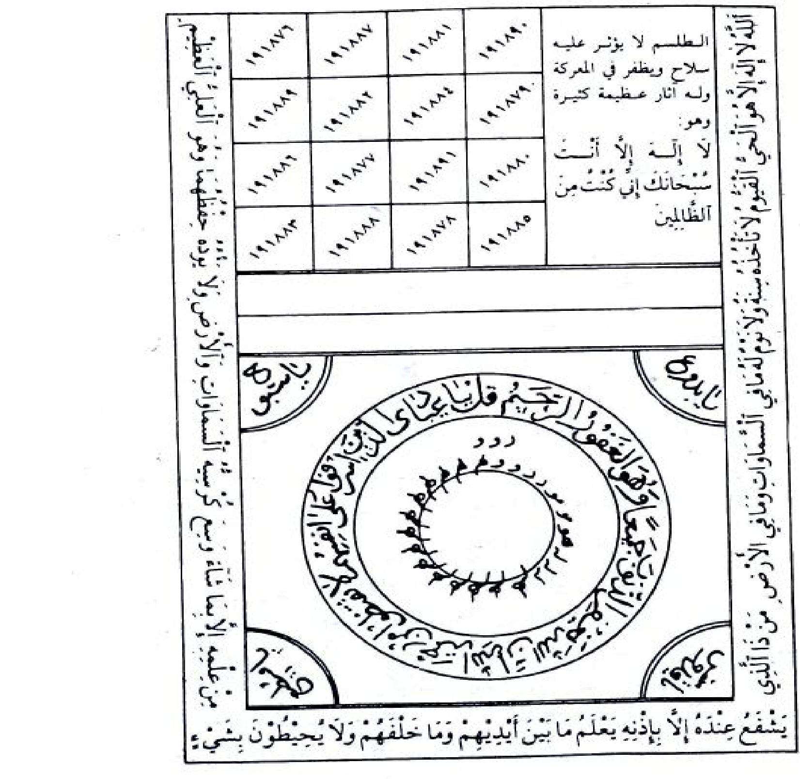

**AR:** لِلْكَشْفِ وَالْمُتَابَعَةِ مَعَ شَيْخِ الرُّوحَانِيِّينَ — الشَّيْخُ عَطِيَّةُ عَبْدُ الْحَمِيدِ ٠٠٢٠١٦٢٠٢٢٢٣٨

**LAT:** li-al-kashfi wa-al-mutāba‘ati ma‘a shaykhi al-rūḥāniyyīna — al-shaykhu ‘Aṭiyyatu ‘Abdu al-Ḥamīdi 0020162022238

**ID:** “Untuk «kashf» (penyingkapan) dan mengikuti (bimbingan) bersama syaikh para ruhaniyyin — Syaikh ‘Aṭiyyah ‘Abd al-Ḥamīd 0020162022238.”

**[TIDAK JELAS - HALAMAN 390]** (1) **Angka wafaq 4×4 tidak diklaim**: seluruh sel diawali «١٩١٨» tetapi dua angka terakhir tiap kotak tidak dapat dipastikan dari citra scan; angka sebenarnya dapat dibaca langsung pada rajah terlampir. (2) Teks pada panel kanan wafaq tercetak dengan susunan baris yang tidak lazim («العلم لا يبزر علي» — kemungkinan «لا يبزر على سلاح») dan kata «يبزر» tidak dapat dipastikan bentuknya; **[TEKS ASLI DIJAGA]** dan tidak dikoreksi. (3) Tulisan pada lingkaran rajah dan pada empat sudut bingkai sangat kecil serta saling menimpa; hanya frasa yang terbaca jelas yang dikutip, selebihnya tidak diterka. (4) Tulisan tepi bingkai kiri terpotong cukup banyak; tidak ditranskripsi utuh. (5) Keterangan sumber «ص٢٦٩» (Kitab Ḍiyā’ al-Ṣāliḥīn halaman 269) disalin persis dari scan. (6) Catatan: judul «طلسم يوم السبت» muncul **setelah** rangkaian hari Ahad–Jumat selesai (hlm. 389), sehingga urutan hari pada cetakan adalah Ahad, Senin, Selasa, Rabu, Kamis, Jumat, lalu Sabtu; urutan ini dipertahankan.

**[ADA RAJAH]** — 1 crop: `assets/rajah/sirrul-asrar/hal-390-rajah-01.jpg`

---

## HALAMAN 391 — Halaman judul «فوائد روحانية متفرقة»

**AR:** فَوَائِدُ رُوحَانِيَّةٌ

**LAT:** Fawā’idu rūḥāniyyatun.

**ID:** “Fawā’id (khasiat-khasiat) ruhani.”

**AR:** مُتَفَرِّقَةٌ

**LAT:** mutafarriqatun.

**ID:** “Yang beraneka (terpisah-pisah).”

**AR:** شَيْخُ الرُّوحَانِيِّينَ فِي الْوَطَنِ الْعَرَبِيِّ — الشَّيْخُ عَطِيَّةُ عَبْدُ الْحَمِيدِ — لِلْمُتَابَعَةِ وَ التَّوَاصُلِ 0020162022238

**LAT:** shaykhu al-rūḥāniyyīna fī al-waṭani al-‘arabiyyi — al-shaykhu ‘Aṭiyyatu ‘Abdu al-Ḥamīdi — li-al-mutāba‘ati wa al-tawāṣuli 0020162022238.

**ID:** “Syaikh para ruhaniyyin di tanah Arab — Syaikh ‘Aṭiyyah ‘Abd al-Ḥamīd — untuk mengikuti dan menghubungi: 0020162022238.”

**Keterangan halaman.** Halaman ini adalah **halaman judul bagian** «فوائد روحانية متفرقة» (khasiat-khasiat ruhani yang beraneka): judul, nama penulis, dan nomor kontak berada di dalam **bingkai hias** bermotif sulur bunga — bingkai dekoratif, bukan rajah. Nomor kontak **0020162022238** disalin persis dari citra scan. Isi bagian ini dimulai pada halaman 392.

**[TIDAK ADA RAJAH - TERVERIFIKASI DARI GAMBAR SCAN]** (Bingkai pada halaman ini adalah bingkai hias judul, bukan rajah; tidak ada wafaq, angka wafaq, maupun thilasm pada halaman ini selain nomor kontak di atas.)

---

## HALAMAN 392 — «رقعة الاصراف المغنية عن صرف العمار»

**AR:** كِتَابُ سِرِّ الْأَسْرَارِ فِي التَّوَاصُلِ مَعَ رُوحَانِيَّاتِ الْقُرْآنِ — شَيْخُ الرُّوحَانِيِّينَ الشَّيْخُ عَطِيَّةُ عَبْدُ الْحَمِيدِ

**LAT:** kitābu sirri al-asrāri fī al-tawāṣuli ma‘a rūḥāniyyāti al-qur’āni — shaykhu al-rūḥāniyyīna al-shaykhu ‘Aṭiyyatu ‘Abdu al-Ḥamīdi

**ID:** “Kitab «Sirr al-Asrār fī al-Tawāṣul ma‘a Rūḥāniyyāt al-Qur’ān» — Syaikh para ruhaniyyin, Syaikh ‘Aṭiyyah ‘Abd al-Ḥamīd.” (Kepala halaman.)

**AR:** رُقْعَةُ الْاصْرَافِ الْمُغْنِيَةِ عَنْ صَرْفِ الْعُمَّارِ

**LAT:** ruq‘atu al-aṣrāfi al-mughniyati ‘an ṣarfi al-‘ummāri.

**ID:** “Ruq‘ah (lembaran jimat) «al-Aṣrāf» yang mencukupkan dari mengusir para ‘ummār (jin penghuni rumah).”

**AR:** هَذِهِ هَدِيَّةٌ مِنِّي شَيْخُ الرُّوحَانِيِّينَ الشَّيْخُ عَطِيَّةُ عَبْدُ الْحَمِيدِ اِلَى جَمِيعِ الْاَخْوَانِ الَّذِينَ سُئِلُونِي عَنْ عَمَلِ اصْرَافٍ فَعَّالٍ

**LAT:** hādhihi hadiyyatun minnī shaykhu al-rūḥāniyyīna al-shaykhu ‘Aṭiyyatu ‘Abdu al-Ḥamīdi ilā jamī‘i al-akhwāni alladhīna su’ilūnī ‘an ‘amali aṣrāfin fa‘‘ālin

**ID:** “Ini adalah hadiah dariku — Syaikh para ruhaniyyin, Syaikh ‘Aṭiyyah ‘Abd al-Ḥamīd — kepada seluruh ikhwan yang menanyakan kepadaku tentang amalan «aṣrāf» (pengusiran jin) yang manjur.”

**AR:** اَقُولُ لَهُمْ هَذَا الْاَصْرَافُ هُوَ سِرٌّ مِنَ الْاَسْرَارِ وَقَدْ اَغْنَانِي بِفَضْلِهِ هَذَا عَنْ جَمِيعِ الْاَصْرَافَاتِ الرُّوحَانِيَّةِ الَّتِي قَدِ اسْتَغْنَيْتُ عَنْهَا مُنْذُو زَمَنٍ طَوِيلٍ بِفَضْلِ هَذِهِ الرُّقْعَةِ الْمُبَارَكَةِ

**LAT:** aqūlu lahum hādhā al-aṣrāfu huwa sirrun mina al-asrāri wa-qad aghnānī bi-faḍlihi hādhā ‘an jamī‘i al-aṣrāfāti al-rūḥāniyyati allatī qadi istaghnaytu ‘anhā mundhu zamnin ṭawīlin bi-faḍli hādhihi al-ruq‘ati al-mubārakati

**ID:** “Aku katakan kepada mereka: aṣrāf ini adalah salah satu rahasia dari rahasia-rahasia (ilmu); dengan keutamaannya ini ia telah mencukupkanku dari seluruh aṣrāf ruhani yang selama ini telah kutinggalkan sejak waktu lama berkat ruq‘ah yang diberkahi ini.”

**AR:** فِي الْمَكَانِ الَّذِي انْتَ فِيهِ اعْلَمْ انَّهُ سَيَنْصَرِفُ الْعُمَّارُ بِدُونِ رَجْعَةٍ اِلَى الْاَبَدِ

**LAT:** fī al-makāni alladhī anta fīhi i‘lam annahu sa-yanṣarifu al-‘ummāru bidūni raj‘atin ilā al-abadi

**ID:** “Di tempat di mana engkau berada, ketahuilah bahwa para ‘ummār akan pergi tanpa kembali untuk selama-lamanya.”

**AR:** وَايْضَافَةً لِذَلِكَ اَنَّ الرُّقْعَةَ تَحْصُنُ الْمَكَانَ الَّذِي انْتَ فِيهِ وَتَمْنَعُ دُخُولَ الْجِنِّ وَالشَّيَاطِينِ الَّا بِرَخْصَةٍ اوْ اذِنٍ مِنْكَ

**LAT:** wa-iḍāfatan li-dhālika anna al-ruq‘ata taḥṣunu al-makāna alladhī anta fīhi wa-tamna‘u dukhūla al-jinni wa-al-shayāṭīni illā bi-rakhṣatin aw idhmin minka

**ID:** “Dan tambahan pula, bahwa ruq‘ah itu menjaga tempat di mana engkau berada dan mencegah masuknya jin dan setan-setan, kecuali dengan izin atau persetujuan darimu.”

**AR:** فَبِهَذِهِ الرُّقْعَةِ الْمُبَارَكَةِ مُتَوَكِّلٌ بِـ ١٤ مَلَكٍ مِنْ مَلَائِكَةِ اللَّهِ الْكِرَامِ

**LAT:** fa-bi-hādhihi al-ruq‘ati al-mubārakati mutawakkilun bi-14 malakin min malā’ikati Allāhi al-kirāmi

**ID:** “Maka dengan ruq‘ah yang diberkahi ini ada 14 malaikat yang ditugaskan dari malaikat-malaikat Allah yang mulia.”

**AR:** وَاعْلَمْ ايْضًا انَّهُ سَيَكُونُ الدَّارُ وَاهْلَالُ الدَّارِ مُحَصَّنِينَ مِنْ جَمِيعِ الْاَعْمَالِ السِّحْرِيَّةِ بِكَافَّةِ اَنْوَاعِهَا بِمُجَرَّدِ تَعَلُّقِ الرُّقْعَةِ فِيهِ

**LAT:** wa-i‘lam ayḍan annahu sa-yakūnu al-dāru wa-ahlālu al-dāri muḥaṣṣanīna min jamī‘i al-a‘māli al-siḥriyyati bi-kāffati anwā‘ihā bi-mujarradi ta‘alluqi al-ruq‘ati fīhi

**ID:** “Dan ketahuilah juga bahwa rumah dan penghuni rumah akan terjaga dari segala amal sihir dengan semua jenisnya, begitu ruq‘ah itu digantung di dalamnya.” (Cetakan: «واهلال الدار» — dipertahankan.)

**AR:** شَرْحُ الطَّرِيقَةِ

**LAT:** sharḥu al-ṭarīqati.

**ID:** “Penjelasan metode.”

**AR:** يَجِبُ عَلَيْكَ انْ تَقُومَ بِالْكِتَابَةِ يَوْمَ الْجُمُعَةِ مَابَيْنَ الْمَغْرِبِ وَالْعِشَاءِ وَالْبَخُورُ طَيِّبٌ

**LAT:** yajibu ‘alayka an taqūma bi-al-kitābati yawma al-jumu‘ati mā bayna al-maghribi wa-al-‘ishā’i wa-al-bakhūru ṭayyibun

**ID:** “Wajib atasmu melakukan penulisan pada hari Jumat, antara Maghrib dan ‘Isyā’, dan (hendaklah) bakaran dupa (bakhūr)nya wangi.”

**AR:** فِي الْبِدَايَةِ تَجْلُبُ رَقَّ الْجِلْدِ مِنَ الْمَاعِزِ اوِ الْخِرْفَانِ وَاقْصِدُ بِالرَّقِّ وَهُوَ نَوْعَانِ الرَّقُّ الَّذِي يَصْنَعُونَ مِنْهُ الدُّفُوفَ الصَّافِي الْمُنَقَّى

**LAT:** fī al-bidāyati tajlubu raqqa al-jildi mina al-mā‘izi awi al-khurfāni wa-aqṣidu bi-al-raqqi wa-huwa naw‘āni al-raqqu alladhī yaṣna‘ūna minhu al-dufūfa al-ṣāfī al-munaqqā

**ID:** “Pada permulaannya engkau mengambil (membeli) kulit tipis dari kambing atau domba — dan yang kumaksud dengan «raqq» (yang) ada dua jenis: raqq yang darinya dibuat rebana (duff) — yaitu yang bersih dan tersaring (dari bulu).”

**AR:** وَتَقُصُّ مِنْهُ قِطْعَةً عَلَى شَكْلِ مُرَبَّعٍ بِحَجْمِ الْوَرَقَةِ الْعَادِيَةِ

**LAT:** wa-taquṣṣu minhu qiṭ‘atan ‘alā shakli murabba‘in bi-ḥajmi al-waraqati al-‘ādiyati

**ID:** “Lalu engkau potong darinya sepotong berbentuk persegi seukuran kertas biasa.”

**AR:** وَتَبْدَاء بِالْكِتَابَةِ بِالْمِدَادِ الرُّوحَانِيِّ وَبَعْدَهَا تَقْلِبُهُ عَلَى الْمَبْخَرَةِ وَانْتَ تَعْزِمُ عَلَيْهِ بِالْفَاتِحَةِ ٧٣ مَرَّةً وَالْمُعَوِّذَتَيْنِ ١٤ وَالصَّافَّاتِ ٢ ثُمَّ بَعْدَ ذَلِكَ تَضَعُهَا فِي اطَارِ لَوْحَةٍ وَتُعَلِّقُهَا

**LAT:** wa-tabdā’u bi-al-kitābati bi-al-midādi al-rūḥāniyyi wa-ba‘dahā taqlibuhu ‘alā al-mabkharati wa-anta ta‘zimu ‘alayhi bi-al-fātiḥati 73 marratan wa-al-mu‘awwidhatayni 14 wa-al-ṣāffāti 2 thumma ba‘da dhālika taḍa‘uhā fī aṭāri lawḥatin wa-tu‘alliquhā

**ID:** “Lalu engkau mulai menulis dengan tinta ruhani; sesudah itu engkau balik (lembaran)nya di atas pembakaran dupa, sambil engkau mengazamkan (membacakan) atasnya: al-Fātiḥah 73 kali, dua mu‘awwidzah (al-Falaq dan al-Nās) 14 (kali), dan al-Ṣāffāt 2 (kali). Kemudian setelah itu engkau letakkan di dalam bingkai/kerangka papan dan engkau gantungkan.”

**AR:** فِي الْغُرْفَةِ الَّتِي تَعَاجُ فِيهَا النَّاسَ وَتُمَارِسُ اعْمَالَكَ الرُّوحَانِيَةَ

**LAT:** fī al-ghurfati allatī ta‘āju fīhā al-nāsa wa-tumārisu a‘mālaka al-rūḥāniyyata

**ID:** “Di ruang (kamar) di mana engkau mengobati orang-orang dan menjalankan amalan-amalan ruhanimu.” (Cetakan: «تَعَاجُ» — tanpa «ال»; dipertahankan apa adanya.)

**AR:** بَعْدَهَا يَجِبُ عَلَيْكَ اخْذُ سَطْلِ مَاءٍ وَتَعْزِمُ عَلْيَةِ ايْضًا بِمَا ذَكَرْتَةُ سَابِقًا وَتَرُشُّ مِنْ مَائِهِ فِي جَمِيعِ زَوَايَا الْبَيْتِ وَمُحِيطِهِ مِنَ الْخَارِجِ

**LAT:** ba‘dahā yajibu ‘alayka akhdhu saṭli mā’in wa-ta‘zimu ‘alyahi ayḍan bimā dhakartahu sābiqan wa-tarushshu min mā’ihi fī jamī‘i zawāyā al-bayti wa-muḥīṭihi mina al-khāriji

**ID:** “Sesudah itu wajib atasmu mengambil seember air dan engkau azamkan juga padanya dengan apa yang engkau sebutkan tadi, lalu engkau percikkan dari airnya ke seluruh sudut rumah dan sekelilingnya dari luar.” (Cetakan: «عَلْيَةِ» dan «ذَكَرْتَةُ» — dipertahankan.)

**AR:** بَعْدَ هَذَا اخِي يَكُونُ دَارُكَ خَالِيَ مِنَ الْعُمَّارِ وَمُحَصَّنٌ مِنَ الْجَانِّ وَالشَّيَاطِينِ بِحِصْنٍ عَظِيمٍ وَالْعَظَمَةِ لِلَّهِ

**LAT:** ba‘da hādhā akhī yakūnu dāruka khāliya mina al-‘ummāri wa-muḥaṣṣanun mina al-jānni wa-al-shayāṭīni bi-ḥiṣnin ‘aẓīmin wa-al-‘aẓamati lillāhi

**ID:** “Setelah ini, saudaraku, rumahmu akan menjadi kosong dari para ‘ummār dan terjaga dari jin dan setan-setan dengan benteng yang agung — dan keagungan itu milik Allah.”

**AR:** وَسَتَرَى الْفَرْقَ بِنَجَاحِ اعْمَالِكَ قَبْلَ وَبَعْدَ الطَّرِيقَةِ الْمُبَارَكَةِ

**LAT:** wa-satarā al-farqa bi-najāḥi a‘mālika qabla wa-ba‘da al-ṭarīqati al-mubārakati

**ID:** “Dan engkau akan melihat perbedaannya pada keberhasilan amalan-amalanmu sebelum dan sesudah metode yang diberkahi ini.”

**AR:** وَلَا تَنْسَى بَانْ تَكُونَ عَلَى طَهَارَةٍ عِنْدَ الْكِتَابَةِ وَالتَّعْزِيمِ

**LAT:** wa-lā tansā bi-an takūna ‘alā ṭahāratin ‘inda al-kitābati wa-al-ta‘zīmi

**ID:** “Dan jangan lupa bahwa engkau harus dalam keadaan suci (berwudu) ketika menulis dan mengazamkan.”

**AR:** وَهَذِهِ الرُّقْعَةُ الْمُبَارَكَةُ — ايُّهَا الطَّالِبُ الْجَلِيلُ

**LAT:** wa-hādhihi al-ruq‘atu al-mubārakatu — ayyuhā al-ṭālibu al-jalīlu.

**ID:** “Dan inilah ruq‘ah yang diberkahi itu. — Wahai penuntut (ilmu) yang mulia.”

**AR:** لَا تَبْخَلْ عَلَيْنَا بِقِرَةِ الْفَاتِحَةِ وَهِبْ صَوَامًا لَنَا وَلِوَالِدَيْنِ — شَيْخُ الرُّوحَانِيِّينَ فِي الْوَطَنِ الْعَرَبِيِّ — الشَّيْخُ عَطِيَّةُ عَبْدُ الْحَمِيدِ

**LAT:** lā tabkhal ‘alaynā bi-qir’ati al-fātiḥati wa-hib ṣawāman lanā wa-li-wālidayn — shaykhu al-rūḥāniyyīna fī al-waṭani al-‘arabiyyi — al-shaykhu ‘Aṭiyyatu ‘Abdu al-Ḥamīdi.

**ID:** “Janganlah kikir kepada kami dengan pembacaan al-Fātiḥah, dan berikanlah (pahala) puasa untuk kami dan kedua orang tua. — Syaikh para ruhaniyyin di tanah Arab — Syaikh ‘Aṭiyyah ‘Abd al-Ḥamīd.”

**Keterangan halaman.** Halaman ini membuka bagian «فوائد روحانية متفرقة» (judulnya di hlm. 391) dengan satu risalah pendek berjudul «رقعة الاصراف المغنية عن صرف العمار» — ruq‘ah untuk mengusir «العمار» (para ‘ummār, jin penghuni rumah). Susunannya: (1) kepala halaman dan judul; (2) pembuka «هذه هدية مني…»; (3) keterangan keutamaan ruq‘ah: mengusir ‘ummār tanpa kembali, menjaga tempat dari jin dan setan, ditugaskan **14 malaikat**, dan menjaga rumah dari segala sihir; (4) sub-judul «شرح الطريقة» (penjelasan metode): menulis pada Jumat antara Maghrib dan ‘Isyā’ dengan bakhūr wangi di atas kulit «رق» (kambing/domba) yang dipotong persegi seukuran kertas, menulis dengan tinta ruhani, membaliknya di atas pembakaran dupa sambil mengazamkan al-Fātiḥah 73×, dua mu‘awwidzah 14×, al-Ṣāffāt 2×, meletakkannya dalam bingkai papan dan menggantungnya di ruang pengobatan, lalu mengambil seember air yang diazamkan dan memercikkannya ke seluruh sudut rumah bagian luar; (5) penutup: rumah menjadi kosong dari ‘ummār dan terjaga, lalu permintaan membaca al-Fātiḥah dan menghadiahkan pahala puasa. Tidak ada wafaq bergambar maupun thilasm huruf-huruf pada halaman ini.

**[TIDAK JELAS - HALAMAN 392]** (1) Judul tercetak «الْمُغْنِيَةِ» (dengan «غ» dan «ي») dan «الاصْرَافِ» — bentuk ini dipertahankan; **[TEKS ASLI DIJAGA]**. (2) «مُنْذُو» (dengan «و») dan «وَايْضَافَةً» / «واهلال الدار» / «تَعَاجُ» / «عَلْيَةِ» / «ذَكَرْتَةُ» / «بَانْ» tercetak sesuai scan dan tidak dikoreksi. (3) «الصَّافَّاتِ ٢» — angka «٢» hanya satu digit dan jelas; «وَالْمُعَوِّذَتَيْنِ ١٤» jelas dua digit; «بِالْفَاتِحَةِ ٧٣» jelas dua digit — ketiganya dibaca dari citra perbesar, bukan dari lapisan teks. (4) Jumlah malaikat «١٤ مَلَكٍ» jelas terbaca. (5) Baris «تَضَعُهَا فِي اطَارِ لَوْحَةٍ» ditulis tanpa hamzah pada «اطار»; dipertahankan.

**[TIDAK ADA RAJAH - TERVERIFIKASI DARI GAMBAR SCAN]** (Halaman ini hanya berisi teks; tidak ada citra tertanam menurut `get_image_info()` dan tidak terlihat wafaq, rajah, atau tabel pada scan 200 DPI.)

---

## HALAMAN 393 — Rajah «رقعة الاصراف» (ṭilasm penuh halaman)

**AR:** كِتَابُ سِرِّ الْأَسْرَارِ فِي التَّوَاصُلِ مَعَ رُوحَانِيَّاتِ الْقُرْآنِ — شَيْخُ الرُّوحَانِيِّينَ الشَّيْخُ عَطِيَّةُ عَبْدُ الْحَمِيدِ

**LAT:** kitābu sirri al-asrāri fī al-tawāṣuli ma‘a rūḥāniyyāti al-qur’āni — shaykhu al-rūḥāniyyīna al-shaykhu ‘Aṭiyyatu ‘Abdu al-Ḥamīdi

**ID:** “Kitab «Sirr al-Asrār fī al-Tawāṣul ma‘a Rūḥāniyyāt al-Qur’ān» — Syaikh para ruhaniyyin, Syaikh ‘Aṭiyyah ‘Abd al-Ḥamīd.” (Kepala halaman.)

**Keterangan halaman.** Seluruh halaman ini berisi satu **rajah ṭilasm** besar — yaitu wujud gambar dari «رُقْعَةُ الاصْرَاف» yang metodenya dijelaskan pada halaman 392. Tidak ada teks uraian (prosa) pada halaman ini; teks hanya terdapat **di dalam** rajah, dalam bentuk tulisan tangan huruf-huruf terpotong, angka, dan satu kutipan Qur’an. Halaman dicetak sebagai gambar pindaian utuh (satu objek gambar menurut `get_image_info()`, bbox kurang-lebih [88, 69, 502, 647]), sehingga teks di dalamnya tidak dapat diambil dari lapisan teks PDF sama sekali — semuanya dibaca dari citra.

**Rajah:** 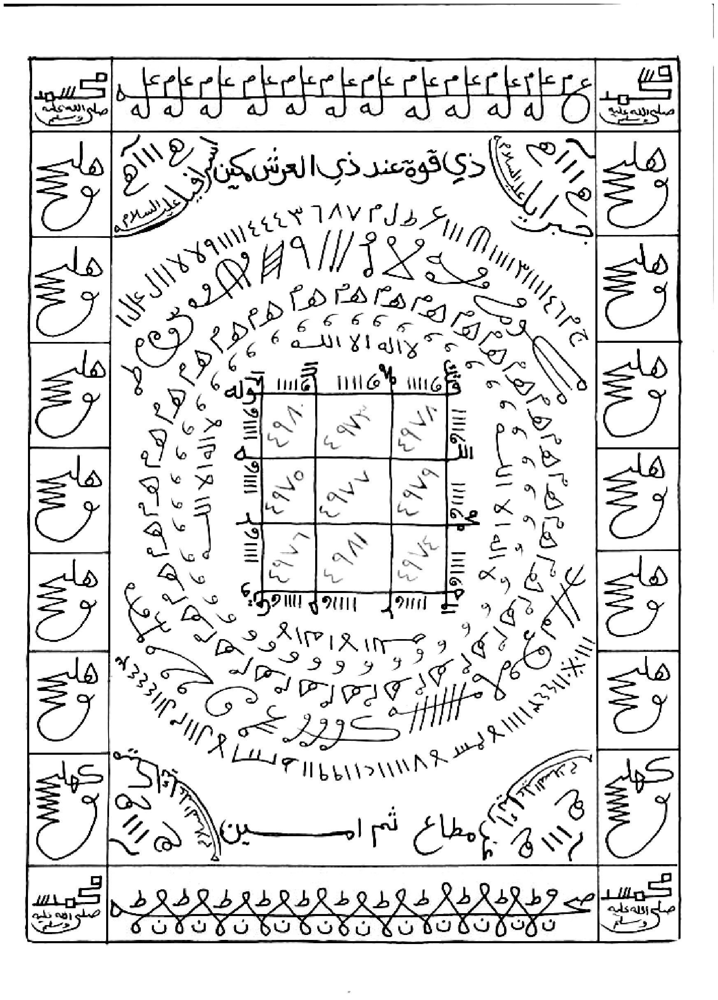

**Susunan rajah (dari luar ke dalam).**
(1) **Bingkai luar** persegi panjang bertepi ganda, terbagi menjadi **sembilan baris** yang dipisahkan garis mendatar; pada keempat sudutnya terdapat **empat kotak kecil** berisi tulisan tangan, dan di antara kotak-kotak itu memanjang deret **huruf-huruf terpotong besar** (bentuk seperti «ط ط ط…» dan bulatan-bulatan bertitik) pada baris teratas dan terbawah.
(2) **Dua kolom sisi** — kiri dan kanan — masing-masing berisi deret **tujuh kotak** yang seluruhnya memuat tulisan tangan yang sama berulang: sebuah bentuk seperti «ملـ» (mungkin «مَلَك») dengan ekor melingkar dan beberapa garis miring. Tulisan ini berulang identik pada tiap kotak.
(3) **Empat sudut dalam** (kiri-atas, kanan-atas, kiri-bawah, kanan-bawah) berisi **busur-busur berisi huruf** yang ditulis melengkung mengikuti sudut, sebagian besar huruf terpotong tanpa titik.
(4) **Lingkaran-lingkaran kosentris** di tengah: tiga-empat lapis deret huruf terpotong, angka, dan tanda garis miring yang mengelilingi pusat; pada lapisan luar arah atas terdapat deret angka «٣٤٤٤٣٦٧٨٧٣٦٢…» dan pada lapisan-lapisan berikutnya deret angka lain yang bercampur tanda.
(5) **Kutipan Qur’an** yang terbaca jelas pada bagian atas rajah, melengkung: «ذِي قُوَّةٍ عِنْدَ ذِي الْعَرْشِ مَكِينٍ» (Q.S. al-Takwīr [81]: 20) — ditulis dengan tulisan tangan kecil; di kiri-kanannya terdapat pecahan «…السَّمَاءِ» dan deret huruf lain.
(6) **Wafaq 3×3 di pusat** rajah: kotak bergaris ganda berisi **sembilan sel** dengan angka tulisan tangan miring; di sekeliling wafaq ini — pada keempat sisinya — terdapat tulisan angka/garis miring kecil («١١١٦»، «١١٦١» dan sejenisnya; tidak dapat dipastikan).
(7) **Bagian bawah** rajah berisi tulisan tangan yang menyebar: di antara dua busur sudut terbaca potongan «…ثُمَّ ا… بَيْنَ…» dan deret huruf terpotong; di bawahnya satu baris lagi deret huruf kecil.
(8) **Baris terbawah** bingkai memuat deret **huruf-huruf terpotong besar** yang bersambung (bentuk «ط» dan bulatan bertitik) sepanjang bidang, sama polanya dengan baris teratas.

**Angka wafaq.** Wafaq pusat berukuran **3×3** (sembilan sel). Angka pada tiap sel ditulis tangan dengan tinta hitam dan **miring sekitar 45 derajat** mengikuti garis kotak; pada tiap sel terbaca awalan yang konsisten (tampak seperti «٢٩٧…» atau «٩٧…») namun **digit-digit berikutnya tidak dapat dipastikan** meskipun citra diperbesar hingga 2400 DPI dan diputar 45 derajat — goresan tangan saling menumpuk dan tepi garis kotak memotong angka. Karena itu **tidak ada satu pun angka wafaq yang diklaim** pada transkripsi ini; angka sebenarnya dapat dibaca langsung pada rajah terlampir.

**[TIDAK JELAS - HALAMAN 393]** (1) **Seluruh tulisan di dalam rajah adalah tulisan tangan berhuruf terpotong** (huruf tunggal tanpa titik, sebagian tanpa bentuk baku) dan bercampur angka — ini adalah ciri ṭilasm; **[TEKS ASLI DIJAGA]** dan tidak diterka maknanya, tidak dinormalisasi, dan tidak diberi harakat. (2) Satu-satunya bagian yang dapat dibaca sebagai kalimat utuh adalah kutipan «ذِي قُوَّةٍ عِنْدَ ذِي الْعَرْشِ مَكِينٍ»; selebihnya hanya kutipan potongan huruf yang tidak membentuk kata yang dapat dipastikan. (3) **Angka wafaq 3×3 tidak diklaim** (lihat keterangan di atas); angka pada lapisan lingkaran («٣٤٤٤٣٦٧٨٧٣٦٢…») juga tidak disalin utuh karena deretnya terputus oleh lengkungan dan tanda garis miring, sehingga tidak dapat dipastikan batas tiap bilangan. (4) Tulisan pada empat kotak sudut bingkai sangat kecil dan sebagian terpotong tepi bingkai; hanya bentuknya yang dideskripsikan, bukan bunyinya. (5) Halaman ini tidak memuat nomor halaman cetak, nomor sumber, maupun nomor kontak. (6) Halaman di-render pada 200 DPI; karena teks di dalam rajah adalah goresan tangan yang halus, tidak ada pembacaan yang dapat dipertanggungjawabkan pada butir-butir di atas selain yang disebutkan.

**[ADA RAJAH]** — 1 crop: `assets/rajah/sirrul-asrar/hal-393-rajah-01.jpg` (dipotong dari PDF asli pada 300 DPI, Rect(85.5, 66.5, 504.2, 649.5), 1745×2430 px)

---

## HALAMAN 394 — «خواص البسملة الشريفة لقضاء الحوائج»

**AR:** كِتَابُ سِرِّ الْأَسْرَارِ فِي التَّوَاصُلِ مَعَ رُوحَانِيَّاتِ الْقُرْآنِ — شَيْخُ الرُّوحَانِيِّينَ الشَّيْخُ عَطِيَّةُ عَبْدُ الْحَمِيدِ

**LAT:** kitābu sirri al-asrāri fī al-tawāṣuli ma‘a rūḥāniyyāti al-qur’āni — shaykhu al-rūḥāniyyīna al-shaykhu ‘Aṭiyyatu ‘Abdu al-Ḥamīdi

**ID:** “Kitab «Sirr al-Asrār fī al-Tawāṣul ma‘a Rūḥāniyyāt al-Qur’ān» — Syaikh para ruhaniyyin, Syaikh ‘Aṭiyyah ‘Abd al-Ḥamīd.” (Kepala halaman.)

**AR:** خَوَاصُّ الْبَسْمَلَةِ الشَّرِيفَةِ لِقَضَاءِ الْحَوَائِجِ

**LAT:** khawāṣṣu al-basmalati al-sharīfati li-qaḍā’i al-ḥawā’iji.

**ID:** “Khasiat-khasiat basmalah yang mulia untuk menunaikan hajat-hajat.”

**AR:** وَمِنْ خَوَاصِّ الْبَسْمَلَةِ لِجَمِيعِ الْاُمُورِ تَقْرَاء سُورَةَ الزَّلْزَلَةِ ٣ مَرَاتٍ وَالَمْ نَشْرَح ١١ مَرَّةً وَالْفِيلَ ١١ مَرَّةً

**LAT:** wa-min khawāṣṣi al-basmalati li-jamī‘i al-umūri taqrā’u sūrata al-zalzalati 3 marrātin wa-alam nashraḥ 11 marratan wa-al-fīla 11 marratan

**ID:** “Dan di antara khasiat basmalah untuk segala urusan: engkau membaca surah al-Zalzalah **3 kali**, «Alam nashraḥ» (al-Insyirāḥ) **11 kali**, dan «Al-Fīl» **11 kali**.”

**AR:** ثُمَّ تَقُولُ اللَّهُمَّ صَلِّي عَلَى سَيِّدِنَا مُحَمَّدٍ النَّبِيِّ الْاُمِّيِّ وَعَلَى الِهِ الطَّاهِرَيْنِ وَصَحْبِهِ الْمُنْتَجَبِينَ وَسَلِّمْ ١١ مَرَّةً

**LAT:** thumma taqūlu allāhumma ṣallī ‘alā sayyidinā Muḥammadini al-nabiyyi al-ummiyyi wa-‘alā ālihi al-ṭāhiray ni wa-ṣaḥbihi al-muntajabīna wa-sallim 11 marratan

**ID:** “Kemudian engkau membaca: «Ya Allah, limpahkanlah shalawat kepada junjungan kami Muhammad, nabi yang ummi, dan kepada keluarganya yang suci serta para sahabatnya yang terpilih, dan berilah keselamatan» — **11 kali**.” (Cetakan: «صَلِّي» dan «الطَّاهِرَيْنِ» — dipertahankan.)

**AR:** وَبَعْدَهَا تَذْكُرُ الْبَسْمَلَةَ ٧٨٦ مَرَّةً وَتُوَاظِبُ عَلَى ذَلِكَ مُدَّةَ سَبْعِ لَيَالِيٍ وَانْتَ تَبْخُرُ بِذِي رَائِحَةٍ طَيِّبَةٍ وَلَابِسٌ ثِيَابًا بَيْضَاءَ مُسْتَقْبِلَ الْقِبْلَةِ فَفِي هَذِهِ الْحَالَةِ تَنَالُ غَرَضَكَ اِنْ شَاءَ اللَّهِ...

**LAT:** wa-ba‘dahā tadhkuru al-basmalata 786 marratan wa-tuwāẓibu ‘alā dhālika muddata sab‘i layālīn wa-anta tabkhuru bi-dhī rā’iḥatin ṭayyibatin wa-lābisun thiyāban bayḍā’a mustaqbila al-qiblati fa-fī hādhihi al-ḥālati tanālu gharaḍaka in shā’a Allāhu...

**ID:** “Sesudah itu engkau menyebut (membaca) basmalah **786 kali** dan engkau membiasakan hal itu selama tujuh malam, sementara engkau membakar dupa yang beraroma wangi dan memakai pakaian putih menghadap kiblat; maka dalam keadaan ini engkau akan mencapai maksudmu, insya Allah…”

**AR:** طَرِيقَةٌ لِأَسْتِخْدَامِ الْبَسْمَلَةِ الشَّرِيفَه

**LAT:** ṭarīqatun li-astikhdāmi al-basmalati al-sharīfah.

**ID:** “Metode untuk menggunakan basmalah yang mulia.” (Judul ini tercetak tanpa harakat lengkap; dipertahankan.)

**AR:** الْبَسْمَلَةُ الشَّرِيفَةُ وَهَذِهِ هِيَ الطَّرِيقَةُ وَهِيَ عَظِيمَةٌ وَمُجَرَّبَةٌ وَوَاللَّهِ سَوْفَ تَنَالُ بِهَا الْخَيْرَ

**LAT:** al-basmalatu al-sharīfatu wa-hādhihi hiya al-ṭarīqatu wa-hiya ‘aẓīmatun wa-mujarrabatun wa-wallāhi sawfa tanālu bihā al-khayra

**ID:** “Basmalah yang mulia — dan inilah metodenya; ia agung dan sudah teruji, dan demi Allah engkau akan memperoleh kebaikan dengannya.”

**AR:** لَكِنْ ارْجُو اَنْ تُحْسِنَ اسْتِخْدَامَهُ فَإِنَّ لَهَا قُوَّةً عَظِيمَةً بِالتَّسْخِيرِ وَخَاصَّةً بِاُمُورِ الْمَحَبَّةِ وَقَضَاءِ الْحَوَائِجِ وَتَسْلِيطِهَا عَلَى شَخْصٍ مَا وَقَدْ تَحْتَاجُ اِلَى اعَادَتِهَا اكْثَرَ مِنْ مَرَّةٍ فِي الْبِدَايَةِ

**LAT:** lākin arjū an tuḥsina istikhdāmahu fa-inna lahā quwwatan ‘aẓīmatan bi-al-taskhīri wa-khāṣṣatan bi-umūri al-maḥabbati wa-qaḍā’i al-ḥawā’iji wa-taslīṭihā ‘alā shakhṣin mā wa-qad taḥtāju ilā i‘ādatihā akthara min marratin fī al-bidāyati

**ID:** “Akan tetapi aku berharap engkau memperbagus penggunaannya, sebab ia memiliki kekuatan yang besar dalam «taskhīr» (penundukan), khususnya dalam urusan mahabbah, menunaikan hajat, dan menundukkannya kepada seseorang; dan pada permulaannya engkau mungkin perlu mengulanginya lebih dari sekali.” (Cetakan: «اسْتِخْدَامَهُ» dan «اعَادَتِهَا» — dipertahankan.)

**AR:** لَكِنْ سَوْفَ تَتِمُّ الْاِسْتِجَابَةُ بِدُونِ شَكٍّ فَالْزَمْهَا وَحَافِظْ عَلَيْهَا وَسَوْفَ تَرَى الْعَجَبَ وَقَدْ شَرَحْتُ لَكَ الطَّرِيقَةَ كَامِلَةً لَكِنْ يَنْبَغِي اَنْ تُطَبِّقَهَا بِشَكْلٍ نِظَامِيٍّ وَوَقْتُ عَمَلِهَا يَكُونُ فِي اللَّيْلِ

**LAT:** lākin sawfa tatimmu al-istijābatu bidūni shakkin fa-alzamhā wa-ḥāfiẓ ‘alayhā wa-sawfa tarā al-‘ajaba wa-qad sharaḥtu laka al-ṭarīqata kāmilatan lākin yanbaghī an tuṭabbiqahā bi-shaklin niẓāmiyyin wa-waqtu ‘amalihā yakūnu fī al-layli

**ID:** “Akan tetapi pengabulannya pasti akan terjadi tanpa keraguan, maka tekunilah ia dan jagalah ia, dan engkau akan melihat sesuatu yang menakjubkan. Aku telah menjelaskan kepadamu metodenya secara lengkap, tetapi sepatutnya engkau menerapkannya secara teratur, dan waktu pelaksanaannya adalah pada malam hari.”

**AR:** طَرِيقَةُ اسْتِخْدَامِ الْبَسْمَلَةِ

**LAT:** ṭarīqatu istikhdāmi al-basmalati.

**ID:** “Metode penggunaan basmalah.” (Sub-judul.)

**AR:** وَهِيَ طَرِيقَةٌ عَظِيمَةٌ وَمُجَرَّبَةٌ وَتُسْتَخْدَمُ لِلْمَحَبَّةِ وَلِتَسْخِيرِ مَنْ تَرِيدُ وَلِإِرْسَالِ هَاتِفٍ لِمَنْ تُرِيدُ وَجَلْبِ وَجَذْبِ وَتِيِيج مِنْ تُرِيدُ بِإِذْنِ اللَّهِ

**LAT:** wa-hiya ṭarīqatun ‘aẓīmatun wa-mujarrabatun wa-tustakhdamu li-al-maḥabbati wa-li-taskhīri man turīdu wa-li-irsāli hātifin li-man turīdu wa-jalbi wa-jadhbi wa-tiyīj man turīdu bi-idhni Allāhi

**ID:** “Ia adalah metode yang agung dan teruji; digunakan untuk mahabbah, untuk menundukkan siapa yang engkau kehendaki, untuk «mengirim hātif (suara/telepon)» kepada siapa yang engkau kehendaki, serta menarik dan memikat siapa yang engkau kehendaki dengan izin Allah.”

**AR:** وَهِيَ اَنْ تَكْتُبَ بِسْمِ اللَّهِ الرَّحْمَنِ الرَّحِيمِ وَاحِد وَ عِشْرِينَ مَرَّةً بِالْحُرُوفِ الْمُقَطَّعَةِ وَهِيَ ( ب ا س م ا ل ل ه ا ل ر ح م ا ن ا ل ر ح ي م )

**LAT:** wa-hiya an taktuba bismi Allāhi al-Raḥmāni al-Raḥīmi wāḥid wa-‘ishrīna marratan bi-al-ḥurūfi al-muqaṭṭa‘ati wa-hiya (b a s m a l l h a l r ḥ m a n a l r ḥ y m)

**ID:** “Yaitu engkau menulis «بسم الله الرحمن الرحيم» **dua puluh satu kali** dengan huruf-huruf yang terpotong (terpisah satu per satu), yaitu: (ب ا س م ا ل ل ه ا ل ر ح م ا ن ا ل ر ح ي م).” (Cetakan: «وَاحِد» tanpa tanwin; dipertahankan.)

**AR:** وَبَعْدَ كُلِّ مَرَّةٍ تَكْتُبُ التَّوْكِيلَ عَلَى حَاجَتِكَ وَهُوَ ( تَوَكَّلُوا يَا خُدَّامَ هَذِهِ الْبَسْمَلَةِ بِكَذَا وَكَذَا وَتَذْكُرُ الْحَاجَةَ الَّتِي تُرِيدُ وَتُسَمِّي مَنْ تُرِيدُ بِحَقِّهَا عَلَيْكُمْ وَقُولَا لَدَيْكُمْ )

**LAT:** wa-ba‘da kulli marratin taktubu al-tawkīla ‘alā ḥājatika wa-huwa (tawakkalū yā khuddāma hādhihi al-basmalati bi-kadhā wa-kadhā wa-tadhkuru al-ḥājata allatī turīdu wa-tusammī man turīdu bi-ḥaqqihā ‘alaykum wa-qūlā ladaykum)

**ID:** “Dan setelah setiap kali (penulisan) engkau menuliskan «tawkil» untuk hajatmu, yaitu: «Bertindaklah, wahai para khādim basmalah ini, dengan ini dan ini» — lalu engkau menyebutkan hajat yang engkau inginkan dan menamai orang yang engkau inginkan — «dengan haknya atas kalian, dan ucapkanlah di hadapan kalian».”

**AR:** وَتَكْتُبُ وَفْقَ الْبَسْمَلَةِ وَالْكِتَابَةُ تَكُونُ بِزَعْفَرَانٍ وَمَاءِ وَرْدٍ فَإِذَا انْتَهَيْتَ مِنْهَا تَطْوِي الْوَرَقَةَ وَتَرْبِطُهَا بِخَيْطِ حَرِيرٍ اَحْمَرَ اَوْ اسْوَدَ وَتُعَلِّقُهَا عَلَى سَبِيبَةٍ مِنْ اَعْوَادِ الرُّمَّانِ الثَّلَاثَةِ ثُمَّ تُطْلِقُ الْبَخُورَ وَهُوَ الْجَاوِي وَاللُّبَانُ وَالْكَسْبَرَةُ ثُمَّ تَبْدَأُ بِتِلَاوَةِ الْبَسْمَلَةِ ٧٨٨ مَرَّةً وَعَلَامَةُ الْاِجَابَةِ تَبْدَأُ الْوَرَقَةُ بِالدَّوْرَانِ وَالْحَرَكَةِ فَإِنْ تَأَخَّرَتِ الْاِجَابَةُ فَكَرِّرِ الْعَمَلَ

**LAT:** wa-taktubu wafqa al-basmalati wa-al-kitābatu takūnu bi-za‘farānin wa-mā’i wardin fa-idhā intahayta minhā taṭwī al-waraqata wa-tarbiṭuhā bi-khayṭi ḥarīrin aḥmara aw aswada wa-tu‘alliquhā ‘alā sabībatin min a‘wādi al-rummāni al-thalāthati thumma tuṭliqu al-bakhūra wa-huwa al-jāwiyyu wa-al-lubbānu wa-al-kasbaratu thumma tabda’u bi-tilāwati al-basmalati 788 marratan wa-‘alāmata al-ijābati tabda’u al-waraqatu bi-al-dawrāni wa-al-ḥarakati fa-in ta’akhkharati al-ijābatu fa-karriri al-‘amala

**ID:** “Dan engkau menuliskan wafaq basmalah; penulisannya dengan za‘farān (saffron) dan air mawar. Maka apabila engkau telah selesai darinya, engkau melipat kertas itu dan mengikatnya dengan benang sutra merah atau hitam, lalu menggantungkannya pada sebatang «sabībah» (tangkai) dari tiga batang kayu delima. Kemudian engkau melepaskan (membakar) dupa, yaitu al-jāwī, al-lubbān (kemenyan), dan al-kasbarah (ketumbar). Kemudian engkau mulai membaca basmalah **788 kali**; dan tanda pengabulannya adalah kertas itu mulai berputar dan bergerak. Jika pengabulan tertunda, maka ulangilah amalan itu.”

**AR:** وَبَعْدَ الِانْتِهَاءِ يَتِمُّ الصَّرْفُ بِالزَّلْزَلَةِ

**LAT:** wa-ba‘da al-intihā’i yatimm al-ṣarfu bi-al-zalzalati.

**ID:** “Dan setelah selesai, pengusiran (al-ṣarf) disempurnakan dengan (surah) al-Zalzalah.”

**AR:** وَتُسْتَخْدَمُ لِعَدَّةِ اُمُورٍ مِنْهَا لِلْمَحَبَّةِ وَمِنْهَا لِإِرْسَالِ هَاتِفٍ لِشَخْصٍ وَمِنْهَا لِقَضَاءِ حَاجَةٍ وَمِنْهَا لِلْكَشْفِ عَنْ اَمْرٍ مَا وَهَذِهِ كَيْفِيَةُ التَّوْكِيلِ

**LAT:** wa-tustakhdamu li-‘iddati umūrin minhā li-al-maḥabbati wa-minhā li-irsāli hātifin li-shakhṣin wa-minhā li-qaḍā’i ḥājatin wa-minhā li-al-kashfi ‘an amrin mā wa-hādhihi kayfiyyatu al-tawkīli

**ID:** “Ia digunakan untuk beberapa keperluan: di antaranya untuk mahabbah, di antaranya untuk mengirim «hātif» kepada seseorang, di antaranya untuk menunaikan suatu hajat, dan di antaranya untuk menyingkap (kashf) suatu perkara. Dan inilah tata cara «tawkil»-nya.”

**AR:** لِلْمَحَبَّةِ ( تَوَكَّلُوا يَا خُدَّامَ هَذِهِ الْبَسْمَلَةِ الشَّرِيفَةِ بِتَسْخِيرِ وَتِيِيجٍ وَجَذْبٍ وَجَلْبِ فَلَانِ ابْنِ فَلَانَةَ اِلَى مَحَبَّةِ وَمَوَدَّةِ فَلَانٍ بْنِ فَلَانٍ حَتَّى يَقْضِي حَاجَتِي وَيُلَبِّي دَعْوَتِي وَيَأْتِي خَاضِعًا ذَلِيلًا مَعَ الْقَبُولِ وَالِاحْتِرَامِ وَالطَّاعَةِ الْكَامِلَةِ بِحَقِّهَا عَلَيْكُمْ وَقُولَا لَدَيْكُمْ )

**LAT:** li-al-maḥabbati (tawakkalū yā khuddāma hādhihi al-basmalati al-sharīfati bi-taskhīrin wa-tiyījin wa-jadhbin wa-jalbi fulānin ibni fulānata ilā maḥabbati wa-mawaddati fulānin bni fulānin ḥattā yaqḍiya ḥājatī wa-yulabbiya da‘watī wa-ya’tiya khāḍi‘an dhalīlan ma‘a al-qabūli wa-al-iḥtirāmi wa-al-ṭā‘ati al-kāmilati bi-ḥaqqihā ‘alaykum wa-qūlā ladaykum)

**ID:** “Untuk mahabbah: «Bertindaklah, wahai para khādim basmalah yang mulia ini, dengan menundukkan, memikat, menarik, dan mendatangkan Fulan bin Fulanah kepada cinta dan kasih sayang Fulan bin Fulan, sehingga ia menunaikan hajatku, memenuhi seruanku, dan datang dengan tunduk serta hina, disertai penerimaan, penghormatan, dan ketaatan yang sempurna — dengan haknya atas kalian, dan ucapkanlah di hadapan kalian».”

**Keterangan halaman.** Halaman ini membuka risalah «خواص البسملة الشريفة» (khasiat basmalah yang mulia): (1) judul; (2) khasiat basmalah untuk segala urusan — membaca al-Zalzalah 3×, «Alam nashraḥ» 11×, «Al-Fīl» 11×, lalu shalawat 11×, kemudian membaca basmalah 786× selama tujuh malam dengan dupa wangi dan pakaian putih menghadap kiblat; (3) dua sub-judul metode: «طريقة لأستخدام البسملة الشريفه» (keutamaan dan peringatan agar digunakan dengan baik, waktunya malam) dan «طريقة استخدام البسملة» (teknis): menulis «بسم الله الرحمن الرحيم» 21× dengan huruf terpotong, setiap kali disertai penulisan tawkil sesuai hajat, ditulis dengan za‘farān dan air mawar, kertas dilipat dan diikat benang sutra merah/hitam, digantungkan pada tangkai kayu delima, lalu dibakar dupa (jāwī, lubbān, kasbarah) dan dibaca basmalah 788× — tanda pengabulan: kertas berputar; bila tertunda, ulangi; (4) «الصرف بالزلزلة» setelah selesai; (5) daftar kegunaan (mahabbah, mengirim hātif, hajat, kashf) dan contoh teks tawkil untuk mahabbah. Tidak ada wafaq bergambar, tabel, atau rajah pada halaman ini — «وفق البسملة» di sini adalah **tulisan** yang dibuat sendiri oleh pembaca, bukan gambar tercetak.

**Angka pada halaman ini (dibaca dari scan).**

| Kegunaan | Angka tercetak |
|---|---|
| Surah al-Zalzalah | ٣ (3×) |
| Surah «Alam nashraḥ» | ١١ (11×) |
| Surah al-Fīl | ١١ (11×) |
| Shalawat | ١١ (11×) |
| Membaca basmalah (bagian pertama) | ٧٨٦ (786×) |
| Menulis basmalah dengan huruf terpotong | ٢١ (21×, tertulis «واحد و عشرين») |
| Membaca basmalah (bagian metode) | ٧٨٨ (788×) |

**[TIDAK JELAS - HALAMAN 394]** (1) **Urutan digit angka besar**: pada scan angka tercetak berurutan dari kanan ke kiri sebagai «٧ ٨ ٦» dan «٧ ٨ ٨» (yaitu 786 dan 788); lapisan teks PDF mengekstraknya dengan urutan terbalik («٦٨٧» dan «٨٨٧») karena arah ekstraksi. Yang dipakai di atas adalah pembacaan dari **gambar scan**. (2) Kata «وَتِيِيج» (muncul dua kali) tercetak dengan «ي» ganda dan bentuk aslinya tidak dapat dipastikan; **[TEKS ASLI DIJAGA]** dan tidak dikoreksi. (3) Frasa penutup tawkil «وَقُولَا لَدَيْكُمْ» tercetak demikian (dengan «و» dan alif) dan maknanya tidak dapat dipastikan; disalin apa adanya. (4) Kata «وَالطَّاعَةِ» pada baris terakhir tercetak bertumpuk sehingga bentuk persisnya sulit dipastikan. (5) Harakat pada beberapa baris hanya sebagian sesuai cetakan; tidak ditambahkan. (6) Tidak ada citra tertanam pada halaman ini menurut `get_image_info()`, dan pada scan 200 DPI tidak terlihat wafaq, tabel, atau gambar apa pun.

**[TIDAK ADA RAJAH - TERVERIFIKASI DARI GAMBAR SCAN]** (Halaman ini hanya berisi teks; «وفق البسملة» yang disebut dalam teks adalah tulisan buatan pembaca, bukan rajah tercetak.)

---
## HALAMAN 395 — «هذا هو الوفق» (wafaq basmalah) dan jenis-jenis tawkil

**AR:** كِتَابُ سِرِّ الْأَسْرَارِ فِي التَّوَاصُلِ مَعَ رُوحَانِيَّاتِ الْقُرْآنِ — شَيْخُ الرُّوحَانِيِّينَ الشَّيْخُ عَطِيَّةُ عَبْدُ الْحَمِيدِ

**LAT:** kitābu sirri al-asrāri fī al-tawāṣuli ma‘a rūḥāniyyāti al-qur’āni — shaykhu al-rūḥāniyyīna al-shaykhu ‘Aṭiyyatu ‘Abdu al-Ḥamīdi

**ID:** “Kitab «Sirr al-Asrār fī al-Tawāṣul ma‘a Rūḥāniyyāt al-Qur’ān» — Syaikh para ruhaniyyin, Syaikh ‘Aṭiyyah ‘Abd al-Ḥamīd.” (Kepala halaman.)

**AR:** لِلْكَشْفِ عَنْ اَمْرٍ مَا ( تَوَكَّلُوا يَا خُدَّامَ هَذِهِ الْبَسْمَلَةِ الشَّرِيفَةِ بِالْكَشْفِ عَنْ كَذَا وَكَذَا وَاِخْبَارِي فِي يَقِظَتِي أَوْ فِي مَنَامِي بِهِ وَأَظْهِرُوا لِي بُرْهَانَ الْاِجَابَةِ بِحَقِّهَا عَلَيْكُمْ وَقُولَا لَدَيْكُمْ )

**LAT:** li-al-kashfi ‘an amrin mā (tawakkalū yā khuddāma hādhihi al-basmalati al-sharīfati bi-al-kashfi ‘an kadhā wa-kadhā wa-ikhbārī fī yaqiẓatī aw fī manāmī bihi wa-aẓhirū lī burhāna al-ijābati bi-ḥaqqihā ‘alaykum wa-qūlā ladaykum)

**ID:** “Untuk menyingkap suatu perkara: «Bertindaklah, wahai para khādim basmalah yang mulia ini, dengan menyingkapkan tentang ini dan ini, dan memberitahuku — baik dalam keadaan terjaga maupun dalam tidurku — tentangnya; dan tunjukkanlah kepadaku bukti pengabulannya, dengan haknya atas kalian, dan ucapkanlah di hadapan kalian».”

**AR:** لِأَرْسَالِ هَاتِف ( تَوَكَّلُوا يَا خُدَّامَ هَذِهِ الْبَسْمَلَةِ الشَّرِيفَةِ وَاذْهَبُوا اِلَى فَلَانِ بْنِ فَلَانَةَ وَاَخْبِرُوهُ بِكَذَا وَاظْهَرُوا لَهُ فِي مَنَامِهِ وَاقْضُوا حَاجَتِي بِحَقِّهَا عَلَيْكُمْ وَقُولَا لَدَيْكُمْ )

**LAT:** li-arsāli hātif (tawakkalū yā khuddāma hādhihi al-basmalati al-sharīfati wa-adhhabū ilā fulāni bni fulānata wa-akhbirūhu bi-kadhā wa-aẓhirū lahu fī manāmihi wa-qḍū ḥājatī bi-ḥaqqihā ‘alaykum wa-qūlā ladaykum)

**ID:** “Untuk «mengirim hātif»: «Bertindaklah, wahai para khādim basmalah yang mulia ini, pergilah kepada Fulan bin Fulanah dan beritahukan kepadanya tentang ini dan ini, tampakkanlah dirimu kepadanya dalam tidurnya, dan tunaikanlah hajatku — dengan haknya atas kalian, dan ucapkanlah di hadapan kalian».”

**AR:** لِقَضَاءِ الْحَاجَةِ ( تَوَكَّلُوا يَا خُدَّامَ هَذِهِ الْبَسْمَلَةِ الشَّرِيفَةِ وَافْعَلُوا كَذَا وَكَذَا بِحَقِّهَا عَلَيْكُمْ وَقُولَا لَدَيْكُمْ )

**LAT:** li-qaḍā’i al-ḥājati (tawakkalū yā khuddāma hādhihi al-basmalati al-sharīfati wa-af‘alū kadhā wa-kadhā bi-ḥaqqihā ‘alaykum wa-qūlā ladaykum)

**ID:** “Untuk menunaikan hajat: «Bertindaklah, wahai para khādim basmalah yang mulia ini, lakukanlah ini dan ini, dengan haknya atas kalian, dan ucapkanlah di hadapan kalian».”

**AR:** لِلتَّسْلِيطِ عَلَى اِنْسَان ( تَوَكَّلُوا يَا خُدَّامَ هَذِهِ الْبَسْمَلَةِ الشَّرِيفَةِ وَاظْهَرُوا عَلَى فَلَانٍ وَتَسَلَّطُوا عَلَيْهِ حَتَّى يَأْتِي اِلَيَّ خَاضِعًا وَيَقْضِي حَاجَتِي وَيُنْجِزْ مُرَادِي بِحَقِّهَا عَلَيْكُمْ وَقُولَا لَدَيْكُمْ )

**LAT:** li-al-taslīṭi ‘alā insān (tawakkalū yā khuddāma hādhihi al-basmalati al-sharīfati wa-aẓhirū ‘alā fulānin wa-tasallaṭū ‘alayhi ḥattā ya’tiya ilayya khāḍi‘an wa-yaqḍiya ḥājatī wa-yunjiz murādī bi-ḥaqqihā ‘alaykum wa-qūlā ladaykum)

**ID:** “Untuk menundukkan (menaslīṭ) seseorang: «Bertindaklah, wahai para khādim basmalah yang mulia ini, tampakkanlah (kekuasaan) atas Fulan dan kuasailah dia, sehingga ia datang kepadaku dengan tunduk, menunaikan hajatku, dan menyelesaikan keinginanku — dengan haknya atas kalian, dan ucapkanlah di hadapan kalian».”

**AR:** هَذِهِ هِيَ اَنْوَاعُ التَّوْكِيلِ فَإِذَا ارَدْتَ فِعْلَ اَمْرٍ فَتَكْتُبُ الطَّرِيقَةَ كَامِلَةً كَمَا بَيَّنْتُ لَكَ فَقَطْ يَتِمُّ التَّبْدِيلُ فِي كُلِّ مَرَّةٍ بِالتَّوْكِيلِ حَسَبَ الْحَاجَةِ

**LAT:** hādhihi hiya anwā‘u al-tawkīli fa-idhā aradta fi‘la amrin fa-taktubu al-ṭarīqata kāmilatan kamā bayyantu laka fa-qaṭ yatimm al-tabdīlu fī kulli marratin bi-al-tawkīli ḥasaba al-ḥājati

**ID:** “Inilah jenis-jenis tawkil. Maka apabila engkau hendak melakukan suatu perkara, engkau menulis metodenya secara lengkap sebagaimana telah kujelaskan kepadamu; hanya saja penggantian dilakukan pada setiap kali (amalan) melalui tawkil sesuai hajat.”

**AR:** وَهَذِهِ طَرِيقَةُ الْمَحَبَّةِ وَاِذَا ارَدْتَ غَيْرَهَا تَبْدَلُ التَّوْكِيلَ فَقَطْ وَهَذِهِ طَرِيقَةُ الْكِتَابَةِ

**LAT:** wa-hādhihi ṭarīqatu al-maḥabbati wa-idhā aradta ghayrahā tabdal al-tawkīla fa-qaṭ wa-hādhihi ṭarīqatu al-kitābati

**ID:** “Dan ini adalah metode mahabbah; jika engkau menghendaki selainnya, gantilah tawkilnya saja. Dan inilah metode penulisannya.”

**AR:** ب ا س م ا ل ل ه ا ل ر ح م ا ن ا ل ر ح ي م تَوَكَّلُوا يَا خُدَّامَ هَذِهِ الْبَسْمَلَةِ الشَّرِيفَةِ بِتَسْخِيرِ وَتِيِيجٍ وَجَذْبٍ وَجَلْبِ فَلَانٍ ابْنِ فَلَانَةَ اِلَى مَحَبَّةِ وَمَوَدَّةِ فَلَانٍ بْنِ فَلَانَةَ حَتَّى يَقْضِي حَاجَتِي وَيُلَبِّي دَعْوَتِي وَيَأْتِي خَاضِعًا ذَلِيلًا مَعَ الْقَبُولِ وَالِاحْتِرَامِ وَالطَّاعَةِ الْكَامِلَةِ بِحَقِّهَا عَلَيْكُمْ وَقُولَا لَدَيْكُمْ

**LAT:** b a s m a l l h a l r ḥ m a n a l r ḥ y m tawakkalū yā khuddāma hādhihi al-basmalati al-sharīfati bi-taskhīrin wa-tiyījin wa-jadhbin wa-jalbi fulānin ibni fulānata ilā maḥabbati wa-mawaddati fulānin bni fulānata ḥattā yaqḍiya ḥājatī wa-yulabbiya da‘watī wa-ya’tiya khāḍi‘an dhalīlan ma‘a al-qabūli wa-al-iḥtirāmi wa-al-ṭā‘ati al-kāmilati bi-ḥaqqihā ‘alaykum wa-qūlā ladaykum

**ID:** “(ب ا س م ا ل ل ه ا ل ر ح م ا ن ا ل ر ح ي م) — «Bertindaklah, wahai para khādim basmalah yang mulia ini, dengan menundukkan, memikat, menarik, dan mendatangkan Fulan bin Fulanah kepada cinta dan kasih sayang Fulan bin Fulanah, sehingga ia menunaikan hajatku, memenuhi seruanku, dan datang dengan tunduk serta hina, disertai penerimaan, penghormatan, dan ketaatan yang sempurna — dengan haknya atas kalian, dan ucapkanlah di hadapan kalian».”

**AR:** ب ا س م ا ل ل ه ا ل ر ح م ا ن ا ل ر ح ي م تَوْكَلُوا يَا خُدَّامَ هَذِهِ الْبَسْمَلَةِ الشَّرِيفَةِ بِتَسْخِيرِ وَتِيِيجٍ وَجَذْبٍ وَجَلْبِ فَلَانٍ ابْنِ فَلَانَةَ اِلَى مَحَبَّةِ وَمَوَدَّةِ فَلَانٍ بْنِ فَلَانَةَ حَتَّى يَقْضِي حَاجَتِي وَيُلَبِّي دَعْوَتِي وَيَأْتِي خَاضِعًا ذَلِيلًا مَعَ الْقَبُولِ وَالِاحْتِرَامِ وَالطَّاعَةِ الْكَامِلَةِ بِحَقِّهَا عَلَيْكُمْ وَقُولَا لَدَيْكُمْ

**LAT:** b a s m a l l h a l r ḥ m a n a l r ḥ y m tawkalū yā khuddāma hādhihi al-basmalati al-sharīfati bi-taskhīrin wa-tiyījin wa-jadhbin wa-jalbi fulānin ibni fulānata ilā maḥabbati wa-mawaddati fulānin bni fulānata ḥattā yaqḍī ḥājatī wa-yulabbī da‘watī wa-ya’tī khāḍi‘an dhalīlan ma‘a al-qabūli wa-al-iḥtirāmi wa-al-ṭā‘ati al-kāmilati bi-ḥaqqihā ‘alaykum wa-qūlā ladaykum

**ID:** “Baris kedua teks tawkil, isinya sama, tercetak dengan sedikit perbedaan ejaan («تَوْكَلُوا»، «يَقْضِي»، «يُلَبِّي»، «يَأْتِي»); **[TEKS ASLI DIJAGA]** — keduanya disalin apa adanya sesuai cetakan.”

**AR:** وَهَذَا هُوَ الْوَفَقُ

**LAT:** wa-hādhā huwa al-wafaqu.

**ID:** “Dan inilah wafaqnya.” (Judul kecil di atas wafaq.)

**Keterangan wafaq.** Di bawah judul «وهذا هو الوفق» tercetak **wafaq empat baris** yang disusun dari huruf-huruf basmalah yang dipotong, dengan **deret angka di bawah setiap baris**. Keempat baris dipisahkan oleh garis putus-putus (----). Susunannya:

| Baris | Huruf (sebagaimana tercetak) | Angka di bawahnya |
|---|---|---|
| 1 | ب ا س م ا ل ل ه ا ل ر ح م ا ن ا ل ر ح ي م | 103 66 330 289 |
| 2 | ا ل ل ه ا ل ر ح م ا ن ا ل ر ح ي م ب ا س م | 66 330 289 103 |
| 3 | ا ل ر ح م ا ن ا ل ر ح ي م ب ا س م ا ل ل ه | 330 289 103 66 |
| 4 | ا ل ر ح ي م ب ا س م ا ل ل ه ا ل ر ح م ا ن | 289 103 66 330 |

**Angka wafaq (dibaca langsung dari scan, 1200 DPI).** Keempat deret angka tercetak dengan angka Latin (bukan angka Arab): **103, 66, 330, 289**. Angka-angkanya **berotasi** bersama barisnya: 103→66→330→289, lalu 66→330→289→103, lalu 330→289→103→66, lalu 289→103→66→330. Dengan demikian setiap kata/kalimah basmalah berpasangan dengan satu bilangan tetap, dan wafaq ini adalah bentuk berputar dari pasangan tersebut. Seluruh angka terbaca jelas dan **diklaim** dalam transkripsi ini.

**Keterangan halaman.** Halaman ini melanjutkan risalah basmalah dari hlm. 394: (1) empat **jenis tawkil** lengkap dengan teks bacaannya — untuk kashf (menyingkap perkara), untuk «irsāl hātif» (mengirim suara/pesan kepada orang), untuk menunaikan hajat, dan untuk menaslīṭ (menundukkan) seseorang; (2) keterangan bahwa yang berubah pada tiap amalan hanyalah bagian tawkilnya, sedangkan metodenya tetap; (3) dua kali penulisan **teks tawkil mahabbah** (baris pertama dan kedua) yang sudah disisipi huruf-huruf basmalah terpotong «ب ا س م ا ل ل ه ا ل ر ح م ا ن ا ل ر ح ي م» di awalnya; (4) judul «وهذا هو الوفق» dan **wafaq empat baris** berisi huruf basmalah terpotong dengan deret angka 103/66/330/289.

**[TIDAK JELAS - HALAMAN 395]** (1) Huruf-huruf basmalah di dalam wafaq tercetak **terpotong dan tidak berharakat**, serta disusun mengalir ke samping tanpa pemisah antarkata yang jelas; pemisahan kata pada tabel di atas adalah pembacaan dari bentuk huruf, bukan dari tanda baca cetakan. **[TEKS ASLI DIJAGA]**. (2) Angka wafaq tercetak dengan **angka Latin** (103, 66, 330, 289) — berbeda dari halaman-halaman lain yang memakai angka Arab-Hindi; ini dipertahankan apa adanya. (3) Kata «وَتِيِيج» kembali muncul dengan «ي» ganda; bentuk aslinya tidak dapat dipastikan. (4) Pada baris tawkil pertama tercetak «تَوَكَّلُوا» sedangkan pada baris kedua «تَوْكَلُوا» — perbedaan ini ada pada cetakan dan tidak diseragamkan. (5) Tidak ada citra tertanam pada halaman ini menurut `get_image_info()`.

**[TIDAK ADA RAJAH - TERVERIFIKASI DARI GAMBAR SCAN]** (Wafaq pada halaman ini adalah **tabel huruf dan angka yang tercetak sebagai teks**, bukan gambar/rajah; tidak ada citra tertanam dan tidak ada gambar goresan tangan.)
---
## HALAMAN 396 — «دعاء البسملة الشريفة» dan catatan jumlah huruf

**AR:** كِتَابُ سِرِّ الْأَسْرَارِ فِي التَّوَاصُلِ مَعَ رُوحَانِيَّاتِ الْقُرْآنِ — شَيْخُ الرُّوحَانِيِّينَ الشَّيْخُ عَطِيَّةُ عَبْدُ الْحَمِيدِ

**LAT:** kitābu sirri al-asrāri fī al-tawāṣuli ma‘a rūḥāniyyāti al-qur’āni — shaykhu al-rūḥāniyyīna al-shaykhu ‘Aṭiyyatu ‘Abdu al-Ḥamīdi

**ID:** “Kitab «Sirr al-Asrār fī al-Tawāṣul ma‘a Rūḥāniyyāt al-Qur’ān» — Syaikh para ruhaniyyin, Syaikh ‘Aṭiyyah ‘Abd al-Ḥamīd.” (Kepala halaman.)

**AR:** اَجِيبُوا وَاظْهِرُوا بُرْهَانَ الْاِجَابَةِ بِحَقٍّ وَبِحُرْمَةٍ وَبِفَضْلٍ وَبِعَظَمَةٍ وَبِجَلَالٍ وَبِجَمَالٍ وَبِكَمَالٍ وَبِنِيَّةٍ وَبِمَنْزِلَةٍ وَبِمَلَكُوتٍ وَبِجَبَرُوتٍ وَبِكِبْرِيَاءٍ وَبِثَنَاءٍ وَبِبَهَاءٍ وَبِقُوَّةٍ وَبِعِزَّةٍ وَبِكَرَامَةٍ وَبِسُلْطَانٍ بِاسْمِ اللَّهِ الرَّحْمَنِ الرَّحِيمِ وَتَوْكَلُوا بِكَذَا وَكَذَا بِحَقِّ اللَّهِ الْوَهَّابِ الرَّزَّاقِ الْفَتَّاحِ الْغَنِيِّ الْمُغْنِي ذُو الطُّولِ لَا اِلَهَ اِلَّا هُوَ الْوَحَا الْوَحَا الْعَجَلَ الْعَجَلَ السَّاعَةَ السَّاعَةَ

**LAT:** ajībū wa-aẓhirū burhāna al-ijābati bi-ḥaqqin wa-bi-ḥurmatin wa-bi-faḍlin wa-bi-‘aẓamatin wa-bi-jalālin wa-bi-jamālin wa-bi-kamālin wa-bi-niyyatin wa-bi-manzilatin wa-bi-malakūtin wa-bi-jabarūtin wa-bi-kibriyā’in wa-bi-thanā’in wa-bi-bahā’in wa-bi-quwwatin wa-bi-‘izzatin wa-bi-karāmatin wa-bi-sulṭānin bi-ismi Allāhi al-Raḥmāni al-Raḥīmi wa-tawakkalū bi-kadhā wa-kadhā bi-ḥaqqi Allāhi al-wahhābi al-razzāqi al-fattāḥi al-ghaniyyi al-mughnī dhū al-ṭūli lā ilāha illā huwa al-waḥā al-waḥā al-‘ajala al-‘ajala al-sā‘ata al-sā‘ata

**ID:** “Jawablah dan tunjukkanlah bukti pengabulan — dengan hak, dengan kehormatan, dengan keutamaan, dengan keagungan, dengan kemuliaan, dengan keindahan, dengan kesempurnaan, dengan niat, dengan kedudukan, dengan malakūt, dengan jabarūt, dengan kibriyā’, dengan pujian, dengan cahaya, dengan kekuatan, dengan keperkasaan, dengan kemuliaan (karāmah), dan dengan kesultanan — dengan nama Allah Yang Maha Pengasih lagi Maha Penyayang. Dan bertindaklah dengan ini dan ini, dengan hak Allah Yang Maha Pemberi, Maha Pemberi Rezeki, Maha Pembuka, Yang Maha Kaya, Yang Maha Mengayakan, Yang memiliki kelimpahan; tiada tuhan selain Dia. Segeralah, segeralah! Cepatlah, cepatlah! Saat ini, saat ini!”

**AR:** -----------------------------------------------

**LAT:** (Garis pemisah.)

**ID:** (Garis putus-putus pemisah di tengah halaman.)

**AR:** وَاعْلَمُوا

**LAT:** wa-i‘lamū.

**ID:** “Dan ketahuilah.” (Judul kecil.)

**AR:** اَنْ بِاَسْمِ اللَّهِ الرَّحْمَنِ الرَّحِيمِ ٢١ حَرْفًا وَلَيْسَتْ ١٩ حَرْفًا

**LAT:** an bi-asmi Allāhi al-Raḥmāni al-Raḥīmi 21 ḥarfan wa-laysat 19 ḥarfan

**ID:** “Bahwa «بسم الله الرحمن الرحيم» itu **21 huruf**, bukan **19 huruf**.”

**AR:** وَحَذْفِ اَلِفِ بِاَسْمِ وَاَلِفِ الرَّحْمَانِ لِكَثْرَةِ الْاُسْتِعْمَالِ وَالْاُسْتِخْدَامِ وَلَيْسَ الْحَذْفُ لِمَا هُنَّا وَحَذْفُ اَلِفٍ بِاَسْمِ وَاَلِفٍ الرَّحْمَانِ لِكَثْرَةِ الْاُسْتِعْمَالِ وَالْاُسْتِخْدَامِ فِي الْاَعْمَالِ الرُّوحَانِيَّةِ يَجِبُ اِثْبَاتُهُمَا اَي يَجِبُ كِتَابَتُهَا بِاَصْلِهَا وَبِدُونِ حَذْفٍ

**LAT:** wa-ḥadhfi alifi bi-asmi wa-alifi al-Raḥmāni li-kathrati al-isti‘māli wa-al-istikhdāmi wa-laysa al-ḥadhfu li-mā hunnā wa-ḥadhfu alifin bi-asmi wa-alifin al-Raḥmāni li-kathrati al-isti‘māli wa-al-istikhdāmi fī al-a‘māli al-rūḥāniyyati yajibu ithbātuhumā ay yajibu kitābatuhā bi-aṣlihā wa-bidūni ḥadhfin

**ID:** “Dan (tentang) penghilangan alif pada «باسم» dan alif pada «الرحمن» karena banyaknya pemakaian dan penggunaan — penghilangan itu bukan karena (alasan) di sini; dan penghilangan alif pada «باسم» serta alif pada «الرحمن» karena banyaknya pemakaian dan penggunaan (tersebut): **dalam amalan-amalan ruhani wajib menetapkan keduanya**, yakni wajib menuliskannya sesuai aslinya dan tanpa penghilangan.”

**AR:** وَكَذَلِكَ جَبْرِيلُ اَصْلُهَا جَبْرَايِيلُ وَحَذْفُ ( ا ) وَ ( ئ ) رَاجِعٌ لِكَثْرَةِ الْاُسْتِخْدَامِ

**LAT:** wa-kadhālika Jibrīlu aṣluhā Jabrāyīlu wa-ḥadhfu (a) wa-(’i) rāji‘un li-kathrati al-istikhdāmi

**ID:** “Demikian pula «جبريل» — asalnya «جبرائيل»; dan penghilangan (huruf) «ا» dan «ئ» itu kembali (disebabkan) banyaknya penggunaan.” (Cetakan: «جَبْرَايِيلُ» dengan «ي» ganda; dipertahankan.)

**AR:** فَاعْلَمُوا وَاَفْهَمُوا وَاَفْطَنُوا وَبَارَكَ اللَّهُ فِيكُمْ وَنَفَعَنَا وَايَّاكُمْ

**LAT:** fa-a‘lamū wa-afhamū wa-afṭinū wa-bāraka Allāhu fīkum wa-nafa‘anā wa-iyyākum

**ID:** “Maka ketahuilah, pahamilah, dan resapilah; semoga Allah memberkahi kalian dan memberi manfaat kepada kami dan kepada kalian.”

**AR:** وَهَذَا دُعَاءُ الْبَسْمَلَةِ الشَّرِيفَةِ

**LAT:** wa-hādhā du‘ā’u al-basmalati al-sharīfati.

**ID:** “Dan inilah doa basmalah yang mulia.” (Judul.)

**AR:** تَدْعُو بِدُعَاءِ الْبَسْمَلَةِ الْمَعْرُوفِ وَهَذَا هُوَ الدُّعَاء ( بِسْمِ اللَّهِ الرَّحْمَنِ الرَّحِيمِ . اللَّهُمَّ اِنِّي اَسْاَلُكَ بِحَقِّ بِسْمِ اللَّهِ الرَّحْمَنِ الرَّحِيمِ وَبِحُرْمَةِ بِسْمِ اللَّهِ الرَّحْمَنِ الرَّحِيمِ وَبِفَضْلِ بِسْمِ اللَّهِ الرَّحْمَنِ الرَّحِيمِ وَبِعَظَمَةِ بِسْمِ اللَّهِ الرَّحْمَنِ الرَّحِيمِ وَبِجَلَالِ بِسْمِ اللَّهِ الرَّحْمَنِ الرَّحِيمِ وَبِجَمَالِ بِسْمِ اللَّهِ الرَّحْمَنِ الرَّحِيمِ وَبِكَمَالِ بِسْمِ اللَّهِ الرَّحْمَنِ الرَّحِيمِ وَبِنِيَّتِهِ بِسْمِ اللَّهِ الرَّحْمَنِ الرَّحِيمِ وَبِمَنْزِلَةِ بِسْمِ اللَّهِ الرَّحْمَنِ الرَّحِيمِ وَبِمَلَكُوتِ بِسْمِ اللَّهِ الرَّحْمَنِ الرَّحِيمِ وَبِجَبَرُوتِ بِسْمِ اللَّهِ الرَّحْمَنِ الرَّحِيمِ وَبِكِبْرِيَاءِ بِسْمِ اللَّهِ الرَّحْمَنِ الرَّحِيمِ وَبِثَنَاءِ بِسْمِ اللَّهِ الرَّحْمَنِ الرَّحِيمِ وَبِبَهَاءِ بِسْمِ اللَّهِ الرَّحْمَنِ الرَّحِيمِ وَبِكَرَامَةِ بِسْمِ اللَّهِ الرَّحْمَنِ الرَّحِيمِ وَبِسُلْطَانِ بِسْمِ اللَّهِ الرَّحْمَنِ الرَّحِيمِ وَبِبَرَكَةِ بِسْمِ اللَّهِ الرَّحْمَنِ الرَّحِيمِ وَبِعِزَّةِ بِسْمِ اللَّهِ الرَّحْمَنِ الرَّحِيمِ وَبِقُوَّةِ بِسْمِ اللَّهِ الرَّحْمَنِ الرَّحِيمِ ، وَبِقُدْرَةِ بِسْمِ اللَّهِ الرَّحْمَنِ الرَّحِيمِ اللَّهُمَّ اِنَّا نَسْاَلُكَ بِحَقِّ اسْمِكَ بِسْمِ اللَّهِ الرَّحْمَنِ الرَّحِيمِ الَّذِي لَا اِلَهَ اِلَّا هُوَ عَالِمُ الْغَيْبِ وَالشَّهَادَةِ هُوَ الرَّحْمَنُ الرَّحِيمُ اَلَمْ اللَّهُ لَا اِلَهَ اِلَّا هُوَ الْحَيُّ الْقَيُّومُ الَّذِي )

**LAT:** tad‘ū bi-du‘ā’i al-basmalati al-ma‘rūfi wa-hādhā huwa al-du‘ā’u (bismi Allāhi al-Raḥmāni al-Raḥīmi. Allāhumma innī as’aluka bi-ḥaqqi bismi Allāhi al-Raḥmāni al-Raḥīmi wa-bi-ḥurmati bismi Allāhi al-Raḥmāni al-Raḥīmi wa-bi-faḍli bismi Allāhi al-Raḥmāni al-Raḥīmi wa-bi-‘aẓamati bismi Allāhi al-Raḥmāni al-Raḥīmi wa-bi-jalāli bismi Allāhi al-Raḥmāni al-Raḥīmi wa-bi-jamāli bismi Allāhi al-Raḥmāni al-Raḥīmi wa-bi-kamāli bismi Allāhi al-Raḥmāni al-Raḥīmi wa-bi-niyyatihi bismi Allāhi al-Raḥmāni al-Raḥīmi wa-bi-manzilati bismi Allāhi al-Raḥmāni al-Raḥīmi wa-bi-malakūti bismi Allāhi al-Raḥmāni al-Raḥīmi wa-bi-jabarūti bismi Allāhi al-Raḥmāni al-Raḥīmi wa-bi-kibriyā’i bismi Allāhi al-Raḥmāni al-Raḥīmi wa-bi-thanā’i bismi Allāhi al-Raḥmāni al-Raḥīmi wa-bi-bahā’i bismi Allāhi al-Raḥmāni al-Raḥīmi wa-bi-karāmati bismi Allāhi al-Raḥmāni al-Raḥīmi wa-bi-sulṭāni bismi Allāhi al-Raḥmāni al-Raḥīmi wa-bi-barakati bismi Allāhi al-Raḥmāni al-Raḥīmi wa-bi-‘izzati bismi Allāhi al-Raḥmāni al-Raḥīmi wa-bi-quwwati bismi Allāhi al-Raḥmāni al-Raḥīmi, wa-bi-qudrati bismi Allāhi al-Raḥmāni al-Raḥīmi Allāhumma innā nas’aluka bi-ḥaqqi ismika bismi Allāhi al-Raḥmāni al-Raḥīmi alladhī lā ilāha illā huwa ‘ālimu al-ghaybi wa-al-shahādati huwa al-Raḥmānu al-Raḥīmu alam Allāhu lā ilāha illā huwa al-Ḥayyu al-Qayyūmu alladhī)

**ID:** “Engkau berdoa dengan doa basmalah yang sudah dikenal, dan inilah doanya: («Dengan nama Allah Yang Maha Pengasih lagi Maha Penyayang. Ya Allah, aku memohon kepada-Mu dengan hak «بسم الله الرحمن الرحيم», dengan kehormatan «بسم الله الرحمن الرحيم», dengan keutamaan «بسم الله الرحمن الرحيم», dengan keagungan «بسم الله الرحمن الرحيم», dengan kemuliaan «بسم الله الرحمن الرحيم», dengan keindahan «بسم الله الرحمن الرحيم», dengan kesempurnaan «بسم الله الرحمن الرحيم», dengan niat-Nya «بسم الله الرحمن الرحيم», dengan kedudukan «بسم الله الرحمن الرحيم», dengan malakūt «بسم الله الرحمن الرحيم», dengan jabarūt «بسم الله الرحمن الرحيم», dengan kibriyā’ «بسم الله الرحمن الرحيم», dengan pujian «بسم الله الرحمن الرحيم», dengan cahaya «بسم الله الرحمن الرحيم», dengan karāmah «بسم الله الرحمن الرحيم», dengan kesultanan «بسم الله الرحمن الرحيم», dengan keberkahan «بسم الله الرحمن الرحيم», dengan keperkasaan «بسم الله الرحمن الرحيم», dengan kekuatan «بسم الله الرحمن الرحيم», dan dengan kekuasaan «بسم الله الرحمن الرحيم» — Ya Allah, kami memohon kepada-Mu dengan hak nama-Mu «بسم الله الرحمن الرحيم» yang tiada tuhan selain Dia, Yang Mengetahui yang gaib dan yang nyata; Dialah Yang Maha Pengasih lagi Maha Penyayang. Alif Lām Mīm. Allah, tiada tuhan selain Dia, Yang Mahahidup, Yang Maha Berdiri Sendiri, Yang…)”

**AR:** تُمْلَاُ عَظَمَتُهُ السَّمَاوَاتِ وَالْاَرْضَ وَبِاسْمِكَ الْاَعْظَمِ بِسْمِ اللَّهِ الرَّحْمَنِ الرَّحِيمِ الْحَيُّ الْقَيُّومُ الَّذِي عَنَتْ لَهُ الْوُجُوهُ وَخَشَعَتْ لَهُ الْاَصْوَاتُ وَوَجِلَتْ مِنْهُ الْقُلُوبُ اللَّهُ اللَّهُ اللَّهُ اَنْ تُصَلِّيَ عَلَى سَيِّدِنَا مُحَمَّدٍ وَعَلَى الِ سَيِّدِنَا مُحَمَّدٍ وَاَنْ تَتَقَبَّلَ دَعْوَتَنَا وَتُوَفِّقَنَا لِمَا تُحِبُّهُ وَتَرْضَاهُ وَلَا تَقْطَعَنَا عَنْ تَوْحِيدِكَ يَا اَرْحَمَ الرَّاحِمِينَ . سَخِّرْ لَنَا خُدَّامَ اسْمِكَ الْعَظِيمِ الْاَعْظَمِ وَخُدَّامَ بِسْمِ اللَّهِ الرَّحْمَنِ الرَّحِيمِ يَكُونُوا لَنَا عَوْنًا وَمُطِيعِينَ وَمُسَخَّرِينَ فِي كُلِّ وَقْتٍ وَحِينٍ وَاقْضِ حَاجَاتِنَا ( تَدْعُو بِمَا تَشَاءُ وَتَطْلُبُ حَاجَتَكَ ) . ثُمَّ تَنَامُ وَتُكْثِرْ مِنْ قِرَاءَةِ الْبَسْمَلَةِ حَتَّى يَغْلِبَكَ النَّوْمُ وَبِاِذْنِ اللَّهِ تَعَالَى تَرَى مَا تُرِيدُ فِي مَنَامِكَ اِنْشَاءَ اللَّهُ تَعَالَى

**LAT:** tumla’u ‘aẓamatuhu al-samāwāti wa-al-arḍa wa-bi-ismika al-a‘ẓami bismi Allāhi al-Raḥmāni al-Raḥīmi al-Ḥayyu al-Qayyūmu alladhī ‘anat lahu al-wujūhu wa-khasha‘at lahu al-aṣwātu wa-wajilat minhu al-qulūbu Allāhu Allāhu Allāhu an tuṣalliya ‘alā sayyidinā Muḥammadin wa-‘alā āli sayyidinā Muḥammadin wa-an tataqabbala da‘watanā wa-tuwaffiqanā limā tuḥibbuhu wa-tarḍāhu wa-lā taqṭa‘anā ‘an tawḥīdika yā arḥama al-rāḥimīna. sakhkhir lanā khuddāma ismika al-‘aẓīmi al-a‘ẓami wa-khuddāma bismi Allāhi al-Raḥmāni al-Raḥīmi yakūnū lanā ‘awnan wa-muṭī‘īna wa-musakhkharīna fī kulli waqtin wa-ḥīnin wa-iqḍi ḥājātinā (tad‘ū bimā tashā’u wa-taṭlubu ḥājatak). thumma tanāmu wa-tukthir min qirā’ati al-basmalati ḥattā yaghlibaka al-nawmu wa-bi-idhni Allāhi ta‘ālā tarā mā turīdu fī manāmika inshā’a Allāhu ta‘ālā

**ID:** “…yang keagungan-Nya memenuhi langit dan bumi; dan dengan nama-Mu yang paling agung «بسم الله الرحمن الرحيم», Yang Mahahidup, Yang Maha Berdiri Sendiri, yang kepada-Nya tunduk segala wajah, yang kepada-Nya sunyi segala suara, dan yang karena-Nya gemetar segala hati — Allah, Allah, Allah — (kami memohon) agar Engkau melimpahkan shalawat kepada junjungan kami Muhammad dan kepada keluarga junjungan kami Muhammad, agar Engkau menerima doa kami, memberi kami taufik kepada apa yang Engkau cintai dan ridhai, dan tidak memutuskan kami dari tauhid kepada-Mu, wahai Yang Maha Pengasih di antara para pengasih. Tundukkanlah bagi kami para khādim nama-Mu yang agung dan paling agung, serta para khādim «بسم الله الرحمن الرحيم», agar mereka menjadi penolong bagi kami, taat, dan tertundukkan pada setiap waktu dan saat; dan tunaikanlah hajat-hajat kami» — (di sini) engkau berdoa dengan apa yang engkau kehendaki dan memohon hajatmu. Kemudian engkau tidur dan memperbanyak bacaan basmalah sampai engkau dikalahkan oleh tidur; dan dengan izin Allah Ta‘ala engkau akan melihat apa yang engkau inginkan dalam tidurmu, insya Allah Ta‘ala.”

**Keterangan halaman.** Halaman ini melanjutkan risalah basmalah: (1) lanjutan tawkil dari hlm. 395 — kalimat «اَجِيبُوا وَاظْهِرُوا بُرْهَانَ الْاِجَابَةِ» dengan deret sumpah «بحق وبحرمة وبفضل…» hingga «الوَحَا الوَحَا العَجَل العَجَل السَّاعَة السَّاعَة»; (2) catatan «واعلموا» tentang **jumlah huruf basmalah: 21 huruf, bukan 19**, dan penjelasan bahwa alif pada «باسم» dan «الرحمن» yang dihilangkan karena banyaknya pemakaian **wajib dituliskan utuh dalam amalan ruhani**; juga contoh «جبريل» yang asalnya «جبرائيل»; (3) judul «وهذا دعاء البسملة الشريفة» dan **doa basmalah yang panjang** — dari «اللهم إني أسألك بحق بسم الله الرحمن الرحيم» lalu berulang-ulang «وبحرمة/وبفضل/وبعظمة/… بسم الله الرحمن الرحيم» hingga «وبقدرة»، kemudian «اللهم إنا نسألك بحق اسمك… الذي لا إله إلا هو عالم الغيب والشهادة… ألم الله لا إله إلا هو الحي القيوم الذي تمتلئ عظمته السماوات والأرض…»، ditutup dengan permohonan agar para khādim nama Allah dan khādim basmalah ditundukkan; (4) petunjuk penutup: berdoa sesuai hajat, lalu tidur sambil memperbanyak basmalah sampai tertidur, dan melihat jawabannya dalam mimpi dengan izin Allah.

**[TIDAK JELAS - HALAMAN 396]** (1) Doa pada halaman ini tercetak sebagai **satu paragraf mengalir tanpa pemisah ayat**, dan sejumlah kata terpotong di antara baris; pembacaan di atas mengikuti urutan baris cetakan. **[TEKS ASLI DIJAGA]** — tidak ada penambahan atau pengurangan kata. (2) Baris «وَحَذْفِ اَلِفِ بِاَسْمِ وَاَلِفِ الرَّحْمَانِ…» tercetak **berulang hampir identik dua kali** dalam satu paragraf (kemungkinan pengulangan cetak); keduanya disalin apa adanya. (3) Kata «لِمَا هُنَّا» tercetak demikian dan maknanya tidak dapat dipastikan; disalin apa adanya. (4) Pada doa tercetak «وَبِنِيَّتِهِ» (pada daftar sumpah, hlm. 396) sementara pada tawkil di awal halaman tercetak «وَبِنِيَّةٍ» — perbedaan ini ada pada cetakan. (5) «اَلَمْ اللَّهُ لَا اِلَهَ اِلَّا هُوَ الْحَيُّ الْقَيُّومُ» — potongan ayat al-Baqarah 255 dicetak dengan «اَلَمْ» (bukan «الم») dan tanpa lanjutan ayat yang benar; dipertahankan sebagaimana tercetak. (6) Angka **٢١ (21)** dan **١٩ (19)** dibaca dari scan pada perbesaran 1200 DPI; keduanya jelas. (7) Tidak ada citra tertanam pada halaman ini menurut `get_image_info()`.

**[TIDAK ADA RAJAH - TERVERIFIKASI DARI GAMBAR SCAN]** (Halaman ini hanya berisi teks doa dan catatan huruf; tidak ada wafaq, tabel angka, atau gambar.)

---
## HALAMAN 397 — Keutamaan basmalah menurut riwayat

**AR:** كِتَابُ سِرِّ الْأَسْرَارِ فِي التَّوَاصُلِ مَعَ رُوحَانِيَّاتِ الْقُرْآنِ — شَيْخُ الرُّوحَانِيِّينَ الشَّيْخُ عَطِيَّةُ عَبْدُ الْحَمِيدِ

**LAT:** kitābu sirri al-asrāri fī al-tawāṣuli ma‘a rūḥāniyyāti al-qur’āni — shaykhu al-rūḥāniyyīna al-shaykhu ‘Aṭiyyatu ‘Abdu al-Ḥamīdi

**ID:** “Kitab «Sirr al-Asrār fī al-Tawāṣul ma‘a Rūḥāniyyāt al-Qur’ān» — Syaikh para ruhaniyyin, Syaikh ‘Aṭiyyah ‘Abd al-Ḥamīd.” (Kepala halaman.)

**AR:** بِسْمِ اللَّهِ الرَّحْمَنِ الرَّحِيمِ عَنْ رَسُولِ اللَّهِ صَلَّى اللَّهُ عَلَيْهِ وَسَلَّمَ قَالَ: كَانَ جَبْرِيلُ اذَا جَاءَنِي بِالْوَحْيِ اَوَّلُ مَا يَلْقَى عَلَيَّ ( بِسْمِ اللَّهِ الرَّحْمَنِ الرَّحِيمِ ) وَقَالَ: ( بِسْمِ اللَّهِ الرَّحْمَنِ الرَّحِيمِ ) اسْمٌ مِنْ اَسْمَاءِ اللَّهِ تَعَالَى وَمَا بَيْنَهُ وَبَيْنَ اسْمِ اللَّهِ الْاَكْبَرِ الَّا كَمَا سَوَادُ الْعَيْنِ وَبَيَاضُهَا مِنَ الْقُرْبِ

**LAT:** bismi Allāhi al-Raḥmāni al-Raḥīmi ‘an rasūli Allāhi ṣallā Allāhu ‘alayhi wa-sallama qāla: kāna Jibrīlu idhā jā’anī bi-al-waḥyi awwalu mā yulqā ‘alayya (bismi Allāhi al-Raḥmāni al-Raḥīmi) wa-qāla: (bismi Allāhi al-Raḥmāni al-Raḥīmi) ismun min asmā’i Allāhi ta‘ālā wa-mā baynahu wa-bayna ismi Allāhi al-akbari illā kamā sawādu al-‘ayni wa-bayāḍuhā mina al-qurbi

**ID:** “Dengan nama Allah Yang Maha Pengasih lagi Maha Penyayang — dari Rasulullah ﷺ, beliau bersabda: «Adalah Jibril, apabila datang kepadaku membawa wahyu, yang pertama-tama disampaikan kepadaku adalah (بسم الله الرحمن الرحيم)». Dan beliau bersabda: «(بسم الله الرحمن الرحيم) adalah salah satu nama Allah Ta‘ala; dan jarak antara ia dengan nama Allah yang paling besar tidak lain hanyalah seperti hitam mata dan putihnya dalam hal kedekatan».”

**AR:** وَقَالَ ايْضًا لَمَّا نَزَلَتْ ( بِسْمِ اللَّهِ الرَّحْمَنِ الرَّحِيمِ ) فَرَحَ اَهْلُ السَّمَاءِ مِنَ الْمَلَائِكَه وَأَهْتَزَّ الْعَرْشُ لِنُزُولِهَا وَنَزَلَ مَعَهَا اَلْفُ مَلَكٍ وَزَادَتِ الْمَلَائِكَه ايْمَانًا وَخَرَّ كُلُّ الْجَانِّ عَلَى وُجُوهِهِمْ وَلَمَّا نَزَلَتْ سَبَحَتِ الْجِبَالُ حَتَّى سَمِعَ اَهْلُ مَكَّةَ وَمَنْ سَحَرَ الْجِبَالَ فَبَعَثَ اللَّهُ دُخَانًا حَتَّى اَظَلَّ عَلَى اَهْلِ مَكَّةَ فَقَالَ رَسُولُ اللَّهِ (ص) مَنْ فَرَاَ بِسْمِ اللَّهِ الرَّحْمَنِ الرَّحِيمِ مُوقِنًا سَبَحَتْ مَعَهُ الْجِبَالُ الَّا انَّهُ لَايَسْمَعُ مِنْهَا . لَمْ تَنْزِلْ عَلَى اَحَدٍ سِوَى النَّبِيِّ (ص) وَسَيِّدِنَا سُلَيْمَانَ بْنِ دَاوُدَ عَلَيْهِمَا السَّلَامُ

**LAT:** wa-qāla ayḍan lammā nazalat (bismi Allāhi al-Raḥmāni al-Raḥīmi) fariḥa ahlu al-samā’i mina al-malā’ikah wa-ahtazza al-‘arshu li-nuzūlihā wa-nazala ma‘ahā alf malakin wa-zādati al-malā’ikah īmānan wa-kharra kullu al-jānni ‘alā wujūhihim wa-lammā nazalat sabaḥati al-jibālu ḥattā sami‘a ahlu Makkata wa-man saḥara al-jibāla fa-ba‘atha Allāhu dukhānan ḥattā aẓalla ‘alā ahli Makkata fa-qāla rasūlu Allāhi (ṣ) man qara’a bismi Allāhi al-Raḥmāni al-Raḥīmi mūqinan sabaḥat ma‘ahu al-jibālu illā annahu lā yasma‘u minhā. lam tanzil ‘alā aḥadin siwā al-nabiyyi (ṣ) wa-sayyidinā Sulaymāna bni Dāwūda ‘alayhimā al-salāmu

**ID:** “Dan beliau bersabda pula: ketika (بسم الله الرحمن الرحيم) turun, bergembiralah penduduk langit dari kalangan malaikat, dan ‘Arsy bergetar karena turunnya, dan turun bersamanya seribu malaikat, dan bertambahlah keimanan para malaikat; dan seluruh jin tersungkur di atas wajah mereka. Dan ketika ia turun, gunung-gunung bertasbih sehingga didengar oleh penduduk Makkah; dan siapa yang menyihir gunung-gunung, Allah mengirim asap sehingga menaungi penduduk Makkah. Maka Rasulullah ﷺ bersabda: «Siapa yang membaca (بسم الله الرحمن الرحيم) dengan penuh keyakinan, gunung-gunung bertasbih bersamanya — hanya saja ia tidak mendengarnya.» Ia tidak turun kepada seorang pun selain Nabi ﷺ dan junjungan kami Sulaiman bin Daud ‘alaihimā al-salām.” (Cetakan: «فَرَاَ» (tanpa hamzah/huruf yang jelas) dan «لَايَسْمَعُ» disatukan — dipertahankan.)

**AR:** وَقَالَ الرَّسُولُ (ص) لَوْ كَانَتِ الْاَشْجَارُ اَقْلَامًا وَالْبِحَارُ مِدَادًا وَاجْتَمَعَتِ الْجِنُّ وَالْاِنْسِ وَالْمَلَائِكَه كِتَابًا وَكَتَبُوا مَعْنَى بِسْمِ اللَّهِ الرَّحْمَنِ الرَّحِيمِ اَلْفَيْ اَلْفَ سَنَه لَمَا قَدَرُوا عَلَى كِتَابَةِ عَشْرِ عَشِيرَه

**LAT:** wa-qāla al-rasūlu (ṣ) law kānati al-ashjāru aqlāman wa-al-biḥāru midādan wa-ijtama‘ati al-jinnu wa-al-insu wa-al-malā’ikah kitāban wa-katabū ma‘nā bismi Allāhi al-Raḥmāni al-Raḥīmi alfay alf sanah lamā qadarū ‘alā kitābati ‘ashri ‘ashīrah

**ID:** “Dan Rasulullah ﷺ bersabda: «Seandainya pohon-pohon menjadi pena, lautan menjadi tinta, dan jin, manusia, serta malaikat berkumpul sebagai penulis, lalu mereka menulis makna (بسم الله الرحمن الرحيم) selama dua ribu ribu tahun (dua juta tahun), niscaya mereka tidak akan mampu menuliskan sepersepuluh dari sepersepuluhnya».”

**AR:** وَقَالَ: اذَا قَالَ الْعَبْدُ بِسْمِ اللَّهِ الرَّحْمَنِ الرَّحِيمِ قَالَ اَهْلُ الْجَنَّه لَبَّيْكَ وَسَعْدَيْكَ اللَّهُمَّ اِنَّ عَبْدَكَ فُلَان قَالَ بِسْمِ اللَّهِ الرَّحْمَنِ الرَّحِيمِ اللَّهُمَّ اَخْرِجْهُ مِنَ النَّارِ وَادْخِلْهُ جَنَّتَكَ

**LAT:** wa-qāla: idhā qāla al-‘abdu bismi Allāhi al-Raḥmāni al-Raḥīmi qāla ahlu al-jannati labbayka wa-sa‘dayka allāhumma inna ‘abdaka fulānun qāla bismi Allāhi al-Raḥmāni al-Raḥīmi allāhumma akhrijhu mina al-nāri wa-adkhilhu jannataka

**ID:** “Dan beliau bersabda: «Apabila seorang hamba membaca (بسم الله الرحمن الرحيم), penduduk surga berkata: “Labbayka wa-sa‘dayka (kami penuhi panggilanmu dan kami siap membahagiakanmu). Ya Allah, sesungguhnya hamba-Mu Fulan telah membaca (بسم الله الرحمن الرحيم); ya Allah, keluarkanlah ia dari neraka dan masukkanlah ia ke surga-Mu”».”

**AR:** وَقَدْ جَعَلَ اللَّهُ لِهَذِهِ الْاَمَةِ اَمْنًا مِنْ كُلِّ بَلَاءٍ وَحِزْرًا مِنْ كُلِّ شَيْطَانٍ رَجِيمٍ وَدَوَاءَ مِنْ كُلِّ دَاءٍ وَمِنَ الْخَسْفِ وَالْحَرْقِ وَالْمَسْخِ وَالْغَرَقِ بِبَرَكَةِ بِسْمِ اللَّهِ الرَّحْمَنِ الرَّحِيمِ

**LAT:** wa-qad ja‘ala Allāhu li-hādhihi al-ummati amnan min kulli balā’in wa-ḥizran min kulli shayṭānin rajīmin wa-dawā’an min kulli dā’in wa-mina al-khasfi wa-al-ḥarqi wa-al-maskhi wa-al-gharaqi bi-barakati bismi Allāhi al-Raḥmāni al-Raḥīmi

**ID:** “Dan sungguh Allah telah menjadikan bagi umat ini keamanan dari segala bencana, benteng dari setiap setan yang terkutuk, obat dari segala penyakit, serta (perlindungan) dari penenggelaman (khasf), kebakaran, perubahan bentuk (maskh), dan tenggelam — berkat (بسم الله الرحمن الرحيم).”

**AR:** لَمَّا اَنْزَلَ اللَّهُ تَعَالَى عَلَى سَيِّدِنَا مُوسَى التَّوْرَاةَ وَهِيَ اَلْفُ سُورَةٍ كُلُّ سُورَةٍ اَلْفُ ايَةٍ قَالَ مُوسَى عَلَيْهِ السَّلَامُ يَا رَبِّ وَمَنْ يُطِيقُ قِرَاءَةَ هَذَا الْكِتَابِ وَحِفْظَهُ قَالَ تَعَالَى اِنِّي اَنْزَلْتُ كِتَابًا اَعْظَمَ مِنْ هَذَا

**LAT:** lammā anzala Allāhu ta‘ālā ‘alā sayyidinā Mūsā al-Tawrāta wa-hiya alf sūratin kullu sūratin alf āyatin qāla Mūsā ‘alayhi al-salāmu yā rabbi wa-man yuṭīqu qirā’ata hādhā al-kitābi wa-ḥifẓahu qāla ta‘ālā innī anzaltu kitāban a‘ẓama min hādhā

**ID:** “Ketika Allah Ta‘ala menurunkan Taurat kepada junjungan kami Musa — dan ia terdiri dari seribu surah, setiap surah seribu ayat — Musa ‘alaihissalām berkata: «Wahai Tuhanku, siapakah yang mampu membaca dan menghafal kitab ini?» Allah Ta‘ala berfirman: «Sesungguhnya Aku telah menurunkan sebuah kitab yang lebih agung dari ini».”

**AR:** قَالَ عَلَى عَلَى يَا رَبِّ قَالَ عَلَى خَاتَمِ النَّبِيِّينَ وَكَيْفَ تَقْرَوُهُ اَمَّتُهُ وَلَهُمْ اَعْمَارٌ قَصِيرَةٌ قَالَ اِنِّي اَيْسَرَهُ عَلَيْهِمْ حَتَّى صِبْيَانُهُمْ قَالَ يَا رَبِّ وَكَيْفَ تَفْعَلُ قَالَ اِنِّي اَنْزَلْتُ مِنَ السَّمَاءِ اِلَى الْاَرْضِ مِائَةَ كِتَابٍ وَوَاحِدٌ خَمْسِينَ عَلَى شِيتٍ وَثَلَاثِينَ عَلَى ادْرِيسَ وَعِشْرُونَ عَلَى اِبْرَاهِيمَ وَالتَّوْرَاةَ عَلَيْكَ وَالزَّبُورَ عَلَى دَاوُدَ وَالْاِنْجِيلَ عَلَى عِيسَى

**LAT:** qāla ‘alā ‘alā yā rabbi qāla ‘alā khātami al-nabiyyīna wa-kayfa taqra’uhu ammatuhu wa-lahum a‘mārun qaṣīratun qāla innī aysarahu ‘alayhim ḥattā ṣibyānuhum qāla yā rabbi wa-kayfa taf‘alu qāla innī anzaltu mina al-samā’i ilā al-arḍi mi’ata kitābin wa-wāḥidun khamsīna ‘alā Shīthin wa-thalāthīna ‘alā Idrīsa wa-‘ishrūna ‘alā Ibrāhīma wa-al-Tawrāta ‘alayka wa-al-Zabūra ‘alā Dāwūda wa-al-Injīla ‘alā ‘Īsā

**ID:** “Ia berkata: «(Diturunkan) kepada siapa, wahai Tuhanku?» Dia berfirman: «Kepada penutup para nabi». Ia berkata: «Bagaimana umatnya membacanya, sedangkan umur mereka pendek?» Dia berfirman: «Sesungguhnya Aku akan memudahkannya bagi mereka, sampai anak-anak mereka pun (dapat)». Ia berkata: «Wahai Tuhanku, bagaimana Engkau melakukannya?» Dia berfirman: «Sesungguhnya Aku telah menurunkan dari langit ke bumi seratus kitab: lima puluh kepada Syits, tiga puluh kepada Idris, dua puluh kepada Ibrahim, Taurat kepadamu, Zabur kepada Daud, dan Injil kepada ‘Isa».” (Cetakan: «مِائَةَ كِتَابٍ وَوَاحِدٌ خَمْسِينَ» — susunan angka tidak lazim; dipertahankan.)

**AR:** وَذَكَرْتُ الْكَائِنَاتِ فِي هَذِهِ الْكُتُبِ فَاذْكَرْ جَمِيعَ مَعَانِي هَذِهِ الْكُتُبِ فِي كِتَابِ مُحَمَّدٍ وَاجْمَعْ كُلَّهُ فِي مِائَةٍ وَارْبَعَ عَشَرَ سُورَةً وَاجْعَلْ هَذِهِ السُّوَرَ فِي ثَلَاثِينَ جُزْءًا وَالْاَجْزَاءَ فِي سَبْعَةِ اَسْبَاعٍ وَمَعْنَى هَذِهِ الْاَسْبَابِ فِي سَبْعِ ايَاتِ الْفَاتِحَةِ ثُمَّ مَعَانِيهِ ا فِي سَبْعَةِ اَحْرُفٍ وَهِيَ بِسْمِ اللَّهِ الرَّحْمَنِ الرَّحِيمِ ثُمَّ ذَلِكَ كُلَّهُ فِي الْاَلِفِ مِنْ ( اَلَم ) ثُمَّ اَفْتَحْ سُورَةَ الْبَقَرَةِ فَا قَوْلُ بِسْمِ اللَّهِ الرَّحْمَنِ الرَّحِيمِ

**LAT:** wa-dhakartu al-kā’ināti fī hādhihi al-kutubi fa-adhkur jamī‘a ma‘ānī hādhihi al-kutubi fī kitābi Muḥammadin wa-ajma‘ kullahu fī mi’atin wa-arba‘a ‘ashrata sūratan wa-aj‘al hādhihi al-suwar fī thalāthīna juz’an wa-al-ajzā’a fī sab‘ati asbā‘in wa-ma‘nā hādhihi al-asbābi fī sab‘i āyāti al-fātiḥati thumma ma‘ānīhi fī sab‘ati aḥrufin wa-hiya bismi Allāhi al-Raḥmāni al-Raḥīmi thumma dhālika kulluhu fī al-alifi min (alam) thumma aftaḥ sūrata al-baqarati fa-aqūlu bismi Allāhi al-Raḥmāni al-Raḥīmi

**ID:** “«…dan Aku telah menyebutkan segala makhluk yang ada di dalam kitab-kitab ini; maka sebutkanlah seluruh makna kitab-kitab ini di dalam kitab Muhammad, dan himpunlah semuanya dalam seratus empat belas surah, jadikan surah-surah ini dalam tiga puluh juz, juz-juz itu dalam tujuh bagian (asbā‘), makna bagian-bagian itu dalam tujuh ayat al-Fātiḥah, kemudian maknanya dalam tujuh huruf — yaitu (بسم الله الرحمن الرحيم) — kemudian semua itu dalam alif dari (الم); kemudian bukalah surah al-Baqarah, maka aku berkata (بسم الله الرحمن الرحيم)».” (Cetakan: «وَمَعْنَى هَذِهِ الْاَسْبَابِ» dan «مَعَانِيهِ ا» — dipertahankan.)

**AR:** رُوِيَ عَنِ النَّبِيِّ (ص) اَنَّهُ قَالَ اَوَّلُ مَا كَتَبَ الْقَلَمُ بِسْمِ اللَّهِ الرَّحْمَنِ الرَّحِيمِ فَاذَا كَتَبْتُمْ كِتَابًا فَاكْتُبُوهَا اَوَّلَهُ وَهِيَ مِفْتَاحُ كُلِّ كِتَابٍ اُنْزِلَ وَلَمَّا نَزَلَ بِهَا جَبْرَيِيلُ اَعَادَهَا ثَلَاث وَقَالَ هِيَ لَكَ وَلِاُمَّتِكَ فَمُرْهُمْ اَنْ يَدْعُوهَا فِي كُلِّ شَيْءٍ مِنْ اُمُورِهِمْ فَاِنِّي لَمْ اَدْعُهَا طَرْفَةَ عَيْنٍ مُنْذُ نَزَلَتْ عَلَى اَبِيكَ ادَمَ عَلَيْهِ السَّلَامُ وَكَذَلِكَ الْمَلَائِكَةُ . مِنْ بَحْرِ الْعُلُومِ . الْبَسْمَلَةُ كَلِمَةٌ قُدْسِيَّةٌ مِنْ كَنْزِ الْهِدَايَةِ وَخِلْعَةٌ رَبُوبِيَّةٌ مِنْ خِلَعِ الْوَلَايَةِ وَوَصْلَةٌ قَرِيبَةٌ لِاَهْلِ الْعِنَايَةِ وَرَحْمَةٌ خَاصَّةٌ لِاَهْلِ الْجِنَايَةِ .

**LAT:** ruwiya ‘an al-nabiyyi (ṣ) annahu qāla awwalu mā kataba al-qalamu bismi Allāhi al-Raḥmāni al-Raḥīmi fa-idhā katabtum kitāban fa-uktubūhā awwalahu wa-hiya miftāḥu kulli kitābin unzila wa-lammā nazala bihā Jabrāyīlu a‘ādahā thalāth wa-qāla hiya laka wa-li-ummatika fa-murhum an yad‘ūhā fī kulli shay’in min umūrihim fa-innī lam ad‘uhā ṭarfata ‘aynin mundhu nazalat ‘alā abīka Ādama ‘alayhi al-salāmu wa-kadhālika al-malā’ikatu. min baḥri al-‘ulūmi. al-basmalatu kalimatun qudsiyyatun min kanzi al-hidāyati wa-khil‘atun rabbūbiyyatun min khila‘i al-wilāyati wa-waṣlatun qarībatun li-ahli al-‘ināyati wa-raḥmatun khāṣṣatun li-ahli al-jināyati.

**ID:** “Diriwayatkan dari Nabi ﷺ bahwa beliau bersabda: «Yang pertama-tama ditulis oleh pena adalah (بسم الله الرحمن الرحيم); maka apabila kalian menulis sebuah kitab, tulislah ia pada permulaannya, karena ia adalah kunci setiap kitab yang diturunkan». Dan ketika Jibril turun dengannya, ia mengulanginya tiga kali dan berkata: «Ia untukmu dan untuk umatmu; maka perintahkanlah mereka untuk membacanya dalam setiap perkara mereka, karena aku tidak pernah meninggalkannya sekejap mata pun sejak ia diturunkan kepada ayahmu Adam ‘alaihissalām, dan demikian pula para malaikat».” — «Dari lautan ilmu-ilmu: basmalah adalah kalimat suci dari perbendaharaan hidayah, pakaian ketuhanan dari pakaian-pakaian kewalian, penyambung yang dekat bagi ahli ‘ināyah (perhatian), dan rahmat khusus bagi ahli jināyah (yang berdosa).»

**AR:** بِسْمِ اللَّهِ الرَّحْمَنِ الرَّحِيمِ مَنْ كَتَبَهَا فِي وَرَقَةٍ خَمْسَةً وَثَلَاثِينَ مَرَّةً وَعَلَّقَهَا فِي الْبَيْتِ لَمْ

**LAT:** bismi Allāhi al-Raḥmāni al-Raḥīmi man katabahā fī waraqatin khamsatan wa-thalāthīna marratan wa-‘allaqahā fī al-bayti lam...

**ID:** “(بسم الله الرحمن الرحيم) — siapa yang menulisnya pada selembar kertas **tiga puluh lima kali** lalu menggantungkannya di rumah, maka tidak akan…” (Kalimat terpotong di akhir halaman dan **bersambung ke halaman 398**.)

**Keterangan halaman.** Halaman ini berisi kumpulan riwayat dan keutamaan basmalah: (1) hadis Jibril yang pertama menyampaikan basmalah, dan bahwa jarak basmalah dengan nama Allah yang paling agung «seperti hitam mata dengan putihnya»; (2) riwayat turunnya basmalah — langit bergembira, ‘Arsy bergetar, seribu malaikat turun, jin tersungkur, gunung bertasbih, asap menaungi Makkah; (3) hadis «seandainya pohon menjadi pena…»; (4) hadis penduduk surga menyambut pembaca basmalah; (5) basmalah sebagai keamanan dari segala bencana dan benteng dari setan; (6) dialog Allah dengan Musa tentang Taurat (seribu surah × seribu ayat) dan penurunan 100 kitab; (7) rangkuman hirarki: 114 surah → 30 juz → 7 asbā‘ → 7 ayat al-Fātiḥah → 7 huruf basmalah → alif «الم»; (8) hadis «yang pertama ditulis pena adalah basmalah»; (9) ungkapan «البسملة كلمة قدسية…»; (10) awal amalan penutup: menulis basmalah 35× pada kertas dan menggantungkannya di rumah — **berlanjut ke halaman berikutnya**.

**Rangkaian angka pada halaman ini.** ١٠٠٠ surah Taurat × ١٠٠٠ ayat (disebut dengan kata «ألف»); ١٠٠ kitab (ditulis «مائة كتاب وواحد خمسين / ثلاثين / عشرين»); ١٤ (seratus empat belas) surah; ٣٠ juz; ٧ bagian; ٧ ayat; ٧ huruf; ٣ (tiga kali) pengulangan Jibril; ٣٥ (tiga puluh lima kali) penulisan basmalah.

**[TIDAK JELAS - HALAMAN 397]** (1) Baris «قَالَ عَلَى عَلَى يَا رَبِّ» tercetak dengan kata «على» dua kali — tampaknya salah cetak untuk «قال على» (meneruskan jawaban); **[TEKS ASLI DIJAGA]** dan disalin apa adanya tanpa dikoreksi. (2) «فَرَاَ» (pada hadis gunung bertasbih) tercetak tanpa huruf yang jelas setelah «ر»; dibaca «قرأ» dari konteks, tetapi bentuk cetaknya dipertahankan dan diberi catatan ini. (3) «مِائَةَ كِتَابٍ وَوَاحِدٌ خَمْسِينَ عَلَى شِيتٍ وَثَلَاثِينَ…» — susunan angka pada cetakan tidak lazim («seratus kitab dan satu lima puluh…»); tidak diubah. (4) «وَمَعْنَاهِيهِ ا فِي سَبْعَةِ اَحْرُفٍ» — huruf «ا» berdiri sendiri; dipertahankan. (5) Nama «جبريل» pada halaman ini ditulis «جَبْرَيِيلُ» (dengan «ي» ganda) sesuai cetakan. (6) Tidak ada citra tertanam pada halaman ini menurut `get_image_info()`; tidak ada wafaq, tabel, atau rajah.

**[TIDAK ADA RAJAH - TERVERIFIKASI DARI GAMBAR SCAN]** (Halaman ini hanya berisi teks riwayat; tidak ada gambar, wafaq, atau thilasm.)

---
## HALAMAN 398 — «في بعض فوائد البسملة الشريفة»

**AR:** …يَدْخُلُهُ الشَّيْطَانُ وَلَا الْجَانُّ وَاِنْ عَلَّقَهَا فِي دُكَانٍ يَزِيدُ رِبْحُهُ وَ اَعْمَى عَنْهُ اَعْيُنَ الْحَاسِدِينَ .

**LAT:** …yadkhuluhu al-shayṭānu wa-lā al-jānn wa-in ‘allaqahā fī dukkānin yazīdu ribḥuhu wa-a‘mā ‘anhu a‘yuna al-ḥāsidīna.

**ID:** “…setan dan jin tidak akan memasukinya; dan jika ia menggantungkannya di toko, keuntungannya bertambah dan mata orang-orang yang hasad menjadi buta darinya.” (Sambungan dari halaman 397: amalan menulis basmalah 35× lalu menggantungkannya.)

**AR:** مِنْ فَضَائِلِ الْبَسْمَلَةِ اذَا غَشِيَتْ اَهْلَكَ ( ب س م ا ل ل ه ا ل ر ح م ن ا ل ر ح ي م ) فَقُلْ بِسْمِ اللَّهِ الرَّحْمَنِ الرَّحِيمِ فَاِنَّ حَفَظَتَكَ يَكْتُبُونَ لَكَ الْحَسَنَاتِ حَتَّى تَغْتَسِلَ مِنَ الْجَنَابَةِ فَاِنْ حَصَلَ لَكَ وَلَدٌ مِنْ تِلْكَ الْمُوَاقَعَةِ كُتِبَتْ لَكَ الْحَسَنَاتُ بِعَدَدِ اَنْفَاسِ ذَلِكَ الْوَلَدِ وَبِعَدَدِ اَعْقَابِهِ حَتَّى لَا يَبْقَى مِنْهُمْ احَدٌ .

**LAT:** min faḍā’ili al-basmalati idhā ghashiyat ahlaka (b s m a l l h a l r ḥ m n a l r ḥ y m) fa-qul bismi Allāhi al-Raḥmāni al-Raḥīmi fa-inna ḥafaẓataka yaktubūna laka al-ḥasanāti ḥattā taghtasila mina al-janābati fa-in ḥaṣala laka waladun min tilka al-muwāqa‘ati kutibat laka al-ḥasanātu bi-‘adadi anfāsi dhālika al-waladi wa-bi-‘adadi a‘qābihi ḥattā lā yabqā minhum aḥadun.

**ID:** “Di antara keutamaan basmalah: apabila engkau telah menggauli istrimu, (ucapkanlah) (ب س م ا ل ل ه ا ل ر ح م ن ا ل ر ح ي م) — maka bacalah «بسم الله الرحمن الرحيم», sebab para penjaga (malaikat hafazah)mu menuliskan kebaikan-kebaikan untukmu sampai engkau mandi janabah. Dan jika dari persetubuhan itu lahir seorang anak, dituliskan bagimu kebaikan-kebaikan sebanyak nafas anak itu dan sebanyak keturunannya sampai tidak tersisa seorang pun dari mereka.”

**AR:** سُبْحَانَ اللَّهِ الرَّحْمَنِ الرَّحِيمِ وَهِيَ مِنْ جِهَةِ الْحُرُوفِ ١٩ حَرْفًا مِنْ حُرُوفِ الْهِجَاءِ عَلَى عَدَدِ الزَّبَانِيَةِ الْمُوَكَّلِينَ فِي بَابِ جَهَنَّمَ اَجَارَنَا اللَّهُ مِنْهُمْ وَمَنْ ذَكَرَ بِسْمِ اللَّهِ الرَّحْمَنِ الرَّحِيمِ اَخْلَصَهُ اللَّهُ مِنْ تِلْكَ الزَّبَانِيَةِ مَنْ قَرَاَهَا ١٢ مَرَّةً قَبْلَ النَّوْمِ اَمِنَ فِي تِلْكَ اللَّيْلَةِ مِنَ الشَّيْطَانِ الرَّجِيمِ وَمِنْ شَرِّ الْاِنْسِ وَالْجِنِّ وَالسَّرِقَةِ وَالْحَرِيقِ وَمِنْ مَوْتِ الْفَجْأَةِ وَيَدْفَعُ عَنْهُ كُلَّ بَلَاءٍ وَ اَفَةٍ . وَهَذَا وَاللَّهِ الْحِمَايَةُ لَنَا قَبْلَ اَنْ نَتَعَرَّضَ اِلَى شَرِّ الْجِنِّ وَ الْاِنْسِ وَالْعَيْنِ هَذِهِ النَّجَاةُ لَنَا

**LAT:** subḥāna Allāhi al-Raḥmāni al-Raḥīmi wa-hiya min jihati al-ḥurūfi 19 ḥarfan min ḥurūfi al-hijā’i ‘alā ‘adadi al-zabāniyati al-muwakkalīna fī bābi jahannama ajāranā Allāhu minhum wa-man dhakara bismi Allāhi al-Raḥmāni al-Raḥīmi akhlaṣahu Allāhu min tilka al-zabāniyati man qarahā 12 marratan qabla al-nawmi amina fī tilka al-laylati mina al-shayṭāni al-rajīmi wa-min sharri al-insi wa-al-jinni wa-al-sariqati wa-al-ḥarīqi wa-min mawti al-faj’ati wa-yadfa‘u ‘anhu kulla balā’in wa-āfatin. wa-hādhā wallāhi al-ḥimāyatu lanā qabla an nata‘arraḍa ilā sharri al-jinni wa-al-insi wa-al-‘ayni hādhihi al-najātu lanā

**ID:** “Mahasuci Allah, Yang Maha Pengasih lagi Maha Penyayang. Dan ia dari sisi huruf: **19 huruf** dari huruf-huruf hija’ (abjad), sesuai jumlah para zabāniyah (malaikat penyiksa) yang ditugaskan di pintu Jahannam — semoga Allah melindungi kami dari mereka. Dan siapa yang menyebut «بسم الله الرحمن الرحيم», Allah membebaskannya dari para zabāniyah itu. Siapa yang membacanya **12 kali** sebelum tidur, ia aman pada malam itu dari setan yang terkutuk, dari kejahatan manusia dan jin, dari pencurian, kebakaran, dan dari kematian mendadak; dan (basmalah) itu menolak darinya segala bencana dan musibah. Dan ini, demi Allah, adalah perlindungan bagi kita sebelum kita terpapar kejahatan jin, manusia, dan ‘ain (mata hasad) — inilah keselamatan bagi kita.”

**AR:** اِسْتَعْمِلُوهَا يَا اَخْوَانِ لِلْوِقَايَةِ قَبْلَ الْاَعْرَاضِ وَالْاَمْرَاضِ

**LAT:** ista‘milūhā yā akhwāni li-al-wiqāyati qabla al-a‘rāḍi wa-al-amrāḍi

**ID:** “Amalkanlah ia, wahai saudara-saudaraku, untuk pencegahan sebelum datangnya gejala-gejala dan penyakit-penyakit.”

**AR:** مَنْ دَاوَمَ عَلَى قَرْأَةِ الْبَسْمَلَةِ بَعْدَ صَلَاةِ الصَّبْحِ اَرْبَعِينَ صَبَاحًا ٢٥٠٠ مَرَّةً بِاعْتِقَادٍ صَحِيحٍ وَمُلَاحَظَةِ الْفَضَائِلِ وَالْخَصَائِصِ فِيهَا فَتَحَ اللَّهُ تَعَالَى فِي قَلْبِهِ فُتُوحًا مِنَ الْغَيْبِ وَالْعُلُومِ اللَّدُنِيَّةِ وَالْاَسْرَارِ وَمَنْ دَاوَمَ عَلَى قِرَأَ هَذَا الْعَدَدِ كُلَّ يَوْمٍ سَخَّرَ اللَّهُ لَهُ بَنِي ادَمَ وَلَهُ التَّصَرُّفُ فَوْقَ مَا اَرَادَهُ بِالْخَيْرِ .

**LAT:** man dāwama ‘alā qar’ati al-basmalati ba‘da ṣalāti al-ṣubḥi arba‘īna ṣabāḥan 2500 marratan bi-i‘tiqādin ṣaḥīḥin wa-mulāḥaẓati al-faḍā’ili wa-al-khaṣā’iṣi fīhā fataḥa Allāhu ta‘ālā fī qalbihi futūḥan mina al-ghaybi wa-al-‘ulūmi al-laduniyyati wa-al-asrāri wa-man dāwama ‘alā qirā’a hādhā al-‘adadi kulla yawmin sakhkhara Allāhu lahu banī Ādama wa-lahu al-taṣarrufu fawqa mā arādahu bi-al-khayri.

**ID:** “Siapa yang membiasakan membaca basmalah setelah shalat Subuh selama **empat puluh pagi** sebanyak **2500 kali** dengan keyakinan yang benar dan memperhatikan keutamaan-keutamaan serta kekhususan-kekhususan yang ada padanya, Allah Ta‘ala akan membuka di dalam hatinya berbagai pembukaan dari alam gaib, ilmu-ilmu ladunni, dan rahasia-rahasia. Dan siapa yang membiasakan membaca jumlah ini setiap hari, Allah menundukkan bagi-Nya anak-anak Adam, dan ia memiliki kemampuan bertindak melebihi apa yang ia inginkan — dengan kebaikan.”

**AR:** قَرَأ الْبَسْمَلَةَ عِنْدَ النَّوْمِ احْدَى وَعِشْرِينَ مَرَّةً اَمِنَ فِي تِلْكَ اللَّيْلَةِ مِنَ الشَّيْطَانِ

**LAT:** qara’a al-basmalata ‘inda al-nawmi iḥdā wa-‘ishrīna marratan amina fī tilka al-laylati mina al-shayṭāni

**ID:** “Siapa membaca basmalah menjelang tidur **dua puluh satu kali**, ia aman pada malam itu dari setan.”

**AR:** وَمَنْ قَرَاَهَا احْدَى وَاَرْبَعِينَ مَرَّةً فِي اُذُنِ مَجْنُونٍ اَوْ مَصْرُوعٍ فَاِنَّهُ يُفِيقُ وَيَجِيءُ عَقْلُهُ مِنْ سَاعَتِهِ

**LAT:** wa-man qara’ahā iḥdā wa-arba‘īna marratan fī udhuni majnūnin aw maṣrū‘in fa-innahu yufīqu wa-yajī’u ‘aqluhu min sā‘atihi

**ID:** “Dan siapa membacanya **empat puluh satu kali** di telinga orang gila atau orang yang kesurupan, maka ia akan siuman dan akalnya kembali pada saat itu juga.”

**AR:** وَمَنْ قَرَاَهَا خَمْسِينَ مَرَّةً فِي وَجْهِ ظَالِمٍ اَوْ حَاكِمٍ جَائِرٍ ، ذَلَّ لَهُ وَخَشَعَ وَدَخَلَ الرَّعْبُ فِي قَلْبِهِ وَالْقِي عَلَى الْقَارِئِ هَيْبَةٌ وَامِنَ مِنْ شُرُورِهِمْ .

**LAT:** wa-man qara’ahā khamsīna marratan fī wajhi ẓālimin aw ḥākimin jā’irin, dhalla lahu wa-khasha‘a wa-dakhala al-ra‘bu fī qalbihi wa-alqā ‘alā al-qāri’i haybatun wa-amina min shurūrihim.

**ID:** “Dan siapa membacanya **lima puluh kali** di wajah orang zalim atau penguasa yang lalim, ia akan tunduk kepadanya, merendah, dan rasa takut masuk ke dalam hatinya; dan (Allah) mencampakkan wibawa pada pembacanya, dan ia aman dari kejahatan mereka.”

**AR:** وَمَنْ قَرَاَهَا مِائَةَ مَرَّةٍ عَلَى وَجَعٍ مِنَ الْاَوْجَاعِ اَوْ عَلَى مَسْحُورٍ سَبْعَةَ اِيَّامٍ مُتَوَالِيَاتٍ اَوْ زِيَادَةٍ اَزَالَ اللَّهُ تَعَالَى عَنْهُ ذَلِكَ الْوَجَعَ اَوِ السِّحْرَ

**LAT:** wa-man qara’ahā mi’ata marratin ‘alā waja‘in mina al-awjā‘i aw ‘alā masḥūrin sab‘ata ayyāmin mutawāliyātin aw ziyādatin azāla Allāhu ta‘ālā ‘anhu dhālika al-waja‘a awi al-siḥra

**ID:** “Dan siapa membacanya **seratus kali** atas suatu rasa sakit di antara penyakit-penyakit, atau atas orang yang disihir selama tujuh hari berturut-turut atau lebih, Allah Ta‘ala akan menghilangkan darinya rasa sakit itu atau sihir itu.”

**AR:** فِي بَعْضِ فَوَائِدِ الْبَسْمَلَةِ الشَّرِيفَة

**LAT:** fī ba‘ḍi fawā’idi al-basmalati al-sharīfah.

**ID:** “Tentang sebagian khasiat basmalah yang mulia.” (Sub-judul.)

**AR:** رُوِيَ عَنِ الْاِمَامِ عَلِي بْنِ مُوسَى الرِّضَا عَلَيْهِ السَّلَامُ اَنَّهُ قَالَ [ بِسْمِ اللَّهِ الرَّحْمَنِ الرَّحِيمِ ] اَقْرَبُ اِلَى الْاِسْمِ الْاَعْظَمِ مِنْ سَوَادِ الْعَيْنِ اِلَى بَيَاضِهَا

**LAT:** ruwiya ‘an al-imāmi ‘Alī bni Mūsā al-Riḍā ‘alayhi al-salāmu annahu qāla [bismi Allāhi al-Raḥmāni al-Raḥīmi] aqrabu ilā al-ismi al-a‘ẓami min sawādi al-‘ayni ilā bayāḍihā

**ID:** “Diriwayatkan dari Imam ‘Ali bin Musa al-Riḍā ‘alaihissalām bahwa ia berkata: «(بسم الله الرحمن الرحيم) lebih dekat kepada nama Allah yang paling agung daripada hitam mata kepada putihnya».”

**AR:** وَإِلَيْكُمُ الْانَ بَعْضَ فَوَائِدِ الْبَسْمَلَةِ الشَّرِيفَةِ

**LAT:** wa-ilaykumu al-āna ba‘ḍa fawā’idi al-basmalati al-sharīfati

**ID:** “Dan kepada kalian sekarang, sebagian khasiat basmalah yang mulia.”

**AR:** أ- لِلْهَيْبَةِ

**LAT:** a — li-al-haybah.

**ID:** “a. Untuk kewibawaan.”

**AR:** مَنْ دَاوَمَ عَلَى عَدَدِ ( ١٥٠ ) مَرَّةٍ كُلَّ يَوْمٍ صَبَاحًا وَمَسَاءً [ بِسْمِ اللَّهِ الرَّحْمَنِ الرَّحِيمِ ] قِرَاءَةً ، رُزِقَ الْهَيْبَةَ عِنْدَ الْعَالَمِ الْعُلْوِيِّ وَالسُّفْلِيِّ .

**LAT:** man dāwama ‘alā ‘adadi (150) marratin kulla yawmin ṣabāḥan wa-masā’an [bismi Allāhi al-Raḥmāni al-Raḥīmi] qirā’atan, ruziqa al-haybata ‘inda al-‘ālami al-‘ulwiyyi wa-al-sufliyyi.

**ID:** “Siapa yang membiasakan (membaca) dengan jumlah **(150) kali** setiap hari, pagi dan petang, [بسم الله الرحمن الرحيم] sebagai bacaan, ia akan dikaruniai kewibawaan di hadapan alam atas dan alam bawah.”

**AR:** ب- لِجَلْبِ الْخَيْرِ وَدَفْعِ الشَّرِّ

**LAT:** b — li-jalbi al-khayri wa-daf‘i al-sharri.

**ID:** “b. Untuk menarik kebaikan dan menolak keburukan.”

**AR:** وَمَنْ قَرَاَ الْبَسْمَلَةَ عَدَدَهَا وَهُوَ ( ٧٨٦ ) مَرَّةٍ سَبْعَةَ اَيَّامٍ مُتَوَالِيَاتٍ عَلَى نِيَّةِ اَيِّ اَمْرٍ كَانَ ، تَمَّ

**LAT:** wa-man qara’a al-basmalata ‘adadahā wa-huwa (786) marratin sab‘ata ayyāmin mutawāliyātin ‘alā niyyati ayyi amrin kāna, tamma

**ID:** “Dan siapa membaca basmalah dengan jumlahnya, yaitu **(786) kali**, selama tujuh hari berturut-turut dengan niat apa pun perkaranya, maka akan terlaksana…” (Kalimat terpotong di akhir halaman dan **bersambung ke halaman 399**.)

**Keterangan halaman.** Halaman ini melanjutkan risalah basmalah — bagian «فوائد البسملة»: (1) sambungan amalan hlm. 397 (menulis basmalah 35× dan menggantungkannya; rumah/toko tidak dimasuki setan dan jin, rizki bertambah, mata hasad buta); (2) keutamaan membaca basmalah saat menggauli istri; (3) basmalah **19 huruf** sesuai jumlah zabāniyah, dan amalan membacanya 12× sebelum tidur; (4) anjuran mengamalkannya untuk pencegahan; (5) amalan 40 pagi × 2500× setelah Subuh → futūḥ, ilmu ladunni, dan taskhīr; (6) tabel amalan berdasarkan jumlah: 21× sebelum tidur, 41× di telinga orang gila/kesurupan, 50× di wajah penguasa lalim, 100× atas penyakit/orang yang disihir; (7) sub-judul «في بعض فوائد البسملة الشريفة», riwayat Imam ‘Ali al-Riḍā; (8) dua khasiat bernomor: **a.** 150× pagi-sore untuk kewibawaan; **b.** 786× selama tujuh hari untuk menarik kebaikan — **berlanjut ke halaman berikutnya**.

**Angka pada halaman ini (dibaca dari scan).** ٣٥ (hlm. 397, sambungan), ١٩ huruf, ١٢×, ٤٠ pagi, ٢٥٠٠×, ٢١×, ٤١×, ٥٠×, ١٠٠×, ١٥٠×, ٧٨٦×.

**[TIDAK JELAS - HALAMAN 398]** (1) Angka «٢٥٠٠» pada amalan empat puluh pagi tercetak jelas namun **lapisan teks PDF mengekstraknya sebagai «٠٠٥٢»** (terbalik); yang dipakai adalah pembacaan dari gambar scan (**2500**). (2) Angka **(١٥٠)** dan **(٧٨٦)** pada dua butir khasiat di bagian bawah juga dibaca dari scan (lapisan teks mengekstrak «٠٥١» dan «٦٨٧»). (3) Kata «الْحُرُوفِ ١٩ حَرْفًا» — pada scan angka «١٩» tercetak menempel pada kata sebelumnya; jumlah **19** konsisten dengan halaman 396 yang menyebut «bukan 19» untuk hitungan huruf basmalah; keduanya dipertahankan apa adanya sebagai pernyataan cetakan. (4) «قَرْأَةِ» dan «قِرَأَ» tercetak dengan hamzah di tengah (bukan «قراءة») — dipertahankan. (5) Frasa «وَإِلَيْكُمُ الْانَ» dan «وَإِلَيْكُمُ» ditulis tanpa «ا» pada «الآن»; dipertahankan. (6) Baris pertama halaman adalah lanjutan kalimat dari halaman 397 («…لم يدخله الشيطان…») dan disalin dengan penanda elipsis; baris terakhir terpotong («…تم») dan bersambung ke halaman 399. (7) Tidak ada citra tertanam pada halaman ini menurut `get_image_info()`.

**[TIDAK ADA RAJAH - TERVERIFIKASI DARI GAMBAR SCAN]** (Halaman ini hanya berisi teks; tidak ada wafaq, tabel gambar, atau rajah.)

---
## HALAMAN 399 — Lanjutan «فوائد البسملة» (butir t–z)

**AR:** …لَهُ ذَلِكَ مِنْ جَلْبِ الْخَيْرِ اَوْ دَفْعِ شَرٍّ فَتُقْضَى حَاجَتُهُ بِاِذْنِ اللَّهِ تَعَالَى .

**LAT:** …lahu dhālika min jalbi al-khayri aw daf‘i sharrin fa-tuqḍā ḥājatuhu bi-idhni Allāhi ta‘ālā.

**ID:** “…(akan terlaksana) baginya hal itu, baik berupa menarik kebaikan maupun menolak keburukan, maka hajatnya akan ditunaikan dengan izin Allah Ta‘ala.” (Sambungan langsung dari halaman 398: «…على نية أي أمر كان، تمّ … له ذلك».)

**AR:** ت- لِلْاَمْنِ

**LAT:** t — li-al-amn.

**ID:** “t. Untuk keamanan.”

**AR:** وَمَنْ قَرَاَ الْبَسْمَلَةَ عِنْدَ النَّوْمِ (١٢) مَرَّةً آمَنَهُ اللَّهُ تَعَالَى فِي تِلْكَ اللَّيْلَةِ مِنَ الشَّيْطَانِ ، وَمِنَ السَّرِقَةِ وَمِنْ مَوْتِ الْفَجْاَةِ ، وَيَدْفَعُ عَنْهُ كُلَّ بَلَاءٍ .

**LAT:** wa-man qara’a al-basmalata ‘inda al-nawmi (12) marratan āmanahu Allāhu ta‘ālā fī tilka al-laylati mina al-shayṭāni, wa-mina al-sariqati wa-min mawti al-faj’ati, wa-yadfa‘u ‘anhu kulla balā’in.

**ID:** “Dan siapa membaca basmalah menjelang tidur **(12) kali**, Allah Ta‘ala mengamankannya pada malam itu dari setan, dari pencurian, dan dari kematian mendadak; dan (basmalah) itu menolak darinya segala bencana.”

**AR:** ث- لِاِذْلَالِ الظَّالِمِ

**LAT:** th — li-idhlāli al-ẓālim.

**ID:** “ts. Untuk merendahkan orang zalim.”

**AR:** وَاِذَا قَرَاْتَ الْبَسْمَلَةَ فِي وَجْهِ ظَالِمٍ عَدَدَ (50) مَرَّةٍ اَذَلَّهُ اللَّهُ .

**LAT:** wa-idhā qara’ta al-basmalata fī wajhi ẓālimin ‘adada (50) marratin adhallahu Allāhu.

**ID:** “Dan apabila engkau membaca basmalah di wajah orang zalim sebanyak **(50) kali**, Allah akan merendahkannya.”

**AR:** ج- لِزَوَالِ الْوَجَعِ

**LAT:** j — li-zawāli al-waja‘.

**ID:** “j. Untuk hilangnya rasa sakit.”

**AR:** وَاِذَا قَرَاْتَ الْبَسْمَلَةَ عَلَى اَيِّ وَجَعٍ كَانَ (١٠٠) مَرَّةٍ مُدَّةَ ثَلَاثَةِ اَيَّامٍ زَالَ الْوَجَعُ بِاِذْنِ اللَّهِ تَعَالَى .

**LAT:** wa-idhā qara’ta al-basmalata ‘alā ayyi waja‘in kāna (100) marratin muddata thalāthati ayyāmin zāla al-waja‘u bi-idhni Allāhi ta‘ālā.

**ID:** “Dan apabila engkau membaca basmalah atas rasa sakit apa pun sebanyak **(100) kali** selama tiga hari, rasa sakit itu akan hilang dengan izin Allah Ta‘ala.”

**AR:** ح- لِلْمَحَبَّةِ

**LAT:** ḥ — li-al-maḥabbah.

**ID:** “ḥ. Untuk mahabbah (cinta).”

**AR:** وَمَنْ تَلَاهَا (الْبَسْمَلَة) بِعَدَدِهَا وَهُوَ (٧٨٦) مَرَّةً عَلَى قَدَحٍ مِنَ الْمَاءِ وَسَقَاهُ لِمَنْ شَاءَ اَحَبَّهُ حُبًّا شَدِيدًا .

**LAT:** wa-man talāhā (al-basmalah) bi-‘adadihā wa-huwa (786) marratan ‘alā qadaḥin mina al-mā’i wa-saqāhu li-man shā’a aḥabbahu ḥubban shadīdan.

**ID:** “Dan siapa membacanya (basmalah) dengan jumlahnya, yaitu **(786) kali**, di atas segelas air lalu memberikannya minum kepada siapa yang ia kehendaki, maka orang itu akan mencintainya dengan cinta yang sangat kuat.”

**AR:** خ- لِلْحِفْظِ وَالذَّكَاءِ

**LAT:** kh — li-al-ḥifẓi wa-al-dhakā’.

**ID:** “kh. Untuk hafalan dan kecerdasan.”

**AR:** وَمَنْ تَلَاهَا (الْبَسْمَلَة) عَلَى مَاءٍ بِعَدَدِهَا (٧٨٦) مَرَّةً وَشَرِبَ مِنْهُ بَلِيدُ الْفَهْمِ عِنْدَ طُلُوعِ الشَّمْسِ مُدَّةَ سَبْعَةِ اَيَّامٍ ، زَالَتْ بَلَادَتُهُ وَحَفِظَ كُلَّ مَا سَمِعَهُ بِاِذْنِ اللَّهِ تَعَالَى .

**LAT:** wa-man talāhā (al-basmalah) ‘alā mā’in bi-‘adadihā (786) marratan wa-shariba minhu balīdu al-fahmi ‘inda ṭulū‘i al-shamsi muddata sab‘ati ayyāmin, zālat balādatuhu wa-ḥafiẓa kulla mā sami‘ahu bi-idhni Allāhi ta‘ālā.

**ID:** “Dan siapa membacanya (basmalah) di atas air dengan jumlahnya **(786) kali**, lalu air itu diminum oleh orang yang lamban pemahamannya pada waktu matahari terbit selama tujuh hari, maka kebodohannya akan hilang dan ia akan menghafal segala yang didengarnya dengan izin Allah Ta‘ala.”

**AR:** د- لِمَنْ لَا يَعِيشُ اَوْلَادُهَا

**LAT:** d — li-man lā ya‘īshu awlāduhā.

**ID:** “d. Bagi perempuan yang anak-anaknya tidak hidup.” (Cetakan: «أولادها» dengan hā’ — dipertahankan.)

**AR:** وَاِذَا كُتِبَتْ (الْبَسْمَلَة) (١٦) مَرَّةً وَحَمَلَتْهَا مَنْ لَا يَعِيشُ اَوْلَادُهَا ، عَاشُوا بِاِذْنِ اللَّهِ تَعَالَى .

**LAT:** wa-idhā kutibat (al-basmalah) (16) marratan wa-ḥamalathā man lā ya‘īshu awlāduhā, ‘āshū bi-idhni Allāhi ta‘ālā.

**ID:** “Dan apabila (basmalah) dituliskan **(16) kali** lalu dikenakan (dibawa) oleh perempuan yang anak-anaknya tidak hidup, maka anak-anaknya akan hidup dengan izin Allah Ta‘ala.”

**AR:** ذ- لِحِفْظِ الزَّرْعِ وَالْبَرَكَةِ فِيهِ

**LAT:** dh — li-ḥifẓi al-zar‘i wa-al-barakati fīhi.

**ID:** “dz. Untuk menjaga tanaman dan keberkahannya.”

**AR:** اِذَا كُتِبَتْ (الْبَسْمَلَة) فِي وَرَقَةٍ (١٠١) مَرَّةً وَدُفِنَتْ فِي الزَّرْعِ اَخْصَبَ ذَلِكَ الزَّرْعُ ، وَحُفِظَ مِنْ جَمِيعِ الْآفَاتِ وَحَصَلَتْ فِيهِ الْبَرَكَةُ .

**LAT:** idhā kutibat (al-basmalah) fī waraqatin (101) marratan wa-dufinat fī al-zar‘i akhṣaba dhālika al-zar‘u, wa-ḥufiẓa min jamī‘i al-āfāti wa-ḥaṣalat fīhi al-barakatu.

**ID:** “Apabila (basmalah) dituliskan pada selembar kertas **(101) kali** lalu ditanam di tengah tanaman, tanaman itu akan menjadi subur, terjaga dari segala hama, dan keberkahan akan muncul padanya.”

**AR:** ر- لِصَيْدِ السَّمَكِ

**LAT:** r — li-ṣaydi al-samak.

**ID:** “r. Untuk menangkap ikan.”

**AR:** وَاِذَا كُتِبَتْ (الْبَسْمَلَة) فِي لَوْحٍ مِنَ الرَّصَاصِ ، وَوُضِعَتْ فِي شَبَكَةِ صَيَّادٍ ، اِجْتَمَعَ اِلَيْهِ السَّمَكُ مِنْ كُلِّ مَكَانٍ .

**LAT:** wa-idhā kutibat (al-basmalah) fī lawḥin mina al-raṣāṣi, wa-wuḍi‘at fī shabakati ṣayyādin, ijtama‘a ilayhi al-samaku min kulli makānin.

**ID:** “Dan apabila (basmalah) dituliskan pada lempeng timah (raṣāṣ), lalu diletakkan di dalam jaring seorang penangkap ikan, ikan akan berkumpul kepadanya dari segala tempat.”

**AR:** ز- لِلسَّلَامَةِ فِي الْحَرْبِ

**LAT:** z — li-al-salāmati fī al-ḥarb.

**ID:** “z. Untuk keselamatan dalam peperangan.”

**AR:** وَاِذَا كُتِبَ اسْمُ اللَّهِ تَعَالَى (الرَّحِيم) فِي وَرَقَةٍ (١٩٠) مَرَّةً وَحَمَلَهَا الْمُحَارِبُ وَدَخَلَ بِهَا مَعْرَكَةَ الْحَرْبِ ، لَا يَعْمَلُ فِيهِ سِلَاحٌ ، وَلَا يَحْصُلُ لَهُ ضَرَرٌ .

**LAT:** wa-idhā kutiba ismu Allāhi ta‘ālā (al-Raḥīm) fī waraqatin (190) marratan wa-ḥamalahā al-muḥāribu wa-dakhala bihā ma‘rakata al-ḥarbi, lā ya‘malu fīhi silāḥun, wa-lā yaḥṣulu lahu ḍararun.

**ID:** “Dan apabila nama Allah Ta‘ala «(الرحيم)» dituliskan pada selembar kertas **(190) kali** lalu dibawa oleh pejuang dan ia masuk dengannya ke medan perang, senjata tidak akan melukainya dan ia tidak akan mengalami bahaya.”

**Keterangan halaman.** Halaman ini melengkapi daftar khasiat basmalah yang dimulai pada halaman 398 (butir «أ- للهيبة» 150×, «ب- لجلب الخير ودفع الشر» 786×). Butir yang tercetak di halaman ini berurutan dengan huruf abjad Arab: **ت** (keamanan, 12×), **ث** (merendahkan orang zalim, 50×), **ج** (hilangnya rasa sakit, 100×), **ح** (mahabbah, 786× di atas air), **خ** (hafalan & kecerdasan, 786× di atas air), **د** (perempuan yang anaknya tidak hidup, 16× ditulis), **ذ** (menjaga tanaman, 101× ditulis lalu ditanam), **ر** (menangkap ikan, ditulis pada lempeng timah), **ز** (keselamatan perang, 190×). Sasaran tiap amalan disebut jelas: cinta, kecerdasan, keturunan, tanaman, ikan, dan peperangan. Tidak ada wafaq, tabel angka, atau thilasm pada halaman ini — hanya angka jumlah bacaan/penulisan.

**Angka pada halaman ini (dibaca dari scan 200 DPI + crop per angka 2000 DPI).**

| Butir | Kegunaan | Angka |
|---|---|---|
| ت | Keamanan (baca sebelum tidur) | ١٢ (12×) |
| ث | Merendahkan orang zalim | 50 (50×) |
| ج | Hilangnya rasa sakit (3 hari) | ١٠٠ (100×) |
| ح | Mahabbah lewat air minum | ٧٨٦ (786×) |
| خ | Hafalan & kecerdasan (7 hari) | ٧٨٦ (786×) |
| د | Keturunan yang hidup | ١٦ (16×) |
| ذ | Menjaga tanaman | ١٠١ (101×) |
| ر | Menangkap ikan | — (tanpa angka) |
| ز | Keselamatan dalam perang | ١٩٠ (190×) |

**[TIDAK JELAS - HALAMAN 399]** (1) Halaman ini **mencampur dua sistem angka**: sebagian angka ditulis dengan angka Arab-Hindi («١٢»، «١٠٠»، «٧٨٦»، «١٦»، «١٠١»، «١٩٠») dan sebagian dengan angka Latin («50»). Keduanya dipertahankan sebagaimana tercetak dan tidak diseragamkan. (2) Angka Latin «(50)» pada butir «ث» terbaca jelas; angka «(50)» ini juga dipakai pada halaman 398 dengan huruf Latin. (3) Baris pertama halaman adalah **sambungan kalimat** dari halaman 398 («…تمّ») dan diberi penanda elipsis di awal; tanpa halaman sebelumnya kalimat ini tidak utuh. (4) Kata «الْبَسْمَلَة» di dalam tanda kurung pada butir ح/خ/د/ذ/ر ditulis lengkap oleh penyusun sebagai penjelas, bukan bagian dari kalimat asli — tetapi tanda kurung itu **ada pada cetakan** dan dipertahankan. (5) Pada butir «د» subjeknya perempuan («مَنْ لَا يَعِيشُ اَوْلَادُهَا») tetapi `حَمَلَتْهَا` memakai dhamir mu’annath — susunan ini sesuai cetakan. (6) Tidak ada citra tertanam pada halaman ini menurut `get_image_info()`, dan pada scan 200 DPI tidak terlihat gambar, wafaq, atau tabel cetak (tabel di atas adalah tabel bantu transkripsi).

**[TIDAK ADA RAJAH - TERVERIFIKASI DARI GAMBAR SCAN]** (Halaman ini hanya berisi teks butir-butir khasiat beserta angka; tidak ada rajah, wafaq, atau thilasm.)

---
## HALAMAN 400 — «س- للصداع» dan «دعاء البسملة في الطريقة القادرية العلية»

**AR:** كِتَابُ سِرِّ الْأَسْرَارِ فِي التَّوَاصُلِ مَعَ رُوحَانِيَّاتِ الْقُرْآنِ — شَيْخُ الرُّوحَانِيِّينَ الشَّيْخُ عَطِيَّةُ عَبْدُ الْحَمِيدِ

**LAT:** kitābu sirri al-asrāri fī al-tawāṣuli ma‘a rūḥāniyyāti al-qur’āni — shaykhu al-rūḥāniyyīna al-shaykhu ‘Aṭiyyatu ‘Abdu al-Ḥamīdi

**ID:** “Kitab «Sirr al-Asrār fī al-Tawāṣul ma‘a Rūḥāniyyāt al-Qur’ān» — Syaikh para ruhaniyyin, Syaikh ‘Aṭiyyah ‘Abd al-Ḥamīd.” (Kepala halaman.)

**AR:** س- لِلصُّدَاعِ

**LAT:** s — li-al-ṣudā‘.

**ID:** “s. Untuk sakit kepala.” (Butir terakhir daftar khasiat yang dimulai pada hlm. 398–399.)

**AR:** وَمَنْ كَتَبَ (الْبَسْمَلَة) فِي وَرَقَةٍ (١٢) مَرَّةً وَعَلَّقَهَا عَلَى صَاحِبِ الصُّدَاعِ ، زَالَ بِاِذْنِ اللَّهِ تَعَالَى .

**LAT:** wa-man kataba (al-basmalah) fī waraqatin (12) marratan wa-‘allaqahā ‘alā ṣāḥibi al-ṣudā‘i, zāla bi-idhni Allāhi ta‘ālā.

**ID:** “Dan siapa menuliskan (basmalah) pada selembar kertas **(12) kali** lalu menggantungkannya pada orang yang menderita sakit kepala, (sakit itu) akan hilang dengan izin Allah Ta‘ala.”

**AR:** دُعَاءُ الْبَسْمَلَةِ فِي الطَّرِيقَةِ الْقَادِرِيَّةِ الْعَلِيَّةِ

**LAT:** du‘ā’u al-basmalati fī al-ṭarīqati al-qādiriyyati al-‘aliyyati.

**ID:** “Doa basmalah dalam ṭarīqah Qādiriyyah ‘Aliyyah.” (Judul bagian baru.)

**AR:** مُقَدِّمَةٌ عَنِ الدُّعَاءِ: اِعْلَمْ اَخِي السَّالِكِ اَنَّ دُعَاءَ الْبَسْمَلَةِ هُوَ مِنْ اَعْظَمِ الْاَدْعِيَةِ وَالْاَوْرَادِ فِي الطَّرِيقَةِ الْقَادِرِيَّةِ الْعَلِيَّةِ وَلَهُ مِنَ الْفَضَائِلِ مَا لَا يَعْلَمُهَا اِلَّا اللَّهُ وَهُوَ مِنَ الْاَدْعِيَةِ الْمُجَرَّبَةِ الَّذِي ظَهَرَ نَفْعُهُ لِكُلِّ مَنْ عَمِلَ بِهِ

**LAT:** muqaddimatun ‘ani al-du‘ā’i: i‘lam akhī al-sālik anna du‘ā’a al-basmalati huwa min a‘ẓami al-ad‘iyati wa-al-awrādi fī al-ṭarīqati al-qādiriyyati al-‘aliyyati wa-lahu mina al-faḍā’ili mā lā ya‘lamuhā illā Allāhu wa-huwa mina al-ad‘iyati al-mujarrabati alladhī ẓahara naf‘uhu li-kulli man ‘amila bihi

**ID:** “Pengantar tentang doa: ketahuilah, saudaraku salik, bahwa doa basmalah termasuk doa dan wirid yang paling agung dalam ṭarīqah Qādiriyyah ‘Aliyyah; ia memiliki keutamaan yang tidak diketahui kecuali oleh Allah, dan ia termasuk doa-doa yang sudah teruji yang manfaatnya nyata bagi siapa saja yang mengamalkannya.”

**AR:** وَمِنْ اَهَمِّ فَوَائِدِهِ (قُوَّةُ الْبَصِيرَة) وَالْكَشْفِ . الْقَبُولِ وَالْمَحَبَّةِ بَيْنَ النَّاسِ . اِجَابَةِ الدَّعْوَةِ . الْهَدْوُءِ وَالرَّاحَةِ . الْحَالِ الْجَمَالِي . قُوَّةِ الدَّعْوَةِ اِلَى اللَّهِ فَهُوَ يَجْعَلُكَ مَقْبُولًا بَيْنَ النَّاسِ . تَزْكِيَةِ الْهَيْبَةِ بَيْنَ النَّاسِ . تَزْكِيَةِ النَّفْسِ (

**LAT:** wa-min ahammi fawā’idihi (quwwatu al-baṣīrah) wa-al-kashfi. al-qabūli wa-al-maḥabbati bayna al-nāsi. ijābati al-da‘wati. al-hudū’i wa-al-rāḥati. al-ḥāli al-jamālī. quwwati al-da‘wati ilā Allāhi fa-huwa yaj‘aluka maqbūlan bayna al-nāsi. tazkiyati al-haybati bayna al-nāsi. tazkiyati al-nafsi.

**ID:** “Dan di antara faedah terpentingnya: (kekuatan bashīrah) dan kasyf; penerimaan dan cinta di antara manusia; dikabulkannya seruan; ketenangan dan ketenteraman; keadaan yang indah (al-ḥāl al-jamālī); kekuatan menyeru kepada Allah sehingga Ia menjadikanmu diterima di tengah manusia; penyucian kewibawaan di hadapan manusia; penyucian jiwa.” (Cetakan: «الْهَدْوُءِ» — dipertahankan.)

**AR:** وَاِلَيْكَ اَخِي السَّالِكِ كَيْفِيَّةَ اسْتِخْدَامِهِ كَمَا اَخَذْنَاهُ عَنْ مَشَايِخِنَا بِالْاِذْنِ وَالْاِجَازَةِ

**LAT:** wa-ilayka akhī al-sāliki kayfiyyata istikhdāmihi kamā akhadhnāhu ‘an mashāyikhinā bi-al-idhni wa-al-ijāzati

**ID:** “Dan kepada engkau, saudaraku salik, (berikut) tata cara penggunaannya sebagaimana kami terima dari para syaikh kami dengan izin dan ijazah.”

**AR:** 1- الْوِرْدُ الْيَوْمِيُّ: تَقْرَاُ بِسْمِ اللَّهِ الرَّحْمَنِ الرَّحِيمِ (٧٨٦) مَرَّةً وَتُصَلِّي عَلَى النَّبِيِّ (١٩٩) مَرَّةً ثُمَّ تَدْعُو بِالدُّعَاءِ مَرَّةً

**LAT:** 1 — al-wirdu al-yawmiyyu: taqra’u bismi Allāhi al-Raḥmāni al-Raḥīmi (786) marratan wa-tuṣallī ‘alā al-nabiyyi (199) marratan thumma tad‘ū bi-al-du‘ā’i marratan

**ID:** “1. Wirid harian: engkau membaca «بسم الله الرحمن الرحيم» **(786) kali**, bershalawat kepada Nabi **(199) kali**, kemudian berdoa dengan (doa itu) satu kali.”

**AR:** 2- فِي الْخَلْوَةِ: تَقْرَاُ بِسْمِ اللَّهِ الرَّحْمَنِ الرَّحِيمِ تِسْعَةَ عَشَرَ اَلْفَ مَرَّةٍ فِي الْيَوْمِ بَعْدَ كُلِّ اَلْفِ رَكْعَتَيْنِ ثُمَّ الدُّعَاءُ مَرَّةً

**LAT:** 2 — fī al-khalwati: taqra’u bismi Allāhi al-Raḥmāni al-Raḥīmi tis‘ata ‘ashara alfa marratin fī al-yawmi ba‘da kulli alfi rak‘atayni thumma al-du‘ā’u marratan

**ID:** “2. Dalam khalwat: engkau membaca «بسم الله الرحمن الرحيم» **sembilan belas ribu kali** dalam sehari; setelah setiap seribu (bacaan) dua rakaat, kemudian doa satu kali.”

**AR:** وَيَجُوزُ لَكَ اَنْ تَزِيدَ فِي الْوِرْدِ الْيَوْمِيِّ اِلَى (١٠٠٠) مَرَّةٍ فَالزَمْ هَذَا الدُّعَاءَ تَنَالُ الْخَيْرَ وَالْبَرَكَاتِ وَهَذَا هُوَ الدُّعَاءُ :

**LAT:** wa-yajūzu laka an tazīda fī al-wirdi al-yawmiyyi ilā (1000) marratin fa-alzam hādhā al-du‘ā’a tanāl al-khayra wa-al-barakāti wa-hādhā huwa al-du‘ā’u:

**ID:** “Dan boleh bagimu menambah wirid harian hingga **(1000) kali**; maka tekunilah doa ini, engkau akan memperoleh kebaikan dan keberkahan-keberkahan. Dan inilah doanya:”

**AR:** بِسْمِ اللَّهِ الرَّحْمَنِ الرَّحِيمِ . اللَّهُمَّ اِنِّي اَسْاَلُكَ بِحَقِّ بِسْمِ اللَّهِ الرَّحْمَنِ الرَّحِيمِ وَبِحُرْمَةِ بِسْمِ اللَّهِ الرَّحْمَنِ الرَّحِيمِ وَبِفَضْلِ بِسْمِ اللَّهِ الرَّحْمَنِ الرَّحِيمِ وَبِعَظَمَةِ بِسْمِ اللَّهِ الرَّحْمَنِ الرَّحِيمِ وَبِجَلَالِ بِسْمِ اللَّهِ الرَّحْمَنِ الرَّحِيمِ وَبِجَمَالِ بِسْمِ اللَّهِ الرَّحْمَنِ الرَّحِيمِ وَبِكَمَالِ بِسْمِ اللَّهِ الرَّحْمَنِ الرَّحِيمِ وَبِنِيَّتِهِ بِسْمِ اللَّهِ الرَّحْمَنِ الرَّحِيمِ وَبِمَنْزِلَةِ بِسْمِ اللَّهِ الرَّحْمَنِ الرَّحِيمِ وَبِمَلَكُوتِ بِسْمِ اللَّهِ الرَّحْمَنِ الرَّحِيمِ وَبِجَبَرُوتِ بِسْمِ اللَّهِ الرَّحْمَنِ الرَّحِيمِ وَبِكِبْرِيَاءِ بِسْمِ اللَّهِ الرَّحْمَنِ الرَّحِيمِ وَبِثَنَاءِ بِسْمِ اللَّهِ الرَّحْمَنِ الرَّحِيمِ وَبِبَهَاءِ بِسْمِ اللَّهِ الرَّحْمَنِ الرَّحِيمِ وَبِكَرَامَةِ بِسْمِ اللَّهِ الرَّحْمَنِ الرَّحِيمِ وَبِسُلْطَانِ بِسْمِ اللَّهِ الرَّحْمَنِ الرَّحِيمِ وَبِبَرَكَةِ بِسْمِ اللَّهِ الرَّحْمَنِ الرَّحِيمِ وَبِعِزَّةِ بِسْمِ اللَّهِ الرَّحْمَنِ الرَّحِيمِ وَبِقُوَّةِ بِسْمِ اللَّهِ الرَّحْمَنِ الرَّحِيمِ ، وَبِقُدْرَةِ بِسْمِ اللَّهِ الرَّحْمَنِ الرَّحِيمِ ، نَسْاَلُكَ اللَّهُمَّ اَنْ تَرْفَعَ قَدْرَ شَيْخِنَا وَاَتْبَاعَهُ فِي الطَّرِيقِ وَالسُّلُوكِ وَقَدْرَنَا . وَاشْرَحْ صَدْرَهُ وَصَدْرَنَا . وَيَسِّرْ اَمْرَهُ وَاَمْرَنَا . وَارْزُقْهُ وَارْزُقْنَا مِنْ حَيْثُ نَحْتَسِبْ وَمِنْ حَيْثُ لَا نَحْتَسِبْ . وَنَسْاَلُكَ اللَّهُمَّ لَهُ وَلَنَا

**LAT:** bismi Allāhi al-Raḥmāni al-Raḥīmi. Allāhumma innī as’aluka bi-ḥaqqi bismi Allāhi al-Raḥmāni al-Raḥīmi wa-bi-ḥurmati bismi Allāhi al-Raḥmāni al-Raḥīmi wa-bi-faḍli bismi Allāhi al-Raḥmāni al-Raḥīmi wa-bi-‘aẓamati bismi Allāhi al-Raḥmāni al-Raḥīmi wa-bi-jalāli bismi Allāhi al-Raḥmāni al-Raḥīmi wa-bi-jamāli bismi Allāhi al-Raḥmāni al-Raḥīmi wa-bi-kamāli bismi Allāhi al-Raḥmāni al-Raḥīmi wa-bi-niyyatihi bismi Allāhi al-Raḥmāni al-Raḥīmi wa-bi-manzilati bismi Allāhi al-Raḥmāni al-Raḥīmi wa-bi-malakūti bismi Allāhi al-Raḥmāni al-Raḥīmi wa-bi-jabarūti bismi Allāhi al-Raḥmāni al-Raḥīmi wa-bi-kibriyā’i bismi Allāhi al-Raḥmāni al-Raḥīmi wa-bi-thanā’i bismi Allāhi al-Raḥmāni al-Raḥīmi wa-bi-bahā’i bismi Allāhi al-Raḥmāni al-Raḥīmi wa-bi-karāmati bismi Allāhi al-Raḥmāni al-Raḥīmi wa-bi-sulṭāni bismi Allāhi al-Raḥmāni al-Raḥīmi wa-bi-barakati bismi Allāhi al-Raḥmāni al-Raḥīmi wa-bi-‘izzati bismi Allāhi al-Raḥmāni al-Raḥīmi wa-bi-quwwati bismi Allāhi al-Raḥmāni al-Raḥīmi, wa-bi-qudrati bismi Allāhi al-Raḥmāni al-Raḥīmi, nas’aluka Allāhumma an tarfa‘a qadra shaykhinā wa-atbā‘ahu fī al-ṭarīqi wa-al-sulūki wa-qadranā. wa-ishraḥ ṣadrahu wa-ṣadranā. wa-yassir amrahu wa-amranā. wa-urzuqhu wa-urzuqnā min ḥaythu naḥtasibu wa-min ḥaythu lā naḥtasibu. wa-nas’aluka Allāhumma lahu wa-lanā

**ID:** “«Dengan nama Allah Yang Maha Pengasih lagi Maha Penyayang. Ya Allah, aku memohon kepada-Mu dengan hak «بسم الله الرحمن الرحيم», dengan kehormatan «بسم الله الرحمن الرحيم», dengan keutamaan «بسم الله الرحمن الرحيم», dengan keagungan «بسم الله الرحمن الرحيم», dengan kemuliaan «بسم الله الرحمن الرحيم», dengan keindahan «بسم الله الرحمن الرحيم», dengan kesempurnaan «بسم الله الرحمن الرحيم», dengan niat-Nya «بسم الله الرحمن الرحيم», dengan kedudukan «بسم الله الرحمن الرحيم», dengan malakūt «بسم الله الرحمن الرحيم», dengan jabarūt «بسم الله الرحمن الرحيم», dengan kibriyā’ «بسم الله الرحمن الرحيم», dengan pujian «بسم الله الرحمن الرحيم», dengan cahaya «بسم الله الرحمن الرحيم», dengan karāmah «بسم الله الرحمن الرحيم», dengan kesultanan «بسم الله الرحمن الرحيم», dengan keberkahan «بسم الله الرحمن الرحيم», dengan keperkasaan «بسم الله الرحمن الرحيم», dengan kekuatan «بسم الله الرحمن الرحيم», dan dengan kekuasaan «بسم الله الرحمن الرحيم» — kami memohon kepada-Mu, ya Allah, agar Engkau mengangkat derajat syaikh kami dan para pengikutnya di jalan dan suluk, serta derajat kami; lapangkanlah dadanya dan dada kami; mudahkanlah urusannya dan urusan kami; berilah rezeki kepadanya dan kepada kami dari arah yang kami duga maupun yang tidak kami duga. Dan kami memohon kepada-Mu, ya Allah, untuknya dan untuk kami…»” (Doa **terpotong di akhir halaman** dan bersambung ke halaman 401.)

**Keterangan halaman.** Halaman ini menutup daftar khasiat basmalah dengan butir terakhir **«س- للصداع»** (sakit kepala, 12× ditulis lalu digantungkan pada penderita), lalu membuka **bagian baru**: «دعاء البسملة في الطريقة القادرية العلية» — yaitu doa basmalah versi ṭarīqah Qādiriyyah ‘Aliyyah. Susunannya: (1) judul bagian; (2) «مقدمة عن الدعاء» — keutamaan doa ini dan daftar tujuh faedahnya (kekuatan bashīrah & kasyf, penerimaan dan mahabbah di antara manusia, dikabulkannya seruan, ketenangan, al-ḥāl al-jamālī, kekuatan dakwah, kewibawaan, tazkiyah jiwa); (3) tata cara penggunaan «sebagaimana diterima dari para syaikh dengan izin dan ijazah»: **wirid harian** 786× basmalah + 199× shalawat + doa 1×; **khalwat** 19.000× basmalah per hari, tiap 1000 bacaan dua rakaat, lalu doa; boleh menambah wirid harian hingga 1000×; (4) teks doa panjang dengan pola «بحق/وبحرمة/وبفضل/… بسم الله الرحمن الرحيم» yang sama dengan doa pada halaman 396, tetapi bagian penutupnya berbeda: di sini doa ditutup dengan permohonan untuk **syaikh dan para pengikutnya** (bukan untuk khādim). Doa berlanjut ke halaman berikutnya.

**Angka pada halaman ini (dibaca dari scan + crop per angka 2000 DPI).** ١٢ (12×, butir sakit kepala), ٧٨٦ (786×, wirid harian), ١٩٩ (199×, shalawat), ١٩٠٠٠ (19.000×, khalwat — tertulis «تسعة عشر ألف»), ١٠٠٠ (1000×, batas penambahan wirid).

**[TIDAK JELAS - HALAMAN 400]** (1) Angka «(١٩٩)» pada shalawat wirid harian terbaca jelas pada crop, tetapi **lapisan teks PDF mengekstraknya sebagai «٩٩١»** (terbalik); yang dipakai adalah pembacaan dari gambar. (2) Angka «(١٠٠٠)» juga diekstrak terbalik («٠٠٠١») oleh lapisan teks; dipakai pembacaan dari gambar. (3) Kata «الْهَدْوُءِ» tercetak dengan «و» di tengah — **[TEKS ASLI DIJAGA]**, tidak dikoreksi menjadi «الهدوء». (4) Daftar faedah pada «مقدمة عن الدعاء» tercetak menyambung dengan titik pemisah, bukan bernomor; urutannya disalin apa adanya. (5) Frasa «تَزْكِيَةِ الْهَيْبَةِ بَيْنَ النَّاسِ . تَزْكِيَةِ النَّفْسِ» — kata «تزكية» terulang dua kali dalam cetakan. (6) Pada doa tercetak «مِنْ حَيْثُ نَحْتَسِبْ» (dengan sukun pada «ب») — dipertahankan. (7) Doa **terpotong di akhir halaman** («ونسألك اللهم له ولنا»); lanjutannya ada di halaman 401 dan ditandai sambungan. (8) Tidak ada citra tertanam pada halaman ini menurut `get_image_info()`.

**[TIDAK ADA RAJAH - TERVERIFIKASI DARI GAMBAR SCAN]** (Halaman ini hanya berisi teks butir khasiat, pengantar, tata cara, dan doa; tidak ada rajah, wafaq, atau thilasm.)

---
## HALAMAN 401 — Penutup doa basmalah Qādiriyyah

**AR:** …اِيْمَانًا دَائِمًا . وَيَقِينًا صَادِقًا . وَقَلْبًا خَاشِعًا . وَعَمَلًا صَالِحًا مُتَقَبَّلًا . وَرِزْقًا حَلَالًا طَيِّبًا مُبَارَكًا . وَجَوَارِحَ مُطِيعَةً . وَبِفَضْلِكَ وَكَرَمِكَ وَاِحْسَانِكَ يَا مُحْسِنُ يَا مُتَفَضِّلُ ارْحَمْنَا

**LAT:** …īmānan dā’iman. wa-yaqīnan ṣādiqan. wa-qalban khāshi‘an. wa-‘amalan ṣāliḥan mutaqabbalan. wa-rizqan ḥalālan ṭayyiban mubārakan. wa-jawāriḥa muṭī‘atan. wa-bi-faḍlika wa-karimka wa-iḥsānika yā muḥsinu yā mutafaḍḍilu irḥamnā

**ID:** “…iman yang tetap, keyakinan yang benar, hati yang khusyuk, amal saleh yang diterima, rezeki halal yang baik lagi berkah, dan anggota badan yang taat. Dan dengan keutamaan, kemurahan, serta kebaikan-Mu, wahai Yang Maha Berbuat Baik, wahai Yang Maha Melimpahkan — rahmatilah kami.”

**AR:** بِرَحْمَتِكَ يَا رَحِيمُ وَلَا تُحَمِّلْنَا مَا لَا نُطِيقُ اِنَّكَ عَلَى كُلِّ شَيْءٍ قَدِيرٌ . يَا اللَّهُ يَا مُنَوِّرُ يَا فَتَّاحُ . نَوِّرْ قَلْبَهُ وَقُلُوبَنَا وَجَوَارِحَهُ كُلَّهَا وَجَوَارِحَنَا بِنُورِ مَعْرِفَتِكَ وَفُتُوحَاتِكَ وَمَوَاهِبِكَ اللَّدُنِّيَةِ . وَافْتَحْ لَهُ وَلَنَا اَبْوَابَ حِكْمَتِكَ وَطَرِيقَ الْوُصُولِ اِلَيْكَ . وَانْشُرْ عَلَيْهِ وَعَلَيْنَا خَزَائِنَ رَحْمَتِكَ . اِنَّكَ عَلَى كُلِّ شَيْءٍ قَدِيرٌ . بِفَضْلِكَ وَكَرَمِكَ يَا مَنْ هُوَ

**LAT:** bi-raḥmatika yā raḥīmu wa-lā tuḥammilnā mā lā nuṭīqu innaka ‘alā kulli shay’in qadīrun. yā Allāhu yā munawwiru yā fattāḥu. nawwir qalbahu wa-qulūbanā wa-jawāriḥahu kullahā wa-jawāriḥanā bi-nūri ma‘rifatika wa-futūḥātika wa-mawāhibika al-ladunniyyati. wa-aftaḥ lahu wa-lanā abwāba ḥikmatika wa-ṭarīqa al-wuṣūli ilayka. wa-anshur ‘alayhi wa-‘alaynā khazā’ina raḥmatika. innaka ‘alā kulli shay’in qadīrun. bi-faḍlika wa-karimka yā man huwa

**ID:** “Dengan rahmat-Mu, wahai Yang Maha Penyayang, dan janganlah Engkau membebani kami dengan apa yang tidak kami sanggupi; sesungguhnya Engkau Mahakuasa atas segala sesuatu. Ya Allah, wahai Yang Maha Menerangi, wahai Yang Maha Membuka — terangilah hatinya dan hati kami, serta seluruh anggota badannya dan anggota badan kami, dengan cahaya pengenalan-Mu, pembukaan-pembukaan-Mu, dan anugerah-anugerah ladunni-Mu. Bukalah baginya dan bagi kami pintu-pintu hikmah-Mu dan jalan untuk sampai kepada-Mu. Dan bentangkanlah atasnya dan atas kami perbendaharaan rahmat-Mu. Sesungguhnya Engkau Mahakuasa atas segala sesuatu. Dengan keutamaan dan kemurahan-Mu, wahai Yang Dia adalah…”

**AR:** . الَّلهُ لَا اِلَهَ اِلَّا هُوَ . اَلَمْ . الْمَصْ . الْر . الْمَر . كَهِيَعَص . طَس . طَسْم . حَم . ص . حَمَعْسَق . ن . ق . اَللَّهُ لَا اِلَهَ اِلَّا هُوَ الْحَيُّ الْقَيُّومُ لَا تَاخُذُهُ سِنَةٌ وَلَا نَوْمٌ لَهُ مَا فِي السَّمَاوَاتِ وَمَا فِي الْاَرْضِ مَنْ ذَا الَّذِي يَشْفَعُ عِنْدَهُ اِلَّا بِاِذْنِهِ يَعْلَمُ مَا بَيْنَ اَيْدِيهِمْ وَمَا خَلْفَهُمْ وَلَا يُحِيطُونَ بِشَيْءٍ مِنْ عِلْمِهِ اِلَّا بِمَا شَاءَ وَسِعَ كُرْسِيُّهُ السَّمَاوَاتِ وَالْاَرْضَ وَلَا يَئُودُهُ حِفْظُهُمَا وَهُوَ الْعَلِيُّ الْعَظِيمُ . نَسْاَلُكَ يَا

**LAT:** . Allāhu lā ilāha illā huwa. alif lām mīm. alif lām mīm ṣād. alif lām rā. alif lām mīm rā. kāf hā’ yā’ ‘ayn ṣād. ṭā’ sīn. ṭā’ sīn mīm. ḥā’ mīm. ṣād. ḥā’ mīm ‘ayn sīn qāf. nūn. qāf. Allāhu lā ilāha illā huwa al-Ḥayyu al-Qayyūmu lā ta’khudhuhu sinatun wa-lā nawmun lahu mā fī al-samāwāti wa-mā fī al-arḍi man dhā alladhī yashfa‘u ‘indahu illā bi-idhnihi ya‘lamu mā bayna aydīhim wa-mā khalfahum wa-lā yuḥīṭūna bi-shay’in min ‘ilmihi illā bimā shā’a wasi‘a kursiyyuhu al-samāwāti wa-al-arḍa wa-lā ya’ūduhu ḥifẓuhumā wa-huwa al-‘Aliyyu al-‘Aẓīmu. nas’aluka yā

**ID:** “…Allah, tiada tuhan selain Dia. Alif Lām Mīm. Alif Lām Mīm Ṣād. Alif Lām Rā. Alif Lām Mīm Rā. Kāf Hā’ Yā’ ‘Ayn Ṣād. Ṭā’ Sīn. Ṭā’ Sīn Mīm. Ḥā’ Mīm. Ṣād. Ḥā’ Mīm ‘Ayn Sīn Qāf. Nūn. Qāf. Allah, tiada tuhan selain Dia, Yang Mahahidup, Yang Maha Berdiri Sendiri; Dia tidak mengantuk dan tidak tidur. Milik-Nya segala yang ada di langit dan di bumi. Siapakah yang akan memberi syafaat di hadapan-Nya tanpa izin-Nya? Dia mengetahui apa yang di hadapan mereka dan apa yang di belakang mereka, dan mereka tidak mengetahui sesuatu apa pun dari ilmu-Nya kecuali apa yang Dia kehendaki. Kursi-Nya meliputi langit dan bumi, dan Dia tidak merasa berat memelihara keduanya; Dialah Yang Mahatinggi lagi Mahaagung. Kami memohon kepada-Mu, wahai…” (Ayat al-Kursī, Q.S. al-Baqarah [2]: 255; pada cetakan awal ayat tercetak «الَّلهُ» dan «اَلَمْ» — dipertahankan.)

**AR:** رَبِّ بِجَلَالِ الْعِزَّةِ وَجَلَالِ الْهَيْبَةِ وَبِعِزَّةِ الْقُوَّةِ وَبِكِبْرِيَاءِ الْعَظَمَةِ وَبِجَبَرُوتِ الْقُدْرَةِ يَا اللَّهُ يَا اَرْحَمَ الرَّاحِمِينَ . اَنْ تَجْعَلَهُ وَتَجْعَلْنَا مِنْ عِبَادِكَ الصَّالِحِينَ الَّذِينَ لَا خَوْفٌ عَلَيْهِمْ وَلَا هُمْ يَحْزَنُونَ . وَاَنْ تَنْفَحَهُ وَتَنْفَحْنَا بِنَفْحَةِ تَوْحِيدِكَ الَّتِي مَنَنْتَ بِهَا عَلَى عِبَادِكَ الْمُخْتَارِينَ .

**LAT:** rabbi bi-jalāli al-‘izzati wa-jalāli al-haybati wa-bi-‘izzati al-quwwati wa-bi-kibriyā’i al-‘aẓamati wa-bi-jabarūti al-qudrati yā Allāhu yā arḥama al-rāḥimīna. an taj‘alahu wa-taj‘alanā min ‘ibādika al-ṣāliḥīna alladhīna lā khawfun ‘alayhim wa-lā hum yaḥzanūna. wa-an tanfaḥahu wa-tanfaḥanā bi-nafḥati tawḥīdika allatī mananta bihā ‘alā ‘ibādika al-mukhtārīna.

**ID:** “Wahai Tuhanku, dengan keagungan keperkasaan, keagungan kewibawaan, keperkasaan kekuatan, kebesaran keagungan, dan jabarūt kekuasaan — ya Allah, wahai Yang Maha Pengasih di antara para pengasih — jadikanlah dia dan jadikanlah kami termasuk hamba-hamba-Mu yang saleh, yang tidak ada rasa takut atas mereka dan tidak pula mereka bersedih. Dan tiupkanlah kepadanya dan kepada kami tiupan tauhid-Mu yang dengan itu Engkau berkenan kepada hamba-hamba-Mu yang terpilih.”

**AR:** وَاَنْ تُفَرِّجَ عَنْهُ وَعَنَّا كُلَّ ضِيقٍ وَلَا تُحَمِّلْنَا مَا لَا نُطِيقُ . يَا مُجِيبَ السَّائِلِينَ نَسْاَلُكَ بِدَوَامِ الْبَقَاءِ . وَضِيَاءِ النُّورِ . وَحُسْنِ الْبَهَاءِ . وَبِاِشْرَاقِ وَجْهِكَ الْكَرِيمِ . يَا اَرْحَمَ الرَّاحِمِينَ

**LAT:** wa-an tufarrija ‘anhu wa-‘annā kulla ḍīqin wa-lā tuḥammilnā mā lā nuṭīqu. yā mujība al-sā’ilīna nas’aluka bi-dawāmi al-baqā’i. wa-ḍiyā’i al-nūri. wa-ḥusni al-bahā’i. wa-bi-ishrāqi wajhika al-karīmi. yā arḥama al-rāḥimīna

**ID:** “Dan lapangkanlah darinya dan dari kami setiap kesempitan, dan janganlah Engkau membebani kami dengan apa yang tidak kami sanggupi. Wahai Yang Maha Mengabulkan para pemohon, kami memohon kepada-Mu dengan (sifat) kekalnya keberadaan, cahaya yang bersinar, keindahan yang memesona, dan dengan bersinarnya wajah-Mu yang mulia — wahai Yang Maha Pengasih di antara para pengasih.”

**AR:** نَسْاَلُكَ لَهُ وَلَنَا فُتُوحَاتِ الْاَنْبِيَاءِ وَالْمُرْسَلِينَ . وَاَوْلِيَائِكَ وَالصَّالِحِينَ . وَالْاَقْطَابِ وَالْمَدْرِكِينَ . وَهَبْ لَنَا مَا وَهَبْتَهُمْ وَاكْشِفْ عَنْ بَصِيرَتِنَا . اللَّهُمَّ اِنَّا نَسْاَلُكَ بِحَقِّ اسْمِكَ

**LAT:** nas’aluka lahu wa-lanā futūḥāti al-anbiyā’i wa-al-mursalīna. wa-awliyā’ika wa-al-ṣāliḥīna. wa-al-aqṭābi wa-al-mudrikīna. wa-hab lanā mā wahabb-tahum wa-ikshif ‘an baṣīratinā. Allāhumma innā nas’aluka bi-ḥaqqi ismika

**ID:** “Kami memohon kepada-Mu untuknya dan untuk kami pembukaan-pembukaan (futūḥāt) para nabi dan rasul, para wali-Mu dan orang-orang saleh, serta para aqṭāb dan orang-orang yang telah mencapai (ma‘rifat). Anugerahkanlah kepada kami apa yang Engkau anugerahkan kepada mereka, dan singkapkanlah dari bashīrah (mata batin) kami. Ya Allah, kami memohon kepada-Mu dengan hak nama-Mu…”

**AR:** بِسْمِ اللَّهِ الرَّحْمَنِ الرَّحِيمِ الَّذِي لَا اِلَهَ اِلَّا هُوَ عَالِمُ الْغَيْبِ وَالشَّهَادَةِ هُوَ الرَّحْمَنُ الرَّحِيمُ اَلَمْ اللَّهُ لَا اِلَهَ اِلَّا هُوَ الْحَيُّ الْقَيُّومُ الَّذِي مَلَئَتْ عَظَمَتُهُ السَّمَاوَاتِ وَالْاَرْضَ وَبِاسْمِكَ الْاَعْظَمِ بِسْمِ اللَّهِ الرَّحْمَنِ الرَّحِيمِ الْحَيُّ الْقَيُّومُ الَّذِي عَنَتْ لَهُ الْوُجُوهُ وَخَشَعَتْ لَهُ الْاَصْوَاتُ وَوَجِلَتْ مِنْهُ الْقُلُوبُ اللَّهُ اللَّهُ اللَّهُ اَنْ تُصَلِّيَ عَلَى سَيِّدِنَا مُحَمَّدٍ وَعَلَى الِ سَيِّدِنَا مُحَمَّدٍ وَاَنْ تَتَقَبَّلَ دَعْوَتَنَا وَتُوَفِّقَنَا لِمَا تُحِبُّهُ وَتَرْضَاهُ وَلَا تَقْطَعَنَا عَنْ تَوْحِيدِكَ يَا اَرْحَمَ الرَّاحِمِينَ . سَخِّرْ لَنَا خُدَّامَ اسْمِكَ الْعَظِيمِ الْاَعْظَمِ وَخُدَّامَ بِسْمِ اللَّهِ الرَّحْمَنِ الرَّحِيمِ يَكُونُوا لَنَا عَوْنًا وَمُطِيعِينَ وَمُسَخَّرِينَ فِي كُلِّ وَقْتٍ وَحِينٍ وَاقْضِ حَاجَاتِنَا .

**LAT:** bismi Allāhi al-Raḥmāni al-Raḥīmi alladhī lā ilāha illā huwa ‘ālimu al-ghaybi wa-al-shahādati huwa al-Raḥmānu al-Raḥīmu alam Allāhu lā ilāha illā huwa al-Ḥayyu al-Qayyūmu alladhī mala’at ‘aẓamatuhu al-samāwāti wa-al-arḍa wa-bi-ismika al-a‘ẓami bismi Allāhi al-Raḥmāni al-Raḥīmi al-Ḥayyu al-Qayyūmu alladhī ‘anat lahu al-wujūhu wa-khasha‘at lahu al-aṣwātu wa-wajilat minhu al-qulūbu Allāhu Allāhu Allāhu an tuṣalliya ‘alā sayyidinā Muḥammadin wa-‘alā āli sayyidinā Muḥammadin wa-an tataqabbala da‘watanā wa-tuwaffiqanā limā tuḥibbuhu wa-tarḍāhu wa-lā taqṭa‘anā ‘an tawḥīdika yā arḥama al-rāḥimīna. sakhkhir lanā khuddāma ismika al-‘aẓīmi al-a‘ẓami wa-khuddāma bismi Allāhi al-Raḥmāni al-Raḥīmi yakūnū lanā ‘awnan wa-muṭī‘īna wa-musakhkharīna fī kulli waqtin wa-ḥīnin wa-iqḍi ḥājātinā.

**ID:** “«…dengan nama Allah Yang Maha Pengasih lagi Maha Penyayang, yang tiada tuhan selain Dia, Yang Mengetahui yang gaib dan yang nyata; Dialah Yang Maha Pengasih lagi Maha Penyayang. Alif Lām Mīm. Allah, tiada tuhan selain Dia, Yang Mahahidup, Yang Maha Berdiri Sendiri, yang keagungan-Nya memenuhi langit dan bumi. Dan dengan nama-Mu yang paling agung «بسم الله الرحمن الرحيم», Yang Mahahidup, Yang Maha Berdiri Sendiri, yang kepada-Nya tunduk segala wajah, yang kepada-Nya sunyi segala suara, dan yang karena-Nya gemetar segala hati — Allah, Allah, Allah — (kami memohon) agar Engkau melimpahkan shalawat kepada junjungan kami Muhammad dan kepada keluarga junjungan kami Muhammad, agar Engkau menerima doa kami, memberi kami taufik kepada apa yang Engkau cintai dan ridhai, dan tidak memutuskan kami dari tauhid kepada-Mu, wahai Yang Maha Pengasih di antara para pengasih. Tundukkanlah bagi kami para khādim nama-Mu yang agung dan paling agung, serta para khādim «بسم الله الرحمن الرحيم», agar mereka menjadi penolong bagi kami, taat, dan tertundukkan pada setiap waktu dan saat; dan tunaikanlah hajat-hajat kami».”

**AR:** وَنَسْاَلُكَ اللَّهُمَّ جَلْبَ الْقُلُوبِ وَالنُّفُوسِ وَالْمُلُوكِ وَالْحُكَّامِ وَجَمِيعِ بَنِي اَدَمَ وَبَنَاتِ حَوَّاءَ الصَّغِيرِ وَالْكَبِيرِ الْحُرِّ وَالْعَبْدِ وَالْاِنْسِ وَالْجِنِّ مِنْ جَمِيعِ مَلْكِكَ شِبْرًا بِشِبْرٍ وَذِرَاعًا بِذِرَاعٍ اِلَى شَيْخِنَا وَطَرِيقَتِهِ وَسُلُوكِهَا مَعَ التَّسْخِيرِ الْكَامِلِ . وَنَسْاَلُكَ اللَّهُمَّ بِسِرِّ

**LAT:** wa-nas’aluka Allāhumma jalba al-qulūbi wa-al-nufūsi wa-al-mulūki wa-al-ḥukkāmi wa-jamī‘i banī Ādama wa-banāti Ḥawwā’a al-ṣaghīri wa-al-kabīri al-ḥurri wa-al-‘abdi wa-al-insi wa-al-jinni min jamī‘i mulkika shibran bi-shibrin wa-dhirā‘an bi-dhirā‘in ilā shaykhinā wa-ṭarīqatihi wa-sulūkihā ma‘a al-taskhīri al-kāmili. wa-nas’aluka Allāhumma bi-sirri

**ID:** “Dan kami memohon kepada-Mu, ya Allah, (untuk) menarik hati dan jiwa, para raja dan para hakim, serta seluruh anak Adam dan anak perempuan Hawa — yang kecil maupun yang besar, yang merdeka maupun yang hamba, manusia maupun jin — dari seluruh kerajaan-Mu, sejengkal demi sejengkal dan sehasta demi sehasta, kepada syaikh kami, ṭarīqahnya, dan suluknya, dengan penundukan yang sempurna. Dan kami memohon kepada-Mu, ya Allah, dengan rahasia…”

**AR:** هَذِهِ الْاَسْرَارِ وَبِحَقِّ كَرَمِكَ الْخَفِيِّ وَبِحَقِّ اسْمِكَ الْعَظِيمِ الْاَعْظَمِ اَنْ تَرْفَعَ الْحُجُبَ بَيْنَنَا وَبَيْنَكَ وَبَيْنَنَا وَبَيْنَ حَبِيبِكَ الْمُصْطَفَى صَلَّى اللَّهُ عَلَيْهِ وَسَلَّمَ اِنَّكَ عَلَى كُلِّ شَيْءٍ قَدِيرٌ . وَصَلَّى اللَّهُ عَلَى سَيِّدِنَا وَمَوْلَانَا مُحَمَّدٍ النَّبِيِّ الْاُمِّيِّ وَعَلَى الِهِ وَصَحْبِهِ وَسَلَّمَ تَسْلِيمًا كَثِيرًا . اِلَى يَوْمِ الدِّينِ وَالْحَمْدُ لِلَّهِ رَبِّ الْعَالَمِينَ

**LAT:** hādhihi al-asrāri wa-bi-ḥaqqi karimika al-khafiyyi wa-bi-ḥaqqi ismika al-‘aẓīmi al-a‘ẓami an tarfa‘a al-ḥujuba baynanā wa-baynaka wa-baynanā wa-bayna ḥabībika al-Muṣṭafā ṣallā Allāhu ‘alayhi wa-sallama innaka ‘alā kulli shay’in qadīrun. wa-ṣallā Allāhu ‘alā sayyidinā wa-mawlānā Muḥammadini al-nabiyyi al-ummiyyi wa-‘alā ālihi wa-ṣaḥbihi wa-sallama taslīman kathīran. ilā yawmi al-dīni wa-al-ḥamdu lillāhi rabbi al-‘ālamīna

**ID:** “…rahasia-rahasia ini, dan dengan hak kemurahan-Mu yang tersembunyi, dan dengan hak nama-Mu yang agung dan paling agung — (kami memohon) agar Engkau mengangkat hijab antara kami dengan-Mu, dan antara kami dengan kekasih-Mu al-Muṣṭafā ﷺ; sesungguhnya Engkau Mahakuasa atas segala sesuatu. Dan semoga Allah melimpahkan shalawat kepada junjungan dan pelindung kami Muhammad, nabi yang ummi, serta kepada keluarga dan para sahabatnya, dan semoga Dia memberi keselamatan yang banyak — sampai hari kiamat. Dan segala puji bagi Allah, Tuhan seluruh alam.”

**Keterangan halaman.** Halaman ini adalah **penutup doa basmalah ṭarīqah Qādiriyyah ‘Aliyyah** yang dimulai pada halaman 400. Urutannya: (1) lanjutan permohonan dari halaman sebelumnya (iman, keyakinan, hati khusyuk, amal saleh, rezeki halal, anggota badan yang taat); (2) permohonan cahaya ma‘rifat, futūḥāt, dan mawāhib ladunniyyah bagi syaikh dan para pembaca; (3) deret **huruf muqaṭṭa‘ah** yang ditulis berurutan: «الم . المص . الر . المر . كهيعص . طس . طسم . حم . ص . حمعسق . ن . ق»; (4) **Ayat al-Kursī** lengkap (Q.S. 2: 255) dalam tulisan berharakat; (5) permohonan dengan deret «بجلال العزة وجلال الهيبة…» dan permohonan agar dijadikan hamba saleh; (6) permohonan pembukaan para nabi/rasul/awliyā’/aqṭāb dan penyingkapan bashīrah; (7) **pengulangan blok doa basmalah** yang sama dengan halaman 396 & 400 («بسم الله الرحمن الرحيم الذي لا إله إلا هو عالم الغيب والشهادة…» sampai «واقض حاجاتنا»); (8) permohonan khusus «جلب القلوب والنفوس والملوك والحكام… شبرا بشبر وذراعا بذراع إلى شيخنا وطريقته وسلوكها مع التسخير الكامل» — yaitu **taskhīr bertahap** (sejengkal demi sejengkal, sehasta demi sehasta) untuk menarik hati manusia dan jin kepada syaikh dan ṭarīqah; (9) penutup: permohonan diangkatnya hijab, shalawat, dan hamdalah. Halaman ini juga menutup rangkaian panjang risalah basmalah (hlm. 392–401).

**[TIDAK JELAS - HALAMAN 401]** (1) Deret huruf muqaṭṭa‘ah tercetak dengan pemisah titik dan **susunan yang tidak mengikuti urutan mushaf** («الم . المص . الر . المر . كهيعص . طس . طسم . حم . ص . حمعسق . ن . ق»); **[TEKS ASLI DIJAGA]** — disalin persis, tidak diurutkan ulang. (2) Ayat al-Kursī tercetak dengan **harakat lengkap** dan berbeda dari penulisan pada halaman 396/400 (yang tanpa harakat); keduanya dibiarkan sesuai cetakan masing-masing. (3) Pada awal ayat tercetak «الَّلهُ» (dengan tasydid ganda) dan «اَلَمْ» dengan harakat — dipertahankan. (4) Kata «وَهَبْتَهُمْ» tercetak «وَهَبْتَهُمْ» namun pada baris yang sama tampak «وَهَبْتَهُمْ»/«وَهَبْتَهُمْ» bertumpuk pada scan; dibaca «وهبتهم» dan dipertahankan. (5) Frasa «وَالْمَدْرِكِينَ» (bentuk jamak dari «مُدرِك») dipertahankan sesuai cetakan. (6) Baris pertama halaman adalah **sambungan** dari halaman 400 («…ونسألك اللهم له ولنا» → «إيمانا دائما…»), ditandai elipsis. (7) Tidak ada citra tertanam pada halaman ini menurut `get_image_info()`.

**[TIDAK ADA RAJAH - TERVERIFIKASI DARI GAMBAR SCAN]** (Halaman ini hanya berisi teks doa; tidak ada rajah, wafaq, atau thilasm. Deret huruf muqaṭṭa‘ah di sini adalah **teks doa**, bukan rajah bertulis tangan.)

---
## HALAMAN 402 — «دعوة والضحى الى الذين لا يحبون السريانية»

**AR:** كِتَابُ سِرِّ الْأَسْرَارِ فِي التَّوَاصُلِ مَعَ رُوحَانِيَّاتِ الْقُرْآنِ — شَيْخُ الرُّوحَانِيِّينَ الشَّيْخُ عَطِيَّةُ عَبْدُ الْحَمِيدِ

**LAT:** kitābu sirri al-asrāri fī al-tawāṣuli ma‘a rūḥāniyyāti al-qur’āni — shaykhu al-rūḥāniyyīna al-shaykhu ‘Aṭiyyatu ‘Abdu al-Ḥamīdi

**ID:** “Kitab «Sirr al-Asrār fī al-Tawāṣul ma‘a Rūḥāniyyāt al-Qur’ān» — Syaikh para ruhaniyyin, Syaikh ‘Aṭiyyah ‘Abd al-Ḥamīd.” (Kepala halaman.)

**AR:** دَعْوَةُ وَالضُّحَى اِلَى الَّذِينَ لَا يُحِبُّونَ السُّرْيَانِيَّةَ

**LAT:** da‘watu wa-al-ḍuḥā ilā alladhīna lā yuḥibbūna al-suryāniyyata.

**ID:** “Dakwah (penggunaan) «wa-al-Ḍuḥā» bagi mereka yang tidak menyukai (bacaan) Suryani.” (Judul bagian.)

**AR:** الْحَمْدُ لِلَّهِ وَكَفَى وَصَلَاةٌ وَسَلَامٌ عَلَى عِبَادِهِ الَّذِينَ اصْطَفَى . اَمَّا بَعْدُ......

**LAT:** al-ḥamdu lillāhi wa-kafā wa-ṣalātun wa-salāmun ‘alā ‘ibādihi alladhīna iṣṭafā. ammā ba‘du......

**ID:** “Segala puji bagi Allah, dan cukuplah (Dia); shalawat dan salam atas hamba-hamba-Nya yang Dia pilih. Amma ba‘du…”

**AR:** اِعْلَمْ اَيُّهَا الطَّالِبُ اَنَّ سُورَةَ وَالضُّحَى يَخْدِمُهَا سَبْعُ مُلُوكٍ عِلْوِيِّينَ اِثْنَيْنِ مِنْهُمْ مَعَ السَّحَابِ الْمُسَخَّرِ بَيْنَ السَّمَاءِ وَالْاَرْضِ وَاِثْنَيْنِ مِنْهُمْ طَيَّارَيْنِ مَعَ الرِّيَاحِ وَاِثْنَيْنِ مِنْهُمْ سَاكِنِينَ فِي الْبُحُورِ وَمَلِكٌ وَاحِدٌ يَحْكُمُ عَلَى السِّتَّةِ الْآخَرِينَ وَعَلَى الْجِهَاتِ الْاَرْبَعِ وَيَحْكُمُ عَلَى مُلُوكِ الْجَانِّ الْمُوَكَّلُونَ بِالْكُنُوزِ فِي مَشَارِقِ الْاَرْضِ وَمَغَارِبِهَا

**LAT:** i‘lam ayyuhā al-ṭālibu anna sūrata wa-al-ḍuḥā yakhdimuhā sab‘u mulūkin ‘ilwiyyīna ithnayni minhum ma‘a al-saḥābi al-musakhkhari bayna al-samā’i wa-al-arḍi wa-ithnayni minhum ṭayyārayni ma‘a al-riyāḥi wa-ithnayni minhum sākinīna fī al-buḥūri wa-malikun wāḥidun yaḥkumu ‘alā al-sittati al-ākharīna wa-‘alā al-jihāti al-arba‘i wa-yaḥkumu ‘alā mulūki al-jānni al-muwakkalūna bi-al-kunūzi fī mashāriqi al-arḍi wa-maghāribihā

**ID:** “Ketahuilah, wahai penuntut, bahwa surah «Wa al-Ḍuḥā» dilayani oleh **tujuh malaikat (mulūk) ‘ilwiyyīn**: dua di antaranya bersama awan yang ditundukkan antara langit dan bumi, dua di antaranya terbang bersama angin, dua di antaranya berdiam di lautan, dan satu malaikat (raja) yang memerintah atas keenam lainnya, atas empat penjuru, dan memerintah atas para raja jin yang ditugaskan dengan perbendaharaan di timur dan barat bumi.” (Cetakan: «الْمُوَكَّلُونَ» dengan «و» — dipertahankan.)

**AR:** وَاعْلَمْ اَنَّ الْمَلَكَيْنِ اَصْحَابِ السَّحَابِ هُمْ: مَعْصِيَائِيل وَدَعْيَائِيل

**LAT:** wa-i‘lam anna al-malakayni aṣḥābi al-saḥābi hum: Ma‘ṣiyā’īl wa-Da‘yā’īl

**ID:** “Dan ketahuilah bahwa dua malaikat pemilik awan adalah: **Ma‘ṣiyā’īl** dan **Da‘yā’īl**.”

**AR:** وَ اَصْحَابُ الرِّيَاحِ هُمْ: عَصْيَائِيل وَ طَهْبِيَائِيل

**LAT:** wa-aṣḥābu al-riyāḥi hum: ‘Aṣyā’īl wa-Ṭahbiyā’īl

**ID:** “Dan para pemilik angin adalah: **‘Aṣyā’īl** dan **Ṭahbiyā’īl**.”

**AR:** وَ اَصْحَابُ الْبِحَارِ هُمْ: طُوبِيَائِيل وَ الثَّانِى رُوبِيَائِيل

**LAT:** wa-aṣḥābu al-biḥāri hum: Ṭūbiyā’īl wa-al-thānī Rūbiyā’īl

**ID:** “Dan para pemilik lautan adalah: **Ṭūbiyā’īl** dan yang kedua **Rūbiyā’īl**.”

**AR:** وَ الْمَلِكُ الْحَاكِمُ عَلَيْهِمْ جَمِيعًا هُوَ: طَهْكَفْيَائِيل

**LAT:** wa-al-maliku al-ḥākimu ‘alayhim jamī‘an huwa: Ṭahkafyā’īl

**ID:** “Dan malaikat (raja) yang memerintah atas mereka semua adalah: **Ṭahkafyā’īl**.”

**AR:** وَ اِيْضًا يَخْدِمُهَا جَمِيعُ مَلَائِكَةِ السَّمَاءِ الْخَامِسَةِ وَهُمْ اَهْلُ فَلَكِ الْمَرِيخِ وَالْمُقَدَّمُ عَلَيْهِمْ جَمِيعًا هُوَ السَّيِّدُ سَمْسَمَائِيل

**LAT:** wa-ayḍan yakhdimuhā jamī‘u malā’ikati al-samā’i al-khāmisati wa-hum ahlu falaki al-Marīkhi wa-al-muqaddamu ‘alayhim jamī‘an huwa al-sayyidu Samsamā’īl

**ID:** “Dan juga dilayani oleh seluruh malaikat langit kelima, yaitu penghuni falak Marikh (Mars), dan yang diutamakan atas mereka semua adalah **al-Sayyid Samsamā’īl**.”

**AR:** وَ يَخْدِمُهَا مِنَ الْجِنِّ الْاَرْضَيْنِ الْمَلِكُ الْاَحْمَر صَاحِبُ يَوْمِ الثُّلَاثَاءِ بِجَمِيعِ اَهْلِ مَمْلَكَتِهِ وَ خُدَّامِهِ وَ اَعْوَانِهِ .

**LAT:** wa-yakhdimuhā mina al-jinni al-arḍayni al-maliku al-aḥmaru ṣāḥibu yawmi al-thulāthā’i bi-jamī‘i ahli mamlakatihi wa-khuddāmihi wa-a‘wānihi.

**ID:** “Dan (surah ini) dilayani dari golongan jin dua bumi oleh **al-Malik al-Aḥmar**, pemilik hari Selasa, bersama seluruh penghuni kerajaannya, para khādim, dan para pembantunya.” (Cetakan: «الْاَرْضَيْنِ» — dipertahankan.)

**AR:** وَ لِلسُّورَةِ خَوَاصُّ جَلِيلَةٌ وَمَعَانٍ شَرِيفَةٌ فَابْتَدِىء الْقَوْلَ فَاَقُولُ اِنَّ مِنْ خَوَاصِّ السُّورَةِ اَنَّ مَنْ قَرَاَهَا كُلَّ يَوْمٍ سَبْعَ مَرَّاتٍ عِنْدَ طُلُوعِ الشَّمْسِ وَعِنْدَ غُرُوبِهَا لَمْ يَضِعْ لَهُ ضَائِعٌ وَلَا يَهْرَبُ مِنْ بَيْتِهِ هَارِبٌ وَلَا يَسْرِقُ بَيْتَهُ سَارِقٌ وَيُصْبِحُ مَحْفُوظًا وَلَا يُطْرِقُ سَاحَتَهُ طَارِقٌ بَشَرٌ وَلَا يَدْخُلُ بَيْتَهُ فَسَادٌ وَلَا وَبَاءٌ وَلَا طَاعُونٌ وَلَا سَارِقٌ .

**LAT:** wa-li-al-sūrati khawāṣṣu jalīlatun wa-ma‘ānin sharīfatun fa-abtadi’u al-qawla fa-aqūlu anna min khawāṣṣi al-sūrati anna man qara’ahā kulla yawmin sab‘a marrātin ‘inda ṭulū‘i al-shamsi wa-‘inda ghurūbihā lam yaḍi‘ lahu ḍā’i‘un wa-lā yahrabu min baytihi hāribun wa-lā yasriqu baytahu sāriqun wa-yuṣbiḥu maḥfūẓan wa-lā yuṭriqu sāḥatahu ṭāriqun basharun wa-lā yadkhulu baytahu fasādun wa-lā wabā’un wa-lā ṭā‘ūnun wa-lā sāriqun.

**ID:** “Surah ini memiliki khasiat-khasiat yang mulia dan makna-makna yang luhur. Maka aku mulai perkataan (ini) dan aku katakan: di antara khasiat surah ini, siapa yang membacanya setiap hari **tujuh kali** pada waktu matahari terbit dan terbenam, tidak akan hilang barang miliknya, tidak akan kabur orang yang melarikan diri dari rumahnya, tidak akan mencuri rumahnya seorang pencuri; ia akan berada dalam keadaan terjaga, tidak akan datang ke pekarangannya seorang tamu (pendatang) manusia, tidak akan masuk ke rumahnya kerusakan, wabah, tha‘ūn, atau pencuri.”

**AR:** وَمَنْ ضَاعَ لَهُ ضَائِعٌ اَوْ سُرِقَ مِنْهُ سَرِقَةٌ فَلْيُصَلِّ الضُّحَى ثَمَانِ رَكَعَاتٍ يَوْمَ الْجُمُعَةِ يَقْرَاُ فِي كُلِّ رَكْعَةٍ سُورَةَ الضُّحَى ثَلَاثًا ثُمَّ اِذَا فَرَغَ مِنَ الصَّلَاةِ يَقْرَاُ السُّورَةَ سَبْعًا ثُمَّ يَقُولُ سَبْعًا:

**LAT:** wa-man ḍā‘a lahu ḍā’i‘un aw suriqa minhu sariqatun fa-l-yuṣalli al-ḍuḥā thamāna rak‘ātin yawma al-jumu‘ati yaqra’u fī kulli rak‘atin sūrata al-ḍuḥā thalāthan thumma idhā faragha mina al-ṣalāti yaqra’u al-sūrata sab‘an thumma yaqūlu sab‘an:

**ID:** “Dan siapa yang kehilangan sesuatu atau kecurian, hendaklah ia shalat «al-Ḍuḥā» **delapan rakaat** pada hari Jumat, pada setiap rakaat membaca surah al-Ḍuḥā **tiga kali**; kemudian setelah selesai shalat ia membaca surah itu **tujuh kali**, lalu mengucapkan (doa) **tujuh kali**:”

**AR:** يَا جَامِعَ الْعَجَائِبِ يَا رَادَّ كُلِّ غَائِبٍ يَا جَامِعَ الشَّتَاتِ يَا مَنْ مَقَالِيدُ الْاُمُورِ بِيَدِهِ اِجْمَعْ عَلَى ضَالَّتِى اَوْ سَرِقَتِى لَا جَامِعَ لَهُ الَّا اَنْتَ .

**LAT:** yā jāmi‘a al-‘ajā’ibi yā rādda kulli ghā’ibin yā jāmi‘a al-shatāti yā man maqālīdu al-umūri bi-yadihi ijma‘ ‘alā ḍāllatī aw sariqatī lā jāmi‘a lahu illā anta.

**ID:** “«Wahai Yang Menghimpun segala keajaiban, wahai Yang Mengembalikan segala yang hilang, wahai Yang Mengumpulkan yang tercerai-berai, wahai Yang kunci-kunci segala urusan berada di tangan-Nya — kumpulkanlah (kembali) barangku yang hilang atau yang dicuri, tiada yang dapat mengumpulkannya kecuali Engkau».” (Cetakan: «ضَالَّتِى» dan «سَرِقَتِى» dengan «ى» tanpa titik dua — dipertahankan.)

**AR:** وَ مَنْ قَرَاَهَا كُلَّ يَوْمٍ وَقْتِ الضُّحَى ٢٠٠ مَرَّةً وَ وَاظَبَ عَلَيْهَا اَطْلَعَهُ اللَّهُ عَلَى عَجَائِبِ الْمَلَكُوتِ وَ غَرَائِبِ الْاَسْرَارِ وَ صَارَ مِنْ اَوْلِيَاءِ اللَّهِ .

**LAT:** wa-man qara’ahā kulla yawmin waqti al-ḍuḥā 200 marratan wa-wāẓaba ‘alayhā aṭla‘ahu Allāhu ‘alā ‘ajā’ibi al-malakūti wa-gharā’ibi al-asrāri wa-ṣāra min awliyā’i Allāhi.

**ID:** “Dan siapa membacanya setiap hari pada waktu ḍuḥā **200 kali** dan menekuninya, Allah akan memperlihatkan kepadanya keajaiban-keajaiban malakūt dan keanehan-keanehan rahasia, dan ia akan menjadi termasuk para wali Allah.”

**AR:** وَ مَنْ تَعَسَّرَ عَلَيْهِ الْحِفْظُ فَلْيَصُمْ سَبْعَ اَيَّامٍ وَ يَكْتُبْهَا كُلَّ يَوْمٍ فِي اِنَاءٍ اَبْيَضَ لَا رُسُومَ وَ لَا كِتَابَةً فِيهِ وَ الْكِتَابَةُ بِالْحِبْرِ الرُّوحَانِيِّ ثُمَّ يَمْحُوهَا وَ يُفْطِرْ بِهَا فَاِنَّهُ يَتَيَسَّرُ عَلَيْهِ الْحِفْظُ بِبَرَكَتِهَا .

**LAT:** wa-man ta‘assara ‘alayhi al-ḥifẓu fa-l-yaṣum sab‘a ayyāmin wa-yaktubhā kulla yawmin fī inā’in abyaḍa lā rusūma wa-lā kitābatan fīhi wa-al-kitābatu bi-al-ḥibri al-rūḥāniyyi thumma yamḥūhā wa-yufṭir bihā fa-innahu yatayassaru ‘alayhi al-ḥifẓu bi-barakātihā.

**ID:** “Dan siapa yang sulit menghafal, hendaklah ia berpuasa **tujuh hari** dan menulisnya setiap hari pada sebuah wadah putih yang tidak ada gambar dan tulisan padanya — penulisan dengan tinta ruhani — kemudian ia menghapusnya (dengan air) dan berbuka dengan (air) itu; maka hafalan akan menjadi mudah baginya berkat (surah) itu.”

**Keterangan halaman.** Halaman ini memulai bagian baru: **«دعوة والضحى»** — amalan surah al-Ḍuḥā (Q.S. 93) yang ditujukan «kepada mereka yang tidak menyukai (bacaan) Suryani», yaitu alternatif bagi pengamal yang tidak memakai basmalah Suryani. Susunannya: (1) judul dan hamdalah; (2) **hierarki tujuh mulūk ‘ilwiyyīn** yang melayani surah ini — dua bersama awan, dua bersama angin, dua di lautan, satu raja yang memerintah keenam lainnya, empat penjuru, dan para raja jin penjaga perbendaharaan timur-barat; (3) **daftar nama malaikat** per tugas: pemilik awan «معصيائيل و دعيائيل», pemilik angin «عصيائيل و طهبيائيل», pemilik lautan «طوبيائيل و الثاني روبيائيل», raja pemimpin «طهكفيائيل»; (4) tambahan: seluruh malaikat langit kelima (penghuni falak Marikh) dipimpin «السيد سمسماييل»; (5) pelayan dari jin: «الملك الاحمر صاحب يوم الثلاثاء»; (6) khasiat surah: 7× saat terbit dan terbenam matahari → keamanan rumah dari kehilangan, pencuri, wabah, tha‘ūn; (7) amalan barang hilang/kecurian: shalat 8 rakaat hari Jumat, tiap rakaat 3× al-Ḍuḥā, lalu 7× surah dan 7× doa «يا جامع العجائب…»; (8) 200× setiap waktu ḍuḥā → kasyf malakūt dan menjadi wali; (9) amalan menghafal: puasa 7 hari, menulis surah pada wadah putih dengan tinta ruhani, menghapusnya lalu berbuka dengannya.

**Angka pada halaman ini (dibaca dari scan + crop 2500 DPI).** ٧ (tujuh mulūk; tujuh kali bacaan; tujuh hari puasa), ٢ (dua per kelompok — disebut dengan kata «اثنين»), ١ (satu raja — «ملك واحد»), ٤ (empat penjuru — «الجهات الاربع»), ٨ (delapan rakaat), ٣ (tiga kali per rakaat), ٢٠٠ (200× waktu ḍuḥā).

**[TIDAK JELAS - HALAMAN 402]** (1) **Nama-nama malaikat** pada halaman ini («معصيائيل»، «دعيائيل»، «عصيائيل»، «طهبيائيل»، «طوبيائيل»، «روبيائيل»، «طهكفيائيل»، «سمسماييل») tercetak tanpa vokalisasi konsisten dan sebagian hurufnya bertumpuk; **[TEKS ASLI DIJAGA]** — semuanya disalin menurut bentuk huruf yang terbaca, tanpa diterka maknanya dan tanpa dinormalisasi. (2) Judul «دعوة و الضحى» tercetak dengan «و» berdiri sendiri (bukan bagian dari kata) — dipertahankan. (3) Kata «الْاَرْضَيْنِ» (dua bumi) adalah bentuk tatsniyah yang tidak lazim; dipertahankan. (4) «الْمَرِيخ» (Marikh/Mars) ditulis dengan «ي» dan tanpa hamzah; dipertahankan. (5) «لَا يُطْرِقُ سَاحَتَهُ» tercetak dengan «ط» (bukan «يطرق» sebagaimana lazim) — dipertahankan. (6) Pada amalan barang hilang tercetak «ثَلَاثًا» (tiga kali) lalu «سَبْعًا» (tujuh kali) untuk surah dan doa; angka-angka ini jelas pada scan. (7) Angka **٢٠٠** terbaca jelas pada perbesaran 2500 DPI (lapisan teks PDF mengekstraknya «٠٠٢»). (8) Tidak ada citra tertanam pada halaman ini menurut `get_image_info()`.

**[TIDAK ADA RAJAH - TERVERIFIKASI DARI GAMBAR SCAN]** (Halaman ini hanya berisi teks; tidak ada rajah, wafaq, tabel angka, atau thilasm.)

---
## HALAMAN 403 — Lanjutan «دعوة والضحى» (khasiat dengan amalan khatam)

**AR:** كِتَابُ سِرِّ الْأَسْرَارِ فِي التَّوَاصُلِ مَعَ رُوحَانِيَّاتِ الْقُرْآنِ — شَيْخُ الرُّوحَانِيِّينَ الشَّيْخُ عَطِيَّةُ عَبْدُ الْحَمِيدِ

**LAT:** kitābu sirri al-asrāri fī al-tawāṣuli ma‘a rūḥāniyyāti al-qur’āni — shaykhu al-rūḥāniyyīna al-shaykhu ‘Aṭiyyatu ‘Abdu al-Ḥamīdi

**ID:** “Kitab «Sirr al-Asrār fī al-Tawāṣul ma‘a Rūḥāniyyāt al-Qur’ān» — Syaikh para ruhaniyyin, Syaikh ‘Aṭiyyah ‘Abd al-Ḥamīd.” (Kepala halaman.)

**AR:** وَ اَمَّا خَوَاصُّ السُّورَةِ مَعَ الدَّعْوَةِ اَنَّ مَنْ اَرَادَ اَنْ يَعْرِفَ سِرًّا مِنَ الْاَسْرَارِ اَوْ عِلْمًا مِنَ الْعُلُومِ فَلْيَصُمْ مِنْ اَوَّلِ يَوْمٍ مِنَ الشَّهْرِ الْعَرَبِى وَ بَعْدَ صَلَاةِ الْعِشَاءِ تُصَلِّى اَرْبَعَ رَكَعَاتٍ الْاُولَى بِالْفَاتِحَةِ وَ سُورَةِ الشَّمْسِ وَ الثَّانِيَةِ بِالْفَاتِحَةِ وَ اللَّيْلِ وَ الثَّالِثَةِ بِالْفَاتِحَةِ وَ الضُّحَى وَ الرَّابِعَةِ بِالْفَاتِحَةِ وَ التِّينِ

**LAT:** wa-ammā khawāṣṣu al-sūrati ma‘a al-da‘wati anna man arāda an ya‘rifa sirran mina al-asrāri aw ‘ilman mina al-‘ulūmi fa-l-yaṣum min awwali yawmin mina al-shahri al-‘arabiyyi wa-ba‘da ṣalāti al-‘ishā’i tuṣallī arba‘a rak‘ātin al-ūlā bi-al-fātiḥati wa-sūrati al-shamsi wa-al-thāniyata bi-al-fātiḥati wa-al-layli wa-al-thālithata bi-al-fātiḥati wa-al-ḍuḥā wa-al-rābi‘ata bi-al-fātiḥati wa-al-tīni

**ID:** “Dan adapun khasiat surah (al-Ḍuḥā) bersama «da‘wah»-nya: siapa yang ingin mengetahui suatu rahasia dari rahasia-rahasia atau suatu ilmu dari ilmu-ilmu, hendaklah ia berpuasa sejak hari pertama bulan Arab (Hijriah); dan setelah shalat ‘Isyā’ ia shalat **empat rakaat** — rakaat pertama dengan al-Fātiḥah dan surah al-Syams, kedua dengan al-Fātiḥah dan «al-Layl», ketiga dengan al-Fātiḥah dan al-Ḍuḥā, keempat dengan al-Fātiḥah dan al-Tīn.”

**AR:** ثُمَّ بَعْدَ فَرَاغِ الصَّلَاةِ يُصَلِّى عَلَى النَّبِى صَلَاى اللَّهُ عَلَيْهِ وَ سَلَّمَ ٤٠ مَرَّةً وَ يَقْرَاُ الدَّعْوَةَ سَبْعَ مَرَّاتٍ ثُمَّ لِيَقُلْ:

**LAT:** thumma ba‘da farāghi al-ṣalāti yuṣallī ‘alā al-nabiyyi ṣallā Allāhu ‘alayhi wa-sallama 40 marratan wa-yaqra’u al-da‘wata sab‘a marrātin thumma li-yaqul:

**ID:** “Kemudian setelah selesai shalat ia bershalawat kepada Nabi ﷺ **40 kali** dan membaca «da‘wah» (doa) itu **tujuh kali**, lalu hendaklah ia mengucapkan:” (Cetakan: «صَلَاى» — dipertahankan.)

**AR:** اَللَّهُمَّ يَسِّرْ عَلَىَّ فِى السِّرِّ الَّذِى يَسَّرْتَهُ عَلَى كَثِيرٍ مِنْ عِبَادِكَ وَ اَغْنِنِى بِهِ عَمَّنْ سِوَاك .

**LAT:** allāhumma yassir ‘alayya fī al-sirri alladhī yassartahu ‘alā kathīrin min ‘ibādika wa-aghninī bihi ‘amman siwāk.

**ID:** “«Ya Allah, mudahkanlah bagiku rahasia yang telah Engkau mudahkan bagi banyak hamba-Mu, dan cukupkanlah aku dengannya dari selain Engkau».”

**AR:** وَ قَبْلَ الْقِرَاءَةِ تَكُونُ قَدْ كَتَبْتَ الْخَاتِمَ وَ تَضْعَهُ تَحْتَ رَأْسِكَ وَ تَنَامُ وَ اَنْتَ تَقْرَاُ السُّورَةَ وَ تَظَلُّ هَكَذَا كُلَّ لَيْلَةٍ مَعَ الصِّيَامِ حَتَّى يَبْعَثَ اللَّهُ لَكَ مَنْ يُعَلِّمُكَ مَا تُرِيدُ اِلْهَامًا اَوْ مَنَامًا .

**LAT:** wa-qabla al-qirā’ati takūnu qad katabta al-khātima wa-taḍa‘uhu taḥta ra’sika wa-tanāmu wa-anta taqra’u al-sūrata wa-taẓallu hākadhā kulla laylatin ma‘a al-ṣiyāmi ḥattā yab‘atha Allāhu laka man yu‘allimuka mā turīdu ilhāman aw manāman.

**ID:** “Dan sebelum membaca, hendaklah engkau telah menulis «al-khātim» (wafaq/cap) itu, lalu meletakkannya di bawah kepalamu; dan engkau tidur sambil membaca surah itu, dan engkau terus demikian setiap malam beserta puasa, sampai Allah mengutus bagimu orang yang mengajarimu apa yang engkau inginkan — melalui ilham atau mimpi.”

**AR:** وَ مَنْ اَرَادَ مَعْرِفَةَ مَكَانِ ضَائِعٍ اَوْ مَسْرُوقٍ اَوْ مِنَ السَّارِقِ اَوْ عَنْ غَائِبٍ طَالَتْ غَيْبَتُهُ حَى اَوْ مَيِّتٌ فَلْيَصُمْ يَوْمَهُ مَعَ الرِّيَاضَةِ وَ قَبْلَ النَّوْمِ يَكْتُبُ الْخَاتِمَ وَ يُبَخِّرُ بِبَخُورِ الدَّعْوَةِ وَ يَقْرَاُ الدَّعْوَةَ سَبْعًا وَ يُوَكِّلُ ثُمَّ يَنَامُ قَارِئًا لِلسُّورَةِ فَاِنَّهُ يَقِفُ عَلَيْهِ مَنْ يُخْبِرُهُ بِمَا يُرِيدُ فِى الْمَنَامِ .

**LAT:** wa-man arāda ma‘rifata makāni ḍā’i‘in aw masrūqin aw mina al-sāriqi aw ‘an ghā’ibin ṭālat ghaybatuhu ḥayyin aw mayyitin fa-l-yaṣum yawmahu ma‘a al-riyāḍati wa-qabla al-nawmi yaktubu al-khātima wa-yubakhkhiru bi-bakhūri al-da‘wati wa-yaqra’u al-da‘wata sab‘an wa-yuwakkilu thumma yanāmu qāri’an li-al-sūrati fa-innahu yaqifu ‘alayhi man yukhbiruhu bimā yurīdu fī al-manāmi.

**ID:** “Dan siapa yang ingin mengetahui tempat barang yang hilang atau yang dicuri, atau (mengetahui) tentang pencurinya, atau tentang orang yang lama tidak hadir — hidup maupun mati — hendaklah ia berpuasa pada harinya disertai «riyāḍah», dan sebelum tidur ia menulis «al-khātim» dan membakar dupa «bakhūr al-da‘wah», membaca doa itu **tujuh kali**, lalu melakukan tawkil; kemudian ia tidur sambil membaca surah itu, maka ia akan didatangi (dalam mimpi) oleh orang yang memberitahukan kepadanya apa yang ia inginkan.”

**AR:** وَ مَنْ كَتَبَ الْخَاتِمَ وَ قَرَاَ عَلَيْهِ وَ طَلَبَ الْبَرَكَةَ ثُمَّ وَضْعَهُ فِى مَالٍ اَوْ تِجَارَةٍ اَوْ فِى مَخْزِنِ غَلَّةٍ اَوْ حَبُوبٍ نَزَلَتْ فِيهِ الْبَرَكَةُ وَ يُحْفَظُ مَا فِيهِ مِنَ السُّوسِ وَ الْآفَاتِ وَ عَلَيْكَ اَنْ تُبَخِّرَ سَاعَةَ التَّلَاوَةِ بِالْبَخُورِ .

**LAT:** wa-man kataba al-khātima wa-qara’a ‘alayhi wa-ṭalaba al-barakata thumma waḍa‘ahu fī mālin aw tijāratin aw fī makhzini ghallatin aw ḥubūbin nazalat fīhi al-barakatu wa-yuḥfaẓu mā fīhi mina al-sūsi wa-al-āfāti wa-‘alayka an tubakhkhira sā‘ata al-tilāwati bi-al-bakhūri.

**ID:** “Dan siapa yang menulis «al-khātim» lalu membacakan (doa) padanya dan memohon keberkahan, kemudian meletakkannya di dalam harta, atau dagangan, atau di gudang hasil panen, atau biji-bijian — maka turunlah keberkahan padanya, dan terjagalah apa yang ada di dalamnya dari kutu (sūs) dan hama; dan wajib atasmu membakar dupa pada saat pembacaan.”

**AR:** وَ مَنْ كَتَبَ الْخَاتِمَ وَ بَخَّرَهُ بِالْبَخُورِ وَ قَرَاَ عَلَيْهِ الدَّعْوَةَ سَبْعًا وَ وَكَّلَ بِالْقَبُولِ وَ يَكُونُ ذَلِكَ فِى يَوْمِ الْخَمِيسِ اَوْ يَوْمِ الِاثْنَيْنِ وَ ذَلِكَ بَعْدَ الصِّيَامِ لِلْيَوْمِ وَ الْقَمَرُ زَائِدُ النُّورِ وَ تَضْعَهُ فِى عِمَامَتِكَ اَوْ تَحْمِلُهُ مَعَكَ فَاِنَّهُ يَكُونُ قَبُولًا لَكَ عِنْدَ الْاَكَابِرِ وَ الْعُظَمَاءِ .

**LAT:** wa-man kataba al-khātima wa-bakhkharahu bi-al-bakhūri wa-qara’a ‘alayhi al-da‘wata sab‘an wa-wakkala bi-al-qabūli wa-yakūnu dhālika fī yawmi al-khamīsi aw yawmi al-ithnayni wa-dhālika ba‘da al-ṣiyāmi li-al-yawmi wa-al-qamaru zā’idu al-nūri wa-taḍa‘uhu fī ‘imāmatika aw taḥmiluhu ma‘aka fa-innahu yakūnu qabūlan laka ‘inda al-akābiri wa-al-‘uẓamā’i.

**ID:** “Dan siapa yang menulis «al-khātim» lalu membakarnya dengan dupa dan membacakan doa itu **tujuh kali** serta melakukan tawkil untuk «penerimaan», dan hal itu dilakukan pada hari Kamis atau Senin — yaitu setelah puasa pada hari itu — sedangkan bulan sedang bertambah cahayanya; lalu ia meletakkannya di sorban/tutup kepalanya atau membawanya bersamanya, maka itu menjadi sebab ia diterima di hadapan para pembesar dan orang-orang besar.”

**AR:** وَ مَنْ اَرَادَ الْاِخْفَاءَ عَنْ اَعْيُنِ النَّاسِ فَلْيَكْتُبِ الْخَاتِمَ عَلَى طَاقِيَّةٍ مِنْ رَقِّ الْغَزَالِ الْمَدْبُوغِ وَ الْكِتَابَةُ يَوْمَ الْاَحَدِ الْاَوَّلِ مِنَ الشَّهْرِ الْعَرَبِى وَ قَبْلَ طُلُوعِ الشَّمْسِ وَ بَعْدَ اَنْ تُصَلِّى الظُّهْرَ تَقِفُ فِى الشَّمْسِ وَ تُطْلِقُ الْبَخُورَ وَ تَقْرَاُ الدَّعْوَةَ وَ الطَّاقِيَّةَ عَلَى رَأْسِكَ حَتَّى يَخْتَفِى ظِلُّكَ فَاِنْ اِخْتَفَى فَاعْلَمْ اَنَّكَ قَدْ اِخْتَفَيْتَ فَامْضِى حَيْثُ شِئْتَ فَاِنَّهُ لَا يَرَاكَ اَحَدٌ مَا دَامَتِ الطَّاقِيَّةُ عَلَى رَأْسِكَ

**LAT:** wa-man arāda al-ikhfā’a ‘an a‘yuni al-nāsi fa-l-yaktubi al-khātima ‘alā ṭāqiyyatin min raqqi al-ghazāli al-madbūghi wa-al-kitābatu yawma al-aḥadi al-awwali mina al-shahri al-‘arabiyyi wa-qabla ṭulū‘i al-shamsi wa-ba‘da an tuṣallī al-ẓuhra taqifu fī al-shamsi wa-tuṭliqu al-bakhūra wa-taqra’u al-da‘wata wa-al-ṭāqiyyata ‘alā ra’sika ḥattā yakhtafiya ẓilluka fa-in ikhtafā fa-i‘lam annaka qad ikhtafayta fa-imḍi ḥaythu shi’ta fa-innahu lā yarāka aḥadun mā dāmati al-ṭāqiyyatu ‘alā ra’sika

**ID:** “Dan siapa yang ingin menyembunyikan diri dari pandangan manusia, hendaklah ia menulis «al-khātim» pada sebuah peci (ṭāqiyyah) dari kulit rusa yang disamak; penulisannya pada hari Ahad pertama bulan Arab (Hijriah), sebelum matahari terbit. Dan setelah engkau shalat Zuhur, engkau berdiri di bawah sinar matahari, melepaskan dupa, dan membaca doa itu — sedangkan peci itu di atas kepalamu — sampai bayang-bayangmu hilang. Maka jika (bayangan) itu telah hilang, ketahuilah bahwa engkau telah (benar-benar) menghilang; maka berjalanlah ke mana saja engkau kehendaki, sebab tidak seorang pun akan melihatmu selama peci itu masih di atas kepalamu.”

**AR:** وَ اعْلَمْ اَنَّهُ يَجِبُ عَلَيْكَ اَنْ تَتَرَيَّضْ بِصِيَامِ ثَلَاثَةِ اَيَّامٍ قَبْلَ يَوْمِ الْعَمَلِ وَ تَتَرَيَّضْ بِصِيَامٍ اَيْضًا فِى يَوْمِ الْعَمَلِ .

**LAT:** wa-i‘lam annahu yajibu ‘alayka an tatarayyaḍ bi-ṣiyāmi thalāthati ayyāmin qabla yawmi al-‘amali wa-tatarayyaḍ bi-ṣiyāmin ayḍan fī yawmi al-‘amali.

**ID:** “Dan ketahuilah bahwa wajib atasmu melakukan «riyāḍah» dengan puasa **tiga hari** sebelum hari amalan, dan juga ber-riyāḍah dengan puasa pada hari amalan itu sendiri.”

**AR:** وَ مَنْ اَرَادَ هَلَاكَ ظَالِمٍ فَلْيَأْخُذْ رَقَّ غَزَالٍ وَ يَكْتُبْ عَلَيْهِ الْخَاتِمَ يَوْمَ السَّبْتِ وَ تُخَيَّطُ الرَّقُّ عَلَى شَكْلِ قِرْبَةٍ وَ يَكُونُ التَّخْيِيطُ بِحَيْثُ تَكُونَ الْخَاتِمُ مِنَ الدَّاخِلِ وَ لَا تَجْعَلِ الْخِيَاطَةَ تُؤَثِّرُ عَلَى الْخَاتِمِ وَ لَا تَظُولَهُ فَاِذَا جَنَّ اللَّيْلُ فَخُذْ قَضِيبًا مِنَ الرُّمَّانِ الْحَامِضِ وَ بَخِّرْ وَ اقْرَاِ الدَّعْوَةَ ٤٠ مَرَّةً وَ فِى كُلِّ مَرَّةٍ تَضْرِبُ الْقِرْبَةَ وَ اَنْتَ تُوَكِّلُ فَاِنَّ الضَّرْبَ يَكُونُ عَلَى الظَّالِمِ كَالسِّيَاطِ وَ يَظْهَرُ اَثَرُ ضَرْبِكَ عَلَى ظَهْرِهِ وَ بَطْنِهِ كَمَا ضَرَبْتَ اَنْتَ

**LAT:** wa-man arāda halāka ẓālimin fa-l-ya’khudh raqqa ghazālin wa-yaktub ‘alayhi al-khātima yawma al-sabti wa-tukhayyaṭu al-raqqu ‘alā shakli qirbatin wa-yakūnu al-takhyīṭu bi-ḥaythu takūnu al-khātimu mina al-dākhili wa-lā taj‘ali al-khiyāṭata tu’aththiru ‘alā al-khātimi wa-lā taẓūlahu fa-idhā janna al-laylu fa-khudh qaḍīban mina al-rummāni al-ḥāmiḍi wa-bakhkhir wa-aqra’i al-da‘wata 40 marratan wa-fī kulli marratin taḍribu al-qirbata wa-anta tuwakkilu fa-inna al-ḍarba yakūnu ‘alā al-ẓālimi ka-al-siyāṭi wa-yaẓharu atharu ḍarbika ‘alā ẓahrihi wa-baṭnihi kamā ḍarabta anta

**ID:** “Dan siapa yang menghendaki kebinasaan seorang zalim, hendaklah ia mengambil kulit rusa dan menuliskan «al-khātim» padanya pada hari Sabtu; lalu kulit itu dijahit dalam bentuk «qirbah» (kantung air), dengan jahitan sedemikian rupa sehingga «al-khātim» berada di dalam, dan jangan jadikan jahitan itu mempengaruhi «al-khātim» dan jangan menutupinya. Maka apabila malam datang, ambillah sebatang ranting delima asam, bakar dupa, dan bacalah doa itu **40 kali**; dan pada setiap kali engkau memukul kantung itu sambil melakukan tawkil — sebab pukulan itu akan mengenai si zalim seperti cambuk, dan bekas pukulanmu akan tampak pada punggung dan perutnya sebagaimana engkau memukul.” (Kalimat terpotong di akhir halaman dan bersambung ke halaman 404.)

**Keterangan halaman.** Halaman ini melanjutkan bagian «دعوة والضحى» dengan amalan-amalan yang memakai **«الخاتم»** (khātim — wafaq/cap yang ditulis sendiri oleh pengamal, tidak dicetak sebagai gambar pada halaman ini). Susunannya: (1) amalan mengetahui rahasia/ilmu: puasa sejak 1 bulan Hijriah, shalat 4 rakaat setelah ‘Isyā’ dengan surah al-Syams, al-Layl, al-Ḍuḥā, al-Tīn, lalu shalawat 40×, doa 7×, dan doa «اللهم يسر علي…»; khātim ditulis dan diletakkan di bawah kepala, tidur sambil membaca surah setiap malam sampai Allah mengirim pengajar lewat ilham atau mimpi; (2) amalan mengetahui tempat barang hilang/pencuri/orang hilang: puasa + riyāḍah, menulis khātim, dupa «bakhūr al-da‘wah», doa 7×, tawkil, lalu tidur membaca surah; (3) amalan keberkahan harta/dagangan/gudang hasil panen; (4) amalan «penerimaan» di hadapan pembesar — Kamis/Senin setelah puasa, bulan bertambah cahaya, khātim dibawa di sorban; (5) amalan **menghilang dari pandangan manusia**: khātim ditulis pada peci kulit rusa, Ahad pertama bulan Hijriah sebelum matahari terbit, berdiri di bawah matahari sampai bayangan hilang; (6) syarat riyāḍah puasa 3 hari + hari amalan; (7) amalan membinasakan orang zalim: khātim pada kulit rusa dijahit seperti kantung, dipukul dengan ranting delima asam 40× sambil tawkil.

**Angka pada halaman ini (dibaca dari scan + crop 1600 DPI).** ٤ (empat rakaat), ٤٠ (40× shalawat), ٧ (tujuh kali doa), ٣ (tiga hari puasa), ٤٠ (40× pukulan dan bacaan pada amalan terakhir).

**[TIDAK JELAS - HALAMAN 403]** (1) **«الخاتم»** pada halaman ini adalah **wafaq/cap yang harus ditulis sendiri oleh pengamal** — tidak ada gambar, tidak ada angka wafaq yang tercetak, dan tidak ada petunjuk bentuknya di halaman ini; karena itu tidak ada rajah yang dapat di-crop dan tidak ada angka wafaq yang dapat diklaim. (2) Kata «صَلَاى» (pada «صَلَاى اللَّهُ عَلَيْهِ») tercetak dengan «ى» — **[TEKS ASLI DIJAGA]**, tidak dikoreksi menjadi «صلى». (3) Angka «٤٠» tercetak dengan angka Arab-Hindi dan pada lapisan teks PDF terekstrak terbalik («٠٤»); yang dipakai adalah pembacaan dari gambar (40). (4) «يَتَرَيَّضْ»/«تَتَرَيَّضْ» dan «الرِّيَاضَة» ditulis dengan «ض» ganda (bukan «رياضة» yang lazim) — dipertahankan. (5) «لَا تَظُولَهُ» dan «حَى اَوْ مَيِّتٌ» tercetak janggal; dipertahankan. (6) Baris terakhir halaman terpotong («كما ضربت انت») dan bersambung ke halaman 404. (7) Tidak ada citra tertanam pada halaman ini menurut `get_image_info()`.

**[TIDAK ADA RAJAH - TERVERIFIKASI DARI GAMBAR SCAN]** (Tidak ada citra tertanam; «الخاتم» yang disebut berulang kali adalah objek yang ditulis pembaca, bukan rajah tercetak.)

---
## HALAMAN 404 — Lanjutan «دعوة والضحى» (amalan kenz/terpendam + awal teks doa)

**AR:** كِتَابُ سِرِّ الْأَسْرَارِ فِي التَّوَاصُلِ مَعَ رُوحَانِيَّاتِ الْقُرْآنِ — شَيْخُ الرُّوحَانِيِّينَ الشَّيْخُ عَطِيَّةُ عَبْدُ الْحَمِيدِ

**LAT:** kitābu sirri al-asrāri fī al-tawāṣuli ma‘a rūḥāniyyāti al-qur’āni — shaykhu al-rūḥāniyyīna al-shaykhu ‘Aṭiyyatu ‘Abdu al-Ḥamīdi

**ID:** “Kitab «Sirr al-Asrār fī al-Tawāṣul ma‘a Rūḥāniyyāt al-Qur’ān» — Syaikh para ruhaniyyin, Syaikh ‘Aṭiyyah ‘Abd al-Ḥamīd.” (Kepala halaman.)

**AR:** الْقِرْبَةُ فَاِنْ اَطْلَتِ الضَّرْبَ فَاِنَّهُ قَدْ يَمُوتُ فَاتَّقِ اللَّهَ فَاِنَّ مَنْ قُتِلَ بِدَعْوَةٍ كَمَنْ قُتِلَ بِالسِّكِّينِ سَوَاءً بِسَوَاء .

**LAT:** al-qirbatu fa-in aṭlati al-ḍarba fa-innahu qad yamūtu fa-ittaqi Allāha fa-inna man qutila bi-da‘watin ka-man qutila bi-al-sikkīni sawā’an bi-sawā’.

**ID:** “…(kantung) itu; maka jika engkau memperpanjang pukulan, ia bisa mati. Maka bertakwalah kepada Allah, sebab siapa yang terbunuh karena doa (amalan) sama seperti yang terbunuh oleh pisau — sama persis.” (Sambungan dari halaman 403.)

**AR:** وَ اِذَا اَرَدْتَ مَعْرِفَةَ كَنْزٍ اَوْ اَحْوَالِ مَكَانٍ مُعَيَّنٍ وَ هَلْ فِيهِ شَىءٌ مِنَ الْكُنُوزِ وَ الْمَوَانِعِ فَخُذْ حَرِيرَةً خَضْرَاءَ وَ اكْتُبْ فِيهَا الْخَاتِمَ وَ خُذْ مِنَ الْمَكَانِ الْمَتْهُومِ بَعْضَ التُّرَابِ وَ ضَعْهُ فِى الْحَرِيرَةِ وَ تَتَرَيَّضْ بِصِيَامِ يَوْمِ الْعَمَلِ وَ اِذَا جَنَّ اللَّيْلُ اَطْلِقِ الْبَخُورَ وَ اقْرَاِ الدَّعْوَةَ سَبْعًا عَلَى الْحَرِيرَةِ ثُمَّ ضَعْهَا تَحْتَ رَأْسِكَ وَ اقْرَاِ السُّورَةَ حَتَّى يَغْلِبَكَ النَّوْمُ فَاِنَّ الْخَادِمَ يَقِفُ عَلَيْكَ وَ يُخْبِرُكَ بِمَا تُرِيدُ وَ اِنْ لَمْ يَكُنْ مِنْ اَوَّلِ لَيْلَةٍ فَاَعِدِ الْعَمَلَ ثَانِيًا وَ ثَالِثًا فَنَّهُ يُجِيبُكَ لَا مَحَالَةَ وَ يُخْبِرُكَ بِمَا فِى الْمَكَانِ مِنَ الْكُنُوزِ اَوِ الدَّفَائِنِ وَ كَيْفَ تَسْتَخْرِجُهَا .

**LAT:** wa-idhā aradta ma‘rifata kanzin aw aḥwāli makānin mu‘ayyanin wa-hal fīhi shay’un mina al-kunūzi wa-al-mawāni‘i fa-khudh ḥarīratan khaḍrā’a wa-uktub fīhā al-khātima wa-khudh mina al-makāni al-mathūmi ba‘ḍa al-turābi wa-ḍa‘hu fī al-ḥarīrati wa-tatarayyaḍ bi-ṣiyāmi yawmi al-‘amali wa-idhā janna al-laylu aṭliqi al-bakhūra wa-aqra’i al-da‘wata sab‘an ‘alā al-ḥarīrati thumma ḍa‘hā taḥta ra’sika wa-aqra’i al-sūrata ḥattā yaghlibaka al-nawmu fa-inna al-khādima yaqifu ‘alayka wa-yukhbiruka bimā turīdu wa-in lam yakun min awwali laylatin fa-a‘idi al-‘amala thāniyan wa-thālithan fa-innahu yujībuka lā maḥālata wa-yukhbiruka bimā fī al-makāni mina al-kunūzi awi al-dafā’ini wa-kayfa tastakhrijuhā.

**ID:** “Dan apabila engkau ingin mengetahui (keberadaan) kenz (harta terpendam) atau keadaan suatu tempat tertentu — dan apakah di dalamnya ada sesuatu dari perbendaharaan serta penghalang-penghalangnya — maka ambillah kain sutra hijau, tuliskan «al-khātim» padanya, ambil sebagian tanah dari tempat yang dicurigai, dan letakkan di dalam sutra itu. Lalu engkau ber-riyāḍah dengan puasa pada hari amalan. Apabila malam tiba, lepaskan dupa dan bacalah doa itu **tujuh kali** di atas sutra tersebut; kemudian letakkan di bawah kepalamu dan bacalah surah itu sampai engkau tertidur. Maka sesungguhnya sang khādim akan berdiri di hadapanmu dan memberitahukan apa yang engkau inginkan. Jika tidak terjadi pada malam pertama, ulangi amalan kedua dan ketiga kalinya — maka ia pasti akan menjawabmu dan memberitahukan harta terpendam atau timbunan yang ada di tempat itu, serta cara mengeluarkannya.”

**AR:** وَ الدَّعْوَةُ لَهَا تَصَارِيفُ شَتَّى فِى كُلِّ شَىءٍ وَ اِنْ اَرَدْتَ الْعِلَاجَ اَوِ الصَّرْعَ فَاكْتُبِ الْخَاتِمَ عَلَى يَدِ الْمَرِيضِ اَوِ اكْتُبْهُ فِى رَقٍّ وَ ضَعْهُ عَلَى رَأْسِهِ وَ اقْرَاْ وَ وَكِّلْ بِجَلْبِ الْعَارِضِ اَوْ بِالتَّلْبِيسِ فَاِنَّهُ يَكُونُ وَ هِىَ دَعْوَةٌ لَهَا عَجَائِبُ وَ غَرَائِبُ وَ لَيْسَ لَهَا شُرُوطٌ اِلَّا التَّقْوَى وَ عَدَمُ التَّعَدِّى عَلَى الْخَلْقِ

**LAT:** wa-al-da‘watu lahā taṣārīfu shattā fī kulli shay’in wa-in aradta al-‘ilāja awi al-ṣar‘a fa-uktubi al-khātima ‘alā yadi al-marīḍi awi uktubhu fī raqqin wa-ḍa‘hu ‘alā ra’sihi wa-aqra’ wa-wakkil bi-jalbi al-‘āriḍi aw bi-al-talbīsi fa-innahu yakūnu wa-hiya da‘watun lahā ‘ajā’ibu wa-gharā’ibu wa-laysa lahā shurūṭun illā al-taqwā wa-‘adamu al-ta‘addī ‘alā al-khalqi

**ID:** “Dan doa ini memiliki «taṣārīf» (berbagai penggunaan) yang bermacam-macam dalam segala hal. Jika engkau menghendaki pengobatan atau (mengatasi) kesurupan, tulislah «al-khātim» pada tangan orang sakit, atau tulis pada kulit lalu letakkan di atas kepalanya, bacalah (doanya), dan lakukan tawkil untuk mendatangkan «al-‘āriḍ» (penyebab gangguan) atau untuk «talbīs» (merasuki) — maka hal itu akan terjadi. Doa ini memiliki keajaiban-keajaiban dan keanehan-keanehan, dan tidak ada syarat baginya kecuali takwa dan tidak melampaui batas terhadap makhluk.”

**AR:** وَ اعْلَمْ اَنَّ بَخُورَ الدَّعْوَةِ مُطْلَقًا هُوَ اللُّبَانُ وَ السِّنْدَرُوسُ وَ الْجَاوِى وَ الْمُسْتَكِى يُسْحَقُوا وَ يُعْجَنُوا بِمَاءِ الْوَرْدِ وَ يُجَفَّفُوا فِى الظِّلِّ وَ يُرْفَعُوا لِوَقْتِ الْحَاجَةِ وَ يُسْتَحْسَنُ زِيَادَةُ الْعُودِ اِلَى اللُّبَانِ وَ الْجَاوِى وَ الْمُسْتَكِى وَ السِّنْدَرُوسِ

**LAT:** wa-i‘lam anna bakhūra al-da‘wati muṭlaqan huwa al-lubbānu wa-al-sindarūsu wa-al-jāwī wa-al-mustakī yusḥaqū wa-yu‘janū bi-mā’i al-wardi wa-yujaffafū fī al-ẓilli wa-yurfa‘ū li-waqti al-ḥājati wa-yustaḥsanu ziyādatu al-‘ūdi ilā al-lubbāni wa-al-jāwī wa-al-mustakī wa-al-sindarūsi

**ID:** “Dan ketahuilah bahwa «bakhūr al-da‘wah» secara umum adalah **lubān** (kemenyan), **sindarūs**, **jāwī**, dan **mustakī**: digerus, diuleni dengan air mawar, dikeringkan di tempat teduh, lalu disimpan untuk saat diperlukan. Dan disunnahkan (dianjurkan) menambahkan **‘ūd** pada lubān, jāwī, mustakī, dan sindarūs.”

**AR:** وَ الدَّعْوَةُ لَا تَحْوِى اَىَّ اَسْمَاءٍ سُرْيَانِيَّةٍ وَ هِىَ صَالِحَةٌ لِلْمُبْتَدِىءِ وَ الْمُنْتَهَى وَ الْمُحْتَرِفِ وَ لَا خُطُورَةَ مِنْهَا اَبَدًا وَ اَنَا اَوْرَدْتُهَا خَصِيصًا لِلْاَعْضَاءِ الَّذِينَ يَرْتَابُونَ مِنَ الْاَسْمَاءِ السُّرْيَانِيَّةِ وَ يَقُولُونَ لَا نَعْلَمُ صِحَّتَهَا مِنْ تَحْرِيفِهَا وَ لَيْسَ فِيهَا حَتَّى اسْمَ مَلَكٍ مِنْ مُلُوكِ الْجِنِّ اِنَّمَا هِىَ كُلُّهَا دَعَوَاتُ اللَّهِ لَا ارْتِيَابَ وَ لَا شَكَّ فِيهَا وَ هَذِهِ هِىَ الدَّعْوَةُ:

**LAT:** wa-al-da‘watu lā taḥwī ayya asmā’in suryāniyyatin wa-hiya ṣāliḥatun li-al-mubtadi’i wa-al-muntahā wa-al-muḥtarifi wa-lā khuṭūratan minhā abadan wa-anā awradtuhā khaṣīṣan li-al-a‘ḍā’i alladhīna yartābūna mina al-asmā’i al-suryāniyyati wa-yaqūlūna lā na‘lamu ṣiḥḥatahā min taḥrīfihā wa-laysa fīhā ḥattā ismu malakin min mulūki al-jinni innamā hiya kulluhā da‘awātu Allāhi lā irtiyāba wa-lā shakka fīhā wa-hādhihi hiya al-da‘watu:

**ID:** “Dan doa ini tidak memuat nama-nama Suryani sama sekali; ia cocok bagi pemula, (pengamal) tingkat akhir, maupun yang profesional, dan tidak ada bahaya darinya sama sekali. Aku mengutipnya secara khusus untuk anggota (pembaca) yang meragukan nama-nama Suryani dan berkata «kami tidak mengetahui keabsahannya dari (kemungkinan) penyimpangannya»; padahal di dalamnya tidak ada bahkan nama satu malaikat pun dari raja-raja jin — semuanya hanyalah doa-doa kepada Allah, tanpa keraguan dan tanpa syak. Dan inilah doanya:” (Cetakan: «خَصِيصًا» dan «الَّذِينَ» — dipertahankan.)

**AR:** بِسْمِ اللَّهِ الرَّحْمَنِ الرَّحِيمِ اَللَّهُمَّ اِنِّى اَسْأَلُكَ بِاسْمِكَ الْعَظِيمِ الْاَعْظَمِ الَّذِى هُوَ مَخْزُونٌ بَيْنَ الْكَافِ وَ النُّونِ وَ بِالسِّرِّ الْمَكْنُونِ الْمَخْزُونِ الَّذِى كَانَ بَيْنَكَ وَ بَيْنَ حَبِيبِكَ مُحَمَّدٍ صَلَّى اللَّهُ عَلَيْهِ وَ سَلَّمَ لَيْلَةَ الْاِسْرَاءِ وَ بِسِرِّ الْاَسْرَارِ وَ نُورِ الْاَنْوَارِ الَّذِى اَوْدَعْتَهُ فِى قُلُوبِ الْاَنْبِيَاءِ وَ الصِّدِّيقِينَ وَ الشُّهَدَاءِ وَ الصَّالِحِينَ (يَا اللَّهُ ٣) يَا رَحْمَنُ يَا رَحِيمُ يَا مَلِكُ يَا قُدُّوسُ يَا نُورُ يَا حَىُّ يَا قَيُّومُ يَا وَهَّابُ يَا سَرِيعُ يَا قَرِيبُ يَا مُجِيبُ يَا خَيْرَ الْوَارِثِينَ يَا اَرْحَمَ الرَّاحِمِينَ يَا سَمِيعُ يَا سَامِعَ الدُّعَاءِ يَا وَاحِدُ يَا اَحَدُ يَا فَرْدُ يَا صَمَدُ يَا اَوَّلُ يَا آخِرُ يَا ظَاهِرُ يَا بَاطِنُ يَا ذَا الطُّولِ يَا حَنَّانُ يَا مَنَّانُ يَا دَيَّانُ يَا سُلْطَانُ يَا بَدِيعَ السَّمَاوَاتِ وَ الْاَرْضِ يَا ذَا الْجَلَالِ وَ الْاِكْرَامِ اَسْأَلُكَ بِحَقِّ هَذِهِ السُّورَةِ الْجَلِيلَةِ وَ بِحَقِّ مَنْ اُنْزِلَتْ عَلَيْهِ وَ بِمَا اَوْدَعْتَ فِيهَا مِنَ السِّرِّ وَ الْاَسْرَارِ وَ النُّورِ وَ الْاَنْوَارِ يَا نُورَ الْاَنْوَارِ يَا مُفَتِّحَ الْاَبْصَارِ يَا وَاحِدُ يَا اَحَدُ يَا قَهَّارُ يَا عَزِيزُ يَا غَفَّارُ اَللَّهُمَّ اِنِّى اَسْأَلُكَ بِحَقِّ هَذِهِ السُّورَةِ الشَّرِيفَةِ سُورَةِ وَ الضُّحَى وَ اللَّيْلِ اِذَا سَجَى بِسْمِ اللَّهِ الْعَلِىِّ الْعَظِيمِ الَّذِى قَامَتْ بِهِ السَّمَاوَاتُ بِلَا عَمَدٍ وَ بَسَطَ بِهِ الْاَرْضَ عَلَى الْهَوَى بِلَا اَرْكَانٍ وَ عَلَى مَاءٍ جَمْدٍ وَ سَجَدَتْ

**LAT:** bismi Allāhi al-Raḥmāni al-Raḥīmi allāhumma innī as’aluka bi-ismika al-‘aẓīmi al-a‘ẓami alladhī huwa makhzūnun bayna al-kāfi wa-al-nūni wa-bi-al-sirri al-maknūni al-makhzūni alladhī kāna baynaka wa-bayna ḥabībika Muḥammadin ṣallā Allāhu ‘alayhi wa-sallama laylata al-isrā’i wa-bi-sirri al-asrāri wa-nūri al-anwāri alladhī awda‘tahu fī qulūbi al-anbiyā’i wa-al-ṣiddīqīna wa-al-shuhadā’i wa-al-ṣāliḥīna (yā Allāhu 3) yā Raḥmānu yā Raḥīmu yā Maliku yā Quddūsu yā Nūru yā Ḥayyu yā Qayyūmu yā Wahhābu yā Sarī‘u yā Qarību yā Mujību yā Khayra al-wārithīna yā Arḥama al-rāḥimīna yā Samī‘u yā Sāmi‘a al-du‘ā’i yā Wāḥidu yā Aḥadu yā Fardu yā Ṣamadu yā Awwalu yā Ākhiru yā Ẓāhiru yā Bāṭinu yā Dhā al-ṭūli yā Ḥannānu yā Mannānu yā Dayyānu yā Sulṭānu yā Badī‘a al-samāwāti wa-al-arḍi yā Dhā al-jalāli wa-al-ikrāmi as’aluka bi-ḥaqqi hādhihi al-sūrati al-jalīlati wa-bi-ḥaqqi man unzilat ‘alayhi wa-bimā awda‘ta fīhā mina al-sirri wa-al-asrāri wa-al-nūri wa-al-anwāri yā Nūra al-anwāri yā Mufattiḥa al-abṣāri yā Wāḥidu yā Aḥadu yā Qahhāru yā ‘Azīzu yā Ghaffāru allāhumma innī as’aluka bi-ḥaqqi hādhihi al-sūrati al-sharīfati sūrati wa-al-ḍuḥā wa-al-layli idhā sajā bismi Allāhi al-‘aliyyi al-‘aẓīmi alladhī qāmat bihi al-samāwātu bilā ‘amadin wa-basaṭa bihi al-arḍa ‘alā al-hawā bilā arkānin wa-‘alā mā’in jamdin wa-sajadat

**ID:** “«Dengan nama Allah Yang Maha Pengasih, Maha Penyayang. Ya Allah, aku memohon kepada-Mu dengan nama-Mu yang agung, yang paling agung, yang tersimpan antara al-Kāf dan al-Nūn, dan dengan rahasia yang terpelihara lagi tersimpan yang ada antara Engkau dan kekasih-Mu Muḥammad ﷺ pada malam Isrā’, dan dengan rahasia segala rahasia serta cahaya segala cahaya yang Engkau titipkan dalam hati para nabi, para ṣiddīq, para syuhada, dan orang-orang saleh — (ya Allah, 3 kali) — ya Raḥmān, ya Raḥīm, ya Malik, ya Quddūs, ya Nūr, ya Ḥayy, ya Qayyūm, ya Wahhāb, ya Sarī‘, ya Qarīb, ya Mujīb, ya Khayra al-wārithīn, ya Arḥama al-rāḥimīn, ya Samī‘, ya Sāmi‘a al-du‘ā’, ya Wāḥid, ya Aḥad, ya Fard, ya Ṣamad, ya Awwal, ya Ākhir, ya Ẓāhir, ya Bāṭin, ya Dhā al-ṭūl, ya Ḥannān, ya Mannān, ya Dayyān, ya Sulṭān, ya Badī‘a al-samāwāti wa-al-arḍ, ya Dhā al-jalāli wa-al-ikrām — aku memohon kepada-Mu dengan hak surah yang mulia ini, dan dengan hak (nabi) yang kepadanya ia diturunkan, dan dengan apa yang Engkau titipkan di dalamnya berupa rahasia, cahaya, dan aneka nur; ya Nūra al-anwār, ya Mufattiḥa al-abṣār, ya Wāḥid, ya Aḥad, ya Qahhār, ya ‘Azīz, ya Ghaffār. Ya Allah, aku memohon kepada-Mu dengan hak surah yang mulia ini — surah «Wa al-Ḍuḥā» dan «Wa al-Layli idhā sajā» — dengan nama Allah Yang Mahatinggi lagi Mahaagung, yang dengannya tegak langit-langit tanpa tiang, yang dengannya bumi dibentangkan di atas kekosongan tanpa penopang, dan di atas air yang membeku, dan bersujudlah…»” (Kalimat terputus di akhir halaman dan bersambung ke halaman 405.)

**Keterangan halaman.** Halaman ini menutup rangkaian amalan «دعوة والضحى» yang memakai «الخاتم», lalu **memasuki teks doa («الدعوة») itu sendiri**. Susunannya: (1) sambungan peringatan agar tidak memperpanjang pukulan pada amalan pembinasaan zalim — «siapa yang terbunuh karena doa seperti yang terbunuh oleh pisau»; (2) amalan mengetahui kenz/keadaan tempat: sutra hijau + khātim + tanah tempat yang dicurigai, puasa hari amalan, dupa, doa 7×, diletakkan di bawah kepala, dibaca surah sampai tertidur; khādim memberi tahu letak harta dan cara mengeluarkannya — diulang sampai tiga malam; (3) penggunaan doa untuk pengobatan/kesurupan («جلب العارض» / «التلبيس»); (4) **resep «bakhūr al-da‘wah»**: lubān, sindarūs, jāwī, mustakī — digerus, diuleni air mawar, dikeringkan di tempat teduh; dianjurkan menambah ‘ūd; (5) **pernyataan penulis**: doa ini tidak memuat nama Suryani, tidak ada nama malaikat/jin di dalamnya, cocok untuk pemula sampai profesional, dikutip khusus bagi pembaca yang meragukan keabsahan nama-nama Suryani; (6) **teks doa** — pembuka basmalah, tawassul dengan «الاسم الأعظم المخزون بين الكاف والنون», rahasia malam Isrā’, nur yang dititipkan pada hati para nabi/ṣiddīqīn/syuhadā’/ṣāliḥīn, deret asma «يا رحمن يا رحيم… يا ذا الجلال والإكرام», lalu tawassul dengan surah al-Ḍuḥā dan «والليل إذا سجى» dan «بسم الله العلي العظيم الذي قامت به السماوات بلا عمد…».

**Angka pada halaman ini (dibaca dari scan + crop 1400 DPI).** ٧ (tujuh kali bacaan doa), ٢/٣ (malam kedua dan ketiga pengulangan amalan), ٣ (keterangan «يا الله ٣» — dibaca tiga kali).

**[TIDAK JELAS - HALAMAN 404]** (1) Keterangan **«(يَا اللَّهُ ٣)»** tercetak di tengah deret asma, dengan angka ٣ di dalam kurung sesudah «يا الله» — **[TEKS ASLI DIJAGA]**; dibaca sebagai perintah mengulang «يا الله» tiga kali, namun tanda baca cetakannya tidak baku. (2) «يُخْبِرُكَ» pada lapisan teks PDF terekstrak terpisah («يخ برك») — hanya artefak ekstraksi, bukan cacat cetak; teks ditulis utuh. (3) «فَنَّهُ» (seharusnya «فَإِنَّهُ») tercetak tanpa hamzah dan dengan «ن» ganda — dipertahankan. (4) «خَصِيصًا» (seharusnya «خُصُوصًا») tercetak demikian — dipertahankan. (5) «الْمَتْهُومِ» (tempat yang dicurigai) adalah bentuk tak lazim — dipertahankan. (6) Nama-nama wangi-wangian («اللبان»، «السندروس»، «الجاوى»، «المستكى») disalin menurut cetakan tanpa normalisasi ejaan. (7) Doa berakhir terpotong pada «وَسَجَدَتْ» dan bersambung ke halaman 405. (8) Tidak ada citra tertanam pada halaman ini menurut `get_image_info()`.

**[TIDAK ADA RAJAH - TERVERIFIKASI DARI GAMBAR SCAN]** (Halaman ini hanya teks; «الخاتم» yang disebut adalah objek yang ditulis pengamal, bukan rajah tercetak.)

---
## HALAMAN 405 — Lanjutan teks «دعوة والضحى» (deret tawassul dan permohonan)

**AR:** كِتَابُ سِرِّ الْأَسْرَارِ فِي التَّوَاصُلِ مَعَ رُوحَانِيَّاتِ الْقُرْآنِ — شَيْخُ الرُّوحَانِيِّينَ الشَّيْخُ عَطِيَّةُ عَبْدُ الْحَمِيدِ

**LAT:** kitābu sirri al-asrāri fī al-tawāṣuli ma‘a rūḥāniyyāti al-qur’āni — shaykhu al-rūḥāniyyīna al-shaykhu ‘Aṭiyyatu ‘Abdu al-Ḥamīdi

**ID:** “Kitab «Sirr al-Asrār fī al-Tawāṣul ma‘a Rūḥāniyyāt al-Qur’ān» — Syaikh para ruhaniyyin, Syaikh ‘Aṭiyyah ‘Abd al-Ḥamīd.” (Kepala halaman.)

**AR:** لَكَ الْاطْيَارُ وَ الشُّمُوسُ وَ الْاقْمَارُ وَ الْمَلَائِكَةُ الْابْرَارُ وَ الْوُحُوشُ فِى الْقِفَارِ وَ الْحُوتُ فِى ظُلُمَاتِ الْبِحَارِ مُكَوِّرُ اللَّيْلِ عَلَى النَّهَارِ الَّذِى دَحَى الْارْضَ وَ اَخْرَجَ مِنْهَا الْاثْمَارَ وَ النَّبَاتَ وَ الْاشْجَارَ فَالِقُ الْحَبِّ وَ النَّوَى عَالِمُ الْاسْرَارِ وَ الْاجْهَارِ يَا مَنْ لَا تُدْرِكُهُ الْابْصَارُ وَ هُوَ يُدْرِكُ الْابْصَارَ وَ هُوَ الْوَاحِدُ الْقَهَّارُ

**LAT:** laka al-aṭyāru wa-al-shumūsu wa-al-aqmāru wa-al-malā’ikatu al-abrāru wa-al-wuḥūshu fī al-qifāri wa-al-ḥūtu fī ẓulumāti al-biḥāri mukawwiru al-layli ‘alā al-nahāri alladhī daḥā al-arḍa wa-akhraja minhā al-athmāra wa-al-nabāta wa-al-ashjāra fāliqu al-ḥabbi wa-al-nawā ‘ālimu al-asrāri wa-al-ajhāri yā man lā tudrikuhu al-abṣāru wa-huwa yudriku al-abṣāra wa-huwa al-wāḥidu al-qahhāru

**ID:** “…(bersujud) kepada-Mu burung-burung, matahari-matahari, bulan-bulan, para malaikat yang berbakti, binatang-binatang buas di padang, dan ikan-ikan di dalam gelapnya lautan; (Engkau) Yang menggulung malam atas siang, Yang menghamparkan bumi dan mengeluarkan darinya buah-buahan, tumbuh-tumbuhan, dan pepohonan; Yang membelah biji dan batu buah; Yang mengetahui segala rahasia dan yang terang; wahai Yang tidak dapat dijangkau oleh penglihatan, sedangkan Dia menjangkau segala penglihatan, dan Dia-lah Yang Maha Esa lagi Maha Memaksa.” (Sambungan langsung dari halaman 404 «…وَ سَجَدَتْ».)

**AR:** اَسْأَلُكَ اللَّهُمَّ اَنْ تُحْىِ قَلْبِى بِنُورِكَ وَ تُوَفِّقَنِى اِلَى طَاعَتِكَ وَ تُسْبِلَ عَلَىَّ سُرَادِقَاتِ سِتْرِكَ وَ تُعْطِيَنِى قَصْدِى وَ تَجْبُرَ كَسْرِى وَ تُعْطِيَنِى سُؤَالِى وَ تَحُولَ بَيْنِى وَ بَيْنَ مَنْ يُرِيدُ قَهْرِى وَ ضُرِّى وَ تُلْبِسَنِى تَاجَ الْكَرَامَةِ وَ تَرُدَّنِى بِرِدَاءِ الْعِزِّ وَ السَّلَامَةِ وَ تُوضَعَ فِى قَلْبِى الِاسْمُ الْاعْظَمُ

**LAT:** as’aluka allāhumma an tuḥyiya qalbī bi-nūrika wa-tuwaffiqanī ilā ṭā‘atika wa-tusbila ‘alayya surādiqāti sitrika wa-tu‘ṭiyanī qaṣdī wa-tajbura kasrī wa-tu‘ṭiyanī su’ālī wa-taḥūla baynī wa-bayna man yurīdu qahrī wa-ḍurrī wa-tulbisanī tāja al-karāmati wa-taruddanī bi-ridā’i al-‘izzi wa-al-salāmati wa-tūḍa‘a fī qalbī al-ismu al-a‘ẓamu

**ID:** “Aku memohon kepada-Mu, ya Allah, agar Engkau menghidupkan hatiku dengan cahaya-Mu, menuntunku kepada ketaatan kepada-Mu, menurunkan atap-atap penutup-Mu atasku, memberikan apa yang aku tuju, memperbaiki (menyambung) yang patah padaku, memberikan permintaanku, menghalangi antara aku dan orang yang menghendaki kehinaan serta keburukan bagiku, memakaikan kepadaku mahkota kemuliaan, mengembalikanku dengan selendang kemuliaan dan keselamatan, dan meletakkan **al-Ism al-A‘ẓam** di dalam hatiku…”

**AR:** يَا مَنْ قَالَ وَ قَوْلُهُ الْحَقُّ مَا وَدَّعَكَ رَبُّكَ وَ مَا قَلَى اَسْأَلُكَ اللَّهُمَّ بِالسِّرِّ الْمَخْزُونِ الْمَكْنُونِ الْمَأْمُولِ الَّذِى اَوْدَعْتَهُ فِى التَّوْرَاةِ وَ الْاِنْجِيلِ وَ الزَّبُورِ وَ صُحُفِ مُوسَى وَ اِبْرَاهِيمَ عَلَيْهِمُ السَّلَامُ وَ الْفُرْقَانِ الْعَظِيمِ اَنْ تَرْزُقَنِى رِضَاكَ وَ تَجْعَلَنِى فِى حِمَاكَ وَ تَرْزُقَنِى الْقَبُولَ وَ الْمَوَدَّةَ وَ الرَّأْفَةَ وَ الرَّحْمَةَ وَ الْهَيْبَةَ فِى سَائِرِ عِبَادِكَ مِنْ مَلِكٍ وَ وَزِيرٍ وَ قَاضٍ وَ اَمِيرٍ وَ صَغِيرٍ وَ كَبِيرٍ

**LAT:** yā man qāla wa-qawluhu al-ḥaqqu mā wadda‘aka rabbuka wa-mā qalā as’aluka allāhumma bi-al-sirri al-makhzūni al-maknūni al-ma’mūli alladhī awda‘tahu fī al-tawrāti wa-al-injīli wa-al-zabūri wa-ṣuḥufi Mūsā wa-Ibrāhīma ‘alayhimu al-salāmu wa-al-furqāni al-‘aẓīmi an tarzuqanī riḍāka wa-taj‘alanī fī ḥimāka wa-tarzuqanī al-qabūla wa-al-mawaddata wa-al-ra’fata wa-al-raḥmata wa-al-haybata fī sā’iri ‘ibādika min malikin wa-wazīrin wa-qāḍin wa-amīrin wa-ṣaghīrin wa-kabīrin

**ID:** “Wahai Yang telah berfirman — dan firman-Nya adalah kebenaran — «Tuhanmu tidak meninggalkanmu dan tidak (pula) membencimu». Aku memohon kepada-Mu, ya Allah, dengan rahasia yang tersimpan, terpelihara, dan yang diharapkan, yang Engkau titipkan dalam Taurat, Injil, Zabur, suhuf Musa dan Ibrahim — semoga salam atas mereka — serta al-Furqān yang agung: agar Engkau menganugerahkan keridhaan-Mu kepadaku, menjadikanku dalam perlindungan-Mu, dan menganugerahkan kepadaku penerimaan, kasih sayang, kelembutan, rahmat, dan wibawa di hadapan seluruh hamba-Mu — raja, wazir, qadhi, amir, yang kecil maupun yang besar.”

**AR:** وَ اَنْ تُسَخِّرَ لِى عِبَادَكَ وَ سَائِرَ الْمُلُوكِ الْعِلْوِيَّةِ وَ السُّفْلِيَّةِ وَ اجْعَلْنِى عَلَيْهِمْ قَادِرًا غَالِبًا غَيْرَ مَغْلُوبٍ وَ قَاهِرًا غَيْرَ مَقْهُورٍ وَ لَا تَجْعَلْ لِلظَّالِمِينَ عَلَىَّ سَبِيلًا وَ تَوَفَّنِى مُسْلِمًا مُؤْمِنًا وَ اَجِرْنِى مِنَ الشَّكِّ وَ الشِّرْكِ يَا وَلِىُّ يَا وَدُودُ يَا غَفُورُ يَا شَكُورُ يَا رَحْمَنَ الدُّنْيَا وَ رَحِيمَ الْآخِرَةِ ارْحَمْنِى رَحْمَةً اَنَالُ بِهَا الزُّلْفَى فِى الدُّنْيَا وَ الْآخِرَةِ فَاِنَّكَ قُلْتَ وَ قَوْلُكَ الْحَقُّ وَ لَلْآخِرَةُ خَيْرٌ لَكَ مِنَ الْاُولَى وَ لَسَوْفَ يُعْطِيكَ رَبُّكَ فَتَرْضَى

**LAT:** wa-an tusakhkhira lī ‘ibādaka wa-sā’ira al-mulūki al-‘ilwiyyati wa-al-sufliyyati wa-ij‘alnī ‘alayhim qādiran ghāliban ghayra maghlūbin wa-qāhiran ghayra maqhūrin wa-lā taj‘al li-al-ẓālimīna ‘alayya sabīlan wa-tawaffanī musliman mu’minan wa-ajirnī mina al-shakki wa-al-shirki yā Waliyyu yā Wadūdu yā Ghafūru yā Shakūru yā Raḥmāna al-dunyā wa-Raḥīma al-ākhirati irḥamnī raḥmatan anālu bihā al-zulfā fī al-dunyā wa-al-ākhirati fa-innaka qulta wa-qawluka al-ḥaqqu wa-la-al-ākhiratu khayrun laka mina al-ūlā wa-la-sawfa yu‘ṭīka rabbuka fa-tarḍā

**ID:** “Dan agar Engkau menundukkan hamba-hamba-Mu serta seluruh raja-raja ‘ulwiyyah dan sufliyyah untukku; jadikanlah aku atas mereka berkuasa, menang, tidak dikalahkan, menundukkan dan tidak ditundukkan; jangan jadikan jalan (peluang) bagi orang-orang zalim atas diriku; wafatkanlah aku dalam keadaan muslim lagi mukmin; dan lindungilah aku dari syak dan syirik. Wahai Yang Maha Melindungi, Maha Mengasihi, Maha Pengampun, Maha Pembalas (syukur), Yang Maha Pengasih di dunia dan Maha Penyayang di akhirat — rahmatilah aku dengan rahmat yang membuatku memperoleh kedekatan di dunia dan akhirat; sebab Engkau telah berfirman, dan firman-Mu adalah kebenaran: «Dan sesungguhnya akhirat itu lebih baik bagimu daripada dunia, dan sesungguhnya Tuhanmu akan memberimu (karunia) sehingga engkau ridha».”

**AR:** يَا كَافِى يَا غَنِىُّ يَا فَتَّاحُ يَا رَزَّاقُ يَا وَهَّابُ يَا كَرِيمُ يَا ذَا الطُّولِ يَا مُغْنِىَ الْفُقَرَاءِ يَا كَنْزَ الضُّعَفَاءِ اَغْنِنِى بِحَلَالِكَ عَنْ حَرَامِكَ وَ بِطَاعَتِكَ عَنْ مَعْصِيَتِكَ وَ بِفَضْلِكَ عَمَّنْ سِوَاكَ وَ اَعْطِنِى مِنْ فَضْلِكَ وَ جُودِكَ وَ كَرَمِكَ وَ اِحْسَانِكَ مِنْ فَوْقِ اَرْضِكَ وَ مِنْ تَحْتِهَا الْاَرْزَاقَ الدَّارَّةَ وَ الْخَيْرَاتِ السَّارَّةَ مَا لَا عَيْنٌ رَاَتْ وَ لَا اُذُنٌ سَمِعَتْ وَ لَا خَطَرَ عَلَى قَلْبِ بَشَرٍ

**LAT:** yā Kāfī yā Ghaniyyu yā Fattāḥu yā Razzāqu yā Wahhābu yā Karīmu yā Dhā al-ṭūli yā Mughniya al-fuqarā’i yā Kanza al-ḍu‘afā’i aghninī bi-ḥalālika ‘an ḥarāmika wa-bi-ṭā‘atika ‘an ma‘ṣiyatika wa-bi-faḍlika ‘amman siwāka wa-a‘ṭinī min faḍlika wa-jūdika wa-karamika wa-iḥsānika min fawqi arḍika wa-min taḥtihā al-arzāqa al-dārrati wa-al-khayrāti al-sārrati mā lā ‘aynun ra’at wa-lā udhunun sami‘at wa-lā khaṭara ‘alā qalbi basharin

**ID:** “Wahai Yang Maha Mencukupi, Maha Kaya, Maha Pembuka, Maha Pemberi rezeki, Maha Pemberi karunia, Maha Mulia, Yang memiliki kelebihan (anugerah), Yang mengayakan orang-orang fakir, Yang menjadi perbendaharaan orang-orang lemah — kayakanlah aku dengan yang halal dari-Mu daripada yang haram, dengan ketaatan kepada-Mu daripada kemaksiatan, dan dengan karunia-Mu daripada (bergantung pada) selain Engkau. Berilah aku dari karunia, kedermawanan, kemuliaan, dan kebaikan-Mu — dari atas bumi-Mu dan dari bawahnya — rezeki-rezeki yang mengalir dan kebaikan-kebaikan yang menyenangkan; (yakni) apa yang belum pernah dilihat mata, belum pernah didengar telinga, dan belum pernah terlintas dalam hati manusia.”

**AR:** يَا خَالِقُ يَا بَارِىءُ يَا مُصَوِّرُ يَا مُعْطِى يَا سَلَامُ يَا مُؤْمِنُ يَا مُهَيْمِنُ يَا عَزِيزُ يَا جَبَّارُ يَا مُتَكَبِّرُ سَخِّرْ لِى رُوحَانِيَّةَ هَذِهِ السُّورَةِ الْجَلِيلَةِ وَ اجْلِبْ لِى الْاَرْزَاقَ حَيْثُ كَانَتْ وَ اظْهِرْ لِى مَا خَفِىَ تَحْتَ الْاَرْضِ وَ مَا ضَاعَ وَ مَا غَابَ عَنِّى وَ اكْشِفْ لِى الْاَسْرَارَ وَ تَدْمِيرَ كُلِّ ظَالِمٍ وَ جَبَّارٍ يَا نَاصِرُ يَا قَوِىُّ يَا قَرِيبُ يَا قَادِرُ يَا مُعْطِى يَا مَكِينُ

**LAT:** yā Khāliqu yā Bāri’u yā Muṣawwiru yā Mu‘ṭī yā Salāmu yā Mu’minu yā Muhayminu yā ‘Azīzu yā Jabbāru yā Mutakabbiru sakhkhir lī rūḥāniyyata hādhihi al-sūrati al-jalīlati wa-ijlub lī al-arzāqa ḥaythu kānat wa-aẓhir lī mā khafiya taḥta al-arḍi wa-mā ḍā‘a wa-mā ghāba ‘annī wa-ikshif lī al-asrāra wa-tadmīra kulli ẓālimin wa-jabbārin yā Nāṣiru yā Qawiyyu yā Qarību yā Qādiru yā Mu‘ṭī yā Makīnu

**ID:** “Wahai Yang Maha Pencipta, Maha Pengadakan, Maha Pembentuk, Maha Pemberi, Maha Sejahtera, Maha Pemberi keamanan, Maha Pemelihara, Maha Perkasa, Maha Memaksa, Maha Megah — tundukkanlah kepadaku ruhaniyyah surah yang mulia ini; datangkanlah rezeki-rezeki kepadaku di mana pun ia berada; tampakkanlah kepadaku apa yang tersembunyi di bawah bumi, apa yang hilang, dan apa yang tidak ada (jauh) dariku; dan singkapkanlah kepadaku rahasia-rahasia serta kehancuran setiap orang zalim dan sewenang-wenang. Wahai Yang Maha Menolong, Maha Kuat, Maha Dekat, Maha Kuasa, Maha Pemberi, Maha Kokoh…”

**AR:** قَالَ وَ قَوْلُهُ الْحَقُّ اَلَمْ يَجِدْكَ يَتِيمًا فَآوَى وَ وَجَدَكَ ضَالًّا فَهَدَى اَللَّهُمَّ يَا جَابِرَ الْعَظْمِ الْكَسِيرِ يَا مُغْنِىَ الْبَائِسِ الْفَقِيرِ يَا رَازِقَ الطِّفْلِ الصَّغِيرِ يَا رَحْمَ الشَّيْخِ الْكَبِيرِ يَا مُطْلِقَ الْمُقَيَّدِ الْاَسِيرِ يَا مَنْ لَهُ الْحُكْمُ وَ التَّدْبِيرُ يَا وَاسِعَ الْكَنَفِ وَ يَا عَالِىَ الشَّرَفِ ارْدُدْ عَلَىَّ ضَالَّتِى وَ رُدَّ عَلَىَّ مَا شَرَدَ مِنِّى وَ عَرِّفْنِى بِاسْمِكَ الْمَخْزُونِ الْمَكْنُونِ اِنَّكَ عَلَى كُلِّ شَىْءٍ قَدِيرٌ

**LAT:** qāla wa-qawluhu al-ḥaqqu a-lam yajidka yatīman fa-āwā wa-wajadaka ḍāllan fa-hadā allāhumma yā jābira al-‘aẓmi al-kasīri yā mughniya al-bā’isi al-faqīri yā rāziqa al-ṭifli al-ṣaghīri yā rāḥima al-shaykhi al-kabīri yā muṭliqa al-muqayyadi al-asīri yā man lahu al-ḥukmu wa-al-tadbīru yā wāsi‘a al-kanafi wa-yā ‘āliya al-sharafi urdud ‘alayya ḍāllatī wa-rudda ‘alayya mā sharada minnī wa-‘arrifnī bi-ismika al-makhzūni al-maknūni innaka ‘alā kulli shay’in qadīrun

**ID:** “Dia telah berfirman, dan firman-Nya adalah kebenaran: «Bukankah Dia mendapatimu sebagai yatim, lalu Dia melindungimu; dan Dia mendapatimu sebagai orang yang tersesat, lalu Dia memberi petunjuk». Ya Allah, wahai Yang menyambung tulang yang patah, Yang mengayakan orang yang sengsara lagi fakir, Yang memberi rezeki kepada anak kecil, Yang menyayangi orang tua yang lanjut usia, Yang membebaskan orang yang terikat lagi tertawan, Yang memiliki segala hukum dan pengaturan, Yang luas perlindungan-Nya dan tinggi kedudukan-Nya — kembalikanlah kepadaku barangku yang hilang, kembalikanlah apa yang terlepas dariku, dan kenalkanlah aku dengan nama-Mu yang tersimpan lagi terpelihara; sesungguhnya Engkau Mahakuasa atas segala sesuatu.” (Cetakan: «يَا رَحْمَ الشَّيْخِ» — dipertahankan sebagaimana tercetak.)

**AR:** يَا مَنْ قَالَ وَ قَوْلُهُ الْحَقُّ وَ وَجَدَكَ عَائِلًا فَاَغْنَى اَللَّهُمَّ اِنِّى اَسْأَلُكَ بِسِرِّكَ الْاَعْلَى يَا عَالِمَ السِّرِّ وَ اَخْفَى يَا مُعْطِىَ الْبَرَايَا وَ يَا قَابِلَ الشَّكَايَا اَسْأَلُكَ بِحَقِّ خَفِىِّ لُطْفِكَ وَ نُورِ وَجْهِكَ وَ بِعِزِّ عِزِّ كِبْرِيَاءِ جَلَالِكَ الْكَرِيمِ وَ جَمَالِكَ الْقَدِيمِ اَنْ تُغْنِيَنِى بِغِنَاكَ الشَّامِلِ وَ تَعْطِفَ عَلَىَّ بِفَضْلِكَ الْكَامِلِ وَ تُخْفِيَنِى بِكَمَالِكَ عَنْ اَعْيُنِ النَّاظِرِينَ وَ اَبْصَارِ الْحَاسِدِينَ

**LAT:** yā man qāla wa-qawluhu al-ḥaqqu wa-wajadaka ‘ā’ilan fa-aghnā allāhumma innī as’aluka bi-sirrika al-a‘lā yā ‘ālima al-sirri wa-akhfā yā mu‘ṭiya al-barāyā wa-yā qābila al-shakāyā as’aluka bi-ḥaqqi khafiyyi luṭfika wa-nūri wajhika wa-bi-‘izzi ‘izzi kibriyā’i jalālika al-karīmi wa-jamālika al-qadīmi an tughniyanī bi-ghināka al-shāmili wa-ta‘ṭifa ‘alayya bi-faḍlika al-kāmili wa-tukhfiyanī bi-kamālika ‘an a‘yuni al-nāẓirīna wa-abṣāri al-ḥāsidīna

**ID:** “Wahai Yang telah berfirman — dan firman-Nya adalah kebenaran: «dan Dia mendapatimu sebagai orang yang kekurangan, lalu Dia mengayakanmu». Ya Allah, aku memohon kepada-Mu dengan rahasia-Mu yang paling tinggi, wahai Yang Mengetahui yang tersembunyi dan yang lebih tersembunyi, Yang memberi kepada seluruh makhluk, Yang menerima segala pengaduan. Aku memohon kepada-Mu dengan hak kelembutan-Mu yang tersembunyi, cahaya wajah-Mu, dan kemuliaan keagungan-Mu yang Maha Mulia serta keindahan-Mu yang Qadīm: agar Engkau mengayakanku dengan kekayaan-Mu yang menyeluruh, mencondongkan (kasih) kepadaku dengan karunia-Mu yang sempurna, dan menyembunyikanku dengan kesempurnaan-Mu dari pandangan mata orang-orang yang melihat dan dari mata orang-orang yang dengki.”

**AR:** يَا مَنْ قَالَ وَ قَوْلُهُ الْحَقُّ وَ فَمَا الْيَتِيمَ فَلَا تَقْهَرْ وَ اَمَّا السَّائِلَ فَلَا تَنْهَرْ اَسْأَلُكَ اللَّهُمَّ بِحَقِّ مَنْ سَجَدَ لَكَ وَ بِحَقِّ السَّاجِدِينَ وَ بِحَقِّ عِبَادِكَ

**LAT:** yā man qāla wa-qawluhu al-ḥaqqu wa-fa-mā al-yatīma fa-lā taqhar wa-ammā al-sā’ila fa-lā tanhar as’aluka allāhumma bi-ḥaqqi man sajada laka wa-bi-ḥaqqi al-sājidīna wa-bi-ḥaqqi ‘ibādika

**ID:** “Wahai Yang telah berfirman — dan firman-Nya adalah kebenaran: «Maka terhadap anak yatim janganlah engkau berlaku sewenang-wenang, dan terhadap orang yang meminta-minta janganlah engkau menghardik» — aku memohon kepada-Mu, ya Allah, dengan hak siapa saja yang bersujud kepada-Mu, dengan hak orang-orang yang bersujud, dan dengan hak hamba-hamba-Mu…” (Kalimat berlanjut ke halaman 406.)

**Keterangan halaman.** Seluruh halaman ini adalah **lanjutan teks «الدعوة»** yang dimulai pada halaman 404 — tanpa judul baru dan tanpa amalan baru; hanya doa yang mengalir. Alurnya: (1) sambungan tauhid «لَكَ الْاطْيَارُ…» (segala makhluk bersujud kepada-Mu) dan deret sifat Ilahi; (2) permohonan menghidupkan hati dengan cahaya, ketaatan, «al-Ism al-A‘ẓam» dalam hati, mahkota kemuliaan, selendang keselamatan; (3) tawassul dengan «السِّرّ المخزون» yang dititipkan dalam Taurat, Injil, Zabur, suhuf Musa dan Ibrahim, serta al-Furqān; (4) permohonan keridhaan, penerimaan, wibawa di hadapan raja/wazir/qadhi/amir; (5) permohonan menundukkan «الملوك العلوية والسفلية» dan dilindungi dari kezaliman; (6) deret asma «يا كافى… يا كنز الضعفاء» dan permohonan rezeki halal serta «ما لا عين رأت»; (7) «يا خالق… يا متكبر» — permohonan menundukkan **ruhaniyyah surah ini** dan menampakkan harta di bawah bumi; (8) kutipan ayat-ayat surah al-Ḍuḥā sebagai tawassul: «ألم يجدك يتيما فآوى…», «ووجدك عائلا فأغنى», «فأما اليتيم فلا تقهر…»; ditutup dengan permohonan mengembalikan barang yang hilang dan permohonan «tutupi aku dari mata orang yang melihat dan dengki».

**Angka pada halaman ini.** Tidak ada angka (bilangan) yang tercetak pada halaman ini; seluruhnya teks doa.

**[TIDAK JELAS - HALAMAN 405]** (1) Kata «وَ فَمَا الْيَتِيمَ» tercetak dengan «و» dan «ما» (ayat aslinya «فَأَمَّا الْيَتِيمَ») — **[TEKS ASLI DIJAGA]**, tidak dikoreksi. (2) «يَا رَحْمَ الشَّيْخِ» tercetak dengan «رحم» (bukan «راحم») — dipertahankan. (3) «الدَّارَّةَ»/«السَّارَّةَ» dan «الزُّلْفَى» disalin menurut cetakan. (4) Beberapa kata terpisah pada lapisan teks PDF («الْاَرْزَاقَ الدَّار ة» dan «الْخَيْرَاتِ السَّار ة») hanya artefak ekstraksi; teks ditulis utuh. (5) Kalimat berakhir dengan «و بحق عبادك» dan berlanjut ke halaman 406. (6) Tidak ada citra tertanam menurut `get_image_info()`.

**[TIDAK ADA RAJAH - TERVERIFIKASI DARI GAMBAR SCAN]** (Halaman ini hanya berisi teks doa; tidak ada rajah, wafaq, tabel, atau thilasm.)

---
## HALAMAN 406 — Penutup «دعوة والضحى» + «خاتم الدعوة» + awal «روحانية اية الكرسي وصفاتها»

**AR:** كِتَابُ سِرِّ الْأَسْرَارِ فِي التَّوَاصُلِ مَعَ رُوحَانِيَّاتِ الْقُرْآنِ — شَيْخُ الرُّوحَانِيِّينَ الشَّيْخُ عَطِيَّةُ عَبْدُ الْحَمِيدِ

**LAT:** kitābu sirri al-asrāri fī al-tawāṣuli ma‘a rūḥāniyyāti al-qur’āni — shaykhu al-rūḥāniyyīna al-shaykhu ‘Aṭiyyatu ‘Abdu al-Ḥamīdi

**ID:** “Kitab «Sirr al-Asrār fī al-Tawāṣul ma‘a Rūḥāniyyāt al-Qur’ān» — Syaikh para ruhaniyyin, Syaikh ‘Aṭiyyah ‘Abd al-Ḥamīd.” (Kepala halaman.)

**AR:** الْعَابِدِينَ وَ بِحَقِّ الْوَعْدِ الْقَرِيبِ وَ الْمُقَرَّبِينَ وَ بِحَقِّ الْاَوْلِيَاءِ وَ الْاَصْفِيَاءِ وَ الصَّالِحِينَ يَا رَازِقَ الْيَتَامَى وَ الضُّعَفَاءِ وَ السَّائِلِينَ ارْزُقْنِى مَنَافِعَ اسْمَائِكَ الْعِظَامِ وَ سَخِّرْ لِى رُوحَانِيَّةَ هَذِهِ السُّورَةِ الْجَلِيلَةِ فِى جَلْبِ الْاَرْزَاقِ وَ دَفْعِ الْمَضَارِّ عَنِّى وَ احْجُبْنِى مِنْ كُلِّ ضُرٍّ وَ سُقْمٍ وَ اَلَمٍ

**LAT:** al-‘ābidīna wa-bi-ḥaqqi al-wa‘di al-qarībi wa-al-muqarrabīna wa-bi-ḥaqqi al-awliyā’i wa-al-aṣfiyā’i wa-al-ṣāliḥīna yā rāziqa al-yatāmā wa-al-ḍu‘afā’i wa-al-sā’ilīna urzuqnī manāfi‘a asmā’ika al-‘iẓāmi wa-sakhkhir lī rūḥāniyyata hādhihi al-sūrati al-jalīlati fī jalbi al-arzāqi wa-daf‘i al-maḍārri ‘annī wa-iḥjubnī min kulli ḍurrin wa-suqmin wa-alamin

**ID:** “…orang-orang yang beribadah; dan dengan hak janji yang dekat, orang-orang yang didekatkan, para wali, orang-orang pilihan, dan orang-orang saleh. Wahai Yang memberi rezeki kepada anak-anak yatim, orang-orang lemah, dan para peminta — anugerahkanlah kepadaku manfaat-manfaat dari nama-nama-Mu yang agung, tundukkanlah kepadaku ruhaniyyah surah yang mulia ini dalam menarik rezeki dan menolak segala bahaya dariku; dan hijabkanlah aku dari setiap bahaya, penyakit, dan rasa sakit…”

**AR:** وَ الْاَلَمِ وَ مِنْ شَرِّ الْاَشْرَارِ وَ كَيْدِ الْفُجَّارِ بِكَ حَوْلِى وَ قُوَّتِى يَا اللَّهُ عَلَى قَهْرِ كُلِّ ظَالِمٍ مَارِقٍ وَ سَارِقٍ وَ طَارِقٍ وَ غَاشِمٍ وَ مُتَكَبِّرٍ وَ فَاجِرٍ وَ بَاغٍ وَ حَاسِدٍ وَ شَيْطَانٍ وَ مَارِدٍ حَسْبِىَ اللَّهُ وَحْدَهُ اَلَيْسَ اللَّهُ بِكَافٍ عَبْدَهُ فَسَيَكْفِيكَهُمُ اللَّهُ وَ هُوَ السَّمِيعُ الْعَلِيمُ يَا مَنْ هُوَ هُوَ يَا كَافِى يَا فَاطِرُ يَا كَبِيرُ يَا مَلِكُ يَا عَظِيمُ يَا سَلَامُ اكْفِنِى شَرَّ مَا اَخَافُ

**LAT:** wa-al-amali wa-min sharri al-ashrāri wa-kaydi al-fujjāri bika ḥawlī wa-quwwatī yā Allāhu ‘alā qahri kulli ẓālimin māriqin wa-sāriqin wa-ṭāriqin wa-ghāshimin wa-mutakabbirin wa-fājirin wa-bāghin wa-ḥāsidin wa-shayṭānin wa-māridin ḥasbiya Allāhu waḥdahu a-laysa Allāhu bi-kāfin ‘abdahu fa-sayakfīkahumu Allāhu wa-huwa al-samī‘u al-‘alīmu yā man huwa huwa yā Kāfī yā Fāṭiru yā Kabīru yā Maliku yā ‘Aẓīmu yā Salāmu ikfinī sharra mā akhāfu

**ID:** “…dan rasa sakit; dan (lindungilah aku) dari kejahatan orang-orang jahat serta tipu daya orang-orang durjana. Dengan (kekuatan)-Mu jualah gerak dan kekuatanku, ya Allah, untuk menundukkan setiap zalim yang menyimpang, pencuri, pendatang (di malam hari), perampas, orang sombong, pendurhaka, pemberontak, pendengki, setan, dan jin yang membangkang. Cukuplah Allah bagiku, Dia-lah satu-satunya; «Bukankah Allah cukup untuk melindungi hamba-Nya? Maka Allah akan memeliharamu dari mereka, dan Dia-lah Yang Maha Mendengar, Maha Mengetahui». Wahai Yang Dia-lah Dia, wahai Yang Maha Mencukupi, Maha Pencipta, Maha Besar, Maha Raja, Maha Agung, Maha Sejahtera — cukupkanlah aku (terlindung) dari kejahatan yang aku takutkan.”

**AR:** يَا مَنْ قَالَ وَ قَوْلُهُ الْحَقُّ وَ اَمَّا بِنِعْمَةِ رَبِّكَ فَحَدِّثْ اَللَّهُمَّ اِنِّى اَسْأَلُكَ (يَا اللَّهُ ٣) يَا عَزِيزُ يَا عَلِىُّ يَا غَفَّارُ يَا قَهَّارُ يَا عَلِيمُ يَا عَلِىُّ يَا عَظِيمُ يَا ذَا الْحُجَّةِ الْبَالِغَةِ يَا ذَا النِّعْمَةِ الشَّامِلَةِ يَا رَحْمَنَ الدُّنْيَا وَ الْآخِرَةِ يَا خَيْرَ مَنْ سُئِلَ وَ يَا اكْرَمَ مَنْ اَعْطَى

**LAT:** yā man qāla wa-qawluhu al-ḥaqqu wa-ammā bi-ni‘mati rabbika fa-ḥaddith allāhumma innī as’aluka (yā Allāhu 3) yā ‘Azīzu yā ‘Aliyyu yā Ghaffāru yā Qahhāru yā ‘Alīmu yā ‘Aliyyu yā ‘Aẓīmu yā Dhā al-ḥujjati al-bālighati yā Dhā al-ni‘mati al-shāmilati yā Raḥmāna al-dunyā wa-al-ākhirati yā Khayra man su’ila wa-yā Akrama man a‘ṭā

**ID:** “Wahai Yang telah berfirman — dan firman-Nya adalah kebenaran: «Dan terhadap nikmat Tuhanmu, maka hendaklah engkau menyebut-nyebutnya». Ya Allah, aku memohon kepada-Mu — (ya Allah, **3 kali**) — ya ‘Azīz, ya ‘Alī, ya Ghaffār, ya Qahhār, ya ‘Alīm, ya ‘Alī, ya ‘Aẓīm, ya Dhā al-ḥujjah al-bālighah, ya Dhā al-ni‘mah al-shāmilah, ya Raḥmāna al-dunyā wa-al-ākhirah, ya Khayra man su’ila, ya Akrama man a‘ṭā…”

**AR:** اَسْأَلُكَ بِالْآيَاتِ الْبَيِّنَاتِ وَ الذِّكْرِ الْحَكِيمِ وَ بِمُحْكَمِ كِتَابِكَ الْعَزِيزِ الْقَدِيمِ اَنْ تَجْعَلَ لِى مِنْ اَمْرِى فَرَجًا وَ مَخْرَجًا وَ تَعْرِفَنِى بِسِرِّ سِرِّكَ الْعَظِيمِ الَّذِى اَخْفَيْتَهُ عَنْ كَثِيرٍ مِنْ عِبَادِكَ وَ اَنْ تَكْشِفَ عَنِّى حِجَابَ الْغَفْلَةِ حَتَّى اُشَاهِدَ نُورَ جَلَالِكَ وَ كَمَالِكَ اِنَّكَ عَلَى كُلِّ شَىْءٍ قَدِيرٌ وَ تُلْحِقَنِى بِاَوْلِيَائِكَ وَ اَصْفِيَائِكَ وَ سَخِّرْ لِى رُوحَانِيَّةَ هَذِهِ السُّورَةِ الْجَلِيلَةِ يَكُونُوا عَوْنًا لِى عَلَى مَا اُرِيدُ مِنْ اُمُورِ الدُّنْيَا وَ الْآخِرَةِ وَ وَفِّقْنِى اِلَى طَرِيقِ الْعِبَادَةِ وَ الرَّشَادِ وَ الزُّهْدِ وَ النُّهَى وَ الْاِخْلَاصِ وَ الصَّبْرِ

**LAT:** as’aluka bi-al-āyāti al-bayyināti wa-al-dhikri al-ḥakīmi wa-bi-muḥkami kitābika al-‘azīzi al-qadīmi an taj‘ala lī min amrī farajan wa-makhrajan wa-ta‘rifanī bi-sirri sirrika al-‘aẓīmi alladhī akhfaytahu ‘an kathīrin min ‘ibādika wa-an takshifa ‘annī ḥijāba al-ghaflati ḥattā ushāhida nūra jalālika wa-kamālika innaka ‘alā kulli shay’in qadīrun wa-tulḥiqanī bi-awliyā’ika wa-aṣfiyā’ika wa-sakhkhir lī rūḥāniyyata hādhihi al-sūrati al-jalīlati yakūnū ‘awnan lī ‘alā mā urīdu min umūri al-dunyā wa-al-ākhirati wa-waffiqnī ilā ṭarīqi al-‘ibādati wa-al-rashādi wa-al-zuhdi wa-al-nuhā wa-al-ikhlāṣi wa-al-ṣabri

**ID:** “Aku memohon kepada-Mu dengan ayat-ayat yang nyata, al-Dzikr al-Ḥakīm, dan dengan kitab-Mu yang muhkam, Maha Perkasa lagi Qadīm: jadikanlah bagiku jalan keluar dan jalan lepas dari urusanku; kenalkanlah aku dengan rahasia dari rahasia-Mu yang agung yang Engkau sembunyikan dari banyak hamba-Mu; singkapkanlah dariku hijab kelalaian sehingga aku dapat menyaksikan cahaya keagungan dan kesempurnaan-Mu — sesungguhnya Engkau Mahakuasa atas segala sesuatu; dan gabungkanlah aku dengan para wali dan orang-orang pilihan-Mu. Tundukkanlah kepadaku ruhaniyyah surah yang mulia ini agar mereka menjadi penolongku atas apa yang aku kehendaki dari urusan dunia dan akhirat, serta tuntunlah aku ke jalan ibadah, kebenaran, zuhud, kecerdasan (nuhā), keikhlasan, dan kesabaran.”

**AR:** يَا جَلِيلُ يَا جَمِيلُ كُنْ لِى حَافِظًا وَ نَاصِرًا فِى الْمَقَامِ وَ الرَّحِيلِ يَا مَنْ قَالَ وَ قَوْلُهُ الْحَقُّ اُدْعُونِى اَسْتَجِبْ لَكُمْ دَعَوْنَاكَ كَمَا اَمَرْتَنَا فَاسْتَجِبْ لَنَا كَمَا وَعَدْتَنَا اِنَّكَ لَا تُخْلِفُ الْمِيعَادَ يَا مَنْ هُوَ عَلَى كُلِّ شَىْءٍ قَدِيرٌ وَ بِالْاِجَابَةِ جَدِيرٌ

**LAT:** yā Jalīlu yā Jamīlu kun lī ḥāfiẓan wa-nāṣiran fī al-maqāmi wa-al-raḥīli yā man qāla wa-qawluhu al-ḥaqqu ud‘ūnī astajib lakum da‘awnāka kamā amartanā fa-stajib lanā kamā wa‘adtanā innaka lā tukhlifu al-mī‘āda yā man huwa ‘alā kulli shay’in qadīrun wa-bi-al-ijābati jadīrun

**ID:** “Wahai Yang Maha Agung, Maha Indah — jadilah pelindung dan penolongku dalam menetap maupun dalam perjalanan. Wahai Yang telah berfirman — dan firman-Nya adalah kebenaran: «Berdoalah kepada-Ku, niscaya Aku perkenankan bagimu». Kami telah menyeru-Mu sebagaimana Engkau perintahkan, maka perkenankanlah kami sebagaimana Engkau janjikan; sesungguhnya Engkau tidak menyalahi janji. Wahai Yang Maha Kuasa atas segala sesuatu dan Yang layak mengabulkan.”

**AR:** وَ صَلَّى اللَّهُ عَلَى سَيِّدِنَا مُحَمَّدٍ وَ عَلَى آلِهِ وَ صَحْبِهِ وَ سَلَّمَ آمِينَ . اَجِيبُونِى يَا رُوحَانِيَّةَ هَذِهِ السُّورَةِ وَ الدَّعْوَةِ الشَّرِيفَةِ وَ تَوَكَّلُوا بِكَذَا بَارَكَ اللَّهُ فِيكُمْ وَ عَلَيْكُمْ آمِينَ .

**LAT:** wa-ṣallā Allāhu ‘alā sayyidinā Muḥammadin wa-‘alā ālihi wa-ṣaḥbihi wa-sallama āmīna. ajībūnī yā rūḥāniyyata hādhihi al-sūrati wa-al-da‘wati al-sharīfati wa-tawakkalū bi-kadhā bāraka Allāhu fīkum wa-‘alaykum āmīna.

**ID:** “Semoga Allah melimpahkan shalawat atas junjungan kami Muḥammad, keluarganya, dan para sahabatnya, serta salam; āmīn. Jawablah (seruanku), wahai ruhaniyyah surah ini dan doa yang mulia ini; dan lakukanlah tawkil untuk (hajat) demikian — semoga Allah memberkati kalian dan atas kalian; āmīn.”

**AR:** اَمَّا صَرْفُ الْخُدَّامِ فَهُوَ: ”بَخْ بَخْ اِنْصَرَفُوا بِسَلَامٍ آمِنِينَ بَارَكَ اللَّهُ فِيكُمْ وَ عَلَيْكُمْ“ سَبْعَ مَرَّاتٍ

**LAT:** ammā ṣarfu al-khuddāmi fa-huwa: “bakh bakh inṣarafū bi-salāmin āminīna bāraka Allāhu fīkum wa-‘alaykum” sab‘a marrātin.

**ID:** “Adapun «ṣarf al-khuddām» (pemulangan para khādim) adalah: «Bakh bakh, pulanglah kalian dengan selamat dan aman; semoga Allah memberkati kalian dan atas kalian» — dibaca **tujuh kali**.”

**AR:** خَاتَمُ الدَّعْوَةِ

**LAT:** khātamu al-da‘wati

**ID:** “«Khātim (wafaq) doa».” (Judul penutup bagian.)

**AR:** تَمَّتْ دَعْوَةُ سُورَةِ وَ الضُّحَى الشَّرِيفَةِ بِخَوَاصِّ السُّورَةِ وَ الدَّعْوَةِ وَ الْخَاتِمِ .

**LAT:** tammat da‘watu sūrati wa-al-ḍuḥā al-sharīfati bi-khawāṣṣi al-sūrati wa-al-da‘wati wa-al-khātimi.

**ID:** “Telah sempurna (penulisan) «doa surah Wa al-Ḍuḥā yang mulia» beserta khasiat-khasiat surah, doa, dan khātim (wafaq)-nya.”

**AR:** رُوحَانِيَةُ ايَةِ الْكُرْسِى وَصِفَاتُهَا؟

**LAT:** rūḥāniyyatu āyati al-kursī wa-ṣifātuhā?

**ID:** “**Ruhaniyyah Ayat al-Kursī dan sifat-sifatnya?**” (Judul bagian baru — berbentuk pertanyaan, sebagaimana tercetak.)

**AR:** رُوحَانِيَةُ ايَةِ الْكُرْسِى وَصِفَاتُهَا؟ بِسْمِ اللَّهِ الرَّحْمَنِ الرَّحِيمِ وَالْحَمْدُ لِلَّهِ رَبِّ الْعَالَمِينَ وَالصَّلَاةُ وَالسَّلَامُ عَلَى سَيِّدِنَا مُحَمَّدٍ خَاتِمِ الْأَنْبِيَاءِ وَالْمُرْسَلِينَ

**LAT:** rūḥāniyyatu āyati al-kursī wa-ṣifātuhā? bismi Allāhi al-Raḥmāni al-Raḥīmi wa-al-ḥamdu lillāhi rabbi al-‘ālamīna wa-al-ṣalātu wa-al-salāmu ‘alā sayyidinā Muḥammadin khātimi al-anbiyā’i wa-al-mursalīna

**ID:** “Ruhaniyyah Ayat al-Kursī dan sifat-sifatnya? Dengan nama Allah Yang Maha Pengasih, Maha Penyayang; segala puji bagi Allah, Tuhan semesta alam; shalawat dan salam atas junjungan kami Muḥammad, penutup para nabi dan rasul.”

**AR:** تُعْتَبَرُ آيَةُ الْكُرْسِى مِنْ كِبَارِ الْآيَاتِ الَّتِى يَتِمُّ الْعِلَاجُ بِهَا فِى الْقُرْآنِ الْكَرِيمِ وَلَهَا خَوَاصُّ عَجِيبَةٌ وَسَرِيعَةٌ فِى الْاِسْتِجَابَةِ

**LAT:** tu‘tabaru āyatu al-kursī min kibāri al-āyāti allatī yatimm al-‘ilāju bihā fī al-qur’āni al-karīmi wa-lahā khawāṣṣu ‘ajībatun wa-sarī‘atun fī al-istijābati

**ID:** “Ayat al-Kursī dianggap termasuk ayat-ayat besar yang dengannya pengobatan sempurna dalam al-Qur’ān al-Karīm; ia memiliki khasiat-khasiat yang menakjubkan dan cepat dikabulkan.”

**Keterangan halaman.** Halaman ini menutup rangkaian «دعوة والضحى» (dimulai halaman 402) dan **membuka bagian baru «روحانية اية الكرسي وصفاتها»**. Susunannya: (1) sambungan doa dari halaman 405 — deret tawassul para ‘ābidīn, wali dan aṣfiyā’, permohonan rezeki, penundukan ruhaniyyah surah, hijab dari penyakit; (2) deret asma «يا من هو هو يا كافى…», kutipan «أليس الله بكاف عبده…»; (3) kutipan «وأما بنعمة ربك فحدث» lalu «(يا الله ٣)» dan deret asma; (4) permohonan «فرجا ومخرجا», kasyf hijab kelalaian, dan penggabungan dengan para wali; (5) «يا جليل يا جميل…», kutipan «ادعوني أستجب لكم»; (6) **penutup**: shalawat, āmīn, seruan «اجيبونى يا روحانية هذه السورة… وتوكلوا بكذا», dan **«صرف الخدام»** — «بخ بخ انصرفوا بسلام آمنين…» **7×**; (7) **«خاتم الدعوة»** dan pernyataan «تمت دعوة سورة والضحى الشريفة بخواص السورة والدعوة والخاتم»; (8) judul baru **«روحانية اية الكرسي وصفاتها؟»** dengan basmalah, hamdalah, shalawat, dan muqaddimah: Ayat al-Kursī termasuk ayat-ayat besar untuk pengobatan, khasiatnya menakjubkan dan cepat dikabulkan.

**Angka pada halaman ini (dibaca dari scan + crop 1600 DPI).** ٣ (pada «يا الله ٣» — dibaca tiga kali), ٧ (tujuh kali «صرف الخدام»).

**[TIDAK JELAS - HALAMAN 406]** (1) Judul **«رُوحَانِيَةُ ايَةِ الْكُرْسِى وَصِفَاتُهَا؟»** tercetak **dua kali** — sekali sebagai baris judul tersendiri dan sekali lagi di awal paragraf pembuka — dan keduanya diakhiri tanda tanya; **[TEKS ASLI DIJAGA]**, keduanya ditulis. (2) Ejaan «رُوحَانِيَة» (bukan «روحانية») dan «ايَة» tanpa hamzah dipertahankan sebagaimana tercetak. (3) Bagian terakhir halaman ini memakai **jenis huruf yang berbeda** (lebih tipis/rangkaian harakat berbeda) dari halaman-halaman sebelumnya — ciri khas halaman-halaman re-typeset pada berkas ini; teks disalin apa adanya. (4) Kata «الْخُدَّامِ» (para khādim) dan «صَرْفُ» disalin menurut cetakan. (5) «سُورَةِ وَ الضُّحَى» tercetak dengan «و» berdiri (sebagaimana pada judul halaman 402) — dipertahankan. (6) Tidak ada citra tertanam menurut `get_image_info()`.

**[TIDAK ADA RAJAH - TERVERIFIKASI DARI GAMBAR SCAN]** (Halaman ini menyebut «خاتم الدعوة» tetapi **tidak mencetak gambar wafaq/khātim**; tidak ada rajah, tabel angka, atau thilasm pada halaman ini.)

---
## HALAMAN 407 — «ومن خواصها…» khasiat Ayat al-Kursī dan sifat ruhaniyyah-nya

**AR:** كِتَابُ سِرِّ الْأَسْرَارِ فِي التَّوَاصُلِ مَعَ رُوحَانِيَّاتِ الْقُرْآنِ — شَيْخُ الرُّوحَانِيِّينَ الشَّيْخُ عَطِيَّةُ عَبْدُ الْحَمِيدِ

**LAT:** kitābu sirri al-asrāri fī al-tawāṣuli ma‘a rūḥāniyyāti al-qur’āni — shaykhu al-rūḥāniyyīna al-shaykhu ‘Aṭiyyatu ‘Abdu al-Ḥamīdi

**ID:** “Kitab «Sirr al-Asrār fī al-Tawāṣul ma‘a Rūḥāniyyāt al-Qur’ān» — Syaikh para ruhaniyyin, Syaikh ‘Aṭiyyah ‘Abd al-Ḥamīd.” (Kepala halaman.)

**AR:** وَمِنْ خَوَاصِّهَا الَّتِى تُسْتَعْمَلُ لِاَجْلِهَا هَذِهِ الْآيَاتِ الْكَرِيمَةِ الَّتِى نَزَلَتْ ضِمْنَ سُورَةِ الْبَقَرَةِ فِى الْقُرْآنِ الْكَرِيمِ:

**LAT:** wa-min khawāṣṣihā allatī tusta‘malu li-ajlihā hādhihi al-āyāti al-karīmati allatī nazalat ḍimna sūrati al-baqarati fī al-qur’āni al-karīmi:

**ID:** “Dan di antara khasiat-khasiatnya yang menjadi sebab ia digunakan — yaitu ayat-ayat mulia ini yang turun di dalam surah al-Baqarah dalam al-Qur’ān al-Karīm:”

**AR:** اَنَّهَا تُبْعِدُ الْجِنَّ وَالشَّيَاطِينَ بِشَكْلٍ كَبِيرٍ

**LAT:** annahā tub‘idu al-jinna wa-al-shayāṭīna bi-shaklin kabīrin

**ID:** “(1) Bahwa ia **menjauhkan jin dan setan** secara besar-besaran.”

**AR:** تُسَاعِدُ فِى بَقَاءِ الْجِنِّ بَعِيدًا عَنِ الْإِنْسَانِ وَعَنِ الْمَنْزِلِ

**LAT:** tusā‘idu fī baqā’i al-jinni ba‘īdan ‘ani al-insāni wa-‘ani al-manzili

**ID:** “(2) Membantu agar jin tetap jauh dari manusia dan dari rumah.” (Tercetak «بَقَاءِ» — lihat catatan.)

**AR:** تُسَاعِدُ فِى الْقَضَاءِ عَلَى الْخَوْفِ الدَّاخِلِى لِلْإِنْسَانِ

**LAT:** tusā‘idu fī al-qaḍā’i ‘alā al-khawfi al-dākhilī li-al-insāni

**ID:** “(3) Membantu menghilangkan rasa takut yang ada di dalam diri manusia.”

**AR:** تُسَاعِدُ بِشَكْلٍ كَبِيرٍ فِى طَرْدِ التَّابِعَةِ عَنِ النِّسَاءِ وَالْقَرِينِ عَنِ الرِّجَالِ

**LAT:** tusā‘idu bi-shaklin kabīrin fī ṭardi al-tābi‘ati ‘ani al-nisā’i wa-al-qarīni ‘ani al-rijāli

**ID:** “(4) Sangat membantu mengusir «tābi‘ah» (jin pendamping) dari perempuan dan «qarīn» dari laki-laki.”

**AR:** تُسَاعِدُ فِى حِفْظِ الْأَمْوَالِ وَالْأَنْفُسِ

**LAT:** tusā‘idu fī ḥifẓi al-amwāli wa-al-anfusi

**ID:** “(5) Membantu menjaga harta dan jiwa.”

**AR:** وَهُنَاكَ الْكَثِيرُ الْكَثِيرُ مِنْ خَوَاصِّهَا الَّتِى لَا تَنْتَهِى وَلَا يُمْكِنُ الْإِلْمَامُ بِهَا كُلِّهَا وَإِنَّمَا تَمَّ ذِكْرُ بَعْضِ هَذِهِ الْخَوَاصِّ لِلدَّلَالَةِ عَلَى عِظَمِ مَنْزِلَتِهَا

**LAT:** wa-hunāka al-kathīru al-kathīru min khawāṣṣihā allatī lā tantahī wa-lā yumkinu al-ilmāmu bihā kullihā wa-innamā tamma dhikru ba‘ḍi hādhihi al-khawāṣṣi li-al-dalālati ‘alā ‘iẓami manzilihatā

**ID:** “Dan masih ada sangat banyak khasiatnya yang tidak terbatas dan tidak dapat dihimpun seluruhnya; penyebutan sebagian khasiat ini hanyalah untuk menunjukkan besarnya kedudukannya.”

**AR:** وَتَتَمَتَّعُ آيَةُ الْكُرْسِى بِرُوحَانِيَةٍ عَجِيبَةٍ وَمُتَصَرِّفَةٍ فِى كُلِّ شَىءٍ تَقْرِيبًا وَمَنْ اِسْتَطَاعَ اَنْ يُحَصِّلَ هَذَا السِّرَّ وَهَذِهِ الرُّوحَانِيَةَ فَقَدْ فُتِحَتْ لَهُ اَبْوَابُ الرِّزْقِ وَ اَبْوَابُ الْمُعَالَجَاتِ بِالْقُرْآنِ الْكَرِيمِ بِشَكْلٍ كَبِيرٍ

**LAT:** wa-tatamatta‘u āyatu al-kursī bi-rūḥāniyyatin ‘ajībatin wa-mutaṣarrifatin fī kulli shay’in taqrīban wa-man istatā‘a an yuḥaṣṣila hādhā al-sirra wa-hādhihi al-rūḥāniyyata fa-qad futiḥat lahu abwābu al-rizqi wa-abwābu al-mu‘ālajāti bi-al-qur’āni al-karīmi bi-shaklin kabīrin

**ID:** “Ayat al-Kursī memiliki ruhaniyyah yang menakjubkan dan (mampu) bertasarruf pada hampir segala hal. Siapa yang mampu memperoleh rahasia dan ruhaniyyah ini, maka terbukalah baginya pintu-pintu rezeki dan pintu-pintu pengobatan dengan al-Qur’ān al-Karīm secara besar-besaran.”

**AR:** وَلَكِنْ يَجِبُ التَّنْبِيهُ عَلَى اَنَّ الْحُصُولَ عَلَى سِرِّ هَذِهِ الْآيَةِ وَسِرِّ هَذِهِ الرُّوحَانِيَةِ هُوَ مِنْ اَصْعَبِ الْاُمُورِ الَّتِى يُمْكِنُ تَحْصِيلُهَا وَهِىَ لَا تَتَمَثَّلُ اِلَّا بِاَشْكَالٍ مُعَيَّنَةٍ وَلِاُنَاسٍ مُحَدَّدِينَ جِدًّا جِدًّا

**LAT:** wa-lākin yajibu al-tanbīhu ‘alā anna al-ḥuṣūla ‘alā sirri hādhihi al-āyati wa-sirri hādhihi al-rūḥāniyyati huwa min aṣ‘abi al-umūri allatī yumkinu taḥṣīluhā wa-hiya lā tatamaththalu illā bi-ashkālin mu‘ayyanatin wa-li-unāsin muḥaddadīna jiddan jiddan

**ID:** “Akan tetapi perlu diingatkan bahwa memperoleh rahasia ayat ini dan rahasia ruhaniyyah ini termasuk perkara paling sulit yang dapat dicapai; ia tidak menampakkan diri kecuali dalam bentuk-bentuk tertentu dan kepada orang-orang tertentu sekali.”

**AR:** وَمَنْ تَمَثَّلَتْ لَهُ هَذِهِ الرُّوحَانِيَةُ الْعَظِيمَةُ فَإِنَّهَا تَأْتِيهِ بِاَشْكَالٍ لَطِيفَةٍ وَرَقِيقَةٍ تَصِيبُ الْإِنْسَانَ بِالذُّهُولِ مِنْ فَرْطِ جَمَالِ الشَّكْلِ وَالرُّؤْيَةِ الَّتِى تَأْتِى بِهَا وَفِى الْعَادَةِ تَأْتِى هَذِهِ الرُّوحَانِيَةُ بِشَكْلِ شَيْخٍ جَلِيلِ الْقَدْرِ اَبْيَضِ الثِّيَابِ اَبْيَضِ غِطَاءِ الرَّأْسِ يَلْبَسُ مِئْزَرًا اَبْيَضَ وَيَشِعُّ النُّورُ مِنْ وَجْهِهِ وَعَلَيْهِ هَيْبَةٌ وَوَقَارٌ لَا يُمْكِنُ مُقَارَنَتُهُ بِاَىِّ شَىءٍ فِى حَيَاتِنَا الْعَادِيَةِ

**LAT:** wa-man tamaththalat lahu hādhihi al-rūḥāniyyatu al-‘aẓīmatu fa-innahā ta’tīhi bi-ashkālin laṭīfatin wa-raqīqatin tuṣību al-insāna bi-al-dhuhūli min farṭi jamāli al-shakli wa-al-ru’yati allatī ta’tī bihā wa-fī al-‘ādati ta’tī hādhihi al-rūḥāniyyatu bi-shakli shaykhin jalīli al-qadri abyaḍi al-thiyābi abyaḍi ghiṭā’i al-ra’si yalbasu mi’zaran abyaḍa wa-yashi‘‘u al-nūru min wajhihi wa-‘alayhi haybatun wa-waqārun lā yumkinu muqāranatuhu bi-ayyi shay’in fī ḥayātinā al-‘ādiyati

**ID:** “Dan siapa yang ruhaniyyah agung ini menampakkan diri kepadanya, maka ia datang dengan bentuk-bentuk yang lembut dan halus, yang membuat manusia tercengang karena begitu indahnya bentuk dan penglihatan yang dibawanya. Biasanya ruhaniyyah ini datang dalam bentuk **seorang syaikh yang agung kedudukannya, berpakaian putih, penutup kepala putih, memakai kain sarung (mi’zar) putih; cahaya memancar dari wajahnya, dan padanya ada wibawa serta ketenangan yang tidak dapat dibandingkan dengan apa pun dalam kehidupan kita sehari-hari**.”

**AR:** وَمِنْ جَمَالِ الشَّكْلِ الَّذِى تَأْتِى بِهِ هَذِهِ الرُّوحَانِيَةُ هُوَ لَوْنُ عَيْنَىِ الشَّيْخِ الزَّرْقَاوَتَيْنِ بِلَوْنِ السَّمَاءِ الصَّافِيَةِ حَتَّى لَكَانَكَ تَرَى السَّمَاءَ فِيهِمَا

**LAT:** wa-min jamāli al-shakli alladhī ta’tī bihi hādhihi al-rūḥāniyyatu huwa lawnu ‘aynayi al-shaykhi al-zarqāwatayni bi-lawni al-samā’i al-ṣāfiyati ḥattā la-ka-annaka tarā al-samā’a fīhimā

**ID:** “Dan di antara keindahan bentuk yang dibawa ruhaniyyah ini adalah **warna kedua mata syaikh itu yang kebiru-biruan, sewarna langit yang jernih, sehingga seakan-akan engkau melihat langit di dalam keduanya**.”

**AR:** وَمِنْ خَوَاصِّ الرُّوحَانِيَةِ إِذَا حَضَرَتْ سُرْعَةُ الْاِسْتِجَابَةِ وَسُرْعَةُ الْغَضَبِ وَسُرْعَةُ الرِّضَا وَالسُّرْعَةِ الْغَيْرِ مَعْقُولَةٍ فِى قَضَاءِ الْاُمُورِ وَالْقَضَاءِ عَلَى الْجِنِّ وَعُمَّارِ الْمَكَانِ وَهِىَ تُفِيدُ فِى التَّحْصِينِ بِشَكْلٍ لَا تَتَصُوَّرُونَهُ

**LAT:** wa-min khawāṣṣi al-rūḥāniyyati idhā ḥaḍarat sur‘atu al-istijābati wa-sur‘atu al-ghaḍabi wa-sur‘atu al-riḍā wa-al-sur‘ati al-ghayri ma‘qūlatin fī qaḍā’i al-umūri wa-al-qaḍā’i ‘alā al-jinni wa-‘ummāri al-makāni wa-hiya tufīdu fī al-taḥṣīni bi-shaklin lā tataṣawwarūnahu

**ID:** “Dan di antara khasiat ruhaniyyah (ini) apabila ia hadir: **cepatnya pengabulan**, cepatnya kemarahan, cepatnya keridhaan, dan kecepatan yang tidak masuk akal dalam menyelesaikan urusan serta dalam menundukkan jin dan penunggu tempat. Ia juga bermanfaat untuk perlindungan (taḥṣīn) dengan cara yang tidak dapat kalian bayangkan.”

**AR:** وَلَكِنْ لَيْسَ بِشَكٍّ الْآيَةُ وَإِنَّمَا بِالشَّكْلِ الَّذِى تَتَمَثَّلُ بِهِ لِلْإِنْسَانِ

**LAT:** wa-lākin laysa bi-shakkin al-āyatu wa-innamā bi-al-shakli alladhī tatamaththalu bihi li-al-insāni

**ID:** “Akan tetapi (yang menjadi) persoalan bukanlah ayatnya — tidak ada keraguan (padanya) — melainkan bentuk (penampakan) yang dengannya ia menampakkan diri kepada manusia.”

**AR:** فَمَنْ تَمَثَّلَتْ لَهُ الرُّوحَانِيَةُ لَا يَحْتَاجُ إِلَى اَىِّ تَحْصِينٍ آخَرَ فَمَتَى حَضَرَ الْجِنُّ الْمَجْلِسِ الَّذِى اَنْتَ فِيهِ كَانَتِ الرُّوحَانِيَةُ وَرَاءَكَ وَفَوْقَ رَاسِكَ وَبِدُونِ اَنْ تَسْتَدْعِيَهَا حَتَّى وَإِنَّمَا تَكُونُ حَاضِرَةً أَبَدًا لِحِمَايَتِكَ وَلَا يُمْكِنُ اَنْ يَتَجَاوَزَهَا جِنٌّ اَوْ شَيْطَانٌ الَّا احْتَرَقَ مِنْ فَوْرِهِ وَسَاعَتِهِ

**LAT:** fa-man tamaththalat lahu al-rūḥāniyyatu lā yaḥtāju ilā ayyi taḥṣīnin ākhara fa-matā ḥaḍara al-jinnu al-majlisi alladhī anta fīhi kānati al-rūḥāniyyatu warā’aka wa-fawqa rāsika wa-bidūni an tastad‘iyahā ḥattā wa-innamā takūnu ḥāḍiratan abadan li-ḥimāyatika wa-lā yumkinu an yatajāwazahā jinnun aw shayṭānun illā iḥtaraqa min fawrihi wa-sā‘atihi

**ID:** “Maka siapa yang ruhaniyyah (itu) telah menampakkan diri kepadanya, ia tidak memerlukan perlindungan (taḥṣīn) lain apa pun. Kapan saja jin hadir di majelis tempat engkau berada, ruhaniyyah itu ada di belakangmu dan di atas kepalamu — tanpa engkau harus memanggilnya; ia senantiasa hadir untuk melindungimu, dan tidak mungkin ada jin atau setan yang melewatinya kecuali ia terbakar seketika itu juga.”

**AR:** وَاِنْ سَعَيْتَ فِى طَلَبِ اَىِّ اَمْرٍ مِنْ اَىِّ كَانَ فَاِنَّكَ تَرَى الرُّوحَانِيَةَ مُتَجَسِّدَةً اَمَامَكَ وَرَاءَ ذَلِكَ الشَّخْصِ وَهِىَ تَضَعُ فِى قَلْبِهِ سُرْعَةَ إِجَابَةِ طَلَبِكَ

**LAT:** wa-in sa‘ayta fī ṭalabi ayyi amrin min ayyi kāna fa-innaka tarā al-rūḥāniyyata mutajassidatan amāmaka warā’a dhālika al-shakhṣi wa-hiya taḍa‘u fī qalbihi sur‘ata ijābati ṭalabika

**ID:** “Dan jika engkau berusaha meminta suatu urusan dari siapa pun, engkau akan melihat ruhaniyyah itu berwujud di hadapanmu, di belakang orang (yang engkau minta) itu; dan ia menanamkan dalam hatinya (dorongan) untuk segera mengabulkan permintaanmu.”

**AR:** وَهُنَاكَ الْكَثِيرُ مِنَ الْاُمُورِ الَّتِى تَخْتَلِفُ فِى حَيَاتِكَ اخْتِلَافًا جَذْرِيًّا بَعْدَ رُؤْيَتِكَ لِهَذِهِ الرُّوحَانِيَةِ وَتَجَسُّدِهَا لَكَ

**LAT:** wa-hunāka al-kathīru mina al-umūri allatī takhtalifu fī ḥayātika ikhtilāfan jadhriyyan ba‘da ru’yatika li-hādhihi al-rūḥāniyyati wa-tajassudihā laka

**ID:** “Dan masih banyak perkara yang akan berubah dalam hidupmu secara mendasar setelah engkau melihat ruhaniyyah ini dan penjelmaannya kepadamu.”

**Keterangan halaman.** Lanjutan bagian **«روحانية اية الكرسي وصفاتها»** yang dibuka pada halaman 406. Halaman ini **tidak memuat doa atau amalan**, melainkan uraian (deskriptif) tentang: (1) **lima khasiat pokok** Ayat al-Kursī — menjauhkan jin/setan, menjauhkan jin dari manusia dan rumah, menghilangkan rasa takut, mengusir «tābi‘ah» dari perempuan dan «qarīn» dari lelaki, menjaga harta dan jiwa; (2) pernyataan bahwa khasiatnya tak terbatas; (3) ruhaniyyah Ayat al-Kursī bersifat «mutaṣarrifah» pada hampir segala hal, membuka pintu rezeki dan pengobatan Qur’ani; (4) **peringatan**: memperoleh rahasia dan ruhaniyyah ini termasuk yang paling sulit, hanya tampak dalam bentuk tertentu dan bagi orang tertentu; (5) **ciri penampakan**: seorang syaikh agung, pakaian dan penutup kepala serta mi’zar putih, cahaya memancar dari wajah, wibawa dan ketenangan, kedua mata kebiru-biruan seperti langit jernih; (6) khasiatnya saat hadir: cepat ijabah, cepat marah, cepat ridha, kecepatan tak masuk akal dalam menyelesaikan urusan dan menundukkan jin/penunggu tempat, serta taḥṣīn yang tak terbayangkan; (7) penegasan: yang menjadi persoalan bukan ayatnya, melainkan bentuk penampakannya; (8) siapa yang telah didatangi ruhaniyyah ini tidak perlu taḥṣīn lain — ruhaniyyah itu selalu hadir di belakang dan di atas kepalanya, dan jin/setan yang melewatinya terbakar seketika; (9) saat mengajukan permintaan kepada orang lain, ruhaniyyah itu tampak berwujud di belakang orang tersebut dan menanamkan dorongan agar permintaan lekas dikabulkan; (10) banyak perubahan mendasar dalam hidup setelah melihatnya.

**Angka pada halaman ini.** Tidak ada angka (bilangan) yang tercetak pada halaman ini; urutan khasiat dinyatakan dengan kata sambung («تُسَاعِدُ» berulang), bukan dengan nomor.

**[TIDAK JELAS - HALAMAN 407]** (1) Khasiat kedua tercetak «تُسَاعِدُ فِى بَقَاءِ الْجِنِّ بَعِيدًا عَنِ الْإِنْسَانِ» — secara makna janggal (membantu «keberadaan/kelangsungan» jin jauh dari manusia); **[TEKS ASLI DIJAGA]**, tidak diubah menjadi «إبعاد». (2) «وَلِاُنَاسٍ مُحَدَّدِينَ» tercetak dengan «لِ» + «أناس» — dipertahankan. (3) «بِاَىِّ شَىءٍ» dan «رَاسِكَ» (bukan «رأسك») serta «عُمَّارِ الْمَكَانِ» disalin menurut cetakan. (4) «وَالْقَضَاءِ عَلَى الْجِنِّ» berulang dua kali dalam satu kalimat («فى قضاء الأمور والقضاء على الجن») — dipertahankan. (5) «لَا تَتَصُوَّرُونَهُ» (seharusnya «تتصورونه») tercetak dengan tasydid — dipertahankan. (6) «فَمَتَى حَضَرَ الْجِنُّ الْمَجْلِسِ الَّذِى اَنْتَ فِيهِ» tercetak janggal secara nahwu; dipertahankan. (7) Baris «وَلَكِنْ لَيْسَ بِشَكٍّ الْآيَةُ…» tercetak tanpa «في» — dipertahankan. (8) Halaman ini memakai **jenis huruf re-typeset** yang sama dengan paruh akhir halaman 406. (9) Tidak ada citra tertanam menurut `get_image_info()`.

**[TIDAK ADA RAJAH - TERVERIFIKASI DARI GAMBAR SCAN]** (Halaman ini hanya teks uraian; tidak ada rajah, wafaq, tabel angka, atau thilasm.)

---
## HALAMAN 408 — «فوائد آية الكرسي الشريفة» (huruf & faedah أ–ج)

**AR:** كِتَابُ سِرِّ الْأَسْرَارِ فِي التَّوَاصُلِ مَعَ رُوحَانِيَّاتِ الْقُرْآنِ — شَيْخُ الرُّوحَانِيِّينَ الشَّيْخُ عَطِيَّةُ عَبْدُ الْحَمِيدِ

**LAT:** kitābu sirri al-asrāri fī al-tawāṣuli ma‘a rūḥāniyyāti al-qur’āni — shaykhu al-rūḥāniyyīna al-shaykhu ‘Aṭiyyatu ‘Abdu al-Ḥamīdi

**ID:** “Kitab «Sirr al-Asrār fī al-Tawāṣul ma‘a Rūḥāniyyāt al-Qur’ān» — Syaikh para ruhaniyyin, Syaikh ‘Aṭiyyah ‘Abd al-Ḥamīd.” (Kepala halaman.)

**AR:** وَمِنْ اَرْوَعِ خَوَاصِّ هَذِهِ الرُّوحَانِيَةِ اَنَّهُ مَهْمَا كَانَ الْوَقْتُ وَالتَّعَبِ الَّذِى اَنْتَ فِيهِ فَاِنَّهُ بِمُجَرَّدِ إِطْلَاقِ الْاَذَانِ فَاِنَّهَا تَقُومُ بِاِيْقَاظِكَ بِرِفْقٍ وَرِقَّةٍ لِتَقُومَ عَلَى صَلَاتِكَ وَلَا يُمْكِنُ اَنْ يَتَجَاوَزَكَ صَوْتُ اَىِّ اَذَانٍ اَوْ تَكْبِيرٍ لِلَّهِ تَعَالَى

**LAT:** wa-min arwa‘i khawāṣṣi hādhihi al-rūḥāniyyati annahu mahmā kāna al-waqtu wa-al-ta‘abu alladhī anta fīhi fa-innahu bi-mujarradi iṭlāqi al-adhāni fa-innahā taqūmu bi-īqāẓika bi-rifqin wa-riqqatin li-taqūma ‘alā ṣalātika wa-lā yumkinu an yatajāwazaka ṣawtu ayyi adhānin aw takbīrin lillāhi ta‘ālā

**ID:** “Dan di antara khasiat ruhaniyyah ini yang paling menakjubkan: bagaimanapun keadaan waktu dan kelelahan yang engkau alami, begitu azan dikumandangkan, ia (ruhaniyyah itu) akan membangunkanmu dengan lembut dan halus agar engkau bangkit untuk shalat; dan suara azan atau takbir apa pun tidak akan dapat melewatimu.”

**AR:** اَمَّا بِالنِّسْبَةِ لِاَعْدَادِهَا وَلِلطَّرِيقَةِ وَالْاَوْقَاتِ الَّتِى تُقْرَاُ فِيهَا هَذِهِ الْآيَاتُ فَهِىَ مَوْجُودَةٌ فِى بَابِ الدَّوْرَاتِ التَّعْلِيمِيَّةِ وَيَسْتَطِيعُ الْمُشَارِكُونَ مَعَنَا فِى تِلْكَ الدَّوْرَاتِ الْحُصُولَ عَلَى هَذِهِ الْمَعْلُومَاتِ بِالتَّفْصِيلِ حَسَبَ الدَّرَجَةِ الَّتِى يَصِلُونَ اِلَيْهَا وَكُلُّ شَىءٍ فِى وَقْتِهِ وَمِيعَادِهِ

**LAT:** ammā bi-al-nisbati li-a‘dādihā wa-li-al-ṭarīqati wa-al-awqāti allatī tuqra’u fīhā hādhihi al-āyātu fa-hiya mawjūdatun fī bābi al-dawrāti al-ta‘līmiyyati wa-yastaṭī‘u al-mushārikūna ma‘anā fī tilka al-dawrāti al-ḥuṣūla ‘alā hādhihi al-ma‘lūmāti bi-al-tafṣīli ḥasaba al-darajati allatī yaṣilūna ilayhā wa-kullu shay’in fī waqtihi wa-mī‘ādihi

**ID:** “Adapun mengenai bilangan (bacaannya), tata caranya, dan waktu-waktu pembacaan ayat-ayat ini, semuanya ada pada **bab «dawrāt ta‘līmiyyah» (kursus-kursus pengajaran)**; dan para peserta bersama kami dalam kursus-kursus itu dapat memperoleh informasi ini secara terperinci sesuai tingkat yang mereka capai — dan segala sesuatu ada pada waktunya dan janjinya.”

**AR:** نَتَمَنَّى لِلْجَمِيعِ الْفَائِدَةَ هَذِهِ الْآيَاتِ الصَّغِيرَةِ الْحَجْمِ الْعَظِيمَةَ فِى مَفْعُولِهَا وَعَطَاءَاتِهَا

**LAT:** natamannā li-al-jamī‘i al-fā’idati hādhihi al-āyāti al-ṣaghīrati al-ḥajmi al-‘aẓīmati fī maf‘ūlihā wa-‘aṭā’ātihā

**ID:** “Kami mengharapkan manfaat bagi semua (pembaca) dari ayat-ayat ini — kecil ukurannya, besar pengaruh dan pemberiannya.”

**AR:** فَوَائِدُ آيَةِ الْكُرْسِى الشَّرِيفَةِ

**LAT:** fawā’idu āyati al-kursī al-sharīfati

**ID:** “**Faedah-faedah Ayat al-Kursī yang mulia**.” (Judul bagian.)

**AR:** رُوِىَ عَنْ رَسُولِ اللَّهِ صَلَّى اللَّهُ عَلَيْهِ وَآلِهِ اَنَّهُ قَالَ اَعْظَمُ آيَةٍ فِى الْقُرْآنِ آيَةُ الْكُرْسِى .

**LAT:** ruwiya ‘an rasūli Allāhi ṣallā Allāhu ‘alayhi wa-ālihi annahu qāla a‘ẓamu āyatin fī al-qur’āni āyatu al-kursī.

**ID:** “Diriwayatkan dari Rasulullah ﷺ bahwa beliau bersabda: «Ayat yang paling agung dalam al-Qur’ān adalah Ayat al-Kursī».”

**AR:** وَاعْلَمْ اَنَّ عَدَدَ حُرُوفِ آيَةِ الْكُرْسِى (١٧٠) حَرْفًا ، وَكَلِمَاتُهَا (٥٠) كَلِمَة ، وَعَدَدُ فُصُولِهَا (٧) وَقِيلَ (١٧)

**LAT:** wa-i‘lam anna ‘adada ḥurūfi āyati al-kursī (170) ḥarfan, wa-kalimātuhā (50) kalimatan, wa-‘adadu fuṣūlihā (7) wa-qīla (17)

**ID:** “Dan ketahuilah bahwa jumlah huruf Ayat al-Kursī adalah **170 huruf**, kata-katanya **50 kata**, dan jumlah pasalnya (fuṣūl) **7** — dan ada yang mengatakan **17**.”

**AR:** وَاِلَيْكَ بَعْضَ فَوَائِدِ آيَةِ الْكُرْسِى الشَّرِيفَةِ

**LAT:** wa-ilayka ba‘ḍa fawā’idi āyati al-kursī al-sharīfati

**ID:** “Dan berikut ini sebagian faedah Ayat al-Kursī yang mulia:”

**AR:** ا- لِقَضَاءِ الْحَوَائِجِ

**LAT:** a — li-qaḍā’i al-ḥawā’iji

**ID:** “**a. Untuk memenuhi hajat-hajat.**”

**AR:** مَنْ قَرَاَهَا فِى جَوْفِ اللَّيْلِ مُسْتَقْبِلًا الْقِبْلَةَ بَعِيدًا عَنِ الْاَصْوَاتِ (١٧٠) مَرَّةً وَسَأَلَ اللَّهُ تَعَالَى اَىَّ حَاجَةٍ قُضِيَتْ بِاِذْنِ اللَّهِ تَعَالَى .

**LAT:** man qara’ahā fī jawfi al-layli mustaqbilan al-qiblata ba‘īdan ‘ani al-aṣwāti (170) marratan wa-sa’ala Allāhu ta‘ālā ayya ḥājatin quḍiyat bi-idhni Allāhi ta‘ālā.

**ID:** “Siapa yang membacanya di tengah malam dengan menghadap kiblat, jauh dari suara-suara, **170 kali**, lalu memohon kepada Allah Ta‘ala hajat apa pun — maka hajat itu dipenuhi dengan izin Allah Ta‘ala.”

**AR:** ب- لِقَضَاءِ الْحَاجَةِ اَيْضًا

**LAT:** b — li-qaḍā’i al-ḥājati ayḍan

**ID:** “**b. Untuk memenuhi hajat juga.**”

**AR:** وَمَنْ قَرَاَهَا عَدَدَ الرُّسُلِ (٣١٣) مَرَّةً وَهُوَ عَدَدُ اَهْلِ بَدْرٍ وَاَصْحَابِ طَالُوتَ وَتَوَسَّلَ بِمُحَمَّدٍ وَآلِهِ الطَّاهِرِينَ وَسَأَلَ اللَّهُ تَعَالَى حَاجَتَهُ مِنْ اُمُورِ الدُّنْيَا وَالْآخِرَةِ قُضِيَتْ بِاِذْنِ اللَّهِ تَعَالَى .

**LAT:** wa-man qara’ahā ‘adada al-rusuli (313) marratan wa-huwa ‘adadu ahli Badrin wa-aṣḥābi Ṭālūta wa-tawassala bi-Muḥammadin wa-ālihi al-ṭāhirīna wa-sa’ala Allāhu ta‘ālā ḥājatahu min umūri al-dunyā wa-al-ākhirati quḍiyat bi-idhni Allāhi ta‘ālā.

**ID:** “Dan siapa yang membacanya sebanyak jumlah para rasul — **313 kali**, yaitu jumlah ahli Badar dan pasukan (Nabi) Ṭālūt — lalu bertawassul dengan Muḥammad dan keluarganya yang suci, serta memohon kepada Allah Ta‘ala hajatnya dari urusan dunia dan akhirat, maka hajat itu dipenuhi dengan izin Allah Ta‘ala.”

**AR:** ت- لِذَهَابِ الْبَلْغَمِ

**LAT:** t — li-dhahābi al-balghami

**ID:** “**t. Untuk menghilangkan balgham (lendir/dahak).**”

**AR:** وَمِنْ خَوَاصِّهَا لِلْبَلْغَمِ ، فَمَنْ اَرَادَ ذَهَابَهُ فَلْيَاْخُذْ سَبْعَ قِطَعٍ مِنْ صِغَارِ الْمِلْحِ الْاَبْيَضِ وَيَقْرَاُ عَلَى كُلِّ وَاحِدَةٍ مِنْهَا الْآيَةَ الشَّرِيفَةَ سَبْعَ مَرَّاتٍ وَيَسْتَعْمِلُ ذَلِكَ عَلَى الرِّيقِ سَبْعَةَ اَيَّامٍ ، فَاِنَّ اللَّهَ سُبْحَانَهُ وَتَعَالَى يُذْهِبُ مَا يَجِدُهُ مِنَ الْبَلْغَمِ .

**LAT:** wa-min khawāṣṣihā li-al-balghami, fa-man arāda dhahābahu fa-l-ya’khudh sab‘a qiṭa‘in min ṣighāri al-milḥi al-abyaḍi wa-yaqra’u ‘alā kulli wāḥidatin minhā al-āyata al-sharīfata sab‘a marrātin wa-yasta‘milu dhālika ‘alā al-rīqi sab‘ata ayyāmin, fa-inna Allāha subḥānahu wa-ta‘ālā yudhhibu mā yajiduhu mina al-balghami.

**ID:** “Dan di antara khasiatnya untuk balgham: siapa yang ingin menghilangkannya, hendaklah ia mengambil **tujuh potong garam putih kecil**, membaca Ayat al-Kursī yang mulia pada masing-masingnya **tujuh kali**, dan menggunakannya (memakannya) dalam keadaan perut kosong selama **tujuh hari**; maka Allah Subḥānahu wa-Ta‘ālā akan menghilangkan balgham yang ia rasakan.”

**AR:** ث- لِذَهَابِ الْفَزَعِ فِى النَّوْمِ

**LAT:** th — li-dhahābi al-faza‘i fī al-nawmi

**ID:** “**th. Untuk menghilangkan rasa takut (faza‘) saat tidur.**”

**AR:** اِذَا اَوَيْتَ اِلَى فِرَاشِكَ فَتَعَوَّذْ بِاللَّهِ مِنَ الشَّيْطَانِ الرَّجِيمِ ثَلَاثًا وَاقْرَاْ آيَةَ الْكُرْسِى ثَلَاثًا فَاِذَا وَصَلْتَ اِلَى قَوْلِهِ تَعَالَى [وَلَا يَئُودُهُ حِفْظُهُمَا وَهُوَ الْعَلِىُّ الْعَظِيمُ] كَرِّرْهَا ثَلَاثًا وَاَنْتَ فَاِنَّكَ تَاْمَنُ مِمَّا تَجِدُهُ فِى نَوْمِكَ اِنْشَاءَ اللَّهُ تَعَالَى .

**LAT:** idhā awayta ilā firāshika fa-ta‘awwadh bi-Allāhi mina al-shayṭāni al-rajīmi thalāthan wa-aqra’ āyata al-kursī thalāthan fa-idhā waṣalta ilā qawlihi ta‘ālā [wa-lā ya’ūduhu ḥifẓuhumā wa-huwa al-‘aliyyu al-‘aẓīmu] karrirhā thalāthan wa-anta fa-innaka ta’manu mimmā tajiduhu fī nawmika inshā’a Allāhu ta‘ālā.

**ID:** “Apabila engkau berbaring di tempat tidurmu, berlindunglah kepada Allah dari setan yang terkutuk **tiga kali**, dan bacalah Ayat al-Kursī **tiga kali**. Maka apabila engkau sampai pada firman-Nya «…dan tidak berat bagi-Nya memelihara keduanya, dan Dia-lah Yang Mahatinggi lagi Mahaagung», ulangilah (potongan itu) **tiga kali** — maka engkau akan aman dari apa yang engkau alami dalam tidurmu, insya Allah Ta‘ala.”

**AR:** ج- لِاِفَاقَةِ الصَّرْعُ

**LAT:** j — li-ifāqati al-ṣar‘u

**ID:** “**j. Untuk menyadarkan orang yang kesurupan (ṣar‘).**” (Judul di akhir halaman; isi amalannya berlanjut ke halaman 409.)

**Keterangan halaman.** Halaman ini menutup uraian sifat ruhaniyyah Ayat al-Kursī dan **memasuki bagian «فوائد آية الكرسي الشريفة»**. Susunannya: (1) sambungan dari halaman 407: khasiat ruhaniyyah membangunkan orang untuk shalat begitu azan dikumandangkan, sekalipun lelah, dan suara azan/takbir tak dapat melewatinya; (2) keterangan bahwa **bilangan, tata cara, dan waktu** pembacaan ayat-ayat ini hanya dijelaskan dalam **«باب الدورات التعليمية»** (kursus pengajaran) — bukan di halaman ini; (3) harapan manfaat bagi pembaca; (4) judul **«فوائد آية الكرسي الشريفة»**; (5) riwayat bahwa Ayat al-Kursī adalah ayat paling agung dalam al-Qur’ān; (6) **hitungan**: 170 huruf, 50 kata, 7 fuṣūl (atau 17 menurut pendapat lain); (7) **faedah أ–ج**: (أ) hajat — 170× tengah malam menghadap kiblat; (ب) hajat juga — 313× (jumlah rasul/ahli Badar/pasukan Ṭālūt) + tawassul dengan Nabi dan ahl bait; (ت) balgham — 7 potong garam putih kecil, ayat dibaca 7× pada masing-masing, dikonsumsi saat perut kosong 7 hari; (ث) faza‘ saat tidur — ta‘awwudz 3× + Ayat al-Kursī 3×, dan potongan «ولا يئوده حفظهما…» diulang 3×; (ج) ifāqah al-ṣar‘ — judul pembuka yang isinya berlanjut ke halaman 409.

**Angka pada halaman ini (dibaca dari scan + crop 2200 DPI).** ١٧٠ (170 huruf; juga 170× bacaan pada faedah أ), ٥٠ (50 kata), ٧ (7 fuṣūl), ١٧ (17 menurut pendapat lain), ٣١٣ (313× — jumlah rasul/ahli Badar), ٧ (tujuh potong garam; tujuh kali bacaan; tujuh hari), ٣ (tiga kali ta‘awwudz; tiga kali Ayat al-Kursī; tiga kali pengulangan potongan akhir).

**[TIDAK JELAS - HALAMAN 408]** (1) Angka pada lapisan teks PDF terekstrak **terbalik** («٠٧١» untuk 170, «٠٥» untuk 50, «٧١» untuk 17, «٣١٣» untuk 313); yang dipakai adalah pembacaan dari **gambar hasil crop 2200 DPI** — semuanya terkonfirmasi jelas. (2) «فُصُولِهَا» (pasal-pasal) untuk ayat adalah istilah tak lazim; **[TEKS ASLI DIJAGA]**. (3) «اَعْدَادِهَا» ditulis dengan «أ» + «عداد» — dipertahankan. (4) «نَتَمَنَّى لِلْجَمِيعِ الْفَائِدَةَ هَذِهِ الْآيَاتِ…» tersusun janggal secara nahwu (tanpa «من») — dipertahankan. (5) «لِاِفَاقَةِ الصَّرْعُ» tercetak dengan «الصرع» berharakat akhir dhammah (seharusnya majrur) — dipertahankan. (6) Potongan ayat pada faedah ث ditulis di dalam **tanda kurung siku** dan pada lapisan teks terekstrak dengan urutan huruf yang kacau karena harakat penuh; teks ditulis menurut bacaan yang benar dari gambar. (7) Faedah ج hanya berupa **judul di baris terakhir** halaman — isinya berlanjut ke halaman 409. (8) Tidak ada citra tertanam menurut `get_image_info()`.

**[TIDAK ADA RAJAH - TERVERIFIKASI DARI GAMBAR SCAN]** (Halaman ini hanya teks dan daftar faedah; tidak ada rajah, wafaq, tabel angka, atau thilasm.)

---
## HALAMAN 409 — Penutup «فوائد آية الكرسي» (ج) + «خواص صورة الصافات»

**AR:** كِتَابُ سِرِّ الْأَسْرَارِ فِي التَّوَاصُلِ مَعَ رُوحَانِيَّاتِ الْقُرْآنِ — شَيْخُ الرُّوحَانِيِّينَ الشَّيْخُ عَطِيَّةُ عَبْدُ الْحَمِيدِ

**LAT:** kitābu sirri al-asrāri fī al-tawāṣuli ma‘a rūḥāniyyāti al-qur’āni — shaykhu al-rūḥāniyyīna al-shaykhu ‘Aṭiyyatu ‘Abdu al-Ḥamīdi

**ID:** “Kitab «Sirr al-Asrār fī al-Tawāṣul ma‘a Rūḥāniyyāt al-Qur’ān» — Syaikh para ruhaniyyin, Syaikh ‘Aṭiyyah ‘Abd al-Ḥamīd.” (Kepala halaman.)

**AR:** اِذَا قُرِئَتْ عَلَى مَصْرُوعٍ (١١) مَرَّةً عَلَى رَأْسِهِ اَفَاقَ لِوَقْتِهِ .

**LAT:** idhā quri’at ‘alā maṣrū‘in (11) marratan ‘alā ra’sihi afāqa li-waqtihi.

**ID:** “Apabila dibacakan kepada orang yang kesurupan **11 kali** di atas kepalanya, ia akan sadar pada saat itu juga.” (Sambungan langsung isi faedah «ج- لافاقة الصرع» dari halaman 408.)

**AR:** ح- لِمَنْعِ الْقُرَنَاءِ وَالتَّوَابِعِ

**LAT:** ḥ — li-man‘i al-quranā’i wa-al-tawābi‘i

**ID:** “**ḥ. Untuk mencegah «quranā’» (jin pendamping) dan «tawābi‘».**”

**AR:** تُكْتَبُ وَتُحْمَلُ لِمَنْ بِهِ ذَلِكَ فَاِنَّهُ يَاْمَنُ مِنْهُمْ وَمِنْ كُلِّ مَكْرُوهٍ ، وَتُضِيفُ اِلَيْهَا

**LAT:** tuktabu wa-tuḥmalu li-man bihi dhālika fa-innahu ya’manu minhum wa-min kulli makrūhin, wa-tuḍīfu ilayhā

**ID:** “Ditulis dan dibawa (sebagai jimat) bagi orang yang mengalami hal itu; maka ia akan aman dari mereka dan dari segala hal yang tidak diinginkan. Dan engkau menambahkan padanya…” (Kalimat terputus di akhir baris; lihat catatan.)

**AR:** خَوَاصُّ صُورَةِ الصَّافَاتِ

**LAT:** khawāṣṣu ṣūrati al-ṣāfāti

**ID:** “**Khasiat-khasiat Surah al-Ṣāffāt.**” (Judul bagian baru.)

**AR:** اِنَّ سُورَةَ الصَّافَّاتِ تُسَمَّى عِنْدَ اَهْلِ الْعِلْمِ بِسُورَةِ الرَّحْمَةِ لِكَثْرَةِ الْخَوَاصِّ الْعِلَاجِيَّةِ الْمَوْجُودَةِ فِى سِيَاقِ آيَاتِهَا الْكَرِيمَةِ ؟؟ كَمَا اِنَّهَا تُسَمَّى اَحْيَانًا بِالصَّاعِقَةِ لِاَنَّهَا تَصْرَعُ وَتَصْعَقُ اَنْوَاعًا كَثِيرَةً مِنَ الْجِنِّ وَالشَّيَاطِينِ كَمَا اَنَّهَا تُسَمَّى اَيْضًا بِالنَّاطِقَةِ لِاَنَّكَ تَسْتَطِيعُ مِنْ خِلَالِهَا اِنْطَاقَ الْجِنِّ وَالْعَارِضِ الْمُتَلَبِّسِ لِاَيِّ اِنْسَانٍ وَالتَّحَدُّثَ مَعَهُ وَطَلَبَ الْخُرُوجِ مِنْ جَسَدِ الْمَرِيضِ بِوَاسِطَةِ هَذِهِ السُّورَةِ .

**LAT:** inna sūrata al-ṣāffāti tusammā ‘inda ahli al-‘ilmi bi-sūrati al-raḥmati li-kathrati al-khawāṣṣi al-‘ilājiyyati al-mawjūdati fī siyāqi āyātihā al-karīmati ?? kamā innahā tusammā aḥyānan bi-al-ṣā‘iqati li-annahā taṣra‘u wa-taṣ‘aqu anwā‘an kathīratan mina al-jinni wa-al-shayāṭīni kamā innahā tusammā ayḍan bi-al-nāṭiqati li-annaka tastaṭī‘u min khilālihā inṭāqa al-jinni wa-al-‘āriḍi al-mutalabbisi li-ayyi insānin wa-al-taḥaddutha ma‘ahu wa-ṭalaba al-khurūji min jasadi al-marīḍi bi-wāsiṭati hādhihi al-sūrati.

**ID:** “Sesungguhnya surah al-Ṣāffāt disebut oleh para ahli ilmu sebagai **«surah al-Raḥmah»** karena banyaknya khasiat pengobatan yang terdapat dalam rangkaian ayat-ayatnya yang mulia. Ia juga kadang disebut **«al-Ṣā‘iqah»** (penyambar) karena ia menyurupkan (menjatuhkan) dan menyambar banyak jenis jin dan setan. Ia juga disebut **«al-Nāṭiqah»** (yang berbicara) karena melalui surah ini engkau dapat membuat jin dan «al-‘āriḍ» yang merasuki siapa pun berbicara, berdialog dengannya, dan meminta ia keluar dari tubuh si sakit dengan perantaraan surah ini.”

**AR:** وَنَحْنُ لَنْ نَتَحَدَّثَ فِى هَذَا الرُّكْنِ سِوَى عَنِ الْاَيَاتِ الْعَشْرِ الْاُولَى مِنْ هَذِهِ السُّورَةِ الرَّائِعَةِ وَالَّتِى قَدْ لَا يَنْتَبِهُ الْكَثِيرُونَ مِنَّا اِلَى قَدْرَاتِهَا الْوَاسِعَةِ وَ وَالْعَظِيمَةِ وَخَوَاصِّهَا الْعِلَاجِيَّةِ الرَّائِعَةِ مِنَ الْجِنِّ وَالتَّلَبُّسِ وَالضَّرْبِ وَاِحْرَاقِ الْعَارِضِ وَجَلْبِهِ وَالْحَدِيثِ مَعَهُ وَالسَّيْطَرَةِ عَلَيْهِ بِوَاسِطَةِ قُدْرَاتِ هَذِهِ السُّورَةِ وَخَوَاصِّهَا الشِّفَائِيَّةِ الْعَدِيدَةِ ...

**LAT:** wa-naḥnu lan nataḥaddatha fī hādhā al-rukni siwā ‘ani al-āyāti al-‘ashri al-ūlā min hādhihi al-sūrati al-rā’i‘ati wa-allatī qad lā yantabihu al-kathīrūna minnā ilā qudrātihā al-wāsi‘ati wa-al-‘aẓīmati wa-khawāṣṣihā al-‘ilājiyyati al-rā’i‘ati mina al-jinni wa-al-talabbusi wa-al-ḍarbi wa-iḥrāqi al-‘āriḍi wa-jalbihi wa-al-ḥadīthi ma‘ahu wa-al-sayṭarati ‘alayhi bi-wāsiṭati qudrāti hādhihi al-sūrati wa-khawāṣṣihā al-shifā’iyyati al-‘adīdati…

**ID:** “Kami dalam rukun (bagian) ini hanya akan membahas **sepuluh ayat pertama** dari surah yang menakjubkan ini — yang banyak di antara kita mungkin tidak menyadari kemampuan-kemampuannya yang luas dan agung, serta khasiat pengobatannya yang luar biasa terhadap jin, kesurupan, dan pemukulan; (yaitu) membakar «al-‘āriḍ», menariknya, berdialog dengannya, dan mengendalikannya dengan perantaraan kemampuan surah ini dan khasiat penyembuhannya yang banyak…”

**AR:** اِنَّ الْمُؤَكَّدَةَ وَالْمُجَرَّبَةَ لِلْعَشْرِ آيَاتٍ الْاُولَى مِنْ هَذِهِ السُّورَةِ هِىَ فِى جَلْبِ الْعَارِضِ اَوِ الْجِنِّ اَوِ الشَّيْطَانِ الْمُتَلَبِّسِ لِجَسَدِ الْاِنْسَانِ .

**LAT:** inna al-mu’akkadata wa-al-mujarrabata li-al-‘ashri āyātin al-ūlā min hādhihi al-sūrati hiya fī jalbi al-‘āriḍi awi al-jinni awi al-shayṭāni al-mutalabbisi li-jasadi al-insāni.

**ID:** “Sesungguhnya (yang) teruji dan terbukti (khasiatnya) pada sepuluh ayat pertama surah ini adalah dalam **menarik «al-‘āriḍ»**, atau jin, atau setan yang merasuki tubuh manusia.”

**AR:** رُبَّ اِنْسَانٍ يَسْاَلُ: كَيْفَ نَعْرِفُ بِاَنَّ هَذَا الْاِنْسَانَ مُتَلَبَّسٌ اَمْ لَا؟ وَلَهُ الْحَقُّ فِى هَذَا السُّؤَالِ اِذْ لَيْسَ جَمِيعُ النَّاسِ مَعَهُمْ جِنٌّ اَوْ عَارِضٌ قَدْ اَذَاهُ وَاَمْرَضَهُ؟؟

**LAT:** rubba insānin yas’alu: kayfa na‘rifu bi-anna hādhā al-insāna mutalabbasun am lā? wa-lahu al-ḥaqqu fī hādhā al-su’āli idh laysa jamī‘u al-nāsi ma‘ahum jinnun aw ‘āriḍun qad adhāhu wa-amraḍahu??

**ID:** “Betapa banyak orang bertanya: «Bagaimana kami mengetahui bahwa orang ini kerasukan atau tidak?» — dan ia berhak atas pertanyaan ini, karena tidak semua orang memiliki jin atau «al-‘āriḍ» yang telah menyakitinya dan membuatnya sakit??”

**AR:** وَاِنَّمَا مِنْ صِفَاتِ الْاِنْسَانِ الْمَضْرُوبِ اَوِ الْمُتَلَبَّسِ اِحْسَاسُهُ بِتَنْمِيلٍ وَدَغْدَغَةٍ تَتَكَرَّرُ كَثِيرًا فِى الْجِهَةِ الْيَسَارِيَةِ مِنْ جَسَدِهِ ابْتِدَاءً مِنْ قِمَّةِ رَاْسِهِ اِلَى اَسْفَلِ قَدَمَيْهِ .

**LAT:** wa-innamā min ṣifāti al-insāni al-maḍrūbi awi al-mutalabbasi iḥsāsuhu bi-tanmīlin wa-daghdaghatin tatakarraru kathīran fī al-jihati al-yasāriyyati min jasadihi ibtidā’an min qimmati ra’sihi ilā asfali qadamayhi.

**ID:** “Dan di antara tanda orang yang dipukul atau kerasukan adalah ia merasakan **kesemutan dan geli yang sering berulang di sisi kiri tubuhnya, mulai dari puncak kepalanya sampai bawah kedua kakinya**.”

**AR:** فَعِنْدَمَا تُحِسُّ اَنَّ هَذَا الْاِنْسَانَ الَّذِى حَضَرَ اِلَيْكَ قَدْ اَصَابَهُ مَسٌّ اَوْ تَلَبُّسٌ اَوْ ضَرْبٌ مِنَ الْجِنِّ وَالشَّيَاطِينِ بِسُؤَالِهِ عَنِ الْاَعْرَاضِ الْحَاصِلَةِ وَالْمُتَكَرِّرَةِ فِى كَثِيرٍ مِنَ الْاَحْيَانِ اِبْدَاْ يَصْرَعُهُ وَقِرَاءَةُ الْآيَاتِ الْعَشْرِ الْاُولَى مِنْ هَذِهِ السُّورَةِ الْجَلِيلَةِ حَتَّى يَحْضُرَ الْعَارِضُ الَّذِى قَدْ اذَاهُ وَيَبْدَاُ فِى الصَّرَاخِ وَطَلَبِ الرَّحْمَةِ وَالْكَفِّ عَنِ الْقِرَاءَةِ .

**LAT:** fa-‘indamā tuḥissu anna hādhā al-insāna alladhī ḥaḍara ilayka qad aṣābahu massun aw talabbusun aw ḍarbun mina al-jinni wa-al-shayāṭīni bi-su’ālihi ‘ani al-a‘rāḍi al-ḥāṣilati wa-al-mutakarrirati fī kathīrin mina al-aḥyāni ibda’ yaṣra‘uhu wa-qirā’atu al-āyāti al-‘ashri al-ūlā min hādhihi al-sūrati al-jalīlati ḥattā yaḥḍura al-‘āriḍu alladhī qad ādhāhu wa-yabda’u fī al-ṣurākhi wa-ṭalabi al-raḥmati wa-al-kaffi ‘ani al-qirā’ati.

**ID:** “Maka apabila engkau merasa bahwa orang yang datang kepadamu ini telah terkena sentuhan, kesurupan, atau pukulan dari jin dan setan — melalui pertanyaannya tentang gejala-gejala yang terjadi dan berulang di banyak waktu — mulailah engkau menyurupkannya (menyuruhnya berbaring) dan membaca sepuluh ayat pertama dari surah yang mulia ini sampai «al-‘āriḍ» yang menyakitinya hadir dan mulai menjerit serta memohon rahmat dan meminta (engkau) berhenti membaca.”

**AR:** وَمِنَ الْعَلَامَاتِ الدَّالَةِ عَلَى حُضُورِ الْعَارِضِ فِى تِلْكَ الْجِلْسَةِ الْاِحْسَاسُ بِثِقْلٍ فِى جَسَدِ الْمَعْزِمِ وَالْاِحْسَاسُ بِضِيقٍ خَفِيفٍ فِى التَّنَفُّسِ مِنْ قَبْلِ الْمَعْزَمِ فَبَعْدَ اَنْ يَحْضُرَ الْعَارِضُ تَسْاَلُهُ عَنْ سَبَبِ اَذِيَّتِهِ لِهَذَا الْاِنْسَانِ وَكَيْفِيَّةِ دُخُولِهِ اِلَى جَسَدِهِ وَسُؤَالِهِ عَنْ عَشِيرَتِهِ وَرَهْطِهِ وَتَقُومُ بِقِرَاءَةِ الْعَشْرِ آيَاتِ الْاُولَى مِنَ السُّورَةِ الْمَذْكُورَةِ وَاَنْتَ تُحَرِّكُ يَدَكَ عَلَى جَسَدِ الْمَرِيضِ مِنْ قِمَّةِ رَاْسِهِ بِاِتِّجَاهِ اَسْفَلِ الْقَدَمِ لِلْيُسْرَى وَمِنْ عَلَامَةِ اسْتِجَابَةِ الْجَسَدِ لِلْقِرَاءَةِ الْاِحْسَاسُ بِثِقْلٍ شَدِيدٍ

**LAT:** wa-mina al-‘alāmāti al-dāllati ‘alā ḥuḍūri al-‘āriḍi fī tilka al-jilsati al-iḥsāsu bi-thiqlin fī jasadi al-ma‘zimi wa-al-iḥsāsu bi-ḍīqin khafīfin fī al-tanaffusi min qabli al-ma‘zimi fa-ba‘da an yaḥḍura al-‘āriḍu tas’aluhu ‘an sababi adhiyyatihi li-hādhā al-insāni wa-kayfiyyati dukhūlihi ilā jasadihi wa-su’ālihi ‘an ‘ashīratihi wa-rahṭihi wa-taqūmu bi-qirā’ati al-‘ashri āyāti al-ūlā mina al-sūrati al-madhkūrati wa-anta tuḥarriku yadaka ‘alā jasadi al-marīḍi min qimmati ra’sihi bi-ittijāhi asfali al-qadami li-al-yusrā wa-min ‘alāmati istijābati al-jasadi li-al-qirā’ati al-iḥsāsu bi-thiqlin shadīdin

**ID:** “Dan di antara tanda yang menunjukkan kehadiran «al-‘āriḍ» pada majelis itu adalah **rasa berat pada tubuh orang yang diobati** dan rasa sesak ringan dalam bernapas sebelum (pengobatan) itu. Maka setelah «al-‘āriḍ» hadir, engkau bertanya kepadanya tentang sebab ia menyakiti orang ini dan cara ia masuk ke tubuhnya, serta bertanya tentang keluarganya dan kerabatnya. Dan engkau membaca sepuluh ayat pertama surah tersebut sambil menggerakkan tanganmu pada tubuh si sakit dari puncak kepalanya ke arah bawah kaki yang kiri; dan di antara tanda respons tubuh terhadap bacaan adalah rasa berat yang sangat…” (Kalimat terputus di akhir halaman dan bersambung ke halaman 410.)

**Keterangan halaman.** Halaman ini menyelesaikan bagian **«فوائد آية الكرسي الشريفة»** dan membuka bagian baru **«خواص صورة الصافات»**. Susunannya: (1) **sambungan langsung dari halaman 408** — isi faedah «ج- لافاقة الصرع»: dibacakan 11× di atas kepala orang yang kesurupan, ia sadar seketika; (2) faedah **ح- لمنع القرناء والتوابع**: ditulis dan dibawa; kalimat berakhir dengan «وتضيف إليها» yang tidak dilanjutkan (lihat catatan); (3) **judul «خواص صورة الصافات»**; (4) tiga nama surah al-Ṣāffāt menurut ahli ilmu: **«سورة الرحمة»** (banyak khasiat pengobatan), **«الصاعقة»** (menyurupkan/menyambar jin dan setan), **«الناطقة»** (membuat jin/«al-‘āriḍ» berbicara dan diminta keluar dari tubuh si sakit); (5) pernyataan ruang lingkup: hanya **sepuluh ayat pertama** surah ini yang dibahas; (6) khasiat yang teruji: menarik «al-‘āriḍ»/jin/setan yang merasuki tubuh; (7) pertanyaan «bagaimana mengetahui seseorang kerasukan?»; (8) **tanda-tanda**: kesemutan dan geli berulang di sisi kiri tubuh dari puncak kepala sampai bawah kaki; (9) langkah praktis: menyurupkan si sakit, membaca sepuluh ayat pertama sampai «al-‘āriḍ» hadir dan menjerit meminta berhenti; (10) tanda kehadiran «al-‘āriḍ»: rasa berat pada tubuh dan sesak ringan saat bernapas; dialog dengan «al-‘āriḍ» tentang sebab dan cara masuk serta kerabatnya; menggerakkan tangan dari puncak kepala ke bawah kaki kiri; tanda respons tubuh berupa rasa berat yang sangat (bersambung ke halaman 410).

**Angka pada halaman ini (dibaca dari crop 2000 DPI).** ١١ (sebelas kali bacaan pada faedah «ج»), ١٠ (sepuluh ayat pertama surah al-Ṣāffāt).

**[TIDAK JELAS - HALAMAN 409]** (1) Kalimat faedah «ح» berakhir pada «وَتُضِيفُ اِلَيْهَا» tanpa lanjutan (baris berikutnya langsung judul baru) — **[TEKS ASLI DIJAGA]**; tidak ada teks yang ditambahkan untuk melengkapinya, dan tidak ada halaman yang tertukar (halaman 410 dibuka dengan paragraf lain). (2) Tanda **«؟؟»** (dua tanda tanya) tercetak pada dua tempat — sesudah «فِى سِيَاقِ آيَاتِهَا الْكَرِيمَةِ» dan sesudah «قَدْ اَذَاهُ وَاَمْرَضَهُ» — dipertahankan. (3) Judul bagian tercetak **«خواص صورة الصافات»** dengan «صورة» (bukan «سورة») dan «الصافات» tanpa tasydid, sedangkan di badan teks tertulis «الصَّافَّاتِ» — keduanya dipertahankan. (4) «وَنَحْنُ لَنْ نَتَحَدَّثَ» (seharusnya «نتحدث») dan «و وَالْعَظِيمَةِ» (kata sambung ganda) tercetak demikian — dipertahankan. (5) Kata «الْمَعْزِمِ»/«الْمَعْزَمِ» dipakai untuk orang yang diobati; dipertahankan. (6) «اِبْدَاْ يَصْرَعُهُ» dan «يَبْدَاُ» ditulis tanpa hamzah di akhir — dipertahankan. (7) Baris terakhir terpotong («الْاِحْسَاسُ بِثِقْلٍ شَدِيدٍ») dan bersambung ke halaman 410. (8) Tidak ada citra tertanam menurut `get_image_info()`.

**[TIDAK ADA RAJAH - TERVERIFIKASI DARI GAMBAR SCAN]** (Halaman ini hanya teks; tidak ada rajah, wafaq, tabel angka, atau thilasm.)

---
## HALAMAN 410 — Penutup «خواص الصافات» + «سر سورة الكهف»

**AR:** كِتَابُ سِرِّ الْأَسْرَارِ فِي التَّوَاصُلِ مَعَ رُوحَانِيَّاتِ الْقُرْآنِ — شَيْخُ الرُّوحَانِيِّينَ الشَّيْخُ عَطِيَّةُ عَبْدُ الْحَمِيدِ

**LAT:** kitābu sirri al-asrāri fī al-tawāṣuli ma‘a rūḥāniyyāti al-qur’āni — shaykhu al-rūḥāniyyīna al-shaykhu ‘Aṭiyyatu ‘Abdu al-Ḥamīdi

**ID:** “Kitab «Sirr al-Asrār fī al-Tawāṣul ma‘a Rūḥāniyyāt al-Qur’ān» — Syaikh para ruhaniyyin, Syaikh ‘Aṭiyyah ‘Abd al-Ḥamīd.” (Kepala halaman.)

**AR:** فِى الْيَدِ الْمُتَحَرِّكَةِ وَعِنْدَمَا يَصِلُ الْعَارِضُ اِلَى الْاِصْبَعِ الصُّغْرَى فِى جَسَدِ الْمَرِيضِ تَغْرِزُهُ بِدَبُّوسٍ صَغِيرٍ غَرْزَةً خَفِيفَةً فَاِنَّهُ يُغَادِرُ ذَلِكَ الْجَسَدَ بِاِذْنِ اللَّهِ تَعَالَى

**LAT:** fī al-yadi al-mutaḥarrikati wa-‘indamā yaṣilu al-‘āriḍu ilā al-iṣba‘i al-ṣughrā fī jasadi al-marīḍi taghrizuhu bi-dabbūsin ṣaghīrin gharzatan khafīfatan fa-innahu yughādiru dhālika al-jasada bi-idhni Allāhi ta‘ālā

**ID:** “…pada tangan yang bergerak; dan apabila «al-‘āriḍ» sampai pada jari kelingking di tubuh si sakit, engkau menusuknya dengan **peniti kecil** satu tusukan ringan — maka ia akan meninggalkan tubuh itu dengan izin Allah Ta‘ala.” (Sambungan langsung dari halaman 409.)

**AR:** سِرُّ سُورَةِ الْكَهْفِ

**LAT:** sirru sūrati al-kahfi

**ID:** “**Rahasia Surah al-Kahf.**” (Judul bagian baru.)

**AR:** بِسْمِ اللَّهِ الرَّحْمَنِ الرَّحِيمِ

**LAT:** bismi Allāhi al-Raḥmāni al-Raḥīmi

**ID:** “Dengan nama Allah Yang Maha Pengasih, Maha Penyayang.”

**AR:** كُلُّنَا يَقْرَاُ سُورَةَ الْكَهْفِ يَوْمَ الْجُمُعَةِ اتِّبَاعًا لِهَدْىِ رَسُولِ اللَّهِ صَلَّى اللَّهُ عَلَيْهِ وَآلِهِ وَسَلَّمَ لَكِنَّ الْكَثِيرَ مِنَّا لَمْ يُدْرِكْ سِرَّ اخْتِيَارِ هَذِهِ السُّورَةِ دُونَ غَيْرِهَا !

**LAT:** kullunā yaqra’u sūrata al-kahfi yawma al-jumu‘ati ittibā‘an li-hadyi rasūli Allāhi ṣallā Allāhu ‘alayhi wa-ālihi wa-sallama lākinna al-kathīra minnā lam yudrik sirra ikhtiyāri hādhihi al-sūrati dūna ghayrihā!

**ID:** “Kita semua membaca surah al-Kahf pada hari Jumat sebagai pengikut petunjuk Rasulullah ﷺ, tetapi banyak di antara kita yang belum memahami **rahasia pemilihan surah ini** dan bukan surah lainnya!”

**AR:** هَلْ تُرِيدُ مَعْرِفَةَ هَذَا السِّرِّ ؟ حَسَنًا !

**LAT:** hal turīdu ma‘rifata hādhā al-sirri? ḥasanan!

**ID:** “Apakah engkau ingin mengetahui rahasia ini? Baiklah!”

**AR:** سُورَةُ الْكَهْفِ مِنَ السُّورَةِ الْمَكِيَّةِ وَهِىَ سُورَةٌ مِنْ خَمْسِ سُوَرٍ بَدَاَتْ بِـ (الْحَمْدُ لِلَّهِ) (الْفَاتِحَة، الْاَنْعَام، الْكَهْف، سَبَا، فَاطِر) وَهَذِهِ السُّورَةُ ذَكَرَتْ اَرْبَعَ قِصَصٍ قُرْآنِيَّةٍ هِىَ:

**LAT:** sūratu al-kahfi mina al-sūrati al-makkiyyati wa-hiya sūratun min khamsi suwarin bada’at bi- (al-ḥamdu lillāhi) (al-fātiḥati, al-an‘āmi, al-kahfi, saba’a, fāṭir) wa-hādhihi al-sūratu dhakarat arba‘a qiṣaṣin qur’āniyyatin hiya:

**ID:** “Surah al-Kahf termasuk surah Makkiyyah, dan ia salah satu dari **lima surah yang dimulai dengan «al-ḥamdu lillāh»** (al-Fātiḥah, al-An‘ām, al-Kahf, Saba’, Fāṭir). Surah ini menyebutkan **empat kisah Qur’ani**, yaitu:”

**AR:** اَهْلُ الْكَهْفِ،

**LAT:** ahlu al-kahfi,

**ID:** “(1) **Penghuni gua (Aṣḥāb al-Kahf)**;”

**AR:** صَاحِبُ الْجَنَّتَيْنِ،

**LAT:** ṣāḥibu al-jannatayni,

**ID:** “(2) **Pemilik dua kebun**;”

**AR:** مُوسَى عَلَيْهِ السَّلَامُ وَالْخَضِرُ

**LAT:** Mūsā ‘alayhi al-salāmu wa-al-Khaḍiru

**ID:** “(3) **Musa — semoga salam atasnya — dan al-Khaḍir**;”

**AR:** وَذُو الْقَرْنَيْنِ .

**LAT:** wa-Dhū al-Qarnayni.

**ID:** “(4) **Dan Dzulqarnain**.”

**AR:** وَلِهَذِهِ السُّورَةِ فَضْلٌ كَمَا قَالَ النَّبِى صَلَّى اللَّهُ عَلَيْهِ وَسَلَّمَ :

**LAT:** wa-li-hādhihi al-sūrati faḍlun kamā qāla al-nabiyyu ṣallā Allāhu ‘alayhi wa-sallama:

**ID:** “Dan surah ini memiliki keutamaan, sebagaimana sabda Nabi ﷺ:”

**AR:** ”مَنْ قَرَاَ سُورَةَ الْكَهْفِ فِى يَوْمِ الْجُمُعَةِ اَضَاءَ اللَّهُ لَهُ مِنَ النُّورِ مَا بَيْنَ قَدَمَيْهِ وَعِنَانِ السَّمَاءِ“ وَقَالَ ”مَنْ اَدْرَكَ مِنْكُمُ الدَّجَّالَ فَقَرَاَ عَلَيْهِ فَوَاتِحَ سُورَةِ الْكَهْفِ كَانَتْ لَهُ عِصْمَةً مِنَ الدَّجَّالِ“

**LAT:** “man qara’a sūrata al-kahfi fī yawmi al-jumu‘ati aḍā’a Allāhu lahu mina al-nūri mā bayna qadamayhi wa-‘ināni al-samā’i” wa-qāla “man adraka minkumu al-dajjāla fa-qara’a ‘alayhi fawātiḥa sūrati al-kahfi kānat lahu ‘iṣmatan mina al-dajjāli”

**ID:** “«Siapa yang membaca surah al-Kahf pada hari Jumat, Allah menerangi baginya cahaya di antara kedua kakinya sampai awan di langit»; dan beliau bersabda: «Siapa di antara kalian yang mendapati Dajjal, hendaklah ia membacakan kepadanya pembuka-pembuka surah al-Kahf — maka itu menjadi pelindung baginya dari Dajjal».”

**AR:** وَقِصَصُ سُورَةِ الْكَهْفِ الْاَرْبَعَةُ يَرْبِطُهَا مِحْوَرٌ وَاحِدٌ وَهُوَ اَنَّهَا تَجْمَعُ الْفِتَنَ الْاَرْبَعَةَ فِى الْحَيَاةِ:

**LAT:** wa-qiṣaṣu sūrati al-kahfi al-arba‘atu yarbiṭuhā maḥwarun wāḥidun wa-huwa annahā tajma‘u al-fitana al-arba‘ata fī al-ḥayāti:

**ID:** “Dan empat kisah surah al-Kahf itu diikat oleh satu poros, yaitu bahwa ia menghimpun **empat fitnah (ujian besar) dalam kehidupan**:”

**AR:** فِتْنَةُ الدِّينِ (قِصَّةُ اَهْلِ الْكَهْفِ)،

**LAT:** fitnatu al-dīni (qiṣṣatu ahli al-kahfi),

**ID:** “(1) **Fitnah agama** — kisah Aṣḥāb al-Kahf;”

**AR:** فِتْنَةُ الْمَالِ (صَاحِبُ الْجَنَّتَيْنِ)،

**LAT:** fitnatu al-māli (ṣāḥibu al-jannatayni),

**ID:** “(2) **Fitnah harta** — kisah pemilik dua kebun;”

**AR:** فِتْنَةُ الْعِلْمِ (مُوسَى عَلَيْهِ السَّلَامُ وَالْخَضِر)،

**LAT:** fitnatu al-‘ilmi (Mūsā ‘alayhi al-salāmu wa-al-Khaḍir),

**ID:** “(3) **Fitnah ilmu** — kisah Musa dan al-Khaḍir;”

**AR:** وَفِتْنَةُ السُّلْطَةِ (ذُو الْقَرْنَيْنِ) . وَهَذِهِ الْفِتَنُ شَدِيدَةٌ عَلَى النَّاسِ وَالْمُحَرِّكُ الرَّئِيسِى لَهَا هُوَ الشَّيْطَانُ الَّذِى يُزَيِّنُ هَذِهِ الْفِتَنَ وَلِذَا جَاءَتِ الْآيَةُ (وَاِذْ قُلْنَا لِلْمَلَائِكَةِ اسْجُدُوا لِآدَمَ فَسَجَدُوا اِلَّا اِبْلِيسَ كَانَ مِنَ الْجِنِّ فَفَسَقَ عَنْ اَمْرِ رَبِّهِ اَفَتَتَّخِذُونَهُ وَذُرِّيَّتَهُ اَوْلِيَاءَ مِنْ دُونِى)

**LAT:** wa-fitnatu al-sulṭati (Dhū al-Qarnayni). wa-hādhihi al-fitnu shadīdatun ‘alā al-nāsi wa-al-muḥarriku al-ra’īsiyyu lahā huwa al-shayṭānu alladhī yuzayyinu hādhihi al-fitana wa-li-dhā jā’at al-āyatu (wa-idh qulnā li-al-malā’ikati usjudū li-Ādama fa-sajadū illā Iblīsa kāna mina al-jinni fa-fasaqa ‘an amri rabbihi a-fa-tattakhidhūnahu wa-dhurriyyatahu awliyā’a min dūnī)

**ID:** “(4) **Dan fitnah kekuasaan** — kisah Dzulqarnain. Fitnah-fitnah ini berat bagi manusia, dan penggerak utamanya adalah **setan** yang memperindah fitnah-fitnah ini. Karena itu datanglah ayat: «Dan (ingatlah) ketika Kami berfirman kepada para malaikat: «Sujudlah kepada Adam», maka mereka pun sujud, kecuali Iblis; ia adalah dari golongan jin, lalu ia mendurhakai perintah Tuhannya. Maka patutkah kamu menjadikannya dan keturunannya sebagai pemimpin selain Aku…»” (Kutipan ayat terputus di akhir halaman dan bersambung ke halaman 411.)

**Keterangan halaman.** Halaman ini menutup bagian **«خواص صورة الصافات»** dan membuka bagian baru **«سر سورة الكهف»**. Susunannya: (1) sambungan dari halaman 409 — tanda respons tubuh «rasa berat yang sangat» pada **tangan yang bergerak**; bila «al-‘āriḍ» sampai di jari kelingking si sakit, tusuk ringan dengan **peniti kecil** → ia keluar dengan izin Allah; (2) **judul «سر سورة الكهف»** dan basmalah; (3) muqaddimah: kita semua membaca surah al-Kahf hari Jumat mengikuti petunjuk Rasulullah ﷺ, tetapi banyak yang belum memahami rahasia pemilihannya; (4) surah al-Kahf adalah **Makkiyyah** dan salah satu dari **lima surah** pembuka «الحمد لله» — disebutkan: al-Fātiḥah, al-An‘ām, al-Kahf, Saba’, Fāṭir; (5) **empat kisah**: Aṣḥāb al-Kahf, pemilik dua kebun, Musa–al-Khaḍir, Dzulqarnain; (6) **dua hadis keutamaan**: cahaya antara kedua kaki sampai awan bagi yang membaca hari Jumat; pembuka surah al-Kahf sebagai pelindung dari Dajjal; (7) **poros empat kisah = empat fitnah**: agama, harta, ilmu, kekuasaan; penggeraknya setan; (8) kutipan QS al-Kahf 18:50 (Iblis dari golongan jin).

**Angka pada halaman ini.** Tidak ada angka (bilangan) yang tercetak; jumlah kisah dan fitnah dinyatakan dengan kata («اَرْبَعَ قِصَصٍ»، «الْاَرْبَعَةَ») dan dengan penomoran urutan tersirat dalam daftar.

**[TIDAK JELAS - HALAMAN 410]** (1) Nama surah «سَبَا» ditulis tanpa hamzah («سبأ») dan «فَاطِر» tanpa «ال» — sesuai cetakan; **[TEKS ASLI DIJAGA]**. (2) «الْمَحْوَر» ditulis «مَحْوَرٌ» (bukan «مِحوَر») — dipertahankan. (3) Tanda kutip hadis memakai tanda petik lurus («"…"») yang tercetak tidak berpasangan rapi — dipertahankan. (4) Kutipan QS 18:50 tercetak **berharakat penuh** dan pada lapisan teks terekstrak terbalik urutannya; teks ditulis menurut bacaan yang benar dari gambar scan dan diberi harakat lengkap seperti cetakan. (5) Ayat terputus pada «…اَوْلِيَاءَ مِنْ دُونِى» dan bersambung ke halaman 411. (6) Tidak ada citra tertanam menurut `get_image_info()`.

**[TIDAK ADA RAJAH - TERVERIFIKASI DARI GAMBAR SCAN]** (Halaman ini hanya teks; tidak ada rajah, wafaq, tabel angka, atau thilasm.)

---
## HALAMAN 411 — «سر سورة الكهف» (empat fitnah, bagian 1–4)

**AR:** كِتَابُ سِرِّ الْأَسْرَارِ فِي التَّوَاصُلِ مَعَ رُوحَانِيَّاتِ الْقُرْآنِ — شَيْخُ الرُّوحَانِيِّينَ الشَّيْخُ عَطِيَّةُ عَبْدُ الْحَمِيدِ

**LAT:** kitābu sirri al-asrāri fī al-tawāṣuli ma‘a rūḥāniyyāti al-qur’āni — shaykhu al-rūḥāniyyīna al-shaykhu ‘Aṭiyyatu ‘Abdu al-Ḥamīdi

**ID:** “Kitab «Sirr al-Asrār fī al-Tawāṣul ma‘a Rūḥāniyyāt al-Qur’ān» — Syaikh para ruhaniyyin, Syaikh ‘Aṭiyyah ‘Abd al-Ḥamīd.” (Kepala halaman.)

**AR:** دُونِى وَهُمْ لَكُمْ عَدُوٌّ بِئْسَ لِلظَّالِمِينَ بَدَلًا ) آيَة ٥٠ وَفِى وَسَطِ السُّورَةِ اَيْضًا .

**LAT:** dūnī wa-hum lakum ‘aduwwun bi’sa li-al-ẓālimīna badalan) āyatu 50 wa-fī wasaṭi al-sūrati ayḍan.

**ID:** “…selain Aku, padahal mereka adalah musuh bagimu. Alangkah buruknya (balasan) bagi orang-orang zalim itu» — **ayat 50**; dan di tengah surah juga.” (Sambungan langsung dari halaman 410.)

**AR:** وَلِهَذَا قَالَ الرَّسُولُ صَلَّى اللَّهُ عَلَيْهِ وَسَلَّمَ اَنَّهُ مَنْ قَرَاَهَا عَصَمَهُ اللَّهُ تَعَالَى مِنْ فِتْنَةِ الْمَسِيحِ الدَّجَّالِ لِاَنَّهُ سَيَاْتِى بِهَذِهِ الْفِتَنِ الْاَرْبَعَةِ لِيَفْتِنَ النَّاسَ . وَكَانَ صَلَّى اللَّهُ عَلَيْهِ وَسَلَّمَ يَسْتَعِيذُ فِى صَلَاتِهِ مِنْ اَرْبَعٍ مِنْهَا فِتْنَةُ الْمَسِيحِ الدَّجَّالِ . وَقِصَصُ سُورَةِ الْكَهْفِ تَتَحَدَّثُ عَنْ اِحْدَى هَذِهِ الْفِتَنِ ثُمَّ يَاْتِى بَعْدَهُ تَعْقِيبٌ بِالْعِصْمَةِ مِنَ الْفِتَنِ:

**LAT:** wa-li-hādhā qāla al-rasūlu ṣallā Allāhu ‘alayhi wa-sallama annahu man qara’ahā ‘aṣamahu Allāhu ta‘ālā min fitnati al-masīḥi al-dajjāli li-annahu saya’tī bi-hādhihi al-fitani al-arba‘ati li-yaftina al-nāsa. wa-kāna ṣallā Allāhu ‘alayhi wa-sallama yasta‘īdhu fī ṣalātihi min arba‘in minhā fitnatu al-masīḥi al-dajjāli. wa-qiṣaṣu sūrati al-kahfi tataḥaddathu ‘an iḥdā hādhihi al-fitani thumma ya’tī ba‘dahu ta‘qībun bi-al-‘iṣmati mina al-fitani:

**ID:** “Karena itu Rasulullah ﷺ bersabda bahwa siapa yang membacanya, Allah Ta‘ala akan melindunginya dari fitnah al-Masīḥ al-Dajjāl — sebab Dajjal akan datang dengan **empat fitnah ini** untuk menyesatkan manusia. Dan beliau ﷺ biasa berlindung dalam shalatnya dari empat (perkara), di antaranya fitnah al-Masīḥ al-Dajjāl. Kisah-kisah surah al-Kahf berbicara tentang salah satu fitnah ini, kemudian setelahnya datang lanjutan (penjelasan) tentang **pelindung (iṣmah)** dari fitnah-fitnah itu:”

**AR:** ١. فِتْنَةُ الدِّينِ: قِصَّةُ الْفِتْيَةِ الَّذِينَ هَرَبُوا بِدِينِهِمْ مِنَ الْمَلِكِ الظَّالِمِ فَآوَوْا اِلَى الْكَهْفِ حَيْثُ حَدَثَتْ لَهُمْ مُعْجِزَةُ اِبْقَائِهِمْ فِيهِ ثَلَاثَ مِئَةِ سَنَةٍ وَازْدَادُوا تِسْعًا وَكَانَتِ الْقَرْيَةُ قَدْ اَصْبَحَتْ كُلُّهَا عَلَى التَّوْحِيدِ . ثُمَّ تَاْتِى آيَاتٌ تُشِيرُ اِلَى كَيْفِيَّةِ الْعِصْمَةِ مِنْ هَذِهِ الْفِتْنَةِ (وَاصْبِرْ نَفْسَكَ مَعَ الَّذِينَ يَدْعُونَ رَبَّهُمْ بِالْغَدَاةِ وَالْعَشِىِّ يُرِيدُونَ وَجْهَهُ وَلَا تَعْدُ عَيْنَاكَ عَنْهُمْ تُرِيدُ زِينَةَ الْحَيَاةِ الدُّنْيَا وَلَا تُطِعْ مَنْ اَغْفَلْنَا قَلْبَهُ عَنْ ذِكْرِنَا وَاتَّبَعَ هَوَاهُ وَكَانَ اَمْرُهُ فُرُطًا * وَقُلِ الْحَقُّ مِنْ رَبِّكُمْ فَمَنْ شَاءَ فَلْيُؤْمِنْ وَمَنْ شَاءَ فَلْيَكْفُرْ اِنَّا اَعْتَدْنَا لِلظَّالِمِينَ نَارًا اَحَاطَ بِهِمْ سُرَادِقُهَا وَاِنْ يَسْتَغِيثُوا يُغَاثُوا بِمَاءٍ كَالْمُهْلِ يَشْوِى الْوُجُوهَ بِئْسَ الشَّرَابُ وَسَاءَتْ مُرْتَفَقًا) آيَة ٢٨ – ٢٩ . فَالْعِصْمَةُ مِنْ فِتْنَةِ الدِّينِ تَكُونُ بِالصُّحْبَةِ الصَّالِحَةِ وَتُذَكِّرُ الْآخِرَةَ .

**LAT:** 1. fitnatu al-dīni: qiṣṣatu al-fityati alladhīna harabū bi-dīnihim mina al-maliki al-ẓālimi fa-āwaw ilā al-kahfi ḥaythu ḥadathat lahum mu‘jizatu ibqā’ihim fīhi thalātha mi’ati sanatin wa-izdādū tis‘an wa-kānati al-qaryatu qad aṣbaḥat kulluhā ‘alā al-tawḥīdi. thumma ta’tī āyātun tushīru ilā kayfiyyati al-‘iṣmati min hādhihi al-fitnati (wa-iṣbir nafsaka ma‘a alladhīna yad‘ūna rabbahum bi-al-ghadāti wa-al-‘ashiyyi yurīdūna wajhahu wa-lā ta‘du ‘aynāka ‘anhum turīdu zīnata al-ḥayāti al-dunyā wa-lā tuṭi‘ man aghfalnā qalbahu ‘an dhikrinā wa-ittaba‘a hawāhu wa-kāna amruhu furuṭan * wa-quli al-ḥaqqu min rabbikum fa-man shā’a fa-l-yu’min wa-man shā’a fa-l-yakfur innā a‘tadnā li-al-ẓālimīna nāran aḥāṭa bihim surādiquhā wa-in yastaghīthū yughāthū bi-mā’in ka-al-muhli yashwī al-wujūha bi’sa al-sharābu wa-sā’at murtafaqan) āyatu 28 – 29. fa-al-‘iṣmatu min fitnati al-dīni takūnu bi-al-ṣuḥbati al-ṣāliḥati wa-tudhakkiru al-ākhirata.

**ID:** “**(1) Fitnah agama**: kisah para pemuda yang melarikan diri dengan agamanya dari raja yang zalim, lalu berlindung ke gua, di mana terjadi mukjizat bagi mereka: mereka dipertahankan di dalamnya **tiga ratus tahun dan ditambah sembilan**; dan negeri itu pun seluruhnya telah menjadi bertauhid. Kemudian datang ayat-ayat yang menunjukkan cara perlindungan dari fitnah ini: «Dan bersabarlah engkau bersama orang-orang yang menyeru Tuhannya di pagi dan petang dengan mengharap wajah-Nya, dan janganlah engkau palingkan pandanganmu dari mereka karena menginginkan perhiasan kehidupan dunia; dan janganlah engkau menaati orang yang hatinya telah Kami lalaikan dari mengingat Kami, yang mengikuti hawa nafsunya dan keadaannya telah melampaui batas. * Dan katakanlah: «Kebenaran itu dari Tuhanmu; maka siapa yang mau, hendaklah ia beriman, dan siapa yang mau, hendaklah ia kufur». Sesungguhnya Kami telah menyediakan neraka bagi orang-orang zalim, yang gejolaknya mengepung mereka. Dan jika mereka meminta minum, mereka akan diberi minum dengan air seperti besi yang mendidih yang menghanguskan wajah. Alangkah buruknya minuman itu dan alangkah buruknya tempat istirahat itu» — **ayat 28–29**. Maka perlindungan dari fitnah agama adalah dengan **pergaulan yang saleh** dan mengingat akhirat.”

**AR:** ٢. فِتْنَةُ الْمَالِ: قِصَّةُ صَاحِبِ الْجَنَّتَيْنِ الَّذِى آتَاهُ اللَّهُ كُلَّ شَىْءٍ فَكَفَرَ بِنِعَمِ اللَّهِ وَاَنْكَرَ الْبَعْثَ فَاَهْلَكَ اللَّهُ تَعَالَى الْجَنَّتَيْنِ . ثُمَّ تَاْتِى الْعِصْمَةُ مِنْ هَذِهِ الْفِتْنَةِ (وَاضْرِبْ لَهُمْ مَثَلَ الْحَيَاةِ الدُّنْيَا كَمَاءٍ اَنْزَلْنَاهُ مِنَ السَّمَاءِ فَاخْتَلَطَ بِهِ نَبَاتُ الْاَرْضِ فَاَصْبَحَ هَشِيمًا تَذْرُوهُ الرِّيَاحُ وَكَانَ اللَّهُ عَلَى كُلِّ شَىْءٍ مُقْتَدِرًا * الْمَالُ وَالْبَنُونَ زِينَةُ الْحَيَاةِ الدُّنْيَا وَالْبَاقِيَاتُ الصَّالِحَاتُ خَيْرٌ عِنْدَ رَبِّكَ ثَوَابًا وَخَيْرٌ اَمَلًا) آيَة ٤٥ وَ ٤٦ . وَالْعِصْمَةُ مِنْ فِتْنَةِ الْمَالِ تَكُونُ فِى فَهْمِ حَقِيقَةِ الدُّنْيَا وَتَذَكُّرِ الْآخِرَةِ .

**LAT:** 2. fitnatu al-māli: qiṣṣatu ṣāḥibi al-jannatayni alladhī ātāhu Allāhu kulla shay’in fa-kafara bi-ni‘ami Allāhi wa-ankara al-ba‘tha fa-ahlaka Allāhu ta‘ālā al-jannatayni. thumma ta’tī al-‘iṣmatu min hādhihi al-fitnati (wa-ḍrib lahum mathala al-ḥayāti al-dunyā ka-mā’in anzalnāhu mina al-samā’i fa-khtalaṭa bihi nabātu al-arḍi fa-aṣbaḥa hashīman tadhrūhu al-riyāḥu wa-kāna Allāhu ‘alā kulli shay’in muqtadiran * al-mālu wa-al-banūna zīnatu al-ḥayāti al-dunyā wa-al-bāqiyātu al-ṣāliḥātu khayrun ‘inda rabbika thawāban wa-khayrun amalan) āyatu 45 wa 46. wa-al-‘iṣmatu min fitnati al-māli takūnu fī fahmi ḥaqīqati al-dunyā wa-tadhakkuri al-ākhirati.

**ID:** “**(2) Fitnah harta**: kisah pemilik dua kebun yang Allah beri segala sesuatu, lalu ia kufur terhadap nikmat-nikmat Allah dan mengingkari kebangkitan; maka Allah Ta‘ala membinasakan kedua kebun itu. Kemudian datang perlindungan dari fitnah ini: «Dan berikanlah kepada mereka perumpamaan kehidupan dunia seperti air yang Kami turunkan dari langit, lalu tanaman bumi bercampur dengannya, kemudian ia menjadi kering yang diterbangkan angin. Dan Allah Mahakuasa atas segala sesuatu. * Harta dan anak-anak adalah perhiasan kehidupan dunia, tetapi amal-amal saleh yang kekal itu lebih baik pahalanya di sisi Tuhanmu dan lebih baik harapannya» — **ayat 45 dan 46**. Dan perlindungan dari fitnah harta adalah dengan **memahami hakikat dunia** serta mengingat akhirat.”

**AR:** ٣. فِتْنَةُ الْعِلْمِ: قِصَّةُ سَيِّدِنَا مُوسَى عَلَيْهِ السَّلَامُ مَعَ الْخَضِر ، وَكَانَ يَظُنُّ اَنَّهُ اَعْلَمُ اَهْلِ الْاَرْضِ فَاَوْحَى لَهُ اللَّهُ تَعَالَى بِاَنَّ هُنَاكَ مَنْ هُوَ اَعْلَمُ مِنْهُ فَذَهَبَ لِلِقَائِهِ وَالتَّعَلُّمِ مِنْهُ فَلَمْ يَصْبِرْ عَلَى مَا فَعَلَهُ الْخَضِر ، وَكَانَتِ الْحِكْمَةُ فِيمَا بَطَنَ مِنْ اَفْعَالِهِ فِى الْوَقْتِ الَّذِى اَخَذَ سَيِّدُنَا مُوسَى عَلَيْهِ السَّلَامُ بِظَاهِرِهَا فَقَطْ . وَهِىَ لِحِكْمَةٍ اَرَادَهَا اللَّهُ تَعَالَى وَهِىَ تُعَلِّمُنَا نَحْنُ لَا تَعْلِيمَ سَيِّدِنَا مُوسَى عَلَيْهِ السَّلَامُ فَهُوَ نَبِىٌّ مَعْصُومٌ يُوحَى اِلَيْهِ مِنَ اللَّهِ تَعَالَى . وَتَاْتِى آيَةُ الْعِصْمَةِ مِنْ هَذِهِ الْفِتْنَةِ (قَالَ سَتَجِدُنِى اِنْ شَاءَ اللَّهُ صَابِرًا وَلَا اَعْصِى لَكَ اَمْرًا) آيَة ٦٩ . وَالْعِصْمَةُ مِنْ فِتْنَةِ الْعِلْمِ هِىَ التَّوَاضُعُ وَعَدَمُ الْغُرُورِ بِالْعِلْمِ .

**LAT:** 3. fitnatu al-‘ilmi: qiṣṣatu sayyidinā Mūsā ‘alayhi al-salāmu ma‘a al-Khaḍiri, wa-kāna yaẓunnu annahu a‘lamu ahli al-arḍi fa-awḥā lahu Allāhu ta‘ālā bi-anna hunāka man huwa a‘lamu minhu fa-dhahaba li-liqā’ihi wa-al-ta‘allumi minhu fa-lam yaṣbir ‘alā mā fa‘alahu al-Khaḍiru, wa-kānati al-ḥikmatu fīmā baṭana min af‘ālihi fī al-waqti alladhī akhadha sayyidunā Mūsā ‘alayhi al-salāmu bi-ẓāhirihā faqaṭ. wa-hiya li-ḥikmatin arādahā Allāhu ta‘ālā wa-hiya tu‘allimunā naḥnu lā ta‘līma sayyidinā Mūsā ‘alayhi al-salāmu fa-huwa nabiyyun ma‘ṣūmun yūḥā ilayhi mina Allāhi ta‘ālā. wa-ta’tī āyatu al-‘iṣmati min hādhihi al-fitnati (qāla satajidunī in shā’a Allāhu ṣābiran wa-lā a‘ṣī laka amran) āyatu 69. wa-al-‘iṣmatu min fitnati al-‘ilmi hiya al-tawāḍu‘u wa-‘adamu al-ghurūri bi-al-‘ilmi.

**ID:** “**(3) Fitnah ilmu**: kisah Nabi Musa — semoga salam atasnya — bersama al-Khaḍir. Ia menyangka dirinya orang paling berilmu di bumi, lalu Allah Ta‘ala mewahyukan kepadanya bahwa ada yang lebih berilmu darinya; maka ia pergi menemui dan belajar darinya, tetapi ia tidak sabar terhadap apa yang dilakukan al-Khaḍir. Hikmah itu ada pada sisi batin perbuatan al-Khaḍir, sedangkan Nabi Musa ketika itu hanya mengambil sisi lahirnya. Dan itu adalah hikmah yang Allah Ta‘ala kehendaki, dan ia mengajari **kita** — bukan mengajari Nabi Musa, sebab ia nabi yang ma‘ṣūm yang menerima wahyu dari Allah Ta‘ala. Dan datang ayat perlindungan dari fitnah ini: «Ia (Musa) berkata: «Engkau akan mendapati aku, insya Allah, sebagai orang yang sabar dan aku tidak akan menentang perintahmu»» — **ayat 69**. Dan perlindungan dari fitnah ilmu adalah **tawadu‘ dan tidak sombong dengan ilmu**.”

**AR:** ٤. فِتْنَةُ السُّلْطَةِ: قِصَّةُ ذُو الْقَرْنَيْنِ الَّذِى كَانَ مَلِكًا عَادِلًا يَمْتَلِكُ الْعِلْمَ وَيَنْتَقِلُ مِنْ مَشْرِقِ الْاَرْضِ اِلَى مَغْرِبِهَا وَيَدْعُو اِلَى اللَّهِ وَيَنْشُرُ الْخَيْرَ حَتَّى وَصَلَ لِقَوْمٍ خَائِفِينَ مِنْ هُجُومِ يَاْجُوجَ وَمَاْجُوجَ فَاَعَانَهُمْ عَلَى بِنَاءِ سَدٍّ لِمَنْعِهِمْ عَنْهُمْ وَمَا زَالَ السَّدُّ قَائِمًا اِلَى يَوْمِنَا هَذَا .

**LAT:** 4. fitnatu al-sulṭati: qiṣṣatu Dhū al-Qarnayni alladhī kāna malikan ‘ādilan yamtaliku al-‘ilma wa-yantaqilu min mashriqi al-arḍi ilā maghribihā wa-yad‘ū ilā Allāhi wa-yanshuru al-khayra ḥattā waṣala li-qawmin khā’ifīna min hujūmi Yājūja wa-Mājūja fa-a‘ānahum ‘alā binā’i saddin li-man‘ihim ‘anhum wa-mā zāla al-saddu qā’iman ilā yawminā hādhā.

**ID:** “**(4) Fitnah kekuasaan**: kisah Dzulqarnain yang merupakan raja adil, menguasai ilmu, berpindah dari timur bumi ke baratnya, menyeru kepada Allah, dan menyebarkan kebaikan, sampai ia tiba pada suatu kaum yang takut akan serangan **Ya’juj dan Ma’juj**; maka ia membantu mereka membangun **bendungan (sadd)** untuk mencegah mereka, dan bendungan itu masih berdiri sampai hari ini.”

**Keterangan halaman.** Lanjutan bagian **«سر سورة الكهف»** dari halaman 410. Susunannya: (1) sambungan kutipan QS 18:50 dan catatan «di tengah surah juga» + **nomor ayat ٥٠**; (2) hadis: siapa membacanya, Allah melindunginya dari fitnah al-Masīḥ al-Dajjāl, karena Dajjal datang dengan empat fitnah ini; Nabi ﷺ berlindung dalam shalat dari empat (perkara); pola surah: satu kisah fitnah → lanjutan iṣmah; (3) **fitnah 1 — agama**: kisah para pemuda (300 + 9 tahun, negeri menjadi bertauhid), kutipan **QS 18:28–29**, iṣmah = ṣuḥbah ṣāliḥah + mengingat akhirat; (4) **fitnah 2 — harta**: pemilik dua kebun, kutipan **QS 18:45–46**, iṣmah = memahami hakikat dunia + mengingat akhirat; (5) **fitnah 3 — ilmu**: Musa dan al-Khaḍir, kutipan **QS 18:69**, iṣmah = tawadu‘ dan tidak sombong dengan ilmu; (6) **fitnah 4 — kekuasaan**: Dzulqarnain, Ya’juj–Ma’juj, dan bendungan yang masih berdiri sampai hari ini.

**Angka pada halaman ini (dibaca dari crop 1800–2200 DPI).** ٥٠ (nomor ayat QS 18:50), ٣٠٠ + ٩ (tiga ratus tahun ditambah sembilan — ditulis dengan kata: «ثَلَاثَ مِئَةِ سَنَةٍ وَازْدَادُوا تِسْعًا»), ٢٨ – ٢٩ (ayat), ٤٥ وَ ٤٦ (ayat), ٦٩ (ayat), serta nomor urut fitnah ١/٢/٣/٤ dalam teks Arab.

**[TIDAK JELAS - HALAMAN 411]** (1) Potongan QS 18:28–29, 18:45–46, dan 18:69 tercetak **berharakat penuh** dan hampir seluruhnya terekstrak terbalik pada lapisan teks PDF; teks ditulis menurut bacaan yang benar dari gambar scan dengan harakat lengkap seperti cetakan — **[TEKS ASLI DIJAGA]**. (2) Tanda **«*»** (bintang) dipakai sebagai pemisah antarpotongan ayat (pada QS 18:28–29 dan 18:45–46); dipertahankan. (3) Nomor ayat ditulis dengan angka Arab-Hindi («٥٠»، «٢٨ – ٢٩»، «٤٥ و ٤٦»، «٦٩») dan pada lapisan teks terekstrak terbalik («٠٥»، «٩٢ – ٨٢»، «٥٤ و ٦٤»، «٩٦») — dikoreksi dari crop. (4) «وَهِىَ تُعَلِّمُنَا نَحْنُ لَا تَعْلِيمَ سَيِّدِنَا مُوسَى» tersusun janggal; dipertahankan. (5) «يَمْتَلِكُ الْعِلْمَ» (seharusnya «يملك») dipertahankan. (6) «ذُو الْقَرْنَيْنِ» pada judul butir 4 ditulis tanpa «ال» pada «ذو» — dipertahankan. (7) Tidak ada citra tertanam menurut `get_image_info()`.

**[TIDAK ADA RAJAH - TERVERIFIKASI DARI GAMBAR SCAN]** (Halaman ini hanya teks dan kutipan ayat; tidak ada rajah, wafaq, tabel angka, atau thilasm.)

---
## HALAMAN 412 — Penutup «سر سورة الكهف» + «خاصية سورة (الليل)» + teks tawkil

**AR:** كِتَابُ سِرِّ الْأَسْرَارِ فِي التَّوَاصُلِ مَعَ رُوحَانِيَّاتِ الْقُرْآنِ — شَيْخُ الرُّوحَانِيِّينَ الشَّيْخُ عَطِيَّةُ عَبْدُ الْحَمِيدِ

**LAT:** kitābu sirri al-asrāri fī al-tawāṣuli ma‘a rūḥāniyyāti al-qur’āni — shaykhu al-rūḥāniyyīna al-shaykhu ‘Aṭiyyatu ‘Abdu al-Ḥamīdi

**ID:** “Kitab «Sirr al-Asrār fī al-Tawāṣul ma‘a Rūḥāniyyāt al-Qur’ān» — Syaikh para ruhaniyyin, Syaikh ‘Aṭiyyah ‘Abd al-Ḥamīd.” (Kepala halaman.)

**AR:** وَتَاْتِى آيَةُ الْعِصْمَةِ (قُلْ هَلْ نُنَبِّئُكُمْ بِالْاَخْسَرِينَ اَعْمَالًا * الَّذِينَ ضَلَّ سَعْيُهُمْ فِى الْحَيَاةِ الدُّنْيَا وَهُمْ يَحْسَبُونَ اَنَّهُمْ يُحْسِنُونَ صُنْعًا) آيَة ١٠٣ وَ ١٠٤ . فَالْعِصْمَةُ مِنْ فِتْنَةِ السُّلْطَةِ هِىَ الْاِخْلَاصُ لِلَّهِ فِى الْاِعْمَالِ وَتَذَكُّرِ الْآخِرَةِ .

**LAT:** wa-ta’tī āyatu al-‘iṣmati (qul hal nunabbi’ukum bi-al-akhsarīna a‘mālan * alladhīna ḍalla sa‘yuhum fī al-ḥayāti al-dunyā wa-hum yaḥsabūna annahum yuḥsinūna ṣun‘an) āyatu 103 wa 104. fa-al-‘iṣmatu min fitnati al-sulṭati hiya al-ikhlāṣu lillāhi fī al-a‘māli wa-tadhakkuri al-ākhirati.

**ID:** “Dan datang ayat perlindungan: «Katakanlah: «Apakah akan Kami beritahukan kepadamu tentang orang-orang yang paling merugi perbuatannya? * (Yaitu) orang-orang yang telah sia-sia perbuatannya dalam kehidupan dunia ini, sedangkan mereka menyangka bahwa mereka telah berbuat sebaik-baiknya»» — **ayat 103 dan 104**. Maka perlindungan dari fitnah kekuasaan adalah **keikhlasan kepada Allah dalam beramal dan mengingat akhirat**.”

**AR:** خِتَامُ السُّورَةِ : الْعِصْمَةُ مِنَ الْفِتَنِ : آخِرُ آيَةٍ مِنْ سُورَةِ الْكَهْفِ تُرَكِّزُ عَلَى الْعِصْمَةِ الْكَامِلَةِ مِنَ الْفِتَنِ بِتَذَكُّرِ الْيَوْمِ الْآخِرَةِ (قُلْ اِنَّمَا اَنَا بَشَرٌ مِثْلُكُمْ يُوحَى اِلَىَّ اَنَّمَا اِلَهُكُمْ اِلَهٌ وَاحِدٌ فَمَنْ كَانَ يَرْجُو لِقَاءَ رَبِّهِ فَلْيَعْمَلْ عَمَلًا صَالِحًا وَلَا يُشْرِكْ بِعِبَادَةِ رَبِّهِ اَحَدًا) آيَة 110

**LAT:** khitāmu al-sūrati: al-‘iṣmatu mina al-fitani: ākhiru āyatin min sūrati al-kahfi turakkizu ‘alā al-‘iṣmati al-kāmilati mina al-fitani bi-tadhakkuri al-yawmi al-ākhirati (qul innamā anā basharun mithlukum yūḥā ilayya annamā ilāhukum ilāhun wāḥidun fa-man kāna yarjū liqā’a rabbihi fa-l-ya‘mal ‘amalan ṣāliḥan wa-lā yushrik bi-‘ibādati rabbihi aḥadan) āyatu 110

**ID:** “**Penutup surah**: perlindungan dari fitnah-fitnah — ayat terakhir surah al-Kahf menekankan perlindungan yang sempurna dari segala fitnah dengan mengingat hari akhirat: «Katakanlah: «Sesungguhnya aku ini hanya seorang manusia seperti kamu, yang diwahyukan kepadaku bahwa sesungguhnya Tuhan kamu adalah Tuhan Yang Maha Esa». Maka siapa yang mengharap perjumpaan dengan Tuhannya, hendaklah ia beramal saleh dan tidak mempersekutukan siapa pun dalam beribadah kepada Tuhannya»” — **ayat 110**.

**AR:** وَصَلَّى اللَّهُ عَلَى سَيِّدِنَا مُحَمَّدٍ وَعَلَى آلِهِ وَاَصْحَابِهِ اَجْمَعِينَ

**LAT:** wa-ṣallā Allāhu ‘alā sayyidinā Muḥammadin wa-‘alā ālihi wa-aṣḥābihi ajma‘īna

**ID:** “Dan semoga Allah melimpahkan shalawat atas junjungan kami Muḥammad, keluarganya, dan seluruh para sahabatnya.”

**AR:** خَاصِيَةُ سُورَةِ (اللَّيْلِ)

**LAT:** khāṣiyyatu sūrati (al-layli)

**ID:** “**Khasiat Surah (al-Layl).**” (Judul bagian; cetakan memakai «خاصية» dengan «ص» tunggal.)

**AR:** اَنَّ سُورَةَ (اللَّيْلِ) الْمُبَارَكَةَ تُقْرَاُ اَرْبَعِينَ مَرَّةً فِى لَيْلَةِ الْجُمُعَةِ اَوْ لَيْلَةِ الِاثْنَيْنِ بَيْنَ صَلَاتَىِ الشَّفْعِ وَالْوِتْرِ بَعْدَ الْغُسْلِ وَارْتِدَاءِ الثِّيَابِ النَّظِيفَةِ الْمُعَطَّرَةِ ، تَقْرَاُ ؛ لِيَظْهَرَ اَمَامَ الْقَارِىءِ اَرْبَعِينَ كَنْزًا مِنَ الْكُنُوزِ الْغَيْبِيَّةِ . وَيُكْرَمُ بِالسَّمُوِّ الْمَلَكُوتِى .

**LAT:** anna sūrata (al-layli) al-mubārakata tuqra’u arba‘īna marratan fī laylati al-jumu‘ati aw laylati al-ithnayni bayna ṣalātayi al-shaf‘i wa-al-witri ba‘da al-ghusli wa-irtidā’i al-thiyābi al-naẓīfati al-mu‘aṭṭarati, taqra’u; li-yaẓhara amāma al-qāri’i arba‘īna kanzan mina al-kunūzi al-ghaybiyyati. wa-yukramu bi-al-sumuwwi al-malakūtiyyi.

**ID:** “Bahwa surah (al-Layl) yang diberkahi dibaca **empat puluh kali** pada malam Jumat atau malam Senin, di antara dua shalat — shaf‘ (witir dua rakaat) dan witir — setelah mandi dan mengenakan pakaian bersih yang diberi wangi. Engkau membacanya agar tampak di hadapan si pembaca **empat puluh kenz (harta terpendam)** dari perbendaharaan gaib; dan ia dimuliakan dengan keluhuran malakūt.”

**AR:** - مِنْ اَجْلِ الْكَشْفِ تَقْرَاُ بِعَدَدِ اسْمِ الْجَلَالَةِ (٦٦) مَرَّةً .

**LAT:** — min ajli al-kashfi taqra’u bi-‘adadi ismi al-jalālati (66) marratan.

**ID:** “— Untuk tujuan **kasyf (penyingkapan)**, engkau membacanya sebanyak bilangan nama keagungan (lafal Allah), yaitu **66 kali**.”

**AR:** - وَاِذَا قُرِئَتْ اَلْفًا وَمَرَّةً (١٠٠١) فَاِنَّ الْمَلَكَ الْمُوَكَّلَ — السُّورَةَ — يَظْهَرُ بِشَكْلٍ جَمِيلٍ ، اَوْ يَظْهَرُ اَحَدُ خُدَّامِهَا صَبُوح ، فَيَنْبَغِى الثَّبَاتُ وَالْاِسْتِمَاعُ اِلَى كُلِّ مَا يَقُولُ ، فَاِنَّهُ يُعْطِى كُلَّ مَا طَلَبَ مِنْهُ ، وَهَذَا مِنْ جُمْلَةِ الْاَسْرَارِ .

**LAT:** — wa-idhā quri’at alfan wa-marratan (1001) fa-inna al-malaka al-muwakkala — al-sūrata — yaẓharu bi-shaklin jamīlin, aw yaẓharu aḥadu khuddāmihā ṣabūḥ, fa-yanbaghī al-thabātu wa-al-istimā‘u ilā kulli mā yaqūlu, fa-innahu yu‘ṭī kulla mā ṭalaba minhu, wa-hādhā min jumlati al-asrāri.

**ID:** “— Dan apabila dibaca **seribu satu kali (1001)**, maka malaikat yang ditugaskan pada surah ini akan tampak dalam bentuk yang indah, atau tampak salah seorang khādim-nya bernama **Ṣabūḥ**; maka hendaklah engkau tetap teguh dan mendengarkan segala yang ia katakan, sebab ia akan memberikan segala yang diminta darinya — dan ini termasuk di antara rahasia-rahasianya.”

**AR:** بِسْمِ اللَّهِ الرَّحْمَنِ الرَّحِيمِ ، وَاللَّيْلِ اِذَا يَغْشَى ، يَا شَمْشَائِيل بِحَقِّ سَبُّوحٍ وَقَدُّوسٍ وَالنَّهَارِ اِذَا تَجَلَّى يَطْهَطَائِيل ، بِحَقِّ هُوَ الْحَىُّ الَّذِى لَا يَمُوتُ وَمَا خَلَقَ الذَّكَرَ وَالْاُنْثَى يَا ، طَحَائِيل ، بِحَقِّ هُوَ الْغَنِىُّ وَ الْقَوِىُّ اِنَّ سَعْيَكُمْ لَشَتَّى اَمَّا مَنْ اَعْطَى وَاتَّقَى ، يَا شَمَائِيل ، بِحَقِّ يَا عَدْلُ يَا حَكِيم ، وَصَدَّقَ بِالْحُسْنَى فَسَنُيَسِّرُهُ لِلْيُسْرَى ، وَاَمَّا مَنْ بَخِلَ وَاسْتَغْنَى ، يَا كَرْكَائِيل ، بِحَقِّ اللَّهِ الصَّمَد ، وَكَذَبَ بِالْحُسْنَى فَسَنُيَسِّرُهُ لِلْعُسْرَى وَمَا يُغْنِى عَنْهُ مَالُهُ اِذَا تَرَدَّى اِنَّ عَلَيْنَا لِلْهُدَى ، يَا كَاكَائِيل ، بِحَقِّ يَا وَهَّاب ، وَاِنَّ لَنَا لَلْآخِرَةَ وَالْاُولَى فَاَنْذَرْتُكُمْ نَارًا تَلَظَّى لَا يَصْلَاهَا اِلَّا الْاَشْقَى ، يَا كَرْسَائِيل ، بِحَقِّ الْوَدُود ، الَّذِى كَذَبَ وَتَوَلَّى وَسَيُجَنَّبُهَا الْاَتْقَى الَّذِى يُؤْتِى مَالَهُ يَتَزَكَّى وَمَا لِاَحَدٍ عِنْدَهُ مِنْ نِعْمَةٍ تُجْزَى ، يَا رَفْتَمَائِيل ، بِحَقِّ يَا حَىُّ يَا قَيُّوم ، اِلَّا ابْتِغَاءَ وَجْهِ رَبِّهِ الْاَعْلَى وَلَسَوْفَ يَرْضَى ، اَجِيبُوا يَا مُوَكَّلُونَ هَذِهِ السُّورَةِ ، بِحَقِّ سِرِّ اللَّهِ وَعَظَمَةِ اللَّهِ وَقُدْرَةِ اللَّهِ وَوَجْهِ اللَّهِ اَيُّهَا الطَّالِبُ الْجَلِيلُ لَا تَبْخَلْ عَلَيْنَا بِقِرَاءَةِ الْفَاتِحَةِ وَهَبْ صَوَابًا لَنَا وَلِوَالِدَيْنَا

**LAT:** bismi Allāhi al-Raḥmāni al-Raḥīmi, wa-al-layli idhā yaghshā, yā Shamsyā’īl bi-ḥaqqi Sabbūḥin wa-Quddūsin wa-al-nahāri idhā tajallā Yaṭ-haṭā’īl, bi-ḥaqqi huwa al-Ḥayyu alladhī lā yamūtu wa-mā khalaqa al-dhakara wa-al-unthā yā, Ṭaḥā’īl, bi-ḥaqqi huwa al-Ghaniyyu wa-al-Qawiyyu inna sa‘yakum lashattā ammā man a‘ṭā wa-ittaqā, yā Shamā’īl, bi-ḥaqqi yā ‘Adlu yā Ḥakīm, wa-ṣaddaqa bi-al-ḥusnā fa-sanuyassiruhu li-al-yusrā, wa-ammā man bakhila wa-istaghnā, yā Karkā’īl, bi-ḥaqqi Allāhi al-Ṣamad, wa-kadhaba bi-al-ḥusnā fa-sanuyassiruhu li-al-‘usrā wa-mā yughnī ‘anhu māluhu idhā taraddā innā ‘alaynā la-al-hudā, yā Kākā’īl, bi-ḥaqqi yā Wahhāb, wa-inna lanā la-al-ākhirata wa-al-ūlā fa-andhartukum nāran talaẓẓā lā yaṣlāhā illā al-ashqā, yā Karsā’īl, bi-ḥaqqi al-Wadūd, alladhī kadhaba wa-tawallā wa-sayujannabuhā al-atqā alladhī yu’tī mālahu yatazakkā wa-mā li-aḥadin ‘indahu min ni‘matin tujzā, yā Raftamā’īl, bi-ḥaqqi yā Ḥayyu yā Qayyūm, illā ibtighā’a wajhi rabbihi al-a‘lā wa-la-sawfa yarḍā, ajībū yā muwakkalūna hādhihi al-sūrati, bi-ḥaqqi sirri Allāhi wa-‘aẓamati Allāhi wa-qudrati Allāhi wa-wajhi Allāhi ayyuhā al-ṭālibu al-jalīlu lā tabkhal ‘alaynā bi-qirā’ati al-fātiḥati wa-hab ṣawāban lanā wa-li-wālidaynā

**ID:** “«Dengan nama Allah Yang Maha Pengasih, Maha Penyayang, (demi) malam apabila menutupi (cahaya siang), **ya Syamsyā’īl** — dengan hak «Sabbūḥ» dan «Quddūs» — dan siang apabila terang benderang, **ya Yaṭhaṭā’īl**; dengan hak «Dia-lah Yang Mahahidup yang tidak mati» dan (demi) penciptaan laki-laki dan perempuan, **ya Ṭaḥā’īl**; dengan hak «Dia-lah Yang Mahakaya dan Mahakuat, sesungguhnya usaha kalian memang berbeda-beda. Maka siapa yang memberi dan bertakwa», **ya Syamā’īl**; dengan hak «ya ‘Adl (Maha Adil), ya Ḥakīm (Maha Bijaksana)» — «dan membenarkan (adanya) balasan yang terbaik, maka Kami akan memudahkannya ke jalan yang mudah»; «dan adapun orang yang kikir dan merasa dirinya cukup», **ya Karkā’īl**; dengan hak «Allah Yang Maha Dibutuhkan (al-Ṣamad)» — «dan mendustakan (adanya) balasan yang terbaik, maka Kami akan memudahkannya ke jalan yang sukar, dan hartanya tidak bermanfaat baginya apabila ia telah binasa»; «sesungguhnya Kamilah yang memberi petunjuk», **ya Kākā’īl**; dengan hak «ya Wahhāb (Maha Pemberi karunia)» — «dan sesungguhnya bagi kamilah (pahala) akhirat dan dunia. Maka aku memperingatkan kalian dengan neraka yang menyala-nyala, tidak ada yang masuk ke dalamnya kecuali orang yang paling celaka», **ya Karsā’īl**; dengan hak «al-Wadūd (Maha Mengasihi)» — «yang mendustakan (kebenaran) dan berpaling, dan orang yang paling bertakwa akan dijauhkan darinya, (yaitu) yang memberikan hartanya untuk membersihkan diri, dan tidak ada seorang pun yang memiliki suatu nikmat (pada orang lain) yang harus dibalas», **ya Raftamā’īl**; dengan hak «ya Ḥayy, ya Qayyūm» — «kecuali (ia memberi) demi mencari wajah Tuhannya Yang Mahatinggi, dan kelak ia pasti akan ridha». **Jawablah, wahai para muwakkal surah ini**, dengan hak rahasia Allah, keagungan Allah, kekuasaan Allah, dan wajah Allah. Wahai penuntut yang mulia, janganlah kikir kepada kami dengan membaca al-Fātiḥah, dan anugerahkanlah kebenaran bagi kami dan kedua orang tua kami».”

**AR:** شَيْخُ الرُّوحَانِيِّينَ فِى الْوَطَنِ الْعَرَبِى — الشَّيْخُ عَطِيَّةُ عَبْدُ الْحَمِيد

**LAT:** shaykhu al-rūḥāniyyīna fī al-waṭani al-‘arabiyyi — al-shaykhu ‘Aṭiyyatu ‘Abdu al-Ḥamīdi

**ID:** “Syaikh para ruhaniyyin di negeri Arab — Syaikh ‘Aṭiyyah ‘Abd al-Ḥamīd.” (Kolofon akhir halaman.)

**Keterangan halaman.** Halaman ini menutup bagian **«سر سورة الكهف»** dan memuat bagian baru **«خاصية سورة (الليل)»** lengkap dengan **teks doa/tawkil**-nya. Susunannya: (1) lanjutan fitnah kekuasaan: kutipan **QS 18:103–104** dan iṣmah-nya (ikhlas + mengingat akhirat); (2) **«ختام السورة»**: ayat terakhir **QS 18:110** sebagai ringkasan iṣmah sempurna; (3) shalawat penutup; (4) **judul «خاصية سورة (الليل)»**; (5) amalan: surah al-Layl dibaca **40×** pada malam Jumat atau Senin, di antara shaf‘ dan witir, setelah mandi dan memakai pakaian bersih berwangi → tampak **40 kenz gaib** dan dimuliakan dengan keluhuran malakūt; (6) untuk **kasyf**: dibaca **66×** (bilangan nama keagungan); (7) bila dibaca **1.001×**: malaikat muwakkal surah tampak dalam bentuk indah, atau tampak khādim bernama **Ṣabūḥ** — hendaklah teguh dan mendengarkan, ia memberi apa yang diminta; (8) **teks tawkil panjang** yang disusun dari potongan **surah al-Layl (QS 92)** dan diselingi nama-nama Suryani: **شمشائيل، يطهطائيل، طحائيل، شمائيل، كركائيل، كاكائيل، كرسائيل، رفتائيل**; ditutup dengan «أجيبوا يا موكلون هذه السورة…» dan permintaan membaca al-Fātiḥah; (9) kolofon «شيخ الروحانيين في الوطن العربي».

**Angka pada halaman ini (dibaca dari crop 1800 DPI).** ١٠٣ وَ ١٠٤ (ayat), ١١٠ (ayat), ٤٠ (empat puluh kali bacaan; juga «أربعين كنزا»), ٦٦ (66× untuk kasyf), ١٠٠١ (1001× — seribu satu kali).

**[TIDAK JELAS - HALAMAN 412]** (1) **Nama-nama Suryani** dalam tawkil («شَمْشَائِيل»، «يَطْهَطَائِيل»، «طَحَائِيل»، «شَمَائِيل»، «كَرْكَائِيل»، «كَاكَائِيل»، «كَرْسَائِيل»، «رَفْتَمَائِيل») tercetak tanpa vokalisasi baku dan sebagian bertumpuk — **[TEKS ASLI DIJAGA]**, disalin menurut bentuk huruf yang terbaca tanpa diterka maknanya. (2) Urutan doa menyisipkan potongan QS 92 secara **tidak berurutan lengkap** (ayat dilompati dan disisipi nama malaikat); dipertahankan sebagaimana cetakan. (3) Tanda baca koma Arab («،») dipakai di tengah doa dan satu tanda hubung («-») di awal dua butir; dipertahankan. (4) «خَاصِيَةُ» pada judul tercetak dengan «ص» tunggal (bukan «خاصية»), sedangkan pada baris berikutnya tertulis «خاصية» — keduanya dipertahankan. (5) «بَيْنَ صَلَاتَىِ الشَّفْعِ وَالْوِتْرِ» disalin menurut cetakan. (6) «يُعْطِى» dan «يُؤْتِى» ditulis dengan «ى» tanpa titik dua — dipertahankan. (7) «صَبُوح» (nama khādim) tanpa harakat lengkap — dipertahankan. (8) Tidak ada citra tertanam menurut `get_image_info()`.

**[TIDAK ADA RAJAH - TERVERIFIKASI DARI GAMBAR SCAN]** (Halaman ini hanya teks dan doa; tidak ada rajah, wafaq, tabel angka, atau thilasm.)

---
## HALAMAN 413 — «صلاة الرسل لكثرة الرزق» (dalam bingkai) + awal doa rezeki

**AR:** كِتَابُ سِرِّ الْأَسْرَارِ فِي التَّوَاصُلِ مَعَ رُوحَانِيَّاتِ الْقُرْآنِ — شَيْخُ الرُّوحَانِيِّينَ الشَّيْخُ عَطِيَّةُ عَبْدُ الْحَمِيدِ

**LAT:** kitābu sirri al-asrāri fī al-tawāṣuli ma‘a rūḥāniyyāti al-qur’āni — shaykhu al-rūḥāniyyīna al-shaykhu ‘Aṭiyyatu ‘Abdu al-Ḥamīdi

**ID:** “Kitab «Sirr al-Asrār fī al-Tawāṣul ma‘a Rūḥāniyyāt al-Qur’ān» — Syaikh para ruhaniyyin, Syaikh ‘Aṭiyyah ‘Abd al-Ḥamīd.” (Kepala halaman.)

**AR:** صَلَاةُ الرُّسُلِ لِكَثْرَةِ الرِّزْقِ

**LAT:** ṣalātu al-rusuli li-kathrati al-rizqi

**ID:** “**Shalawat para rasul untuk memperbanyak rezeki.**” (Judul bagian, bercetak tebal dengan garis hias di bawahnya.)

**AR:** اَللَّهُمَّ صَلِّ وَسَلِّمْ وَبَارِكْ عَلَى سَيِّدِنَا مُحَمَّدٍ وَآدَمَ وَنُوحٍ وَاِبْرَاهِيمَ وَمُوسَى وَعِيسَى وَمَا بَيْنَهُمْ مِنَ النَّبِيِّينَ وَالْمُرْسَلِينَ صَلَوَاتُ اللَّهِ وَسَلَامُهُ عَلَيْهِمْ اَجْمَعِينَ . اَللَّهُمَّ صَلِّ وَسَلِّمْ وَبَارِكْ عَلَى سَيِّدِنَا جِبْرِيلَ وَمِيكَائِيلَ وَاِسْرَافِيلَ وَعِزْرَائِيلَ وَحَمَلَةِ الْعَرْشِ وَعَلَى الْمَلَائِكَةِ الْمُقَرَّبِينَ وَعَلَى جَمِيعِ الْاَنْبِيَاءِ وَالْمُرْسَلِينَ صَلَوَاتُ اللَّهِ وَسَلَامُهُ عَلَيْهِمْ اَجْمَعِينَ

**LAT:** allāhumma ṣalli wa-sallim wa-bārik ‘alā sayyidinā Muḥammadin wa-Ādama wa-Nūḥin wa-Ibrāhīma wa-Mūsā wa-‘Īsā wa-mā baynahum mina al-nabiyyīna wa-al-mursalīna ṣalawātu Allāhi wa-salāmuhu ‘alayhim ajma‘īna. allāhumma ṣalli wa-sallim wa-bārik ‘alā sayyidinā Jibrīla wa-Mīkā’īla wa-Isrāfīla wa-‘Izrā’īla wa-ḥamalati al-‘arshi wa-‘alā al-malā’ikati al-muqarrabīna wa-‘alā jamī‘i al-anbiyā’i wa-al-mursalīna ṣalawātu Allāhi wa-salāmuhu ‘alayhim ajma‘īna

**ID:** “«Ya Allah, limpahkanlah shalawat, salam, dan berkah atas junjungan kami Muḥammad, Adam, Nuh, Ibrahim, Musa, ‘Isa, dan para nabi serta rasul di antara mereka — semoga shalawat dan salam Allah atas mereka semua. Ya Allah, limpahkanlah shalawat, salam, dan berkah atas junjungan kami Jibril, Mikail, Israfil, ‘Izrail, para pemikul ‘Arsy, para malaikat yang didekatkan (muqarrabīn), dan atas seluruh para nabi dan rasul — semoga shalawat dan salam Allah atas mereka semua».”

**AR:** اَللَّهُمَّ صَلِّ عَلَى سَيِّدِنَا مُحَمَّدٍ بِعِزِّ اَنْوَارِكَ وَعَظَمَةِ اَسْرَارِكَ وَلِسَانِ حُجَّتِكَ وَعَرُوسِ مَمْلَكَتِكَ وَاِمَامِ حَضْرَتِكَ وَطِرَازِ مُلْكِكَ وَخَزَائِنِ رَحْمَتِكَ وَطَرِيقِ شَرِيعَتِكَ الْمُتَلَذِّذِ بِتَوْحِيدِكَ اِنْسَانِ عَيْنِ الْوُجُودِ وَالسَّبَبِ فِى كُلِّ مَوْجُودٍ عَيْنِ اَعْيَانِ خَلْقِكَ الْمُتَقَدِّمِ مِنْ نُورِ ضِيَائِكَ صَلَاةً تَدُومُ بِدَوَامِكَ وَتَبْقَى بِبَقَائِكَ لَا مُنْتَهَى لَهَا دُونَ عِلْمِكَ صَلَاةً تُرْضِيكَ وَتُرْضِيهِ وَتَرْضَى بِهَا عَنَّا يَا رَبَّ الْعَالَمِينَ

**LAT:** allāhumma ṣalli ‘alā sayyidinā Muḥammadin bi-‘izzi anwārika wa-‘aẓamati asrārika wa-lisāni ḥujjatika wa-‘arūsi mamlakatika wa-imāmi ḥaḍratika wa-ṭirāzi mulkika wa-khazā’ini raḥmatika wa-ṭarīqi sharī‘atika al-mutaladhdhidh bi-tawḥīdika insāni ‘ayni al-wujūdi wa-al-sababi fī kulli mawjūdin ‘ayni a‘yāni khalqika al-mutaqaddimi min nūri ḍiyā’ika ṣalātan tadūmu bi-dawāmika wa-tabqā bi-baqā’ika lā muntahā lahā dūna ‘ilmika ṣalātan turḍīka wa-turḍīhi wa-tarḍā bihā ‘annā yā rabba al-‘ālamīna

**ID:** “«Ya Allah, limpahkanlah shalawat atas junjungan kami Muḥammad dengan kemuliaan cahaya-cahaya-Mu, keagungan rahasia-rahasia-Mu, lisan hujjah-Mu, pengantin kerajaan-Mu, imam kehadiran-Mu, hiasan (ṭirāz) kekuasaan-Mu, perbendaharaan rahmat-Mu, dan jalan syariat-Mu; (dia) yang berlezat dengan tauhid-Mu, manusia (‘insān) mata keberadaan, sebab bagi setiap yang ada, inti dari segala makhluk-Mu, yang terdahulu dari cahaya sinar-Mu — shalawat yang kekal dengan kekekalan-Mu dan tetap dengan keberadaan-Mu, tiada batas baginya selain ilmu-Mu; shalawat yang membuat-Mu ridha dan membuatnya ridha, dan yang dengannya Engkau ridha kepada kami, wahai Tuhan semesta alam».”

**AR:** اَللَّهُمَّ صَلِّ عَلَى سَيِّدِنَا مُحَمَّدٍ (ثَلَاثًا) ، اَللَّهُمَّ صَلِّ عَلَى سَيِّدِنَا مُحَمَّدٍ صَلَاةً دَائِمَةً بِدَوَامِ مُلْكِ اللَّهِ (ثَلَاثًا) ، اَللَّهُمَّ صَلِّ عَلَى سَيِّدِنَا مُحَمَّدٍ صَلَاةً فِى عِلْمِ اللَّهِ صَلَاةً دَائِمَةً بِدَوَامِ مُلْكِ اللَّهِ تُنْجِينَا بِهَا مِنْ جَمِيعِ الْاَهْوَالِ وَالْآفَاتِ وَتَقْضِى لَنَا بِهَا جَمِيعَ الْحَاجَاتِ، وَتُطَهِّرُنَا بِهَا مِنْ جَمِيعِ السَّيِّئَاتِ وَتَرْفَعُنَا بِهَا اَعْلَى الدَّرَجَاتِ وَتُبَلِّغُنَا بِهَا اَقْصَى الْغَايَاتِ مَعَ جَمِيعِ الْخَيْرَاتِ فِى الْحَيَاةِ وَبَعْدَ الْمَمَاتِ (ثَلَاثًا)

**LAT:** allāhumma ṣalli ‘alā sayyidinā Muḥammadin (thalāthan), allāhumma ṣalli ‘alā sayyidinā Muḥammadin ṣalātan dā’imatan bi-dawāmi mulki Allāhi (thalāthan), allāhumma ṣalli ‘alā sayyidinā Muḥammadin ṣalātan fī ‘ilmi Allāhi ṣalātan dā’imatan bi-dawāmi mulki Allāhi tunjīnā bihā min jamī‘i al-ahwāli wa-al-āfāti wa-taqḍī lanā bihā jamī‘a al-ḥājāti, wa-tuṭahhirunā bihā min jamī‘i al-sayyi’āti wa-tarfa‘unā bihā a‘lā al-darajāti wa-tuballighunā bihā aqṣā al-ghāyāti ma‘a jamī‘i al-khayrāti fī al-ḥayāti wa-ba‘da al-mamāti (thalāthan)

**ID:** “«Ya Allah, limpahkanlah shalawat atas junjungan kami Muḥammad» — **(tiga kali)**. «Ya Allah, limpahkanlah shalawat atas junjungan kami Muḥammad, shalawat yang abadi dengan keabadian kekuasaan Allah» — **(tiga kali)**. «Ya Allah, limpahkanlah shalawat atas junjungan kami Muḥammad, shalawat dalam ilmu Allah, shalawat yang abadi dengan keabadian kekuasaan Allah, yang dengannya Engkau menyelamatkan kami dari segala kengerian dan bencana, memenuhi bagi kami segala hajat, membersihkan kami dari segala keburukan, mengangkat kami ke derajat tertinggi, dan menyampaikan kami ke puncak tujuan bersama segala kebaikan — dalam kehidupan dan setelah kematian» — **(tiga kali)**.”

**AR:** وَاَرْضَ عَنْ اَصْحَابِهِ رِضَاءَ الرِّضَى (ثَلَاثًا) اَللَّهُمَّ صَلِّ عَلَى سَيِّدِنَا مُحَمَّدٍ وَبَارِكْ عَلَى سَيِّدِنَا مُحَمَّدٍ الرَّؤُوفِ الرَّحِيمِ ذِى الْخُلُقِ الْعَظِيمِ وَعَلَى آلِهِ وَاَصْحَابِهِ وَاَزْوَاجِهِ فِى كُلِّ لَحْظَةٍ عَدَدَ كُلِّ حَادِثٍ وَقَدِيمٍ (ثَلَاثًا) .

**LAT:** wa-arḍa ‘an aṣḥābihi riḍā’a al-riḍā (thalāthan) allāhumma ṣalli ‘alā sayyidinā Muḥammadin wa-bārik ‘alā sayyidinā Muḥammadin al-ra’ūfi al-raḥīmi dhī al-khuluqi al-‘aẓīmi wa-‘alā ālihi wa-aṣḥābihi wa-azwājihi fī kulli laḥẓatin ‘adada kulli ḥādithin wa-qadīmin (thalāthan).

**ID:** “«Dan ridhailah para sahabatnya dengan keridhaan yang (paling) diridhai» — **(tiga kali)**. «Ya Allah, limpahkanlah shalawat atas junjungan kami Muḥammad dan berkahilah junjungan kami Muḥammad — Yang Maha Pengasih, Maha Penyayang, yang memiliki akhlak yang agung — beserta keluarganya, para sahabatnya, dan para istrinya, pada setiap saat, sebanyak bilangan setiap yang baru dan yang lama» — **(tiga kali)**.”

**AR:** تَقْرَاُ سُورَةَ الْوَاقِعَةِ الشَّرِيفَةِ مَرَّةً وَبَعْدَهَا هَذَا الدُّعَاءُ الْمُبَارَكُ لِزِيَادَةِ الرِّزْقِ وَتَحْصِيلِ الْغِنَى بِاِذْنِ اللَّهِ تَعَالَى

**LAT:** taqra’u sūrata al-wāqi‘ati al-sharīfata marratan wa-ba‘dahā hādhā al-du‘ā’u al-mubāraku li-ziyādati al-rizqi wa-taḥṣīli al-ghinā bi-idhni Allāhi ta‘ālā

**ID:** “Engkau membaca surah al-Wāqi‘ah yang mulia **satu kali**, dan setelahnya doa yang diberkahi ini — untuk menambah rezeki dan memperoleh kekayaan dengan izin Allah Ta‘ala:”

**AR:** بِسْمِ اللَّهِ الرَّحْمَنِ الرَّحِيمِ اَللَّهُمَّ اِنِّى اَسْاَلُكَ يَااَللَّهُ يَااَللَّهُ يَااَللَّهُ يَا وَاحِدُ يَا اَحَدُ يَا وَتْرُ يَا حَىُّ يَا قَيُّومُ يَا بَدِيعَ السَّمَوَاتِ وَالْاَرْضِ يَا ذَا الْجَلَالِ وَالْاِكْرَامِ يَا بَاسِطُ يَا غَنِىُّ يَا مُغْنِى بِمَهْمَهُوب مَهْمَهُوب ذِى اللُّطْفِ الْخَفِىِّ بِصَعْصَعٍ صَعْصَعٍ ذِى النُّورِ وَالْبَهَاءِ مَعْسُوبِ اللَّهِ الَّذِى لَهُ الْعَظَمَةُ وَالْكِبْرِيَاءُ صَعْصَعُوب دَرِيهَا وَجَمَالُ طَهُوبٍ طَمْهُوب ذُو الْعِزِّ الشَّامِخِ طَهْلَهُوب مَهْلَهُوب اللَّهِ الَّذِى سَخَّرَ بِنُورِهِ كُلَّ نُورٍ بِطَهْطَهُوبٍ طَهْطَهُوب اَجِيبُوا يَا خُدَّامَ اللَّهِ الْعَظِيمِ الْاَعْظَمِ بِتَسْخِيرِ قُلُوبِ الْخَلْقِ وَطِيبِ الرِّزْقِ وَحَرِّكُوا رُوحَانِيَّةَ الْمَحَبَّةِ لِى بِالْمَحَبَّةِ الدَّائِمَةِ

**LAT:** bismi Allāhi al-Raḥmāni al-Raḥīmi allāhumma innī as’aluka yā Allāhu yā Allāhu yā Allāhu yā Wāḥidu yā Aḥadu yā Witru yā Ḥayyu yā Qayyūmu yā Badī‘a al-samawāti wa-al-arḍi yā Dhā al-jalāli wa-al-ikrāmi yā Bāsiṭu yā Ghaniyyu yā Mughnī bi-mahmahūb mahmahūb dhī al-luṭfi al-khafiyyi bi-ṣa‘ṣa‘in ṣa‘ṣa‘in dhī al-nūri wa-al-bahā’i ma‘sūbi Allāhi alladhī lahu al-‘aẓamatu wa-al-kibriyā’u ṣa‘ṣa‘ūb darīhā wa-jamālu ṭahūbin ṭamhūb dhū al-‘izzi al-shāmikhi ṭahlahūb mahlahūb Allāhi alladhī sakhkhara bi-nūrihi kulla nūrin bi-ṭahṭahūbin ṭahṭahūb ajībū yā khuddāma Allāhi al-‘aẓīmi al-a‘ẓami bi-taskhīri qulūbi al-khalqi wa-ṭībi al-rizqi wa-ḥarrikū rūḥāniyyata al-maḥabbati lī bi-al-maḥabbati al-dā’imati

**ID:** “«Dengan nama Allah Yang Maha Pengasih, Maha Penyayang. Ya Allah, aku memohon kepada-Mu, ya Allah, ya Allah, ya Allah, ya Wāḥid, ya Aḥad, ya Witr, ya Ḥayy, ya Qayyūm, ya Badī‘ al-samāwāti wa-al-arḍ, ya Dhā al-jalāli wa-al-ikrām, ya Bāsiṭ, ya Ghanī, ya Mughnī — dengan (nama) **mahmahūb mahmahūb**, Yang memiliki kelembutan yang tersembunyi, dengan **ṣa‘ṣa‘ ṣa‘ṣa‘**, Yang memiliki cahaya dan keindahan, **ma‘sūb** Allah yang memiliki keagungan dan kebesaran, **ṣa‘ṣa‘ūb darīhā**, dan keindahan **ṭahūb ṭamhūb**, Yang memiliki kemuliaan yang tinggi, **ṭahlahūb mahlahūb** Allah yang dengan cahaya-Nya menundukkan segala cahaya, dengan **ṭahṭahūb ṭahṭahūb** — jawablah, wahai para khādim Allah Yang Mahaagung, Yang Maha Paling Agung, dengan menundukkan hati manusia dan (menghadirkan) rezeki yang baik; gerakkanlah ruhaniyyah mahabbah untukku dengan mahabbah yang abadi».”

**AR:** بِسْمِ اللَّهِ الَّذِى اخْتَرَقَ الْحُجُبَ نُورُهُ وَذَلَّتِ الرِّقَابُ لِعَظَمَتِهِ وَتَدَكْدَكَتِ الْجِبَالُ لِهَيْبَتِهِ وَسَبَّحَ الرَّعْدُ بِحَمْدِهِ وَالْمَلَائِكَةُ مِنْ خِيفَتِهِ هُوَ اللَّهُ الَّذِى لَا اِلَهَ اِلَّا هُوَ رَبُّ الْعَرْشِ الْعَظِيمِ

**LAT:** bismi Allāhi alladhī ikhtaraqa al-ḥujuba nūruhu wa-dhallati al-riqābu li-‘aẓamatihi wa-tadakdakat al-jibālu li-haybatihi wa-sabbaḥa al-ra‘du bi-ḥamdihi wa-al-malā’ikatu min khīfatihi huwa Allāhu alladhī lā ilāha illā huwa rabbu al-‘arshi al-‘aẓīmi

**ID:** “«Dengan nama Allah yang cahaya-Nya menembus segala hijab; segala leher tunduk karena keagungan-Nya; gunung-gunung hancur karena wibawa-Nya; guntur bertasbih memuji-Nya dan para malaikat karena takut kepada-Nya. Dia-lah Allah yang tiada tuhan selain Dia, Tuhan ‘Arsy yang agung».”

**AR:** اَللَّهُمَّ اِنِّى اَسْاَلُكَ بِاسْمِكَ الْمُرْتَفِعِ الَّذِى اَعْطَيْتَهُ مَنْ شِئْتَ لِاَوْلِيَائِكَ وَاَلْهَمْتَهُ لِاَصْفِيَائِكَ مِنْ اَحِبَّائِكَ اَسْاَلُكَ اللَّهُمَّ اَنَا تَاْتِينِى بِرِزْقٍ مِنْ عِنْدِكَ تُغْنِى بِهِ فَقْرِى وَتَجْبُرُ بِهِ كَسْرِى وَتَقْتَطِعُ بِهِ عَائِقَ الشَّيْطَانِ مِنْ قَلْبِى فَاِنَّكَ اَنْتَ اللَّهُ الْحَنَّانُ الْمَنَّانُ السُّلْطَانُ الدَّيَّانُ الْوَهَّابُ الرَّزَّاقُ الْفَتَّاحُ الْعَلِيمُ الْقَابِضُ الْبَاسِطُ الْخَافِضُ الرَّافِعُ الْمُعِزُّ الْمُذِلُّ الْغَنِىُّ الْمُغْنِى

**LAT:** allāhumma innī as’aluka bi-ismika al-murtafi‘i alladhī a‘ṭaytahu man shi’ta li-awliyā’ika wa-alhamtahu li-aṣfiyā’ika min aḥibbā’ika as’aluka allāhumma anā ta’tīnī bi-rizqin min ‘indika tughnī bihi faqrī wa-tajburu bihi kasrī wa-taqtaṭi‘u bihi ‘ā’iqa al-shayṭāni min qalbī fa-innaka anta Allāhu al-Ḥannānu al-Mannānu al-Sulṭānu al-Dayyānu al-Wahhābu al-Razzāqu al-Fattāḥu al-‘Alīmu al-Qābiḍu al-Bāsiṭu al-Khāfiḍu al-Rāfi‘u al-Mu‘izzu al-Mudhillu al-Ghaniyyu al-Mughnī

**ID:** “«Ya Allah, aku memohon kepada-Mu dengan nama-Mu yang tinggi, yang Engkau berikan kepada siapa yang Engkau kehendaki dari para wali-Mu dan Engkau ilhamkan kepada orang-orang pilihan-Mu dari para kekasih-Mu. Aku memohon kepada-Mu, ya Allah, (agar) datanglah kepadaku rezeki dari sisi-Mu yang dengannya Engkau mengayakan kefakiranku, menyambung yang patah padaku, dan memutus penghalang setan dari hatiku. Sesungguhnya Engkau-lah Allah, Yang Maha Pengasih, Maha Pemberi, Maha Berkuasa, Maha Pembalas, Maha Pemberi karunia, Maha Pemberi rezeki, Maha Pembuka, Maha Mengetahui, Maha Menyempitkan, Maha Melapangkan, Maha Merendahkan, Maha Meninggikan, Maha Memuliakan, Maha Menghinakan, Maha Kaya, Maha Mengayakan…»” (Deret asma terputus di akhir halaman dan bersambung ke halaman 414.)

**Keterangan halaman.** Halaman ini memuat **«صلاة الرسل لكثرة الرزق»** — rangkaian shalawat yang **seluruh teksnya berada di dalam bingkai kotak bergaris ganda** (bingkai hias, bukan rajah) — lalu **memasuki doa rezeki** di bagian bawah. Susunannya: (1) judul dan shalawat atas para nabi (Adam, Nuh, Ibrahim, Musa, ‘Isa dan yang di antara mereka); (2) shalawat atas para malaikat (Jibril, Mikail, Israfil, ‘Izrail) dan para pemikul ‘Arsy; (3) shalawat panjang «بعز أنوارك وعظمة أسرارك…» dengan deret sifat nabi («عروس مملكتك»، «إمام حضرتك»، «طراز ملكك»، «إنسان عين الوجود»); (4) empat shalawat pendek yang masing-masing diulang **tiga kali** — «اللهم صل على سيدنا محمد (٣×)»، «…صلاة دائمة بدوام ملك الله (٣×)»، «…صلاة في علم الله… (٣×)» lengkap dengan permohonan, «وأرض عن أصحابه رضاء الرضا (٣×)»، dan shalawat penutup «…في كل لحظة عدد كل حادث وقديم (٣×)»; (5) petunjuk amalan: baca **surah al-Wāqi‘ah satu kali**, lalu doa ini; (6) **teks doa** — basmalah, deret «يا الله يا الله يا الله»، asma dan nama-nama gharībah («مهمهوب»، «صعصع»، «معسوب»، «صعصعوب»، «طهوب»، «طمهوب»، «طهلهوب»، «مهلهوب»، «طهطهوب»), seruan kepada khādim, lalu «بسم الله الذي اخترق الحجب نوره…», dan permohonan rezeki + deret asma yang terputus di akhir halaman.

**Angka pada halaman ini.** Tidak ada angka bilangan bercetak (jumlah pengulangan dinyatakan dengan kata «ثَلَاثًا» yang tercetak dalam kurung, bukan dengan digit); bacaan surah al-Wāqi‘ah dinyatakan dengan «مَرَّةً» (satu kali).

**[TIDAK JELAS - HALAMAN 413]** (1) **Nama-nama gharībah/Suryani** dalam doa — «مَهْمَهُوب مَهْمَهُوب»، «بِصَعْصَعٍ صَعْصَعٍ»، «مَعْسُوب»، «صَعْصَعُوب دَرِيهَا»، «طَهُوبٍ طَمْهُوب»، «طَهْلَهُوب مَهْلَهُوب»، «بِطَهْطَهُوبٍ طَهْطَهُوب» — tercetak tanpa vokalisasi baku dan sebagian huruf bertumpuk; **[TEKS ASLI DIJAGA]**, seluruhnya disalin menurut bentuk huruf yang terbaca, tanpa diterka maknanya dan tanpa dinormalisasi. (2) Seluruh teks shalawat dalam bingkai dicetak **berharakat penuh**; lapisan teks PDF mengekstraknya dengan urutan huruf terbalik-acak, sehingga teks ditulis dari pembacaan gambar scan (crop 800–1200 DPI), bukan dari ekstraksi. (3) «(ثَلَاثًا)» tercetak di dalam kurung sebanyak lima kali; dipertahankan. (4) «يَااَللَّهُ يَااَللَّهُ يَااَللَّهُ» dan «يَا بَاسِطُ» (tanpa syadda) ditulis tanpa spasi/syadda sesuai cetakan — dipertahankan. (5) «تَقْتَطِعُ» و«عَائِقَ» tercetak demikian (bukan «تقطع»/«عائق») — dipertahankan. (6) Deret asma pada baris terakhir terputus pada «الْمُغْنِى» dan berlanjut ke halaman 414. (7) Bingkai kotak berisi teks ini adalah **garis gambar vektor** (`get_drawings()` = 20), bukan citra tertanam — bukan rajah. (8) Tidak ada citra tertanam menurut `get_image_info()`.

**[TIDAK ADA RAJAH - TERVERIFIKASI DARI GAMBAR SCAN]** (Halaman ini memuat bingkai kotak bergaris ganda di sekeliling teks shalawat dan garis hias di bawah judul; keduanya **bingkai hias teks**, bukan rajah/wafaq/ṭilasm, sehingga tidak di-crop. Tidak ada citra tertanam.)

---
## HALAMAN 414 — Lanjutan doa rezeki (penutup) + «خواص سورة الجمعة»

**AR:** كِتَابُ سِرِّ الْأَسْرَارِ فِي التَّوَاصُلِ مَعَ رُوحَانِيَّاتِ الْقُرْآنِ — شَيْخُ الرُّوحَانِيِّينَ الشَّيْخُ عَطِيَّةُ عَبْدُ الْحَمِيدِ

**LAT:** kitābu sirri al-asrāri fī al-tawāṣuli ma‘a rūḥāniyyāti al-qur’āni — shaykhu al-rūḥāniyyīna al-shaykhu ‘Aṭiyyatu ‘Abdu al-Ḥamīdi

**ID:** “Kitab «Sirr al-Asrār fī al-Tawāṣul ma‘a Rūḥāniyyāt al-Qur’ān» — Syaikh para ruhaniyyin, Syaikh ‘Aṭiyyah ‘Abd al-Ḥamīd.” (Kepala halaman.)

**AR:** الْكَرِيمُ الْمُعْطِى الرَّزَّاقُ اللَّطِيفُ الْوَاسِعُ الشَّكُورُ ذُو الْفَضْلِ وَالنِّعَمِ وَالْجُودِ وَالْكَرَمِ

**LAT:** al-Karīmu al-Mu‘ṭī al-Razzāqu al-Laṭīfu al-Wāsi‘u al-Shakūru dhū al-faḍli wa-al-ni‘ami wa-al-jūdi wa-al-karami

**ID:** “…Yang Mahamulia, Maha Pemberi, Maha Pemberi rezeki, Maha Lembut, Maha Luas, Maha Pembalas syukur, Yang memiliki keutamaan, nikmat-nikmat, kedermawanan, dan kemuliaan.” (Sambungan deret asma dari halaman 413.)

**AR:** اَللَّهُمَّ اِنِّى اَسْاَلُكَ بِحَقِّ حَقِّكَ وَكَرَمِ كَرَمِكَ وَفَضْلِكَ وَاِحْسَانِكَ يَا مَنْ فَضْلُهُ فَوْقَ كُلِّ فَضْلٍ وَاِحْسَانُهُ فَوْقَ كُلِّ اِحْسَانٍ يَا مَالِكَ الدُّنْيَا وَالْآخِرَةِ يَا صَادِقَ الْوَعْدِ لَا اِلَهَ اِلَّا اَنْتَ سُبْحَانَكَ اِنِّى كُنْتُ مِنَ الظَّالِمِينَ

**LAT:** allāhumma innī as’aluka bi-ḥaqqi ḥaqqika wa-karami karamika wa-faḍlika wa-iḥsānika yā man faḍluhu fawqa kulli faḍlin wa-iḥsānuhu fawqa kulli iḥsānin yā mālika al-dunyā wa-al-ākhirati yā ṣādiqa al-wa‘di lā ilāha illā anta subḥānaka innī kuntu mina al-ẓālimīna

**ID:** “«Ya Allah, aku memohon kepada-Mu dengan hak (dari) hak-Mu, kemuliaan (dari) kemuliaan-Mu, keutamaan-Mu, dan kebaikan-Mu; wahai Yang keutamaan-Nya di atas segala keutamaan dan kebaikan-Nya di atas segala kebaikan; wahai Pemilik dunia dan akhirat; wahai Yang benar janji-Nya; tiada tuhan selain Engkau; Mahasuci Engkau, sesungguhnya aku termasuk orang-orang yang zalim».”

**AR:** اَللَّهُمَّ يَسِّرْ لِى مِنْ رِزْقِكَ الْحَلَالِ الطَّيِّبِ وَاجْعَلْهُ لِى نَصِيبًا اَللَّهُمَّ اَجِبْ دَعْوَتِى بِحَقِّ سُورَةِ الْوَاقِعَةِ وَبِحَقِّ اسْمِكَ الْعَظِيمِ الْاَعْظَمِ وَبِحَقِّ سَيِّدِنَا مُحَمَّدٍ صَلَّى اللَّهُ عَلَيْهِ وَعَلَى آلِهِ الطَّيِّبِينَ الطَّاهِرِينَ وَصَحْبِهِ الْمُنْتَجَبِينَ وَبِحَقِّ فَقَجَ مَخْمَتَ فَتَّاحٍ رَزَّاقٍ قَادِرٍ مُعْطٍ خَيْرِ الرَّازِقِينَ مُغْنِى الْبَائِسِ الْفَقِيرِ تَوَّابٍ لَا يُؤَاخَذُ بِالْجَرِيرَةِ

**LAT:** allāhumma yassir lī min rizqika al-ḥalāli al-ṭayyibi wa-ij‘alhu lī naṣīban allāhumma ajib da‘watī bi-ḥaqqi sūrati al-wāqi‘ati wa-bi-ḥaqqi ismika al-‘aẓīmi al-a‘ẓami wa-bi-ḥaqqi sayyidinā Muḥammadin ṣallā Allāhu ‘alayhi wa-‘alā ālihi al-ṭayyibīna al-ṭāhirīna wa-ṣaḥbihi al-muntajabīna wa-bi-ḥaqqi faqaja makhmatan fattāḥin razzāqin qādirin mu‘ṭin khayri al-rāziqīna mughnī al-bā’isi al-faqīri tawwābin lā yu’ākhadhu bi-al-jarīrati

**ID:** “«Ya Allah, mudahkanlah bagiku rezeki-Mu yang halal lagi baik, dan jadikanlah ia bagianku. Ya Allah, kabulkanlah doaku dengan hak surah al-Wāqi‘ah, dengan hak nama-Mu yang agung, yang paling agung, dengan hak junjungan kami Muḥammad ﷺ beserta keluarganya yang baik dan suci serta para sahabatnya yang terpilih, dan dengan hak **«فَقَجَ مَخْمَتَ»** — Yang Maha Pembuka, Maha Pemberi rezeki, Maha Kuasa, Maha Pemberi, sebaik-baik pemberi rezeki, Yang mengayakan orang yang sengsara lagi fakir, Maha Penerima taubat yang tidak menghukum karena kesalahan».”

**AR:** اَللَّهُمَّ يَسِّرْ لِى رِزْقًا حَلَالًا طَيِّبًا وَاجْمَعْ بَيْنِى وَبَيْنَهُ مِنْ حَلَالِكَ وَاجْعَلْهُ مِنْ نَصِيبِى فِى الْحَلَالِ لَا فِى الْحَرَامِ يَا ذَا الْجَلَالِ وَالْاِكْرَامِ فِى هَذِهِ السَّاعَةِ يَا اَللَّهُ يَا كَافِى يَا جَلِيلُ يَا كَفِيلُ يَا وَكِيلُ اَغْنِنِى بِلُطْفِكَ الْخَفِىِّ يَا كَرِيمُ يَا رَحِيمُ

**LAT:** allāhumma yassir lī rizqan ḥalālan ṭayyiban wa-ijma‘ baynī wa-baynahu min ḥalālika wa-ij‘alhu min naṣībī fī al-ḥalāli lā fī al-ḥarāmi yā Dhā al-jalāli wa-al-ikrāmi fī hādhihi al-sā‘ati yā Allāhu yā Kāfī yā Jalīlu yā Kafīlu yā Wakīlu aghninī bi-luṭfika al-khafiyyi yā Karīmu yā Raḥīmu

**ID:** “«Ya Allah, mudahkanlah bagiku rezeki yang halal lagi baik, kumpulkanlah aku dengannya dari (sumber) yang halal dari-Mu, dan jadikanlah ia bagianku dalam (jalan) halal bukan haram; wahai Yang memiliki keagungan dan kemuliaan, pada saat ini; ya Allah, ya Kāfī, ya Jalīl, ya Kafīl, ya Wakīl — kayakanlah aku dengan kelembutan-Mu yang tersembunyi, ya Karīm, ya Raḥīm».”

**AR:** اَللَّهُمَّ اكْفِنِى بِحَلَالِكَ عَنْ حَرَامِكَ وَبِطَاعَتِكَ عَنْ مَعْصِيَتِكَ وَبِفَضْلِكَ عَمَّنْ سِوَاكَ يَا اَللَّهُ يَا رَحْمَنَ الدُّنْيَا يَا رَحِيمَ الْآخِرَةِ يَا رَبَّ الْعَالَمِينَ اَسْاَلُكَ اَنْ تُصَلِّىَ وَتُسَلِّمَ عَلَى سَيِّدِنَا وَمَوْلَانَا مُحَمَّدٍ وَعَلَى آلِهِ الطَّيِّبِينَ الطَّاهِرِينَ وَاَنْ تَفْتَحَ لِى اَبْوَابَ رِزْقِكَ يَا فَتَّاحُ وَاَسْاَلُكَ بِحَقِّ سُورَةِ الْوَاقِعَةِ وَاَسْرَارِهَا اَنْ تُيَسِّرَ لِى رِزْقِى كَمَا يَسَّرْتَهُ لِكَثِيرٍ مِنْ خَلْقِكَ يَا اَللَّهُ يَا رَبَّ الْعَالَمِينَ

**LAT:** allāhumma ikfinī bi-ḥalālika ‘an ḥarāmika wa-bi-ṭā‘atika ‘an ma‘ṣiyatika wa-bi-faḍlika ‘amman siwāka yā Allāhu yā Raḥmāna al-dunyā yā Raḥīma al-ākhirati yā rabba al-‘ālamīna as’aluka an tuṣalliya wa-tusallima ‘alā sayyidinā wa-mawlānā Muḥammadin wa-‘alā ālihi al-ṭayyibīna al-ṭāhirīna wa-an taftaḥa lī abwāba rizqika yā Fattāḥu wa-as’aluka bi-ḥaqqi sūrati al-wāqi‘ati wa-asrārihā an tuyassira lī rizqī kamā yassartahu li-kathīrin min khalqika yā Allāhu yā rabba al-‘ālamīna

**ID:** “«Ya Allah, cukupkanlah aku dengan yang halal dari-Mu daripada yang haram, dengan ketaatan kepada-Mu daripada kemaksiatan, dan dengan karunia-Mu daripada (bergantung pada) selain Engkau; ya Allah, ya Raḥmān di dunia, ya Raḥīm di akhirat, ya Tuhan semesta alam — aku memohon kepada-Mu agar Engkau melimpahkan shalawat dan salam atas junjungan dan pelindung kami Muḥammad beserta keluarganya yang baik dan suci, dan agar Engkau membukakan bagiku pintu-pintu rezeki-Mu, ya Fattāḥ; dan aku memohon kepada-Mu dengan hak surah al-Wāqi‘ah dan rahasia-rahasianya agar Engkau memudahkan rezekiku sebagaimana Engkau memudahkannya bagi banyak makhluk-Mu; ya Allah, ya Tuhan semesta alam».”

**AR:** اَللَّهُمَّ صَلِّى عَلَى سَيِّدِنَا وَمَوْلَانَا مُحَمَّدٍ وَعَلَى آلِهِ الطَّيِّبِينَ الطَّاهِرِينَ صَلَاةً اَنْتَ لَهَا اَهْلٌ وَهُوَ لَهَا اَهْلٌ يَا رَبَّ الْعَالَمِينَ وَلَا حَوْلَ وَلَا قُوَّةَ اِلَّا بِاللَّهِ الْعَلِىِّ الْعَظِيمِ آمِينَ رَبَّ الْعَالَمِينَ

**LAT:** allāhumma ṣalli ‘alā sayyidinā wa-mawlānā Muḥammadin wa-‘alā ālihi al-ṭayyibīna al-ṭāhirīna ṣalātan anta lahā ahlun wa-huwa lahā ahlun yā rabba al-‘ālamīna wa-lā ḥawla wa-lā quwwata illā bi-Allāhi al-‘aliyyi al-‘aẓīmi āmīna rabba al-‘ālamīna

**ID:** “«Ya Allah, limpahkanlah shalawat atas junjungan dan pelindung kami Muḥammad beserta keluarganya yang baik dan suci — shalawat yang Engkau layak (menerimanya) dan dia layak (menerimanya), ya Tuhan semesta alam; dan tiada daya serta kekuatan kecuali dengan (pertolongan) Allah Yang Mahatinggi, Mahaagung. Āmīn, ya Tuhan semesta alam».”

**AR:** خَوَاصُّ سُورَةِ الْجُمُعَةِ

**LAT:** khawāṣṣu sūrati al-jumu‘ati

**ID:** “**Khasiat-khasiat Surah al-Jumu‘ah.**” (Judul bagian baru.)

**AR:** بِسْمِ اللَّهِ الرَّحْمَنِ الرَّحِيمِ وَالْحَمْدُ لِلَّهِ رَبِّ الْعَالَمِينَ وَالصَّلَاةُ وَالسَّلَامُ عَلَى سَيِّدِنَا مُحَمَّدٍ خَاتِمِ الْأَنْبِيَاءِ الْمُرْسَلِينَ :

**LAT:** bismi Allāhi al-Raḥmāni al-Raḥīmi wa-al-ḥamdu lillāhi rabbi al-‘ālamīna wa-al-ṣalātu wa-al-salāmu ‘alā sayyidinā Muḥammadin khātimi al-anbiyā’i al-mursalīna:

**ID:** “Dengan nama Allah Yang Maha Pengasih, Maha Penyayang; segala puji bagi Allah, Tuhan semesta alam; shalawat dan salam atas junjungan kami Muḥammad, penutup para nabi yang diutus:”

**AR:** تُعْتَبَرُ سُورَةُ الْجُمُعَةِ مِنَ السُّوَرِ الْقَوِيَّةِ لِفَكِّ السِّحْرِ وَالْعَيْنِ فَهِىَ تَحْتَوِى عَلَى آيَاتٍ عَيْنَةٍ وَمَخْصُوصَةٍ لِفَكِّ هَاتَيْنِ الْعِلَّتَيْنِ وَالْيَوْمَ فِى هَذِهِ الصَّفْحَةِ سَوْفَ نَبْحَثُ فِى كَيْفِيَّةِ اسْتِخْدَامِ سُورَةِ الْجُمُعَةِ لِفَكِّ السِّحْرِ .

**LAT:** tu‘tabaru sūratu al-jumu‘ati mina al-suwar al-qawiyyati li-fakki al-siḥri wa-al-‘ayni fa-hiya taḥtawī ‘alā āyātin ‘aynatin wa-makhṣūṣatin li-fakki hātayni al-‘illatayni wa-al-yawma fī hādhihi al-ṣafḥati sawfa nabḥathu fī kayfiyyati istikhdāmi sūrati al-jumu‘ati li-fakki al-siḥri.

**ID:** “Surah al-Jumu‘ah dianggap termasuk surah-surah yang kuat untuk **melepas sihir dan penyakit mata (‘ain)**; ia memuat ayat-ayat yang khusus dan tertentu untuk melepas kedua penyakit ini. Dan pada hari (pembahasan) di halaman ini kami akan membahas cara penggunaan surah al-Jumu‘ah untuk melepas sihir.”

**AR:** كَثِيرًا مَا يَتَسَاءَلُ الْكَثِيرُونَ اَيُّهَا الْاِخْوَةُ عَنْ مَاهِيَةِ السِّحْرِ اَوِ الْعَيْنِ وَكَيْفَ يُمْكِنُ لِلْاِنْسَانِ اَنْ يُصَابَ بِهِمَا وَكَيْفَ يَسْتَطِيعُ السَّاحِرُ اَنْ يَسْتَخْدِمَ السِّحْرَ ضِدَّ النَّاسِ مَعَ اَنَّ اللَّهَ تَعَالَى قَدْ حَرَّمَهُ وَحَضَّ عَلَى عَدَمِ التَّعَامُلِ بِهِ وَجَعَلَ نِهَايَةَ السَّاحِرِ وَخِيمَةً فِى الدُّنْيَا وَفِى الْآخِرَةِ اِلَى جَهَنَّمَ وَيِئْسَ الْمَصِيرُ .

**LAT:** kathīran mā yatasā’alu al-kathīrūna ayyuhā al-ikhwatu ‘an māhiyyati al-siḥri awi al-‘ayni wa-kayfa yumkinu li-al-insāni an yuṣāba bihimā wa-kayfa yastaṭī‘u al-sāḥiru an yastakhdima al-siḥra ḍidda al-nāsi ma‘a anna Allāha ta‘ālā qad ḥarramahu wa-ḥaḍḍa ‘alā ‘adami al-ta‘āmuli bihi wa-ja‘ala nihāyata al-sāḥiri wakhīmatan fī al-dunyā wa-fī al-ākhirati ilā jahannama wa-bi’sa al-maṣīru.

**ID:** “Banyak orang — wahai para saudara — sering bertanya tentang hakikat sihir atau ‘ain, bagaimana seseorang dapat terkena keduanya, dan bagaimana seorang penyihir dapat menggunakan sihir terhadap manusia padahal Allah Ta‘ala telah mengharamkannya, mendorong untuk tidak mengamalkannya, dan menjadikan kesudahan penyihir itu buruk di dunia dan di akhirat, (yaitu) ke neraka Jahanam — dan itulah seburuk-buruk tempat kembali.”

**AR:** وَمِنَ الْآيَاتِ الَّتِى تُوحِى بِبُطْلَانِ عَمَلِ السَّاحِرِ وَالْوَيْلِ وَالثُّبُورِ لَهُ

**LAT:** wa-mina al-āyāti allatī tūḥī bi-buṭlāni ‘amali al-sāḥiri wa-al-wayli wa-al-thubūri lahu

**ID:** “Dan di antara ayat-ayat yang mengisyaratkan **batalnya perbuatan penyihir** serta celaka dan kebinasaan baginya:”

**AR:** اَعُوذُ بِاللَّهِ مِنَ الشَّيْطَانِ الرَّجِيمِ — بِسْمِ اللَّهِ الرَّحْمَنِ الرَّحِيمِ — لَا يُفْلِحُ السَّاحِرُ حَيْثُ اَتَى — صَدَقَ اللَّهُ الْعَظِيمُ — اَعُوذُ بِاللَّهِ مِنَ الشَّيْطَانِ الرَّجِيمِ

**LAT:** a‘ūdhu bi-Allāhi mina al-shayṭāni al-rajīmi — bismi Allāhi al-Raḥmāni al-Raḥīmi — lā yufliḥu al-sāḥiru ḥaythu atā — ṣadaqa Allāhu al-‘aẓīmu — a‘ūdhu bi-Allāhi mina al-shayṭāni al-rajīmi

**ID:** “«Aku berlindung kepada Allah dari setan yang terkutuk» — «Dengan nama Allah Yang Maha Pengasih, Maha Penyayang» — «Penyihir itu tidak akan beruntung di mana pun ia berada» (Q.S. Ṭāhā 20:69) — «Maha benar Allah Yang Mahaagung» — «Aku berlindung kepada Allah dari setan yang terkutuk».”

**Keterangan halaman.** Halaman ini menutup doa rezeki (lanjutan halaman 413) dan membuka bagian baru **«خواص سورة الجمعة»**. Susunannya: (1) sambungan deret asma «الكريم المعطي الرزاق…»; (2) doa dengan pola «بحق حقك وكرم كرمك…» dan kutipan «لا إله إلا أنت سبحانك إني كنت من الظالمين»; (3) permohonan rezeki halal + tawassul dengan surah al-Wāqi‘ah, al-Ism al-A‘ẓam, Nabi dan ahl bait, serta **«فَقَجَ مَخْمَتَ»** (kata/kalimah gharībah yang tercetak di tengah deret sifat); (4) deret permohonan «يا كافى يا جليل يا كفيل يا وكيل…»; (5) «اللهم اكفني بحلالك عن حرامك…», permohonan pembukaan pintu rezeki, dan penutup shalawat + «لا حول ولا قوة إلا بالله العلي العظيم. آمين»; (6) **judul «خواص سورة الجمعة»** + basmalah/hamdalah/shalawat; (7) muqaddimah: surah al-Jumu‘ah termasuk surah kuat untuk melepas sihir dan ‘ain; (8) pertanyaan umum tentang hakikat sihir dan ‘ain serta akhir buruk penyihir; (9) **kutipan QS 20:69** «لَا يُفْلِحُ السَّاحِرُ حَيْثُ أَتَى» dengan ta‘awwudz dan «صدق الله العظيم» di awal dan akhir.

**Angka pada halaman ini.** Tidak ada angka (bilangan) yang tercetak; hanya nomor surah/ayat yang disebut dalam keterangan penerjemah (Q.S. Ṭāhā 20:69) dan tidak tercetak sebagai digit pada halaman.

**[TIDAK JELAS - HALAMAN 414]** (1) Kata **«فَقَجَ مَخْمَتَ»** tercetak di tengah deret sifat Ilahi («وبحق فقج مخمت فتاح رزاق قادر…») dan tidak memiliki makna yang jelas dalam bahasa Arab; **[TEKS ASLI DIJAGA]** — disalin tepat seperti cetakan (dikonfirmasi dari crop 1400 DPI), tidak diterka dan tidak dihilangkan. (2) «صَلِّى» pada «أن تصلى وتسلم» tercetak dengan «ى» — dipertahankan. (3) «آيَاتٍ عَيْنَةٍ وَمَخْصُوصَةٍ» (seharusnya «معينة») tercetak «عينة» — dipertahankan. (4) «يُصَابَ بِهِمَا» dan «وَيِئْسَ الْمَصِيرُ» ditulis sesuai cetakan (dengan «ي» sebelum «ئس») — dipertahankan. (5) Tanda pisah «—» pada baris kutipan ayat terakhir adalah **tanda pemisah yang ditambahkan penerjemah** untuk menandai potongan bacaan; teks Arabnya disalin utuh sesuai cetakan. (6) Tidak ada citra tertanam menurut `get_image_info()`.

**[TIDAK ADA RAJAH - TERVERIFIKASI DARI GAMBAR SCAN]** (Halaman ini hanya teks dan kutipan ayat; tidak ada rajah, wafaq, tabel angka, atau thilasm.)

---
## HALAMAN 415 — «خواص سورة الجمعة» (lanjutan): hakikat sihir, ‘ain, dan peran penyihir

**AR:** كِتَابُ سِرِّ الْأَسْرَارِ فِي التَّوَاصُلِ مَعَ رُوحَانِيَّاتِ الْقُرْآنِ — شَيْخُ الرُّوحَانِيِّينَ الشَّيْخُ عَطِيَّةُ عَبْدُ الْحَمِيدِ

**LAT:** kitābu sirri al-asrāri fī al-tawāṣuli ma‘a rūḥāniyyāti al-qur’āni — shaykhu al-rūḥāniyyīna al-shaykhu ‘Aṭiyyatu ‘Abdu al-Ḥamīdi

**ID:** “Kitab «Sirr al-Asrār fī al-Tawāṣul ma‘a Rūḥāniyyāt al-Qur’ān» — Syaikh para ruhaniyyin, Syaikh ‘Aṭiyyah ‘Abd al-Ḥamīd.” (Kepala halaman.)

**AR:** بِسْمِ اللَّهِ الرَّحْمَنِ الرَّحِيمِ — اَجِئْتُمُ بِهِ السِّحْرَ اَنَّ اللَّهَ سَيُبْطِلُهُ اَنَّ اللَّهَ لَا يُصْلِحُ عَمَلَ مُفْسِدِينَ — صَدَقَ اللَّهُ الْعَظِيمُ

**LAT:** bismi Allāhi al-Raḥmāni al-Raḥīmi — a-ji’tum bihi al-siḥra anna Allāha sayubṭiluhu anna Allāha lā yuṣliḥu ‘amala mufsidīna — ṣadaqa Allāhu al-‘aẓīmu

**ID:** “«Dengan nama Allah Yang Maha Pengasih, Maha Penyayang» — «Apakah kamu datang kepadaku (hendak mengusirku) dengan sihir? Padahal Allah akan membatalkannya. Sesungguhnya Allah tidak membiarkan perbuatan orang-orang yang berbuat kerusakan berhasil» (Q.S. Yūnus 10:81) — «Maha benar Allah Yang Mahaagung».”

**AR:** اَعُوذُ بِاللَّهِ مِنَ الشَّيْطَانِ الرَّجِيمِ — بِسْمِ اللَّهِ الرَّحْمَنِ الرَّحِيمِ — لَكِنَّ الشَّيَاطِينَ كَفَرُوا يُعَلِّمُونَ النَّاسَ السِّحْرَ وَمَا اُنْزِلَ عَلَى ............ — صَدَقَ اللَّهُ الْعَظِيمُ

**LAT:** a‘ūdhu bi-Allāhi mina al-shayṭāni al-rajīmi — bismi Allāhi al-Raḥmāni al-Raḥīmi — lākinna al-shayāṭīna kafarū yu‘allimūna al-nāsa al-siḥra wa-mā unzila ‘alā ............ — ṣadaqa Allāhu al-‘aẓīmu

**ID:** “«Aku berlindung kepada Allah dari setan yang terkutuk» — «Dengan nama Allah Yang Maha Pengasih, Maha Penyayang» — «…tetapi setan-setan itulah yang kafir, mereka mengajarkan sihir kepada manusia dan apa yang diturunkan kepada ………» (Q.S. al-Baqarah 2:102, terpotong) — «Maha benar Allah Yang Mahaagung».”

**AR:** وَقَبْلَ اَنْ نَخُوضَ فِى خَوَاصِّ سُورَةِ الْجُمُعَةِ الْعِلَاجِيَّةِ لِفَكِّ السِّحْرِ لَا بُدَّ لَنَا اَنْ نَفْهَمَ طَبِيعَةَ السِّحْرِ وَالْعَيْنِ وَضَرْبِ الْجِنِّ وَغَيْرِهَا مِنَ الْاُمُورِ الَّتِى يَقِفُ عَقْلُ الْاِنْسَانِ عَاجِزًا عَنْ فَهْمِهَا . عَلَيْنَا اَنْ نَفْهَمَ مَاهِيَّةَ الْحَيَاةِ الْبَشَرِيَّةِ وَدِقَائِقِهَا تَفَاصِيلِهَا وَمَا وَضَعَ اللَّهُ مِنْ اَسْرَارٍ فِيهَا لِنَفْهَمَ كَيْفِيَّةَ عَمَلِ السَّاحِرِ وَكَيْفِيَّةَ عَمَلِ آيَاتِ الْقُرْآنِ الْكَرِيمِ لِفَكِّ الْعَمَلِ السِّحْرِىِّ .

**LAT:** wa-qabla an nakhūḍa fī khawāṣṣi sūrati al-jumu‘ati al-‘ilājiyyati li-fakki al-siḥri lā budda lanā an nafhama ṭabī‘ata al-siḥri wa-al-‘ayni wa-ḍarbi al-jinni wa-ghayrihā mina al-umūri allatī yaqifu ‘aqlu al-insāni ‘ājizan ‘an fahmihā. ‘alaynā an nafhama māhiyyata al-ḥayāti al-bashariyyati wa-daqā’iqihā tafāṣīlihā wa-mā waḍa‘a Allāhu min asrārin fīhā li-nafhama kayfiyyata ‘amali al-sāḥiri wa-kayfiyyata ‘amali āyāti al-qur’āni al-karīmi li-fakki al-‘amali al-siḥriyyi.

**ID:** “Dan sebelum kami memasuki khasiat-khasiat **pengobatan** surah al-Jumu‘ah untuk melepas sihir, kami harus memahami **hakikat sihir, ‘ain, pukulan jin**, dan lainnya dari hal-hal yang membuat akal manusia berdiri tak berdaya memahaminya. Kami harus memahami hakikat kehidupan manusia, seluk-beluk dan perinciannya, serta rahasia-rahasia yang Allah letakkan di dalamnya — agar kami memahami **cara kerja penyihir** dan **cara kerja ayat-ayat al-Qur’ān al-Karīm dalam melepas perbuatan sihir**.”

**AR:** لَقَدْ خَلَقَ اللَّهُ تَعَالَى هَذَا الْكَوْنَ عَبْرَ نِظَامٍ دَقِيقٍ يَعْجَزُ الْكَلَامُ عَنْ وَصْفِهِ وَجَعَلَ لِكُلِّ شَىْءٍ ضِدًّا وَجَعَلَ لِكُلِّ دَاءٍ وَدَوَاءً حَتَّى يَتَكَامَلَ هَذَا النِّظَامُ الْاِلَهِىُّ فِى اَبْدَعِ صُورَةٍ وَاَرْوَعِ حُلَّةٍ . لَقَدْ قَالَ اللَّهُ تَعَالَى فِى كِتَابِهِ الْكَرِيمِ

**LAT:** laqad khalaqa Allāhu ta‘ālā hādhā al-kawna ‘abra niẓāmin daqīqin ya‘jizu al-kalāmu ‘an waṣfihi wa-ja‘ala li-kulli shay’in ḍiddan wa-ja‘ala li-kulli dā’in wa-dawā’an ḥattā yatakāmala hādhā al-niẓāmu al-ilāhiyyu fī abda‘i ṣūratin wa-arwa‘i ḥullatin. laqad qāla Allāhu ta‘ālā fī kitābihi al-karīmi

**ID:** “Sungguh Allah Ta‘ala menciptakan alam ini melalui **suatu tatanan yang sangat teliti** yang kata-kata tak mampu menyifatinya; Dia menjadikan **setiap sesuatu memiliki lawan**, dan menjadikan **setiap penyakit memiliki obat**, sehingga tatanan Ilahi ini menjadi sempurna dalam bentuk yang paling indah dan penampilan yang paling menakjubkan. Sungguh Allah Ta‘ala telah berfirman dalam kitab-Nya yang mulia:”

**AR:** اَعُوذُ بِاللَّهِ مِنَ الشَّيْطَانِ الرَّجِيمِ — بِسْمِ اللَّهِ الرَّحْمَنِ الرَّحِيمِ — وَجَعَلْنَا فِى السَّمَاءِ اَثْنَى عَشَرَ بُرْجًا — صَدَقَ اللَّهُ الْعَظِيمُ

**LAT:** a‘ūdhu bi-Allāhi mina al-shayṭāni al-rajīmi — bismi Allāhi al-Raḥmāni al-Raḥīmi — wa-ja‘alnā fī al-samā’i ithnay ‘ashara burjan — ṣadaqa Allāhu al-‘aẓīmu

**ID:** “«Aku berlindung kepada Allah dari setan yang terkutuk» — «Dengan nama Allah Yang Maha Pengasih, Maha Penyayang» — «Dan Kami jadikan di langit **dua belas gugusan bintang (burj)**» (Q.S. al-Ḥijr 15:16, terpotong) — «Maha benar Allah Yang Mahaagung».”

**AR:** وَدَوْرُ السَّاحِرِ يَتَلَخَّصُ فِى دِرَاسَةِ عِلْمِ الْبُرُوجِ وَالْاِطِّلَاعِ عَلَى خَصَائِصِ الصِّفَاتِ الْبَشَرِيَّةِ وَمَعْرِفَةِ النَّاسَبِ لَهُ مِنْ اَعْوَانِ الْجِنِّ وَالشَّيَاطِينِ الَّذِينَ يَسْتَطِيعُونَ مُسَاعَدَتَهُ فِى غَيِّهِ وَضَلَالِهِ وَمَعْرِفَةِ كَيْفِيَّةِ السَّيْطَرَةِ عَلَيْهِمْ وَجَلْبِهِمْ بِتَعَاوِيذَ وَطَلَاسِمَ مُعَيَّنَةٍ

**LAT:** wa-dawru al-sāḥiri yatalakhkhaṣu fī dirāsati ‘ilmi al-burūji wa-al-iṭṭilā‘i ‘alā khaṣā’iṣi al-ṣifāti al-bashariyyati wa-ma‘rifati al-nāsabi lahu min a‘wāni al-jinni wa-al-shayāṭīni alladhīna yastaṭī‘ūna musā‘adatahu fī ghayyihi wa-ḍalālihi wa-ma‘rifati kayfiyyati al-sayṭarati ‘alayhim wa-jalbihim bi-ta‘āwīdha wa-ṭalāsim mu‘ayyanatin

**ID:** “Dan **peran penyihir** terangkum dalam mempelajari **ilmu burj (astrologi)**, menelaah ciri-ciri sifat manusia, mengetahui siapa di antara para pembantu jin dan setan yang cocok baginya — yang dapat menolongnya dalam kesesatan dan penyimpangannya — dan mengetahui cara mengendalikan serta menarik mereka dengan **ta‘āwīdz dan ṭilasm tertentu**.”

**AR:** وَهَذِهِ التَّعَاوِيذُ وَالطَّلَاسِمُ قَدْ وُضِعَتْ عَبْرَ مَعْرِفَةٍ وَدِرَاسَةٍ دَقِيقَةٍ لِنِظَامِ هَذَا الْكَوْنِ الْوَاسِعِ وَالْكَبِيرِ وَكَيْفِيَّةِ الِاتْصَالِ بِهَؤُلَاءِ الْجِنِّ وَالشَّيَاطِينِ . وَيَقُومُ السَّاحِرُ عَلَى هَذَا الْاَسَاسِ بِدِرَاسَةِ الشَّخْصِ الَّذِى سَوْفَ يَعْمَلُ سِحْرًا لَهُ عَنْ طَرِيقِ مَعْرِفَةِ بُرْجِهِ وَطَبِيعَةِ بِنْيَتِهِ الَّتِى لَا تَتَعَدَّى الْعَنَاصِرَ الْاَرْبَعَةَ الَّتِى هِىَ التُّرَابُ وَالْمَاءُ وَالْهَوَاءُ وَالنَّارُ .

**LAT:** wa-hādhihi al-ta‘āwīdhu wa-al-ṭalāsimu qad wuḍi‘at ‘abra ma‘rifatin wa-dirāsatin daqīqatin li-niẓāmi hādhā al-kawni al-wāsi‘i wa-al-kabīri wa-kayfiyyati al-ittiṣāli bi-hā’ulā’i al-jinni wa-al-shayāṭīni. wa-yaqūmu al-sāḥiru ‘alā hādhā al-asāsi bi-dirāsati al-shakhṣi alladhī sawfa ya‘malu siḥran lahu ‘an ṭarīqi ma‘rifati burjihi wa-ṭabī‘ati binyatihi allatī lā tata‘addā al-‘anāṣira al-arba‘ata allatī hiya al-turābu wa-al-mā’u wa-al-hawā’u wa-al-nāru.

**ID:** “Dan ta‘āwīdz serta ṭilasm ini disusun melalui pengetahuan dan **kajian yang teliti** tentang tatanan alam yang luas dan besar ini, serta cara berhubungan dengan jin dan setan tersebut. Atas dasar inilah penyihir mempelajari orang yang akan disihirnya — melalui pengetahuan tentang **burj (bintang)-nya** dan sifat susunan tubuhnya yang tidak lepas dari **empat unsur**, yaitu **tanah, air, udara, dan api**.”

**AR:** وَبَعْدَ اَنْ يَتَعَرَّفَ عَلَى هَذِهِ الصِّفَاتِ يَقُومُ بِتَحْضِيرِ الْعَمَلِ الْمُنَاسِبِ لِتَكْلِيفِ شَخْصٍ مِنَ الْجِنِّ يَذْهَبُ اِلَى هَذَا الشَّخْصِ الْمُرَادِ عَمَلُ السِّحْرِ لَهُ وَمُلَازَمَتِهِ وَتَكْلِيفِهِ بِنَشْرِ الْمَرَضِ فِى جَسَدِهِ وَنَشْرِ التَّخَيُّلَاتِ وَ الْاَوْهَامِ وَالْوَسَاوِسِ فِى قَلْبِهِ مِمَّا يُؤَثِّرُ عَلَى حَيَاةِ هَذَا الشَّخْصِ وَمُعَامَلَتِهِ لِلَّذِينَ حَوْلَهُ وَمَيْلِهِ اِلَى الِانْعِزَالِ وَالنَّوْمِ وَالِابْتِعَادِ عَنِ النَّشَاطَاتِ الِاجْتِمَاعِيَّةِ اَوْ طَرْدِ الْخِطَابِ عَنِ الْفَتَاةِ وَتَعْطِيلِ الْاَعْمَالِ لِلتُّجَّارِ وَغَيْرِهَا مِنَ الْاَعْمَالِ الْمُؤْذِيَةِ الَّتِى تَعُودُ بِالْخَرَابِ عَلَى الشَّخْصِ الْمَسْحُورِ .

**LAT:** wa-ba‘da an yata‘arrafa ‘alā hādhihi al-ṣifāti yaqūmu bi-taḥḍīri al-‘amali al-munāsibi li-taklīfi shakhṣin mina al-jinni yadhhabu ilā hādhā al-shakhṣi al-murādi ‘amalu al-siḥri lahu wa-mulāzamatihi wa-taklīfihi bi-nashri al-maraḍi fī jasadihi wa-nashri al-takhayyulāti wa-al-awhāmi wa-al-wasāwisi fī qalbihi mimmā yu’aththiru ‘alā ḥayāti hādhā al-shakhṣi wa-mu‘āmalatihi li-alladhīna ḥawlahu wa-maylihi ilā al-in‘izāli wa-al-nawmi wa-al-ibtī‘ādi ‘ani al-nashāṭāti al-ijtimā‘iyyati aw ṭardi al-khiṭābi ‘ani al-fatāti wa-ta‘ṭīli al-a‘māli li-al-tujjāri wa-ghayrihā mina al-a‘māli al-mu’dhiyati allatī ta‘ūdu bi-al-kharābi ‘alā al-shakhṣi al-masḥūri.

**ID:** “Setelah mengenali sifat-sifat ini, ia menyiapkan amalan yang sesuai untuk **menugaskan seorang jin** agar mendatangi orang yang hendak disihir, menemaninya, dan membebaniya dengan **menyebarkan penyakit dalam tubuhnya**, menyebarkan khayalan, waham, dan bisikan di hatinya — yang mempengaruhi kehidupan orang itu, hubungannya dengan orang-orang di sekitarnya, serta kecenderungannya untuk **mengucilkan diri, banyak tidur, menjauhi aktivitas sosial**, atau (menyebabkan) lamaran (kepada) seorang gadis ditolak, usaha para pedagang terhenti, dan perbuatan-perbuatan lain yang menyakitkan, yang membawa kehancuran bagi orang yang disihir.”

**AR:** وَمِنَ الْعَلَامَاتِ الدَّالَةِ عَلَى وُجُودِ السِّحْرِ لِلشَّخْصِ رَغْبَتُهُ الشَّدِيدَةُ فِى النَّوْمِ وَتُدَلِّلُ جَسَدَهُ وَاِحْسَاسُهُ بِالتَّعَبِ الْمُسْتَمِرِّ وَخَاصَّةً عِنْدَ النَّهُوضِ مِنَ النَّوْمِ وَالِابْتِعَادُ عَنِ النَّاسِ وَحُبُّ الْعُزْلَةِ وَالِانْطِوَاءِ وَكَثْرَةُ

**LAT:** wa-mina al-‘alāmāti al-dāllati ‘alā wujūdi al-siḥri li-al-shakhṣi raghbatuhu al-shadīdatu fī al-nawmi wa-tudallilu jasadahu wa-iḥsāsuhu bi-al-ta‘abi al-mustamirri wa-khāṣṣatan ‘inda al-nuhūḍi mina al-nawmi wa-al-ibtī‘ādu ‘ani al-nāsi wa-ḥubbu al-‘uzlati wa-al-inṭiwā’i wa-kathratu

**ID:** “Dan di antara **tanda-tanda yang menunjukkan adanya sihir** pada seseorang: keinginannya yang sangat untuk tidur, tubuhnya terasa lemah, ia merasa kelelahan terus-menerus — terutama saat bangun tidur —, menjauhi manusia, menyukai menyendiri dan menutup diri, serta banyaknya…” (Kalimat terputus di akhir halaman dan bersambung ke halaman 416.)

**Keterangan halaman.** Lanjutan bagian **«خواص سورة الجمعة»** — halaman ini **tidak memuat amalan**, melainkan **kutipan ayat-ayat penolak sihir** dan **uraian teoretis tentang sihir**. Susunannya: (1) kutipan **QS 10:81** («أجئتم به السحر…») dengan basmalah/ta‘awwudz dan «صدق الله العظيم»; (2) kutipan **QS 2:102** terpotong («لكن الشياطين كفروا… وما أنزل على ………») dengan titik-titik seperti tercetak; (3) muqaddimah: pentingnya memahami hakikat sihir, ‘ain, dan pukulan jin sebelum memakai khasiat surah al-Jumu‘ah; (4) penegasan tatanan Ilahi: segala sesuatu memiliki lawan, setiap penyakit ada obatnya; (5) kutipan **QS 15:16** («وجعلنا في السماء اثنى عشر برجا») dalam bentuk terpotong; (6) **peran penyihir**: ilmu burj (astrologi), ciri sifat manusia, memilih pembantu jin/setan, mengendalikan dan menarik mereka dengan ta‘āwīdz dan ṭilasm; (7) dasar empat unsur: tanah, air, udara, api; (8) **cara kerja sihir**: menugaskan jin menemani korban, menyebarkan penyakit, khayalan, waham, dan bisikan — dampaknya: menarik diri, banyak tidur, menjauhi aktivitas sosial, lamaran ditolak, usaha terhenti; (9) **tanda-tanda korban sihir**: keinginan tidur berlebihan, badan lemah, lelah terus-menerus saat bangun, menjauhi orang, suka menyendiri, dan banyak… (bersambung ke halaman 416).

**Angka pada halaman ini.** Tidak ada angka bilangan bercetak; jumlah yang disebut ditulis dengan kata: «اَثْنَى عَشَرَ» (dua belas burj) dan «الْعَنَاصِرَ الْاَرْبَعَةَ» (empat unsur).

**[TIDAK JELAS - HALAMAN 415]** (1) Kutipan **QS 2:102** tercetak **terpotong** dengan deretan titik («وَمَا اُنْزِلَ عَلَى ……………») — **[TEKS ASLI DIJAGA]**, titik-titik dipertahankan dan tidak dilengkapi. (2) **«اَثْنَى عَشَرَ»** ditulis dengan «ى» (bukan «اثني») — dipertahankan. (3) **«الِاطِّلَاعِ»** ditulis tanpa alif washal yang benar dan **«النَّاسَبِ»** (seharusnya «المناسب») — dipertahankan. (4) **«الِاتْصَالِ»** (seharusnya «الاتصال») dan **«الِانْعِزَالِ»** (seharusnya «الانعزال») ditulis dengan alif washal — dipertahankan. (5) **«عَبْرَ»** dipakai dua kali untuk makna «melalui» (bukan «عبر» sebagai «melewati») — dipertahankan. (6) **«وَتُدَلِّلُ جَسَدَهُ»** tersusun janggal; dipertahankan. (7) Baris terakhir terpotong pada «وَكَثْرَةُ» dan bersambung ke halaman 416. (8) Tidak ada citra tertanam menurut `get_image_info()`.

**[TIDAK ADA RAJAH - TERVERIFIKASI DARI GAMBAR SCAN]** (Halaman ini hanya teks dan kutipan ayat; tidak ada rajah, wafaq, tabel angka, atau thilasm.)

---
## HALAMAN 416 — Cara membaca surah al-Jumu‘ah untuk melepas sihir + judul «السر الرهيب في سواقط الفاتحة»

**AR:** كِتَابُ سِرِّ الْأَسْرَارِ فِي التَّوَاصُلِ مَعَ رُوحَانِيَّاتِ الْقُرْآنِ — شَيْخُ الرُّوحَانِيِّينَ الشَّيْخُ عَطِيَّةُ عَبْدُ الْحَمِيدِ

**LAT:** kitābu sirri al-asrāri fī al-tawāṣuli ma‘a rūḥāniyyāti al-qur’āni — shaykhu al-rūḥāniyyīna al-shaykhu ‘Aṭiyyatu ‘Abdu al-Ḥamīdi

**ID:** “Kitab «Sirr al-Asrār fī al-Tawāṣul ma‘a Rūḥāniyyāt al-Qur’ān» — Syaikh para ruhaniyyin, Syaikh ‘Aṭiyyah ‘Abd al-Ḥamīd.” (Kepala halaman.)

**AR:** الْوَسَاوِسُ وَالتَّخَيُّلَاتُ وَالْاَحْلَامُ وَخَاصَّةً الْكَوَابِيسُ . وَكَمَا لِهَذَا الْكَوْنِ مِنْ نِظَامٍ دَقِيقٍ هُنَاكَ رُوحَانِيَّةٌ مُعَيَّنَةٌ فِى كَلَامِ اللَّهِ تَعَالَى الْمَذْكُورِ فِى الْقُرْآنِ الْكَرِيمِ وَيَتَلَخَّصُ دَوْرُ الْمُعَالِجِ الرُّوحِىِّ فِى مَعْرِفَةِ النِّظَامِ الْمُتَعَلِّقِ بِهَذِهِ الرُّوحَانِيَّةِ وَكَيْفِيَّةِ اسْتِخْدَامِهَا فِى الْقِرَاءَةِ وَالْمَزْجِ بَيْنَ الْآيَاتِ الْقُرْآنِيَّةِ مِنَ السُّوَرِ الْمُخْتَلِفَةِ .

**LAT:** al-wasāwisu wa-al-takhayyulātu wa-al-aḥlāmu wa-khāṣṣatan al-kawābīsu. wa-kamā li-hādhā al-kawni min niẓāmin daqīqin hunāka rūḥāniyyatun mu‘ayyanatun fī kalāmi Allāhi ta‘ālā al-madhkūri fī al-qur’āni al-karīmi wa-yatalakhkhaṣu dawru al-mu‘āliji al-rūḥiyyi fī ma‘rifati al-niẓāmi al-muta‘alliqi bi-hādhihi al-rūḥāniyyati wa-kayfiyyati istikhdāmihā fī al-qirā’ati wa-al-mazji bayna al-āyāti al-qur’āniyyati mina al-suwar al-mukhtalifati.

**ID:** “…bisikan-bisikan (waswas), khayalan-khayalan, mimpi-mimpi, dan khususnya **mimpi buruk (kawābīs)**. Sebagaimana alam ini memiliki tatanan yang teliti, demikian pula ada **ruhaniyyah tertentu dalam firman Allah Ta‘ala** yang tersebut dalam al-Qur’ān al-Karīm. Dan peran **pengobat ruhani (mu‘ālij rūḥī)** terangkum dalam mengetahui tatanan yang berhubungan dengan ruhaniyyah ini serta cara penggunaannya dalam pembacaan dan **pencampuran (mazj) antar-ayat Qur’ani** dari surah-surah yang berbeda.”

**AR:** وَلَكِنْ تَجْدُرُ الْاِشَارَةُ هُنَا اَنَّ هَذَا الْعِلْمَ الرَّبَّانِىَّ لَا يَتَأَتَّى عَنْ طَرِيقِ الدِّرَاسَةِ وَالتَّعَلُّمِ وَاِنَّمَا يَتَأَتَّى عَنْ طَرِيقِ الْمُدَاوَمَةِ عَلَى الْاَذْكَارِ وَقِرَاءَةِ الْقُرْآنِ الْكَرِيمِ وَالِالْتِزَامِ بِتَعَالِيمِهِ وَمِنْهَاجِهِ وَتَعَلُّمِ الْعِلْمِ الشَّرْعِىِّ وَالصِّدْقِ مَعَ اللَّهِ تَعَالَى فِى جَمِيعِ الْحَرَكَاتِ وَالسَّكَنَاتِ .

**LAT:** wa-lākin tajduru al-ishāratu hunā anna hādhā al-‘ilma al-rabbāniyya lā yata’attā ‘an ṭarīqi al-dirāsati wa-al-ta‘allumi wa-innamā yata’attā ‘an ṭarīqi al-mudāwamati ‘alā al-adhkāri wa-qirā’ati al-qur’āni al-karīmi wa-al-iltizāmi bi-ta‘ālīmihi wa-minhājihi wa-ta‘allumi al-‘ilmi al-shar‘iyyi wa-al-ṣidqi ma‘a Allāhi ta‘ālā fī jamī‘i al-ḥarakāti wa-al-sakanāti.

**ID:** “Akan tetapi perlu dicatat di sini bahwa **ilmu rabbani ini tidak diperoleh melalui studi dan pembelajaran (formal)**, melainkan melalui **kesinambungan dalam berzikir**, membaca al-Qur’ān al-Karīm, komitmen terhadap ajaran dan manhaj-nya, mempelajari ilmu syar‘i, dan **kejujuran (ṣidq) dengan Allah Ta‘ala** dalam segala gerak dan diam.”

**AR:** وَسُورَةُ الْجُمُعَةِ الَّتِى هِىَ مَوْضُوعُ صَفْحَتِنَا هَذِهِ الَّتِى نَحْنُ بِصَدَدِهَا الْيَوْمَ رُوحَانِيَّةُ بَعْضِ آيَاتِهَا هِىَ الْمُتَخَصِّصَةُ فِى فَكِّ هَذَا السِّحْرِ وَالْخَرَابِ فَعِنْدَمَا نَقْرَاُهَا فَاِنَّ دَوْرَنَا يَتَلَخَّصُ فِى الدُّعَاءِ لِلَّهِ تَعَالَى بِتَسْخِيرِ هَذِهِ الرُّوحَانِيَّةِ لِتَقُومَ بِحِرَاسَةِ الشَّخْصِ الْمُعَيَّنِ خِلَالَ الْقِرَاءَةِ مِنْ هَذَا الشَّخْصِ الْجِنِّىِّ الَّذِى سَلَّطَهُ السَّاحِرُ عَلَيْهِ لِيُؤْذِيَهُ فِى بَدَنِهِ وَحَيَاتِهِ وَاَعْمَالِهِ وَحَرْقِهِ عِنْدَ الِاقْتِرَابِ مِنْهُ لِاَنَّ الْآيَاتِ وَالسُّوَرَ الْقُرْآنِيَّةَ لَهَا مِنَ الْفَضْلِ وَالْقُدْرَةِ مَا يَمْنَحُهَا هَذِهِ الْقُوَّةَ وَنَتِيجَةً لِهَذِهِ الْحِرَاسَةِ لَا يَسْتَطِيعُ الْجِنِّىُّ الِاقْتِرَابَ مِنَ الْمَسْحُورِ فَتْرَةً مِنَ الزَّمَنِ وَيَتْرُكُهُ لِحَالِهِ خَوْفًا مِنْ هَذِهِ الرُّوحَانِيَّةِ مِمَّا يَمْثُلُ لَدَيْنَا وَفِى مُصْطَلَحَاتِنَا بِاَنَّ السِّحْرَ قَدِ انْفَكَّ .

**LAT:** wa-sūratu al-jumu‘ati allatī hiya mawḍū‘u ṣafḥatinā hādhihi allatī naḥnu bi-ṣadadihā al-yawma rūḥāniyyatu ba‘ḍi āyātihā hiya al-mutakhaṣṣiṣatu fī fakki hādhā al-siḥri wa-al-kharābi fa-‘indamā naqra’uhā fa-inna dawranā yatalakhkhaṣu fī al-du‘ā’i lillāhi ta‘ālā bi-taskhīri hādhihi al-rūḥāniyyati li-taqūma bi-ḥirāsati al-shakhṣi al-mu‘ayyani khilāla al-qirā’ati min hādhā al-shakhṣi al-jinniyyi alladhī sallaṭahu al-sāḥiru ‘alayhi li-yu’dhiyahu fī badanihi wa-ḥayātihi wa-a‘mālihi wa-ḥarqihi ‘inda al-iqtirābi minhu li-anna al-āyāti wa-al-suwar al-qur’āniyyata lahā mina al-faḍli wa-al-qudrati mā yamnaḥuhā hādhihi al-quwwata wa-natījatan li-hādhihi al-ḥirāsati lā yastaṭī‘u al-jinniyyu al-iqtirāba mina al-masḥūri fatratan mina al-zamani wa-yatrukuhu li-ḥālihi khawfan min hādhihi al-rūḥāniyyati mimmā yamthulu ladaynā wa-fī muṣṭalaḥātinā bi-anna al-siḥra qad infakka.

**ID:** “Dan surah al-Jumu‘ah — yang menjadi pokok halaman kami ini yang sedang kami bahas hari ini — ruhaniyyah sebagian ayatnya **khusus untuk melepas sihir dan kehancuran** ini. Maka ketika kami membacanya, peran kami terangkum dalam **berdoa kepada Allah Ta‘ala agar menundukkan ruhaniyyah ini** supaya ia menjaga orang tertentu selama pembacaan dari **jin** yang telah diberi kekuasaan oleh penyihir atasnya untuk menyakitinya pada badan, kehidupan, dan pekerjaannya, serta membakarnya ketika mendekat. Sebab ayat-ayat dan surah-surah Qur’ani memiliki keutamaan dan kekuatan yang menganugerahkannya kekuatan ini. Dan sebagai akibat dari penjagaan ini, jin itu tidak mampu mendekati orang yang disihir untuk suatu masa dan membiarkannya — karena takut kepada ruhaniyyah ini — sehingga menurut kami dan dalam istilah kami: **sihir itu telah lepas (infakka)**.”

**AR:** وَاِلَيْكَ اَيُّهَا الطَّالِبُ الْكَرِيمُ كَيْفِيَّةُ قِرَاءَةِ هَذِهِ السُّورَةِ الْكَرِيمَةِ لِفَكِّ السِّحْرِ وَلَكِنِ اعْلَمْ وَكَمَا ذُكِرَتْ فِى اِصْدَارَاتِنَا السَّابِقَةِ بِاَنَّ الرُّوحَانِيَّةَ لَا لِقِرَاءَةِ جَمِيعِ الْاَشْخَاصِ وَاِنَّمَا تَسْتَجِيبُ لِصَاحِبِ الْاَخْلَاقِ الْحَمِيدَةِ وَالْعَالِمِ الْمُلْتَزِمِ بِالْآدَابِ الشَّرِيعَةِ وَالْاَخْلَاقِ النَّبَوِيَّةِ فَاِنَّمَا يَتَقَبَّلُ اللَّهُ تَعَالَى مِنَ الصَّالِحِينَ .

**LAT:** wa-ilayka ayyuhā al-ṭālibu al-karīmu kayfiyyatu qirā’ati hādhihi al-sūrati al-karīmati li-fakki al-siḥri wa-lākini i‘lam wa-kamā dhukirat fī iṣdārātinā al-sābiqati bi-anna al-rūḥāniyyata lā li-qirā’ati jamī‘i al-ashkhāṣi wa-innamā tastajību li-ṣāḥibi al-akhlāqi al-ḥamīdati wa-al-‘ālimi al-multazimi bi-al-ādābi al-sharī‘ati wa-al-akhlāqi al-nabawiyyati fa-innamā yataqabbalu Allāhu ta‘ālā mina al-ṣāliḥīna.

**ID:** “Dan berikut ini, wahai penuntut yang mulia, **cara membaca surah yang mulia ini untuk melepas sihir**. Tetapi ketahuilah — sebagaimana telah disebutkan dalam penerbitan-penerbitan kami sebelumnya — bahwa ruhaniyyah ini **tidak (merespons) pembacaan semua orang**; ia hanya merespons pemilik akhlak yang terpuji dan orang berilmu yang berkomitmen pada adab syariat dan akhlak kenabian, sebab Allah Ta‘ala hanya menerima dari orang-orang yang saleh.”

**AR:** تَقْرَاُ وَاَنْتَ وَاضِعٌ يَدَكَ عَلَى رَاسِ الْمَسْحُورِ وَفَارِدًا اَصَابِعَكَ عَلَى رَاسِهِ بَعْدَ اَنْ تَبْدَا بِالْبَسْمَلَةِ ثَلَاثَ مَرَّاتٍ بِقِرَاءَةِ سُورَةِ الزَّلْزَلَةِ اِلَى اَشْتَاتًا وَ تُكَرِّرُهَا ثَلَاثَ مَرَّاتٍ وَبَعْدَ الِانْتِهَاءِ مِنَ الْقُرَا تَبْدَاُ بِقِرَاءَةِ اخِرِ سُورَةِ الْجُمُعَةِ سَبْعَ مَرَّاتٍ مُتَتَالِيَاتٍ اِلَى اَيَاتِهَا ابْتِدَاءً مِنْ عِنْدِ الْآيَةِ الْكَرِيمَةِ

**LAT:** taqra’u wa-anta wāḍi‘un yadaka ‘alā rāsi al-masḥūri wa-fāridan aṣābi‘aka ‘alā ra’sihi ba‘da an tabda’a bi-al-basmalati thalātha marrātin bi-qirā’ati sūrati al-zalzalati ilā ashtātan wa-tukarriruhā thalātha marrātin wa-ba‘da al-intihā’i mina al-qurā tabda’u bi-qirā’ati ākhiri sūrati al-jumu‘ati sab‘a marrātin mutatāliyātin ilā āyātihā ibtidā’an min ‘indi al-āyati al-karīmati

**ID:** “Engkau membaca — sedangkan engkau **meletakkan tanganmu di atas kepala orang yang disihir** dan merenggangkan jari-jarimu di atas kepalanya — setelah memulai dengan basmalah **tiga kali**, (yaitu) dengan membaca **surah al-Zalzalah** sampai «أشتاتا», dan engkau mengulanginya **tiga kali**. Setelah selesai bacaan itu, engkau mulai membaca **akhir surah al-Jumu‘ah tujuh kali berturut-turut** sampai ayat-ayatnya, dimulai dari ayat yang mulia:”

**AR:** اَعُوذُ بِاللَّهِ مِنَ الشَّيْطَانِ الرَّجِيمِ — بِسْمِ اللَّهِ الرَّحْمَنِ الرَّحِيمِ — يَا اَيُّهَا الَّذِينَ آمَنُوا اِذَا نُودِىَ لِلصَّلَاةِ مِنْ يَوْمِ الْجُمُعَةِ ........... اِلَى اَيَاتِهَا — صَدَقَ اللَّهُ الْعَظِيمُ

**LAT:** a‘ūdhu bi-Allāhi mina al-shayṭāni al-rajīmi — bismi Allāhi al-Raḥmāni al-Raḥīmi — yā ayyuhā alladhīna āmanū idhā nūdiya li-al-ṣalāti min yawmi al-jumu‘ati ........... ilā āyātihā — ṣadaqa Allāhu al-‘aẓīmu

**ID:** “«Aku berlindung kepada Allah dari setan yang terkutuk» — «Dengan nama Allah Yang Maha Pengasih, Maha Penyayang» — «Wahai orang-orang yang beriman! Apabila diserukan untuk shalat pada hari Jumat ………» sampai ayat-ayatnya — «Maha benar Allah Yang Mahaagung».”

**AR:** بَعْدَ الِانْتِهَاءِ مِنَ الْقِرَاءَةِ تَنْفُخُ فِى وَجْهِ الشَّخْصِ الْمَسْحُورِ ثَلَاثَ مَرَّاتٍ فَاِنَّهُ يَتَخَلَّصُ مِنَ السِّحْرِ بِاِذْنِ اللَّهِ تَعَالَى وَهَذَا مَا وَصَلَ اِلَيْهِ عِلْمُنَا مِنْ خِلَالِ التَّجَارِبِ الْكَثِيرَةِ الَّتِى لَمْ تَكُنْ هُنَاكَ مَرَّةٌ وَاحِدَةٌ فَشَلَ فِيهِ هَذَا الْعِلَاجُ وَاللَّهُ اَعْلَمُ بِالصَّوَابِ

**LAT:** ba‘da al-intihā’i mina al-qirā’ati tanfukhu fī wajhi al-shakhṣi al-masḥūri thalātha marrātin fa-innahu yatakhallaṣu mina al-siḥri bi-idhni Allāhi ta‘ālā wa-hādhā mā waṣala ilayhi ‘ilmunā min khilāli al-tajāribi al-kathīrati allatī lam takun hunāka marratun wāḥidatun fashila fīhi hādhā al-‘ilāju wa-Allāhu a‘lamu bi-al-ṣawābi

**ID:** “Setelah selesai membaca, engkau **meniup wajah orang yang disihir tiga kali**; maka ia akan terbebas dari sihir dengan izin Allah Ta‘ala. Dan inilah yang dicapai oleh pengetahuan kami melalui pengalaman-pengalaman yang banyak, di mana **tidak pernah sekali pun pengobatan ini gagal** — dan Allah lebih mengetahui kebenarannya.”

**AR:** السِّرُّ الرَّهِيبُ فِى سَوَاقِطِ الْفَاتِحَةِ

**LAT:** al-sirru al-rahību fī sawāqiṭi al-fātiḥati

**ID:** “**Rahasia yang mengagumkan dalam «sawāqiṭ» (huruf-huruf gugur) al-Fātiḥah.**” (Judul bagian baru.)

**AR:** بِسْمِ اللَّهِ الرَّحْمَنِ الرَّحِيمِ الْحَمْدُ لِلَّهِ الَّذِى دَعَانَا لِلْاِيمَانِ وَهَدَانَا بِالْقُرْآنِ وَاَجَابَ دَعْوَتَنَا بِالْفَضْلِ وَالْاِحْسَانِ

**LAT:** bismi Allāhi al-Raḥmāni al-Raḥīmi al-ḥamdu lillāhi alladhī da‘ānā li-al-īmāni wa-hadānā bi-al-qur’āni wa-ajāba da‘watanā bi-al-faḍli wa-al-iḥsāni

**ID:** “«Dengan nama Allah Yang Maha Pengasih, Maha Penyayang. Segala puji bagi Allah yang menyeru kami kepada iman, menuntun kami dengan al-Qur’ān, dan mengabulkan doa kami dengan karunia dan kebaikan-Nya».” (Kalimat berlanjut ke halaman 417.)

**Keterangan halaman.** Halaman ini menutup uraian teoretis dan **memberikan tata cara praktis** pemakaian surah al-Jumu‘ah, lalu **membuka bagian baru «السر الرهيب في سواقط الفاتحة»**. Susunannya: (1) sambungan dari halaman 415: waswas, khayalan, mimpi, dan mimpi buruk; adanya ruhaniyyah tertentu dalam firman Allah; peran mu‘ālij rūḥī dalam mengetahui tatanan dan **mazj (pencampuran) ayat antar-surah**; (2) catatan penting: **ilmu rabbani tidak diperoleh lewat studi formal**, melainkan dengan mudāwamah zikir, membaca al-Qur’ān, komitmen pada manhaj, ilmu syar‘i, dan ṣidq; (3) surah al-Jumu‘ah: ruhaniyyah sebagian ayatnya khusus melepas sihir; doa taskhīr ruhaniyyah agar menjaga korban dari jin yang dikuasakan penyihir; akibatnya sihir «infakka» (lepas); (4) **cara membaca**: letakkan tangan di kepala orang yang disihir, renggangkan jari, basmalah 3×, baca **surah al-Zalzalah sampai «أشتاتا» 3×**, lalu **akhir surah al-Jumu‘ah 7× berturut-turut** mulai «يا أيها الذين آمنوا إذا نودي للصلاة…»; (5) setelah selesai **meniup wajah si sakit 3×** → lepas dari sihir; belum pernah gagal; (6) **judul baru «السر الرهيب في سواقط الفاتحة»** + basmalah, hamdalah, dan pembuka «الحمد لله الذي دعانا للإيمان…».

**Angka pada halaman ini (dibaca dari scan 200 DPI + crop).** ٣ (basmalah tiga kali; pengulangan al-Zalzalah tiga kali; tiupan tiga kali), ٧ (tujuh kali bacaan akhir surah al-Jumu‘ah).

**[TIDAK JELAS - HALAMAN 416]** (1) Kutipan **QS 62:9** tercetak **terpotong** dengan deretan titik («…من يوم الجمعة ........... إلى آياتها») — **[TEKS ASLI DIJAGA]**, titik-titik dipertahankan. (2) **«اِلَى اَشْتَاتًا»** mengacu pada akhir QS 99 («…أشتاتا») dan ditulis tanpa tanda kutip — dipertahankan. (3) **«مِنَ الْقُرَا»** (seharusnya «القراءة») dan **«اخِرِ سُورَةِ»** (tanpa hamzah) — dipertahankan. (4) **«رَاسِ الْمَسْحُورِ»** ditulis dengan alif maqṣūrah berdiri (bukan «رأس») — dipertahankan. (5) **«سَوَاقِطِ»** pada judul adalah istilah teknis penulis (huruf-huruf yang «gugur» dari al-Fātiḥah) — dipertahankan apa adanya. (6) «الْاَخْلَاقِ النَّبَوِيَّةِ» dan «الشَّرِيعَةِ» disalin menurut cetakan. (7) Kalimat pembuka bagian baru berakhir pada «…بِالْفَضْلِ وَالْاِحْسَانِ» dan bersambung ke halaman 417. (8) Tidak ada citra tertanam menurut `get_image_info()`.

**[TIDAK ADA RAJAH - TERVERIFIKASI DARI GAMBAR SCAN]** (Halaman ini hanya teks; tidak ada rajah, wafaq, tabel angka, atau thilasm.)

---
## HALAMAN 417 — «السر الرهيب في سواقط الفاتحة» (huruf tujuh & amalan khatam per hari)

**AR:** كِتَابُ سِرِّ الْأَسْرَارِ فِي التَّوَاصُلِ مَعَ رُوحَانِيَّاتِ الْقُرْآنِ — شَيْخُ الرُّوحَانِيِّينَ الشَّيْخُ عَطِيَّةُ عَبْدُ الْحَمِيدِ

**LAT:** kitābu sirri al-asrāri fī al-tawāṣuli ma‘a rūḥāniyyāti al-qur’āni — shaykhu al-rūḥāniyyīna al-shaykhu ‘Aṭiyyatu ‘Abdu al-Ḥamīdi

**ID:** “Kitab «Sirr al-Asrār fī al-Tawāṣul ma‘a Rūḥāniyyāt al-Qur’ān» — Syaikh para ruhaniyyin, Syaikh ‘Aṭiyyah ‘Abd al-Ḥamīd.” (Kepala halaman.)

**AR:** وَبَعْدُ .

**LAT:** wa-ba‘du.

**ID:** “Wa ba‘du (amma ba‘du).”

**AR:** فَمِنْ اَرْوَعِ الْعُلُومِ وَاَرْقَاهَا وَاَشْرَفِ الْمَقَاصِدِ وَاَسْمَاهَا عِلْمُ اَسْمَاءِ اللَّهِ الْحُسْنَى . وَهُوَ الْعِلْمُ الرَّبَّانِى الْجَلِيلُ وَالسِّرُّ الْجَمِيلُ .

**LAT:** fa-min arwa‘i al-‘ulūmi wa-arqāhā wa-ashrafi al-maqāṣidi wa-asmāhā ‘ilmu asmā’i Allāhi al-ḥusnā. wa-huwa al-‘ilmu al-rabbāniyyu al-jalīlu wa-al-sirru al-jamīlu.

**ID:** “Maka di antara ilmu-ilmu yang paling menakjubkan, paling tinggi, paling mulia tujuannya, dan paling luhur namanya adalah **ilmu Asmā’ Allah al-Ḥusnā**. Ia adalah ilmu rabbani yang agung dan rahasia yang indah.”

**AR:** عِلْمٌ هُوَ فِى بَحْرٍ ذَاتِهِ بَحْرٌ لَا يَنَالُهُ اِلَّا التَّقِىُّ وَزَادَهُ التَّقْوَى فَخَوَاتِمُ الْحِكْمَةِ هُوَ الْحُرُوفُ السَّبْعَةُ السَّاقِطَةُ مِنْ سُورَةِ الْفَاتِحَةِ الْمُبَارَكَةِ فَ ج ش ث ظ خ ز وَقَدْ حَوْلَهَا عُلَمَاءُ اَهْلِ الْخَوَاصِّ اِلَى اَسْمَاءِ اللَّهِ الْحُسْنَى فَرْدٌ جَبَّارٌ شَكُورٌ ثَابِتٌ ظَهِيرٌ خَبِيرٌ زَكِىٌّ

**LAT:** ‘ilmun huwa fī baḥrin dhātihi baḥrun lā yanāluhu illā al-taqiyyu wa-zādahu al-taqwā fa-khawātimu al-ḥikmati huwa al-ḥurūfu al-sab‘atu al-sāqiṭatu min sūrati al-fātiḥati al-mubārakati fa j sh th ẓ kh z wa-qad ḥawlahā ‘ulamā’u ahli al-khawāṣṣi ilā asmā’i Allāhi al-ḥusnā Fardun Jabbārun Shakūrun Thābitun Ẓahīrun Khabīrun Zakiyyun

**ID:** “Ilmu yang berada di dalam lautan zat-Nya — lautan yang tidak dapat mencapainya kecuali orang yang bertakwa, dan takwa menambah (kedalamannya). Maka **penutup-penutup hikmah adalah tujuh huruf yang gugur dari surah al-Fātiḥah yang diberkahi: ف ج ش ث ظ خ ز**. Dan para ulama ahli khawāṣṣ telah memutarnya (mengaitkannya) kepada Asmā’ Allah al-Ḥusnā: **Fard, Jabbār, Shakūr, Thābit, Ẓahīr, Khabīr, Zakī**.”

**AR:** فَاِنْ نَزَلَتْ هَذِهِ الْحُرُوفُ فِى الْخَاتَمِ الْمُنَاسِبِ لِشَخْصٍ فَكَمَا تَعْلَمُونَ وَالَّذِى لَمْ يَعْرِفْ فَلْيَعْلَمْ اَنَّ كُلَّ اِنْسَانٍ لَهُ خَاتَمٌ فَمَنْ كَانَ طَبْعُهُ نَارِيًّا فَالْحُرُوفُ فَلَابُدَّ اَنْ تُنْقَشَ فِى خَاتَمِ ذَهَبٍ وَاِنْ كَانَ طَبْعُهُ التُّرَابَ خَاتَمِ الْفِضَّةِ وَاِنْ كَانَ طَبْعُهُ هَوَائِيًّا النُّحَاسِ وَاِنْ كَانَ طَبْعُهُ مَائِيًّا الْقَصْدِيرِ .

**LAT:** fa-in nazalat hādhihi al-ḥurūfu fī al-khātimi al-munāsibi li-shakhṣin fa-kamā ta‘lamūna wa-alladhī lam ya‘rif fa-l-ya‘lam anna kulla insānin lahu khātamun fa-man kāna ṭab‘uhu nāriyyan fa-al-ḥurūfu fa-lā budda an tunqasha fī khātimi dhahabin wa-in kāna ṭab‘uhu al-turāba khātami al-fiḍḍati wa-in kāna ṭab‘uhu hawā’iyyan al-nuḥāsi wa-in kāna ṭab‘uhu mā’iyyan al-qaṣdīri.

**ID:** “Maka apabila huruf-huruf ini turun (diletakkan) pada **khātim (cincin/cap) yang sesuai bagi seseorang** — sebagaimana yang kalian ketahui, dan yang belum mengetahui hendaklah ia mengetahui bahwa **setiap manusia memiliki khātim** — maka siapa yang tabiatnya **api**, huruf-huruf itu harus diukir pada **cincin emas**; jika tabiatnya **tanah**, (pada cincin) **perak**; jika tabiatnya **udara**, **tembaga**; dan jika tabiatnya **air**, **timah (qaṣdīr)**.”

**AR:** فَهَذَا سِرٌّ رَهِيبٌ وَعَجِيبٌ بِهِ تَحَقَّقَ الرَّغَائِبُ وَتُنَالُ الْمَنَاصِبُ هُوَ دَرْبُ الشِّفَاءِ وَقَضَاءُ الْحَوَائِجِ يَدْفَعُ الْمَضَرَّاتِ وَيَجْلِبُ الْمَسَرَّاتِ حَامِلُهُ يَكُونُ مَلْطُوفًا مَحْبُوبًا مَهَابًا حِصْنًا حَصِينًا مِنْ كَيْدِ الْاِنْسِ وَالْجِنِّ وَالشَّيَاطِينِ اِنْ كَانَ عَاطِلًا عَمِلَ وَاِنْ كَانَتْ بَائِرَةً تَزَوَّجَتْ وَاِنْ كَانَ تَاجِرًا رَبِحَ تَكُونُ لِصَاحِبِهِ الشُّهْرَةُ وَالرِّفْعَةُ وَالْمَكَانَةُ بَيْنَ الْجِنِّ وَالْاِنْسِ يَنَالُ كُلَّ مَطْلُوبٍ وَتُسَخَّرُ لَهُ الْقُلُوبُ يُوَفِّرُ لَكَ التَّمْكِينَ فِى مَنْصِبِكَ لَا اَحَدَ يُزِيلُكَ مِنْهُ اِنْ كَانَتْ لَكَ اَعْدَاءٌ لَنْ يَقْرَبُوكَ اِنْ كُنْتَ تَدِينُ لِاَحَدٍ بِمَبْلَغٍ يُعْطِيكَ اِيَّاهُ دُونَ تَمَاطُلٍ اِنْ اَرَدْتَ الشِّرَاءَ اَوِ الْبَيْعَ تَيْسَرُ اُمُورُكَ فَوَائِدُهُ لَا تُحْصَى وَلَا تُعَدُّ

**LAT:** fa-hādhā sirrun rahībun wa-‘ajībun bihi taḥaqqaqa al-raghā’ibu wa-tunālu al-manāṣibu huwa darbu al-shifā’i wa-qaḍā’u al-ḥawā’iji yadfa‘u al-maḍarrāti wa-yajlibu al-masarrāti ḥāmiluhu yakūnu malṭūfan maḥbūban mahāban ḥiṣnan ḥaṣīnan min kaydi al-insi wa-al-jinni wa-al-shayāṭīni in kāna ‘āṭilan ‘amila wa-in kānat bā’iran tazawwajat wa-in kāna tājiran rabiḥa takūnu li-ṣāḥibihi al-shuhratu wa-al-rif‘atu wa-al-makānatu bayna al-jinni wa-al-insi yanālu kulla maṭlūbin wa-tusakhkharu lahu al-qulūbu yuwaffiru laka al-tamkīna fī manṣibika lā aḥada yuzīluka minhu in kānat laka a‘dā’un lan yaqrabūka in kunta tadīnu li-aḥadin bi-mablaghin yu‘ṭīka iyyāhu dūna tamāṭulin in aradta al-shirā’a awi al-bay‘a taysaru umūruka fawā’iduhu lā tuḥṣā wa-lā tu‘addu

**ID:** “Maka ini adalah **rahasia yang mengagumkan dan menakjubkan**; dengannya tercapai segala keinginan dan diperoleh kedudukan. Ia adalah jalan penyembuhan dan pemenuhan hajat; menolak segala bahaya dan mendatangkan kegembiraan. **Pembawanya akan menjadi orang yang disayangi, dicintai, disegani**, menjadi benteng yang kokoh dari tipu daya manusia, jin, dan setan. Jika ia menganggur, (dengan itu) ia bekerja; jika ia belum menikah (bā’irah), ia menikah; jika ia pedagang, ia beruntung. Baginya akan ada ketenaran, keluhuran, dan kedudukan di antara jin dan manusia; ia memperoleh segala yang dicari, dan hati manusia ditundukkan kepadanya. (Khātim itu) menyempurnakan bagimu ketetapan dalam jabatanmu — tak seorang pun dapat menyingkirmu darinya; jika engkau memiliki musuh, mereka tak akan mendekatimu; jika engkau berutang kepada seseorang, ia akan memberikannya kepadamu tanpa menunda; jika engkau hendak membeli atau menjual, urusanmu dimudahkan. Faedah-faedahnya **tak terhitung dan tak terbatas**.”

**AR:** وَلِلرُّجُوعِ اِلَى هَذِهِ الْاَسْمَاءِ الْجَلِيلَةِ السَّبْعَةِ اُنْظُرْ فِى الْكُتُبِ الْمُعْتَبَرَةِ وَكَذَلِكَ قِصَصُ عَلِىِّ اَمِيرِ الْمُؤْمِنِينَ مَعَ تَحَدِّيَاتِهِ لِلْيَهُودِ فِى هَذِهِ الْعُلُومِ عُلُومِ الْخَوَاصِّ اِضَافَةً اِلَى هَذِهِ الْفَوَائِدِ الْجَلِيلَةِ الَّتِى لَمْ نَذْكُرْ مِنْهَا اِلَّا الْقَلِيلَ

**LAT:** wa-li-al-rujū‘i ilā hādhihi al-asmā’i al-jalīlati al-sab‘ati unẓur fī al-kutubi al-mu‘tabarati wa-kadhālika qiṣaṣu ‘Aliyyi amīri al-mu’minīna ma‘a taḥaddiyātihi li-al-yahūdi fī hādhihi al-‘ulūmi ‘ulūmi al-khawāṣṣi iḍāfatan ilā hādhihi al-fawā’idi al-jalīlati allatī lam nadhkur minhā illā al-qalīla

**ID:** “Dan untuk kembali (merujuk) kepada **tujuh nama yang agung** ini, lihatlah pada kitab-kitab yang diakui; demikian pula **kisah ‘Ali Amīr al-Mu’minīn** dengan tantangan-tantangannya kepada orang-orang Yahudi dalam ilmu-ilmu ini — ilmu khawāṣṣ — di samping faedah-faedah agung ini yang **belum kami sebutkan kecuali sedikit**.”

**AR:** هُنَاكَ فَوَائِدُ خَاصَةٌ وَهِىَ عِنْدَمَا تُحَرَّكُ الْخَاتَمُ وَتَنْطَلِقُ لِحَاجَةٍ مَا مِثْلَ تُرِيدُ اَنْ يُخْبِرَكَ اَحَدٌ بِالْحَقِيقَةِ يَتَحَدَّثُ دُونَ اَنْ يَشْعُرَ وَيُخْبِرُكَ الصَّدْقَ اَوْ اَرَدْتَ الزَّوَاجَ وَالْعَائِلَةُ تَاْبَى اَوْ اَىُّ شَىْءٍ لَنْ يَقِفَ اَمَامَكَ لَكِنِ الشَّرْطُ الشَّرْطُ الشَّرْطُ هُوَ الْخَاتَمُ يُنْجَزُ بِدِقَّةٍ وَالرُّوحَانِىُّ يَكُونُ صَادِقٌ لَيْسَ كَمَا يَفْعَلُهُ بَعْضُ مِنْهُمْ يَنْقُشُ الْحُرُوفَ دُونَ اَنْ يَعْمَلَ عَلَيْهَا فَهَذَا غَيْرُ مَقْبُولٍ

**LAT:** hunāka fawā’idu khāṣṣatun wa-hiya ‘indamā tuḥarraku al-khātamu wa-tanṭaliq li-ḥājatin mā mithla turīdu an yukhbiraka aḥadun bi-al-ḥaqīqati yataḥaddathu dūna an yash‘ura wa-yukhbiraka al-ṣidqa aw aradta al-zawāja wa-al-‘ā’ilatu ta’bā aw ayyu shay’in lan yaqifa amāmaka lākini al-sharṭu al-sharṭu al-sharṭu huwa al-khātamu yunjazu bi-daqqatin wa-al-rūḥāniyyu yakūnu ṣādiqun laysa kamā yaf‘aluhu ba‘ḍu minhum yanqushu al-ḥurūfa dūna an ya‘mala ‘alayhā fa-hādhā ghayru maqbūlin

**ID:** “Di sana ada faedah-faedah khusus, yaitu ketika **khātim digerakkan** dan dilepaskan untuk suatu hajat — misalnya engkau ingin seseorang memberitahukan hakikat, maka ia akan berbicara tanpa sadar dan memberitahukan kebenaran; atau engkau ingin menikah sedangkan keluarga menolak; atau apa pun — maka tak akan ada yang menghalangimu. Tetapi **syaratnya, syaratnya, syaratnya adalah khātim itu dikerjakan dengan teliti**, dan orang ruhani itu harus **jujur**; bukan seperti yang dilakukan sebagian mereka: mengukir huruf-huruf tanpa mengerjakan (amalan) atasnya — maka ini **tidak diterima**.”

**AR:** وَلِلْمَزِيدِ مِنَ الْعُلُومَاتِ بِاِمْكَانِكُمْ مُرَاجَعَةُ اِصْدَارَاتِنَا السَّابِقَةِ لِشَيْخِ الرُّوحَانِيِّينَ الشَّيْخِ عَطِيَّةِ عَبْدِ الْحَمِيدِ

**LAT:** wa-li-al-mazīdi mina al-‘ulūmāti bi-imkānikum murāja‘atu iṣdārātinā al-sābiqati li-shaykhi al-rūḥāniyyīna al-shaykhi ‘Aṭiyyati ‘Abdi al-Ḥamīdi

**ID:** “Dan untuk memperoleh lebih banyak ilmu, kalian dapat merujuk pada penerbitan-penerbitan kami sebelumnya karya Syaikh para ruhaniyyin, Syaikh ‘Aṭiyyah ‘Abd al-Ḥamīd.”

**AR:** وَهَذِهِ الطَّرِيقَةُ تَاْخُذُ الْخَاتَمَ الْمُنَاسِبَ لِشَخْصٍ تَنْقُشُ الْحَرْفَ الْاَوَّلَ عِنْدَ طُلُوعِ الشَّمْسِ وَهُوَ ف وَتُطْلِقُ الْبَخُورَ هُوَ السَّنْدَرُوس وَتَقْرَاُ عَلَيْهِ يَا فَرْد عَدَدَ ٢٨٤ مَرَّةً وَالْبَخُورُ عَمَّالٌ مَعَ آيَةِ الْكُرْسِى ٢٥ مَرَّةً ثُمَّ تَوَكَّلْ صَاحِبَ الْيَوْمِ تَوَكَّلْ يَا بَا سَعِيدٍ الْمَذْهَبِ اِلَخْ .......

**LAT:** wa-hādhihi al-ṭarīqatu ta’khudhu al-khātama al-munāsiba li-shakhṣin tanqushu al-ḥarfa al-awwala ‘inda ṭulū‘i al-shamsi wa-huwa f wa-tuṭliqu al-bakhūra huwa al-sandarūsu wa-taqra’u ‘alayhi yā Fard ‘adada 284 marratan wa-al-bakhūru ‘ammālun ma‘a āyati al-kursī 25 marratan thumma tawakkal ṣāḥiba al-yawmi tawakkal yā bā Sa‘īdin al-madhhabi ilakh.......

**ID:** “Dan **cara ini**: ambillah khātim yang sesuai bagi seseorang, ukirlah **huruf pertama** pada saat matahari terbit, yaitu **ف**; lepaskan dupa — yaitu **sandarūs** — dan bacakan padanya **«ya Fard» 284 kali**, dan (bacaan) dupa «‘ammāl» bersama Ayat al-Kursī **25 kali**; kemudian lakukan tawkil kepada pemilik hari: **«Tawakkal, ya Bā Sa‘īd, al-madhhab»** dan seterusnya……”

**AR:** يَوْمُ الِاثْنَيْنِ تَنْقُشُ حَرْفَ ج وَالْبَخُورُ كَبَابَةٌ وَتَقْرَاُ يَا جَبَّار عَدَدَ ٢٠٦ مَرَّةً وَهَذَا فِى بَعْدِ طُلُوعِ الشَّمْسِ بِسَاعَةٍ وَتَقْرَاُ كَذَلِكَ لَوْ اُنْزِلَ لَنَا هَذَا الْقُرْآنُ اِلَخْ عَدَدَ ٢٥ مَرَّةً وَتَوَكَّلِ الْمَلِكُ الْقَائِمُ عَلَى ذَلِكَ تَوَكَّلْ يَا اَبُو مُرَّةَ اِلَخْ

**LAT:** yawmu al-ithnayni tanqushu ḥarfa j wa-al-bakhūru kabābatu wa-taqra’u yā Jabbār ‘adada 206 marratan wa-hādhā fī ba‘di ṭulū‘i al-shamsi bi-sā‘atin wa-taqra’u kadhālika law unzila lanā hādhā al-qur’ānu ilakh ‘adada 25 marratan wa-tawakkal al-maliku al-qā’imu ‘alā dhālika tawakkal yā abū Murratin ilakh

**ID:** “**Hari Senin**: ukirlah huruf **ج**; dupa **kabābah**; bacalah **«ya Jabbār» 206 kali** — dan ini dilakukan **satu jam setelah matahari terbit**; bacalah pula **«لو أنزلنا هذا القرآن…»** (Q.S. al-Ḥasyr 59:21) **25 kali**; lalu lakukan tawkil kepada malaikat yang ditugaskan atas itu: **«Tawakkal, ya Abū Murrah»** dan seterusnya.”

**AR:** الثُّلَاثَاءُ حَرْفُ ش وَتَقْرَاُ يَا شَكُور ٢٥٦ مَرَّةً اِضَافَةً اِلَى هَذِهِ الْآيَة ٢٥ مَرَّةً «الْحَمْدُ لِلَّهِ الَّذِى اَذْهَبَ عَنَّا الْحَزَنَ اِنَّ اَللَّهَ لَغَفُورٌ شَكُورٌ» وَهَذَا عِنْدَ الْقَائِلَةِ وَالْبَخُورُ عَمَّالٌ صَنْدَلُ الْاَحْمَرِ وَتَوَكَّلِ الْمَلِكُ اَبَا مِحْرَزٍ الْاَحْمَرِ ............... اِلَخْ

**LAT:** al-thulāthā’u ḥarfu sh wa-taqra’u yā Shakūr 256 marratan iḍāfatan ilā hādhihi al-āyati 25 marratan “al-ḥamdu lillāhi alladhī adhhaba ‘annā al-ḥazana inna Allāha laghafūrun shakūrun” wa-hādhā ‘inda al-qā’ilati wa-al-bakhūru ‘ammālun ṣandalun al-aḥmaru wa-tawakkal al-maliku Abā Miḥrazin al-aḥmari ............... ilakh

**ID:** “**Selasa**: huruf **ش**; bacalah **«ya Shakūr» 256 kali**, ditambah ayat ini **25 kali**: «Segala puji bagi Allah yang telah menghilangkan kesedihan dari kami. Sesungguhnya Allah Maha Pengampun, Maha Pembalas (syukur)»; dan ini dilakukan **pada waktu qā’ilah (tengah hari)**; dupa «‘ammāl» (dan) **sandal merah**; lalu lakukan tawkil kepada malaikat **«Abā Miḥraz al-Aḥmar»** …………… dan seterusnya.”

**AR:** الْاَرْبَعَاءُ تَنْقُشُ حَرْفَ ث وَتَقْرَاُ عَلَيْهِ ثَابِت ٣٠٩ مَرَّةً اِضَافَةً اِلَى سُورَةِ وَالسَّمَاءِ وَالطَّارِقِ ٢٥

**LAT:** al-arbi‘ā’u tanqushu ḥarfa th wa-taqra’u ‘alayhi Thābit 309 marratan iḍāfatan ilā sūrati wa-al-samā’i wa-al-ṭāriqi 25

**ID:** “**Rabu**: ukirlah huruf **ث**; bacakan padanya **«Thābit» 309 kali**, ditambah **surah «Wa al-Samā’i wa-al-Ṭāriq» 25** (kali)…” (Kalimat terputus di akhir halaman dan bersambung ke halaman 418.)

**Keterangan halaman.** Halaman ini adalah lanjutan langsung bagian **«السر الرهيب في سواقط الفاتحة»** yang dibuka pada halaman 416. Susunannya: (1) «وبعد» dan muqaddimah: ilmu Asmā’ Allah al-Ḥusnā sebagai ilmu paling mulia; syair «علم هو في بحر ذاته بحر…»; (2) **inti ajaran**: **tujuh huruf yang gugur (sāqiṭah) dari al-Fātiḥah** — **ف ج ش ث ظ خ ز** — dipasangkan dengan tujuh asma: **فرد، جبار، شكور، ثابت، ظهير، خبير، زكي**; (3) **logam khātim sesuai tabiat**: api → emas, tanah → perak, udara → tembaga, air → timah; (4) uraian panjang faedah khātim: mahabbah, wibawa, benteng dari manusia/jin/setan, pekerjaan, pernikahan, keuntungan dagang, ketenaran, jabatan, perlindungan dari musuh, pelunasan utang, kemudahan jual-beli; (5) rujukan kepada kitab-kitab mu‘tabar dan **kisah ‘Ali Amīr al-Mu’minīn** berdebat dengan orang Yahudi dalam ilmu khawāṣṣ; (6) faedah khusus saat **khātim digerakkan**: orang berbicara tanpa sadar dan memberitahu kebenaran; syarat mutlak: khātim dikerjakan **dengan teliti** dan orang ruhani harus **jujur** — mengukir huruf tanpa amalan tidak diterima; (7) **tata cara praktis** per hari (empat hari pertama dari tujuh):
 - **Ahad/pertama**: huruf **ف**, dupa **سندروس**, «يا فرد» **284×**, dupa «عمّال» + Ayat al-Kursī **25×**, tawkil «يا با سعيد المذهب…»;
 - **Senin**: huruf **ج**, dupa **كبابة**, «يا جبار» **206×** (satu jam setelah terbit matahari), QS 59:21 **25×**, tawkil «يا أبو مرة…»;
 - **Selasa**: huruf **ش**, «يا شكور» **256×** + QS 35:34 **25×**, waktu **qā’ilah**, dupa «عمّال» + **صندل الأحمر**, tawkil «أبا محرز الأحمر…»;
 - **Rabu**: huruf **ث**, «ثابت» **309×** + surah al-Ṭāriq **25×** (terputus, lanjut halaman 418).

**Angka pada halaman ini (dibaca dari crop 2000 DPI).** ٢٨٤ (284× bacaan «يا فرد»), ٢٥ (25× Ayat al-Kursī), ٢٠٦ (206× «يا جبار»), ٢٥ (25× QS 59:21), ٢٥٦ (256× «يا شكور»), ٢٥ (25× QS 35:34), ٣٠٩ (309× «ثابت»), ٢٥ (25× surah al-Ṭāriq). Seluruh angka ini juga terekstrak benar pada lapisan teks PDF, namun tetap diverifikasi satu per satu dari gambar.

**[TIDAK JELAS - HALAMAN 417]** (1) **Huruf-huruf sāqiṭah** ditulis terpisah tanpa pemisah («ف ج ش ث ظ خ ز») — **[TEKS ASLI DIJAGA]**; pasangan asma-nya ditulis berderet tanpa tanda hubung («فرد جبار شكور ثابت ظهير خبير زكي») — dipertahankan. (2) Nama-nama muwakkal («يَا بَا سَعِيدٍ الْمَذْهَبِ»، «يَا اَبُو مُرَّةَ»، «اَبَا مِحْرَزٍ الْاَحْمَرِ») ditulis dengan ejaan cetakan dan sebagian tanpa harakat lengkap — dipertahankan. (3) **«كَباَبَةٌ»** dan **«عَمَّالٌ»** (nama dupa) disalin menurut cetakan tanpa normalisasi. (4) **«الْعُلُومَاتِ»** (bentuk jamak tak lazim) dan **«بِاِمْكَانِكُمْ»** — dipertahankan. (5) **«يُنْجَزُ بِدِقَّةٍ»** dan pengulangan «الشَّرْطُ» tiga kali — dipertahankan sebagai penegasan cetakan. (6) **«لِشَخْصٍ»** pada «الخاتم المناسب لشخص» — dipertahankan. (7) Baris terakhir terputus pada angka **٢٥** dan bersambung ke halaman 418. (8) Tidak ada citra tertanam menurut `get_image_info()`.

**[TIDAK ADA RAJAH - TERVERIFIKASI DARI GAMBAR SCAN]** (Halaman ini hanya teks; tidak ada rajah, wafaq bergambar, tabel angka, atau thilasm. «الخاتم» yang dibahas adalah **cincin/cap yang diukir pengamal**, bukan rajah tercetak.)

---
## HALAMAN 418 — Penutup amalan khātim (Kamis–Sabtu) + «سورة يس وقضاء الحوائج» + «دعوة لقضاء الحوائج كلها»

**AR:** كِتَابُ سِرِّ الْأَسْرَارِ فِي التَّوَاصُلِ مَعَ رُوحَانِيَّاتِ الْقُرْآنِ — شَيْخُ الرُّوحَانِيِّينَ الشَّيْخُ عَطِيَّةُ عَبْدُ الْحَمِيدِ

**LAT:** kitābu sirri al-asrāri fī al-tawāṣuli ma‘a rūḥāniyyāti al-qur’āni — shaykhu al-rūḥāniyyīna al-shaykhu ‘Aṭiyyatu ‘Abdu al-Ḥamīdi

**ID:** “Kitab «Sirr al-Asrār fī al-Tawāṣul ma‘a Rūḥāniyyāt al-Qur’ān» — Syaikh para ruhaniyyin, Syaikh ‘Aṭiyyah ‘Abd al-Ḥamīd.” (Kepala halaman.)

**AR:** مَرَّةً مَعَ الْبَخُورِ عَمَّالٌ وَهُوَ صَمْغُ جَاوَةَ وَهَذَا بَعْدَ صَلَاةِ الظُّهْرِ وَتَوَكَّلْ اَبَا الْعَجَائِبِ بَرْقَانَ .... اِلَخْ

**LAT:** marratan ma‘a al-bakhūri ‘ammālun wa-huwa ṣamghu jāwata wa-hādhā ba‘da ṣalāti al-ẓuhri wa-tawakkal Abā al-‘Ajā’ibi Barqāna .... ilakh

**ID:** “…kali — bersama dupa **«‘ammāl»**, yaitu **getah jāwah (ṣamgh jāwah)**; dan ini (dilakukan) **setelah shalat Zuhur**; lalu lakukan tawkil kepada **Abā al-‘Ajā’ib Barqān** … dan seterusnya.” (Sambungan kalimat hari **Rabu** yang terputus pada halaman 417: «…surah al-Ṭāriq **25**» → «kali».)

**AR:** الْخَمِيسُ تَنْقُشُ حَرْفَ ظ وَتَقْرَاُ عَلَيْهِ ظَهِير ١١١٥ وَايَاتِ النُّورِ «اللَّهُ نُورُ السَّمَوَاتِ» اِلَخْ ٢٥ مَرَّةً وَالْبَخُورُ عَمَّالٌ وَهُوَ الْمُصْطَكَى وَتَوَكَّلْ اَبَا الْوَلِيدِ شَمْهُرُوشَ ..... اِلَخْ التَّوْكِيلُ الْوَقْتُ بَعْدَ صَلَاةِ الْعِشَاءِ

**LAT:** al-khamīsu tanqushu ḥarfa ẓ wa-taqra’u ‘alayhi Ẓahīr 1115 wa-āyāti al-nūri “Allāhu nūru al-samāwāti” ilakh 25 marratan wa-al-bakhūru ‘ammālun wa-huwa al-muṣṭakā wa-tawakkal Abā al-Walīdi Shamharūsha ..... ilakh al-tawkīlu al-waqtu ba‘da ṣalāti al-‘ishā’i

**ID:** “**Kamis**: ukirlah huruf **ظ**; bacakan padanya **«Ẓahīr» 1115 kali**, dan **ayat-ayat cahaya** «Allah adalah cahaya langit…» (Q.S. al-Nūr 24:35) dan seterusnya **25 kali**; dupa **«‘ammāl»**, yaitu **maṣṭakā (mastiqa)**; lalu lakukan tawkil kepada **Abā al-Walīd Shamharūsh** … dan seterusnya. Waktu tawkil itu **setelah shalat Isya**.”

**AR:** الْجُمُعَةُ تَنْقُشُ ف خ وَتَقْرَءُ عَلَيْهِ يَا خَبِير عَدَدَ ٨١٢ وَسُورَةَ الشَّرْحِ عَدَدَ ٢٥ مَرَّةً وَالْبَخُورُ عَمَّالٌ وَهُوَ الْقَرَنْفُلُ بَعْدَ صَلَاةِ الْعَصْرِ وَتَوَكَّلِ الْمَلِكُ اَبَا زَوْبَعَةَ الْمَلِكُ الْاَبْيَضُ اِلَخْ

**LAT:** al-jumu‘atu tanqushu f kh wa-taqra’u ‘alayhi yā Khabīr ‘adada 812 wa-sūrata al-sharḥi ‘adada 25 marratan wa-al-bakhūru ‘ammālun wa-huwa al-qaranfulu ba‘da ṣalāti al-‘aṣri wa-tawakkal al-maliku Abā Zawba‘ata al-maliku al-abyaḍu ilakh

**ID:** “**Jumat**: ukirlah **ف خ**; bacakan padanya **«ya Khabīr» 812 kali**, dan **surah al-Sharḥ 25 kali**; dupa **«‘ammāl»**, yaitu **cengkeh (qaranful)**, **setelah shalat Asar**; lalu lakukan tawkil kepada malaikat **Abā Zawba‘ah, al-Malik al-Abyaḍ (raja putih)** dan seterusnya.”

**AR:** السَّبْتُ تَنْقُشُ حَرْفَ ز وَتَقْرَءُ عَلَيْهِ زَكِيّ ٣٧ مَرَّةً اِضَافَةً اِلَى سُورَةِ الْقَمَرِ ٢٥ مَرَّةً وَالْبَخُورُ عَمَّالٌ الدَّوْنُ بَعْدَ صَلَاةِ الْمَغْرِبِ وَتَوَكَّلْ اَجِبْ يَا مَيْمُونُ طَيَّارُ وَالسَّحَابِيُّ وَالْهَوَائِيُّ اِلَخْ .

**LAT:** al-sabtu tanqushu ḥarfa z wa-taqra’u ‘alayhi Zakiyy 37 marratan iḍāfatan ilā sūrati al-qamari 25 marratan wa-al-bakhūru ‘ammālun al-dawnu ba‘da ṣalāti al-maghribi wa-tawakkal ajib yā Maymūnu Ṭayyāru wa-al-Saḥābiyyu wa-al-Hawā’iyyu ilakh.

**ID:** “**Sabtu**: ukirlah huruf **ز**; bacakan padanya **«Zakī» 37 kali**, ditambah **surah al-Qamar 25 kali**; dupa **«‘ammāl» al-dawn**, **setelah shalat Maghrib**; lalu lakukan tawkil: **«Sambutlah, ya Maymūn Ṭayyār, al-Saḥābī, dan al-Hawā’ī»** dan seterusnya.”

**AR:** فَاِنْ عَمِلَ الْخَاتَمَ بِالطَّرِيقَةِ الْمَشْرُوحَةِ الْمَنْقُولَةِ تَرَى فَضَائِلَهُ وَهُنَاكَ اُمُورٌ اُخْرَى تُضَافُ مِثْلُ اَيَاتٍ مَعَهُ وَعَدَدِ دَوَّارَتِهِ وَاسْرَارِ اسْتِعْمَالِهِ فِى الْمَسَائِلِ الْكَبِيرَةِ جِدًّا جِدًّا

**LAT:** fa-in ‘amila al-khātama bi-al-ṭarīqati al-mashrūḥati al-manqūlati tarā faḍā’ilahu wa-hunāka umūrun ukhrā tuḍāfu mithlu āyātin ma‘ahu wa-‘adadi dawwāratihi wa-asrāri isti‘mālihi fī al-masā’ili al-kabīrati jiddan jiddan

**ID:** “Maka jika khātim dikerjakan menurut **cara yang telah diuraikan dan dinukil** itu, engkau akan melihat keutamaannya. Dan ada pula hal-hal lain yang ditambahkan, seperti **ayat-ayat tertentu yang menyertainya**, **jumlah putaran (dawwārah)-nya**, serta **rahasia penggunaannya dalam masalah-masalah yang sangat besar sekali**.”

**AR:** فَهَذِهِ طَرِيقَةٌ صَحِيحَةٌ ١٠٠ ب ١٠٠ جَرِّبُوهُ بِاَنْفُسِكُمْ وَاخْبِرُونَا النَّتَائِجَ وَلَا تَنْسُوُنَا مِنْ قِرَأَةِ الْفَاتِحَةِ وَصَالِحِ دُعَائِكُمْ شَيْخُ الرُّوحَانِيِّينَ الشَّيْخُ عَطِيَّةُ عَبْدُ الْحَمِيدِ

**LAT:** fa-hādhihi ṭarīqatun ṣaḥīḥatun 100 b 100 jarribūhu bi-anfusikum wa-akhbirūnā al-natā’ija wa-lā tansawunā min qirā’ati al-fātiḥati wa-ṣāliḥi du‘ā’ikum shaykhu al-rūḥāniyyīna al-shaykhu ‘Aṭiyyatu ‘Abdu al-Ḥamīdi

**ID:** “Maka ini adalah **cara yang benar, 100 banding 100 (100%)**. Cobalah sendiri dan kabarkan kepada kami hasilnya, serta jangan lupakan kami dalam pembacaan **al-Fātiḥah** dan doa-doa saleh kalian. **Syaikh para ruhaniyyin, Syaikh ‘Aṭiyyah ‘Abd al-Ḥamīd**.”

**AR:** سُورَةُ يَس وَقَضَاءُ الْحَوَائِجِ

**LAT:** sūratu yas wa-qaḍā’u al-ḥawā’iji

**ID:** “**Surah Yāsīn dan Pemenuhaan segala kebutuhan.**” (Judul bagian baru.)

**AR:** اِعْلَمْ وَفَّقَكَ اللهُ لِلَّاطِّلَاعِ عَلَى اَسْرَارِهِ وَعَجَائِبِهِ كَوْنِهِ وَمَخْلُوقَاتِهِ اَنَّ هَذِهِ الدَّعْوَةَ الشَّرِيفَةَ مِنَ الْاَسْرَارِ الْمَكْتُومَةِ الَّتِي لَا يَبُوحُ بِهَا اَحَدٌ اِلَّا لِلْخَوَاصِّ وَالْمُخْلِصِينَ الْكَاتِمِينَ لِلْاَسْرَارِ فَمَنْ بَاحَ رَاحَ .

**LAT:** i‘lam waffaqaka Allāhu li-al-iṭṭilā‘i ‘alā asrārihi wa-‘ajā’ibihi kawnihi wa-makhlūqātihi anna hādhihi al-da‘wata al-sharīfata mina al-asrāri al-maktūmati allatī lā yabūḥu bihā aḥadun illā li-al-khawāṣṣi wa-al-mukhliṣīna al-kātimīna li-al-asrāri fa-man bāḥa rāḥa.

**ID:** “Ketahuilah — semoga Allah memberi taufik kepadamu untuk menelaah rahasia-rahasianya, keajaiban-keajaibannya, (tentang) keberadaannya dan makhluk-makhluknya — bahwa **doa yang mulia ini termasuk rahasia-rahasia tersembunyi** yang tidak dibukakan oleh seorang pun kecuali kepada **orang-orang khawāṣṣ** dan orang-orang ikhlas yang menyimpan rahasia. Maka **siapa yang membocorkannya, binasalah ia (faman bāḥa rāḥa)**.”

**AR:** دَعْوَةٌ لِقَضَاءِ الْحَوَائِجِ كُلِّهَا

**LAT:** da‘watun li-qaḍā’i al-ḥawā’iji kullihā

**ID:** “**Doa untuk memenuhi segala kebutuhan.**” (Judul bagian.)

**AR:** بِسْمِ اللهِ الرَّحْمَنِ الرَّحِيمِ وَهَذِهِ دَعْوَةٌ مُبَارَكَةٌ تُتْلَى عَلَى الْمَسْحُورِ يَبْطُلُ سِحْرُهُ اَوِ الْمَعْقُودِ يَنْحَلُّ عَقْدُهُ اَوْ عَلَى الْمَصَابِ فَتَزُولُ اِصَابَتُهُ اَوْ عَلَى الْمَدْيُونِ فَيَسُدُّ اللهُ دَيْنَهُ اَوِ الْمَكْرُوبِ فَيَفُكُّ اللهُ كَرْبَهُ اَوْ لِقَضَاءِ جَمِيعِ الْحَوَائِجِ وَتُكْتَبُ فِى حِجَابٍ وَيُحْمَلُ لِلتَّحْصِينِ اَوْ فِى حِجَابٍ لِفَكِّ السِّحْرِ وَالْعَقْدِ وَفَسْخِ الْعَيْنِ اَوْ تُكْتَبُ بِالْمِدَادِ الرُّوحَانِى فِى وَرَقَةٍ وَيَشْرَبُ مِنْهُ الْمَصَابُ اَوْ يَغْتَسِلُ بِهِ وَلِاِخْضَاعِ الْخَصْمِ وَعَقْدِ الْاَلْسُنِ وَلِلِاقْتِرَانِ وَلَامِ الصِّبْيَانِ وَكُلِّ مَارِدٍ وَلِكُلِّ مَا تُرِيدُ وَعَدَدُ تِلَاوَتِهِ سَبْعُ مَرَّاتٍ وَبَخُورُهُ كُلُّ زَيْ رَائِحَةٍ طَيِّبَةٍ وَلَا بُدَّ مِنْ صَرْفِ الْعُمَّارِ وَهِيَ دَعْوَةُ اسْمِ اللهِ كَرِيمٍ رَحِيمٍ وَهَذِهِ هِيَ الدَّعْوَةُ : بِسْمِ

**LAT:** bismi Allāhi al-raḥmāni al-raḥīmi wa-hādhihi da‘watun mubārakatun tutlā ‘alā al-masḥūri yabṭulu siḥruhu awi al-ma‘qūdi yanḥallu ‘aqduhu aw ‘alā al-maṣābi fa-tazūlu iṣābatuhu aw ‘alā al-madyūni fa-yasuddu Allāhu daynahu awi al-makrūbi fa-yafukku Allāhu karbahu aw li-qaḍā’i jamī‘i al-ḥawā’iji wa-tuktabu fī ḥijābin wa-yuḥmalu li-al-taḥṣīni aw fī ḥijābin li-fakki al-siḥri wa-al-‘aqdi wa-faskhi al-‘ayni aw tuktabu bi-al-midādi al-rūḥāniyyi fī waraqatin wa-yashrabu minhu al-maṣābu aw yaghtasilu bihi wa-li-ikhḍā‘i al-khaṣmi wa-‘aqdi al-alsuni wa-li-al-iqtirāni wa-lāmi al-ṣibyāni wa-kulli māridin wa-li-kulli mā turīdu wa-‘adadu tilāwatihi sab‘u marrātin wa-bakhūruhu kullu zayyin rā’iḥatin ṭayyibatin wa-lā budda min ṣarfi al-‘ummāri wa-hiya da‘watu ismi Allāhi Karīmin Raḥīmin wa-hādhihi hiya al-da‘watu: bismi

**ID:** “**Bismillāh al-Raḥmān al-Raḥīm.** Dan ini adalah **doa yang diberkahi**; dibacakan atas orang yang disihir maka **sihirnya batal**, atau atas orang yang terkena ikatan (pelet) maka **ikatan-nya terurai**, atau atas orang yang tertimpa musibah maka **musibahnya hilang**, atau atas orang yang berutang maka **Allah melunasi utangnya**, atau atas orang yang ditimpa kesusahan maka **Allah melepaskan kesusahannya**, atau untuk **memenuhi segala kebutuhan**. Ia **ditulis dalam hijab** dan dibawa untuk perlindungan, atau (ditulis) dalam hijab untuk **melepas sihir dan ikatan serta menghancurkan pengaruh mata (‘ain)**, atau ditulis dengan **tinta ruhani (midād rūḥānī)** pada selembar kertas lalu **orang yang tertimpa meminumnya atau mandi dengannya**; juga untuk **menundukkan lawan**, **mengunci lisan (orang)**, untuk **pengikatan (iqtirān)**, untuk **menghilangkan (lām) bayi/anak**, untuk **setiap makhluk pembangkang (mārid)**, dan untuk **segala yang engkau kehendaki**. **Jumlah bacaannya tujuh kali**; **dupa-nya: setiap wangi-wangian yang baik**; dan **wajib ada penyaringan/pengarahan ‘ummār (ṣarf al-‘ummār)**. Ia adalah **doa nama Allah «Karīm Raḥīm»**. Dan inilah doanya: **«Bismi—»**…” (Kalimat terputus di akhir halaman; lanjut ke halaman 419.)

**Keterangan halaman.** Halaman ini menutup bagian **«السر الرهيب في سواقط الفاتحة»** yang dimulai pada halaman 416–417, lalu membuka dua bagian baru. Susunannya: (1) **sambungan hari Rabu** dari halaman 417: «…25 kali» dengan dupa «عمّال» = getah jāwah, setelah Zuhur, tawkil «ابا العجائب برقان»; (2) **Kamis**: huruf **ظ**, «ظهير» **1115×**, ayat cahaya (QS 24:35) **25×**, dupa «عمّال» = maṣṭakā, tawkil «ابا الوليد شمهورش», waktu **setelah Isya**; (3) **Jumat**: ukir **ف خ**, «يا خبير» **812×**, surah al-Sharḥ **25×**, dupa cengkeh, **setelah Asar**, tawkil «ابا زوبعة الملك الابيض»; (4) **Sabtu**: huruf **ز**, «زكي» **37×** + surah al-Qamar **25×**, dupa «عمّال الدون», **setelah Maghrib**, tawkil «يا ميمون طيار والسحابي والهوائي»; (5) **penutup khātim**: siapa mengerjakan sesuai cara tersebut akan melihat keutamaannya; masih ada tambahan berupa ayat pendamping, jumlah putaran, dan rahasia penggunaannya untuk masalah besar; (6) **ikrar penutup**: «cara yang benar 100 banding 100, cobalah sendiri dan kabarkan hasilnya, jangan lupakan kami dalam al-Fātiḥah dan doa kalian»; (7) **judul baru «سورة يس وقضاء الحوائج»**: peringatan bahwa **doa ini termasuk rahasia tersembunyi** yang hanya dibukakan kepada khawāṣṣ dan orang ikhlas penyimpan rahasia — «siapa membocorkan, binasalah»; (8) **judul «دعوة لقضاء الحوائج كلها»**: kegunaan doa (membatalkan sihir, melepas ikatan, menghilangkan musibah, melunasi utang, melepas kesusahan), cara penulisan (hijab, tinta ruhani, diminum/dimandikan), kegunaan lain (menundukkan lawan, mengunci lisan, iqtirān, lām anak, mārid), **tujuh kali bacaan**, dupa wangi apa pun, dan **syarat ṣarf al-‘ummār**; doa dinisbatkan kepada **nama Allah «Karīm Raḥīm»** dan dimulai «بسم» — terputus di akhir halaman.

**Angka pada halaman ini (dibaca dari crop 1400–2400 DPI).** ١١١٥ (1115× «ظهير»), ٢٥ (25× ayat al-Nūr), ٨١٢ (812× «يا خبير»), ٢٥ (25× surah al-Sharḥ), ٣٧ (37× «زكي»), ٢٥ (25× surah al-Qamar), ١٠٠ ب ١٠٠ (100 banding 100). Lapisan teks PDF pada halaman ini **membalik urutan angka** (terbaca ٥١١١→1115, ٢١٨→812, ٧٣→37, ٠٠١/٠٠١→100/100), sehingga seluruh angka dikonfirmasi dari crop gambar; bentuk cetak memakai angka Arab-Hindi.

**[TIDAK JELAS - HALAMAN 418]** (1) **«الْمُصْطَكَى»** (mastiqa/maṣṭakā) ditulis menurut cetakan — dipertahankan. (2) **«الدَّوْن»** pada «وَالْبَخُورُ عَمَّالٌ الدَّوْنُ» — terbaca jelas «الدون» (mungkin yang dimaksud «النَّدّ»/aloeswood), **ditulis sesuai cetakan tanpa perbaikan** dan ditandai. (3) **«صَمْغُ جَاوَةَ»** (getah jāwah) — ejaan cetakan, dipertahankan. (4) **«قِرَأَةِ الْفَاتِحَةِ»** dan **«تُنْسُوُنَا»/«تَنْسُوُنَا»** — bentuk cetakan dipertahankan. (5) **«وَلَامِ الصِّبْيَانِ»** — «lām» di sini istilah khawāṣṣ (bukan huruf); disalin sesuai cetakan. (6) **«كُلُّ زَيْ رَائِحَةٍ طَيِّبَةٍ»** — cetakan menulis «زي» (bukan «شيء»), dipertahankan. (7) **«کَرِيمٍ رَحِيمٍ»** pada «دعوة اسم الله كريم رحيم» — tanpa «يا» di depan, dipertahankan. (8) **«اَجِبْ يَا مَيْمُونُ طَيَّارُ»** — susunan cetakan, dipertahankan. (9) Teks halaman ini **tanpa harakat lengkap** pada cetakan; harakat ditambahkan untuk konsistensi berkas. (10) Kalimat terakhir terputus pada kata **«بِسْمِ»** dan bersambung ke halaman 419. (11) Tidak ada citra tertanam menurut `get_image_info()`.

**[TIDAK ADA RAJAH - TERVERIFIKASI DARI GAMBAR SCAN]** (Halaman ini hanya teks; tidak ada rajah, wafaq bergambar, tabel angka, atau thilasm. «الخاتم» yang dibahas tetap merujuk pada **cincin ukir pengamal**, bukan rajah tercetak.)

---
## HALAMAN 419 — Sambungan «بسم» + doa rezeki panjang + «باب ارسال عامر البيت في المحبة وغيرها»

**AR:** كِتَابُ سِرِّ الْأَسْرَارِ فِي التَّوَاصُلِ مَعَ رُوحَانِيَّاتِ الْقُرْآنِ — شَيْخُ الرُّوحَانِيِّينَ الشَّيْخُ عَطِيَّةُ عَبْدُ الْحَمِيدِ

**LAT:** kitābu sirri al-asrāri fī al-tawāṣuli ma‘a rūḥāniyyāti al-qur’āni — shaykhu al-rūḥāniyyīna al-shaykhu ‘Aṭiyyatu ‘Abdu al-Ḥamīdi

**ID:** “Kitab «Sirr al-Asrār fī al-Tawāṣul ma‘a Rūḥāniyyāt al-Qur’ān» — Syaikh para ruhaniyyin, Syaikh ‘Aṭiyyah ‘Abd al-Ḥamīd.” (Kepala halaman.)

**AR:** بِسْمِ اللهِ الرَّحْمَنِ الرَّحِيمِ اللَّهُمَّ اِنِّى اَسْاَلُكَ بِاَشْمَخِ شَمَاخِ الْعَالِى عَلِى كُلِّ بَرَاخٍ اُنَادِيكَ يَا جِبْرَائِيلُ اهْبِطْ اِلَى الْاَرْضِ وَنَادِى بِاسْمِ اَصْبَاؤُتْ لَا يَسْمَعُهُ عَبْدٌ اِلَّا وَخَضَعَ وَلَا جَبَّارٌ اِلَّا تَزَعْزَعَ اطْلُعْ اطْلُعْ بِحَقِّ مَنْ زَيَّنَ الشَّمْسَ فِى اُفُقِ السَّمَاءِ وَبِحَقِّ اِنَّ الَّذِينَ عِنْدَ رَبِّكَ لَا يَسْتَكْبِرُونَ عَنْ عِبَادَتِهِ وَيُسَبِّحُونَهُ وَلَهُ يَسْجُدُونَ

**LAT:** bismi Allāhi al-raḥmāni al-raḥīmi Allāhumma innī as’aluka bi-ashmakhī shamākhī al-‘āliyyi ‘alā kulli barākhin unādīka yā Jibrā’īlu ihbiṭ ilā al-arḍi wa-nādī bi-ismi aṣbā’ūta lā yasma‘uhu ‘abdun illā wa-khaḍa‘a wa-lā jabbārun illā taza‘za‘a iṭla‘ iṭla‘ bi-ḥaqqi man zayyana al-shamsa fī ufuqi al-samā’i wa-bi-ḥaqqi inna alladhīna ‘inda rabbika lā yastakbirūna ‘an ‘ibādatihi wa-yusabbiḥūnahu wa-lahu yasjudūna

**ID:** “**Bismillāh al-Raḥmān al-Raḥīm.** Ya Allah, aku memohon kepada-Mu dengan **yang paling agung dari puncak-puncak Yang Mahatinggi**, atas setiap barākh (singgasana/alam tinggi) aku menyerumu: **wahai Jibrā’īl, turunlah ke bumi dan serukanlah dengan nama «Aṣbā’ūt»** — tidak ada seorang hamba yang mendengarnya kecuali ia tunduk, dan tidak ada seorang **jabbār (penguasa sewenang-wenang)** kecuali ia berguncang. **Terbitlah, terbitlah**, dengan hak Dzat yang menghiasi matahari di ufuk langit, dan dengan hak (firman): «Sesungguhnya orang-orang yang di sisi Tuhanmu tidak menyombongkan diri dari beribadah kepada-Nya, dan mereka menyucikan-Nya, dan kepada-Nya mereka bersujud» (Q.S. al-A‘rāf 7:206).” (Lanjutan doa «بسم» dari halaman 418.)

**AR:** اللَّهُمَّ اِنِّى اَسْاَلُكَ يَا اَوَّلُ اَوَّلِيَّتِكَ لَا ابْتِدَاءَ لَهَا وَيَا آخِرُ آخِرِيَّتِكَ لَا اِنْتِهَاءَ لَهَا يَا كَرِيمُ يَا ذَا الْكَرَمِ الْجَمِّ الَّذِى لَا اِنْقِطَاعَ لَهُ اَبَدًا يَا ذَا الرَّحْمَةِ الْوَاسِعَةِ الَّتِى لَا تَكْيِيفَ لَهَا يَا مُطَّلِعُ عَلَى الضَّمَائِرِ وَالْهَوَاجِسِ وَالْخَوَاطِرِ لَا يَغْرُبُ عَنْهُ شَيْءٌ بَصَرُ اَهْلِ الْبَصَائِرِ وَدَلَّهُمْ عَلَى عَظَمَتِهِ وَاسْتَعْمَلَهُمْ لِذِكْرِهِ وَوَفَّقَهُمْ وَعَلَّمَهُمْ عِلْمَ اسْمِهِ الْكَرِيمِ وَفَتَحَ لَهُمْ بَابَ الرَّحْمَةِ فَنَادَوْا يَا رَحِيمُ فَاسْتَقَامُوا

**LAT:** Allāhumma innī as’aluka yā awwalu awwaliyyatika lā ibtidā’a lahā wa-yā ākhiru ākhiriyyatika lā intihā’a lahā yā Karīmu yā dhā al-karami al-jammi alladhī lā inqiṭā‘a lahu abadan yā dhā al-raḥmati al-wāsi‘ati allatī lā takyīfa lahā yā muṭṭali‘u ‘alā al-ḍamā’iri wa-al-hawājisi wa-al-khawāṭiri lā yaghribu ‘anhu shay’un baṣaru ahli al-baṣā’iri wa-dallahum ‘alā ‘aẓamatihi wa-ista‘malahum li-dhikrihi wa-waffaqahum wa-‘allamahum ‘ilma ismihi al-karīmi wa-fataḥa lahum bāba al-raḥmati fa-nādaw yā Raḥīmu fa-istaqāmū

**ID:** “Ya Allah, aku memohon kepada-Mu — **wahai Yang Awal**, yang permulaan keawalan-Nya tidak memiliki awal; **wahai Yang Akhir**, yang akhir keakhiran-Nya tidak memiliki penghabisan; wahai Yang Mahamulia, wahai Pemilik kedermawanan yang melimpah yang tidak pernah terputus; wahai Pemilik **rahmat yang luas** yang tidak dapat digambarkan (tidak dapat dikiaskan); wahai Yang **mengetahui isi hati, bisikan, dan lintasan pikiran**, yang tidak ada sesuatu pun luput dari-Nya; Dia membimbing **pandangan mata hati (ahl al-baṣā’ir)**, menunjukkan kepada mereka keagungan-Nya, memakai mereka untuk berzikir kepada-Nya, memberi mereka taufik dan mengajari mereka **ilmu nama-Nya yang mulia**, serta membuka pintu rahmat bagi mereka; maka mereka pun menyeru **«ya Raḥīm»** dan mereka istiqamah…”

**AR:** عَلَى قَدَمِ الْمُنَاجَاةِ فَهَتَفَ بِهِمْ فِى انَاءِ اللَّيْلِ هَاتِفُ الْاِجَابَةِ اِذْ تَسْتَغِيثُونَ رَبَّكُمْ فَاسْتَجَابَ لَكُمْ

**LAT:** ‘alā qadami al-munājāti fa-hatafa bihim fī inā’i al-layli hātifu al-ijābati idh tastaghīthūna rabbakum fa-stajāba lakum

**ID:** “…dalam **langkah bermunajat**, maka berserulah kepada mereka pada **waktu malam** penyeru ijabah: «(Ingatlah) ketika kamu memohon pertolongan kepada Tuhanmu, lalu Dia memperkenankan (doa) kamu» (Q.S. al-Anfāl 8:9).”

**AR:** اِلَهِي وَسَيِّدِى وَمَوْلَاىَ اكْشِفْ عَنْ قَلْبِى حِجَابَ الْغَفْلَةِ وَعَنْ بَصَرِى حِجَابَ الْعَبْرَةِ حَتَّى اَتَعَلَّمَ مِنْ عِلْمِكَ مَا عَلَّمْتَنِى وَاتَّصَرِفُ بِهِ تَصَرُّفَ الرَّوْحَانِيِّينَ بِسِرِّ اسْمِكَ يَا مَنْ خَلَقْتَ النَّارَ لِاَهْلِ مَعْصِيَتِكَ وَزَخْرَفْتَ الْجَنَّةَ لِاَهْلِ طَاعَتِكَ تَوَسَّلْتُ اِلَيْكَ بِاَسْمَائِكَ الْحُسْنَى وَكَلِمَاتِكَ التَّامَّاتِ الْعُلْيَا اَنْ تَقْضِىَ حَاجَتِى وَاَنْ تُسَخِّرَ لِى خَادِمَ هَذَيْنِ الْاِسْمَيْنِ الْكَرِيمَيْنِ الشَّرِيفَيْنِ الْعَظِيمَيْنِ وَهُمَا عَبْدُكَ كَرِيمٌ رَحِيمٌ وَاَنْ تَرْزُقَنِى بِرِزْقٍ مِنْ عِنْدِكَ

**LAT:** ilāhī wa-sayyidī wa-mawlāya ikshif ‘an qalbī ḥijāba al-ghaflati wa-‘an baṣarī ḥijāba al-‘abrati ḥattā ata‘allama min ‘ilmika mā ‘allamtanī wa-attṣarrifu bihi taṣarrufa al-rawḥāniyyīna bi-sirri ismika yā man khalaqta al-nāra li-ahli ma‘ṣiyatika wa-zakhrafta al-jannata li-ahli ṭā‘atika tawassaltu ilayka bi-asmā’ika al-ḥusnā wa-kalimātika al-tāmmāti al-‘ulyā an taqḍiya ḥājatī wa-an tusakhkhira lī khādima hādhayni al-ismayni al-karīmayni al-sharīfayni al-‘aẓīmayni wa-humā ‘abduka Karīmun Raḥīmun wa-an tarzuqanī bi-rizqin min ‘indika

**ID:** “Tuhanku, tuanku, dan pelindungku, **singkapkanlah dari hatiku hijab kelalaian** dan dari pandanganku hijab (‘ibrah) kelalaian, sehingga aku dapat mempelajari dari ilmu-Mu apa yang telah Engkau ajarkan kepadaku dan menggunakannya sebagaimana **penggunaan para ruhaniyyin**, dengan rahasia nama-Mu, wahai Dzat yang menciptakan **neraka bagi penduduk maksiat** kepada-Mu dan menghiasi **surga bagi penduduk taat** kepada-Mu. Aku bertawassul kepada-Mu dengan **Asmā’-Mu yang indah** dan **kalimat-kalimat-Mu yang sempurna dan tinggi**, agar Engkau memenuhi kebutuhanku dan **menundukkan untukku pelayan dua nama ini yang mulia, terhormat, dan agung** — yaitu hamba-Mu **Karīm Raḥīm** — dan agar Engkau memberiku rezeki dari sisi-Mu…”

**AR:** فِي كُلِّ مَرَّةٍ اِسْتُعِنْ بِهِ عَلَى مَصَالِحِى اِلَهِي بِحَقِّ هَذَا الدُّعَاءِ وَمَا فِيهِ مِنَ السِّرِّ وَالْاَسْرَارِ اَسْاَلُكَ رِزْقًا غَالِبًا غَيْرَ مَغْلُوبٍ وَطَالِبًا غَيْرَ مَطْلُوبٍ اللَّهُمَّ اِنْ كَانَ رِزْقِى فِى السَّمَاءِ فَاَنْزِلْهُ وَاِنْ كَانَ فِى الْاَرْضِ فَاَخْرِجْهُ وَاِنْ كَانَ بَعِيدًا فَقَرِّبْهُ وَاِنْ كَانَ قَرِيبًا فَيَسِّرْهُ وَاِنْ كَانَ مَعْدُومًا فَاَوْجِدْهُ وَاِنْ كَانَ مَمْنُوعًا فَاَثْبِتْهُ وَاِنْ كَانَ قَلِيلًا فَكَثِّرْهُ وَاِنْ كَانَ كَثِيرًا فَبَارِكْ فِيهِ وَاتِنِى بِهِ مِنْ عِنْدِكَ وَتَوَلَّ اَمْرِى فِيهِ بِرَحْمَتِكَ يَا اَرْحَمَ الرَّاحِمِينَ يَا فَتَّاحُ 3 يَا رَزَّاقُ ٣ يَا عَلِىُّ ٣ يَا عَظِيمُ ٣ يَا كَرِيمُ ٧ يَا رَحِيمُ ٣ اَجِبْ دُعَائِى بِفَضْلِكَ يَا اللهُ يَا اللهُ يَا اللهُ بِرَحْمَتِكَ يَا اَرْحَمَ الرَّاحِمِينَ

**LAT:** fī kulli marratin ista‘in bihi ‘alā maṣāliḥī ilāhī bi-ḥaqqi hādhā al-du‘ā’i wa-mā fīhi mina al-sirri wa-al-asrāri as’aluka rizqan ghāliban ghayra maghlūbin wa-ṭāliban ghayra maṭlūbin Allāhumma in kāna rizqī fī al-samā’i fa-anzilhu wa-in kāna fī al-arḍi fa-akhrijhu wa-in kāna ba‘īdan fa-qarribhu wa-in kāna qarīban fa-yassirhu wa-in kāna ma‘dūman fa-awjidhu wa-in kāna mamnū‘an fa-athbithu wa-in kāna qalīlan fa-kaththirhu wa-in kāna kathīran fa-bārik fīhi wa-ātinī bihi min ‘indika wa-tawalla amrī fīhi bi-raḥmatika yā arḥama al-rāḥimīna yā Fattāḥu 3 yā Razzāqu 3 yā ‘Aliyyu 3 yā ‘Aẓīmu 3 yā Karīmu 7 yā Raḥīmu 3 ajib du‘ā’ī bi-faḍlika yā Allāhu yā Allāhu yā Allāhu bi-raḥmatika yā arḥama al-rāḥimīna

**ID:** “Pada setiap kali, mintalah pertolongan dengan-Nya atas **kemaslahatan-kemaslahatanku**. Tuhanku, dengan hak doa ini dan **rahasia-rahasia yang terkandung di dalamnya**, aku memohon kepada-Mu **rezeki yang menang, tidak dikalahkan**, dan (yang) **menuntut, bukan dituntut**. Ya Allah, jika rezekiku **di langit** maka turunkanlah; jika **di bumi** maka keluarkanlah; jika **jauh** maka dekatkanlah; jika **dekat** maka mudahkanlah; jika **tidak ada** maka adakanlah; jika **terhalang** maka tetapkanlah; jika **sedikit** maka perbanyaklah; jika **banyak** maka berkahilah; berikanlah kepadaku dari sisi-Mu dan uruslah perkaraku di dalamnya dengan rahmat-Mu, **wahai Yang Paling Pengasih**. **«Ya Fattāḥ» 3, «ya Razzāq» ٣, «ya ‘Alī» ٣, «ya ‘Aẓīm» ٣, «ya Karīm» ٧, «ya Raḥīm» ٣** — kabulkanlah doaku dengan karunia-Mu, **ya Allah, ya Allah, ya Allah**, dengan rahmat-Mu, wahai Yang Paling Pengasih.”

**AR:** وَصَلَّى اللَّهُ عَلَى سَيِّدِنَا مُحَمَّدٍ وَعَلَى آلِهِ وَصَحْبِهِ وَسَلَّمَ

**LAT:** wa-ṣallā Allāhu ‘alā sayyidinā Muḥammadin wa-‘alā ālihi wa-ṣaḥbihi wa-sallama

**ID:** “Dan semoga Allah melimpahkan shalawat serta salam atas junjungan kami Muḥammad, keluarganya, dan para sahabatnya.” (Penutup doa «دعوة لقضاء الحوائج كلها» yang dimulai pada halaman 418.)

**AR:** بَابُ ارْسَالِ عَامِرِ الْبَيْتِ فِى الْمَحَبَّةِ وَغَيْرِهَا

**LAT:** bābu irsāli ‘āmiri al-bayti fī al-maḥabbati wa-ghayrihā

**ID:** “**Bab Pengiriman ‘Āmir al-Bayt (penunggu rumah) untuk Mahabbah dan lainnya.**” (Judul bagian baru.)

**AR:** وَهُوَ لَا يَحْتَاجُ اِلَى صَرْفِ عُمَّارٍ وَبَخُورَةِ لُبَانٍ ذَكَرٍ وَكَزْبَرَةٍ اَوْ كُلِّ ذِى رَائِحَةٍ طَيِّبَةٍ . وَهُوَ يَعْمَلُ فِى اَىِّ وَقْتٍ بِشَرْطِ اَنْ تَكُونَ سَاعَةً سَعِيدَةً سَوَاءً فِى اَوَّلِ الشَّهْرِ اَوْ آخِرِهِ اَوْ فِى اللَّيْلِ اَوْ فِى النَّهَارِ وَهُوَ اَنْ تَتْلُوَا هَذِهِ الْاَسْمَاءَ ٤١١ مَرَّةً وَالتَّوْكِيلُ فِى كُلِّ مَرَّةٍ وَهُوَ كَالْآتِى :-

**LAT:** wa-huwa lā yaḥtāju ilā ṣarfi ‘ummārin wa-bakhūrati lubānin dhakarin wa-kazbaratin aw kulli dhī rā’iḥatin ṭayyibatin. wa-huwa ya‘malu fī ayyi waqtin bi-sharṭi an takūna sā‘atan sa‘īdatan sawā’an fī awwali al-shahri aw ākhirihi aw fī al-layli aw fī al-nahāri wa-huwa an tatlū hādhihi al-asmā’a 411 marratan wa-al-tawkīlu fī kulli marratin wa-huwa ka-al-ātī :-

**ID:** “Dan ia **tidak memerlukan ṣarf al-‘ummār** (penyaringan penunggu), (cukup) **dupa lubān dhakar (kemenyan jantan) dan kazbarah (ketumbar)**, atau **segala yang beraroma baik**. Ia dapat diamalkan **pada waktu apa pun** dengan syarat waktunya adalah **saat yang baik (sā‘ah sa‘īdah)**, baik di **awal bulan atau akhirnya**, baik **malam maupun siang**; yaitu engkau **membaca asmā’ ini 411 kali**, dan **tawkil pada setiap kali bacaan**, sebagai berikut:”

**AR:** بِكَلُّوشْ ٢ يَلْمُوشْ ٢ دَهْمُوشْ ٢ اِمَار مَالِكِ يَوْمِ الدِّينِ رَبِّى لَا تَزَرْنِى فَرْدًا وَاَنْتَ خَيْرُ الْوَارِثِينَ اَجِبْ يَا عَامِرْ هَذَا الْمَكَانِ وَتَوَكَّلْ بِجَلْبِ وَاِحْضَارِ فُلَانِ ابْنِ فُلَانَةَ اِلَى مَحَبَّةِ فُلَانَةَ بِنْتِ فُلَانٍ بِحَقِّ مَا تَلَوْتُهُ عَلَيْكَ وَبِحَقِّ الْمَلِكِ طَارِشٍ وَبِحَقِّ السَّيِّدِ كَرَاكِيرِ الْوَحَا ٢ الْعَجَلْ ٢ السَّاعَةَ ٢ بَارَكَ اللهُ فِيكُمْ وَعَلَيْكُمْ .

**LAT:** bi-kallūsh 2 yalmūsh 2 dahmūsh 2 imār māliki yawmi al-dīni rabbī lā tazar-nī fardan wa-anta khayru al-wārithīna ajib yā ‘āmir hādhā al-makāni wa-tawakkal bi-jalbi wa-iḥḍāri fulāni ibni fulānata ilā maḥabbati fulānata binti fulānin bi-ḥaqqi mā talawtuhu ‘alayka wa-bi-ḥaqqi al-maliki Ṭārishin wa-bi-ḥaqqi al-sayyidi Karākīri al-waḥā 2 al-‘ajal 2 al-sā‘ata 2 bāraka Allāhu fīkum wa-‘alaykum.

**ID:** “**«Bikallūsh» ٢, «Yalmūsh» ٢, «Dahmūsh» ٢, «Imār (penuhilah), Pemilik hari Pembalasan, Tuhanku, janganlah Engkau biarkan aku seorang diri, dan Engkau sebaik-baik pewaris»** — **sambutlah, wahai ‘Āmir (penunggu) tempat ini**, dan lakukan tawkil untuk **mendatangkan dan menghadirkan Fulan bin Fulanah** kepada **kecintaan (mahabbah) Fulanah binti Fulan**, dengan hak apa yang telah aku bacakan kepadamu, dan dengan hak **al-Malik Ṭārish** dan dengan hak **al-Sayyid Karākīr al-Waḥā** ٢ — **segeralah ٢, saat ini ٢**. **Semoga Allah memberkati kalian dan atas kalian.**”

**Keterangan halaman.** Halaman ini menutup **«دعوة لقضاء الحوائج كلها»** (dibuka pada halaman 418) dan membuka bagian baru. Susunannya: (1) lanjutan «بسم» → basmalah lengkap + **tawassul «أشمخ شماخ العالي»**; (2) **seruan kepada Jibrā’īl** agar turun ke bumi dan menyerukan **nama «أصباؤت»** — setiap hamba yang mendengarnya tunduk, setiap jabbār berguncang; (3) seruan **«اطلع اطلع»** dengan hak Dzat yang menghiasi matahari + **Q.S. al-A‘rāf 7:206**; (4) **tawassul al-awwalu/al-ākhir**, rahmat luas tanpa takyīf, pengetahuan atas **ḍamā’ir, hawājis, khawāṭir**; (5) **Q.S. al-Anfāl 8:9** sebagai sandaran ijabah; (6) permohonan **menyingkap hijab kelalaian hati dan pandangan**, belajar ilmu dan **menggunakannya seperti para ruhaniyyin**; (7) tawassul Asmā’ al-Ḥusnā dan kalimat-kalimat sempurna; memohon **dua nama «كريم رحيم»** ditundukkan sebagai pelayan; (8) **doa rezeki** klasik: jika di langit diturunkan, di bumi dikeluarkan, jauh didekatkan, dekat dimudahkan, tiada diadakan, terhalang ditetapkan, sedikit diperbanyak, banyak diberkahi; (9) **deret asma berangka**: فتاح 3, رزاق ٣, علي ٣, عظيم ٣, كريم ٧, رحيم ٣; (10) shalawat penutup; (11) **judul baru «باب ارسال عامر البيت في المحبة وغيرها»**: tidak perlu ṣarf al-‘ummār, cukup dupa **lubān dhakar + kazbarah** atau wangi apa pun; boleh kapan saja asal **saat baik**; baca asmā’ **411×** dengan **tawkil pada setiap kali**; (12) **teks tawkil**: «بكلوش ٢ يلموش ٢ دهموش ٢» + «امار مالك يوم الدين… لا تزرني فردا» + tawkil kepada **‘Āmir** tempat itu untuk **menghadirkan Fulan kepada mahabbah Fulanah**, dengan hak bacaan + **al-Malik Ṭārish** + **al-Sayyid Karākīr al-Waḥā**, ditutup **«العجل ٢ الساعة ٢»**.

**Angka pada halaman ini (dibaca dari crop 2400–2600 DPI).** Deret bacaan akhir doa rezeki: **«يا فتاح 3»** (angka **Western/Latin 3**, sesuai cetakan), **«يا رزاق ٣»، «يا علي ٣»، «يا عظيم ٣»، «يا كريم ٧»، «يا رحيم ٣»** (Arab-Hindi); dan **٤١١** (411× bacaan asmā’ pada bab ‘Āmir al-Bayt). Angka-angka ini **dikonfirmasi dari crop gambar** karena lapisan teks PDF mengekstrak sebagiannya terbalik (٤١١→114, dan pemisah «٢» pada deret tawkil terbaca sebagai «2»).

**[TIDAK JELAS - HALAMAN 419]** (1) **Campuran angka** pada satu baris: «يا فتاح 3» memakai angka Latin, sedangkan «يا رزاق ٣ … يا رحيم ٣» memakai angka Arab-Hindi — **dipertahankan persis seperti cetakan**. (2) **«بِاَشْمَخِ شَمَاخِ الْعَالِى»** dan **«كُلِّ بَرَاخٍ»** — istilah doa yang tidak lazim; disalin menurut cetakan. (3) **«اَصْبَاؤُتْ»** — nama/talisman tanpa vokalisasi konsisten (kemungkinan «Ashbā’ūt»/«Ṣābā’ūt»), disalin literal dan ditandai. (4) **«يَا مُطَّلِعُ»** ditulis dengan tasydid pada cetakan — dipertahankan. (5) **«الْكَرَمِ الْجَمِّ»** (bukan «الجَمّ») dan **«انَاءِ اللَّيْلِ»** — bentuk cetakan, dipertahankan. (6) **«الْعَبْرَةِ»** pada «حجاب العبرة» — kemungkinan cetakan untuk «العِشْرة/الغفلة», **dipertahankan apa adanya**. (7) **«وَاتَّصَرِفُ»** (bukan «أتصرف») — dipertahankan. (8) **Deret tawkil «بِكَلُّوشْ ٢ يَلْمُوشْ ٢ دَهْمُوشْ ٢»** dan nama **«طَارِش»، «كَرَاكِيرِ الْوَحَا»** tidak bervokalisasi lengkap dan **saling bertumpuk** pada cetakan; disalin menurut bentuk huruf. (9) **«الْوَحَا»** terpotong pada cetakan (mungkin «الوحا ٢») dan angka pemisah «٢» ditulis di antara kata — dipertahankan.

**[TIDAK ADA RAJAH - TERVERIFIKASI DARI GAMBAR SCAN]** (Halaman ini hanya teks; tidak ada rajah, wafaq bergambar, tabel angka, atau thilasm. Tidak ada citra tertanam menurut `get_image_info()` = `[]`. Deret «٢» pada teks tawkil adalah **pemisah bacaan**, bukan wafaq.)

---
## HALAMAN 420 — Penutup «عامر البيت» + «خاصية للدخول على الحكام والرؤساء» + «تعلم تحضير خدام القرآن من الجن المسلمين»

**AR:** كِتَابُ سِرِّ الْأَسْرَارِ فِي التَّوَاصُلِ مَعَ رُوحَانِيَّاتِ الْقُرْآنِ — شَيْخُ الرُّوحَانِيِّينَ الشَّيْخُ عَطِيَّةُ عَبْدُ الْحَمِيدِ

**LAT:** kitābu sirri al-asrāri fī al-tawāṣuli ma‘a rūḥāniyyāti al-qur’āni — shaykhu al-rūḥāniyyīna al-shaykhu ‘Aṭiyyatu ‘Abdu al-Ḥamīdi

**ID:** “Kitab «Sirr al-Asrār fī al-Tawāṣul ma‘a Rūḥāniyyāt al-Qur’ān» — Syaikh para ruhaniyyin, Syaikh ‘Aṭiyyah ‘Abd al-Ḥamīd.” (Kepala halaman.)

**AR:** ثُمَّ بَعْدَ نِهَايَةِ الْعَدَدِ تَصَرَّفَ عَلَى قَضَاءِ مَا طَلَبْتَهُ ثُمَّ تَقْرَا الزَّجْرَ السُّلَيْمَانِى مَرَّةً وَاحِدَةً . مَلْحُوظَة :- لَوْ طَلَبْتَ مِنْهُ اَنْ يُعْطِيَكَ اِشَارَةً بِالْاِجَابَةِ وَبِقُدُومِ الْمَطْلُوبِ لِفِعْلِ فِعْلًا ...

**LAT:** thumma ba‘da nihāyati al-‘adadi taṣarrafa ‘alā qaḍā’i mā ṭalabtahu thumma taqra’u al-zajra al-sulaymāniyya marratan wāḥidatan. mulāḥaẓa :- law ṭalabta minhu an yu‘ṭiyaka ishāratan bi-al-ijābati wa-bi-qudūmi al-maṭlūbi li-fi‘li fi‘lan ...

**ID:** “Kemudian **setelah selesai jumlah (411 kali)** itu, lakukan **taṣarruf** untuk memenuhi apa yang engkau minta, lalu bacalah **al-Zajr al-Sulaymānī satu kali**. **Catatan:** jika engkau meminta kepadanya agar memberi **isyarat ijabah** dan **kedatangan yang diminta** untuk melakukan sesuatu, lakukanlah…” (Kalimat terputus pada cetakan; sambungan «الزجر السليماني» tidak diuraikan di halaman ini.)

**AR:** خَاصِيَّةٌ لِلدُّخُولِ عَلَى الْحُكَّامِ وَالرُّؤُسَاءِ

**LAT:** khāṣiyyatun li-al-dukhūli ‘alā al-ḥukkāmi wa-al-ru’asā’i

**ID:** “**Khasiat untuk Masuk Menghadap Para Penguasa dan Pemimpin.**” (Judul bagian.)

**AR:** رَوَى عَبْدُ اللهِ بْنُ عَبْدِ الْحَكَمِ رَضِىَ اللهُ عَنْهُ قَالَ : اَنْفَذَ اَمِيرُ الْمُؤْمِنِينَ هَارُونُ الرَّشِيدُ اِلَى اَبِى عَبْدِ اللهِ مَالِكِ بْنِ اَنَسٍ يَدْعُوهُ اِلَى مَجْلِسِهِ ، فَلَمَّا وَصَلَ اِلَيْهِ قَالَ : بِسْمِ اللهِ الرَّحْمَنِ الرَّحِيمِ ، (رَبِّ اَدْخِلْنِى مُدْخَلَ صِدْقٍ وَاخْرِجْنِى مُخْرَجَ صِدْقٍ ، وَاجْعَلْ لِى مِنْ لَدُنْكَ سُلْطَانًا نَصِيرًا) سُورَةُ "الْاِسْرَاءِ" .

**LAT:** rawā ‘Abdu Allāhi bni ‘Abdi al-Ḥakami raḍiya Allāhu ‘anhu qāla: anfadha amīru al-mu’minīna Hārūnu al-Rashīdu ilā Abī ‘Abdi Allāhi Māliki bni Anasin yad‘ūhu ilā majlisihi, fa-lammā waṣala ilayhi qāla: bismi Allāhi al-raḥmāni al-raḥīmi, (rabbi adkhilnī mudkhala ṣidqin wa-akhrijnī mukhraja ṣidqin, wa-ij‘al lī min ladunka sulṭānan naṣīran) sūratu "al-isrā’i".

**ID:** “Diriwayatkan **‘Abdullāh ibn ‘Abd al-Ḥakam** raḍiyallāhu ‘anhu, ia berkata: **Amīr al-Mu’minīn Hārūn al-Rashīd** mengutus (orang) kepada **Abū ‘Abdillāh Mālik ibn Anas** untuk memanggilnya ke majelisnya. Ketika ia telah sampai kepadanya, ia (Mālik) membaca: «**Bismillāh al-Raḥmān al-Raḥīm**» lalu (Q.S. al-Isrā’ 17:80): «**Tuhanku, masukkanlah aku ke tempat masuk yang benar dan keluarkanlah aku ke tempat keluar yang benar, dan berikanlah kepadaku dari sisi-Mu kekuasaan yang menolong**».”

**AR:** فَرَحَّبَ بِهِ اَمِيرُ الْمُؤْمِنِينَ وَاَكْرَمَهُ وَبَجَّلَهُ ، فَوَجَدَ مَالِكٌ فِى مَجْلِسِهِ اَبَا يُوسُفَ مِنْ اَصْحَابِ اَبِى حَنِيفَةَ جَالِسًا مَعَ اَمِيرِ الْمُؤْمِنِينَ مُلَاصِقًا لَهُ وَعَنْ جَانِبِهِ الْآخَرِ وَلَدُ اَمِيرِ الْمُؤْمِنِينَ ، فَقَالَ مَالِكٌ ، يَا اَمِيرَ الْمُؤْمِنِينَ : اَيْنَ اَجْلِسُ ، فَالْمُسْتَشَارُ مُؤْتَمَنٌ ، قَالَ : هَاهُنَا ثُمَّ اَجْلَسَهُ عَنْ يَمِينِهِ بَيْنَهُ وَبَيْنَ وَلَدِهِ ، ثُمَّ قَالَ لَهُ : يَا اَبَا عَبْدِ اللهِ لَمْ يَجْلِسْ بِشَرَفِى فِى هَذَا الْمَكَانِ سِوَاكَ وَوَلَدِى ، فَقَالَ لَهُ مَالِكٌ : اَنْتَ مِنَ الشَّجَرَةِ الْمُبَارَكَةِ الطَّيِّبَةِ ، فَلَا يَاْتِى مِنْكَ اِلَّا الطَّيِّبُ .

**LAT:** fa-raḥḥaba bihi amīru al-mu’minīna wa-akramahu wa-bajjalahu, fa-wajada Mālikun fī majlisihi Abā Yūsufa min aṣḥābi Abī Ḥanīfata jālisan ma‘a amīri al-mu’minīna mulāṣiqan lahu wa-‘an jānibihi al-ākhari waladu amīri al-mu’minīna, fa-qāla Mālikun, yā amīra al-mu’minīna: ayna ajlisu, fa-al-mustashāru mu’tamunun, qāla: hāhunā thumma ajlasahu ‘an yamīnihi baynahu wa-bayna waladihi, thumma qāla lahu: yā Abā ‘Abdi Allāhi lam yajlis bi-sharafī fī hādhā al-makāni siwāka wa-waladī, fa-qāla lahu Mālikun: anta mina al-shajarati al-mubārakati al-ṭayyibati, fa-lā ya’tī minka illā al-ṭayyibu.

**ID:** “Maka **Amīr al-Mu’minīn menyambutnya**, memuliakannya, dan mengagungkannya. Namun Mālik mendapati di majelisnya **Abū Yūsuf** — salah seorang murid Abū Ḥanīfah — duduk **sangat dekat** dengan Amīr al-Mu’minīn, dan di sisi lainnya (duduk) **putra Amīr al-Mu’minīn**. Maka Mālik berkata: «Wahai Amīr al-Mu’minīn, **di mana aku duduk**? Orang yang dimintai pertimbangan adalah orang yang dipercaya.» Ia (khalifah) berkata: «**Di sini**» — lalu ia mendudukkan Mālik **di sebelah kanannya, di antara dirinya dan putranya**. Kemudian ia berkata kepadanya: «Wahai Abū ‘Abdillāh, **tidak ada yang duduk karena kemuliaanku di tempat ini selain engkau dan putraku**.» Maka Mālik berkata kepadanya: «Engkau berasal dari **pohon yang diberkahi lagi baik**, maka tidak akan datang darimu kecuali yang baik.»

**AR:** فَكَانَ مِنْ خَاصِيَّةِ هَذِهِ الْآيَةِ الْكَرِيمَةِ ، (اَلَمْ تَرَ كَيْفَ ضَرَبَ اللهُ مَثَلًا كَلِمَةً طَيِّبَةً كَشَجَرَةٍ طَيِّبَةٍ) سُورَةُ "ابْرَاهِيم" . تَلْيِينُ الْمَقَالِ ، وَاِجْلَاسُهُ فِى اَرْفَعِ مَنَازِلِ الْاِقْبَالِ

**LAT:** fa-kāna min khāṣiyyati hādhihi al-āyati al-karīmati, (a-lam tara kayfa ḍaraba Allāhu mathalan kalimatan ṭayyibatan ka-shajaratin ṭayyibatin) sūratu "ibrāhīm". talyīnu al-maqāli, wa-ijlāsuhu fī arfa‘i manāzili al-iqbāli

**ID:** “Maka hal itu termasuk **khasiat ayat mulia ini**: «Tidakkah engkau memperhatikan bagaimana Allah membuat perumpamaan **kalimat yang baik seperti pohon yang baik**» (Q.S. Ibrāhīm 14:24) — yaitu **melembutkan ucapan** dan **mendudukkannya di kedudukan penerimaan yang paling tinggi**.”

**AR:** تَعَلَّمْ تَحْضِيرَ خَدَّامِ الْقُرْآنِ مِنَ الْجِنِّ الْمُسْلِمِينَ،

**LAT:** ta‘allam taḥḍīra khaddāmi al-qur’āni mina al-jinni al-muslimīna,

**ID:** “**Pelajarilah cara menghadirkan pelayan-pelayan al-Qur’ān dari jin Muslim.**” (Judul bagian baru; putus koma di akhir judul.)

**AR:** تَعَلَّمْ تَحْضِيرَ خَدَّامِ الْقُرْآنِ مِنَ الْجِنِّ الْمُسْلِمِينَ، وَاكْشَفْ عَلَى نَفْسِكَ اَبِكْ سَحْرَ اَمْ مَسْ اُو نَظْرَةً؟

**LAT:** ta‘allam taḥḍīra khaddāmi al-qur’āni mina al-jinni al-muslimīna, wa-ikshaf ‘alā nafsika abik saḥrun am massun aw naẓratun?

**ID:** “**Pelajarilah cara menghadirkan pelayan al-Qur’ān dari jin Muslim**, dan **singkapkanlah atas dirimu**: apakah engkau terkena **sihir, atau sentuhan (mass), atau pengaruh pandangan (naẓrah)**?”

**AR:** وَنَبْدَاُ الشَّرْحَ اَوَّلًا تَحْضُرُ مَنْ اَثْرَكَ اَوْ اَثَرَ الْاِنْسَانِ الَّذِى تُرِيدُ الْكَشْفَ عَنْهُ (الْاَثَرُ يَعْنِى قِطْعَةً مِنْ مَلَابِسِهِ اَوْ مِنْدِيلًا) ، وَتُحْضُرْ قَلَمًا ، وَتَعَلَّمْ عَلَامَةً فِى الْاَثَرِ بَعْدَ اَنْ تُفْرِدَ الْاَثَرَ لِكَيْ تَقْدِرَ عَلَى قِيَاسِهِ ، وَبَعْدَ اَنْ تَعْلَمَ عَلَامَةً قِسْ هَذَا الْاَثَرَ مُسْتَخْدِمًا كَفَّكَ ، اَىْ اَنْ تَقِيسَ مِقْدَارَ شِبْرٍ بِكَفِّكَ (مِقْدَارَ فَتْحَةِ الْكَفِّ مِنَ الْاِصْبَعِ الْخِنْصِرِ اِلَى الْاِبْهَامِ) ، وَبَعْدَ ذَلِكَ تَعْمَلُ عَلَامَةً عِنْدَ آخِرِ الشِّبْرِ (عِنْدَ آخِرِ صُبَاعٍ مِنَ الْقِيَاسِ) ، وَبِذَلِكَ تَكُونُ تَاَكَّدَّتْ تَمَامًا وَعَرَفْتَ قِيَاسَ كَفِّكَ .

**LAT:** wa-nabda’u al-sharḥa awwalan: taḥḍuru man atharaka aw athara al-insāni alladhī turīdu al-kashfa ‘anhu (al-atharu ya‘nī qiṭ‘atan min malābisihi aw mindīlan), wa-tuḥḍir qalaman, wa-ta‘allam ‘alāmatan fī al-athari ba‘da an tufrida al-athara likay taqdira ‘alā qiyāsihi, wa-ba‘da an ta‘lama ‘alāmatan qis hādhā al-athara mustakhdiman kaffaka, ay an taqīsa miqdāra shibrin bi-kaffika (miqdāra fatḥati al-kaffi mina al-iṣba‘i al-khinṣiri ilā al-ibhāmi), wa-ba‘da dhālika ta‘malu ‘alāmatan ‘inda ākhiri al-shibri (‘inda ākhiri ṣubā‘in mina al-qiyāsi), wa-bi-dhālika takūnu ta’akkaddat tamāman wa-‘arafta qiyāsa kaffika.

**ID:** “Dan kami mulai penjelasan **pertama-tama**: **hadirkan (benda) yang berbekas padamu** atau **bekas (aṡar) orang yang ingin engkau singkap keadaannya** — **aṡar** berarti **potongan pakaiannya atau sapu tangannya** — dan hadirkan **sebuah pena**, lalu **buatlah tanda pada aṡar** setelah engkau **mengasingkan** aṡar itu agar engkau dapat **mengukurnya**; dan setelah engkau membuat tanda, **ukurlah aṡar ini dengan menggunakan telapak tanganmu**, yaitu engkau mengukur **sejengkal (shibr)** dengan telapakmu (**seukuran bukaan telapak dari jari kelingking sampai ibu jari**). Setelah itu buatlah **tanda pada ujung jengkal** (**pada ujung jari dari pengukuran**); dengan demikian **pengukuran telah benar-benar pasti** dan engkau telah mengetahui **ukuran telapakmu**.”

**AR:** ثُمَّ تَعْمَلُ الْآتِى : تَقْرَاُ عَلَى هَذَا الْاَثَرِ سُورَةَ الْهُمَزَةِ كَامِلَةً عَدَدَ ٧ مَرَاتٍ ، وَتَقُولُ بَعْدَ اَنْ قَرَاْتَ السُّورَةَ ٧ مَرَّاتٍ تَوَكَّلُوا يَا خُدَّامَ هَذِهِ السُّورَةِ الشَّرِيفَةِ ، وَبَيِّنُوا لِى حَالَ صَاحِبِ هَذَا الْاَثَرِ، فَاِنْ كَانَ مَا بِهِ مِنَ الْاِنْسِ (اَىْ نَظْرَةً اَوْ سِحْرًا) فَطَوِّلُوا هَذَا الْاَثَرَ، وَاِنْ كَانَ مَا بِهِ مِنَ الْجِنِّ (اَىْ نَظْرَةً مِنْ جِنٍّ اَوْ مَسًّا مِنْ جِنٍّ) فَقَصِّرُوا هَذَا الْاَثَرَ، وَاِنْ كَانَ مِنَ اللهِ (اَىْ لَيْسَ بِهِ لَا سِحْرٌ وَلَا نَظْرَةٌ وَلَا مَسٌّ) فَاَبْقُوهُ عَلَى حَالِهِ (اَىْ عَلَى نَفْسِ الْقِيَاسِ الَّذِى قِسْتَهُ) ، وَبَعْدَ ذَلِكَ قِيسُوا الْاَثَرَ بِمِقْدَارِ نَصِّ عُقْلَةِ اُصْبُعٍ اَوْ عُقْلَةٍ كَامِلَةٍ فَاِنْ بَكَ نَظْرَةٌ اَوْ سِحْرٌ، وَاِنْ اَرَدْتَ اَنْ تَعْرِفَ هَلْ بِكَ نَظْرَةٌ مِنَ الْاِنْسِ اَمْ سَحْرٌ تَفْعَلُ مَا فَعَلْتَ سَابِقًا، وَتَقْرَاُ السُّورَةَ ٧ مَرَّاتٍ مَرَّةً اُخْرَى بَعْدَ اَنْ تَقِيسَ الْاَثَرَ تَمَامًا وَتَعْرِفَ الْقِيَاسَ، وَتَقُولُ بَعْدَ اَنْ تَقْرَاَ السُّورَةَ تَوَكَّلُوا يَا خُدَّامَ

**LAT:** thumma ta‘malu al-ātī: taqra’u ‘alā hādhā al-athari sūrata al-humazati kāmilatan ‘adada 7 marrātin, wa-taqūlu ba‘da an qara’ta al-sūrata 7 marrātin tawakkalū yā khuddāma hādhihi al-sūrati al-sharīfati, wa-bayyinū lī ḥāla ṣāḥibi hādhā al-athari, fa-in kāna mā bihi mina al-insi (ay naẓratan aw siḥran) fa-ṭawwilū hādhā al-athara, wa-in kāna mā bihi mina al-jinni (ay naẓratan min jinnin aw massan min jinnin) fa-qaṣṣirū hādhā al-athara, wa-in kāna mina Allāhi (ay laysa bihi lā siḥrun wa-lā naẓratun wa-lā massun) fa-abqūhu ‘alā ḥālihi (ay ‘alā nafsi al-qiyāsi alladhī qistahu), wa-ba‘da dhālika qīsū al-athara bi-miqdāri naṣṣi ‘uqlati uṣbu‘in aw ‘uqlatin kāmilatin fa-in baka naẓratun aw siḥrun, wa-in aradta an ta‘rifa hal bika naẓratun mina al-insi am siḥrun taf‘alu mā fa‘alta sābiqan, wa-taqra’u al-sūrata 7 marrātin marratan ukhrā ba‘da an taqīsa al-athara tamāman wa-ta‘rifa al-qiyāsa, wa-taqūlu ba‘da an taqra’a al-sūrata tawakkalū yā khuddāma …

**ID:** “Kemudian lakukanlah hal berikut: **bacalah atas aṡar ini surah al-Humazah secara lengkap 7 kali**, dan setelah engkau membaca surah itu 7 kali, katakan: «**Bertawakkal-lah (bekerjalah), wahai para pelayan surah yang mulia ini**, dan **jelaskanlah kepadaku keadaan pemilik aṡar ini**.» Maka **jika yang menimpanya berasal dari manusia** (yaitu **pandangan (‘ain) atau sihir**) maka **panjangkanlah aṡar ini**; **jika yang menimpanya berasal dari jin** (yaitu **pandangan dari jin atau sentuhan dari jin**) maka **pendekkanlah aṡar ini**; dan **jika (penyebabnya) dari Allah** (yaitu **tidak ada padanya sihir, tidak pandangan, dan tidak sentuhan**) maka **biarkanlah ia pada keadaannya** (yaitu **pada ukuran yang engkau ukur semula**). Setelah itu **ukurlah aṡar sebesar satu ruas jari (‘uqlah) atau satu ruas penuh** — maka **jika (aṡar itu bertambah) engkau terkena pandangan atau sihir**. Dan jika engkau ingin mengetahui apakah engkau terkena **pandangan dari manusia** atau **sihir**, lakukanlah seperti yang engkau lakukan sebelumnya, dan **bacalah surah itu 7 kali sekali lagi** setelah engkau mengukur aṡar dengan sempurna dan mengetahui ukurannya; dan setelah membaca surah itu katakan: «**Bertawakkal-lah, wahai para pelayan**…»” (Kalimat terputus di akhir halaman dan bersambung ke halaman 421.)

**Keterangan halaman.** Halaman ini menutup bagian «باب ارسال عامر البيت في المحبة وغيرها» (halaman 419) dan membuka dua bagian baru. Susunannya: (1) **penutup amalan ‘Āmir al-Bayt**: setelah 411 kali selesai, lakukan **taṣarruf** untuk hajat lalu baca **«الزجر السليماني» 1×**; catatan tentang meminta **isyarat ijabah** — kalimat terputus pada cetakan; (2) judul **«خاصية للدخول على الحكام والرؤساء»**; (3) **riwayat ‘Abdullāh ibn ‘Abd al-Ḥakam**: Hārūn al-Rashīd memanggil **Mālik ibn Anas**; Mālik masuk dengan basmalah + **Q.S. al-Isrā’ 17:80**; (4) khalifah memuliakannya; Mālik mendapati **Abū Yūsuf** duduk mendekat; Mālik bertanya «di mana aku duduk?» → «**al-mustashāru mu’tamun**»; ia didudukkan **di kanan khalifah, di antara khalifah dan putranya**; pujian khalifah dan jawaban Mālik «**engkau dari pohon yang diberkahi**»; (5) **khasiat ayat**: **Q.S. Ibrāhīm 14:24** = **melembutkan ucapan** dan **kedudukan penerimaan tertinggi**; (6) judul **«تعلم تحضير خدام القرآن من الجن المسلمين»** (tercetak dua kali, pertama sebagai baris judul ber-koma, lalu sebagai awal paragraf); (7) **metode kasyf dengan aṡar**: ambil **potongan pakaian/sapu tangan** orang yang hendak diperiksa, siapkan **pena**, beri **tanda** pada aṡar, **asingkan** aṡar, lalu **ukur dengan telapak tangan** (bukaan telapak dari kelingking ke ibu jari = **shibr**), beri tanda di ujung jengkal; (8) **amalan**: baca **surah al-Humazah lengkap 7×** atas aṡar, lalu tawkil kepada **khuddām surah** agar menjelaskan keadaan pemilik aṡar; (9) **tiga diagnosis**: **dari manusia** (pandangan/sihir) → **panjangkan** aṡar; **dari jin** (pandangan/sentuhan jin) → **pendekkan** aṡar; **dari Allah** (sehat, tanpa sihir/‘ain/mass) → **biarkan** tetap; (10) pengukuran lanjutan dengan **satu ruas jari (‘uqlah)** untuk membedakan **‘ain manusia** vs **sihir**, diulang dengan bacaan 7× lagi; kalimat terputus ke halaman 421.

**Angka pada halaman ini (dibaca dari crop 1800 DPI).** Tiga angka **٧** (tujuh) pada paragraf amalan al-Humazah — «كَامِلَةً عَدَدَ ٧ مَرَاتٍ»، «بَعْدَ اَنْ قَرَاْتَ السُّورَةَ ٧ مَرَّاتٍ»، «تَقْرَاُ السُّورَةَ ٧ مَرَّاتٍ» — kesemuanya dikonfirmasi dari crop (bentuk ٧ = «V» terbalik pada cetakan); lapisan teks PDF pada halaman ini juga terbaca «٧» dengan benar. Angka **411** pada bagian ini berada di halaman 419.

**[TIDAK JELAS - HALAMAN 420]** (1) Kalimat pertama **terputus** («لِفِعْلِ فِعْلًا ...») dan isi **«الزجر السليماني»** tidak diuraikan pada cetakan — dipertahankan apa adanya. (2) **«اَبِكْ سَحْرَ اَمْ مَسْ اُو نَظْرَةً»** dan **«فَاِنْ بَكَ نَظْرَةٌ»** — cetakan menulis **«اَبِكْ/بَكَ»** (bukan «بِكَ»); **dipertahankan**. (3) **«وَنَبْدَاُ»** (bukan «نبدأ») dan **«اَنْفَذَ»** — bentuk cetakan, dipertahankan. (4) **«تَحْضُرُ مَنْ اَثْرَكَ»** — kemungkinan yang dimaksud «تَحْضُرُ مَنْ أَثَرَهُ/أَثَرَ»; disalin sesuai cetakan. (5) **«قَرَاْتَ»** (bukan «قرأتَ») dan **«تَقْرَاُ»** — dipertahankan. (6) **«مِقْدَارَ فَتْحَةِ الْكَفِّ»** dan **«نَصِّ عُقْلَةِ اُصْبُعٍ»** — istilah pengukuran tradisional yang tidak lazim; ditandai. (7) Judul **dicetak dua kali** (baris judul ber-koma + awal paragraf) — keduanya **dipertahankan**. (8) Nama **«عَبْدُ اللهِ بْنُ عَبْدِ الْحَكَمِ»** dan **«اَبُو يُوسُفَ»** ditulis tanpa vokalisasi lengkap pada cetakan; dilengkapi harakat untuk konsistensi berkas.

**[TIDAK ADA RAJAH - TERVERIFIKASI DARI GAMBAR SCAN]** (Halaman ini hanya teks; tidak ada rajah, wafaq bergambar, tabel angka, atau thilasm. Tidak ada citra tertanam menurut `get_image_info()` = `[]`. Pengukuran **shibr/‘uqlah** dijelaskan secara lisan, tidak digambar sebagai rajah.)

---
## HALAMAN 421 — Penutup metode aṡar + «جلب من تريد بالنظر» + «سر عجيب في الخادم»

**AR:** كِتَابُ سِرِّ الْأَسْرَارِ فِي التَّوَاصُلِ مَعَ رُوحَانِيَّاتِ الْقُرْآنِ — شَيْخُ الرُّوحَانِيِّينَ الشَّيْخُ عَطِيَّةُ عَبْدُ الْحَمِيدِ

**LAT:** kitābu sirri al-asrāri fī al-tawāṣuli ma‘a rūḥāniyyāti al-qur’āni — shaykhu al-rūḥāniyyīna al-shaykhu ‘Aṭiyyatu ‘Abdu al-Ḥamīdi

**ID:** “Kitab «Sirr al-Asrār fī al-Tawāṣul ma‘a Rūḥāniyyāt al-Qur’ān» — Syaikh para ruhaniyyin, Syaikh ‘Aṭiyyah ‘Abd al-Ḥamīd.” (Kepala halaman.)

**AR:** هَذِهِ السُّورَةُ الشَّرِيفَةُ وَبَيَّنُوا لِى اِنْ كَانَ مِنْ نَظْرَةٍ فَطَوِّلُوا هَذَا الْاَثَرَ، وَاِنْ كَانَ سِحْرٌ فَقَصِّرُوا هَذَا الْاَثَرَ وَتَقِيسُ وَتَعْرِفُ مَا بِكَ، وَاَيْضًا فِى حَالَةِ نَظْرَةٍ مِنَ الْجِنِّ اَمْ مَسٍّ تَفْعَلُ مَا فَعَلْتَ سَابِقًا، فَنَظْرَةٌ تَقُولُ طَوِّلُوا هَذَا الْاَثَرَ، وَمَسٌّ تَقُولُ قَصِّرُوا هَذَا الْاَثَرَ، وَبَعْدَ اَنْ تَخْلُصَ الْقِيَاسُ تَصَرَّفُ

**LAT:** hādhihi al-sūratu al-sharīfatu wa-bayyinū lī in kāna min naẓratin fa-ṭawwilū hādhā al-athara, wa-in kāna siḥrun fa-qaṣṣirū hādhā al-athara wa-taqīsu wa-ta‘rifu mā bika, wa-ayḍan fī ḥālati naẓratin mina al-jinni am massin taf‘alu mā fa‘alta sābiqan, fa-naẓratun taqūlu ṭawwilū hādhā al-athara, wa-massun taqūlu qaṣṣirū hādhā al-athara, wa-ba‘da an takhluṣa al-qiyāsu taṣarrafu

**ID:** “(Bacalah) **surah yang mulia ini** dan (katakan): «**jelaskanlah kepadaku** — jika (penyebabnya) dari **pandangan (‘ain)** maka **panjangkanlah aṡar ini**, dan jika **sihir** maka **pendekkanlah aṡar ini**» — lalu engkau **mengukur dan mengetahui apa yang menimpamu**. Demikian pula dalam keadaan **pandangan dari jin atau sentuhan (mass)**: engkau lakukan seperti yang engkau lakukan sebelumnya — maka **pandangan** → katakan «panjangkanlah aṡar ini», dan **sentuhan** → katakan «pendekkanlah aṡar ini». Dan setelah **pengukuran selesai**, lakukan **taṣarruf**.” (Sambungan metode aṡar dari halaman 420.)

**AR:** خُدَّامُ السُّورَةِ بِقِرَاءَةِ الْآتِى : تَقْرَاُ الْفَاتِحَةَ ٧ مَرَّاتٍ وَتَقْرَاُ الزَّلْزَلَةَ ٧ مَرَّاتٍ وَتَقْرَاُ آخِرَ سُورَةِ الْجُمُعَةِ مِنْ اَوَّلِ (يَا اَيُّهَا الَّذِينَ آمَنُوا اِذَا نُودِىَ لِلصَّلَاةِ مِنْ يَوْمِ الْجُمُعَةِ) ، وَاِنْ اَرَدْتَ اَنْ تُشْعِلَ

**LAT:** khuddāmu al-sūrati bi-qirā’ati al-ātī: taqra’u al-fātiḥata 7 marrātin wa-taqrā’u al-zalzalata 7 marrātin wa-taqra’u ākhira sūrati al-jumu‘ati min awwali (yā ayyuhā alladhīna āmanū idhā nūdiya li-al-ṣalāti min yawmi al-jumu‘ati), wa-in aradta an tush‘ila

**ID:** “(Tawkil kepada) **para pelayan surah** dengan bacaan berikut: engkau membaca **al-Fātiḥah 7 kali**, membaca **al-Zalzalah 7 kali**, dan membaca **akhir surah al-Jumu‘ah** mulai dari (Q.S. 62:9): «**Hai orang-orang yang beriman, apabila diseru untuk menunaikan shalat pada hari Jumat**…»; dan jika engkau ingin **menyalakan** (dupa)…”

**AR:** وَلَوْ عُودٌ بِخُورٍ فَلَا بَاْسَ، وَاِنْ لَمْ تُرِدْ فَلَا مُشْكِلَةَ، وَاعْلَمُوا يَا اِخْوَانِى اَنَّ هَؤُلَاءِ مُسْلِمِينَ لَا يُؤْذُونَ، وَهُمْ مِنْ خُدَّامِ الْقُرْآنِ الْكَرِيمِ وَهَذِهِ اَسْهَلُ طَرِيقَةٍ لِلْكَشْفِ، حَيْثُ اِنَّ هُنَاكَ الْعَدِيدَ مِنَ الطُّرُقِ اِنَّمَا ذَكَرْتُ هَذِهِ الطَّرِيقَةَ لِلْمُبْتَدِئِينَ وَمَنْ لَيْسَ لَهُمْ عَلَاقَةٌ وَلَا تَدَاخُلٌ فِى الْعَالَمِ، وَاَرْجُو اَنْ اَكُونَ شَرَحْتُ الطَّرِيقَةَ بِالتَّفْصِيلِ، وَاَنْ تَكُونُوا فَهِمْتُمُوهَا جَيِّدًا يَا اِخْوَانِى وَاِنِّى ذَكَرْتُ هَذِهِ الطَّرِيقَةَ لِاَنَّهُ يَحْدُثُ تَبَايُنٌ وَاضِحٌ، فَتَذْهَبُ اِلَى مُعَالِجِينَ كَثْرٌ، وَكُلُّ وَاحِدٍ مِنْهُمْ يَقُولُ لَكَ شَيْئًا

**LAT:** wa-law ‘ūdun bi-khūrin fa-lā ba’sa, wa-in lam turid fa-lā mushkilata, wa-i‘lamū yā ikhwānī anna hā’ulā’i muslimūna lā yu’dhūna, wa-hum min khuddāmi al-qur’āni al-karīmi wa-hādhihi ashalu ṭarīqatin li-al-kashfi, ḥaythu inna hunāka al-‘adīda mina al-ṭuruqi innamā dhakartu hādhihi al-ṭarīqata li-al-mubtadi’īna wa-man laysa lahum ‘alāqatun wa-lā tadākhulun fī al-‘ālami, wa-arjū an akūna sharaḥtu al-ṭarīqata bi-al-tafṣīli, wa-an takūnū fahimtumūhā jayyidan yā ikhwānī wa-innī dhakartu hādhihi al-ṭarīqata li-annahu yaḥduthu tabāyunun wāḍiḥun, fa-tadhhabu ilā mu‘ālijīna kathrun, wa-kullu wāḥidin minhum yaqūlu laka shay’an

**ID:** “Dan seandainya (engkau menyalakan) **kayu cendana/‘ūd dengan dupa, tidak mengapa**; dan jika tidak ingin, **tidak ada masalah**. Ketahuilah, wahai saudara-saudaraku, bahwa mereka itu **jin Muslim yang tidak menyakiti**; mereka termasuk **pelayan al-Qur’ān al-Karīm**, dan **inilah cara paling mudah untuk kasyf** — meskipun ada banyak cara lain, aku hanya menyebutkan cara ini untuk **para pemula** dan orang yang **tidak memiliki keterkaitan maupun keterlibatan dalam dunia (ruhani)**. Aku berharap telah menjelaskan cara ini **secara terperinci** dan kalian memahaminya dengan baik, wahai saudara-saudaraku. Aku menyebutkan cara ini karena **sering terjadi perbedaan yang jelas**: engkau pergi kepada **banyak pengobat (mu‘ālij)** dan masing-masing mengatakan hal yang berbeda kepadamu…”

**AR:** فَاِنْ اَنْتَ عَرَفْتَ مَا بِكَ تَعْرِفُ اَيْنَ تَتَعَالَجُ، وَبِاَىِّ شَىْءٍ نَتَعَالَجُ، وَمَا هِىَ وَسِيلَةُ عَلَاجِكَ؟ جَزَاكُمُ اللهُ وَبَارَكَ فِى اَوْقَاتِكُمْ

**LAT:** fa-in anta ‘arafta mā bika ta‘rifu ayna tata‘ālaju, wa-bi-ayyi shay’in nata‘ālaju, wa-mā hiya wasīlatu ‘alājika? jazākumu Allāhu wa-bāraka fī awqātikum

**ID:** “…maka **jika engkau telah mengetahui apa yang menimpamu**, engkau tahu **di mana harus berobat**, **dengan apa diobati**, dan **apa sarana pengobatanmu**. **Semoga Allah membalas kalian dan memberkahi waktu-waktu kalian**.”

**AR:** جَلْبُ مَنْ تُرِيدُ بِالنَّظَرِ

**LAT:** jalbu man turīdu bi-al-naẓari

**ID:** “**Menghadirkan Orang yang Engkau Kehendaki dengan Pandangan (naẓar).**” (Judul bagian baru.)

**AR:** جَلْبُ مَنْ تُرِيدُ بِالنَّظَرِ تَقُولُ الْآتِى وَهِىَ لَا تَعْمَلُ فِى الْحَرَامِ وَيَسْهُلُ عَمَلُهَا عَلَى مَنْ كَانَ مُتَرَيِّضٌ :

**LAT:** jalbu man turīdu bi-al-naẓari taqūlu al-ātī wa-hiya lā ta‘malu fī al-ḥarāmi wa-yashulu ‘amaluhā ‘alā man kāna mutarayyiḍun :

**ID:** “**Menghadirkan orang yang engkau kehendaki dengan pandangan (naẓar)** — engkau membaca yang berikut ini. Ia **tidak berfungsi untuk (tujuan) yang haram**, dan **amalannya mudah bagi orang yang telah berlatih riyāḍah (mutarayyiḍ)**.”

**AR:** اَللَّهُمَّ صَلِّى عَلَى مُحَمَّدٍ وَآلِهِ (قَالَ يَا اَيُّهَا الْمَلَاُ اَيُّكُمْ يَاْتِينِى بِعَرْشِهَا قَبْلَ اَنْ يَاْتُونِى مُسْلِمِينَ . قَالَ عِفْرِيتٌ مِنَ الْجِنِّ اَنَا آتِيكَ بِهِ قَبْلَ اَنْ تَقُومَ مِنْ مَقَامِكَ وَاِنِّى عَلَيْهِ لَقَوِىٌّ اَمِينٌ) تَوَكَّلُوا يَا خُدَّامَ هَذِهِ الْايَاتِ بِجَلْبِ مَنِ انْظُرُ اِلَيْهِ الْوَحَا الْعَجَلَ السَّاعَةَ (فَاِنْ لَمْ تَاْتُونِى بِهِ فَلَا كَيْلَ لَكُمْ عِنْدِى وَلَا تَقْرَبُونِ) حَسْبِىَ اللهُ وَنِعْمَ الْوَكِيلُ . تُكَرِّرُهَا مَعَ التَّوْكِيلِ وَالزَّجْرِ حَتَّى يَاْتِيكَ الْمَطْلُوبُ وَقَدْ تَصِلُ اِلَى ١٠٠ مَرَّهٍ . تَمَّتْ

**LAT:** Allāhumma ṣalli ‘alā Muḥammadin wa-ālihi (qāla yā ayyuhā al-mala’u ayyukum ya’tīnī bi-‘arshihā qabla an ya’tūnī muslimīna. qāla ‘ifrītun mina al-jinni anā ātīka bihi qabla an taqūma min maqāmika wa-innī ‘alayhi laqawiyyun amīnun) tawakkalū yā khuddāma hādhihi al-āyāti bi-jalbi mani unẓuru ilayhi al-waḥā al-‘ajala al-sā‘ata (fa-in lam ta’tūnī bihi fa-lā kayla lakum ‘indī wa-lā taqrabūni) ḥasbiya Allāhu wa-ni‘ma al-wakīlu. tukarriruhā ma‘a al-tawkīli wa-al-zajri ḥattā ya’tīka al-maṭlūbu wa-qad taṣilu ilā 100 marrah. tammat

**ID:** “**Ya Allah, limpahkanlah shalawat atas Muḥammad dan keluarganya.** (Firman Allah:) «**Ia berkata: «Hai para pembesar, siapakah di antara kamu yang sanggup membawa singgasananya kepadaku sebelum mereka datang kepadaku sebagai orang-orang yang berserah diri»**. **Berkata ‘Ifrīt (yang sangat kuat) dari golongan jin: «Aku akan datang kepadamu dengan membawa singgasana itu kepadamu sebelum engkau berdiri dari tempat dudukmu; sesungguhnya aku benar-benar kuat untuk membawanya lagi dapat dipercaya»**» (Q.S. al-Naml 27:38–39). **«Bertawakkal-lah (bekerjalah), wahai para pelayan ayat-ayat ini, untuk menghadirkan orang yang aku pandang (ingin kuhadirkan) — segeralah, bersegeralah, saat ini juga»**. Lalu (Q.S. al-Naml 27:41/sambungan perintah:) «**Maka jika kamu tidak dapat membawanya kepadaku, tidak ada lagi bagian (takaran) bagimu di sisiku dan janganlah kamu mendekatiku**» — **«Cukuplah Allah bagiku dan Dia sebaik-baik Pelindung»**. Engkau **mengulanginya bersama tawkil dan zajr** hingga **orang yang diminta datang**; kadang mencapai **100 kali**. **Selesai (tammat).**”

**AR:** سِرٌّ عَجِيبٌ فِى الْخَادِمِ

**LAT:** sirrun ‘ajībun fī al-khādimi

**ID:** “**Rahasia Menakjubkan dalam Khādim (pelayan).**” (Judul bagian baru.)

**AR:** اَللَّهُمَّ صَلِّ عَلَى سَيِّدِنَا مُحَمَّدٍ الْفَاتِحِ لِمَا اُغْلِقَ صَلَاةً مَضْرُوبَةً فِى سِرِّ عَظَمَةِ الْاَلِفِ وَسِرِّ عَظَمَةِ الدَّالِ وَسِرِّ عَظَمَةِ الْمِيمِ يَا خَالِقُ يَا اللهُ يَا دَائِمُ يَا مُجِيبُ اَجِبْ دَعْوَتِى بِحَقِّ النُّورِ الْمُطَلْسَمِ سَيِّدِ الْكَائِنَاتِ يَا اللهُ يَا اَهَمْ سَقَكَ حَلَعَ يَصَّ اَغِثْنِى مِنْ ضَمْاَةِ اللَّهْفَةِ وَكُنْ لِى عِنْدَ الِاضْطِرَارِ مُجِيبًا يَا سَامِعَ الْاَصْوَاتِ

**LAT:** Allāhumma ṣalli ‘alā sayyidinā Muḥammadini al-fātiḥi limā ughliqa ṣalātan maḍrūbatan fī sirri ‘aẓamati al-alifi wa-sirri ‘aẓamati al-dāli wa-sirri ‘aẓamati al-mīmi yā khāliqu yā Allāhu yā dā’imu yā mujību ajib da‘watī bi-ḥaqqi al-nūri al-muṭalsami sayyidi al-kā’ināti yā Allāhu yā aham saqaka ḥala‘a yaṣṣa aghithnī min ḍam’ati al-lahfati wa-kun lī ‘inda al-iḍṭirāri mujīban yā sāmi‘a al-aṣwāti

**ID:** “**Ya Allah, limpahkanlah shalawat atas junjungan kami Muḥammad, pembuka bagi apa yang terkunci** — shalawat yang **diramu (maḍrūbah)** dalam **rahasia keagungan huruf alif**, **rahasia keagungan huruf dāl**, dan **rahasia keagungan huruf mīm**. **Wahai Pencipta, ya Allah, wahai Yang Mahakekal, wahai Yang Mengabulkan**, kabulkanlah doaku dengan hak **cahaya yang teratalis (al-nūr al-muṭalsam)**, **penghulu segala yang ada**. Ya Allah… **(«يا أهم سقك حلع يص» — rangkaian huruf/nama tanpa makna jelas pada cetakan)** — **tolonglah aku dari dahaga kerinduan (ḍam’at al-lahfah)** dan **jadilah bagiku pengabul ketika aku terpaksa (iḍṭirār)**, wahai **Yang Mahamendengar segala suara**…”

**AR:** فَنَادَيْتُ بِصَوْتِى اِلَيْكَ وَضَمِيرِى فِى قَلْبِى لَا يَخْفَى عَلَيْكَ فَافْتَحْ لِى اَبْوَابَ الْاِجَابَةِ وَمَلِّكْنِى سِرَّ الدُّنْيَا وَالْاَخِرَةِ بِحَقِّ نُورِ الْقَبْضَةِ الَّتِى اَرْسَلْتَهَا رَحْمَةً لِلْعَالَمِينَ وَبِالْاِجَابَةِ لِحَبْلِ الْوِصَالِ وَارْفَعِ الْحِجَابَ بَيْنِى وَبَيْنَ سَيِّدِ الْاَكْوَانِ وَمَلِّكْنِى بِنَظْرَتِهِ يَا حَنَّانُ يَا مَنَّانُ بِحَقِّ مَلَكُوتِكَ

**LAT:** fa-nādaytu bi-ṣawtī ilayka wa-ḍamīrī fī qalbī lā yakhfā ‘alayka fa-iftiḥ lī abwāba al-ijābati wa-malliknī Sirra al-dunyā wa-al-ākhirati bi-ḥaqqi nūri al-qabḍati allatī arsaltahā raḥmatan li-al-‘ālamīna wa-bi-al-ijābati li-ḥabli al-wiṣāli wa-irfa‘i al-ḥijāba baynī wa-bayna sayyidi al-akwāni wa-malliknī bi-naẓratihi yā Ḥannānu yā Mannānu bi-ḥaqqi malakūtika

**ID:** “…maka **aku menyerumu dengan suaraku kepada-Mu**, dan **isi hatiku** tidak tersembunyi bagi-Mu; maka **bukakanlah untukku pintu-pintu ijabah** dan **berikan kepadaku rahasia dunia dan akhirat** dengan hak **cahaya genggaman (al-qabḍah)** yang Engkau utus **sebagai rahmat bagi seluruh alam**, dan dengan **ijabah bagi tali penyambung (ḥabl al-wiṣāl)**. **Angkatlah hijab antara aku dan penghulu segala wujud (sayyid al-akwān)** dan **berikan kepadaku (kekuasaan) dengan pandangan-Nya**, wahai **Yang Maha Pengasih, Yang Maha Pemberi**, dengan hak **malakūt-Mu**…” (Kalimat terputus di akhir halaman, bersambung ke halaman 422.)

**Keterangan halaman.** Halaman ini menutup **metode kasyf dengan aṡar** (dibuka pada halaman 420) dan membuka dua bagian baru. Susunannya: (1) **penutup metode aṡar**: tawkil kepada khuddām surah setelah pengukuran — bacaan **al-Fātiḥah 7×**, **al-Zalzalah 7×**, **akhir surah al-Jumu‘ah mulai QS 62:9**; (2) **catatan tentang dupa**: kayu ‘ūd/cendana **boleh, tidak wajib**; (3) **penegasan penulis**: khuddām tersebut adalah **jin Muslim yang tidak menyakiti**, dari **pelayan al-Qur’ān**; cara ini **paling mudah untuk kasyf** dan **ditujukan bagi pemula** yang tidak terlibat dalam dunia ruhani; harapan agar pembaca memahami dengan baik; alasan penyebutan: **banyak pengobat saling berbeda pendapat**; penutup «jazākum Allāh wa-bāraka fī awqātikum»; (4) judul **«جلب من تريد بالنظر»** dengan syarat **tidak untuk yang haram** dan **mudah bagi orang yang beriyāḍah**; (5) **amalan**: shalawat + **Q.S. al-Naml 27:38–39** (dialog ‘Ifrīt), tawkil kepada khuddām ayat untuk **menghadirkan orang yang dipandang**, ditutup **«الوحا العجل الساعة»**, **Q.S. al-Naml (lanjutan ancaman)** + **«حسبي الله ونعم الوكيل»**; diulang dengan **tawkil + zajr** hingga datang, bisa sampai **100×**; kata penutup **«تمت»**; (6) judul **«سر عجيب في الخادم»**: **shalawat al-Fātiḥ limā ughliq** yang diramu dalam rahasia keagungan **alif, dāl, mīm**; deret **«يا خالق يا الله يا دائم يا مجيب»**; tawassul **«النور المطلسم سيد الكائنات»**; **rangkaian huruf «يا أهم سقك حلع يص»** (tanpa makna jelas); permohonan **pertolongan dari dahaga kerinduan** dan **pengabul saat terpaksa**; kalimat **«فناديت بصوتي…»** hingga **«بحق ملكوتك»** — terputus ke halaman 422.

**Angka pada halaman ini (dibaca dari crop 2000 DPI).** Dua angka **٧** («تَقْرَاُ الْفَاتِحَةَ ٧ مَرَّاتٍ»، «وَتَقْرَاُ الزَّلْزَلَةَ ٧ مَرَّاتٍ») dan **١٠٠** («وَقَدْ تَصِلُ اِلَى ١٠٠ مَرَّهٍ») — ketiganya dikonfirmasi dari crop; lapisan teks mengekstrak ١٠٠ benar, namun bentuk ٧ diverifikasi visual.

**[TIDAK JELAS - HALAMAN 421]** (1) **«يَا اَهَمْ سَقَكَ حَلَعَ يَصَّ»** — rangkaian huruf/nama talismani tanpa makna yang dapat dikenali pada cetakan; **disalin literal dan ditandai**, tidak diterjemahkan. (2) **«اَغِثْنِى»** (bukan «أغثني») dan **«ضَمْاَةِ اللَّهْفَةِ»** — bentuk cetakan, dipertahankan. (3) **«مُتَرَيِّضٌ»** — istilah cetakan untuk orang yang beriyāḍah; dipertahankan dan dijelaskan dalam terjemahan. (4) **«مُعَالِجِينَ كَثْرٌ»** dan **«كَثْر»** — bentuk cetakan (bukan «كثير»), dipertahankan. (5) **«يَاْتُونِى»** pada kutipan Q.S. al-Naml, serta **«فَلَا كَيْلَ لَكُمْ عِنْدِى»** — **dikutip sesuai cetakan**, berbeda dari teks mushaf standar («فَلَا كَيْلَ لَكُم» memang demikian pada sebagian riwayat; dipertahankan). (6) **«وَلَوْ عُودٌ بِخُورٍ»** — susunan cetakan yang janggal; dipertahankan. (7) **«صَلِّى»** pada «اللهم صلي على محمد» — ejaan cetakan, dipertahankan. (8) **«خُدَّامُ السُّورَةِ بِقِرَاءَةِ الْآتِى»** — frasa tanpa fi‘il; disalin apa adanya. (9) Kata **«تَمَّتْ»** di akhir amalan jalbu bi-al-naẓar menandai **selesainya kutipan/amalan**, dipertahankan.

**[TIDAK ADA RAJAH - TERVERIFIKASI DARI GAMBAR SCAN]** (Halaman ini hanya teks; tidak ada rajah, wafaq bergambar, tabel angka, atau thilasm. Tidak ada citra tertanam menurut `get_image_info()` = `[]`.)

---
## HALAMAN 422 — Penutup «سر عجيب في الخادم» + «أولا:- للاستخارة» + «دعوة فقج مخمت» (basmalah + huruf ف ق ج م خ)

**AR:** كِتَابُ سِرِّ الْأَسْرَارِ فِي التَّوَاصُلِ مَعَ رُوحَانِيَّاتِ الْقُرْآنِ — شَيْخُ الرُّوحَانِيِّينَ الشَّيْخُ عَطِيَّةُ عَبْدُ الْحَمِيدِ

**LAT:** kitābu sirri al-asrāri fī al-tawāṣuli ma‘a rūḥāniyyāti al-qur’āni — shaykhu al-rūḥāniyyīna al-shaykhu ‘Aṭiyyatu ‘Abdu al-Ḥamīdi

**ID:** “Kitab «Sirr al-Asrār fī al-Tawāṣul ma‘a Rūḥāniyyāt al-Qur’ān» — Syaikh para ruhaniyyin, Syaikh ‘Aṭiyyah ‘Abd al-Ḥamīd.” (Kepala halaman.)

**AR:** وَمَلَكُوتِكَ وَبِحَقِّ نُورِ الْقُدْسِ ذَاتِكَ وَانْفَحْنِى بِمَا عِنْدَكَ وَانْفَعْنِى بِهِ اِلَّا لِقَاءُكَ يَا رَبَّ الْعَالَمِينَ . وَلَهَا مُثَلَّثٌ مِفْتَاحُهُ ١١٢ وَهُوَ خَاصٌّ بِالْاَرْزَاقِ وَكُلُّ يَوْمٍ تَاْخُذُ مَا قُسِمَ اللهُ لَكَ

**LAT:** wa-malakūtika wa-bi-ḥaqqi nūri al-qudsi dhātika wa-infḥanī bimā ‘indaka wa-infa‘nī bihi illā liqā’uka yā rabba al-‘ālamīna. wa-lahā muthallathun miftāḥuhu 112 wa-huwa khāṣṣun bi-al-arzāqi wa-kullu yawmin ta’khudhu mā qusima Allāhu laka

**ID:** “…dan malakūt-Mu, dan dengan hak **cahaya kesucian Dzat-Mu**, **anugerahkanlah kepadaku apa yang ada di sisi-Mu** dan **manfaatkanlah aku dengannya** — tiada (yang kuharap) kecuali **perjumpaan dengan-Mu**, wahai Tuhan seluruh alam.” (Penutup rangkaian shalawat «سر عجيب في الخادم» dari halaman 421.) “Dan ia (shalawat/amalan ini) memiliki **mutsallats (segitiga/wafaq tiga) yang kuncinya ١١٢**; ia **khusus untuk rezeki**, dan **setiap hari engkau mengambil apa yang telah Allah bagian untukmu**.”

**AR:** بِسْمِ اللهِ الْمَلِكِ الْحَقِّ الْمُبِينِ الرَّحْمَنِ الرَّحِيمِ

**LAT:** bismi Allāhi al-maliki al-ḥaqqi al-mubīni al-raḥmāni al-raḥīmi

**ID:** “**Bismillāh, al-Malik (Raja), al-Ḥaqq (Yang Mahabenar), al-Mubīn (Yang Nyata), al-Raḥmān, al-Raḥīm.**” (Basmalah khusus yang tercetak di akhir bagian; dipakai sebagai pembuka bagian berikutnya.)

**AR:** اَوَّلًا :- لِلِاسْتِخَارَةِ

**LAT:** awwalan :- li-al-istikharati

**ID:** “**Pertama: untuk istikhārah (memohon pilihan).**” (Judul sub-bagian.)

**AR:** تَقْرَاُ سُورَةَ يَس وَكُلَّمَا وَصَلْتَ اِلَى لَفْظِ مُبِينٍ تُكَرِّرُهُ عَدَدَ ٢٠١ مَرَّةٍ وَبَعْدَ تَمَامِ السُّورَةِ تُصَلِّى عَلَى النَّبِىِّ صَلَّى اللهُ عَلَيْهِ وَسَلَّمَ عَدَدَ ٣٥ مَرَّةٍ بِاَىِّ صِيغَةٍ ثُمَّ تَقُولُ اللَّهُمَّ بِحَقِّ هَذِهِ السُّورَةِ اِنْ كَانَ هَذَا الْاَمْرُ خَيْرًا فَارِنِى بَيَاضًا اَوْ خُضْرَةً وَاِنْ كَانَ شَرًّا فَارِنِى سَوَادًا اَوْ حُمْرَةً وَتَنَامُ فَاِنَّكَ تَرَى شَيْئًا مِنْ ذَلِكَ .

**LAT:** taqra’u sūrata yas wa-kullamā waṣalta ilā lafẓi mubīnin tukarriruhu ‘adada 102 marratin wa-ba‘da tamāmi al-sūrati tuṣallī ‘alā al-nabiyyi ṣallā Allāhu ‘alayhi wa-sallama ‘adada 35 marratin bi-ayyi ṣīghatin thumma taqūlu Allāhumma bi-ḥaqqi hādhihi al-sūrati in kāna hādhā al-amru khayran fa-arinī bayāḍan aw khuḍratan wa-in kāna sharran fa-arinī sawādan aw ḥumratan wa-tanāmu fa-innaka tarā shay’an min dhālika.

**ID:** “Engkau membaca **surah Yāsīn**, dan **setiap kali sampai pada lafaz «mubīn»** engkau **mengulanginya 102 kali**; dan setelah **surah selesai**, engkau **bershalawat atas Nabi ﷺ 35 kali** dengan **shighat apa pun**; kemudian engkau berkata: «**Ya Allah, dengan hak surah ini, jika perkara ini baik maka perlihatkanlah kepadaku (sebagai) putih atau hijau, dan jika buruk maka perlihatkanlah kepadaku (sebagai) hitam atau merah**» — lalu engkau **tidur**; sesungguhnya engkau akan melihat sesuatu dari itu.”

**AR:** ثَانِيًا :- لِرُؤْيَةِ مَا تُرِيدُ بَعْدَ الِانْتِهَاءِ مِنْ قِرَاءَةِ السُّورَةِ وَالصَّلَاةِ عَلَى النَّبِىِّ صَلَّى اللهُ عَلَيْهِ وَسَلَّمَ تَقُولُ تَوَكَّلُوا يَا خُدَّامَ هَذِهِ السُّورَةِ الشَّرِيفَةِ وَاَرُوْنِى فِى مَنَامِى هَذَا بَارَكَ اللهُ فِيكُمْ وَعَلَيْكُمْ وَتَنَامُ بَعْدَ ذَلِكَ فَاِنَّكَ تَرَى مَا تُرِيدُ بِاِذْنِ اللهِ

**LAT:** thāniyan :- li-ru’yati mā turīdu ba‘da al-intihā’i min qirā’ati al-sūrati wa-al-ṣalāti ‘alā al-nabiyyi ṣallā Allāhu ‘alayhi wa-sallama taqūlu tawakkalū yā khuddāma hādhihi al-sūrati al-sharīfati wa-arūnī fī manāmī hādhā bāraka Allāhu fīkum wa-‘alaykum wa-tanāmu ba‘da dhālika fa-innaka tarā mā turīdu bi-idhni Allāhi

**ID:** “**Kedua: untuk melihat apa yang engkau kehendaki** — setelah selesai dari **membaca surah dan bershalawat atas Nabi ﷺ**, engkau berkata: «**Bertawakkal-lah, wahai para pelayan surah yang mulia ini, dan perlihatkanlah kepadaku dalam mimpiku ini** — semoga Allah memberkati kalian dan atas kalian» — lalu engkau **tidur** setelah itu; sesungguhnya engkau akan melihat apa yang engkau kehendaki **dengan izin Allah**.”

**AR:** الشُّرُوطُ الْمَطْلُوبَةُ :- طَهَارَةُ الْمَكَانِ طَهَارَةُ بَدَنِكَ طَهَارَةُ ثَوْبِكَ اَنْ تَنَامَ مُنْفَرِدًا يَفْضُلُ تَبْخِيرُ الْمَكَانِ بِالْبَانِ وَهَذَا غَيْرُ ضَرُورِى

**LAT:** al-shurūṭu al-maṭlūbatu :- ṭahāratu al-makāni ṭahāratu badanika ṭahāratu thawbika an tanāma munfaridan yafḍulu tabkhīru al-makāni bi-al-bāni wa-hādhā ghayru ḍarūriyyin

**ID:** “**Syarat-syarat yang diperlukan**: **kesucian tempat**, **kesucian badanmu**, **kesucian pakaianmu**, dan **engkau tidur sendirian**; **lebih utama** (jika) **tempat diberi wangi dengan bān (kemenyan/dupa)** — dan ini **tidak wajib**.”

**AR:** دَعْوَةُ فَقَجَ مَخْمَتَ

**LAT:** da‘watu faqaja makhmatā

**ID:** “**Doa «Faqaja Makhmatā».**” (Judul bagian; nama talismani tanpa makna jelas pada cetakan.)

**AR:** اَللَّهُمَّ اِنِّى اَسْاَلُكَ بِاَسْرَارِ الْفَاءِ وَبِاسْمِكَ الْفَرْدِ الْفَتَّاحِ الْفَاعِلِ الْفَعَّالِ لِمَا يُرِيدُ وَفِّقْ لِى وَسَخِّرْ لِى قُلُوبَ خَلْقِكَ اَجْمَعِينَ مَعَ خَيْرِهِمْ فَسَيَكْفِيهِمُ اللهُ وَهُوَ السَّمِيعُ الْعَلِيمُ فَاللهُ خَيْرُ حَافِظًا وَهُوَ اَرْحَمُ الرَّاحِمِينَ

**LAT:** Allāhumma innī as’aluka bi-asrāri al-fā’i wa-bi-ismika al-fardi al-fattāḥi al-fā‘ili al-fa‘‘āli limā yurīdu waffiq lī wa-sakhkhir lī qulūba khalqika ajma‘īna ma‘a khayrihim fa-sayakfīhimu Allāhu wa-huwa al-samī‘u al-‘alīmu fa-Allāhu khayru ḥāfiẓan wa-huwa arḥamu al-rāḥimīna

**ID:** “**Ya Allah, aku memohon kepada-Mu dengan rahasia-rahasia huruf ف (fā’)** dan dengan **nama-Mu «al-Fard, al-Fattāḥ, al-Fā‘il, al-Fa‘‘āl»** bagi apa yang Dia kehendaki; **berilah aku taufik** dan **tundukkanlah untukku hati-hati makhluk-Mu seluruhnya** beserta **yang terbaik di antara mereka**; «**maka Allah akan memelihara mereka; dan Dia Mahamendengar, Mahamengetahui**»; «**maka Allah adalah sebaik-baik pemelihara, dan Dia Maha Pengasih dari segala yang mengasihi**».”

**AR:** اللَّهُمَّ اِنِّى اَسْاَلُكَ بِاَسْرَارِ الْقَافِ وَبِاسْمِكَ الْقَادِرِ الْمُقْتَدِرِ وَالْقَوِىِّ ذُو الْقُوَّةِ الْمَتِينِ وَفِّقْ لِى وَسَخِّرْ لِى قَلْبَ خَلْقِكَ اَجْمَعِينَ وَبِكَلَامِكَ الْعَظِيمِ حُلْ بَيْنِى وَبَيْنَ شَرِّهِمْ وَاجْمَعْنِى مَعَ خَيْرِهِمْ قَوْلُهُ الْحَقُّ وَلَهُ الْمُلْكُ

**LAT:** Allāhumma innī as’aluka bi-asrāri al-qāfi wa-bi-ismika al-qādiri al-muqtadiri wa-al-qawiyyi dhū al-quwwati al-matīni waffiq lī wa-sakhkhir lī qalba khalqika ajma‘īna wa-bi-kalāmika al-‘aẓīmi ḥull baynī wa-bayna sharrihim wa-ijma‘nī ma‘a khayrihim qawluhu al-ḥaqqu wa-lahu al-mulku

**ID:** “**Ya Allah, aku memohon kepada-Mu dengan rahasia-rahasia huruf ق (qāf)** dan dengan **nama-Mu «al-Qādir, al-Muqtadir, al-Qawī, Dhū al-Quwwah al-Matīn»**; **berilah aku taufik** dan **tundukkanlah untukku hati makhluk-Mu seluruhnya**; dan dengan **firman-Mu yang agung**, **uraikanlah (pisahkanlah) antara aku dan kejahatan mereka**, serta **himpunkanlah aku bersama yang terbaik di antara mereka**; «**firman-Nya adalah kebenaran, dan milik-Nya segala kerajaan**».”

**AR:** اللَّهُمَّ اِنِّى اَسْاَلُكَ بِاَسْرَارِ الْجِيمِ وَبِاسْمِكَ الْجَلِيلِ الْجَوَادِ ذُو الْجَلَالِ وَالْاِكْرَامِ وَفِّقْ لِى وَسَخِّرْ لِى قُلُوبَ خَلْقِكَ اَجْمَعِينَ وَبِكَلَامِكَ الْعَظِيمِ حُلْ بَيْنِى وَبَيْنَ شَرِّهِمْ وَاجْمَعْنِى مَعَ خَيْرِهِمْ وَ (جَعَلْنَا مِنْ بَيْنِ اَيْدِيهِمْ ... لَا يُبْصِرُونَ)

**LAT:** Allāhumma innī as’aluka bi-asrāri al-jīmi wa-bi-ismika al-jalīli al-jawādi dhū al-jalāli wa-al-ikrāmi waffiq lī wa-sakhkhir lī qulūba khalqika ajma‘īna wa-bi-kalāmika al-‘aẓīmi ḥull baynī wa-bayna sharrihim wa-ijma‘nī ma‘a khayrihim wa-(ja‘alnā min bayni aydīhim ... lā yubṣirūna)

**ID:** “**Ya Allah, aku memohon kepada-Mu dengan rahasia-rahasia huruf ج (jīm)** dan dengan **nama-Mu «al-Jalīl, al-Jawād, Dhū al-Jalāl wa-al-Ikrām»**; **berilah aku taufik** dan **tundukkanlah untukku hati makhluk-Mu seluruhnya**; dan dengan firman-Mu yang agung, **uraikanlah antara aku dan kejahatan mereka**, **himpunkanlah aku bersama yang terbaik di antara mereka**; dan (dengan firman-Nya): «**Dan Kami jadikan di hadapan mereka… mereka tidak dapat melihat**» (Q.S. Yāsīn 36:9, terpotong).”

**AR:** اللَّهُمَّ اِنِّى اَسْاَلُكَ بِاَسْرَارِ الْمِيمِ وَبِاسْمِكَ الْمُحْيِى الْمُمِيتِ وَفِّقْ لِى وَسَخِّرْ لِى قُلُوبَ خَلْقِكَ اَجْمَعِينَ وَبِكَلَامِكَ الْعَظِيمِ حَلَّ بَيْنِى وَبَيْنَ شَرِّهِمْ وَاجْمَعْنِى مَعَ خَيْرِهِمْ مَثَلُهُمْ كَمَثَلِ الَّذِى ... لَا يَبْصُرُونَ

**LAT:** Allāhumma innī as’aluka bi-asrāri al-mīmi wa-bi-ismika al-muḥyī al-mumīti waffiq lī wa-sakhkhir lī qulūba khalqika ajma‘īna wa-bi-kalāmika al-‘aẓīmi ḥalla baynī wa-bayna sharrihim wa-ijma‘nī ma‘a khayrihim mathaluhum ka-mathali alladhī ... lā yubṣirūna

**ID:** “**Ya Allah, aku memohon kepada-Mu dengan rahasia-rahasia huruf م (mīm)** dan dengan **nama-Mu «al-Muḥyī, al-Mumīt»**; **berilah aku taufik** dan **tundukkanlah untukku hati makhluk-Mu seluruhnya**; dengan firman-Mu yang agung, **uraikanlah antara aku dan kejahatan mereka**, **himpunkanlah aku bersama yang terbaik di antara mereka**; «**perumpamaan mereka seperti perumpamaan orang yang… mereka tidak dapat melihat**» (Q.S. al-Baqarah 2:17–18, terpotong).”

**AR:** اللَّهُمَّ اِنِّى اَسْاَلُكَ بِاَسْرَارِ الْخَاءِ وَبِاسْمِكَ الْخَلَّاقِ الْخَالِقِ الْخَفِىِّ الْخَبِيرِ وَفِّقْ لِى وَسَخِّرْ لِى قُلُوبَ خَلْقِكَ اَجْمَعِينَ وَبِكَلَامِكَ الْعَظِيمِ حَلْ بَيْنِى وَبَيْنَ شَرِّهِمْ وَاجْمَعْنِى مَعَ خَيْرِهِمْ خَتَمَ اللهُ عَلَى قُلُوبِهِنَّ ... وَلَهُمْ

**LAT:** Allāhumma innī as’aluka bi-asrāri al-khā’i wa-bi-ismika al-khallāqi al-khāliqi al-khafiyyi al-khabīri waffiq lī wa-sakhkhir lī qulūba khalqika ajma‘īna wa-bi-kalāmika al-‘aẓīmi ḥull baynī wa-bayna sharrihim wa-ijma‘nī ma‘a khayrihim khatama Allāhu ‘alā qulūbihinna ... wa-lahum

**ID:** “**Ya Allah, aku memohon kepada-Mu dengan rahasia-rahasia huruf خ (khā’)** dan dengan **nama-Mu «al-Khallāq, al-Khāliq, al-Khafī, al-Khabīr»**; **berilah aku taufik** dan **tundukkanlah untukku hati makhluk-Mu seluruhnya**; dengan firman-Mu yang agung, **uraikanlah antara aku dan kejahatan mereka**, **himpunkanlah aku bersama yang terbaik di antara mereka**; «**Allah telah mengunci hati mereka… dan bagi mereka**» (Q.S. al-Baqarah 2:7, terpotong).”

**AR:** اللَّهُمَّ اِنِّى اَسْاَلُكَ بِاَسْرَارِ الْمِيمِ الْعَظِيمِ وَفِّقْ لِى وَسَخِّرْ لِى قُلُوبَ خَلْقِكَ اَجْمَعِينَ وَبِكَلَامِكَ

**LAT:** Allāhumma innī as’aluka bi-asrāri al-mīmi al-‘aẓīmi waffiq lī wa-sakhkhir lī qulūba khalqika ajma‘īna wa-bi-kalāmika

**ID:** “**Ya Allah, aku memohon kepada-Mu dengan rahasia-rahasia huruf م (mīm) yang agung**; **berilah aku taufik** dan **tundukkanlah untukku hati makhluk-Mu seluruhnya**, dan dengan firman-Mu…” (Kalimat terputus di akhir halaman dan bersambung ke halaman 423.)

**Keterangan halaman.** Halaman ini menutup bagian **«سر عجيب في الخادم»** (halaman 421) dan membuka dua bagian baru. Susunannya: (1) **penutup shalawat**: tawassul **malakūt** dan **nūr al-quds dhāt**, permohonan anugerah dan manfaat hingga perjumpaan dengan Allah; (2) keterangan bahwa amalan itu memiliki **mutsallats (wafaq tiga) berbentuk segitiga dengan kunci ١١٢**, khusus **rezeki**, dan setiap hari mengambil bagian yang telah ditentukan Allah; (3) **basmalah khusus** «بسم الله الملك الحق المبين الرحمن الرحيم»; (4) **sub-bagian «أولا:- للاستخارة»**: baca **surah Yāsīn** dan **ulangi lafaz «mubīn» 102×**, setelah surah selesai **shalawat 35×** dengan shighat apa pun, lalu doa: **jika baik → putih/hijau, jika buruk → hitam/merah**, lalu tidur; (5) **sub-bagian «ثانيا:- لرؤية ما تريد»**: setelah bacaan dan shalawat, **tawkil kepada khuddām surah** agar memperlihatkan dalam mimpi, lalu tidur; (6) **syarat**: suci tempat, badan, pakaian; tidur **sendirian**; **pengdupaan dengan bān lebih utama tetapi tidak wajib**; (7) judul **«دعوة فقج مخمت»**: deret doa **lima bagian menurut huruf ف ق ج م خ**, masing-masing dibuka «اللهم اني اسالك باسرار الحرف واسمك…» lalu «وفق لي وسخر لي قلوب خلقك اجمعين» dan «حل بيني وبين شرهم واجمعني مع خيرهم», dengan **nama-nama Allah** sesuai huruf (ف: الفرد الفتاح الفاعل الفعال; ق: القادر المقتدر القوي ذو القوة المتين; ج: الجليل الجواد ذو الجلال والاكرام; م: المحيي المميت; خ: الخلاق الخالق الخفي الخبير) dan **potongan ayat** (Yāsīn 36:9, al-Baqarah 2:17–18, 2:7) sebagai penutup tiap bagian; bagian **م** terakhir terputus di akhir halaman.

**Angka pada halaman ini (dibaca dari crop 2200 DPI).** **١١٢** (kunci mutsallats, khusus rezeki), **١٠٢** (jumlah pengulangan lafaz «mubīn»), **٣٥** (jumlah shalawat). Ketiganya **dikonfirmasi dari crop**; lapisan teks PDF mengekstraknya **terbalik** (١٠٢→«٢٠١»، ٣٥→«٥٣»، ١١٢→«١١٢» benar).

**[TIDAK JELAS - HALAMAN 422]** (1) **«مُثَلَّثٌ مِفْتَاحُهُ ١١٢»** — «mutsallats» di sini merujuk **wafaq tiga (segitiga) berangka kunci 112**, tetapi **tidak digambarkan** pada halaman ini; hanya disebut. (2) Judul **«دَعْوَةُ فَقَجَ مَخْمَتَ»** — nama talismani tanpa makna jelas; pernah muncul pada halaman 414 («بحق فَقَجَ مَخْمَتَ») — **dipertahankan** sesuai cetakan. (3) **«فَارِنِى»** (bukan «أرني») dan **«بِاَىِّ صِيغَةٍ»** — bentuk cetakan, dipertahankan. (4) **«طَهَارَةُ الْمَكَانِ طَهَارَةُ بَدَنِكَ»** — tanpa pemisah pada cetakan; diberi koma dalam terjemahan, teks Arab dipertahankan. (5) **«يَفْضُلُ تَبْخِيرُ الْمَكَانِ بِالْبَانِ»** — dipertahankan. (6) **«قُلُوبَ خَلْقِكَ»** pada bagian ف dan ق, sedangkan bagian berikutnya **«قَلْبَ خَلْقِكَ»** (tunggal) — **perbedaan cetakan dipertahankan**. (7) **«خَتَمَ اللهُ عَلَى قُلُوبِهِنَّ»** — cetakan memakai **«قلوبهن»** (bentuk mu’annats), padahal ayat aslinya «قلوبهم»; **dipertahankan apa adanya dan ditandai**. (8) **«ذُو الْقُوَّةِ الْمَتِينِ»** dan **«ذُو الْجَلَالِ وَالْاِكْرَامِ»** — susunan cetakan, dipertahankan. (9) **«فَاللهُ خَيْرُ حَافِظًا»** — cetakan menulis «حافظًا» (manṣūb) padahal mestinya «حافظًا» pada QS 12:64 memang demikian; dipertahankan. (10) Kalimat terakhir terputus pada **«وَبِكَلَامِكَ»** dan bersambung ke halaman 423.

**[TIDAK ADA RAJAH - TERVERIFIKASI DARI GAMBAR SCAN]** (Halaman ini hanya teks; tidak ada rajah, wafaq bergambar, tabel angka, atau thilasm. Tidak ada citra tertanam menurut `get_image_info()` = `[]`. **«المثلث»** yang disebut pada baris kedua **tidak digambarkan** — hanya keterangan bahwa kuncinya ١١٢.)

---
## HALAMAN 423 — Penutup «دعوة فقج مخمت» + «دعوه آية الكرسي للحفظ وخلافه»

**AR:** كِتَابُ سِرِّ الْأَسْرَارِ فِي التَّوَاصُلِ مَعَ رُوحَانِيَّاتِ الْقُرْآنِ — شَيْخُ الرُّوحَانِيِّينَ الشَّيْخُ عَطِيَّةُ عَبْدُ الْحَمِيدِ

**LAT:** kitābu sirri al-asrāri fī al-tawāṣuli ma‘a rūḥāniyyāti al-qur’āni — shaykhu al-rūḥāniyyīna al-shaykhu ‘Aṭiyyatu ‘Abdu al-Ḥamīdi

**ID:** “Kitab «Sirr al-Asrār fī al-Tawāṣul ma‘a Rūḥāniyyāt al-Qur’ān» — Syaikh para ruhaniyyin, Syaikh ‘Aṭiyyah ‘Abd al-Ḥamīd.” (Kepala halaman.)

**AR:** الْعَظِيمِ حُلْ بَيْنِى وَبَيْنَ شَرِّهِمْ وَاجْمَعْنِى مَعَ خَيْرِهِمْ مَرَجَ الْبَحْرَيْنِ ... يَبْغِيَانِ اللَّهُمَّ اِنِّى اَسْاَلُكَ بِاَسْرَارِ التَّاءِ وَبِاسْمِكَ التَّوَّابِ النُّورِ التَّامِّ وَفِّقْ لِى وَسَخِّرْ لِى قُلُوبَ خَلْقِكَ اَجْمَعِينَ وَبِكَلَامِكَ الْعَظِيمِ حُلْ بَيْنِى وَبَيْنَ شَرِّهِمْ وَاجْمَعْنِى بِخَيْرِهِمْ تَبَارَكَ الَّذِى بِيَدِهِ الْمُلْكُ ... اخِرِ السُّورَةِ

**LAT:** al-‘aẓīmi ḥull baynī wa-bayna sharrihim wa-ijma‘nī ma‘a khayrihim maraja al-baḥrayni ... yabghiyāni Allāhumma innī as’aluka bi-asrāri al-tā’i wa-bi-ismika al-tawwābi al-nūri al-tāmmi waffiq lī wa-sakhkhir lī qulūba khalqika ajma‘īna wa-bi-kalāmika al-‘aẓīmi ḥull baynī wa-bayna sharrihim wa-ijma‘nī bi-khayrihim tabāraka alladhī biyadihi al-mulku ... ākhiri al-sūrati

**ID:** “…Yang Agung, **uraikanlah antara aku dan kejahatan mereka** dan **himpunkanlah aku bersama yang terbaik di antara mereka**; «**Dia membiarkan dua laut mengalir… keduanya bertemu**» (Q.S. al-Raḥmān 55:19) **…keduanya (tidak) melampaui batas**. **Ya Allah, aku memohon kepada-Mu dengan rahasia-rahasia huruf ت (tā’)** dan dengan **nama-Mu «al-Tawwāb, al-Nūr al-Tāmm»**; **berilah aku taufik** dan **tundukkanlah untukku hati makhluk-Mu seluruhnya**; dan dengan firman-Mu yang agung, **uraikanlah antara aku dan kejahatan mereka** dan **himpunkanlah aku dengan yang terbaik di antara mereka**; «**Mahasuci (Allah) yang di tangan-Nya segala kerajaan**» (Q.S. al-Mulk 67:1) … **akhir surah**.” (Penutup lima bagian «دعوة فقج مخمت» dari halaman 422, bagian keenam huruf **ت**.)

**AR:** تَمَّتِ الدَّعْوَةُ وَلَهَا بَرَكَةٌ عَظِيمَةٌ .

**LAT:** tammati al-da‘watu wa-lahā barakatun ‘aẓīmatun.

**ID:** “**Doa ini telah sempurna, dan ia memiliki keberkatan yang besar**.”

**AR:** اَيُّهَا الطَّالِبُ الْجَلِيلُ لَا تَبْخَلْ عَلَيْنَا بِقِرَأَةِ الْفَاتِحَةِ وَهَبْ صَوَابًا لَنَا وَلِوَالِدَيْنِ

**LAT:** ayyuhā al-ṭālibu al-jalīlu lā tabkhal ‘alaynā bi-qirā’ati al-fātiḥati wa-hab ṣawāban lanā wa-li-wālidayni

**ID:** “**Wahai penuntut yang mulia**, janganlah kikir terhadap kami dengan **membaca al-Fātiḥah**, dan **anugerahkanlah kebenaran (ṣawāb) bagi kami dan kedua orang tua**.”

**AR:** شَيْخُ الرُّوحَانِيِّينَ فِى الْوَطَنِ الْعَرَبِى الشَّيْخُ عَطِيَّةُ عَبْدُ الْحَمِيدِ

**LAT:** shaykhu al-rūḥāniyyīna fī al-waṭani al-‘arabiyyi al-shaykhu ‘Aṭiyyatu ‘Abdu al-Ḥamīdi

**ID:** “**Syaikh para ruhaniyyin di negeri Arab, Syaikh ‘Aṭiyyah ‘Abd al-Ḥamīd.**” (Tanda tangan penutup bagian.)

**AR:** ((دَعْوَه آيَةِ الْكُرْسِى لِلْحِفْظِ وَخِلَافِهِ))

**LAT:** ((da‘wahu āyati al-kursī li-al-ḥifẓi wa-khilāfihi))

**ID:** “**((Doa Ayat al-Kursī untuk Perlindungan dan Lainnya.))**” (Judul bagian baru; cetakan memakai «دعوه» dengan «ه».)

**AR:** وَهِىَ ((اللهُ لَا اِلَهَ اِلَّا هُوَ الْحَىُّ الْقَيُّومُ اَفْنَى الْقُرُونَ الْمَاضِيَةَ قَوْمًا بَعْدَ قَوْمٍ وَاَبَادَ الدُّهُورَ الْخَالِيَةَ يَوْمًا بَعْدَ يَوْمٍ وَعَدْلٌ فِى حُكْمِهِ فَلَا يَلْحَقُهُ لَوْمٌ سُبْحَانَهُ لَا تَاْخُذُهُ سِنَةٌ وَلَا نَوْمٌ

**LAT:** wa-hiya ((Allāhu lā ilāha illā huwa al-ḥayyu al-qayyūmu afnā al-qurūna al-māḍiyata qawman ba‘da qawmin wa-abāda al-duhūra al-khāliyata yawman ba‘da yawmin wa-‘adlun fī ḥukmihi fa-lā yalḥaquhu lawmun subḥānahu lā ta’khudhuhu sinatun wa-lā nawmun

**ID:** “Dan ia adalah: «**(Allah, tidak ada Tuhan selain Dia, Yang Mahahidup, Yang terus-menerus mengurus (makhluk-Nya))** — **Dia memusnahkan generasi-generasi yang telah lalu, umat demi umat**, dan **melenyapkan zaman-zaman yang telah lampau hari demi hari**; **Dia Mahaadil dalam hukum-Nya**, sehingga **tidak ada cela yang menimpa-Nya**; **Mahasuci Dia**, **tidak mengantuk dan tidak tidur**…” (Teks ini adalah **pengembangan/tafsir Ayat al-Kursī** yang disisipi pujian, bukan kutipan ayat polos.)

**AR:** تَعْبُدُهُ الْبَرَايَا بِالنَّفْلِ وَالْفَرْدِ وَاجْزَلْ بِالْعَطَاءِ فَتَفَضَّلْ بِالْبَسْطِ وَالْقَبْضِ سُبْحَانَهُ لَهُ مَا فِى السَّمَاوَاتِ وَمَا فِى الْاَرْضِ اَسْبَلَ عَلَى الْعُصَاةِ كَنَفَ سِتْرِهِ وَمِنْهُ سَكَنَ رَوْعُ الْخَائِفِينَ بِاَمْنِهِ

**LAT:** ta‘buduhu al-barāyā bi-al-nafli wa-al-fardi wa-ajzil bi-al-‘aṭā’i fa-tafaḍḍal bi-al-basṭi wa-al-qabḍi subḥānahu lahu mā fī al-samāwāti wa-mā fī al-arḍi asbala ‘alā al-‘uṣāti kanafa sitrihi wa-minhu sakana raw‘u al-khā’ifīna bi-amnihi

**ID:** “…**seluruh makhluk menyembah-Nya dengan (amalan) sunnah dan sendiri-sendiri**; **berilah dengan pemberian yang melimpah**, maka **karuniakanlah (rezeki) dengan kelapangan dan penyempitan**; **Mahasuci Dia, milik-Nya apa yang ada di langit dan apa yang ada di bumi**; **Dia menurunkan kepada para pendurhaka naungan tirai-Nya**, dan **dari-Nya menjadi tenang rasa takut orang-orang yang takut, dengan keamanan-Nya**…”

**AR:** وَيَسَّرَ الطَّاعَةَ لِعِبَادِهِ وَحُسْنَ عَوْنِهِ سُبْحَانَهُ مَنْ ذَا الَّذِى يَشْفَعُ عِنْدَهُ اِلَّا بِاِذْنِهِ خَلَقَ الْعِبَادَ وَرَزَقَهُمْ وَاَهْلَ الرَّشَادِ

**LAT:** wa-yassara al-ṭā‘ata li-‘ibādihi wa-ḥusna ‘awnihi subḥānahu man dhā alladhī yashfa‘u ‘indahu illā bi-idhnihi khalaqa al-‘ibāda wa-razaqahum wa-ahla al-rashādi

**ID:** “…dan **Dia memudahkan ketaatan bagi hamba-hamba-Nya** dan (memberi) **pertolongan-Nya yang baik**; **Mahasuci Dia**; «**Siapakah yang dapat memberi syafaat di sisi-Nya tanpa izin-Nya?**»; **Dia menciptakan para hamba dan memberi mereka rezeki**, dan **orang-orang yang mendapat petunjuk**…”

**AR:** بِطَاعَتِهِ وَفَّقَهُمْ وَبِمَزِيدِ مَرْضَاتِهِ اَسْعَفَهُمْ وَاجْتَبَاهُمْ وَشَرَّفَهُمْ وَاَهْلَ الْعِنَادِ بِعَذَابِهِ خَوَّفَهُمْ

**LAT:** bi-ṭā‘atihi waffaqahum wa-bi-mazīdi marḍātihi as‘afahum wa-ijtabāhum wa-sharrafahum wa-ahla al-‘inādi bi-‘adhābihi khawwafahum

**ID:** “…dengan **ketaatan kepada-Nya Dia memberi mereka taufik**, dan **dengan tambahan keridhaan-Nya Dia menolong, memilih, dan memuliakan mereka**; sedangkan **orang-orang yang membangkang, Dia beri peringatan dengan azab-Nya**…”

**AR:** سُبْحَانَهُ لَهُ مَا بَيْنَ اَيْدِيهِمْ وَمَا خَلْفَهُمْ خَلَقَ مَا شَاءَ كَيْفَ شَاءَ وَاخْتَصَّ شَاءَ بِمَا شَاءَ سُبْحَانَهُ وَلَا يُحِيطُونَ بِشَىْءٍ مِنْ عِلْمِهِ اِلَّا بِمَا شَاءَ مَكْوَنِ الدَّارَيْنِ وَخَالِقَهُمَا وَمُنْشِئُ الثَّقَلَيْنِ وَمَالِكَهُمَا رَبُّ الْمَشْرِقَيْنِ وَرَبُّ الْمَغْرِبَيْنِ وَمَا بَيْنَهُمَا سُبْحَانَهُ وَلَا يَؤُدُهُ حِفْظُهُمَا فَتَبَارَكَ اللهُ رَبُّنَا ذُو الْاِحْسَانِ الْعَمِيمِ

**LAT:** subḥānahu lahu mā bayna aydīhim wa-mā khalfahum khalaqa mā shā’a kayfa shā’a wa-ikhtaṣṣa shā’a bimā shā’a subḥānahu wa-lā yuḥīṭūna bi-shay’in min ‘ilmihi illā bimā shā’a makwanu al-dārayni wa-khāliqahumā wa-munshi’u al-thaqalayni wa-mālikuhumā rabbu al-mashriqayni wa-rabbu al-maghribayni wa-mā baynahumā subḥānahu wa-lā ya’ūduhu ḥifẓuhumā fa-tabāraka Allāhu rabbunā dhū al-iḥsāni al-‘amīmi

**ID:** “**Mahasuci Dia, milik-Nya apa yang ada di hadapan mereka dan apa yang ada di belakang mereka**; **Dia menciptakan apa yang Dia kehendaki sebagaimana Dia kehendaki**, dan **mengkhususkan siapa yang Dia kehendaki dengan apa yang Dia kehendaki**; **Mahasuci Dia**; «**dan mereka tidak mengetahui sesuatu apa pun tentang ilmu-Nya melainkan apa yang Dia kehendaki**»; **Pemilik kedua negeri (dunia–akhirat) dan Pencipta keduanya**, **yang mengadakan dua makhluk berat (jin dan manusia) dan Pemilik keduanya**, **Tuhan (pemelihara) dua tempat terbit dan dua tempat terbenam matahari serta apa yang ada di antara keduanya**; **Mahasuci Dia**, «**dan Dia tidak merasa berat memelihara keduanya**»; **maka Mahaberkah Allah, Tuhan kami, Pemilik kebaikan yang merata**…”

**AR:** الَّذِى لَا يُجَاوِزُهُ فِى الْقِدَمِ اَزَلِىٌّ وَعَدَ لِاَوْلِيَائِهِ دَارَ النَّعِيمِ يُضِلُّ مَنْ شَاءَ وَيَهْدِى مَنْ يَشَاءُ اِلَى صِرَاطٍ مُسْتَقِيمٍ سُبْحَانَهُ وَهُوَ الْعَلِىُّ الْعَظِيمُ اِنِّى اَسْاَلُكَ يَا مَنْ لَهُ الْاِسْمُ

**LAT:** alladhī lā yujāwizuhu fī al-qidami azaliyyun wa-‘ada li-awliyā’ihi dāra al-na‘īmi yuḍillu man shā’a wa-yahdī man yashā’u ilā ṣirāṭin mustaqīmin subḥānahu wa-huwa al-‘aliyyu al-‘aẓīmu innī as’aluka yā man lahu al-ismu

**ID:** “…**Yang tidak dilampaui oleh (apa pun) dalam keazalian**; **Dia menjanjikan kepada para wali-Nya surga (negeri kenikmatan)**; **Dia menyesatkan siapa yang Dia kehendaki dan memberi petunjuk siapa yang Dia kehendaki ke jalan yang lurus**; **Mahasuci Dia dan Dia Mahatinggi, Mahaagung**. **Aku memohon kepada-Mu, wahai Yang memiliki nama…**”

**AR:** الْاَعْظَمُ وَهُوَ اَعْظَمُ يَا مَنْ تَقَدَّمَ عَلَى الْقِدَمِ وَهُوَ اَقْدَمُ يَا مَنْ لَيْسَ لَهُ اَحَدٌ وَهُوَ اَعْلَمُ اَسْاَلُكَ بِكُلِّ اسْمٍ هُوَ لَكَ وَبِمَا جَرَى بِهِ الْقَلَمُ فِى اللَّوْحِ الْمَحْفُوظِ اَنْ تَكْفِيَنِى شَرَّ مَا خَلَقْتَ مَا عَلِمْتُ مِنْهُ وَمَا لَمْ اَعْلَمْ وَاَنْ تَجْرِىَ بِمُرَادِ الْمَلِكِ وَالْمَلَكُوتِ وَالْقَضَاءِ وَالْقَدَرِ وَقَدْ سَاَلْتُكَ بِاَسْمَائِكَ الْعِظَامِ الَّتِى

**LAT:** al-a‘ẓamu wa-huwa a‘ẓamu yā man taqaddama ‘alā al-qidami wa-huwa aqdamu yā man laysa lahu aḥadun wa-huwa a‘lamu as’aluka bi-kulli ismin huwa laka wa-bimā jarā bihi al-qalamu fī al-lawḥi al-maḥfūẓi an takfiyanī sharra mā khalaqta mā ‘alimtu minhu wa-mā lam a‘lam wa-an tajriya bi-murādi al-maliki wa-al-malakūti wa-al-qaḍā’i wa-al-qadari wa-qad sa’altuka bi-asmā’ika al-‘iẓāmi allatī

**ID:** “**Yang Paling Agung, dan Dia lebih agung**; **wahai Yang mendahului (segala) yang qadim, dan Dia yang paling dahulu**; **wahai Yang tidak memiliki (tandingan), dan Dia yang paling mengetahui**; **aku memohon kepada-Mu dengan setiap nama yang menjadi milik-Mu** dan **dengan apa yang ditulis oleh pena di Lauḥ Maḥfūẓ**, agar **Engkau melindungiku dari kejahatan apa yang Engkau ciptakan** — **yang aku ketahui maupun yang tidak aku ketahui** — dan agar **berjalan (segala urusan) sesuai kehendak Raja, malakūt, qaḍā’, dan qadar**; **dan sungguh aku telah memohon kepada-Mu dengan nama-nama-Mu yang agung yang…**”

**AR:** مِنْهَا نَجَّى وَمَنْ هَلَكَ يَا اللهُ يَا حَىُّ يَا قَيُّومُ يَا عَلِىُّ يَا عَظِيمُ يَا بَدِيعَ ٣ عَدَدَ الْاَسْمَاءِ الْمَذْكُورَةِ يُتْلَى ا وَيُكْتَبُ ثَلَاثًا اَسْاَلُكَ اَنْ تُسَخِّرَ لِىَ الْمَلِكَ كَنْدِيَاسَ يَكُونُ عَوْنًا لِى عَلَى كَذَا وَكَذَا

**LAT:** minhā najjā wa-man halaka yā Allāhu yā ḥayyu yā qayyūmu yā ‘aliyyu yā ‘aẓīmu yā badī‘a 3 ‘adada al-asmā’i al-madhkūrati yutlā a wa-yuktabu thalāthan as’aluka an tusakhkhira liya al-malika Kandyāsa yakūnu ‘awnan lī ‘alā kadhā wa-kadhā

**ID:** “…**darinya Dia menyelamatkan, dan (darinya pula) orang binasa**. **Ya Allah, ya Ḥayy, ya Qayyūm, ya ‘Alī, ya ‘Aẓīm, ya Badī‘ ٣** — **sebanyak jumlah nama-nama yang tersebut**, **dibaca (sekali) dan ditulis tiga kali**: **aku memohon kepada-Mu agar menundukkan untukku malaikat Kandiyās**, agar ia **menjadi penolong bagiku dalam urusan ini dan itu**.” (Kalimat berakhir di akhir halaman.)

**Keterangan halaman.** Halaman ini menyelesaikan **«دعوة فقج مخمت»** (dibuka halaman 422) dan membuka bagian baru. Susunannya: (1) **bagian keenam (huruf ت)** dari deret doa: «اللهم اني اسالك باسرار التاء وباسمك التواب النور التام» + «حل بيني وبين شرهم واجمعني بخيرهم» + **Q.S. al-Raḥmān 55:19** («مرج البحرين… يبغيان») + **Q.S. al-Mulk 67:1** («تبارك الذي بيده الملك… آخر السورة»); (2) **penutup**: «تمت الدعوة ولها بركة عظيمة»; (3) **permintaan penulis kepada pembaca**: jangan kikir membaca **al-Fātiḥah**, dan **«وهب صوابًا لنا ولوالدينا»**; (4) **tanda tangan**: «شيخ الروحانيين في الوطن العربي الشيخ عطية عبد الحميد»; (5) judul baru **«دعوه آية الكرسي للحفظ وخلافه»**; (6) **teks doa panjang** yang **mengembangkan Ayat al-Kursī** dengan sisipan pujian: Allah memusnahkan generasi lampau, Mahaadil tanpa cela, tidak mengantuk dan tidak tidur, seluruh makhluk menyembah-Nya, milik-Nya langit dan bumi, menaungi para pendurhaka, menenangkan orang takut, memudahkan ketaatan, mencipta dan memberi rezeki, memberi taufik dan memuliakan ahl al-rashād, memperingatkan ahl al-‘inād, mengetahui yang di hadapan dan belakang mereka, Pencipta dua negeri dan dua makhluk berat, Rabb al-mashriqayn wa-al-maghribayn, tidak berat memelihara, Mahaberkah Pemilik kebaikan merata, tidak dilampaui dalam keazalian, menjanjikan surga bagi para wali, menyesatkan dan memberi petunjuk; (7) **permohonan**: dengan **setiap nama-Nya** dan **apa yang ditulis pena di Lauḥ Maḥfūẓ**, agar dilindungi dari kejahatan makhluk yang diketahui maupun tidak, dan agar segala urusan berjalan sesuai **kehendak Raja, malakūt, qaḍā’, dan qadar**; (8) **deret asma**: «يا الله يا حي يا قيوم يا علي يا عظيم يا بديع ٣» **sebanyak jumlah asma yang tersebut**, **dibaca (sekali) dan ditulis tiga kali**; (9) **tawkil**: menundukkan **malaikat Kandiyās** agar menjadi penolong dalam hajat tertentu.

**Angka pada halaman ini (dibaca dari scan & crop).** **٣** pada «يا بديع ٣» — dikonfirmasi dari gambar (lapisan teks juga mengekstrak «٣» dengan benar). Angka **112/102/35** milik bagian sebelumnya berada di halaman 422.

**[TIDAK JELAS - HALAMAN 423]** (1) Teks **«دعوه آية الكرسي للحفظ وخلافه»** bukan **Ayat al-Kursī utuh**, melainkan **parafrase/tafsir** yang disisipi pujian panjang — **dipertahankan** dan diberi keterangan; tidak «diperbaiki» menjadi teks ayat standar. (2) **«وَهِىَ ((اللهُ لَا اِلَهَ اِلَّا هُوَ…))»** — kurung ganda pada cetakan dipertahankan. (3) **«مَكْوَنِ الدَّارَيْنِ»** (bukan «مكوّن») dan **«اَفْنَى… وَاَبَادَ»** — bentuk cetakan. (4) **«وَاجْزَلْ بِالْعَطَاءِ»** — susunan janggal; disalin apa adanya. (5) **«اَسْبَلَ عَلَى الْعُصَاةِ كَنَفَ سِتْرِهِ»** — cetakan; dipertahankan. (6) **«وَبِمَا جَرَى بِهِ الْقَلَمُ»** dan **«اَنْ تَجْرِىَ بِمُرَادِ»** — dipertahankan. (7) **«اَسْاَلُكَ اَنْ تُسَخِّرَ لِىَ الْمَلِكَ كَنْدِيَاسَ»** — nama malaikat **Kandiyās** tanpa vokalisasi konsisten; **ditandai**. (8) **«يُتْلَى ا وَيُكْتَبُ ثَلَاثًا»** — huruf «ا» berdiri sendiri setelah «يتلى» (kemungkinan «أولًا» atau lambang); **dipertahankan apa adanya dan ditandai**. (9) **«دَعْوَه»** pada judul (bukan «دعوة») — ejaan cetakan, dipertahankan. (10) **«وَلِوَالِدَيْنِ»** (tanpa «ال») — dipertahankan.

**[TIDAK ADA RAJAH - TERVERIFIKASI DARI GAMBAR SCAN]** (Halaman ini hanya teks; tidak ada rajah, wafaq bergambar, tabel angka, atau thilasm. `get_image_info()` = `[]`; `get_drawings()` = 2 hanya garis bingkai teks.)

---
## HALAMAN 424 — Penutup doa Ayat al-Kursī («بحق أهيا شرا…») + «كشف منامى بخدام الصمدية» + «طريقه مجربه من القران لطرد الجن المتلبس بالانسان»

**AR:** كِتَابُ سِرِّ الْأَسْرَارِ فِي التَّوَاصُلِ مَعَ رُوحَانِيَّاتِ الْقُرْآنِ — شَيْخُ الرُّوحَانِيِّينَ الشَّيْخُ عَطِيَّةُ عَبْدُ الْحَمِيدِ

**LAT:** kitābu sirri al-asrāri fī al-tawāṣuli ma‘a rūḥāniyyāti al-qur’āni — shaykhu al-rūḥāniyyīna al-shaykhu ‘Aṭiyyatu ‘Abdu al-Ḥamīdi

**ID:** “Kitab «Sirr al-Asrār fī al-Tawāṣul ma‘a Rūḥāniyyāt al-Qur’ān» — Syaikh para ruhaniyyin, Syaikh ‘Aṭiyyah ‘Abd al-Ḥamīd.” (Kepala halaman.)

**AR:** بِحَقِّ اَهْيَا شَرًا هِيَا اَدْوَنَاى اَصْبَاؤُتْ آلِ شَدَاى ((... تَمَّ وَهَذَا وَفْقَ آيَهِ الْكُرْسِى الشَّرِيفَةِ .. تَمَّتْ

**LAT:** bi-ḥaqqi ahyā sharan hiyā adwanāy aṣbā’ūt āli shadāy ((... tamma wa-hādhā wafqa āyati al-kursī al-sharīfati .. tammat

**ID:** “**Dengan hak «Ahyā Sharā Hiyā Adwanāy Aṣbā’ūt Āl Shadāy»** ((**… selesai; dan ini sesuai dengan Ayat al-Kursī yang mulia .. selesai**)).” (Rangkaian nama/talisman penutup doa Ayat al-Kursī dari halaman 423 — tanpa makna yang dapat dikenali; kata **«تم/تمت»** menandai penutupan.)

**AR:** كَشْفُ مَنَامِى بِخُدَّامِ الصَّمَدِيَّةِ

**LAT:** kashfu manāmī bi-khuddāmi al-ṣamadiyyati

**ID:** “**Kasyf (Penglihatan) dalam Mimpi dengan Para Pelayan «al-Ṣamadiyyah».**” (Judul bagian baru.)

**AR:** اَلسَّلَامُ عَلَيْكُمْ وَرَحْمَةُ اللهِ وَبَرَكَاتُهُ اِعْلَمُوا يَا اِخْوَتِى فِى اللهِ اَنَّ هَذَا الْكَشْفَ مِنْ اَصْدَقِ الْكَشْفَاتِ وَهَذَا مِنْ اَسْرَارِ الشُّيُوخِ وَلَيْسَ بِالْكُتُبِ وَهَذَا الْكَشْفَ اَنَا اَعْمَلُ بِهِ وَرَايْتُ مِنْهُ الْعَجَبَ وَتَسْتَطِيعُ اَنْ تَكْشِفَ بِهِ عَنْ حَالِ الْاِنْسَانِ اِنْ كَانَ مَسْحُورًا اَوْ مَلْبُوسًا اَوْ تَكْشِفُ عَنْ سَرِقَةٍ اَوْ تَكْشِفُ عَنْ خَبِيئَةٍ اَوْ كَنْزٍ وَمَا اَرْصَادَهُ وَبُخُورُهُ وَتَرَى الْكَنْزَ فِى مَنَامِكَ بِالتَّفْصِيلِ وَهَذَا الْكَشْفُ

**LAT:** al-salāmu ‘alaykum wa-raḥmatu Allāhi wa-barakātuhu i‘lamū yā ikhwatī fī Allāhi anna hādhā al-kashfa min aṣdaqi al-kashafāti wa-hādhā min asrāri al-shuyūkhi wa-laysa bi-al-kutubi wa-hādhā al-kashfa anā a‘malu bihi wa-rā’aytu minhu al-‘ajaba wa-tastaṭī‘u an takshifa bihi ‘an ḥāli al-insāni in kāna masḥūran aw malbūsan aw takshifu ‘an sariqatin aw takshifu ‘an khabī’atin aw kanzin wa-mā arṣādahu wa-bukhūruhu wa-tarā al-kanza fī manāmika bi-al-tafṣīli wa-hādhā al-kashfu

**ID:** “**Assalamu‘alaikum wa raḥmatullāh wa barakātuh.** Ketahuilah, wahai saudara-saudaraku karena Allah, bahwa **kasyf ini termasuk kasyf yang paling benar**; ia termasuk **rahasia para syaikh**, **bukan (diambil) dari kitab-kitab**. Kasyf ini **aku sendiri mengamalkannya** dan **aku melihat keajaibannya**. Engkau dapat **menyingkap keadaan seseorang** — apakah ia **disihir** atau **kerasukan (malbūs)** — atau **menyingkap pencurian**, atau **menyingkap barang simpanan atau kenz (harta terpendam) beserta penunggunya dan dupa-nya**; dan engkau akan **melihat kenz itu dalam mimpimu secara terperinci**. Dan kasyf ini…”

**AR:** لَا يَحْتَاجُ اِلَى بُخُورٍ اَوْ صِيَامٍ اِنَّمَا يَلْزَمُ الطَّهَارَةُ اَوْ لَا تَصْلَى رَكْعَتَيْنِ لِلَّهِ بِنِيَّةِ نَجَاحِ الْعَمَلِ وَتَطَهَّرُ الْفِرَاشُ وَتَكُونُ الْغُرْفَةُ طَاهِرَةً وَمَكْنُوسَةً وَتَكُونُ لَابِسٌ مَلَابِسَ بَيْضَاءَ وَتَكُونُ مُتَوَضِّئًا وَتَجْلِسُ عَلَى الْفِرَاشِ وَتَقْرَاُ سُورَةَ الْاِخْلَاصِ ٧ مَرَّاتٍ وَتَقُولُ اَجِبْ يَا عَبْدَ اللهِ ثُمَّ تَقْرَاُ سُورَةَ الْاِخْلَاصِ ٧ مَرَّاتٍ وَتَقُولُ اَجِبْ يَا عَبْدَ الْوَاحِدِ ثُمَّ تَقْرَا مَرَّةً ثَالِثَةً سُورَةَ الْاِخْلَاصِ وَتَقُولُ اَجِبْ يَا عَبْدَ الصَّمَدِ ثُمَّ تَقْرَاهَا مَرَّةً وَاحِدَةً وَتَقُولُ اَجِبْ يَا عَبْدَ اللهِ وَيَا عَبْدَ الْوَاحِدِ وَيَا عَبْدَ الصَّمَدِ وَاَرُونِى فِى مَنَامِى كَذَا بَارَكَ اللهُ فِيكُمْ وَعَلَيْكُمْ

**LAT:** lā yaḥtāju ilā bakhūrin aw ṣiyāmin innamā yalzamu al-ṭahāratu aw lā taṣallī rak‘atayni lillāhi bi-niyyati najāḥi al-‘amali wa-tataṭahharu al-firāshu wa-takūnu al-ghurfatu ṭāhiratan wa-maknūsatan wa-takūnu lābisun malābisa bayḍā’a wa-takūnu mutawaḍḍi’an wa-tajlisu ‘alā al-firāshi wa-taqra’u sūrata al-ikhlāṣi 7 marrātin wa-taqūlu ajib yā ‘Abda Allāhi thumma taqra’u sūrata al-ikhlāṣi 7 marrātin wa-taqūlu ajib yā ‘Abda al-Wāḥidi thumma taqra marratan thālithatan sūrata al-ikhlāṣi wa-taqūlu ajib yā ‘Abda al-Ṣamadi thumma taqrāhā marratan wāḥidatan wa-taqūlu ajib yā ‘Abda Allāhi wa-yā ‘Abda al-Wāḥidi wa-yā ‘Abda al-Ṣamadi wa-arūnī fī manāmī kadhā bāraka Allāhu fīkum wa-‘alaykum

**ID:** “…**tidak memerlukan dupa atau puasa**; yang wajib hanyalah **kesucian** — **(yaitu)** engkau **shalat dua rakaat untuk Allah dengan niat keberhasilan amalan**, **bersihkan tempat tidur**, **kamar dalam keadaan suci dan tersapu**, **engkau memakai pakaian putih**, **dalam keadaan berwudhu**, lalu **duduk di atas tempat tidur**; **bacalah surah al-Ikhlāṣ 7 kali** dan katakan: «**Sambutlah, wahai ‘Abdullāh**»; kemudian **baca surah al-Ikhlāṣ 7 kali** dan katakan: «**Sambutlah, wahai ‘Abd al-Wāḥid**»; kemudian **bacalah untuk ketiga kalinya surah al-Ikhlāṣ** dan katakan: «**Sambutlah, wahai ‘Abd al-Ṣamad**»; kemudian **bacalah sekali** dan katakan: «**Sambutlah, wahai ‘Abdullāh, dan wahai ‘Abd al-Wāḥid, dan wahai ‘Abd al-Ṣamad, dan perlihatkanlah kepadaku dalam mimpiku ini dan itu**» — semoga Allah memberkati kalian dan atas kalian.”

**AR:** وَتَنَامُ عَلَى جَنْبِكَ الْاَيْمَنِ وَاقْسِمْ بِاللهِ اِنَّكَ تَرَى مِنْ اَوَّلِ لَيْلَةٍ مَا اَرَدْتَ لَكِنْ يَجِبُ الطَّهَارَةُ لَكَ وَلِلْمَكَانِ وَلَوْكُنْتَ تَسْاَلُ عَنْ كَنْزٍ يَجِبُ اَنْ تَقُولَ اَرُونِى فِى مَنَامِى مَكَانَ فُلَانٍ ابْنِ فُلَانَةَ ةَتَكُونُ مَحْضَر شُوِيَّة تَرَابٍ مِنَ الْمَكَانِ وَتَضَعُهُمْ فِى خِرْقَةٍ بَيْضَاءَ وَتَضَعُهُمْ تَحْتَ الْوِسَادَةِ اَوْ تَحْتَ رَاسِكَ وَاِنْ كُنْتَ تَسْاَلُ عَنْ حَالِ اِنْسَانٍ فَيَجِبُ اَنْ تُحْضِرَ شَىْءٌ مِنْ اَثَرِهِ وَتَضَعَهُ تَحْتَ رَاسِكَ وَاِنْ كَانَ سَرِقَةٌ تُحْضِرُ اَثَرَ الْمَسْرُوقِ مِنْهُ وَتَضَعَهُ تَحْتَ رَاسِكَ وَاعْلَمْ اَنَّهُ مُجَرَّبٌ وَسَرِيعٌ جِدًّا وَهَذَا شَرْحُهُ تَفْصِيلِيًّا

**LAT:** wa-tanāmu ‘alā janbika al-aymani wa-aqsim bi-Allāhi innaka tarā min awwali laylatin mā aradta lākin yajibu al-ṭahāratu laka wa-li-al-makāni wa-law-kunta tas’alu ‘an kanzin yajibu an taqūla arūnī fī manāmī makāna fulānini ibni fulānata tataḥawwalu? maḥḍar shuwiyyatin turābin mina al-makāni wa-taḍa‘uhum fī khirqatin bayḍā’a wa-taḍa‘uhum taḥta al-wisādati aw taḥta rāsika wa-in kunta tas’alu ‘an ḥāli insānin fa-yajibu an tuḥḍira shay’un min atharihi wa-taḍa‘ahu taḥta rāsika wa-in kāna sariqatun tuḥḍiru athara al-masrūqi minhu wa-taḍa‘ahu taḥta rāsika wa-i‘lam annahu mujarrabun wa-sarī‘un jiddan wa-hādhā sharḥuhu tafṣīliyyan

**ID:** “**Dan engkau tidur pada sisi kananmu**, dan **bersumpahlah dengan nama Allah** bahwa engkau akan melihat **pada malam pertama** apa yang engkau kehendaki — **tetapi wajib ada kesucian** bagimu dan bagi tempat. **Jika engkau bertanya tentang kenz**, wajib engkau katakan: «**Perlihatkanlah kepadaku dalam mimpiku tempat Fulan bin Fulanah**» — lalu **disediakan segenggam tanah dari tempat itu**, **diletakkan dalam kain putih**, dan **diletakkan di bawah bantal atau di bawah kepalamu**. **Jika engkau bertanya tentang keadaan seseorang**, wajib **menghadirkan sesuatu dari aṡar (bekas)-nya** dan meletakkannya **di bawah kepalamu**. **Jika (yang ditanyakan) pencurian**, hadirkan **aṡar (barang) yang dicuri** dan letakkan **di bawah kepalamu**. Ketahuilah bahwa (amalan) ini **mujarrab dan sangat cepat (hasilnya)**, dan ini penjelasannya secara terperinci.”

**AR:** وَبَعْدَ مَاتَرَى مَا سَاَلْتَ عَنْهُ قُمْ مِنَ النَّوْمِ وَاشْكُرِ اللهَ وَادْعُ دَعْوَةً صَالِحَةً لِخُدَّامِ سُورَةِ الْاِخْلَاصِ .

**LAT:** wa-ba‘da mā-tarā mā sā’alta ‘anhu qum mina al-nawmi wa-ushkur Allāha wa-ud‘u da‘watan ṣāliḥatan li-khuddāmi sūrati al-ikhlāṣi.

**ID:** “Dan **setelah engkau melihat apa yang engkau tanyakan**, **bangunlah dari tidur**, **bersyukurlah kepada Allah**, dan **berdoalah dengan doa yang baik untuk para pelayan surah al-Ikhlāṣ**.”

**AR:** طَرِيقَهٌ مُجَرَّبَهٌ مِنَ الْقُرْانِ لِطَرْدِ الْجِنِّ الْمُتَلَبِّسِ بِالْانْسَانِ

**LAT:** ṭarīqahun mujarrabatun mina al-qur’āni li-ṭardi al-jinni al-mutalabbisi bi-al-insāni

**ID:** “**Cara teruji dari al-Qur’ān untuk Mengusir Jin yang Merasuki Manusia.**” (Judul bagian baru; cetakan memakai «طريقه» dengan «ه» dan «القران» tanpa hamzah — dipertahankan.)

**AR:** اِذَا اَتَاكَ مَنْ يَتَكَلَّمُ الْجِنُّ عَلَى لِسَانِهِ وَيُؤْذِيَةُ عَلَيْكَ بِعَمَلِ الْآتِى : اَوَّلًا اِقْرَاء الرُّقْيَهْ عَلَى اَىِّ مَاءٍ طَاهِرٍ مُضَافٍ اِلَيْهِ مَاءُ الْوَرْدِ . ثَانِيًا اَحْضُرْ قِطْعَةً مِنَ الْحَلْتِيتِ الطَّيِّبِ وَحُلَّهَا بِالْمَاءِ فَاَنَا وَاللهِ طَارِدَةٌ وَخَانِقَةٌ لِجَمِيعِ الْعَوَارِضِ . وَامْسِكْ نَاصِيَةَ الْمَرِيضِ مِنْ عِرْقَيْنِ رَاسُهُ مَسْكًا جَيِّدًا وَاشْرَعْ فِى قِرَاءَةِ آيَهِ الْكُرْسِى ٧٠ مَرَّةً يَعْنِى تَقْرَا آيَه الْكُرْسِى مَرَّةً وَتُؤَذِّنْ مَرَّةً حَتَّى تَتِمَّ الْعَدَدُ فَاِنَّهُ يَصِيحُ وَيَسْتَغِيثُ فَلَا تَنْتَبِهْ لِكَلَامِهِ وَلَا تُبْطِلِ الْقِرَاءَةَ فَاِنَّهُ كَذَّابٌ يَرِيدُ اَنْ يُضَيِّعَ الْوَقْتَ لِيَسْتَرِيحَ وَلَكِنْ لَا تَنْسَى اَثْنَاءَ الْقِرَاءَةِ اَنْ ...

**LAT:** idhā atāka man yatakallamu al-jinnu ‘alā lisānihi wa-yu’dhīhu ‘alayka bi-‘amali al-ātī: awwalan iqra’ al-ruqyatu ‘alā ayyi mā’in ṭāhirin muḍāfin ilayhi mā’u al-wardi. thāniyan aḥḍur qiṭ‘atan mina al-ḥaltīti al-ṭayyibi wa-ḥullahā bi-al-mā’i fa-anā wa-Allāhi ṭāridatun wa-khāniqatun li-jamī‘i al-‘awāriḍi. wa-amsik nāṣiyata al-marīḍi min ‘irqayni rāsuhu maskan jayyidan wa-ishra‘ fī qirā’ati āyati al-kursī 70 marratan ya‘nī taqra āyata al-kursī marratan wa-tu’adhdhin marratan ḥattā tatimma al-‘adadu fa-innahu yaṣīḥu wa-yastaghīthu fa-lā tantabih li-kalāmihi wa-lā tubṭili al-qirā’ata fa-innahu kaddhābun yurīdu an yuḍayyi‘a al-waqta li-yastarīḥa wa-lākin lā tansā athnā’a al-qirā’ati an ...

**ID:** “**Jika datang kepadamu orang yang jin berbicara melalui lisannya dan menyakitimu**, lakukanlah amalan berikut: **Pertama**, bacalah **ruqyah pada air suci apa pun yang dicampur air mawar**. **Kedua**, hadirkan **sepotong ḥaltīt (getah asafetida) yang baik** dan larutkan dalam air — «**maka demi Allah, ia mengusir dan mencekik semua ‘awāriḍ (gangguan)**». **Peganglah ubun-ubun orang sakit dari dua urat kepalanya dengan pegangan yang kuat**, lalu **mulailah membaca Ayat al-Kursī 70 kali**, yaitu engkau **membaca Ayat al-Kursī sekali** dan **mengumandangkan azan sekali**, **sehingga jumlahnya genap**; maka ia (jin) akan **berteriak dan meminta tolong** — **jangan pedulikan ucapannya** dan **jangan batalkan bacaan**, sebab **ia pendusta** yang ingin **membuang waktu agar dapat beristirahat**. Tetapi **jangan lupa selama pembacaan untuk**…” (Kalimat terputus di akhir halaman dan bersambung ke halaman 425.)

**Keterangan halaman.** Halaman ini menutup bagian **«دعوه آية الكرسي للحفظ وخلافه»** (halaman 423) dan membuka dua bagian baru. Susunannya: (1) **penutup doa** dengan rangkaian talismani **«بحق أهيا شرا هيا أدوناى أصباؤت آل شداى»** + keterangan **«وهذا وفق آية الكرسي الشريفة»** + kata **«تم/تمت»**; (2) judul **«كشف منامى بخدام الصمدية»**; (3) **salam dan pengantar penulis**: kasyf ini **paling benar**, dari **rahasia para syaikh, bukan dari kitab**, penulis **mengamalkannya sendiri** dan melihat keajaibannya; kegunaannya: menyingkap **sihir/kerasukan**, **pencurian**, **barang simpanan/kenz** beserta penunggu dan dupa-nya, dan melihat kenz **secara terperinci dalam mimpi**; (4) **tanpa dupa dan puasa** — cukup **kesucian**, **shalat 2 rakaat** dengan niat keberhasilan, tempat tidur & kamar bersih, **pakaian putih**, **berwudhu**, duduk di tempat tidur; (5) **tiga tahap bacaan al-Ikhlāṣ 7×** dengan seruan **«اجب يا عبد الله»**, **«اجب يا عبد الواحد»**, **«اجب يا عبد الصمد»**, lalu **satu bacaan** dengan seruan ketiganya sekaligus + permintaan melihat dalam mimpi; (6) **tidur pada sisi kanan** dan bersumpah dengan nama Allah bahwa akan melihat pada malam pertama; **syarat kesucian diri dan tempat**; (7) **khusus kenz**: sebutkan tempat Fulan bin Fulanah, sediakan **segenggam tanah** dari tempat itu, bungkus **kain putih**, letakkan **di bawah bantal/kepala**; **khusus keadaan orang**: letakkan **aṡar**-nya di bawah kepala; **khusus pencurian**: letakkan **aṡar barang yang dicuri**; amalan ini **mujarrab dan sangat cepat**; (8) **setelah melihat**: bangun, syukuri Allah, dan **doakan kebaikan bagi para pelayan surah al-Ikhlāṣ**; (9) judul baru **«طريقه مجربه من القران لطرد الجن المتلبس بالانسان»** dan **awal tata caranya**: ruqyah pada **air + air mawar**; **ḥaltīt** dilarutkan dalam air (disebut sebagai pengusir dan pencekik semua ‘awāriḍ); **pegang ubun-ubun** pasien dari **dua urat kepala** dengan kuat; **Ayat al-Kursī 70× bergantian dengan azan**; jin akan berteriak — **jangan dilayani dan jangan batalkan bacaan** karena ia pendusta yang ingin memperpanjang waktu; kalimat terputus ke halaman 425.

**Angka pada halaman ini (dibaca dari crop 2200 DPI).** **٧** (tiga kali pada bacaan al-Ikhlāṣ: «٧ مَرَّاتٍ» dua kali dan «٧ مَرَّاتٍ» pada tahap kedua) dan **٧٠** (Ayat al-Kursī **70×** bergantian azan). Angka **٧٠** pada lapisan teks terekstrak **terbalik** («٠٧») sehingga **dikonfirmasi dari crop**; angka ٧ diverifikasi visual (bentuk «V» terbalik).

**[TIDAK JELAS - HALAMAN 424]** (1) **«بِحَقِّ اَهْيَا شَرًا هِيَا اَدْوَنَاى اَصْبَاؤُتْ آلِ شَدَاى»** — rangkaian nama/talisman tanpa makna jelas (bandingkan **«أصباؤت»** pada halaman 419); **disalin literal dan ditandai**. (2) **«وَهَذَا وَفْقَ آيَهِ الْكُرْسِى»** — «wafaq» di sini bermakna **«sesuai/berdasarkan»**, bukan wafaq bergambar; tidak ada rajah. (3) **«لَا تَصْلَى رَكْعَتَيْنِ»** — cetakan menulis «لا» padahal maksudnya perintah; **dipertahankan** dan diterjemahkan sebagai perintah + catatan. (4) **«تَطَهَّرُ الْفِرَاشُ»** (bukan «يطهَّر») dan **«لَابِسٌ»** — bentuk cetakan. (5) **«وَلَوْكُنْتَ تَسْاَلُ»** dan **«يَجِبُ»** (dieja «يجِب» pada cetakan) — dipertahankan. (6) **«ةَتَكُونُ مَحْضَر شُوِيَّة تَرَابٍ»** — cetakan rusak/berlebih (huruf «ة» berdiri sendiri); **disalin apa adanya dan ditandai**; diterjemahkan sebagai «disediakan segenggam tanah». (7) **«اَقْسِمْ بِاللهِ»** — dipertahankan; diterjemahkan «bersumpahlah dengan nama Allah» dan **bukan anjuran penulis untuk bersumpah palsu**, melainkan teks cetakan. (8) **«اَحْضُرْ قِطْعَةً… وَحُلَّهَا»** dan **«فَاَنَا وَاللهِ طَارِدَةٌ وَخَانِقَةٌ»** — susunan cetakan yang janggal (khitab beralih); dipertahankan. (9) **«عِرْقَيْنِ رَاسُهُ»** — dipertahankan. (10) **«الْحَلْتِيتِ»** (ḥaltīt/getah asafetida) — dipertahankan. (11) Judul memakai **«طريقه»، «القران»، «بالانسان»** — ejaan cetakan, dipertahankan.

**[TIDAK ADA RAJAH - TERVERIFIKASI DARI GAMBAR SCAN]** (Halaman ini hanya teks; tidak ada rajah, wafaq bergambar, tabel angka, atau thilasm. `get_image_info()` = `[]`; `get_drawings()` = 3 hanya garis bingkai/garis pemisah judul.)

---
## HALAMAN 425 — Lanjutan terapi sihir (air + ḥaltīt) + «اللطيف»: doa rezeki/kesulitan dengan asma al-Laṭīf ١٢٩×

**AR:** كِتَابُ سِرِّ الْأَسْرَارِ فِي التَّوَاصُلِ مَعَ رُوحَانِيَّاتِ الْقُرْآنِ — شَيْخُ الرُّوحَانِيِّينَ الشَّيْخُ عَطِيَّةُ عَبْدُ الْحَمِيدِ

**LAT:** kitābu sirri al-asrāri fī al-tawāṣuli ma‘a rūḥāniyyāti al-qur’āni — shaykhu al-rūḥāniyyīna al-shaykhu ‘Aṭiyyatu ‘Abdu al-Ḥamīdi

**ID:** “Kitab «Sirr al-Asrār fī al-Tawāṣul ma‘a Rūḥāniyyāt al-Qur’ān» — Syaikh para ruhaniyyin, Syaikh ‘Aṭiyyah ‘Abd al-Ḥamīd.” (Kepala halaman.)

**AR:** تَشْرَبُهُ مِنَ الْمَاءِ الْمَقْرُوءِ عَلَيْهِ وَمَاءِ الْحَلْتِيتِ اَيْضًا بِاسْتِمْرَارٍ مَادُمْتَ تَقْرَا وَتَكُونُ مَعَكَ فِى يَدِكَ الشِّمَالِ قِطْعَةٌ مِنَ الْحَلْتِيتِ تَشُمُّهَا لَهُ حَتَّى تُجَبِّرَهُ عَلَى سُرْعَةِ الْخُرُوجِ فَاِنْ خَرَجَ لَابُدَّ مِنْ مُوَاصِلَهِ الْقِرَاءَةِ دُونَ تَوَقُّفٍ

**LAT:** tashrabuhu mina al-mā’i al-maqrū’i ‘alayhi wa-mā’i al-ḥaltīti aydan bi-istimrārin mā dumta taqra wa-takūnu ma‘aka fī yadika al-shimāli qiṭ‘atun mina al-ḥaltīti tashummuhā lahu ḥattā tujabbirahu ‘alā sur‘ati al-khurūji fa-in kharaja lā budda min muwāṣalati al-qirā’ati dūna tawaqqufin

**ID:** “(Pasien) **meminumnya dari air yang telah dibacakan** dan **air ḥaltīt** juga, **secara terus-menerus** selama engkau membaca; dan **hendaklah di tangan kirimu ada sepotong ḥaltīt yang engkau hirupkan (baunya) kepadanya** agar engkau **memaksanya keluar dengan cepat**. Maka **jika ia keluar**, **wajib melanjutkan bacaan tanpa berhenti**.” (Sambungan tata cara pengusiran jin dari halaman 424.)

**AR:** مَلْحُوظَةٌ غَالِبًا مَا يَتَظَاهَرُ الْعَارِضُ بِعَدَمِ تَاَثُّرَةٍ بِمَا يَحْدُثُ فَلَا تُصَدِّقَةُ فَاِنَّهُ يَحْتَرِقُ وَلَكِنَّهُ مُتَكَبِّرٌ خَبِيثٌ وَاِنْ لَمْ تُوَفَّقْ فِى اَوَّلِ جَلْسَهِ فَلَا تِيَاْسُ فَوَاللهِ الَّذِى لَا اِلَهَ غَيْرَةُ سَيَنْصُرُكَ اللهُ عَلَيْهِ مِنْ جَلْسَهِ اِلَى ثَلَاثَ بِالْكَثِيرِ فَاِنْ بَانَ

**LAT:** mulāḥaẓatun ghāliban mā yataẓāharu al-‘āriḍu bi-‘adami ta’aththurin bimā yaḥduthu fa-lā tuṣaddiquhu fa-innahu yaḥtariqu wa-lākinnahu mutakabbirun khabīthun wa-in lam tūaffaq fī awwali jalsatin fa-lā tī’as fa-wa-Allāhi alladhī lā ilāha ghayruhu sa-yanṣuruka Allāhu ‘alayhi min jalsatin ilā thalāthin bi-al-kathīri fa-in bāna

**ID:** “**Catatan**: biasanya **‘āriḍ (jin pengganggu) itu berpura-pura tidak terpengaruh** oleh apa yang terjadi — **maka jangan percayai dia**, sebab **ia sedang terbakar**, hanya saja ia **sombong dan jahat**. **Jika engkau belum berhasil pada sesi pertama, jangan putus asa**; demi Allah yang tidak ada Tuhan selain Dia, **Allah akan menolongmu mengalahkannya** — dari **satu sesi sampai tiga sesi** paling banyak. Maka **jika tampak (keluar)…**”

**AR:** لَكَ فِى الْحَالَهِ سِحْرٌ يَسْتَلْزِمُ مِنْكَ بَعْدَ اخْرَاجِ الْعَارِضِ اَنْ تُدَاوِمَ لِلْمَرِيضِ عَلَى بَرْنَامَجٍ ابْطَالٍ لِلسِّحْرِ كَانَ تَقْرَا لَهُ عَلَى مَاءٍ يَشْرَبُهُ وَيَسْتَحِمُّ مِنْهُ وَيَرُشُّهُ فِى اَرْكَانِ بَيْتِهِ وَيَغْسِلُ اَرْضِيَّهُ

**LAT:** laka fī al-ḥālati siḥrun yastalzimu minka ba‘da ikhrāji al-‘āriḍi an tudāwima li-al-marīḍi ‘alā barnāmajin ibṭālin li-al-siḥri kāna taqra’u lahu ‘alā mā’in yashrabuhu wa-yastaḥimmu minhu wa-yarushshuhu fī arkāni baytihi wa-yaghsilu arḍiyyahu

**ID:** “…maka **dalam keadaan itu ada sihir**, yang menuntut darimu — **setelah mengeluarkan ‘āriḍ** — untuk **terus-menerus memberi terapi kepada pasien dengan program pembatalan sihir**: engkau **membacakan (ayat) padanya pada air** yang ia **minum**, **mandi darinya**, **memercikkannya di sudut-sudut rumahnya**, dan **mencuci lantainya**.”

**AR:** بِالْبَيْتِ بِمَاءٍ وَمِلْحٍ لِمُدَّةِ اُسْبُوعٍ مُتَّصِلٍ وَيَرُشُّ الْمَاءَ الْمَقْرُوءَ عَلَيْهِ فِى اَرْكَانِ الْبَيْتِ وَالْحَوَائِطِ لَوْ اَمْكَنَ وَتَلْزَمُهُ بِوِرْدٍ يَوْمِىٍّ مِنَ الْقُرْآنِ يَقْرَا صَبَاحًا وَمَسَاءً وَقَبْلَ النَّوْمِ وَاقْرَا لَهُ عَلَى زَيْتِ الزَّيْتُونِ وَيَدْهَنُ مِنْهُ جِسْمَهُ بِالْكَامِلِ وَيَسْتَمِعْ صَبَاحًا وَمَسَاءً اِلَى الْقُرْآنِ عَنْ طَرِيقِ سَمَاعَةِ الْاُذُنِ

**LAT:** bi-al-bayti bimā’in wa-milḥin li-muddati usbū‘in muttaṣilin wa-yarushshu al-mā’a al-maqrū’a ‘alayhi fī arkāni al-bayti wa-al-ḥawā’iṭi law amkana wa-talzamuhu bi-wirdin yawmiyyin mina al-qur’āni yaqra ṣabāḥan wa-masā’an wa-qabla al-nawmi wa-iqra’ lahu ‘alā zayti al-zaytūni wa-yadhanu minhu jismahu bi-al-kāmili wa-yastami‘ ṣabāḥan wa-masā’an ilā al-qur’āni ‘an ṭarīqi sammā‘ati al-udhuni

**ID:** “(Cuci) **rumah dengan air dan garam selama satu minggu penuh**; dan **percikkan air yang dibacakan** pada **sudut-sudut rumah dan dinding-dindingnya** jika memungkinkan; **wajibkan kepadanya wirid harian dari al-Qur’ān** yang ia baca **pagi, sore, dan sebelum tidur**; **bacakan untuknya pada minyak zaitun**, lalu ia **mengoleskan ke seluruh tubuhnya**; dan **hendaklah ia mendengarkan al-Qur’ān pagi dan sore melalui headphone (sammā‘at al-udhun)**.”

**AR:** فَوَاللهِ مِنْ مَجْرِبَاتِى وَصَحِيحَةٌ وَلَا رَيْبَ فِيهَا وَهِىَ تُبْطِلُ الْاَسْحَارَ وَتَحُلُّ الْمَرْبُوطَ وَتُخْرِجُ النَّظْرَةَ وَتَطْرُدُ اَىَّ عَارِضٍ مَهْمَا كَانَتْ قُوَّتُهُ وَطُولُ بَقَائِهِ وَزَمَنَهُ مَعَ الْمُصَابِ وَلَكِنَّ الْاَهَمَّ مِنْ كُلِّ هَذَا هِىَ قُوَّةُ الْمَرِيضِ وَعَزِيمَتُهُ عَلَى الْعِلَاجِ وَاحْتِمَالُهُ عَلَى قُوَّةِ الْعِلَاجِ وَلَا تَنْسُونِى بِالدُّعَاءِ

**LAT:** fa-wa-Allāhi min mujarrabātī wa-ṣaḥīḥatun wa-lā rayba fīhā wa-hiya tubṭilu al-asḥāra wa-taḥullu al-marbūṭa wa-tukhriju al-naẓrata wa-taṭrudu ayya ‘āriḍin mahmā kānat quwwatuhu wa-ṭūlu baqā’ihi wa-zamanahu ma‘a al-muṣābi wa-lākinna al-ahamma min kulli hādhā hiya quwwatu al-marīḍi wa-‘azīmatuhu ‘alā al-‘ilāji wa-iḥtimāluhu ‘alā quwwati al-‘ilāji wa-lā tansūnī bi-al-du‘ā’i

**ID:** “Maka **demi Allah, (ini) termasuk pengalaman-pengalaman terujiku dan sahih, tidak ada keraguan padanya**; ia **membatalkan sihir-sihir**, **melepaskan yang diikat (marbūṭ)**, **mengeluarkan pengaruh pandangan (naẓrah)**, dan **mengusir ‘āriḍ apa pun** — **sebesar apa pun kekuatannya, lamanya ia bertahan, dan masanya bersama orang yang tertimpa**. Akan tetapi **yang paling penting dari semua ini adalah kekuatan pasien, tekadnya untuk berobat, dan kesanggupannya menanggung (proses) pengobatan**. Dan **jangan lupakan aku dalam doa**.”

**AR:** اللَّطِيف

**LAT:** al-laṭīf

**ID:** “**Al-Laṭīf.**” (Judul bagian baru.)

**AR:** بِسْمِ اللهِ نَحْمَدُهُ وَنُصَلِّى عَلَى رَسُولِهِ الْكَرِيمِ . كُنْتُ قَرَاْتُ لِشَيْخِنَا جَزَاهُ اللهُ خَيْرًا اَنَّ اسْمَ اللهِ اللَّطِيفَ يُذْكَرُ بِعَدَدِ ١٢٩ وَمِنْ حِينِهَا شَرَعْتُ فِى تَطْبِيقِهَا ثُمَّ اكْرَمَنِى اللهُ اَنْ حَصَلْتُ عَلَى هَذَا الدُّعَاءِ .

**LAT:** bismi Allāhi naḥmaduhu wa-nuṣallī ‘alā rasūlihi al-karīmi. kuntu qara’tu li-shaykhinā jazāhu Allāhu khayran anna isma Allāhi al-laṭīfa yudhkaru bi-‘adadi 129 wa-min ḥīnihā shara‘tu fī taṭbīqihā thumma akramanī Allāhu an ḥaṣaltu ‘alā hādhā al-du‘ā’i.

**ID:** “**Bismillāh**, kami memuji-Nya dan bershalawat atas Rasul-Nya yang mulia. **Aku pernah membaca (keterangan) dari syaikh kami** — semoga Allah membalasnya dengan kebaikan — bahwa **nama Allah «al-Laṭīf» dizikirkan sebanyak 129 (kali)**; **sejak saat itu aku mulai mengamalkannya**, kemudian **Allah memuliakanku sehingga aku memperoleh doa ini**.”

**AR:** اُتُلْ لَفْظَ اللهِ بِكِ اسْمَهُ تَعَالَى (اللَّطِيف) كُلَّ يَوْمٍ ، وَالْاَفْضَلُ بَعْدَ صَلَاةِ الصُّبْحِ :- اُتُلْ لَفْظَ اللهِ بِكِ اسْمَهُ تَعَالَى (اللَّطِيف) بِصِيغَةِ {يَا لَطِيف} ١٢٩ مَرَّةً ثُمَّ ادْعُ بِهَذَا الدُّعَاءِ :-

**LAT:** utl lafẓa Allāhi bika ismahu ta‘ālā (al-laṭīf) kulla yawmin, wa-al-afḍalu ba‘da ṣalāti al-ṣubḥi :- utl lafẓa Allāhi bika ismahu ta‘ālā (al-laṭīf) bi-ṣīghati {yā Laṭīf} 129 marratan thumma ud‘u bi-hādhā al-du‘ā’i :-

**ID:** “**Bacalah** — semoga Allah menetapkanmu — **nama-Nya Ta‘ala «al-Laṭīf» setiap hari**, dan **yang lebih utama setelah shalat Subuh**: bacalah **nama-Nya «al-Laṭīf» dengan shighat {ya Laṭīf} 129 kali**, kemudian **berdoalah dengan doa ini**:”

**AR:** بِسْمِ اللهِ الرَّحْمَنِ الرَّحِيمِ . يَا مَنْ لَطَفْتَ بِاَهْلِ السَّمَاوَاتِ وَالْاَرْضِينَ ، وَمَا بَيْنَهُمَا ، اَسْاَلُكَ بِحَقِّ لُطْفِكَ الْخَفِىِّ الَّذِى اِذَا لَطَفْتَ بِهِ اَحَدًا مِنْ خَلْقِكَ كُفِىَ . فَاِنَّكَ قُلْتَ

**LAT:** bismi Allāhi al-raḥmāni al-raḥīmi. yā man laṭafta bi-ahli al-samāwāti wa-al-arḍīna, wa-mā baynahumā, as’aluka bi-ḥaqqi luṭfika al-khafiyyi alladhī idhā laṭafta bihi aḥadan min khalqika kufiya. fa-innaka qulta

**ID:** “**Bismillāh al-Raḥmān al-Raḥīm.** Wahai Dzat yang **berlemah-lembut kepada penduduk langit dan bumi serta apa yang ada di antara keduanya**, aku memohon kepada-Mu dengan hak **kelembutan-Mu yang tersembunyi**, yang **jika Engkau berlemah-lembut dengannya kepada salah satu makhluk-Mu, ia akan tercukupi**. Sesungguhnya Engkau telah berfirman…”

**AR:** وَقَوْلُكَ الْحَقُّ {اللهُ لَطِيفٌ بِعِبَادِهِ يَرْزُقُ مَنْ يَشَاءُ وَهُوَ الْقَوِىُّ الْعَزِيزُ} سُبْحَانَكَ مَا اَسْرَعَكَ لِتَفْرِيجِ الْكَرْبِ :- اَللَّهُمَّ يَا مُسَخِّرَ السَّمَاوَاتِ السَّبْعِ ، وَالْاَرَضِينَ السَّبْعِ وَمَنْ فِيهِنَّ ، وَمَنْ عَلَيْهِنَّ ، سَخِّرْ لِى كُلَّ شَىْءٍ مِنْ خَلْقِكَ فِى بَرِّكَ وَبَحْرِكَ ، حَتَّى لَا يَكُونَ فِى الْكَوْنِ مُتَحَرِّكٌ ، اَوْ سَاكِنٌ ، اَوْ صَامِتٌ ، اَوْ نَاطِقٌ ، ظَاهِرٌ ، اَوْ بَاطِنٌ ، اِلَّا سَخَّرْتَهُ لِى

**LAT:** wa-qawluka al-ḥaqqu {Allāhu laṭīfun bi-‘ibādihi yarzuqu man yashā’u wa-huwa al-qawiyyu al-‘azīzu} subḥānaka mā asra‘aka li-tafrīji al-karbi :- Allāhumma yā musakhkhira al-samāwāti al-sab‘i, wa-al-araḍīna al-sab‘i wa-man fīhinna, wa-man ‘alayhinna, sakhkhir lī kulla shay’in min khalqika fī barrika wa-baḥrika, ḥattā lā yakūna fī al-kawni mutaḥarrikun, aw sākinun, aw ṣāmitun, aw nāṭiqun, ẓāhirun, aw bāṭinun, illā sakhkhartahu lī

**ID:** “…dan **firman-Mu yang benar**: «**Allah Mahalembut terhadap hamba-hamba-Nya; Dia memberi rezeki kepada siapa yang Dia kehendaki, dan Dialah Yang Mahakuat, Mahaperkasa**» (Q.S. al-Shūrā 42:19). **Mahasuci Engkau, betapa cepatnya Engkau melapangkan kesusahan**: **Ya Allah, wahai Yang menundukkan tujuh langit dan tujuh bumi serta siapa yang ada di dalamnya dan siapa yang ada di atasnya, tundukkanlah untukku segala sesuatu dari makhluk-Mu di darat-Mu dan di laut-Mu**, sehingga **tidak ada di alam ini sesuatu yang bergerak, atau diam, atau bisu, atau berbicara, yang tampak atau yang tersembunyi, kecuali Engkau tundukkan ia untukku**…”

**AR:** بِبَرَكَةِ اسْمِكَ اللَّطِيفِ الْمَكْنُونِ يَا حَىُّ يَا قَيُّومُ {اِنَّمَا اَمْرُهُ اِذَا اَرَادَ شَيْئًا اَنْ يَقُولَ لَهُ كُنْ فَيَكُونُ} اِلَهَى جُودُكَ دَلَّنِى عَلَيْكَ ، وَاِحْسَانُكَ قَرَّبَنِى اِلَيْكَ ، اَشْكُو اِلَيْكَ مَالَا يَخْفَى عَلَيْكَ ، وَاَسْاَلُكَ مَالَا يُخْفِى عَلَيْكَ عِلْمُكَ بِحَالِى يَا مُفَرِّجَ كُرَبِ الْمَكْرُوبِينَ ؛ فَرِّجْ عَنِّى مَا اَنَا فِيهِ ، يَا مَنْ لَيْسَ بِغَائِبٍ فَانْتَظِرُهُ ، وَلَا نَائِمٍ فَاوقِظُهُ

**LAT:** bi-barakati ismika al-laṭīfi al-maknūni yā ḥayyu yā qayyūmu {innamā amruhu idhā arāda shay’an an yaqūla lahu kun fa-yakūnu} ilāhī jūduka dallanī ‘alayka, wa-iḥsānuka qarrabanī ilayka, ashkū ilayka mā lā yakhfā ‘alayka, wa-as’aluka mā lā yukhfī ‘alayka ‘ilmuka bi-ḥālī yā mufarrija kurabi al-makrūbīna; farrij ‘annī mā anā fīhi, yā man laysa bi-ghā’ibin fa-antaẓiruhu, wa-lā nā’imin fa-ūqiẓuhu

**ID:** “…**dengan keberkahan nama-Mu «al-Laṭīf» yang tersimpan**, **ya Ḥayy, ya Qayyūm**: «**Sesungguhnya urusan-Nya apabila Dia menghendaki sesuatu hanyalah Dia berkata kepadanya: «Jadilah!» maka jadilah ia**» (Q.S. Yāsīn 36:82). **Tuhanku, kedermawanan-Mu menunjukkan aku kepada-Mu**, dan **kebaikan-Mu mendekatkan aku kepada-Mu**; **aku mengadukan kepada-Mu apa yang tidak tersembunyi bagi-Mu**, dan **aku memohon kepada-Mu apa yang tidak tersembunyi bagi-Mu (karena) pengetahuan-Mu tentang keadaanku** — **wahai Yang melapangkan kesusahan orang-orang yang susah**, **lapangkanlah dariku apa yang sedang kualami**; **wahai Yang tidak pernah gaib sehingga harus kutunggu**, dan **tidak tidur sehingga harus kubangunkan**…” (Kalimat terputus di akhir halaman dan bersambung ke halaman 426.)

**Keterangan halaman.** Halaman ini menutup **«طريقه مجربه من القران لطرد الجن المتلبس بالانسان»** (dibuka halaman 424) dan membuka bagian baru. Susunannya: (1) **lanjutan terapi**: pasien **meminum air bacaan dan air ḥaltīt secara terus-menerus**, sambil di **tangan kiri** ada **sepotong ḥaltīt** yang dihirupkan kepadanya agar **cepat keluar**; **jika jin keluar, bacaan dilanjutkan tanpa berhenti**; (2) **catatan penting**: **‘āriḍ berpura-pura tidak terpengaruh** — **jangan dipercaya**, ia **terbakar** tetapi **sombong dan jahat**; **jangan putus asa** jika sesi pertama gagal — **Allah akan menolong**; **satu sampai tiga sesi** paling banyak; (3) **jika tampak ada sihir**: setelah ‘āriḍ keluar, **wajib program pembatalan sihir** — bacaan pada **air** untuk **diminum**, **mandi**, **memercik sudut rumah**, **mencuci lantai**; **cuci rumah dengan air + garam selama sepekan**; **percikkan air bacaan pada sudut & dinding**; **wirid harian** pagi, sore, sebelum tidur; bacaan pada **minyak zaitun** untuk **diurap ke seluruh badan**; **mendengarkan murattal** pagi dan sore lewat **headphone**; (4) **penegasan penulis**: ini **pengalaman teruji dan sahih**, **membatalkan sihir**, **melepas ikatan**, **mengeluarkan naẓrah**, **mengusir ‘āriḍ** sekuat apa pun — tetapi **yang terpenting: kekuatan pasien, tekad, dan kesanggupan menanggung proses**; (5) penutup **«ولا تنسوني بالدعاء»**; (6) judul **«اللطيف»**: muqaddimah basmalah; keterangan dari **syaikh penulis** bahwa **nama Allah «al-Laṭīf» dizikirkan 129×**, dan penulis **mengamalkannya lalu dianugerahi doa ini**; (7) **tata cara**: baca **{يا لطيف} 129× setiap hari**, **paling utama setelah Subuh**, lalu doa; (8) **teks doa**: tawassul **luṭf khafī** kepada penduduk langit-bumi; **Q.S. al-Shūrā 42:19** («الله لطيف بعباده…»); **«سبحانك ما أسرعك لتفريج الكرب»**; permohonan **menundukkan segala makhluk** di darat dan laut — yang bergerak, diam, bisu, berbicara, lahir, batin — dengan **berkah «al-Laṭīf al-Maknūn»**; **Q.S. Yāsīn 36:82** («إنما أمره إذا أراد شيئًا…»); pengaduan dan permohonan pelapangan kesusahan; kalimat terputus ke halaman 426.

**Angka pada halaman ini (dibaca dari crop 2200 DPI).** **١٢٩** (zikir «يا لطيف» 129×) — muncul **dua kali** dan **keduanya dikonfirmasi dari crop** (lapisan teks PDF mengekstraknya **terbalik** menjadi «٩٢١»).

**[TIDAK JELAS - HALAMAN 425]** (1) **«لَا تِيَاْسُ»** (bukan «لا تيأس») dan **«يُخْفِى»/«فَاوقِظُهُ»** — ejaan cetakan, dipertahankan. (2) **«وَلَا نَائِمٍ فَاوقِظُهُ»** — cetakan; diterjemahkan harfiah dan **ditandai** karena maknanya janggal (Allah tidak tidur, sebagaimana ditegaskan pada halaman 423). (3) **«بِالْبَيْتِ بِمَاءٍ وَمِلْحٍ»** — frasa terpotong dari kalimat sebelumnya pada cetakan («يغسل البيت بماء وملح») — **dipertahankan** dan diberi keterangan. (4) **«اُتُلْ لَفْظَ اللهِ بِكِ»** — cetakan memakai **«بِكِ»** (kata ganti mu’annats); dipertahankan. (5) **«الْاَرَضِينَ»** (bukan «الأرضين») dan **«تَطْبِيقِهَا»** (bukan «تطبيقها») — dipertahankan. (6) **«بَرْنَامَجٍ ابْطَالٍ لِلسِّحْرِ»** dan **«كَانَ تَقْرَا»** — susunan cetakan, dipertahankan. (7) **«مَادُمْتَ تَقْرَا»** dan **«تُجَبِّرَهُ»** — dipertahankan. (8) **«سَيَنْصُرُكَ اللهُ عَلَيْهِ مِنْ جَلْسِهِ اِلَى ثَلَاثِ»** — susunan cetakan yang tidak baku; diterjemahkan sebagai «satu sampai tiga sesi» dengan catatan. (9) **«الْحَلْتِيت»** (ḥaltīt/getah asafetida) dipertahankan; penggunaannya **dikutip sebagai resep cetakan**, bukan anjuran medis.

**[TIDAK ADA RAJAH - TERVERIFIKASI DARI GAMBAR SCAN]** (Halaman ini hanya teks; tidak ada rajah, wafaq bergambar, tabel angka, atau thilasm. `get_image_info()` = `[]`; `get_drawings()` = 2 hanya garis hias.)

---
## HALAMAN 426 — Penutup doa «اللطيف» + «زجر وصرف لكل خادم او عارض» + «فائدة لازالة الخوف والوساوس والهم عن الانسان»

**AR:** كِتَابُ سِرِّ الْأَسْرَارِ فِي التَّوَاصُلِ مَعَ رُوحَانِيَّاتِ الْقُرْآنِ — شَيْخُ الرُّوحَانِيِّينَ الشَّيْخُ عَطِيَّةُ عَبْدُ الْحَمِيدِ

**LAT:** kitābu sirri al-asrāri fī al-tawāṣuli ma‘a rūḥāniyyāti al-qur’āni — shaykhu al-rūḥāniyyīna al-shaykhu ‘Aṭiyyatu ‘Abdu al-Ḥamīdi

**ID:** “Kitab «Sirr al-Asrār fī al-Tawāṣul ma‘a Rūḥāniyyāt al-Qur’ān» — Syaikh para ruhaniyyin, Syaikh ‘Aṭiyyah ‘Abd al-Ḥamīd.” (Kepala halaman.)

**AR:** وَلَا بِغَافِلٍ فَاُذَكِّرُهُ ، وَلَا بِعَاجِزٍ فَاُمَهُ ، يَا عَالِمًا [بِالْجُمْلَةِ] يَا غَنِيًّا عَنِ التَّفْصِيلِ كَفَى عِلْمُكَ عَنِ الْمَقَالِ وَكَفَى كَرَمُكَ عَنِ السُّؤَالِ . اِنْقَطَعَ الرَّجَاءُ اِلَّا مِنْكَ ، وَخَابَتِ الْآمَالُ اِلَّا فِيكَ وَسُدَّتِ الطُّرُقُ اِلَّا اِلَيْكَ ، يَا اللهُ ، يَا سَمِيعُ ، يَا بَصِيرُ ، يَا قَرِيبُ ، يَا مُجِيبُ ؛ اِغْفِرْ لِى ، وَارْحَمْنِى بِرَحْمَتِكَ يَا اَرْحَمَ الرَّاحِمِينَ ، وَيَسِّرْ لِى رِزْقِى ، وَسَخِّرْ لِى جَمِيعَ خَلْقِكَ ، اِنَّكَ عَلَى كُلِّ شَىْءٍ قَدِيرٌ .

**LAT:** wa-lā bi-ghāfilin fa-udhakkiruhu, wa-lā bi-‘ājizin fa-umahu, yā ‘āliman [bi-al-jumlati] yā ghaniyyan ‘ani al-tafṣīli kafā ‘ilmuka ‘ani al-maqāli wa-kafā karamuka ‘ani al-su’āli. inqaṭa‘a al-rajā’u illā minka, wa-khābat al-āmālu illā fīka wa-suddat al-ṭuruqu illā ilayka, yā Allāhu, yā samī‘u, yā baṣīru, yā qarību, yā mujību; ighfir lī, wa-irḥamnī bi-raḥmatika yā arḥama al-rāḥimīna, wa-yassir lī rizqī, wa-sakhkhir lī jamī‘a khalqika, innaka ‘alā kulli shay’in qadīrun.

**ID:** “…**dan tidak lalai sehingga harus kuingatkan**, dan **tidak lemah sehingga harus kudorong**; **wahai Yang mengetahui secara global**, **wahai Yang tidak butuh perincian** — **cukup ilmu-Mu dari (perlu) ucapan, dan cukup kedermawanan-Mu dari (perlu) permintaan**. **Harapan telah terputus kecuali dari-Mu**, **cita-cita gagal kecuali pada-Mu**, dan **segala jalan tertutup kecuali kepada-Mu** — **ya Allah, ya Samī‘, ya Baṣīr, ya Qarīb, ya Mujīb**; **ampunilah aku, rahmatilah aku dengan rahmat-Mu, wahai Yang Paling Pengasih**; **mudahkanlah rezekiku**, dan **tundukkanlah untukku seluruh makhluk-Mu**; **sesungguhnya Engkau Mahakuasa atas segala sesuatu**.” (Sambungan doa «اللطيف» dari halaman 425.)

**AR:** اَلَا يَا لَطِيفُ لَكَ اللُّطْفُ فَاَنْتَ اللَّطِيفُ مِنْكَ يَشْمَلُنَا اللُّطْفُ . لَطِيفٌ لَطِيفٌ اِنِّى مُتَوَسِّلٌ بِلُطْفِكَ فَالْطُفْ بِى وَقَدْ نَزَلَ اللُّطْفُ ، بِلُطْفِكَ عُذْنَا . يَا لَطِيفُ وَهَا نَحْنُ دَخَلْنَا فِى وَسَطِ اللُّطْفِ

**LAT:** alā yā Laṭīfu laka al-luṭfu fa-anta al-Laṭīfu minka yashmalunā al-luṭfu. laṭīfun laṭīfun innī mutawassilun bi-luṭfika fa-ilṭuf bī wa-qad nazala al-luṭfu, bi-luṭfika ‘udhnā. yā Laṭīfu wa-hā naḥnu dakhalnā fī wasaṭi al-luṭfi

**ID:** “**Ketahuilah, wahai al-Laṭīf, kelembutan itu milik-Mu**; Engkau adalah **al-Laṭīf**, dan **dari-Mu kelembutan itu meliputi kami**. **Laṭīf, Laṭīf** — aku **bertawassul dengan kelembutan-Mu**, maka **berlemah-lembutlah kepadaku**; **kelembutan telah turun**, dan **dengan kelembutan-Mu kami berlindung**. **Wahai al-Laṭīf, kami pun telah masuk ke dalam kelembutan itu**…”

**AR:** وَانْسَدَلَ اللُّطْفُ ، نَجَوْنَا بِلُطْفِ ذِى اللُّطْفِ ، اِنَّهُ لَطِيفٌ لَطِيفٌ لُطْفُهُ دَائِمًا لُطْفِى ، تَدَارَكْنَا بِلُطْفِ الْخَفِىِّ يَا ذَا اللُّطْفِ فَاَنْتَ الَّذِى تَشْفِى وَاَنْتَ الَّذِى تَعْفُو ، اَغِثْنَا اَغِثْنَا يَا لَطِيفًا بِخَلْقِهِ ، اِذَا نَزَلَ الْقَضَاءُ يَتْبَعُهُ اللُّطْفُ ، بِجَاهِ اِمَامِ الْمُرْسَلِينَ سَيِّدِنَا مُحَمَّدٍ . فَلَوْلَاهُ

**LAT:** wa-insadala al-luṭfu, najawnā bi-luṭfi dhī al-luṭfi, innahu laṭīfun laṭīfun luṭfuhu dā’iman luṭfī, tadāraknā bi-luṭfi al-khafiyyi yā dhā al-luṭfi fa-anta alladhī tashfī wa-anta alladhī ta‘fū, aghithnā aghithnā yā laṭīfan bi-khalqihi, idhā nazala al-qaḍā’u yatba‘uhu al-luṭfu, bi-jāhi imāmi al-mursalīna sayyidinā Muḥammadin. fa-lawlāhu

**ID:** “…**dan kelembutan itu mengalir**; **kami selamat dengan kelembutan Pemilik kelembutan**; **sesungguhnya Dia al-Laṭīf, al-Laṭīf, kelembutan-Nya selalu (menjadi) kelembutanku**; **susullah kami dengan kelembutan yang tersembunyi, wahai Pemilik kelembutan**, sebab **Engkaulah yang menyembuhkan dan Engkaulah yang memaafkan**; **tolonglah kami, tolonglah kami, wahai Yang Mahalembut kepada makhluk-Nya**; **apabila qaḍā’ turun, kelembutan mengikutinya**, dengan **kemuliaan imam para rasul, junjungan kami Muḥammad**. **Kalau bukan karena dia…**”

**AR:** عَلَيْهِ صَلَاةُ اللهِ مَا فَاهُ مُنْشِدٌ اِعِينَ اللُّطْفُ مَا نَزَلَ اللُّطْفُ ـ اِلَّا يَا لَطِيفًا يَا لَطِيفًا لَكَ اللُّطْفُ .

**LAT:** ‘alayhi ṣalātu Allāhi mā fāhu munshidun i‘īn al-luṭfu mā nazala al-luṭfu — illā yā laṭīfan yā laṭīfan laka al-luṭfu.

**ID:** “…**shalawat Allah atasnya selama mulut penyair melantunkan**: «**Kelembutan telah datang, kelembutan telah turun**» — **kecuali (hanya) wahai al-Laṭīf, wahai al-Laṭīf, kelembutan itu milik-Mu**.” (Baris bersyair/syair penutup doa; susunan cetakan dipertahankan.)

**AR:** زَجْرٌ وَصَرْفٌ لِكُلِّ خَادِمٍ اَوْ عَارِضٍ وَهُوَ قَاطِعٌ وَنَادِرٌ

**LAT:** zajrun wa-ṣarfun li-kulli khādimin aw ‘āriḍin wa-huwa qāṭi‘un wa-nādirun

**ID:** “**Zajr dan Ṣarf (pengusiran) untuk Setiap Khādim atau ‘Āriḍ — dan Ia Memutus (qāṭi‘) serta Jarang (nādir).**” (Judul bagian.)

**AR:** زَجْرٌ وَصَرْفٌ عَظِيمٌ لِكُلِّ خَادِمٍ وَعَارِضٍ مُجَرَّبٌ وَصَحِيحٌ وَهُوَ يُقْرَا لِلزَّجْرِ ثَلَاثَةَ مَرَّاتٍ قَبْلَ كُلِّ عَمَلٍ وَبَعْدَهُ وَيُقْرَا لِطَرْدِ الْعَارِضِ ثَلَاثَةَ مَرَّاتٍ عَلَى مَاءٍ وَيَرُشُّ فِى وَجْهِهِ يَنْصَرِفُ

**LAT:** zajrun wa-ṣarfun ‘aẓīmun li-kulli khādimin wa-‘āriḍin mujarrabun wa-ṣaḥīḥun wa-huwa yuqra’u li-al-zajri thalāthata marrātin qabla kulli ‘amalin wa-ba‘dahu wa-yuqra’u li-ṭardi al-‘āriḍi thalāthata marrātin ‘alā mā’in wa-yarushshu fī wajhihi yanṣarifu

**ID:** “**Zajr dan ṣarf yang agung untuk setiap khādim dan ‘āriḍ** — **mujarrab dan sahih**. Ia **dibaca untuk zajr tiga kali sebelum setiap amalan dan sesudahnya**; dan **dibaca untuk mengusir ‘āriḍ tiga kali pada air**, lalu **air itu dipercikkan ke wajahnya** — maka **ia pergi**…”

**AR:** بِاِذْنِ اللهِ وَلَا يَعُودُ لِلْجَسَدِ مَرَّةً اُخْرَى وَهَذَا مَا تَقْرَا :

**LAT:** bi-idhni Allāhi wa-lā ya‘ūdu li-al-jasadi marratan ukhrā wa-hādhā mā taqra’u :

**ID:** “…**dengan izin Allah**, dan **ia tidak kembali ke badan sekali lagi**. Dan inilah yang engkau baca:”

**AR:** بَآفْكَمُونْش نَافْكَمُونْش شَلْش شَلْش يَشَلِّيش يَشَلِّيش يَشَلِّيش يُوشَالِش يُوشَالِش فَاِذَا قَضَيْتُمُ الصَّلَاةَ فَانْتَشِرُوا ٢ فِى الْاَرْضِ وَابْتَغُوا مِنْ فَضْلِ اللهِ اِلَى اخِرِ السُّورَةِ مَعَ تَكْرَارِ كَلِمَةِ انْفَضُّوا مَرَّتَيْنِ ثُمَّ بَعْدَ الِانْتِهَاءِ مِنَ السُّورَةِ تَقُولُ انْصَرِفُوا اِلَى مَا اَمَرْتُكُمْ بِهِ بِحَقِّ مَا تَلَوْتُهُ عَلَيْكُمْ وَاِنَّهُ لَقَسَمٌ لَوْ تَعْلَمُونَ عَظِيمٌ

**LAT:** bā-fkamūnsh nā-fkamūnsh shalsh shalsh yashallīsh yashallīsh yashallīsh yūshālish yūshālish fa-idhā quḍiyati al-ṣalātu fa-intashirū 2 fī al-arḍi wa-ibtaghū min faḍli Allāhi ilā ākhiri al-sūrati ma‘a tikrāri kalimati infaḍḍū marratayni thumma ba‘da al-intihā’i mina al-sūrati taqūlu inṣarifū ilā mā amartukum bihi bi-ḥaqqi mā talawtuhu ‘alaykum wa-innahu la-qasamun law ta‘lamūna ‘aẓīmun

**ID:** “**«Bāfkamūnsh, Nāfkamūnsh, Shalsh Shalsh, Yashallīsh, Yashallīsh, Yashallīsh, Yūshālish, Yūshālish»** — lalu **«Apabila kamu telah menyelesaikan shalat, maka bertebaranlah kamu di muka bumi, dan carilah karunia Allah»** (Q.S. al-Jumu‘ah 62:10) **٢** — **sampai akhir surah**, dengan **mengulang kata «infaḍḍū» (bertebaranlah) dua kali**; kemudian **setelah selesai surah** engkau berkata: «**Pergilah kepada apa yang aku perintahkan kepada kalian, dengan hak apa yang telah aku bacakan kepada kalian**; dan **sesungguhnya itu benar-benar sumpah — kalau kalian mengetahui — (sumpah) yang besar**».”

**AR:** فَائِدَةٌ لِاِزَالَةِ الْخَوْفِ وَالْوَسَاوِسِ وَالْهَمِّ عَنِ الْاِنْسَانِ

**LAT:** fā’idatun li-izālati al-khawfi wa-al-wasāwisi wa-al-hammi ‘ani al-insāni

**ID:** “**Faedah untuk Menghilangkan Rasa Takut, Waswas, dan Kegelisahan dari Diri Seseorang.**” (Judul bagian baru.)

**AR:** اَوَّلًا يُسْبِغُ الْوُضُوءَ وَيَضَعُ رَاحَةَ يَدِهِ الْيُمْنَى عَلَى صَدْرِهِ وَيَقُولُ بِسْمِ اللهِ الَّذِى لَا يَضُرُّ مَعَ اسْمِهِ شَىْءٌ فِى الْاَرْضِ وَلَا فِى السَّمَاءِ وَهُوَ السَّمِيعُ الْعَلِيمُ ( سَبْعَ مَرَّاتٍ ) .

**LAT:** awwalan yusbighu al-wuḍū’a wa-yaḍa‘u rāḥata yadihi al-yumnā ‘alā ṣadrihi wa-yaqūlu bismi Allāhi alladhī lā yaḍurru ma‘a ismihi shay’un fī al-arḍi wa-lā fī al-samā’i wa-huwa al-samī‘u al-‘alīmu (sab‘a marrātin).

**ID:** “**Pertama**, ia **menyempurnakan wudhu** dan **meletakkan telapak tangan kanannya di dadanya** lalu membaca: «**Dengan nama Allah, yang tidak ada sesuatu pun yang membahayakan bersama nama-Nya, baik di bumi maupun di langit; dan Dia Mahamendengar, Mahamengetahui**» — **(tujuh kali)**.”

**AR:** وَيَقُولُ يَا لَطِيف ٣١ مَرَّةً وَيَقُولُ سُبُّوحٌ قُدُّوسٌ رَبُّ الْمَلَائِكَةِ وَالرُّوحِ اِنْ يَشَا يُذْهِبْكُمْ وَيَاْتِى بِخَلْقٍ جَدِيدٍ وَمَا ذَلِكَ عَلَى اللهِ بِعَزِيزٍ ( سَبْعَ مَرَّاتٍ ) وَيَقْرَا الْمُعَوِّذَتَيْنِ وَيَقُولُ ( قُلْ هُوَ اللهُ اَحَدٌ ) سَبْعَ مَرَّاتٍ .

**LAT:** wa-yaqūlu yā Laṭīf 31 marratan wa-yaqūlu subbūḥun quddūsun rabbu al-malā’ikati wa-al-rūḥi in yasha’ yudhhibkum wa-ya’tī bi-khalqin jadīdin wa-mā dhālika ‘alā Allāhi bi-‘azīzin (sab‘a marrātin) wa-yaqra’u al-mu‘awwidhatayni wa-yaqūlu (qul huwa Allāhu aḥadun) sab‘a marrātin.

**ID:** “Dan ia membaca **«ya Laṭīf» 31 kali**; dan membaca **«Subbūḥun Quddūsun, Rabb al-Malā’ikah wa al-Rūḥ, in yasha’ yudhhibkum wa-ya’ti bi-khalqin jadīd, wa-mā dhālika ‘alā Allāh bi-‘azīz»** — **tujuh kali**; lalu **membaca al-Mu‘awwidhatayn**, dan membaca **«Qul huwa Allāhu aḥad» (al-Ikhlāṣ) tujuh kali**.”

**AR:** وَيَقُولُ لَا حَوْلَ وَلَا قُوَّةَ اِلَّا بِاللهِ الْعَلِىِّ الْعَظِيمِ ( سَبْعَ مَرَّاتٍ ) وَيَقُولُ لَا اِلَهَ اِلَّا اللهُ ( سَبْعَ مَرَّاتٍ ) وَسُبْحَانَ اللهِ وَالْحَمْدُ لِلهِ وَلَا اِلَهَ اِلَّا اللهُ وَاللهُ اَكْبَرُ ( سَبْعَ مَرَّاتٍ ) .

**LAT:** wa-yaqūlu lā ḥawla wa-lā quwwata illā bi-Allāhi al-‘aliyyi al-‘aẓīmi (sab‘a marrātin) wa-yaqūlu lā ilāha illā Allāhu (sab‘a marrātin) wa-subḥāna Allāhi wa-al-ḥamdu lillāhi wa-lā ilāha illā Allāhu wa-Allāhu akbaru (sab‘a marrātin).

**ID:** “Dan membaca **«Lā ḥawla wa-lā quwwata illā billāh al-‘Alī al-‘Aẓīm» tujuh kali**; dan membaca **«Lā ilāha illā Allāh» tujuh kali**; dan **«Subḥānallāh wa-al-ḥamdu lillāh wa-lā ilāha illā Allāh wa-Allāhu akbar» tujuh kali**.” (Kalimat berakhir di akhir halaman.)

**Keterangan halaman.** Halaman ini menutup doa **«اللطيف»** (dibuka halaman 425) dan memuat dua bagian pendek. Susunannya: (1) **penutup doa al-Laṭīf**: Allah tidak lalai dan tidak lemah; «cukup ilmu-Mu dari ucapan dan cukup kedermawanan-Mu dari permintaan»; semua harapan terputus kecuali kepada-Nya; deret **«يا سميع يا بصير يا قريب يا مجيب»**; permohonan ampun, rahmat, kemudahan rezeki, dan **penundukan seluruh makhluk**; (2) **rangkaian syair/tawassul «اللطف»**: «ألا يا لطيف لك اللطف…»، «لطيف لطيف إني متوسل بلطفك…»، «ونحن دخلنا في وسط اللطف»، «إذا نزل القضاء يتبعه اللطف»، tawassul **bi-jāh imām al-mursalīn**; ditutup baris bersyair; (3) judul **«زجر وصرف لكل خادم او عارض وهو قاطع ونادر»**: zajr dan ṣarf agung yang **mujarrab dan sahih** untuk setiap khādim dan ‘āriḍ; **dibaca tiga kali sebelum dan sesudah setiap amalan**; untuk **mengusir ‘āriḍ**: dibaca **tiga kali pada air**, lalu **dipercikkan ke wajahnya** sehingga ia pergi **dengan izin Allah** dan **tidak kembali ke badan**; (4) **teks zajr**: rangkaian nama **«بآفكمونش نافكمونش شلش شلش يشليش… يوشالش»**, lalu **Q.S. al-Jumu‘ah 62:10** sampai akhir surah dengan **mengulang «انفضوا» dua kali**, ditutup perintah **«انصرفوا الى ما امرتكم به…»** dengan sumpah; (5) judul **«فائدة لازالة الخوف والوساوس والهم عن الانسان»** dan **tata caranya**: wudhu sempurna, **tangan kanan di dada**, bacaan **«بسم الله الذي لا يضر…» 7×**, **«يا لطيف» 31×**, **tasbih «سبوح قدوس…» 7×**, **al-Mu‘awwidhatayn**, **al-Ikhlāṣ 7×**, **«لا حول ولا قوة…» 7×**, **«لا إله إلا الله» 7×**, dan **tasbih empat** 7×.

**Angka pada halaman ini (dibaca dari crop 2200 DPI).** **٣١** (bacaan «يا لطيف» — lapisan teks PDF mengekstraknya **terbalik** menjadi «١٣»، sehingga **dikonfirmasi dari crop**), **٢** (pengulangan «انفضوا» dua kali), dan **٧** yang berulang **enam kali** (tujuh kali pada masing-masing bacaan). Semua diverifikasi visual.

**[TIDAK JELAS - HALAMAN 426]** (1) **«بَآفْكَمُونْش نَافْكَمُونْش شَلْش شَلْش يَشَلِّيش يُوشَالِش»** — rangkaian nama/talisman zajr tanpa makna jelas; **disalin menurut bentuk huruf cetakan dan ditandai**, tidak ditafsirkan. (2) **«اَعِينَ اللُّطْفُ مَا نَزَلَ اللُّطْفُ»** — kemungkinan salah cetak untuk «أَغِثْنَا»; **dipertahankan apa adanya dan ditandai**. (3) **«لُطْفِى»** pada «لطفه دائمًا لطفى» — cetakan memakai kata ganti orang pertama; diterjemahkan dengan catatan. (4) **«اِغْفِرْ لِى»** (tanpa tasydid) dan **«فَاُمَهُ»** — ejaan cetakan. (5) **«عَلَيْهِ صَلَاةُ اللهِ مَا فَاهُ مُنْشِدٌ»** — susunan cetakan yang tidak baku; dipertahankan. (6) **«فَاِذَا قَضَيْتُمُ الصَّلَاةَ»** — kutipan Q.S. al-Jumu‘ah 62:10 **sesuai cetakan** («قضيتم» bukan «قُضِيَتِ»); dipertahankan. (7) **«سُبُّوحٌ قُدُّوسٌ رَبُّ الْمَلَائِكَةِ وَالرُّوحِ»** digabung dengan **potongan Q.S. Ibrāhīm/Yāsīn** dalam satu bacaan — **dipertahankan** sesuai cetakan. (8) Tanda **«ـ»** (garis pisah) di tengah baris syair dipertahankan.

**[TIDAK ADA RAJAH - TERVERIFIKASI DARI GAMBAR SCAN]** (Halaman ini hanya teks; tidak ada rajah, wafaq bergambar, tabel angka, atau thilasm. `get_image_info()` = `[]`; `get_drawings()` = 2 hanya garis hias.)

---
## HALAMAN 427 — Penutup «فائدة لازالة الخوف» + «تلبيس مفيد للكشف والعلاج صح بالتجريب مرارا»

**AR:** كِتَابُ سِرِّ الْأَسْرَارِ فِي التَّوَاصُلِ مَعَ رُوحَانِيَّاتِ الْقُرْآنِ — شَيْخُ الرُّوحَانِيِّينَ الشَّيْخُ عَطِيَّةُ عَبْدُ الْحَمِيدِ

**LAT:** kitābu sirri al-asrāri fī al-tawāṣuli ma‘a rūḥāniyyāti al-qur’āni — shaykhu al-rūḥāniyyīna al-shaykhu ‘Aṭiyyatu ‘Abdu al-Ḥamīdi

**ID:** “Kitab «Sirr al-Asrār fī al-Tawāṣul ma‘a Rūḥāniyyāt al-Qur’ān» — Syaikh para ruhaniyyin, Syaikh ‘Aṭiyyah ‘Abd al-Ḥamīd.” (Kepala halaman.)

**AR:** وَيَقُولُ فَاِنْ تَوَلَّوْا فَقُلْ حَسْبِىَ اللهُ لَا اِلَهَ اِلَّا هُوَ عَلَيْهِ تَوَكَّلْتُ وَهُوَ رَبُّ الْعَرْشِ الْعَظِيمِ ( سَبْعَ مَرَّاتٍ ) . وَيُخْتَمُ بِالصَّلَاةِ عَلَى النَّبِىِّ صَلَّى اللهُ عَلَيْهِ وَسَلَّمَ (بَاىْ كَيْفِيَةٍ) فَوَالَّذِى بَعَثَ مُحَمَّدًا بِالْحَقِّ رَسُولًا لَوْ قَرَاَهَا رَجُلًا اَوِ امْرَاةً بِاِخْلَاصٍ وَيَقِينٍ فَاِنَّ اللهَ سَوْفَ يُبَدِّلُ مِنْ بَعْدِ خَوْفِهِمْ اَمْنًا وَمِنْ بَعْدِ تَشْتِيتِهِمْ ثَبَاتًا ...

**LAT:** wa-yaqūlu fa-in tawallaw fa-qul ḥasbiya Allāhu lā ilāha illā huwa ‘alayhi tawakkaltu wa-huwa rabbu al-‘arshi al-‘aẓīmi (sab‘a marrātin). wa-yukhtamu bi-al-ṣalāti ‘alā al-nabiyyi ṣallā Allāhu ‘alayhi wa-sallama (bāy kayfiyyah) fa-wa-alladhī ba‘atha Muḥammadan bi-al-ḥaqqi rasūlan law qara’ahā rajulun awi imra’atun bi-ikhlāṣin wa-yaqīnin fa-inna Allāha sawfa yubaddilu min ba‘di khawfihim amnan wa-min ba‘di tashtītihim thabātan ...

**ID:** “Dan ia membaca: «**Maka jika mereka berpaling, katakanlah: «Cukuplah Allah bagiku; tidak ada Tuhan selain Dia; kepada-Nya aku bertawakal, dan Dia adalah Tuhan (Pemilik) ‘Arsy yang agung»**» (Q.S. al-Tawbah 9:129) — **tujuh kali**. Dan **ditutup dengan shalawat atas Nabi ﷺ (dengan cara apa pun)**. **Maka demi Dzat yang mengutus Muḥammad dengan kebenaran sebagai rasul**, seandainya **seorang lelaki atau perempuan membacanya dengan ikhlas dan keyakinan**, maka **Allah akan mengganti rasa takut mereka dengan keamanan** dan **setelah tercerai-berai mereka dengan keteguhan**…” (Penutup «فائدة لازالة الخوف والوساوس والهم» dari halaman 426.)

**AR:** تَلْبِيسٌ مُفِيدٌ لِلْكَشْفِ وَالْعِلَاجِ صَحَّ بِالتَّجْرِيبِ مِرَارًا

**LAT:** talbīsun mufīdun li-al-kashfi wa-al-‘ilāji ṣaḥḥa bi-al-tajrībi mirāran

**ID:** “**Talbīs (Penempelan/penyusupan ruhani) yang Bermanfaat untuk Kasyf dan Pengobatan — Teruji Benar Berkali-kali.**” (Judul bagian baru.)

**AR:** وَهُوَ مِنْ اَصَحِّ وَاَسْهَلِ التَّلَابِيسِ وَاَصْدَقِهَا لِجَمِيعِ الْاَعْمَارِ وَالْاَنْوَاعِ وَلَا يَحْتَاجُ اِلَى كِتَابَتِهِ عَلَى الْكَفِّ وَلَا الْجَبْهَةِ وَلَا اَىِّ شَىْءٍ

**LAT:** wa-huwa min aṣaḥḥi wa-ashali al-talābīsi wa-aṣdaqihā li-jamī‘i al-a‘māri wa-al-anwā‘i wa-lā yaḥtāju ilā kitābatihi ‘alā al-kaffi wa-lā al-jabhati wa-lā ayyi shay’in

**ID:** “Ia termasuk **talbīs yang paling sahih, paling mudah, dan paling benar** untuk **segala usia dan segala jenis**; dan **tidak memerlukan penulisannya pada telapak tangan, dahi, atau apa pun**.”

**AR:** وَلَكِنْ فَبَلَ الْعَمَلِ لَابُدَّ مِنْ صَرْفِ الْعُمَّارِ بِالصَّرْفِ الْآتِى بِسَلَامٍ بِسَلَامٍ بِسَلَامٍ انْصَرِفُوا يَا عُمَّارَ هَذَا الْمَكَانِ اَنْتُمْ وَكِبَارُكُمْ وَصِغَارُكُمْ وَفَطِيمُكُمْ وَرَضِيعُكُمْ وَرَاكِبُكُمْ وَمَاشِيكُمْ وَزُوَّارُكُمْ مِنْ هَذَا الْمَكَانِ وَلَا تُفْسِدُوا عَلَى عَمَلِى هَذَا بَلْ سَاعِدُونِى وَاْذَنُوا لِلْخُدَّامِ الْمُسْتَدْعَوْنَ مِنْ قِبَلِى لِلدُّخُولِ لِهَذَا الْمَكَانِ لِيَقْضُوا حَاجَتِى الْوَحَا ٢ الْعَجَلَ ٢ السَّاعَةَ ٢

**LAT:** wa-lākin qabla al-‘amali lā budda min ṣarfi al-‘ummāri bi-al-ṣarfi al-ātī bi-salāmin bi-salāmin bi-salāmin inṣarifū yā ‘ummāra hādhā al-makāni antum wa-kibārukum wa-ṣighārukum wa-faṭīmukum wa-raḍī‘ukum wa-rākibukum wa-māshīkum wa-zūwwārukum min hādhā al-makāni wa-lā tufsidū ‘alā ‘amalī hādhā bal sā‘idūnī wa-’dhanū li-al-khuddāmi al-mustad‘awna min qibaliya li-al-dukhūli li-hādhā al-makāni li-yaqḍū ḥājatī al-waḥā 2 al-‘ajal 2 al-sā‘ata 2

**ID:** “Akan tetapi **sebelum amalan, wajib ada ṣarf al-‘ummār (pengarahan penunggu)** dengan ṣarf berikut: «**Bi-salām, bi-salām, bi-salām — pergilah, wahai para penunggu tempat ini** — kalian, **yang besar dan yang kecil di antara kalian, yang telah disapih dan yang masih menyusu, yang menunggang dan yang berjalan, serta para pengunjung kalian — dari tempat ini**. **Janganlah kalian merusak amalanku ini**, bahkan **bantulah aku**; dan **izinkanlah para khādim yang aku panggil masuk ke tempat ini untuk memenuhi kebutuhanku** — **segeralah ٢, bersegeralah ٢, saat ini ٢**».”

**AR:** ثُمَّ بَعْدَ ذَلِكَ اقْرَا عَلَى الشَّخْصِ الْفَاتِحَةَ وَالْاِخْلَاصَ وَالْقَدْرَ وَالْعَلَقَ وَالنَّبَاَ وَعِنْدَ ايَةِ (وَجَعَلْنَا نَوْمَكُمْ سُبَاتًا) تُكَرِّرُهَا ثَلَاثَ وَبَعْدَ الِانْتِهَاءِ مِنْ قِرَاءَةِ كُلِّ سُورَةٍ تَقُولُ نَوْمُوهُ نَوْمًا هَادِئًا هَانِئًا مِنَ الدَّرَجَةِ الْخَامِسَةِ وَاغْمَضُوا عَيْنَيْهِ وَاثْقَلُوا جَفْنَيْهِ اِلَى اَنْ يَنَامَ الشَّخْصُ

**LAT:** thumma ba‘da dhālika iqra’ ‘alā al-shakhṣi al-fātiḥata wa-al-ikhlāṣa wa-al-qadra wa-al-‘alaqa wa-al-naba’a wa-‘inda āyati (wa-ja‘alnā nawmakum subātan) tukarriruhā thalātha wa-ba‘da al-intihā’i min qirā’ati kulli sūratin taqūlu nawmūhu nawman hādi’an hāni’an mina al-darajati al-khāmisati wa-ighmiḍū ‘aynayhi wa-athqilū jafnayhi ilā an yanāma al-shakhṣu

**ID:** “**Setelah itu**, bacakan kepada orang (pasien): **al-Fātiḥah**, **al-Ikhlāṣ**, **al-Qadr**, **al-‘Alaq**, dan **al-Naba’**; dan **pada ayat «dan Kami jadikan tidurmu untuk beristirahat»** (Q.S. al-Naba’ 78:9) engkau **mengulanginya tiga kali**. Dan **setelah selesai membaca setiap surah** engkau berkata: «**Tidurkanlah dia dengan tidur yang tenang dan nyaman dari tingkat kelima**; **pejamkan matanya dan beratkan kelopaknya**» — **sampai orang itu tertidur**.”

**AR:** كُلُّ هَذِهِ الْقِرَاءَاتِ وَاَنْتَ تُشِيرُ عَلَى الشَّخْصِ بِسَبَّابَةِ يَدِكَ الْيُمْنَى وَبَعْدَ نَوْمِ الشَّخْصِ قُلِ التَّحْصِينَ الْآتِى ثَلَاثَ مَرَّاتٍ عَلَيْهِ

**LAT:** kullu hādhihi al-qirā’āti wa-anta tushīru ‘alā al-shakhṣi bi-sabbābati yadika al-yumnā wa-ba‘da nawmi al-shakhṣi quli al-taḥṣīna al-ātī thalātha marrātin ‘alayhi

**ID:** “**Semua bacaan ini** engkau lakukan sambil **menunjuk orang (pasien) dengan telunjuk tangan kananmu**; dan **setelah orang itu tertidur**, bacakan **taḥṣīn berikut tiga kali** atasnya:”

**AR:** حَصَّنْتُ وَسِيطِى مِنْ كُلِّ مُفْسِدٍ وَكُلِّ الطَّوَارِقِ اِلَّا طَارِقٌ يَطْرُقُ بِخَيْرٍ بِحَقِّ وَتَقْرَا ايَةَ الْكُرْسِى ثَلَاثَةً ثُمَّ بَعْدَ ذَلِكَ قُلْ اِنْطِقْ اَيُّهَا الشَّيْخُ الْجَلِيلُ وَرُدَّ عَلَيْنَا السَّلَامَ فَاِنَّهُ يَنْطِقُ

**LAT:** ḥaṣṣantu wasīṭī min kulli mufsidin wa-kulli al-ṭawāriqi illā ṭāriqun yaṭruqu bi-khayrin bi-ḥaqqi wa-taqra’u āyata al-kursī thalāthatan thumma ba‘da dhālika qul inṭiq ayyuhā al-shaykhu al-jalīlu wa-rudd ‘alaynā al-salāma fa-innahu yanṭiqu

**ID:** “«**Aku telah membentengi perantara (wāsiṭ)ku dari setiap perusak dan dari segala yang datang (ṭawāriq)** — **kecuali yang datang membawa kebaikan** — dengan kebenaran». Lalu engkau membaca **Ayat al-Kursī tiga kali**; setelah itu katakan: «**Berbicaralah, wahai Syaikh yang mulia, dan jawablah salam kami**» — maka **ia akan berbicara**.”

**AR:** فَسْئَلَهُ عَنْ كُلِّ مَا تُرِيدُ مِنْ كَنْزٍ اَوْ خَبِيئَةٍ اَوْ غَائِبٍ ضَائِعٍ اَوْ سَرِقَةٍ اَوْ مَرِيضٍ مَلْحُوظَةٌ اَحْيَانًا يَنْطِقُ بِصَوْتٍ مُنْخَفِضٍ اَوْ غَيْرِ وَاضِحٍ حِينَ اَذِنَ قَوْلَهُ اِنْطِقْ بِصَوْتٍ مَسْمُوعٍ وَاضِحٍ بِلِسَانًا عَرَبِيًّا مُبِينًا بِحَقِّ مَنْ اَنْطَقَ النَّمْلَةَ لِسُلَيْمَانَ وَاَنْطَقَ عِيسَى فِى الْمَهْدِ صَبِيًّا هَذَا فِى حَالَاتِ الْكَشْفِ اَمَّا فِى حَالَاتِ الْعِلَاجِ فَتَقُولُ لَهُ بَعْدَ الْكَشْفِ وَمَعْرِفَةِ حَالِ الْمَرِيضِ اَبْطَلَ عَنْهُ الْاَسْحَارَ اَوِ الْعُقَدَ اَوِ النَّظْرَةَ اَوِ الْقَرِينَ وَبَعْدَ تَمَامِ عِلَاجِهِ اَخْبِرْنِى بَارَكَ اللهُ فِيكَ فَاِنَّهُ يُخْبِرُكَ وَاسْاَلْهُ فِى حَالَاتِ الْعِلَاجِ هَلْ عِلَاجُكَ لَهُ كَافِى اَمْ يَحْتَاجُ اِلَى اسْتِخْدَامِ دُهَانٍ اَوْ شُرْبٍ اَوْ خِلَافِهِ

**LAT:** fa-s’alhu ‘an kulli mā turīdu min kanzin aw khabī’atin aw ghā’ibin ḍā’i‘in aw sariqatin aw marīḍin mulāḥaẓatun aḥyānan yanṭiqu bi-ṣawtin munkhafiḍin aw ghayri wāḍiḥin ḥīna adhina qawluhu inṭiq bi-ṣawtin masmū‘in wāḍiḥin bi-lisānin ‘arabiyyin mubīnin bi-ḥaqqi man anṭaqa al-namlata li-Sulaymāna wa-anṭaqa ‘Īsā fī al-mahdi ṣabiyyan hādhā fī ḥālāti al-kashfi ammā fī ḥālāti al-‘ilāji fa-taqūlu lahu ba‘da al-kashfi wa-ma‘rifati ḥāli al-marīḍi abṭil ‘anhu al-asḥāra awi al-‘uqada awi al-naẓrata awi al-qarīna wa-ba‘da tamāmi ‘ilājihi akhbirnī bāraka Allāhu fīka fa-innahu yukhbiruka wa-s’alhu fī ḥālāti al-‘ilāji hal ‘ilājuka lahu kāfī am yaḥtāju ilā istikhdāmi duhānin aw shurbin aw khilāfihi

**ID:** “**Maka tanyakanlah kepadanya segala yang engkau kehendaki**: tentang **kenz**, **barang simpanan**, **orang hilang**, **pencurian**, atau **orang sakit**. **Catatan**: kadang ia berbicara **dengan suara rendah atau tidak jelas**; ketika itu **perintahkanlah** dengan ucapanmu «**inṭiq (berbicaralah) dengan suara yang terdengar jelas, dengan lisan Arab yang terang**» — dengan hak Dzat yang **menjadikan semut berbicara kepada Sulaymān** dan **menjadikan ‘Īsā berbicara di buaian sebagai bayi**. Ini dalam **keadaan kasyf**. Adapun dalam **keadaan pengobatan**, engkau katakan kepadanya **setelah kasyf dan mengetahui keadaan pasien**: «**Batalkanlah darinya sihir-sihir, atau ikatan-ikatan, atau pengaruh pandangan (naẓrah), atau qarīn**». Dan **setelah pengobatannya selesai**: «**Kabarkanlah kepadaku — semoga Allah memberkatimu —**» maka ia akan mengabarkan kepadamu. Dan **tanyakanlah kepadanya dalam keadaan pengobatan**: «**Apakah pengobatanmu cukup baginya, atau ia memerlukan penggunaan minyak (duhān), minuman (shurb), atau lainnya?**»” (Kalimat berakhir di akhir halaman.)

**Keterangan halaman.** Halaman ini menutup **«فائدة لازالة الخوف والوساوس والهم»** (halaman 426) dan membuka bagian baru. Susunannya: (1) **penutup faedah penghilang takut**: Q.S. al-Tawbah 9:129 («فإن تولوا فقل حسبي الله…») **7×**, ditutup **shalawat** dengan cara apa pun; jaminan penulis — **demi Dzat yang mengutus Muḥammad** — siapa membacanya **dengan ikhlas dan keyakinan**, Allah mengganti **takut → aman** dan **tercerai-berai → keteguhan**; (2) judul baru **«تلبيس مفيد للكشف والعلاج صح بالتجريب مرارا»**: dianggap **paling sahih, paling mudah, paling benar** untuk **segala usia dan jenis**; **tanpa penulisan** pada telapak tangan, dahi, atau apa pun; (3) **syarat ṣarf al-‘ummār** sebelum amalan: teks «بسلام بسلام بسلام انصرفوا…» — memerintahkan **para penunggu tempat** (besar-kecil, disapih-menyusu, menunggang-berjalan, pengunjung) **pergi tanpa merusak amalan**, bahkan **membantu** dan **mengizinkan khādim masuk**; ditutup **«الوحا ٢ العجل ٢ الساعة ٢»**; (4) **bacaan atas pasien**: **al-Fātiḥah, al-Ikhlāṣ, al-Qadr, al-‘Alaq, al-Naba’**; pada ayat **«وجعلنا نومكم سباتا» (QS 78:9)** diulang **tiga kali**; setelah **setiap surah** diucapkan perintah **«نوموه نومًا هادئًا هانئًا من الدرجة الخامسة…»** sampai pasien tidur; (5) **sambil menunjuk dengan telunjuk kanan**; setelah tertidur, **taḥṣīn tiga kali**: «حصنت وسيطي من كل مفسد وكل الطوارق إلا طارق يطرق بخير بحق» + **Ayat al-Kursī 3×**; (6) **perintah «انطق أيها الشيخ الجليل ورد علينا السلام»** — maka **ruhaniyyah berbicara**; (7) **daftar pertanyaan**: kenz, barang simpanan, orang hilang, pencurian, orang sakit; **catatan** jika suara tidak jelas → perintahkan bicara jelas dengan **lisan Arab**; **dalil**: semut berbicara kepada Sulaymān, ‘Īsā berbicara di buaian; (8) **dalam pengobatan**: perintahkan **membatalkan sihir/ikatan/naẓrah/qarīn**, lalu minta **laporan** setelah selesai, dan **tanya kecukupan pengobatan** (perlu **duhān**, **shurb**, atau tidak).

**Angka pada halaman ini.** **٧** (Q.S. al-Tawbah 9:129 dibaca tujuh kali), **٣** (ayat «وجعلنا نومكم سباتا» diulang tiga kali), **٣** (taḥṣīn tiga kali), **٣** (Ayat al-Kursī tiga kali), dan pemisah **٢** pada «الوحا ٢ العجل ٢ الساعة ٢» — semuanya terbaca jelas pada scan 200 DPI dan dicocokkan dengan lapisan teks yang pada halaman ini **tidak terbalik**.

**[TIDAK JELAS - HALAMAN 427]** (1) **«وَلَكِنْ فَبَلَ الْعَمَلِ»** — cetakan menulis «فبل» (bukan «قبل»); **dipertahankan**. (2) **«وَلَا يَحْتَاجُ اِلَى كِتَابَتِهِ»** — dipertahankan. (3) **«وَكُلِّ الطَّوَارِقِ اِلَّا طَارِقٌ يَطْرُقُ بِخَيْرٍ»** — susunan cetakan (tanpa «إلا» yang jelas pada baris); dipertahankan. (4) **«حَصَّنْتُ وَسِيطِى»** — istilah «wasīṭ» pada cetakan; dipertahankan dan diterjemahkan «perantara». (5) **«مِنَ الدَّرَجَةِ الْخَامِسَةِ»** — tingkatan yang tidak dijelaskan pada halaman ini; **ditandai**. (6) **«وَاثْقَلُوا جَفْنَيْهِ»** dan **«وَاغْمَضُوا عَيْنَيْهِ»** — bentuk perintah jamak pada cetakan; dipertahankan. (7) **«فَسْئَلَهُ»** (bukan «فاسأله») dan **«حِينَ اَذِنَ قَوْلَهُ»** — ejaan/susunan cetakan yang janggal; **dipertahankan dan ditandai**. (8) **«بِلِسَانًا عَرَبِيًّا»** — cetakan memakai «لسانًا» (manṣūb) padahal seharusnya «لسانٍ»; dipertahankan. (9) **«اَبْطَلَ عَنْهُ»** — bentuk perintah pada cetakan; dipertahankan.

**[TIDAK ADA RAJAH - TERVERIFIKASI DARI GAMBAR SCAN]** (Halaman ini hanya teks; tidak ada rajah, wafaq bergambar, tabel angka, atau thilasm. `get_image_info()` = `[]`; `get_drawings()` = 4 hanya garis hias dan garis bawah judul.)

---
## HALAMAN 428 — Penutup «تلبيس مفيد» + «((محبه وجلب))» + wafaq «سلام قولا من رب رحيم» + «للكشف والمتابعة مع شيخ الروحانيين»

**AR:** كِتَابُ سِرِّ الْأَسْرَارِ فِي التَّوَاصُلِ مَعَ رُوحَانِيَّاتِ الْقُرْآنِ — شَيْخُ الرُّوحَانِيِّينَ الشَّيْخُ عَطِيَّةُ عَبْدُ الْحَمِيدِ

**LAT:** kitābu sirri al-asrāri fī al-tawāṣuli ma‘a rūḥāniyyāti al-qur’āni — shaykhu al-rūḥāniyyīna al-shaykhu ‘Aṭiyyatu ‘Abdu al-Ḥamīdi

**ID:** “Kitab «Sirr al-Asrār fī al-Tawāṣul ma‘a Rūḥāniyyāt al-Qur’ān» — Syaikh para ruhaniyyin, Syaikh ‘Aṭiyyah ‘Abd al-Ḥamīd.” (Kepala halaman.)

**AR:** وَهَلْ سَيَحْتَاجُ اِلَى جَلْسَةٍ اُخْرَى اَمْ لَا وَهَكَذَا وَبَعْدَ الِانْتِهَاءِ مِنْ عَمَلِكَ اصْرِفْهُ بِآوَاخِرِ سُورَةِ الْجُمُعَةِ وَالزَّلْزَلَةِ اِلَى اَشْتَاتًا ثَلَاثَ مَرَّاتٍ وَبَعْدَ صَرْفِهِ قَوْلِ ارْجِعُوا اَيُّهَا الْعُمَّارُ اِلَى اَمَاكِنِكُمْ بَارَكَ اللهُ فِيكُمْ وَلَا تَنْسُونَا بِالدُّعَاءِ

**LAT:** wa-hal sayaḥtāju ilā jalsatin ukhrā am lā wa-hakadhā wa-ba‘da al-intihā’i min ‘amalika iṣrifhu bi-awākhiri sūrati al-jumu‘ati wa-al-zalzalati ilā ashtātan thalātha marrātin wa-ba‘da ṣarfihi qul irji‘ū ayyuhā al-‘ummāru ilā amākinikum bāraka Allāhu fīkum wa-lā tansūnā bi-al-du‘ā’i

**ID:** “Dan **apakah ia masih memerlukan sesi lain atau tidak** — demikianlah. Dan **setelah engkau selesai dari amalanmu**, **lepaslah (iṣrifhu) dengan akhir surah al-Jumu‘ah dan al-Zalzalah sampai «asyttātan» tiga kali**; dan **setelah melepasnya**, katakan: «**Kembalilah, wahai para penunggu (‘ummār), ke tempat-tempat kalian** — semoga Allah memberkati kalian, dan jangan lupakan kami dalam doa**».” (Penutup «تلبيس مفيد للكشف والعلاج» dari halaman 427.)

**AR:** ((مَحَبَّةٌ وَجَلْبٌ))

**LAT:** ((maḥabbatun wa-jalbun))

**ID:** “**((Mahabbah (Pengasihan) dan Jalbu (Penghadiran))).**” (Judul bagian baru.)

**AR:** اِذَا اَرَدْتَ الْعَمَلَ بِهِ فَاكْتُبِ الْاَسْمَاءَ الْآتِيَةَ عَلَى اَثَرِ الْمَطْلُوبِ وَيَكُونُ عَمَلُكَ يَوْمَ الْجُمُعَةِ فِى مَحَلٍّ خَالٍ مِنَ النَّاسِ عَلَى طَهَارَةٍ كَامِلَةٍ وَاعْمَلِ الْاَثَرَ فَتِيلَةً وَاَوْقِدْهُ فِى زَيْتٍ مِثْلَ الْمِسْرَجَةِ وَاتْلُ عَلَيْهِ السُّورَةَ اَلْفَ وَاثْنَيْنِ مَرَّه وَكُلَّ مِائَةِ

**LAT:** idhā aradta al-‘amala bihi fa-uktubi al-asmā’a al-ātiyata ‘alā athari al-maṭlūbi wa-yakūnu ‘amaluka yawma al-jumu‘ati fī maḥallin khālin mina al-nāsi ‘alā ṭahāratin kāmilatin wa-i‘mali al-athara fatīlatan wa-awqidhu fī zaytin mithla al-misrajati wa-tlu ‘alayhi al-sūrata alf wa-ithnayni marrah wa-kulla mi’ati

**ID:** “**Jika engkau ingin mengamalkannya**, tulislah **nama-nama berikut pada aṡar (bekas) orang yang diminta**; dan **amalanmu dilakukan pada hari Jumat, di tempat yang sepi dari manusia, dalam keadaan suci sempurna**. **Jadikan aṡar itu sebagai sumbu (fatīlah)** dan **bakarlah dalam minyak seperti lampu (misrajah)**, lalu **bacakan surah itu seribu dua kali (1.002×)**; dan **setiap seratus (kali)…**”

**AR:** تَقُولُ تَوَكَّلْ يَا عَبْدَ الرَّحْمَنِ وَيَا عَبْدَ الْوَاحِدِ وَيَا عَبْدَ الصَّمَدِ بِجَلْبِ كَذَا وَكَذَا وَاَيْضًا بِحَقِّ مَا تَعْتَقِدُونَهُ مِنْ هَذِهِ السُّورَةِ الشَّرِيفَةِ الْعَظِيمَةِ فَمَا تَمَّ الْعَدَدُ اِلَّا وَالْمَطْلُوبُ حَاضِرٌ بَيْنَ يَدَيْكَ وَهَذَا مَا تَكْتُبُ عَلَى اَثَرِ الْمَطْلُوبِ (( ٢ مَطَمْطَمْش ٢ فَطْش مَطْمَطَمْش )) تَوَكَّلْ يَا عَبْدَ الرَّحْمَنِ وَيَا عَبْدَ الْوَاحِدِ ٢ هَلْهَيُوش ٢ عَليُوش ٢ مَطْطُوش

**LAT:** taqūlu tawakkal yā ‘Abda al-Raḥmāni wa-yā ‘Abda al-Wāḥidi wa-yā ‘Abda al-Ṣamadi bi-jalbi kadhā wa-kadhā wa-ayḍan bi-ḥaqqi mā ta‘taqidūnahu min hādhihi al-sūrati al-sharīfati al-‘aẓīmati fa-mā tamma al-‘adadu illā wa-al-maṭlūbu ḥāḍirun bayna yadayka wa-hādhā mā tuktabu ‘alā athari al-maṭlūbi ((2 maṭamṭamsh 2 faṭsh maṭamṭamsh)) tawakkal yā ‘Abda al-Raḥmāni wa-yā ‘Abda al-Wāḥidi 2 halhayūsh 2 ‘aliyūsh 2 maṭṭūsh

**ID:** “…engkau berkata: «**Bertawakkal-lah (bekerjalah), wahai ‘Abd al-Raḥmān, dan wahai ‘Abd al-Wāḥid, dan wahai ‘Abd al-Ṣamad, untuk menghadirkan ini dan itu**», dan juga **dengan hak apa yang kalian yakini dari surah yang mulia dan agung ini** — maka **tidaklah jumlah (bacaan) itu sempurna kecuali orang yang diminta telah hadir di hadapanmu**. Dan **inilah yang engkau tulis pada aṡar orang yang diminta**: «**(٢ مَطَمْطَمْش ٢ فَطْش مَطْمَطَمْش)**»; (lalu) «**Bertawakkal-lah, wahai ‘Abd al-Raḥmān, dan wahai ‘Abd al-Wāḥid ٢, Halhayūsh ٢, ‘Aliyūsh ٢, Maṭṭūsh**…»”

**AR:** وَيَا عَبْدَ الصَّمَدِ بِجَلْبِ كَذَا وَكَذَا الْو كَذَا وَكَذَا الْوَحَا الْعَجَلَ السَّاعَةَ ..

**LAT:** wa-yā ‘Abda al-Ṣamadi bi-jalbi kadhā wa-kadhā alw kadhā wa-kadhā al-waḥā al-‘ajala al-sā‘ata ..

**ID:** “…dan **wahai ‘Abd al-Ṣamad, untuk menghadirkan ini dan itu** — **alw** (dan) **ini dan itu**; **segeralah, bersegeralah, saat ini**..” (Kata **«الو»** pada cetakan kemungkinan kependekan «والله»/«ألو»; **dipertahankan**.)

**AR:** ((لِبُكَاءِ الطِّفْلِ وَالْحِفْظِ))

**LAT:** ((li-bukā’i al-ṭifli wa-al-ḥifẓi))

**ID:** “**((Untuk Bayi yang Menangis dan untuk Perlindungan (ḥifẓ))).**” (Judul bagian baru.)

**AR:** تُكْتَبُ الْخَاتَمُ الْآتِى وَحَوْلَهُ الْآيَةُ الْآتِيَةِ ٦١ مَرَّهْ وَاَيْضًا اَتَى الْآيَةِ الْآتِيَةِ ٣١٣ مَرَّهْ وَهَذِهِ الْآيَةُ ((سَلَامٌ قَوْلًا مِنْ رَبٍّ رَحِيمٍ)) وَهَذَا الْخَاتَمُ

**LAT:** tuktabu al-khātamu al-ātī wa-ḥawlahu al-āyatu al-ātiyati 61 marrah wa-ayḍan atī al-āyati al-ātiyati 313 marrah wa-hādhihi al-āyatu ((salāmun qawlan min rabbin raḥīmin)) wa-hādhā al-khātamu

**ID:** “**Dituliskan khātim (wafaq) berikut**, dan **di sekelilingnya ayat berikut 61 kali**, serta **(di sekitar) ayat berikut 313 kali** — dan **ayat itu ialah**: «**Salāmun qawlan min rabbin raḥīm**» (Q.S. Yāsīn 36:58: «Salam (sejahtera), sebagai ucapan (yang datang) dari Tuhan Yang Maha Penyayang»). **Dan inilah khātim (wafaq)-nya**:”

**Rajah:** 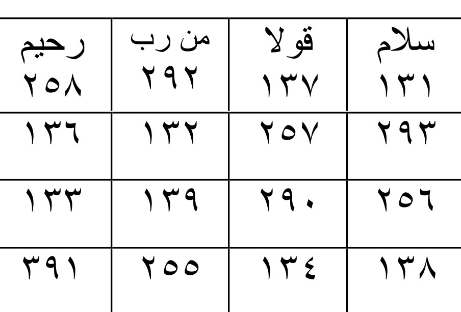

**AR:** (جَدْوَلُ الْخَاتَمِ — أَرْبَعَةٌ فِى أَرْبَعَةٍ)

| سَلَام | قَوْلًا | مِنْ رَبٍّ | رَحِيم |
|---|---|---|---|
| ١٣١ | ١٣٧ | ٢٩٢ | ٢٥٨ |
| ٢٩٣ | ٢٥٧ | ١٣٢ | ١٣٦ |
| ٢٥٦ | ٢٩٠ | ١٣٩ | ١٣٣ |
| ١٣٨ | ١٣٤ | ٢٥٥ | ٣٩١ |

**LAT:** (jadwalu al-khātami — arba‘atun fī arba‘atin) salām 131 | qawlan 137 | min rabb 292 | raḥīm 258 ; 293 257 132 136 ; 256 290 139 133 ; 138 134 255 391

**ID:** “**(Tabel wafaq — empat kali empat).** Baris pertama memuat **empat kata ayat** (سَلَام، قَوْلًا، مِنْ رَبٍّ، رَحِيم) — dan pada baris-baris berikutnya **angka-angka**: **١٣١ / ١٣٧ / ٢٩٢ / ٢٥٨**; **٢٩٣ / ٢٥٧ / ١٣٢ / ١٣٦**; **٢٥٦ / ٢٩٠ / ١٣٩ / ١٣٣**; **١٣٨ / ١٣٤ / ٢٥٥ / ٣٩١**. **Angka-angka ini adalah nilai numerik (ḥisāb al-jummal)** dari kata-kata ayat tersebut, dan **seluruh baris maupun kolom berjumlah sama: ٨١٨** — ciri **wafaq magis (muthallats/murabba‘ mutawāzin)**.”

**AR:** لِلْكَشْفِ وَالْمُتَابَعَةِ مَعَ شَيْخِ الرُّوحَانِيِّينَ الشَّيْخِ عَطِيَّةِ عَبْدِ الْحَمِيدِ ٠٠٢٠١٢٦٢٠٢٢٢٣٨

**LAT:** li-al-kashfi wa-al-mutāba‘ati ma‘a shaykhi al-rūḥāniyyīna al-shaykhi ‘Aṭiyyati ‘Abdi al-Ḥamīdi 00201262022238

**ID:** “**Untuk kasyf dan bimbingan (muthāba‘ah) bersama Syaikh para ruhaniyyin, Syaikh ‘Aṭiyyah ‘Abd al-Ḥamīd — ٠٠٢٠١٢٦٢٠٢٢٢٣٨.**” (Nomor kontak/telepon pada cetakan; ditulis apa adanya.)

**Keterangan halaman.** Halaman ini menutup **«تلبيس مفيد للكشف والعلاج»** (halaman 427) dan melanjutkan dengan bagian mahabbah + **satu-satunya wafaq bergambar pada batch ini**. Susunannya: (1) **penutup talbīs**: pertanyaan apakah pasien perlu sesi lain; setelah amalan selesai, **lepas (ṣarf) dengan akhir surah al-Jumu‘ah + al-Zalzalah sampai «أشتاتا» tiga kali**; lalu perintahkan **para ‘ummār kembali ke tempatnya** dengan permintaan doa; (2) judul **«((محبه وجلب))»**: tulis **asmā’ tertentu pada aṡar** orang yang diminta; amalan **hari Jumat** di **tempat sepi**, **suci sempurna**; aṡar dijadikan **sumbu lampu** dalam minyak; bacakan **surah 1.002×**, dan **setiap 100 (kali)** diucapkan **tawkil «يا عبد الرحمن ويا عبد الواحد ويا عبد الصمد»** untuk menghadirkan yang diminta; jaminan: **bilangan selesai → yang diminta hadir**; (3) **teks tulisan pada aṡar**: «٢ مَطَمْطَمْش ٢ فَطْش مَطْمَطَمْش» + **«هَلْهَيُوش، عَليُوش، مَطْطُوش»**; penutup **«الوحا العجل الساعة»**; (4) judul **«((لبكاء الطفل والحفظ))»**: tulis **khātim (wafaq)** dan di sekelilingnya **ayat «سلام قولا من رب رحيم» (QS 36:58) 61×** serta **313×**; (5) **wafaq 4×4** dengan **empat kata ayat** di baris judul sel dan **angka jummal** di sel-sel berikutnya; **jumlah tiap baris dan kolom = 818**; (6) **penutup**: nomor kontak **«للكشف والمتابعة مع شيخ الروحانيين»** beserta **nomor telepon**.

**Angka pada halaman ini (dibaca dari crop 500–2400 DPI).** **١.٠٠٢ / ١٠٠** (bacaan surah 1.002× dan tawkil tiap 100×), **٦١** dan **٣١٣** (jumlah ayat «سلام قولا من رب رحيم» pada bagian bayi/hifẓ), dan **enam belas angka wafaq**: ١٣١، ١٣٧، ٢٩٢، ٢٥٨، ٢٩٣، ٢٥٧، ١٣٢، ١٣٦، ٢٥٦، ٢٩٠، ١٣٩، ١٣٣، ١٣٨، ١٣٤، ٢٥٥، ٣٩١. **Seluruh angka wafaq dibaca satu per satu dari crop 700 DPI**; lapisan teks PDF mengekstrak sebagian terbalik (١٣١→١٣١ benar, tetapi ١٣٧→«٧٣١»، ٢٥٨→«٨٥٢»، ٢٥٧→«٧٥٢»، ٢٩٠→«٠٩٢»، ١٣٤→«٤٣١»، ١٣٩→«٩٣١»، ١٣٣→«٣٣١»، ١٣٨→«٨٣١»، ١٣٦→«٦٣١»، ١٣٢→«٢٣١»، ٢٥٦→«٦٥٢»، ٢٥٥→«٥٥٢»)، sehingga **pembacaan akhir diambil dari gambar**. Pemeriksaan silang: **jumlah setiap baris dan setiap kolom = ٨١٨** (magic square), yang mengonfirmasi kebenaran angka-angka tersebut.

**[TIDAK JELAS - HALAMAN 428]** (1) **«الوف واثنين مره»** ditulis tanpa angka («seribu dua kali»); **dipertahankan** dan diterjemahkan **1.002×** dengan catatan. (2) **«وكل مائة»** — kalimat **terputus** pada cetakan (tidak ada kelanjutan), lalu langsung ke teks tawkil; **dipertahankan**. (3) **«الْو كَذَا وَكَذَا»** — kemungkinan kependekan; **disalin apa adanya dan ditandai**. (4) **«٢ مَطَمْطَمْش ٢ فَطْش مَطْمَطَمْش»** dan **«هَلْهَيُوش عَليُوش مَطْطُوش»** — nama-nama talismani tanpa makna jelas, sebagian **saling bertumpuk** pada cetakan; **disalin menurut bentuk huruf** dan ditandai. (5) **«الثمن/٦١»، «٣١٣»** ditulis **tanpa harakat lengkap**; dilengkapi untuk konsistensi. (6) **Nomor telepon ٠٠٢٠١٢٦٢٠٢٢٢٣٨** — dibaca dari crop 2400 DPI; bentuk asli tercetak **tanpa spasi**, dipertahankan. (7) **«تَكْتُبُ الْخَاتَمُ»** (bukan «الخاتمَ») dan **«اتى الآية»** (bukan «أَتَى») — ejaan cetakan, dipertahankan. (8) Wafaq pada cetakan **tidak memiliki garis tepi luar berganda**; tabel ditulis ulang sebagai markdown **sesuai susunan sel** (4 kolom × 5 baris termasuk baris kata).

**[ADA RAJAH]** — 1 crop: `assets/rajah/sirrul-asrar/p428-wafaq-salam-qawlan.png` (dipotong dari PDF asli pada 500 DPI, Rect(228, 478, 358, 566), 900×610 px). Wafaq **4×4** bertinta hitam dengan garis kotak; **baris pertama memuat kata-kata ayat** (سلام، قولا، من رب، رحيم) dan **tiga baris berikutnya angka Arab-Hindi**. Total berkas rajah menjadi **108**.

---
## HALAMAN 429 — «جلب على اثر قوى ومجرب» + «جلب على قطعة عجين ليلة الجمعة» (dengan dua ṭilasm tulisan tangan)

**AR:** كِتَابُ سِرِّ الْأَسْرَارِ فِي التَّوَاصُلِ مَعَ رُوحَانِيَّاتِ الْقُرْآنِ — شَيْخُ الرُّوحَانِيِّينَ الشَّيْخُ عَطِيَّةُ عَبْدُ الْحَمِيدِ

**LAT:** kitābu sirri al-asrāri fī al-tawāṣuli ma‘a rūḥāniyyāti al-qur’āni — shaykhu al-rūḥāniyyīna al-shaykhu ‘Aṭiyyatu ‘Abdu al-Ḥamīdi

**ID:** “Kitab «Sirr al-Asrār fī al-Tawāṣul ma‘a Rūḥāniyyāt al-Qur’ān» — Syaikh para ruhaniyyin, Syaikh ‘Aṭiyyah ‘Abd al-Ḥamīd.” (Kepala halaman.)

**AR:** جَلْبٌ عَلَى اَثَرٍ قَوِىٍّ وَمُجَرَّبٍ

**LAT:** jalbun ‘alā atharin qawiyyin wa-mujarrabin

**ID:** “**Jalbu (Penghadiran) dengan Aṡar (Bekas) — Kuat dan Teruji.**” (Judul bagian.)

**AR:** يُكْتَبُ عَلَى الْاَثَرِ هَذِةِ الطِّلَسْمِ وَحَوْلَهُ سُورَةُ الْبُرُوجِ اِلَى حَرِيقٍ وَبَةٍ تَعْزِمُ عَدَدَ جُمَلِ الْمَطْلُوبِ وَاسْمِ اُمَّةٍ عَمَلُكَ عَلَى حَسَبِ طَبِيعَةِ الْمَطْلُوبِ فَاِنَّهُ يَكُونُ وَهَذَا مَا تَكْتُبُ

**LAT:** yuktabu ‘alā al-athari hādhihi al-ṭilasma wa-ḥawlahu sūratu al-burūji ilā ḥarīqin wa-batin ta‘zamu ‘adada jumali al-maṭlūbi wa-ismi ummatin ‘amaluka ‘alā ḥasabi ṭabī‘ati al-maṭlūbi fa-innahu yakūnu wa-hādhā mā taktubu

**ID:** “Dituliskan **pada aṡar** — **ṭilasm ini**, dan **di sekelilingnya surah al-Burūj** («**Wa al-Samā’i dhāti al-Burūj**», Q.S. 85) **sampai «ḥarīq»** — dan engkau **mengazamkan (ta‘zīm) sebanyak jumlah jumal (nilai numerik) nama orang yang diminta beserta nama ibunya** (nama ibunya = «ism ummah»). **Amalanmu disesuaikan dengan tabiat orang yang diminta**, karena (dengan itu) ia akan terjadi. Dan **inilah yang engkau tulis**:”

**Rajah:** 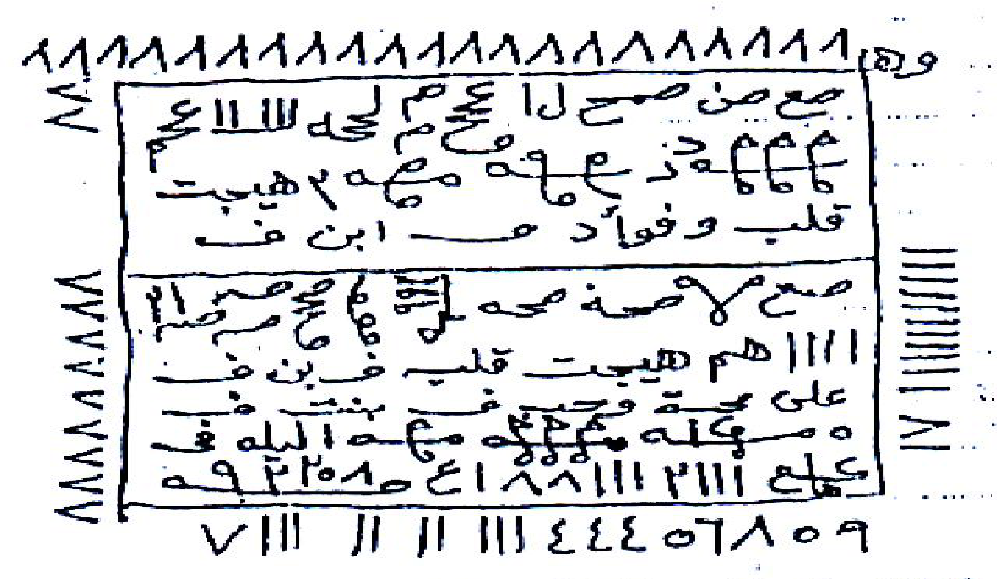

**AR:** (وَصْفُ الطِّلَسْمِ الْاَوَّلِ) مِرْبَعٌ كَبِيرٌ مُنَقَّسٌ بِخَطٍّ يَدَوِىٍّ مُقَسَّمٌ اِلَى قِسْمَيْنِ: الْقِسْمُ الْعُلْوِىُّ يَحْتَوِى ثَلَاثَةَ اَسْطُرٍ مِنْ حُرُوفٍ وَكَلِمَاتٍ مَقْطُوعَةٍ، وَفِيهِ كَلِمَاتٌ مَقْرُوءَةٌ مِثْلُ «قَلْبِى وَفُؤَادِ … ابْنِ فُلَانٍ» وَعَلَامَةُ «لَـجْـ» وَرُقُومٌ مِثْلُ «٣٣٣» وَ«٨٨٨»؛ وَالْقِسْمُ السُّفْلِىُّ يَحْتَوِى خَمْسَةَ اَسْطُرٍ وَفِيهِ «قَلْبِى وَهَيْبَتِى … بِنْتِ فُلَانَةَ» وَعَلَامَةُ «١١١» وَرُقُومٌ مِثْلُ «١١١١١٨٨١١٣١١».

**LAT:** (waṣfu al-ṭilasma al-awwali) mirba‘un kabīrun munaqqashun bi-khaṭṭin yadawiyyin muqassamun ilā qismayni: al-qismu al-‘ulwiyyu yaḥtawī thalāthata asṭurin min ḥurūfin wa-kalimātin maqṭū‘atin, wa-fīhi kalimātun maqrū’atun mithlu «qalbī wa-fu’ādi … ibni fulānin» wa-‘alāmata «la-j» wa-ruqūmun mithlu «333» wa-«888»; wa-al-qismu al-sufliyyu yaḥtawī khamsata asṭurin wa-fīhi «qalbī wa-haybatī … binti fulānata» wa-‘alāmata «111» wa-ruqūmun mithlu «111118811311».

**ID:** “**(Deskripsi ṭilasm pertama)**: sebuah **kotak besar** yang ditulis dengan **tulisan tangan**, terbagi **dua bagian**. **Bagian atas** memuat **tiga baris** huruf dan kata yang terpotong-potong; di dalamnya terbaca kata-kata seperti «**hatiku dan jantungku … bin Fulan**» dan tanda «**لَـجْـ**», serta angka-angka seperti «**٣٣٣**» dan «**٨٨٨**». **Bagian bawah** memuat **lima baris**; di dalamnya terdapat «**hatiku dan wibawaku … binti Fulanah**», tanda «**١١١**», dan deret angka seperti «**١١١١١٨٨١١٣١١**».”

**AR:** (حَوَاشِى الطِّلَسْمِ الْاَوَّلِ) عِنْدَ اَعْلَاهُ وَعِنْدَ اَسْفَلِهِ وَعَلَى جَانِبَيْهِ **صُفُوفٌ مِنْ رُقُومٍ مُتَكَرِّرَةٍ** مِثْلُ «٨٨٨٨٨٨…» وَ«٧٧٧٧٧…» (سِتَّةَ عَشَرَ رَقْمًا فِى السَّطْرِ تَقْرِيبًا)، وَفِى الْيَمِينِ خَمْسُ خُطُوطٍ مُتَوَازِيَةٍ.

**LAT:** (ḥawāshī al-ṭilasma al-awwali) ‘inda a‘lāhu wa-‘inda asfalihi wa-‘alā jānibayhi **ṣufūfun min ruqūmin mutakarriratin** mithlu «888888…» wa-«77777…» (sittata ‘ashara raqman fī al-saṭri taqrīban), wa-fī al-yamīni khamsu khuṭūṭin mutawāziyatin.

**ID:** “**(Tepi ṭilasm pertama)**: pada bagian atas, bawah, dan kedua sisinya terdapat **deret angka yang berulang** seperti «**٨٨٨٨٨٨…**» dan «**٧٧٧٧٧…**» (sekitar **enam belas angka per baris**); dan di sisi kanan terdapat **lima garis sejajar**.”

**AR:** (بَيْنَ الطِّلَسْمَيْنِ) سَطْرٌ مِنَ الْاَرْقَامِ: «٧ ١١١ || || ||| ٣٣٣ ٥٧٨ ٥٩» — وَرُقُومُهُ غَيْرُ مَضْبُوطَةٍ لِاَنَّهَا خَطٌّ يَدَوِىٌّ.

**LAT:** (bayna al-ṭilasmayni) saṭrun mina al-arqāmi: «7 111 || || ||| 333 578 59» — wa-ruqūmuhu ghayru maḍbūṭatin li-annahā khaṭṭun yadawiyyun.

**ID:** “**(Di antara kedua ṭilasm)** ada satu baris angka: «**٧ ١١١ || || ||| ٣٣٣ ٥٧٨ ٥٩**» — **angka-angkanya tidak dapat dipastikan** karena merupakan **tulisan tangan**.”

**Rajah:** 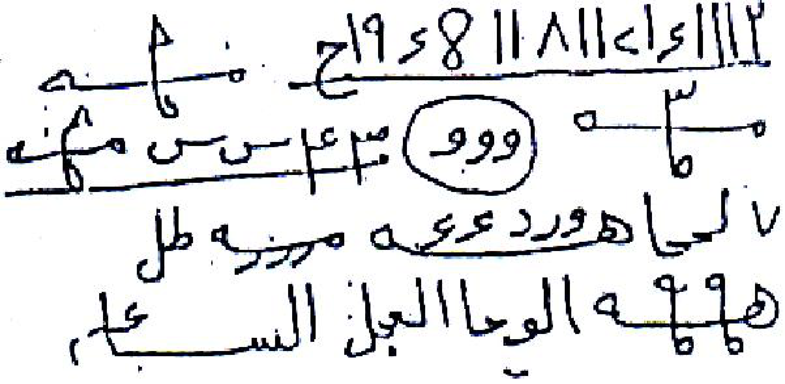

**AR:** (وَصْفُ الطِّلَسْمِ الثَّانِى) صَفْحَةٌ مَكْتُوبَةٌ بِيَدٍ حُرَّةٍ تَحْتَوِى: سَطْرًا عُلْوِيًّا مِنْ رُقُومٍ مُتَصِلَةٍ («٢١١١١٨١١٨٥٩١٢» تَقْرِيبًا)؛ وَفِى الْوَسَطِ **دَائِرَةٌ** مَكْتُوبٌ فِيهَا «**٩٩٩**» وَعَنْ يَمِينِهَا وَيَسَارِهَا حُرُوفٌ مُفْرَدَةٌ؛ وَسَطْرَيْنِ مِنْ حُرُوفٍ مَقْطُوعَةٍ تَنْتَهِى بِعَلَامَةٍ تُشْبِهُ «٧»؛ وَسَطْرَيْنِ سُفْلِيَّيْنِ مُتَصِلَيْنِ يَحْتَوِى كَلِمَاتٍ مَقْرُوءَةً مِثْلَ «**يَا هَوْدُ عِيسَى**» وَ«**يَا اِلْيَاسُ الْوِصَالُ**» وَعَلَامَاتٍ مِثْلَ «**٥٥٥**».

**LAT:** (waṣfu al-ṭilasma al-thāni) ṣafḥatun maktūbatun bi-yadin ḥurratin taḥtawī: saṭran ‘ulwiyyan min ruqūmin muttaṣilatin («2111181185912» taqrīban); wa-fī al-wasaṭi **dā’iratun** maktūbun fīhā «999» wa-‘an yamīnihā wa-yasārihā ḥurūfun mufradatun; wa-saṭrayni min ḥurūfin maqṭū‘atin tantahī bi-‘alāmatin tushbihu «7»; wa-saṭrayni sufliyyayni muttaṣilayni yaḥtawī kalimātin maqrū’atan mithla «yā Hūdu ‘Īsā» wa-«yā Ilyāsu al-wiṣālu» wa-‘alāmātin mithla «555».

**ID:** “**(Deskripsi ṭilasm kedua)**: sebuah lembar **tulisan tangan bebas** yang memuat: **baris atas** berisi **angka-angka bersambung** («**٢١١١١٨١١٨٥٩١٢**» kira-kira); di **tengah** sebuah **lingkaran** bertuliskan «**٩٩٩**», dan di kanan-kirinya **huruf-huruf tunggal**; **dua baris** huruf terpotong yang diakhiri tanda mirip «**٧**»; serta **dua baris bawah** bersambung yang memuat kata-kata terbaca seperti «**يا هود عيسى**» dan «**يا الياس الوصال**» dan tanda seperti «**٥٥٥**».”

**AR:** جَلْبٌ عَلَى قِطْعَةِ عَجِينٍ لَيْلَةَ الْجُمُعَةِ

**LAT:** jalbun ‘alā qiṭ‘ati ‘ajīnin laylata al-jumu‘ati

**ID:** “**Jalbu (Penghadiran) dengan Segumpal Adonan pada Malam Jumat.**” (Judul bagian.)

**AR:** تَاْخُذُ دَقِيقَ عَلَى اسْمِ مَنْ تُرِيدُ وَتَعْجِنُ مِنْهُ عَجِينًا بِمَاءِ وَرْدٍ وَفِلْفِلٍ وَمِلْحٍ وَشَبَّةٍ وَتَنْقُشُ هَذَا الطِّلَسْمِ بِمِسَلَّةٍ جَدِيدَةٍ ثُمَّ ضَعْهُ فِى تَنُّورٍ فَاِنَّهُ يَكُونُ مَا اَرَدْتَ وَهَذَا مَا تَنْقُشُ عَلَى الْوَجْهِ الْاَوَّلِ

**LAT:** ta’khudhu daqīqa ‘alā ismi man turīdu wa-ta‘jinu minhu ‘ajīnan bi-mā’i wardin wa-filfilin wa-milḥin wa-shabbatin wa-tanqushu hādhā al-ṭilasma bi-misallatin jadīdatin thumma ḍa‘hu fī tannūrin fa-innahu yakūnu mā aradta wa-hādhā mā tanqushu ‘alā al-wajhi al-awwali

**ID:** “Engkau **mengambil tepung atas nama orang yang engkau kehendaki**, lalu **menguleni adonan** dengan **air mawar, merica, garam, dan shabbah (tawas)**; lalu engkau **mengukir ṭilasm ini dengan jarum baru**; kemudian **letakkan di dalam tungku (tannūr)** — maka **terjadilah apa yang engkau kehendaki**. Dan **inilah yang engkau ukir pada sisi pertama**.” (Kalimat berakhir di akhir halaman; **ṭilasm yang dimaksud merujuk pada ṭilasm halaman ini** — lanjutan ke halaman 430.)

**Keterangan halaman.** Halaman ini memulai rangkaian amalan **jalb (penghadiran) dengan ṭilasm tulisan tangan** — **dua ṭilasm bergambar** pada satu halaman, keduanya **bukan wafaq angka beraturan**, melainkan **ṭilasm garis dan huruf terpotong**. Susunannya: (1) judul **«جلب على اثر قوى ومجرب»**: tulis **ṭilasm** pada aṡar orang yang diminta, kelilingi dengan **surah al-Burūj** sampai «ḥarīq» (Q.S. 85:1–…); **ta‘zīm sesuai jumlah jumal** nama orang + **nama ibunya**; amalan disesuaikan **tabiat** orang yang diminta; (2) **ṭilasm pertama**: kotak besar terbagi dua — atas **tiga baris** (dengan kata «قلبي وفؤادي … ابن فلان»، tanda «لَـجْـ»، angka ٣٣٣ dan ٨٨٨), bawah **lima baris** (dengan «قلبي وهيبتي … بنت فلانة»، tanda ١١١، deret ١١١١١٨٨١١٣١١); tepi atas/bawah/sisi berupa **deret angka berulang** ٨ و٧; sisi kanan **lima garis sejajar**; (3) **baris angka** di antara kedua ṭilasm («٧ ١١١ || || ||| ٣٣٣ ٥٧٨ ٥٩») — tidak pasti; (4) **ṭilasm kedua**: tulisan tangan bebas dengan **lingkaran ٩٩٩** di tengah, huruf-huruf tunggal di kanan-kirinya, baris angka bersambung di atas, dan dua baris bawah memuat «يا هود عيسى»، «يا الياس الوصال»، «٥٥٥»; (5) judul **«جلب على قطعة عجين ليلة الجمعة»**: tepung **atas nama orang yang diminta**, adonan dengan **air mawar, merica, garam, dan tawas**, **diukir dengan jarum baru** mengikuti ṭilasm, lalu **dibakar dalam tungku** → hajat tercapai.

**Angka pada halaman ini.** Angka-angka pada kedua ṭilasm adalah **tulisan tangan** dan **tidak dapat dipastikan**: hanya «**٩٩٩**» (di dalam lingkaran) yang jelas terbaca, ditambah kelompok «**٣٣٣**»، «**٨٨٨**»، «**١١١**» dan deret berulang ٨/٧ yang **dapat dikenali bentuknya** namun **jumlah digitnya tidak dipastikan**. Karena itu **tidak ada satu pun angka ṭilasm yang diklaim sebagai pasti** — seluruhnya dinyatakan sebagai **perkiraan bacaan visual** dan pembaca dirujuk ke **rajah terlampir**.

**[TIDAK JELAS - HALAMAN 429]** (1) **Seluruh isi kedua ṭilasm adalah tulisan tangan** dengan huruf terpotong tanpa titik dan angka yang saling bertumpuk — **[TEKS ASLI DIJAGA]**, tidak diterka maknanya, tidak dinormalisasi. (2) **«هَذِةِ الطِّلَسْمِ»** — cetakan memakai «هذة» (bukan «هذه») dan «الطلسم» (bukan «الطلسمَ») — **dipertahankan**. (3) **«اِلَى حَرِيقٍ وَبَةٍ»** — **tidak jelas**; kemungkinan «إلى حريقٍ وبهِ» (sampai lafaz «حَرِيق» pada surah) — **dipertahankan apa adanya dan ditandai**; diterjemahkan dengan catatan. (4) **«عَدَدَ جُمَلِ الْمَطْلُوبِ وَاسْمِ اُمَّةٍ»** — «جُمَل» (jumlah numerik/hisāb al-jummal) dan «اسم أمّة» (= nama ibu) dipakai sebagai syarat ta‘zīm; **dipertahankan** dan dijelaskan dalam terjemahan. (5) **«وَبَةٍ»، «وَبِهِ»، «وَفِلْفِلٍ»، «وَشَبَّةٍ»** — ejaan cetakan tanpa vokalisasi lengkap; ditandai. (6) **«بِمِسَلَّةٍ جَدِيدَةٍ»** (**jarum/penusuk baru**) — dipertahankan. (7) Kata-kata yang terbaca di dalam ṭilasm («قلبي وفؤادي»، «قلبي وهيبتي»، «يا هود عيسى»، «يا الياس الوصال») **dikutip sebagai bacaan visual** dan **diberi tanda petik**, bukan sebagai kepastian. (8) **Tanda «لَـجْـ»** (huruf bersambung) di dalam ṭilasm dipertahankan sebagai bentuk, tanpa klaim makna.

**[ADA RAJAH]** — 2 crop: `assets/rajah/sirrul-asrar/hal-429-rajah-01.png` (700 DPI, Rect(89.7, 127.9, 501.6, 366.5)) dan `assets/rajah/sirrul-asrar/hal-429-rajah-02.png` (700 DPI, Rect(81.6, 366.2, 501.6, 572.2)). Total berkas rajah menjadi **110**.

---
## HALAMAN 430 — lanjutan «جلب على قطعة عجين»: dua ṭilasm wajah adonan + «جلب ومحبة» (tujuh lembar kertas, Yāsīn ١١×)

**AR:** كِتَابُ سِرِّ الْاَسْرَارِ فِي التَّوَاصُلِ مَعَ رُوحَانِيَّاتِ الْقُرْآنِ — شَيْخُ الرُّوحَانِيِّينَ الشَّيْخُ عَطِيَّةُ عَبْدُ الْحَمِيدِ

**LAT:** kitābu sirri al-asrāri fī al-tawāṣuli ma‘a rūḥāniyyāti al-qur’āni — shaykhu al-rūḥāniyyīna al-shaykhu ‘Aṭiyyatu ‘Abdu al-Ḥamīdi

**ID:** “Kitab «Sirr al-Asrār fī al-Tawāṣul ma‘a Rūḥāniyyāt al-Qur’ān» — Syaikh para ruhaniyyin, Syaikh ‘Aṭiyyah ‘Abd al-Ḥamīd.” (Kepala halaman.)

**AR:** (تَكْمِلَةُ «جَلْبٍ عَلَى قِطْعَةِ عَجِينٍ») هَذَا مَا تَنْقُشُ عَلَى الْوَجْهِ الْاَوَّلِ مِنَ الْعَجِينِ:

**LAT:** (takmilatu «jalbin ‘alā qiṭ‘ati ‘ajīnin») hādhā mā tanqushu ‘alā al-wajhi al-awwali mina al-‘ajīni:

**ID:** “**(Lanjutan «Jalbu dengan Segumpal Adonan»)**: **inilah yang engkau ukir pada sisi (wajah) pertama adonan**:”

**Rajah:** 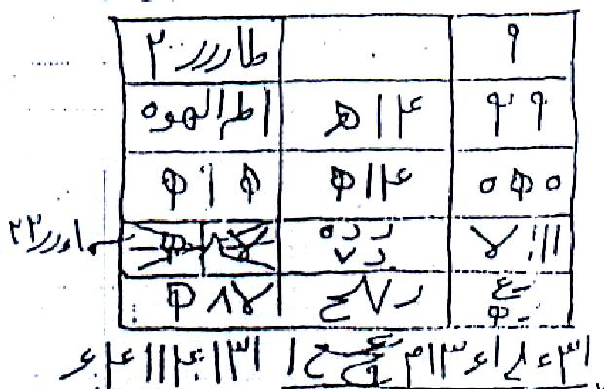

**AR:** (وَصْفُ الطِّلَسْمِ الْاَوَّلِ) جَدْوَلٌ مُرَبَّعٌ بِخَطٍّ يَدَوِىٍّ مُقَسَّمٌ اِلَى **ثَلَاثَةِ اَعْمِدَةٍ** وَ**خَمْسَةِ اَسْطُرٍ** (وَبَعْضُهَا مُنْقَسِمٌ اِلَى نِصْفَيْنِ بِخَطٍّ عَرْضِىٍّ):

- **السَّطْرُ الْاَوَّلُ:** الْعَمُودُ الْاَيْمَنُ «**٩**»، الْاَوْسَطُ فَارِغٌ، الْاَيْسَرُ «**طَـ لَـ زَزَ ٢٠**» (حُرُوفٌ وَرَقْمٌ ٢٠).
- **السَّطْرُ الثَّانِى:** الْاَيْمَنُ «**٩ ٠ ٩**»، الْاَوْسَطُ «**٤ ١ ٥**» (اَوْ «**٤ ١ هـ**»)، الْاَيْسَرُ «**ا ل ط ل م و هـ**» — كَلِمَةٌ طِلَسْمِيَّةٌ.
- **السَّطْرُ الثَّالِثُ:** الْاَيْمَنُ «**٥ ٤ ٥**»، الْاَوْسَطُ «**٥ ١ ٤**»، الْاَيْسَرُ «**٥ ١ ٥**».
- **السَّطْرُ الرَّابِعُ:** الْاَيْمَنُ «**٧ ١١**»، الْاَوْسَطُ «**٧ ٥ ٢**»، الْاَيْسَرُ **خَطٌّ مُتَقَاطِعٌ** لَا يُقْرَاُ.
- **السَّطْرُ الْخَامِسُ:** الْاَيْمَنُ «**٤ ٠**»، الْاَوْسَطُ «**٣ ٧ ٢**»، الْاَيْسَرُ «**٤ ٨ ٢**» (اَوْ «**٥ ٨ ٢**»).

**LAT:** (waṣfu al-ṭilasma al-awwali) jadwalun murabba‘un bi-khaṭṭin yadawiyyin muqassamun ilā **thalāthati a‘midatin** wa-**khamsati asṭurin** (wa-ba‘ḍuhā munqasimun ilā niṣfayni bi-khaṭṭin ‘arḍiyyin): [al-saṭru al-awwalu: al-‘amūdu al-aymanu «9», al-awsaṭu fārightun, al-aysaru «ṭa-la-zaza 20»] — wa-hākadhā baqiyyatu al-asṭuri kamā fī al-qā’imati.

**ID:** “**(Deskripsi ṭilasm pertama / wajah pertama adonan)**: sebuah **tabel kotak bergaris tangan** terbagi menjadi **tiga kolom** dan **lima baris** (sebagian baris terbagi dua oleh garis mendatar): **Baris 1** — kanan «**٩**», tengah kosong, kiri «**طَـ لَـ زَزَ ٢٠**»; **Baris 2** — kanan «**٩ ٠ ٩**», tengah «**٤ ١ ٥**», kiri «**ا ل ط ل م و هـ**» (kata ṭilasm); **Baris 3** — kanan «**٥ ٤ ٥**», tengah «**٥ ١ ٤**», kiri «**٥ ١ ٥**»; **Baris 4** — kanan «**٧ ١١**», tengah «**٧ ٥ ٢**», kiri **garis silang tak terbaca**; **Baris 5** — kanan «**٤ ٠**», tengah «**٣ ٧ ٢**», kiri «**٤ ٨ ٢**».” **Catatan**: angka-angka ini **tulisan tangan** dan **tidak pasti**; lihat rajah.

**AR:** (اَسْفَلَ الطِّلَسْمِ الْاَوَّلِ) سَطْرٌ طَوِيلٌ مِنْ رُقُومٍ مُتَّصِلَةٍ تَقْرِيبًا: «**اِلَـ ٥ ١٤ ١١٤ ١٣١ اِ ٣ ٥ ٤ ٠١٢ ٠١٢**» — **غَيْرُ مَضْبُوطٍ**.

**LAT:** (asfala al-ṭilasma al-awwali) saṭrun ṭawīlun min ruqūmin muttaṣilatin taqrīban: «ilā 5 14 114 131 i 3 5 4 012 012» — ghayru maḍbūṭin.

**ID:** “**(Di bawah ṭilasm pertama)** ada satu **baris panjang angka bersambung** (kurang lebih): «**اِلَـ ٥ ١٤ ١١٤ ١٣١ اِ ٣ ٥ ٤ ٠١٢ ٠١٢**» — **tidak dapat dipastikan**.”

**AR:** وَعَلَى الْوَجْهِ الْاِخَرِ

**LAT:** wa-‘alā al-wajhi al-ākhari

**ID:** “**Dan pada sisi (wajah) yang lain**:” (Petunjuk untuk ṭilasm berikut.)

**Rajah:** 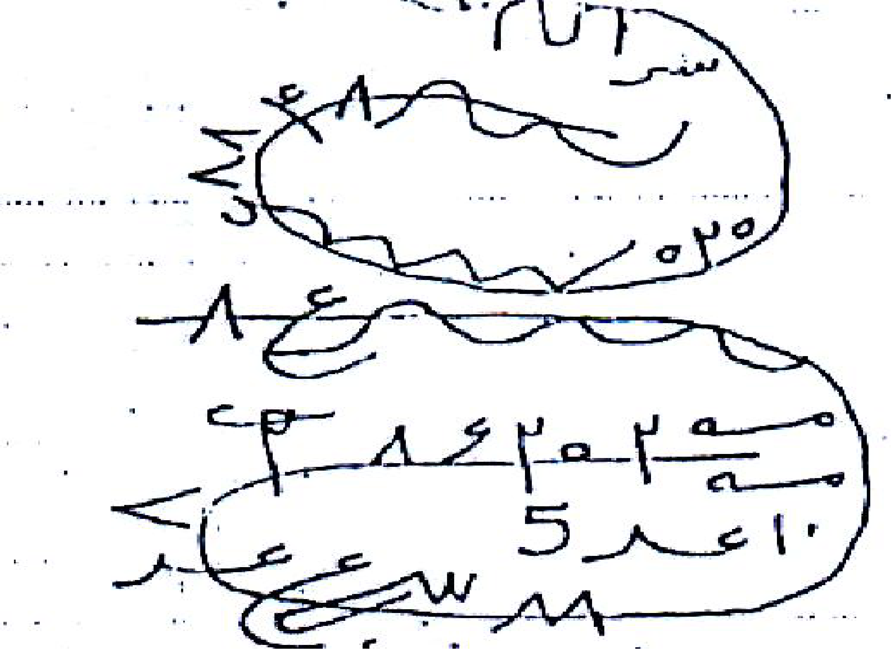

**AR:** (وَصْفُ الطِّلَسْمِ الثَّانِى) ثَلَاثَةُ اَشْكَالٍ بَيْضَاوِيَّةٍ (اَوَالِيَّةٍ) ذَاتِ حَافَّةٍ مُسَنَّنَةٍ، فَوْقَ بَعْضِهَا، وَفِى دَاخِلِهَا وَحَوْلَهَا حُرُوفٌ وَرُقُومٌ:

- **الشَّكْلُ الْاَعْلَى:** فِيهِ حُرُوفٌ مَمْدُودَةٌ وَفِى طَرَفِهِ الْاَيْسَرِ «**ك**» وَخَطٌّ مُتَعَرِّجٌ، وَعَلَى يَمِينِهِ دَائِرَةٌ صَغِيرَةٌ.
- **الشَّكْلُ الْاَوْسَطُ:** خَطٌّ مُتَمَوِّجٌ طَوِيلٌ، وَفِى يَمِينِهِ «**٨ ٠ ٢**» تَقْرِيبًا.
- **الشَّكْلُ الْاَسْفَلُ:** اكْبَرُهَا، فِيهِ سَطْرٌ مِنَ الْحُرُوفِ «**مـ يـ ا مـ هـ**» وَاَرْقَامٌ «**٥**» وَ«**٥٠١**» وَ«**١٠**»، وَعَلَى يَسَارِهِ خَطٌّ مُدَبَّبٌ (سَهْمٌ).

**LAT:** (waṣfu al-ṭilasma al-thāni) thalāthatu ashkālin bayḍāwiyyatin dhāti ḥāffatin musanninatin, fawqa ba‘ḍihā, wa-fī dākhilihā wa-ḥawlahā ḥurūfun wa-ruqūmun: [al-shaklu al-a‘lā: ḥurūfun mamdūdatun wa-fī ṭarafihi al-aysari «k» wa-khaṭṭun muta‘arrijun, wa-‘alā yamīnihi dā’iratun ṣaghīratun] — wa-hākadhā.

**ID:** “**(Deskripsi ṭilasm kedua / wajah kedua adonan)**: **tiga bentuk oval bergerigi** yang bertumpuk; di dalam dan di sekelilingnya terdapat huruf dan angka: **bentuk atas** — huruf-huruf memanjang, huruf «**ك**» di ujung kiri, garis berkelok, dan sebuah **lingkaran kecil** di kanan; **bentuk tengah** — garis bergelombang panjang, di kanannya «**٨ ٠ ٢**» (perkiraan); **bentuk bawah** (terbesar) — deret huruf «**مـ يـ ا مـ هـ**» dan angka «**٥**»، «**٥٠١**»، «**١٠**»، serta **garis bersayap (anak panah)** di kiri.”

**AR:** جَلْبٌ وَمَحَبَّةٌ

**LAT:** jalbun wa-maḥabbatun

**ID:** “**Jalbu (Penghadiran) dan Maḥabbah (Cinta).**” (Judul bagian baru.)

**AR:** يُكْتَبُ عَلَى سَبْعِ وَرَقَاتٍ بِالْحِبْرِ الرُّوحَانِىِّ هَذِةِ الطَّلَاسِمُ وَتُوَكِّلُ حَوْلَهَا بِالْمَحَبَّةِ فَاِنَّهُ يَكُونُ وَتَكُونُ سَاعَةً سَعِيدَةً وَتَعْزِمُ عَلَيْهَا بِسُورَةِ يَس ١١ مَرَّةً وَعِنْدَ كُلِّ مُبِينٍ تُوَكِّلُ وَبَخُورُكَ كُلُّ ذِى رَائِحَةٍ طَيِّبَةٍ وَرَصْدٌ مُنَاسِبٌ

**LAT:** yuktabu ‘alā sab‘i waraqātin bi-al-ḥibri al-rūḥāniyyi hādhihi al-ṭalāsimu wa-tuwakkilu ḥawlahā bi-al-maḥabbati fa-innahu yakūnu wa-takūnu sā‘atan sa‘īdatan wa-ta‘zamu ‘alayhā bi-sūrati Yās 11 marratan wa-‘inda kulli mubīnin tuwakkilu wa-bakhūruka kullu dhī rā’iḥatin ṭayyibatin wa-raṣdun munāsibun

**ID:** “Dituliskan **pada tujuh lembar kertas** dengan **tinta ruhani** — **ṭilasm-ṭilasm ini** — dan engkau **mewakilkan (tawkil) di sekelilingnya dengan maḥabbah**, maka **akan terjadilah**; dan **hendaklah pada saat yang baik (sa‘ah sa‘īdah)**; dan engkau **mengazamkan atasnya dengan surah Yāsīn ١١×**; dan **pada setiap «mubīn»** engkau **melakukan tawkil**; dan **bakhurmu segala yang berbau harum**, serta **raṣd (pengawasan) yang sesuai**.”

**AR:** وَهَذَا مَا تَكْتُبُ عَلَى الْوَجْهِ الْاَوَّلِ

**LAT:** wa-hādhā mā taktubu ‘alā al-wajhi al-awwali

**ID:** “**Dan inilah yang engkau tulis pada sisi (wajah) pertama** —” (Kalimat berakhir di akhir halaman; ṭilasmnya menyusul di **halaman 431**.)

**Keterangan halaman.** Halaman ini menyelesaikan bagian **«جلب على قطعة عجين ليلة الجمعة»** dari halaman 429: **sisi pertama** adonan diukir dengan **ṭilasm tabel tiga kolom** (rajah-01), **sisi kedua** dengan **tiga bentuk oval bergerigi** (rajah-02). Setelah itu dibuka bagian baru **«جلب ومحبة»**: **tujuh lembar kertas** dengan **tinta ruhani**, dituliskan ṭilasm-ṭilasm (yang dimaksud **ṭilasm pada halaman ini dan halaman 431**), **tawkil maḥabbah** di sekelilingnya, dikerjakan pada **saat yang baik**, **Yāsīn ١١×** dengan **tawkil pada setiap «mubīn»** (Yāsīn memuat «مبين» tujuh kali), **bakhur harum**, dan **raṣd** yang sesuai. Halaman ditutup dengan kalimat pengantar ṭilasm yang berlanjut ke halaman berikutnya.

**Angka pada halaman ini.** Seluruh angka pada kedua rajah adalah **tulisan tangan** dan **tidak ada yang dapat dipastikan**; yang tampak jelas hanya «**٩**» (sel sudut kanan atas), kelompok «**٥ ٤ ٥**»، «**٥ ١ ٤**»، «**٥ ١ ٥**»، «**٩ ٠ ٩**» pada rajah-01, dan «**٥**»، «**٥٠١**»، «**١٠**» pada oval bawah rajah-02. **Semua dinyatakan sebagai perkiraan bacaan visual** dan pembaca dirujuk ke **rajah terlampir**.

**[TIDAK JELAS - HALAMAN 430]** (1) **Seluruh isi kedua ṭilasm tulisan tangan** dengan huruf tanpa titik dan angka bertumpuk — **[TEKS ASLI DIJAGA]**, tidak diterka maknanya. (2) **«هَذِةِ الطَّلَاسِمُ»** — cetakan memakai «هذة» dan «الطلاسم» (bentuk jamak tidak lazim «طلاسم» bersama «هذه») — **dipertahankan**. (3) **«بِسُورَةِ يَس»** — singkatan cetakan untuk «يس» (Yāsīn) — **dipertahankan**. (4) **«وَرَصْدٌ مُنَاسِبٌ»** — istilah teknis «raṣd» (penjagaan/pengawasan ruhani) **dipertahankan** dan dijelaskan dalam terjemahan. (5) **«وَعِنْدَ كُلِّ مُبِينٍ»** — merujuk pada kata «مبين» yang berulang dalam surah Yāsīn; **dipertahankan**. (6) **«اَوَالِيَّةٍ»** pada deskripsi bentuk oval = «bentuk telur/oval» (dari «بيضاوي») — **ditandai** karena ejaan cetakan tidak baku. (7) Angka-angka dalam kurung «(اَوْ «**٤ ١ هـ**»)» dan «(اَوْ «**٥ ٨ ٢**»)» **diberikan sebagai alternatif bacaan** karena bentuk tulisan tangan memungkinkan dua tafsir.

**[ADA RAJAH]** — 2 crop: `assets/rajah/sirrul-asrar/hal-430-rajah-01.png` (700 DPI, Rect(103.2, 68.6, 501.9, 325.5)) dan `assets/rajah/sirrul-asrar/hal-430-rajah-02.png` (700 DPI, Rect(172.3, 345.1, 441.4, 541.5)). Total berkas rajah menjadi **112**.

---
## HALAMAN 431 — lanjutan ṭilasm «جلب ومحبة» (12 kotak) + «فائدة مبيح رأس العفريت» (al-Barhatiyyah ٢١×)

**AR:** كِتَابُ سِرِّ الْاَسْرَارِ فِي التَّوَاصُلِ مَعَ رُوحَانِيَّاتِ الْقُرْآنِ — شَيْخُ الرُّوحَانِيِّينَ الشَّيْخُ عَطِيَّةُ عَبْدُ الْحَمِيدِ

**LAT:** kitābu sirri al-asrāri fī al-tawāṣuli ma‘a rūḥāniyyāti al-qur’āni — shaykhu al-rūḥāniyyīna al-shaykhu ‘Aṭiyyatu ‘Abdu al-Ḥamīdi

**ID:** “Kitab «Sirr al-Asrār fī al-Tawāṣul ma‘a Rūḥāniyyāt al-Qur’ān» — Syaikh para ruhaniyyin, Syaikh ‘Aṭiyyah ‘Abd al-Ḥamīd.” (Kepala halaman.)

**AR:** (تَكْمِلَةُ «جَلْبٍ وَمَحَبَّةٍ») هَذَا مَا تَكْتُبُ عَلَى الْوَجْهِ الْاَوَّلِ:

**LAT:** (takmilatu «jalbin wa-maḥabbatin») hādhā mā taktubu ‘alā al-wajhi al-awwali:

**ID:** “**(Lanjutan «Jalbu dan Maḥabbah»)**: **inilah yang engkau tulis pada sisi pertama**:” (sambungan kalimat terakhir halaman 430.)

**Rajah:** 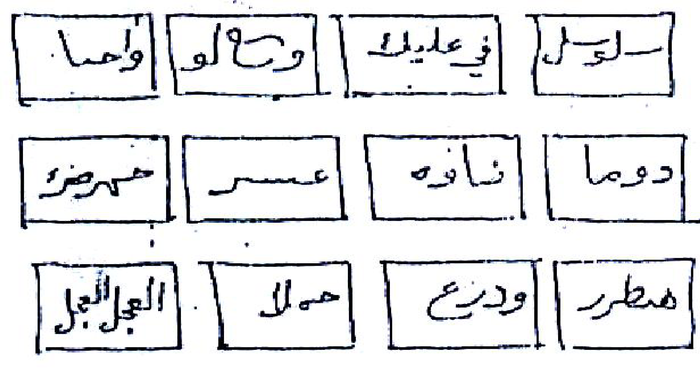

**AR:** (وَصْفُ الطِّلَسْمِ) اِثْنَا عَشَرَ مُسْتَطِيلًا (مُرَبَّعًا صَغِيرًا) مَرْصُوفَةً فِى **ثَلَاثَةِ صُفُوفٍ**، فِى كُلِّ صَفٍّ **اَرْبَعَةُ صَنَادِيقَ**، وَفِى كُلِّ صُنْدُوقٍ كَلِمَةٌ طِلَسْمِيَّةٌ بِخَطٍّ يَدَوِىٍّ. وَالْمَقْرُوءُ مِنْهَا (مِنَ الْيَمِينِ اِلَى الْيَسَارِ):

- **الصَّفُّ الْاَوَّلُ:** «**سَـلْـجَـلْ**» — «**فِى عَلَيْكَ**» — «**وَحَـلَّـو**» — «**وَلَـحْـمَـا**».
- **الصَّفُّ الثَّانِى:** «**دَوْمَـا**» — «**نَافِـذَة**» — «**عَـمْـسَـر**» — «**حَـمْـهَـزَو**».
- **الصَّفُّ الثَّالِثُ:** «**هُـطْـهُـر**» — «**وَدْرَع**» — «**حَـمْـلَـل**» — «**اَلْـيَـوَالِـيَعْـجَـل**».

**LAT:** (waṣfu al-ṭilasma) ithnā ‘ashara mustaṭīlan (murabba‘an ṣaghīran) marṣūfatan fī **thalāthati ṣufūfin**, fī kulli ṣaffin **arba‘atu ṣanādīqa**, wa-fī kulli ṣundūqin kalimatun ṭilassamiyyatun bi-khaṭṭin yadawiyyin. Wa-al-maqrū’u minhā (mina al-yamīni ilā al-yasāri): al-ṣaffu al-awwalu «saljal» — «fī ‘alayka» — «wa-ḥallaw» — «wa-laḥmā»; al-ṣaffu al-thāni «dawmā» — «nāfidhah» — «‘amsar» — «ḥamhazaw»; al-ṣaffu al-thālithu «huṭhur» — «wadra‘» — «ḥamallal» — «al-yawāliya‘jal».

**ID:** “**(Deskripsi ṭilasm)**: **dua belas kotak kecil** tersusun dalam **tiga baris**, tiap baris **empat kotak**; pada setiap kotak terdapat **satu kata ṭilasm** bertulisan tangan. Yang **dapat dibaca** (dari kanan ke kiri): **Baris 1** — «**سَـلْـجَـلْ**»، «**فِى عَلَيْكَ**»، «**وَحَـلَّـو**»، «**وَلَـحْـمَـا**»; **Baris 2** — «**دَوْمَـا**»، «**نَافِـذَة**»، «**عَـمْـسَـر**»، «**حَـمْـهَـزَو**»; **Baris 3** — «**هُـطْـهُـر**»، «**وَدْرَع**»، «**حَـمْـلَـل**»، «**اَلْـيَـوَالِـيَعْـجَـل**».” **Catatan**: bacaan-bacaan ini adalah **perkiraan visual** atas **tulisan tangan tanpa titik**; lihat rajah.

**AR:** وَهَذَا عَلَى الْوَجْهِ الْاَخَرِ

**LAT:** wa-hādhā ‘alā al-wajhi al-ākhari

**ID:** “**Dan ini (yang engkau tulis) pada sisi yang lain**:” (Petunjuk untuk ṭilasm berikut.)

**Rajah:** 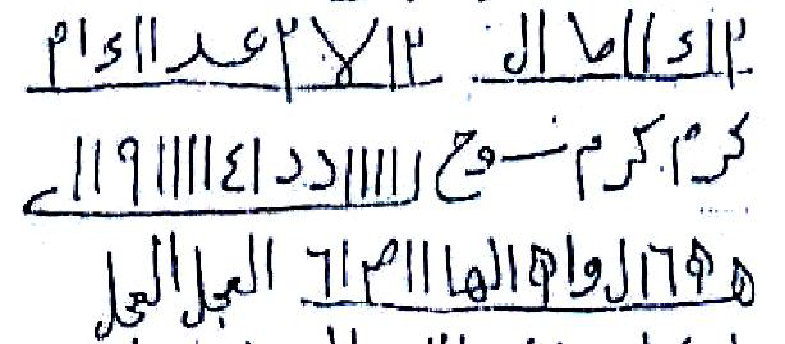

**AR:** (وَصْفُ الطِّلَسْمِ الثَّانِى) ثَلَاثَةُ اَسْطُرٍ عَرِيضَةٍ تَحْتَهَا خُطُوطٌ اُفُقِيَّةٌ، وَالْحُرُوفُ فِيهَا مَمْدُودَةٌ مُتَّصِلَةٌ بِلَا نِقَاطٍ:

- **السَّطْرُ الْاَوَّلُ:** يَبْدَاُ بِـ«**ا ل ا د ا ل ا م ا ل**» وَيَنْتَهِى بِـ«**ع هـ د ا ل ا و ا م**» تَقْرِيبًا.
- **السَّطْرُ الثَّانِىَ:** يَبْدَاُ بِـ«**كُـ مِـ كِـ مِـ**» ثُمَّ «**ـع**» ثُمَّ رُقُومٌ «**١١ ٤ ١ ١١ ١١ ٩ ١١**» — **غَيْرُ مَضْبُوطَةٍ**.
- **السَّطْرُ الثَّالِثُ:** «**هـ ٤ ٦ لـ و ا ٤ ا لـ هـ ا ا لـ م ا لـ**» ثُمَّ «**ا لـ م يـ ا لـ يـ عـ جـ ل**».

**LAT:** (waṣfu al-ṭilasma al-thāni) thalāthatu asṭurin ‘arīḍatin taḥtahā khuṭūṭun ufuqiyyatun, wa-al-ḥurūfu fīhā mamdūdatun muttaṣilatun bilā niqāṭin: [al-saṭru al-awwalu yabda’u bi-«a l a d a l a m a l» wa-yantahī bi-«‘ h d a l a w a m» taqrīban; al-saṭru al-thāni yabda’u bi-«ku mi ki mi» thumma «‘» thumma ruqūmun «11 4 1 11 11 9 11»; al-saṭru al-thālithu «h 4 6 l w a 4 a l h a a l m a l» thumma «a l m y a l y ‘ j l»].

**ID:** “**(Deskripsi ṭilasm kedua)**: **tiga baris lebar** dengan **garis mendatar** di bawahnya; huruf-hurufnya **memanjang bersambung tanpa titik**: **Baris 1** — dimulai «**ا ل ا د ا ل ا م ا ل**» dan berakhir «**ع هـ د ا ل ا و ا م**» (perkiraan); **Baris 2** — dimulai «**كُـ مِـ كِـ مِـ**» lalu «**ـع**» lalu angka «**١١ ٤ ١ ١١ ١١ ٩ ١١**» (**tidak pasti**); **Baris 3** — «**هـ ٤ ٦ لـ و ا ٤ ا لـ هـ ا ا لـ م ا لـ**» lalu «**ا لـ م يـ ا لـ يـ عـ جـ ل**».”

**AR:** فَائِدَةٌ مُبِيحٌ رَاْسُ الْعِفْرِيتِ

**LAT:** fā’idatun mubīḥun ra’su al-‘ifrīti

**ID:** “**Fā’idah: «Mubīḥ Ra’s al-‘Ifrīt» (yang Menyingkap Kepala Ifrit).**” (Judul bagian; kata «**مبيح**» dipertahankan sebagaimana cetakan — lihat catatan.)

**AR:** تُكْتَبُ فِى رَقِّ غَزَالٍ بِمِسْكٍ وَزَعْفَرَانٍ وَمَاءِ وَرْدٍ وَتُبَخَّرُ بِكَنْدُرٍ وَمَيْعَةٍ سَائِلَةٍ وَتُعْزَمُ عَلَيْهِ بِالْبَرْهَتِيَّةِ ٢١ مَرَّةً بَعْدَ صَرْفِ الْعُمَّارِ ثُمَّ تُعَلَّقُ فِى الْهَوَاءِ مَعَ اَثَرِ الْمَطْلُوبِ فَاِنَّهُ غَايَةٌ فِى الْجَلْبِ وَاِنْ لَمْ يُوجَدِ الْاَثَرُ فِى كَاغِدٍ وَهَذَا مَا يُكْتَبُ وَتُكْتَبُ حَوْلَهُ الْبَرْهَتِيَّةُ

**LAT:** tuktabu fī raqqi ghazālin bi-miskin wa-za‘farānin wa-mā’i wardin wa-tubakhkharu bi-kandurin wa-may‘atin sā’ilatin wa-tu‘zamu ‘alayhi bi-al-barhatiyyati 21 marratan ba‘da ṣarfi al-‘ummāri thumma tu‘allaqu fī al-hawā’i ma‘a athari al-maṭlūbi fa-innahu ghāyatun fī al-jalbi wa-in lam yūjadi al-atharu fī kāghidin wa-hādhā mā yuktabu wa-tuktabu ḥawlahu al-barhatiyyatu

**ID:** “Dituliskan pada **raqq (kulit) gazal** dengan **minyak misik, za‘farān, dan air mawar**; lalu **dibakar dengan kendur dan may‘ah cair** (dupa); lalu **diazamkan atasnya dengan al-Barhatiyyah ٢١×** setelah **ṣarf al-‘ummār (mengusir para ‘āmmar)**; kemudian **digantung di udara (di atas kepala) bersama aṡar orang yang diminta** — maka ia **puncak dalam hal jalb (penghadiran)**; dan **jika aṡar tidak didapatkan, (tulis) pada kertas (kāghid)**. Dan **inilah yang ditulis** — dan **di sekelilingnya dituliskan al-Barhatiyyah**.”

**Keterangan halaman.** Halaman ini melanjutkan bagian **«جلب ومحبة»** dari halaman 430: setelah **tujuh lembar kertas** dan **Yāsīn ١١×**, ṭilasm **sisi pertama** berupa **dua belas kotak** berisi kata-kata ṭilasm (rajah-01), dan **sisi kedua** berupa **tiga baris huruf memanjang tanpa titik** dengan angka di tengahnya (rajah-02). Kemudian dibuka bagian baru **«فائدة مبيح رأس العفريت»**: media **kulit gazal**, tinta **misik + za‘farān + air mawar**, dupa **kendur + may‘ah cair**, azam **al-Barhatiyyah ٢١×** sesudah **ṣarf al-‘ummār**, lalu **digantung di udara bersama aṡar** orang yang diminta — **jika aṡar tak ada, ditulis pada kertas**; **al-Barhatiyyah** ditulis **mengelilingi** ṭilasm.

**Angka pada halaman ini.** **٢١** (jumlah azam al-Barhatiyyah) **dikonfirmasi dari hasil pindai** — lapisan teks PDF menampilkan «**١٢**» (terbalik); yang benar **٢١×**. Angka-angka di dalam rajah (**١١ ٤ ١ ١١ ١١ ٩ ١١**، **٤ ٦ ٤**) adalah **tulisan tangan** dan **tidak dapat dipastikan** — seluruhnya **perkiraan bacaan visual**.

**[TIDAK JELAS - HALAMAN 431]** (1) **Dua belas kata ṭilasm** dan **tiga baris huruf tanpa titik** — **[TEKS ASLI DIJAGA]**, dibaca secara **bentuk huruf** saja, tanpa klaim makna. (2) **«فَائِدَةٌ مُبِيحٌ رَاْسُ الْعِفْرِيتِ»** — susunan cetakan **tidak gramatikal** (nakirah + marfū‘); kemungkinan aslinya «فائدة لتبيح رأس العفريت» atau «فائدة مبيح رأس العفريت» — **dipertahankan apa adanya dan ditandai**. (3) **«كَاغِدٍ»** (kāghid) = **kertas** (dari «كاغد»); ejaan cetakan **dipertahankan**. (4) **«مَيْعَةٍ سَائِلَةٍ»** — may‘ah (getah wangi) cair; **dipertahankan**. (5) **«بَعْدَ صَرْفِ الْعُمَّارِ»** — istilah teknis; dijelaskan dalam terjemahan. (6) **«تُعَلَّقُ فِى الْهَوَاءِ»** — dipertahankan (digantung di udara/atas kepala). (7) **«بِالْبَرْهَتِيَّةِ»** — nama azam besar (al-Barhatiyyah) yang ditulis mengelilingi; **dipertahankan** tanpa mengutip teks azamnya karena **tidak tercantum** di halaman ini.

**[ADA RAJAH]** — 2 crop: `assets/rajah/sirrul-asrar/hal-431-rajah-01.png` (700 DPI, Rect(93.8, 68.6, 501.6, 284.9)) dan `assets/rajah/sirrul-asrar/hal-431-rajah-02.png` (700 DPI, Rect(95.5, 304.6, 501.6, 482.9)). Total berkas rajah menjadi **114**.

---
## HALAMAN 432 — ṭilasm gambar tangan (figur & simbol) + «محبة عجيبة» (Fātiḥah bercampur huruf nūrāniyyah) + «فائدة للمحبة فى الحلال»

**AR:** كِتَابُ سِرِّ الْاَسْرَارِ فِي التَّوَاصُلِ مَعَ رُوحَانِيَّاتِ الْقُرْآنِ — شَيْخُ الرُّوحَانِيِّينَ الشَّيْخُ عَطِيَّةُ عَبْدُ الْحَمِيدِ

**LAT:** kitābu sirri al-asrāri fī al-tawāṣuli ma‘a rūḥāniyyāti al-qur’āni — shaykhu al-rūḥāniyyīna al-shaykhu ‘Aṭiyyatu ‘Abdu al-Ḥamīdi

**ID:** “Kitab «Sirr al-Asrār fī al-Tawāṣul ma‘a Rūḥāniyyāt al-Qur’ān» — Syaikh para ruhaniyyin, Syaikh ‘Aṭiyyah ‘Abd al-Ḥamīd.” (Kepala halaman.)

**Rajah:** 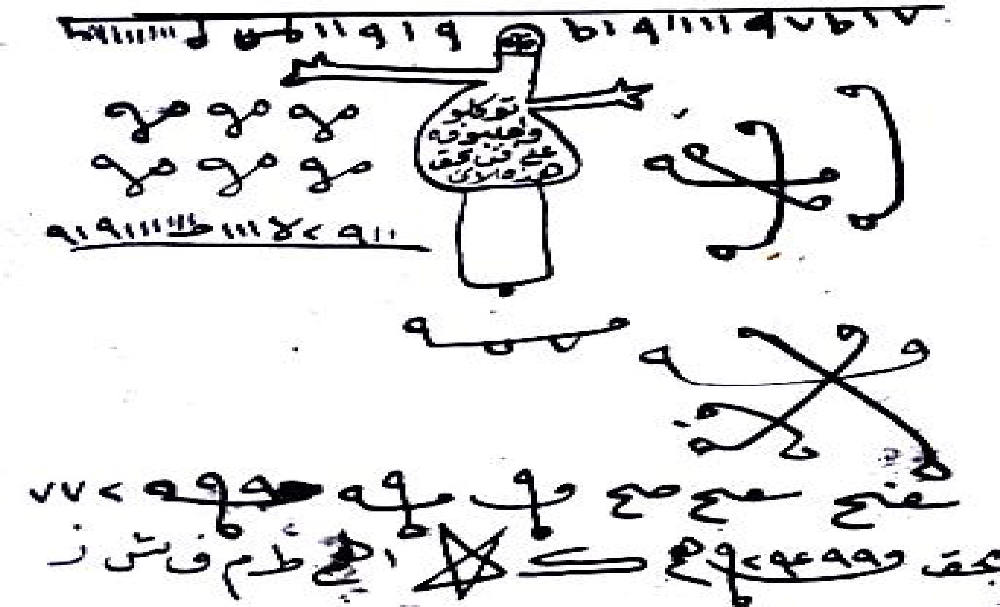

**AR:** (وَصْفُ الطِّلَسْمِ) رَسْمٌ بِيَدٍ حُرَّةٍ يَحْتَوِى:

- **سَطْرًا عُلْوِيًّا عَرِيضًا** مِنْ رُقُومٍ وَحُرُوفٍ مُتَّصِلَةٍ بِلَا نِقَاطٍ، يَبْدَاُ مِنَ الْيَمِينِ بِـ«**ا ل ا لـ**» وَيَنْتَهِى بِـ«**و نـ نـ**».
- **شَكْلًا اِنْسَانِيًّا** (رَاْسٌ مُسْتَدِيرٌ، جِسْمٌ مُسْتَطِيلٌ) وَفِى صَدْرِهِ **قُرْصٌ/وِعَاءٌ** مَمْلُوءٌ بِكِتَابَةٍ صَغِيرَةٍ، وَبِيَدِهِ الْيُمْنَى **عَصًا مُسَنَّنَةُ الرَّاْسِ**.
- **عَلَى الْيَسَارِ:** سِتَّةُ رُمُوزٍ عَلَى شَكْلِ «**ج**» مَقْلُوبَةٍ/مُعَلَّقَةٍ، مَرْصُوفَةٌ فِى صُفُوفٍ، وَتَحْتَهَا سَطْرٌ مِنْ رُقُومٍ وَحُرُوفٍ («**ا نـ ٩ ١ ١١ ١١ ٢ ٤ ٨ ٠**» تَقْرِيبًا).
- **عَلَى الْيَمِينِ:** رَسْمَانِ كَبِيرَانِ لِخُطُوطٍ مُتَقَاطِعَةٍ تَنْتَهِى بِرُؤُوسٍ مُدَوَّرَةٍ (شَبِيهَةٍ بِـ«**ج**» مَمْدُودَةٍ).
- **اَسْفَلَ الْجِسْمِ:** سَطْرٌ مُتَمَوِّجٌ صَغِيرٌ وَخَطٌّ مُتَقَاطِعٌ.
- **اَسْفَلَ الصَّفْحَةِ:** سَطْرَانِ مِنْ حُرُوفٍ وَرُقُومٍ مَقْطُوعَةٍ، فِيهِمَا **نَجْمَةٌ خُمَاسِيَّةٌ** وَعَلَامَةُ «**٥٥**» وَ«**<**»، وَكَلِمَاتٌ مَقْرُوءَةٌ «**قَـ لَـ مَـ**» وَ«**فَـ تَّـ نَـ**» تَقْرِيبًا.

**LAT:** (waṣfu al-ṭilasma) rasmum bi-yadin ḥurratin yaḥtawī: saṭran ‘ulwiyyan ‘arīḍan min ruqūmin wa-ḥurūfin muttaṣilatin bilā niqāṭin… wa-shaklan insāniyyan (ra’sun mustadīrun, jismun mustaṭīlun) wa-fī ṣadrihi qurṣun/wi‘ā’un mamlū’un bi-kitābatin ṣaghīratin, wa-bi-yadihi al-yumnā ‘aṣan musannatu al-ra’si; wa-‘alā al-yasāri sittatu rumūzin ‘alā shakli «j»… wa-‘alā al-yamīni rasmāni kabīrāni li-khuṭūṭin mutaqāṭi‘atin tantahī bi-ru’ūsin mudawwaratin; wa-asfala al-jismi saṭrun mutamawwijun ṣaghīrun wa-khaṭṭun mutaqāṭi‘un; wa-asfala al-ṣafḥati saṭrāni min ḥurūfin wa-ruqūmin maqṭū‘atin fīhimā najmatur khamāsiyyatun.

**ID:** “**(Deskripsi ṭilasm)**: sebuah **gambar tangan bebas** yang memuat: **baris atas lebar** berisi angka dan huruf bersambung tanpa titik; sebuah **figur manusia** (kepala bulat, badan memanjang) yang **dadanya berupa wadah/cakram** berisi tulisan kecil, dan **tangan kanannya memegang tongkat berujung bergerigi**; di **sisi kiri** enam **simbol berbentuk «ج»** tersusun berbaris dan di bawahnya satu baris angka/huruf; di **sisi kanan** dua **garis silang besar** berujung bulat; di **bawah badan** garis berkelok kecil dan garis silang; di **bagian bawah halaman** dua baris huruf dan angka terpotong yang memuat **bintang lima** dan tanda «**٥٥**» serta «**<**».”

**AR:** مَحَبَّةٌ عَجِيْبَةٌ

**LAT:** maḥabbatu ‘ajībatun

**ID:** “**Maḥabbah yang Ajaib.**” (Judul bagian.)

**AR:** اِذَا اَرَدْتَ ذَالِكَ فَخُذْ ثَلَاثَ شَعَرَاتٍ مِنْ رَاْسِ الْمَطْلُوبِ ثُمَّ تَكْتُبُ سُورَةَ الْفَاتِحَةِ بِالصِّيْغَةِ الْاَتِيَةِ تُوَكِّلُ بِاسْمِ الطَّالِبِ وَالْمَطْلُوبِ وَتُوضَعُ الشَّعْرُ فِى قَلْبِ الْوَرَقَةِ بَعْدَ الْبَخُورِ وَتُحْمَلُ

**LAT:** idhā aradta dhālika fa-khudh thalātha sha‘arātin min ra’si al-maṭlūbi thumma taktubu sūrata al-fātiḥati bi-al-ṣīghati al-ātiyati tuwakkilu bi-ismi al-ṭālibi wa-al-maṭlūbi wa-tūḍa‘u al-sha‘ru fī qalbi al-waraqati ba‘da al-bakhūri wa-tuḥmalu

**ID:** “Jika engkau menghendaki hal itu, **ambillah tiga helai rambut dari kepala orang yang diminta**; lalu **tulislah surah al-Fātiḥah dengan formula berikut**, engkau **bertawkil dengan nama peminta dan nama orang yang diminta**; dan **rambut diletakkan di tengah (hati) kertas setelah pembakaran dupa**, lalu **(kertas itu) dibawa**.”

**AR:** وَهَذَا مَا تَكْتُبُ

**LAT:** wa-hādhā mā taktubu

**ID:** “**Dan inilah yang engkau tulis**:”

**AR:** بِسْمِ اللهِ الرَّحْمٰنِ الرَّحِيْمِ الرَّالْرِ كَهِيْعَصْ مَالِكِ يَوْمِ الدِّيْنِ طَسْمْ طَسْمْ طَسْمْ اِيَّاكَ نَعْبُدُ وَاِيَّاكَ نَسْتَعِيْنُ الِم الِمْ الْمَرْ اَهْدِنَا الصِّرَاطَ الْمُسْتَقِيْمَ يَس ق ن صِرَاطَ الَّذِيْنَ اَنْعَمْتَ طَسْ طَسْمْ عَلَيْهِمْ غَيْرِ الْمَغْضُوْبِ عَلَيْهِمْ وَلَااَلضَّالِّيْنَ آمِيْنَ آمِيْنَ آمِيْنَ تَوَكَّلُوْ يَا خُدَّامَ هَذِةِ السُّوْرَةِ الشَّرِيْفَةِ وَالْاَحْرُفِ النُّوْرَانِيَّةِ وَالْقُوْ مَحَبَّةَ فُلَانٍ ابْنِ فُلَانَةَ فِى قَلْبِ فُلَانَةَ بِنْتِ فُلَانَةَ حَتَّى لَايَسْتَقِرَّ لَهَا حَالٌ وَلَا قَرَارٌ وَلَا مَكَانٌ وَلَا يَاْخُذُهَا هُدُوْءٌ وَلَا صَبْرٌ عَنْ مَحَبَّةِ وَعِشْقِ وَطَاعَةِ فُلَانٍ ابْنِ فُلَانَةَ بِحَقِّ سِرِّ الْفَاتِحَةِ وَمَا فِيْهَا مِنَ الْاَسْمَاءِ الْعِظَامِ وَالْاَحْرُفِ النُّوْرَانِيَّةِ

**LAT:** bismi allāhi al-raḥmāni al-raḥīmi al-rālir kahī‘aṣ māliki yawmi al-dīni ṭasm ṭasm ṭasm iyyāka na‘budu wa-iyyāka nasta‘īnu alim alim almar ihdinā al-ṣirāṭa al-mustaqīma yas q n ṣirāṭa alladhīna an‘amta ṭas ṭasm ‘alayhim ghayri al-maghḍūbi ‘alayhim wa-lā-al-ḍāllīna āmīn āmīn āmīn tawakkalū yā khuddāma hādhihi al-sūrati al-sharīfati wa-al-aḥrufi al-nūrāniyyati wa-al-qū maḥabbata fulānin ibni fulānata fī qalbi fulānata binti fulānata ḥattā lā yastaqirra lahā ḥālun wa-lā qarārun wa-lā makānun wa-lā ya’khudhuhā hudū’un wa-lā ṣabrun ‘an maḥabbati wa-‘ishqi wa-ṭā‘ati fulānin ibni fulānata bi-ḥaqqi sirri al-fātiḥati wa-mā fīhā mina al-asmā’i al-‘iẓāmi wa-al-aḥrufi al-nūrāniyyati

**ID:** “**Dengan nama Allah Yang Maha Pengasih lagi Maha Penyayang** — **(disisipi) «الرَّالْر كَهِيْعَصْ»** — **«Māliki yawmi al-dīn»** — **(disisipi) «طَسْمْ طَسْمْ طَسْمْ»** — **«Iyyāka na‘budu wa-iyyāka nasta‘īn»** — **(disisipi) «الِم الِمْ الْمَرْ»** — **«Ihdinā al-ṣirāṭa al-mustaqīm»** — **(disisipi) «يَس ق ن»** — **«ṣirāṭa alladhīna an‘amta»** — **(disisipi) «طَسْ طَسْمْ»** — **«‘alayhim ghayri al-maghḍūbi ‘alayhim wa-lā al-ḍāllīn»** — **«Āmīn āmīn āmīn»**. **«Bertawkillah, wahai para pelayan surah yang mulia ini dan huruf-huruf cahaya ini: (datangkanlah) cinta Fulan bin Fulanah ke dalam hati Fulanah binti Fulanah, sehingga tidak ada ketenangan, tidak ada kemantapan, tidak ada tempat baginya; tidak ada ketenangan dan tidak ada kesabaran baginya untuk (tidak) mencintai, merindukan, dan menaati Fulan bin Fulanah — dengan hak rahasia al-Fātiḥah dan nama-nama agung serta huruf-huruf cahaya yang ada di dalamnya.»**”

**AR:** ثُمَّ تَعْزِمُ عَلَيْهَا ١٣١ وَشَمْعَهَا وَقَابِلْ بِيْهَا مَنْ عَمِلْتَ لَهْ تَرَى عَجَبًا

**LAT:** thumma ta‘zimu ‘alayhā 131 wa-sham‘ahā wa-qābil bihā man ‘amilta lah tarā ‘ajaban

**ID:** “Kemudian engkau **mengazamkan atasnya ١٣١×**, **beserta lilinnya (شمعها)**, lalu **temui (qābil) dengan itu orang yang engkau kerjakan untuknya** — engkau akan **melihat keajaiban**.” (Frasa «**وَقَابِلْ بِيْهَا مَنْ عَمِلْتَ لَهْ**» **tidak jelas** — lihat catatan.)

**AR:** فَائِدَةٌ لِلْمَحَبَّةِ فِى الْحَلَالِ مُجَرَّبٌ وَصَحِيْحٌ

**LAT:** fā’idatun lil-maḥabbati fī al-ḥalāli mujarrabun wa-ṣaḥīḥun

**ID:** “**Fā’idah untuk Maḥabbah dalam (batas) Halal — Teruji dan Sahih.**” (Judul bagian.)

**AR:** هَذِهِ الْعَزِيْمَةُ وَالطَّرِيْقَةُ الَّتِى لِلْجَلْبِ وَالْمَحَبَّةِ وَهِىَ طَبْعًا فِى الْحَلَالِ وَلَا يَجُوْزُ اسْتِخْدَامُهَا فِى الْحَرَامِ وَهِىَ قَوِيَّةٌ وَتَفْعَلُ الْعَجَبَ وَيَجِبُ طَبْعًا قَبْلَهَا اَنْ تُصَرِّفَ الْعُمَّارَ الْمَوْجُوْدَ بِالْبَيْتِ لِيَحْضُرُوْ خُدَّامُ سُوْرَةِ الْجِنِّ الشَّرِيْفَةِ وَالطَّرِيْقَةُ هِىَ:

**LAT:** hādhihi al-‘azīmatu wa-al-ṭarīqatu allatī lil-jalbi wa-al-maḥabbati wa-hiya ṭab‘an fī al-ḥalāli wa-lā yajūzu istikhdāmuhā fī al-ḥarāmi wa-hiya qawiyyatun wa-taf‘alu al-‘ajaba wa-yajibu ṭab‘an qablahā an tuṣarrifa al-‘ummāra al-mawjūda bi-al-bayti li-yaḥḍurū khuddāmu sūrati al-jinni al-sharīfati wa-al-ṭarīqatu hiya:

**ID:** “**Azam dan cara ini** adalah untuk **jalb dan maḥabbah**, dan ia **secara tabiat berada dalam (batas) halal**; **tidak boleh menggunakannya dalam (urusan) haram**; ia **kuat dan melakukan hal yang menakjubkan**. Dan **wajib secara tabiat sebelumnya engkau men-ṣarf (mengusir) para ‘āmmar yang ada di rumah** agar para **pelayan surah al-Jinn yang mulia** dapat hadir. Dan **caranya adalah**:”

**AR:** تَحْضُرُ قِطْعَةَ قُمَاشٍ مِنْ اَثَرِ الْمَطْلُوبِ وَالطَّالِبِ مَثَلًا قِطْعَةَ ثَوْبٍ مِنْ هَذَا وَمِنْ هَذَا تَكْتُبُ عَلَيْهَا بِقَلَمِ السَّبُوْرَةِ الْاَسْوَدِ «اَيَةَ وَالْقَيْتُ عَلَيْكَ مَحَبَّةً مِنِّى» حُرُوْفًا مُفَرَّقَةً وَتَكْتُبُ عَلَى ثَوْبِ الْمَطْلُوبِ فُلَانٍ ابْنِ فُلَانَةَ مِنْ غَيْرِ تَفْرِيْقٍ وَتُوَصِّلُ الْقُمَاشَتَيْنِ بِوَصْلَةٍ فِى النَّصِّ وَتَكْتُبُ عَلَيْهَا «يَعْشَقُ» وَتَكْتُبُ عَلَى الْوَصْلَةِ الثَّانِيَةِ «مَالَتِ الطَّالِبُ فُلَانَةُ بِنْتُ فُلَانَةَ» ثُمَّ تُبَخِّرُهَا بِفِلْفِلٍ اَسْوَدَ وَاَبْيَضَ وَشَبٍّ وَتَقْرَاُ عَلَيْهَا الْايَةَ ٧١ مَرَّةً (وَالْقَيْتُ عَلَيْكَ مَحَبَّةً مِنِّى)

**LAT:** taḥḍuru qiṭ‘ata qumāshin min athari al-maṭlūbi wa-al-ṭālibi mathalan qiṭ‘ata thawbin min hādhā wa-min hādhā taktubu ‘alayhā bi-qalami al-sabbūrati al-aswadi «āyata wa-alqaytu ‘alayka maḥabbatan minnī» ḥurūfan mufarraqatan wa-taktubu ‘alā thawbi al-maṭlūbi fulānin ibni fulānata min ghayri tafrīqin wa-tuwaṣṣilu al-qumāshatayni bi-waṣlatin fī al-naṣṣi wa-taktubu ‘alayhā «ya‘shaqu» wa-taktubu ‘alā al-waṣlati al-thāniyati «mālati al-ṭālibu fulānatu bintu fulānata» thumma tubakhkhiruhā bi-filfilin aswada wa-abyaḍa wa-shabbin wa-taqra’u ‘alayhā al-āyata 71 marratan («wa-alqaytu ‘alayka maḥabbatan minnī»)

**ID:** “Engkau **menyiapkan sepotong kain dari aṡar orang yang diminta dan dari aṡar peminta** — misalnya **sepotong kain dari ini dan dari ini**. Engkau **menulis pada (kain) itu dengan pensil papan tulis hitam (qalam al-sabbūrah al-aswad)** ayat «**Wa alqaytu ‘alayka maḥabbatan minnī**» (Q.S. 20:39) — **dengan huruf-huruf yang dipisah-pisah**; dan engkau menulis pada **kain orang yang diminta — Fulan bin Fulanah — tanpa pemisahan**; lalu engkau **menyambung kedua kain dengan sebuah sambungan (waṣlah) dalam teks**, dan menulis padanya «**ya‘shaq (ia merindukan)**», dan menulis pada **sambungan kedua** «**mālati al-ṭālibu Fulanah bint Fulanah**»; kemudian engkau **membakarnya dengan dupa merica hitam, merica putih, dan shabb (tawas)**; dan engkau **membaca atasnya ayat itu ٧١×** («**Wa alqaytu ‘alayka maḥabbatan minnī**»).”

**Keterangan halaman.** Halaman ini memuat **ṭilasm gambar tangan** tanpa teks penjelas (rajah-01) — berupa **figur manusia berjubah dengan wadah di dada** dan **tongkat bergerigi**, diapit **simbol-simbol «ج»** dan **garis-garis silang** — lalu **dua bagian amalan maḥabbah**: (1) **«محبة عجيبة»** — tiga helai rambut orang yang diminta diletakkan di **tengah kertas** sesudah dupa, dan **surah al-Fātiḥah ditulis dengan formula campuran** (setiap ayat disisipi huruf/simbol talismanic: «الرَّالْر كَهِيْعَصْ»، «طَسْمْ طَسْمْ طَسْمْ»، «الِم الِمْ الْمَرْ»، «يَس ق ن»، «طَسْ طَسْمْ»), ditutup **tawkil** kepada **pelayan surah dan huruf nūrāniyyah** untuk menanam **cinta Fulan bin Fulanah** ke dalam hati **Fulanah bint Fulanah**, lalu **azam ١٣١×**; (2) **«فائدة للمحبة فى الحلال»** — ditegaskan **hanya untuk halal, tidak boleh untuk haram**, **didahului ṣarf al-‘ummār**, memakai **dua potong kain** (dari peminta dan dari yang diminta), ditulis dengan **pensil papan tulis hitam**, ayat **Q.S. 20:39** ditulis **terpisah huruf** pada kain peminta dan **tanpa pemisahan** pada kain yang diminta, disambung **waṣlah** bertuliskan «يعشق» dan «مالت الطالب…», didupai **merica hitam-putih + tawas**, dan dibaca **٧١×**.

**Angka pada halaman ini.** **١٣١** (azam «محبة عجيبة») dan **٧١** (jumlah bacaan Q.S. 20:39) **dikonfirmasi dari hasil pindai**; lapisan teks PDF menampilkan «**١٣١**» dan «**٧١**» — keduanya cocok dengan pindaian. Angka-angka di dalam **rajah ṭilasm** adalah **tulisan tangan** dan **tidak dapat dipastikan** (hanya «**٩ ١ ١١ ١١ ٢ ٤ ٨ ٠**» yang tampak sebagian).

**[TIDAK JELAS - HALAMAN 432]** (1) **Rajah ṭilasm** — gambar tangan bebas (figur manusia, simbol «ج»، garis silang) **tanpa keterangan teks**; **[TEKS ASLI DIJAGA]**, hanya dideskripsikan bentuknya, **tanpa klaim makna**. (2) **«الرَّالْرِ كَهِيْعَصْ»** dan sisipan-sisipan talismanic lain («طَسْمْ»، «الِم الِمْ الْمَرْ»، «يَس ق ن») — **huruf talismanic yang disisipkan ke dalam al-Fātiḥah**; **dipertahankan apa adanya** dan ditandai (lihat peringatan di bawah). (3) **«وَالْقُوْ مَحَبَّةَ فُلَانٍ»** — **tidak jelas**; kemungkinan «وألقِ محبة فلان» (bentuk perintah) — **dipertahankan apa adanya**. (4) **«وَلَااَلضَّالِّيْنَ»** — cetakan memakai «ولاالضالين» (dua alif) — **dipertahankan**. (5) **«ثُمَّ تَعْزِمُ عَلَيْهَا ١٣١ وَشَمْعَهَا وَقَابِلْ بِيْهَا مَنْ عَمِلْتَ لَهْ»** — **tidak jelas** (mungkin «وشمعها» = lilin, «وقابل بها» = hadapkan/temui) — **dipertahankan dan ditandai**. (6) **«بِقَلَمِ السَّبُوْرَةِ الْاَسْوَدِ»** — «pensil papan tulis hitam»; **dipertahankan**. (7) **«بِفِلْفِلٍ اَسْوَدَ وَاَبْيَضَ وَشَبٍّ»** — «شب» = **tawas**; **dipertahankan**. (8) **«مَالَتِ الطَّالِبُ فُلَانَةُ»** — susunan cetakan (fi‘il mu’annath + fā‘il mudhakkar) **tidak gramatikal**; kemungkinan «مال الطالب» atau «مالت الطالبة» — **dipertahankan apa adanya dan ditandai**. (9) **«يَحْضُرُوْ»** (bukan «يحضروا») dan **«تُصَرِّفَ»** — ejaan cetakan **dipertahankan**.

**Peringatan (dicatat apa adanya, bukan fatwa).** Formula pada bagian **«محبة عجيبة»** menyisipkan **huruf dan kata talismanic ke dalam surah al-Fātiḥah** («الرَّالْر كَهِيْعَصْ»، «طَسْمْ» dan sejenisnya) sehingga bacaan tidak lagi utuh sebagai al-Fātiḥah. Teks **ditranskripsikan sesuai cetakan**; pembaca perlu mengetahui bahwa **mengubah susunan al-Fātiḥah** merupakan hal yang **tidak dibenarkan dalam bacaan Al-Qur’an** sebagaimana dipahami umum.

**[ADA RAJAH]** — 1 crop: `assets/rajah/sirrul-asrar/hal-432-rajah-01.png` (700 DPI, Rect(151.9, 68.6, 461.3, 256.6)). Total berkas rajah menjadi **115**.

---
## HALAMAN 433 — penutup «فائدة للمحبة فى الحلال» (kain direbus, surah al-Jinn ٧×) + «باب تسليط» (asma ٤٠٠×) + «محبة وقبول» (بدوح ٢١×)

**AR:** كِتَابُ سِرِّ الْاَسْرَارِ فِي التَّوَاصُلِ مَعَ رُوحَانِيَّاتِ الْقُرْآنِ — شَيْخُ الرُّوحَانِيِّينَ الشَّيْخُ عَطِيَّةُ عَبْدُ الْحَمِيدِ

**LAT:** kitābu sirri al-asrāri fī al-tawāṣuli ma‘a rūḥāniyyāti al-qur’āni — shaykhu al-rūḥāniyyīna al-shaykhu ‘Aṭiyyatu ‘Abdu al-Ḥamīdi

**ID:** “Kitab «Sirr al-Asrār fī al-Tawāṣul ma‘a Rūḥāniyyāt al-Qur’ān» — Syaikh para ruhaniyyin, Syaikh ‘Aṭiyyah ‘Abd al-Ḥamīd.” (Kepala halaman.)

**AR:** (تَكْمِلَةُ «فَائِدَةٍ لِلْمَحَبَّةِ فِى الْحَلَالِ») ثُمَّ تَاْتِى بَعْدَ اَنْ تُبَخِّرْهَا بِمَا تَقَدَّمَ تَضَعُهَا فِى قِدْرِ مَاءٍ يَغْلِى وَتَضَعُهَا بِدَاخِلِهِ وَلَا تَنْسَى صَرْفَ الْعُمَّارِ بِسُورَةِ الزَّلْزَلَةِ مَرَّةً وَاحِدَةً حَتَّى كَلِمَةَ «اشْتَاتًا» تُكَرِّرُهَا ٧ مَرَّاتٍ وَلَا تَنْسَى التَّحْصِينَ بِآيَةِ الْكُرْسِىِّ ٧ مَرَّاتٍ قَبْلَ الْعَمَلِ وَقَبْلَ الصَّرْفِ مَعَ اخِرِ اِيَتَيْنِ مِنْ سُورَةِ الْبَقَرَةِ

**LAT:** (takmilatu «fā’idatin lil-maḥabbati fī al-ḥalāli») thumma ta’tī ba‘da an tubakhkhirhā bi-mā taqaddama taḍa‘uhā fī qidri mā’in yaghlī wa-taḍa‘uhā bidākhilihi wa-lā tansā ṣarfa al-‘ummāri bi-sūrati al-zalzalati marratan wāḥidatan ḥattā kalimati «ishtātan» tukarriruhā 7 marrātin wa-lā tansā al-taḥṣīna bi-āyati al-kursiyyi 7 marrātin qabla al-‘amali wa-qabla al-ṣarfi ma‘a ākhiri āyatayni min sūrati al-baqarati

**ID:** “**(Lanjutan «Fā’idah Maḥabbah dalam Halal»)** — sambungan dari halaman 432. Kemudian, **setelah engkau mendupainya** sebagaimana tersebut, engkau **meletakkannya di dalam periuk air mendidih** dan **memasukkannya ke dalamnya**. **Jangan lupa ṣarf al-‘ummār** dengan **surah al-Zalzalah satu kali** — **sampai kata «ishtātan» diulang ٧×** — dan **jangan lupa taḥṣīn dengan āyat al-Kursī ٧×** **sebelum amal dan sebelum ṣarf**, bersama **dua ayat terakhir surah al-Baqarah**.”

**AR:** ثُمَّ بَعْدَنَا تَضَعُ الْقُمَاشَ بَعْدَ تَبْخِيرِهِ فِى الْاِنَاءِ تَقْرَاُ عَلَيْهِ سُورَةَ الْجِنِّ وَطَرِيقَةُ الْعَزِيْمَةِ بِسُورَةِ الْجِنِّ تَقُوْلُ: (اَعْزِمُ عَلَيْكُمْ بِقُلْ اُوْحِىَ اِلَىَّ اَنَّهُ اسْتَمَعَ نَفَرٌ مِنَ الْجِنِّ) حَتَّى اخِرِ السُّورَةِ ثُمَّ بَعْدَ كُلِّ مَرَّةٍ تَقْرَاُ سُورَةَ الْجِنِّ تَقْرَاُ التَّوْكِيْلَ وَالْقَسَمَ الْاَتِى: (تَوَكَّلُوْ يَا خُدَّامَ سُوْرَةِ الْجِنِّ الشَّرِيْفَةِ اَعْزِمُ وَاَقْسِمُ عَلَيْكُمْ بِحَقِّ مَنْ خَلَقَكُمْ مِنْ نَارِ السَّمُوْمِ اَنْ تُلْقُوْ مَحَبَّةَ فُلَانَةَ بِنْتِ فُلَانَةَ فِى قَلْبِ فُلَانٍ ابْنِ فُلَانَةَ وَتُثْبِتُوْا لَا لَابُدَّ وَاِنَّكُمْ وَاللهِ لَتَقْدِرُوْنَ عَلَى ذَلِكَ وَبِحَقِّ هَذِهِ السُّوْرَةِ الشَّرِيْفَةِ عَلَيْكُمْ وَطَاعَتِهَا لَدَيْكُمُ الْا مَا اَجَبْتُمُوْنِى فِى الْحَالِ وَقَضَيْتُمْ حَاجَتِى الْوَحَا ٢ الْعَجَلَ ٢ السَّاعَةَ ٢ بَارَكَ اللهُ فِيْكُمْ وَعَلَيْكُمْ)

**LAT:** thumma ba‘danā taḍa‘u al-qumāsha ba‘da tabkhīrihi fī al-inā’i taqra’u ‘alayhi sūrata al-jinni wa-ṭarīqatu al-‘azīmati bi-sūrati al-jinni taqūlu: («a‘zimu ‘alaykum bi-qul ūḥiya ilayya annahu istama‘a nafarun mina al-jinni») ḥattā ākhiri al-sūrati thumma ba‘da kulli marratin taqra’u sūrata al-jinni taqra’u al-tawkīla wa-al-qasama al-ātī: («tawakkalū yā khuddāma sūrati al-jinni al-sharīfati a‘zimu wa-aqsimu ‘alaykum bi-ḥaqqi man khalaqakum min nāri al-samūmi an tulqū maḥabbata fulānata binti fulānata fī qalbi fulānin ibni fulānata wa-tuthbitū lā lābudda wa-innakum wa-allāhi la-taqdirūna ‘alā dhālika wa-bi-ḥaqqi hādhihi al-sūrati al-sharīfati ‘alaykum wa-ṭā‘atihā ladaykumu al-ā mā ajabtumūnī fī al-ḥāli wa-qaḍaytum ḥājatī al-waḥā 2 al-‘ajala 2 al-sā‘ata 2 bāraka allāhu fīkum wa-‘alaykum»)

**ID:** “Kemudian **setelah itu engkau meletakkan kain — sesudah didupai — ke dalam wadah**, dan **membaca surah al-Jinn atasnya**. **Cara azamnya dengan surah al-Jinn**: engkau mengucapkan: «**Aku mengazamkan atas kalian dengan «Qul ūḥiya ilayya annahu istama‘a nafarun mina al-jinn»**» (Q.S. 72:1) **sampai akhir surah**. Kemudian **setiap kali** membaca surah al-Jinn, engkau membaca **tawkil dan qasam berikut**: «**Bertawkillah, wahai para pelayan surah al-Jinn yang mulia! Aku mengazamkan dan bersumpah atas kalian dengan hak Dzat yang menciptakan kalian dari api yang membara, agar kalian melemparkan cinta Fulanah binti Fulanah ke dalam hati Fulan bin Fulanah dan menetapkannya — tidak ada pilihan lain; dan sesungguhnya kalian, demi Allah, mampu atas hal itu; dan dengan hak surah yang mulia ini atas kalian serta kepatuhannya kepada kalian — kecuali (bila) kalian tidak menyahutiku saat ini dan memenuhi hajatku. Al-waḥā ٢, al-‘ajal ٢, al-sā‘ah ٢. Semoga Allah memberkati kalian dan atas kalian.**»” **(Perhatikan: nama peminta di dalam qasam tercetak «فُلَانٍ ابْنِ فُلَانَةَ» — anak laki-laki; lihat catatan.)**

**AR:** بَعْدَ ذَلِكَ تُكْمِلُ حَتَّى نِهَايَةِ السَّبْعِ مَرَّاتٍ قِرَاءَةِ السُّوْرَةِ وَلَا تَنْسَى بَعْدَ كُلِّ مَرَّةٍ قِرَاءَةٍ تَقْرَاُ التَّوْكِيْلَ وَالْقَسَمَ ثُمَّ بَعْدَهَا تَقُوْلُ (وَلَقَدْ عَلِمَتِ الْجِنَّةُ اَنَّهُمْ مَحْضَرُوْنَ) ٧١ مَرَّةً وَتُخْتَمُ بِالصَّلَاةِ عَلَى النَّبِىِّ وَمَا اِنْ تَتَبَخَّرُ الْمَاءُ حَتَّى يَبْدَاُ مَفْعُوْلُ الْعَمَلِ بِاِذْنِ اللهِ

**LAT:** ba‘da dhālika tukmilu ḥattā nihāyati al-sab‘i marrātin qirā’ati al-sūrati wa-lā tansā ba‘da kulli marratin qirā’atin taqra’u al-tawkīla wa-al-qasama thumma ba‘dahā taqūlu («wa-laqad ‘alimati al-jinnatu annahum muḥḍarūna») 71 marratan wa-tukhtamu bi-al-ṣalāti ‘alā al-nabiyyi wa-mā in tatabakhkharu al-mā’u ḥattā yabda’a maf‘ūlu al-‘amali bi-idhni allāhi

**ID:** “Setelah itu engkau **menyempurnakan sampai genap ٧×** bacaan surah (al-Jinn); dan **jangan lupa setelah setiap kali bacaan** engkau membaca **tawkil dan qasam**; kemudian setelah itu engkau membaca «**Wa laqad ‘alimati al-jinnatu annahum muḥḍarūn**» (Q.S. 72:14, sebagian) **٧١×**; dan **ditutup dengan shalawat kepada Nabi**. Dan **tidaklah air itu didupai melainkan (segera) tampaklah** efek amal itu **dengan izin Allah**.”

**AR:** وَالسَّلَامُ خِتَامٌ وَاَرْجُو مِنَ اللهِ الْعَلِىِّ الْعَظِيْمِ اَنْ يَسْتَخْدِمَهَا مَنْ جَارَ عَلَيْهَا زَوْجُهَا اَوْ ظَلَمَهَا وَهَجَرَهَا لَا لَا تَسْتَخْدِمُهَا

**LAT:** wa-al-salāmu khitābun wa-arjū mina allāhi al-‘aliyyi al-‘aẓīmi an yastakhdimahā man jāra ‘alayhā zawjuhā aw ẓalamahā wa-hajarahā lā lā tastakhdimuhā

**ID:** “**Wa al-salām** (penutup) — **khatam**. Dan **aku berharap kepada Allah Yang Maha Tinggi lagi Maha Agung** agar **amalan ini dipakai oleh perempuan yang dizalimi suaminya, atau dianiaya, atau ditinggalkan (dihajar)** — **tidak, jangan engkau memakainya (untuk kezaliman)**.” (Frasa «**مَنْ جَارَ عَلَيْهَا زَوْجُهَا**» **tidak jelas** — lihat catatan.)

**AR:** بَابُ تَسْلِيْطٍ

**LAT:** bābu taslīṭin

**ID:** “**Bāb Taslīṭ (Pemberian Kekuasaan/Penguasaan).**” (Judul bab.)

**AR:** اِذَا اَرَدْتَ الْعَمَلَ بِهِ تَصُوْمُ اَىَّ يَوْمٍ كَانَ عَنِ الرُّوْحِ ثُمَّ تَجْلِسُ فِى مَكَانٍ تِلْكَ اللَّيْلَةِ مُخْتَلِى عَنِ النَّاسِ وَتَتْلُو الْاَسْمَاءَ ٠٠٤ مَرَّةً وَالْبَخُوْرُ عُمَّالٌ وَهُوَ الْكُزْبَرَةُ الْيَابِسَةُ وَهَذَا الْقَسَمُ

**LAT:** idhā aradta al-‘amala bihi taṣūmu ayya yawmin kāna ‘an al-rūḥi thumma tajlisu fī makānin tilka al-laylati mukhtalī ‘an al-nāsi wa-tatlū al-asmā’a 400 marratan wa-al-bakhūru ‘ummālun wa-huwa al-kuzbaratu al-yābisatu wa-hādhā al-qasamu

**ID:** “Jika engkau ingin **mengamalkannya**: **berpuasa** — **hari apa saja** — **(puasa) dari ruh**; kemudian **duduk di suatu tempat malam itu dalam keadaan menyendiri dari manusia** dan **membaca asmā’ ٤٠٠×**; dan **dupa para ‘āmil adalah kuzbarah kering (ketumbar kering?)**. Dan **inilah qasamnya**:”

**AR:** (الْقَسَمُ) «شٍ كَلَمُوْنٍ اَجِبْ اَيُّهَا الرَّهْطُ شٍ تَقُوْشٍ قَارُوْشٍ لَيْلَمُوْشٍ عَلْيَمُوْشٍ جَهْرَمُوْشٍ نُوْشٍ كَيْمُوْشٍ بَطْرُوْشٍ وَاَسْرَعْ اِلَى فُلَانٍ وَاَقْضِى حَاجَتِى مِنْهُ وَهِىَ كَذَا وَكَذَا الْوَحَا الْعَجَلَ السَّاعَةَ بُوْرِكَ فِيْكَ»

**LAT:** (al-qasamu) «sh kalimūn ajib ayyuhā al-rahṭu sh taqūsh qārūsh laylamūsh ‘alaymūsh jahramūsh nūsh kaymūsh baṭrūsh wa-asra‘ ilā fulānin wa-aqḍī ḥājatī minhu wa-hiya kadhā wa-kadhā al-waḥā al-‘ajala al-sā‘ata būrika fīka»

**ID:** “**(Qasamnya)**: «**شٍ كَلَمُوْنٍ اَجِبْ اَيُّهَا الرَّهْطُ شٍ تَقُوْشٍ قَارُوْشٍ لَيْلَمُوْشٍ عَلْيَمُوْشٍ جَهْرَمُوْشٍ نُوْشٍ كَيْمُوْشٍ بَطْرُوْشٍ** — **dan bersegeralah kepada Fulan, dan tunaikanlah hajatku darinya, yaitu ini dan itu. Al-waḥā al-‘ajal al-sā‘ah, būrika fīka.**»” (Deret nama talismanic dipertahankan sesuai bentuk huruf; lihat catatan.)

**AR:** مَحَبَّةٌ وَقَبُوْلٌ

**LAT:** maḥabbatu wa-qubūlun

**ID:** “**Maḥabbah dan Qabūl (Penerimaan).**” (Judul bagian.)

**AR:** تُكْتَبُ وَتُحْمَلُ وَيُعَلَّقُ فِى الْهَوَاءِ — بِدُوْح ٢١ مَرَّةً تُوَكِّلُ: «يَا بِدُوْح يَا صَاحِبَ الْفُتُوْحِ بِحَقِّ آدَمَ وَنُوْحٍ وَالنَّبِىِّ الْمَمْدُوْحِ وَفَاتِحِ الْفُتُوْحِ اِفْتَحْ قَلْبَ فُلَانَةَ اِلَى عِشْقِ فُلَانٍ سَيَجْعَلُ لَهُمُ الرَّحْمٰنُ وُدًّا وَاَلْقَيْتُ عَلَيْكَ مَحَبَّةً مِنِّى اِلَى … عَيْنِى اللهُ نُوْرُ السَّمٰوَاتِ وَالْاَرْضِ بِشَمْهَلَا ٢ شَمْهَلَا ٢ يَا عِبَادَ اللهِ الصَّالِحِيْنَ وَيَا رِجَالَ اللهِ فِى اَرْضِهِ الَّذِيْنَ يَرُدُّوْنَ بِهِ الضَّالَّةَ وَيَهْدُوْنَ السَّبِيْلَ اَقْسَمْتُ عَلَيْكُمْ بِهَذِهِ الْاَسْمَاءِ وَهِىَ اَسْمَاءٌ نُوْرَانِيَّةٌ الْا مَا اَتَيْتُمْ وَوَضَعْتُمْ مَحَبَّةَ فُلَانٍ ابْنِ فُلَانَةَ فِى قَلْبِ فُلَانَةَ بِنْتِ فُلَانَةَ حَتَّى لَا يَسْتَطِيْعَ عَنْ رُؤْيَةِ وَجْهِهَا صَبْرًا اِنْ نَامَ قِيْمُوْهُ وَاِنْ قَامَ هِيْجُوْهُ وَاِنْ هَاجَ جُنُّوْهُ وَاِنْ تَجَنَّنَ طَيْرُوْهُ وَاِنْ طَارَ اجْلِبُوْهُ بِمَحَبَّةٍ وَعِشْقٍ وَطَاعَةٍ وَسَمَاعِ قَوْلِ فُلَانَةَ بِنْتِ فُلَانَةَ فِى مَنْزِلِ فُلَانَةَ بِنْتِ فُلَانَةَ ارْمُوْهُ وَاطْرَحُوْهُ وَلَا تَدَعُوْهُ يَقِرُّ لَهُ قَرَارٌ وَلَا يَاْخُذُهُ اصْطِبَارٌ لَا فِى لَيْلٍ وَلَا فِى نَهَارٍ فَلَا طَعَامٌ يُهَنِّيْهِ وَلَا شَرَابٌ يُرْوِيْهِ وَلَا قَرَارٌ يَاْتِيْهِ الْعَجَلَ»

**LAT:** tuktabu wa-tuḥmalu wa-yu‘allaqu fī al-hawā’i — bidūḥ 21 marratan tuwakkilu: «yā Bidūḥ yā ṣāḥiba al-futūḥi bi-ḥaqqi Ādama wa-Nūḥin wa-al-nabiyyi al-mamdūḥi wa-fātiḥi al-futūḥi iftaḥ qalba fulānata ilā ‘ishqi fulānin sa-yaj‘alu lahumu al-Raḥmānu wuddan wa-alqaytu ‘alayka maḥabbatan minnī ilā … ‘aynī allāhu nūru al-samāwāti wa-al-arḍi bi-shamhalā 2 shamhalā 2 yā ‘ibāda allāhi al-ṣāliḥīna wa-yā rijāla allāhi fī arḍihi alladhīna yaruddūna bihi al-ḍāllata wa-yahdūna al-sabīla aqsamtu ‘alaykum bi-hādhihi al-asmā’i wa-hiya asmā’un nūrāniyyatun al-ā mā ataytum wa-waḍa‘tum maḥabbata fulānin ibni fulānata fī qalbi fulānata binti fulānata ḥattā lā yastaṭī‘a ‘an ru’yati wajhihā ṣabran in nāma qīmūhu wa-in qāma hījūhu wa-in hāja junnūhu wa-in tajannana ṭayrūhu wa-in ṭāra ijlibūhu bi-maḥabbatin wa-‘ishqin wa-ṭā‘atin wa-samā‘i qawli fulānata binti fulānata fī manzili fulānata binti fulānata armūhu wa-aṭraḥūhu wa-lā tada‘ūhu yaqirru lahu qarārun wa-lā ya’khudhuhu iṣṭibārun lā fī laylin wa-lā fī nahārin fa-lā ṭa‘āmun yuhannīhi wa-lā sharābun yurwīhi wa-lā qarārun ya’tīhi al-‘ajala»

**ID:** “**Dituliskan, dibawa, dan digantung di udara** — **Bidūḥ ٢١×** dengan tawkil: «**Wahai Bidūḥ, wahai Pemilik pembukaan-pembukaan, dengan hak Ādam, Nūḥ, Nabi yang terpuji, dan Pembuka segala pembukaan: bukalah hati Fulanah menuju cinta Fulan; «Allah akan menjadikan bagi mereka kasih sayang»; «dan Aku telah melimpahkan kepadamu cinta dari-Ku» (Q.S. 20:39) — menuju … «Engkaulah (yang menjadi) cahaya langit dan bumi»; dengan «**شَمْهَلَا ٢ شَمْهَلَا ٢**»; wahai hamba-hamba Allah yang saleh dan wahai para wali Allah di bumi-Nya yang dengannya menolak (orang) yang tersesat dan memberi petunjuk jalan: aku bersumpah atas kalian dengan asmā’ ini, dan ia adalah asmā’ nūrāniyyah — kecuali (bila) kalian datang dan meletakkan cinta Fulan bin Fulanah ke dalam hati Fulanah binti Fulanah, sehingga ia tidak sanggup bersabar memandang wajahnya: jika ia tidur, (cinta) membangunkannya; jika ia berdiri, ia gelisah; jika ia gelisah, ia menjadi gila; jika ia tergila-gila, ia terbang; jika ia terbang, (cinta) menariknya kembali — dengan cinta, kerinduan, kepatuhan, dan kesediaan mendengar ucapan Fulanah binti Fulanah di rumah Fulanah binti Fulanah. Lemparlah ia dan campakkanlah; jangan biarkan ia tenang, tidak ada ketenangan baginya dan tidak ada kesabaran yang menahannya, tidak di malam dan tidak di siang; tidak ada makanan yang menyenangkan dan tidak ada minuman yang memuaskan, dan tidak ada ketenangan yang datang kepadanya. Al-‘ajal!**»”

**Keterangan halaman.** Halaman ini menyelesaikan **«فائدة للمحبة فى الحلال»** dari halaman 432: kain **didupai** lalu **direbus dalam air mendidih**, didahului **ṣarf al-‘ummār dengan al-Zalzalah** (kata «**اشْتَاتًا**» diulang **٧×**) dan **taḥṣīn āyat al-Kursī ٧×** plus **dua ayat akhir al-Baqarah**; lalu **surah al-Jinn dibaca ٧×** dengan **qasam** pada setiap kali bacaan, ditutup **Q.S. 72:14 «ولقد علمت الجنة أنهم محضرون» ٧١×** dan **shalawat**. Penutupnya: doa agar amalan ini **dipakai oleh perempuan yang teraniaya/terzalimi suami** — dan **larangan** memakainya untuk kezaliman. Kemudian **«باب تسليط»**: puasa sehari, **menyendiri** pada malamnya, membaca **asmā’ ٤٠٠×**, dupa **kuzbarah kering**, dengan **qasam** deret nama talismanic («شٍ كَلَمُوْنٍ… بَطْرُوْشٍ»). Terakhir **«محبة وقبول»**: ditulis, dibawa, **digantung di udara**, dengan **«بِدُوح» ٢١×** dan tawkil panjang yang memuat kutipan **Q.S. 19:96** («سَيَجْعَلُ لَهُمُ الرَّحْمٰنُ وُدًّا») dan **Q.S. 20:39** («وَاَلْقَيْتُ عَلَيْكَ مَحَبَّةً مِنِّى»), serta **«شَمْهَلَا ٢»**.

**Angka pada halaman ini.** **٧×** (Zalzalah/tahṣīn), **٧×** (surah al-Jinn), **٧١×** (Q.S. 72:14), **٧** (jumlah marrāt), **٤٠٠×** (asmā’ bāb taslīṭ — lapisan teks PDF menampilkan «**٠٠٤**» terbalik), dan **٢١×** (بدوح — lapisan teks menampilkan «**١٢**» terbalik). **Semua dikonfirmasi dari hasil pindai** dan **dikoreksi** dari lapisan teks.

**[TIDAK JELAS - HALAMAN 433]** (1) **«الْكُزْبَرَةُ الْيَابِسَةُ»** — «kuzbarah» biasanya **ketumbar**, namun dalam khazanah azam sering berarti **kuzbarah/dupa tertentu**; **dipertahankan** dan diterjemahkan harfiah. (2) **«شٍ كَلَمُوْنٍ … بَطْرُوْشٍ»** — **deret nama talismanic tanpa makna leksikal**; **dipertahankan sesuai bentuk huruf** dan ditandai. (3) **«ظَلَمَهَا وَهَجَرَهَا لَا لَا تَسْتَخْدِمُهَا»** — susunan cetakan **berulang «لَا لَا»**; kemungkinan penegasan «لا، لا تستخدمها» (jangan dipakai untuk kezaliman) — **dipertahankan dan ditandai**. (4) **«اَنْ يَسْتَخْدِمَهَا مَنْ جَارَ عَلَيْهَا زَوْجُهَا»** — **tidak jelas**; kemungkinan «أن يستخدمها من جار عليها زوجها» (perempuan yang dizalimi suaminya) — **dipertahankan** dengan catatan. (5) **«تُصُوْمُ … عَنِ الرُّوْحِ»** — «puasa dari ruh(?)»; **tidak jelas** — kemungkinan «عن الروح» = puasa **tanpa** (menahan) ruh/nafs, atau salah cetak untuk «عن الزوج» — **dipertahankan apa adanya dan ditandai**. (6) **«مُخْتَلِى»** (bukan «مختلٍ») — ejaan cetakan **dipertahankan**. (7) **«وَتُثْبِتُوْا لَا لَابُدَّ»** — **tidak jelas** (kemungkinan «وتثبتوا، لا بدّ») — **dipertahankan**. (8) **«الْا مَا اَجَبْتُمُوْنِى»** — «الا ما» (kecuali/sekiranya) khas gaya qasam; **dipertahankan**. (9) Pada **qasam surah al-Jinn**, nama **peminta** tercetak **«فُلَانٍ ابْنِ فُلَانَةَ»** (laki-laki) padahal **yang diminta** adalah **«فُلَانَةَ بِنْتِ فُلَانَةَ»** (perempuan) — **kemungkinan kekeliruan cetak/penyalinan** antara «فائدة للمحبة» dan bagian berikut; **dipertahankan apa adanya dan ditandai**. (10) **«بِشَمْهَلَا ٢ شَمْهَلَا ٢»** — kata talismanic «shamhalā»; **dipertahankan**. (11) **«… اِلَى …»** — **titik-titik** dalam cetakan (bagian yang dikosongkan); **dipertahankan**.

**Peringatan (dicatat apa adanya, bukan fatwa).** Bagian **«باب تسليط»** secara harfiah berarti **“bab pemberian kekuasaan (untuk menguasai/menyakiti)”** dan memuat qasam agar orang yang diminta **tidak bisa tenang, tergila-gila, dan tersiksa**. Teks **ditranskripsikan sesuai cetakan** sebagaimana tugas transkripsi; pembaca perlu mengetahui bahwa **menyakitkan atau memaksa orang lain** merupakan **kezaliman** yang bertentangan dengan penutup halaman ini sendiri («**لَا تَسْتَخْدِمُهَا**») dan dengan ajaran Islam pada umumnya.

**[TIDAK ADA RAJAH]** — halaman ini **teks saja** (tidak ada gambar atau rajah). Total berkas rajah tetap **115**.

---
## HALAMAN 434 — penutup «محبة وقبول» (kawakib/qasam hari) + «التعب فى البيت والرزق والصحة والزوجة» (Ṣāffāt + «سلام على آل يس» ٣١٣١×) + khatam

**AR:** كِتَابُ سِرِّ الْاَسْرَارِ فِي التَّوَاصُلِ مَعَ رُوحَانِيَّاتِ الْقُرْآنِ — شَيْخُ الرُّوحَانِيِّينَ الشَّيْخُ عَطِيَّةُ عَبْدُ الْحَمِيدِ

**LAT:** kitābu sirri al-asrāri fī al-tawāṣuli ma‘a rūḥāniyyāti al-qur’āni — shaykhu al-rūḥāniyyīna al-shaykhu ‘Aṭiyyatu ‘Abdu al-Ḥamīdi

**ID:** “Kitab «Sirr al-Asrār fī al-Tawāṣul ma‘a Rūḥāniyyāt al-Qur’ān» — Syaikh para ruhaniyyin, Syaikh ‘Aṭiyyah ‘Abd al-Ḥamīd.” (Kepala halaman.)

**AR:** (تَكْمِلَةُ «مَحَبَّةٍ وَقَبُوْلٍ») الْعَجَلَ قَبْلَ فَوَاتِ الْوَقْتِ وَقَبْلَ انَاءِ الْاَجَلِ كَلَّمَا دَارَ الْفَلَكُ تَجْرِى بِهِ الشَّمْسُ وَيَاْتِى بِهِ الْقَمَرُ وَيُحَبِّبُهُ عُطَارِدُ وَيُجَنِّنُهُ الْمِرِّيْخُ وَاَدْنَاةُ الْمُشْتَرِى وَعَشِقَتْهُ الزُّهْرَةُ وَاَنْجَلَتْهُ زُحَلُ — تَوَكَّلُوْ يَا خُدَّامَ الْاَيَّامِ السَّبْعَةِ الْعُلْوِيَّةِ وَاَعْوَانَكُمُ الْمُلُوْكُ الْاَرْضِيَّةُ وَخُدَّامُ الْفَلَكِ الدَّوَّارِ وَخُدَّامُ السَّاعَاتِ وَطَلَاسِمُ اللَّيْلِ وَالنَّهَارِ وَلَا تَحُلُّوْ عَنْهُ فُلَانًا ابْنَ فُلَانَةَ حَتَّى يَاْتِىَ خَاضِعًا ذَلِيْلًا اِلَى فُلَانَةَ بِنْتِ فُلَانَةَ وَاِلَّا يُرْسَلُ عَلَيْكُمْ شَوَاظُّ مِنْ نَارٍ وَنُحَاسٍ فَلَا تَنْتَصِرَانِ — الْوَحَا الْعَجَلَ السَّاعَةَ

**LAT:** (takmilatu «maḥabbatin wa-qubūlin») al-‘ajala qabla fawāti al-waqti wa-qabla anā’i al-ajali kullamā dāra al-falaku tajrī bihi al-shamsu wa-ya’tī bihi al-qamaru wa-yuḥabbibuhu ‘Uṭāridu wa-yujanninuhu al-Mirrīkhu wa-adnāhu al-Mushtarī wa-‘ashiqathu al-Zuharatu wa-anjalathu Zuḥalu — tawakkalū yā khuddāma al-ayyāmi al-sab‘ati al-‘ulwiyyati wa-a‘wānakumu al-mulūku al-arḍiyyatu wa-khuddāmu al-falaki al-dawwāri wa-khuddāmu al-sā‘āti wa-ṭalāsimu al-layli wa-al-nahāri wa-lā taḥullū ‘anhu fulānan ibna fulānata ḥattā ya’tiya khāḍi‘an dhalīlan ilā fulānata binti fulānata wa-illā yursalu ‘alaykum shawāẓẓu min nārin wa-nuḥāsin fa-lā tantaṣirāni — al-waḥā al-‘ajala al-sā‘ata

**ID:** “**(Lanjutan «Maḥabbah dan Qabūl»)** — sambungan tawkil halaman 433: «**Segera, sebelum habis waktu dan sebelum berakhir ajal, setiap kali beredar falak, matahari berjalan dengannya, bulan datang dengannya, ‘Uṭārid (Merkurius) menjadikannya dicintai, Mirrīkh (Mars) menggilakannya, Mushtarī (Jupiter) mendekatkannya, Zuhrah (Venus) merindukannya, dan Zuḥal (Saturnus) menjadikannya gila(?) — bertawkillah, wahai para pelayan tujuh hari yang tinggi (angkasa) dan para pembantumu, para raja bumi, dan pelayan falak yang berputar, dan pelayan jam-jam (saat), dan ṭilasm malam dan siang! Janganlah kalian melepaskan darinya Fulan bin Fulanah, hingga ia datang menghina diri dan hina kepada Fulanah binti Fulanah; jika tidak, akan dikirim atas kalian nyala api dan tembaga, maka kalian tidak akan menang. Al-waḥā, al-‘ajal, al-sā‘ah!**»”

**AR:** التَّعَبُ فِى الْبَيْتِ وَالرِّزْقِ وَالصِّحَةِ وَالزَّوْجَةِ

**LAT:** al-ta‘abu fī al-bayti wa-al-rizqi wa-al-ṣiḥḥati wa-al-zawjati

**ID:** “**Kelelahan (Kesulitan) dalam Rumah, Rezeki, Kesehatan, dan Pasangan (Istri).**” (Judul bagian.)

**AR:** اَلطَّرِيْقَةُ: يَقْرَاُ الصَّافَّاتِ نِصْفَ اللَّيْلِ وَبِجَانِبِ الْبَخُوْرِ جَاوِىْ اِلَى سَلَامٌ عَلَى اَلِ يَس تَرَدَّدْ سَلَامٌ عَلَى اَلِ يَس ٣١٣١ مَرَّةً وَلَا يَكْمُلُ السُّوْرَةَ وَيَنَامُ — اللَّيْلَةُ الثَّانِيَةُ يَقْرَاُ الصَّافَّاتِ وَيُرَدِّدُ سَلَامٌ عَلَى اَلِ يَس ٣١٣١ مَرَّةً — وَاللَّيْلَةُ الثَّالِثَةُ نَفْسُ الشَّىْءِ — يُرَدِّدُ: (اَيْنَ الْمَلَائِكَةُ الْغِلَاظُ اَيْنَ الْمَلَائِكَةُ الشِّدَادُ اَيْنَ مَنْ حَمَلُوْا عَصَا مُوْسَى اَيْنَ مَنْ فَلَقُوْا الْبَحْرَ اَيْنَ مَنْ حَمَلُوْا مُحَمَّدًا (ص) حِيْنَ عَرَجَ اِلَى السَّمَاءِ) وَيَذْكُرُ حَاجَتَهُ (يُكَرِّرُ الدُّعَاءَ ثَلَاثَةَ مَرَّاتٍ) وَيُكْتَبُ هَذَا الْخَاتَمُ وَتُحْمَلُ مَعَهُ

**LAT:** al-ṭarīqatu: yaqra’u al-ṣāffāti niṣfa al-layli wa-bi-jānibi al-bakhūri jāwiyyi ilā «salāmun ‘alā āli yā sīni» taraddad «salāmun ‘alā āli yā sīni» 3131 marratan wa-lā yukmilu al-sūrata wa-yanāmu — al-laylatu al-thāniyatu yaqra’u al-ṣāffāti wa-yuraddidu «salāmun ‘alā āli yā sīni» 3131 marratan — wa-al-laylatu al-thālithatu nafsu al-shay’i — yuraddidu: («ayna al-malā’ikatu al-ghilāẓu ayna al-malā’ikatu al-shidādu ayna man ḥamalū ‘aṣā Mūsā ayna man falaqū al-baḥra ayna man ḥamalū Muḥammadan (ṣ) ḥīna ‘araja ilā al-samā’i») wa-yadhkuru ḥājatahu (yukarriru al-du‘ā’a thalāthata marrātin) wa-yuktabu hādhā al-khātamu wa-tuḥmalu ma‘ahu

**ID:** “**Caranya**: membaca **surah al-Ṣāffāt di tengah malam** dengan **dupa jawi** di sisinya, sampai (lafaz) «**salāmun ‘alā āli yā sīn**» (Q.S. 37:130) — **mengulang «salāmun ‘alā āli yā sīn» ٣١٣١×** dan **tidak menyempurnakan surah**; lalu **tidur**. **Malam kedua**: membaca **al-Ṣāffāt** dan **mengulang «salāmun ‘alā āli yā sīn» ٣١٣١×**. **Malam ketiga**: **sama seperti itu**; lalu **mengulang**: «**Di mana para malaikat yang keras? Di mana para malaikat yang kuat? Di mana mereka yang membawa tongkat Mūsā? Di mana mereka yang membelah laut? Di mana mereka yang membawa Muḥammad ﷺ ketika beliau naik (mi‘rāj) ke langit?**» — dan **menyebutkan hajatnya** (**mengulang doa tiga kali**); dan **khatam ini dituliskan dan dibawa bersamanya**.”

**Rajah:** 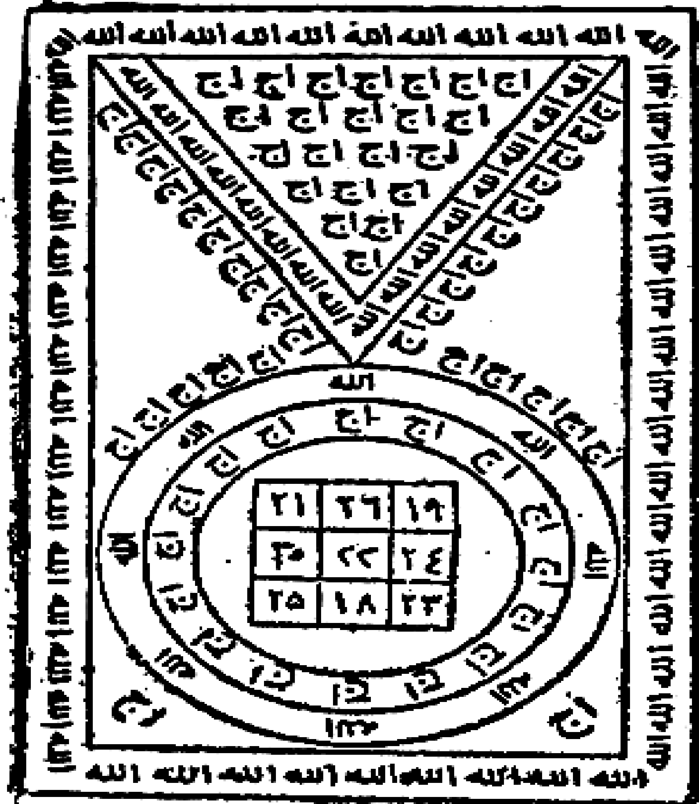

**AR:** (وَصْفُ الْخَاتَمِ) خَاتَمٌ مُرَبَّعٌ دَاخِلَ اِطَارٍ مُزَخْرَفٍ:

- **الْاِطَارُ الْخَارِجِىُّ:** يُحِيْطُ بِهِ سِتَّةَ عَشَرَ مَوْضِعًا كُتِبَ فِيْهَا لَفْظُ الْجَلَالَةِ «**الله**» مَرَّاتٍ مُتَكَرِّرَةً.
- **الْقِسْمُ الْعُلْوِىُّ:** **مُثَلَّثٌ** مَمْلُوءٌ بِحُرُوفِ «**هـ**» مَرْصُوْفَةً فِى سُطُوْرٍ تَتَقَاصَرُ نِزُوْلًا (اَرْبَعَةَ عَشَرَ حَرْفًا فِى السَّطْرِ الْاَوَّلِ ثُمَّ تَقِلُّ)، وَعَلَى **ضِلْعَىِ الْمُثَلَّثِ** صُفُوْفٌ مُزْدَوِجَةٌ مِنْ حُرُوفٍ صَغِيْرَةٍ.
- **الْقِسْمُ السُّفْلِىُّ:** **دَائِرَتَانِ** مُتَدَاخِلَتَانِ، فِى الْحَلْقَةِ بَيْنَهُمَا حُرُوفُ «**هـ**» وَرُقُومٌ، وَفِى الْمَرْكَزِ **وَفْقٌ مُثَلَّثٌ (٣×٣)** بِالْاَرْقَامِ الْهِنْدِيَّةِ.
- **الزَّوَائِدُ:** اَرْبَعُ عَلَامَاتٍ عَلَى شَكْلِ «**ج**» (اَوْ «**هـ**» مُزْدَوِجَةٍ) فِى الزَّوَايَا الْاَرْبَعِ دَاخِلَ الدَّائِرَةِ.

**LAT:** (waṣfu al-khātami) khātamun murabba‘un dākhila iṭārin muzakhrafin: al-iṭāru al-khārijiyyu: yuḥīṭu bihi sittata ‘ashara mawḍi‘an kutiba fīhā lafẓu al-jalālati «Allāh» marrātin mutakarriratan; al-qismu al-‘ulwiyyu: muthallathun mamlū’un bi-ḥurūfi «h» marṣūfatan fī suṭūrin tataqāṣaru nuzūlan; wa-‘alā ḍil‘ayi al-muthallathi ṣufūfun muzdawijatun min ḥurūfin ṣaghīratin; al-qismu al-sufliyyu: dā’iratāni mutadākhilatāni, fī al-ḥalqati baynahumā ḥurūfu «h» wa-ruqūmun, wa-fī al-markazi wafqun muthallathun (3×3) bi-al-arqāmi al-hindiyyati; al-zawā’idu: arba‘u ‘alāmātin ‘alā shakli «j» fī al-zawāyā al-arba‘i.

**ID:** “**(Deskripsi khatam)**: sebuah **khatam berbentuk kotak** di dalam **bingkai berhias**: **bingkai luar** — dikelilingi **enam belas tempat** yang ditulisi **lafal «الله»** berulang; **bagian atas** — sebuah **segitiga** penuh dengan **huruf «هـ»** yang tersusun dalam **baris-baris yang makin pendek ke bawah** (baris pertama ± empat belas huruf), dan pada **kedua sisi segitiga** terdapat **baris ganda huruf kecil**; **bagian bawah** — **dua lingkaran** bertumpuk, pada **cincin di antaranya** terdapat huruf «**هـ**» dan angka, dan di **pusatnya** sebuah **wafaq 3×3** dengan angka Hindi; **tambahan** — **empat tanda berbentuk «ج»** (atau «هـ» ganda) di **keempat sudut** dalam lingkaran.”

**AR:** (اَرْقَامُ الْوَفْقِ الثُّلَاثِىِّ) ١٩ ٢٦ ٢١ / ٢٤ ٢٢ ٢٠ / ٢٣ ١٨ ٢٥

**LAT:** (arqāmu al-wafqi al-thulāthiyyi) 19 26 21 / 24 22 20 / 23 18 25

**ID:** “**(Angka wafaq 3×3)** — baris pertama: **١٩ ٢٦ ٢١**; baris kedua: **٢٤ ٢٢ ٢٠**; baris ketiga: **٢٣ ١٨ ٢٥**.” **Catatan**: setiap **baris, kolom, dan diagonal berjumlah ٦٦** — bukti silang bahwa bacaan ini benar (pola **Lo Shu** dengan pusat ٢٢). Pembaca dirujuk ke rajah.

**Keterangan halaman.** Halaman ini menutup **«محبة وقبول»** dari halaman 433 dengan **qasam kawakib** (matahari, bulan, ‘Uṭārid, Mirrīkh, Mushtarī, Zuhrah, Zuḥal) dan **pelayan tujuh hari, raja-raja bumi, falak, saat, serta ṭilasm malam-siang**; ancamannya «**شَوَاظُّ مِنْ نَارٍ وَنُحَاسٍ**» (nyala api dan tembaga). Setelah itu bagian baru **«التعب فى البيت والرزق والصحة والزوجة»**: **surah al-Ṣāffāt** dibaca **separuh malam** selama **tiga malam** dengan **dupa jawi**, **tidak menyempurnakan surah**, dan **mengulang «سلام على آل يس» ٣١٣١×** setiap malam; pada malam ketiga ditambah **seruan kepada para malaikat** («أين الملائكة الغلاظ… أين من حملوا عصا موسى… أين من حملوا محمدا ص حين عرج إلى السماء») dan **doa hajat tiga kali**. Halaman ditutup dengan **khatam** (rajah-01) yang **ditulis dan dibawa bersama**.

**Angka pada halaman ini.** **٣١٣١×** (tiga kali disebut) dan **٣×** (doa) **dikonfirmasi dari hasil pindai**; lapisan teks PDF menampilkan «**٣١٣١**» dengan urutan digit yang **tidak konsisten** (kadang «٣١٣١»، kadang «١٣١٣») — yang dipakai adalah **٣١٣١** sesuai pindaian. **Wafaq 3×3** dibaca dari **crop 700–1500 dpi** dan **diverifikasi dengan jumlah baris/kolom = ٦٦**.

**[TIDAK JELAS - HALAMAN 434]** (1) **«الْعَجَلَ قَبْلَ فَوَاتِ الْوَقْتِ»** dan **«قَبْلَ انَاءِ الْاَجَلِ»** — «اناء الأجل» **tidak jelas** (mungkin «إناء» = wadah, atau «أناة» = kelapangan); **dipertahankan dan ditandai**. (2) **«وَاَدْنَاةُ الْمُشْتَرِى»** — **tidak jelas** (mungkin «وأدناه المشتري» = mendekatkannya); **dipertahankan**. (3) **«وَاَنْجَلَتْهُ زُحَلُ»** — **tidak jelas**; kemungkinan «وأجلّه/وأنجله» (menjadikannya mulia/terbuka) — **dipertahankan** dan diterjemahkan dengan tanda tanya. (4) **«وَلَا تَحُلُّوْ عَنْهُ»** — kemungkinan «ولا تحولوا عنه» (jangan berpaling darinya); **dipertahankan**. (5) **«شَوَاظُّ»** — **tidak jelas**; mungkin «شواظ» (nyala api tanpa asap, Q.S. 55:35) — **dipertahankan**. (6) **«فَلَا تَنْتَصِرَانِ»** — bentuk **mutsannā** (dua) padahal subjeknya jamak — **ejaan cetakan dipertahankan**. (7) **«التَّعَبُ فِى الْبَيْتِ»** — judul **tidak gramatikal sempurna** (mungkin «للتعب»/«رفع التعب») — **dipertahankan** dan diterjemahkan sebagai «kesulitan/kelelahan». (8) **«سَلَامٌ عَلَى اَلِ يَس»** — kutipan **Q.S. 37:130** (بسلام على آل ياسين) yang **dipendekkan** dalam cetakan; **dipertahankan** dan dijelaskan. (9) **«وَلَا يَكْمُلُ السُّوْرَةَ»** — maksudnya **tidak menyelesaikan surah** (berhenti pada ayat tersebut); **dipertahankan**. (10) **«جَاوِىْ»** — dupa **jawi** (istilah pasar rempah Nusantara/Arab); **dipertahankan**. (11) **«وَيُكْتَبُ هَذَا الْخَاتَمُ وَتُحْمَلُ مَعَهُ»** — susunan **mudhakkar/mu’annath tidak konsisten** («يُكتب» + «تُحمل»); **dipertahankan**. (12) **Isi bingkai** khatam sebagian kecil **tidak terbaca** karena **resolusi asli gambar rendah** (294×457 px); yang dapat dipastikan hanya **lafal «الله»** pada bingkai, **huruf «هـ»** pada segitiga dan cincin, dan **wafaq 3×3**.

**Peringatan (dicatat apa adanya, bukan fatwa).** Bagian **«محبة وقبول»** memakai **ancaman** kepada para pelayan («jika tidak, akan dikirim nyala api dan tembaga») agar **memaksa** orang yang diminta **mencintai dan datang menghina diri**. Teks **ditranskripsikan sesuai cetakan**; pembaca perlu mengetahui bahwa **memaksa kehendak orang lain dengan ancaman** bertentangan dengan ajaran Islam.

**[ADA RAJAH]** — 1 crop: `assets/rajah/sirrul-asrar/hal-434-rajah-01.png` (700 DPI, Rect(174.0, 379.0, 439.7, 684.5)). Total berkas rajah menjadi **116**.

---
## HALAMAN 435 — «فائدة لانقطاع الرزق» (ḥarmal + Fātiḥah/Ṭāhā/Yāsīn/al-Mu‘awwidhatayn) + «اية الملك للرزق» + «للنصيب» + «جلب مجرب شرب» + «جلب نظرى» + «لمقابلة من لك حاجة لديه»

**AR:** كِتَابُ سِرِّ الْاَسْرَارِ فِي التَّوَاصُلِ مَعَ رُوحَانِيَّاتِ الْقُرْآنِ — شَيْخُ الرُّوحَانِيِّينَ الشَّيْخُ عَطِيَّةُ عَبْدُ الْحَمِيدِ

**LAT:** kitābu sirri al-asrāri fī al-tawāṣuli ma‘a rūḥāniyyāti al-qur’āni — shaykhu al-rūḥāniyyīna al-shaykhu ‘Aṭiyyatu ‘Abdu al-Ḥamīdi

**ID:** “Kitab «Sirr al-Asrār fī al-Tawāṣul ma‘a Rūḥāniyyāt al-Qur’ān» — Syaikh para ruhaniyyin, Syaikh ‘Aṭiyyah ‘Abd al-Ḥamīd.” (Kepala halaman.)

**AR:** فَائِدَةٌ لِانْقِطَاعِ الرِّزْقِ — اِنْقِطَاعُ الرِّزْقِ بِسَبَبِ نَقْزَةٍ صَدْمَةٍ نَفْسِيَّةٍ

**LAT:** fā’idatun li-inqiṭā‘i al-rizqi — inqiṭā‘u al-rizqi bi-sababi naqzatin ṣadmah nafsiyyatin

**ID:** “**Fā’idah untuk Terputusnya Rezeki** — **rejeki terputus karena «naqẓah» (gangguan/hentakan kejiwaan) dan guncangan psikis**.” (Judul bagian.)

**AR:** اَلطَّرِيْقَةُ: حَرْمَلٌ يَقْرَاُ عَلَيْهِ الْفَتْحَ مَرَّةً، طَه مَرَّةً، يَس مَرَّةً، وَالْمُعَوِّذَتَيْنِ ٧-٧ مَرَّاتٍ، يَتَبَخَّرُ بِهِ وَقْتَ الْمَغْرِبِ لِمُدَّةِ اُسْبُوْعٍ

**LAT:** al-ṭarīqatu: ḥarmalun yaqra’u ‘alayhi al-fatḥa marratan, Ṭaha marratan, Yās marratan, wa-al-mu‘awwidhatayni 7-7 marrātin, yatabakhkharu bihi waqta al-maghribi li-muddati usbū‘in

**ID:** “**Caranya**: **ḥarmal (biji/buah harmal)** — dibacakan atasnya **surah al-Fatḥ ١×**, **Ṭāhā ١×**, **Yāsīn ١×**, dan **al-Mu‘awwidhatayn ٧–٧×**; lalu **didupai dengannya pada waktu maghrib selama satu minggu**.”

**AR:** اَيَةُ الْمَلِكِ لِلرِّزْقِ — تَجْعَلُ وِرْدٌ لِمُدَّةِ اَرْبَعِيْنَ يَوْمٍ عَدَدَ وَاحِدٍ وَاَرْبَعِيْنَ مَرَّةً

**LAT:** āyatu al-maliki lil-rizqi — taj‘alu wirdun li-muddati arba‘īna yawmin ‘adada wāḥidin wa-arba‘īna marratan

**ID:** “**Āyat al-Malik untuk rezeki** — engkau jadikan **wird (bacaan rutin) selama empat puluh hari** sebanyak **empat puluh satu kali**.” (Teks «اية الملك» dipertahankan; yang dimaksud kemungkinan **Q.S. 3:26** «قل اللهم مالك الملك» — lihat catatan.)

**AR:** لِلنَّصِيْبِ — تُرَدِّدُ اَيَةَ (فَلَمَّا رَاَيْنَهُ اَكْبَرْنَهُ وَقَطَّعْنَ اَيْدِيَهُنَّ وَقُلْنَ حَاشَ لِلّٰهِ مَا هَذَا بَشَرًا اِنْ هَذَا اِلَّا مَلَكٌ كَرِيْمٌ) يُوْسُف ٣١ تُرَدِّدُ ٢٩ مَرَّةً — (وَاَلْقَيْتُ عَلَيْكَ مَحَبَّةً مِنِّىْ وَلِتُصْنَعَ عَلٰى عَيْنِىْ) طَه ٣٩ تُرَدِّدُ ٢٩ مَرَّةً

**LAT:** lil-naṣībi — turaddidu āyata («fa-lammā ra’aynahu akbarnahu wa-qaṭṭa‘na aydiyahunna wa-qulna ḥāsha lillāhi mā hādhā basharan in hādhā illā malakun karīmun») Yūsuf 31 turaddidu 29 marratan — («wa-alqaytu ‘alayka maḥabbatan minnī wa-lituṣna‘a ‘alā ‘aynī») Ṭaha 39 turaddidu 29 marratan

**ID:** “**Untuk Naṣīb (jodoh/bagian):** engkau **mengulang ayat** «**Fa-lammā ra’aynahu akbarnahu wa-qaṭṭa‘na aydiyahunna wa-qulna ḥāsha lillāhi mā hādhā basharan in hādhā illā malakun karīm**» (**Q.S. Yūsuf 31**) **٢٩×**; dan «**Wa alqaytu ‘alayka maḥabbatan minnī wa-lituṣna‘a ‘alā ‘aynī**» (**Q.S. Ṭāhā 39**) **٢٩×**.”

**AR:** جَلْبٌ مُجَرَّبٌ شُرْبٌ — يُكْتَبُ وَيُمْحَىْ وَيُسْقَى لِلْمَطْلُوْبِ فَاِنَّهُ يُحِبُّكَ مَحَبَّةً شَدِيْدَةً وَهُوَ هَذَا:

**LAT:** jalbun mujarrabun shurbun — yuktabu wa-yumḥā wa-yusqā lil-maṭlūbi fa-innahu yuḥibbuka maḥabbatan shadīdatan wa-huwa hādhā:

**ID:** “**Jalbu Teruji dengan Cara Diminum** — ditulis, lalu **dihapus (dilarutkan)** dan **diminumkan kepada orang yang diminta**; maka ia akan **mencintaimu dengan cinta yang sangat kuat**. Dan **inilah (bacaannya)**:”

**AR:** اَطْلَمُوْش ٢ هَحْمُوْش ٢ قَدْقَرُوْش ٢ عَلْيُوْش ٢ هَمْلُوْش ٢ مَلُوْش ٢ عَلُوْش ٢ هَامُوْش ٢ بَرُوْش ٢ عَالُوْش بَايُوْش ٢ قَالُوْش ٢ قَرُوْش ٢ — اَجِيْبُوْا يَا خُدَّامَ هَذِةِ الْاَسْمَاءِ وَاَقْلِقُوْا وَاجْذِبُوْا قَلْبَ فُلَانٍ ابْنِ فُلَانَةَ اِلَى عِشْقِ وَطَاعَةِ وَسَمَاعِ قَوْلِ فُلَانٍ ابْنِ فُلَانَةَ وَبِحَقِّ هَذِةِ الْاَسْمَاءِ الْوَحَا الْعَجَلَ السَّاعَةَ

**LAT:** aṭlamūsh 2 ḥaḥmūsh 2 qadqarūsh 2 ‘alyūsh 2 hamlūsh 2 malūsh 2 ‘alūsh 2 hāmūsh 2 barūsh 2 ‘ālūsh bāyūsh 2 qālūsh 2 qarūsh 2 — ajībū yā khuddāma hādhihi al-asmā’i wa-aqliqū wa-ajdhibū qalba fulānin ibni fulānata ilā ‘ishqi wa-ṭā‘ati wa-samā‘i qawli fulānin ibni fulānata wa-bi-ḥaqqi hādhihi al-asmā’i al-waḥā al-‘ajala al-sā‘ata

**ID:** “«**اَطْلَمُوْش ٢ هَحْمُوْش ٢ قَدْقَرُوْش ٢ عَلْيُوْش ٢ هَمْلُوْش ٢ مَلُوْش ٢ عَلُوْش ٢ هَامُوْش ٢ بَرُوْش ٢ عَالُوْش بَايُوْش ٢ قَالُوْش ٢ قَرُوْش ٢**» — **Sahutlah, wahai para pelayan asmā’ ini, gelisahkanlah dan tariklah hati Fulan bin Fulanah menuju cinta, kepatuhan, dan kesediaan mendengar ucapan Fulan bin Fulanah; dan dengan hak asmā’ ini — al-waḥā, al-‘ajal, al-sā‘ah!**” (Nama peminta dan yang diminta di cetakan **keduanya laki-laki** — lihat catatan.)

**AR:** جَلْبُ نَظَرِى — هِيْجُ يَافِلَاجُ الْجِسْمُ الَّذِىْ نَظَرِىْ مُتَحَوِّلٌ اِلَيْهِ بِمَعْكُمْ بَعْلِ فَرْشِ قَرْشِ نِكَاحِ الْفَرْجِ عَلَيْكَ بَاكِلْ وَهَرْشِ وَهِيْجَانِ وَقَلَقَانِ النَّاظِرَةُ اِلَى حَتَّى لَا تُطَاقُ نَفْسُهَا بِالْجِمَاعِ يَانَاكَحْ يَانِكَاحْ بِحَقِّ الْمَلِكِ دَرْشَانُ وَحِكُّ وَفَكُّ اَجِيْبُوْا وَاسْرَعُوْا بِالْهِيْجَانِ وَبِحُرْمَتِكُمْ اَسْرَعُوْا وَنِكَاحِ الْجَوَانِبِ حَتَّى تَاْتِىَ اِلَىَّ وَتَتَطَلَّبُنِىْ لِلْجِمَاعِ فَوْرًا وَفِى الْحَالِ

**LAT:** jalbun naẓarī — hīju yāfilāju al-jismu alladhī naẓarī mutaḥawwilun ilayhi bi-ma‘kum ba‘li farshi qarshi nikāḥi al-farji ‘alayka bākil wa-harshin wa-hījānin wa-qalaqāni al-nāẓiratu ilā ḥattā lā tuṭāqu nafsuhā bi-al-jimā‘i yānākaḥ yānikāḥ bi-ḥaqqi al-maliki darshānu wa-ḥikku wa-fakku ajībū wa-asra‘ū bi-al-hījāni wa-bi-ḥurmatikum asra‘ū wa-nikāḥi al-jawānibi ḥattā ta’tiya ilayya wa-tataṭallabanī lil-jimā‘i fawran wa-fī al-ḥāli

**ID:** “**Jalb Naẓarī (penghadiran melalui pandangan)** — «**هِيْجُ يَافِلَاجُ الْجِسْمُ الَّذِيْ نَظَرِيْ مُتَحَوِّلٌ اِلَيْهِ…**» **teks ini adalah rangkaian kata talismanic dan ungkapan syahwat yang eksplisit**; **ditranskripsikan sesuai cetakan** (lihat peringatan).”

**AR:** لِمُقَابَلَةِ مَنْ لَكَ حَاجَةٌ لَدَيْهِ — اَلطَّرِيْقَةُ: فِى الصَّبَاحِ عِنْدَ الْخُرُوْجِ قِرَاءَةُ سُوْرَةِ الْجِنِّ عَلَى الْكَفَّيْنِ، اَيَةُ الْكُرْسِىِّ خَمْسَةُ مَرَّاتٍ، اَللَّهُمَّ صَلِّى عَلٰى مُحَمَّدٍ وَالِ مُحَمَّدٍ خَمْسَةُ مَرَّاتٍ، اَيَةُ (قَدْ جَاءَكُمْ رَسُوْلٌ مِنْ اَنْفُسِكُمْ ………)

**LAT:** li-muqābalati man laka ḥājatun ladayhi — al-ṭarīqatu: fī al-ṣabāḥi ‘inda al-khurūji qirā’atu sūrati al-jinni ‘alā al-kaffayni, āyatu al-kursiyyi khamsatu marrātin, allāhumma ṣalli ‘alā Muḥammadin wa-āli Muḥammadin khamsatu marrātin, āyatu («qad jā’akum rasūlun min anfusikum ………»)

**ID:** “**Untuk menghadap orang yang engkau perlukan (berhajat kepadanya)** — **caranya**: pada **pagi hari ketika keluar rumah**, **membaca surah al-Jinn pada kedua telapak tangan**, **āyat al-Kursī ٥×**, **«Allāhumma ṣalli ‘alā Muḥammad wa āli Muḥammad» ٥×**, dan ayat «**Qad jā’akum rasūlun min anfusikum ………**» (**Q.S. 9:128**, berlanjut ke halaman berikut).”

**Keterangan halaman.** Halaman ini memuat **enam bagian pendek** berturut-turut: (1) **«فائدة لانقطاع الرزق»** — sebabnya disebut **«نقزة صدمة نفسية»** (guncangan psikis), obatnya **ḥarmal** yang dibacakan **al-Fatḥ, Ṭāhā, Yāsīn, dan al-Mu‘awwidhatayn**, lalu **didupai saat maghrib selama sepekan**; (2) **«اية الملك للرزق»** — **wird ٤١× selama ٤٠ hari**; (3) **«للنصيب»** — **Q.S. 12:31** dan **Q.S. 20:39**, masing-masing **٢٩×**; (4) **«جلب مجرب شرب»** — ṭilasm **ditulis lalu dilarutkan** dan **diminumkan** kepada orang yang diminta, dengan **deret asmā’ talismanic** («اَطْلَمُوْش… قَرُوْش»); (5) **«جلب نظرى»** — rangkaian kata **eksplisit** bernuansa syahwat; (6) **«لمقابلة من لك حاجة لديه»** — amalan **pagi** dengan **surah al-Jinn di telapak tangan** dan **Q.S. 9:128**.

**Angka pada halaman ini.** **٧-٧×** (al-Mu‘awwidhatayn), **٤١×** («عدد واحد وأربعين مرة»), **٤٠ hari**, **٢٩×** (dua kali; Q.S. 12:31 dan Q.S. 20:39), **٥×** (āyat al-Kursī dan shalawat) — semuanya **dikonfirmasi dari hasil pindai**. **Koreksi penting:** lapisan teks PDF menampilkan **«يوسف ١٣»** dan **«طه ٩٣»**; **pindaian menunjukkan «يوسف ٣١»** dan **«طه ٣٩»** — **digit terbalik**, dan **٣١ / ٣٩ adalah nomor ayat yang benar** (Q.S. 12:31 «فلما رأينه أكبرنه…»، Q.S. 20:39 «وألقيت عليك محبة مني…»). Yang dipakai: **٣١** dan **٣٩**.

**[TIDAK JELAS - HALAMAN 435]** (1) **«نَقْزَةٍ صَدْمَةٍ نَفْسِيَّةٍ»** — **tidak jelas**; kemungkinan «نقزة/نكزة» (tusukan, gangguan) + «صدمة نفسية» (guncangan psikis); **dipertahankan dan ditandai**. (2) **«اَيَةُ الْمَلِكِ»** — judul **tanpa teks ayat**; kemungkinan yang dimaksud **Q.S. 3:26** («قل اللهم مالك الملك») — **tidak dipastikan**, hanya dicatat. (3) **«تَجْعَلُ وِرْدٌ»** — susunan cetakan (naṣb/raf‘ tidak konsisten) — **dipertahankan**. (4) **«الْفَتْحَ»** — surah **al-Fatḥ (48)**; **dipertahankan**. (5) **«مَعْكُمْ بَعْلِ فَرْشِ قَرْشِ»** dan sejenisnya pada **«جلب نظرى»** — **kata-kata talismanic tanpa makna leksikal** dan sebagian **eksplisit**; **[TEKS ASLI DIJAGA]** sesuai cetakan. (6) **«يَانَاكَحْ يَانِكَاحْ»** serta bagian akhir **«جلب نظرى»** yang terpotong («بِحَقِّ الْمَلِكِ دَرْشَانُ») — **ejaan dan susunan cetakan dipertahankan**. (7) **Nama pada «جلب مجرب شرب»** — baik peminta maupun yang diminta tercetak **«فُلَانٍ ابْنِ فُلَانَةَ»** (keduanya laki-laki) — **dipertahankan** sesuai cetakan. (8) **Titik-titik «………»** pada akhir halaman — **bagian yang dikosongkan cetakan**; **dipertahankan**.

**Peringatan (dicatat apa adanya, bukan fatwa).** Bagian **«جلب نظرى»** memuat **ungkapan syahwat yang eksplisit** dan **paksaan** agar orang yang dipandang **datang meminta**; bagian **«جلب مجرب شرب»** memakai cara **memberi minum air tulisan** kepada orang lain **tanpa sepengetahuannya**. Teks **ditranskripsikan sesuai cetakan**; pembaca perlu mengetahui bahwa **memaksa atau menyakiti orang lain** serta **memberi minum tanpa izin** bertentangan dengan ajaran Islam.

**[TIDAK ADA RAJAH]** — halaman ini **teks saja** (tidak ada gambar atau rajah). Total berkas rajah tetap **116**.

---
## HALAMAN 436 — penutup amalan pagi (ḥasbī Allāh ٥×، ḥawqalah ٦×) + «للحمل» + «للإختبارات» + «جلب ومحبة» (dua gambar + khatam mutsallats + al-Barhatiyyah ٢٨×) + «جلب الشمعة»

**AR:** كِتَابُ سِرِّ الْاَسْرَارِ فِي التَّوَاصُلِ مَعَ رُوحَانِيَّاتِ الْقُرْآنِ — شَيْخُ الرُّوحَانِيِّينَ الشَّيْخُ عَطِيَّةُ عَبْدُ الْحَمِيدِ

**LAT:** kitābu sirri al-asrāri fī al-tawāṣuli ma‘a rūḥāniyyāti al-qur’āni — shaykhu al-rūḥāniyyīna al-shaykhu ‘Aṭiyyatu ‘Abdu al-Ḥamīdi

**ID:** “Kitab «Sirr al-Asrār fī al-Tawāṣul ma‘a Rūḥāniyyāt al-Qur’ān» — Syaikh para ruhaniyyin, Syaikh ‘Aṭiyyah ‘Abd al-Ḥamīd.” (Kepala halaman.)

**AR:** (تَكْمِلَةُ «لِمُقَابَلَةِ مَنْ لَكَ حَاجَةٌ لَدَيْهِ» — سَابِقًا) «…… خَمْسَةُ مَرَّاتٍ، حَسْبِىَ اللهُ وَنِعْمَ الْوَكِيْلُ خَمْسَةُ مَرَّاتٍ، وَلَا حَوْلَ وَلَا قُوَّةَ اِلَّا بِاللهِ سِتَّةُ مَرَّاتٍ»

**LAT:** (takmilatu «li-muqābalati man laka ḥājatun ladayhi») «… khamsatu marrātin, ḥasbiya allāhu wa-ni‘ma al-wakīlu khamsatu marrātin, wa-lā ḥawla wa-lā quwwata illā billāhi sittatu marrātin»

**ID:** “**(Lanjutan «Untuk menghadap orang yang engkau berhajat kepadanya» — dari halaman 435)**: «… **٥×**, **«Ḥasbiya Allāh wa ni‘ma al-wakīl» ٥×**, dan **«Lā ḥawla wa lā quwwata illā billāh» ٦×**.”

**AR:** لِلْحَمْلِ — بُذُوْرُ الْفِجْلِ، بُذُوْرُ الْكَرَفْسِ، بُذُوْرُ الْكَرَاتِ — يُغْلَى فِى الْمَاءِ وَيُوضَعُ مَعَهُ ثُوْمٌ مِنَ الْمَغْرِبِ اِلَى الصَّبَاحِ وَيُشْرَبُ عَلَى الرِّيْقِ لِمُدَّةِ وَاحِدٍ وَعِشْرِيْنَ يَوْمًا وَيَكُوْنُ كُلَّ يَوْمٍ بِيَوْمِهِ

**LAT:** lil-ḥamli — budhūru al-fijli, budhūru al-karafsi, budhūru al-karāti — yughlā fī al-mā’i wa-yūḍa‘u ma‘ahu thawmun mina al-maghribi ilā al-ṣabāḥi wa-yushrabu ‘alā al-rīqi li-muddati wāḥidin wa-‘ishrīna yawman wa-yakūnu kulla yawmin bi-yawmihi

**ID:** “**Untuk (memperoleh) kehamilan** — **biji lobak (fijl), biji karafs (seledri), biji karāt (daun bawang/leek)**; **direbus dalam air** dan **dimasukkan bawang putih bersamanya** dari **maghrib sampai pagi**; lalu **diminum dalam keadaan perut kosong selama ٢١ hari**, dan **dibuat setiap hari pada harinya**.”

**AR:** لِلْاِخْتِبَارَاتِ — تُرَدِّدُ «يَا صَمَدُ اَنْتَ ثِقَتِىْ وَرَجَائِىْ يَا صَمَدُ»

**LAT:** lil-ikhtibārāti — turaddidu «yā Ṣamadu anta thiqtī wa-rajā’ī yā Ṣamadu»

**ID:** “**Untuk ujian (ikhtibārāt)** — engkau **mengulang**: «**Wahai Ṣamad, Engkaulah kepercayaan dan harapanku, wahai Ṣamad**».”

**AR:** جَلْبٌ وَمَحَبَّةٌ — وَهُوَ اَنْ تَصَوَّرَ صُوْرَةً مِنْ اُنْثَى وَذَكَرٍ مِنْ وَرَقِ غَزَالٍ وَتَنْزِلُ الْخَاتَمَ الْمُثَلَّثَ كَمَا اَضَعُهُ لَكَ، تَضَعُ الذَّكَرَ ثُمَّ تَحُطُّ فِيْهِ قِطْعَةَ سُكَّرِ نَبَاتٍ وَتُلْقِى الْاُنْثَى عَلَى الذَّكَرِ عَلَى بَعْضِهِمْ لِبَعْضٍ، وَتَنْزِلُ الْبَرْهَتِيَّةَ دَائِرَةً فِى وَرَقَةٍ بَيْضَاءَ وَتَقْرَاُ عَلَيْهِمُ الْبَرْهَتِيَّةَ عَدَدَ ٢٨ مَرَّةً وَالْبَخُوْرُ صَاعِدٌ وَهُوَ لُبَانٌ ذَكَرٌ

**LAT:** jalbun wa-maḥabbatun — wa-huwa an taṣawwira ṣūratan min unthā wa-dhakarin min waraqi ghazālin wa-tanzilu al-khātama al-muthallatha kamā aḍa‘uhu laka, taḍa‘u al-dhakara thumma taḥuṭṭu fīhi qiṭ‘ata sukkari nabātin wa-tulqī al-unthā ‘alā al-dhakari ‘alā ba‘ḍihim li-ba‘ḍin, wa-tanzilu al-barhatiyyata dā’iratan fī waraqatin bayḍā’a wa-taqra’u ‘alayhimu al-barhatiyyata ‘adada 28 marratan wa-al-bakhūru ṣā‘idun wa-huwa lubānun dhakarun

**ID:** “**Jalbu dan Maḥabbah** — yaitu engkau **menggambar bentuk perempuan dan laki-laki pada kertas kulit gazal**, lalu **menurunkan (menyalin) khatam mutsallats** sebagaimana **aku letakkan untukmu**; engkau **letakkan (gambar) laki-laki**, lalu **menaruh di dalamnya sepotong gula batu (sukkar nabāt)**, dan **meletakkan (gambar) perempuan di atas (gambar) laki-laki** — saling bertumpuk satu atas yang lain; dan engkau **menurunkan al-Barhatiyyah berbentuk lingkaran pada kertas putih**; lalu **membaca al-Barhatiyyah atas mereka ٢٨×**, dengan **dupa ṣā‘id, yaitu lubān dhakar (kemenyan jantan)**.”

**AR:** ثُمَّ بَعْدَ ذَلِكَ تَحُطُّ الشَّخْصَيْنِ فِى الْوَرَقِ وَتَلُفُّ عَلَيْهِمْ خَيْطًا اَبْيَضَ حَرِيْرًا وَتَدْفِنُهُمْ فِى مَحَلٍّ مُظْلِمٍ لَا اَحَدٌ يَرَى فِيْهِ شَمْسٌ وَلَا قَمَرٌ، وَتَنْزِلُ صُوْرَةَ الرَّجُلِ فِى صُوْرَةِ الْاُنْثَى وَاسْمُ الْاُنْثَى فِى صُوْرَةِ الرَّجُلِ تَكْتُبُ بِزَعْفَرَانٍ وَمَاءِ الْوَرْدِ وَدَمِ الْاَخَوَيْنِ وَهَذَا الْمُثَلَّثُ

**LAT:** thumma ba‘da dhālika taḥuṭṭu al-shakhṣayni fī al-waraqi wa-tuluffu ‘alayhim khayṭan abyaḍa ḥarīran wa-tadfīnuhum fī maḥallin muẓlimin lā aḥadun yarā fīhi shamsun wa-lā qamarun, wa-tanzilu ṣūrata al-rajuli fī ṣūrati al-unthā wa-isma al-unthā fī ṣūrati al-rajuli taktubu bi-za‘farānin wa-mā’i al-wardi wa-dami al-akhawayni wa-hādhā al-muthallathu

**ID:** “Kemudian **setelah itu engkau meletakkan kedua gambar itu di dalam kertas** dan **membungkusnya dengan benang sutra putih**, lalu **menguburnya di tempat gelap yang tidak seorang pun melihat matahari dan bulan di dalamnya**. Dan engkau **menurunkan gambar laki-laki pada gambar perempuan, dan nama perempuan pada gambar laki-laki** — ditulis dengan **za‘farān, air mawar, dan darah dua saudara(?) (dam al-akhawayn)**. Dan **inilah mutsallatsnya**:”

**Rajah:** 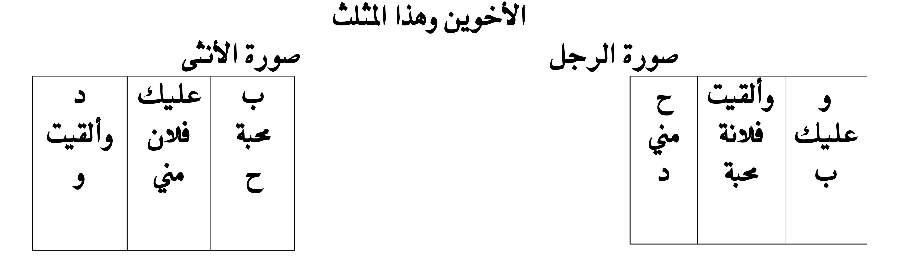

**AR:** (وَصْفُ الْمُثَلَّثِ) جَدْوَلَانِ مُتَجَاوِرَانِ، كُلُّ وَاحِدٍ **ثَلَاثَةُ اَعْمِدَةٍ** وَسَطْرَانِ، وَفِى كُلِّ خَلِيَّةٍ حَرْفٌ مُفْرَدٌ:

- **جِهَةُ صُوْرَةِ الرَّجُلِ (الْيَمِيْنُ):** الْعَمُوْدُ الْاَوَّلُ «**و**» / «**عَلَيْكَ**»، الْاَوْسَطُ «**وَاَلْقَيْتُ**» / «**فُلَانَةَ مَحَبَّةً**»، الْاَخِيْرُ «**ح**» / «**مِنِّىْ د**».
- **جِهَةُ صُوْرَةِ الْاُنْثَى (الْيَسَارُ):** الْعَمُوْدُ الْاَوَّلُ «**ب**» / «**مَحَبَّةً ح**»، الْاَوْسَطُ «**عَلَيْكَ فُلَانٍ مِنِّىْ**»، الْاَخِيْرُ «**د** / **وَاَلْقَيْتُ و**».

**LAT:** (waṣfu al-muthallathi) jadwalāni mutajāwirāni, kullu wāḥidin thalāthatu a‘midatin wa-saṭrāni, wa-fī kulli khaliyyatin ḥarfun mufradun: [jihatu ṣūrati al-rajuli (al-yamīnu): «w» / «‘alayka», «wa-alqaytu» / «fulānata maḥabbatan», «ḥ» / «minnī d»; jihatu ṣūrati al-unthā (al-yasāru): «b» / «maḥabbatan ḥ», «‘alayka fulānin minnī», «d» / «wa-alqaytu w»]

**ID:** “**(Deskripsi mutsallats)**: **dua tabel berdampingan**, masing-masing **tiga kolom** dan **dua baris**; pada setiap sel **satu huruf tunggal**: **sisi gambar laki-laki (kanan)** — kolom pertama «**و**» / «**عَلَيْكَ**»، kolom tengah «**وَاَلْقَيْتُ**» / «**فُلَانَةَ مَحَبَّةً**»، kolom akhir «**ح**» / «**مِنِّىْ د**»; **sisi gambar perempuan (kiri)** — kolom pertama «**ب**» / «**مَحَبَّةً ح**»، kolom tengah «**عَلَيْكَ فُلَانٍ مِنِّىْ**»، kolom akhir «**د** / **وَاَلْقَيْتُ و**».” **Catatan**: susunan sel dalam cetakan **tidak konsisten urutannya** (kata-kata terpotong antar sel); yang ditampilkan adalah **bacaan visual** — pembaca dirujuk ke rajah.

**AR:** جَلْبُ الشَّمْعَةِ — شَمْعَةٌ مُرَبَّعَةٌ تُكْتَبُ عَلَى كُلِّ وَجْهٍ مِنْ: «قَالَ عِفْرِيْتٌ مِنَ الْجِنِّ اَنَا آتِيْكَ بِهِ فَبَلْ اَنْ تَقُوْمَ مِنْ مَقَامِكَ وَاِنِّىْ عَلَيْهِ لَقَوِىٌّ اَمِيْنٌ» — «اَقِشْ ٢ قَشَهُوْش ٢ كَشْلِيْخ ٢ كَيْكَمُوْش ٢ اَنُوْخ ٢ يَعُوْج ٢ تَوَكَّلُوْ يَا خُدَّامَ هَذِهِ الْاَسْمَاءِ بِجَلْبِ كَذَا اِلَى كَذَا بِحَقِّ مَنْ قَسَمَ بِمَوَاقِعِ النُّجُوْمِ وَاِنَّهُ لَقَسَمٌ لَوْ تَعْلَمُوْنَ عَظِيْمٌ»

**LAT:** jalbun al-sham‘ati — sham‘atun murabba‘atun tuktabu ‘alā kulli wajhin min: «qāla ‘ifrītun mina al-jinni anā ātīka bihi fa-qabla an taqūma min maqāmika wa-innī ‘alayhi la-qawiyyun amīnun» — «aqish 2 qashahūsh 2 kashlīkh 2 kaykamūsh 2 anūkh 2 ya‘ūj 2 tawakkalū yā khuddāma hādhihi al-asmā’i bi-jalbi kadhā ilā kadhā bi-ḥaqqi man qasama bi-mawāqi‘i al-nujūmi wa-innahu la-qasamun law ta‘lamūna ‘aẓīmun»

**ID:** “**Jalb (penghadiran) dengan Lilin** — sebuah **lilin berbentuk kotak (persegi)** yang **ditulis pada setiap sisinya**: «**Berkata seorang ifrit dari jin: “Aku akan datang kepadamu dengan (singgasana) itu sebelum engkau berdiri dari tempatmu; dan sesungguhnya aku atasnya benar-benar kuat dan dipercaya”**» (**Q.S. 27:39**); dan «**اَقِشْ ٢ قَشَهُوْش ٢ كَشْلِيْخ ٢ كَيْكَمُوْش ٢ اَنُوْخ ٢ يَعُوْج ٢** — **bertawkillah, wahai para pelayan asmā’ ini, untuk menghadirkan ini kepada ini, dengan hak Dzat yang bersumpah dengan tempat-tempat beredarnya bintang-bintang; dan sesungguhnya itu benar-benar sumpah yang besar, kalau kalian mengetahui**» (**Q.S. 56:75–76**).”

**AR:** ثُمَّ اَحْضَرَ مِائَةَ حَبَّةٍ مِنَ الْفِلْفِلِ يَعْنِى الْاِيْزَارَ الْاَبْيَضَ وَتُوْقَدُ الشَّمْعَةُ وَتَاْخُذُ حَبَّةً مِنَ الْفِلْفِلِ وَتَفِرُّ فِيْكَ وَتَتْلُوْ عَلَيْهَا مَا كَتَبْتَهُ عَلَى الشَّمْعَةِ بِتَمَامِهِ وَالتَّوْكِيْلَ بِمَا تُرِيْدُ وَتُلْقِى فِى النَّارِ …

**LAT:** thumma aḥḍara mi’ata ḥabbatin mina al-filfili ya‘nī al-īzāra al-abyaḍa wa-tūqadu al-sham‘atu wa-ta’khudhu ḥabbatan mina al-filfili wa-tafirru fīka wa-tatlū ‘alayhā mā katabtahu ‘alā al-sham‘ati bi-tamāmihi wa-al-tawkīla bi-mā turīdu wa-tulqī fī al-nāri …

**ID:** “Kemudian **sediakan seratus butir merica** — yaitu **merica putih (al-īzār al-abyaḍ)**; lalu **lilin dinyalakan**, dan engkau **mengambil satu butir merica** lalu **menggosokkannya pada tubuhmu (tafirru fīka)** dan **membacakan atasnya** apa yang engkau tulis pada lilin **selengkapnya**, **beserta tawkil** sesuai kehendakmu; lalu **melemparkannya ke dalam api** …” (Kalimat berlanjut ke **halaman 437**.)

**Keterangan halaman.** Halaman ini memuat: (1) **penutup amalan «muqābalah»** dari halaman 435 — **«حسبي الله ونعم الوكيل» ٥×** dan **«لا حول ولا قوة إلا بالله» ٦×**; (2) **«للحمل»** — resep rebusan **biji lobak + seledri + karāt + bawang putih** selama **٢١ hari**; (3) **«للإختبارات»** — wirid **«يا صمد أنت ثقتي ورجائي يا صمد»**; (4) **«جلب ومحبة»** — **dua gambar** laki-laki dan perempuan pada **kulit gazal**, **khatam mutsallats** (rajah-01), **gula batu** di tengah, **al-Barhatiyyah berbentuk lingkaran** pada kertas putih, **al-Barhatiyyah ٢٨×**, **dupa lubān dhakar**, dibungkus **benang sutra putih**, lalu **dikubur di tempat gelap**; ditulis dengan **za‘farān + air mawar + «darah dua saudara»**; (5) **«جلب الشمعة»** — **lilin persegi** bertuliskan **Q.S. 27:39** dan **deret asmā’** serta **Q.S. 56:75–76**, dengan **seratus butir merica putih** yang digosokkan ke badan lalu dibakar.

**Angka pada halaman ini.** **٥×**، **٦×**، **٢١ hari**، dan **٢٨×** (al-Barhatiyyah). **Koreksi penting:** lapisan teks PDF menampilkan **«٨٢ مرة»**; **hasil pindai jelas «٢٨ مرة»** — yang dipakai **٢٨×**.

**[TIDAK JELAS - HALAMAN 436]** (1) **«وَدَمِ الْاَخَوَيْنِ»** — **tidak jelas**; mungkin «دم الأخوين» = **nama tumbuhan/damar (dragon’s blood)** yang lazim dalam tinta ruhani, bukan darah manusia; **dipertahankan** dan dijelaskan dalam terjemahan. (2) **«يَعْنِى الْاِيْزَارَ الْاَبْيَضَ»** — **tidak jelas**; kemungkinan «الإيزار الأبيض» = **merica putih** (atau nama lain bagi biji putih) — **dipertahankan dan ditandai**. (3) **«وَتَفِرُّ فِيْكَ»** — **tidak jelas**; mungkin «وتفرّكه فيك» (menggosokkannya pada tubuhmu) — **dipertahankan**. (4) **«اَقِشْ ٢ قَشَهُوْش ٢ … يَعُوْج ٢»** — **deret nama talismanic**; **dipertahankan sesuai bentuk huruf** dan ditandai. (5) **«بُذُوْرُ الْكَرَاتِ»** dan **«الْكَرَفْسِ»** — **karafs** = seledri; **karāt** kemungkinan **daun bawang/leek**; **dipertahankan** dengan catatan. (6) **«وَالْبَخُوْرُ صَاعِدٌ»** — «ṣā‘id» sebagai **nama dupa**; **dipertahankan**. (7) **«تَنْزِلُ»** (bukan «تُنزِل») — ejaan cetakan **dipertahankan**. (8) **Susunan sel mutsallats** — kata-kata **terpotong antar sel**; **bacaan visual** diberikan dan **rajah dilampirkan**. (9) **«تُرَدِّدُ»** pada bagian ikhtibārāt **tanpa jumlah** — **jumlah tidak disebutkan** dalam cetakan.

**Peringatan (dicatat apa adanya, bukan fatwa).** Bagian **«جلب ومحبة»** memuat **penguburan gambar** dan **tinta bercampur «dam al-akhawayn»**, dan bagian **«جلب الشمعة»** memakai **paksaan** agar orang yang diminta datang. Teks **ditranskripsikan sesuai cetakan**; pembaca perlu mengetahui bahwa **memaksa kehendak orang lain** bertentangan dengan ajaran Islam.

**[ADA RAJAH]** — 1 crop: `assets/rajah/sirrul-asrar/hal-436-rajah-01.png` (700 DPI, Rect(90.0, 395.0, 545.0, 535.0)). Total berkas rajah menjadi **117**.

---
## HALAMAN 437 — penutup «جلب الشمعة» + «للصلح بين الزوجين» (2 cara, dengan kutipan ayat panjang & kontak penulis)

**AR:** كِتَابُ سِرِّ الْاَسْرَارِ فِي التَّوَاصُلِ مَعَ رُوحَانِيَّاتِ الْقُرْآنِ — شَيْخُ الرُّوحَانِيِّينَ الشَّيْخُ عَطِيَّةُ عَبْدُ الْحَمِيدِ

**LAT:** kitābu sirri al-asrāri fī al-tawāṣuli ma‘a rūḥāniyyāti al-qur’āni — shaykhu al-rūḥāniyyīna al-shaykhu ‘Aṭiyyatu ‘Abdu al-Ḥamīdi

**ID:** “Kitab «Sirr al-Asrār fī al-Tawāṣul ma‘a Rūḥāniyyāt al-Qur’ān» — Syaikh para ruhaniyyin, Syaikh ‘Aṭiyyah ‘Abd al-Ḥamīd.” (Kepala halaman.)

**AR:** (تَكْمِلَةُ «جَلْبِ الشَّمْعَةِ») … اَتْرُكِ الشَّمْعَةَ مُوقَدَةً فِى مَكَانِهَا اِلَى اَنْ تَنْتَهِىَ اَنْ تُفَرِّغَ مِائَةَ حَبَّةٍ فَاِذَا انْتَهَيْتَ اتْرُكِ الشَّمْعَةَ بَعْدَ صَلَاةِ الْعِشَاءِ اِلَى اَنْ يُحَقِّقَ اللهُ طَلَبَكَ وَمُلَاقَاتِكَ، وَصَحِيْحٌ شَرِيْطَةُ التَّكْرَارِ كُلَّ لَيْلَةٍ عَلَى اللهِ

**LAT:** (takmilatu «jalbi al-sham‘ati») … utruki al-sham‘ata mūqadatan fī makānihā ilā an tantahiya an tufarriqu mi’ata ḥabbatin fa-idhā intahayta utruki al-sham‘ata ba‘da ṣalāti al-‘ishā’i ilā an yuḥaqqiqa allāhu ṭalabaka wa-mulāqātika, wa-ṣaḥīḥun sharīṭatu al-takrāri kulla laylatin ‘alā allāhi

**ID:** “**(Lanjutan «Jalb dengan Lilin»)** — sambungan dari halaman 436: «… **biarkan lilin menyala di tempatnya sampai engkau selesai menghabiskan seratus butir** (merica); dan **jika engkau telah selesai, biarkan lilin (tetap menyala) setelah shalat ‘Isyā’** sampai **Allah mewujudkan permintaan dan pertemuanmu**; dan **syarat pengulangan setiap malam itu sahih** — (berserah) kepada Allah.”

**AR:** اَلصُّلْحُ بَيْنَ الزَّوْجَيْنِ مُجَرَّبٌ

**LAT:** al-ṣulḥu bayna al-zawjayni mujarrabun

**ID:** “**Perdamaian antara Suami-Istri — Teruji.**” (Judul bagian pertama.)

**AR:** بِسْمِ اللهِ الرَّحْمٰنِ الرَّحِيْمِ (وَمِنَ النَّاسِ مَنْ يَتَّخِذُ مِنْ دُوْنِ اللهِ اَنْدَادًا يُحِبُّوْنَهُمْ كَحُبِّ اللهِ وَالَّذِيْنَ آمَنُوْا اَشَدُّ حُبًّا لِلّٰهِ وَلَوْ يَرَى الَّذِيْنَ ظَلَمُوْا اِذْ يَرَوْنَ الْعَذَابَ اَنَّ الْقُوَّةَ لِلّٰهِ جَمِيْعًا وَاَنَّ اللهَ شَدِيْدُ الْعَذَابِ) (فَمَنْ خَافَ مِنْ مُوْصٍ جَنَفًا اَوْ اِثْمًا فَاَصْلَحَ بَيْنَهُمْ فَلَا اِثْمَ عَلَيْهِ اِنَّ اللهَ غَفُوْرٌ رَحِيْمٌ) (وَاِنِ امْرَاَةٌ خَافَتْ مِنْ بَعْلِهَا نُشُوْزًا اَوْ اِعْرَاضًا فَلَا جُنَاحَ عَلَيْهِمَا اَنْ يُصْلِحَا بَيْنَهُمَا صُلْحًا وَالصُّلْحُ خَيْرٌ وَاُحْضِرَتِ الْاَنْفُسُ الشُّحَّ وَاِنْ تُحْسِنُوْا وَتَتَّقُوْا فَاِنَّ اللهَ كَانَ بِمَا تَعْمَلُوْنَ خَبِيْرًا) (وَاِنْ خِفْتُمْ شِقَاقَ بَيْنِهِمَا فَابْعَثُوْا حَكَمًا مِنْ اَهْلِهِ وَحَكَمًا مِنْ اَهْلِهَا اِنْ يُرِيْدَا اِصْلَاحًا يُوَفِّقِ اللهُ بَيْنَهُمَا اِنَّ اللهَ كَانَ عَلِيْمًا خَبِيْرًا) (يَسْاَلُوْنَكَ عَنِ الْاَنْفَالِ قُلِ الْاَنْفَالُ لِلّٰهِ وَالرَّسُوْلِ فَاتَّقُوا اللهَ وَاَصْلِحُوْا ذَاتَ بَيْنِكُمْ وَاَطِيْعُوا اللهَ وَرَسُوْلَهُ اِنْ كُنْتُمْ مُؤْمِنِيْنَ) (رَبَّنَا وَادْخِلْهُمْ جَنَّاتِ عَدْنٍ الَّتِىْ وَعَدْتَهُمْ وَمَنْ صَلَحَ مِنْ آبَائِهِمْ وَاَزْوَاجِهِمْ وَذُرِّيَّاتِهِمْ اِنَّكَ اَنْتَ الْعَزِيْزُ الْحَكِيْمُ) — اَللّٰهُمَّ بِحَقِّ هَذِهِ الْآيَاتِ الشَّرِيْفَةِ اعْطِفْ قَلْبَ فُلَانٍ بِنْتِ فُلَانَةَ عَلٰى فُلَانٍ بْنِ فُلَانَةَ بِالْمَحَبَّةِ الدَّائِمَةِ وَالْاُلْفَةِ وَالْعَطْفِ وَالْحَنَانِ فَسَيَكْفِيْكَهُمُ اللهُ وَهُوَ السَّمِيْعُ الْعَلِيْمُ وَلَا حَوْلَ وَلَا قُوَّةَ اِلَّا بِاللهِ الْعَلِىِّ الْعَظِيْمِ وَصَلَّى اللهُ عَلٰى سَيِّدِنَا مُحَمَّدٍ وَعَلٰى آلِهِ وَصَحْبِهِ وَسَلَّمَ

**LAT:** bismi allāhi al-raḥmāni al-raḥīmi («wa-mina al-nāsi man yattakhidhu min dūni allāhi andādan yuḥibbūnahum ka-ḥubbi allāhi wa-alladhīna āmanū ashaddū ḥubban lillāhi wa-law yarā alladhīna ẓalamū idh yarawna al-‘adhāba anna al-quwwata lillāhi jamī‘an wa-anna allāha shadīdu al-‘adhābi») («fa-man khāfa min mūṣin janafan aw ithman fa-aṣlaḥa baynahum fa-lā ithma ‘alayhi inna allāha ghafūrun raḥīmun») («wa-ini imra’atun khāfat min ba‘lihā nushūzan aw i‘rāḍan fa-lā junāḥa ‘alayhimā an yuṣliḥā baynahumā ṣulḥan wa-al-ṣulḥu khayrun wa-uḥḍirati al-anfusu al-shuḥḥa wa-in tuḥsinū wa-tattaqū fa-inna allāha kāna bimā ta‘malūna khabīran») («wa-in khiftum shiqāqa baynihimā fa-ib‘athū ḥakaman min ahlihi wa-ḥakaman min ahlihā in yurīdā iṣlāḥan yuwaffiqi allāhu baynahumā inna allāha kāna ‘alīman khabīran») («yas’alūnaka ‘ani al-anfāli quli al-anfālu lillāhi wa-al-rasūli fa-attaqū allāha wa-aṣliḥū dhāta baynikum wa-aṭī‘ū allāha wa-rasūlahu in kuntum mu’minīna») («rabbanā wa-adkhilhum jannāti ‘adnin allatī wa‘adtahum wa-man ṣalaḥa min ābā’ihim wa-azwājihim wa-dhurriyyātihim innaka anta al-‘azīzu al-ḥakīmu») — allāhumma bi-ḥaqqi hādhihi al-āyāti al-sharīfati i‘ṭif qalba fulānin binti fulānata ‘alā fulānin ibni fulānata bi-al-maḥabbati al-dā’imati wa-al-ulfati wa-al-‘aṭfi wa-al-ḥanāni fa-sayakfīkahumu allāhu wa-huwa al-samī‘u al-‘alīmu wa-lā ḥawla wa-lā quwwata illā billāhi al-‘aliyyi al-‘aẓīmi wa-ṣallā allāhu ‘alā sayyidinā Muḥammadin wa-‘alā ālihi wa-ṣaḥbihi wa-sallama

**ID:** “**Dengan nama Allah Yang Maha Pengasih lagi Maha Penyayang** — «**Dan di antara manusia ada yang mengambil selain Allah sebagai tandingan-tandingan yang mereka cintai seperti mencintai Allah; dan orang-orang yang beriman lebih kuat cintanya kepada Allah…**» (**Q.S. 2:165**); «**Maka barangsiapa yang khawatir terhadap (kemungkinan) penyimpangan atau dosa dari orang yang berwasiat, lalu mendamaikan di antara mereka, maka tidak ada dosa baginya…**» (**Q.S. 2:182**); «**Dan jika seorang perempuan khawatir terhadap suaminya (kemungkinan) nusyūz atau berpaling, maka tidak ada dosa bagi keduanya untuk mengadakan perdamaian…**» (**Q.S. 4:128**); «**Dan jika kalian khawatir akan terjadi perpecahan antara keduanya, maka kirimkan seorang juru damai dari keluarga laki-laki dan seorang juru damai dari keluarga perempuan; jika keduanya menghendaki perbaikan, Allah akan memberi taufik di antara keduanya…**» (**Q.S. 4:35**); «**Mereka bertanya kepadamu tentang (pembagian) harta rampasan… maka bertakwalah kepada Allah dan perbaikilah hubungan di antara kalian…**» (**Q.S. 8:1**); «**Wahai Tuhan kami, masukkanlah mereka ke dalam surga ‘Adn yang telah Engkau janjikan kepada mereka, beserta orang-orang saleh dari bapak-bapak, istri-istri, dan keturunan mereka…**» (**Q.S. 40:8**). — **«Ya Allah, dengan hak ayat-ayat yang mulia ini, condongkanlah hati Fulanah binti Fulanah kepada Fulan bin Fulanah dengan cinta yang abadi, kedekatan, kecondongan, dan kasih sayang; maka Allah akan mencukupi mereka, dan Dia Maha Mendengar lagi Maha Mengetahui. Tiada daya dan kekuatan kecuali dengan Allah Yang Maha Tinggi lagi Maha Agung. Semoga Allah melimpahkan shalawat kepada junjungan kami Muḥammad, keluarga, dan para sahabatnya.**»”

**AR:** تُكْتَبُ هَذَا فِى وَرَقَتَيْنِ يَوْمَ الْجُمُعَةِ سَاعَةَ الزُّهْرَةِ بِمَاءِ الْوَرْدِ وَالزَّعْفَرَانِ قَدْ طُرِحَ فِيْهِ يَسِيْرًا مِنَ الْمِسْكِ وَبَخِّرْ عَمَلَكَ بِالْجَاوِىِّ وَالْعَنْبَرِ وَاحِدَةً — يَحْمِلُهَا الطَّالِبُ وَالْاُخْرَى تُسْقٰى لِلْمَطْلُوْبِ فَاِنَّهُ لَا يَغْرُبُ عَلَيْهِ شَمْسُ ذَلِكَ الْيَوْمِ حَتَّى يَتَوَصَّلَ الطَّالِبُ بِمَطْلُوْبَتِهِ — فَاتَّقِ اللهَ فِى عَمَلِكَ

**LAT:** tuktabu hādhā fī waraqatayni yawma al-jumu‘ati sā‘ata al-zuhrati bi-mā’i al-wardi wa-al-za‘farāni qad ṭuriḥa fīhi yasīran mina al-miski wa-bakhkhir ‘amalaka bi-al-jāwiyyi wa-al-‘anbari wāḥidatan — yaḥmiluhā al-ṭālibu wa-al-ukhrā tusqā lil-maṭlūbi fa-innahu lā yaghruqu ‘alayhi shamsu dhālika al-yawmi ḥattā yatawaṣṣala al-ṭālibu bi-maṭlūbatihi — fa-attaqi allāha fī ‘amalika

**ID:** “Ini **ditulis pada dua lembar kertas pada hari Jumat, saat Zuhrah (zuhur)**, dengan **air mawar dan za‘farān** yang telah **dicampur sedikit minyak misik**; dan **dupa-amalkan dengan jawi dan ‘anbar** — **satu (lembar)** dibawa oleh **peminta**, dan **yang lain diminumkan kepada orang yang diminta**; maka **matahari hari itu belum terbenam atasnya sehingga peminta telah bersambung (berhasil) dengan yang dimintanya** — **maka bertakwalah kepada Allah dalam amalanmu**.”

**AR:** لِلصُّلْحِ بَيْنَ الزَّوْجَيْنِ مُجَرَّبٌ — تُكْتَبُ عَلٰى وَرَقَتَيْنِ: وَاحِدَةٌ تُوضَعُ خَلْفَ سَرِيْرِ نَوْمِ الزَّوْجَيْنِ وَالثَّانِيَةُ تُسْقٰى لِلزَّوْجِ بِدُوْنِ عِلْمِهِ. وَهِىَ تُجْمَعُ مِنَ الْقُرْآنِ وَاحِدٌ وَعِشْرُوْنَ اَيَةً عَنِ الْحُبِّ لِلّٰهِ تَعَالٰى مِثْلُ: «يُحِبُّوْنَهُمْ كَحُبِّ اللهِ» … «وَاِنَّ اللهَ يُحِبُّ الْمُقْسِطِيْنَ» … «وَاِنَّ اللهَ يُحِبُّ التَّوَّابِيْنَ» وَهَكَذَا اِلٰى اَنْ تَجْمَعَ اَمَامَكَ الْآيَاتِ الْوَاحِدَ وَالْعِشْرِيْنَ، وَتُكْتَبُ عَلٰى سَطْرٍ: «وَاعْتَصِمُوْا بِحَبْلِ اللهِ جَمِيْعًا وَلَا تَفَرَّقُوْا» وَعَلَى السَّطْرِ الثَّانِى اَيَةَ الْمَحَبَّةِ هَكَذَا: «اِنَّ اللهَ يُحِبُّ التَّوَّابِيْنَ» «وَاعْتَصِمُوْا بِحَبْلِ اللهِ جَمِيْعًا وَلَا تَفَرَّقُوْا» «وَاِنَّهُ لِحُبِّ الْخَيْرِ لَشَدِيْدٌ» وَهَكَذَا اِلٰى اَنْ تَكْتَمِلَ مَعَكَ — مُجَرَّبٌ وَصَحِيْحٌ

**LAT:** lil-ṣulḥi bayna al-zawjayni mujarrabun — tuktabu ‘alā waraqatayni: wāḥidatun tūḍa‘u khalfa sarīri nawmi al-zawjayni wa-al-thāniyatu tusqā lil-zawji bidūni ‘ilmihi. Wa-hiya tujma‘u mina al-qur’āni wāḥidun wa-‘ishrūna āyatan ‘ani al-ḥubbi lillāhi ta‘ālā mithlu: «yuḥibbūnahum ka-ḥubbi allāhi» … «wa-inna allāha yuḥibbu al-muqsiṭīna» … «wa-inna allāha yuḥibbu al-tawwābīna» wa-hākadhā ilā an tajma‘a amāmaka al-āyāti al-wāḥida wa-al-‘ishrīna, wa-tuktabu ‘alā saṭrin: «wa-‘taṣimū bi-ḥabli allāhi jamī‘an wa-lā tafarraqū» wa-‘alā al-saṭri al-thāni āyata al-maḥabbati hākadhā: «inna allāha yuḥibbu al-tawwābīna» «wa-‘taṣimū bi-ḥabli allāhi jamī‘an wa-lā tafarraqū» «wa-innahu li-ḥubbi al-khayri la-shadīdun» wa-hākadhā ilā an taktamila ma‘aka — mujarrabun wa-ṣaḥīḥun

**ID:** “**Untuk perdamaian suami-istri — teruji**: ditulis pada **dua lembar kertas** — **satu diletakkan di belakang tempat tidur suami-istri**, dan **yang kedua diminumkan kepada suami tanpa sepengetahuannya**. Ia **dihimpun dari Al-Qur’an: dua puluh satu ayat tentang cinta**, seperti: «**yuḥibbūnahum ka-ḥubbi Allāh**»، «**wa inna Allāha yuḥibbu al-muqsiṭīn**»، «**wa inna Allāha yuḥibbu al-tawwābīn**» dan seterusnya **sampai engkau menghimpun di hadapanmu dua puluh satu ayat**; lalu **ditulis pada satu baris**: «**Wa‘taṣimū bi-ḥabli Allāhi jamī‘an wa lā tafarraqū**» (**Q.S. 3:103**), dan **pada baris kedua ayat cinta** seperti: «**Inna Allāha yuḥibbu al-tawwābīn**» + «**Wa‘taṣimū bi-ḥabli Allāhi jamī‘an wa lā tafarraqū**» + «**Wa innahu li-ḥubbi al-khayri la-shadīd**» (**Q.S. 100:8**) — dan seterusnya sampai **sempurna bersamamu** — **teruji dan sahih**.”

**AR:** لِلْكَشْفِ وَالْمُتَابَعَةِ مَعَ شَيْخِ الرُّوحَانِيِّينَ الشَّيْخِ عَطِيَّةَ عَبْدِ الْحَمِيدِ — ٠٠٢٠١٢٦٢٠٢٢٢٣٨

**LAT:** lil-kashfi wa-al-mutāba‘ati ma‘a shaykhi al-rūḥāniyyīna al-shaykhi ‘Aṭiyyata ‘Abdi al-Ḥamīdi — 00201262022238

**ID:** “**Untuk kasyaf dan bimbingan (mutiara) bersama Syaikh para ruhaniyyin, Syaikh ‘Aṭiyyah ‘Abd al-Ḥamīd** — **٠٠٢٠١٢٦٢٠٢٢٢٣٨** (nomor kontak).”

**Keterangan halaman.** Halaman ini menutup **«جلب الشمعة»** (lilin dibiarkan menyala sampai seratus butir merica habis; sesudah Isya; diulang tiap malam). Lalu dimuat **dua cara «الصلح بين الزوجين»**: (1) **cara pertama** — kutipan **enam ayat** (**Q.S. 2:165، 2:182، 4:128، 4:35، 8:1، 40:8**) yang dirangkai doa **«اعطف قلب فلانة بنت فلانة على فلان بن فلانة»**, ditulis **dua lembar pada Jumat saat Zuhrah** dengan **air mawar + za‘farān + misik**, didupai **jawi + ‘anbar**, satu **dibawa peminta** dan satu **diminumkan** kepada yang diminta; (2) **cara kedua** — **dihimpun ٢١ ayat tentang cinta**, ditulis pada **dua lembar**: satu **di belakang tempat tidur**, satu **diminumkan kepada suami tanpa sepengetahuannya**, dengan baris pertama **Q.S. 3:103** dan baris kedua ayat-ayat cinta. Halaman ditutup **nomor kontak penulis**.

**Angka pada halaman ini.** **٢١ ayat** (dua kali), **٢ (lembar)**. **Nomor kontak**: lapisan teks PDF menampilkan «**٨٣٢٢٢٠٢٦١٠٢٠٠**» (urutan terbalik); **hasil pindai menunjukkan «٠٠٢٠١٢٦٢٠٢٢٢٣٨»** — **nomor yang sama** dengan yang tercantum pada **halaman 428**, dan **dipakai bentuk 00201262022238**.

**[TIDAK JELAS - HALAMAN 437]** (1) **«وَاِنَّهُ لِحُبِّ الْخَيْرِ لَشَدِيْدٌ»** — kutipan **Q.S. 100:8** («وإنه لحب الخير لشديد») — **dipertahankan**. (2) **«فُلَانٍ بْنِ فُلَانَةَ»** — ejaan «بن» **tanpa alif** pada cetakan; **dipertahankan**. (3) **«بِالْجَاوِىِّ وَالْعَنْبَرِ»** — dupa **jawi** dan **‘anbar**; **dipertahankan**. (4) **«وَمُلَاقَاتِكَ»** — **tidak jelas**; kemungkinan «وملاقاتك» = **pertemuanmu (dengan orang yang diminta)**; **dipertahankan**. (5) **«عَلَى اللهِ»** di akhir kalimat tentang syarat pengulangan — **tidak jelas** susunannya; kemungkinan «توكّل على الله» (berserah kepada Allah) — **dipertahankan dan ditandai**. (6) **Ayat-ayat pada cara pertama** **dikutip panjang dengan vokalisasi penuh**; lapisan teks PDF-nya **teracak**, sehingga **seluruhnya disusun ulang dari hasil pindai**. (7) **«مُجَرَّبٌ وَصَحِيْحٌ»** diulang pada akhir — **dipertahankan**. (8) **Nomor kontak** ditulis **tanpa pemisah**; **dipertahankan** dan dijelaskan sebagai nomor telepon.

**Peringatan (dicatat apa adanya, bukan fatwa).** Cara **kedua** memakai **air tulisan yang diminumkan kepada suami tanpa sepengetahuannya**. Teks **ditranskripsikan sesuai cetakan**; pembaca perlu mengetahui bahwa **memberi minum sesuatu kepada orang lain tanpa izin** bertentangan dengan ajaran Islam.

**[TIDAK ADA RAJAH]** — halaman ini **teks saja** (tidak ada gambar atau rajah). Total berkas rajah tetap **117**.

---
## HALAMAN 438 — «فائدة نهيج للمحبة» (raqqah + āyat al-Kursī ١٢× dan asmā’ ٧×) + «اسرار بدوح فى الحب والعشق» (tiga taṣrīf)

**AR:** كِتَابُ سِرِّ الْاَسْرَارِ فِي التَّوَاصُلِ مَعَ رُوحَانِيَّاتِ الْقُرْآنِ — شَيْخُ الرُّوحَانِيِّينَ الشَّيْخُ عَطِيَّةُ عَبْدُ الْحَمِيدِ

**LAT:** kitābu sirri al-asrāri fī al-tawāṣuli ma‘a rūḥāniyyāti al-qur’āni — shaykhu al-rūḥāniyyīna al-shaykhu ‘Aṭiyyatu ‘Abdu al-Ḥamīdi

**ID:** “Kitab «Sirr al-Asrār fī al-Tawāṣul ma‘a Rūḥāniyyāt al-Qur’ān» — Syaikh para ruhaniyyin, Syaikh ‘Aṭiyyah ‘Abd al-Ḥamīd.” (Kepala halaman.)

**AR:** فَائِدَةٌ نَهِيجٌ لِلْمَحَبَّةِ

**LAT:** fā’idatun nahījun lil-maḥabbati

**ID:** “**Fā’idah «Nahīj» untuk Maḥabbah.**” (Judul bagian.)

**AR:** عَمَلٌ نَهِيجُ مَحَبَّةٍ مُجَرَّبٌ — يُكْتَبُ بِالْحِبْرِ الرُّوحَانِىِّ قِطْعَةَ قُمَاشٍ مِنَ الْكِتَّانِ وَالْبَخُوْرُ مُقْلٌ وَلُبَانٌ وَجَمَاجِمُ ثَمَرِ الْحِنَّا وَيُعْزَمُ عَلَيْهِ بِآيَةِ الْكُرْسِىِّ ١٢ مَرَّةً (تِيْبَانُوْر ٧ هِيْتَامُوْر ٧ كَيْبَانُوْر ٧ جَهْمَانُوْر ٧)

**LAT:** ‘amalun nahīju maḥabbatin mujarrabun — yuktabu bi-al-ḥibri al-rūḥāniyyi qiṭ‘ata qumāshin mina al-kittāni wa-al-bakhūru muqlun wa-lubānun wa-jamājimu thamari al-ḥinnā’i wa-yu‘zamu ‘alayhi bi-āyati al-kursiyyi 12 marratan (tībānūr 7 hītāmūr 7 kaybānūr 7 jahmānūr 7)

**ID:** “**Amalan «Nahīj Maḥabbah» — teruji**: dituliskan dengan **tinta ruhani** pada **sepotong kain linen (kittān)**; **dupa: muql, lubān, dan jamājim (biji) buah ḥinnā’**; dan **diazamkan atasnya dengan āyat al-Kursī ١٢×** — (**تِيْبَانُوْر ٧، هِيْتَامُوْر ٧، كَيْبَانُوْر ٧، جَهْمَانُوْر ٧**).”

**AR:** ثُمَّ يَعْزِمُ: «تَوَكَّلُوْ خُدَّامَ هَذِهِ الرُّقْعَةِ الْمُبَارَكَةِ الشَّرِيْفَةِ وَبِمَا فِيْهَا مِنْ اَسْرَارٍ شَرِيْفَةٍ بَتَهْيِيْجِ مَحَبَّةِ فُلَانٍ ابْنِ فُلَانَةَ عَلٰى فُلَانَةَ بِنْتِ فُلَانَةَ — تَوَكَّلُوْا بِتَهْيِيْجِ رُوحَانِيَّتِهِ وَعَقْلِهِ وَفِكْرِهِ لِمَحَبَّةِ فُلَانَةَ بِنْتِ فُلَانَةَ — تَوَكَّلُوْ خُدَّامَ هَذِهِ الرُّقْعَةِ الشَّرِيْفَةِ الْمُبَارَكَةِ بِتَيْتِيْمِ وَتَعَلُّقِ رُوحِ فُلَانٍ ابْنِ فُلَانَةَ عَلٰى مَحَبَّةِ فُلَانَةَ بِنْتِ فُلَانَةَ السَّاعَةَ السَّاعَةَ الْوَحَا الْعَجَلَ وَاِنَّهُ لَقَسَمٌ لَوْ تَعْلَمُوْنَ عَظِيْمٌ»

**LAT:** thumma ya‘zimu: «tawakkalū khuddāma hādhihi al-ruq‘ati al-mubārakati al-sharīfati wa-bimā fīhā min asrārin sharīfatin bi-tahyīji maḥabbati fulānin ibni fulānata ‘alā fulānata binti fulānata — tawakkalū bi-tahyīji rūḥāniyyatihi wa-‘aqlihi wa-fikrihi li-maḥabbati fulānata binti fulānata — tawakkalū khuddāma hādhihi al-ruq‘ati al-sharīfati al-mubārakati bi-taytīmi wa-ta‘alluqi rūḥi fulānin ibni fulānata ‘alā maḥabbati fulānata binti fulānata al-sā‘ata al-sā‘ata al-waḥā al-‘ajala wa-innahu la-qasamun law ta‘lamūna ‘aẓīmun»

**ID:** “Kemudian **mengazamkan**: «**Bertawkillah, wahai para pelayan ruq‘ah (lembar) yang diberkahi lagi mulia ini, dan (dengan) apa yang ada di dalamnya berupa rahasia-rahasia mulia, untuk membangkitkan cinta Fulan bin Fulanah kepada Fulanah binti Fulanah — bertawkillah dengan membangkitkan ruhaniyyah, akal, dan pikirannya untuk cinta Fulanah binti Fulanah — bertawkillah, wahai para pelayan ruq‘ah yang mulia lagi diberkahi ini, untuk membuat ruh Fulan bin Fulanah terikat dan tergantung pada cinta Fulanah binti Fulanah; saat ini juga, saat ini juga — al-waḥā, al-‘ajal! Dan sesungguhnya itu benar-benar sumpah yang besar kalau kalian mengetahui.**»” (**Q.S. 56:76**)

**AR:** ثُمَّ يَلُفُّ قِطْعَةَ الْقُمَاشِ عَلٰى شَمْعَةِ عَسَلٍ وَيُوقِدُهَا بَعْدَ مُنْتَصَفِ اللَّيْلِ عِنْدَمَا يَكُوْنُ النَّاسُ نِيَامٌ وَيَعْزِمُ بِنَفْسِ مَا ذُكِرَ وَيُكَرِّرُ هَذِهِ الطَّرِيْقَةَ ثَلَاثَةَ اَيَّامٍ وَسَيَرَى الْعَجَبَ فِى تَعَلُّقِ رُوحَانِيَّةِ الْمَطْلُوْبِ بِالطَّالِبِ بِشَكْلٍ لَا يَتَصَوَّرُهُ الْعَقْلُ مِنْ شِدَّةِ الْمَحَبَّةِ وَالْمَوَدَّةِ — اُدْعُ لَنَا بِظَهْرِ الْغَيْبِ

**LAT:** thumma yaluffu qiṭ‘ata al-qumāshi ‘alā sham‘ati ‘asalin wa-yūqiduhā ba‘da muntaṣafi al-layli ‘indamā yakūnu al-nāsu niyāmun wa-ya‘zimu bi-nafsi mā dhukira wa-yukarriru hādhihi al-ṭarīqata thalāthata ayyāmin wa-sayarā al-‘ajaba fī ta‘alluqi rūḥāniyyati al-maṭlūbi bi-al-ṭālibi bi-shaklin lā yataṣawwaruhu al-‘aqlu min shiddati al-maḥabbati wa-al-mawaddati — ud‘u lanā bi-ẓahri al-ghaybi

**ID:** “Kemudian **membungkus potongan kain itu pada lilin madu (‘asal)** dan **menyalakannya setelah tengah malam ketika orang-orang sedang tidur**; lalu **mengazamkan dengan (lafal) yang sama seperti tersebut** dan **mengulang cara ini tiga hari** — maka ia akan **melihat keajaiban** dalam **keterikatan ruhaniyyah orang yang diminta kepada peminta** dengan cara **yang tidak dapat dibayangkan akal** karena **sangat kuatnya cinta dan kasih sayang**. — **Doakanlah kami dengan (doa) di balik tabir (ghaib).**”

**AR:** اَلْفَاضِلُ الْحِبْرُ الرُّوحَانِىُّ هُوَ الزَّعْفَرَانُ وَمَاءُ الْوَرْدِ وَهُوَ اَسَاسٌ فِى نَجَاحِ الْاَعْمَالِ، اَمَّا اِذَا كَانَ الْبَعْضُ يَكْتُبُوْنَ الطَّلَاسِمَ بِاُمُوْرٍ اُخْرٰى فَهَذَا لَيْسَ بِالصَّحِيْحِ — اَمَّا بِخُصُوْصِ التَّعْزِيْمِ فَبَعْدَ الْكِتَابَةِ وَاثْنَاءِ الْحَرْقِ بِالْعَدَدِ الْمَذْكُوْرِ بِدُوْنِ زِيَادَةٍ وَلَا نُقْصَانٍ

**LAT:** al-fāḍilu al-ḥibru al-rūḥāniyyu huwa al-za‘farānu wa-mā’u al-wardi wa-huwa asāsun fī najāḥi al-a‘māli, ammā idhā kāna al-ba‘ḍu yaktubūna al-ṭalāsima bi-umūrin ukhrā fa-hādhā laysa bi-al-ṣaḥīḥi — ammā bi-khuṣūṣi al-ta‘zīmi fa-ba‘da al-kitābati wa-athnā’i al-ḥarqi bi-al-‘adadi al-madhkūri bidūni ziyādatin wa-lā nuqṣānin

**ID:** “**Tinta ruhani yang utama adalah za‘farān dan air mawar**, dan ia **dasar keberhasilan amalan**; adapun jika **sebagian orang menulis ṭilasm dengan bahan lain**, maka itu **tidak sahih**. Sedangkan mengenai **ta‘zīm (azam)**, maka (dilakukan) **setelah penulisan dan selama pembakaran**, dengan **jumlah yang disebutkan tanpa ditambah dan tanpa dikurangi**.”

**AR:** اَسْرَارُ بَدُّوْح فِى الْحُبِّ وَالْعِشْقِ

**LAT:** asrāru baddūḥa fī al-ḥubbi wa-al-‘ishqi

**ID:** “**Rahasia «Baddūḥ» dalam Cinta dan Kerinduan.**” (Judul bagian.)

**AR:** لَمَّا كَانَ لِكَلِمَةِ بَدُّوْحَ الَّتِىْ تَكَوَّنَتْ مِنْ كَلِمَتَيْنِ لَطِيْفَتَيْنِ فِيْهِمَا الْحُبُّ وَالْعِشْقُ هُمَا (الْحُبُّ وَالْوُدُّ) يَعْنِى حُبٌّ (وُدٌّ) فَكَانَتْ هَذِهِ كَلِمَةً سَامِيَةً سَوْفَ نَشْرَحُ فِى هَذَا قِسْمٍ شَيْئًا كَثِيْرًا مِنْ فَوَائِدِهَا، لِاَنَّ هَذِهِ الْمَزْوَجَاتِ كَمَا تُسَمَّى فِى مِلَّتِ الْغَزَالِىِّ لَهَا كَلَامٌ كَثِيْرٌ فِى اَعْمَالِ الْمَحَبَّةِ وَالْجَلْبِ وَنَهِيجُ وَاِنَّ مِنَ الْاَعْمَالِ الْخَيْرِ:

**LAT:** lammā kāna li-kalimati baddūḥa allatī takawwanat min kalimatayni laṭīfatayni fīhimā al-ḥubbu wa-al-‘ishqu humā (al-ḥubbu wa-al-wuddu) ya‘nī ḥubbun (wuddun) fa-kānat hādhihi kalimatan sāmiyatan sawfa nashraḥu fī hādhā qismin shay’an kathīran min fawā’idihā, li-anna hādhihi al-mazwajāti kamā tusammā fī millati al-Ghazāliyyi lahā kalāmun kathīrun fī a‘māli al-maḥabbati wa-al-jalbi wa-nahījin wa-inna mina al-a‘māli al-khayri:

**ID:** “Karena **kata «Baddūḥ»** terbentuk dari **dua kata lembut** yang di dalamnya terdapat **cinta dan kerinduan**, yaitu (**al-ḥubb** dan **al-wudd**) — artinya **cinta** dan **kasih** — maka ia menjadi **kata yang tinggi**; kami akan **menjelaskan dalam bagian ini banyak sekali faedahnya**, karena **kata-kata majemuk (mazwajāt) ini — sebagaimana disebut dalam «Millat al-Ghazālī» — memiliki pembahasan banyak dalam amalan maḥabbah dan jalb serta nahīj**. Dan **di antara amalan-amalan yang baik** adalah:”

**AR:** تَصْرِيْفُ الْاَوَّلُ لَهَا: اُكْتُبْ بَدُّوْحَ فِى وَرَقَةٍ بَيْضَاءَ ٢٠ مَرَّةً وَاتْلُ عَلَيْهَا الْاِسْمَ (بَدُّوْح) ٤٠٠ مَرَّةً ثُمَّ امْسَحْهَا بِالْمَاءِ وَاسْقِهَا لِلْمَطْلُوْبِ فَاِنَّهَا غَايَةٌ فِى مَحَبَّةٍ

**LAT:** taṣrīfu al-awwalu lahā: uktub baddūḥa fī waraqatin bayḍā’a 20 marratan wa-atlu ‘alayhā al-isma (baddūḥ) 400 marratan thumma imsaḥhā bi-al-mā’i wa-asqihā lil-maṭlūbi fa-innahā ghāyatun fī maḥabbatin

**ID:** “**Taṣrīf (penerapan) pertama**: **tulislah «Baddūḥ» pada kertas putih ٢٠×** dan **bacakan atasnya nama (Baddūḥ) ٤٠٠×**; kemudian **hapuslah dengan air** dan **minumkan kepada orang yang engkau tuju** — maka ia **puncak dalam (menimbulkan) cinta**.”

**AR:** تَصْرِيْفُ الثَّانِى: اُكْتُبْ بَدُّوْحَ ٧ مَرَّاتٍ فِى كَفِّكَ وَاتْلُ عَلَيْهَا الْاِسْمَ ٤٠٠ مَرَّةً وَالْمَسْ مَنْ شِئْتَ فَاِنَّهُ يَتْبَعُكَ

**LAT:** taṣrīfu al-thāni: uktub baddūḥa 7 marrātin fī kaffika wa-atlu ‘alayhā al-isma 400 marratan wa-imsas man shi’ta fa-innahu yatba‘uka

**ID:** “**Taṣrīf kedua**: **tulislah «Baddūḥ» ٧× di telapak tanganmu** dan **bacakan atasnya nama (itu) ٤٠٠×**; lalu **sentuhlah siapa yang engkau kehendaki** — maka ia **akan mengikutimu**.”

**AR:** اَلتَّصْرِيْفُ الثَّالِثُ: اتْلُهَا عَلٰى اَىِّ شَىْءٍ حُلْوِ الْمَذَاقِ ٤٠٠ مَرَّةٍ وَاَعْطِهَا لِمَطْلُوْبِكَ فَاِنَّهُ يُحِبُّكَ حُبًّا شَدِيْدًا — وَلَابُدَّ هُنَا مِنْ تَنْبِيْهٍ وَتَلْوِيْحٍ وَتَصْرِيْحٍ: هَذَا الْعَمَلُ وَالتَّصْرِيْفُ لَا يَنْجَحُ اِلَّا فِى مَوْرِدِ الْحَلَالِ وَالْعَاقِلُ بِالْاِشَارَةِ يَفْهَمُ، اَمَّا فِى مَوَارِدِ الْحُرْمَةِ وَالْمَحْذُوْرِ فَلَا يَكُوْنُ وَلَوْ عَمِلْتَهُ رَاَيْتَ وَبَالَ اَمْرِكَ عَاجِلًا

**LAT:** al-taṣrīfu al-thālithu: utluhā ‘alā ayyi shay’in ḥulwi al-madhāqi 400 marratin wa-a‘ṭihā li-maṭlūbika fa-innahu yuḥibbuka ḥubban shadīdan — wa-lābudda hunā min tanbīhin wa-talwīḥin wa-taṣrīḥin: hādhā al-‘amalu wa-al-taṣrīfu lā yanjahu illā fī mawridi al-ḥalāli wa-al-‘āqilu bi-al-ishārati yafhamu, ammā fī mawāridi al-ḥurmati wa-al-maḥdhūri fa-lā yakūnu wa-law ‘amiltahu ra’ayta wabāla amrika ‘ājilan

**ID:** “**Taṣrīf ketiga**: **bacakan ia atas sesuatu yang manis rasanya ٤٠٠×** lalu **berikan kepada orang yang engkau tuju** — maka ia akan **mencintaimu dengan cinta yang sangat kuat**. — Dan **di sini harus ada peringatan, isyarat, dan penegasan**: **amalan dan taṣrīf ini tidak berhasil kecuali pada sumber (urusan) yang halal**, dan **orang yang berakal akan paham dengan isyarat**; adapun **pada sumber yang haram dan terlarang, maka tidak akan terjadi** — **sekalipun engkau mengerjakannya, engkau akan melihat akibat buruk urusanmu segera**.”

**Keterangan halaman.** Halaman ini memuat dua bagian besar. (1) **«فائدة نهيج للمحبة»** — amalan pada **kain linen** dengan **tinta ruhani**, dupa **muql + lubān + biji ḥinnā’**, **āyat al-Kursī ١٢×**, lalu **azam** dengan **empat asmā’ talismanic masing-masing ٧×** (**تِيْبَانُوْر، هِيْتَامُوْر، كَيْبَانُوْر، جَهْمَانُوْر**), tawkil panjang untuk **membangkitkan cinta** dan **mengikat ruh**, ditutup **Q.S. 56:76**; kain lalu **dibungkuskan pada lilin madu** dan **dinyalakan lewat tengah malam**, **diulang tiga hari**. Disusul **catatan penulis** bahwa **tinta ruhani yang utama adalah za‘farān + air mawar** dan **jumlah azam harus tepat**. (2) **«اسرار بدوح فى الحب والعشق»** — uraian asal kata **«بدوح»** dari **al-ḥubb + al-wudd**, rujukan pada **«ملة الغزالي»**, dan **tiga taṣrīf**: **tulis ٢٠× + baca ٤٠٠× lalu diminumkan**؛ **tulis ٧× di telapak tangan + baca ٤٠٠× lalu menyentuh**؛ **baca ٤٠٠× atas makanan manis lalu diberikan**. Ditutup **peringatan tegas** bahwa amalan ini **hanya berhasil pada urusan halal** dan **tidak berlaku pada yang haram**.

**Angka pada halaman ini.** **١٢×** (āyat al-Kursī), **٧×** (tiap asmā’, empat kali), **٣ hari**, **٢٠×** dan **٧×** (penulisan بدوح), **٤٠٠×** (tiga kali). **Koreksi penting:** lapisan teks PDF menampilkan **«٨٢ مرة»** dan **«٠٢ مرة»**; **hasil pindai jelas «١٢ مرة»** dan **«٢٠ مرة»** — yang dipakai **١٢** dan **٢٠**.

**[TIDAK JELAS - HALAMAN 438]** (1) **«فَائِدَةٌ نَهِيجٌ لِلْمَحَبَّةِ»** — «نهيج» **tidak jelas** (mungkin **nama jenis amalan** atau salah cetak untuk «نهج/تهييج» = pembangkitan) — **dipertahankan dan ditandai**; judul bagian berikutnya juga memuat **«نَهِيجُ»** dalam rangkaian «والجلب ونهيج». (2) **«مُقْلٌ وَلُبَانٌ وَجَمَاجِمُ ثَمَرِ الْحِنَّا»** — **muql** (damar mur), **lubān** (kemenyan), **jamājim** = **biji buah ḥinnā’** — **dipertahankan** dan dijelaskan. (3) **«تِيْبَانُوْر … جَهْمَانُوْر»** — **asmā’ talismanic** tanpa makna leksikal; **dipertahankan sesuai bentuk huruf** dan ditandai. (4) **«بِتَيْتِيْمِ»** — **tidak jelas**; kemungkinan «بتيتيم» = **membuat yatim/terputus (taytīm)** dalam pengertian mengikat hingga tak berdaya — **dipertahankan dan ditandai**. (5) **«شَمْعَةِ عَسَلٍ»** — **lilin madu (lilin lebah)**; **dipertahankan**. (6) **«اَلْفَاضِلُ الْحِبْرُ الرُّوحَانِىُّ»** — susunan cetakan (na‘t/ma‘tūf tidak konsisten) — **dipertahankan**. (7) **«مِلَّتِ الْغَزَالِىِّ»** — kemungkinan **«ملة الغزالي»/«ملة»** sebagai **nama kitab atau istilah**; **tidak dipastikan** — **dipertahankan dan ditandai**. (8) **«هَذِهِ الْمَزْوَجَاتِ»** — «mazwajāt» (kata majemuk) — **dipertahankan** dan dijelaskan dalam terjemahan. (9) **«وَلَابُدَّ هُنَا مِنْ تَنْبِيْهٍ وَتَلْوِيْحٍ وَتَصْرِيْحٍ»** — gaya retoris penulis; **dipertahankan**. (10) **«وَاِنَّ مِنَ الْاَعْمَالِ الْخَيْرِ»** — ejaan cetakan (bukan «الخيرية») — **dipertahankan**.

**Peringatan (dicatat apa adanya, bukan fatwa).** Bagian **«فائدة نهيج»** memakai **tawkil yang memaksa** agar ruh orang yang diminta **terikat** kepada peminta. Teks **ditranskripsikan sesuai cetakan**; pembaca perlu mengetahui bahwa **memaksa kehendak orang lain** bertentangan dengan ajaran Islam. Sebaliknya, **penulis sendiri menegaskan pada akhir halaman** bahwa amalan itu **hanya untuk urusan halal** dan **gagal bila dipakai untuk yang haram**.

**[TIDAK ADA RAJAH]** — halaman ini **teks saja** (tidak ada gambar atau rajah). Total berkas rajah tetap **117**.

---
## HALAMAN 439 — «اذا كان بيك نظرة او حسد» (telur ayam + 7 putaran) + «اغرب ابواب المحبة» (limau + lubān dhakar) + «جفرة ((للتعبد الشديد في الرزق))»

**AR:** كِتَابُ سِرِّ الْاَسْرَارِ فِي التَّوَاصُلِ مَعَ رُوحَانِيَّاتِ الْقُرْآنِ — شَيْخُ الرُّوحَانِيِّينَ الشَّيْخُ عَطِيَّةُ عَبْدُ الْحَمِيدِ

**LAT:** kitābu sirri al-asrāri fī al-tawāṣuli ma‘a rūḥāniyyāti al-qur’āni — shaykhu al-rūḥāniyyīna al-shaykhu ‘Aṭiyyatu ‘Abdu al-Ḥamīdi

**ID:** “Kitab «Sirr al-Asrār fī al-Tawāṣul ma‘a Rūḥāniyyāt al-Qur’ān» — Syaikh para ruhaniyyin, Syaikh ‘Aṭiyyah ‘Abd al-Ḥamīd.” (Kepala halaman.)

**AR:** اِذَا كَانَ بِيْكَ نَظْرَةٌ اَوْ حَسَدٌ

**LAT:** idhā kāna bīka naẓratun aw ḥasadun

**ID:** “**Jika Engkau Kena Naẓrah (Pandangan Mata) atau Ḥasad (Kedengkian).**” (Judul bagian.)

**AR:** مِنَ الْمُجَرَّبَاتِ: اِذَا كَانَتْ بِيْكَ نَظْرَةٌ اَوْ حَسَدٌ، تَنْتَظِرُ اِلَى قَبِيْلِ الْغُرُوْبِ بِحَوَالِى ١٠ دَقَائِقَ وَتَاْتِى بِبَيْضَةِ دَجَاجَةٍ تَغْسِلُهَا وَتَسْبَعُهَا عَلٰى رَاْسِكَ اَىْ تُدَوِّرُهَا ٧ دَوَرَاتٍ عَلٰى رَاْسِكَ، وَبَعْدَهَا تَقْرَاُ مِنْ فَمِكَ وَتَقْرَاُ عَلَيْهَا الْفَاتِحَةَ مَرَّةً وَاحِدَةً وَاَيَةَ الْكُرْسِىِّ مَرَّةً وَاحِدَةً وَقُلْ هُوَ اللهُ ٧ مَرَّاتٍ وَقُلْ اَعُوْذُ بِرَبِّ النَّاسِ ٧ مَرَّاتٍ وَقُلْ اَعُوْذُ بِرَبِّ الْفَلَقِ ٧ مَرَّاتٍ وَكُلَّمَا وَصَلْتَ اِلٰى قَوْلِهِ «وَمِنْ شَرِّ حَاسِدٍ اِذَا حَسَدَ» تُكَرِّرُهَا ٣ مَرَّاتٍ. بَعْدَهَا ضَعِ الْبَيْضَةَ فِى وَسَطِ مَجْمَرِ نَارٍ وَاِنْتَظِرْهَا حَتّٰى تَنْفَجِرَ. يُشْتَرَطُ الْعَمَلُ وَقْتَ الْغُرُوْبِ وَلَا يَجُوْزُ الْعَمَلُ فِى وَقْتٍ اخَرَ

**LAT:** mina al-mujarrabāti: idhā kānat bīka naẓratun aw ḥasadun, tantaẓiru ilā qabīli al-ghurūbi bi-ḥawālī 10 daqā’iqa wa-ta’tī bi-bayḍati dajājatin taghsiluhā wa-tasba‘uhā ‘alā ra’sika ay tudawwiruhā 7 dawrātin ‘alā ra’sika, wa-ba‘dahā taqra’u min famika wa-taqra’u ‘alayhā al-fātiḥata marratan wāḥidatan wa-āyata al-kursiyyi marratan wāḥidatan wa-qul huwa allāhu 7 marrātin wa-qul a‘ūdhu bi-rabbi al-nāsi 7 marrātin wa-qul a‘ūdhu bi-rabbi al-falaqi 7 marrātin wa-kullamā waṣalta ilā qawlihi «wa-min sharri ḥāsidin idhā ḥasada» tukarriruhā 3 marrātin. ba‘dahā ḍa‘i al-bayḍata fī wasaṭi majmari nārin wa-intaẓirhā ḥattā tanfajira. yushtaRaṭu al-‘amalu waqta al-ghurūbi wa-lā yajūzu al-‘amalu fī waqtin ākhara

**ID:** “**Termasuk yang teruji**: jika engkau terkena **naẓrah atau ḥasad**, engkau **menunggu sampai menjelang maghrib sekitar ١٠ menit**, lalu **mengambil telur ayam**, **mencucinya**, dan **memutarkannya ٧ putaran di atas kepalamu**; sesudah itu engkau **membaca dari mulutmu** dan **membacakan atas (telur) itu**: **al-Fātiḥah ١×**, **āyat al-Kursī ١×**, «**Qul huwa Allāhu (al-Ikhlāṣ)**» **٧×**, «**Qul a‘ūdhu bi-rabbi al-nās**» **٧×**, «**Qul a‘ūdhu bi-rabbi al-falaq**» **٧×**; dan **setiap kali engkau sampai pada firman-Nya «wa min sharri ḥāsidin idhā ḥasada»** (Q.S. 113:5), engkau **mengulangnya ٣×**. Setelah itu **letakkan telur di tengah bara api** dan **tunggulah sampai ia pecah**. **Disyaratkan amalan (dilakukan) pada waktu maghrib** dan **tidak boleh dikerjakan pada waktu lain**.”

**AR:** اَغْرَبُ اَبْوَابِ الْمَحَبَّةِ — وَهُوَ عَنِ الْحُكَمَاءِ وَالْقُدَمَاءِ

**LAT:** aghrabu abwābi al-maḥabbati — wa-huwa ‘ani al-ḥukamā’i wa-al-qudamā’i

**ID:** “**Pintu Maḥabbah yang Paling Aneh** — dan ia **dari (kalangan) para hukamā’ dan orang-orang terdahulu**.” (Judul bagian.)

**AR:** اِذَا اَرَدْتَ الْعَمَلَ بِهِ اكْتُبْ هَذِةِ الْاَسْمَاءَ فِى وَرَقَةٍ وَاجْعَلْ فِى قَلْبِهَا حَصْوَةَ لُبَانٍ ذَكَرٍ، ثُمَّ تَحْضُرُ لَيْمُوْنَةَ وَتَقُوْرُهَا مِنْ رَاْسِهَا وَتَعْصِرُ مِنْهَا قَلِيْلًا مِنَ الْمَاءِ ثُمَّ تُوَضِّعُ دَاخِلَهَا الْوَرَقَةَ الْمَكْتُوْبَةَ وَيُكْتَبُ مَعَ الْاَسْمَاءِ الطَّالِبُ وَالْمَطْلُوْبُ، ثُمَّ تُوْضَعُ الْيَمُوْنَةُ فِى طَاسَةٍ وَتَضَعُ مَعَهَا زَيْتٌ طَيِّبٌ وَهِىَ عَلَى النَّارِ وَاَنْتَ تَعْزِمُ اِلٰى اَنْ تَحْتَرِقَ الْيَمُوْنَةُ، فَعِنْدَمَا تَحْتَرِقُ يَحْتَرِقُ قَلْبُ الْمَعْمُوْلِ لَهُ بِالْمَحَبَّةِ. وَهَذَا مَا يُكْتَبُ: وَاِذَا كَانَتِ الْكِتَابَةُ عَلٰى اَثَرِ الْمَطْلُوْبِ يَكُوْنُ اَجْوَدَ، وَاِنْ لَمْ يُعْثَرْ عَلَى الْاَثَرِ فَعَلَى الْوَرَقَةِ كَمَا ذُكِرَ. وَهَذَا مَا تَكْتُبُ وَمَا تَقُوْلُ:

**LAT:** idhā aradta al-‘amala bihi uktub hādhihi al-asmā’a fī waraqatin wa-ij‘al fī qalbihā ḥaṣwata lubānin dhakarin, thumma taḥḍuru laymūnata wa-taqūruhā min ra’sihā wa-ta‘ṣiru minhā qalīlan mina al-mā’i thumma tuwaḍḍi‘u dākhilahā al-waraqata al-maktūbata wa-yuktabu ma‘a al-asmā’i al-ṭālibu wa-al-maṭlūbu, thumma tūḍa‘u al-yamūnatu fī ṭāsatin wa-taḍa‘u ma‘ahā zaytun ṭayyibun wa-hiya ‘alā al-nāri wa-anta ta‘zimu ilā an taḥtariqa al-yamūnatu, fa-‘indamā taḥtariqu yaḥtariqu qalbu al-ma‘mūli lahu bi-al-maḥabbati. Wa-hādhā mā yuktabu: wa-idhā kānati al-kitābatu ‘alā athari al-maṭlūbi yakūnu ajwada, wa-in lam yu‘thar ‘alā al-athari fa-‘alā al-waraqati kamā dhukira. Wa-hādhā mā taktubu wa-mā taqūlu:

**ID:** “Jika engkau hendak **mengamalkannya**, **tulislah asmā’-asmā’ ini pada selembar kertas** dan **letakkan di tengahnya segumpal lubān dhakar (kemenyan jantan)**; kemudian **siapkan limau (laymūn)** dan **kupas dari ujungnya**, lalu **peras sedikit airnya**, kemudian **masukkan kertas bertulisan itu ke dalamnya**; dan **dituliskan bersama asmā’ itu nama peminta dan nama yang diminta**; kemudian **limau diletakkan di dalam mangkuk (ṭāsah)** dan **bersamanya diletakkan minyak wangi**, dan ia **di atas api** sementara **engkau mengazamkan sampai limau itu terbakar**. Maka **ketika ia terbakar, terbakarlah hati orang yang dituju** dengan cinta. **Dan inilah yang ditulis**: dan **jika penulisan itu pada aṡar orang yang diminta, ia lebih baik**; dan **jika aṡar tidak didapatkan, maka pada kertas** sebagaimana disebutkan. **Dan inilah yang engkau tulis dan yang engkau ucapkan**:”

**AR:** «لِمَ لَا تَلُمْ نَفْسَم فِيْمَا مَضٰى وَتَتْرُكُ الْبُعْدَ وَتَاْتِىْ اِلَى الصَّدِيْقِ وَاِنْ لَمْ تَاْتِ اِلٰى فُلَانٍ بْنِ فُلَانَةَ رَمَيْنَاكَ عَلٰى حَارِشِ جَمْرَةٍ ٢ مَعَ قَارِشٍ ٢ فِى حَرِيْقٍ يَلْقُوْكَ فِى نَارٍ لَهَا زَفْرَةٌ بِشَعْشَعَ ٢ مَعَ زَعْزَعَانٍ ٢ فِى سَحِيْقٍ — تَوَكَّلُوْا يَا خُدَّامَ هَذِةِ الْاَسْمَاءِ وَهِيِّجُوْا فُلَانَ بْنَ فُلَانَةَ لِمَحَبَّةِ فُلَانَةَ بِنْتِ فُلَانَةَ — وَالْعَكْسُ كَذَلِكَ فِى الْكَلَامِ مُذَكَّرٌ وَمُؤَنَّثٌ — بِحَقِّ اَهْطَمْفَشْذٍ وَبِحَقِّ جَلْشٍ جَلْشٍ وَاِنَّهُ مِنْ سُلَيْمَانَ وَاِنَّهُ بِسْمِ اللهِ الرَّحْمٰنِ الرَّحِيْمِ اِلَّا تَعْلُوْا عَلَىَّ وَاْتُوْنِىْ مُسْرِعِيْنَ طَائِعِيْنَ لِلّٰهِ رَبِّ الْعَالَمِيْنَ — وَهِيِّجُوْا كَذَا وَكَذَا لِمَحَبَّةِ كَذَا وَكَذَا بِحَقِّ هَذِةِ الْاَسْمَاءِ عَلَيْكُمُ الْوَحَا ٢ الْعَجَلَ ٢ السَّاعَةَ ٢»

**LAT:** «lima lā talum nafsama fīmā maḍā wa-tatruku al-bu‘da wa-ta’tī ilā al-ṣadīqi wa-in lam ta’ti ilā fulānin ibni fulānata ramaynāka ‘alā ḥārishi jamratin 2 ma‘a qārishin 2 fī ḥarīqin yalqūka fī nārin lahā zafratun bi-sha‘sha‘a 2 ma‘a za‘za‘ānin 2 fī saḥīqin — tawakkalū yā khuddāma hādhihi al-asmā’i wa-hayyijū fulāna ibna fulānata li-maḥabbati fulānata binti fulānata — wa-al-‘aksu kadhālika fī al-kalāmi mudhakkarun wa-mu’annathun — bi-ḥaqqi ahṭamfashdhin wa-bi-ḥaqqi jalshin jalshin wa-innahu min Sulaymāna wa-innahu bismi allāhi al-raḥmāni al-raḥīmi illā ta‘lū ‘alayya wa-tūnī musri‘īna ṭā’i‘īna lillāhi rabbi al-‘ālamīna — wa-hayyijū kadhā wa-kadhā li-maḥabbati kadhā wa-kadhā bi-ḥaqqi hādhihi al-asmā’i ‘alaykumu al-waḥā 2 al-‘ajala 2 al-sā‘ata 2»

**ID:** “«**Mengapa engkau tidak mencela dirimu atas apa yang telah lalu, dan engkau tinggalkan (sikap) menjauh lalu datang kepada kekasih? Dan jika engkau tidak datang kepada Fulan bin Fulanah, kami akan melemparkanmu ke «ḥārish» (neraka) — bara ٢ bersama qārish ٢ dalam kobaran — mereka melemparkanmu ke dalam api yang memiliki zafrah (hempasan) — «بِشَعْشَعَ ٢» bersama «زَعْزَعَان ٢» di dalam «سَحِيْق» (angin panas). — Bertawkillah, wahai para pelayan asmā’ ini, dan bangkitkanlah (cinta) Fulan bin Fulanah untuk Fulanah binti Fulanah — dan sebaliknya juga demikian dalam ucapan, (baik) maskulin maupun feminin — dengan hak «اَهْطَمْفَشْذٍ» dan dengan hak «جَلْشٍ جَلْشٍ»، dan sesungguhnya ia dari Sulaimān, dan sesungguhnya ia «Bismi Allāhi al-Raḥmāni al-Raḥīm» — kecuali (bila) kalian tidak meninggikan (diri) atasku dan datang kepadaku dengan segera, patuh kepada Allah Tuhan semesta alam. — Dan bangkitkanlah ini dan itu untuk cinta ini dan itu, dengan hak asmā’ ini; atas kalian al-waḥā ٢, al-‘ajal ٢, al-sā‘ah ٢.**»”

**AR:** جَفْرَةٌ ((لِلتَّعَبِ الشَّدِيْدِ فِى الرِّزْقِ)) — اَلطَّرِيْقَةُ: تَبَخَّرِ الْغُرْفَةَ مِنَ الْمَغْرِبِ بِجَاوِىْ وَيُغْلِقُهَا اِلَى السَّاعَةِ الثَّانِيَةَ عَشَرَ لَيْلًا، يَقْرَاُ سُوْرَةَ الْاِخْلَاصِ ١٠٠٢ مَرَّةً — اَلْيَوْمُ الثَّانِى ١٠٠٢ مَرَّةً … وَلَا يَطْلُبُ شَىْءًا — اَلْيَوْمُ الثَّالِثُ يَقْرَاُ الْاِخْلَاصَ ١٠٠٢ مَرَّةً وَيَقُوْلُ: «بِسْمِ اللهِ الرَّحْمٰنِ الرَّحِيْمِ اَقْسَمْتُ عَلَيْكَ يَا عَبْدَ اللهِ وَاَنْتَ يَا يَحْيٰى وَيَا اِسْمَاعِيْلُ بِبِسْمِ اللهِ الرَّحْمٰنِ الرَّحِيْمِ …»

**LAT:** jafratun ((lil-ta‘abi al-shadīdi fī al-rizqi)) — al-ṭarīqatu: tabakhkhir al-ghurfata mina al-maghribi bi-jāwiyyin wa-yughliquhā ilā al-sā‘ati al-thāniyata ‘ashara laylan, yaqra’u sūrata al-ikhlāṣi 1002 marratan — al-yawmu al-thānī 1002 marratan … wa-lā yaṭlubu shay’an — al-yawmu al-thālithu yaqra’u al-ikhlāṣa 1002 marratan wa-yaqūlu: «bismi allāhi al-raḥmāni al-raḥīmi aqsamtu ‘alayka yā ‘Abda allāhi wa-anta yā Yaḥyā wa-yā Ismā‘īlu bi-bismi allāhi al-raḥmāni al-raḥīmi …»

**ID:** “**Jafrah (amalan «jafr») — untuk Kelelahan Berat dalam (mencari) Rezeki** — **caranya**: **dupa-i kamar sejak maghrib dengan jawi** dan **tutup kamar sampai pukul dua belas malam**; **membaca surah al-Ikhlāṣ ١٠٠٢×** — **hari kedua ١٠٠٢×** … **dan tidak meminta apa pun** — **hari ketiga membaca al-Ikhlāṣ ١٠٠٢×** dan **mengucapkan**: «**Dengan nama Allah Yang Maha Pengasih lagi Maha Penyayang, aku bersumpah atasmu wahai ‘Abdullāh, dan engkau wahai Yaḥyā dan wahai Ismā‘īl, dengan «Bismi Allāhi al-Raḥmāni al-Raḥīm» …**»" (Kalimat berlanjut ke **halaman 440**.)

**Keterangan halaman.** Halaman ini memuat tiga bagian: (1) **«اذا كان بيك نظرة او حسد»** — terapi **telur ayam** yang **diputar ٧× di kepala** dan dibacakan **al-Fātiḥah, āyat al-Kursī, al-Ikhlāṣ ٧×, al-Nās ٧×, al-Falaq ٧×**, dengan «**ومن شر حاسد إذا حسد**» **٣×**, lalu **telur dibakar di tengah bara sampai pecah**; **wajib** dikerjakan **saat maghrib**; (2) **«اغرب ابواب المحبة»** — dari **para hukamā’**, media **kertas berisi asmā’ + lubān dhakar** yang **dimasukkan ke dalam limau** setelah **dikupas dan diperas sedikit**, lalu **limau dibakar dalam mangkuk bersama minyak wangi** sambil **diazamkan**; **aṡar** orang yang diminta **lebih baik** daripada kertas; disertai **teks azam/qasam** yang memuat **ancaman api** («رميناكل على حارش جمرة»)، nama talismanic «**اَهْطَمْفَشْذٍ**»، «**جَلْشٍ جَلْشٍ**»، «**بِشَعْشَعَ**»، «**زَعْزَعَان**»، «**سَحِيْق**»، dan kutipan **Q.S. 27:31** («وأتوني مسلمين» — tercetak «مسرعين طائعين»); (3) **«جفرة ((للتعبد الشديد في الرزق))»** — **dupa jawi** dari maghrib, kamar ditutup sampai tengah malam, **al-Ikhlāṣ ١٠٠٢×** setiap malam **tiga hari**, hari ketiga ditambah **qasam** kepada **‘Abdullāh, Yaḥyā, Ismā‘īl**.

**Angka pada halaman ini.** **١٠ menit**، **٧ putaran**، **٧×** (tiga kali: al-Ikhlāṣ, al-Nās, al-Falaq)، **٣×** («ومن شر حاسد»)، **١٢ malam**، dan **١٠٠٢×** (tiga kali). **Koreksi penting:** lapisan teks PDF menampilkan **«٠١»** (untuk ١٠) dan **«٢٠٠١»** (untuk ١٠٠٢) — **digit pertama dan terakhir tertukar**; pindaian 200 DPI menunjukkan **١٠** dan **١٠٠٢** (angka yang sama dipakai pada halaman 428 «١٠٠٢ مرة» untuk amalan serupa). Yang dipakai: **١٠** dan **١٠٠٢**.

**[TIDAK JELAS - HALAMAN 439]** (1) **«لِمَ لَا تَلُمْ نَفْسَم»** — **tidak jelas**; kemungkinan «لم لا تلوم نفسك» (mengapa engkau tidak mencela dirimu) — **dipertahankan apa adanya**. (2) **«رَمَيْنَاكَ عَلٰى حَارِشِ جَمْرَةٍ»** dan **«قَارِشٍ»** — **nama tempat/istilah talismanic**; **dipertahankan** dan ditandai. (3) **«بِشَعْشَعَ ٢ مَعَ زَعْزَعَانٍ ٢ فِى سَحِيْقٍ»** — **rangkaian nama talismanic**; **dipertahankan sesuai bentuk huruf**. (4) **«اَهْطَمْفَشْذٍ»**, **«جَلْشٍ جَلْشٍ»** — **nama talismanic**; **dipertahankan**. (5) **«اِلَّا تَعْلُوْا عَلَىَّ»** — **tidak jelas**; kemungkinan «إلا ما تعلوا/إلا لا تعلوا» — **dipertahankan dan ditandai**. (6) **«تَقُوْرُهَا مِنْ رَاْسِهَا»** — **tidak jelas**; kemungkinan «تقوّرها» = **mengukir/memotong bagian atasnya** — **dipertahankan**. (7) **«تُوَضِّعُ»** (bukan «تضع») — ejaan cetakan **dipertahankan**. (8) **«هَذِةِ»** (bukan «هذه») — **dipertahankan**. (9) **«لَيْمُوْنَةَ / الْيَمُوْنَةُ»** — **limau** (laymūn); **dipertahankan**. (10) **«جَفْرَةٌ»** dan **«للتعب الشديد في الرزق»** — «jafrah» **tidak jelas** sebagai istilah (mungkin dari «جفر» = ilmu jafr) — **dipertahankan dan ditandai**; judul **tidak gramatikal sempurna**.

**Peringatan (dicatat apa adanya, bukan fatwa).** Bagian **«اغرب ابواب المحبة»** memakai **ancaman membakar** («رميناكل على حارش جمرة… يلقوك في نار») agar ruh memaksa orang yang diminta mencintai peminta. Teks **ditranskripsikan sesuai cetakan**; pembaca perlu mengetahui bahwa **memaksa kehendak orang lain** bertentangan dengan ajaran Islam.

**[TIDAK ADA RAJAH]** — halaman ini **teks saja** (tidak ada gambar atau rajah). Total berkas rajah tetap **117**.

---
## HALAMAN 440 — penutup «جفرة» + pengulangan «التعب فى البيت والرزق والصحة والزوجة» + «محبة وجلب سريع الاجابة» (gambar orang + al-Ikhlāṣ terpisah huruf + qasam ١٠٤×)

**AR:** كِتَابُ سِرِّ الْاَسْرَارِ فِي التَّوَاصُلِ مَعَ رُوحَانِيَّاتِ الْقُرْآنِ — شَيْخُ الرُّوحَانِيِّينَ الشَّيْخُ عَطِيَّةُ عَبْدُ الْحَمِيدِ

**LAT:** kitābu sirri al-asrāri fī al-tawāṣuli ma‘a rūḥāniyyāti al-qur’āni — shaykhu al-rūḥāniyyīna al-shaykhu ‘Aṭiyyatu ‘Abdu al-Ḥamīdi

**ID:** “Kitab «Sirr al-Asrār fī al-Tawāṣul ma‘a Rūḥāniyyāt al-Qur’ān» — Syaikh para ruhaniyyin, Syaikh ‘Aṭiyyah ‘Abd al-Ḥamīd.” (Kepala halaman.)

**AR:** (تَكْمِلَةُ «جَفْرَةٍ لِلتَّعَبِ الشَّدِيدِ فِى الرِّزْقِ») «… وَكَرَامَتِهَا عِنْدَ اللهِ وَغَزْنَا فِى مَعْقِلِ عَرْشِهِ اِلَّا وَاجَبْتُمُوْنِى فِى الْحَالِ وَاَعْطَيْتُمُوْنِى مَا اُرِيْدُ» (تَطْلُبُ حَاجَتَكَ وَتَنَامُ) بَعْدَهَا سَيَرَى الطَّالِبُ فِى مَنَامِهِ مَا يُرْشِدُهُ اِلٰى غَايَتِهِ

**LAT:** (takmilatu «jafratin lil-ta‘abi al-shadīdi fī al-rizqi») «… wa-karāmatihā ‘inda allāhi wa-ghaznā fī ma‘qili ‘arshihi illā wajabtumūnī fī al-ḥāli wa-a‘ṭaytumūnī mā urīdu» (taṭlubu ḥājatakā wa-tanāmu) ba‘dahā sayarā al-ṭālibu fī manāmihi mā yurshiduhu ilā ghāyatihi

**ID:** “**(Lanjutan «Jafrah untuk Kelelahan Berat dalam Rezeki»)** — sambungan qasam halaman 439: «… **dan kemuliaannya di sisi Allah, dan kesungguhan kami di dalam benteng ‘Arsy-Nya — kecuali (bila) kalian tidak menyahutiku saat ini dan memberikan kepadaku apa yang aku kehendaki**». (**Engkau memohon hajatmu lalu tidur**) — sesudah itu **peminta akan melihat dalam tidurnya apa yang mengarahkannya kepada tujuannya**.”

**AR:** التَّعَبُ فِى الْبَيْتِ وَالرِّزْقِ وَالصِّحَةِ وَالزَّوْجَةِ — اَلطَّرِيْقَةُ: يَقْرَاُ الصَّافَّاتِ نِصْفَ اللَّيْلِ وَبِجَانِبِ الْبَخُوْرِ جَاوِىْ اِلٰى «سَلَامٌ عَلٰى اَلِ يَس» تُرَدِّدُ «سَلَامٌ عَلٰى اَلِ يَس» ٣١٣١ مَرَّةً وَلَا يَكْمِلُ السُّوْرَةَ وَيَنَامُ — اللَّيْلَةَ الثَّانِيَةَ يَقْرَاُ الصَّافَّاتِ وَيُرَدِّدُ «سَلَامٌ عَلٰى اَلِ يَس» ٣١٣١ مَرَّةً — وَاللَّيْلَةَ الثَّالِثَةَ نَفْسُ الشَّىْءِ — يُرَدِّدُ (اَيْنَ الْمَلَائِكَةُ الْغِلَاظُ اَيْنَ الْمَلَائِكَةُ الشِّدَادُ اَيْنَ مَنْ حَمَلُوْا عَصَا مُوْسٰى اَيْنَ مَنْ فَلَقُوْا الْبَحْرَ اَيْنَ مَنْ حَمَلُوْا مُحَمَّدًا (ص) حِيْنَ عَرَجَ اِلَى السَّمَاءِ) وَيَذْكُرُ حَاجَتَهُ (يُكَرِّرُ الدُّعَاءَ ثَلَاثَةَ مَرَّاتٍ)

**LAT:** al-ta‘abu fī al-bayti wa-al-rizqi wa-al-ṣiḥḥati wa-al-zawjati — al-ṭarīqatu: yaqra’u al-ṣāffāti niṣfa al-layli wa-bi-jānibi al-bakhūri jāwiyyin ilā «salāmun ‘alā āli yā sīna» turaddidu «salāmun ‘alā āli yā sīna» 3131 marratan wa-lā yukmilu al-sūrata wa-yanāmu — al-laylata al-thāniyata yaqra’u al-ṣāffāti wa-yuraddidu «salāmun ‘alā āli yā sīna» 3131 marratan — wa-al-laylata al-thālithata nafsu al-shay’i — yuraddidu («ayna al-malā’ikatu al-ghilāẓu ayna al-malā’ikatu al-shidādu ayna man ḥamalū ‘aṣā Mūsā ayna man falaqū al-baḥra ayna man ḥamalū Muḥammadan (ṣ) ḥīna ‘araja ilā al-samā’i») wa-yadhkuru ḥājatahu (yukarriru al-du‘ā’a thalāthata marrātin)

**ID:** “**Kelelahan (Kesulitan) dalam Rumah, Rezeki, Kesehatan, dan Pasangan** — **caranya**: membaca **surah al-Ṣāffāt di tengah malam** dengan **dupa jawi** di sisinya, sampai «**salāmun ‘alā āli yā sīn**», **mengulang «salāmun ‘alā āli yā sīn» ٣١٣١×** dan **tidak menyempurnakan surah**, lalu **tidur**; **malam kedua** membaca **al-Ṣāffāt** dan mengulang **٣١٣١×**; **malam ketiga sama**; lalu mengulang «**Di mana para malaikat yang keras? … Di mana mereka yang membawa Muḥammad ﷺ ketika naik ke langit?**» dan **menyebutkan hajatnya** (**mengulang doa tiga kali**).” **Catatan**: bagian ini **sama persis** dengan yang tercetak pada **halaman 434** — **dipertahankan** sebagai pengulangan dalam cetakan.

**AR:** مَحَبَّةٌ وَجَلْبٌ سَرِيْعُ الْاِجَابَةِ

**LAT:** maḥabbatun wa-jalbun sarī‘u al-ijābati

**ID:** “**Maḥabbah dan Jalb (Penghadiran) yang Cepat Terkabul.**” (Judul bagian.)

**AR:** بِسْمِ اللهِ وَالصَّلَاةُ وَالسَّلَامُ عَلٰى خَيْرِ الْاَنَامِ — وَهُوَ مُجَرَّبٌ وَلَا شَكَّ فِيْهِ: تُصَوِّرُ صُوْرَةً مِمَّنْ تُرِيْدُ مِنْ وَرَقٍ، وَنَكْتُبُ عَلٰى رَاْسِ الصُّوْرَةِ (اِسْمُ الْمَطْلُوْبِ وَاسْمُ اُمَّةٍ وَقُلْ هُوَ اللهُ اَحَدٌ) وَعَلٰى يَدِهِ الْيُمْنٰى (اَللهُ الصَّمَدُ) وَعَلٰى يَدِهِ الْيُسْرٰى (لَمْ يَلِدْ) وَعَلٰى صَدْرِهِ (وَلَمْ يُوْلَدْ) وَعَلٰى رِجْلِهِ الْيُمْنٰى مَعَ فَخِذِهِ (وَلَمْ يَكُنْ لَهُ) وَعَلٰى رِجْلِهِ الْيُسْرٰى مَعَ فَخِذِهِ (كُفُوًا اَحَدٌ) وَتَكُوْنُ تِلْكَ الْكِتَابَةُ اَحْرُفًا مُفَرَّقَةً بِغَيْرِ طَمْسٍ وَبَيْنَ كُلِّ حَرْفٍ حَرْفٌ (ع) وَتُوْضَعُ الشَّخْصُ قُدَّامَكَ وَتَعْزِمُ عَلَيْهِ الْقَسَمَ الْاَتِىْ ١٠٤ مَرَّةٍ، فَاِنَّ الصُّوْرَةَ تَقُوْمُ وَاقِفَةً عَلٰى رِجْلِهَا فَتَقُوْلُ (بَارَكَ اللهُ فِيْكُمْ وَعَلَيْكُمْ) فَهِىَ عَلَامَةُ اِجَابَةٍ بِحُضُوْرِ الْمَطْلُوْبِ وَالْبَخُوْرُ لُبَانٌ ذَكَرٌ وَكُزْبَرَةٌ ذُهُوْبٌ(؟) وَهَذَا هُوَ الْقَسَمُ

**LAT:** bismi allāhi wa-al-ṣalātu wa-al-salāmu ‘alā khayri al-anāmi — wa-huwa mujarrabun wa-lā shakka fīhi: tuṣawwiru ṣūratan mimman turīdu min waraqin, wa-naktubu ‘alā ra’si al-ṣūrati (ismu al-maṭlūbi wa-ismu ummatin wa-qul huwa allāhu aḥadun) wa-‘alā yadihi al-yumnā (allāhu al-ṣamadu) wa-‘alā yadihi al-yusrā (lam yalid) wa-‘alā ṣadrihi (wa-lam yūlad) wa-‘alā rijlihi al-yumnā ma‘a fakhidhihi (wa-lam yakun lahu) wa-‘alā rijlihi al-yusrā ma‘a fakhidhihi (kufuwan aḥadun) wa-takūnu tilka al-kitābatu aḥrufan mufarraqatan bi-ghayri ṭamsin wa-bayna kulli ḥarfin ḥarfun (‘ayn) wa-tūḍa‘u al-shakhṣu quddāmaka wa-ta‘zimu ‘alayhi al-qasama al-ātī 104 marratin, fa-inna al-ṣūrata taqūmu wāqifatan ‘alā rijlihā fa-taqūlu (bāraka allāhu fīkum wa-‘alaykum) fa-hiya ‘alāmata ijābatin bi-ḥuḍūri al-maṭlūbi wa-al-bakhūru lubānun dhakarun wa-kuzbaratun dhuhūbun(?) wa-hādhā huwa al-qasamu

**ID:** “**Dengan nama Allah, dan shalawat serta salam atas sebaik-baik manusia** — dan ia **teruji tanpa keraguan**: engkau **menggambar bentuk orang yang engkau kehendaki pada kertas**; lalu kita **tulis di atas (bagian) kepala gambar**: (**nama yang diminta dan nama ibunya + «Qul huwa Allāhu aḥad»**); **pada tangan kanannya** (**«Allāhu al-Ṣamad»**); **pada tangan kirinya** (**«Lam yalid»**); **pada dadanya** (**«Wa lam yūlad»**); **pada kaki kanannya beserta pahanya** (**«Wa lam yakun lahū»**); **pada kaki kirinya beserta pahanya** (**«Kufuwan aḥad»**). Dan **tulisan itu berupa huruf-huruf terpisah tanpa penghapusan**, dan **di antara setiap huruf (ada) huruf «ع»**. Lalu **gambar itu diletakkan di hadapanmu** dan engkau **mengazamkan atasnya qasam berikut ١٠٤×** — maka **gambar itu akan berdiri tegak di atas kakinya** dan **mengucapkan**: «**Bāraka Allāhu fīkum wa ‘alaykum**» — dan **itu tanda terkabulnya** dengan **kehadiran yang diminta**. **Dupanya: lubān dhakar dan kuzbarah «ذُهُوْب»**. **Dan inilah qasamnya**:”

**AR:** «(كَوشْ كَوشْ قَوشْ قَوشْ نَفْخْ نَفْخْ هَنُوْشْ هَنُوْشْ طَيُوْشْ طَيُوْشْ اَتِىْ اَتِىْ اَجِبْ يَا سَيِّدُ اَتِىْ اَجْلِبْ وَهِيِّجْ وَاسْحَبْ عَقْلَ فُلَانٍ ابْنِ فُلَانَةَ بِمَحَبَّةِ فُلَانَةَ بِنْتِ فُلَانَةَ حَتّٰى لَا يَنَامَ وَلَا يَاْكُلَ وَلَا يَاشْرَبَ حَتّٰى يَكُوْنَ مَعَهَا بَيْنَ يَدَيْهَا طَائِعًا دَلِيْلًا لِجَمِيْعِ كَلَامِهَا الْوَحَا الْعَجَبَ السَّاعَةَ)»

**LAT:** «(kawsh kawsh qawsh qawsh nafkh nafkh hanūsh hanūsh ṭayūsh ṭayūsh atī atī ajib yā sayyidu atī ajlib wa-hayyij wa-isḥab ‘aqla fulānin ibni fulānata bi-maḥabbati fulānata binti fulānata ḥattā lā yanāma wa-lā ya’kula wa-lā yāshraba ḥattā yakūna ma‘ahā bayna yadayhā ṭā’i‘an dalīlan li-jamī‘i kalāmihā al-waḥā al-‘ajaba al-sā‘ata)»

**ID:** “«(**كَوشْ كَوشْ قَوشْ قَوشْ نَفْخْ نَفْخْ هَنُوْشْ هَنُوْشْ طَيُوْشْ طَيُوْشْ — datanglah, datanglah, sahutlah wahai tuan; datanglah, hadirkanlah, bangkitkanlah, dan seretlah akal Fulan bin Fulanah dengan cinta Fulanah binti Fulanah, sehingga ia tidak tidur, tidak makan, dan tidak minum sampai ia berada bersamanya, di antara kedua tangannya, patuh dan penurut pada segala ucapannya. Al-waḥā, al-‘ajab, al-sā‘ah!**)”»

**AR:** وَتَقْرَاُهُ ١٠٤ مَرَّةً وَاِذَا تَمَّ الْعَدَدُ وَلَمْ تَتَحَرَّكِ الصُّوْرَةُ فَاَعِدِ الْعَمَلَ حَتّٰى تَتَحَرَّكَ وَتَقُوْمَ الصُّوْرَةُ. وَاِنْ اَبْطَاَ الْعَمَلُ عَلَيْكَ وَالْخُدَّامُ فَازْجُرْهُمْ بِهَذِهِ الْايَةِ الشَّرِيْفَةِ: (وَيْلٌ لِكُلِّ اَفَّاكٍ اَثِيْمٍ يَسْمَعُ ايَاتِ اللهِ تُتْلٰى عَلَيْهِ ثُمَّ يُصِرُّ مُسْتَكْبِرًا كَاَنْ لَمْ يَسْمَعْهَا فَبَشِّرْهُ بِعَذَابٍ اَلِيْمٍ) — (اَقْسَمْتُ عَلَيْكُمْ يَا خُدَّامَ هَذِهِ الْايَاتِ الشَّرِيْفَةِ اَجْلِبُوْا كَذَا وَكَذَا اِلٰى مَحَبَّةِ كَذَا وَكَذَا …)

**LAT:** wa-taqra’uhu 104 marratan wa-idhā tamma al-‘adadu wa-lam tataḥarraki al-ṣūratu fa-a‘idi al-‘amala ḥattā tataḥarraka wa-taqūma al-ṣūratu. Wa-in abṭa’a al-‘amalu ‘alayka wa-al-khuddāmu fa-izjurhum bi-hādhihi al-āyati al-sharīfati: («waylun li-kulli affākin athīmin yasma‘u āyāti allāhi tutlā ‘alayhi thumma yuṣirru mustakbiran ka-an lam yasma‘hā fa-bashshirhu bi-‘adhābin alīmin») — («aqsamtu ‘alaykum yā khuddāma hādhihi al-āyāti al-sharīfati ajlibū kadhā wa-kadhā ilā maḥabbati kadhā wa-kadhā …»)

**ID:** “Dan engkau **membacanya ١٠٤×**; dan **jika bilangan telah genap tetapi gambar belum bergerak**, maka **ulangi amalan sampai gambar bergerak dan berdiri**. Dan **jika amalan dan para pelayan lambat atasmu**, maka **hardiklah mereka dengan ayat mulia ini**: «**Celakalah bagi setiap pendusta lagi bergelimang dosa, yang mendengar ayat-ayat Allah dibacakan kepadanya lalu ia tetap menyombongkan diri seakan-akan tidak mendengarnya; maka berilah kabar gembira kepadanya dengan azab yang pedih**» (**Q.S. 45:7–8**). — «**Aku bersumpah atas kalian, wahai para pelayan ayat-ayat mulia ini: hadirkanlah ini dan itu menuju cinta ini dan itu …**»" (Kalimat berlanjut ke **halaman 441**.)

**Keterangan halaman.** Halaman ini memuat: (1) **penutup «جفرة»** dari halaman 439 (qasam «وكرامتها عند الله…» dan petunjuk **tidur setelah memohon hajat** agar **mendapat petunjuk dalam mimpi**); (2) **pengulangan bagian «التعب فى البيت والرزق والصحة والزوجة»** — **identik** dengan halaman 434 (al-Ṣāffāt separuh malam tiga malam, **«سلام على آل يس» ٣١٣١×**, seruan malaikat, doa ٣×) — **dibiarkan** sebagai pengulangan cetakan; (3) **«محبة وجلب سريع الاجابة»** — **gambar orang** pada kertas dengan **potongan al-Ikhlāṣ ditulis di kepala, kedua tangan, dada, dan kedua kaki** (**terpisah huruf** dengan huruf **«ع»** di antara huruf), azam **١٠٤×**, dan **gambar itu berdiri serta berkata «بارك الله فيكم وعليكم»** sebagai **tanda kehadiran**; qasam memuat deret «**كَوشْ كَوشْ قَوشْ قَوشْ نَفْخْ نَفْخْ هَنُوْشْ هَنُوْشْ طَيُوْشْ طَيُوْشْ**»; bila gagal → **zajr** dengan **Q.S. 45:7–8**.

**Angka pada halaman ini.** **٣١٣١×** (dua kali) dan **١٠٤×** (dua kali). **Koreksi penting:** lapisan teks PDF menampilkan **«٤٠١»** untuk jumlah qasam — **pindaian 200 DPI jelas «١٠٤ مرة»** (دigit pertama dan terakhir tertukar). **٣١٣١** cocok antara lapisan teks dan pindaian.

**[TIDAK JELAS - HALAMAN 440]** (1) **«وَغَزْنَا فِى مَعْقِلِ عَرْشِهِ»** — **tidak jelas**; mungkin «وغزونا/وعزّنا» — **dipertahankan dan ditandai**. (2) **«وَكُزْبَرَةٌ ذُهُوْبٌ»** — **tidak jelas**; kemungkinan nama dupa lain (mungkin «ذهوب» = jenis kayu/dupa) — **dipertahankan**. (3) **«بِغَيْرِ طَمْسٍ»** — «ṭams» = penghapusan/penyamaran; **dipertahankan**. (4) **«وَبَيْنَ كُلِّ حَرْفٍ حَرْفٌ (ع)»** — sisipan huruf «ع»; **dipertahankan**. (5) **«الْوَحَا الْعَجَبَ السَّاعَةَ»** — cetakan memakai «العجب» (bukan «العجل») — **dipertahankan dan ditandai**. (6) **«كَوشْ قَوشْ نَفْخْ هَنُوْشْ طَيُوْشْ»** — **deret nama talismanic**; **dipertahankan sesuai bentuk huruf**. (7) **«وَتَقُوْرُهَا»/«طَائِعًا دَلِيْلًا»** — «دليلا» (bukan «ذليلا») — **dipertahankan**. (8) **«اسْمُ اُمَّةٍ»** = **nama ibu** — **dipertahankan** dan dijelaskan. (9) **Pengulangan bagian «التعب فى البيت»** — **identik dengan halaman 434**; **dipertahankan** apa adanya, bukan kekeliruan transkripsi.

**Peringatan (dicatat apa adanya, bukan fatwa).** Bagian **«محبة وجلب سريع الاجابة»** memakai **gambar orang** dan **qasam** agar orang yang diminta **tidak tidur, tidak makan, dan tidak minum** sampai datang — serta **zajr** dengan ayat azab bila para pelayan lambat. Teks **ditranskripsikan sesuai cetakan**; pembaca perlu mengetahui bahwa **menyiksa atau memaksa orang lain** bertentangan dengan ajaran Islam.

**[TIDAK ADA RAJAH]** — halaman ini **teks saja** (tidak ada gambar atau rajah tertanam). Total berkas rajah tetap **117**.

---
## HALAMAN 441 — penutup «محبة وجلب سريع الاجابة» (ṣarf al-Zalzalah) + «احراق الليمونة» (ṭilasm mangkuk) + «فائدة للمرأة التى تغضب من زوجها» (paku persegi + surah al-Mulk ١١× / ٧×)

**AR:** كِتَابُ سِرِّ الْاَسْرَارِ فِي التَّوَاصُلِ مَعَ رُوحَانِيَّاتِ الْقُرْآنِ — شَيْخُ الرُّوحَانِيِّينَ الشَّيْخُ عَطِيَّةُ عَبْدُ الْحَمِيدِ

**LAT:** kitābu sirri al-asrāri fī al-tawāṣuli ma‘a rūḥāniyyāti al-qur’āni — shaykhu al-rūḥāniyyīna al-shaykhu ‘Aṭiyyatu ‘Abdu al-Ḥamīdi

**ID:** “Kitab «Sirr al-Asrār fī al-Tawāṣul ma‘a Rūḥāniyyāt al-Qur’ān» — Syaikh para ruhaniyyin, Syaikh ‘Aṭiyyah ‘Abd al-Ḥamīd.” (Kepala halaman.)

**AR:** اَلْوَحَا الْعَجَلَ السَّاعَةَ. وَاَصْرِفْهُ الزَّلْزَلَةَ اِلٰى «اشْتَاتًا» ثَلَاثَ مَرَّاتٍ وَتُكَرِّرُ «اشْتَاتًا» فِى كُلِّ مَرَّةٍ ثَلَاثَ مَرَّاتٍ

**LAT:** al-waḥā al-‘ajala al-sā‘ata. Wa-iṣrifhu al-zalzalata ilā «ishtātan» thalātha marrātin wa-tukarriru «ishtātan» fī kulli marratin thalātha marrātin

**ID:** “**Al-waḥā, al-‘ajal, al-sā‘ah.** Dan **ṣarf (pengusiran para ‘āmmar) dengan surah al-Zalzalah sampai «ishtātan» ٣×**, dan engkau **mengulang «ishtātan» pada setiap kali ٣×**.” (Penutup bagian «محبة وجلب سريع الاجابة» dari halaman 440.)

**AR:** اِحْرَاقُ اللَّيْمُوْنَةِ

**LAT:** iḥrāqu al-laymūnati

**ID:** “**Membakar Limau.**” (Judul bagian.)

**AR:** اُكْتُبْ هَذِهِ الْاَسْمَاءَ فِى وَرَقَةٍ وَاجْعَلْ فِى قَلْبِهَا حَصْوَةَ لُبَانٍ ذَكَرٍ، ثُمَّ تَحْضُرُ اللَّيْمُوْنَةَ وَتَقُوْرُهَا فِى رَاْسِهَا وَتَعْصِرُ مِنْهَا قَلِيْلٌ مِنَ الْمَاءِ ثُمَّ تُوْضَعُ دَاخِلَهَا الْوَرَقَةُ الْمَكْتُوْبَةُ، وَاكْتُبْ مَعَ الْاَسْمَاءِ الطَّالِبَ وَالْمَطْلُوْبَ، ثُمَّ تُوْضَعُ اللَّيْمُوْنَةُ فِى طَاسَةٍ وَضَعْ مَعَهَا زَيْتٌ طَيِّبٌ وَتَكْتُبُ طِلَسْمَ الطَّاسَةِ بِمِسَلَّةٍ وَضَعْهَا عَلَى النَّارِ وَاَنْتَ تَعْزِمُ اِلٰى اَنْ تَحْتَرِقَ اللَّيْمُوْنَةُ، فَمَتَى احْتَرَقَتْ احْتَرَقَ قَلْبُ الْمَعْمُوْلِ لَهُ بِالْمَحَبَّةِ. وَهَذَا مَا تَكْتُبُ عَلَى الْوَرَقَةِ — وَيَا حَبَّذَا لَوْ يَكُوْنُ عَلَى الْاَثَرِ — وَهُوَ هَذَا:

**LAT:** uktub hādhihi al-asmā’a fī waraqatin wa-ij‘al fī qalbihā ḥaṣwata lubānin dhakarin, thumma taḥḍuru al-laymūnata wa-taqūruhā fī ra’sihā wa-ta‘ṣiru minhā qalīlun mina al-mā’i thumma tūḍa‘u dākhilahā al-waraqatu al-maktūbatu, wa-uktub ma‘a al-asmā’i al-ṭāliba wa-al-maṭlūba, thumma tūḍa‘u al-laymūnatu fī ṭāsatin wa-ḍa‘ ma‘ahā zaytun ṭayyibun wa-taktubu ṭilasma al-ṭāsati bi-misallatin wa-ḍa‘hā ‘alā al-nāri wa-anta ta‘zimu ilā an taḥtariqa al-laymūnatu, fa-matā iḥtaraqat iḥtaraqa qalbu al-ma‘mūli lahu bi-al-maḥabbati. Wa-hādhā mā taktubu ‘alā al-waraqati — wa-yā ḥabbadhā law yakūnu ‘alā al-athari — wa-huwa hādhā:

**ID:** “**Tulislah asmā’-asmā’ ini pada selembar kertas** dan **letakkan di tengahnya segumpal lubān dhakar**; kemudian **siapkan limau** dan **kupas bagian atasnya (taqūruhā fī ra’sihā)** dan **peras sedikit airnya**, lalu **masukkan kertas bertulisan itu ke dalamnya**; dan **tulislah bersama asmā’ itu nama peminta dan nama yang diminta**; kemudian **limau diletakkan dalam mangkuk (ṭāsah)** dan **bersamanya diletakkan minyak wangi**; dan engkau **menulis ṭilasm mangkuk itu dengan jarum (misallah)**; lalu **letakkan (mangkuk) di atas api** sementara **engkau mengazamkan sampai limau terbakar**. Maka **begitu ia terbakar, terbakarlah hati orang yang dituju dengan cinta**. Dan **inilah yang engkau tulis pada kertas** — **dan alangkah baiknya bila (ditulis) pada aṡar** — **yaitu ini**:”

**AR:** «(لِمَ لَا تَلُمْ نَفْسَكَ فِيْمَا مَضٰى وَتَتْرُكُ الْبُعْدَ وَتَاْتِىْ اِلَى الصَّدِيْقِ، وَاِنْ لَمْ تَاْتِ اِلٰى كَذَا وَكَذَا: رَمَيْنَاكَ عَلٰى جَمْرَةِ حَارِشٍ ٢ مَعَ قَارِشٍ ٢ فِى حَرِيْقٍ يَلْقُوْكَ فِى نَارٍ لَهَا زَفْرَةٌ بِشَعْشَعٍ مَعَ زَعْزَعَانٍ زَعْزَعَانٍ فِى سَحِيْقٍ. تَوَكَّلُوْا يَا خُدَّامَ هَذِهِ الْاَسْمَاءِ وَهَيِّجُوْا كَذَا وَكَذَا بِمَحَبَّةِ كَذَا وَكَذَا بِحَقِّ اهْطَمْفَشْذٍ وَبِحَقِّ جَلِيْشٍ جَلِيْشٍ اِنَّهُ مِنْ سُلَيْمَانَ وَاِنَّهُ بِسْمِ اللهِ الرَّحْمٰنِ الرَّحِيْمِ اَنْ لَا تَعْلُوْا عَلَىَّ وَاْتُوْنِىْ مُسْرِعِيْنَ طَائِعِيْنَ، وَهَيِّجُوْا وَاجْلِبُوْا كَذَا وَكَذَا بِحَقِّ هَذِهِ الْاَسْمَاءِ عَلَيْكُمُ الْوَحَا الزَّحَا الْعَجَلَ الْعَجَلَ السَّاعَةَ السَّاعَةَ)»

**LAT:** «(lima lā talum nafsaka fīmā maḍā wa-tatruku al-bu‘da wa-ta’tī ilā al-ṣadīqi, wa-in lam ta’ti ilā kadhā wa-kadhā: ramaynāka ‘alā jamrati ḥārishin 2 ma‘a qārishin 2 fī ḥarīqin yalqūka fī nārin lahā zafratun bi-sha‘sha‘in ma‘a za‘za‘ānin za‘za‘ānin fī saḥīqin. tawakkalū yā khuddāma hādhihi al-asmā’i wa-hayyijū kadhā wa-kadhā bi-maḥabbati kadhā wa-kadhā bi-ḥaqqi ahṭamfashdhin wa-bi-ḥaqqi jalīshin jalīshin innahu min Sulaymāna wa-innahu bismi allāhi al-raḥmāni al-raḥīmi an lā ta‘lū ‘alayya wa-tūnī musri‘īna ṭā’i‘īna, wa-hayyijū wa-ijlibū kadhā wa-kadhā bi-ḥaqqi hādhihi al-asmā’i ‘alaykumu al-waḥā al-zaḥā al-‘ajala al-‘ajala al-sā‘ata al-sā‘ata)»

**ID:** “«(**Mengapa engkau tidak mencela dirimu atas apa yang telah lalu dan meninggalkan (sikap) menjauh lalu datang kepada kekasih? Dan jika engkau tidak datang kepada ini dan itu: kami melemparkanmu ke bara «ḥārish» ٢ bersama «qārish» ٢ dalam kobaran — mereka melemparkanmu ke dalam api yang memiliki zafrah, «بِشَعْشَعٍ» bersama «زَعْزَعَانٍ زَعْزَعَانٍ» di dalam «سَحِيْق». Bertawkillah, wahai para pelayan asmā’ ini, dan bangkitkanlah ini dan itu dengan cinta ini dan itu, dengan hak «اهطمفشذ» dan dengan hak «جليش جليش»، sesungguhnya ia dari Sulaimān, dan sesungguhnya ia «Bismi Allāhi al-Raḥmāni al-Raḥīm» — agar kalian tidak meninggikan (diri) atasku dan datang kepadaku dengan segera lagi patuh. Dan bangkitkanlah serta hadirkanlah ini dan itu dengan hak asmā’ ini; atas kalian al-waḥā, al-zaḥā, al-‘ajal, al-‘ajal, al-sā‘ah, al-sā‘ah.**)»”

**AR:** وَتُكْتَبُ هَذَا الطِّلَسْمَ فِى الطَّاسَةِ

**LAT:** wa-tuktabu hādhā al-ṭilasma fī al-ṭāsati

**ID:** “**Dan ṭilasm ini dituliskan pada mangkuk (ṭāsah)**:”

**Rajah:** 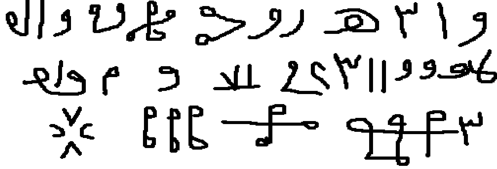

**AR:** (وَصْفُ طِلَسْمِ الطَّاسَةِ) ثَلَاثَةُ اَسْطُرٍ بِخَطٍّ يَدَوِىٍّ عَرِيْضٍ:

- **السَّطْرُ الْاَوَّلُ:** يَبْدَاُ مِنَ الْيَمِيْنِ بِـ«**٩ ١ ٢**» ثُمَّ شَكْلٌ بَيْضَاوِىٌّ (عَيْنٌ) ثُمَّ قَوْسَانِ «**٢ ٢**» ثُمَّ «**٥**» كَبِيْرَةٌ ثُمَّ حُرُوْفٌ مَقْطُوْعَةٌ تَنْتَهِى بِـ«**ل ا**».
- **السَّطْرُ الثَّانِىَ:** «**هـ ٩ ٩ ٥ ١١ ٣ ٢ ٥ ٢**» مُتَدَاخِلَةً ثُمَّ خَطٌّ مُسْتَقِيْمٌ ثُمَّ «**٥**» وَنُقْطَةٌ ثُمَّ «**ع ٦**».
- **السَّطْرُ الثَّالِثُ:** عَلَامَةُ «**<**» ثُمَّ «**٧**» مُزْدَوِجَةٌ (عَلَى شَكْلِ «**٨**» صَغِيْرَةٍ) ثُمَّ ثَلَاثَةُ اَشْكَالٍ رَاْسِيَّةٍ «**ا ا ا**» ثُمَّ «**٩ ٤**» صَغِيْرَةٌ ثُمَّ «**٤ ٩ ٢ ق**».

**LAT:** (waṣfu ṭilasma al-ṭāsati) thalāthatu asṭurin bi-khaṭṭin yadawiyyin ‘arīḍin: [al-saṭru al-awwalu: yabda’u mina al-yamīni bi-«9 1 2» thumma shaklun bayḍāwiyyun (‘aynun) thumma qawsāni «2 2» thumma «5» kabīratun thumma ḥurūfun maqṭū‘atun tantahī bi-«l a»; al-saṭru al-thāni: «h 9 9 5 11 3 2 5 2» mutadākhilatan thumma khaṭṭun mustaqīmun thumma «5» wa-nuqṭatun thumma «‘ 6»; al-saṭru al-thālithu: ‘alāmatu «<» thumma «7» muzdawajatun thumma thalāthatu ashkālin rā’siyyatin «a a a» thumma «9 4» ṣaghīratun thumma «4 9 2 q»]

**ID:** “**(Deskripsi ṭilasm mangkuk)**: **tiga baris** dengan **tulisan tangan tebal**: **Baris 1** — dimulai dari kanan dengan «**٩ ١ ٢**»، lalu **bentuk oval (mata)**، lalu **dua busur «٢ ٢»**، lalu «**٥**» besar, lalu huruf terpotong yang berakhir «**ل ا**»؛ **Baris 2** — «**هـ ٩ ٩ ٥ ١١ ٣ ٢ ٥ ٢**» bertumpuk, lalu **garis lurus**, lalu «**٥**» dan titik, lalu «**ع ٦**»؛ **Baris 3** — tanda «**<**»، lalu «**٧**» ganda, lalu **tiga bentuk tegak «ا ا ا»**، lalu «**٩ ٤**» kecil, lalu «**٤ ٩ ٢ ق**».” **Catatan**: angka-angka ini **tulisan tangan** dan **tidak dapat dipastikan** — bacaan di atas adalah **perkiraan visual**; pembaca dirujuk ke rajah.

**AR:** فَائِدَةٌ لِلْمَرْاَةِ الَّتِىْ تَغْضَبُ مِنْ زَوْجِهَا

**LAT:** fā’idatun lil-mar’ati allatī taghḍabu min zawjihā

**ID:** “**Fā’idah untuk Perempuan yang Marah kepada Suaminya.**” (Judul bagian.)

**AR:** تَاْخُذُ مِسْمَارَ حَدِيْدٍ مِنْ عِنْدِ الْحَدَّادِ مُرَبَّعٍ وَيَكُوْنُ لَمْ يُسْتَعْمَلْ مِنْ قَبْلُ وَتَكْتُبُ عَلٰى كُلِّ وَجْهٍ مِنْ اَوْجُهِهِ الْاَرْبَعَةِ مَا يَاْتِى، وَبَعْدَ الْاِنْتِهَاءِ مِنَ الْكِتَابَةِ يُبَخِّرُ بِاللُّبَانِ وَالْجَاوِىِّ وَالْكُزْبَرَةِ وَتَعْزِمُ عَلَيْهِ بِسُوْرَةِ الْمُلْكِ ١١ مَرَّةً وَبَعْدَ كُلِّ مَرَّةٍ تَوَكُّلٌ، وَصِفَةُ التَّوْكِيْلِ: «تَوَكَّلُوْ يَا رُوحَانِيَّةَ هَذِةِ السُّوْرَةِ الشَّرِيْفَةِ بِغَلَانَةَ حَتّٰى لَا تَغْضَبَ وَلَا تَتْرُكَ الْبَيْتَ اَبَدًا مَا دَامَ الْمِسْمَارُ مَدْقُوْقٌ». وَبَعْدَ اَنْ تُدَقَّ الْمِسْمَارُ عَزَمَ مَرَّةً اُخْرٰى بِنَفْسِ السُّوْرَةِ ٧ مَرَّاتٍ وَهِىَ مُجَرَّبَةٌ وَصَحِيْحَةٌ

**LAT:** ta’khudhu mismāra ḥadīdin min ‘indi al-ḥaddādi murabba‘in wa-yakūnu lam yusta‘mal min qablu wa-taktubu ‘alā kulli wajhin min awjuhihi al-arba‘ati mā ya’tī, wa-ba‘da al-intihā’i mina al-kiTābati yubakhkhiru bi-al-lubāni wa-al-jāwiyyi wa-al-kuzbarati wa-ta‘zimu ‘alayhi bi-sūrati al-mulki 11 marratan wa-ba‘da kulli marratin tawakkulun, wa-ṣifatu al-tawkīli: «tawakkalū yā rūḥāniyyata hādhihi al-sūrati al-sharīfati bi-Ghalānata ḥattā lā taghḍaba wa-lā tatruka al-bayta abadan mā dāma al-mismāru madqūqun». Wa-ba‘da an tudaqqa al-mismāru ‘azama marratan ukhrā bi-nafsi al-sūrati 7 marrātin wa-hiya mujarrabatun wa-ṣaḥīḥatun

**ID:** “Engkau **mengambil paku besi persegi dari tukang besi** yang **belum pernah dipakai**, lalu **menulis pada keempat sisinya** sebagaimana berikut; dan **setelah selesai menulis**, **(paku) didupai dengan lubān, jawi, dan kuzbarah**; lalu engkau **mengazamkan atasnya dengan surah al-Mulk ١١×**, dan **setiap kali (selesai) satu tawkil**; dan **lafal tawkilnya**: «**Bertawkillah, wahai ruhaniyyah surah yang mulia ini, (datangkan) «بِغَلَانَة» (?) agar ia tidak marah dan tidak meninggalkan rumah selamanya, selama paku masih tertancap**». Dan **setelah paku ditancapkan**, engkau **mengazam sekali lagi dengan surah yang sama ٧×** — dan amalan ini **teruji dan sahih**.”

**Keterangan halaman.** Halaman ini memuat: (1) **penutup «محبة وجلب سريع الاجابة»** dari halaman 440 — **«الوحا العجل الساعة»** dan **ṣarf dengan al-Zalzalah sampai «اشتاتا» ٣×** (dengan «اشتاتا» diulang **٣×** setiap kali); (2) **«احراق الليمونة»** — cara yang **sama** dengan «اغرب ابواب المحبة» pada halaman 439 (kertas berisi asmā’ + **lubān dhakar** dimasukkan ke dalam **limau**, lalu **limau dibakar dalam mangkuk berisi minyak wangi**), ditambah **ṭilasm pada mangkuk** yang **ditulis dengan jarum** (rajah-01) dan **teks azam panjang** yang memuat **ancaman api** serta nama talismanic «**اهطمفشذ**»، «**جليش جليش**»، «**بشعشع**»، «**زعزعان**»، «**سحيق**»; (3) **«فائدة للمرأة التى تغضب من زوجها»** — **paku besi persegi baru** yang **ditulisi pada keempat sisinya**, **didupai lubān + jawi + kuzbarah**, **al-Mulk ١١×** dengan **tawkil** setiap kali, lalu **paku ditancapkan** dan **al-Mulk ٧×** lagi.

**Angka pada halaman ini.** **٣×** (ṣarf dan pengulangan «اشتاتا»)؛ **١١×** (al-Mulk, cocok antara lapisan teks dan pindaian)؛ **٧×** (azam setelah paku ditancapkan — juga cocok). Angka-angka di dalam **ṭilasm mangkuk** adalah **tulisan tangan** dan **tidak dapat dipastikan**.

**[TIDAK JELAS - HALAMAN 441]** (1) **Seluruh isi ṭilasm mangkuk** — tulisan tangan dengan angka bertumpuk; **[TEKS ASLI DIJAGA]**, hanya dideskripsikan bentuknya. (2) **«بِغَلَانَةَ»** pada lafal tawkil — **tidak jelas**; kemungkinan **nama ruhaniyyah** atau salah cetak — **dipertahankan dan ditandai**. (3) **«وَتَقُوْرُهَا فِى رَاْسِهَا»** — kemungkinan «تقوّرها في رأسها» = **mengukir/membuang bagian atasnya**; **dipertahankan**. (4) **«مُرَبَّعٍ»** pada «مسمار حديد … مربع» — **tidak jelas** apakah «persegi» atau «berbentuk empat persegi»; **dipertahankan**. (5) **«الْوَحَا الزَّحَا»** — «الزحا» **tidak jelas** (mungkin salah cetak untuk «الوحا») — **dipertahankan dan ditandai**. (6) **«هَذِةِ»** dan **«تُوْضَعُ»/«تُوْضِّعُ»** — ejaan cetakan **dipertahankan**. (7) **«يُبَخِّرُ»** (bentuk mudhakkar) pada langkah yang subjeknya perempuan — **dipertahankan**. (8) **«الْكُزْبَرَةِ»** = **kuzbarah (ketumbar)** — **dipertahankan**.

**Peringatan (dicatat apa adanya, bukan fatwa).** Bagian **«احراق الليمونة»** dan teks azamnya memakai **ancaman membakar** agar ruh memaksa orang yang diminta mencintai peminta. Teks **ditranskripsikan sesuai cetakan**; pembaca perlu mengetahui bahwa **memaksa kehendak orang lain** bertentangan dengan ajaran Islam.

**[ADA RAJAH]** — 1 crop: `assets/rajah/sirrul-asrar/hal-441-rajah-01.png` (700 DPI, Rect(129.0, 380.0, 484.0, 501.0)). Total berkas rajah menjadi **118**.

---
## HALAMAN 442 — «محبة ياكلها المطلوب او يشرب» (ṭilasm 4 wajah dengan ayat) + «جلب قوى للمحبوب» (fatilah + عزيمة ازعجية)

**AR:** كِتَابُ سِرِّ الْاَسْرَارِ فِي التَّوَاصُلِ مَعَ رُوحَانِيَّاتِ الْقُرْآنِ — شَيْخُ الرُّوحَانِيِّينَ الشَّيْخُ عَطِيَّةُ عَبْدُ الْحَمِيدِ

**LAT:** kitābu sirri al-asrāri fī al-tawāṣuli ma‘a rūḥāniyyāti al-qur’āni — shaykhu al-rūḥāniyyīna al-shaykhu ‘Aṭiyyatu ‘Abdu al-Ḥamīdi

**ID:** “Kitab «Sirr al-Asrār fī al-Tawāṣul ma‘a Rūḥāniyyāt al-Qur’ān» — Syaikh para ruhaniyyin, Syaikh ‘Aṭiyyah ‘Abd al-Ḥamīd.” (Kepala halaman.)

**AR:** مَحَبَّةٌ يَاْكُلُهَا الْمَطْلُوْبُ اَوْ يَشْرَبُ

**LAT:** maḥabbatun ya’kuluhā al-maṭlūbu aw yashrabu

**ID:** “**Maḥabbah yang Dimakan atau Diminum oleh Orang yang Diminta.**” (Judul bagian.)

**Rajah:** 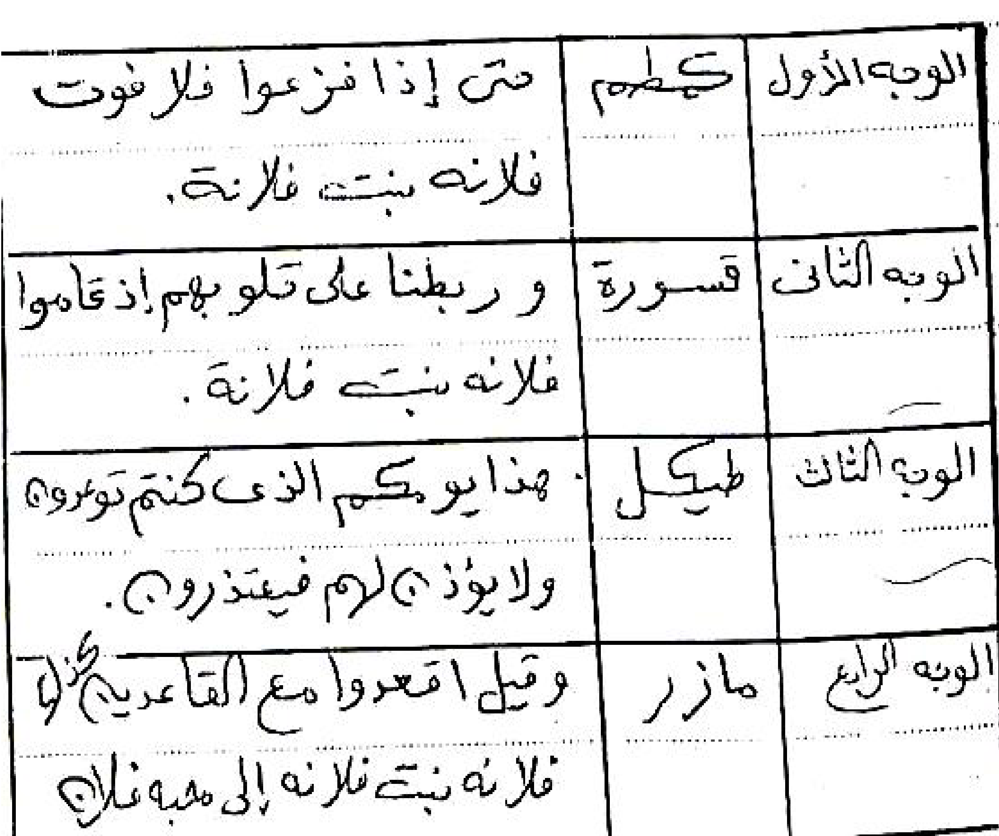

**AR:** (وَصْفُ الطِّلَسْمِ) جَدْوَلٌ مُرَبَّعٌ مُقَسَّمٌ اِلَى **اَرْبَعَةِ صُفُوْفٍ**، كُلُّ صَفٍّ مِنْ **ثَلَاثِ خَلَايَا**: الْخَلِيَّةُ الْيُمْنٰى فِيْهَا «**الْوَجْهُ الْاَوَّلُ**»، «**الْوَجْهُ الثَّانِىْ**»، «**الْوَجْهُ الثَّالِثُ**»، «**الْوَجْهُ الرَّابِعُ**»؛ الْخَلِيَّةُ الْوُسْطٰى فِيْهَا كَلِمَةٌ طِلَسْمِيَّةٌ: «**كَمْطَم**»، «**قَسْوَرَة**»، «**طَفْكَل**»، «**مَازِر**»؛ وَالْخَلِيَّةُ الْيُسْرٰى (الْعَرِيْضَةُ) فِيْهَا مِنَ الْقُرْآنِ:

- **الْوَجْهُ الْاَوَّلُ:** «**حَتّٰى اِذَا فَزِعُوْا فَلَا فَوْتَ … فُلَانَةَ بِنْتَ فُلَانَةَ**».
- **الْوَجْهُ الثَّانِىْ:** «**وَرَبَّنَا عَلٰى كُلِّ شَىْءٍ حَفِيْظًا … فُلَانَةَ بِنْتَ فُلَانَةَ**» (dekat Q.S. 34:21).
- **الْوَجْهُ الثَّالِثُ:** «**هَذَا يَوْمُكُمُ الَّذِىْ كُنْتُمْ تُوْعَدُوْنَ … وَلَا يُؤْذَنْ لَهُمْ فَيَعْتَذِرُوْنَ**» (Q.S. 21:103 / 77:36).
- **الْوَجْهُ الرَّابِعُ:** «**وَعَلَى الْقَاعِدِيْنَ … فُلَانَةَ بِنْتَ فُلَانَةَ اِلٰى مَحَبَّةِ فُلَانٍ**» (Q.S. 9:91 dsb.).

**LAT:** (waṣfu al-ṭilasma) jadwalun murabba‘un muqassamun ilā arba‘ati ṣufūfin, kullu ṣaffin min thalāthi khalāyā: al-khaliyyatu al-yumnā fīhā «al-wajhu al-awwalu»، «al-wajhu al-thānī»، «al-wajhu al-thālithu»، «al-wajhu al-rābi‘u»؛ al-khaliyyatu al-wusṭā fīhā kalimatun ṭilassamiyyatun: «kamṭam»، «qaswara»، «ṭafkal»، «māzir»؛ wa-al-khaliyyatu al-yusrā (al-‘arīḍatu) fīhā mina al-qur’āni: al-wajhu al-awwalu «ḥattā idhā fazi‘ū fa-lā fawta … fulānata binta fulānata»؛ al-wajhu al-thānī «wa-rabbanā ‘alā kulli shay’in ḥafīẓan … fulānata binta fulānata»؛ al-wajhu al-thālithu «hādhā yawmukumu alladhī kuntum tū‘adūna … wa-lā yu’dhanu lahum fa-ya‘tadhirūna»؛ al-wajhu al-rābi‘u «wa-‘alā al-qā‘idīna … fulānata binta fulānata ilā maḥabbati fulānin».

**ID:** “**(Deskripsi ṭilasm)**: tabel kotak terbagi **empat baris**, tiap baris **tiga sel**: **sel kanan** berisi «**الوجه الأول**»، «**الوجه الثاني**»، «**الوجه الثالث**»، «**الوجه الرابع**»; **sel tengah** berisi satu **kata ṭilasm**: «**كَمْطَم**»، «**قَسْوَرَة**»، «**طَفْكَل**»، «**مَازِر**»; **sel kiri (lebar)** berisi **potongan ayat**: **wajah 1** — «**حتى إذا فزعوا فلا فوت … فلانة بنت فلانة**»؛ **wajah 2** — «**وربنا على كل شيء حفيظا … فلانة بنت فلانة**»(**Q.S. 34:21**)؛ **wajah 3** — «**هذا يومكم الذي كنتم توعدون … ولا يؤذن لهم فيعتذرون**» (**Q.S. 21:103** dan **77:36**)؛ **wajah 4** — «**وعلى القاعدين … فلانة بنت فلانة إلى محبة فلان**» (**Q.S. 9:91**).” **Catatan**: susunan ayat di dalam sel **terpotong dan tidak lengkap** pada cetakan; yang ditulis di sini adalah **bacaan visual** atas tulisan tangan.

**AR:** يُكْتَبُ هَذَا الطِّلَسْمُ عَلٰى ٧ قِطَعِ سُكَّرٍ اَوْ شَوْكُولَاتَةٍ اَوْ سَبْعِ فَوَاكِهَ تُفَّاحٍ اَوْ غَيْرِهِ، فَاِنَّهُ غَايَةٌ فِى الْمَحَبَّةِ. تُكْتَبُ الطِّلَسْمُ الْمُشَارُ اِلَيْهِ وَتُبَخَّرُ بِاللُّبَانِ الذَّكَرِ فَقَطْ وَتُعْزَمُ عَلَيْهِ بِالْبَرْهَتِيَّةِ ٧ اَوْ ١١ اَوْ ١٢ مَرَّةً، وَبَعْدَ تَقْرَاُ هَذِهِ الْايَةَ الشَّرِيْفَةَ (وَذَلَّلْنَاهَا لَهُمْ فَمِنْهَا رَكُوْبُهُمْ وَمِنْهَا يَاْكُلُوْنَ) كَذَلِكَ يُذَلَّلُ فُلَانٌ ابْنُ فُلَانَةَ اِلٰى مَحَبَّةِ وَعِشْقِ وَطَاعَةِ فُلَانَةَ بِنْتِ فُلَانَةَ. وَيَكُوْنُ وَقْتُ الْعَمَلِ سَاعَةَ الزُّهْرَةِ اَوَّلَ الشَّهْرِ الْعَرَبِىِّ فَاِنَّهُ يَكُوْنُ مَا اَرَدْتَ. وَهَذَا الطِّلَسْمُ:

**LAT:** yuktabu hādhā al-ṭilasmu ‘alā 7 qiṭa‘i sukkarin aw shūkulātatin aw sab‘i fawākiha tuffāḥin aw ghayrihi, fa-innahu ghāyatun fī al-maḥabbati. Tuktabu al-ṭilasmu al-mushāru ilayhi wa-tubakhkharu bi-al-lubāni al-dhakari faqaṭ wa-tu‘zamu ‘alayhi bi-al-barhatiyyati 7 aw 11 aw 12 marratan, wa-ba‘da taqra’u hādhihi al-āyata al-sharīfata («wa-dhallalnāhā lahum fa-minhā rakūbuhum wa-minhā ya’kulūna») kadhālika yudhallalu fulānun ibnu fulānata ilā maḥabbati wa-‘ishqi wa-ṭā‘ati fulānata binti fulānata. Wa-yakūnu waqtu al-‘amali sā‘ata al-zuhrati awwala al-shahri al-‘arabiyyi fa-innahu yakūnu mā aradta. Wa-hādhā al-ṭilasmu:

**ID:** “**Ṭilasm ini dituliskan pada ٧ potong gula**, atau **cokelat**, atau **tujuh buah apel** atau lainnya — maka ia **puncak dalam (menimbulkan) cinta**. **Ṭilasm tersebut ditulis**, lalu **didupai dengan lubān dhakar saja**, dan **diazamkan atasnya dengan al-Barhatiyyah ٧× atau ١١× atau ١٢×**; dan **sesudah itu engkau membaca ayat mulia ini**: «**Wa dhallalnāhā lahum fa-minhā rakūbuhum wa-minhā ya’kulūn**» (**Q.S. 36:72**). Demikian pula **Fulan bin Fulanah ditundukkan** menuju **cinta, kerinduan, dan kepatuhan kepada Fulanah binti Fulanah**. Dan **waktu amalnya adalah saat Zuhrah pada awal bulan Arab** — maka **terjadilah apa yang engkau kehendaki**. **Dan inilah ṭilasmnya**:”

**Rajah:** 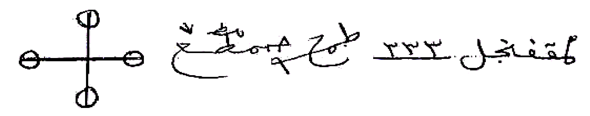

**AR:** (وَصْفُ الطِّلَسْمِ الثَّانِى) مِنَ الْيَسَارِ: **صَلِيْبٌ** تَنْتَهِى اَطْرَافُهُ الْاَرْبَعَةُ بِدَوَائِرَ صَغِيْرَةٍ، ثُمَّ كَلِمَاتٌ مُتَّصِلَةٌ مُتَرَاكِبَةٌ تَقْرِيْبًا «**بَهْمَطَغَ … يَطْعَجَ … مَهْجَعَ**»، ثُمَّ كَلِمَةٌ اَخِيْرَةٌ تَنْتَهِى بِرُقُوْمٍ «**٣٣٤**» تَقْرِيْبًا.

**LAT:** (waṣfu al-ṭilasma al-thāni) mina al-yasāri: ṣalībun tantahī aṭrāfuhu al-arba‘atu bi-dawā’ira ṣaghīratin, thumma kalimātun muttaṣilatun mutarākibatun taqrīban «bahmaṭagha … yaṭ‘aja … mahja‘a»، thumma kalimatun akhīratun tantahī bi-ruqūmin «334» taqrīban.

**ID:** “**(Deskripsi ṭilasm kedua)** dari **kiri**: sebuah **salib** yang **keempat ujungnya berakhir dengan lingkaran kecil**; lalu **kata-kata bersambung bertumpuk** (perkiraan) «**بَهْمَطَغَ … يَطْعَجَ … مَهْجَعَ**»; lalu **satu kata terakhir** yang berakhir dengan **angka «٣٣٤»** (perkiraan).”

**AR:** جَلْبٌ قَوِىٌّ لِلْمَحْبُوْبِ

**LAT:** jalbun qawiyyun lil-maḥbūbi

**ID:** “**Jalb (Penghadiran) yang Kuat untuk Orang yang Dicintai.**” (Judul bagian.)

**AR:** يُكْتَبُ عَلٰى اَثَرِ الْمَطْلُوْبِ هَذَا الطِّلَسْمُ وَاجْعَلْهُ فَتِيْلَةً بِزَيْتٍ طَيِّبٍ فِى مِسْرَجَةٍ وَاَوْقِدْهَا وَاجْلِسْ اَمَامَهَا وَتَخَيَّلِ الْمَطْلُوْبَ فَاِنَّهُ يَتَجَسَّدُ اَمَامَكَ فِى الْفَتِيْلَةِ وَهُوَ تَقْرَاُ الْعَزِيْمَةَ الْاِزْعَاجِيَّةَ وَهِىَ مَوْجُوْدَةٌ فِى قِسْمِ الدَّعَوَاتِ الْمَوْجُوْدِ بِكِتَابِنَا هَذَا، وَبَخُوْرُكَ اللُّبَانُ وَالْعُوْدُ، وَعَمَلُكَ يَكُوْنُ لَيْلَةَ الْخَمِيْسِ بَعْدَ الْمَغْرِبِ اَوَّلَ الشَّهْرِ الْعَرَبِىِّ. وَيَنْفَعُ اَيْضًا لِتَفْرِيْقَةٍ بِنَفْسِ الْكَيْفِيَّةِ وَلَكِنَّ اخِرَ الشَّهْرِ الْعَرَبِىِّ يَوْمَ السَّبْتِ. وَهَذَا الطِّلَسْمُ الْمُشَارُ اِلَيْهِ

**LAT:** yuktabu ‘alā athari al-maṭlūbi hādhā al-ṭilasmu wa-ij‘alhu fatīlatan bi-zaytin ṭayyibin fī misrajatin wa-awqidhā wa-ijlis amāmahā wa-takhayyal al-maṭlūba fa-innahu yatajassadu amāmaka fī al-fatīlati wa-huwa taqra’u al-‘azīmata al-iz‘ājiyyata wa-hiya mawjūdatun fī qismi al-da‘awāti al-mawjūdi bi-kitābinā hādhā, wa-bakhūruka al-lubānu wa-al-‘ūdu, wa-‘amaluka yakūnu laylata al-khamīsi ba‘da al-maghribi awwala al-shahri al-‘arabiyyi. Wa-yanfa‘u ayḍan li-tafrīqatin bi-nafsi al-kayfiyyati wa-lākinna ākhira al-shahri al-‘arabiyyi yawma al-sabti. Wa-hādhā al-ṭilasmu al-mushāru ilayhi

**ID:** “**Ṭilasm ini dituliskan pada aṡar orang yang diminta**, lalu **jadikan ia sumbu lampu (fatīlah) dengan minyak wangi dalam misrajah (lentera)** dan **nyalakan**; lalu **duduklah di hadapannya** dan **bayangkan orang yang diminta** — maka **ia akan menjelma di hadapanmu dalam sumbu itu**; dan engkau **membaca «al-‘Azīmah al-Iz‘ājiyyah»** (azam pengganggu) yang **terdapat pada bagian doa-doa dalam kitab kami ini**; **dupa-mu: lubān dan ‘ūd**; dan **amalmu dilakukan pada malam Kamis setelah maghrib pada awal bulan Arab**. Dan ia **bermanfaat juga untuk tafriqah (perceraian)** dengan **tata cara yang sama**, tetapi pada **akhir bulan Arab pada hari Sabtu**. **Dan inilah ṭilasm yang dimaksud**:” (Kalimat berakhir di akhir halaman; lanjutan ke **halaman 443**.)

**Keterangan halaman.** Halaman ini memuat dua bagian: (1) **«محبة ياكلها المطلوب او يشرب»** — **ṭilasm empat wajah** (rajah-01) yang **ditulis pada ٧ potong gula/cokelat/tujuh buah apel**, didupai **lubān dhakar saja**, **al-Barhatiyyah ٧/١١/١٢×**, lalu **Q.S. 36:72** «وذللناها لهم فمنها ركوبهم ومنها يأكلون» sebagai **dasar penundukan**; waktu amal **saat Zuhrah awal bulan Arab**; (2) **«جلب قوى للمحبوب»** — **ṭilasm kedua** (rajah-02: **salib berujung lingkaran** + baris huruf dan angka) yang **ditulis pada aṡar** lalu **dijadikan sumbu lampu**, dibakar, **membayangkan yang diminta** sampai **menjelma dalam sumbu**, sambil membaca **«العزيمة الازعاجية»** (yang **tidak dicetak** di halaman ini, hanya dirujuk ke bagian doa); **dupa lubān + ‘ūd**، **malam Kamis setelah maghrib awal bulan**; **untuk tafriqah** (perceraian) dengan cara sama pada **Sabtu akhir bulan**.

**Angka pada halaman ini.** **٧ potong**، **٧ / ١١ / ١٢×** (al-Barhatiyyah)، **٣٣٤** (perkiraan pada ṭilasm). Lapisan teks mengekstrak «١٢» pada «او ١٢ مرة» — **pindaian juga menunjukkan ١٢** (bukan angka terbalik) — **dipertahankan**. Angka **٣٣٤** adalah **perkiraan visual**.

**[TIDAK JELAS - HALAMAN 442]** (1) **Kedua ṭilasm** — **tulisan tangan** dengan kata/angka bertumpuk; **[TEKS ASLI DIJAGA]**, hanya dideskripsikan bentuknya. (2) **Kata-kata tengah «كَمْطَم، قَسْوَرَة، طَفْكَل، مَازِر»** — **kata ṭilasm tanpa makna leksikal** (sebagian bertepatan dengan kata Arab lain seperti «قَسْوَرَة» = singa) — **dipertahankan** dan ditandai. (3) **Potongan ayat di dalam sel** **terputus dan tidak lengkap** («حتى إذا فزعوا فلا فوت»، «وربنا على كل شيء حفيظا»، «هذا يومكم الذي كنتم توعدون»، «وعلى القاعدين») — **dipertahankan** sesuai cetakan dan diberi rujukan ayat. (4) **«تُبَخَّرُ … وَتُعْزَمُ»** (bentuk mu’annath untuk ṭilasm) — **dipertahankan**. (5) **«الْعَزِيْمَةَ الْاِزْعَاجِيَّةَ»** — azam yang **dirujuk tetapi tidak dicetak** pada halaman ini; **dipertahankan** dan dijelaskan. (6) **«بَهْمَطَغَ … يَطْعَجَ»** — **perkiraan bacaan** atas tulisan tangan. (7) **«مِسْرَجَةٍ»** — lentera/tempat sumbu; **dipertahankan**. (8) **«لِتَفْرِيْقَةٍ»** — maksudnya **amalan pemisah/penceraian**; **dipertahankan** dan dijelaskan.

**Peringatan (dicatat apa adanya, bukan fatwa).** Bagian **«جلب قوى للمحبوب»** menyebut manfaat amalan untuk **«tafriqah» (perceraian)** — yakni memisahkan suami-istri — dan memakai **azam pengganggu**. Teks **ditranskripsikan sesuai cetakan**; pembaca perlu mengetahui bahwa **merusak hubungan suami-istri** dan **memaksa kehendak orang lain** bertentangan dengan ajaran Islam.

**[ADA RAJAH]** — 2 crop: `assets/rajah/sirrul-asrar/hal-442-rajah-01.png` (700 DPI, Rect(141.0, 69.0, 472.0, 346.0)) dan `assets/rajah/sirrul-asrar/hal-442-rajah-02.png` (700 DPI, Rect(112.0, 484.0, 502.0, 561.0)). Total berkas rajah menjadi **120**.

---
## HALAMAN 443 — «جلب الرجل لزوجته وطاعته لها» (ṭilasm al-Zuhrah) + «فائدة مذلة الرجل للمرأة وحكمها فيه» (dua naskah, ditulis di piring porselen + kontak penulis)

**AR:** كِتَابُ سِرِّ الْاَسْرَارِ فِي التَّوَاصُلِ مَعَ رُوحَانِيَّاتِ الْقُرْآنِ — شَيْخُ الرُّوحَانِيِّينَ الشَّيْخُ عَطِيَّةُ عَبْدُ الْحَمِيدِ

**LAT:** kitābu sirri al-asrāri fī al-tawāṣuli ma‘a rūḥāniyyāti al-qur’āni — shaykhu al-rūḥāniyyīna al-shaykhu ‘Aṭiyyatu ‘Abdu al-Ḥamīdi

**ID:** “Kitab «Sirr al-Asrār fī al-Tawāṣul ma‘a Rūḥāniyyāt al-Qur’ān» — Syaikh para ruhaniyyin, Syaikh ‘Aṭiyyah ‘Abd al-Ḥamīd.” (Kepala halaman.)

**Rajah:** 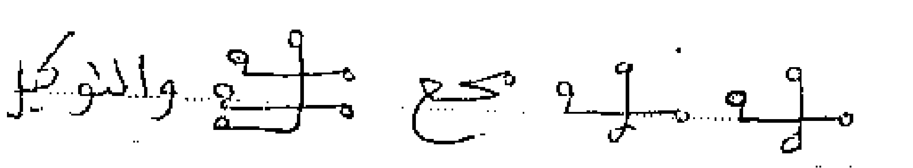

**AR:** (تَكْمِلَةُ طِلَسْمِ «جَلْبٍ قَوِىٍّ لِلْمَحْبُوْبِ» مِنْ صَفْحَةِ ٤٤٢) سَطْرٌ وَاحِدٌ طَوِيْلٌ مِنَ الْيَمِيْنِ اِلَى الْيَسَارِ: **ثَلَاثُ عَلَامَاتٍ عَلٰى شَكْلِ «صَلِيْبٍ»** تَنْتَهِى اَطْرَافُهَا بِدَوَائِرَ صَغِيْرَةٍ، بَيْنَهَا **شَكْلٌ مُتَعَرِّجٌ**، وَعَلَى الْيَسَارِ كَلِمَاتٌ مُتَّصِلَةٌ تَقْرِيْبًا «**وَالنُّوْرُ … لِکَ**».

**LAT:** (takmilatu ṭilasma «jalbin qawiyyin lil-maḥbūbi» min ṣafḥati 442) saṭrun wāḥidun ṭawīlun mina al-yamīni ilā al-yasāri: thalāthu ‘alāmātin ‘alā shakli «ṣalībin» tantahī aṭrāfuhā bi-dawā’ira ṣaghīratin, baynahā shaklun muta‘arrijun, wa-‘alā al-yasāri kalimātun muttaṣilatun taqrīban «wa-al-nūru … lika».

**ID:** “**(Lanjutan ṭilasm «Jalb Kuat untuk Orang yang Dicintai» dari halaman 442)** — kalimat halaman 442 ditutup «**وهذا الطلسم المشار اليه**» dan **ṭilasmnya tercetak di awal halaman ini**: **satu baris panjang** dari kanan ke kiri, memuat **tiga tanda berbentuk «salib»** yang **ujungnya berakhir dengan lingkaran kecil**, di antaranya **bentuk berkelok**, dan di **kiri** kata-kata bersambung (perkiraan) «**والنور … لك**».”

**AR:** جَلْبُ الرَّجُلِ لِزَوْجَتِهِ وَطَاعَتِهِ لَهَا اِلَى الْمَمَاتِ

**LAT:** jalb al-rajuli li-zawjatihi wa-ṭā‘atihi lahā ilā al-mamāti

**ID:** “**Menghadirkan Suami kepada Istrinya dan Kepatuhannya kepadanya sampai Mati.**” (Judul bagian.)

**Rajah:** 

**AR:** يُكْتَبُ فِى وَرَقَةٍ وَيُمْحَىْ وَتُغْسَلُ الطَّالِبَةُ بِالْمَاءِ الْقَرْنِ(؟) وَيُسْقَى لِلْمَطْلُوْبِ. وَهُوَ طِلَسْمُ الزُّهْرَةِ. وَهَذَا هُوَ — «اِجْلِبُوْا يَا خُدَّامَ هَذِهِ الطَّلَاسِمِ قَلْبَ وَعَقْلَ وَلُبَّ وَجَمِيْعَ جَوَارِحِ فُلَانٍ ابْنِ فُلَانَةَ فِى مَحَبَّةِ وَعِشْقِ وَطَاعَةِ وَسَمَاعِ قَوْلِ فُلَانَةَ بِنْتِ فُلَانَةَ»

**LAT:** yuktabu fī waraqatin wa-yumḥā wa-tughsalu al-ṭālibatu bi-al-mā’i al-qarni(?) wa-yusqā lil-maṭlūbi. Wa-huwa ṭilasma al-zuhrati. Wa-hādhā huwa — «ijlibū yā khuddāma hādhihi al-ṭalāsima qalba wa-‘aqla wa-lubba wa-jamī‘a jawāriḥi fulānin ibni fulānata fī maḥabbati wa-‘ishqi wa-ṭā‘ati wa-samā‘i qawli fulānata binti fulānata»

**ID:** “Dituliskan pada selembar kertas lalu **dihapus (dilarutkan)**, dan **peminta (perempuan) mandi dengan «air qarn»(؟)**; lalu **(airnya) diminumkan kepada orang yang diminta**. Dan ia adalah **ṭilasm al-Zuhrah (ṭilasm bintang Venus)**. Dan **inilah dia** (lihat **rajah-01**) — «**Hadirkanlah, wahai para pelayan ṭilasm-ṭilasm ini, hati, akal, lubuk (kalbu), dan seluruh anggota badan Fulan bin Fulanah dalam cinta, kerinduan, kepatuhan, dan kesediaan mendengar ucapan Fulanah binti Fulanah.**»”

**AR:** (وَصْفُ طِلَسْمِ الزُّهْرَةِ) سَطْرٌ وَاحِدٌ بِخَطٍّ يَدَوِىٍّ: عَلَامَةٌ عَلٰى شَكْلِ **صَلِيْبٍ تَنْتَهِى اَطْرَافُهُ بِدَوَائِرَ**، ثُمَّ **شَكْلٌ كَبِيْرٌ مُتَعَرِّجٌ يُشْبِهُ «ع»**، ثُمَّ رُقُوْمٌ وَحُرُوْفٌ مَقْطُوْعَةٌ.

**LAT:** (waṣfu ṭilasma al-zuhrati) saṭrun wāḥidun bi-khaṭṭin yadawiyyin: ‘alāmatun ‘alā shakli ṣalībin tantahī aṭrāfuhu bi-dawā’ira, thumma shaklun kabīrun muta‘arrijun yushbihu «‘»، thumma ruqūmun wa-ḥurūfun maqṭū‘atun.

**ID:** “**(Deskripsi ṭilasm al-Zuhrah)**: **satu baris** dengan **tulisan tangan**: sebuah **tanda berbentuk salib yang ujungnya berakhir dengan lingkaran-lingkaran**, lalu **bentuk besar berkelok menyerupai «ع»**, lalu **angka dan huruf terpotong**.”

**AR:** فَائِدَةٌ مُذَلِّلَةٌ الرَّجُلَ لِلْمَرْأَةِ وَحُكْمُهَا فِيْهِ

**LAT:** fā’idatun mudhallilatun al-rajula lil-mar’ati wa-ḥukmuhā fīhi

**ID:** “**Fā’idah Penunduk Suami kepada Istri dan Hukumnya di Dalamnya.**” (Judul bagian.)

**AR:** تُكْتَبُ فِى نُسْخَتَيْنِ: وَاحِدَةٌ تَحْمِلُهَا الْمَرْاَةُ وَالثَّانِيَةُ تُمْحَىْ وَتُسْقَى لِزَوْجِهَا. وَهِىَ اَنْ تُؤْمَرَهَا بِغَسِيْلِ يَدَيْهَا وَرِجْلَيْهَا جَيِّدًا اَوَّلًا ثُمَّ تَغْسِلُ ثَانِىَ مَرَّةٍ بِمَاءٍ بِقَدْرِ كُوْبٍ اَوْ كُوْزِ مَاءٍ ثُمَّ اكْتُبْ فِى طَبَقٍ صِيْنِىٍّ وَامْحَهُ بِالْمَاءِ الْمَذْكُوْرِ ثُمَّ تُسْقِيْهِ لِزَوْجِهَا اَوْ لِلْمَطْلُوْبِ فِى شَاىٍ اَوْ اَىِّ مَشْرُوْبٍ. وَهَذَا مَا يُكْتَبُ:

**LAT:** tuktabu fī nuskhatayni: wāḥidatun taḥmiluhā al-mar’atu wa-al-thāniyatu tumḥā wa-tusqā li-zawjihā. Wa-hiya an tu’marahā bi-ghasīli yadayhā wa-rijlayhā jayyidan awwalan thumma taghsilu thāniya marratin bi-mā’in bi-qadri kūbin aw kūzi mā’in thumma uktub fī ṭabaqin ṣīniyyin wa-imḥuhu bi-al-mā’i al-madhkūri thumma tusqīhi li-zawjihā aw lil-maṭlūbi fī shāyin aw ayyi mashrūbin. Wa-hādhā mā yuktabu:

**ID:** “Dituliskan **dalam dua naskah**: **satu dibawa oleh perempuan** dan **yang kedua dihapus (dilarutkan) lalu diminumkan kepada suaminya**. Dan (caranya) **ia diperintahkan mencuci kedua tangan dan kedua kakinya dengan baik terlebih dahulu**, kemudian **mencuci kedua kali dengan air sebanyak satu gelas atau satu kendi air**; lalu **tulislah pada piring porselen (ṭabaq ṣīnī)** dan **hapuslah dengan air tersebut**; kemudian **minumkan kepada suaminya atau kepada orang yang diminta dalam teh atau minuman apa pun**. **Dan inilah yang ditulis**:”

**AR:** «رَبَّنَا اَرِنَا الَّذِيْنِ اَضَلَّانَا مِنَ الْجِنِّ وَالْاِنْسِ نَجْعَلْهُمَا تَحْتَ اَقْدَامِنَا لِيَكُوْنَا مِنَ الْاَسْفَلِيْنَ — كَذَلِكَ يَسْفَلُ فُلَانٌ ابْنُ فُلَانَةَ تَحْتَ حُكْمِ فُلَانَةَ بِنْتِ فُلَانَةَ بِحَقِّ وَالتِّيْنِ وَالزَّيْتُوْنِ اِلٰى اَسْفَلِ سَافِلِيْنَ — كَذَلِكَ يَسْفَلُ فُلَانٌ ابْنُ فُلَانَةَ تَحْتَ اَقْدَامِ وَحُكْمِ فُلَانَةَ بِنْتِ فُلَانَةَ — قَالَ رَجُلَانِ مِنَ الَّذِيْنَ يَخَافُوْنَ اِنْعَمَ اللهُ عَلَيْهِمَا ادْخُلُوْا عَلَيْهِمُ الْبَابَ فَاِذَا دَخَلْتُمُوْهُ فَاِنَّكُمْ غَالِبُوْنَ — كَذَلِكَ تَغْلِبُ فُلَانَةُ زَوْجَهَا فُلَانًا بِاَلْفِ اَلْفِ لَا حَوْلَ وَلَا قُوَّةَ اِلَّا بِاللهِ الْعَلِىِّ الْعَظِيْمِ»

**LAT:** «rabbanā arinā alladhayni aḍallānā mina al-jinni wa-al-insi naj‘alhumā taḥta aqdāminā li-yakūnā mina al-asfhalīna — kadhālika yasfalu fulānun ibnu fulānata taḥta ḥukmi fulānata binti fulānata bi-ḥaqqi wa-al-tīni wa-al-zaytūni ilā asfali sāfilīna — kadhālika yasfalu fulānun ibnu fulānata taḥta aqdāmi wa-ḥukmi fulānata binti fulānata — qāla rajulāni mina alladhīna yakhāfūna in‘ama allāhu ‘alayhimā udkhulū ‘alayhimu al-bāba fa-idhā dakhaltumūhu fa-innakum ghālibūna — kadhālika taghlibu fulānatu zawjahā fulānan bi-alfi alfi lā ḥawla wa-lā quwwata illā billāhi al-‘aliyyi al-‘aẓīmi»

**ID:** “«**Wahai Tuhan kami, tunjukkanlah kepada kami dua orang yang telah menyesatkan kami dari (golongan) jin dan manusia, agar kami menjadikan keduanya di bawah telapak kaki kami supaya keduanya menjadi orang-orang yang paling rendah**» (**Q.S. 41:29**) — **demikian pula Fulan bin Fulanah jatuh di bawah hukum Fulanah binti Fulanah**, dengan hak «**Wa al-tīni wa al-zaytūni**» (**Q.S. 95:1**) **sampai «asfali sāfilīn»** (**Q.S. 95:5**) — **demikian pula Fulan bin Fulanah jatuh di bawah telapak kaki dan hukum Fulanah binti Fulanah** — **«Berkatalah dua orang laki-laki di antara orang-orang yang takut (kepada Allah) yang Allah telah memberi nikmat kepada keduanya: “Masukilah pintu gerbang itu menuju mereka; apabila kalian memasukinya, maka sesungguhnya kalian akan menang”**» (**Q.S. 5:23**) — **demikian pula Fulanah menang atas suaminya Fulan dengan seribu ribu (kekuatan); tiada daya dan kekuatan kecuali dengan Allah Yang Maha Tinggi lagi Maha Agung.**»”

**Rajah:** 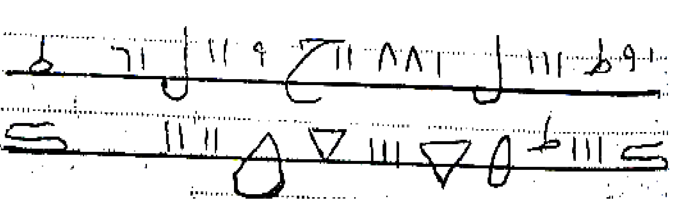

**AR:** (وَصْفُ الطِّلَسْمِ) سَطْرَانِ طَوِيْلَانِ مُتَرَاكِبَانِ بِخَطٍّ يَدَوِىٍّ، يَحْتَوِيَانِ عَلٰى رُقُوْمٍ مِثْلِ «**٩ ١٢ ١**»، «**٨٨**»، «**٩**»، «**٨٦١**»، وَعَلَامَاتٍ مِثْلِ «**ح**»، «**ط**»، «**٧ ٧**»، مَعَ **دَوَائِرَ صَغِيْرَةٍ** وَنُقَطٍ. وَالْاَرْقَامُ **غَيْرُ مَضْبُوْطَةٍ** لِاَنَّهَا خَطٌّ يَدَوِىٌّ.

**LAT:** (waṣfu al-ṭilasma) saṭrāni ṭawīlāni mutarākibāni bi-khaṭṭin yadawiyyin, yaḥtawiyāni ‘alā ruqūmin mithla «9 12 1»، «88»، «9»، «861»، wa-‘alāmātin mithla «ḥ»، «ṭ»، «7 7»، ma‘a dawā’ira ṣaghīratin wa-nuqaṭin. Wa-al-arqāmu ghayru maḍbūṭatin li-annahā khaṭṭun yadawiyyun.

**ID:** “**(Deskripsi ṭilasm)**: **dua baris panjang bertumpuk** dengan **tulisan tangan**, memuat **angka** seperti «**٩ ١٢ ١**»، «**٨٨**»، «**٩**»، «**٨٦١**» dan **tanda** seperti «**ح**»، «**ط**»، «**٧ ٧**»، bersama **lingkaran-lingkaran kecil** dan **titik-titik**. **Angka-angkanya tidak dapat dipastikan** karena merupakan tulisan tangan.”

**AR:** تَوَكَّلُوْ يَا خُدَّامَ هَذِهِ الْايَاتِ وَالْاَحْرُفِ وَالطَّلَاسِمِ وَخَضْعُوْا فُلَانًا ابْنَ فُلَانَةَ اِلٰى زَوْجَتِهِ فُلَانَةَ بِنْتِ فُلَانَةَ بِحَقِّهَا عَلَيْكُمْ وَطَاعَتِهَا لَدَيْكُمْ بَارَكَ اللهُ فِيْكُمْ

**LAT:** tawakkalū yā khuddāma hādhihi al-āyāti wa-al-aḥrufi wa-al-ṭalāsima wa-khḍa‘ū fulānan ibna fulānata ilā zawjatihi fulānata binti fulānata bi-ḥaqqihā ‘alaykum wa-ṭā‘atihā ladaykum bāraka allāhu fīkum

**ID:** “**Bertawkillah, wahai para pelayan ayat-ayat, huruf-huruf, dan ṭilasm-ṭilasm ini, dan tundukkanlah Fulan bin Fulanah kepada istrinya Fulanah binti Fulanah, dengan haknya atas kalian dan kepatuhannya kepada kalian; semoga Allah memberkati kalian.**””

**AR:** لِلْكَشْفِ وَالْمُتَابَعَةِ مَعَ شَيْخِ الرُّوحَانِيِّينَ الشَّيْخِ عَطِيَّةَ عَبْدِ الْحَمِيدِ — ٠٠٢٠١٢٦٢٠٢٢٢٣٨

**LAT:** lil-kashfi wa-al-mutāba‘ati ma‘a shaykhi al-rūḥāniyyīna al-shaykhi ‘Aṭiyyata ‘Abdi al-Ḥamīdi — 00201262022238

**ID:** “**Untuk kasyaf dan bimbingan bersama Syaikh para ruhaniyyin, Syaikh ‘Aṭiyyah ‘Abd al-Ḥamīd** — **٠٠٢٠١٢٦٢٠٢٢٢٣٨** (nomor kontak).”

**Keterangan halaman.** Halaman ini memuat: (1) **«جلب الرجل لزوجته وطاعته لها الى الممات»** — **ṭilasm al-Zuhrah** (rajah-01: baris **tiga salib berujung lingkaran** dan bentuk berkelok) yang **ditulis lalu dihapus**, **peminta mandi** dengan airnya, dan **air diminumkan kepada suami**; disertai **tawkil** kepada para pelayan ṭilasm agar menarik **hati, akal, lubuk kalbu, dan seluruh anggota badan** suami; (2) **«فائدة مذلة الرجل للمرأة وحكمها فيه»** — **dua naskah** (satu dibawa istri, satu **dilarutkan dan diminumkan**), air dari **cucian tangan dan kaki** ditulis di **piring porselen**, lalu diminumkan (dalam teh atau minuman apa pun); teksnya memuat **Q.S. 41:29**، **Q.S. 95:1–5**، dan **Q.S. 5:23** yang **diterapkan pada penundukan suami**; lalu **ṭilasm kedua** (rajah-02) dan **tawkil penutup**; diakhiri **nomor kontak**.

**Angka pada halaman ini.** **٩ ١٢ ١**، **٨٨**، **٩**، **٨٦١**، **٧ ٧** — semuanya **tulisan tangan** dan **tidak dapat dipastikan**. **Nomor kontak**: lapisan teks mengekstrak «**٨٣٢٢٢٠٢٦١٠٢٠٠**» (terbalik); **pindaian jelas «٠٠٢٠١٢٦٢٠٢٢٢٣٨»** — sama dengan **halaman 428 dan 437**.

**[TIDAK JELAS - HALAMAN 443]** (1) **Kedua ṭilasm** — **tulisan tangan** dengan simbol salib, huruf, dan angka bertumpuk; **[TEKS ASLI DIJAGA]**, hanya dideskripsikan. (2) **«بِالْمَاءِ الْقَرْنِ»** — **tidak jelas**; kemungkinan «الماء القراح» (**air murni**) atau nama air tertentu — **dipertahankan dan ditandai**. (3) **«وَامْحَهُ» / «وَامْحِيَة»** — susunan cetakan **tidak konsisten**; **dipertahankan**. (4) **«اِنْعَمَ اللهُ عَلَيْهِمَا»** — pada ayat aslinya «أَنْعَمَ اللهُ عَلَيْهِمَا» — **dipertahankan** sesuai cetakan. (5) **«بِاَلْفِ اَلْفِ»** — **tidak jelas**; kemungkinan penegasan «seribu kali seribu» — **dipertahankan**. (6) **«طَبَقٍ صِيْنِىٍّ»** — piring porselen/Cina; **dipertahankan**. (7) **«وَالنُّوْرُ … لِکَ»** pada ṭilasm — **perkiraan** bacaan tulisan tangan. (8) **«وَطَاعَتِهِ لَهَا»** pada judul — maskulin padahal maksudnya kepatuhan **suami** kepada istri — **dipertahankan**.

**Peringatan (dicatat apa adanya, bukan fatwa).** Bagian **«فائدة مذلة الرجل للمرأة»** secara harfiah bertujuan **menghinakan suami** («يسفل … تحت أقدام») dan memakai **air cucian tangan-kaki** yang diminumkan **tanpa sepengetahuan** suami. Teks **ditranskripsikan sesuai cetakan**; pembaca perlu mengetahui bahwa **menghinakan orang lain** dan **memberi minum tanpa izin** bertentangan dengan ajaran Islam.

**[ADA RAJAH]** — 3 crop: `assets/rajah/sirrul-asrar/hal-443-rajah-01.png` (700 DPI, Rect(125.0, 69.0, 488.0, 136.0))، `hal-443-rajah-02.png` (700 DPI, Rect(111.0, 214.0, 502.0, 274.0))، dan `hal-443-rajah-03.png` (700 DPI, Rect(114.0, 530.0, 499.0, 640.0)). Total berkas rajah menjadi **123**.

---
## HALAMAN 444 — «فائدة للصلح بين المتباغضين والزوجين» (tiga ṭilasm + ayat) + pengulangan «لمقابلة من لك حاجة لديه»

**AR:** كِتَابُ سِرِّ الْاَسْرَارِ فِي التَّوَاصُلِ مَعَ رُوحَانِيَّاتِ الْقُرْآنِ — شَيْخُ الرُّوحَانِيِّينَ الشَّيْخُ عَطِيَّةُ عَبْدُ الْحَمِيدِ

**LAT:** kitābu sirri al-asrāri fī al-tawāṣuli ma‘a rūḥāniyyāti al-qur’āni — shaykhu al-rūḥāniyyīna al-shaykhu ‘Aṭiyyatu ‘Abdu al-Ḥamīdi

**ID:** “Kitab «Sirr al-Asrār fī al-Tawāṣul ma‘a Rūḥāniyyāt al-Qur’ān» — Syaikh para ruhaniyyin, Syaikh ‘Aṭiyyah ‘Abd al-Ḥamīd.” (Kepala halaman.)

**AR:** فَائِدَةٌ لِلصُّلْحِ بَيْنَ الْمُتَبَاغِضَيْنِ وَالزَّوْجَيْنِ

**LAT:** fā’idatun lil-ṣulḥi bayna al-mutabāghidayni wa-al-zawjayni

**ID:** “**Fā’idah untuk Perdamaian antara Dua Pihak yang Saling Membenci dan antara Suami-Istri.**” (Judul bagian.)

**AR:** يُكْتَبُ مِنْ نُسْخَتَيْنِ: وَاحِدَةٌ تُمْحَىْ وَتُسْقَى وَاُخْرَى تُحْمَلُ، وَهَذَا مَا تُكْتَبُ:

**LAT:** yuktabu min nuskhatayni: wāḥidatun tumḥā wa-tusqā wa-ukhrā tuḥmalu, wa-hādhā mā tuktabu:

**ID:** “Dituliskan **dalam dua naskah**: **satu dihapus (dilarutkan) lalu diminumkan**, dan **yang lain dibawa**. **Dan inilah yang ditulis**:”

**AR:** (وَاِنْ خِفْتُمْ شِقَاقَ بَيْنِهِمَا فَابْعَثُوْا حَكَمًا مِنْ اَهْلِهِ وَحَكَمًا مِنْ اَهْلِهَا اِنْ يُرِيْدَا اِصْلَاحًا يُوَفِّقِ اللهُ بَيْنَهُمَا) — [ṭilasm] — اَللّٰهُمَّ وَفِّقْ بَيْنَ فُلَانٍ ابْنِ فُلَانَةَ وَفُلَانَةَ بِنْتِ فُلَانَةَ يَصْلُحُ لَكُمْ اَعْمَالُكُمْ (وَاِنِ امْرَاَةٌ خَافَتْ مِنْ بَعْلِهَا نُشُوْزًا اَوْ اِعْرَاضًا فَلَا جُنَاحَ عَلَيْهِمَا اَنْ يُصْلِحَا بَيْنَهُمَا صُلْحًا وَالصُّلْحُ خَيْرٌ) — [ṭilasm]

**LAT:** («wa-in khiftum shiqāqa baynihimā fa-ib‘athū ḥakaman min ahlihi wa-ḥakaman min ahlihā in yurīdā iṣlāḥan yuwaffiqi allāhu baynahumā») — [ṭilasm] — allāhumma waffiq bayna fulānin ibni fulānata wa-fulānata binti fulānata yaṣluḥu lakum a‘mālukum («wa-ini imra’atun khāfat min ba‘lihā nushūzan aw i‘rāḍan fa-lā junāḥa ‘alayhimā an yuṣliḥā baynahumā ṣulḥan wa-al-ṣulḥu khayrun») — [ṭilasm]

**ID:** “«**Dan jika kalian khawatir akan terjadi perpecahan antara keduanya, maka kirimkan seorang juru damai dari keluarga laki-laki dan seorang juru damai dari keluarga perempuan; jika keduanya menghendaki perbaikan, Allah akan memberi taufik di antara keduanya**» (**Q.S. 4:35**) — [ṭilasm] — **«Ya Allah, berilah taufik antara Fulan bin Fulanah dan Fulanah binti Fulanah; semoga amal-amal kalian menjadi baik**» — «**Dan jika seorang perempuan khawatir terhadap suaminya (kemungkinan) nusyūz atau berpaling, maka tidak ada dosa bagi keduanya untuk mengadakan perdamaian; dan perdamaian itu lebih baik**» (**Q.S. 4:128**) — [ṭilasm].”

**Rajah:** 

**AR:** (وَصْفُ الطِّلَسْمِ الْاَوَّلِ) سَطْرٌ وَاحِدٌ طَوِيْلٌ بِخَطٍّ يَدَوِىٍّ يَحْتَوِى عَلٰى رُقُوْمٍ وَحُرُوْفٍ مَقْطُوْعَةٍ، مِنْهَا مَا يُشْبِهُ «**١١**»، «**٨١**»، «**٦٨**»، «**٩٨١**»، «**٦٨١**»، «**٨١١**»، مَعَ **قَوْسٍ** فِى الطَّرَفِ الْاَيْسَرِ عَلٰى شَكْلِ «**ن**».

**LAT:** (waṣfu al-ṭilasma al-awwali) saṭrun wāḥidun ṭawīlun bi-khaṭṭin yadawiyyin yaḥtawī ‘alā ruqūmin wa-ḥurūfin maqṭū‘atin, minhā mā yushbihu «11»، «81»، «68»، «981»، «681»، «811»، ma‘a qawsin fī al-ṭarafi al-aysari ‘alā shakli «n».

**ID:** “**(Deskripsi ṭilasm pertama)**: **satu baris panjang** dengan **tulisan tangan**, memuat **angka dan huruf terpotong** — di antaranya yang menyerupai «**١١**»، «**٨١**»، «**٦٨**»، «**٩٨١**»، «**٦٨١**»، «**٨١١**» — dengan **busur** di ujung kiri berbentuk «**ن**».”

**AR:** (فَلَمَّا رَاَيْنَهُ اَكْبَرْنَهُ وَقَطَّعْنَ اَيْدِيَهُنَّ وَقُلْنَ حَاشَ لِلّٰهِ مَا هَذَا اِلَّا مَلَكٌ كَرِيْمٌ) — اَللّٰهُمَّ اَصْلِحْ بَيْنَ فُلَانٍ ابْنِ فُلَانَةَ وَفُلَانَةَ بِنْتِ فُلَانَةَ (عَسٰى اللهُ اَنْ يَجْعَلَ اللهُ بَيْنَكُمْ وَبَيْنَ الَّذِيْنَ عَادَيْتُمْ مِنْهُمْ مَوَدَّةً وَاللهُ قَدِيْرٌ وَاللهُ غَفُوْرٌ رَحِيْمٌ) — [ṭilasm]”

**LAT:** («fa-lammā ra’aynahu akbarnahu wa-qaṭṭa‘na aydiyahunna wa-qulna ḥāsha lillāhi mā hādhā illā malakun karīmun») — allāhumma aṣliḥ bayna fulānin ibni fulānata wa-fulānata binti fulānata («‘asā allāhu an yaj‘ala allāhu baynakum wa-bayna alladhīna ‘ādaytum minhum mawaddatan wa-allāhu qadīrun wa-allāhu ghafūrun raḥīmun») — [ṭilasm]

**ID:** “«**Maka ketika mereka melihatnya, mereka mengagungkannya dan mereka memotong tangan mereka sendiri dan berkata: “Maha Suci Allah, ini bukanlah manusia, ini tidak lain adalah malaikat yang mulia”**» (**Q.S. 12:31**) — **«Ya Allah, damaikanlah antara Fulan bin Fulanah dan Fulanah binti Fulanah**» — «**Mudah-mudahan Allah menumbuhkan kasih sayang di antara kalian dengan orang-orang yang pernah kalian musuhi; dan Allah Maha Kuasa, dan Allah Maha Pengampun lagi Maha Penyayang**» (**Q.S. 60:7**) — [ṭilasm].”

**Rajah:** 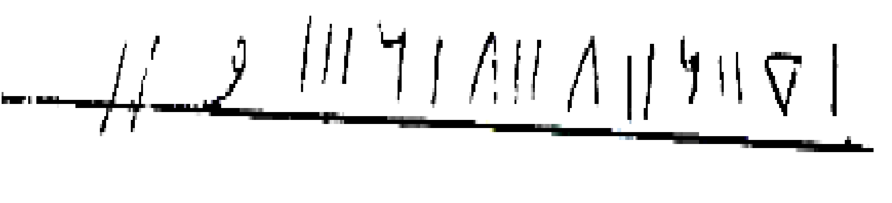

**AR:** (وَصْفُ الطِّلَسْمِ الثَّانِى) سَطْرٌ يَدَوِىٌّ يَبْدَاُ بِـ«**٧**» وَنُقْطَةٍ، ثُمَّ «**١ ٨ ١**» مَرْصُوْفَةً، ثُمَّ «**٦**» وَ«**١**» ثُمَّ «**٨ ١١ ٨ ١١ ٢**»، وَفِى الطَّرَفِ الْاَيْسَرِ خَطَّانِ مُتَوَازِيَانِ مَائِلَانِ («**//**»).

**LAT:** (waṣfu al-ṭilasma al-thāni) saṭrun yadawiyyun yabda’u bi-«7» wa-nuqṭatin, thumma «1 8 1» marṣūfatan, thumma «6» wa-«1» thumma «8 11 8 11 2»، wa-fī al-ṭarafi al-aysari khaṭṭāni mutawāziyāni mā’ilāni («//»).

**ID:** “**(Deskripsi ṭilasm kedua)**: **satu baris tulisan tangan** dimulai «**٧**» dan titik, lalu «**١ ٨ ١**» berurutan, lalu «**٦**» dan «**١**»، lalu «**٨ ١١ ٨ ١١ ٢**»; dan di **ujung kiri** ada **dua garis sejajar miring** («**//**»).”

**AR:** اَللّٰهُمَّ بِعَظِيْمِ سِرِّ اَيَاتِكَ وَاَنْ تُؤَلِّفَ بَيْنَ فُلَانٍ ابْنِ فُلَانَةَ وَفُلَانَةَ بِنْتِ فُلَانَةَ بِالْمَحَبَّةِ وَالْمَوَدَّةِ الدَّائِمَةِ (وَاعْتَصِمُوْا بِحَبْلِ اللهِ جَمِيْعًا وَلَا تَفَرَّقُوْا وَاذْكُرُوْا نِعْمَةَ اللهِ عَلَيْكُمْ اِذْ كُنْتُمْ اَعْدَاءً فَاَلَّفَ بَيْنَ قُلُوْبِكُمْ وَلَكِنَّ اللهَ اَلَّفَ بَيْنَهُمْ اِنَّهُ عَزِيْزٌ حَكِيْمٌ وَنَزَعْنَا مَا فِى صُدُوْرِهِمْ مِنْ غِلٍّ اِخْوَانًا عَلٰى سُرُرٍ مُتَقَابِلِيْنَ) — وَالتَّلَاوَةُ ٣ مَرَّاتٍ وَتُكَرِّرُ الْايَةَ الْاَخِيْرَةَ (وَنَزَعْنَا مَا فِى صُدُوْرِهِمْ) ٢٤٦ مَرَّةً — ثُمَّ هَذَا الْبَابُ مُجَرَّبٌ وَصَحِيْحٌ

**LAT:** allāhumma bi-‘aẓīmi sirri āyātika wa-an tu’allifa bayna fulānin ibni fulānata wa-fulānata binti fulānata bi-al-maḥabbati wa-al-mawaddati al-dā’imati («wa-‘taṣimū bi-ḥabli allāhi jamī‘an wa-lā tafarraqū wa-udhkurū ni‘mata allāhi ‘alaykum idh kuntum a‘dā’an fa-allafa bayna qulūbikum wa-lākinna allāha allafa baynahum innahu ‘azīzun ḥakīmun wa-naza‘nā mā fī ṣudūrihim min ghillin ikhwānan ‘alā sururin mutaqābilīna») — wa-al-tilāwatu 3 marrātin wa-tukarriru al-āyata al-akhīrata («wa-naza‘nā mā fī ṣudūrihim») 246 marratan — thumma hādhā al-bābu mujarrabun wa-ṣaḥīḥun

**ID:** “«**Ya Allah, dengan agungnya rahasia ayat-ayat-Mu, dan agar Engkau menyatukan antara Fulan bin Fulanah dan Fulanah binti Fulanah dengan cinta dan kasih sayang yang abadi**» — «**Dan berpeganglah kalian semuanya pada tali (agama) Allah, dan jangan bercerai-berai; dan ingatlah nikmat Allah atas kalian ketika kalian dahulu bermusuhan, lalu Dia menyatukan hati kalian … dan Dia menghilangkan kedengkian dari dada mereka; mereka bersaudara, duduk berhadap-hadapan di atas singgasana**» (**Q.S. 3:103** + **15:47**). — **Bacaannya ٣×**, dan engkau **mengulang ayat terakhir** («**wa naza‘nā mā fī ṣudūrihim**») **٢٤٦×**. — Kemudian **bab ini teruji dan sahih**.”

**Rajah:** 

**AR:** (وَصْفُ الطِّلَسْمِ الثَّالِثِ) سَطْرٌ يَدَوِىٌّ فِيْهِ **مُعْظَمُهُ رُقُوْمٌ** مِثْلُ «**١ ١ ١ ٥ ١ ١ ٧ ١ ٤ ١**» وَعَلَامَاتٍ عَلٰى شَكْلِ «**٥**» الْمَقْلُوْبَةِ وَ«**٧**» وَنُقَطٍ صَغِيْرَةٍ.

**LAT:** (waṣfu al-ṭilasma al-thālithi) saṭrun yadawiyyun fīhi mu‘ẓamuhu ruqūmun mithlu «1 1 1 5 1 1 7 1 4 1» wa-‘alāmātin ‘alā shakli «5» al-maqlūbati wa-«7» wa-nuqaṭin ṣaghīratin.

**ID:** “**(Deskripsi ṭilasm ketiga)**: **satu baris tulisan tangan** yang **sebagian besar berupa angka** seperti «**١ ١ ١ ٥ ١ ١ ٧ ١ ٤ ١**» beserta **tanda berbentuk «٥» terbalik**, «**٧**»، dan **titik-titik kecil**.”

**AR:** لِمُقَابَلَةِ مَنْ لَكَ حَاجَةٌ لَدَيْهِ — اَلطَّرِيْقَةُ: فِى الصَّبَاحِ عِنْدَ الْخُرُوْجِ قِرَاءَةُ سُوْرَةِ الْجِنِّ عَلَى الْكَفَّيْنِ، اَيَةُ الْكُرْسِىِّ خَمْسَةُ مَرَّاتٍ، اَللّٰهُمَّ صَلِّ عَلٰى مُحَمَّدٍ وَآلِ مُحَمَّدٍ خَمْسَةُ مَرَّاتٍ، اَيَةُ (قَدْ جَاءَكُمْ رَسُوْلٌ مِنْ اَنْفُسِكُمْ ………) خَمْسَةُ مَرَّاتٍ، حَسْبِىَ اللهُ وَنِعْمَ الْوَكِيْلُ خَمْسَةُ مَرَّاتٍ، وَلَا حَوْلَ وَلَا قُوَّةَ اِلَّا بِاللهِ سِتَّةُ مَرَّاتٍ.

**LAT:** li-muqābalati man laka ḥājatun ladayhi — al-ṭarīqatu: fī al-ṣabāḥi ‘inda al-khurūji qirā’atu sūrati al-jinni ‘alā al-kaffayni, āyatu al-kursiyyi khamsatu marrātin, allāhumma ṣalli ‘alā Muḥammadin wa-āli Muḥammadin khamsatu marrātin, āyatu («qad jā’akum rasūlun min anfusikum ………») khamsatu marrātin, ḥasbiya allāhu wa-ni‘ma al-wakīlu khamsatu marrātin, wa-lā ḥawla wa-lā quwwata illā billāhi sittatu marrātin.

**ID:** “**Untuk menghadap orang yang engkau berhajat kepadanya** — **caranya**: pada **pagi ketika keluar rumah**, **membaca surah al-Jinn pada kedua telapak tangan**, **āyat al-Kursī ٥×**, **«Allāhumma ṣalli ‘alā Muḥammad wa āli Muḥammad» ٥×**, ayat «**Qad jā’akum rasūlun min anfusikum ………**» (**Q.S. 9:128**) **٥×**, **«Ḥasbiya Allāh wa ni‘ma al-wakīl» ٥×**, dan **«Lā ḥawla wa lā quwwata illā billāh» ٦×**.” **Catatan**: bagian ini **diulang** dari **halaman 435–436** (dengan tambahan jumlah pada ayat 9:128) — **dipertahankan** sebagai pengulangan cetakan.

**Keterangan halaman.** Halaman ini memuat **«فائدة للصلح بين المتباغضين والزوجين»** dengan **tiga ṭilasm**: (1) setelah **Q.S. 4:35** dan doa taufik — **baris panjang angka/huruf** (rajah-01); (2) setelah **Q.S. 12:31** dan **Q.S. 60:7** — **baris pendek angka** (rajah-02); (3) setelah **Q.S. 3:103 + 15:47** — **baris angka** (rajah-03), dengan **bacaan ٣×** dan **pengulangan ayat terakhir ٢٤٦×**. Seluruhnya ditutup «**مجرب وصحيح**». Kemudian **diulang** bagian **«لمقابلة من لك حاجة لديه»** dari halaman 435.

**Angka pada halaman ini.** **٣×** dan **٢٤٦×** — keduanya **cocok** antara lapisan teks dan pindaian (٢٤٦ diperiksa ulang lewat crop 700–1800 DPI karena bentuk ٤/٦ mudah tertukar). **٥×** (tiga kali) dan **٦×** — dari pindaian. Angka dalam **ketiga ṭilasm** adalah **tulisan tangan** dan **tidak dapat dipastikan**.

**[TIDAK JELAS - HALAMAN 444]** (1) **Ketiga ṭilasm** — **tulisan tangan** berisi angka/huruf terpotong; **[TEKS ASLI DIJAGA]**, hanya dideskripsikan bentuknya. (2) **«يَصْلُحُ لَكُمْ اَعْمَالُكُمْ»** — **tidak jelas** susunannya (doa bercampur kutipan); **dipertahankan dan ditandai**. (3) **«وَلَكِنَّ اللهَ اَلَّفَ بَيْنَهُمْ»** — pada ayat aslinya «وَلَكِنَّ اللهَ أَلَّفَ بَيْنَكُمْ» (bentuk mukhātab); **dipertahankan** sesuai cetakan. (4) **«عَسٰى اللهُ اَنْ يَجْعَلَ اللهُ»** — **pengulangan «الله»** (seharusnya «عسى ربكم»); **dipertahankan**. (5) **«فَلَمَّا رَاَيْنَهُ»** (tanpa nūn pada «رأينه») — **dipertahankan**. (6) **«مِنْ غِلٍّ»** dan **«سُرُرٍ»** — ejaan cetakan **dipertahankan**. (7) **«٤٦٢/٢٤٦»** — angka dibaca dari crop: **٢٤٦** (bukan ٤٦٢), cocok dengan lapisan teks. (8) **Pengulangan bagian «لمقابلة»** — **identik** dengan halaman 435–436; **dipertahankan** apa adanya.

**[ADA RAJAH]** — 3 crop: `assets/rajah/sirrul-asrar/hal-444-rajah-01.png` (700 DPI, Rect(125.0, 148.0, 488.0, 210.0))، `hal-444-rajah-02.png` (700 DPI, Rect(138.0, 249.0, 476.0, 326.0))، dan `hal-444-rajah-03.png` (700 DPI, Rect(127.0, 385.0, 486.0, 442.0)). Total berkas rajah menjadi **126**.

---
## HALAMAN 445 — «جلب قوى بسورة يس» (tulis & gantung di udara + qasam panjang) + penutup «ايهذا الطالب الجليل»

**AR:** كِتَابُ سِرِّ الْاَسْرَارِ فِي التَّوَاصُلِ مَعَ رُوحَانِيَّاتِ الْقُرْآنِ — شَيْخُ الرُّوحَانِيِّينَ الشَّيْخُ عَطِيَّةُ عَبْدُ الْحَمِيدِ

**LAT:** kitābu sirri al-asrāri fī al-tawāṣuli ma‘a rūḥāniyyāti al-qur’āni — shaykhu al-rūḥāniyyīna al-shaykhu ‘Aṭiyyatu ‘Abdu al-Ḥamīdi

**ID:** “Kitab «Sirr al-Asrār fī al-Tawāṣul ma‘a Rūḥāniyyāt al-Qur’ān» — Syaikh para ruhaniyyin, Syaikh ‘Aṭiyyah ‘Abd al-Ḥamīd.” (Kepala halaman.)

**AR:** جَلْبٌ قَوِىٌّ بِسُوْرَةِ يَس

**LAT:** jalbun qawiyyun bi-sūrati Yās

**ID:** “**Jalb (Penghadiran) yang Kuat dengan Surah Yāsīn.**” (Judul bagian.)

**AR:** يُكْتَبُ فِى وَرَقَةٍ وَيُعَلَّقُ فِى الْهَوَاءِ. وَهَذَا مَا تَكْتُبُ: «**يس اِلٰى قَوْلِهِ «تَسْعٰى» — كَذَلِكَ يَسْعٰى فُلَانٌ ابْنُ فُلَانَةَ اِلٰى فُلَانَةَ بِنْتِ فُلَانَةَ فِى مَكَانٍ تُوَاجِدُهَا**» — (**وَاَيْنَمَا تَكُوْنُوْا يَاْتِ بِكُمُ اللهُ جَمِيْعًا اِنَّ اللهَ عَلٰى كُلِّ شَىْءٍ قَدِيْرٌ**) — «**وَكَذَلِكَ يَاْتِىْ فُلَانٌ ابْنُ فُلَانَةَ اِلٰى هَذَا الْمَكَانِ**» — (**وَنُفِخَ فِى الصُّوْرِ فَجَمَعْنَاهُمْ جَمْعًا**) — «**كَذَلِكَ يَجْتَمِعُ فُلَانٌ ابْنُ فُلَانَةَ اِلٰى فُلَانَةَ بِنْتِ فُلَانَةَ فِى هَذَا الْمَكَانِ**» — (**قَالَ عِفْرِيْتٌ مِنَ الْجِنِّ اَنَا آتِيْكَ بِهِ قَبْلَ اَنْ تَقُوْمَ مِنْ مَقَامِكَ وَاِنِّىْ عَلَيْهِ لَقَوِىٌّ اَمِيْنٌ**) (قَالَ الَّذِىْ عِنْدَهُ عِلْمٌ مِنَ الْكِتَابِ اَنَا آتِيْكَ بِهِ قَبْلَ اَنْ يَرْتَدَّ اِلَيْكَ طَرْفُكَ) — «**كَذَلِكَ يَاْتِىْ فُلَانٌ ابْنُ فُلَانَةَ اِلٰى فُلَانَةَ بِنْتِ فُلَانَةَ**»

**LAT:** yuktabu fī waraqatin wa-yu‘allaqu fī al-hawā’i. Wa-hādhā mā taktubu: «Yās ilā qawlihi «tas‘ā»» — «kadhālika yas‘ā fulānun ibnu fulānata ilā fulānata binti fulānata fī makānin tuwājiduhā» — («wa-aynamā takūnū ya’ti bikumU allāhu jamī‘an inna allāha ‘alā kulli shay’in qadīrun») — «wa-kadhālika ya’tī fulānun ibnu fulānata ilā hādhā al-makāni» — («wa-nufikha fī al-ṣūri fa-jama‘nāhum jam‘an») — «kadhālika yajtami‘u fulānun ibnu fulānata ilā fulānata binti fulānata fī hādhā al-makāni» — («qāla ‘ifrītun mina al-jinni anā ātīka bihi qabla an taqūma min maqāmika wa-innī ‘alayhi la-qawiyyun amīnun») («qāla alladhī ‘indahu ‘ilmun mina al-kitābi anā ātīka bihi qabla an yartadda ilayka ṭarfuka») — «kadhālika ya’tī fulānun ibnu fulānata ilā fulānata binti fulānata»

**ID:** “Dituliskan **pada selembar kertas** dan **digantung di udara**. **Dan inilah yang engkau tulis**: «**Yāsīn sampai firman-Nya «tas‘ā»**» (**Q.S. 36:1–…20**) — «**demikian pula Fulan bin Fulanah berjalan menuju Fulanah binti Fulanah di tempat ia berada**» — «**Dan di mana pun kalian berada, Allah akan mengumpulkan kalian semuanya; sesungguhnya Allah Maha Kuasa atas segala sesuatu**» (**Q.S. 2:148**) — «**dan demikian pula Fulan bin Fulanah datang ke tempat ini**» — «**Dan ditiuplah sangkakala, lalu Kami kumpulkan mereka seluruhnya**» (**Q.S. 78:18**) — «**demikian pula Fulan bin Fulanah berkumpul dengan Fulanah binti Fulanah di tempat ini**» — «**Berkata seorang ifrit dari jin: “Aku akan datang kepadamu dengan (singgasana) itu sebelum engkau berdiri dari tempatmu; dan sesungguhnya aku atasnya benar-benar kuat lagi dipercaya”**» (**Q.S. 27:39**) — «**Berkata orang yang memiliki ilmu dari Kitab: “Aku akan datang kepadamu dengan itu sebelum pandanganmu kembali kepadamu”**» (**Q.S. 27:40**) — «**demikian pula Fulan bin Fulanah datang kepada Fulanah binti Fulanah**».”

**AR:** «**اَللّٰهُمَّ يَا مُمِيْتُ الْاَحْيَاءِ وَمُحْيِى الْاَمْوَاتِ وَيَا جَامِعَ آدَمَ وَحَوَّاءَ عَلٰى جَبَلِ عَرَفَاتٍ اجْمَعْ فُلَانًا ابْنَ فُلَانَةَ اِلٰى فُلَانَةَ بِنْتِ فُلَانَةَ اِلٰى هَذَا الْمَكَانِ**» — «**اَللّٰهُمَّ اِنَّ الْاَمْرَ اَمْرُكَ وَالْحُكْمَ حُكْمُكَ وَالسَّمَاءَ سَمَاؤُكَ وَالْاَرْضَ اَرْضُكَ، ضَيِّقِ (?) اَللّٰهُمَّ السَّمَاءَ بِمَا وَسَعَتْ وَالْاَرْضَ بِمَا رَحُبَتْ وَالشَّرْقَ شَرْقُكَ وَالْغَرْبَ غَرْبُكَ وَالْقِبْلَةَ (?) قِبْلِىْ لَكَ وَالْبَحْرَ بَحْرِىْ لَكَ وَالسَّهْلَ سَهْلُكَ وَالْجِبَالَ جِبَالُكَ وَالْبَرَّ بَرُّكَ وَالْبِحَارَ بِحَارُكَ**» — «**فَضَيِّقِ السَّمَاءَ وَالْاَرْضَ وَالشَّرْقَ وَالْغَرْبَ وَالْقِبْلَةَ وَالْبَحْرَ وَالسَّهْلَ وَالْجِبَالَ وَالْبَرَّ وَالْبَحْرَ عَلٰى قَلْبِ فُلَانٍ ابْنِ فُلَانَةَ، اَضْيَقَ مِنْ بَطْنِ اُمَّةٍ وَاَضْيَقَ مِنْ خَرْقِ الْقَبْرِ (؟)، وَضَيِّقِ الدُّنْيَا بِمَا رَحُبَتْ، وَحَيِّرْ فِى نَفْسِهِ وَاَنْفَاسِهِ، وَهِيِّجِ اللّٰهُمَّ رُوحَانِيَّتَهُ حَتّٰى يَاْتِىَ اِلٰى فُلَانَةَ بِنْتِ فُلَانَةَ اِلٰى هَذَا الْمَكَانِ**»

**LAT:** «allāhumma yā mumītu al-aḥyā’i wa-muḥyī al-amwāti wa-yā jāmi‘a Ādama wa-Ḥawwā’a ‘alā jabali ‘Arafātin ijma‘ fulānan ibna fulānata ilā fulānata binti fulānata ilā hādhā al-makāni» — «allāhumma inna al-amra amruka wa-al-ḥukma ḥukmuka wa-al-samā’a samā’uka wa-al-arḍa arḍuka, ḍayyiq(i?) allāhumma al-samā’a bimā wasa‘at wa-al-arḍa bimā raḥubat wa-al-sharqa sharquka wa-al-gharba gharbuka wa-al-qiblata qiblī laka wa-al-baḥra baḥrī laka wa-al-sahla sahluka wa-al-jibāla jibāluka wa-al-barra barruka wa-al-biḥāra biḥāruka» — «fa-ḍayyiqi al-samā’a wa-al-arḍa wa-al-sharqa wa-al-gharba wa-al-qiblata wa-al-baḥra wa-al-sahla wa-al-jibāla wa-al-barra wa-al-baḥra ‘alā qalbi fulānin ibni fulānata, aḍyaqa min baṭni ummatin wa-aḍyaqa min kharqi al-qabri(?), wa-ḍayyiqi al-dunyā bimā raḥubat, wa-ḥayyir fī nafsihi wa-anfāsihi, wa-hayyij(i) allāhumma rūḥāniyyatahu ḥattā ya’tiya ilā fulānata binti fulānata ilā hādhā al-makāni»

**ID:** “«**Ya Allah, Wahai Yang Mematikan orang-orang hidup dan Menghidupkan orang-orang mati, dan Wahai Yang Mengumpulkan Ādam dan Ḥawwā’ di Jabal ‘Arafah: kumpulkanlah Fulan bin Fulanah kepada Fulanah binti Fulanah di tempat ini**» — «**Ya Allah, sesungguhnya perintah itu perintah-Mu, dan hukum itu hukum-Mu, dan langit itu langit-Mu, dan bumi itu bumi-Mu**» — «**Maka sempitkanlah (ya Allah) langit dan bumi, timur dan barat, kiblat, laut, dataran, gunung-gunung, daratan, dan lautan atas hati Fulan bin Fulanah — lebih sempit dari perut seorang ibu dan lebih sempit dari lubang kubur, dan sempitkanlah dunia seluas-luasnya, dan buatlah ia bingung dalam dirinya dan napasnya, dan bangkitkanlah (ya Allah) ruhaniyyahnya sehingga ia datang kepada Fulanah binti Fulanah ke tempat ini**».”

**AR:** «بِحَقِّ اَوْ كَظُلُمَاتٍ فِى بَحْرٍ لُجِّىٍّ يَغْشَاهُ مَوْجٌ مِنْ فَوْقِهِ مَوْجٌ مِنْ فَوْقِهِ سَحَابٌ ظُلُمَاتٌ بَعْضُهَا فَوْقَ بَعْضٍ اِذَا اَخْرَجَ يَدَهُ لَمْ يَكَدْ يَرَاهَا» — «**حَتّٰى يَاْتِىَ اِلٰى كَذَا وَاِلٰى هَذَا الْمَكَانِ**» — «**يَا مَنْ رَدَّ يُوْسُفَ عَلٰى اَبِيْهِ يَعْقُوْبَ، وَالْعَافِيَةَ عَلٰى جَسَدِ اَيُّوْبَ، وَرَدَّ مُلْكَ سُلَيْمَانَ بَعْدَ زَوَالِهِ، وَرَدَّ مُوْسٰى اِلٰى اُمِّهِ: رُدَّ فُلَانًا ابْنَ فُلَانَةَ اِلٰى فُلَانَةَ بِنْتِ فُلَانَةَ حَيْرَانَ**» — «**اِنَّهُ عَلٰى رَجْعَةٍ لَقَادِرٌ**» (**Q.S. 86:8**) — «**وَوَكَّلْتُ عَلَيْهِ خُدَّامَ الْاَيَّامِ السَّبْعَةِ الْعُلْوِيَّةِ وَالْاَرْضِيَّةِ، وَخُدَّامَ الْمُلُوْكِ الْاَرْبَعَةِ الْمُخْتَصِّيْنَ بِالْجِهَاتِ الْاَرْبَعَةِ، وَخُدَّامَ السَّاعَاتِ النَّهَارِيَّةِ وَاللَّيْلِيَّةِ، وَخُدَّامَ الطَّبَائِعِ الْاَرْبَعَةِ وَالْحُرُوْفِ، وَجَمِيْعَ الْمُلُوْكِ الْمُوَكَّلَةِ الْعُلْوِيَّةِ وَالْمُلُوْكِ الْاَرْضِيَّةِ: تَوَكَّلُوْا يَا مَنْ دَعَوْتُكُمْ فِى دَعْوَتِى، وَاسْتَاْذِنُوْا مِنْ عُمَّارِ مَكَانِى حَتّٰى يُسَاعِدُوْنِى فِى قَضَاءِ حَاجَتِى، وَتَوَكَّلُوْا عَلٰى فُلَانٍ ابْنِ فُلَانَةَ حَتّٰى لَا يَتَهَنَّا فِى اَكْلٍ وَلَا شُرْبٍ وَلَا يَتَهَنَّا فِى عَيْشٍ وَلَا نَوْمٍ حَتّٰى يَاْتِىَ اِلٰى فُلَانَةَ بِنْتِ فُلَانَةَ — الْوَحَا الْعَجَلَ السَّاعَةَ**» — **وَهَذَا الْوَفْقُ** (ṭilasm/wafaq yang dimaksud menyusul pada halaman berikutnya).

**LAT:** «bi-ḥaqqi «aw ka-ẓulumātin fī baḥrin lujjiyyin yaghshāhu mawjun min fawqihi mawjun min fawqihi saḥābun ẓulumātun ba‘ḍuhā fawqa ba‘ḍin idhā akhraja yadahu lam yakad yarāhā»» (**Q.S. 24:40**) — «ḥattā ya’tiya ilā kadhā wa-ilā hādhā al-makāni» — «yā man radda Yūsufa ‘alā abīhi Ya‘qūba, wa-al-‘āfiyata ‘alā jasadi Ayyūba, wa-radda mulka Sulaymāna ba‘da zawālihi, wa-radda Mūsā ilā ummihi: rudda fulānan ibna fulānata ilā fulānata binti fulānata ḥayrānan» — «innahu ‘alā raj‘atin la-qādirun» — «wa-wakkaltu ‘alayhi khuddāma al-ayyāmi al-sab‘ati al-‘ulwiyyati wa-al-arḍiyyati, wa-khuddāma al-mulūki al-arba‘ati al-mukhtaṣṣīna bi-al-jihāti al-arba‘ati, wa-khuddāma al-sā‘āti al-nahāriyyati wa-al-layliyyati, wa-khuddāma al-ṭabā’i‘i al-arba‘ati wa-al-ḥurūfi, wa-jamī‘a al-mulūki al-muwakkalati al-‘ulwiyyati wa-al-mulūki al-arḍiyyati: tawakkalū yā man da‘awtukum fī da‘watī, wa-sta’dhinū min ‘ummāri makānī ḥattā yusā‘idūnī fī qaḍā’i ḥājatī, wa-tawakkalū ‘alā fulānin ibni fulānata ḥattā lā yatahannā fī aklin wa-lā shurbin wa-lā yatahannā fī ‘ayshin wa-lā nawmin ḥattā ya’tiya ilā fulānata binti fulānata — al-waḥā al-‘ajala al-sā‘ata» — wa-hādhā al-wafqu

**ID:** “«**Dengan hak (firman-Nya): «atau (amal-amal itu) seperti kegelapan di lautan yang dalam, yang ditutupi gelombang, di atasnya ada gelombang (lagi), di atasnya ada awan; kegelapan yang berlapis-lapis — apabila ia mengeluarkan tangannya, ia hampir tidak dapat melihatnya**»**» (**Q.S. 24:40**) — «**sehingga ia datang kepada ini dan ke tempat ini**» — «**Wahai Yang mengembalikan Yūsuf kepada ayahnya Ya‘qūb, dan kesehatan kepada tubuh Ayyūb, dan mengembalikan kerajaan Sulaimān setelah hilangnya, dan mengembalikan Mūsā kepada ibunya: kembalikanlah Fulan bin Fulanah kepada Fulanah binti Fulanah dalam keadaan bingung**» — «**sesungguhnya Dia atas (pengembalian) itu benar-benar Maha Kuasa**» (**Q.S. 86:8**) — «**Dan aku mewakilkan atasnya para pelayan tujuh hari yang tinggi dan yang rendah (bumi), para pelayan empat raja yang khusus pada empat penjuru, para pelayan jam-jam siang dan malam, para pelayan empat tabiat dan huruf-huruf, dan seluruh raja-raja yang diwakilkan dari yang tinggi dan raja-raja bumi: bertawkillah, wahai mereka yang aku seru dalam seruanku, dan mintalah izin kepada para ‘āmmar tempatku agar mereka menolongku dalam memenuhi hajatku; dan bertawkillah atas Fulan bin Fulanah sehingga ia tidak menikmati makan dan minum, tidak menikmati kehidupan dan tidur, sampai ia datang kepada Fulanah binti Fulanah — al-waḥā, al-‘ajal, al-sā‘ah**».” — **«Dan inilah wafaq/ṭilasmnya»** (menyusul di **halaman 446**).

**AR:** اَيُّهَا الطَّالِبُ الْجَلِيْلُ — لَا تَبْخَلْ عَلَيْنَا بِقِرَاءَةِ الْفَاتِحَةِ وَثَوَابًا لَنَا وَلِوَالِدَيْنَا — شَيْخُ الرُّوحَانِيِّينَ فِى الْوَطَنِ الْعَرَبِىِّ — الشَّيْخُ عَطِيَّةُ عَبْدُ الْحَمِيْدِ

**LAT:** ayyuhā al-ṭālibu al-jalīlu — lā tabkhal ‘alaynā bi-qirā’ati al-fātiḥati wa-thawāban lanā wa-li-wālidaynā — shaykhu al-rūḥāniyyīna fī al-waṭani al-‘arabiyyi — al-shaykhu ‘Aṭiyyatu ‘Abdu al-Ḥamīdi

**ID:** “**Wahai peminta yang mulia** — **jangan pelit atas kami dengan membaca al-Fātiḥah dan (menghadiahkan) pahala untuk kami dan kedua orang tua kami**. — **Syaikh para ruhaniyyin di Tanah Arab — Syaikh ‘Aṭiyyah ‘Abd al-Ḥamīd.**” (Penutup halaman, kolofon penulis.)

**Keterangan halaman.** Halaman ini memuat **«جلب قوى بسورة يس»**: kertas **ditulis** dan **digantung di udara**; teksnya **Yāsīn mulai «يس» sampai «تسعى»** (**Q.S. 36:1–20**) yang **disisipi** permohonan agar **Fulan berjalan kepada Fulanah**, diselingi **empat kutipan ayat**: **Q.S. 2:148** («أينما تكونوا يأت بكم الله جميعا»)، **Q.S. 78:18** («ونفخ في الصور فجمعناهم جمعا»)، **Q.S. 27:39** (ifrit), **Q.S. 27:40** (orang berilmu). Kemudian **qasam panjang** yang memuat **doa penyempitan** («فضيّق السماء والأرض… على قلب فلان»)، **Q.S. 24:40** (gelap berlapis), **tawassul pengembalian** (Yūsuf, Ayyūb, Sulaimān, Mūsā), **Q.S. 86:8**، dan **tawkil** kepada **tujuh hari, empat raja penjuru, jam siang-malam, empat tabiat dan huruf, serta seluruh raja bumi** — dengan syarat **izin dari ‘āmmar tempat**. Ditutup **kolofon**: permintaan **al-Fātiḥah** dan **«شيخ الروحانيين في الوطن العربي»**.

**Angka pada halaman ini.** Tidak ada angka bilangan pada halaman ini (hanya **«الايام السبعة»** dan **«الملوك الاربعة»** yang disebut dengan kata). **Catatan**: kalimat «**وهذا الوفق**» pada akhir qasam **belum diikuti gambar** — **ṭilasm/wafaqnya menyusul di halaman 446**.

**[TIDAK JELAS - HALAMAN 445]** (1) **«ضَيِّقِ … اَللّٰهُمَّ السَّمَاءَ»** — **tidak jelas** (perintah «ضيّق» berulang tiga kali dengan susunan berbeda); **dipertahankan dan ditandai**. (2) **«وَالْقِبْلَةَ قِبْلِى لَكَ»** — **tidak jelas**; kemungkinan «والقبلة قِبلة لك» — **dipertahankan**. (3) **«اَضْيَقَ مِنْ بَطْنِ اُمَّةٍ وَاَضْيَقَ مِنْ خَرْقِ الْقَبْرِ»** — **tidak jelas**; kemungkinan «من بطن أمه» (lebih sempit dari perut ibunya) dan «من خرق الإبرة» (lubang jarum) — **dipertahankan dan ditandai**. (4) **«بِحَقِّ اَوْ كَظُلُمَاتٍ»** — kutipan **Q.S. 24:40** yang dimulai dengan «أو» (sebagian ayat); **dipertahankan**. (5) **«لَا يَتَهَنَّا»** — kemungkinan «لا يتهنّأ» (tidak menikmati); **dipertahankan**. (6) **«الْمُخْتَصِّيْنَ»** — kemungkinan «المختصين»; **dipertahankan**. (7) **«اسْتَاْذِنُوْا مِنْ عُمَّارِ مَكَانِى»** — **dipertahankan** dan dijelaskan sebagai **meminta izin kepada jin penghuni tempat**. (8) **«ثَوَابًا لَنَا وَلِوَالِدَيْنَا»** — **dipertahankan** sesuai cetakan.

**Peringatan (dicatat apa adanya, bukan fatwa).** Teks halaman ini memuat **qasam** yang meminta agar orang yang diminta **tidak menikmati makan, minum, dan tidur** sampai datang — yaitu **paksaan dengan jalan menyiksa ruhaniyyahnya**. Teks **ditranskripsikan sesuai cetakan**; pembaca perlu mengetahui bahwa **menyiksa atau memaksa orang lain** bertentangan dengan ajaran Islam.

**[TIDAK ADA RAJAH]** — halaman ini **teks saja** (tidak ada gambar tertanam; `get_image_info()` = `[]`). Total berkas rajah tetap **126**.

---
## HALAMAN 446 — ṭilasm besar «محبة يوضع فى الطعام» (kāghid + misk/za‘farān, abu ṭilasm dimasukkan ke makanan) + ṭilasm baris + tawkil

**AR:** كِتَابُ سِرِّ الْاَسْرَارِ فِي التَّوَاصُلِ مَعَ رُوحَانِيَّاتِ الْقُرْآنِ — شَيْخُ الرُّوحَانِيِّينَ الشَّيْخُ عَطِيَّةُ عَبْدُ الْحَمِيدِ

**LAT:** kitābu sirri al-asrāri fī al-tawāṣuli ma‘a rūḥāniyyāti al-qur’āni — shaykhu al-rūḥāniyyīna al-shaykhu ‘Aṭiyyatu ‘Abdu al-Ḥamīdi

**ID:** “Kitab «Sirr al-Asrār fī al-Tawāṣul ma‘a Rūḥāniyyāt al-Qur’ān» — Syaikh para ruhaniyyin, Syaikh ‘Aṭiyyah ‘Abd al-Ḥamīd.” (Kepala halaman.)

**Rajah:** 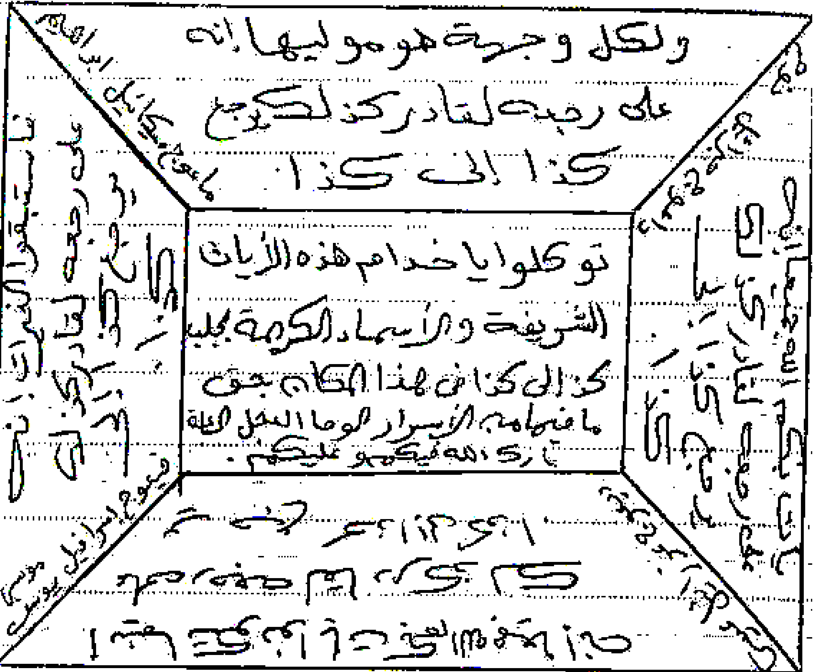

**AR:** (وَصْفُ الطِّلَسْمِ الْكَبِيْرِ) مُرَبَّعٌ كَبِيْرٌ مُحَاطٌ بِاِطَارٍ مُثَلَّثِ الْجَوَانِبِ (اَرْبَعَةُ اَشْكَالٍ شِبْهِ مُنْحَرِفَةٍ حَوْلَ مَرْكَزٍ مُرَبَّعٍ):

- **الْمَرْكَزُ (مُرَبَّعٌ صَغِيْرٌ):** مَكْتُوْبٌ فِيْهِ بِخَطٍّ يَدَوِىٍّ: «**تَوَكَّلُوْا يَا خُدَّامَ هَذِهِ الْايَاتِ الشَّرِيْفَةِ وَالْاَسْمَاءِ الْكَرِيْمَةِ بِجَلْبِ كَذَا وَكَذَا اِلٰى هَذَا الْمَكَانِ بِحَقِّ …**» — ثُمَّ سَطْرٌ اَخِيْرٌ غَيْرُ مَقْرُوءٍ.
- **الشَّكْلُ الْعُلْوِىُّ:** «**وَلِكُلٍّ وِجْهَةٌ هُوَ مُوَلِّيْهَا**» (Q.S. 2:148) ثُمَّ «**عَلٰى رَحِيْقٍ …**» تَقْرِيْبًا، ثُمَّ رُقُوْمٌ «**٨ ١ اِلٰى كَذَا**».
- **الشَّكْلُ السُّفْلِىُّ:** «**كُلُّ نَفْسٍ ذَائِقَةُ الْمَوْتِ**» (Q.S. 3:185) تَقْرِيْبًا، ثُمَّ رُقُوْمٌ مُتَدَاخِلَةٌ.
- **الشَّكْلَانِ الْجَانِبِيَّانِ (يَمِيْنٌ وَيَسَارٌ):** حُرُوْفٌ مُفْرَدَةٌ مُنْتَثِرَةٌ (ا ل م هـ ط س ن ر …) وَرُقُوْمٌ.

**LAT:** (waṣfu al-ṭilasma al-kabīri) murabba‘un kabīrun muḥāṭun bi-iṭārin muthallathi al-jawānibi (arba‘atu ashkālin shibhi munḥarifatin ḥawla markazin murabba‘in): al-markazu: maktūbun fīhi bi-khaṭṭin yadawiyyin «tawakkalū yā khuddāma hādhihi al-āyāti al-sharīfati wa-al-asmā’i al-karīmati bi-jalbi kadhā wa-kadhā ilā hādhā al-makāni bi-ḥaqqi …» — thumma saṭrun akhīrun ghayru maqrū’in؛ al-shaklu al-‘ulwiyyu: «wa-li-kullin wijhatun huwa muwallīhā» thumma «‘alā raḥīqin …» taqrīban thumma ruqūmun «8 1 ilā kadhā»؛ al-shaklu al-sufliyyu: «kullu nafsin dhā’iqatu al-mawti» taqrīban thumma ruqūmun mutadākhilatun؛ al-shaklāni al-jānibiyyāni: ḥurūfun mufradatun muntathiratun wa-ruqūmun.

**ID:** “**(Deskripsi ṭilasm besar)**: **kotak besar** yang dikelilingi **bingkai bersisi miring** (empat bentuk menyerupai trapesium di sekitar **pusat berbentuk kotak**): **pusat (kotak kecil)** — bertulisan tangan: «**Bertawkillah, wahai para pelayan ayat-ayat mulia dan asmā’ yang mulia ini, untuk menghadirkan ini dan itu ke tempat ini, dengan hak …**» — lalu satu **baris terakhir yang tidak terbaca**; **bentuk atas** — «**Wa li-kullin wijhatun huwa muwallīhā**» (**Q.S. 2:148**) lalu «**على رحيق …**» (perkiraan), lalu angka «**٨ ١ إلى كذا**»؛ **bentuk bawah** — «**Kullu nafsin dhā’iqatu al-mawt**» (**Q.S. 3:185**) (perkiraan), lalu **angka bertumpuk**؛ **dua bentuk samping (kanan dan kiri)** — **huruf-huruf tunggal tersebar** dan **angka**.”

**AR:** مَحَبَّةٌ يُوْضَعُ فِى الطَّعَامِ

**LAT:** maḥabbatun yūḍa‘u fī al-ṭa‘āmi

**ID:** “**Maḥabbah yang Diletakkan ke dalam Makanan.**” (Judul bagian.)

**AR:** يُكْتَبُ هَذَا الطِّلَسْمُ فِى كَاغِدٍ بِمِسْكٍ وَزَعْفَرَانٍ وَيُحَرِّقُهُ وَتَاْخُذُ رَمَادَ الطِّلَسْمِ وَتُوَاضِعُهُ فِى الطَّعَامِ الَّذِىْ يَاْكُلُهُ، فَاِنَّهُ لَا يَاْخُذُهُ اصْطِبَارٌ وَيَصِيْرُ مَشْغُوْفًا دَائِمًا بِمَحَبَّةِ الطَّالِبِ. وَهَذَا مَا تُكْتَبُ:

**LAT:** yuktabu hādhā al-ṭilasmu fī kāghidin bi-miskin wa-za‘farānin wa-yuḥarriquhu wa-ta’khudhu ramāda al-ṭilasma wa-tuwāḍi‘uhu fī al-ṭa‘āmi alladhī ya’kuluhu, fa-innahu lā ya’khudhuhu iṣṭibārun wa-yaṣīru mashghūfan dā’iman bi-maḥabbati al-ṭālibi. Wa-hādhā mā tuktabu:

**ID:** “**Ṭilasm ini dituliskan pada kāghid (kertas)** dengan **misk dan za‘farān**, lalu **dibakar**; dan engkau **mengambil abu ṭilasm itu** dan **meletakkannya ke dalam makanan yang ia makan** — maka **ia tidak akan dapat bersabar** dan akan **senantiasa tergila-gila dengan cinta peminta**. **Dan inilah yang engkau tulis**:”

**Rajah:** 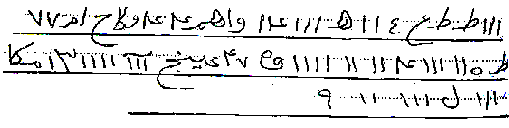

**AR:** (وَصْفُ طِلَسْمِ الرُّقْعَةِ) ثَلَاثَةُ اَسْطُرٍ بِقَلَمٍ عَرِيْضٍ:

- **السَّطْرُ الْاَوَّلُ:** رُقُوْمٌ مِثْلُ «**١١ ٣ ٥ ١ ١١ ٥ ١ ٨ ١ ٥ ١ ٧ ٧**» مَعَ عَلَامَةٍ عَلٰى شَكْلِ «**ط**» وَ«**٥**».
- **السَّطْرُ الثَّانِىَ:** رُقُوْمٌ اَكْبَرُ مِثْلُ «**١ ١ ١ ٨ ١ ١ ١ ٤ ١ ٥**» مَعَ خُطُوطٍ مُتَعَرِّجَةٍ.
- **السَّطْرُ الثَّالِثُ:** «**٩ ١ ١ ١ ٨ ١ ٨ ١ ١**» صَغِيْرَةً.

**LAT:** (waṣfu ṭilasma al-ruq‘ati) thalāthatu asṭurin bi-qalamin ‘arīḍin: al-saṭru al-awwalu ruqūmun mithlu «11 3 5 1 11 5 1 8 1 5 1 7 7» ma‘a ‘alāmatin ‘alā shakli «ṭ» wa-«5»؛ al-saṭru al-thāni ruqūmun akbaru mithlu «1 1 1 8 1 1 1 4 1 5» ma‘a khuṭūṭin muta‘arrijatin؛ al-saṭru al-thālithu «9 1 1 1 8 1 8 1 1» ṣaghīratan.

**ID:** “**(Deskripsi ṭilasm lembar)** — **tiga baris** dengan **pena tebal**: **Baris 1** — angka seperti «**١١ ٣ ٥ ١ ١١ ٥ ١ ٨ ١ ٥ ١ ٧ ٧**» dengan tanda berbentuk «**ط**» dan «**٥**»؛ **Baris 2** — angka lebih besar seperti «**١ ١ ١ ٨ ١ ١ ١ ٤ ١ ٥**» dengan **garis berkelok**؛ **Baris 3** — «**٩ ١ ١ ١ ٨ ١ ٨ ١ ١**» kecil.” **Catatan**: seluruh angka adalah **tulisan tangan** dan **tidak dapat dipastikan**.

**AR:** «تَوَكَّلُوْا يَا خُدَّامَ هَذِةِ الطَّلَاسِمِ وَالْاَسْمَاءِ وَاَلْقُوْا مَحَبَّةَ كَذَا فِى قَلْبِ كَذَا وَاَحْرِقُوْا قَلْبَهُ بِالْمَحَبَّةِ الْقَاطِعَةِ بِحَقِّ اَطْلَمُوْش ٢ هِمْحُوْش ٢ غَلْيُوْش ٢ هَمْلُوْش ٢ مَلُوْش ٢ عَلُوْش ٢ فَايُوْش ٢ هَامُوْش ٢ بَارُوْش ٢ عَالُوْش ٢ بَايُوْش ٢ قَالُوْش ٢ قَرُوْش ٢ — اَجِيْبُوْا وَاقْلِقُوْا كَذَا اِلٰى مَحَبَّةِ كَذَا بِالْمَحَبَّةِ وَالْهِيَامِ، تَوَكَّلُوْا وَلَا تَكُوْنُوْا كَالَّذِيْنَ قَالُوْا سَمِعْنَا وَهُمْ لَا يَسْمَعُوْنَ — الْوَحَا الْعَجَلَ السَّاعَةَ — وَالْعَمَلُ فِى سَاعَةٍ سَعِيْدَةٍ هَوَائِيَّةٍ»

**LAT:** «tawakkalū yā khuddāma hādhihi al-ṭalāsima wa-al-asmā’i wa-alqū maḥabbata kadhā fī qalbi kadhā wa-aḥriqū qalbahu bi-al-maḥabbati al-qāṭi‘ati bi-ḥaqqi aṭlamūsh 2 himḥūsh 2 ghabyūsh 2 hamlūsh 2 malūsh 2 ‘alūsh 2 fāyūsh 2 hāmūsh 2 bārūsh 2 ‘ālūsh 2 bāyūsh 2 qālūsh 2 qarūsh 2 — ajībū wa-aqliqū kadhā ilā maḥabbati kadhā bi-al-maḥabbati wa-al-hiyāmi, tawakkalū wa-lā takūnū ka-alladhīna qālū sami‘nā wa-hum lā yasma‘ūna — al-waḥā al-‘ajala al-sā‘ata — wa-al-‘amalu fī sā‘atin sa‘īdatin hawā’iyyatin»

**ID:** “«**Bertawkillah, wahai para pelayan ṭilasm-ṭilasm dan asmā’ ini, dan lemparkanlah cinta ini ke dalam hati ini, dan bakarlah hatinya dengan cinta yang memutus — dengan hak «اَطْلَمُوْش ٢ هِمْحُوْش ٢ غَلْيُوْش ٢ هَمْلُوْش ٢ مَلُوْش ٢ عَلُوْش ٢ فَايُوْش ٢ هَامُوْش ٢ بَارُوْش ٢ عَالُوْش ٢ بَايُوْش ٢ قَالُوْش ٢ قَرُوْش ٢» — sahutlah dan gelisahkanlah ini menuju cinta ini, dengan cinta dan kerinduan yang membara. Bertawkillah, dan janganlah kalian menjadi seperti orang-orang yang berkata «kami mendengar» padahal mereka tidak mendengar**» (**Q.S. 2:18**). — «**Al-waḥā, al-‘ajal, al-sā‘ah. Dan amalan (dilakukan) pada saat yang baik, hawā’iyyah (unsur udara).**»”

**Keterangan halaman.** Halaman ini memuat **ṭilasm besar** (rajah-01) — **kotak pusat** berisi **tawkil** dan **empat trapesium** di sekelilingnya yang memuat **Q.S. 2:148** («ولكل وجهة هو موليها») di bagian atas dan **Q.S. 3:185** («كل نفس ذائقة الموت») di bagian bawah, serta **huruf tunggal dan angka** di kedua sisi; kemudian bagian **«محبة يوضع فى الطعام»**: ṭilasm ditulis pada **kāghid** dengan **misk + za‘farān**, **dibakar**, dan **abunya dimasukkan ke makanan** orang yang dituju agar ia **tidak dapat bersabar** dan **tergila-gila**; ṭilasm baris kedua (rajah-02) dan **tawkil panjang** yang memuat **deret asmā’ «اَطْلَمُوْش … قَرُوْش»** dan **Q.S. 2:18**, ditutup **«الوحا العجل الساعة»** dengan catatan **waktu amal: saat baik, unsur udara**.

**Angka pada halaman ini.** **٢×** pada **setiap** asmā’ (13 nama) — jelas pada teks. Seluruh angka di dalam **kedua ṭilasm** adalah **tulisan tangan** dan **tidak dapat dipastikan** (hanya kelompok «٨ ١»، «١١»، «٥» yang dapat dikenali bentuknya).

**[TIDAK JELAS - HALAMAN 446]** (1) **Kedua ṭilasm** — **tulisan tangan** dengan huruf/angka bertumpuk; **[TEKS ASLI DIJAGA]**, hanya dideskripsikan. (2) **«عَلٰى رَحِيْقٍ»** pada bentuk atas — **tidak jelas**; kemungkinan bagian kalimat lain yang terpotong — **dipertahankan dan ditandai**. (3) **«وَتُوَاضِعُهُ»** (bukan «وتضعه») — ejaan cetakan **dipertahankan**. (4) **«وَتَاخُذُ رَمَادَ»** dan **«وَتُحَرِّقُهُ»** — susunan mudhakkar/mu’annath **tidak konsisten**; **dipertahankan**. (5) **«غَلْيُوْش» / «هِنْحُوْش»** — bacaan visual atas nama talismanic; **ditandai**. (6) **«سَاعَةٍ سَعِيْدَةٍ هَوَائِيَّةٍ»** — «hawā’iyyah» = **unsur udara** dalam pembagian empat unsur; **dipertahankan** dan dijelaskan. (7) **«وَلَا تَكُوْنُوْا»** — ejaan cetakan (bukan «تكونوا») — **dipertahankan**.

**Peringatan (dicatat apa adanya, bukan fatwa).** Bagian ini memakai **abu tulisan yang dicampurkan ke dalam makanan** orang lain **tanpa sepengetahuannya**, dan tawkil yang meminta **hatinya dibakar dengan cinta yang memutus**. Teks **ditranskripsikan sesuai cetakan**; pembaca perlu mengetahui bahwa **memberi makan sesuatu tanpa izin** dan **memaksa kehendak orang lain** bertentangan dengan ajaran Islam.

**[ADA RAJAH]** — 2 crop: `assets/rajah/sirrul-asrar/hal-446-rajah-01.png` (700 DPI, Rect(94.0, 69.0, 502.0, 406.0)) dan `hal-446-rajah-02.png` (700 DPI, Rect(119.0, 504.0, 494.0, 599.0)). Total berkas rajah menjadi **128**.

---
## HALAMAN 447 — «طلسم الاحمر لكل شياء» (kain merah / ٧ lembar kertas + kemenyan kundur & lada) + «دعوة حرف الهاء للجلب»

**AR:** كِتَابُ سِرِّ الْاَسْرَارِ فِي التَّوَاصُلِ مَعَ رُوحَانِيَّاتِ الْقُرْآنِ — شَيْخُ الرُّوحَانِيِّينَ الشَّيْخُ عَطِيَّةُ عَبْدُ الْحَمِيدِ

**LAT:** kitābu sirri al-asrāri fī al-tawāṣuli ma‘a rūḥāniyyāti al-qur’āni — shaykhu al-rūḥāniyyīna al-shaykhu ‘Aṭiyyatu ‘Abdu al-Ḥamīdi

**ID:** “Kitab «Sirr al-Asrār fī al-Tawāṣul ma‘a Rūḥāniyyāt al-Qur’ān» — Syaikh para ruhaniyyin, Syaikh ‘Aṭiyyah ‘Abd al-Ḥamīd.” (Kepala halaman.)

**AR:** طِلَسْمُ الْاَحْمَرِ لِكُلِّ شَيَاءٍ

**LAT:** ṭilasm al-aḥmari li-kulli shayā’in

**ID:** “**Ṭilasm Merah untuk Segala Sesuatu.**” (Judul bagian; ejaan «شياء» sesuai cetakan.)

**AR:** يُكْتَبُ عَلٰى قُمَاشٍ حَمْرَاءَ وَيُسْرَجُ، اَوْ عَلٰى ٧ وَرَقَاتٍ، وَاطْلُقِ الْبَخُوْرَ وَهُوَ كَنْدَرٌ وَفِلْفِلٌ، وَاتْلُ عَلَيْهِمُ الْاَسْمَاءَ حَتّٰى تَنْقَطِعَ الدُّخَانُ وَاحِدَةً بَعْدَ وَاحِدَةٍ. وَالْعَمَلُ فِىْ اَىِّ وَقْتٍ مِنَ السَّاعَاتِ الْخَاصَّةِ بِالْمَحَبَّةِ وَالتَّهْيِجِ وَمُقَابَلَةِ الْمُلُوْكِ وَالسَّلَاطِيْنِ وَقَضَاءِ الْحَوَائِجِ. وَهَذِةِ الطِّلَسْمُ الْمُشَارُ اِلَيْهَا:

**LAT:** yuktabu ‘alā qumāshin ḥamrā’a wa-yusraju, aw ‘alā 7 waraqātin, wa-aṭliqi al-bakhūra wa-huwa kandarun wa-filfilun, wa-tlu ‘alayhimu al-asmā’a ḥattā tanqaṭi‘a al-dukhānu wāḥidatan ba‘da wāḥidatin. Wa-al-‘amalu fī ayyi waqtin mina al-sā‘āti al-khāṣṣati bi-al-maḥabbati wa-al-tahyīji wa-muqābalati al-mulūki wa-al-salāṭīni wa-qaḍā’i al-ḥawā’iji. Wa-hādhihi al-ṭilasmu al-mushāru ilayhā:

**ID:** “Dituliskan **pada kain merah** lalu **dinyalakan (dibakar/diasapi)**, atau **pada ٧ lembar kertas**; dan **lepaskanlah kemenyan** — yaitu **kundur (kemenyan) dan lada** — dan **bacakanlah asmā’ di atasnya sampai asapnya habis, satu per satu**. **Amalannya boleh pada waktu mana pun dari jam-jam yang khusus untuk cinta, pengobaran (tahyīj), menghadap raja dan sultan, serta pemenuhan hajat.** Dan **inilah ṭilasm yang dimaksud**.”

**Rajah:** 

**AR:** (وَصْفُ الطِّلَسْمِ — السَّطْرُ الْاَوَّلُ) خَطٌّ اُفُقِىٌّ طَوِيْلٌ عَلَيْهِ عَلَامَةٌ عَلٰى شَكْلِ «**٩**» فِى الطَّرَفِ الْاَيْمَنِ، وَعَلَامَةٌ عَلٰى شَكْلِ «**ع**» اَوْ «**ح**» مُعَلَّقَةٌ فِى الْوَسَطِ، وَقَوْسٌ صَغِيْرَةٌ فِى الطَّرَفِ الْاَيْسَرِ.

**LAT:** (waṣfu al-ṭilasma — al-saṭru al-awwalu) khaṭṭun ufuqiyyun ṭawīlun ‘alayhi ‘alāmatun ‘alā shakli «9» fī al-ṭarafi al-aymani, wa-‘alāmatun ‘alā shakli «‘» aw «ḥ» mu‘allaqatun fī al-wasaṭi, wa-qawsun ṣaghīratun fī al-ṭarafi al-aysari.

**ID:** “**(Deskripsi ṭilasm — baris pertama)**: **garis mendatar panjang** yang di **ujung kanan** ada tanda berbentuk «**٩**»، di **tengah** ada tanda seperti «**ع**» atau «**ح**» menggantung, dan di **ujung kiri** ada **busur kecil**.”

**Rajah:** 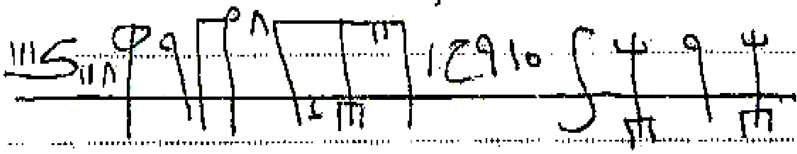

**AR:** (وَصْفُ الطِّلَسْمِ — السَّطْرُ الثَّانِى) سَطْرٌ يَدَوِىٌّ مَبْنِىٌّ عَلَى خَطٍّ اُفُقِىٍّ، يَحْتَوِى رُقُوْمًا مِثْلَ «**٩ ٤ ٩**» وَ«**٥ ١ ٦**» وَ«**١١ ٨**» وَ«**٩ ٤**» مُتَقَاطِعَةً مَعَ حُرُوْفٍ مُشَابِكَةٍ، وَعَلَامَةٍ كَبِيْرَةٍ عَلٰى شَكْلِ «**٩**» فِى الْوَسَطِ.

**LAT:** (waṣfu al-ṭilasma — al-saṭru al-thāni) saṭrun yadawiyyun mabniyyun ‘alā khaṭṭin ufuqiyyin, yaḥtawī ruqūman mithla «9 4 9» wa-«5 1 6» wa-«11 8» wa-«9 4» mutaqāṭi‘atan ma‘a ḥurūfin mushābikatin, wa-‘alāmatin kabīratin ‘alā shakli «9» fī al-wasaṭi.

**ID:** “**(Deskripsi ṭilasm — baris kedua)**: **baris tulisan tangan** di atas **garis mendatar**, memuat angka seperti «**٩ ٤ ٩**»، «**٥ ١ ٦**»، «**١١ ٨**»، «**٩ ٤**» yang **saling bersilangan** dengan **huruf-huruf berjalin**, dan di **tengah** ada tanda besar berbentuk «**٩**».” **Catatan**: seluruhnya **tulisan tangan** — angka hanya **perkiraan bentuk**.

**AR:** وَهَذِةِ الْاَسْمَاءُ الَّتِىْ تُعَزَّمُ بِهَا وَعَدَدُ التِّلَاوَةِ ٩٤ مَرَّةً عَلٰى كُلِّ وَرَقَةٍ ٧ مَرَّاتٍ. وَهَا مَا تَقُوْلُ: «**يَشُوْش ٢ جَلْشُوْش ٢ وَكْشُوْش ٢ — تَوَكَّلُوْا بِجَلْبِ كَذَا اِلٰى كَذَا بِحَقِّ تَمْلِيْخ ٢ فَلِيْخ ٢ شَلِيْخ ٢ شَلْشَلِيْخ ٢ — اَجِبْ يَا اَحْمَرُ وَتَوَكَّلْ عَلٰى كَذَا وَلَا تَتْرُكْهُ حَتّٰى يَاْتِىَ اِلٰى كَذَا بِحَقِّ هَذِةِ الْاَسْمَاءِ عَلَيْكُمْ وَطَاعَتِهَا لَدَيْكُمُ — الْوَحَا الْعَجَلَ السَّاعَةَ**»

**LAT:** wa-hādhihi al-asmā’u allatī tu‘azzamu bihā wa-‘adadu al-tilāwati 94 marratan ‘alā kulli waraqatin 7 marrātin. Wa-hā mā taqūlu: «yashūsh 2 jalshūsh 2 wakshūsh 2 — tawakkalū bi-jalbi kadhā ilā kadhā bi-ḥaqqi tamlīkh 2 falīkh 2 shalīkh 2 shalshalīkh 2 — ajib yā aḥmaru wa-tawakkal ‘alā kadhā wa-lā tatarakuhu ḥattā ya’tiya ilā kadhā bi-ḥaqqi hādhihi al-asmā’i ‘alaykum wa-ṭā‘atihā ladaykumu — al-waḥā al-‘ajala al-sā‘ata»

**ID:** “**Dan inilah asmā’ yang dipakai untuk mengazamkan**, dengan **jumlah bacaan ٩٤× pada setiap lembar, ٧× (untuk setiap lembar)**. **Dan inilah yang engkau ucapkan**: «**Yashūsh ٢ Jalshūsh ٢ Wakshūsh ٢ — bertawkillah untuk menghadirkan ini kepada ini, dengan hak Tamlīkh ٢ Falīkh ٢ Shalīkh ٢ Shalshalīkh ٢ — sahutlah, wahai Yang Merah, dan bertawkillah atas ini, dan jangan tinggalkan dia sampai ia datang kepada ini, dengan hak asmā’ ini atas kalian dan ketaatannya kepada kalian — al-waḥā, al-‘ajal, al-sā‘ah**».”

**AR:** دَعْوَةُ حَرْفِ الْهَاءِ لِلْجَلْبِ

**LAT:** da‘watu ḥarfi al-hā’i lil-jalbi

**ID:** “**Da‘wah Huruf Hā’ untuk Jalb (Penghadiran).**” (Judul bagian.)

**AR:** يُكْتَبُ وَيُحْمَلُ، هُوَ اَنْ تَكْتُبَ الْخَاتَمَ وَحَوْلَهُ الْعَزِيْمَةُ دَائِرَةً، وَيُتْلٰى عَلَيْهِ الْعَزِيْمَةُ ١٢ مَرَّةً، وَاِنْ كَانَ ٤٥ مَرَّةً كَانَ اَجْوَدَ. وَبَعْدَهَا يُعْطٰى لِلطَّالِبِ يَحْمِلُهُ عَلٰى زِرَاعَةِ الْيُمْنٰى، وَوَاحِدَةٌ تُعَلَّقُ فِى الْهَوَاءِ اتِّجَاهَ شَرْقٍ. وَهَذِةِ الْعَزِيْمَةُ الْمُشَارُ اِلَيْهَا:

**LAT:** yuktabu wa-yuḥmalu, huwa an taktuba al-khātama wa-ḥawlahu al-‘azīmatu dā’iratan, wa-yutlā ‘alayhi al-‘azīmatu 12 marratan, wa-in kāna 45 marratan kāna ajwada. Wa-ba‘dahā yu‘ṭā lil-ṭālibi yaḥmiluhu ‘alā zirā‘ati al-yumnā, wa-wāḥidatun tu‘allaqu fī al-hawā’i ittijāha sharqin. Wa-hādhihi al-‘azīmatu al-mushāru ilayhā:

**ID:** “**Ditulis dan dibawa** — yaitu engkau **menulis khātim (cincin/meterai)** dan **di sekelilingnya ‘azīmah dalam bentuk lingkaran**، lalu **dibacakan ‘azīmah kepadanya ١٢×**; dan **jika ٤٥×** itu **lebih baik**. Setelah itu **diberikan kepada peminta untuk dibawa di lengan kanan**, dan **satu (lembar) digantung di udara menghadap ke timur**. **Dan inilah ‘azīmah yang dimaksud**:”

**AR:** «**بِقَطْرِيَايِيْل ٢ طَفِيَايِيْل ٢ دَهْيَايِيْل ٢ زَرْيَايِيْل ٢ جَرْيَايِيْل ٢ فَنِيَايِيْل ٢ اِيْل ٢ جَرْيَايِيْل ٢ — اَجِيْبُوْا اَيَّتُهَا الْحُرُوْفُ الثَّمَانِيَةُ وَاْتُوْنِىْ بِمَا اَكَلَ اَخِيْكُمُ التَّاسِعُ الذَّاهِبُ عَنْكُمْ وَهُوَ حَرْفُ الْهَاءِ، بِحَقِّ السِّرِّ الَّذِىْ اَوْدَعَهُ اللهُ فِيْكُمْ وَهُوَ الْبَارِئُ الطَّاهِرُ الدَّائِمُ الزَّكِىُّ الْجَوَادُ الْوَدُوْدُ الْوَاحِدُ الْحَىُّ — اَلَا مَا هَيَّجْتُمْ قَلْبَ وَعَقْلَ كَذَا اِلٰى كَذَا — بِحَقِّ هَذِةِ الْاَسْمَاءِ عَلَيْكُمْ، وَبِحَقِّ (اِنَّهُ مِنْ سُلَيْمَانَ وَاِنَّهُ بِسْمِ اللهِ الرَّحْمٰنِ الرَّحِيْمِ اَلَّا تَعْلُوْا عَلَىَّ وَاْتُوْنِىْ مُسْلِمِيْنَ) — طَائِعِيْنَ لِلّٰهِ رَبِّ الْعَالَمِيْنَ وَمُجِيْبِيْنَ وَمُنْفِذِيْنَ لِطَالِبٍ وَجَلْبِ كَذَا اِلٰى كَذَا اَسْرَعَ مِنَ الْبَرْقِ الْخَاطِفِ — الْوَحَا الْعَجَلَ السَّاعَةَ**»

**LAT:** «bi-qaṭriyāyīl 2 ṭafiyāyīl 2 dahyāyīl 2 zaryāyīl 2 jaryāyīl 2 faniyāyīl 2 īl 2 jaryāyīl 2 — ajībū ayyatuhā al-ḥurūfu al-thamāniyatu wa-’tūnī bimā akala akhīkumu al-tāsi‘u al-dhāhibu ‘ankum wa-huwa ḥarfu al-hā’i, bi-ḥaqqi al-sirri alladhī awda‘ahu allāhu fīkum wa-huwa al-bāri’u al-ṭāhiru al-dā’imu al-zakiyyu al-jawādu al-wadūdu al-wāḥidu al-ḥayyu — alā mā hayyajtum qalba wa-‘aqla kadhā ilā kadhā — bi-ḥaqqi hādhihi al-asmā’i ‘alaykum, wa-bi-ḥaqqi («innahu min Sulaymāna wa-innahu bismi allāhi al-raḥmāni al-raḥīmi allā ta‘lū ‘alayya wa-’tūnī muslimīna») — ṭā‘i‘īna lillāhi rabbi al-‘ālamīna wa-mujībīna wa-munfidhīna li-ṭālibin wa-jalbi kadhā ilā kadhā asra‘a mina al-barqi al-khāṭifi — al-waḥā al-‘ajala al-sā‘ata»

**ID:** “«**Dengan hak Qaṭriyāyīl ٢ Ṭafiyāyīl ٢ Dahyāyīl ٢ Zaryāyīl ٢ Jaryāyīl ٢ Faniyāyīl ٢ Īl ٢ Jaryāyīl ٢ — sahutlah, wahai delapan huruf, dan datangkanlah kepadaku apa yang telah dimakan oleh saudara kesembilan kalian yang pergi dari kalian — yaitu huruf hā’. Dengan hak rahasia yang Allah titipkan pada kalian, dan Dia-lah Yang Mencipta, Yang Suci, Yang Abadi, Yang Bersih, Yang Pemurah, Yang Maha Mencintai, Yang Maha Esa, Yang Maha Hidup — bukankah kalian telah mengobarkan hati dan akal ini kepada ini? — dengan hak asmā’ ini atas kalian, dan dengan hak (firman-Nya) «**Sesungguhnya surat itu dari Sulaimān, dan sesungguhnya (isinya) “Dengan menyebut nama Allah Yang Maha Pengasih lagi Maha Penyayang, janganlah kalian berlaku sombong terhadapku dan datanglah kepadaku sebagai orang-orang yang berserah diri”**» (**Q.S. 27:30–31**) — **yang taat kepada Allah, Tuhan semesta alam, yang menyahut dan yang melaksanakan bagi peminta, dan menghadirkan ini kepada ini lebih cepat dari kilat yang menyambar — al-waḥā, al-‘ajal, al-sā‘ah**».”

**Keterangan halaman.** Halaman ini memuat dua bagian. **(1) «طلسم الاحمر لكل شياء»**: ṭilasm ditulis **pada kain merah** (lalu dibakar/diasapi) atau **pada ٧ lembar kertas**; **kemenyan kundur + lada** dilepas, dan **asmā’ dibacakan** di atas tiap lembar **sampai asapnya habis satu per satu**; **waktu amal** = jam-jam **cinta, tahyīj, menghadap raja/sultan, dan pemenuhan hajat**; asmā’nya **«يَشُوْش / جَلْشُوْش / وَكْشُوْش»** dan **«تَمْلِيْخ / فَلِيْخ / شَلِيْخ / شَلْشَلِيْخ»**, dengan **bacaan ٩٤×** pada tiap lembar. **(2) «دعوة حرف الهاء للجلب»**: **khātim** ditulis dengan **‘azīmah berbentuk lingkaran** di sekelilingnya, dibacakan **١٢×** (atau **٤٥×** lebih baik), lalu **dibawa di lengan kanan** peminta dan **satu digantung menghadap timur**. ‘Azīmahnya memuat **tujuh nama berakhiran -īl** (Qaṭriyāyīl, Ṭafiyāyīl, Dahyāyīl, Zaryāyīl, Jaryāyīl, Faniyāyīl, Īl) ditambah **Jaryāyīl** yang diulang, lalu **«delapan huruf»** dan **huruf hā’ sebagai «saudara kesembilan yang pergi»**, dan **Q.S. 27:30–31**.

**Angka pada halaman ini.** **٧** (kertas/lembar: «على ٧ ورقات»، «كل ورقة ٧ مرات») — dari teks **dan** pindaian, cocok. **٩٤×** — cocok antara lapisan teks dan pindaian. **١٢×** — cocok. **٤٥×** — **lapisan teks terbaca «٥٤» (terbalik)**, **pindaian menunjukkan «٤٥»** → **dipakai ٤٥**. **٢×** pada tiap asmā’ — jelas. Angka di dalam **kedua ṭilasm** adalah **tulisan tangan** dan **tidak dapat dipastikan**.

**[TIDAK JELAS - HALAMAN 447]** (1) **Kedua ṭilasm** — **tulisan tangan** bertumpuk; **[TEKS ASLI DIJAGA]**, hanya dideskripsikan. (2) **«طِلَسْمُ الْاَحْمَرِ»** — susunan iḍāfah **tidak lazim** (mestinya «الطلسم الأحمر»); **dipertahankan**. (3) **«لِكُلِّ شَيَاءٍ»** — ejaan cetakan (mestinya «شيء»)؛ **dipertahankan**. (4) **«وَيُسْرَجُ»** — kemungkinan «يُسَرَّج» (dinyalakan) atau «يُشَرَّج»؛ **dipertahankan**. (5) **«وَاطْلُقِ الْبَخُوْرَ»** — mestinya «أطلق»؛ **dipertahankan**. (6) **«عَدَدُ التِّلَاوَةِ ٩٤ مَرَّةً عَلٰى كُلِّ وَرَقَةٍ ٧ مَرَّاتٍ»** — **dua angka dalam satu kalimat** tanpa penghubung; **tidak jelas** apakah ٩٤× total atau per lembar — **dipertahankan dan ditandai**. (7) **«اَيَّتُهَا الْحُرُوْفُ»** dan **«اَجِيْبُوْا»** — susunan mu’annath/mudhakkar **tidak konsisten**؛ **dipertahankan**. (8) **«الْخَاتَمَ»** — **tidak jelas** apakah cincin atau **bentuk meterai yang ditulis**; **dipertahankan**. (9) **«زِرَاعَةِ الْيُمْنٰى»** — mestinya «ذِرَاع» (lengan); ejaan cetakan **dipertahankan**.

**[ADA RAJAH]** — 2 crop: `assets/rajah/sirrul-asrar/hal-447-rajah-01.png` (700 DPI, Rect(112.0, 167.0, 501.0, 235.0)) dan `hal-447-rajah-02.png` (700 DPI, Rect(111.0, 235.0, 502.0, 311.0)). Total berkas rajah menjadi **130**.

---
## HALAMAN 448 — «محبة خاصة بالملوك والحكام والاكابر وهيبة» — wafaq 3×3 + penutup kitab (kolofon)

**AR:** كِتَابُ سِرِّ الْاَسْرَارِ فِي التَّوَاصُلِ مَعَ رُوحَانِيَّاتِ الْقُرْآنِ — شَيْخُ الرُّوحَانِيِّينَ الشَّيْخُ عَطِيَّةُ عَبْدُ الْحَمِيدِ

**LAT:** kitābu sirri al-asrāri fī al-tawāṣuli ma‘a rūḥāniyyāti al-qur’āni — shaykhu al-rūḥāniyyīna al-shaykhu ‘Aṭiyyatu ‘Abdu al-Ḥamīdi

**ID:** “Kitab «Sirr al-Asrār fī al-Tawāṣul ma‘a Rūḥāniyyāt al-Qur’ān» — Syaikh para ruhaniyyin, Syaikh ‘Aṭiyyah ‘Abd al-Ḥamīd.” (Kepala halaman.)

**Rajah:** 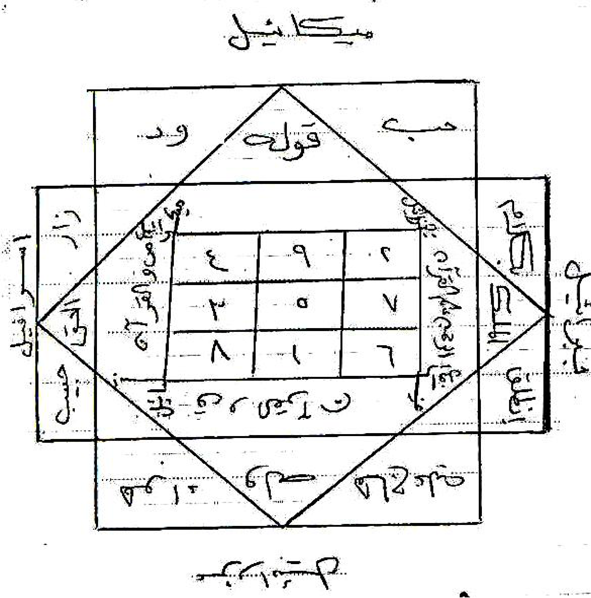

**AR:** (وَصْفُ الْوَفْقِ) وَفْقٌ كَبِيْرٌ مِنْ طَبَقَتَيْنِ: **مُرَبَّعٌ خَارِجِيٌّ** وَفَوْقَهُ **مُرَبَّعٌ دَاخِلِيٌّ** مَائِلٌ (مُعَيَّنٌ)، وَفِى الْوَسَطِ **جَدْوَلٌ ٣ × ٣** كَهَذَا:

| ٤ | ٩ | ٢ |
|---|---|---|
| ٣ | ٥ | ٧ |
| ٨ | ١ | ٦ |

وَبِحَسَبِ اتِّجَاهِ الْقِرَاءَةِ الْعَرَبِيَّةِ (مِنَ الْيَمِيْنِ) تَكُوْنُ الْاَسْطُرُ: «**٢ ٩ ٤**»، «**٧ ٥ ٣**»، «**٦ ١ ٨**» — وَهَذَا هُوَ **الْوَفْقُ الْمُثَلَّثُ الْمَشْهُوْرُ** الَّذِىْ مَجْمُوْعُ كُلِّ صَفٍّ وَعَمُوْدٍ وَقُطْرٍ فِيْهِ **١٥**. وَحَوْلَ الْجَدْوَلِ: «**ح**» وَ«**د**» وَ«**ط**» وَاَحْرُفٌ مُفْرَدَةٌ، وَفِى الْمُعَيَّنِ الْخَارِجِىِّ: «**قَوْلُهُ**» وَنَحْوُهَا، وَفِى الْمُعَيَّنِ الْاَسْفَلِ رُقُوْمٌ مِثْلُ «**٦ ٩ ٧ ٦ ٢**»، وَعَلَى الْيَسَارِ عَمُوْدٌ رَأْسِىٌّ مِنْ حُرُوْفٍ مَقْطُوْعَةٍ.

**LAT:** (waṣfu al-wafqi) wafqun kabīrun min ṭabaqatayni: murabba‘un khārijiyyun wa-fawqahu murabba‘un dākhiliyyun mā’ilun (mu‘ayyanun), wa-fī al-wasaṭi jadwalun 3 × 3: 4 9 2 / 3 5 7 / 8 1 6. Wa-bi-ḥasabi ittijāhi al-qirā’ati al-‘arabiyyati (mina al-yamīni) takūnu al-asṭuru: «2 9 4»، «7 5 3»، «6 1 8» — wa-hādhā huwa al-wafqu al-muthallathu al-mashhūru alladhī majmū‘u kulli ṣaffin wa-‘amūdin wa-quṭrin fīhi 15. Wa-ḥawla al-jadwali: «ḥ» wa-«d» wa-«ṭ» wa-aḥrufun mufradatun, wa-fī al-mu‘ayyani al-khārijiyyi: «qawluhu» wa-naḥwuhā, wa-fī al-mu‘ayyani al-asfali ruqūmun mithlu «6 9 7 6 2»، wa-‘alā al-yasāri ‘amūdun ra’siyyun min ḥurūfin maqṭū‘atin.

**ID:** “**(Deskripsi wafaq)**: **wafaq besar** terdiri atas **dua lapis**: **bujur sangkar luar** dan di atasnya **bujur sangkar dalam yang miring (belah ketupat)**، dan di **tengah** ada **tabel ٣ × ٣** seperti ini: **٤ ٩ ٢ / ٣ ٥ ٧ / ٨ ١ ٦**. Menurut **arah baca Arab (dari kanan)** barisnya menjadi: «**٢ ٩ ٤**»، «**٧ ٥ ٣**»، «**٦ ١ ٨**» — dan inilah **wafaq segitiga (muthallath) yang masyhur** yang **jumlah setiap baris, kolom, dan diagonalnya ١٥**. Di **sekitar tabel**: huruf «**ح**»، «**د**»، «**ط**» dan huruf-huruf tunggal; di **belah ketupat luar**: «**قَوْلُهُ**» dan sejenisnya; di **belah ketupat bawah**: angka seperti «**٦ ٩ ٧ ٦ ٢**»؛ dan di **sisi kiri** ada **kolom vertikal huruf-huruf terpotong**.”

**AR:** مَحَبَّةٌ خَاصَّةٌ بِالْمُلُوْكِ وَالْحُكَّامِ وَالْاَكَابِرِ وَهَيْبَةٌ

**LAT:** maḥabbatun khāṣṣatun bi-al-mulūki wa-al-ḥukkāmi wa-al-akābiri wa-haybatun

**ID:** “**Cinta Khusus untuk Raja-Raja, Para Penguasa, dan Para Pembesar, serta Wibawa (haybah).**” (Judul bagian.)

**AR:** يُكْتَبُ هَذَا الطِّلَسْمُ عَلٰى كَاغِدٍ اَحْمَرَ اَوْ كَاغِدٍ مَصْبُوْغٍ بِزَعْفَرَانٍ وَزَنْجَبِيْلٍ وَكُرْكُمٍ وَمَاءِ وَرْدٍ، فِى شَرَفِ الشَّمْسِ وَطَالِعِ الْاَسَدِ مِنَ الْبُرُوْجِ. وَيُبَخَّرُ بِجَاوِىْ وَلُبَانٍ وَتُفَّاحِ الْجَانِّ. وَالْعَزِيْمَةُ سُوْرَةُ النَّمْلِ الْمُبَارَكَةُ ٣ مَرَّاتٍ، ثُمَّ تَوَكَّلْ بِمَا تُرِيْدُ، ثُمَّ تَنْجِيْمَةٌ ٣ لَيَالٍ وَتَشْمِيْعَةٌ. وَيُحْمَلُ عَلٰى طَهَارَةٍ. وَهَذَا الطِّلَسْمُ الْمُشَارُ اِلَيْهِ:

**LAT:** yuktabu hādhā al-ṭilasmu ‘alā kāghidin aḥmara aw kāghidin maṣbūghin bi-za‘farānin wa-zanjabīlin wa-kurkumin wa-mā’i wardin, fī sharafi al-shamsi wa-ṭāli‘i al-asadi mina al-burūji. Wa-yubakhkharu bi-jāwiyyin wa-lubānin wa-tuffāḥi al-jānni. Wa-al-‘azīmatu sūratu al-namli al-mubārakatu 3 marrātin, thumma tawakkal bimā turīdu, thumma tanjīmatun 3 layālin wa-tashmī‘atun. Wa-yuḥmalu ‘alā ṭahāratin. Wa-hādhā al-ṭilasmu al-mushāru ilayhi:

**ID:** “**Ṭilasm ini dituliskan pada kāghid (kertas) merah**, atau kāghid yang **diwarnai dengan za‘farān, jahe, kunyit, dan air mawar**, pada **saat Syaraf al-Syams** (matahari di puncak kejayaannya) dan **ṭāli‘ al-asad (Ascendant Leo)** dari zodiak. Dan **diasapi dengan jāwī (kemenyan jawa), lubān, dan tuffāḥ al-jānn (apel jin)**. **‘Azīmahnya: surah al-Naml yang mulia ٣×**، lalu **bertawkillah sesuai yang engkau inginkan**، lalu **tanjīmah (penentuan waktu) ٣ malam** dan **tashmī‘ah (pelilinon/penyalaan lilin)**. Dan **dibawa dalam keadaan suci (berwudhu)**. **Dan inilah ṭilasm yang dimaksud**:”

**AR:** اَيُّهَا الطَّالِبُ الْجَلِيْلُ — لَا تَبْخَلْ عَلَيْنَا بِقِرَاءَةِ الْفَاتِحَةِ وَثَوَابًا لَنَا وَلِوَالِدَيْنَا — شَيْخُ الرُّوحَانِيِّينَ فِى الْوَطَنِ الْعَرَبِىِّ — الشَّيْخُ عَطِيَّةُ عَبْدُ الْحَمِيْدِ

**LAT:** ayyuhā al-ṭālibu al-jalīlu — lā tabkhal ‘alaynā bi-qirā’ati al-fātiḥati wa-thawāban lanā wa-li-wālidaynā — shaykhu al-rūḥāniyyīna fī al-waṭani al-‘arabiyyi — al-shaykhu ‘Aṭiyyatu ‘Abdu al-Ḥamīdi

**ID:** “**Wahai peminta yang mulia** — **jangan pelit atas kami dengan membaca al-Fātiḥah dan (menghadiahkan) pahala untuk kami dan kedua orang tua kami**. — **Syaikh para ruhaniyyin di Tanah Arab — Syaikh ‘Aṭiyyah ‘Abd al-Ḥamīd.**” (**Kolofon penutup** — halaman terakhir bab ini.)

**Keterangan halaman.** Halaman ini memuat **satu wafaq besar** (rajah-01) — **kotak luar + belah ketupat + tabel ٣×٣** di tengah — dan satu bagian: **«محبة خاصة بالملوك والحكام والاكابر وهيبة»**. **Bahan**: kāghid **merah** atau kāghid **berwarna za‘farān-jahe-kunyit-air mawar**؛ **waktu**: **Syaraf al-Syams** dengan **Ascendant Leo**؛ **pengasapan**: **jāwī + lubān + tuffāḥ al-jānn**؛ **‘azīmah**: **surah al-Naml ٣×**؛ lalu **tawkil** sesuai hajat, **tanjīmah ٣ malam**, **tashmī‘ah**, dan **dibawa dalam keadaan suci**. Ditutup **kolofon** permintaan **al-Fātiḥah** dan gelar **«شيخ الروحانيين في الوطن العربي»**.

**Angka pada halaman ini.** **٣×** (al-Naml) dan **٣** (malam tanjīmah) — jelas pada teks dan pindaian. **Angka wafaq**: dibaca dari crop 900–1100 DPI; **tabel tengah** = **٤ ٩ ٢ / ٣ ٥ ٧ / ٨ ١ ٦** (dalam urutan baca Arab) yang merupakan **wafaq muthallath masyhur berjumlah ١٥** — **dikonfirmasi** karena jumlah baris/kolom/diagonalnya konsisten (kolom kiri: ٨+٣+٤=١٥، tengah: ١+٥+٩=١٥، kanan: ٦+٧+٢=١٥؛ diagonal: ٤+٥+٦=١٥ dan ٢+٥+٨=١٥). **Satu sel** (kiri-tengah) **tampak seperti ٢** pada pindaian tetapi **dibaca ٣** agar wafaq konsisten — **ditandai sebagai koreksi**، dengan **catatan bahwa bentuk aslinya ambigu**. Angka lain di dalam wafaq (**٦ ٩ ٧ ٦ ٢**) adalah **tulisan tangan** dan **tidak dapat dipastikan**.

**[TIDAK JELAS - HALAMAN 448]** (1) **Seluruh isi wafaq di luar tabel tengah** — **tulisan tangan** bertumpuk dan **huruf terpotong**؛ **[TEKS ASLI DIJAGA]**, hanya dideskripsikan. (2) **«تُفَّاحِ الْجَانِّ»** — **tidak jelas** apakah nama tumbuhan/kemenyan tertentu («apel jin»); **dipertahankan dan ditandai**. (3) **«تَنْجِيْمَةٌ ٣ لَيَالٍ وَتَشْمِيْعَةٌ»** — istilah teknis; **tanjīmah** = penentuan waktu berdasarkan posisi bintang, **tashmī‘ah** = penyalaan lilin؛ **dijelaskan sebagai perkiraan makna**. (4) **«فِى شَرَفِ الشَّمْسِ»** — istilah astrologi (**matahari di derajat syaraf**); **dipertahankan**. (5) **«وَطَالِعِ الْاَسَدِ»** — **Ascendant Leo**; **dijelaskan**. (6) **«جَاوِىْ»** — kemenyan jawa (**jāwī**); **dipertahankan**. (7) **Kolom huruf di sisi kiri wafaq** — **tidak terbaca**؛ **ditandai**.

**[ADA RAJAH]** — 1 crop: `assets/rajah/sirrul-asrar/hal-448-rajah-01.png` (700 DPI, Rect(120.0, 69.0, 493.0, 446.0)). Total berkas rajah menjadi **131**.

---
## HALAMAN 449 — «محبة تعلق فى الهواء» (sambungan dari akhir p.448) + cap singa penutup

**AR:** كِتَابُ سِرِّ الْاَسْرَارِ فِي التَّوَاصُلِ مَعَ رُوحَانِيَّاتِ الْقُرْآنِ — شَيْخُ الرُّوحَانِيِّينَ الشَّيْخُ عَطِيَّةُ عَبْدُ الْحَمِيدِ

**LAT:** kitābu sirri al-asrāri fī al-tawāṣuli ma‘a rūḥāniyyāti al-qur’āni — shaykhu al-rūḥāniyyīna al-shaykhu ‘Aṭiyyatu ‘Abdu al-Ḥamīdi

**ID:** “Kitab «Sirr al-Asrār fī al-Tawāṣul ma‘a Rūḥāniyyāt al-Qur’ān» — Syaikh para ruhaniyyin, Syaikh ‘Aṭiyyah ‘Abd al-Ḥamīd.” (Kepala halaman.)

**AR:** (الْخَاتَمُ) «**اَللَّهُمَّ صَلِّ فِى تَنْقِيَةِ الْعُلُومِ الرُّوحَانِيَّةِ مِنَ الشَّوَائِبِ الْخَبِيثَةِ**» — شَيْخُ الرُّوحَانِيِّينَ الشَّيْخُ عَطِيَّةُ عَبْدُ الْحَمِيدِ — «**مُجَرَّبَاتُ شَيْخِ الرُّوحَانِيِّينَ الشَّيْخِ عَطِيَّة**» — «**تِلِيْفُوْنُ الْخَاصُّ ٠٠٢٠١٢٦٢٠٢٢٢٣٨**»

**LAT:** (al-khātamu) «allāhumma ṣalli fī tanqiyati al-‘ulūmi al-rūḥāniyyati mina al-shawā’ibi al-khabīthati» — shaykhu al-rūḥāniyyīna al-shaykhu ‘Aṭiyyatu ‘Abdu al-Ḥamīdi — «mujarrabātu shaykhi al-rūḥāniyyīna al-shaykhi ‘Aṭiyyata» — «tilīfūnu al-khāṣṣu 00201262022238»

**ID:** “**(Cap)** «**Ya Allah, sucikanlah ilmu-ilmu ruhaniyyah dari campuran yang buruk**» — **Syaikh para ruhaniyyin, Syaikh ‘Aṭiyyah ‘Abd al-Ḥamīd** — «**Mujarrabāt Syaikh para ruhaniyyin, Syaikh ‘Aṭiyyah**» — «**Telepon khusus ٠٠٢٠١٢٦٢٠٢٢٢٣٨**».”

**Rajah:** 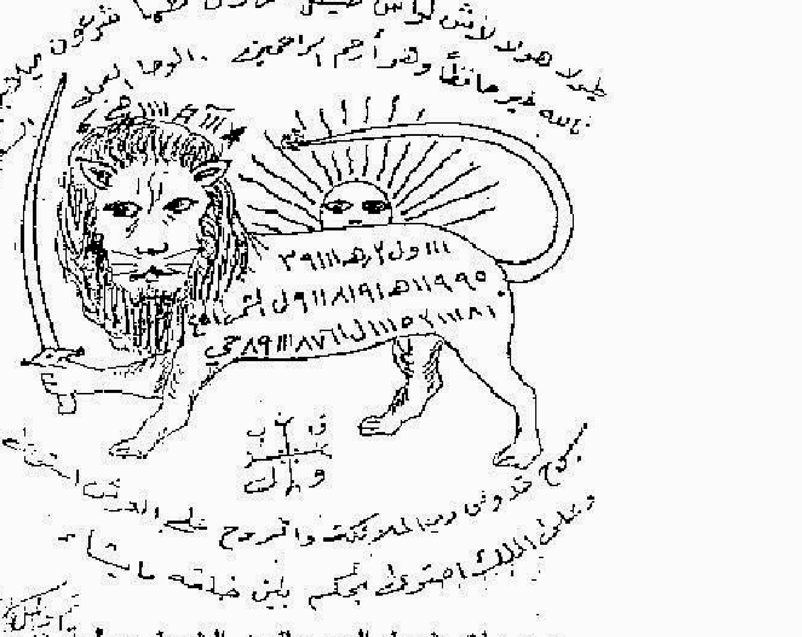

**AR:** (وَصْفُ الْخَاتَمِ) خَاتَمٌ لِطَبْعِ الْكِتَابِ: **اَسَدٌ** وَاقِفٌ يَحْمِلُ **سَيْفًا** فِى يَدِهِ الْيُمْنٰى، وَعَلٰى رَاْسِهِ **تَاْجٌ**، وَعَلٰى ظَهْرِهِ **قُرْصُ شَمْسٍ** بِاَشِعَّةٍ، وَعَلٰى جِسْمِهِ ثَلَاثَةُ اَسْطُرٍ مِنَ الرُّقُوْمِ الْمُتَدَاخِلَةِ مِثْلِ «**٥ ٩ ١ ٦ ٢ ١ ٩ ٤ ٧ ٦ ٤ ٣**»، وَحَوْلَ الصُّوْرَةِ كِتَابَةٌ دَائِرِيَّةٌ بِحُرُوْفٍ مَقْطُوْعَةٍ، وَفِىْ اَسْفَلِ الْيَسَارِ رَقْمُ «**٢**». (**هَذَا خَاتَمُ نَشْرٍ لَا طِلَسْمٌ عَمَلِىٌّ**.)

**LAT:** (waṣfu al-khātami) khātamun li-ṭab‘i al-kitābi: asadun wāqifun yaḥmilu sayfan fī yadihi al-yumnā, wa-‘alā ra’sihi tājun, wa-‘alā ẓahrihi qurṣu shamsin bi-ashī‘atin, wa-‘alā jismihi thalāthatu asṭurin mina al-ruqūmi al-mutadākhilati mithla «5 9 1 6 2 1 9 4 7 6 4 3»، wa-ḥawla al-ṣūrati kitābatun dā’iriyyatun bi-ḥurūfin maqṭū‘atin, wa-fī asfali al-yasāri raqmu «2». (hādhā khātamu nashrin lā ṭilasm ‘amaliyy.)

**ID:** “**(Deskripsi cap)**: **cap untuk mencap kitab ini** — **singa** berdiri memegang **pedang** di tangan kanannya, di kepalanya **mahkota**, di punggungnya **cakram matahari bersinar**, di badannya **tiga baris angka bertumpuk** seperti «**٥ ٩ ١ ٦ ٢ ١ ٩ ٤ ٧ ٦ ٤ ٣**»، di sekeliling gambar **tulisan melingkar berhuruf terpotong**، dan di **kiri bawah** angka «**٢**». (**Ini cap penerbit, bukan ṭilasm amalan**.)”

**AR:** (تَكْمِلَةٌ مِنْ صَفْحَةِ ٤٤٨) حَبَّةٌ تُعَلَّقُ فِى الْهَوَاءِ

**LAT:** (takmilatun min ṣafḥati 448) ḥabbatun tu‘allaqu fī al-hawā’i

**ID:** “(**Sambungan dari halaman 448**) **Ḥabbah (biji) yang Digantung di Udara.**” — sebab **p.448 berakhir dengan «وهذا الطلسم المشار اليه»**, dan **judul ini kelanjutannya**, bukan halaman berdiri sendiri.

**AR:** يُكْتَبُ هَذَا الطِّلَسْمُ بِزَعْفَرَانٍ وَمِسْكٍ وَدَمِ حَمَامٍ اَبْيَضَ، يُكْتَبُ نُسْخَتَيْنِ وَيُبَخَّرَانِ بِكُزْبَرَةٍ وَجَاوِى، وَيُعَزَّمُ عَلَيْهِمَا بِسُوْرَةِ الْقَارِعَةِ الْمُبَارَكَةِ ١١ مَرَّةً مَعَ التَّوْكِيْلِ كُلَّ مَرَّةٍ. وَصَرْفُ الْعُمَّارِ جَيِّدًا قَبْلَ الشُّرُوْعِ فِى الْعَمَلِ. وَتُحْرَقُ وَاحِدَةٌ وَالْاُخْرٰى تُعَلَّقُ فِى الْهَوَاءِ بِخَيْطِ حَرِيْرٍ اَحْمَرَ، وَيَكُوْنُ سَاعَةُ الْعَمَلِ سَاعَةً هَوَائِيَّةً. وَهَذَا الطِّلَسْمُ الْمُشَارُ اِلَيْهِ:

**LAT:** yuktabu hādhā al-ṭilasmu bi-za‘farānin wa-miskin wa-dami ḥamāmin abyaḍa, yuktabu nuskhatayni wa-yubakhkharāni bi-kuzbaratin wa-jāwiyyin, wa-yu‘azzamu ‘alayhimā bi-sūrati al-qāri‘ati al-mubārakati 11 marratan ma‘a al-tawkīli kulla marratin. Wa-ṣarfu al-‘ummāri jayyidan qabla al-shurū‘i fī al-‘amali. Wa-tuḥraqu wāḥidatun wa-al-ukhrā tu‘allaqu fī al-hawā’i bi-khayṭi ḥarīrin aḥmara, wa-yakūnu sā‘atu al-‘amali sā‘atan hawā’iyyatan. Wa-hādhā al-ṭilasmu al-mushāru ilayhi:

**ID:** “**Ṭilasm ini dituliskan dengan za‘farān, misk, dan darah merpati putih**؛ **ditulis dua naskah** dan **keduanya didupai dengan kuzbarah dan jāwī**؛ **dibacakan surah al-Qāri‘ah yang mulia ١١×** dengan **tawkil pada setiap kali**. **Ṣarf al-‘ummār harus benar** sebelum memulai amalan. **Satu dibakar**, **yang lain digantung di udara dengan benang sutra merah**, dan **waktu amal harus saat hawā’iyyah (unsur udara)**. **Dan inilah ṭilasm yang dimaksud**:”

**Keterangan halaman.** Halaman ini berisi **cap penerbit** (singa bermahkota berpedang, matahari bersinar, deret angka, tulisan melingkar) dengan doa «اللهم صلّ في تنقية العلوم الروحانية من الشوائب الخبيثة», nama penulis, «مجربات شيخ الروحانيين الشيخ عطية», dan **nomor telepon**. Lalu **judul «حبة تعلق فى الهواء»** yang **menyambung p.448**: bahan **za‘farān + misk + darah merpati putih**, **dua naskah**, dupa **kuzbarah + jāwī**, **al-Qāri‘ah ١١×** dengan tawkil tiap kali, **ṣarf al-‘ummār** lebih dulu, **satu dibakar**, **satu digantung** dengan **benang sutra merah**, **waktu hawā’iyyah**. Ditutup «وهذا الطلسم المشار اليه» → **ṭilasm menyusul di halaman 450**.

**Angka pada halaman ini.** **١١×** — dikonfirmasi dari crop 1000 DPI («بسورة القارعة المباركة ١١ مرة») dan **cocok** dengan lapisan teks. **Nomor telepon** tidak ada di lapisan teks (berada di dalam citra); dibaca dari crop 500–2000 DPI sebagai **٠٠٢٠١٢٦٢٠٢٢٢٣٨**, **sama** dengan p.428 dan p.437. Angka pada **cap singa** adalah ukiran/tulisan tangan → tidak dapat dipastikan.

**[TIDAK JELAS - HALAMAN 449]** (1) **Tulisan melingkar pada cap** — huruf terpotong dan sangat kecil; **[TEKS ASLI DIJAGA]**, hanya posisinya dideskripsikan. (2) **Deret angka pada badan singa** — ukiran bertumpuk, hanya sebagian bentuk dikenali; ditandai perkiraan. (3) **«بدم حمام ابيض»** — dipertahankan apa adanya dan dicatat (lihat peringatan). (4) **«وصرف العمار جيدا»** — susunan cetakan dipertahankan. (5) **«ساعة هوائية»** — istilah unsur udara, dijelaskan sebagai perkiraan makna.

**Peringatan (dicatat apa adanya, bukan fatwa).** Bagian ini memakai **darah merpati putih** sebagai tinta dan **membakar** salah satu naskah. Teks ditranskripsikan sesuai cetakan; pembaca perlu tahu bahwa **darah termasuk najis** dalam fikih dan **menyakiti hewan** tidak dibenarkan.

**[ADA RAJAH]** — 1 crop: `assets/rajah/sirrul-asrar/hal-449-rajah-01.png` (700 DPI, Rect(145, 145, 485, 415)) — **cap singa**, bukan bingkai hias halaman judul. Citra tertanam penuh halaman (85,69–518,531) **tidak** dipakai utuh karena sebagian besar hanya bingkai hias.

---
## HALAMAN 450 — ṭilasm «حبة تعلق فى الهواء»: gambar timbangan + pangeran, tabel angka, wafaq kecil; lalu «محبة وطاعة»

**AR:** كِتَابُ سِرِّ الْاَسْرَارِ فِي التَّوَاصُلِ مَعَ رُوحَانِيَّاتِ الْقُرْآنِ — شَيْخُ الرُّوحَانِيِّينَ الشَّيْخُ عَطِيَّةُ عَبْدُ الْحَمِيدِ

**LAT:** kitābu sirri al-asrāri fī al-tawāṣuli ma‘a rūḥāniyyāti al-qur’āni — shaykhu al-rūḥāniyyīna al-shaykhu ‘Aṭiyyatu ‘Abdu al-Ḥamīdi

**ID:** “Kitab «Sirr al-Asrār fī al-Tawāṣul ma‘a Rūḥāniyyāt al-Qur’ān» — Syaikh para ruhaniyyin, Syaikh ‘Aṭiyyah ‘Abd al-Ḥamīd.” (Kepala halaman.)

**Rajah:** 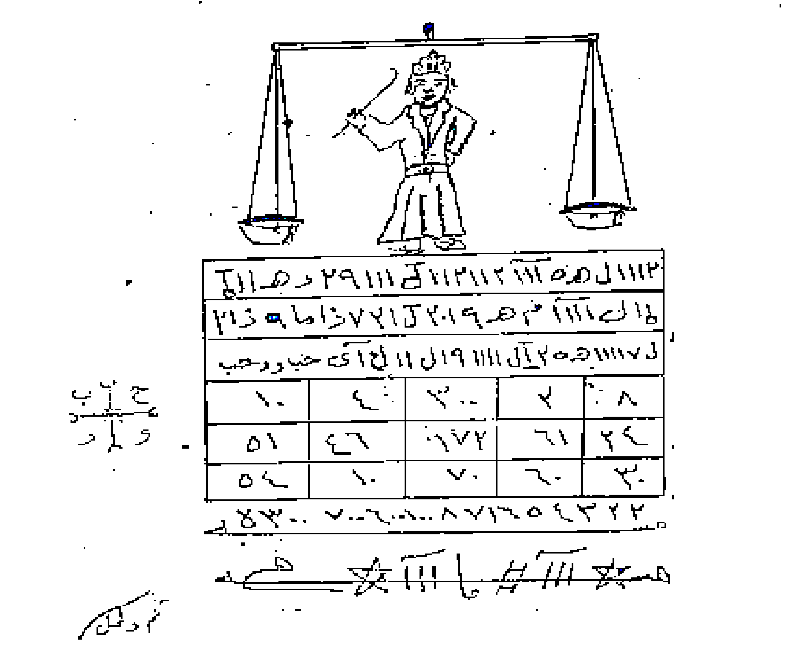

**Rajah:** 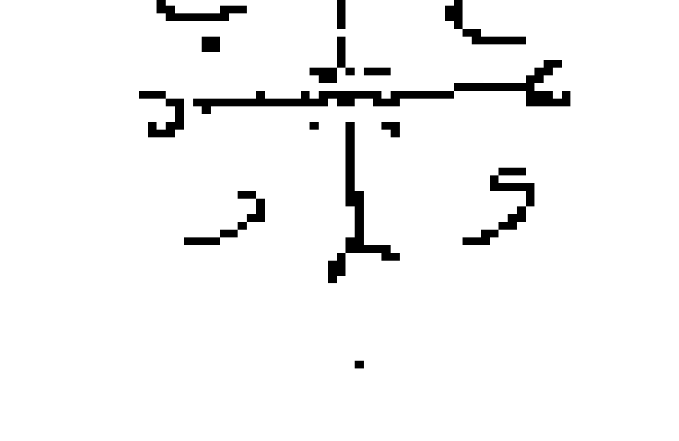

**AR:** (وَصْفُ الطِّلَسْمِ) يَتَكَوَّنُ مِنْ ثَلَاثِ طَبَقَاتٍ:

- **الطَّبَقَةُ الْعُلْيَا:** **مِيْزَانٌ** (قَائِمٌ اُفُقِىٌّ بِكَفَّتَيْنِ مُعَلَّقَتَيْنِ فِى طَرَفَيْهِ) وَفِى وَسَطِهِ **شَخْصٌ** بِزِيِّ اَمِيْرٍ: **تَاْجٌ** عَلٰى رَاْسِهِ، وَبِيَدِهِ الْيُمْنٰى **قَضِيْبٌ** مَرْفُوْعٌ، وَالْيُسْرٰى عَلٰى خَصْرِهِ.
- **الطَّبَقَةُ الْوُسْطٰى:** **ثَلَاثَةُ اَسْطُرٍ** مِنْ حُرُوْفٍ وَرُقُوْمٍ مَقْطُوْعَةٍ مُتَدَاخِلَةٍ (مِثْلُ «**د ل م و**»، «**ف ا ج ز**» وَنَحْوِهَا) — **غَيْرُ مَقْرُوءَةٍ**.
- **الطَّبَقَةُ الثَّالِثَةُ:** **جَدْوَلٌ** مِنْ **٥ اَعْمِدَةٍ × ٣ صُفُوْفٍ** بِرُقُوْمٍ يَدَوِيَّةٍ، ثُمَّ سَطْرَانِ يَدَوِيَّانِ اَسْفَلَهُ، وَسَطْرٌ مَائِلٌ فِى اَسْفَلِ الْيَسَارِ.
- **عَلٰى يَسَارِ الْجَدْوَلِ:** **وَفْقٌ صَغِيْرٌ (٣ × ٣)** بِحُرُوْفٍ: «**ط ي ك**» / «**ف**» / «**ع ل ش**».

**LAT:** (waṣfu al-ṭilasma) yatakawwanu min thalāthi ṭabaqātin: al-‘ulyā: mīzānun (qā’imun ufuqiyyun bi-kaffatayni mu‘allaqatayni fī ṭarafayhi) wa-fī wasaṭihi shakhṣun bi-zayyi amīrin: tājun ‘alā ra’sihi, wa-bi-yadihi al-yumnā qaḍībun marfū‘un, wa-al-yusrā ‘alā khaṣrihi؛ al-wusṭā: thalāthatu asṭurin min ḥurūfin wa-ruqūmin maqṭū‘atin mutadākhilatin (mithla «d l m w»، «f a j z») — ghayru maqrū’atin؛ al-thālithatu: jadwalun min 5 a‘midatin × 3 ṣufūfin bi-ruqūmin yadawiyyatin, thumma saṭrāni yadawiyyāni asfalahu, wa-saṭrun mā’ilun fī asfali al-yasāri؛ ‘alā yasāri al-jadwali: wafqun ṣaghīrun (3 × 3) bi-ḥurūfin: «ṭ y k» / «f» / «‘ l sh»

**ID:** “**(Deskripsi ṭilasm)**: tiga lapis. **Lapis atas** — **timbangan** (palang mendatar dengan **dua piring** tergantung di ujungnya), dan di tengahnya **sosok berpakaian pangeran**: **mahkota**, tangan kanan **mengangkat tongkat**, tangan kiri di pinggang. **Lapis tengah** — **tiga baris** huruf dan angka terpotong berjalin (seperti «**د ل م و**»، «**ف ا ج ز**») — **tidak terbaca**. **Lapis ketiga** — **tabel ٥ kolom × ٣ baris** angka tulisan tangan, lalu **dua baris** di bawahnya dan **satu baris miring** di kiri bawah. **Di sisi kiri tabel** — **wafaq kecil ٣×٣** berhuruf «**ط ي ك**» / «**ف**» / «**ع ل ش**».”

**AR:** (قِرَاءَةُ الْجَدْوَلِ — تَقْرِيْبِيَّةٌ) الصَّفُّ الْاَوَّلُ: «**٠١ — ٠٤ — ٢٠ — ٧ — ٨**»؛ الثَّانِى: «**٥١ — ٦٧ — ٢٧٢ — ٦١ — ٢٦**»؛ الثَّالِثُ: «**٥٠ — ٤٠ — ٧٠ — ٠٢ — ٢٤**».

**LAT:** (qirā’atu al-jadwali — taqrībiyyatun) al-ṣaffu al-awwalu: «01 — 04 — 20 — 7 — 8»؛ al-thāni: «51 — 67 — 272 — 61 — 26»؛ al-thālithu: «50 — 40 — 70 — 02 — 24»

**ID:** “**(Pembacaan tabel — perkiraan)**: **baris ١** «**٠١ — ٠٤ — ٢٠ — ٧ — ٨**»؛ **baris ٢** «**٥١ — ٦٧ — ٢٧٢ — ٦١ — ٢٦**»؛ **baris ٣** «**٥٠ — ٤٠ — ٧٠ — ٠٢ — ٢٤**».” (**Tabel ini BUKAN wafaq** — jumlah baris/kolom tidak konsisten sehingga **tidak dapat diuji** dengan penjumlahan seperti wafaq p.448.)

**AR:** مَحَبَّةٌ وَطَاعَةٌ

**LAT:** maḥabbatun wa-ṭā‘atun

**ID:** “**Cinta dan Ketaatan.**” (Judul bagian.)

**AR:** تُكْتَبُ: هَذَا الطِّلَسْمُ عَلٰى وَرَقَةٍ بِزَعْفَرَانٍ وَمَاءِ وَرْدٍ، وَيُبَخَّرُ بِكُزْبَرَةٍ وَجَاوِى، وَتَقْرَاُ عَلَيْهِ سُوْرَةَ يُوْسُفَ ٣ مَرَّاتٍ. وَيُوْضَعُ فِى جِلْدِ ثُعْبَانٍ اَسْوَدَ وَيُلَفُّ بِخَيْطٍ اَحْمَرَ، وَيُنَجَّمُ تَحْتَ الْقَمَرِ ٣ لَيَالٍ، وَيَكُوْنُ الْقَمَرُ لَيْلَةَ ١٢ فِى الشَّهْرِ وَيَظَلُّ التَّنْجِيْمُ حَتّٰى يَوْمِ ١٥ فِى الشَّهْرِ. وَيَكُوْنُ التَّنْجِيْمُ فِى اِنَاءِ نُحَاسٍ اَصْفَرَ، وَتُوْقَدُ شَمْعَةٌ خَضْرَاءُ اللَّوْنِ كُلَّ لَيْلَةٍ مِنَ التَّنْجِيْمِ. وَكُلُّ لَيْلَةٍ فِى التَّنْجِيْمِ تَقْرَاُ سُوْرَةَ يُوْسُفَ مَرَّةً وَتَوَكَّلْ بِالْمَحَبَّةِ: «**فُلَانٌ ابْنُ فُلَانَةَ اِلٰى فُلَانٍ ابْنِ فُلَانَةَ**» — «**بِحَقِّ وَاِنَّهُ الْحَبُّ الْخَيْرُ لَشَدِيْدٌ وَمَا ذَلِكَ عَلَى اللهِ بِعَزِيْزٍ**» — «**تَوَكَّلُوْا بِحَقِّ هَذِةِ السُّوْرَةِ الْمُبَارَكَةِ وَهَذَا الطِّلَسْمِ وَمَا فِيْهِ مِنَ الْاَسْرَارِ بِجَلْبٍ وَمَحَبَّةٍ وَطَاعَةِ فُلَانٍ ابْنِ فُلَانَةَ عَلٰى فُلَانٍ ابْنِ فُلَانَةَ — الْوَحَا الْعَجَلَ السَّاعَةَ — بَارَكَ اللهُ فِيْكُمْ**» — وَهَا الطِّلَسْمُ الْمُشَارُ اِلَيْهِ.

**LAT:** tuktabu: hādhā al-ṭilasmu ‘alā waraqatin bi-za‘farānin wa-mā’i wardin, wa-yubakhkharu bi-kuzbaratin wa-jāwiyyin, wa-taqra’u ‘alayhi sūrata Yūsufa 3 marrātin. Wa-yūḍa‘u fī jildi thu‘bānin aswada wa-yulaffu bi-khayṭin aḥmara, wa-yunjjamu taḥta al-qamari 3 layālin, wa-yakūnu al-qamaru laylata 12 fī al-shahri wa-yaẓallu al-tanjīmu ḥattā yawmi 15 fī al-shahri. Wa-yakūnu al-tanjīmu fī inā’i nuḥāsin aṣfara, wa-tūqadu sham‘atun khaḍrā’u al-lawni kulla laylatin mina al-tanjīmi. Wa-kullu laylatin fī al-tanjīmi taqra’u sūrata Yūsufa marratan wa-tawakkal bi-al-maḥabbati: «fulānun ibnu fulānata ilā fulānin ibni fulānata» — «bi-ḥaqqi «wa-innahu al-ḥubbu al-khayru la-shadīdun wa-mā dhālika ‘alā allāhi bi-‘azīzin»» — «tawakkalū bi-ḥaqqi hādhihi al-sūrati al-mubārakati wa-hādhā al-ṭilasm wa-mā fīhi mina al-asrāri bi-jalbin wa-maḥabbatin wa-ṭā‘ati fulānin ibni fulānata ‘alā fulānin ibni fulānata — al-waḥā al-‘ajala al-sā‘ata — bāraka allāhu fīkum» — wa-hādhā al-ṭilasmu al-mushāru ilayhi

**ID:** “**Ditulis**: ṭilasm ini pada **kertas** dengan **za‘farān dan air mawar**, lalu **didupai kuzbarah dan jāwī**, dan **dibacakan surah Yūsuf ٣×**. Lalu **dimasukkan ke kulit ular hitam** dan **dilipat dengan benang merah**, dan **ditanjīmkan di bawah (cahaya) bulan ٣ malam**؛ **bulannya malam ke-١٢** dan **tanjīm berlangsung sampai hari ke-١٥**. **Tanjīm di dalam wadah tembaga kuning**, dan **dinyalakan lilin hijau setiap malam tanjīm**. **Setiap malam tanjīm** engkau **membaca surah Yūsuf satu kali** dan **bertawkil dengan cinta**: «**Fulan bin Fulanah kepada Fulan bin Fulanah**» — «**dengan hak (firman-Nya) «dan sesungguhnya Dia Maha Mencintai (orang-orang yang berbuat baik), dan yang demikian itu tidaklah sulit bagi Allah**» — «**Bertawkillah dengan hak surah yang mulia ini dan ṭilasm ini serta rahasia-rahasia di dalamnya, untuk menghadirkan, mencintakan, dan menundukkan Fulan bin Fulanah kepada Fulan bin Fulanah — al-waḥā, al-‘ajal, al-sā‘ah — bārakallāhu fīkum**» — dan inilah ṭilasm yang dimaksud.”

**Keterangan halaman.** Gambar ṭilasm (rajah-01): **timbangan** dengan **pangeran bermahkota**, **tiga baris huruf/angka berjalin**, **tabel ٥×٣** angka tulisan tangan, dua baris tambahan; serta **wafaq kecil ٣×٣** «ط ي ك / ف / ع ل ش» (rajah-02). Teksnya **«محبة وطاعة»**: ṭilasm ditulis pada kertas (**za‘farān + air mawar**), didupai **kuzbarah + jāwī**, dibacakan **surah Yūsuf ٣×**؛ dimasukkan **kulit ular hitam**, **dilipat benang merah**, **ditanjīm di bawah bulan ٣ malam** (**malam ١٢ s.d. hari ١٥**), **wadah tembaga kuning**, **lilin hijau** tiap malam؛ tiap malam **surah Yūsuf ١×** + tawkil; ditutup **«الوحا العجل الساعة، بارك الله فيكم»**.

**Angka pada halaman ini.** **٣×** (surah Yūsuf) — cocok antara lapisan teks dan pindaian crop 1000 DPI. **٣** (malam tanjīm) — cocok. **١٢** (malam bulan) — cocok. **١٥** — **lapisan teks mengekstrak «٥١» (terbalik)**, **pindaian «١٥»** (crop 800 DPI) → **dipakai ١٥**, dan ini konsisten dengan urutan ١٢ → ١٥. **Tabel ٥×٣** — angka tulisan tangan, dibaca dari crop 800–1400 DPI sebagai **perkiraan**؛ **bukan wafaq**.

**[TIDAK JELAS - HALAMAN 450]** (1) **Tiga baris huruf/angka berjalin** di tengah ṭilasm — tidak terbaca; **[TEKS ASLI DIJAGA]**. (2) **Tabel ٥×٣** — pembacaan **perkiraan** (angka bertumpuk dengan garis tabel); ditandai. (3) **Wafaq kecil** — hanya **lima** huruf terbaca dari sembilan sel; **ditandai**. (4) **«وَاِنَّهُ الْحَبُّ الْخَيْرُ لَشَدِيْدٌ»** — **bukan bunyi ayat** (parafrase/cetakan); dipertahankan dan ditandai. (5) **«وَمَا ذَلِكَ عَلَى اللهِ بِعَزِيْزٍ»** — mendekati **Q.S. 14:20 / 35:17**؛ dipertahankan. (6) **«يُنَجَّمُ / التنجيم»** — istilah teknis, dijelaskan sebagai penempatan menurut posisi bulan. (7) **«فُلَانٌ … اِلٰى فُلَانٍ»** — kedua nama **laki-laki** pada cetakan; dipertahankan dan ditandai.

**[ADA RAJAH]** — 2 crop: `assets/rajah/sirrul-asrar/hal-450-rajah-01.png` (700 DPI, Rect(66, 68, 502, 432)) dan `hal-450-rajah-02.png` (900 DPI, Rect(88, 285, 165, 335)).

---
## HALAMAN 451 — «محبة وطاعة القلوب» (kulit gazal, al-Raḥmān ٧×) + tabel huruf «ح د ج / ب و ز / ش ف ي» + wafaq segi lima

**AR:** كِتَابُ سِرِّ الْاَسْرَارِ فِي التَّوَاصُلِ مَعَ رُوحَانِيَّاتِ الْقُرْآنِ — شَيْخُ الرُّوحَانِيِّينَ الشَّيْخُ عَطِيَّةُ عَبْدُ الْحَمِيدِ

**LAT:** kitābu sirri al-asrāri fī al-tawāṣuli ma‘a rūḥāniyyāti al-qur’āni — shaykhu al-rūḥāniyyīna al-shaykhu ‘Aṭiyyatu ‘Abdu al-Ḥamīdi

**ID:** “Kitab «Sirr al-Asrār fī al-Tawāṣul ma‘a Rūḥāniyyāt al-Qur’ān» — Syaikh para ruhaniyyin, Syaikh ‘Aṭiyyah ‘Abd al-Ḥamīd.” (Kepala halaman.)

**Rajah:** 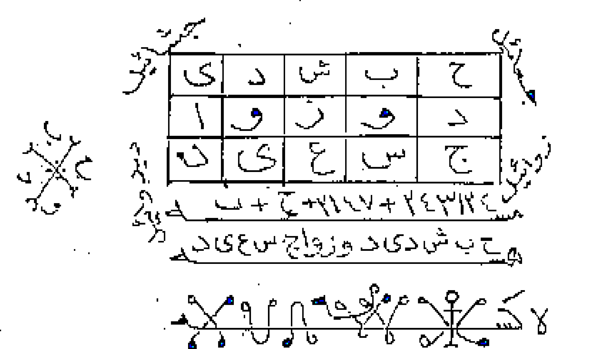

**Rajah:** 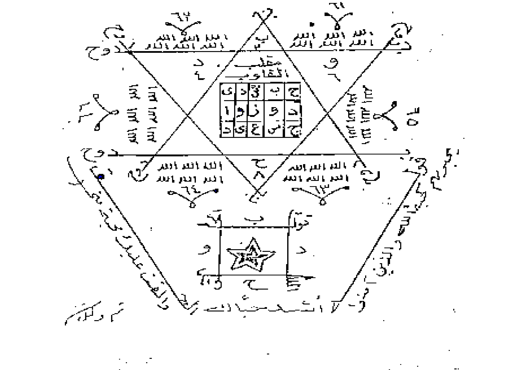

**AR:** (وَصْفُ الْجَدْوَلِ الْاَوَّلِ) جَدْوَلٌ بِخَمْسَةِ اَعْمِدَةٍ وَثَلَاثَةِ صُفُوْفٍ بِخَطٍّ يَدَوِىٍّ: الصَّفُّ الْاَوَّلُ «**ح د ج**» ثُمَّ خَامِسٌ **غَيْرُ مَقْرُوءٍ**؛ الصَّفُّ الثَّانِى «**ب و ز**» ثُمَّ «**ف**»؛ الصَّفُّ الثَّالِثُ «**ش ف ي**». وَاَسْفَلَهُ سَطْرُ رُقُوْمٍ مُتَدَاخِلَةٍ، ثُمَّ سَطْرٌ ثَانٍ، ثُمَّ سَطْرٌ فِيْهِ «**ع ش د و ح ب ر و ج ل س ع س ع د**» تَقْرِيْبًا، وَعَلٰى يَسَارِ الْجَدْوَلِ **رَمْزُ نَجْمَةٍ صَغِيْرَةٍ**.

**LAT:** (waṣfu al-jadwali al-awwali) jadwalun bi-khamsati a‘midatin wa-thalāthati ṣufūfin bi-khaṭṭin yadawiyyin: al-ṣaffu al-awwalu «ḥ d j» thumma khāmisun ghayru maqrū’in؛ al-ṣaffu al-thāni «b w z» thumma «f»؛ al-ṣaffu al-thālithu «sh f y». Wa-asfalahu saṭru ruqūmin mutadākhilatin, thumma saṭrun thānin, thumma saṭrun fīhi «‘ sh d w ḥ b r w j l s ‘ s ‘ d» taqrīban, wa-‘alā yasāri al-jadwali ramzu najmatin ṣaghīratin.

**ID:** “**(Deskripsi tabel pertama)**: tabel **٥ kolom × ٣ baris** huruf tulisan tangan — **baris ١** «**ح د ج**» lalu kolom kelima **tidak terbaca**؛ **baris ٢** «**ب و ز**» lalu «**ف**»؛ **baris ٣** «**ش ف ي**». **Di bawahnya** baris **angka berjalin**, lalu baris kedua, lalu baris «**ع ش د و ح ب ر و ج ل س ع س ع د**» (perkiraan); **di kiri tabel** ada **lambang bintang kecil**.”

**AR:** مَحَبَّةٌ وَطَاعَةُ الْقُلُوْبِ

**LAT:** maḥabbatun wa-ṭā‘atu al-qulūbi

**ID:** “**Cinta dan Ketaatan Hati-Hati.**” (Judul bagian.)

**AR:** يُكْتَبُ هَذَا الطِّلَسْمُ وَيُحْرَزُ بِجِلْدِ غَزَالٍ بِالْحِبْرِ الرُّوحَانِىِّ الْاَصْفَرِ عَلٰى كَاغِدٍ اَخْضَرَ، وَيُبَخَّرُ بِاللُّبَانِ النَّتِيَّةِ وَالْمَيْعَةِ السَّائِلَةِ وَجَوْزِ عَجَمٍ، وَتَقْرَاُ عَلَيْهِ سُوْرَةَ الرَّحْمٰنِ سَبْعَ مَرَّاتٍ، ثُمَّ تَوَكَّلْ بَعْدَ كُلِّ مَرَّةٍ: «**تَوَكَّلُوْا يَا رُوحَانِيَّةَ هَذِةِ السُّوْرَةِ الْمُبَارَكَةِ وَهَذَا الطِّلَسْمِ الشَّرِيْفِ بِجَلْبٍ وَعَطْفٍ وَمَحَبَّةِ قُلُوْبِ اَوْلَادِ آدَمَ وَبَنَاتِ حَوَّاءَ اِلٰى مَحَبَّةِ وَطَاعَةِ حَامِلِ هَذَا الْحِرْزِ بِعِزَّةِ اللهِ الرَّؤُوْفِ الْوَدُوْدِ الْقَدِيْرِ**» — وَهَذَا الطِّلَسْمُ الْمُشَارُ اِلَيْهِ.

**LAT:** yuktabu hādhā al-ṭilasmu wa-yuḥrazu bi-jildi ghazālin bi-al-ḥibri al-rūḥāniyyi al-aṣfari ‘alā kāghidin akhḍara, wa-yubakhkharu bi-al-lubāni al-natīyati wa-al-may‘ati al-sā’ilati wa-jawzi ‘ajamin, wa-taqra’u ‘alayhi sūrata al-Raḥmāni sab‘a marrātin, thumma tawakkal ba‘da kulli marratin: «tawakkalū yā rūḥāniyyata hādhihi al-sūrati al-mubārakati wa-hādhā al-ṭilasm al-sharīfi bi-jalbin wa-‘aṭfin wa-maḥabbati qulūbi awlādi Ādama wa-banāti Ḥawwā’a ilā maḥabbati wa-ṭā‘ati ḥāmili hādhā al-ḥirzi bi-‘izzati allāhi al-ra’ūfi al-wadūdi al-qadīri»

**ID:** “**Ṭilasm ini dituliskan dan dijadikan jimat dengan kulit gazal**, **tinta ruhani kuning**, **di atas kāghid hijau**؛ **didupai lubān natīyah, may‘ah cair, dan jawz ‘ajam (pala)**؛ **dibacakan surah al-Raḥmān ٧×**, lalu **bertawkil setelah setiap kali**: «**Bertawkillah, wahai ruhaniyyah surah yang mulia ini dan ṭilasm yang mulia ini, untuk menghadirkan, memalingkan, dan mencintakan hati anak-anak Ādam dan putri-putri Ḥawwā’ kepada cinta dan ketaatan pemegang jimat ini — dengan keagungan Allah Yang Maha Penyantun, Maha Mencintai, Maha Kuasa**». **Dan inilah ṭilasm yang dimaksud**:”

**AR:** (وَصْفُ الْوَفْقِ الثَّانِى) شَكْلٌ خُمَاسِىٌّ (نَجْمَةٌ خَمْسِيَّةٌ) وَفِى وَسَطِهِ **وَفْقٌ صَغِيْرٌ (٣ × ٣)**: الصَّفُّ الْاَوَّلُ «**٥ ٤ ٣**»، الثَّانِى «**٢ ٦ ٤**»، الثَّالِثُ «**٥ ٢ ١**»؛ وَتَحْتَهُ **تَابِعٌ (٢ × ٢)**: «**٣ ٢**» / «**٤ ١**» وَفِى وَسَطِهِ **نَجْمَةٌ خُمَاسِيَّةٌ**؛ وَحَوْلَ الشَّكْلِ **كِتَابَةٌ مَدَائِرِيَّةٌ**: «**الله**» مُكَرَّرًا فِى كُلِّ جِهَةٍ، مَعَ رُقُوْمٍ مِثْلِ «**٧**»، «**٦**»، «**٠١**»، وَاَقْوَاسٍ وَدَوَائِرَ صَغِيْرَةٍ.

**LAT:** (waṣfu al-wafqi al-thāni) shaklun khumāsiyyun (najmatun khamsiyyatun) wa-fī wasaṭihi wafqun ṣaghīrun (3 × 3): al-ṣaffu al-awwalu «5 4 3»، al-thāni «2 6 4»، al-thālithu «5 2 1»؛ wa-taḥtahu tābi‘un (2 × 2): «3 2» / «4 1» wa-fī wasaṭihi najmatun khumāsiyyatun؛ wa-ḥawla al-shakli kitābatun madā’iriyyatun: «allāh» mukarraran fī kulli jihatin, ma‘a ruqūmin mithla «7»، «6»، «01»، wa-aqwāsin wa-dawā’ira ṣaghīratin.

**ID:** “**(Deskripsi wafaq kedua)**: **bentuk segi lima (bintang lima)**; di **tengahnya wafaq kecil ٣×٣** — baris ١ «**٥ ٤ ٣**»، baris ٢ «**٢ ٦ ٤**»، baris ٣ «**٥ ٢ ١**»؛ **di bawahnya tabel ٢×٢** «**٣ ٢**» / «**٤ ١**» dengan **bintang lima** di tengahnya؛ **di sekeliling bentuk** **tulisan melingkar** «**الله**» diulang di setiap sisi, dengan angka «**٧**»، «**٦**»، «**٠١**»، serta **busur dan lingkaran kecil**.”

**AR:** (تَحْقِيْقُ الْوَفْقِ) بِحَسَبِ الْقِرَاءَةِ الْعَرَبِيَّةِ (مِنَ الْيَمِيْنِ): **٣ ٤ ٥ / ٤ ٦ ٢ / ١ ٢ ٥**. مَجْمُوْعُ الصُّفُوْفِ: **١٢، ١٢، ٨**؛ وَمَجْمُوْعُ الْاَعْمِدَةِ: **٨، ١٢، ١٢**؛ وَالْقُطْرَانِ: **١٦** وَ **١٠**. (**لَيْسَ وَفْقًا مُتَسَاوِىَ الْمَجْمُوْعِ** — لِذَلِكَ لَا يَصِحُّ تَطْبِيْقُ بُرْهَانِ الْجَمْعِ كَمَا فِى صَفْحَةِ ٤٤٨.)

**LAT:** (taḥqīqu al-wafqi) bi-ḥasabi al-qirā’ati al-‘arabiyyati (mina al-yamīni): 3 4 5 / 4 6 2 / 1 2 5. Majmū‘u al-ṣufūfi: 12، 12، 8؛ wa-majmū‘u al-a‘midati: 8، 12، 12؛ wa-al-quṭrāni: 16 wa 10. (laysa wafqan mutasāwī al-majmū‘i — li-dhālika lā yaṣiḥḥu taṭbīqu burhāni al-jam‘i kamā fī ṣafḥati 448.)

**ID:** “**(Verifikasi wafaq)** menurut **urutan baca Arab**: **٣ ٤ ٥ / ٤ ٦ ٢ / ١ ٢ ٥**. **Jumlah baris** = **١٢، ١٢، ٨**؛ **jumlah kolom** = **٨، ١٢، ١٢**؛ **dua diagonal** = **١٦** dan **١٠**. (**Bukan wafaq berjumlah sama** — karena itu **bukti penjumlahan seperti wafaq p.448 tidak berlaku**; angka **dipertahankan persis dari gambar scan**, tidak diubah agar “konsisten”.)”

**Keterangan halaman.** Dua gambar: (1) **tabel huruf ٥×٣** («ح د ج»، «ب و ز ف»، «ش ف ي») dengan baris angka di bawahnya (rajah-01); (2) **wafaq segi lima** dengan **wafaq ٣×٣** «٥ ٤ ٣ / ٢ ٦ ٤ / ٥ ٢ ١»، **tabel ٢×٢** «٣ ٢ / ٤ ١» berbintang, dan tulisan «الله» melingkar (rajah-02). Teksnya **«محبة وطاعة القلوب»**: ṭilasm dijadikan **jimat kulit gazal**, **tinta ruhani kuning** di **kāghid hijau**, dupa **lubān natīyah + may‘ah cair + jawz ‘ajam**, **al-Raḥmān ٧×** dengan **tawkil tiap kali**, agar **semua anak Ādam dan putri Ḥawwā’ mencintai dan taat** kepada pemegang jimat, dengan **«بعزة الله الرؤوف الودود القدير»**.

**Angka pada halaman ini.** **٧×** (al-Raḥmān) — cocok antara lapisan teks dan pindaian. **Angka wafaq ٣×٣** «٥ ٤ ٣ / ٢ ٦ ٤ / ٥ ٢ ١» — dibaca dari crop **1200–2400 DPI** (sel tengah «٦» dikonfirmasi pada 2400 DPI karena bentuk ٦/٤ mudah tertukar). **Angka pada bingkai luar** (٧، ٦، ٠١) — tulisan tangan, tidak dapat dipastikan. **Kolom kelima** baris ١ dan ٢ tabel huruf **kosong/tidak terbaca**.

**[TIDAK JELAS - HALAMAN 451]** (1) **Tabel huruf** — dua sel kosong/tidak terbaca; **[TEKS ASLI DIJAGA]**. (2) **Baris angka di bawah tabel** — tulisan tangan berjalin, hanya bentuknya dideskripsikan. (3) **Baris ketiga** «ع ش د و ح ب ر و ج ل س ع س ع د» — **perkiraan**؛ ditandai. (4) **Tulisan melingkar wafaq** — tidak terbaca utuh; hanya «الله» dan beberapa angka dikenali. (5) **«اللُّبَانِ النَّتِيَّةِ» / «الْمَيْعَةِ السَّائِلَةِ»** — nama dupa; dipertahankan sesuai cetakan (**natīyah** kemungkinan «al-lubān al-nāṭif» = lubān yang menetes). (6) **«جَوْزِ عَجَمٍ»** — kemungkinan **pala (nutmeg)**; dipertahankan dan dijelaskan. (7) **Wafaq tidak berjumlah sama** — bukan kesalahan transkripsi; angka dipertahankan dan dicatat bahwa bukti penjumlahan tidak berlaku.

**Peringatan (dicatat apa adanya, bukan fatwa).** Amalan ini bertujuan **menundukkan hati semua orang** agar **mencintai dan taat** kepada pemegang jimat — yaitu **memaksa kehendak orang lain**. Teks ditranskripsikan sesuai cetakan; **memaksakan rasa cinta/ketundukan** bukan bagian dari ajaran Islam.

**[ADA RAJAH]** — 2 crop: `assets/rajah/sirrul-asrar/hal-451-rajah-01.png` (700 DPI, Rect(109, 69, 502, 297)) dan `hal-451-rajah-02.png` (700 DPI, Rect(138, 435, 475, 680)).

---
## HALAMAN 452 — «محبة بين الزوجين» (٣ lembar + lembar keempat ditanam) + «للمحبة القاطعة والجلب» (dua wajah + tabel huruf)

**AR:** كِتَابُ سِرِّ الْاَسْرَارِ فِي التَّوَاصُلِ مَعَ رُوحَانِيَّاتِ الْقُرْآنِ — شَيْخُ الرُّوحَانِيِّينَ الشَّيْخُ عَطِيَّةُ عَبْدُ الْحَمِيدِ

**LAT:** kitābu sirri al-asrāri fī al-tawāṣuli ma‘a rūḥāniyyāti al-qur’āni — shaykhu al-rūḥāniyyīna al-shaykhu ‘Aṭiyyatu ‘Abdu al-Ḥamīdi

**ID:** “Kitab «Sirr al-Asrār fī al-Tawāṣul ma‘a Rūḥāniyyāt al-Qur’ān» — Syaikh para ruhaniyyin, Syaikh ‘Aṭiyyah ‘Abd al-Ḥamīd.” (Kepala halaman.)

**AR:** مَحَبَّةٌ بَيْنَ الزَّوْجَيْنِ

**LAT:** maḥabbatun bayna al-zawjayni

**ID:** “**Cinta antara Suami-Istri.**” (Judul bagian.)

**AR:** تُكْتَبُ هَذَا الطِّلَسْمُ عَلٰى ٣ اَوْرَاقٍ بِمِسْكٍ وَزَعْفَرَانٍ وَصُفَارِ الْبَيْضِ وَدَمِ الْاَخْوَيْنِ، وَتُبَخَّرُهُنَّ بِمَيْعَةٍ سَائِلَةٍ وَسَنْدَرُوسٍ، وَتُحْرَقُ يَوْمِيًّا وَقْتَ الْغُرُوْبِ وَاحِدَةٌ لِمُدَّةِ ٣ اَيَّامٍ. وَطَبْعًا لَا تُكْتَبُ الْايَاتُ الَّتِىْ مَعَ الطِّلَسْمِ فِىْ هَذِةِ الْاَوْرَاقِ، وَالْوَرَقَةُ الرَّابِعَةُ تُكْتَبُ فِيْهَا الْايَاتُ وَالطِّلَسْمُ، وَنَفْسُ الشُّرُوْطِ الَ ٣ لَا يَنْحَرِقْنَ بِالنِّسْبَةِ لِلْبَخُوْرِ وَالْمَوَادِّ الْكِتَابَةِ، وَلٰكِنْ هَذِةِ الْوَرَقَةُ تُدْفَنُ تَحْتَ فِرَاشِ الزَّوْجَيْنِ. وَالْعَزِيْمَةُ وَاحِدَةٌ عَلَى الْاَرْبَعَةِ وَرَقَاتٍ، وَهَذِةِ سُوْرَةُ الْكَهْفِ مَرَّتَيْنِ مَعَ التَّوْكِيْلِ بَعْدَ كُلِّ مَرَّةٍ. فَاعْلَمْ اَنَّهُمْ لَا يَفْتَرِقُوْنَ مَا دَامَ هَذَا الْحِجَابُ تَحْتَهُمْ طُوْلَ عُمْرِهِمْ. وَهَذَا الطِّلَسْمُ الْمُشَارُ اِلَيْهِ:

**LAT:** tuktabu hādhā al-ṭilasmu ‘alā 3 awrāqin bi-miskin wa-za‘farānin wa-ṣufāri al-bayḍi wa-dami al-akhwayni, wa-tubakhkharuhunna bi-may‘atin sā’ilatin wa-sandarūsin, wa-tuḥraqu yawmiyyan waqta al-ghurūbi wāḥidatun li-muddati 3 ayyāmin. Wa-ṭab‘an lā tuktabu al-āyātu allatī ma‘a al-ṭilasmi fī hādhihi al-awrāqi, wa-al-waraqatu al-rābi‘atu tuktabu fīhā al-āyātu wa-al-ṭilasmu, wa-nafsu al-shurūṭi allā 3 lā yanḥariqna bi-al-nisbati lil-bakhūri wa-al-mawāddi al-kitābati, wa-lākin hādhihi al-waraqatu tudfanu taḥta firāshi al-zawjayni. Wa-al-‘azīmatu wāḥidatun ‘alā al-arba‘ati waraqātin, wa-hādhihi sūratu al-kahfi marratayni ma‘a al-tawkīli ba‘da kulli marratin. Fa-‘lam annahum lā yaftariqūna mā dāma hādhā al-ḥijābu taḥtahum ṭūla ‘umrihim. Wa-hādhā al-ṭilasmu al-mushāru ilayhi:

**ID:** “**Ṭilasm ini dituliskan pada ٣ lembar kertas** dengan **misk, za‘farān, kuning telur, dan «dam al-akhawayn»**؛ **ketiganya didupai** dengan **may‘ah cair dan sandarūs**؛ **dibakar setiap hari pada waktu maghrib, satu lembar per hari selama ٣ hari**. **Tentu saja ayat-ayat yang menyertai ṭilasm tidak ditulis pada lembar-lembar ini**؛ **lembar keempat** justru **ditulis di dalamnya ayat dan ṭilasm**, dengan **syarat yang sama seperti ٣ (lembar lain)** — **tidak dibakar**, baik dari sisi **dupa** maupun **bahan tulisnya** — **tetapi lembar ini ditanam di bawah kasur suami-istri**. **‘Azīmahnya satu saja untuk keempat lembar**, yaitu **surah al-Kahf dua kali** dengan **tawkil setelah setiap kali**. **Ketahuilah, mereka tidak akan berpisah selama ḥijāb ini ada di bawah mereka sepanjang umur.** **Dan inilah ṭilasm yang dimaksud**:”

**Rajah:** 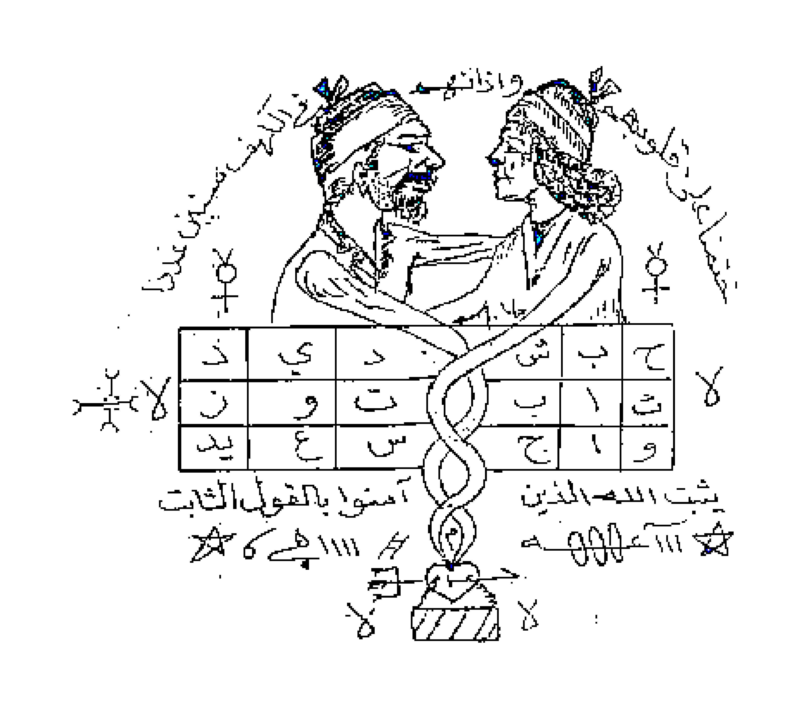

**AR:** (وَصْفُ الطِّلَسْمِ) رَسْمٌ يَدَوِىٌّ: **وَجْهَانِ** مُتَقَابِلَانِ — رَجُلٌ بِعِمَامَةٍ وَلِحْيَةٍ مِنَ الْيَمِيْنِ، وَامْرَاَةٌ بِخِمَارٍ مِنَ الْيَسَارِ — وَبَدَنَاهُمَا يَلْتَحِمَانِ وَيَنْزِلُ مِنْهُمَا **سُلَيْمَانِيَّانِ مُتَشَابِكَانِ** (شَكْلُ عَصَا هِرْمِسَ) يَخْتَرِقُ **جَدْوَلَ حُرُوْفٍ (٣ صُفُوْفٍ × ٦ اَعْمِدَةٍ)** وَيَنْتَهِيْ اِلٰى **قَلْبٍ** فَوْقَ **مُرَبَّعٍ صَغِيْرٍ ذِىْ اَخْطَاطٍ مَائِلَةٍ**. وَحَوْلَ الرَّسْمِ: كِتَابَاتٌ مَدَائِرِيَّةٌ وَرُمُوْزٌ نُجُوْمِيَّةٌ (☿، ♀، ✶، ✷) وَاَقْوَاسٌ.

**LAT:** (waṣfu al-ṭilasma) rasmun yadawiyyun: wajhāni mutaqābilāni — rajulun bi-‘imāmatin wa-liḥyatin mina al-yamīni, wa-imra’atun bi-khimārin mina al-yasāri — wa-badanāhumā yaltaḥimāni wa-yanzilu minhumā sulaymāniyyāni mutashābikāni (shaklu ‘aṣā Hirsa) yakhtariqu jadwala ḥurūfin (3 ṣufūfin × 6 a‘midatin) wa-yantahī ilā qalbin fawqa murabba‘in ṣaghīrin dhī akhṭāṭin mā’ilatin. Wa-ḥawla al-rasmi: kitābātun madā’iriyyatun wa-rumūzun nujūmiyyatun (☿، ♀، ✶، ✷) wa-aqwāsun.

**ID:** “**(Deskripsi ṭilasm)**: gambar tulisan tangan — **dua wajah berhadapan**: **laki-laki berimamah dan berjanggut** di **kanan**, **perempuan berkerudung** di **kiri**؛ **badan keduanya menyatu** lalu **turun darinya dua sulur bersilang** (bentuk **tongkat Hermes / caduceus**) yang **menembus tabel huruf (٣ baris × ٦ kolom)** dan **berakhir pada hati** di atas **kotak kecil bergaris miring**. **Di sekeliling gambar**: **tulisan melingkar**, **simbol bintang** (☿، ♀، ✶، ✷), dan **busur-busur**.”

**AR:** (قِرَاءَةُ الْجَدْوَلِ كَمَا يَظْهَرُ مِنَ الْيَمِيْنِ اِلَى الْيَسَارِ) الصَّفُّ الْاَوَّلُ: «**ح ب ش**» ثُمَّ مَوْضِعُ تَقَاطُعِ الرَّسْمِ ثُمَّ «**د ي د**»؛ الصَّفُّ الثَّانِى: «**ث ا ب**» ثُمَّ مَوْضِعُ التَّقَاطُعِ ثُمَّ «**ت و ن**»؛ الصَّفُّ الثَّالِثُ: «**و ا ح**» ثُمَّ مَوْضِعُ التَّقَاطُعِ ثُمَّ «**س ع ي د**».

**LAT:** (qirā’atu al-jadwali kamā yaẓharu mina al-yamīni ilā al-yasāri) al-ṣaffu al-awwalu: «ḥ b sh» thumma mawḍi‘u taqāṭu‘i al-rasmi thumma «d y d»؛ al-ṣaffu al-thāni: «th a b» thumma mawḍi‘u al-taqāṭu‘i thumma «t w n»؛ al-ṣaffu al-thālithu: «w a ḥ» thumma mawḍi‘u al-taqāṭu‘i thumma «s ‘ y d»

**ID:** “**(Pembacaan tabel seperti tampak dari kanan ke kiri)**: **baris ١** «**ح ب ش**» lalu **daerah persilangan gambar** lalu «**د ي د**»؛ **baris ٢** «**ث ا ب**» lalu persilangan lalu «**ت و ن**»؛ **baris ٣** «**و ا ح**» lalu persilangan lalu «**س ع ي د**».” **Catatan**: **dua kolom tengah tertutup sulur** sehingga **tidak terbaca**.

**AR:** لِلْمَحَبَّةِ الْقَاطِعَةِ وَالْجَلْبِ

**LAT:** lil-maḥabbati al-qāṭi‘ati wa-al-jalbi

**ID:** “**Untuk Cinta yang Membara (qāṭi‘ah) dan Jalb.**” (Judul bagian.)

**AR:** يُرْسَمُ هَذَا الطِّلَسْمُ وَيُحْرَقُ بَعْدَ كِتَابَتِهِ بِزَعْفَرَانٍ وَحَلِيْبِ غَنَمٍ وَعَسَلٍ، وَيُبَخَّرُ بِعُوْدٍ هِنْدِىٍّ، وَتُقْرَاُ الْبَسْمَلَةُ الشَّرِيْفَةُ عَدَدَهَا بِالْجُمَلِ الْكَبِيْرِ، وَتَوَكَّلُوْا يَا خُدَّامَ هَذَا الطِّلَسْمِ وَاجْلِبُوْا وَهَيِّجُوْا رُوْحَ وَرُوحَانِيَّةَ فُلَانٍ ابْنِ فُلَانَةَ عَلٰى مَحَبَّةٍ وَعِشْقٍ وَطَاعَةِ فُلَانٍ ابْنِ فُلَانَةَ — بَارَكَ اللهُ فِيْكُمْ — الْوَحَا الْعَجَلَ السَّاعَةَ. وَصَرْفُ الْعُمَّارِ قَبْلَ الْبَدْءِ فِى الْعَمَلِ. وَهَذَا الطِّلَسْمُ الْمُشَارُ اِلَيْهِ.

**LAT:** yursamu hādhā al-ṭilasmu wa-yuḥraqu ba‘da kitābatihi bi-za‘farānin wa-ḥalībi ghanamin wa-‘asalin, wa-yubakhkharu bi-‘ūdin hindiyyin, wa-tuqra’u al-basmalatu al-sharīfatu ‘adadahā bi-al-jumali al-kabīri, wa-tawakkalū yā khuddāma hādhā al-ṭilasm wa-jlibū wa-hayyijū rūḥa wa-rūḥāniyyata fulānin ibni fulānata ‘alā maḥabbatin wa-‘ishqin wa-ṭā‘ati fulānin ibni fulānata — bāraka allāhu fīkum — al-waḥā al-‘ajala al-sā‘ata. Wa-ṣarfu al-‘ummāri qabla al-bad’i fī al-‘amali. Wa-hādhā al-ṭilasmu al-mushāru ilayhi.

**ID:** “**Gambar ṭilasm ini dan bakar setelah menulisnya** — dengan **za‘farān, susu kambing, dan madu**؛ **didupai kayu cendana India**؛ **basmalah yang mulia dibaca sebanyak jumlahnya dalam ḥisāb al-jumal yang besar**؛ lalu «**Bertawkillah, wahai para pelayan ṭilasm ini, hadirkan dan kobarkanlah ruh serta ruhaniyyah Fulan bin Fulanah untuk mencintai, tergila-gila, dan taat kepada Fulan bin Fulanah — bārakallāhu fīkum — al-waḥā, al-‘ajal, al-sā‘ah**». **Ṣarf al-‘ummār sebelum memulai amalan.** **Dan inilah ṭilasm yang dimaksud**.”

**Keterangan halaman.** (1) **«محبة بين الزوجين»**: ṭilasm pada **٣ lembar** (**misk + za‘farān + kuning telur + dam al-akhawayn**), dupa **may‘ah cair + sandarūs**, **satu lembar dibakar tiap maghrib selama ٣ hari**؛ **lembar keempat** memuat **ayat + ṭilasm**, **tidak dibakar**, **ditanam di bawah kasur**؛ **‘azīmah: surah al-Kahf dua kali** dengan tawkil tiap kali؛ jaminan **tidak berpisah** selama ḥijāb itu ada. (2) **«للمحبة القاطعة والجلب»**: gambar **dua wajah + sulur caduceus + tabel huruf + hati**؛ ditulis dengan **za‘farān + susu kambing + madu**, **dibakar** sesudah ditulis, dupa **‘ūd hindī**, **basmalah sesuai ḥisāb al-jumal**, dengan **ṣarf al-‘ummār** lebih dulu.

**Angka pada halaman ini.** **٣ lembar** dan **٣ hari** — cocok antara lapisan teks dan pindaian. **«مَرَّتَيْنِ»** (al-Kahf dua kali) ditulis dengan kata. **Tidak ada angka wafaq** di halaman ini; tabel huruf **bukan wafaq angka** sehingga **tidak dapat diuji** dengan penjumlahan baris/kolom/diagonal.

**[TIDAK JELAS - HALAMAN 452]** (1) **Dua kolom tengah tabel huruf** — tertutup sulur caduceus; **[TEKS ASLI DIJAGA]**. (2) **Tulisan melingkar** di sekeliling gambar — huruf terpotong; hanya bentuknya dideskripsikan. (3) **«صُفَارِ الْبَيْضِ»** — kuning telur; dipertahankan. (4) **«دَمِ الْاَخْوَيْنِ»** — **dam al-akhawayn** (resin merah, «darah dua saudara») — **bukan darah hewan**; dijelaskan agar tidak disalahpahami. (5) **«الَ ٣ لَا يَنْحَرِقْنَ»** — susunan tidak jelas (kemungkinan «إلا ٣ لا ينحرقن»)؛ dipertahankan dan ditandai. (6) **«بِالْجُمَلِ الْكَبِيْرِ»** — istilah **ḥisāb al-jumal**؛ dijelaskan; **jumlahnya tidak disebutkan** pada cetakan. (7) **«فُلَانٍ … عَلٰى … فُلَانٍ»** — kedua nama laki-laki pada cetakan; dipertahankan dan ditandai.

**Peringatan (dicatat apa adanya, bukan fatwa).** Bagian kedua meminta agar seseorang **tergila-gila (عشق)** dan **taat** kepada orang lain, serta **membakar** lembar ṭilasm. Teks ditranskripsikan sesuai cetakan; **memaksa rasa cinta** dan **pembakaran** untuk tujuan itu bukan bagian dari ajaran Islam.

**[ADA RAJAH]** — 1 crop: `assets/rajah/sirrul-asrar/hal-452-rajah-01.png` (700 DPI, Rect(111, 226, 502, 567)).

---
## HALAMAN 453 — halaman penutup bergambar (dua sosok + pita tulisan) + kolofon dan nomor kontak

**AR:** كِتَابُ سِرِّ الْاَسْرَارِ فِي التَّوَاصُلِ مَعَ رُوحَانِيَّاتِ الْقُرْآنِ — شَيْخُ الرُّوحَانِيِّينَ الشَّيْخُ عَطِيَّةُ عَبْدُ الْحَمِيدِ

**LAT:** kitābu sirri al-asrāri fī al-tawāṣuli ma‘a rūḥāniyyāti al-qur’āni — shaykhu al-rūḥāniyyīna al-shaykhu ‘Aṭiyyatu ‘Abdu al-Ḥamīdi

**ID:** “Kitab «Sirr al-Asrār fī al-Tawāṣul ma‘a Rūḥāniyyāt al-Qur’ān» — Syaikh para ruhaniyyin, Syaikh ‘Aṭiyyah ‘Abd al-Ḥamīd.” (Kepala halaman.)

**AR:** (سَطْرُ الْاِسْمِ) «**اَلسَّهْمُ الصَّائِبُ فِي تَنْقِيَةِ الْعُلُومِ الرُّوحَانِيَّةِ مِنَ الشَّوَائِبِ الْخَبِيثَةِ**» — شَيْخُ الرُّوحَانِيِّينَ الشَّيْخُ عَطِيَّةُ عَبْدُ الْحَمِيدِ

**LAT:** (saṭru al-ismi) «al-sahmu al-ṣā’ibu fī tanqiyati al-‘ulūmi al-rūḥāniyyati mina al-shawā’ibi al-khabīthati» — shaykhu al-rūḥāniyyīna al-shaykhu ‘Aṭiyyatu ‘Abdu al-Ḥamīdi

**ID:** “**(Baris nama kitab)** «**Al-Sahm al-Ṣā’ib fī Tanqiyat al-‘Ulūm al-Rūḥāniyyah min al-Shawā’ib al-Khabīthah**» — **Syaikh para ruhaniyyin, Syaikh ‘Aṭiyyah ‘Abd al-Ḥamīd**.” (Nama judul induk.)

**Rajah:** 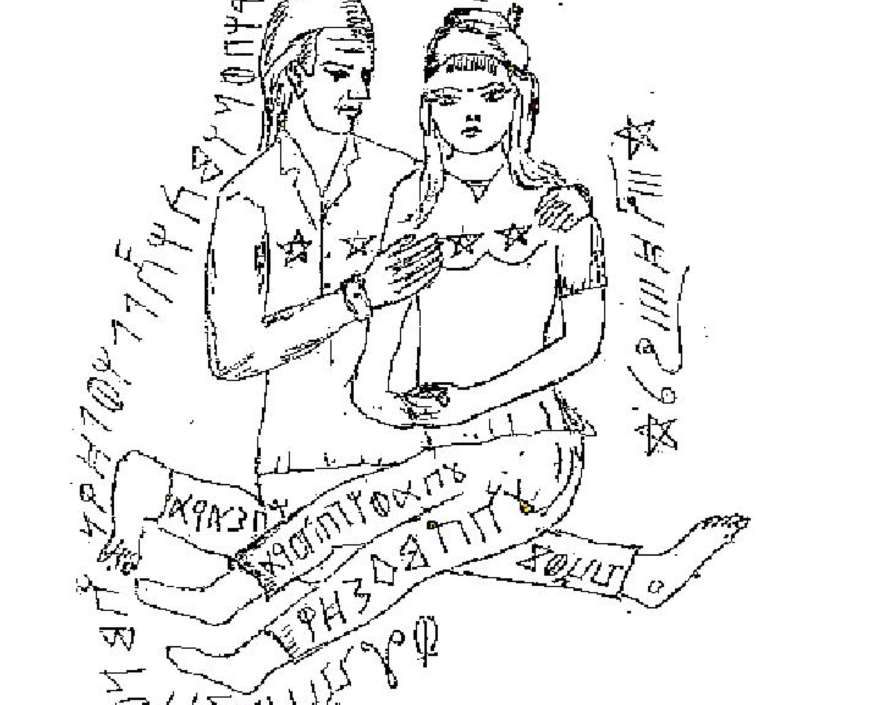

**AR:** (وَصْفُ الرَّسْمِ) **شَخْصَانِ** جَالِسَانِ مُتَرَبِّعَانِ:

- **الْيَمِيْنُ:** رَجُلٌ بِعِمَامَةٍ وَلِحْيَةٍ خَفِيْفَةٍ، يَدُهُ الْيُمْنٰى عَلٰى صَدْرِ الْمَرْاَةِ.
- **الْيَسَارُ:** امْرَاَةٌ بِخِمَارٍ وَشَعْرٍ مَنْثُوْرٍ، يَدَاهَا مَضْمُوْمَتَانِ اِلٰى صَدْرِهَا.
- **عَلٰى ثَوْبِهِمَا:** **نَجْمَتَانِ خُمَاسِيَّتَانِ** (✶).
- **فَوْقَ الْاَرْجُلِ الْمُتَشَابِكَةِ:** **شُرَيْطٌ طَوِيْلٌ** فِيْهِ رُقُوْمٌ وَحُرُوْفٌ مُتَدَاخِلَةٌ (مِثْلُ «**٥ ٥**» فِى الْاَعْلٰى، وَ«**٩ ٩ ٥ ٣ ٦ ٤ ٧ ٠ …**» فِى الشُّرَيْطِ).
- **حَوْلَ الرَّسْمِ:** كِتَابَاتٌ مَدَائِرِيَّةٌ وَرُمُوْزٌ (✶، ✷، ♀، دَوَائِرُ صَغِيْرَةٌ).

**LAT:** (waṣfu al-rasmi) shakhṣāni jālisāni mutarabbi‘āni: al-yamīnu: rajulun bi-‘imāmatin wa-liḥyatin khafīfatin, yaduhu al-yumnā ‘alā ṣadri al-mar’ati؛ al-yasāru: imra’atun bi-khimārin wa-sha‘rin manthūrin, yadāhā maḍmūmatāni ilā ṣadrihā؛ ‘alā thawbihimā: najmatāni khumāsiyyatāni (✶)؛ fawqa al-arjuli al-mutashābikati: sharīṭun ṭawīlun fīhi ruqūmun wa-ḥurūfun mutadākhilatun (mithla «5 5» fī al-a‘lā, wa-«9 9 5 3 6 4 7 0 …» fī al-sharīṭi)؛ ḥawla al-rasmi: kitābātun madā’iriyyatun wa-rumūzun (✶، ✷، ♀، dawā’irun ṣaghīratun).

**ID:** “**(Deskripsi gambar)**: **dua sosok** duduk **bersila**: **kanan** — **laki-laki berimamah dan berjanggut tipis**, tangan kanannya di **dada perempuan**؛ **kiri** — **perempuan berkerudung dengan rambut terurai**, kedua tangannya **didekapkan ke dadanya**؛ **pada pakaian keduanya**: **dua bintang lima** (✶)؛ **di atas kaki mereka yang bersilang**: **pita panjang** berisi **angka dan huruf berjalin** (seperti «**٥ ٥**» di atas, «**٩ ٩ ٥ ٣ ٦ ٤ ٧ ٠ …**» pada pita)؛ **di sekeliling gambar**: **tulisan melingkar** dan **simbol** (✶، ✷، ♀، lingkaran kecil).”

**AR:** اَيُّهَا الطَّالِبُ الْجَلِيْلُ — لَا تَبْخَلْ عَلَيْنَا بِقِرَاءَةِ الْفَاتِحَةِ وَثَوَابًا لَنَا وَلِوَالِدَيْنَا — شَيْخُ الرُّوحَانِيِّينَ فِى الْوَطَنِ الْعَرَبِىِّ — الشَّيْخُ عَطِيَّةُ عَبْدُ الْحَمِيْدِ — لِلْكَشْفِ وَالْمُتَابَعَةِ مَعَ شَيْخِ الرُّوحَانِيِّينَ: ٨٣٢٢٢٠٢٦١٠٢٠٠

**LAT:** ayyuhā al-ṭālibu al-jalīlu — lā tabkhal ‘alaynā bi-qirā’ati al-fātiḥati wa-thawāban lanā wa-li-wālidaynā — shaykhu al-rūḥāniyyīna fī al-waṭani al-‘arabiyyi — al-shaykhu ‘Aṭiyyatu ‘Abdu al-Ḥamīdi — lil-kashfi wa-al-mutāba‘ati ma‘a shaykhi al-rūḥāniyyīna: 8322202610200

**ID:** “**Wahai peminta yang mulia** — **jangan pelit atas kami dengan membaca al-Fātiḥah dan (menghadiahkan) pahala untuk kami dan kedua orang tua kami** — **Syaikh para ruhaniyyin di Tanah Arab — Syaikh ‘Aṭiyyah ‘Abd al-Ḥamīd** — **untuk kasyf dan bimbingan dengan Syaikh para ruhaniyyin: ٨٣٢٢٢٠٢٦١٠٢٠٠**.” **Nomor ini juga tercetak pada «مجربات شيخ الروحانيين الشيخ عطية» di atas gambar.**

**Keterangan halaman.** **Halaman penutup bergambar**, bukan halaman amalan: **nama induk kitab** («السهم الصائب في تنقية العلوم الروحانية من الشوائب الخبيثة»), **gambar dua sosok** dengan **pita bertulisan talismanic** dan **simbol bintang**, **cap «مجربات شيخ الروحانيين الشيخ عطية»**, **nomor telepon ٨٣٢٢٢٠٢٦١٠٢٠٠**, lalu **kolofon** permintaan **al-Fātiḥah** dan **«للكشف والمتابعة مع شيخ الروحانيين»** dengan nomor yang sama. **Tidak ada materi amalan baru.**

**Angka pada halaman ini.** **Nomor telepon** — lapisan teks mengekstrak **«٨٣٢٢٢٠٢٦١٠٢٠٠»** (urutan **terbalik**), **pindaian** menunjukkan urutan cetak **٨٣٢٢٢٠٢٦١٠٢٠٠**; pada p.428 dan p.437 nomor yang sama terbaca **٠٠٢٠١٢٦٢٠٢٢٢٣٨** (dengan kode negara **٠٠٢** di depan). **Kedua bentuk dipertahankan** dan dicatat: di halaman ini nomor tercetak **tanpa «٠٠٢»**, sedangkan di p.428/437 **dengan «٠٠٢»**. **Angka di dalam pita dan tulisan melingkar** — tidak dapat dipastikan.

**[TIDAK JELAS - HALAMAN 453]** (1) **Isi pita panjang** — angka/huruf berjalin tulisan tangan; **[TEKS ASLI DIJAGA]**, hanya dideskripsikan. (2) **Tulisan melingkar** — huruf terpotong; ditandai. (3) **Perbedaan nomor telepon** (٨٣٢٢٢٠٢٦١٠٢٠٠ vs ٠٠٢٠١٢٦٢٠٢٢٢٣٨) — **keduanya dipertahankan**, tidak dikoreksi karena **dua bentuk memang tercetak berbeda** pada halaman berbeda. (4) **«اَلسَّهْمُ الصَّائِبُ»** — nama kitab induk; dipertahankan. (5) **Gambar dua sosok** — **bukan wafaq** (tidak ada tabel angka yang dapat diuji); **tidak ada bukti penjumlahan**.

**Peringatan (dicatat apa adanya, bukan fatwa).** Gambar ini menampilkan **kontak fisik laki-laki dan perempuan bukan mahram** sebagai bagian dari «ṭilasm» — hanya **deskripsi gambar cetakan**; teks ditranskripsikan apa adanya dan **bukan anjuran**.

**[ADA RAJAH]** — 1 crop: `assets/rajah/sirrul-asrar/hal-453-rajah-01.png` (700 DPI, Rect(115, 150, 498, 455)). **Bingkai/kotak hias halaman tidak di-crop.**

---
## HALAMAN 454 — daftar terbitan Syaikh ‘Aṭiyyah ‘Abd al-Ḥamīd (halaman iklan/promosi buku)

**AR:** كِتَابُ سِرِّ الْاَسْرَارِ فِي التَّوَاصُلِ مَعَ رُوحَانِيَّاتِ الْقُرْآنِ — شَيْخُ الرُّوحَانِيِّينَ الشَّيْخُ عَطِيَّةُ عَبْدُ الْحَمِيدِ

**LAT:** kitābu sirri al-asrāri fī al-tawāṣuli ma‘a rūḥāniyyāti al-qur’āni — shaykhu al-rūḥāniyyīna al-shaykhu ‘Aṭiyyatu ‘Abdu al-Ḥamīdi

**ID:** “Kitab «Sirr al-Asrār fī al-Tawāṣul ma‘a Rūḥāniyyāt al-Qur’ān» — Syaikh para ruhaniyyin, Syaikh ‘Aṭiyyah ‘Abd al-Ḥamīd.” (Kepala halaman.)

**AR:** مِنْ اِصْدَارَاتِ شَيْخِ الرُّوحَانِيِّينَ الشَّيْخِ عَطِيَّةِ عَبْدِ الْحَمِيدِ فِى الْمَكْتَبَاتِ

**LAT:** min iṣdārāti shaykhi al-rūḥāniyyīna al-shaykhi ‘Aṭiyyati ‘Abdi al-Ḥamīdi fī al-maktabāti

**ID:** “**Dari terbitan Syaikh para ruhaniyyin, Syaikh ‘Aṭiyyah ‘Abd al-Ḥamīd, yang ada di toko-toko buku:**” (Judul halaman.)

**AR:** (الْقَائِمَةُ كَمَا فِى الْمَطْبُوْعِ، سَطْرًا سَطْرًا)

1. مُجَلَّدُ «**اَلسَّهْمُ الصَّائِبُ فِي تَنْقِيَةِ الْعُلُومِ الرُّوحَانِيَّةِ مِنَ الشَّوَائِبِ**»
2. مُجَلَّدُ «**اَلدَّعَوَاتُ الرُّوحَانِيَّةُ فِي حَلِّ الْاَرْصَادِ الْفَلَكِيَّةِ خَاصٌّ بِعِلْمِ الْكُنُوزِ**»
3. كِتَابُ «**اَلْاَبْرَاجُ: اِكْتَشِفْ اَسْرَارَ مَنْ تُرِيْدُ**»
4. كِتَابُ «**عَجَائِبُ وَفَوَائِدُ النَّبَاتَاتِ وَالْحَيَوَانَاتِ وَخَوَاصِّهِمُ الرُّوحَانِيَّةِ**»
5. كِتَابُ «**اَلصَّوْلَجَانُ فِي الْاِسْتِيْلَادِ عَلٰى بَنَاتِ الْجَانِّ**»
6. كِتَابُ «**زَجَرَاتُ مِيْطَطْرُوْنَ فِي الْاَقْسَامِ الْحَاكِمَةِ عَلٰى قَبَائِلِ الْجَانِّ**»
7. كِتَابُ «**تَصْرِيْفُ دَعَوَاتِ الْبَرْهَتِيَّةِ الثَّلَاثِيَّةِ الرُّوحَانِيَّةِ وَالْاَرْضِيَّةِ وَالسُّفْلِيَّةِ**»
8. كِتَابُ «**حِكْمَةُ الْحُكَمَاءِ فِي عِلْمِ السِّيْمِيَاءِ وَالْكِيْمِيَاءِ**»
9. كِتَابُ «**اَلْاِسْتِدْلَالُ عَلَى الضَّمَائِرِ الْخَفِيَّةِ بِالْقَوَانِيْنِ الْحَرْفِيَّةِ**»
10. كِتَابُ «**سِرُّ الْاَسْرَارِ فِي التَّوَاصُلِ مَعَ رُوحَانِيَّاتِ الْقُرْآنِ**»
11. كِتَابُ «**اَسْرَارٌ وَخَفَايَاتٌ فِي عِلْمِ الرُّوحَانِيَّاتِ**»
12. كِتَابُ «**اَلْاَوْرَادُ الصُّوْفِيَّةُ: اَوَّلُ طَرِيْقِ الرُّوحَانِيَّةِ**»
13. كِتَابُ «**تَعْلِيْمُ طُرُقِ التَّنْوِيْمِ الْمَغْنَاطِيْسِىِّ بِاحْتِرَافٍ**»
14. كِتَابُ «**اَلْاَمْلَاكُ فِي الْاَقْسَامِ وَالدَّعَوَاتِ**»
15. كِتَابُ «**اَلْاَسْرَارُ الرَّبَّانِيَّةُ فِي الْفَوَائِدِ الرُّوحَانِيَّةِ — الْجُزْءُ الْاَوَّلُ**»
16. كِتَابُ «**اَلْاَسْرَارُ الرَّبَّانِيَّةُ فِي الْفَوَائِدِ الرُّوحَانِيَّةِ — الْجُزْءُ الثَّانِىْ**»
17. كِتَابُ «**اَلْاِسْقَاطُ النَّجْمِىُّ وَكَيْفِيَّةُ تَعْلِيْمِهِ**»
18. كِتَابُ «**اَلطَّرِيْقَةُ الْوَاضِحَةُ فِي اَسْرَارِ الْفَاتِحَةِ**»
19. «**مَجْمُوْعَةُ الرَّسَائِلِ الرُّوحَانِيَّةِ الْخَمْسَةِ**»
20. «**اَلتَّارُوْتُ الْاَعْظَمُ وَكَيْفِيَّةُ قِرَاءَةِ اَوْرَقَةٍ**»
21. «**اَلسَّيْفُ الْقَاطِعُ فِي الْعِلَاجِ بِالرُّقْيَةِ وَكَيْفِيَّةِ الْعَمَلِ بِهِ**»
22. «**كِتَابُ الْكَفِّ وَاَسْرَارِهِ**»
23. «**كِتَابُ الْعِلَاجِ بِالْاَعْشَابِ وَكَيْفِيَّةِ الْاِسْتِفَادَةِ مِنْ كُلِّ عُشْبٍ**»
24. «**شِفَاءُ الْعَلِيْلِ بِالْفَوَائِدِ مِنَ الْقُرْآنِ وَالْاِنْجِيْلِ**»
25. «**فَضْلُ الدُّعَاءِ وَالصَّلَاةِ عَلَى الْحَبِيْبِ**»
26. «**عَجَائِبُ الْمُعَالِجِيْنَ بِالرُّقْيَةِ وَالْمَزْمُوْرِ وَحِكَايَاتِ الْمَرْضٰى**»
27. «**كِتَابٌ خَاصٌّ بِالدُّرُوْسِ الرُّوحَانِيَّةِ بِطَرِيْقَةٍ بَسِيْطَةٍ وَمُيَسَّرَةٍ لِلْجَمِيْعِ**»

**LAT:** (al-qā’imatu kamā fī al-maṭbū‘i, saṭran saṭran) 1. mujalladu «al-sahmu al-ṣā’ibu fī tanqiyati al-‘ulūmi al-rūḥāniyyati mina al-shawā’ibi» 2. mujalladu «al-da‘awātu al-rūḥāniyyatu fī ḥalli al-arṣādi al-falakiyyati khāṣṣun bi-‘ilmi al-kunūzi» 3. kitābu «al-abrāju: iktashif asrāra man turīdu» 4. kitābu «‘ajā’ibu wa-fawā’idu al-nabātāti wa-al-ḥayawānāti wa-khawāṣṣihimu al-rūḥāniyyati» 5. kitābu «al-ṣawlagānu fī al-istīlādi ‘alā banāti al-jānni» 6. kitābu «zajarātu Mīṭaṭrūna fī al-aqsāmi al-ḥākimati ‘alā qabā’ili al-jānni» 7. kitābu «taṣrīfu da‘awāti al-barhatiyyati al-thalāthiyyati al-rūḥāniyyati wa-al-arḍiyyati wa-al-sufliyyati» 8. kitābu «ḥikmatu al-ḥukamā’i fī ‘ilmi al-sīmiyā’i wa-al-kīmiyā’i» 9. kitābu «al-istidlālu ‘alā al-ḍamā’iri al-khafiyyati bi-al-qawānīni al-ḥarfiyyati» 10. kitābu «sirru al-asrāri fī al-tawāṣuli ma‘a rūḥāniyyāti al-qur’āni» 11. kitābu «asrārun wa-khafāyātun fī ‘ilmi al-rūḥāniyyāti» 12. kitābu «al-awrādu al-ṣūfiyyatu: awwalu ṭarīqi al-rūḥāniyyati» 13. kitābu «ta‘līmu ṭuruqi al-tanwīmi al-maghnāṭīsiyyi bi-iḥtirāfin» 14. kitābu «al-amlāku fī al-aqsāmi wa-al-da‘awāti» 15. kitābu «al-asrāru al-rabbāniyyatu fī al-fawā’idi al-rūḥāniyyati — al-juz’u al-awwalu» 16. kitābu «al-asrāru al-rabbāniyyatu fī al-fawā’idi al-rūḥāniyyati — al-juz’u al-thāni» 17. kitābu «al-isqāṭu al-najmiyyu wa-kayfiyyatu ta‘līmihi» 18. kitābu «al-ṭarīqatu al-wāḍiḥatu fī asrāri al-fātiḥati» 19. «majmū‘atu al-rasā’ili al-rūḥāniyyati al-khamsati» 20. «al-tārūtu al-a‘ẓamu wa-kayfiyyatu qirā’ati awraqatin» 21. «al-sayfu al-qāṭi‘u fī al-‘ilāji bi-al-ruqyati wa-kayfiyyati al-‘amali bihi» 22. «kitābu al-kaffi wa-asrārihi» 23. «kitābu al-‘ilāji bi-al-a‘shābi wa-kayfiyyati al-istifādati min kulli ‘ushbin» 24. «shifā’u al-‘alīli bi-al-fawā’idi mina al-qur’āni wa-al-injīli» 25. «faḍlu al-du‘ā’i wa-al-ṣalāti ‘alā al-ḥabībi» 26. «‘ajā’ibu al-mu‘ālijīna bi-al-ruqyati wa-al-mazmūri wa-ḥikāyāti al-marḍā» 27. «kitābun khāṣṣun bi-al-durūsi al-rūḥāniyyati bi-ṭarīqatin basīṭatin wa-muyassaratin lil-jamī‘i»

**ID:** “**(Daftar sebagaimana tercetak, baris per baris)** — 27 judul: (1) **Al-Sahm al-Ṣā’ib fī Tanqiyat al-‘Ulūm al-Rūḥāniyyah min al-Shawā’ib**؛ (2) **Al-Da‘awāt al-Rūḥāniyyah fī Ḥall al-Arṣād al-Falakiyyah — khusus ilmu al-Kunūz**؛ (3) **Al-Abrāj: Iktashif Asrār Man Turīd**؛ (4) **‘Ajā’ib wa-Fawā’id al-Nabātāt wa-al-Ḥayawānāt wa-Khawāṣṣihim al-Rūḥāniyyah**؛ (5) **Al-Ṣawlagān fī al-Istīlād ‘alā Banāt al-Jānn**؛ (6) **Zajarāt Mīṭaṭrūn fī al-Aqsām al-Ḥākimah ‘alā Qabā’il al-Jānn**؛ (7) **Taṣrīf Da‘awāt al-Barhatiyyah al-Thalāthiyyah al-Rūḥāniyyah wa-al-Arḍiyyah wa-al-Sufliyyah**؛ (8) **Ḥikmat al-Ḥukamā’ fī ‘Ilm al-Sīmiyā’ wa-al-Kīmiyā’**؛ (9) **Al-Istidlāl ‘alā al-Ḍamā’ir al-Khafiyyah bi-al-Qawānīn al-Ḥarfiyyah**؛ (10) **Sirr al-Asrār fī al-Tawāṣul ma‘a Rūḥāniyyāt al-Qur’ān** (kitab ini)؛ (11) **Asrār wa-Khafāyāt fī ‘Ilm al-Rūḥāniyyāt**؛ (12) **Al-Awrād al-Ṣūfiyyah: Awwal Ṭarīq al-Rūḥāniyyah**؛ (13) **Ta‘līm Ṭuruq al-Tanwīm al-Maghnāṭīsī bi-Iḥtirāf**؛ (14) **Al-Amlāk fī al-Aqsām wa-al-Da‘awāt**؛ (15) **Al-Asrār al-Rabbāniyyah fī al-Fawā’id al-Rūḥāniyyah — Juz 1**؛ (16) **— Juz 2**؛ (17) **Al-Isqāṭ al-Najmī wa-Kayfiyyat Ta‘līmih**؛ (18) **Al-Ṭarīqah al-Wāḍiḥah fī Asrār al-Fātiḥah**؛ (19) **Majmū‘at al-Rasā’il al-Rūḥāniyyah al-Khamsah**؛ (20) **Al-Tārūt al-A‘ẓam wa-Kayfiyyat Qirā’at Awraqah**؛ (21) **Al-Sayf al-Qāṭi‘ fī al-‘Ilāj bi-al-Ruqyah**؛ (22) **Kitāb al-Kaff wa-Asrāruh**؛ (23) **Kitāb al-‘Ilāj bi-al-A‘shāb**؛ (24) **Shifā’ al-‘Alīl bi-al-Fawā’id min al-Qur’ān wa-al-Injīl**؛ (25) **Faḍl al-Du‘ā’ wa-al-Ṣalāh ‘alā al-Ḥabīb**؛ (26) **‘Ajā’ib al-Mu‘ālijīn bi-al-Ruqyah wa-al-Mazmūr wa-Ḥikāyāt al-Marḍā**؛ (27) **Kitāb khāṣṣ bi-al-Durūs al-Rūḥāniyyah bi-Ṭarīqah Basīṭah wa-Muyassarah lil-Jamī‘**.”

**Keterangan halaman.** Halaman ini **bukan halaman amalan**, melainkan **daftar terbitan (iklan)** Syaikh ‘Aṭiyyah ‘Abd al-Ḥamīd sebanyak **٢٧ judul**, dicetak **satu judul per baris**, dari «السهم الصائب» sampai «كتاب خاص بالدروس الروحانية». **Tidak ada ayat, ṭilasm, wafaq, atau angka amalan** pada halaman ini.

**Angka pada halaman ini.** **Tidak ada angka bilangan** — nomor 1–27 pada transkripsi di atas adalah **penomoran baris oleh pentranskripsi**, bukan angka pada cetakan. Halaman **seluruhnya teks**, **tanpa citra tertanam** (`get_image_info()` = `[]`).

**[TIDAK JELAS - HALAMAN 454]** (1) **«اَلصَّوْلَجَانُ فِي الْاِسْتِيْلَادِ عَلٰى بَنَاتِ الْجَانِّ»** — kata «الاستيلاد» pada cetakan **tidak lazim** dalam konteks ini (mungkin «الاستيلاء» — penguasaan); **dipertahankan** dan ditandai. (2) **«زَجَرَاتُ مِيْطَطْرُوْنَ»** — nama **Mīṭaṭrūn** (Metatron) **tanpa vokalisasi lengkap**; **dipertahankan**. (3) **«اَلْاِسْقَاطُ النَّجْمِىُّ»** — istilah teknis; **dipertahankan** dan dijelaskan sebagai **penentuan waktu/penurunan pengaruh bintang**. (4) **«اَلتَّارُوْتُ الْاَعْظَمُ ... قِرَاءَةِ اَوْرَقَةٍ»** — **susunan janggal** («membaca satu lembar»); **dipertahankan**. (5) **Judul nomor 27 tidak bernomor** pada cetakan (berdiri sendiri di baris terakhir); **dipertahankan** dalam urutan.

**[TIDAK ADA RAJAH - TERVERIFIKASI DARI GAMBAR SCAN]** — halaman ini **teks saja**; `get_image_info()` = `[]` dan `get_drawings()` = 2 (hanya garis bingkai teks). Tidak ada yang di-crop.

---
## HALAMAN 455 — lanjutan daftar terbitan (١٤ judul) + «للكشف والمتابعة» dan nomor kontak

**AR:** كِتَابُ سِرِّ الْاَسْرَارِ فِي التَّوَاصُلِ مَعَ رُوحَانِيَّاتِ الْقُرْآنِ — شَيْخُ الرُّوحَانِيِّينَ الشَّيْخُ عَطِيَّةُ عَبْدُ الْحَمِيدِ

**LAT:** kitābu sirri al-asrāri fī al-tawāṣuli ma‘a rūḥāniyyāti al-qur’āni — shaykhu al-rūḥāniyyīna al-shaykhu ‘Aṭiyyatu ‘Abdu al-Ḥamīdi

**ID:** “Kitab «Sirr al-Asrār fī al-Tawāṣul ma‘a Rūḥāniyyāt al-Qur’ān» — Syaikh para ruhaniyyin, Syaikh ‘Aṭiyyah ‘Abd al-Ḥamīd.” (Kepala halaman.)

**AR:** (تَكْمِلَةُ الْقَائِمَةِ، سَطْرًا سَطْرًا)

1. كِتَابُ «**مُلَخَّصٌ لِسَفِيْرِ جَهَنَّمَ وَمَكَائِدِ بَنِىْ اِسْرَائِيْلَ الَ ٣٦٦ مَكِيْدَةً بِدُوْنِ تَحْرِيْفٍ**»
2. كِتَابُ «**تَحْضِيْرِ الْاَرْوَاحِ وَسِحْرِ الْعُصُوْرِ الْوُسْطٰى**»
3. مُجَلَّدُ «**اَلْفَوَائِدُ الرُّوحَانِيَّةُ مُتَرْجَمٌ لِلْاِنْجِلِيْزِيَّةِ وَالْفَرَنْسِيَّةِ**»
4. كِتَابُ «**اَلْاَسْحَارُ فِي تَعْلِيْمِ الرُّوحَانِيَّاتِ لِلْمَشَايِخِ الْكِبَارِ**»
5. كِتَابُ «**وَادِى الْجِنِّ وَطُرُقِ التَّحْضِيْرِ وَشَرْحِ الْخَلْوَةِ**»
6. كِتَابُ «**اَسْرَارُ الرُّوحَانِيَّةِ فِيْمَا يَتَعَلَّقُ بِالْاُمُوْرِ الْخَفِيَّةِ**»
7. كِتَابُ «**اَلشَّيْخُ الْكَبِيْرُ فِي عِلْمِ التَّنْزِيْلِ مِنَ الْمَزْمُوْرِ وَالْاِنْجِيْلِ**»
8. كِتَابُ «**اَلْاَوْفَاقُ وَخَوَاصُّ كُلِّ وَفَقٍ وَكَيْفِيَّةُ عَمَلِهِ**»
9. كِتَابُ «**اَلْبَوَّابَةُ الْكَوْنِيَّةُ فِي اسْتِحْضَارِ الرُّوحَانِيَّةِ**»
10. كِتَابُ «**اَلْاَحْجَارُ الْكَرِيْمَةُ وَطُرُقُ عَمَلِ الْخَوَاتِمِ الرُّوحَانِيَّةِ لِكُلِّ شَخْصٍ وَكَيْفِيَّةُ الْاِنْتِفَاعِ بِهِ**»
11. كِتَابُ «**ذُرْوَةُ الْاَسْرَارِ وَمَا يَتَعَلَّقُ بِطَلَاسِمِ اللَّيْلِ وَالنَّهَارِ**»
12. «**مُجَلَّدَاتُ الْجَوَاهِرِ التِّسْعَةِ الرُّوحَانِيَّةِ**»
13. «**لِلْكَشْفِ وَالْمُتَابَعَةِ مَعَ شَيْخِ الرُّوحَانِيِّينَ**» — الشَّيْخُ عَطِيَّةُ عَبْدُ الْحَمِيدِ
14. «**٨٣٢٢٢٠٢٦١٠٢٠٠**»

**LAT:** (takmilatu al-qā’imati, saṭran saṭran) 1. kitābu «mulakhkhaṣun li-Safīri Jahannama wa-makā’idi Banī Isrā’īla allā 366 makīdatan bidūni taḥrīfin» 2. kitābu «taḥḍīri al-arwāḥi wa-siḥri al-‘uṣūri al-wusṭā» 3. mujalladu «al-fawā’idu al-rūḥāniyyatu mutarjamun lil-injiliziyyati wa-al-faransiyyati» 4. kitābu «al-asḥāru fī ta‘līmi al-rūḥāniyyāti lil-mashāyikhi al-kibāri» 5. kitābu «wādī al-jinni wa-ṭuruqi al-taḥḍīri wa-sharḥi al-khalwati» 6. kitābu «asrāru al-rūḥāniyyati fīmā yata‘allaqu bi-al-umūri al-khafiyyati» 7. kitābu «al-shaykhu al-kabīru fī ‘ilmi al-tanzīli mina al-mazmūri wa-al-injīli» 8. kitābu «al-awfāqu wa-khawāṣṣu kulli wafqin wa-kayfiyyatu ‘amalihi» 9. kitābu «al-bawwābatu al-kawniyyatu fī istiḥḍāri al-rūḥāniyyati» 10. kitābu «al-aḥjāru al-karīmatu wa-ṭuruqu ‘amali al-khawātimi al-rūḥāniyyati li-kulli shakhṣin wa-kayfiyyatu al-intifā‘i bihi» 11. kitābu «dhurwatu al-asrāri wa-mā yata‘allaqu bi-ṭalāsimi al-layli wa-al-nahāri» 12. «mujalladātu al-jawāhiri al-tis‘ati al-rūḥāniyyati» 13. «lil-kashfi wa-al-mutāba‘ati ma‘a shaykhi al-rūḥāniyyīna» — al-shaykhu ‘Aṭiyyatu ‘Abdu al-Ḥamīdi 14. «8322202610200»

**ID:** “**(Lanjutan daftar, baris per baris)** — (1) **Mulakhkhaṣ li-Safīr Jahannam wa-Makā’id Banī Isrā’īl — ٣٦٦ makīdah tanpa taḥrīf**؛ (2) **Taḥḍīr al-Arwāḥ wa-Siḥr al-‘Uṣūr al-Wusṭā**؛ (3) **Al-Fawā’id al-Rūḥāniyyah — terjemahan Inggris dan Prancis**؛ (4) **Al-Asḥār fī Ta‘līm al-Rūḥāniyyāt lil-Mashāyikh al-Kibār**؛ (5) **Wādī al-Jinn wa-Ṭuruq al-Taḥḍīr wa-Sharḥ al-Khalwah**؛ (6) **Asrār al-Rūḥāniyyah fīmā Yata‘allaq bi-al-Umūr al-Khafiyyah**؛ (7) **Al-Shaykh al-Kabīr fī ‘Ilm al-Tanzīl min al-Mazmūr wa-al-Injīl**؛ (8) **Al-Awfāq wa-Khawāṣṣ Kull Wafaq wa-Kayfiyyat ‘Amalih**؛ (9) **Al-Bawwābah al-Kawniyyah fī Istiḥḍār al-Rūḥāniyyah**؛ (10) **Al-Aḥjār al-Karīmah wa-Ṭuruq ‘Amal al-Khawātim al-Rūḥāniyyah li-Kull Shakhṣ**؛ (11) **Dhurwat al-Asrār wa-mā Yata‘allaq bi-Ṭalāsim al-Layl wa-al-Nahār**؛ (12) **Mujalladāt al-Jawāhir al-Tis‘ah al-Rūḥāniyyah**؛ (13) **«Untuk kasyf dan bimbingan bersama Syaikh para ruhaniyyin»** — **Syaikh ‘Aṭiyyah ‘Abd al-Ḥamīd**؛ (14) **«٨٣٢٢٢٠٢٦١٠٢٠٠»**.”

**Keterangan halaman.** Lanjutan **daftar terbitan** dari halaman 454: **١٢ judul** (nomor 1–12 pada transkripsi), lalu **baris «للكشف والمتابعة مع شيخ الروحانيين»**, **nama penulis**, dan **nomor telepon**. **Tidak ada ayat, ṭilasm, atau wafaq.** Halaman **seluruhnya teks**, **tanpa citra tertanam**.

**Angka pada halaman ini.** **٣٦٦** — lapisan teks mengekstrak **«٦٦٣»**; **pindaian (crop 1000 DPI, Rect(175,55,250,100)) menunjukkan «٣٦٦»** → **dikoreksi menjadi ٣٦٦** (jumlah tipu daya Bani Isrā’īl yang disebut dalam judul). **Nomor telepon** — lapisan teks **«٨٣٢٢٢٠٢٦١٠٢٠٠»**, **pindaian sama** (tanpa kode negara), **sesuai** dengan p.453.

**[TIDAK JELAS - HALAMAN 455]** (1) **«الَ ٣٦٦ مَكِيْدَةً»** — susunan janggal (kemungkinan «إلا ٣٦٦ مكيدة» atau «٣٦٦ مكيدة»)؛ **dipertahankan** dan ditandai. (2) **«اَلْاَسْحَارُ»** — bentuk jamak tidak lazim (mungkin «الأسحار» = waktu sahur, atau «الأسحار» sebagai judul); **dipertahankan**. (3) **«شَرْحِ الْخَلْوَةِ»** — pada lapisan teks terbaca «الخلوات»; **pindaian «الخلوة»**؛ **dipakai «الخلوة»**. (4) **«اَلشَّيْخُ الْكَبِيْرُ»** — judul; **dipertahankan**. (5) **Judul nomor 12** «مجلدات الجواهر التسعة» — **tanpa kata «كتاب»**; **dipertahankan**.

**[TIDAK ADA RAJAH - TERVERIFIKASI DARI GAMBAR SCAN]** — halaman ini **teks saja** (`get_image_info()` = `[]`). Tidak ada yang di-crop.

---
## HALAMAN 456 — «محبة قوية ومجربة» (شعباذ + دعوة البرهتية) + ṭilasm gambar wajah; lalu «باب جلب شرب من القواطع»

**AR:** كِتَابُ سِرِّ الْاَسْرَارِ فِي التَّوَاصُلِ مَعَ رُوحَانِيَّاتِ الْقُرْآنِ — شَيْخُ الرُّوحَانِيِّينَ الشَّيْخُ عَطِيَّةُ عَبْدُ الْحَمِيدِ

**LAT:** kitābu sirri al-asrāri fī al-tawāṣuli ma‘a rūḥāniyyāti al-qur’āni — shaykhu al-rūḥāniyyīna al-shaykhu ‘Aṭiyyatu ‘Abdu al-Ḥamīdi

**ID:** “Kitab «Sirr al-Asrār fī al-Tawāṣul ma‘a Rūḥāniyyāt al-Qur’ān» — Syaikh para ruhaniyyin, Syaikh ‘Aṭiyyah ‘Abd al-Ḥamīd.” (Kepala halaman.)

**AR:** مَحَبَّةٌ قَوِيَّةٌ وَمُجَرَّبَةٌ

**LAT:** maḥabbatun qawiyyatun wa-mujarrabatun

**ID:** “**Cinta yang Kuat dan Teruji.**” (Judul bagian.)

**AR:** تُكْتَبُ دَعْوَةُ الْبَرْهَتِيَّةِ حَوْلَ هَذَا الشَّعْبَاذِ وَتُصْرَفُ الْعُمَّارُ بِالزَّلْزَلَةِ ٧ مَرَّاتٍ، وَتُكَرِّرُ «**اَشْتَاتًا**» ٧ مَرَّاتٍ، ثُمَّ تُعَلِّقُ الْوَرَقَةَ فِى سَبِيَّةٍ مِنَ الرُّمَّانِ اَوِ الزَّيْتُوْنِ وَتُطْلِقُ الْبَخُوْرَ وَهُوَ الْفِلْفِلُ، ثُمَّ تَشْرَعُ فِىْ قِرَاءَةِ الْعَزِيْمَةِ، وَلَا يَشْغَلْكَ اِلَّا عَمَلُكَ فِىْ وَقْتِ الْعَمَلِ، وَخُذِ الْمَطْلُوْبَ فِىْ بَالِكَ. وَاتْلُ الدَّعْوَةَ ١٢ مَرَّةً، وَاِنْ اَتْمَمْتَ ٤٥ مَرَّةً كَانَ اَجْوَدَ وَاَسْرَعَ بِالْاِجَابَةِ. وَالْعَمَلُ سَاعَةَ الزُّهْرَةِ، وَبَعْدَ اِتْمَامِ الْعَمَلِ ادْفِنِ الْعَمَلَ بِجِوَارِ نَارٍ اَوْ كَانُوْنٍ. وَهَذَا هُوَ الْمَقْصُوْدُ، وَتُكْتَبُ الدَّعْوَةُ حَوْلَهُ بِالْحِبْرِ الرُّوحَانِىِّ اَحْرُفًا مُفَرَّقَةً، وَلَا تَنْسَى الرَّصْدَ الْمُنَاسِبَ لِهَذَا الْعَمَلِ فِى الْاَيَّامِ الْقَمَرِيَّةِ.

**LAT:** tuktabu da‘watu al-barhatiyyati ḥawla hādhā al-sha‘bādhi wa-tuṣrafu al-‘ummāru bi-al-zalzalati 7 marrātin, wa-tukarriru «ashtātan» 7 marrātin, thumma tu‘alliqi al-waraqata fī sabiyyatin mina al-rummāni awi al-zaytūni wa-tuṭliqu al-bakhūra wa-huwa al-filfilu, thumma tashra‘u fī qirā’ati al-‘azīmati, wa-lā yashghalka illā ‘amaluka fī waqti al-‘amali, wa-khudhi al-maṭlūba fī bālika. Wa-tlu al-da‘wata 12 marratan, wa-in atmamta 45 marratan kāna ajwada wa-asra‘a bi-al-ijābati. Wa-al-‘amalu sā‘ata al-zuhrati, wa-ba‘da itmāmi al-‘amali adfini al-‘amala bi-jiwāri nārin aw kānūnin. Wa-hādhā huwa al-maqṣūdu, wa-tuktabu al-da‘watu ḥawlahu bi-al-ḥibri al-rūḥāniyyi aḥrufan mufarraqatan, wa-lā tansā al-raṣda al-munāsiba li-hādhā al-‘amali fī al-ayyāmi al-qamariyyati.

**ID:** “**Dituliskan da‘wah al-Barhatiyyah di sekeliling sha‘bādh ini** dan **ṣarf al-‘ummār dengan al-Zalzalah ٧×**, dan engkau **mengulang «ashtātan» ٧×**, lalu **menggantung kertas itu di dalam «sabiyyah» (kelopak/pelepah) dari delima atau zaitun** dan **melepaskan dupa — yaitu lada**؛ kemudian engkau **mulai membaca ‘azīmah**. **Jangan ada yang menyibukkanmu selain amalanmu pada waktu amal**, dan **ingatlah orang yang diminta**. **Bacalah da‘wah ١٢×**؛ dan **jika engkau menyempurnakan ٤٥×**, itu **lebih baik dan lebih cepat terkabul**. **Amalannya pada saat Zuhrah (jam Venus)**، dan **setelah selesai menanam amalan di dekat api atau tungku**. **Inilah yang dimaksud**, dan **da‘wah ditulis di sekelilingnya dengan tinta ruhani, huruf-huruf terpisah**؛ **jangan lupa raṣd (waktu pengintaian) yang sesuai** untuk amalan ini **pada hari-hari qamariyyah**.”

**Rajah:** 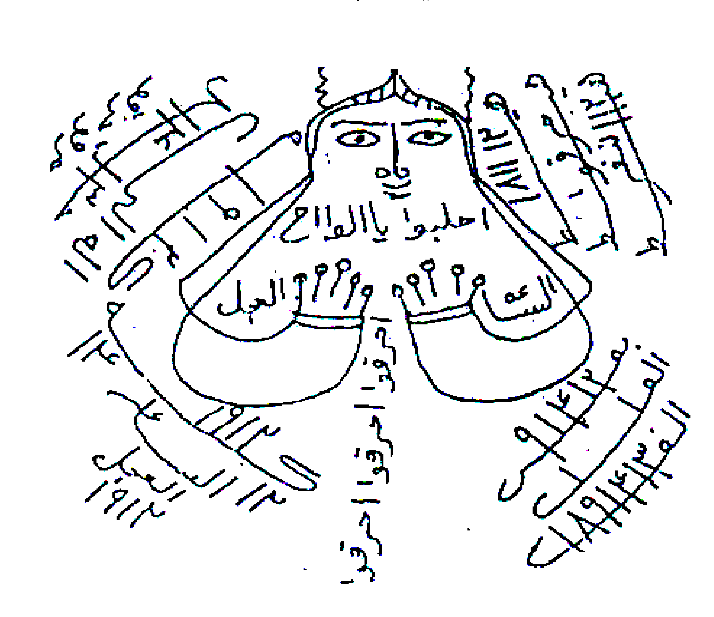

**AR:** (وَصْفُ الشَّعْبَاذِ) رَسْمٌ يَدَوِىٌّ: **وَجْهٌ** فِى الْوَسَطِ (عَيْنَانِ، اَنْفٌ، فَمٌ) وَعَلٰى رَاْسِهِ **تَاْجٌ** مُثَلَّثٌ، وَعَلٰى جَانِبَيْهِ **يَدَانِ** تَنْتَهِيَانِ اِلٰى **ثَلَاثِ حَبَّاتٍ مُدَوَّرَةٍ** كَالْاَصَابِعِ، وَحَوْلَهُ **كِتَابَاتٌ مَدَائِرِيَّةٌ** بِحُرُوْفٍ مُنْفَصِلَةٍ، وَتَحْتَ الْوَجْهِ سَطْرٌ يَدَوِىٌّ. (**لَا يُمْكِنُ قِرَاءَةُ الْكِتَابَاتِ الْمَدَائِرِيَّةِ** — اُنْظُرِ الْكَرْوِبَ.)

**LAT:** (waṣfu al-sha‘bādhi) rasmun yadawiyyun: wajhun fī al-wasaṭi (a‘yunun, anfun, famun) wa-‘alā ra’sihi tājun muthallathun, wa-‘alā jānibayhi yadāni tantahiyāni ilā thalāthi ḥabbātin mudawwaratin ka-al-aṣābi‘i, wa-ḥawlahu kitābātun madā’iriyyatun bi-ḥurūfin munfaṣilatin, wa-taḥta al-wajhi saṭrun yadawiyyun. (lā yumkinu qirā’atu al-kitābāti al-madā’iriyyati — unẓuri al-karwiba.)

**ID:** “**(Deskripsi sha‘bādh)**: gambar tulisan tangan — **wajah** di tengah (**dua mata, hidung, mulut**), di atasnya **mahkota segitiga**, di kedua sisinya **dua tangan** yang berujung **tiga bulatan** seperti jari, **tulisan melingkar berhuruf terpisah** di sekelilingnya, dan **satu baris tulisan tangan** di bawah wajah. (**Tulisan melingkar tidak dapat dibaca** — lihat crop.)”

**AR:** بَابُ جَلْبِ شَرَابٍ مِنَ الْقَوَاطِعِ

**LAT:** bābu jalbi sharābin mina al-qawāṭi‘i

**ID:** “**Bab Menghadirkan (Jalb) Minuman dari «al-Qawāṭi‘».**” (Judul bagian.)

**AR:** تُكْتَبُ هَذِةِ الطَّلَاسِمُ وَمَنْ حَوْلَهَا سُوْرَةُ يَس، وَالْكِتَابَةُ فِىْ سَاعَةٍ سَعِيْدَةٍ، وَالْبَخُوْرُ يَكُوْنُ وَقْتَ الْكِتَابَةِ وَسَاعَةَ الْعَمَلِ، وَسَاعَةُ الْعَمَلِ يَكُوْنُ الطَّالِعُ سَعِيْدٌ اَوَّلَ الشَّهْرِ الْعَرَبِىِّ. وَالْعَزِيْمَةُ تَكُوْنُ سُوْرَةَ يَس، وَالتَّوْكِيْلُ عِنْدَ كُلِّ «**مُبِيْنٍ**»، وَتُقْرَاُ السُّوْرَةُ عَلَى الْعَمَلِ عِنْدَ الْكَيْفِيَّةِ ١١ مَرَّةً، وَهَذَا الْعَمَلُ لَا يُخْطِئُ فِى الْحَلَالِ. وَهَذِةِ الطَّلَاسِمُ الْمُشَارُ اِلَيْهَا.

**LAT:** tuktabu hādhihi al-ṭalāsimu wa-man ḥawlahā sūratu Yās, wa-al-kitābatu fī sā‘atin sa‘īdatin, wa-al-bakhūru yakūnu waqta al-kitābati wa-sā‘ata al-‘amali, wa-sā‘atu al-‘amali yakūnu al-ṭāli‘u sa‘īdun awwala al-shahri al-‘arabiyyi. Wa-al-‘azīmatu takūnu sūrata Yās, wa-al-tawkīlu ‘inda kulli «mubīnin», wa-tuqra’u al-sūratu ‘alā al-‘amali ‘inda al-kayfiyyati 11 marratan, wa-hādhā al-‘amalu lā yukhṭi’u fī al-ḥalāli. Wa-hādhihi al-ṭalāsimu al-mushāru ilayhā.

**ID:** “**Ṭilasm-ṭilasm ini dituliskan** dan di **sekelilingnya surah Yāsīn**؛ **penulisan pada saat baik**؛ **dupa (dilakukan) pada waktu penulisan dan saat amal**؛ dan **saat amal harus ṭāli‘ (ascendant) baik pada awal bulan Arab**. **‘Azīmahnya surah Yāsīn**, dengan **tawkil pada setiap «مبين»**؛ dan **surah dibaca pada amalan pada bagian «الكيفية» ١١×**. **Amalan ini tidak keliru selama halal.** **Dan inilah ṭilasm-ṭilasm yang dimaksud**.” — **ṭilasmnya menyusul di halaman 457.**

**Keterangan halaman.** Halaman memuat dua bagian. **(1) «محبة قوية ومجربة»**: **da‘wah al-Barhatiyyah** ditulis mengelilingi **sha‘bādh**, **ṣarf al-‘ummār dengan al-Zalzalah ٧×**, **«ashtātan» ٧×**, kertas digantung di **sabiyyah delima/zaitun**, dupa **lada**, **da‘wah dibaca ١٢×** (atau **٤٥×** lebih baik), waktu **saat Zuhrah**, setelah selesai **ditanam di dekat api/tungku**, dengan **raṣd** hari qamariyyah. **(2) «باب جلب شرب من القواطع»**: ṭilasm ditulis dengan **surah Yāsīn** di sekelilingnya, saat baik, **tawkil tiap «مبين»**, **surah dibaca ١١×**, **hanya untuk yang halal**.

**Angka pada halaman ini.** **٧×** (ṣarf al-Zalzalah dan «ashtātan») — **cocok** antara lapisan teks dan pindaian. **١٢×** dan **٤٥×** — **lapisan teks mengekstrak «٢١» dan «٥٤» (terbalik)**; **pindaian (crop 900 DPI, Rect(222,144,345,172)) jelas «١٢ … ٤٥»** → **dipakai ١٢ dan ٤٥**. **١١×** (Yāsīn) — **cocok** (crop 900 DPI).

**[TIDAK JELAS - HALAMAN 456]** (1) **Tulisan melingkar sha‘bādh** — huruf terpisah, **tidak terbaca**; **[TEKS ASLI DIJAGA]**, hanya bentuknya dideskripsikan. (2) **«سَبِيَّةٍ مِنَ الرُّمَّانِ»** — **tidak lazim**; kemungkinan **«سُفَّة» / «سَلِيَّة» (kelopak/pelepah)**; **dipertahankan** dan ditandai. (3) **«وَتُصْرَفُ الْعُمَّارُ بِالزَّلْزَلَةِ»** — **ṣarf al-‘ummār** dengan surah al-Zalzalah; **dipertahankan dan dijelaskan**. (4) **«الرَّصْدَ الْمُنَاسِبَ»** — istilah teknis (**raṣd** = waktu pengintaian/penjagaan posisi bintang); **dijelaskan sebagai perkiraan makna**. (5) **«بَابُ جَلْبِ شَرَابٍ مِنَ الْقَوَاطِعِ»** — **«القواطع»** judul kumpulan amalan; **dipertahankan**. (6) **«عِنْدَ الْكَيْفِيَّةِ»** — merujuk bagian **«الكيفية»** yang **tidak ada di halaman ini**; **ditandai**.

**Peringatan (dicatat apa adanya, bukan fatwa).** Bagian pertama bertujuan **memaksa rasa cinta** dan memakai **api/tungku** dalam penanaman amalan. Teks ditranskripsikan sesuai cetakan; **memaksakan cinta** bukan bagian dari ajaran Islam.

**[ADA RAJAH]** — 1 crop: `assets/rajah/sirrul-asrar/hal-456-rajah-01.png` (700 DPI, Rect(148, 265, 466, 540)).

---
## HALAMAN 457 — dua «شعباذ» ṭilasm (tabel huruf berulang) + «باب محبة من الاسرار» (دعوة الجلجلوتية الصغرى) + gambar wajah

**AR:** كِتَابُ سِرِّ الْاَسْرَارِ فِي التَّوَاصُلِ مَعَ رُوحَانِيَّاتِ الْقُرْآنِ — شَيْخُ الرُّوحَانِيِّينَ الشَّيْخُ عَطِيَّةُ عَبْدُ الْحَمِيدِ

**LAT:** kitābu sirri al-asrāri fī al-tawāṣuli ma‘a rūḥāniyyāti al-qur’āni — shaykhu al-rūḥāniyyīna al-shaykhu ‘Aṭiyyatu ‘Abdu al-Ḥamīdi

**ID:** “Kitab «Sirr al-Asrār fī al-Tawāṣul ma‘a Rūḥāniyyāt al-Qur’ān» — Syaikh para ruhaniyyin, Syaikh ‘Aṭiyyah ‘Abd al-Ḥamīd.” (Kepala halaman.)

**Rajah:** 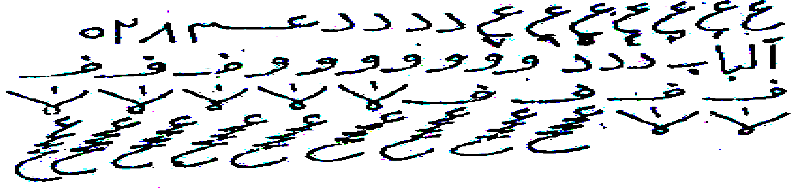

**Rajah:** 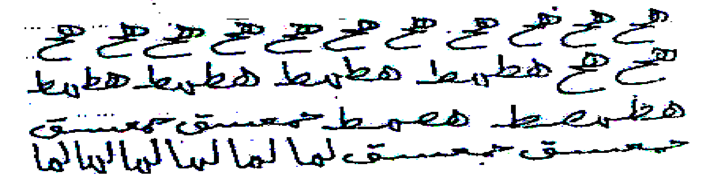

**Rajah:** 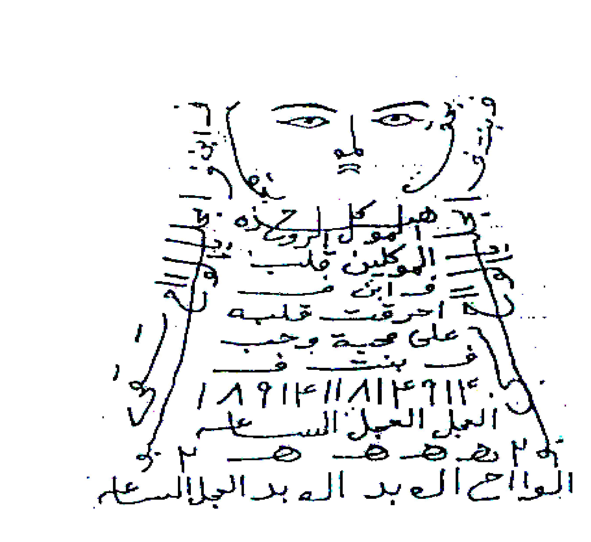

**AR:** (وَصْفُ الشَّعْبَاذَيْنِ) رَسْمَانِ يَدَوِيَّانِ مِنْ نَوْعِ «الشَّعْبَاذِ» (طِلَسْمٌ خَطِّىٌّ لَا صُوْرَةَ فِيْهِ):

- **الْاَوَّلُ:** ثَلَاثَةُ اَسْطُرٍ: الْاَوَّلُ «**ع ع ع ع ع ع ع ع ع**» مَوْصُوْلَةٌ، الثَّانِى «**د د د**» مُتَكَرِّرَةٌ، الثَّالِثُ حُرُوْفٌ مَمْدُوْدَةٌ تَحْتَهَا خُطُوْطٌ مُنْحَنِيَةٌ؛ وَفِى الطَّرَفِ رَقْمُ «**٥٢٨١**».
- **الثَّانِى:** اَرْبَعَةُ اَسْطُرٍ: «**ط ه ط ه ط ه ط ه**»، «**ط س ط س ط س**»، «**ط ح ط ح**»، ثُمَّ سَطْرٌ اَخِيْرٌ عَلٰى شَكْلِ مَوْجَةٍ «**ل م ا ل م ا ل م ا**».

**LAT:** (waṣfu al-sha‘bādhayni) rasmāni yadawiyyāni min naw‘i «al-sha‘bādhi» (ṭilasmٌ khaṭṭiyyun lā ṣūrata fīhi): al-awwalu: thalāthatu asṭurin: al-awwalu «‘ ‘ ‘ ‘ ‘ ‘ ‘ ‘ ‘» mawṣūlatun, al-thāni «d d d» mutakarriratun, al-thālithu ḥurūfun mamdūdatun taḥtahā khuṭūṭun munḥaniyatun؛ wa-fī al-ṭarafi raqmu «5281». Al-thāni: arba‘atu asṭurin: «ṭ h ṭ h ṭ h ṭ h»، «ṭ s ṭ s ṭ s»، «ṭ ḥ ṭ ḥ»، thumma saṭrun akhīrun ‘alā shakli mawjatin «l m a l m a l m a».

**ID:** “**(Deskripsi dua sha‘bādh)**: dua gambar tulisan tangan jenis **«sha‘bādh»** (ṭilasm garis, **bukan gambar**): **Pertama** — tiga baris: baris ١ «**ع ع ع ع ع ع ع ع ع**» bersambung, baris ٢ «**د د د**» berulang, baris ٣ huruf memanjang dengan **garis melengkung** di bawahnya؛ dan di ujungnya angka «**٥٢٨١**». **Kedua** — empat baris: «**ط ه ط ه ط ه ط ه**»، «**ط س ط س ط س**»، «**ط ح ط ح**»، lalu baris terakhir berbentuk **gelombang** «**ل م ا ل م ا ل م ا**».”

**AR:** بَابُ مَحَبَّةٍ مِنَ الْاَسْرَارِ

**LAT:** bābu maḥabbatin mina al-asrāri

**ID:** “**Bab Cinta dari (Kumpulan) Rahasia-rahasia.**” (Judul bagian.)

**AR:** هَذَا الْبَابُ مِنَ الْقَوَاطِعِ وَاَسْرَارِ الْحُكَمَاءِ. تَرْسُمُ الشَّعْبَاذَ فِىْ وَرَقَةٍ حَمْرَاءَ اَوْ مَصْبُوْغَةٍ، وَتَكْتُبُ التَّوْكِيْلَ فِىْ ظَهْرِ الشَّعْبَاذِ، وَتَقْرَاُ عَلَيْهَا **دَعْوَةَ الْجَلْجَلُوْتِيَّةِ الصَّغِيْرَةِ ١٢ مَرَّةً**، وَاِنْ عَزَمْتَ عَلَيْهَا بِالدَّعْوَةِ **٩٤ مَرَّةً** كَانَ اَقْوٰى وَاَسْرَعَ بِالْاِجَابَةِ فِىْ يَوْمِهِ. وَالْبَخُوْرُ لِهَذَا الْعَمَلِ: **اللُّبَانُ وَالْعُوْدُ وَالْجَاوِىُّ وَلَادِنٌ**، يُعْجَنُوْنَ الْجَمِيْعَ بِالْمِسْكِ وَيُجَفَّفُوْنَ فِى الظِّلِّ لِوَقْتِ الْحَاجَةِ. وَهَذَا هُوَ الشَّعْبَاذُ وَهَذَا الْعَمَلُ. بَعْدَ الِانْتِهَاءِ مِنْهُ اعْمَلْ عَلٰى حَسَبِ طَبِيْعَةِ الْمَطْلُوْبِ: اِنْ كَانَ **نَارِيًّا** اَوْ **تُرَابِيًّا** اَوْ **هَوَائِيًّا** اَوْ **مَائِيًّا**.

**LAT:** hādhā al-bābu mina al-qawāṭi‘i wa-asrāri al-ḥukamā’i. Tarsumu al-sha‘bādha fī waraqatin ḥamrā’a aw maṣbūghatin, wa-taktubu al-tawkīla fī ẓahri al-sha‘bādhi, wa-taqra’u ‘alayhā da‘wata al-jaljalūtiyyati al-ṣaghīrati 12 marratan, wa-in ‘azamta ‘alayhā bi-al-da‘wati 94 marratan kāna aqwā wa-asra‘a bi-al-ijābati fī yawmihi. Wa-al-bakhūru li-hādhā al-‘amali: al-lubānu wa-al-‘ūdu wa-al-jāwiyyu wa-lādinun, yu‘janūna al-jamī‘a bi-al-miski wa-yujaffafūna fī al-ẓilli li-waqti al-ḥājati. Wa-hādhā huwa al-sha‘bādhu wa-hādhā al-‘amalu. Ba‘da al-intihā’i minhu i‘mal ‘alā ḥasabi ṭabī‘ati al-maṭlūbi: in kāna nāriyyan aw turābiyyan aw hawā’iyyan aw mā’iyyan.

**ID:** “**Bab ini termasuk «al-Qawāṭi‘» dan rahasia-rahasia para ḥakīm.** Engkau **menggambar sha‘bādh pada kertas merah atau kertas berwarna**؛ **menulis tawkil di belakang sha‘bādh**؛ dan **membacakan da‘wah al-Jaljalūtiyyah al-Ṣaghīrah ١٢×** di atasnya؛ dan **jika engkau mengazamkan dengan da‘wah ٩٤×**, itu **lebih kuat dan lebih cepat terkabul pada hari itu**. **Dupa untuk amalan ini: lubān, ‘ūd, jāwī, dan lādan** — **semuanya diuli dengan misk** dan **dikeringkan di tempat teduh** untuk waktu diperlukan. **Inilah sha‘bādh dan inilah amalannya.** **Setelah selesai**, kerjakan **menurut tabiat orang yang diminta**: apakah **api (nāriyyah)**, **tanah (turābiyyah)**, **udara (hawā’iyyah)**, atau **air (mā’iyyah)**.”

**AR:** (وَصْفُ الرَّسْمِ الْاَخِيْرِ) **وَجْهُ امْرَاَةٍ** (عَيْنَانِ وَحَاجِبَانِ وَاَنْفٌ وَفَمٌ) بِخُطُوْطٍ بَسِيْطَةٍ، وَعَلٰى صَدْرِهَا وَبَطْنِهَا كِتَابَةٌ يَدَوِيَّةٌ مُتَرَاكِمَةٌ: «**عَلٰى … الْكَوْنَيْنِ … قَلْبَهُ … فِىْ بِنْتِ … مَحَبَّةِ وَجْهِ**» تَقْرِيْبًا، ثُمَّ دَرَجٌ مِنَ الرُّقُوْمِ «**١١٣ — ٤١١ — ٨١ — ٩١ — ٤ — ٤ — ٨١**»، ثُمَّ سَطْرٌ «**اَلْوَلَدُ الْمَوْلُوْدُ السَّعِيْدُ**»، ثُمَّ سَطْرٌ «**الْوَحَا الْعَجَلَ السَّاعَةَ**» بِخَطٍّ مَمْدُوْدٍ.

**LAT:** (waṣfu al-rasmi al-akhīri) wajhu imra’atin (a‘yunāni wa-ḥājibāni wa-anfun wa-famun) bi-khuṭūṭin basīṭatin, wa-‘alā ṣadrihā wa-baṭnihā kitābatun yadawiyyatun mutarākimatun: «‘alā … al-kawnayni … qalbahu … fī binti … maḥabbati wajhi» taqrīban, thumma darajun mina al-ruqūmi «113 — 411 — 81 — 91 — 4 — 4 — 81»، thumma saṭrun «al-waladu al-mawlūdu al-sa‘īdu»، thumma saṭrun «al-waḥā al-‘ajala al-sā‘ata» bi-khaṭṭin mamdūdin.

**ID:** “**(Deskripsi gambar terakhir)**: **wajah perempuan** (dua mata, dua alis, hidung, mulut) dengan garis sederhana؛ **di dada dan perutnya** tulisan tangan bertumpuk: «**على … الكونين … قلبه … في بنت … محبة وجه**» (perkiraan)؛ lalu **deret angka** «**١١٣ — ٤١١ — ٨١ — ٩١ — ٤ — ٤ — ٨١**»؛ lalu baris «**الولد المولود السعيد**»؛ lalu baris «**الوحا العجل الساعة**» dengan garis memanjang.”

**Keterangan halaman.** Halaman memuat **dua sha‘bādh** di atas (rajah-01 dan rajah-02) — keduanya **ṭilasm garis berisi huruf berulang**, bukan gambar — lalu **«باب محبة من الاسرار»**: **sha‘bādh digambar pada kertas merah/berwarna**, **tawkil di belakangnya**, **دعوة الجلجلوتية الصغرى ١٢×** (atau **٩٤×** lebih kuat), dupa **lubān + ‘ūd + jāwī + lādan** yang **diuli dengan misk** dan **dikeringkan di tempat teduh**, dan amalan **disesuaikan tabiat** yang diminta (**api/tanah/udara/air**). Di bagian bawah: **gambar wajah perempuan** dengan **tulisan tangan di dada dan perut** (rajah-03) yang memuat **deret angka** dan **«الوحا العجل الساعة»**.

**Angka pada halaman ini.** **١٢×** dan **٩٤×** — **lapisan teks mengekstrak «١٢» dan «٩٤»**; **pindaian (crop 900 DPI, Rect(300,357,335,382) dan Rect(145,357,180,382)) mengonfirmasi «١٢» dan «٩٤»** → **cocok, tanpa koreksi**. **٥٢٨١** pada ṭilasm pertama dan deret **١١٣ — ٤١١ — ٨١ — ٩١ — ٤ — ٤ — ٨١** dalam gambar wajah — **tulisan tangan**, dibaca dari crop 700 DPI sebagai **perkiraan**.

**[TIDAK JELAS - HALAMAN 457]** (1) **Kedua sha‘bādh** — huruf berulang tanpa titik, **tidak dapat dipastikan bacaannya**; **[TEKS ASLI DIJAGA]**, hanya pola pengulangannya dideskripsikan. (2) **Teks di dada gambar wajah** — **tulisan tangan bertumpuk**, hanya sebagian kata dikenali؛ **ditandai sebagai perkiraan**. (3) **Deret angka «١١٣ ٤١١ ٨١ ٩١ ٤ ٤ ٨١»** — **perkiraan** dari crop. (4) **«وَلَادِنٌ»** — **lādan** (sejenis resin/dupa); **dipertahankan**. (5) **«دَعْوَةَ الْجَلْجَلُوْتِيَّةِ الصَّغِيْرَةِ»** — nama da‘wah; **isi da‘wahnya tidak dicetak** di halaman ini, hanya **dirujuk**؛ **ditandai**. (6) **«يُعْجَنُوْنَ / يُجَفَّفُوْنَ»** — bentuk jamak untuk bahan; **dipertahankan** sesuai cetakan.

**Peringatan (dicatat apa adanya, bukan fatwa).** Amalan ini bertujuan **menundukkan** orang yang diminta lewat **sha‘bādh dan da‘wah Jaljalūtiyyah**. Teks ditranskripsikan sesuai cetakan; **memaksa kehendak orang lain** bukan bagian dari ajaran Islam.

**[ADA RAJAH]** — 3 crop: `assets/rajah/sirrul-asrar/hal-457-rajah-01.png` (700 DPI, Rect(108, 69, 502, 162))، `hal-457-rajah-02.png` (700 DPI, Rect(101, 162, 502, 261))، `hal-457-rajah-03.png` (700 DPI, Rect(168, 458, 445, 712)).

---
## HALAMAN 458 — «محبة مجربة وصحيحة»: dua «شعباذ» (gambar kepala + badan bertulisan) + tawkil ganda

**AR:** كِتَابُ سِرِّ الْاَسْرَارِ فِي التَّوَاصُلِ مَعَ رُوحَانِيَّاتِ الْقُرْآنِ — شَيْخُ الرُّوحَانِيِّينَ الشَّيْخُ عَطِيَّةُ عَبْدُ الْحَمِيدِ

**LAT:** kitābu sirri al-asrāri fī al-tawāṣuli ma‘a rūḥāniyyāti al-qur’āni — shaykhu al-rūḥāniyyīna al-shaykhu ‘Aṭiyyatu ‘Abdu al-Ḥamīdi

**ID:** “Kitab «Sirr al-Asrār fī al-Tawāṣul ma‘a Rūḥāniyyāt al-Qur’ān» — Syaikh para ruhaniyyin, Syaikh ‘Aṭiyyah ‘Abd al-Ḥamīd.” (Kepala halaman.)

**AR:** مَحَبَّةٌ مُجَرَّبَةٌ وَصَحِيْحَةٌ

**LAT:** maḥabbatun mujarrabatun wa-ṣaḥīḥatun

**ID:** “**Cinta yang Teruji dan Sahih.**” (Judul bagian.)

**AR:** اُرْسُمْ اَيُّهَا الطَّالِبُ لِهَذَا الْعِلْمِ الْجَلِيْلِ هَذَانِ الشَّعْبَاذَانِ، كُلُّ شَعْبَاذٍ فِىْ جِهَةٍ مِنَ الْوَرَقَةِ. وَالتَّوْكِيْلُ يَكُوْنُ نَفْسُهُ بِمَعْنَى التَّوْكِيْلِ الَّذِىْ تَكْتُبُهُ حَوْلَ الشَّعْبَاذِ الْاَوَّلِ يَكُوْنُ هُوَ نَفْسُهُ بِدُوْنِ نُقْصَانٍ اَوْ زِيَادَةٍ حَوْلَ الثَّانِى. وَتَقْرَاُ **دَعْوَةَ خَلْخَلَةِ الْهَوَاءِ الْكُبْرٰى** عَلٰى عَمَلِكَ، وَبَعْدَ الِانْتِهَاءِ يُدْفَنُ فِىْ طَرِيْقِ الْمَعْمُوْلِ لَهُ، كُلَّمَا مَرَّ عَلَيْهِ ازْدَادَ حُبًّا وَعِشْقًا لِطَالِبِهِ. وَاِذَا كُتِبَ عَلٰى اَثَرِ الْمَعْمُوْلِ لَهُ كَانَ لَهُ كَالسَّمِّ فِى الطَّعَامِ بِمَعْنٰى يَكُوْنُ قَوِىَّ الْفِعْلِ وَالتَّسْلِيْطِ عَلَيْهِ. وَلَا يَتْرُكُوهُ خُدَّامُ الدَّعْوَةِ وَالشَّعْبَاذِ حَتّٰى يَاْتِىَ طَالِبُهُ بِالْحُضُوْرِ اِلَيْهِ. وَاِلَيْكَ اَيُّهَا الطَّالِبُ الشَّعْبَاذَ الْمَطْلُوْبَ فِى الْعَمَلِ، وَهَذَا الشَّعْبَاذُ الْاَوَّلُ.

**LAT:** ursum ayyuhā al-ṭālibu li-hādhā al-‘ilmi al-jalīli hādhāni al-sha‘bādhāni, kullu sha‘bādhin fī jihatin mina al-waraqati. Wa-al-tawkīlu yakūnu nafsuhu bi-ma‘nā al-tawkīli alladhī taktubuhu ḥawla al-sha‘bādhi al-awwali yakūnu huwa nafsuhu bidūni nuqṣānin aw ziyādatin ḥawla al-thāni. Wa-taqra’u da‘wata Khal Khalati al-hawā’i al-kubrā ‘alā ‘amalika, wa-ba‘da al-intihā’i yudfanu fī ṭarīqi al-ma‘mūli lahu, kullamā marra ‘alayhi izdāda ḥubban wa-‘ishqan li-ṭālibihi. Wa-idhā kutiba ‘alā athari al-ma‘mūli lahu kāna lahu ka-al-summi fī al-ṭa‘āmi bi-ma‘nā yakūnu qawiyya al-fi‘li wa-al-taslīṭi ‘alayhi. Wa-lā yatrukūhu khuddāmu al-da‘wati wa-al-sha‘bādhi ḥattā ya’tiya ṭālibuhu bi-al-ḥuḍūri ilayhi. Wa-ilayka ayyuhā al-ṭālibu al-sha‘bādha al-maṭlūba fī al-‘amali, wa-hādhā al-sha‘bādhu al-awwalu.

**ID:** “**Gambarlah, wahai peminta ilmu yang mulia ini, kedua sha‘bādh ini** — **setiap sha‘bādh pada satu sisi kertas**. **Tawkilnya sama**, yaitu **tawkil yang engkau tulis di sekeliling sha‘bādh pertama harus sama persis, tanpa kurang dan tanpa tambahan, di sekeliling yang kedua**. Dan engkau **membaca «دعوة خلخلة الهواء الكبرى»** atas amalanmu؛ **setelah selesai, ditanam di jalan orang yang diminta** — **setiap kali ia melewatinya, bertambah cinta dan kerinduannya kepada peminta**. **Dan jika ditulis pada bekas (jejak) orang yang diminta**, maka ia **seperti racun dalam makanan** — artinya **sangat kuat pengaruh dan penundukannya atasnya**. **Para pelayan da‘wah dan sha‘bādh tidak akan meninggalkannya sampai orang yang diminta datang menghadap** kepadanya. **Inilah untukmu, wahai peminta, sha‘bādh yang diminta dalam amalan ini — dan inilah sha‘bādh pertama**.”

**Rajah:** 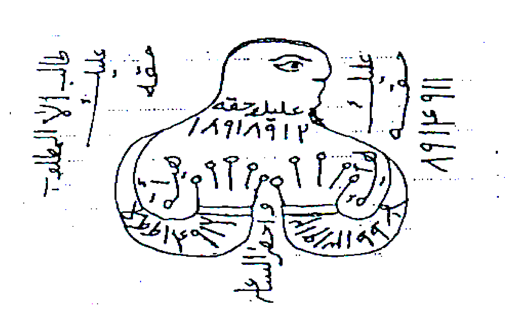

**AR:** (وَصْفُ الشَّعْبَاذِ الْاَوَّلِ) **رَاْسٌ** بِعَيْنٍ وَاحِدَةٍ ظَاهِرَةٍ وَحَاجِبٍ، وَبَدَنٌ عَرِيْضٌ ذُوْ **يَدَيْنِ** تَنْتَهِيَانِ اِلٰى **اَصَابِعَ عَلٰى شَكْلِ حَبَّاتٍ مُدَوَّرَةٍ**، وَفِى الْبَدَنِ كِتَابَةٌ يَدَوِيَّةٌ: «**عَلٰى … مَحَبَّة**» مَعَ دَرَجِ رُقُوْمٍ «**٧ ٨ ٩ ١ ٨ ٩ ١ ٢**»، وَحَوْلَهُ كِتَابَةٌ مَدَائِرِيَّةٌ بِحُرُوْفٍ مَقْطُوْعَةٍ (فِى الْيَمِيْنِ «**٨ ٩ ١ ٤ ١ ٣ ١ ٨ ١**» تَقْرِيْبًا، وَفِى الْيَسَارِ رُقُوْمٌ اُخْرٰى).

**LAT:** (waṣfu al-sha‘bādhi al-awwali) ra’sun bi-‘aynin wāḥidatin ẓāhiratin wa-ḥājibin, wa-badanun ‘arīḍun dhū yadayni tantahiyāni ilā aṣābi‘a ‘alā shakli ḥabbātin mudawwaratin, wa-fī al-badani kitābatun yadawiyyatun: «‘alā … maḥabbah» ma‘a daraji ruqūmin «7 8 9 1 8 9 1 2»، wa-ḥawlahu kitābatun madā’iriyyatun bi-ḥurūfin maqṭū‘atin (fī al-yamīni «8 9 1 4 1 3 1 8 1» taqrīban, wa-fī al-yasāri ruqūmun ukhrā).

**ID:** “**(Deskripsi sha‘bādh pertama)**: **kepala** dengan **satu mata tampak** dan **alis**، **badan lebar** dengan **dua tangan** yang berujung **jari berbentuk bulatan-bulatan**؛ **di badannya** tulisan tangan «**على … محبة**» dengan deret angka «**٧ ٨ ٩ ١ ٨ ٩ ١ ٢**»؛ **di sekelilingnya** tulisan melingkar berhuruf terpotong (di **kanan** «**٨ ٩ ١ ٤ ١ ٣ ١ ٨ ١**» perkiraan, di **kiri** angka lain).”

**Rajah:** 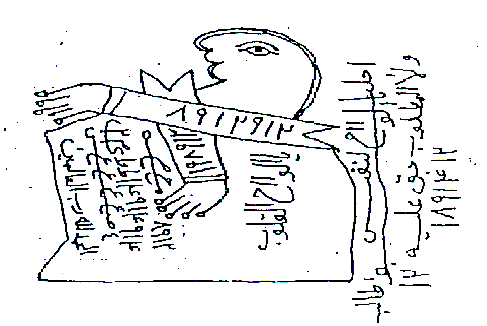

**AR:** (وَصْفُ الشَّعْبَاذِ الثَّانِى) **رَاْسٌ** بِعَيْنٍ وَاحِدَةٍ، وَبَدَنٌ **مُرَبَّعٌ** ذُوْ اطَارٍ، فِيْهِ كِتَابَةٌ يَدَوِيَّةٌ وَدَرَجُ رُقُوْمٍ «**٨ ٩ ١ ٦ ١ ٤**»، وَحَوْلَهُ خُطُوْطٌ مَمْدُوْدَةٌ وَكِتَابَةٌ مَدَائِرِيَّةٌ. (**هَذَانِ الشَّعْبَاذَانِ لَيْسَا جَدْوَلَ اَوْفَاقٍ** — لِذَلِكَ لَا يُطَبَّقُ عَلَيْهِمَا بُرْهَانُ الْجَمْعِ.)

**LAT:** (waṣfu al-sha‘bādhi al-thāni) ra’sun bi-‘aynin wāḥidatin, wa-badanun murabba‘un dhū iṭārin, fīhi kitābatun yadawiyyatun wa-daraju ruqūmin «8 9 1 6 1 4»، wa-ḥawlahu khuṭūṭun mamdūdatun wa-kitābatun madā’iriyyatun. (hādhāni al-sha‘bādhāni laysā jadwala awfāqin — li-dhālika lā yuṭabbaqu ‘alayhimā burhānu al-jam‘i.)

**ID:** “**(Deskripsi sha‘bādh kedua)**: **kepala** dengan **satu mata**، **badan berbentuk kotak** berbingkai, berisi **tulisan tangan** dan **deret angka** «**٨ ٩ ١ ٦ ١ ٤**»، dengan **garis-garis memanjang** dan **tulisan melingkar** di sekitarnya. (**Kedua sha‘bādh ini bukan tabel wafaq** — karena itu **bukti penjumlahan tidak diterapkan**.)”

**Keterangan halaman.** **«محبة مجربة وصحيحة»**: peminta **menggambar dua sha‘bādh** (masing-masing pada satu sisi kertas)، **tawkil di sekeliling keduanya harus identik** (tanpa tambah/kurang)، lalu **«دعوة خلخلة الهواء الكبرى»** dibaca atas amalan؛ **amalan ditanam di jalan orang yang diminta** agar **setiap ia lewat, cintanya bertambah**؛ **jika ditulis pada bekas/jejak orang yang diminta**, pengaruhnya **seperti racun dalam makanan** (sangat kuat menundukkan)؛ **para pelayan da‘wah tidak berhenti sampai orang itu datang menghadap**. Ditutup **«وهذا الشعباذ الاول»** lalu **sha‘bādh kedua**.

**Angka pada halaman ini.** **Tidak ada angka bilangan** dalam teks (tidak ada jumlah bacaan pada halaman ini). **Angka di dalam kedua gambar** («٧ ٨ ٩ ١ ٨ ٩ ١ ٢»، «٨ ٩ ١ ٦ ١ ٤»، dan deret melingkar) adalah **tulisan tangan** — dibaca dari crop 700 DPI sebagai **perkiraan**؛ **tidak ada wafaq** yang dapat diuji dengan penjumlahan.

**[TIDAK JELAS - HALAMAN 458]** (1) **Tulisan melingkar kedua sha‘bādh** — huruf terpotong dan bertumpuk، **tidak terbaca**؛ **[TEKS ASLI DIJAGA]**. (2) **Deret angka dalam gambar** — **perkiraan** dari crop. (3) **«دَعْوَةَ خَلْخَلَةِ الْهَوَاءِ الْكُبْرٰى»** — nama da‘wah; **isinya tidak dicetak** pada halaman ini, hanya **dirujuk**؛ **ditandai**. (4) **«كَالسَّمِّ فِى الطَّعَامِ»** — perumpamaan **bukan anjuran**; **dipertahankan** dan dicatat (lihat peringatan). (5) **«اَثَرِ الْمَعْمُوْلِ لَهُ»** — **bekas/jejak** orang yang diminta; **dipertahankan** dan dijelaskan. (6) **«اُرْسُمْ»** — perintah dengan ejaan cetakan (bukan «ارسم»)؛ **dipertahankan**.

**Peringatan (dicatat apa adanya, bukan fatwa).** Bagian ini secara eksplisit menyebut pengaruh amalan **«seperti racun dalam makanan»** dan menargetkan **orang yang tidak mengetahui**. Teks ditranskripsikan sesuai cetakan; pembaca perlu mengetahui bahwa **menanam benda/amalan di jalan orang lain** dan **menundukkan kehendak seseorang** bertentangan dengan ajaran Islam, dan **penyebutan “racun” di sini adalah perumpamaan kekuatan pengaruh, bukan bahan racun**.

**[ADA RAJAH]** — 2 crop: `assets/rajah/sirrul-asrar/hal-458-rajah-01.png` (700 DPI, Rect(146, 246, 467, 444)) dan `hal-458-rajah-02.png` (700 DPI, Rect(168, 463, 446, 649)).

---
## HALAMAN 459 — «باب محبة» (naqsy pada besi + dibakar di tungku) + «فائدة محبة» (kertas di rambut) + «فائدة محبة ترابية» (ditanam di ambang pintu)

**AR:** كِتَابُ سِرِّ الْاَسْرَارِ فِي التَّوَاصُلِ مَعَ رُوحَانِيَّاتِ الْقُرْآنِ — شَيْخُ الرُّوحَانِيِّينَ الشَّيْخُ عَطِيَّةُ عَبْدُ الْحَمِيدِ

**LAT:** kitābu sirri al-asrāri fī al-tawāṣuli ma‘a rūḥāniyyāti al-qur’āni — shaykhu al-rūḥāniyyīna al-shaykhu ‘Aṭiyyatu ‘Abdu al-Ḥamīdi

**ID:** “Kitab «Sirr al-Asrār fī al-Tawāṣul ma‘a Rūḥāniyyāt al-Qur’ān» — Syaikh para ruhaniyyin, Syaikh ‘Aṭiyyah ‘Abd al-Ḥamīd.” (Kepala halaman.)

**AR:** بَابُ مَحَبَّةٍ

**LAT:** bābu maḥabbatin

**ID:** “**Bab Cinta.**” (Judul bagian pertama.)

**AR:** اِذَا اَرَدْتَ اَنْ يُحِبَّكَ اَحَدٌ لَيْسَ لَهُ قَرَارٌ مِنْ مَحَبَّتِكَ: تَنْقُشُ عَلٰى حَدِيْدٍ هَذَا الطِّلَسْمَ وَتَضَعُهُ فِىْ مَوْقِدِ النَّارِ، فَاِنَّ الْمَطْلُوْبَ يَاْتِيْكَ وَلَوْ بَيْنَكَ وَبَيْنَهُ حَرْبًا، يَاْتِيْكَ بِاِذْنِ اللهِ تَعَالٰى. وَهَذَا الطِّلَسْمُ، وَيَكُوْنُ زِيَادَةُ النُّوْرِ اَوَّلَ سَاعَةٍ مِنْ يَوْمِ الْاِثْنَيْنِ.

**LAT:** idhā aradta an yuḥibbaka aḥadun laysa lahu qarārun min maḥabbatiKa: tanqushu ‘alā ḥadīdin hādhā al-ṭilasma wa-taḍa‘uhu fī mawqidi al-nāri, fa-inna al-maṭlūba ya’tīka wa-law baynaka wa-baynahu ḥarban, ya’tīka bi-idhni allāhi ta‘ālā. Wa-hādhā al-ṭilasmu, wa-yakūnu ziyādatu al-nūri awwala sā‘atin min yawmi al-ithnayni.

**ID:** “**Jika engkau ingin agar seseorang mencintaimu dan ia tidak punya pilihan selain cintamu**: engkau **memahat ṭilasm ini pada besi** dan **meletakkannya di tungku api** — maka **orang yang diminta akan datang kepadamu, meskipun antara engkau dan dia ada perang**; ia datang **dengan izin Allah Ta‘ālā**. **Dan inilah ṭilasmnya**, dan **waktu tambahan nūr (kekuatan) adalah jam pertama hari Senin**.”

**Rajah:** 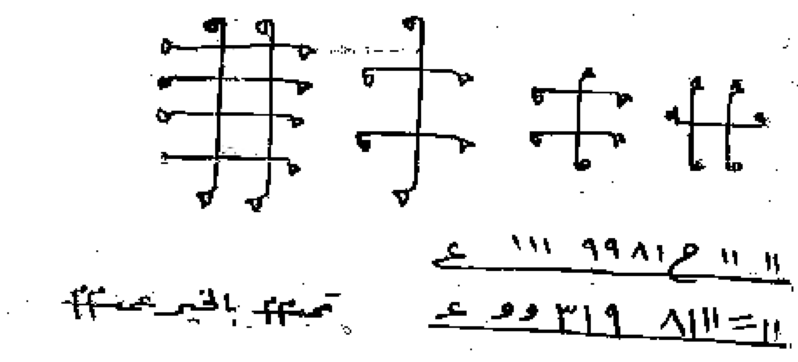

**AR:** (وَصْفُ الطِّلَسْمِ) اَرْبَعَةُ اَشْكَالٍ يَدَوِيَّةٍ كُلُّهَا مِنْ نَوْعِ «السُّلَّمِ»: خَطٌّ رَاْسِىٌّ تَتَفَرَّعُ مِنْهُ **خُطُوْطٌ اُفُقِيَّةٌ** (٤ اِلٰى ٦ خُطُوْطٍ)، وَكُلُّ خَطٍّ يَنْتَهِيْ بِـ**كَاعٍ/حَرْفٍ مَعْقُوْفٍ** — الْاَوَّلُ (الْاَكْبَرُ) فِى الْيَسَارِ، ثُمَّ الثَّانِى، ثُمَّ الثَّالِثُ، ثُمَّ الرَّابِعُ (الْاَصْغَرُ) فِى الْيَمِيْنِ. وَتَحْتَهَا سَطْرَانِ: الْاَوَّلُ «**١١ ٩ ٩ ٨ ١ ٠ ١١**» تَقْرِيْبًا، وَالثَّانِى «**٩ ٩ ٣ ١ ٩ ٨ ١ ١ ٢ ١١**» تَقْرِيْبًا، مَعَ رُسُوْمٍ كَالْاَقْوَاسِ.

**LAT:** (waṣfu al-ṭilasma) arba‘atu ashkālin yadawiyyatin kulluhā min naw‘i «al-sullami»: khaṭṭun ra’siyyun tatafarra‘u minhu khuṭūṭun ufuqiyyatun (4 ilā 6 khuṭūṭin), wa-kullu khaṭṭin yantahī bi-kā‘in/ḥarfin ma‘qūfin — al-awwalu (al-akbaru) fī al-yasāri, thumma al-thāni, thumma al-thālithu, thumma al-rābi‘u (al-aṣgharu) fī al-yamīni. Wa-taḥtahā saṭrāni: al-awwalu «11 9 9 8 1 0 11» taqrīban, wa-al-thāni «9 9 3 1 9 8 1 1 2 11» taqrīban, ma‘a rusūmin ka-al-aqwāsi.

**ID:** “**(Deskripsi ṭilasm)**: **empat bentuk tulisan tangan** semuanya jenis **“tangga”**: **satu garis vertikal** yang darinya **bercabang garis-garis mendatar** (**٤ sampai ٦ garis**), dan **setiap garis berujung pada kait/huruf tertekuk** — yang **pertama (terbesar) di kiri**, lalu **kedua**, **ketiga**, dan **keempat (terkecil) di kanan**. **Di bawahnya dua baris**: baris ١ «**١١ ٩ ٩ ٨ ١ ٠ ١١**» (perkiraan), baris ٢ «**٩ ٩ ٣ ١ ٩ ٨ ١ ١ ٢ ١١**» (perkiraan), dengan **gambar seperti busur**.”

**AR:** فَائِدَةُ مَحَبَّةٍ

**LAT:** fā’idatu maḥabbatin

**ID:** “**Fā’idah Cinta (kedua).**” (Judul bagian kedua.)

**AR:** تُكْتَبُ يَوْمَ الْاَرْبِعَاءِ وَقْتَ الظُّهْرِ بِشَرْطِ اَنْ تَكُوْنَ نَظِيْفَ الثِّيَابِ وَالْمَكَانِ، وَتُعَلَّقُ فِى الْهَوَاءِ وَتُعَلَّقُ بِشَعْرِ الْمَطْلُوْبِ، وَتُعَزَّمُ بِعَزِيْمَةِ الْهَوَاءِ. وَهَذَا مَا تُكْتَبُ، وَيَكُوْنُ عَمَلُكَ فِىْ زِيَادَةِ الْقَمَرِ اَوَّلَ الشَّهْرِ.

**LAT:** tuktabu yawma al-arbi‘ā’i waqta al-ẓuhri bi-sharṭi an takūna naẓīfa al-thiyābi wa-al-makāni, wa-tu‘allaqu fī al-hawā’i wa-tu‘allaqu bi-sha‘ri al-maṭlūbi, wa-tu‘azzamu bi-‘azīmati al-hawā’i. Wa-hādhā mā tuktabu, wa-yakūnu ‘amaluka fī ziyādati al-qamari awwala al-shahri.

**ID:** “**Dituliskan pada hari Rabu waktu Zuhur**, dengan **syarat pakaian dan tempat harus bersih**؛ **digantung di udara** dan **diikatkan pada rambut orang yang diminta**؛ dan **diazamkan dengan ‘azīmah udara**. **Dan inilah yang ditulis**, dan **amalanmu (dilakukan) pada saat bertambahnya bulan, awal bulan**.”

**Rajah:** 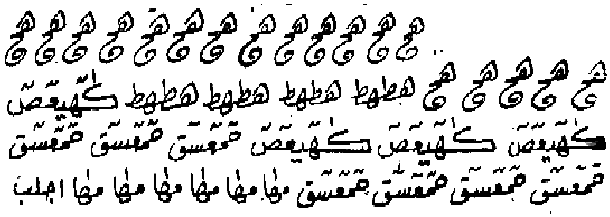

**AR:** (وَصْفُ مَا يُكْتَبُ) اَرْبَعَةُ اَسْطُرٍ طَوِيْلَةٍ بِخَطٍّ يَدَوِىٍّ عَرِيْضٍ: السَّطْرُ الْاَوَّلُ «**ع هـ ع هـ ع هـ …**» مُتَكَرِّرًا، الثَّانِى مِثْلُهُ مَعَ زِيَادَةِ حُرُوْفٍ صَغِيْرَةٍ، الثَّالِثُ سَطْرٌ مُتَرَاكِمٌ (فِيْهِ «**ط هـ ع س**» وَنَحْوُهَا)، وَالرَّابِعُ سَطْرٌ مَوْصُوْلٌ يَنْتَهِيْ بِحُرُوْفٍ مَمْدُوْدَةٍ. (**كُلُّهَا حُرُوْفٌ مُفْرَدَةٌ لَا كَلِمَاتٌ** — انْظُرِ الْكَرْوِبَ.)

**LAT:** (waṣfu mā yuktabu) arba‘atu asṭurin ṭawīlatin bi-khaṭṭin yadawiyyin ‘arīḍin: al-saṭru al-awwalu «‘ h ‘ h ‘ h …» mutakarriran, al-thāni mithluhu ma‘a ziyādati ḥurūfin ṣaghīratin, al-thālithu saṭrun mutarākimun (fīhi «ṭ h ‘ s» wa-naḥwuhā), wa-al-rābi‘u saṭrun mawṣūlun yantahī bi-ḥurūfin mamdūdatin. (kulluhā ḥurūfun mufradatun lā kalimātun — unẓuri al-karwiba.)

**ID:** “**(Deskripsi yang ditulis)**: **empat baris panjang** dengan **tulisan tangan tebal**: baris ١ «**ع هـ ع هـ ع هـ …**» berulang, baris ٢ serupa dengan **tambahan huruf kecil**, baris ٣ **bertumpuk** (memuat «**ط هـ ع س**» dan sejenisnya), baris ٤ **bersambung** berakhir dengan **huruf memanjang**. (**Semuanya huruf tunggal, bukan kata** — lihat crop.)”

**AR:** فَائِدَةُ مَحَبَّةٍ تُرَابِيَّةٍ

**LAT:** fā’idatu maḥabbatin turābiyyatin

**ID:** “**Fā’idah Cinta Bersifat Tanah (turābiyyah).**” (Judul bagian ketiga.)

**AR:** تُكْتَبُ هَذَا الطِّلَسْمُ فِىْ اَثَرِ الْمَطْلُوْبِ وَتُدْفَنُ فِىْ عَتَبَةِ الْمَطْلُوْبِ، وَتُعَزَّمُ بِسُوْرَةِ الْجِنِّ ١٢ مَرَّةً، وَبَخُوْرُكَ اللُّبَانُ وَالْعُوْدُ، وَخُذْ رَصْدًا مُنَاسِبًا لِعَمَلِكَ، وَهَذَا مَا يُكْتَبُ عَلَى الْاَثَرِ.

**LAT:** tuktabu hādhā al-ṭilasmu fī athari al-maṭlūbi wa-tudfanu fī ‘atabati al-maṭlūbi, wa-tu‘azzamu bi-sūrati al-jinn 12 marratan, wa-bakhūruka al-lubānu wa-al-‘ūdu, wa-khudh raṣdan munāsiban li-‘amalika, wa-hādhā mā yuktabu ‘alā al-athari.

**ID:** “**Ṭilasm ini dituliskan pada bekas (jejak) orang yang diminta** dan **ditanam di ambang pintu rumahnya**؛ **diazamkan dengan surah al-Jinn ١٢×**؛ **dupaamu lubān dan ‘ūd**؛ **ambil raṣd yang sesuai** untuk amalanmu؛ **dan inilah yang ditulis pada bekas itu**.” — **ṭilasmnya menyusul di halaman 460.**

**Keterangan halaman.** Tiga bagian: (1) **«باب محبة»** — ṭilasm **dipahat pada besi** lalu **diletakkan di tungku api**; orang yang diminta **datang walau sedang berperang**; **waktu nūr tambahan: jam pertama hari Senin**؛ (2) **«فائدة محبة»** — ditulis **Rabu Zuhur** (pakaian/tempat bersih), **digantung di udara** dan **diikatkan pada rambut** orang yang diminta, diazamkan **‘azīmah udara**, pada **awal bulan (bertambahnya bulan)**؛ (3) **«فائدة محبة ترابية»** — ditulis pada **bekas/jejak** orang yang diminta, **ditanam di ambang pintunya**, **surah al-Jinn ١٢×**, dupa **lubān + ‘ūd**, dengan **raṣd** yang sesuai.

**Angka pada halaman ini.** **١٢×** (surah al-Jinn) — **cocok** antara lapisan teks dan pindaian. **Angka pada ṭilasm pertama** (dua baris) dan **isi empat baris panjang** adalah **tulisan tangan** — dibaca dari crop 700 DPI sebagai **perkiraan**؛ **tidak ada wafaq** sehingga **tidak ada bukti penjumlahan**.

**[TIDAK JELAS - HALAMAN 459]** (1) **Dua baris angka di bawah ṭilasm pertama** — tulisan tangan bertumpuk; **[TEKS ASLI DIJAGA]**, hanya bentuknya dideskripsikan. (2) **Empat baris panjang** pada «فائدة محبة» — **huruf tunggal tanpa titik**, tidak dapat dipastikan bacaannya؛ ditandai. (3) **«لَيْسَ لَهُ قَرَارٌ مِنْ مَحَبَّتِكَ»** — susunan **tidak lazim**؛ **dipertahankan**. (4) **«وَيَكُوْنُ زِيَادَةُ النُّوْرِ»** — **tidak jelas** apa yang dimaksud “tambahan nūr”; **dipertahankan**. (5) **«عَزِيْمَةِ الْهَوَاءِ»** — nama ‘azīmah yang **tidak dicetak**؛ ditandai. (6) **«رَصْدًا مُنَاسِبًا»** — istilah teknis; dijelaskan sebagai **waktu/posisi bintang yang sesuai**.

**Peringatan (dicatat apa adanya, bukan fatwa).** Ketiga amalan bertujuan **memaksa rasa cinta** — memahat ṭilasm di **besi** lalu **membakarnya di tungku**, **mengikatkan** tulisan pada **rambut** orang yang diminta, dan **menanam** amalan di **ambang pintunya** tanpa sepengetahuannya. Teks ditranskripsikan sesuai cetakan; semua itu **bukan bagian dari ajaran Islam**.

**[ADA RAJAH]** — 2 crop: `assets/rajah/sirrul-asrar/hal-459-rajah-01.png` (700 DPI, Rect(136, 167, 477, 322)) dan `hal-459-rajah-02.png` (700 DPI, Rect(95, 401, 502, 546)).

---
## HALAMAN 460 — «فائدة محبة وجاب وعطف واحضار» (tabel ٧ baris angka + fatilah lampu) + «فائدة لفتح الحظ (للزواج)»

**AR:** كِتَابُ سِرِّ الْاَسْرَارِ فِي التَّوَاصُلِ مَعَ رُوحَانِيَّاتِ الْقُرْآنِ — شَيْخُ الرُّوحَانِيِّينَ الشَّيْخُ عَطِيَّةُ عَبْدُ الْحَمِيدِ

**LAT:** kitābu sirri al-asrāri fī al-tawāṣuli ma‘a rūḥāniyyāti al-qur’āni — shaykhu al-rūḥāniyyīna al-shaykhu ‘Aṭiyyatu ‘Abdu al-Ḥamīdi

**ID:** “Kitab «Sirr al-Asrār fī al-Tawāṣul ma‘a Rūḥāniyyāt al-Qur’ān» — Syaikh para ruhaniyyin, Syaikh ‘Aṭiyyah ‘Abd al-Ḥamīd.” (Kepala halaman.)

**Rajah:** 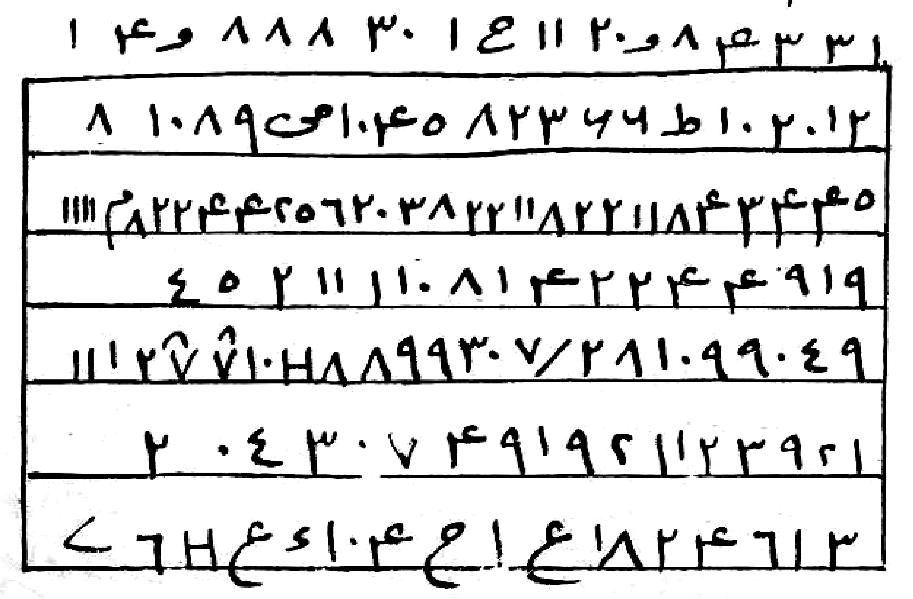

**AR:** (وَصْفُ الْجَدْوَلِ) جَدْوَلٌ يَدَوِىٌّ مِنْ **سَبْعَةِ اَسْطُرٍ** (سَطْرٌ اَعْلٰى خَارِجُ الْاِطَارِ، ثُمَّ خَمْسَةُ اَسْطُرٍ دَاخِلَ الْاِطَارِ، ثُمَّ سَطْرٌ سُفْلِىٌّ خَارِجُهُ)، كُلُّهَا **رُقُوْمٌ عَرَبِيَّةٌ-هِنْدِيَّةٌ مُتَدَاخِلَةٌ** بِخَطٍّ عَرِيْضٍ، تَقْرِيْبًا:

- السَّطْرُ ١: «**١ ٤ ٥ ٨ ٨ ٨ ٣ ٠ ١ ٥ ١١ ٢ ٠ ٨ ٥ ٣ ٣ ١**»
- السَّطْرُ ٢: «**٨ ١٠ ٨ ٩ ٥ ١٠ ٤ ٥ ٨ ٢ ٣ ٤ ٤ ٥ ١٠ ٢ ٠ ١٢**»
- السَّطْرُ ٣: «**٣ ٢ ٢ ٥ ٦ ٢ ٠ ٣ ٨ ٢ ١ ١ ٨ ٢ ١ ١ ٨ ٣ ٢ ٣ ٥**»
- السَّطْرُ ٤: «**٤ ٥ ٢ ١١ ١١ ٠ ٨ ١ ٤ ٢ ٢ ٤ ٣ ٩ ١ ٩**»
- السَّطْرُ ٥: «**١١ ٢ ٧ ٧ ١ ٠ ٨ ٨ ٩ ٩ ٣ ٠ ٧ ٢ ٨ ١ ٠ ٩ ٩ ٠ ٤ ٩**»
- السَّطْرُ ٦: «**٢ ٠ ٤ ٣ ٠ ٧ ٤ ٩ ١ ٩ ٥ ١ ١ ٢ ٣ ٩ ٥ ١**»
- السَّطْرُ ٧: «**٥ ٧ ٥ ٥ ١ ٠ ٥ ٥ ١ ٥ ٥ ٨ ٢ ٤ ٦ ١ ٢**»

**LAT:** (waṣfu al-jadwali) jadwalun yadawiyyun min sab‘ati asṭurin (saṭrun a‘lā khāriju al-iṭāri, thumma khamsatu asṭurin dākhila al-iṭāri, thumma saṭrun sufliyyun khārijuhu), kulluhā ruqūmun ‘arabiyyatun-hindiyyatun mutadākhilatun bi-khaṭṭin ‘arīḍin, taqrīban: al-saṭru 1 «1 4 5 8 8 8 3 0 1 5 11 2 0 8 5 3 3 1»؛ 2 «8 10 8 9 5 10 4 5 8 2 3 4 4 5 10 2 0 12»؛ 3 «3 2 2 5 6 2 0 3 8 2 1 1 8 2 1 1 8 3 2 3 5»؛ 4 «4 5 2 11 11 0 8 1 4 2 2 4 3 9 1 9»؛ 5 «11 2 7 7 1 0 8 8 9 9 3 0 7 2 8 1 0 9 9 0 4 9»؛ 6 «2 0 4 3 0 7 4 9 1 9 5 1 1 2 3 9 5 1»؛ 7 «5 7 5 5 1 0 5 5 1 5 5 8 2 4 6 1 2»

**ID:** “**(Deskripsi tabel)**: tabel tulisan tangan **tujuh baris** (satu baris di atas bingkai, lima baris di dalam bingkai, satu baris di bawah bingkai), seluruhnya **angka Arab-Hindi berjalin** dengan **pena tebal**: **baris ١** «**١ ٤ ٥ ٨ ٨ ٨ ٣ ٠ ١ ٥ ١١ ٢ ٠ ٨ ٥ ٣ ٣ ١**»؛ **baris ٢** «**٨ ١٠ ٨ ٩ ٥ ١٠ ٤ ٥ ٨ ٢ ٣ ٤ ٤ ٥ ١٠ ٢ ٠ ١٢**»؛ **baris ٣** «**٣ ٢ ٢ ٥ ٦ ٢ ٠ ٣ ٨ ٢ ١ ١ ٨ ٢ ١ ١ ٨ ٣ ٢ ٣ ٥**»؛ **baris ٤** «**٤ ٥ ٢ ١١ ١١ ٠ ٨ ١ ٤ ٢ ٢ ٤ ٣ ٩ ١ ٩**»؛ **baris ٥** «**١١ ٢ ٧ ٧ ١ ٠ ٨ ٨ ٩ ٩ ٣ ٠ ٧ ٢ ٨ ١ ٠ ٩ ٩ ٠ ٤ ٩**»؛ **baris ٦** «**٢ ٠ ٤ ٣ ٠ ٧ ٤ ٩ ١ ٩ ٥ ١ ١ ٢ ٣ ٩ ٥ ١**»؛ **baris ٧** «**٥ ٧ ٥ ٥ ١ ٠ ٥ ٥ ١ ٥ ٥ ٨ ٢ ٤ ٦ ١ ٢**» — semuanya **perkiraan** (lihat catatan).”

**AR:** فَائِدَةُ مَحَبَّةٍ وَجَابٍ وَعَطْفٍ وَاِحْضَارٍ

**LAT:** fā’idatu maḥabbatin wa-jābin wa-‘aṭfin wa-iḥḍārin

**ID:** “**Fā’idah Cinta, Penarik (jāb), Pemaling (‘aṭf), dan Penghadir (iḥḍār).**” (Judul bagian pertama.)

**AR:** مَنْ اَرَادَ جَلْبَ اَحَدٍ يَكْتُبُ هَذَا الطِّلَسْمَ عَلٰى اَثَرِ الْمَطْلُوْبِ وَيَفْتِلُهَا فَتِيْلَةً وَيُسْرِجُهَا فِىْ لَيْلَةٍ مُظْلِمَةٍ، وَبَخُوْرُهَا وَقْتَ الْعَمَلِ **لُبَانٌ وَجَاوِى**، وَالْعَمَلُ **لَيْلَةُ الْاَحَدِ اَوْ لَيْلَةُ الْاَرْبِعَاءِ** اَوَّلَ الشَّهْرِ، وَالْعَزِيْمَةُ **دَعْوَةُ الْمِرِّيْخِ ١١ مَرَّةً**. وَهَذَا مَا تُكْتَبُ، وَتَكُوْنُ **سَاعَةُ الْكِتَابَةِ سَاعَةً سَعِيْدَةً**.

**LAT:** man arāda jalba aḥadin yaktubu hādhā al-ṭilasma ‘alā athari al-maṭlūbi wa-yaftiluhā fatīlatan wa-yusrijuhā fī laylatin muẓlimatin, wa-bakhūruhā waqta al-‘amali lubānun wa-jāwī, wa-al-‘amalu laylatu al-aḥadi aw laylatu al-arbi‘ā’i awwala al-shahri, wa-al-‘azīmatu da‘watu al-Mirrīkhi 11 marratan. Wa-hādhā mā tuktabu, wa-takūnu sā‘atu al-kitābati sā‘atan sa‘īdatan.

**ID:** “**Siapa yang ingin menghadirkan seseorang** — ia **menulis ṭilasm ini pada bekas (jejak) orang yang diminta**, lalu **memilinnya menjadi fatilah (sumbu)**, dan **menyalakannya di malam yang gelap**. **Dupanya pada waktu amal: lubān dan jāwī**؛ **amalannya pada malam Ahad atau malam Rabu**، **awal bulan**؛ **‘azīmahnya: «دعوة المريخ» ١١×**. **Dan inilah yang ditulis**, dan **saat penulisan harus saat yang baik**.”

**Rajah:** 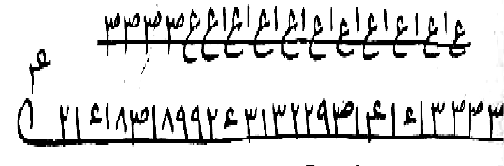

**AR:** (وَصْفُ مَا يُكْتَبُ) سَطْرَانِ طَوِيْلَانِ عَلٰى خَطٍّ اُفُقِىٍّ: السَّطْرُ الْاَعْلٰى حُرُوْفُ «**ع**» مَوْصُوْلَةٌ مُتَكَرِّرَةٌ مَعَ حُرُوْفٍ صَغِيْرَةٍ بَيْنَهَا، وَالسَّطْرُ الْاَسْفَلُ دَرَجٌ طَوِيْلٌ مِنَ الرُّقُوْمِ «**٢ ١ ٥ ١ ٨ ١ ٥ ١ ٨ ٩ ٩ ٢ ٥ ٣ ١ ٢ ٣ ٢ ٩ ٥ ٤ ١ ٥ ١ ٥ ٣ ٥ ٥ ٥ ٥ ٥**» تَقْرِيْبًا، وَفِى الطَّرَفِ الْاَيْسَرِ رَقْمُ «**٢**» بِخَطٍّ مَمْدُوْدٍ.

**LAT:** (waṣfu mā yuktabu) saṭrāni ṭawīlāni ‘alā khaṭṭin ufuqiyyin: al-saṭru al-a‘lā ḥurūfu «‘» mawṣūlatun mutakarriratun ma‘a ḥurūfin ṣaghīratin baynahā, wa-al-saṭru al-asfalu darajun ṭawīlun mina al-ruqūmi «2 1 5 1 8 1 5 1 8 9 9 2 5 3 1 2 3 2 9 5 4 1 5 1 5 3 5 5 5 5 5» taqrīban, wa-fī al-ṭarafi al-aysari raqmu «2» bi-khaṭṭin mamdūdin.

**ID:** “**(Deskripsi yang ditulis)**: **dua baris panjang** di atas **garis mendatar**: **baris atas** — huruf «**ع**» **bersambung berulang** dengan **huruf kecil di antaranya**؛ **baris bawah** — **deret panjang angka** «**٢ ١ ٥ ١ ٨ ١ ٥ ١ ٨ ٩ ٩ ٢ ٥ ٣ ١ ٢ ٣ ٢ ٩ ٥ ٤ ١ ٥ ١ ٥ ٣ ٥ ٥ ٥ ٥ ٥**» (perkiraan)؛ dan di **ujung kiri** angka «**٢**» dengan garis memanjang.”

**AR:** فَائِدَةٌ لِفَتْحِ الْحَظِّ (لِلزَّوَاجِ)

**LAT:** fā’idatun li-fathi al-ḥaẓẓi (lil-zawāji)

**ID:** “**Fā’idah untuk Membuka Keberuntungan (untuk Pernikahan).**” (Judul bagian kedua.)

**AR:** تُكْتَبُ **الْفَاتِحَةُ وَالِانْشِرَاحُ وَالْمُعَوِّذَتَانِ وَالنَّصْرُ** حُرُوْفًا مُتَقَطِّعَةً فِىْ **صَحْنٍ بِمَاءِ الْوَرْدِ وَالزَّعْفَرَانِ** بِشَكْلٍ دَائِرِىٍّ لِمُدَّةِ **ثَلَاثَةِ اَيَّامٍ** (**الْاَرْبِعَاءِ، الْخَمِيْسِ، الْجُمُعَةِ**)، وَيَكُوْنُ **الِاغْتِسَالُ قَبْلَ الزَّوَالِ تَحْدِيْدًا**؛ **بَعْدَ الِاغْتِسَالِ يُكَبُّ الْمَاءُ فِىْ مَكَانٍ طَاهِرٍ**. **لِلزَّوَاجِ وَهُوَ فَعَّالٌ**. **مَا يُكْتَبُ عَلَى الْقَمِيْصِ اَوْ فِىْ كَاغِدٍ وَيُحْمَلُ عَلَى الْعَضُدِ الْاَيْمَنِ**: «**بِسْمِ اللهِ الرَّحْمٰنِ الرَّحِيْمِ يَا تَمْخِيْشَا يَا تَمْشِيْثَا يَا مَرْشِيْطِيْثَا يَا مَشْطِيْثَا**»

**LAT:** tuktabu al-fātiḥatu wa-al-inshirāḥu wa-al-mu‘awwidhatāni wa-al-naṣru ḥurūfan mutaqaṭṭi‘atan fī ṣaḥnin bi-mā’i al-wardi wa-al-za‘farāni bi-shaklin dā’iriyyin li-muddati thalāthati ayyāmin (al-arbi‘ā’i, al-khamīsi, al-jumu‘ati), wa-yakūnu al-ightisālu qabla al-zawāli taḥdīdan؛ ba‘da al-ightisāli yukabbu al-mā’u fī makānin ṭāhirin. Lil-zawāji wa-huwa fa‘‘ālun. Mā yuktabu ‘alā al-qamīṣi aw fī kāghidin wa-yuḥmalu ‘alā al-‘aḍudi al-aymani: «bismi allāhi al-raḥmāni al-raḥīmi yā tamkhīshā yā tamshīthā yā marshīṭīthā yā mashṭīthā»

**ID:** “**Dituliskan al-Fātiḥah, al-Inshirāḥ, al-Mu‘awwidhatān (al-Falaq & al-Nās), dan al-Naṣr** dalam **huruf-huruf terpisah** di **piring (ṣaḥn) dengan air mawar dan za‘farān**, **berbentuk lingkaran**, selama **tiga hari** (**Rabu, Kamis, Jumat**). **Mandi (ightisāl) harus sebelum zawāl (tergelincir matahari)**, dan **setelah mandi airnya dibuang di tempat yang suci**. **Untuk pernikahan, dan ini efektif.** **Yang ditulis pada kemeja atau pada kāghid dan dibawa di lengan kanan**: «**Bismillāhirraḥmānirraḥīm, yā Tamkhīshā yā Tamshīthā yā Marshīṭīthā yā Mashṭīthā**».”

**Keterangan halaman.** Dua bagian. **(1) «فائدة محبة وجاب وعطف واحضار»**: ṭilasm **tujuh baris angka** (rajah-01) ditulis **pada bekas orang yang diminta**, **dipilin menjadi sumbu lampu**, **dinyalakan di malam gelap**, dupa **lubān + jāwī**, **malam Ahad/Rabu awal bulan**, **«دعوة المريخ» ١١×**, saat penulisan harus baik; **isi yang ditulis** = dua baris «ع» berulang + deret angka (rajah-02). **(2) «فائدة لفتح الحظ (للزواج)»**: al-Fātiḥah, al-Inshirāḥ, al-Mu‘awwidhatān, al-Naṣr **ditulis huruf terpisah** di **piring berisi air mawar + za‘farān** berbentuk **lingkaran** selama **٣ hari** (Rabu-Kamis-Jumat), **mandi sebelum zawāl**, air dibuang di tempat suci; untuk pernikahan; tulisan pada kemeja/kāghid dibawa di **lengan kanan** dengan **seruan nama «تمخيشا…»**.

**Angka pada halaman ini.** **١١×** (دعوة المريخ) — **cocok** antara lapisan teks dan pindaian. **٣ hari** — ditulis dengan kata **«ثلاثة»**, bukan angka. **Angka dalam tabel ٧ baris** dan **deret pada rajah-02** — **tulisan tangan**, dibaca dari crop **700 DPI** sebagai **perkiraan**؛ **bukan wafaq** (tidak ada bingkai berjumlah tetap dan **tidak dapat diuji** dengan penjumlahan baris/kolom/diagonal).

**[TIDAK JELAS - HALAMAN 460]** (1) **Seluruh isi tabel ٧ baris** — angka **berjalin dan bertumpuk**, hanya bentuknya dideskripsikan؛ **[TEKS ASLI DIJAGA]** dan pembacaan ditandai **perkiraan**. (2) **Deret angka pada rajah-02** — **perkiraan**؛ ditandai. (3) **«فَائِدَةُ مَحَبَّةٍ وَجَابٍ»** — kata **«جاب»** (penarik) **tidak lazim**؛ **dipertahankan**. (4) **«وَيَفْتِلُهَا … وَيُسْرِجُهَا»** — **dhamīr mu’annath** padahal objeknya «الطلسم»؛ **dipertahankan** sesuai cetakan. (5) **«الْمُعَوِّذَتَانِ»** — **dua surah perlindungan**؛ dijelaskan. (6) **«يُكَبُّ الْمَاءُ»** — kemungkinan **“dibuang/ditumpahkan”**؛ **dipertahankan**. (7) **Nama-nama «تمخيشا، تمشيثا، مرشيطيثا، مشطيثا»** — **tanpa vokal lengkap**؛ disalin **literal** dan ditandai.

**Peringatan (dicatat apa adanya, bukan fatwa).** Bagian pertama bertujuan **menghadirkan orang dengan paksa** lewat **bekas/jejaknya** yang **dipilin menjadi sumbu lampu** — yaitu **menggunakan jejak pribadi seseorang tanpa izin**. Teks ditranskripsikan sesuai cetakan; hal itu **bukan bagian dari ajaran Islam**.

**[ADA RAJAH]** — 2 crop: `assets/rajah/sirrul-asrar/hal-460-rajah-01.png` (700 DPI, Rect(132, 69, 482, 299)) dan `hal-460-rajah-02.png` (700 DPI, Rect(79, 397, 502, 537)).

---
## HALAMAN 461 — «افتح حظ فلانة بنت فلانة» (doa + طلسم bintang enam) + «للحفظ قوة الذاكرة وللدراسة» + «للزواج (فتح النصيب)» + «فائدة محبة» (دعوة السباسب الكبرى)

**AR:** كِتَابُ سِرِّ الْاَسْرَارِ فِي التَّوَاصُلِ مَعَ رُوحَانِيَّاتِ الْقُرْآنِ — شَيْخُ الرُّوحَانِيِّينَ الشَّيْخُ عَطِيَّةُ عَبْدُ الْحَمِيدِ

**LAT:** kitābu sirri al-asrāri fī al-tawāṣuli ma‘a rūḥāniyyāti al-qur’āni — shaykhu al-rūḥāniyyīna al-shaykhu ‘Aṭiyyatu ‘Abdu al-Ḥamīdi

**ID:** “Kitab «Sirr al-Asrār fī al-Tawāṣul ma‘a Rūḥāniyyāt al-Qur’ān» — Syaikh para ruhaniyyin, Syaikh ‘Aṭiyyah ‘Abd al-Ḥamīd.” (Kepala halaman.)

**Rajah:** 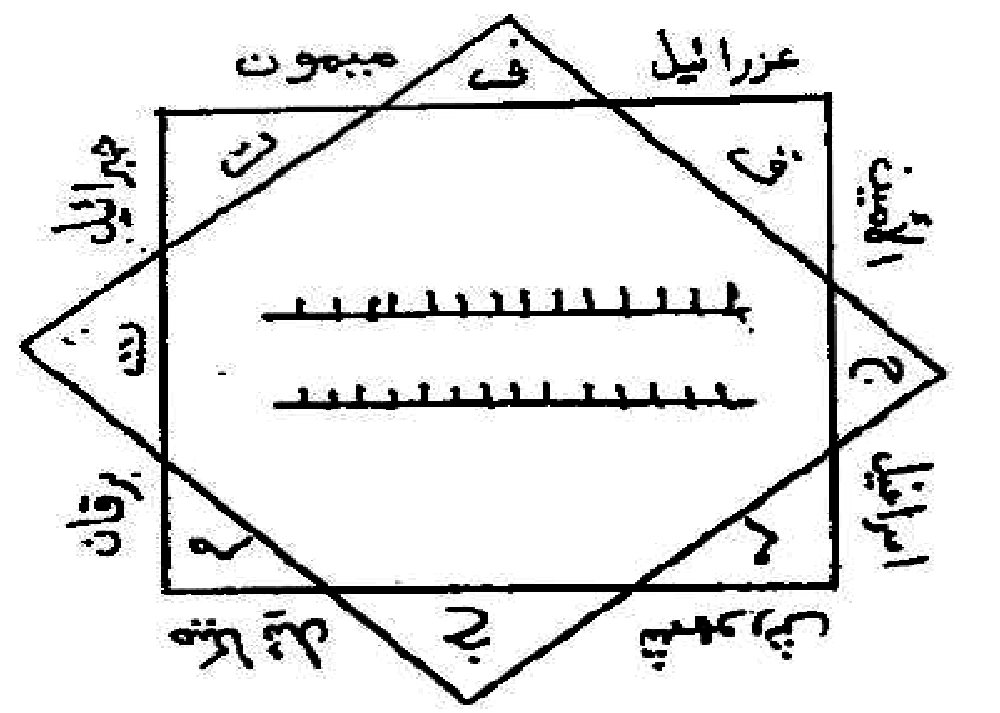

**AR:** (وَصْفُ الطِّلَسْمِ) نَجْمَةٌ سُدَاسِيَّةٌ: **مُرَبَّعٌ** وَدَاخِلَهُ **مُرَبَّعٌ ثَانٍ**، وَمِنْ رُؤُوْسِهِ تَخْرُجُ **مُثَلَّثَاتٌ** وَاحِدٌ اِلٰى اَعْلٰى وَوَاحِدٌ اِلٰى اَسْفَلَ، فَتُكَوِّنُ **نَجْمَةً سُدَاسِيَّةً**. فِى زَوَايَا الْمُرَبَّعِ دَاخِلِيًّا حُرُوْفٌ مُفْرَدَةٌ: «**ج**»، «**ف**»، «**ج**»، «**ج**»، «**ع**»، «**ج**»، «**ج**» (تَقْرِيْبًا). وَفِى الْخَارِجِ عِنْدَ كُلِّ زَاوِيَةٍ اَسْمَاءٌ: «**جَبْجُوْت**» (اَعْلٰى يَسَارٍ)، «**عَزْرَائِيْل**» (اَعْلٰى يَمِيْنٍ)، «**جِبْرَائِيْل**» (يَسَارٌ اَعْلٰى، عَمُوْدِيًّا)، «**مِيْكَائِيْل**» (يَمِيْنٌ اَعْلٰى، عَمُوْدِيًّا)، «**اِسْرَافِيْل**» (يَسَارٌ اَسْفَلُ)، «**جَبْجُوْت**» (يَمِيْنٌ اَسْفَلُ). وَفِى الْوَسَطِ **سَطْرَانِ** مِنْ **خُطُوْطٍ قَصِيْرَةٍ مُتَكَاثِفَةٍ** كَالْاَسْنَانِ.

**LAT:** (waṣfu al-ṭilasma) najmatun sudāsiyyatun: murabba‘un wa-dākhilahu murabba‘un thānin, wa-min ru’ūsihi takhruju muthallathātun wāḥidun ilā a‘lā wa-wāḥidun ilā asfala, fa-tukawwinu najmatan sudāsiyyatan. Fī zawāyā al-murabba‘i dākhiliyyan ḥurūfun mufradatun: «j», «f», «j», «j», «‘», «j», «j» (taqrīban). Wa-fī al-khāriji ‘inda kulli zāwiyatin asmā’un: «jabjūt» (a‘lā yasārin), «‘azrā’īl» (a‘lā yamīnin), «jibrā’īl» (yasārun a‘lā, ‘amūdiyyan), «mīkā’īl» (yamīnun a‘lā, ‘amūdiyyan), «isrāfīl» (yasārun asfalu), «jabjūt» (yamīnun asfalu). Wa-fī al-wasaṭi saṭrāni min khuṭūṭin qaṣīratin mutakāthifatin ka-al-asnāni.

**ID:** “**(Deskripsi ṭilasm)**: **bintang enam** — **kotak** dengan **kotak kedua di dalamnya**, dan dari puncaknya keluar **segitiga** (satu ke atas, satu ke bawah) sehingga membentuk **bintang enam**. Di **sudut kotak bagian dalam** ada **huruf tunggal**: «**ج**»، «**ف**»، «**ج**»، «**ج**»، «**ع**»، «**ج**»، «**ج**» (perkiraan). Di **luar setiap sudut** ada **nama**: «**جبجوت**» (kiri atas)، «**عزرائيل**» (kanan atas)، «**جبرائيل**» (kiri atas, vertikal)، «**ميكائيل**» (kanan atas, vertikal)، «**اسرافيل**» (kiri bawah)، «**جبجوت**» (kanan bawah). Di **tengah** ada **dua baris** **garis pendek rapat** seperti **gigi-gigi**.”

**AR:** اِفْتَحْ حَظَّ فُلَانَةَ بِنْتَ فُلَانَةَ بِحَقِّ هَذِهِ الْاَسْمَاءِ الْعِظَامِ: يَا رَبُّ يَا رَبُّ يَا رَبُّ بِحَقِّ مَنْ قَالَ «**لِلسَّمٰوَاتِ وَالْاَرْضِ ائْتِيَا طَوْعًا اَوْ كَرْهًا قَالَتَا اَتَيْنَا طَائِعِيْنَ**» بِحَقِّ «**كهيعص**» وَبِحَقِّ «**حمعسق**» يَا «**شَمْخِيْثَا**» يَكْهِيْج يَا «**كَهْكَهِيْح**» يَا رَبِّ اٰهِ. اَللّٰهُمَّ يَا اَبَدَ الْاَبْعَدِ الْاَبَدِ الْمُخْفِي بِلا مَدَدٍ، الْقَوِيِّ بِلا مَدَدٍ، الْعَزِيْزِ بِلا وَلَدٍ، الْمُحْيِي بِلا وَعْدٍ، وَهُوَ **سَيِّدُ السَّنَدِ الْوَاحِدُ الْاَحَدُ الصَّمَدُ الَّذِي لَمْ يَلِدْ وَلَمْ يُوْلَدْ وَلَمْ يَكُنْ لَهُ كُفُوًا اَحَدٌ**. اَللّٰهُمَّ احْفَظْ حَامِلَ هَذِهِ الْكَلِمَاتِ مِنْ جَمِيْعِ الْبَلَاءِ وَالْعِلَلِ وَالْوَجَعِ، وَمِنْ شَرِّ الْجِنِّ وَالْاِنْسِ، وَشَرِّ الْحَمْرَاءِ، وَمِنْ شَرِّ مَا خَلَقَ. وَبِحَقِّ هَذِهِ الْاَسْمَاءِ الْمُعَظَّمَةِ يَا حَافِظَ نُوْحٍ فِى الْمَاءِ، وَيُوْنُسَ فِى بَطْنِ الْحُوْتِ، وَبِمُحَمَّدٍ يَا حَافِظَ الْاَرْضِ كُلِّهَا، خَيْرَ حَافِظًا وَهُوَ اَرْحَمُ الرَّاحِمِيْنَ.

**LAT:** iftaḥ ḥaẓẓa fulānata binta fulānata bi-ḥaqqi hādhihi al-asmā’i al-‘iẓāmi: yā rabbu yā rabbu yā rabbu bi-ḥaqqi man qāla «lil-samāwāti wa-al-arḍi i’tiyā ṭaw‘an aw karhan qālatā ataynā ṭā’i‘īna» bi-ḥaqqi «kāf hā yā ‘ayn ṣād» wa-bi-ḥaqqi «ḥā mīm ‘ayn sīn qāf» yā «shamkhīthā» yak-hīj yā «kahkahīḥ» yā rabbi āh. Allāhumma yā abada al-ab‘adi al-abadi al-mukhfī bilā madadin, al-qawiyyi bilā madadin, al-‘azīzi bilā waladin, al-muḥyī bilā wa‘din, wa-huwa sayyidu al-sanadi al-wāḥidu al-aḥadu al-ṣamadu alladhī lam yalid wa-lam yūlad wa-lam yakun lahu kufuwan aḥadun. Allāhumma iḥfaẓ ḥāmila hādhihi al-kalimāti min jamī‘i al-balā’i wa-al-‘ilali wa-al-waja‘i, wa-min sharri al-jinni wa-al-insi, wa-sharri al-ḥamrā’i, wa-min sharri mā khalaqa. Wa-bi-ḥaqqi hādhihi al-asmā’i al-mu‘aẓẓamati yā ḥāfiẓa nūḥin fī al-mā’i, wa-yūnusa fī baṭni al-ḥūti, wa-bi-muḥammadin yā ḥāfiẓa al-arḍi kullahā, khayra ḥāfiẓin wa-huwa arḥamu al-rāḥimīna.

**ID:** “**Bukalah keberuntungan Fulanah binti Fulanah** dengan hak **nama-nama agung ini**: ya Rabbi, ya Rabbi, ya Rabbi — dengan hak **Dia yang berfirman**: «**Kepada langit dan bumi: datanglah kamu keduanya, dengan suka atau terpaksa. Keduanya berkata: kami datang dengan taat**»؛ dengan hak «**كهيعص**» dan dengan hak «**حمعسق**»؛ ya «**شمخيثا**» yak-hīj, ya «**كهكهيح**», ya Rabbi āh. **Ya Allah, ya Yang Maha Abadi yang tiada akhir dan tersembunyi tanpa batas, Yang Kuat tanpa penopang, Yang Maha Perkasa tanpa anak, Yang Menghidupkan tanpa janji** — dan Dia **sayyid al-sanad, Yang Maha Esa, Yang Tunggal, Yang Bergantung kepada-Nya segala sesuatu, yang tidak melahirkan dan tidak dilahirkan, dan tidak ada yang setara dengan-Nya**. **Ya Allah, jagalah orang yang membawa kalimat-kalimat ini** dari **segala bencana, penyakit, dan rasa sakit**, dari **kejahatan jin dan manusia**, dari **kejahatan «الحمراء»**, dan dari **kejahatan apa yang Dia ciptakan**. Dan dengan hak **nama-nama yang diagungkan ini** — **ya Penjaga Nūḥ di air**, **dan Yūnus di perut ikan**, **dan dengan Muḥammad** — **ya Penjaga seluruh bumi**, **sebaik-baik penjaga, dan Dia Maha Pengasih dari yang mengasihi**.”

**AR:** لِلْحِفْظِ، قُوَّةِ الذَّاكِرَةِ، وَلِلدِّرَاسَةِ

**LAT:** lil-ḥifẓi, quwwati al-dhākirati, wa-lil-dirāsati

**ID:** “**Untuk hafalan, kekuatan daya ingat, dan untuk belajar.**” (Judul bagian kedua.)

**AR:** تُكْتَبُ **سُوْرَةُ الْجِنِّ** بِشَكْلٍ دَائِرِىٍّ عَلٰى **صَحْنٍ بِمَاءِ الْوَرْدِ وَالزَّعْفَرَانِ**، وَيُكْتَبُ مَعَهَا: «**رَبِّ زِدْنِيْ عِلْمًا**»، «**اِنَّا نَحْنُ نَزَّلْنَا الذِّكْرَ وَاِنَّا لَهُ لَحَافِظُوْنَ**». **اَللّٰهُمَّ اجْعَلْ لِيْ ذَاكِرَةً حَافِظَةً** مَعَ **الصَّلَاةِ عَلٰى مُحَمَّدٍ وَاٰلِ مُحَمَّدٍ**، وَيُمْحٰى بِمَاءِ **زَمْزَمَ** اَوْ مَاءِ **الْمَطَرِ**، وَيُشْرَبُ لِمُدَّةِ **اُسْبُوْعٍ عَلَى الرِّيْقِ**.

**LAT:** tuktabu sūratu al-jinni bi-shaklin dā’iriyyin ‘alā ṣaḥnin bi-mā’i al-wardi wa-al-za‘farāni, wa-yuktabu ma‘ahā: «rabbi zidnī ‘ilman», «innā naḥnu nazzalnā al-dhikra wa-innā lahu la-ḥāfiẓūna». Allāhumma ij‘al lī dhākiratan ḥāfiẓatan ma‘a al-ṣalāti ‘alā muḥammadin wa-āli muḥammadin, wa-yumḥā bi-mā’i zamzama aw mā’i al-maṭari, wa-yushrabu li-muddati usbū‘in ‘alā al-rīqi.

**ID:** “**Surah al-Jinn ditulis berbentuk lingkaran** di **piring dengan air mawar dan za‘farān**, dan dituliskan bersamanya: «**Rabbi zidnī ‘ilman**»، «**Innā naḥnu nazzalnā al-dhikra wa-innā lahu la-ḥāfiẓūn**». **Ya Allah, jadikanlah bagiku daya ingat yang kuat** bersama **shalawat kepada Muḥammad dan keluarga Muḥammad**؛ lalu **dihapus (dilarutkan) dengan air zamzam atau air hujan**, dan **diminum selama satu minggu saat perut kosong**.”

**AR:** لِلزَّوَاجِ (فَتْحُ النَّصِيْبِ)

**LAT:** lil-zawāji (fatḥu al-naṣībi)

**ID:** “**Untuk pernikahan (membuka jodoh).**” (Judul bagian ketiga.)

**AR:** تُكْتَبُ **سُوْرَةُ الْفَتْحِ حُرُوْفًا مُتَفَرِّقَةً** يَوْمَ **الْجُمُعَةِ قَبْلَ صَلَاةِ الْجُمُعَةِ**، وَتُكْتَبُ «**يَا مُحَمَّدُ**» **٢٩ مَرَّةً**، «**اَللّٰهُمَّ زَيِّنْ خَلْقِيْ يَا اَرْحَمَ الرَّاحِمِيْنَ**»، وَتُكْتَبُ عَلٰى **وَرَقَةٍ وَتُحْمَلُ دَائِمًا عِنْدَ الْخُرُوْجِ**.

**LAT:** tuktabu sūratu al-fatḥi ḥurūfan mutafarriqatan yawma al-jumu‘ati qabla ṣalāti al-jumu‘ati, wa-tuktabu «yā muḥammadu» 29 marratan, «allāhumma zayyin khalqī yā arḥama al-rāḥimīna», wa-tuktabu ‘alā waraqatin wa-tuḥmalu dā’iman ‘inda al-khurūji.

**ID:** “**Surah al-Fatḥ ditulis dalam huruf-huruf terpisah** pada hari **Jumat sebelum shalat Jumat**, dan dituliskan «**يا محمد**» **٢٩×**, (lalu) «**Ya Allah, hiasilah penciptaanku, ya Maha Pengasih dari yang mengasihi**»؛ ditulis pada **selembar kertas** dan **selalu dibawa ketika keluar**.”

**AR:** فَائِدَةُ مَحَبَّةٍ

**LAT:** fā’idatu maḥabbatin

**ID:** “**Fā’idah Cinta.**” (Judul bagian keempat.)

**AR:** تُكْتَبُ فِيْ **سَاعَةِ الزُّهْرَةِ** بِـ**مَاءِ وَرْدٍ وَكَافُوْرٍ**، وَتُبَخَّرُ بِـ**عَنْبَرٍ وَمِسْكٍ وَكَافُوْرٍ**، وَتُعَزَّمُ عَلَيْهَا **بِدَعْوَةِ السَّبَاسِبِ الْكُبْرٰى ٧ مَرَّاتٍ**، وَهَذَا الطِّلَسْمُ…

**LAT:** tuktabu fī sā‘ati al-zuharati bi-mā’i wardin wa-kāfūrin, wa-tubakhkharu bi-‘anbarin wa-miskin wa-kāfūrin, wa-tu‘azzamu ‘alayhā bi-da‘wati al-sabāsibi al-kubrā 7 marrātin, wa-hādhā al-ṭilasmu…

**ID:** “**Dituliskan pada saat al-Zuhrah (Venus)** dengan **air mawar dan kapur barus**, lalu **diuapi ‘anbar, misk, dan kapur barus**, dan **diazamkan padanya «دعوة السباسب الكبرى» ٧×**. **Dan ṭilasmnya…**” — **kalimat terpotong di akhir halaman**, **bersambung ke halaman 462**.

**Keterangan halaman.** Empat bagian: (1) **doa «افتح حظ فلانة بنت فلانة»** dengan **ṭilasm bintang enam** bermotif **nama-nama malaikat** («جبجوت، عزرائيل، جبرائيل، ميكائيل، اسرافيل»)؛ (2) **«للحفظ قوة الذاكرة وللدراسة»** — surah al-Jinn **berbentuk lingkaran** di piring air mawar + za‘farān, ditambah «رب زدني علما» dan «إنا نحن نزلنا الذكر»، diminum **seminggu saat perut kosong**؛ (3) **«للزواج (فتح النصيب)»** — surah al-Fatḥ **huruf terpisah**, «يا محمد» **٢٩×**, dibawa selalu؛ (4) **«فائدة محبة»** — saat **al-Zuhrah**, air mawar + kāfūr, dupa **‘anbar + misk + kāfūr**, **«دعوة السباسب الكبرى» ٧×** — **berlanjut ke p.462**.

**Angka pada halaman ini.** **٢٩** («يا محمد») dan **٧** («دعوة السباسب الكبرى») — **cocok** antara lapisan teks dan pindaian؛ **tanpa koreksi**. Kutipan ayat: **Q.S. Fuṣṣilat 41:11** («ائتيا طوعا او كرها…») dan **Q.S. al-Ḥijr 15:9** («إنا نحن نزلنا الذكر…»).

**[TIDAK JELAS - HALAMAN 461]** (1) **Huruf tunggal di sudut kotak ṭilasm** — tulisan tangan kecil; **[TEKS ASLI DIJAGA]**، hanya bentuk dideskripsikan. (2) **Dua baris garis bertakik di tengah ṭilasm** — **tidak dapat dibaca** sebagai huruf؛ ditandai. (3) **Nama «جَبْجُوْت»** pada dua sudut — pembacaan **perkiraan**؛ namanya **tidak lazim**؛ dipertahankan. (4) **«شَمْخِيْثَا» / «يَكْهِيْج» / «كَهْكَهِيْح»** — **tanpa vokal lengkap**؛ disalin literal. (5) **«الْاَبْعَدِ الْاَبَدِ»** — **pengulangan cetakan**؛ **dicatat, tidak diperbaiki**. (6) **«يَا رَبِّ اٰهِ»** — kemungkinan **seruan (āh)**؛ dipertahankan. (7) **«شَرِّ الْحَمْرَاءِ»** — istilah **tidak dijelaskan**؛ **dipertahankan, tidak ditafsirkan**. (8) **«خَيْرَ حَافِظًا»** — susunan **tidak lazim**؛ dipertahankan. (9) **«وَتُعَزَّمُ عَلَيْهَا لَا بَدْعَةَ»** — lapisan teks membaca **«عليها لا بدعة»** sementara pindaian membaca **«عليها بدعوة»**؛ **dibaca «بدعوة»** sesuai konteks, **perbedaan dicatat di sini**.

**Peringatan (dicatat apa adanya, bukan fatwa).** Bagian **«فائدة محبة»** ditujukan untuk **memaksa rasa cinta** lewat saat **al-Zuhrah** dan azimat yang **dibawa terus-menerus**. Teks ditranskripsikan sesuai cetakan; hal itu **bukan bagian dari ajaran Islam**.

**[ADA RAJAH]** — 1 crop: `assets/rajah/sirrul-asrar/hal-461-rajah-01.png` (700 DPI, Rect(139, 69, 471, 306)).

---
## HALAMAN 462 — sambungan ṭilasm «فائدة محبة» (p.461) + «فائدة للرزق» + gambar «اقلعة» + kolofon penutup

**AR:** كِتَابُ سِرِّ الْاَسْرَارِ فِي التَّوَاصُلِ مَعَ رُوحَانِيَّاتِ الْقُرْآنِ — شَيْخُ الرُّوحَانِيِّينَ الشَّيْخُ عَطِيَّةُ عَبْدُ الْحَمِيْدِ

**LAT:** kitābu sirri al-asrāri fī al-tawāṣuli ma‘a rūḥāniyyāti al-qur’āni — shaykhu al-rūḥāniyyīna al-shaykhu ‘Aṭiyyatu ‘Abdu al-Ḥamīdi

**ID:** “Kitab «Sirr al-Asrār fī al-Tawāṣul ma‘a Rūḥāniyyāt al-Qur’ān» — Syaikh para ruhaniyyin, Syaikh ‘Aṭiyyah ‘Abd al-Ḥamīd.” (Kepala halaman.)

**Rajah:** 

**AR:** (تَكْمِلَةُ «وَهَذَا الطِّلَسْمُ» مِنْ ص ٤٦١) جَدْوَلٌ يَدَوِىٌّ: فِى الْاَعْلٰى **صَفِيْحَةٌ مُدَوَّرَةُ الزَّاوِيَةِ** بِسَطْرَيْنِ مِنَ الرُّقُوْمِ، وَعَلٰى يَسَارِهَا سَطْرٌ طَوِيْلٌ مِنَ الرُّقُوْمِ اَيْضًا؛ وَفِى الْوَسَطِ **شَكْلَانِ**: (١) **رَجُلٌ ذُوْ قُبَّعَةٍ عَرِيْضَةٍ** (فَوْقَهَا رَقْمُ «**٥**»)، عَيْنَانِ نُقْطَتَانِ، وَفَمٌ مُسَنَّنٌ، وَلَهُ **رِجْلَانِ مُنْفَرِجَتَانِ تَنْتَهِيَانِ بِبَيْضَاوَيْنِ**، وَيَدَانِ بِاَصَابِعَ كَالْاَوْرَاقِ؛ (٢) **شَكْلٌ كَالْكَاْسِ الْمَقْلُوْبِ** الْمَشْقُوْقِ بِخَطٍّ، تَحْتَهُ كَلِمَةٌ بِخَطٍّ يَدَوِىٍّ تُقْرَاُ «**مَادَر**» تَقْرِيْبًا، وَعَلٰى جَانِبِهِ خُطُوْطٌ قَصِيْرَةٌ. ثُمَّ سَطْرَانِ طَوِيْلَانِ مِنَ الرُّقُوْمِ وَالْحُرُوْفِ، وَسَطْرٌ مِنَ الْحُرُوْفِ «**ط ه ع ع ع ع**»، ثُمَّ سَطْرٌ سُفْلِىٌّ طَوِيْلٌ مِنَ الرُّقُوْمِ.

**LAT:** (takmilatu «wa-hādhā al-ṭilasmu» min ṣ 461) jadwalun yadawiyyun: fī al-a‘lā ṣafīḥatun mudawwaratu al-zāwiyati bi-saṭrayni mina al-ruqūmi, wa-‘alā yasārihā saṭrun ṭawīlun mina al-ruqūmi ayḍan؛ wa-fī al-wasaṭi shaklāni: (1) rajulun dhū qubb‘atin ‘arīḍatin (fawqahā raqmu «5»), ‘aynāni nuqṭatāni, wa-famun musannanun, wa-lahu rij lāni munfarijatāni tantahiyāni bi-bayḍāwayni, wa-yadāni bi-aṣābi‘a ka-al-awrāqi؛ (2) shaklun ka-al-kā’si al-maqlūbi al-mashqūqi bi-khaṭṭin, taḥtahu kalimatun bi-khaṭṭin yadawiyyin tuqra’u «mādar» taqrīban, wa-‘alā jānibihi khuṭūṭun qaṣīratun. Thumma saṭrāni ṭawīlāni mina al-ruqūmi wa-al-ḥurūfi, wa-saṭrun mina al-ḥurūfi «ṭ h ‘ ‘ ‘ ‘», thumma saṭrun sufliyyun ṭawīlun mina al-ruqūmi.

**ID:** “**(Pelengkap «dan ṭilasmnya» dari p.461)** — tabel tulisan tangan: di **atas** ada **lembar berpucuk bulat** dengan **dua baris angka**, dan di **kirinya** **satu baris angka panjang**؛ di **tengah** ada **dua bentuk**: (١) **figur lelaki bertopi lebar** (di atasnya angka «**٥**»), **dua mata titik**, **mulut bergigi**, **dua kaki terbuka berujung telur**, **dua tangan berjari seperti dedaunan**؛ (٢) **bentuk seperti mangkuk terbalik** yang **terbelah garis**, di bawahnya tulisan tangan yang terbaca **«مادر»** (perkiraan). Lalu **dua baris panjang** angka dan huruf, lalu **satu baris huruf** «**ط ه ع ع ع ع**», lalu **satu baris panjang** angka di bawah.”

**AR:** فَائِدَةٌ لِلرِّزْقِ

**LAT:** fā’idatun lil-rizqi

**ID:** “**Fā’idah untuk Rezeki.**” (Judul bagian.)

**AR:** يُكْتَبُ يَوْمَ الْعِيْدِ وَتُوْضَعُ فِىْ **مَخْبَاكَ اَىِ الْكِيْسِ**، وَبَعْدَ ذٰلِكَ تُكْتَبُ كُلَّ يَوْمِ **جُمُعَةٍ** وَتُوْضَعُ فِى الْكِيْسِ، **وَتُتْرَكُ الْاَوَّلُ** — وَهٰذِهِ **مُجَرَّبَةٌ وَصَحِيْحَةٌ**. وَتُكْتَبُ حَوْلَهُ: «**وَلَقَدْ مَكَّنَّاكُمْ فِى الْاَرْضِ وَجَعَلْنَا لَكُمْ فِيْهَا مَعَايِشَ قَلِيْلًا مَا تَشْكُرُوْنَ**» — **tanpa bilangan** yang disebut.

**LAT:** yuktabu yawma al-‘īdi wa-tūḍa‘u fī makhbāka ayi al-kīsi, wa-ba‘da dhālika tuktabu kulla yawmi jumu‘atin wa-tūḍa‘u fī al-kīsi, wa-tutraku al-awwalu — wa-hādhihi mujarrabatun wa-ṣaḥīḥatun. Wa-tuktabu ḥawlahu: «wa-laqad makkannākum fī al-arḍi wa-ja‘alnā lakum fīhā ma‘āyisha qalīlan mā tashkurūna» — bilā ‘adadin.

**ID:** “**Dituliskan pada hari raya** dan **diletakkan di kantong (saku)**؛ **setelah itu ditulis setiap hari Jumat** dan diletakkan di kantong, dan **yang pertama ditinggalkan** — dan **ini sudah dicoba dan sahih**. **Dan dituliskan di sekelilingnya**: «**Dan sungguh Kami telah menempatkan kamu di bumi dan Kami jadikan di sana penghidupan bagimu; sedikit sekali kamu bersyukur**» — **tanpa bilangan** yang disebut.”

**Rajah:** 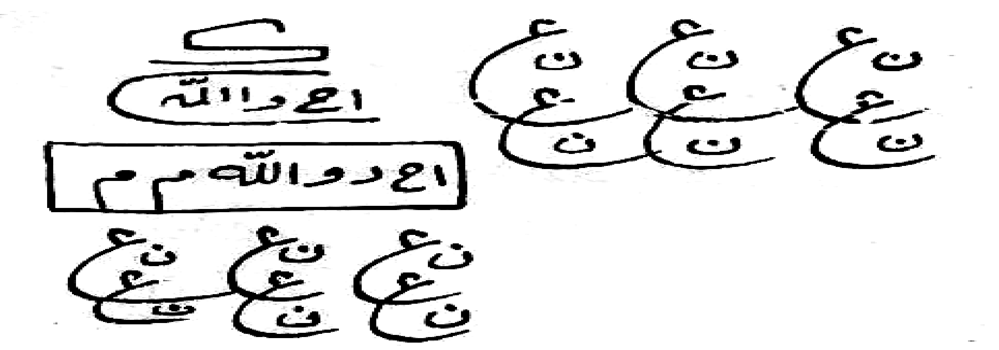

**AR:** (وَصْفُ الطِّلَسْمِ الثَّانِى) فِى الْيَسَارِ **شَكْلٌ مُدَرَّجٌ** (اَرْبَعَةُ خُطُوْطٍ اُفُقِيَّةٍ)، تَحْتَهُ **بَيْضَاوِىٌّ** دَاخِلَهُ «**١ ع ر ا ي ة**» (تَقْرِيْبًا)، ثُمَّ **مُسْتَطِيْلٌ** دَاخِلَهُ «**١ ع ر و ا ل س ع ع**» (تَقْرِيْبًا)؛ وَفِى الْيَمِيْنِ وَاَسْفَلَ مِنْهُ **تِسْعُ هَيْئَاتٍ** كُلُّهَا **كَالْحَرْفِ «م»** ذِىْ **ذَيْلٍ مَعْقُوْفٍ**، مَوْضُوْعَةٍ فِى ثَلَاثَةِ صُفُوْفٍ (٣ × ٣).

**LAT:** (waṣfu al-ṭilāsmi al-thānī) fī al-yasāri shaklun mudarrajun (arba‘atu khuṭūṭin ufuqiyyatin), taḥtahu bayḍāwiyyun dākhilahu «1 ‘ r a y t» (taqrīban), thumma mustaṭīlun dākhilahu «1 ‘ r w a l s ‘ ‘» (taqrīban)؛ wa-fī al-yamīni wa-asfala minhu tis‘u hay’ātin kulluhā ka-al-ḥarfi «m» dhī dhaylin ma‘qūfin, mawḍū‘atin fī thalāthati ṣufūfin (3 × 3).

**ID:** “**(Deskripsi ṭilasm kedua)**: di **kiri** ada **bentuk bertingkat** (empat garis mendatar), di bawahnya **bentuk lonjong** berisi «**١ ع ر ا ي ة**» (perkiraan), lalu **persegi panjang** berisi «**١ ع ر و ا ل س ع ع**» (perkiraan)؛ di **kanan dan bawahnya** ada **sembilan bentuk** semuanya **menyerupai huruf «م»** dengan **ekor tertekuk**, tersusun **tiga baris tiga** (٣×٣).”

**AR:** اَيُّهَا الطَّالِبُ الْجَلِيْلُ، لَا تَبْخَلْ عَلَيْنَا بِقِرَاءَةِ **الْفَاتِحَةِ** وَثَبِّتْ صَوَابًا لَنَا وَلِوَالِدَيْنَا — **شَيْخُ الرُّوحَانِيِّينَ فِى الْوَطَنِ الْعَرَبِىِّ، الشَّيْخُ عَطِيَّةُ عَبْدُ الْحَمِيْدِ** — **لِلْكَشْفِ وَالْمُتَابَعَةِ مَعَ شَيْخِ الرُّوحَانِيِّينَ ٨٣٢٢٢٠٢٦١٠٢٠٠**

**LAT:** ayyuhā al-ṭālibu al-jalīlu, lā tabkhal ‘alaynā bi-qirā’ati al-fātiḥati wa-thabbit ṣawāban lanā wa-li-wālidaynā — shaykhu al-rūḥāniyyīna fī al-waṭani al-‘arabiyyi, al-shaykhu ‘Aṭiyyatu ‘Abdu al-Ḥamīdi — lil-kashfi wa-al-mutāba‘ati ma‘a shaykhi al-rūḥāniyyīna 8322202610200

**ID:** “**Wahai penuntut yang mulia, jangan kikir kepada kami dengan membaca al-Fātiḥah**, dan **tetapkanlah kebenaran bagi kami dan kedua orang tua kami** — **Syaikh para ruhaniyyin di tanah Arab, Syaikh ‘Aṭiyyah ‘Abd al-Ḥamīd** — **untuk kasyaf dan bimbingan dengan Syaikh para ruhaniyyin: ٨٣٢٢٢٠٢٦١٠٢٠٠**.”

**Keterangan halaman.** Halaman ini **menyambung** «وهذا الطلسم» dari **p.461**, lalu memuat **«فائدة للرزق»**: ditulis **hari raya** dan **setiap Jumat**, disimpan **di saku**, ayat «**ولقد مكناكم في الارض…**» ditulis **di sekelilingnya** (**tanpa bilangan**); disertai **gambar «اقلعة»** dan **kolofon penutup** dengan **permintaan al-Fātiḥah** serta **kontak ٨٣٢٢٢٠٢٦١٠٢٠٠**.

**Angka pada halaman ini.** Halaman ini **tidak memuat bilangan** (tidak ada «سبع مرات») — dikonfirmasi dari pindaian 900 DPI pada baris «وتكتب حوله…» (Rect(85, 352, 505, 392))؛ **tidak ada angka yang ditambahkan**. Angka-angka **di dalam ṭilasm** (deret panjang, angka «٥» di atas topi, susunan ٣×٣ bentuk «م») adalah **tulisan tangan** — dibaca dari crop **700 DPI** sebagai **perkiraan**؛ **tidak ada wafaq**.

**[TIDAK JELAS - HALAMAN 462]** (1) **Seluruh deret angka pada ṭilasm pertama (rajah-01)** — **perkiraan**؛ **[TEKS ASLI DIJAGA]** dan hanya bentuk yang dideskripsikan. (2) **Kata di bawah bentuk mangkuk** — terbaca «**مادر**» (perkiraan)؛ **tidak dipastikan**. (3) **Tulisan dalam lonjong dan persegi pada «اقلعة»** — **tidak dapat dipastikan**؛ disalin sebagai **perkiraan huruf**. (4) **Sembilan bentuk «م»** — **tidak dapat dipastikan** apakah bernilai angka؛ **tidak diuji penjumlahan** karena **bukan wafaq berbingkai**. (5) **«مَخْبَاكَ اَىِ الْكِيْسِ»** — **susunan janggal** (kemungkinan «مخباك أي الكيس» = saku, yaitu kantung)؛ **dipertahankan**. (6) **«وَيَدْ ذَلِكَ»** — lapisan teks membaca **«وبد ذلك»** sementara pindaian 900 DPI membaca **«وبعد ذلك»**؛ **dibaca «وبعد ذلك»** dan **perbedaan dicatat**. (7) **«وَانَةٌ مُجَرَّبٌ وَصَحِيْحٌ»** — susunan **janggal** (kemungkinan «وأنه مجرب وصحيح»)؛ **dipertahankan**. (8) **«وَثَبِّتْ صَوَابًا لَنَا»** — **susunan tidak lazim**؛ dipertahankan. (9) **«اقلعة»** — **tidak dijelaskan** dalam teks؛ **dipertahankan, tidak ditafsirkan**.

**Peringatan (dicatat apa adanya, bukan fatwa).** Halaman ini melanjutkan amalan **memaksa rasa cinta** (p.461) dan menambahkan **amalan rezeki** dengan azimat **disimpan di saku**. Teks ditranskripsikan sesuai cetakan; hal itu **bukan bagian dari ajaran Islam**.

**[ADA RAJAH]** — 2 crop: `assets/rajah/sirrul-asrar/hal-462-rajah-01.png` (700 DPI, Rect(133, 69, 480, 316)) dan `hal-462-rajah-02.png` (700 DPI, Rect(113, 395, 501, 531)).

---
## HALAMAN 463 — «فائدة محبة» (wafaq + البرهتية, ١١×) + «فائدة محبة» (الجلجلوتية الصغرى ١٢×, ditanam) + «فائدة محبة في قارورة» (دعوة النار ٥٣×)

**AR:** كِتَابُ سِرِّ الْاَسْرَارِ فِي التَّوَاصُلِ مَعَ رُوحَانِيَّاتِ الْقُرْآنِ — شَيْخُ الرُّوحَانِيِّينَ الشَّيْخُ عَطِيَّةُ عَبْدُ الْحَمِيْدِ

**LAT:** kitābu sirri al-asrāri fī al-tawāṣuli ma‘a rūḥāniyyāti al-qur’āni — shaykhu al-rūḥāniyyīna al-shaykhu ‘Aṭiyyatu ‘Abdu al-Ḥamīdi

**ID:** “Kitab «Sirr al-Asrār fī al-Tawāṣul ma‘a Rūḥāniyyāt al-Qur’ān» — Syaikh para ruhaniyyin, Syaikh ‘Aṭiyyah ‘Abd al-Ḥamīd.” (Kepala halaman.)

**AR:** فَائِدَةُ مَحَبَّةٍ

**LAT:** fā’idatu maḥabbatin

**ID:** “**Fā’idah Cinta (pertama).**” (Judul bagian pertama.)

**AR:** تُكْتَبُ هَذَا الْوِفْقَ وَتُكْتَبُ حَوْلَهُ **الْبَرْهَتِيَّةُ**، وَتُعَزَّمُ وَبَخُوْرُكَ **اللُّبَانُ النَّتَايَةُ وَالصَّنْدَلُ الْاَحْمَرُ**، وَخُذْ **رَصْدًا مُنَاسِبًا لِعَمَلِكَ**، وَالْعَزِيْمَةُ **١١ مَرَّةً**، وَتُعَلَّقُ فِى الْهَوَاءِ **اِتِّجَاهَ الْمَطْلُوْبِ**.

**LAT:** tuktabu hādhā al-wifqa wa-tuktabu ḥawlahu al-barhatiyyatu, wa-tu‘azzamu wa-bakhūruka al-lubānu al-natāyatu wa-al-ṣandal al-aḥmaru, wa-khudh raṣdan munāsiban li-‘amalika, wa-al-‘azīmatu 11 marratan, wa-tu‘allaqu fī al-hawā’i ittijāha al-maṭlūbi.

**ID:** “**Wafaq ini dituliskan** dan **di sekelilingnya ditulis «البرهتية»**؛ **diazamkan**؛ **dupaamu: lubān natāyah dan cendana merah**؛ **ambil raṣd yang sesuai** untuk amalanmu؛ **‘azīmahnya ١١×**؛ lalu **digantung di udara menghadap arah orang yang diminta**.”

**Rajah:** 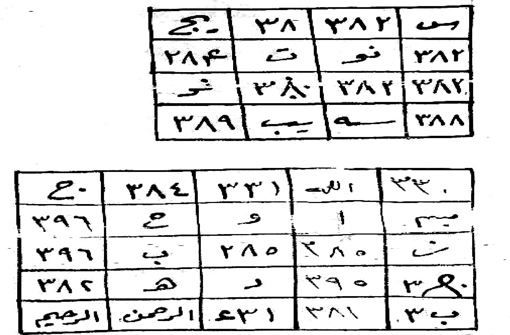

**AR:** (وَصْفُ الْوِفْقِ الْاَوَّلِ) جَدْوَلٌ ٤ × ٤ خَلَايَاهُ خَلِيْطٌ مِنَ الرُّقُوْمِ وَالْحُرُوْفِ بِخَطٍّ يَدَوِىٍّ عَرِيْضٍ. قِرَاءَةٌ تَقْرِيْبِيَّةٌ (مِنَ الْيَسَارِ اِلَى الْيَمِيْنِ كَمَا تُرَى الْخَلَايَا):

- الصَّفُّ ١: «**٢٠**» | «**٢٨**» | «**٢٨٢**» | «**٢٨٢**»
- الصَّفُّ ٢: «**٢٨٤**» | «**٢**» | «**ق ص**» | «**٣٨٢**»
- الصَّفُّ ٣: «**ح ش**» | «**٢٨٠**» | «**٢٨٢**» | «**٢٨٢**»
- الصَّفُّ ٤: «**٢٨٩**» | «**ج**» | «**٥**» | «**٢٨٨**»

**LAT:** (waṣfu al-wifqi al-awwali) jadwalun 4 × 4 khalāyāhu khalīṭun mina al-ruqūmi wa-al-ḥurūfi bi-khaṭṭin yadawiyyin ‘arīḍin. Qirā’atun taqrībiyyatun (mina al-yasāri ilā al-yamīni kamā turā al-khalāyā): al-ṣaffu 1 «20» | «28» | «282» | «282»؛ 2 «284» | «2» | «q ṣ» | «382»؛ 3 «ḥ sh» | «280» | «282» | «282»؛ 4 «289» | «j» | «5» | «288»

**ID:** “**(Deskripsi wafaq pertama)**: tabel **٤×٤** yang sel-selnya **campuran angka dan huruf** bertulisan tangan tebal. **Pembacaan perkiraan** (dari kiri ke kanan sebagaimana sel terlihat): **baris ١** «٢٠ | ٢٨ | ٢٨٢ | ٢٨٢»؛ **baris ٢** «٢٨٤ | ٢ | قص | ٣٨٢»؛ **baris ٣** «حش | ٢٨٠ | ٢٨٢ | ٢٨٢»؛ **baris ٤** «٢٨٩ | ج | ٥ | ٢٨٨».”

**AR:** فَائِدَة مُحَبَّة

**LAT:** fā’idat muḥabbah

**ID:** “**Fā’idah Cinta (kedua).**” (Judul bagian kedua, tercetak tanpa «ال» pada «فائدة».)

**AR:** يُكْتَبُ هَذَا الطِّلَسْمُ **بِالْحِبْرِ الرُّوحَانِىِّ** وَرَصْدٍ مُنَاسِبٍ **اَوَّلَ الشَّهْرِ**، وَتُعَزَّمُ **بِدَعْوَةِ الْجَلْجَلُوْتِيَّةِ الصُّغْرٰى ١٢ مَرَّةً**، وَيُدْفَنُ فِىْ **بَيْتِ الْمَطْلُوْبِ**، وَالْكِتَابَةُ تَكُوْنُ **يَوْمَ الْجُمُعَةِ**، وَاِنْ كُتِبَ عَلٰى **اَثَرِ الْمَطْلُوْبِ** كَانَ **اَجْوَدَ** — وَهَذَا الطِّلَسْمُ:

**LAT:** yuktabu hādhā al-ṭilasmu bi-al-ḥibri al-rūḥāniyyi wa-raṣdin munāsibin awwala al-shahri, wa-tu‘azzamu bi-da‘wati al-jaljalūtiyyati al-ṣughrā 12 marratan, wa-yudfanu fī bayti al-maṭlūbi, wa-al-kitābatu takūnu yawma al-jumu‘ati, wa-in kutiba ‘alā athari al-maṭlūbi kāna ajwada — wa-hādhā al-ṭilasmu:

**ID:** “**Ṭilasm ini dituliskan dengan tinta ruhani** dan **raṣd yang sesuai**, **awal bulan**؛ **diazamkan dengan «دعوة الجلجلوتية الصغرى» ١٢×**؛ lalu **ditanam di rumah orang yang diminta**؛ **penulisan dilakukan hari Jumat**؛ dan **jika ditulis pada bekas (jejak) orang yang diminta**, itu **lebih baik** — **dan inilah ṭilasmnya**:”

**Rajah:** 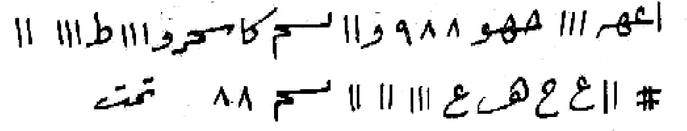

**AR:** (وَصْفُ الطِّلَسْمِ الثَّانِى) جَدْوَلٌ ٥ × ٥ (خَمْسَةُ اَصْفُفٍ)، وَفِىْ صَفِّهِ الْاَخِيْرِ كَلِمَاتٌ: «**الْخَمْس**»، «**الرَّحْمٰن**»، «**٥٢١**»، «**٢٨٨**»، «**٣ب**». قِرَاءَةٌ تَقْرِيْبِيَّةٌ:

- الصَّفُّ ١: «**٢٠**» | «**٢٨٤**» | «**٢٣٢)**» | «**ـب ١**» | «**٢٢٠**»
- الصَّفُّ ٢: «**٢٩٦**» | «**٥**» | «**٩**» | «**١**» | «**٢ـ**»
- الصَّفُّ ٣: «**٢٩٦**» | «**ج**» | «**٢٨٥**» | «**٢٨٠**» | «**ش**»
- الصَّفُّ ٤: «**٢٨٥**» | «**٥**» | «**ـر**» | «**٢٩٥**» | «**٣٨٠**»
- الصَّفُّ ٥: «**الخمس**» | «**الرضى/الرحمن**» | «**٥٢١**» | «**٢٨٨**» | «**٣ب**»

**LAT:** (waṣfu al-ṭilāsmi al-thānī) jadwalun 5 × 5 (khamsatu aṣuffin), wa-fī ṣaffihi al-akhīri kalimātun: «al-khams», «al-raḥmān», «521», «288», «3b». Qirā’atun taqrībiyyatun: al-ṣaffu 1 «20» | «284» | «232)» | «b 1» | «220»؛ 2 «296» | «5» | «9» | «1» | «2-»؛ 3 «296» | «j» | «285» | «280» | «sh»؛ 4 «285» | «5» | «r» | «295» | «380»؛ 5 «al-khams» | «al-raḥmān» | «521» | «288» | «3b»

**ID:** “**(Deskripsi ṭilasm kedua)**: tabel **٥×٥** (lima baris), dan pada **baris terakhirnya** ada kata-kata: «**الخمس**»، «**الرحمن**»، «**٥٢١**»، «**٢٨٨**»، «**٣ب**». **Pembacaan perkiraan**: **baris ١** «٢٠ | ٢٨٤ | ٢٣٢) | ـب ١ | ٢٢٠»؛ **baris ٢** «٢٩٦ | ٥ | ٩ | ١ | ٢ـ»؛ **baris ٣** «٢٩٦ | ج | ٢٨٥ | ٢٨٠ | ش»؛ **baris ٤** «٢٨٥ | ٥ | ـر | ٢٩٥ | ٣٨٠»؛ **baris ٥** «الخمس | الرحمن | ٥٢١ | ٢٨٨ | ٣ب».”

**AR:** فَائِدَةُ مَحَبَّةٍ فِىْ قَارُوْرَةٍ

**LAT:** fā’idatu maḥabbatin fī qārūratin

**ID:** “**Fā’idah Cinta dalam Botol.**” (Judul bagian ketiga.)

**AR:** يُكْتَبُ هَذَا الطِّلَسْمُ فِىْ **قَارُوْرَةٍ اَوْ وَرَقَةٍ** وَتَنْجُمُهَا بِمَاءٍ وَتَضَعُ الْمَاءَ فِى الْقَارُوْرَةِ ثُمَّ تَضَعُهَا عَلٰى **نَارٍ**، وَتُعَزَّمُ عَلَيْهَا **بِدَعْوَةِ النَّارِ ٥٣ مَرَّةً**، وَاِنْ كُتِبَتْ فِى الْقَرُوْرَةِ **ضُفَّ مَاءٌ مِنْ بِئْرٍ اَوْ مَاءٌ لَا تَرَاهُ الشَّمْسُ** — وَهَذَا الطِّلَسْمُ:

**LAT:** yuktabu hādhā al-ṭilasmu fī qārūratin aw waraqatin wa-tanjumuhā bi-mā’in wa-taḍa‘u al-mā’a fī al-qārūrati thumma taḍa‘uhā ‘alā nārin, wa-tu‘azzamu ‘alayhā bi-da‘wati al-nāri 53 marratan, wa-in kutibat fī al-qurūrati ḍuffa mā’un min bi’rin aw mā’un lā tarāhu al-shamsu — wa-hādhā al-ṭilasmu:

**ID:** “**Ṭilasm ini dituliskan di dalam botol atau kertas**, lalu **“ditanjumkan” dengan air** dan **airnya diletakkan di botol**, kemudian **botol diletakkan di atas api**؛ **diazamkan padanya «دعوة النار» ٥٣×**؛ dan **jika ditulis di dalam botol**, **tuangkan air sumur atau air yang tidak terkena matahari** — **dan inilah ṭilasmnya**:”

**Rajah:** 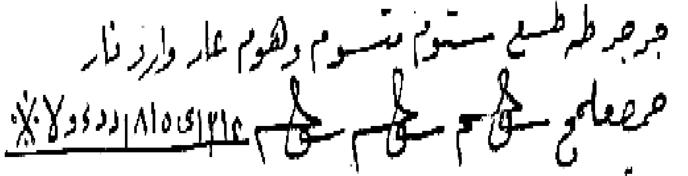

**AR:** (وَصْفُ الطِّلَسْمِ الثَّالِثِ) سَطْرَانِ يَدَوِيَّانِ عَرِيْضَانِ: الْاَوَّلُ دَرَجٌ مِنْ حُرُوْفٍ وَرُقُوْمٍ («**اَلْعَهْر ١١١ ٥٥٩ ٩٨ ٨ ٥٥ ٥٤ ١١ …**» تَقْرِيْبًا) يَنْتَهِيْ بِـ«**١١**» فِى الطَّرَفِ الْيَسَارِ، وَالثَّانِى «**# ا ١ ع ٥ هـ ٦ ١ ١ ٢ ١ ١ ٥ ر ١ ٨ ٨ ٥ م**» تَقْرِيْبًا؛ وَتَحْتَهُمَا **ثَلَاثَةُ اَشْكَالٍ مُعَقَّفَةٍ** كَالْكُوْزِ، وَفِىْ الْيَمِيْنِ خُطُوْطٌ مَمْدُوْدَةٌ.

**LAT:** (waṣfu al-ṭilāsmi al-thālithi) saṭrāni yadawiyyāni ‘arīḍāni: al-awwalu darajun min ḥurūfin wa-ruqūmin («al-‘ahra 111 559 98 8 55 54 11 …» taqrīban) yantahī bi-«11» fī al-ṭarafi al-aysari, wa-al-thāni «# a 1 ‘ 5 h 6 1 1 2 1 1 5 r 1 8 8 5 m» taqrīban؛ wa-taḥtahumā thalāthatu ashkālin mu‘aqqafatin ka-al-kūzi, wa-fī al-yamīni khuṭūṭun mamdūdatin.

**ID:** “**(Deskripsi ṭilasm ketiga)**: **dua baris tulisan tangan tebal** — baris ١ **deret huruf dan angka** («**اَلْعَهْر ١١١ ٥٥٩ ٩٨ ٨ ٥٥ ٥٤ ١١ …**» perkiraan) yang **berakhir dengan «١١» di ujung kiri**؛ baris ٢ «**# ا ١ ع ٥ هـ ٦ ١ ١ ٢ ١ ١ ٥ ر ١ ٨ ٨ ٥ م**» (perkiraan)؛ di bawahnya **tiga bentuk berkait** seperti **kendi kecil**, dan di sisi kanan **garis-garis memanjang**.”

**Keterangan halaman.** Tiga bagian bertema **cinta**: (1) **wafaq ٤×٤** + **«البرهتية»** di sekelilingnya, dupa **lubān natāyah + cendana merah**, **‘azīmah ١١×**, digantung **menghadap arah** orang yang diminta؛ (2) **ṭilasm ٥×٥** ditulis **tinta ruhani** pada **awal bulan**, **«الجلجلوتية الصغرى» ١٢×**, **ditanam di rumah** orang yang diminta, ditulis **hari Jumat** (lebih baik pada **bekas/jejaknya**)؛ (3) **ṭilasm dalam botol**, botol **dipanaskan di atas api**, **«دعوة النار» ٥٣×**, air **sumur/air yang tak terkena matahari**.

**Angka pada halaman ini.** **١١** (البرهتية), **١٢** (الجلجلوتية الصغرى), **٥٣** (دعوة النار) — ketiganya **diperiksa ulang dari crop 900–1500 DPI** (mis. «٥٣» pada Rect(340, 540, 370, 572) di 1500 DPI): **bentuknya cocok** dengan lapisan teks, **tanpa koreksi**. **Isi sel wafaq ٤×٤ dan ٥×٥** hanya dapat dibaca **sebagian** (lihat `[TIDAK JELAS]`).

**Wafaq diuji penjumlahan: TIDAK.** Kedua tabel **tidak dapat dijumlahkan**: sel-selnya bercampur **angka dan huruf** («قص»، «حش»، «ج»، «ش»، «الخمس»، «الرحمن») sehingga **baris/kolom/diagonal tidak berjumlah sama**. Karena itu **tidak ada klaim wafaq berjumlah**, angka **dipertahankan persis** sebagaimana terbaca, dan **tidak ada sel yang “dikoreksi” demi konsistensi**.

**[TIDAK JELAS - HALAMAN 463]** (1) **Sebagian besar sel wafaq ٤×٤** dan **٥×٥** — tulisan tangan **berimpit**; hanya bentuk yang dideskripsikan؛ **[TEKS ASLI DIJAGA]** dan seluruh pembacaan ditandai **perkiraan**. (2) **Sel «قص»، «حش»، «ـب ١»، «٢ـ»، «ـر»، «٣ب»** — **tidak dapat dipastikan** apakah huruf, angka, atau singkatan wafaq؛ disalin **literal**. (3) **«الرضى/الرحمن»** pada sel kiri-bawah tabel ٢ — **dua kemungkinan**؛ **tidak dipilih**, keduanya **dicatat**. (4) **Isi kedua baris ṭilasm botol** — **tidak terbaca** sebagai kata؛ **[TEKS ASLI DIJAGA]**, hanya bentuk dan posisi angka yang dideskripsikan. (5) **«تَنْجُمُهَا بِمَاءٍ»** — kata **«تنجمها»** **tidak lazim** (mungkin «تنجّمها» = “menuliskan huruf-hurufnya secara terpisah dengan air”)؛ **dipertahankan** dan **tidak ditafsirkan pasti**. (6) **«ضُفَّ مَاءٌ»** — kemungkinan **«صُبَّ» (tuangkan)**؛ **dipertahankan** sebagaimana cetak. (7) **«اللُّبَانُ النَّتَايَةُ»** — nama dupa yang **tidak dikenal**؛ dipertahankan. (8) **«اِتِّجَاهَ الْمَطْلُوْبِ»** — “arah orang yang diminta” **tidak dirinci** dalam teks.

**Peringatan (dicatat apa adanya, bukan fatwa).** Ketiga amalan bertujuan **memaksa rasa cinta**: menggantung wafaq **menghadap arah** orang yang diminta, **menanam** ṭilasm di **rumahnya**, dan **memanaskan botol berisi ṭilasm di atas api** — sebagian memakai **jejak pribadi** orang tersebut tanpa izinnya. Teks ditranskripsikan sesuai cetakan; semua itu **bukan bagian dari ajaran Islam**.

**[ADA RAJAH]** — 3 crop: `assets/rajah/sirrul-asrar/hal-463-rajah-01.png` (700 DPI, Rect(135, 128, 479, 354)), `hal-463-rajah-02.png` (700 DPI, Rect(112, 433, 502, 508)), `hal-463-rajah-03.png` (700 DPI, Rect(112, 587, 501, 687)).

---
## HALAMAN 464 — «فائدة محبة على بيضة» (ditulis pada telur, dimasukkan ke api) + «فائدة محبة وتحمل» (سورة البروج ١٢×, dibawa di lengan) + «فائدة محبة» (يس ٣× + «سلام قول من رب رحيم» ١١١×)

**AR:** كِتَابُ سِرِّ الْاَسْرَارِ فِي التَّوَاصُلِ مَعَ رُوحَانِيَّاتِ الْقُرْآنِ — شَيْخُ الرُّوحَانِيِّينَ الشَّيْخُ عَطِيَّةُ عَبْدُ الْحَمِيْدِ

**LAT:** kitābu sirri al-asrāri fī al-tawāṣuli ma‘a rūḥāniyyāti al-qur’āni — shaykhu al-rūḥāniyyīna al-shaykhu ‘Aṭiyyatu ‘Abdu al-Ḥamīdi

**ID:** “Kitab «Sirr al-Asrār fī al-Tawāṣul ma‘a Rūḥāniyyāt al-Qur’ān» — Syaikh para ruhaniyyin, Syaikh ‘Aṭiyyah ‘Abd al-Ḥamīd.” (Kepala halaman.)

**AR:** فَائِدَةُ مَحَبَّةٍ عَلٰى بَيْضَةٍ

**LAT:** fā’idatu maḥabbatin ‘alā bayḍatin

**ID:** “**Fā’idah Cinta pada Telur.**” (Judul bagian pertama.)

**AR:** تُحْضِرُ **بَيْضَةً سَبْتِيَّةً** وَتَكْتُبُ عَلَيْهَا هَذَا الطِّلَسْمَ، وَتُعَزِّمُ **بِعَزِيْمَةِ الْبَيْضِ الْمَشْهُوْرَةِ**، ثُمَّ تَضَعُ الْبَيْضَةَ فِى **الْجَمْرَةِ** وَتَكُوْنُ **النَّارُ هَادِئَةً**، فَمَا **اسْتَوَتِ الْبَيْضَةُ** يَكُوْنُ **الْمَطْلُوْبُ اَمَامَكَ**؛ وَهَذَا مَا تُكْتَبُ، وَبَخُوْرُكَ **اللُّبَانُ وَالْكُسْبَرَةُ**.

**LAT:** tuḥḍiru bayḍatan sabtiyyatan wa-taktubu ‘alayhā hādhā al-ṭilasma, wa-tu‘azzimu bi-‘azīmati al-bayḍi al-mashhūrati, thumma taḍa‘u al-bayḍata fī al-jamrati wa-takūnu al-nāru hādi’atan, fa-mā istawat al-bayḍatu yakūnu al-maṭlūbu amāmaka؛ wa-hādhā mā tuktabu, wa-bakhūruka al-lubānu wa-al-kusbaratu.

**ID:** “**Engkau menyiapkan telur yang (diambil) hari Sabtu** dan **menuliskan ṭilasm ini padanya**, lalu **mengazamkannya dengan «عزيمة البيض» yang terkenal**؛ kemudian **meletakkan telur itu di bara api** dengan **api yang tenang**؛ **begitu telur matang**, **orang yang diminta akan hadir di hadapanmu**؛ **dan inilah yang ditulis**, **dupaamu: lubān dan ketumbar (kuzbarah)**.”

**Rajah:** 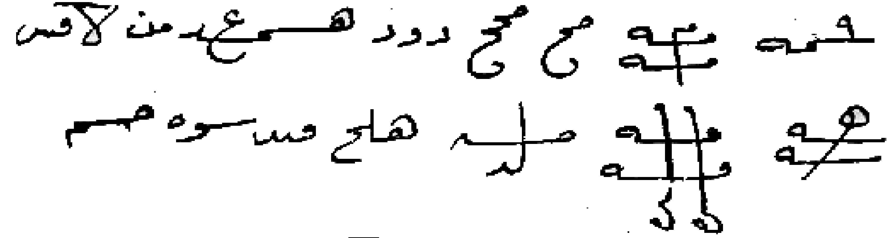

**AR:** (وَصْفُ الطِّلَسْمِ الْاَوَّلِ) سَطْرَانِ: الْاَوَّلُ يَبْدَاُ بِـ«**ض ص**» وَيَنْتَهِيْ بِحُرُوْفٍ مُنْفَصِلَةٍ «**س ص**»، وَالثَّانِى يَبْدَاُ بِـ«**ط هـ**» وَفِيْهِ «**ع س ر هـ**» وَ«**هـ ل**»؛ وَفِىْ اَوَاخِرِ السَّطْرَيْنِ **اَشْكَالُ صَلِيْبٍ/مِرْبَعٍ** ذَاتُ **اَرْبَعَةِ اَطْرَافٍ مُنْعَقِفَةٍ**. الْحُرُوْفُ **مُفْرَدَةٌ غَيْرُ مَنْقُوْطَةٍ تَقْرِيْبًا**، وَهُوَ **طِلَسْمٌ لَا وِفْقٌ**.

**LAT:** (waṣfu al-ṭilāsmi al-awwali) saṭrāni: al-awwalu yabda’u bi-«ḍ ṣ» wa-yantahī bi-ḥurūfin munfaṣilatin «s ṣ», wa-al-thāni yabda’u bi-«ṭ h» wa-fīhi «‘ s r h» wa-«h l»؛ wa-fī awākhiri al-saṭrayni ashkālu ṣalībin/mirba‘in dhātu arba‘ati aṭrāfin mun‘aqifatin. Al-ḥurūfu mufradatun ghayru manqūṭatin taqrīban, wa-huwa ṭilsmun lā wifqun.

**ID:** “**(Deskripsi ṭilasm pertama)**: **dua baris** — baris ١ dimulai «**ض ص**» dan berakhir dengan huruf terpisah «**س ص**»؛ baris ٢ dimulai «**ط هـ**» dan memuat «**ع س ر هـ**» dan «**هـ ل**»؛ di **ujung kedua baris** ada **bentuk salib/persegi** dengan **empat ujung tertekuk**. Hurufnya **tunggal dan umumnya tanpa titik** (perkiraan); ini **ṭilasm, bukan wafaq**.”

**AR:** فَائِدَةُ مَحَبَّةٍ وَتُحْمَلُ

**LAT:** fā’idatu maḥabbatin wa-tuḥmalu

**ID:** “**Fā’idah Cinta yang Dibawa (sebagai azimat).**” (Judul bagian kedua.)

**AR:** تُكْتَبُ هَذَا الطِّلَسْمَ **بِالْحِبْرِ الرُّوحَانِىِّ الْمَعْرُوْفِ**، وَرَصْدُكَ يَكُوْنُ **الزُّهْرَةَ اَوَّلَ الشَّهْرِ الْعَرَبِىِّ**، وَتَوَكَّلْ حَوْلَهُ وَتَكْتُبُ **سُوْرَةَ الْبُرُوْجِ**، وَبِمَا تُعَزِّمُ بِهَا **١٢ مَرَّةً**، وَتَحْمِلُهُ عَلٰى **عَضُدِكَ الْاَيْمَنِ**، وَتُقَابِلُ مَنْ تُرِيْدُ بِهِ — وَهَذَا مَا تُكْتَبُ:

**LAT:** tuktabu hādhā al-ṭilasma bi-al-ḥibri al-rūḥāniyyi al-ma‘rūfi, wa-raṣduka yakūnu al-zuharata awwala al-shahri al-‘arabiyyi, wa-tawakkal ḥawlahu wa-taktubu sūrata al-burūji, wa-bimā tu‘azzimu bihā 12 marratan, wa-taḥmiluhu ‘alā ‘aḍudika al-aymani, wa-tuqābilu man turīdu bihi — wa-hādhā mā tuktabu:

**ID:** “**Ṭilasm ini ditulis dengan tinta ruhani yang dikenal**؛ **raṣd-mu adalah al-Zuhrah pada awal bulan Arab**؛ **lakukan tawkil di sekelilingnya** dan **tuliskan surah al-Burūj**, dan **dengannya engkau mengazamkan ١٢×**؛ lalu **membawanya di lengan kananmu**, dan **engkau menghadapi orang yang engkau kehendaki dengannya** — **dan inilah yang ditulis**:”

**Rajah:** 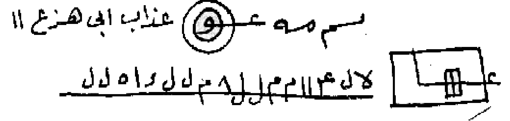

**AR:** (وَصْفُ الطِّلَسْمِ الثَّانِى) **دَائِرَةٌ مُزْدَوِجَةٌ** فِى الْوَسَطِ كَالْعَيْنِ، وَعَلٰى يَسَارِهَا «**عَذَابٌ اِلٰى هَزْعٍ ١١**» (تَقْرِيْبًا)، وَعَلٰى يَمِيْنِهَا «**ع هـ ر م**» (تَقْرِيْبًا)؛ وَتَحْتَهَا سَطْرٌ طَوِيْلٌ مِنْ حُرُوْفٍ وَرُقُوْمٍ («**هـ ل ع ا ل م ع ب ل س ا م ا د ل**» تَقْرِيْبًا) عَلٰى خَطٍّ اُفُقِىٍّ؛ وَفِى الْيَمِيْنِ **مُسْتَطِيْلٌ مُشَوَّهٌ** دَاخِلَهُ **مُرَبَّعٌ صَغِيْرٌ** بِخَطٍّ رَاْسِىٍّ.

**LAT:** (waṣfu al-ṭilāsmi al-thānī) dā’iratun muzdawijatun fī al-wasaṭi ka-al-‘ayni, wa-‘alā yasārihā «‘adhābun ilā haz‘in 11» (taqrīban), wa-‘alā yamīnihā «‘ h r m» (taqrīban)؛ wa-taḥtahā saṭrun ṭawīlun min ḥurūfin wa-ruqūmin («h l ‘ a l m ‘ b l s a m a d l» taqrīban) ‘alā khaṭṭin ufuqiyyin؛ wa-fī al-yamīni mustaṭīlun mushawwahun dākhilahu murabba‘un ṣaghīrun bi-khaṭṭin ra’siyyin.

**ID:** “**(Deskripsi ṭilasm kedua)**: **lingkaran ganda di tengah** seperti **mata**؛ di **kirinya** «**عذاب الى هزع ١١**» (perkiraan)؛ di **kanannya** «**ع هـ ر م**» (perkiraan)؛ di **bawahnya satu baris panjang** huruf dan angka («**هـ ل ع ا ل م ع ب ل س ا م ا د ل**» perkiraan) di atas **garis mendatar**؛ dan di **sisi kanan** ada **persegi panjang tak beraturan** berisi **kotak kecil** dengan **garis vertikal**.”

**AR:** فَائِدَةُ مَحَبَّةٍ

**LAT:** fā’idatu maḥabbatin

**ID:** “**Fā’idah Cinta (ketiga).**” (Judul bagian ketiga.)

**AR:** تُكْتَبُ يَوْمَ **الْاَرْبِعَاءِ قَبْلَ طُلُوْعِ الشَّمْسِ** بِاسْمِ مَنْ تُرِيْدُ، وَتُعَزِّمُ عَلَيْهِ **بِسُوْرَةِ يٰسٓ ٣ مَرَّاتٍ**، وَعِنْدَ كُلِّ **«مُبِيْنٍ»** تَوَكَّلْ بِمَا تُرِيْدُ، وَكَرِّرْ **«سَلَامٌ قَوْلًا مِنْ رَبٍّ رَحِيْمٍ» ١١١ مَرَّةً** كُلَّ مَرَّةٍ — **وَهَذَا مَا تُكْتَبُ**.

**LAT:** tuktabu yawma al-arbi‘ā’i qabla ṭulū‘i al-shamsi bi-asmi man turīdu, wa-tu‘azzimu ‘alayhi bi-sūrati Yā Sīn 3 marrātin, wa-‘inda kulli «mubīnin» tawakkal bimā turīdu, wa-karrir «salāmun qawlan min rabbin raḥīmin» 111 marratan kulla marratin — wa-hādhā mā tuktabu.

**ID:** “**Dituliskan pada hari Rabu sebelum terbit matahari** dengan **nama orang yang engkau kehendaki**؛ **diazamkan dengan surah Yāsīn ٣×**؛ dan **pada setiap «مبين»** lakukan **tawkil** sesuai kehendakmu؛ lalu **ulangi «سلام قولا من رب رحيم» ١١١×** pada setiap (kali) — **dan inilah yang ditulis**.”

**Rajah:** 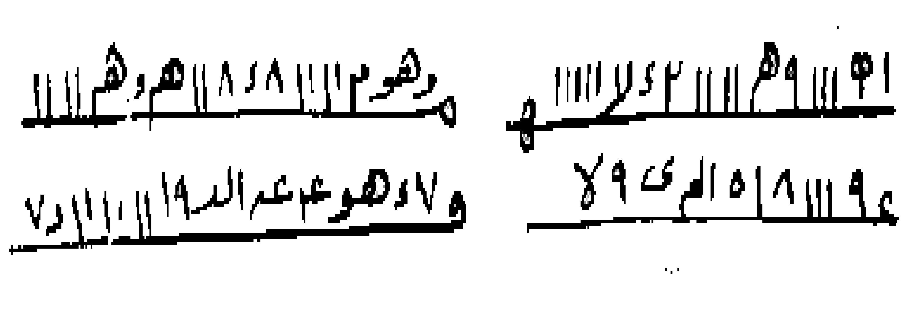

**AR:** (وَصْفُ الطِّلَسْمِ الثَّالِثِ) اَرْبَعُ كُتَلٍ يَدَوِيَّةٍ عَلٰى خُطُوْطٍ اُفُقِيَّةٍ، مَوْضُوْعَةٍ فِىْ شَكْلِ (٢ × ٢): كُلُّ كُتْلَةٍ تَبْدَاُ بِرَقْمٍ («**٥**» اَوْ «**٤**») وَتَتْبَعُهَا حُرُوْفٌ مَمْدُوْدَةٌ وَرُقُوْمٌ صَغِيْرَةٌ، وَعَلٰى يَسَارِ بَعْضِهَا **ثَلَاثُ شَرَطَاتٍ رَاْسِيَّةٍ** «**|||**».

**LAT:** (waṣfu al-ṭilāsmi al-thālithi) arba‘u kutalin yadawiyyatin ‘alā khuṭūṭin ufuqiyyatin, mawḍū‘atin fī shakli (2 × 2): kullu kutlatin tabda’u bi-raqmin («5» aw «4») wa-tatba‘uhā ḥurūfun mamdūdatun wa-ruqūmun ṣaghīratun, wa-‘alā yasāri ba‘ḍihā thalāthu sharṭātin ra’siyyatun «|||».

**ID:** “**(Deskripsi ṭilasm ketiga)**: **empat kelompok tulisan tangan** di atas **garis mendatar**, tersusun **٢×٢**: setiap kelompok dimulai dengan **angka** («**٥**» atau «**٤**») lalu **huruf memanjang** dan **angka kecil**؛ pada **sebelah kiri sebagiannya** ada **tiga garis vertikal** «**|||**».”

**Keterangan halaman.** Tiga amalan cinta: (1) **«فائدة محبة على بيضة»** — ṭilasm ditulis pada **telur Sabtu**, diazamkan **«عزيمة البيض»**, telur diletakkan **di bara api tenang**; **saat telur matang**, orang yang diminta **hadir**؛ dupa **lubān + kuzbarah**؛ (2) **«فائدة محبة وتحمل»** — tinta ruhani, **raṣd al-Zuhrah awal bulan Arab**, **surah al-Burūj**, **١٢×**, **dibawa di lengan kanan**, lalu **menghadapi** orang yang dituju؛ (3) **«فائدة محبة»** — **Rabu sebelum matahari terbit**, nama orang yang dituju, **Yāsīn ٣×** dengan **tawkil pada setiap «مبين»**, dan **«سلام قولا من رب رحيم» ١١١×**.

**Angka pada halaman ini.** **١٢** (surah al-Burūj), **٣** (Yāsīn), **١١١** («سلام قولا من رب رحيم») — **ketiganya diperiksa dari crop 1000 DPI** dan **bentuknya cocok** dengan lapisan teks؛ **١٢** terletak pada Rect(238, 385, 253, 405), **٣** pada Rect(125, 584, 134, 604), **١١١** pada Rect(171, 604, 194, 623) — **tanpa koreksi**.

**Wafaq:** **tidak ada** — ketiga gambar adalah **ṭilasm huruf/angka bebas**, bukan tabel berbingkai؛ **tidak dapat diuji** dengan penjumlahan baris/kolom/diagonal, dan **tidak ada klaim jumlah**.

**[TIDAK JELAS - HALAMAN 464]** (1) **Seluruh isi tiga ṭilasm** — huruf **tunggal tanpa titik** dan angka **bertumpuk**؛ hanya bentuknya dideskripsikan؛ **[TEKS ASLI DIJAGA]** dan semua pembacaan ditandai **perkiraan**. (2) **«عذاب الى هزع ١١»** — pembacaan **tidak pasti**؛ kemungkinan bukan frasa bermakna؛ **dipertahankan, tidak ditafsirkan**. (3) **«عزيمة البيض المشهورة»** — **‘azīmah tidak dicetak**؛ hanya dirujuk؛ ditandai. (4) **«وَبِمَا تُعَزِّمُ بِهَا ١٢ مَرَّةً»** — susunan **janggal**؛ **dipertahankan**. (5) **«وَتُقَابِلُ مَنْ تُرِيْدُ بِهِ»** — **dhamīr** tidak jelas rujukannya؛ **dipertahankan**. (6) **«وَكَرِّرْ … ١١١ مَرَّةً كُلَّ مَرَّةٍ»** — **pengulangan cetakan** («setiap kali … setiap kali»)؛ **dicatat, tidak diperbaiki**. (7) **«بِمَا تُعَزِّمُ بِهَا»** pada p.464 ayat — **tidak jelas** apakah mengacu pada surah al-Burūj؛ dijelaskan sebagai **dugaan**, bukan kepastian.

**Peringatan (dicatat apa adanya, bukan fatwa).** Ketiga amalan bertujuan **memaksa kehadiran/cinta**: menuliskan ṭilasm pada **telur** lalu **memanaskannya di bara** sampai matang sebagai **tanda keberhasilan**, azimat **dibawa di lengan**, dan **tawkil** pada setiap «مبين» dalam Yāsīn. Teks ditranskripsikan sesuai cetakan; semua itu **bukan bagian dari ajaran Islam**.

**[ADA RAJAH]** — 3 crop: `assets/rajah/sirrul-asrar/hal-464-rajah-01.png` (700 DPI, Rect(111, 148, 502, 253)), `hal-464-rajah-02.png` (700 DPI, Rect(112, 253, 501, 346)), `hal-464-rajah-03.png` (700 DPI, Rect(111, 424, 502, 564)).

---
## HALAMAN 465 — «فائدة محبة في سمكة» (ṭilasm dalam perut ikan) + «باب محبة» (hati domba/ayam + ٢١ lidi kurma + «عزيمة» الجيوش)

**AR:** كِتَابُ سِرِّ الْاَسْرَارِ فِي التَّوَاصُلِ مَعَ رُوحَانِيَّاتِ الْقُرْآنِ — شَيْخُ الرُّوحَانِيِّينَ الشَّيْخُ عَطِيَّةُ عَبْدُ الْحَمِيْدِ

**LAT:** kitābu sirri al-asrāri fī al-tawāṣuli ma‘a rūḥāniyyāti al-qur’āni — shaykhu al-rūḥāniyyīna al-shaykhu ‘Aṭiyyatu ‘Abdu al-Ḥamīdi

**ID:** “Kitab «Sirr al-Asrār fī al-Tawāṣul ma‘a Rūḥāniyyāt al-Qur’ān» — Syaikh para ruhaniyyin, Syaikh ‘Aṭiyyah ‘Abd al-Ḥamīd.” (Kepala halaman.)

**Rajah:** 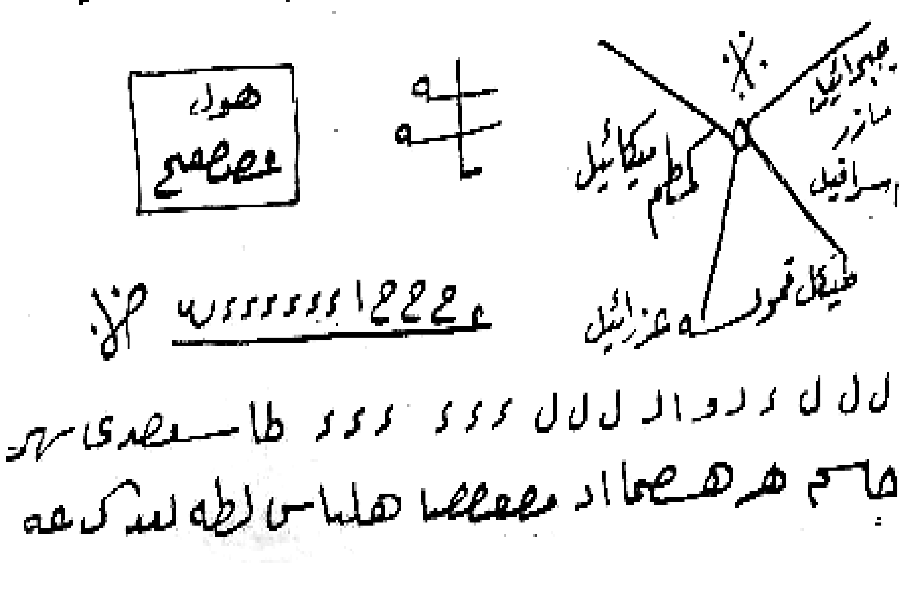

**AR:** فَائِدَةُ مَحَبَّةٍ فِىْ سَمَكَةٍ

**LAT:** fā’idatu maḥabbatin fī samakatin

**ID:** “**Fā’idah Cinta dalam Ikan.**” (Judul bagian pertama.)

**AR:** تُكْتَبُ هَذَا الطِّلَسْمَ وَتُضَعُ فِىْ **بَطْنِ سَمَكَةٍ** وَتُضَعُهَا فِى **النَّارِ** ثُمَّ تُعَزِّمُ **بِالْبَرْهَتِيَّةِ حَتّٰى تَطِيْبَ**، وَخُذْ **رَصْدًا مُنَاسِبًا** — وَهَذَا مَا تُكْتَبُ.

**LAT:** tuktabu hādhā al-ṭilasma wa-tuḍa‘u fī baṭni samakatin wa-tuḍa‘uhā fī al-nāri thumma tu‘azzimu bi-al-barhatiyyati ḥattā taṭība, wa-khudh raṣdan munāsiban — wa-hādhā mā tuktabu.

**ID:** “**Ṭilasm ini ditulis** lalu **diletakkan di perut ikan**, dan **ikan itu diletakkan di atas api**؛ kemudian **diazamkan dengan «البرهتية» sampai matang/baunya harum**؛ **ambil raṣd yang sesuai** — **dan inilah yang ditulis**.”

**AR:** (وَصْفُ الطِّلَسْمِ الْاَوَّلِ) فِى الْيَسَارِ **مُسْتَطِيْلٌ صَغِيْرٌ** دَاخِلَهُ كَلِمَتَانِ «**هُوْد**» وَ«**مُحَمَّد**» (تَقْرِيْبًا)؛ وَفِى الْوَسَطِ **خَطٌّ رَاْسِىٌّ بِثَلَاثَةِ خُطُوْطٍ اُفُقِيَّةٍ** وَعَلٰى يَسَارِهِ رَقْمُ «**٩**»؛ وَفِى الْيَمِيْنِ **خُطُوْطٌ مُتَقَاطِعَةٌ** كَنَجْمَةٍ عَلٰى رُؤُوْسِهَا حُرُوْفٌ: «**عَزْرَائِيْل**»، «**جِبْرَائِيْل**»، «**مِيْكَائِيْل**»، «**اِسْرَافِيْل**»، «**جَنْجُوْش**» (تَقْرِيْبًا). وَتَحْتَهَا سَطْرُ رُقُوْمٍ «**٤ ٥ ٥ ٥ ٥ ٥ ٥ ١ ٢ ٢ ٢**» تَقْرِيْبًا، ثُمَّ ثَلَاثَةُ اَسْطُرٍ مِنَ الْحُرُوْفِ الْمُفْرَدَةِ («**ل ل ل د ا ل د ل د د د …**» تَقْرِيْبًا).

**LAT:** (waṣfu al-ṭilāsmi al-awwali) fī al-yasāri mustaṭīlun ṣaghīrun dākhilahu kalimatāni «hūd» wa-«muḥammad» (taqrīban)؛ wa-fī al-wasaṭi khaṭṭun ra’siyyun bi-thalāthati khuṭūṭin ufuqiyyatin wa-‘alā yasārihi raqmu «9»؛ wa-fī al-yamīni khuṭūṭun mutaqāṭi‘atun ka-najmatin ‘alā ru’ūsihā ḥurūfun: «‘azrā’īl», «jibrā’īl», «mīkā’īl», «isrāfīl», «janjūsh» (taqrīban). Wa-taḥtahā saṭru ruqūmin «4 5 5 5 5 5 5 1 2 2 2» taqrīban, thumma thalāthatu asṭurin mina al-ḥurūfi al-mufradati («l l l d a l d l d d d …» taqrīban).

**ID:** “**(Deskripsi ṭilasm pertama)**: di **kiri** ada **persegi kecil** berisi dua kata «**هود**» dan «**محمد**» (perkiraan)؛ di **tengah** **garis vertikal dengan tiga garis mendatar** dan di kirinya angka «**٩**»؛ di **kanan** **garis-garis bersilang** seperti **bintang** yang pada puncaknya ada huruf: «**عزرائيل**»، «**جبرائيل**»، «**ميكائيل**»، «**اسرافيل**»، «**جنجوش**» (perkiraan). Di bawahnya **satu baris angka** «**٤ ٥ ٥ ٥ ٥ ٥ ٥ ١ ٢ ٢ ٢**» (perkiraan), lalu **tiga baris huruf tunggal** («**ل ل ل د ا ل د ل د د د …**» perkiraan).”

**AR:** بَابُ مَحَبَّةٍ

**LAT:** bābu maḥabbatin

**ID:** “**Bab Cinta.**” (Judul bagian kedua.)

**AR:** اِذَا اَرَدْتَ اَحَدًا اَنْ يُحِبَّكَ وَيَتَمَرَّضَ مِنْ شِدَّةِ فِرَاقِكَ وَلَمْ يَكُنْ لَهُ قَرَارٌ مِنْ شِدَّةِ الْمَحَبَّةِ: **تَاْخُذُ قَلْبَ خَرُوْفٍ اَوْ دِيْكٍ**، وَتَاْخُذُ **اِبْرَةً** وَ**وَاحِدًا وَعِشْرِيْنَ عُوْدًا سَلِيًّا مِنَ النَّخْلِ**، وَتَكُوْنُ فِىْ **مَحَلٍّ خَالٍ**. وَكُلَّمَا تَقْرَاُ **الْعَزِيْمَةَ مَرَّةً** اِغْرِسْ عُوْدًا اِلٰى تَمَامِهَا، ثُمَّ احْتَفِظْ بِهِ وَضَعْهُ فِى **مَكَانٍ مُظْلِمٍ** فَتَرَى الْعَجَبَ؛ وَاِنْ اَرَدْتَ اَنْ **يَبْرَاَ مِنَ الْمَرَضِ** فَـ**اَحْرِقِ الْقَلْبَ** فَاِنَّهُ يَبْرَاُ بِاِذْنِ اللهِ.

**LAT:** idhā aradta aḥadan an yuḥibbaka wa-yatamarraḍa min shiddati firāqiKa wa-lam yakun lahu qarārun min shiddati al-maḥabbati: ta’khudhu qalba kharūfin aw dīkin, wa-ta’khudhu ibratan wa-wāḥidan wa-‘ishrīna ‘ūdan saliyyan mina al-nakhli, wa-takūnu fī maḥallin khālin. Wa-kullamā taqra’u al-‘azīmata marratan ighris ‘ūdan ilā tamāmihā, thumma iḥtafiẓ bihi wa-ḍa‘hu fī makānin muẓlimin fa-tarā al-‘ajaba؛ wa-in aradta an yabra’a mina al-maraḍi fa-aḥriqi al-qalba fa-innahu yabra’u bi-idhni allāhi.

**ID:** “**Jika engkau ingin agar seseorang mencintaimu dan menjadi sakit karena beratnya perpisahan darimu, dan ia tidak punya ketenangan karena kuatnya cinta**: engkau **mengambil hati domba atau ayam jantan**, **sebatang jarum**, dan **dua puluh satu (٢١) lidi kurma utuh**, dan engkau berada di **tempat sepi**. **Setiap kali engkau membaca «العزيمة» sekali**, **tancapkan satu lidi** sampai selesai؛ lalu **simpanlah ia** dan **letakkan di tempat gelap** — maka engkau akan **melihat keajaiban**. Dan **jika engkau ingin ia sembuh dari sakit**, **bakarlah hati itu**, maka ia **sembuh dengan izin Allah**.”

**AR:** وَهَذِهِ وَهِيَ الْعَزِيْمَةُ: «**عَزَمْتُ عَلَيْكُمْ يَا مَعْشَرَ الْجِنِّ وَالْاِنْسِ: حَيُّوْش، جَلْيُوْش، نَقَّاش، تَقَّاش، نُعْيُوْش، تَقْيُوْش**»

**LAT:** wa-hādhihi wa-hiya al-‘azīmatu: «‘azamtu ‘alaykum yā ma‘shara al-jinni wa-al-insi: ḥayyūsh, jalyūsh, naqqāsh, taqqāsh, nu‘yūsh, taqyūsh»

**ID:** “**Dan ini — yaitu «العزيمة»**: «**Aku berketetapan atas kalian, wahai sekalian jin dan manusia: Ḥayyūsh, Jalyūsh, Naqqāsh, Taqqāsh, Nu‘yūsh, Taqyūsh**».” (Nama-nama ini disalin literal.)

**Rajah:** 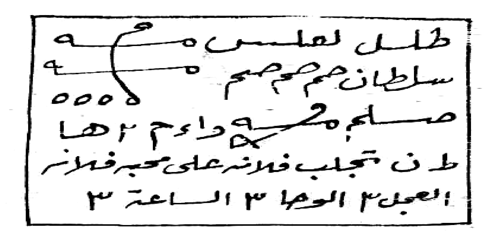

**AR:** (وَصْفُ الطِّلَسْمِ الثَّانِى) **مُسْتَطِيْلٌ كَبِيْرٌ** يَحْتَوِىْ سِتَّةَ اَسْطُرٍ: الْاَوَّلُ «**ط ل ل ل م ع ل س ع**» تَقْرِيْبًا، الثَّانِى «**س ل ط ا ن هـ هـ هـ م**»، الثَّالِثُ «**ص م ج ا ي م ع ج ا د ا م ا هـ**»، الرَّابِعُ «**ط ن ت ع ل ب ف م ن م ر ع ل ن م ح ب ر ن م**»، الْخَامِسُ مَحْذُوْفٌ/مَشْطُوْبٌ، وَالسَّادِسُ «**! الْعَهْد ٣ اَلْوَحَا ٣ اَلسَّاعَة ٣**». وَعَلٰى يَسَارِ الْاَسْطُرِ الْعُلْيَا **خُطُوْطٌ ذَاتُ اَرْبَعِ شُعَبٍ** وَثَلَاثُ نُقَطٍ.

**LAT:** (waṣfu al-ṭilāsmi al-thānī) mustaṭīlun kabīrun yaḥtawī sittata asṭurin: al-awwalu «ṭ l l l m ‘ l s ‘» taqrīban, al-thāni «s l ṭ a n h h h m», al-thālithu «ṣ m j a y m ‘ j a d a m a h», al-rābi‘u «ṭ n t ‘ l b f m n m r ‘ l n m ḥ b r n m», al-khāmisu maḥdhūfun/mashṭūbun, wa-al-sādisu «! al-‘ahd 3 al-waḥā 3 al-sā‘ah 3». Wa-‘alā yasāri al-asṭuri al-‘ulyā khuṭūṭun dhātu arba‘i shu‘abin wa-thalāthu nuqaṭin.

**ID:** “**(Deskripsi ṭilasm kedua)**: **persegi besar** memuat **enam baris**: baris ١ «**ط ل ل ل م ع ل س ع**» (perkiraan)، ٢ «**س ل ط ا ن هـ هـ هـ م**»، ٣ «**ص م ج ا ي م ع ج ا د ا م ا هـ**»، ٤ «**ط ن ت ع ل ب ف م ن م ر ع ل ن م ح ب ر ن م**»، baris ٥ **terhapus**, baris ٦ «**! العهد ٣ الوحا ٣ الساعة ٣**». Di **kiri baris-baris atas** ada **garis bercabang empat** dan **tiga titik**.”

**Keterangan halaman.** Dua amalan: (1) **«فائدة محبة في سمكة»** — ṭilasm (rajah-01) dimasukkan ke **perut ikan**, ikan **dipanggang di api**, diazamkan **«البرهتية»** sampai matang؛ (2) **«باب محبة»** — **hati domba/ayam** + **jarum** + **٢١ lidi kurma utuh**, di tempat sepi, **satu lidi ditancapkan setiap satu bacaan «العزيمة»**, disimpan **di tempat gelap**; bila ingin **menyembuhkan**, **hati dibakar**؛ **‘azīmah** dengan **seruan nama «حيوش جليوش…»**؛ **ṭilasmnya** (rajah-02) di dalam kotak.

**Angka pada halaman ini.** **«واحد وعشرين»** (٢١ lidi) tertulis **dengan kata**, bukan angka. **٣** (pada «العهد ٣ الوحا ٣ الساعة ٣») dibaca dari crop 700 DPI؛ bentuknya **٣** yang ditulis cepat menyerupai **٣** kecil — **sesuai dengan pola «الوحا العجل الساعة»** pada p.457. **Angka pada ṭilasm** («٩»، «٤ ٥ ٥ ٥ ٥ ٥ ٥ ١ ٢ ٢ ٢») adalah **tulisan tangan** → **perkiraan**.

**Wafaq:** **tidak ada** — kedua gambar **bukan tabel berjumlah**؛ **tidak diuji penjumlahan** dan **tidak ada klaim jumlah**.

**[TIDAK JELAS - HALAMAN 465]** (1) **Isi tiga baris huruf tunggal pada ṭilasm ١** — **tidak terbaca** sebagai kata؛ **[TEKS ASLI DIJAGA]**، hanya bentuknya dideskripsikan. (2) **«جَنْجُوْش»** pada puncak bintang — pembacaan **perkiraan**؛ namanya **tidak lazim**. (3) **Isi baris ṭilasm ٢** — hampir seluruhnya **tulisan tangan bersambung tanpa titik**؛ **perkiraan**؛ **[TEKS ASLI DIJAGA]**. (4) **Baris ke-٥ ṭilasm ٢** tampak **terhapus/tercoret** pada cetakan — **dicatat, tidak direkonstruksi**. (5) **«وَتَكُوْنُ فِىْ مَحَلٍّ خَالٍ»** — tanpa keterangan **siapa** yang berada di tempat sepi؛ dipertahankan. (6) **«اِلٰى تَمَامِهَا»** — **dhamīr mu’annath** merujuk «العزيمة»؛ dijelaskan. (7) **Nama-nama «حيوش، جليوش، نقاش، تقاش، نعيوش، تقيوش»** — **tanpa vokal lengkap**؛ disalin literal dan ditandai. (8) **«فَتَرَى الْعَجَبَ»** — **tidak dirinci** apa yang akan terlihat؛ **dipertahankan, tidak ditafsirkan**.

**Peringatan (dicatat apa adanya, bukan fatwa).** Bagian kedua menggunakan **hati hewan** yang **ditikam berulang dengan lidi** dan **dibakar**, serta bertujuan **membuat seseorang sakit karena cinta** («يتمرض من شدة فراقك») — termasuk **menyakiti hewan** dan **mendoakan penyakit**. Teks ditranskripsikan sesuai cetakan; semua itu **bukan bagian dari ajaran Islam**.

**[ADA RAJAH]** — 2 crop: `assets/rajah/sirrul-asrar/hal-465-rajah-01.png` (700 DPI, Rect(138, 69, 475, 296)) dan `hal-465-rajah-02.png` (700 DPI, Rect(104, 354, 502, 546)).

---
## HALAMAN 466 — sambungan ‘azīmah «عزمت عليكم يا دنش…» (p.465 → telur/habbat bāqillā’) + «باب للجلب والتهيج» + «باب فتح» (tujuh barwah kuzbarah) + kolofon penutup

**AR:** كِتَابُ سِرِّ الْاَسْرَارِ فِي التَّوَاصُلِ مَعَ رُوحَانِيَّاتِ الْقُرْآنِ — شَيْخُ الرُّوحَانِيِّينَ الشَّيْخُ عَطِيَّةُ عَبْدُ الْحَمِيْدِ

**LAT:** kitābu sirri al-asrāri fī al-tawāṣuli ma‘a rūḥāniyyāti al-qur’āni — shaykhu al-rūḥāniyyīna al-shaykhu ‘Aṭiyyatu ‘Abdu al-Ḥamīdi

**ID:** “Kitab «Sirr al-Asrār fī al-Tawāṣul ma‘a Rūḥāniyyāt al-Qur’ān» — Syaikh para ruhaniyyin, Syaikh ‘Aṭiyyah ‘Abd al-Ḥamīd.” (Kepala halaman.)

**AR:** عَزَمْتُ عَلَيْكُمْ يَا **دَنَش شُكَثَّك شَكِيْس لِسْلِيُوْد وَهَيْرَاطِش غَطْشَلَان لَافِيْس وَاِبْلِيْس** اِلٰى **هَارُوْت وَمَارُوْت**، وَبَعْدَهَا تَقْرَاُ **الْفَاتِحَةَ** عَلٰى **حَبَّةِ بَاقِلَّاءٍ** وَتُوْضَعُ فِى **النَّارِ** — **تَمَّ بِحَمْدِهِ تَعَالٰى**.

**LAT:** ‘azamtu ‘alaykum yā **danash shukaththak shakīs lislīūd wa-hayrāṭish ghaṭshalān lāfīs wa-iblīs** ilā **hārūt wa-mārūt**, wa-ba‘dahā taqra’u al-fātiḥata ‘alā **ḥabbati bāqillā’in** wa-tūḍa‘u fī al-nāri — **tamma bi-ḥamdihi ta‘ālā**.

**ID:** “**Aku berketetapan atas kalian, wahai Danash, Shukaththak, Shakīs, Lislīūd, Hayrāṭish, Ghaṭshalān, Lāfīs, dan Iblīs — sampai kepada Hārūt dan Mārūt**؛ **setelah itu engkau membaca al-Fātiḥah** atas **sebutir kacang fava (bāqillā’)** dan **meletakkannya di atas api** — **selesai dengan pujian kepada-Nya.**” (Nama-nama ini disalin **literal**, tanpa penafsiran.)

**Rajah:** 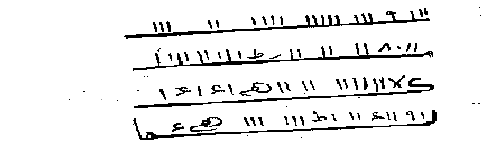

**AR:** بَابٌ لِلْجَلْبِ وَالتَّهْيِيْجِ

**LAT:** bābun lil-jalbi wa-al-tahyīji

**ID:** “**Bab untuk Menarik dan Membangkitkan (gairah).**” (Judul bagian kedua.)

**AR:** تُكْتَبُ عَلٰى **اَرْبَعَةِ اَوْرَاقِ كَاغِدٍ**، وَتُوْضَعُ فِىْ كُلِّ وَرَقَةٍ **اَرْبَعُ فِلْفِلٍ اَسْوَدَ وَثَلَاثُ مَلَحَاتٍ**، وَتُحْرَقُ **كُلَّ وَقْتٍ مِنْ اَوْقَاتِ الْيَوْمِ وَاحِدَةً**، فَاِنَّ **الْمَطْلُوْبَ لَا يَكُوْنُ لَهُ قَرَارٌ مِنْ مَحَبَّتِكَ**. **شَرْطٌ اَنْ تَكْتُبَ اسْمَهُ وَاسْمَ اُمِّهِ وَالطَّالِعَ اَيْضًا** — **وَهَذَا الطِّلَسْمُ، وَمِنَ اللهِ التَّوْفِيْقُ**.

**LAT:** tuktabu ‘alā arba‘ati awrāqi kāghidin, wa-tūḍa‘u fī kulli waraqatin arba‘u filfalin aswada wa-thalāthu malaḥātin, wa-tuḥraqu kulla waqtin min awqāti al-yawmi wāḥidatan, fa-inna al-maṭlūba lā yakūnu lahu qarārun min maḥabbatiKa. Sharṭun an taktuba ismahu wa-isma ummihi wa-al-ṭāli‘a ayḍan — wa-hādhā al-ṭilasmu, wa-mina allāhi al-tawfīqu.

**ID:** “**Dituliskan pada empat lembar kāghid**؛ **pada setiap lembar diletakkan empat butir lada hitam dan tiga butir garam**؛ lalu **dibakar satu lembar pada setiap waktu dari waktu-waktu siang** — maka **orang yang diminta tidak akan punya ketenangan karena cintamu**. **Syaratnya engkau menulis namanya, nama ibunya, dan ascendant (ṭāli‘) juga** — **dan inilah ṭilasmnya, dan dari Allah-lah taufik**.”

**AR:** (وَصْفُ الطِّلَسْمِ) اَرْبَعَةُ اَسْطُرٍ يَدَوِيَّةٍ عَلٰى خُطُوْطٍ اُفُقِيَّةٍ، كُلُّهَا **دَرَجُ رُقُوْمٍ** بِخَطٍّ عَرِيْضٍ: السَّطْرُ ١ «**|| || |||| |||| || ٤ ||**» تَقْرِيْبًا، ٢ «**||| ||| |||| ب/١ || || ٨/١١**»، ٣ «**١ ٥ ١ ٥ ١ هـ/٥ || || ||||| ٥**»، ٤ «**|| || || ٦ ١ ٨ ١ ٢ ١**» — وَفِىْ نِهَايَةِ السَّطْرِ الرَّابِعِ **قَوْسٌ مَفْتُوْحٌ**.

**LAT:** (waṣfu al-ṭilāsmi) arba‘atu asṭurin yadawiyyatin ‘alā khuṭūṭin ufuqiyyatin, kulluhā daraju ruqūmin bi-khaṭṭin ‘arīḍin: al-saṭru 1 «|| || |||| |||| || 4 ||» taqrīban, 2 «||| ||| |||| b/1 || || 8/11», 3 «1 5 1 5 1 h/5 || || ||||| 5», 4 «|| || || 6 1 8 1 2 1» — wa-fī nihāyati al-saṭri al-rābi‘i qawsun maftūḥun.

**ID:** “**(Deskripsi ṭilasm)**: **empat baris tulisan tangan** di atas **garis mendatar**, semuanya **deret angka** berpena tebal: baris ١ «**|| || |||| |||| || ٤ ||**» (perkiraan)، ٢ «**||| ||| |||| ب/١ || || ٨/١١**»، ٣ «**١ ٥ ١ ٥ ١ هـ/٥ || || ||||| ٥**»، ٤ «**|| || || ٦ ١ ٨ ١ ٢ ١**»؛ di **ujung baris keempat** ada **busur terbuka**.”

**AR:** بَابُ فَتْحٍ

**LAT:** bābu fatḥin

**ID:** “**Bab Pembukaan.**” (Judul bagian ketiga.)

**AR:** تُكْتَبُ فِىْ **اَوَّلِ الشَّهْرِ سَاعَةَ الثَّانِيَةِ مِنْ يَوْمِ الْاَحَدِ**، تُكْتَبُ **سَبْعُ بَرَاوَاتٍ**، وَفِىْ كُلِّ **بَرْوَةٍ** تُوْضَعُ **حَبَّاتُ كُزْبَرَةٍ**، وَتُقْرَاُ **الْايَةُ عَلٰى كُلِّ حَبَّةٍ مَرَّةً**، وَتُحْرَقُ **كُلَّ لَيْلَةٍ وَاحِدَةً مَعَ الْحَبَّاتِ**، وَتَقُوْلُ **وَقْتَ الْحَرِيْقِ**: «**اَسْلَبْتُ عَقْلَ وَلُبَّ وَجَمِيْعَ جَوَارِحِ فُلَانٍ ابْنِ فُلَانَةَ عَلٰى مَحَبَّةِ وَعِشْقِ وَطَاعَةِ فُلَانَةَ بِنْتِ فُلَانَةَ**» — **وَالْحَرِيْقُ يَكُوْنُ بَعْدَ نَوْمِ النَّاسِ**، **وَهَذِهِ هِيَ الْبَرَاوَاتُ فِى الصَّفْحَةِ التَّالِيَةِ**.

**LAT:** tuktabu fī awwali al-shahri sā‘ata al-thāniyati min yawmi al-aḥadi, tuktabu sab‘u barāwātin, wa-fī kulli barwatin tūḍa‘u ḥabbātu kuzbaratin, wa-tuqra’u al-āyatu ‘alā kulli ḥabbatin marratan, wa-tuḥraqu kulla laylatin wāḥidatan ma‘a al-ḥabbāti, wa-taqūlu waqta al-ḥarīqi: «aslabtu ‘aqla wa-lubba wa-jamī‘a jawāriḥi fulānin ibni fulānata ‘alā maḥabbati wa-‘ishqi wa-ṭā‘ati fulānata binti fulānata» — wa-al-ḥarīqu yakūnu ba‘da nawmi al-nāsi, wa-hādhihi hiya al-barāwātu fī al-ṣafḥati al-tāliyati.

**ID:** “**Dituliskan pada awal bulan, jam kedua hari Ahad**؛ ditulis **tujuh «براوات»**؛ **pada setiap «بروة» diletakkan butir-butir ketumbar (kuzbarah)**؛ **ayat dibaca atas setiap butir sekali**؛ **setiap malam satu (بروة) dibakar bersama butir-butirnya**؛ dan **pada waktu pembakaran engkau mengucapkan**: «**Aku telah merenggut akal, hati, dan seluruh anggota badan Fulan bin Fulanah untuk cinta, gairah, dan kepatuhan kepada Fulanah binti Fulanah**» — **pembakaran dilakukan setelah orang-orang tidur**؛ **dan inilah «البراوات» pada halaman berikutnya**.”

**AR:** اَيُّهَا الطَّالِبُ الْجَلِيْلُ، لَا تَبْخَلْ عَلَيْنَا بِقِرَاءَةِ **الْفَاتِحَةِ** وَثَبِّتْ صَوَابًا لَنَا وَلِوَالِدَيْنَا — **شَيْخُ الرُّوحَانِيِّينَ فِى الْوَطَنِ الْعَرَبِىِّ، الشَّيْخُ عَطِيَّةُ عَبْدُ الْحَمِيْدِ** — **لِلْكَشْفِ وَالْمُتَابَعَةِ مَعَ شَيْخِ الرُّوحَانِيِّينَ ٠٠٢٠١٢٦٢٠٢٢٢٣٨**

**LAT:** ayyuhā al-ṭālibu al-jalīlu, lā tabkhal ‘alaynā bi-qirā’ati al-fātiḥati wa-thabbit ṣawāban lanā wa-li-wālidaynā — shaykhu al-rūḥāniyyīna fī al-waṭani al-‘arabiyyi, al-shaykhu ‘Aṭiyyatu ‘Abdu al-Ḥamīdi — lil-kashfi wa-al-mutāba‘ati ma‘a shaykhi al-rūḥāniyyīna 00201262022238

**ID:** “**Wahai penuntut yang mulia, jangan kikir kepada kami dengan membaca al-Fātiḥah**, dan **tetapkanlah kebenaran bagi kami dan kedua orang tua kami** — **Syaikh para ruhaniyyin di tanah Arab, Syaikh ‘Aṭiyyah ‘Abd al-Ḥamīd** — **untuk kasyaf dan bimbingan dengan Syaikh para ruhaniyyin: ٠٠٢٠١٢٦٢٠٢٢٢٣٨**.”

**Keterangan halaman.** Halaman ini **menyambung ‘azīmah** dari **p.465** («عزمت عليكم يا معشر الجن والإنس…» → nama-nama «دنش، شكثك…» sampai **هَارُوت وَمَارُوت**), dengan **al-Fātiḥah atas sebiji kacang fava** yang **dibakar**؛ lalu **«باب للجلب والتهيج»** — empat lembar kāghid, **٤ lada hitam + ٣ garam** per lembar, **dibakar satu tiap waktu siang**, dengan syarat **nama + nama ibu + ṭāli‘**؛ lalu **«باب فتح»** — **tujuh «براوات»** berisi **ketumbar**, satu **dibakar tiap malam** dengan **doa «اسلبت عقل ولُبّ…»**; ditutup **kolofon** dengan **kontak ٠٠٢٠١٢٦٢٠٢٢٢٣٨**.

**Angka pada halaman ini.** **٤ lada** dan **٣ garam** — **dengan kata** («اربع»، «ثلاث»)، bukan angka. **«سبع براوات»** — **dengan kata**. **«ساعة الثانية»** — **dengan kata**. Kontak telepon di halaman ini **tercetak dengan «٠٠٢»** (٠٠٢٠١٢٦٢٠٢٢٢٣٨), **berbeda dengan p.453–455/462** (tanpa «٠٠٢») — **keduanya dipertahankan**, **tidak dikoreksi**. Angka pada **rajah-01** adalah **tulisan tangan** → **perkiraan**.

**Wafaq:** **tidak ada**؛ rajah-01 adalah **deret angka/hitungan garis**, **bukan tabel berbingkai** → **tidak diuji penjumlahan**.

**[TIDAK JELAS - HALAMAN 466]** (1) **Seluruh isi empat baris rajah-01** — **tulisan tangan berimpit**؛ **[TEKS ASLI DIJAGA]**، hanya bentuk yang dideskripsikan dan pembacaan ditandai **perkiraan**. (2) **Nama-nama «دَنَش، شُكَثَّك، شَكِيْس، لِسْلِيُوْد، هَيْرَاطِش، غَطْشَلَان، لَافِيْس»** — **tanpa vokal lengkap** dan **tidak bermakna jelas**؛ disalin **literal**, **tidak ditafsirkan**. (3) **«الْبَرَاوَات»** — istilah **tidak dijelaskan**؛ dipertahankan sebagai **nama bentuk amalan**؛ isinya **dijanjikan di halaman 467**. (4) **«وَالطَّالِعَ اَيْضًا»** — **ṭāli‘ (ascendant)** tidak diterangkan cara menentukannya dalam teks. (5) **«وَثَبِّتْ صَوَابًا لَنَا»** — susunan **tidak lazim**؛ dipertahankan. (6) **«سَاعَةَ الثَّانِيَةِ»** — **susunan tanpa «الـ» pada urutan**؛ dipertahankan.

**Peringatan (dicatat apa adanya, bukan fatwa).** Halaman ini memuat **pemanggilan nama-nama jin** (sampai **Hārūt dan Mārūt**) dan amalan yang bertujuan **“merenggut akal dan hati”** seseorang agar **menaati** si peminta, ditambah **pembakaran** kertas/ketumbar pada malam hari. Teks ditranskripsikan sesuai cetakan; semua itu **bukan bagian dari ajaran Islam**.

**[ADA RAJAH]** — 1 crop: `assets/rajah/sirrul-asrar/hal-466-rajah-01.png` (700 DPI, Rect(146, 246, 474, 350)).

---
## HALAMAN 467 — «البراوات» tujuh kotak (hari + planet) dari p.466 + «محبة قوية» (darah ayam) + «باب محبة» (wafaq tujuh lembar, دعوة المريخ ١٢×)

**AR:** كِتَابُ سِرِّ الْاَسْرَارِ فِي التَّوَاصُلِ مَعَ رُوحَانِيَّاتِ الْقُرْآنِ — شَيْخُ الرُّوحَانِيِّينَ الشَّيْخُ عَطِيَّةُ عَبْدُ الْحَمِيْدِ

**LAT:** kitābu sirri al-asrāri fī al-tawāṣuli ma‘a rūḥāniyyāti al-qur’āni — shaykhu al-rūḥāniyyīna al-shaykhu ‘Aṭiyyatu ‘Abdu al-Ḥamīdi

**ID:** “Kitab «Sirr al-Asrār fī al-Tawāṣul ma‘a Rūḥāniyyāt al-Qur’ān» — Syaikh para ruhaniyyin, Syaikh ‘Aṭiyyah ‘Abd al-Ḥamīd.” (Kepala halaman.)

**Rajah:** 

**AR:** (الْبَرَاوَاتُ — تَكْمِلَةٌ مِنْ ص ٤٦٦) سَبْعَةُ مُرَبَّعَاتٍ، فِى كُلٍّ **اِسْمُ يَوْمٍ وَاسْمُ كَوْكَبِهِ**، وَحَوْلَ كُلِّ مُرَبَّعٍ **كِتَابَةٌ صَغِيْرَةٌ مُتَكَرِّرَةٌ** (دُعَاءٌ/أَسْمَاءٌ لَا تَكَادُ تُقْرَاُ)، وَتَحْتَ كُلِّ مُرَبَّعٍ **سَطْرٌ مِنَ الْحُرُوْفِ الطِّلَسْمِيَّةِ**. وَالْقِرَاءَةُ (مِنَ الْيَمِيْنِ اِلَى الْيَسَارِ كَمَا هِىَ مَرْتَّبَةٌ فِى الْكِتَابِ):

- الْاَحَدُ / **الشَّمْس**
- الْاِثْنَيْنِ / **الْقَمَر**
- الثُّلَاثَاءُ / **الْمِرِّيْخ**
- الْاَرْبِعَاءُ / **عُطَارِد**
- الْخَمِيْسُ / **الْمُشْتَرِى**
- الْجُمُعَةُ / **الزُّهْرَة**
- السَّبْتُ / **زُحَل**

**LAT:** (al-barāwātu — takmilatun min ṣ 466) sab‘atu murabba‘ātin, fī kullin ismu yawmin wa-ismu kawkabihi, wa-ḥawla kulli murabba‘in kitābatun ṣaghīratun mutakarriratun (du‘ā’un/asmā’un lā takādu tuqra’u), wa-taḥta kulli murabba‘in saṭrun mina al-ḥurūfi al-ṭilassamiyyati. Wa-al-qirā’atu (mina al-yamīni ilā al-yasāri kamā hiya murattabatun fī al-kitābi): al-aḥadu / al-shams؛ al-ithnayni / al-qamar؛ al-thulāthā’u / al-mirrīkh؛ al-arbi‘ā’u / ‘uṭārid؛ al-khamīsu / al-mushtarī؛ al-jumu‘atu / al-zuharatu؛ al-sabtu / zuḥalu.

**ID:** “**(«البراوات» — lanjutan dari p.466)**: **tujuh kotak**, masing-masing memuat **nama hari dan nama planetnya**, dan **di sekeliling setiap kotak** ada **tulisan kecil berulang** (doa/nama-nama yang **hampir tidak terbaca**), sedangkan **di bawah setiap kotak** ada **satu baris huruf talismanic**. **Pembacaan** (dari **kanan ke kiri** sesuai urutan dalam kitab): **Ahad/Syams**، **Senin/Qamar**، **Selasa/Mirrīkh**، **Rabu/‘Uṭārid**، **Kamis/Musytarī**، **Jumat/Zuhrah**، **Sabtu/Zuḥal**.”

**AR:** (وَتَحْتَ الْبَرَاوَاتِ) «**تَمَّتْ … وَبِاللهِ التَّوْفِيْق**» بِخَطٍّ يَدَوِىٍّ عَرِيْضٍ.

**LAT:** (wa-taḥta al-barāwāti) «tammat … wa-bi-allāhi al-tawfīq» bi-khaṭṭin yadawiyyin ‘arīḍin.

**ID:** “**(Di bawah «البراوات»)**: «**telah selesai … dan dengan Allah-lah taufik**» — ditulis tangan tebal dan **sebagian tidak terbaca**.”

**AR:** مَحَبَّةٌ قَوِيَّةٌ

**LAT:** maḥabbatun qawiyyatun

**ID:** “**Cinta yang Kuat.**” (Judul bagian kedua.)

**AR:** اِذَا كَانَ لِلرَّجُلِ: تُكْتَبُ **بِدَمِ دَجَاجَةٍ سَوْدَاءَ** فِى **سَاعَةٍ سَعِيْدَةٍ**، وَيَحْمِلُهَا **الْمَرْاَةُ**، **تَبُوْسُ يَدَهُ**؛ وَاِذَا كَانَ **لِلْمَرْاَةِ**: **بِدَمِ دِيْكٍ اَحْمَرَ**، وَتَحْمِلُهَا **الرَّجُلُ**، **يَبُوْسُ يَدَهَا** — **مِنْ عِظَمِ الطَّاعَةِ وَالْمَحَبَّةِ**. **وَهُوَ كَمَا تَرَى:**

**LAT:** idhā kāna lil-rajuli: tuktabu bi-dami dajājatin sawdā’a fī sā‘atin sa‘īdatin, wa-yaḥmiluhā al-mar’atu, tabūsu yadahu؛ wa-idhā kāna lil-mar’ati: bi-dami dīkin aḥmara, wa-taḥmiluhā al-rajulu, yabūsu yadahā — min ‘iẓami al-ṭā‘ati wa-al-maḥabbati. Wa-huwa kamā tarā:

**ID:** “**Jika untuk lelaki**: dituliskan **dengan darah ayam betina hitam** pada **saat yang baik (sa‘īd)**؛ **perempuan** yang membawanya, lalu **mencium tangannya**؛ dan **jika untuk perempuan**: **dengan darah ayam jantan merah**؛ **lelaki** yang membawanya, lalu **mencium tangannya** — **karena besarnya kepatuhan dan cinta**. **Dan ia seperti yang engkau lihat**:”

**Rajah:** 

**AR:** (وَصْفُ الطِّلَسْمِ) سَطْرَانِ يَدَوِيَّانِ: الْاَوَّلُ «**٨ ١ ٤ ٨ ١ ١ ٠ ١١ ٨ ١ ٤ ٨ ١ ١ ٤ ٦ ١ ٤ ٤ ١ ٠**» تَقْرِيْبًا، وَالثَّانِى «**٨ ١ ١ ١ ٢ ١ ٦ ١ ٤ ١ ١ ٨ ١ ١ ٤ ١ ١ ٨ ١ ١ ٤ ١ ٨ ١ ١ ٠**» تَقْرِيْبًا، ثُمَّ كَلِمَةُ «**تَمَّتْ**».

**LAT:** (waṣfu al-ṭilāsmi) saṭrāni yadawiyyāni: al-awwalu «8 1 4 8 1 1 0 11 8 1 4 8 1 1 4 6 1 4 4 1 0» taqrīban, wa-al-thānī «8 1 1 1 2 1 6 1 4 1 1 8 1 1 4 1 1 8 1 1 4 1 8 1 1 0» taqrīban, thumma kalimatu «tammat».

**ID:** “**(Deskripsi ṭilasm)**: **dua baris tulisan tangan**: baris ١ «**٨ ١ ٤ ٨ ١ ١ ٠ ١١ ٨ ١ ٤ ٨ ١ ١ ٤ ٦ ١ ٤ ٤ ١ ٠**» (perkiraan)، baris ٢ «**٨ ١ ١ ١ ٢ ١ ٦ ١ ٤ ١ ١ ٨ ١ ١ ٤ ١ ١ ٨ ١ ١ ٤ ١ ٨ ١ ١ ٠**» (perkiraan)، lalu kata «**تمت**».”

**AR:** بَابُ مَحَبَّةٍ

**LAT:** bābu maḥabbatin

**ID:** “**Bab Cinta.**” (Judul bagian ketiga.)

**AR:** تُكْتَبُ هَذَا الْوِفْقَ فِىْ **سَبْعَةِ وَرَقَاتٍ** يَوْمَ **الْخَمِيْسِ** فِى **سَاعَةِ الشَّمْسِ بِاَخْرَاجِ بُرْجٍ نَارِىٍّ**، **وَهُوَ صَحِيْحٌ وَمُجَرَّبٌ**. **تُعَزَّمُ عَلَيْهَا بِدَعْوَةِ الْمِرِّيْخِ ١٢ مَرَّةً وَوَكِّلْ كُلَّ ٣ مَرَّاتٍ**.

**LAT:** tuktabu hādhā al-wifqa fī sab‘ati waraqātin yawma al-khamīsi fī sā‘ati al-shamsi bi-akhrāji burjin nāriyyin, wa-huwa ṣaḥīḥun wa-mujarrabun. Tu‘azzamu ‘alayhā bi-da‘wati al-mirrīkhi 12 marratan wa-wakkil kulla 3 marrātin.

**ID:** “**Wafaq ini dituliskan pada tujuh lembar kertas** pada hari **Kamis** di **saat matahari dengan keluarnya burj nārī (zodiak api)**؛ **ini sahih dan sudah dicoba**. **Diazamkan padanya «دعوة المريخ» ١٢×** dan **lakukan tawkīl setiap ٣×**.”

**Keterangan halaman.** Halaman ini **melengkapi janji p.466**: menampilkan **«البراوات»** — **tujuh kotak** berisi **nama hari + planet** (**Ahad/Syams … Sabtu/Zuḥal**), tiap kotak dikelilingi **tulisan kecil** dan di bawahnya **baris huruf talismanic**؛ lalu **«محبة قوية»** — ṭilasm dengan **darah ayam betina hitam** (untuk lelaki) atau **darah ayam jantan merah** (untuk perempuan), dibawa pasangan lalu **mencium tangan**؛ lalu **«باب محبة»** — **wafaq pada tujuh lembar**, **Kamis saat matahari**, **burj nārī**, **«دعوة المريخ» ١٢×**, **tawkīl setiap ٣×**.

**Angka pada halaman ini.** **١٢** (دعوة المريخ) dan **٣** (setiap tiga kali tawkīl) — **cocok** antara lapisan teks dan pindaian (Rect masing-masing (297, 694, 312, 714) dan (217, 694, 225, 714))؛ **tanpa koreksi**. **«سبعة ورقات»** — **dengan kata**. Angka pada **rajah-02** adalah **tulisan tangan** → **perkiraan**.

**Wafaq:** **tidak diuji penjumlahan** — wafaq «باب محبة» **tidak dicetak gambarnya** di halaman ini (hanya disebut «هذا الوفق»), sehingga **tidak ada angka yang dapat diverifikasi**; **tidak ada klaim jumlah**. Tujuh kotak **«البراوات»** **bukan wafaq** (isinya **nama hari dan planet**, bukan angka).

**[TIDAK JELAS - HALAMAN 467]** (1) **Tulisan kecil mengelilingi tujuh kotak «البراوات»** — **hampir tidak terbaca**; **[TEKS ASLI DIJAGA]**، hanya posisi dan sifatnya dideskripsikan. (2) **Baris huruf talismanic di bawah setiap kotak** — **tidak terbaca sebagai kata**؛ ditandai. (3) **«تَمَّتْ … وَبِاللهِ التَّوْفِيْق»** di bawah kotak — **kata tengah tidak terbaca**؛ hanya bagian yang terbaca disalin. (4) **Pasangan hari–planet** dibaca **kanan-ke-kiri**; urutan ini **konsisten** dengan urutan klasik (Ahad-Syams … Sabtu-Zuḥal), tetapi **teks tidak menyatakannya secara eksplisit** — **dasar pembacaan dicatat di sini**. (5) **Seluruh isi dua baris rajah-02** — **perkiraan**؛ **[TEKS ASLI DIJAGA]**. (6) **«بِاَخْرَاجِ بُرْجٍ نَارِىٍّ»** — istilah astrologi; **burj api** = Aries/Leo/Sagitarius؛ **penjelasan ini tambahan pentranskripsi**, bukan teks kitab. (7) **«وَوَكِّلْ كُلَّ ٣ مَرَّاتٍ»** — **susunan ringkas**؛ dipertahankan. (8) **«يَحْمِلُهَا الْمَرْاَةُ … تَبُوْسُ يَدَهُ»** — **dhamīr tidak konsisten** (mu’annath/mudhakkar)؛ **dipertahankan**.

**Peringatan (dicatat apa adanya, bukan fatwa).** Amalan **«محبة قوية»** memakai **darah hewan** sebagai tinta dan bertujuan **menundukkan pasangan hingga mencium tangan**; amalan terakhir memakai **wafaq tujuh lembar** dengan **tawkil berulang**. Teks ditranskripsikan sesuai cetakan; semua itu **bukan bagian dari ajaran Islam**.

**[ADA RAJAH]** — 2 crop: `assets/rajah/sirrul-asrar/hal-467-rajah-01.png` (700 DPI, Rect(51, 69, 502, 445)) dan `hal-467-rajah-02.png` (700 DPI, Rect(130, 524, 483, 635)).

---
## HALAMAN 468 — «صفت التوكيل» (tawkil دعوة) + wafaq tiga kolom + «باب محبة ليس له نظير» (empat lembar dibakar berurutan)

**AR:** كِتَابُ سِرِّ الْاَسْرَارِ فِي التَّوَاصُلِ مَعَ رُوحَانِيَّاتِ الْقُرْآنِ — شَيْخُ الرُّوحَانِيِّينَ الشَّيْخُ عَطِيَّةُ عَبْدُ الْحَمِيْدِ

**LAT:** kitābu sirri al-asrāri fī al-tawāṣuli ma‘a rūḥāniyyāti al-qur’āni — shaykhu al-rūḥāniyyīna al-shaykhu ‘Aṭiyyatu ‘Abdu al-Ḥamīdi

**ID:** “Kitab «Sirr al-Asrār fī al-Tawāṣul ma‘a Rūḥāniyyāt al-Qur’ān» — Syaikh para ruhaniyyin, Syaikh ‘Aṭiyyah ‘Abd al-Ḥamīd.” (Kepala halaman.)

**AR:** صِفَةُ التَّوْكِيْلِ: «**تَوَكَّلُوْا يَا خُدَّامَ هٰذِهِ الدَّعْوَةِ وَمَا فِيْهَا مِنَ الْقُوَّةِ وَالْقَهْرِ، لِمَنْ يَسْمَعُ الدَّعْوَةَ وَلَمْ يَسْتَجِبْ: تَوَكَّلُوْا يَا مَنْ سَمِعْتُمْ دَعْوَتِىْ وَشَمَمْتُمْ دُخَانِىْ وَاَتَيْتُمْ اِلٰى خَلْوَتِىْ، تَوَكَّلُوْا بِحَاجَتِىْ، وَعَطِّفُوْا وَهَيِّجُوْا قَلْبَ فُلَانٍ ابْنِ فُلَانَةَ عَلٰى فُلَانَةَ بِنْتِ فُلَانَةَ بِالْمَحَبَّةِ وَالْمَوَدَّةِ، اَلْوَحَا ٢ الْعَجَلَ ٢ السَّاعَةَ ٢**» — **وَهَذَا الْوِفْقُ الَّذِىْ تُكْتَبُ**.

**LAT:** ṣifatu al-tawkīli: «tawakkalū yā khuddāma hādhihi al-da‘wati wa-mā fīhā mina al-quwwati wa-al-qahri, liman yasma‘u al-da‘wata wa-lam yastajib: tawakkalū yā man sami‘tum da‘watiya wa-shamamtum dukhāniya wa-ataytum ilā khalwatiya, tawakkalū bi-ḥājatiya, wa-‘aṭṭifū wa-hayyijū qalba fulānin ibni fulānata ‘alā fulānata binti fulānata bi-al-maḥabbati wa-al-mawaddati, al-waḥā 2 al-‘ajala 2 al-sā‘ata 2» — wa-hādhā al-wifqu alladhī tuktabu.

**ID:** “**Sifat tawkil**: «**Bergeraklah, wahai para pelayan seruan ini dan kekuatan serta pemaksaan yang ada padanya, terhadap siapa yang mendengar seruan tetapi tidak menyambutnya: bergeraklah, hai kalian yang mendengar seruanku, mencium asapku, dan datang ke tempat sunyiku — bergeraklah untuk keperluanku, dan palingkan serta bangkitkan hati Fulan bin Fulanah kepada Fulanah binti Fulanah dengan cinta dan kasih sayang — al-waḥā ٢, al-‘ajal ٢, al-sā‘ah ٢**» — **dan inilah wafaq yang ditulis**.”

**Rajah:** 

**AR:** (وَصْفُ الْوِفْقِ) ثَلَاثَةُ اَعْمِدَةٍ بِخَطٍّ يَدَوِىٍّ عَرِيْضٍ، وَالْقِرَاءَةُ مِنَ الْيَمِيْنِ:

- الْعَمُوْدُ الْاَوَّلُ (يَمِيْن): «**١١١ م س ع هـ**» ثُمَّ «**م س ع هـ**» ثُمَّ «**م ع ر ا ي ع**» (بِخَطٍّ مُتَدَاخِلٍ)؛
- الْعَمُوْدُ الثَّانِى (وَسَط): «**٤٢٣ ٩ ٩ ٥ ٨**» ثُمَّ «**١١١ ١١ ١١ ٥ ٥ ٨**»؛
- الْعَمُوْدُ الثَّالِثُ (يَسَار): «**ي ط ع ل ي ا س م**» ثُمَّ «**٤١٧ ٧ ٥ ٧ ٦ ٤**»؛

وَفِى الْيَسَارِ السُّفْلِىِّ يَدٌ وَبَيْضَاوِىٌّ بِدَاخِلِهَا «**ع ل ي ا م س**» تَقْرِيْبًا، وَشَكْلُ **نَجْمَةٍ خُمَاسِيَّةٍ** بِنُقَطٍ، وَرَقْمُ «**٩٤**» وَنَحْوُ «**و ٦**» — كُلُّهَا **رُسُوْمٌ يَدَوِيَّةٌ**.

**LAT:** (waṣfu al-wifqi) thalāthatu a‘midatin bi-khaṭṭin yadawiyyin ‘arīḍin, wa-al-qirā’atu mina al-yamīni: al-‘amūdu al-awwalu (yamīn): «111 m s ‘ h» thumma «m s ‘ h» thumma «m ‘ r a y ‘» (bi-khaṭṭin mutadākhilin)؛ al-‘amūdu al-thāni (wasaṭ): «423 9 9 5 8» thumma «111 11 11 5 5 8»؛ al-‘amūdu al-thālithu (yasār): «y ṭ ‘ l y a s m» thumma «417 7 5 7 6 4»؛ wa-fī al-yasāri al-sufliyyi yadun wa-bayḍāwiyyun bi-dākhilihā «‘ l y a m s» taqrīban, wa-shaklu najmatin khumāsiyyatin bi-nuqaṭin, wa-raqmu «94» wa-naḥwu «w 6» — kulluhā rusūmun yadawiyyatun.

**ID:** “**(Deskripsi wafaq)**: **tiga kolom** bertulisan tangan tebal, **dibaca dari kanan**: **kolom ١ (kanan)** «**١١١ م س ع هـ**» lalu «**م س ع هـ**» lalu «**م ع ر ا ي ع**» (berjalin)؛ **kolom ٢ (tengah)** «**٤٢٣ ٩ ٩ ٥ ٨**» lalu «**١١١ ١١ ١١ ٥ ٥ ٨**»؛ **kolom ٣ (kiri)** «**ي ط ع ل ي ا س م**» lalu «**٤١٧ ٧ ٥ ٧ ٦ ٤**»؛ di **kiri bawah** ada **gambar tangan** dan **bentuk lonjong** berisi «**ع ل ي ا م س**» (perkiraan), **bentuk bintang berlima** bertitik, angka «**٩٤**» dan semacam «**و ٦**» — semuanya **gambar tulisan tangan**.”

**AR:** بَابُ مَحَبَّةٍ لَيْسَ لَهُ نَظِيْرٌ

**LAT:** bābu maḥabbatin laysa lahu naẓīrun

**ID:** “**Bab Cinta yang Tidak Ada Bandingannya.**” (Judul bagian kedua.)

**AR:** تُكْتَبُ عَلٰى **اَرْبَعِ وَرَقَاتٍ مِنْ هٰذِهِ الصِّفَةِ**، وَتُحْرَقُ **وَاحِدَةً بَعْدَ وَاحِدَةٍ سَرِيْعًا** — **وَهٰذِهِ وَمِنَ اللهِ التَّوْفِيْق**. **وَقَبْلَ الْبَدْءِ اصْرِفِ الْعُمَّارَ بِاِصْرَافِ قُوًى**، وَاعْزِمْ عَلَى الْوَرَقِ عِنْدَ الْحَرْقِ **بِدَعْوَةِ الْعَهْدِ الْقَدِيْمِ**، وَضَعْ **فَصَّ لُبَانٍ ذَكَرٍ** فِى الْوَرَقَةِ، وَقَبْلَ انْقِطَاعِ الدُّخَانِ لِلْوَرَقَةِ الْاُوْلٰى **اِرْمِ الْوَرَقَةَ الثَّانِيَةَ فِى النَّارِ اِلٰى تَمَامِ الرَّابِعَةِ**.

**LAT:** tuktabu ‘alā arba‘i waraqātin min hādhihi al-ṣifati, wa-tuḥraqu wāḥidatan ba‘da wāḥidatin sarī‘an — wa-hādhihi wa-mina allāhi al-tawfīqu. Wa-qabla al-bad’i iṣrifi al-‘ummāra bi-iṣrāfi quwan, wa-‘zim ‘alā al-waraqi ‘inda al-ḥarqi bi-da‘wati al-‘ahdi al-qadīmi, wa-ḍa‘ faṣṣa lubānin dhakarin fī al-waraqati, wa-qabla inqiṭā‘i al-dukhāni lil-waraqati al-ūlā irmi al-waraqata al-thāniyata fī al-nāri ilā tamāmi al-rābi‘ati.

**ID:** “**Dituliskan pada empat lembar kertas dengan bentuk (ṣifah) ini**؛ lalu **dibakar satu demi satu dengan cepat** — **inilah dia, dan dari Allah-lah taufik**. **Sebelum mulai, lepaskan (ṣarf) para ‘ummār dengan iṣrāf kekuatan**, dan **azamkan atas kertas itu pada waktu pembakaran dengan «دعوة العهد القديم»**, dan **letakkan “faṣṣ lubān dhakar”** di dalam kertas؛ **sebelum asap lembar pertama habis, lemparkan lembar kedua ke api**, begitu seterusnya **sampai lembar keempat selesai**.”

**Rajah:** 

**AR:** (وَصْفُ الْوَرَقَاتِ الْاَرْبَعِ) اَرْبَعَةُ مُرَبَّعَاتٍ صَغِيْرَةٍ، فَوْقَ كُلِّ وَاحِدٍ رَقْمُهُ (١، ٢، ٣، ٤):

- (١) «**هـ ع هـ ع …**» وَ«**ا ص ل ه ي ا**» تَقْرِيْبًا
- (٢) «**هـ ر ا م ع هـ**» وَ«**ع ز ر ا ي ل**» تَقْرِيْبًا
- (٣) «**ع هـ**» وَ«**٥**» مَعَ خَطٍّ مُنْحَنٍ
- (٤) «**هـ ع ي ا د**» وَ«**ر م ل ح**» تَقْرِيْبًا

**LAT:** (waṣfu al-waraqāti al-arba‘i) arba‘atu murabba‘ātin ṣaghīratin, fawqa kulli wāḥidin raqmuhu (1, 2, 3, 4): (1) «h ‘ h ‘ …» wa-«a ṣ l h y a» taqrīban؛ (2) «h r a m ‘ h» wa-«‘ z r a y l» taqrīban؛ (3) «‘ h» wa-«5» ma‘a khaṭṭin munḥanin؛ (4) «h ‘ y a d» wa-«r m l ḥ» taqrīban.

**ID:** “**(Deskripsi empat lembar)**: **empat kotak kecil**, di atas masing-masing **nomornya** (١، ٢، ٣، ٤): (١) «**هـ ع هـ ع …**» dan «**ا ص ل ه ي ا**» (perkiraan)؛ (٢) «**هـ ر ا م ع هـ**» dan «**ع ز ر ا ي ل**» (perkiraan)؛ (٣) «**ع هـ**» dan «**٥**» dengan **garis melengkung**؛ (٤) «**هـ ع ي ا د**» dan «**ر م ل ح**» (perkiraan).”

**Keterangan halaman.** Halaman ini memuat **«صفت التوكيل»** — **teks tawkil** untuk **para khuddām** seruan, ditutup dengan **«الوحا ٢ العجل ٢ الساعة ٢»**؛ lalu **wafaq tiga kolom** (rajah-01) yang **hendak ditulis**؛ lalu **«باب محبة ليس له نظير»** — **empat lembar** (rajah-02) yang **dibakar berurutan cepat**, setelah **ṣarf al-‘ummār** dan **azam «دعوة العهد القديم»**, dengan **faṣṣ lubān dhakar** di dalam kertas.

**Angka pada halaman ini.** **٢** (tiga kali pada «الوحا ٢ العجل ٢ الساعة ٢») — **cocok** antara lapisan teks dan pindaian (Rect(198, 128, 205, 147)، (244, 128, 252, 147)، (289, 128, 297, 147))؛ **tanpa koreksi**. **«أربع ورقات»** — **dengan kata**. Angka pada **wafaq** («١١١»، «٤٢٣»، «٤١٧»، «٩٤»، «٩ ٩ ٥ ٨»، «٧ ٥ ٧ ٦ ٤») adalah **tulisan tangan** → **perkiraan**.

**Wafaq diuji penjumlahan: TIDAK.** Wafaq ini **berisi kolom huruf dan angka bercampur** («م س ع هـ»، «ي ط ع ل ي ا س م») dan **tidak berbentuk bujur sangkar berjumlah**؛ jumlah baris dan kolom **tidak sama** dan **beberapa sel memuat huruf/bentuk bintang**. Karena itu **tidak ada klaim wafaq berjumlah**, dan **angka dipertahankan persis** sebagaimana terbaca.

**[TIDAK JELAS - HALAMAN 468]** (1) **Isi ketiga kolom wafaq** — tulisan tangan **berjalin**؛ **[TEKS ASLI DIJAGA]** dan pembacaan ditandai **perkiraan**. (2) **«م ع ر ا ي ع»** pada kolom kanan — **tidak dapat dipastikan**؛ dipertahankan sebagai perkiraan. (3) **Bentuk bintang berlima** dan **gambar tangan** di kiri bawah — **tidak dapat dibaca** sebagai huruf؛ hanya bentuk dideskripsikan. (4) **Angka «٩٤» dan «و ٦»** — **perkiraan**. (5) **Isi keempat lembar** — hampir seluruhnya **huruf tunggal tanpa titik**؛ **[TEKS ASLI DIJAGA]**؛ «عزرائيل» pada lembar ٢ adalah **pembacaan perkiraan**. (6) **«فَصُّ لُبَانٍ ذَكَرٍ»** — istilah **tidak dijelaskan** (kemungkinan **keping/gumpalan lubān jantan**)؛ dipertahankan. (7) **«اِصْرِفِ الْعُمَّارَ بِاِصْرَافِ قُوًى»** — **susunan janggal**؛ dipertahankan. (8) **«دَعْوَةُ الْعَهْدِ الْقَدِيْمِ»** — **tidak dicetak**؛ hanya dirujuk؛ ditandai. (9) **«صِفَةُ التَّوْكِيْلِ … تَوَكَّلُوْا»** — **peralihan** dari «sifat tawkil» ke **kata perintah**؛ dipertahankan sesuai cetakan. (10) **«وَهٰذِهِ وَمِنَ اللهِ التَّوْفِيْق»** — **tanpa kata yang dijelaskan** oleh «هذه»؛ dipertahankan.

**Peringatan (dicatat apa adanya, bukan fatwa).** Amalan pada halaman ini bertujuan **memaksa** dan **membangkitkan** hati seseorang melalui **tawkil kepada para khuddām**, **pembakaran empat lembar berurutan**, serta **pemanggilan «دعوة العهد القديم»**. Teks ditranskripsikan sesuai cetakan; semua itu **bukan bagian dari ajaran Islam**.

**[ADA RAJAH]** — 2 crop: `assets/rajah/sirrul-asrar/hal-468-rajah-01.png` (700 DPI, Rect(34, 167, 502, 477)) dan `hal-468-rajah-02.png` (700 DPI, Rect(138, 551, 475, 623)).

---
## HALAMAN 469 — «(( محبه ))» (tiga lilin + Yāsīn ٧× & «مبين» ٧×) + «(( محبه للاسم ودود ))» (٦٠.٠٠٠× «ودود» + ٢٠ butir gandum) + «(( لأخراج القرعه والدخول على الحكام ))» + «لتحير السارق»

**AR:** كِتَابُ سِرِّ الْاَسْرَارِ فِي التَّوَاصُلِ مَعَ رُوحَانِيَّاتِ الْقُرْآنِ — شَيْخُ الرُّوحَانِيِّينَ الشَّيْخُ عَطِيَّةُ عَبْدُ الْحَمِيْدِ

**LAT:** kitābu sirri al-asrāri fī al-tawāṣuli ma‘a rūḥāniyyāti al-qur’āni — shaykhu al-rūḥāniyyīna al-shaykhu ‘Aṭiyyatu ‘Abdu al-Ḥamīdi

**ID:** “Kitab «Sirr al-Asrār fī al-Tawāṣul ma‘a Rūḥāniyyāt al-Qur’ān» — Syaikh para ruhaniyyin, Syaikh ‘Aṭiyyah ‘Abd al-Ḥamīd.” (Kepala halaman.)

**AR:** (( مَحَبَّه ))

**LAT:** (( maḥabbah ))

**ID:** “**(( Cinta ))**” — judul dengan **kurung ganda**, ciri khas judul pada bagian ini.

**AR:** تَاْخُذُ عَلٰى بَرَكَةِ اللهِ **ثَلَاثَ شَمَعَاتٍ**، وَتُكْتَبُ عَلَى الْاُوْلٰى هَذِهِ الْايَاتُ وَهِىَ: «**نَارُ اللهِ الْمُوْقَدَةُ (٦) الَّتِىْ تَطَّلِعُ عَلَى الْاَفْئِدَةِ (٧)**» فِى قَلْبِ **كَذَا بِنْتِ كَذَا** نَارًا، (وَتَكْتُبُ عَلَى الثَّانِيَةِ) «**اِنَّهَا عَلَيْهِمْ مُؤْصَدَةٌ (٨) فِى عَمَدٍ مُمَدَّدَةٍ (٩)**»، ثُمَّ تَقْرَاُ **سُوْرَةَ يٰسٓ ٧ مَرَّاتٍ** وَاَنْتَ غَارِسٌ الشَّمْعَةَ، وَكُلَّمَا وَصَلْتَ اِلٰى **«مُبِيْنٍ»** تُكَرِّرُ **«مُبِيْنٍ» ٧ مَرَّاتٍ** وَتَنْفُخُ فِى قَعْرِهَا، ثُمَّ اَوْقِدِ الشَّمْعَةَ وَتَقْرَاُ السُّوْرَةَ عَلٰى تَمَامِهَا **٧ مَرَّاتٍ**.

**LAT:** ta’khudhu ‘alā barakati allāhi thalātha shama‘ātin, wa-tuktabu ‘alā al-ūlā hādhihi al-āyātu wa-hiya: «nāru allāhi al-mūqadatu (6) allatī taṭṭali‘u ‘alā al-af’idati (7)» fī qalbi kadhā binti kadhā nāran, (wa-tuktabu ‘alā al-thāniyati) «innahā ‘alayhim mu’ṣadatun (8) fī ‘amadin mumaddadatin (9)», thumma taqra’u sūrata Yā Sīn 7 marrātin wa-anta ghārisun al-sham‘ata, wa-kullamā waṣalta ilā «mubīnin» tukarriru «mubīnin» 7 marrātin wa-tanfukhu fī qa‘rihā, thumma awqidi al-sham‘ata wa-taqra’u al-sūrata ‘alā tamāmihā 7 marrātin.

**ID:** “**Engkau mengambil — dengan berkah Allah — tiga lilin**؛ **pada lilin pertama dituliskan ayat-ayat ini**, yaitu: «**Api Allah yang dinyalakan (٦), yang (senantiasa) naik ke atas hati (٧)**» — ke dalam **hati si Fulanah binti Fulanah**, sebagai **api**؛ (**pada lilin kedua dituliskan**): «**Sesungguhnya api itu ditutup rapat terhadap mereka (٨), (terikat) pada tiang-tiang yang panjang (٩)**»؛ kemudian **engkau membaca surah Yāsīn ٧×** sementara **engkau menancapkan lilin itu**؛ **setiap kali engkau sampai pada «مبين»**, engkau **mengulang «مبين» ٧×** dan **meniup ke dasar lilin**؛ lalu **nyalakan lilin itu** dan **bacalah surah itu sampai selesai ٧×**.”

**AR:** وَتُصْبِحُ تَنْظُرُ بِمَصْلَحَتِهِ، اِذَا قُضِيَتْ كَانَ **ثَلَاثَةَ اَيَّامٍ**، وَاِذَا لَمْ تُقْضَ كَرَّرَ الْعَمَلَ — **ثَلَاثَةَ اَيَّامٍ … وَاللهُ الْهَادِى**.

**LAT:** wa-tuṣbiḥu tanẓuru bi-maṣlaḥatihi, idhā quḍiyat kāna thalāthata ayyāmin, wa-idhā lam tuqḍa karrara al-‘amala — thalāthata ayyāmin … wa-allāhu al-hādī.

**ID:** “**Dan pada pagi hari engkau melihat (hasilnya) sesuai keperluannya**؛ **jika sudah terlaksana**, itu (terjadi) dalam **tiga hari**؛ **jika belum terlaksana**, **ulangi amalan (itu)** — **tiga hari … dan Allah-lah Yang Memberi petunjuk**.”

**AR:** (( مَحَبَّه لِلْاِسْمِ وَدُوْد ))

**LAT:** (( maḥabbah lil-ismi wadūd ))

**ID:** “**(( Cinta dengan Nama «Wadūd» ))**”

**AR:** تَقْرَاُ اسْمَهُ تَعَالٰى **«وَدُوْد» سِتِّيْنَ اَلْفًا فِيْ ثَلَاثِ لَيَالٍ مُتَوَالِيَاتٍ**، كُلُّ لَيْلَةٍ **عِشْرُوْنَ اَلْفًا** عَلٰى **عِشْرِيْنَ حَبَّةً مِنَ الْقَمْحِ**، وَتُوْضَعُ الْحَبَّةُ مِنَ الْقَمْحِ فِىْ **فَمِكَ** وَتَقْرَاُ الْاَلْفَ، ثُمَّ اَوْضَعْهَا فِى **النَّارِ**، وَالْبَخُوْرُ **صَاعِدٌ وَهُوَ جَاوِى فَقَطْ**؛ اِقْرَاِ الدُّعَاءَ الْآتِى **مَرَّةً وَاحِدَةً**، ثُمَّ خُذْ حَبَّةً ثَانِيَةً وَاقْرَاِ الْاَلْفَ وَضَعْهَا فِى النَّارِ، وَاقْرَاِ الدُّعَاءَ اَيْضًا، وَهٰكَذَا حَتّٰى يَتِمَّ **الْعِشْرُوْنَ حَبَّةً** — **وَهٰذَا الدُّعَاءُ**:

**LAT:** taqra’u ismahu ta‘ālā «wadūd» sittīna alfan fī thalāthi layālin mutawāliyātin, kullu laylatin ‘ishrūna alfan ‘alā ‘ishrīna ḥabbatan mina al-qamḥi, wa-tūḍa‘u al-ḥabbatu mina al-qamḥi fī famika wa-taqra’u al-alfa, thumma awḍi‘hā fī al-nāri, wa-al-bakhūru ṣā‘idun wa-huwa jāwī faqaṭ؛ iqra’i al-du‘ā’a al-ātī marratan wāḥidatan, thumma khudh ḥabbatan thāniyatan wa-iqra’i al-alfa wa-ḍa‘hā fī al-nāri, wa-iqra’i al-du‘ā’a ayḍan, wa-hākadhā ḥattā yatimm al-‘ishrūna ḥabbatan — wa-hādhā al-du‘ā’u:

**ID:** “**Engkau membaca nama-Nya Ta‘ālā «Wadūd» enam puluh ribu kali dalam tiga malam berturut-turut**؛ **setiap malam dua puluh ribu kali** atas **dua puluh butir gandum**؛ **butir gandum diletakkan di mulutmu** dan engkau **membaca seribu (kali)**, lalu **letakkan ia di atas api**؛ **dupa yang dipakai hanya «jāwī»**. **Bacalah doa berikut satu kali**, lalu **ambil butir kedua** dan **baca seribu**, **letakkan di api**, dan **baca doa itu pula**؛ **begitu seterusnya sampai selesai dua puluh butir** — **dan inilah doanya**:”

**AR:** «**بِسْمِ اللهِ الرَّحْمٰنِ الرَّحِيْمِ يَا وَدُوْد يَا وَدُوْد يَا وَدُوْد يَا ذَا الْعَرْشِ الْمَجِيْدِ يَا فَعَّالَ لِمَا يُرِيْدُ، اَنْتَ الَّذِيْ وَاَعْلَنْتَ سِرَّ الْمَحَبَّةِ وَالْمَوَدَّةِ فِيْ قُلُوْبِ اَهْلِ الْاَسْرَارِ، وَاَنْتَ الَّذِيْ اَكْمَلْتَ ذَوَاتِ الطَّالِبِيْنَ بِنُوْرِ الْاَنْوَارِ، وَتَجَلَّيْتَ بِالْعِزِّ الدَّائِمِ وَالنُّوْرِ الْقَائِمِ، فَاَصَابَ الْاَكْوَانَ وَخُلِقَتِ الْاَشْبَاحُ وَاُلِّفَتْ بَيْنَ الْاَرْوَاحِ. اَسْاَلُكَ اللّٰهُمَّ بِسِرِّ وَبِسِرْيَانَ وَوَدِّكَ وَحُبِّكَ فِيْ قُلُوْبِ اَنْبِيَائِكَ وَاَوْلِيَائِكَ وَاَصْفِيَائِكَ اَنْ تُلْقِيَ وُدَّكَ وَحُبَّكَ فِيْ قَلْبِىْ، وَاَنْ تُلْقِيَ مَحَبَّةَ كَذَا فِيْ قَلْبِ كَذَا كَمَا اَلْقَيْتَ الْوَحْيَ عَلٰى نَبِيِّكَ وَحَبِيْبِكَ مُحَمَّدٍ صَلَّى اللهُ عَلَيْهِ وَسَلَّمَ، وَاَنْ تُسَخِّرَ لِىْ رُوحَانِيَّةَ هٰذَا الْاِسْمِ الشَّرِيْفِ يَا وَدُوْد، وَاَنْ تَجْعَلَ نَاصِيَتَهُمْ بِيَدِىْ. اَنْتَ عَلٰى كُلِّ شَيْءٍ قَدِيْرٌ وَبِالْاِجَابَةِ قَدِيْرٌ، اَجِيْبُوْا يَا رُوحَانِيَّةَ هٰذَا الْاِسْمِ الشَّرِيْفِ الْعَظِيْمِ وَهِمُّوْا بِقَضَاءِ حَاجَتِىْ وَبَلِّغُوْا اِرَادَتِىْ بِحَقِّ يَلَخْ يَلَخِى هَمْلُوْخِيْم اَجِيْبُوْا بِحَقِّ رَبًا وَاحِدًا فِى الْعَالَمِيْنَ**» — **تَمَّ**.

**LAT:** «bismi allāhi al-raḥmāni al-raḥīmi yā wadūd yā wadūd yā wadūd yā dhā al-‘arshi al-majīdi yā fa‘‘āla limā yurīdu, anta alladhī wa-a‘lanta sirra al-maḥabbati wa-al-mawaddati fī qulūbi ahli al-asrāri, wa-anta alladhī akmalta dhawāti al-ṭālibīna bi-nūri al-anwāri, wa-tajallayta bi-al-‘izzi al-dā’imi wa-al-nūri al-qā’imi, fa-aṣāba al-akwāna wa-khuliqati al-ashbāḥu wa-ullifati bayna al-arwāḥi. as’aluka allāhumma bi-sirri wa-bi-siryāna wa-widdika wa-ḥubbika fī qulūbi anbiyā’ika wa-awliyā’ika wa-aṣfiyā’ika an tulqiya wuddaka wa-ḥubbaka fī qalbī, wa-an tulqiya maḥabbata kadhā fī qalbi kadhā kamā alqayta al-waḥya ‘alā nabiyyika wa-ḥabībika muḥammadin ṣallā allāhu ‘alayhi wa-sallama, wa-an tusakhkhira lī rūḥāniyyata hādhā al-ismi al-sharīfi yā wadūd, wa-an taj‘ala nāṣiyatahum bi-yadī. anta ‘alā kulli shay’in qadīrun wa-bi-al-ijābati qadīrun, ajībū yā rūḥāniyyata hādhā al-ismi al-sharīfi al-‘aẓīmi wa-himmū bi-qaḍā’i ḥājatī wa-ballighū irādatī bi-ḥaqqi yalakh yalakhi hamlūkhīm ajībū bi-ḥaqqi raban wāḥidan fī al-‘ālamīna» — tamma.

**ID:** “«**Dengan nama Allah Yang Maha Pengasih dan Maha Penyayang: ya Wadūd, ya Wadūd, ya Wadūd, ya Pemilik ‘Arsy yang Mahamulia, ya Yang berbuat apa yang Dia kehendaki. Engkaulah yang menyatakan dan mengumumkan rahasia cinta dan kasih di dalam hati para ahli rahasia; Engkaulah yang menyempurnakan pribadi para pencari dengan cahaya segala cahaya; Engkau menampakkan diri dengan kemuliaan yang abadi dan cahaya yang tegak, sehingga segala wujud tertegun, jasad-jasad diciptakan, dan ruh-ruh dipersatukan. Aku memohon kepada-Mu, ya Allah, dengan rahasia «sirr» dan «siryān», dengan rasa cinta dan kasih-Mu di dalam hati para nabi, wali, dan orang-orang pilihan-Mu: karuniakanlah rasa cinta dan kasih-Mu ke dalam hatiku, dan letakkanlah cinta si Fulanah ke dalam hati si Fulan, sebagaimana Engkau menurunkan wahyu kepada nabi dan kekasih-Mu Muḥammad, ṣallallāhu ‘alaihi wa sallam; dan tundukkanlah bagiku ruhaniyyah nama yang mulia ini, ya Wadūd, serta jadikanlah ubun-ubun mereka di tanganku. Engkau Mahakuasa atas segala sesuatu dan Mahakuasa mengabulkan; jawablah, wahai ruhaniyyah nama yang mulia dan agung ini, dan bergegaslah memenuhi keperluanku serta sampaikan kehendakku dengan hak «يلخ يلخى هملوخيم» — jawablah dengan hak Tuhan yang Esa di seluruh alam**» — **selesai**.”

**AR:** (( لِاَخْرَاجِ الْقُرْعَةِ وَالدُّخُوْلِ عَلَى الْحُكَّامِ ))

**LAT:** (( li-akhrāji al-qur‘ati wa-al-dukhūli ‘alā al-ḥukkāmi ))

**ID:** “**(( Untuk Mengeluarkan Undian (qur‘ah) dan Masuk Menghadap Para Penguasa ))**”

**AR:** تَاْخُذُ **وَرَقَةً عَرْضَ سِنْتِي وَطُوْلَ عَشَرَةِ سِنْتِي**، يُكْتَبُ فِى الْجِهَةِ الْاُوْلٰى: «**٨١٨ ٣٣٣ ١١١١١١١ ٢٠١١٢٠ ١١٠٢**»، وَفِى الْجِهَةِ الثَّانِيَةِ: «**م ك ى ل ع ق م ك ي ل ع**»، وَبَعْدَ الْكِتَابَةِ يَضَعُهَا الطَّالِبُ **تَحْتَ لِسَانِهِ عِنْدَ الدُّخُوْلِ عَلَى الْحَاكِمِ**.

**LAT:** ta’khudhu waraqatan ‘arḍa sintī wa-ṭūla ‘asharati sintī, yuktabu fī al-jihati al-ūlā: «818 333 1111111 201120 1102», wa-fī al-jihati al-thāniyati: «m k y l ‘ q m k y l ‘», wa-ba‘da al-kitābati yaḍa‘uhā al-ṭālibu taḥta lisānihi ‘inda al-dukhūli ‘alā al-ḥākimi.

**ID:** “**Engkau mengambil kertas seukuran lebar «sintī» dan panjang sepuluh «sintī»**؛ **pada sisi pertama ditulis**: «**٨١٨ ٣٣٣ ١١١١١١١ ٢٠١١٢٠ ١١٠٢**»؛ **pada sisi kedua**: «**م ك ى ل ع ق م ك ي ل ع**»؛ **setelah ditulis**, **penuntut meletakkannya di bawah lidahnya ketika menghadap penguasa**.”

**AR:** لِتَحْيِيْرِ السَّارِقِ

**LAT:** li-taḥyīri al-sāriqi

**ID:** “**Untuk Membingungkan Pencuri.**”

**AR:** يُكْتَبُ وَيُعَلَّقُ فِى الْهَوَاءِ فِى الْمَكَانِ الَّذِىْ نَزَلَ بِهِ **الضَّرَرُ اَوِ السَّرِقَةُ**، **وَهٰذَا مَا يُكْتَبُ وَيُعَلَّقُ**، **وَالتَّوْكِيْلُ حَوْلَهُ** — **tidak dicetak pada halaman ini; ṭilasmnya berlanjut di halaman berikutnya.**

**LAT:** yuktabu wa-yu‘allaqu fī al-hawā’i fī al-makāni alladhī nazala bihi al-ḍararu awi al-sariqatu, wa-hādhā mā yuktabu wa-yu‘allaqu, wa-al-tawkīlu ḥawlahu — lā yudba‘u fī hādhihi al-ṣafḥati; ṭilasmuhu yukmilu fī al-ṣafḥati al-tāliyati.

**ID:** “**Dituliskan dan digantung di udara, di tempat terjadinya kerugian atau pencurian**؛ **dan inilah yang ditulis dan digantung**, serta **tawkil di sekelilingnya** — **tidak tercetak pada halaman ini; ṭilasmnya berlanjut di halaman berikutnya**.”

**Keterangan halaman.** Empat bagian: (1) **«(( محبه ))»** — **tiga lilin**; pada lilin pertama **Q.S. al-Humazah 104:6–7** dan pada lilin kedua **ayat 8–9** surah yang sama, dengan **Yāsīn ٧×**, **«مبين» ٧×** tiap kali, **ditiup ke dasar lilin**, **dinyalakan**, dan **Yāsīn dibaca ٧× sampai selesai**؛ hasil **dilihat pada pagi hari**, dievaluasi **tiga hari**؛ (2) **«(( محبه للاسم ودود ))»** — **«ودود» ٦٠.٠٠٠×** dalam **tiga malam** (**٢٠.٠٠٠** per malam) atas **٢٠ butir gandum**, butir di **mulut**, **seribu bacaan per butir**, lalu **dibakar**, dupa **jāwī saja**, disertai **doa panjang**؛ (3) **«(( لأخراج القرعه والدخول على الحكام ))»** — kertas **selebar «sintī» dan panjang ١٠ «sintī»**, angka di satu sisi dan huruf «م ك ى ل ع ق م ك ي ل ع» di sisi lain, **diletakkan di bawah lidah**؛ (4) **«لتحير السارق»** — ṭilasm digantung **di tempat kejadian**, **berlanjut ke halaman 470**.

**Angka pada halaman ini.** **٧×** (Yāsīn) dan **٧×** («مبين») — **cocok** antara lapisan teks dan pindaian. **٦٠.٠٠٠ / ٢٠.٠٠٠ / ٢٠ butir / ١٠ sintī** — ditulis **dengan kata** («ستين ألف»، «عشرون ألف»، «عشرين حبة»، «عشرة سنتي»). **Deret pada bagian qur‘ah** — lapisan teks mengekstrak **«٠٢١١٠٢»**; **pindaian 900 DPI (Rect(120, 550, 400, 610))** menunjukkan **«٢٠١١٢٠»** → **dikoreksi** (lapisan teks **membalik urutan**). Kelompok lain (**٨١٨ ٣٣٣ ١١١١١١١ ١١٠٢**) **cocok**.

**[TIDAK ADA RAJAH - TERVERIFIKASI DARI GAMBAR SCAN]** — `get_image_info()` = `[]` dan `get_drawings()` = 2 (hanya garis bingkai teks); halaman ini **teks saja**. ṭilasm «لتحير السارق» yang dijanjikan **belum dicetak** dan **baru muncul di p.470**.

**[TIDAK JELAS - HALAMAN 469]** (1) **«لِاَخْرَاجِ الْقُرْعَةِ»** — kata **«القرعة»** (undian) **tidak dijelaskan** dalam teks؛ **dipertahankan, tidak ditafsirkan**. (2) **«عَرْضَ سِنْتِي وَطُوْلَ عَشَرَةِ سِنْتِي»** — **satuan «سنتي»** (kemungkinan **sentimeter**, atau **“sinti”** = ukuran lokal) **tidak diterangkan**؛ **dipertahankan** dan **diberi catatan** di sini. (3) **«اَنْتَ الَّذِيْ وَاَعْلَنْتَ»** — **kelebihan «و»** pada cetakan؛ **dicatat, tidak diperbaiki**. (4) **«فَاَصَابَ الْاَكْوَانَ»** — susunan **tidak lazim** (mungkin «فأصاب الأكوانَ [الذهولُ]»)؛ **dipertahankan**. (5) **«بِسِرِّ وَبِسِرْيَانَ»** — **«سريان»** nama/istilah **tidak dijelaskan**؛ disalin literal. (6) **«يَلَخْ يَلَخِى هَمْلُوْخِيْم»** — **tanpa vokal lengkap**؛ disalin literal dan ditandai. (7) **«وَتُصْبِحُ تَنْظُرُ بِمَصْلَحَتِهِ»** — **dhamīr** tidak jelas؛ dipertahankan. (8) **«ثَلَاثَةَ اَيَّامٍ … ثَلَاثَةَ اَيَّامٍ»** — **pengulangan cetakan** pada dua kalimat berurutan؛ **dicatat, tidak diperbaiki**. (9) **«وَالْبُخُورُ صَاعِدٌ»** — **susunan janggal**؛ dipertahankan. (10) **Urutan kelompok angka pada bagian qur‘ah** (٨١٨ / ٣٣٣ / ١١١١١١١ / ٢٠١١٢٠ / ١١٠٢) — **selain** angka «٢٠١١٢٠» yang dikonfirmasi 900 DPI, **urutan dan jumlah digit tiap kelompok** dibaca dari **baris yang terlipat pada pindaian** sehingga **perkiraan**; **[TEKS ASLI DIJAGA]**, tidak ada digit yang ditambahkan.

**Peringatan (dicatat apa adanya, bukan fatwa).** Bagian pertama dan kedua memakai **ayat tentang api neraka** (al-Humazah) yang **dituliskan pada lilin** dan **dibacakan** dengan tujuan **menyalakan “api” cinta/paksaan** pada seseorang, serta **membakar butir gandum** yang telah dibacakan; bagian keempat bertujuan **membingungkan pencuri** dengan azimat. Teks ditranskripsikan sesuai cetakan; semua itu **bukan bagian dari ajaran Islam**.

---
## HALAMAN 470 — ṭilasm «لتحير السارق» (gambar, sambungan p.469) + «جلب على بيضتين» (dua telur, Q.S. Saba’ 34:12–14) + «لرجوع الزوج لزوجته» (segitiga pada pecahan tembikar)

**AR:** كِتَابُ سِرِّ الْاَسْرَارِ فِي التَّوَاصُلِ مَعَ رُوحَانِيَّاتِ الْقُرْآنِ — شَيْخُ الرُّوحَانِيِّينَ الشَّيْخُ عَطِيَّةُ عَبْدُ الْحَمِيْدِ

**LAT:** kitābu sirri al-asrāri fī al-tawāṣuli ma‘a rūḥāniyyāti al-qur’āni — shaykhu al-rūḥāniyyīna al-shaykhu ‘Aṭiyyatu ‘Abdu al-Ḥamīdi

**ID:** “Kitab «Sirr al-Asrār fī al-Tawāṣul ma‘a Rūḥāniyyāt al-Qur’ān» — Syaikh para ruhaniyyin, Syaikh ‘Aṭiyyah ‘Abd al-Ḥamīd.” (Kepala halaman.)

**Rajah:** 

**AR:** (تَكْمِلَةُ «لِتَحْيِيْرِ السَّارِقِ» مِنْ ص ٤٦٩) فِى الْاِعْلٰى كِتَابَةٌ: «**وَمَنْ اَرَادَ الْخُرُوْجَ لِعَدُوٍّ لَهُ عُدَّةٌ، وَاِنْ لَمْ يَعْلَمْ فَبَسَطَهُمْ وَقِيْلَ: اقْعُدُوْا مَعَ الْقَاعِدِيْنَ**»؛ وَفِى الْوَسَطِ **مُثَلَّثَانِ مُتَقَاطِعَانِ** كَنَجْمَةٍ بِخُطُوْطٍ يَدَوِيَّةٍ تُشْبِهُ الْحُرُوْفَ؛ وَتَحْتَهُمَا سَطْرَانِ «**ق ف ت ق ف ت ق ف ت**» وَ«**ق ف ت ق ف ت ق ف ت**» (تَقْرِيْبًا).

**LAT:** (takmilatu «li-taḥyīri al-sāriqi» min ṣ 469) fī al-a‘lā kitābatun: «wa-man arāda al-khurūja li-‘aduwwin lahu ‘uddatun, wa-in lam ya‘lam fa-basaṭahum wa-qīla: iq‘udū ma‘a al-qā‘idīna»؛ wa-fī al-wasaṭi muthallathāni mutaqāṭi‘āni ka-najmatin bi-khuṭūṭin yadawiyyatin tushbihu al-ḥurūfa؛ wa-taḥtahumā saṭrāni «q f t q f t q f t» wa-«q f t q f t q f t» (taqrīban).

**ID:** “**(Pelengkap «untuk membingungkan pencuri» dari p.469)**: di **bagian atas** ada tulisan: «**Dan siapa yang ingin keluar menghadapi musuhnya, ada persiapan baginya; dan jika ia tidak tahu, maka (datanglah) kepada mereka, dan dikatakan: duduklah bersama orang-orang yang duduk**»؛ di **tengah** ada **dua segitiga bersilang** seperti **bintang** dengan **garis tulisan tangan menyerupai huruf**؛ di bawahnya **dua baris** «**ق ف ت ق ف ت ق ف ت**» (perkiraan).”

**AR:** جَلْبٌ عَلٰى بَيْضَتَيْنِ

**LAT:** jalbu ‘alā bayḍatayni

**ID:** “**Penarikan (jalb) dengan Dua Telur.**” (Judul bagian kedua.)

**AR:** يُكْتَبُ يَوْمَ **السَّبْتِ** وَيُكْتَبُ هَذَا الطِّلَسْمُ عَلَى **الْبَيْضَةِ الْاُوْلٰى**:

**LAT:** yuktabu yawma al-sabti wa-yuktabu hādhā al-ṭilasmu ‘alā al-bayḍati al-ūlā:

**ID:** “**Dituliskan pada hari Sabtu**؛ dan **ṭilasm ini dituliskan pada telur pertama**:”

**Rajah:** 

**AR:** (طِلَسْمُ الْبَيْضَةِ الْاُوْلٰى) سَطْرٌ وَاحِدٌ يَدَوِىٌّ عَلٰى خَطٍّ اُفُقِىٍّ: «**٥ ٢ ٦ ٨ ٥ ١٤ ١١ ٤ ٣ ١ ١**» تَقْرِيْبًا، يَنْتَهِيْ فِى الْيَسَارِ بِخَطٍّ مُنْعَقِفٍ.

**LAT:** (ṭilāsmu al-bayḍati al-ūlā) saṭrun wāḥidun yadawiyyun ‘alā khaṭṭin ufuqiyyin: «5 2 6 8 5 14 11 4 3 1 1» taqrīban, yantahī fī al-yasāri bi-khaṭṭin mun‘aqifin.

**ID:** “**(Ṭilasm telur pertama)**: **satu baris tulisan tangan** di atas **garis mendatar**: «**٥ ٢ ٦ ٨ ٥ ١٤ ١١ ٤ ٣ ١ ١**» (perkiraan), berakhir di **kiri** dengan **garis tertekuk**.”

**AR:** «**مَرَجَ الْبَحْرَيْنِ يَلْتَقِيَانِ**» — اَيُّهَا الْاَرْوَاحُ الْقَوَا مَحَبَّةَ **فُلَانٍ ابْنِ فُلَانَةَ** فِىْ قَلْبِ **فُلَانَةَ بِنْتِ فُلَانَةَ** كَمَا تَلْتَقِيَانِ الْبَيْضَتَانِ، وَاجْمَعُوْا بَيْنَهُمْ كَمَا جَمَعْتُ بَيْنَ الْبَيْضَتَيْنِ — **اَلْوَحَا الْعَجَلَ السَّاعَةَ**.

**LAT:** «maraja al-baḥrayni yaltaqiyāni» — ayyuhā al-arwāḥu alqaw maḥabbata fulānin ibni fulānata fī qalbi fulānata binti fulānata kamā taltaqiyāni al-bayḍatāni, wa-ijma‘ū baynahum kamā jama‘tu bayna al-bayḍatayni — al-waḥā al-‘ajala al-sā‘ata.

**ID:** “«**Dua laut yang bertemu**» — **wahai ruh-ruh, lemparkanlah cinta Fulan bin Fulanah ke dalam hati Fulanah binti Fulanah sebagaimana kedua telur ini bertemu, dan satukanlah mereka sebagaimana aku menyatukan kedua telur** — **al-waḥā, al-‘ajal, al-sā‘ah**.”

**AR:** وَيُكْتَبُ عَلَى **الْبَيْضَةِ الثَّانِيَةِ** هَذَا الطِّلَسْمُ:

**LAT:** wa-yuktabu ‘alā al-bayḍati al-thāniyati hādhā al-ṭilasmu:

**ID:** “**Dan pada telur kedua dituliskan ṭilasm ini**:”

**Rajah:** 

**AR:** (طِلَسْمُ الْبَيْضَةِ الثَّانِيَةِ) سَطْرَانِ طَوِيْلَانِ: الْاَوَّلُ «**٣ ١ ٢ ٤ ١ ١ ٨ ٤ ٦ ٦ ١ ١ ٣ ٥ ٥ ٥ ٩ ٩ ٨ ١ ٤ ٥ ٨ ٣ ١ ١ ١ ٣ ١ ٩**» تَقْرِيْبًا، وَالثَّانِى «**٩ ٨ ١ ١ ٩ ٩ ٥ ١ ١ ٩ ٩ ٩ ٩ ١ ٨ ٨ ٨ ١ ١ ٩**» تَقْرِيْبًا.

**LAT:** (ṭilāsmu al-bayḍati al-thāniyati) saṭrāni ṭawīlāni: al-awwalu «3 1 2 4 1 1 8 4 6 6 1 1 3 5 5 5 9 9 8 1 4 5 8 3 1 1 1 3 1 9» taqrīban, wa-al-thāni «9 8 1 1 9 9 5 1 1 9 9 9 9 1 8 8 8 1 1 9» taqrīban.

**ID:** “**(Ṭilasm telur kedua)**: **dua baris panjang**: baris ١ «**٣ ١ ٢ ٤ ١ ١ ٨ ٤ ٦ ٦ ١ ١ ٣ ٥ ٥ ٥ ٩ ٩ ٨ ١ ٤ ٥ ٨ ٣ ١ ١ ١ ٣ ١ ٩**» (perkiraan)، baris ٢ «**٩ ٨ ١ ١ ٩ ٩ ٥ ١ ١ ٩ ٩ ٩ ٩ ١ ٨ ٨ ٨ ١ ١ ٩**» (perkiraan).”

**AR:** وَالتَّوْكِيْلُ، وَاَوْضَعُ الْبَيْضَتَيْنِ عَلَى الْاَرْضِ وَتَفْصِلُ بَيْنَهُمَا **الْمَسَافَةُ شِبْرٌ**، وَاَتْلُ الْعَزِيْمَةَ حَتّٰى يَجْتَمِعَا عَلٰى بَعْضٍ — **وَهٰذِهِ عَلَامَةُ الْاِجَابَةِ** — **وَهٰذِهِ الْعَزِيْمَةُ**:

**LAT:** wa-al-tawkīlu, wa-awḍa‘u al-bayḍatayni ‘alā al-arḍi wa-tafṣilu baynahumā al-masāfatu shibrun, wa-atlu al-‘azīmata ḥattā yajtami‘ā ‘alā ba‘ḍin — wa-hādhihi ‘alāmata al-ijābati — wa-hādhihi al-‘azīmatu:

**ID:** “**Dan (lakukan) tawkil**؛ **aku meletakkan kedua telur di tanah** dan **jarak antara keduanya sejengkal (shibr)**؛ lalu **bacalah ‘azīmah itu sampai keduanya bersatu** — **dan itulah tanda terkabulnya** — **dan inilah ‘azīmahnya**:”

**AR:** «**بِسْمِ اللهِ الرَّحْمٰنِ الرَّحِيْمِ: وَقَدَّرْنَا فِيْهَا السَّيْرَ سِيْرُوْا فِيْهَا لَيَالِىَ وَاَيَّامًا اٰمِنِيْنَ، وَلَقَدْ فَتَنَّا سُلَيْمَانَ وَاَلْقَيْنَا عَلٰى كُرْسِيٍّ جَسَدًا ثُمَّ اَنَابَ**» — **اِلٰى آخِرِ الْايَةِ — مُجَرَّبٌ وَصَحِيْحٌ**.

**LAT:** «bismi allāhi al-raḥmāni al-raḥīmi: wa-qaddarnā fīhā al-sayra sīrū fīhā layāliya wa-ayyāman āminīna, wa-laqad fatannā sulaymāna wa-alqaynā ‘alā kursiyyin jasadan thumma anāba» — ilā ākhiri al-āyati — mujarrabun wa-ṣaḥīḥun.

**ID:** “«**Dengan nama Allah Yang Maha Pengasih dan Maha Penyayang: Dan Kami tetapkan perjalanan di dalamnya; berjalanlah di dalamnya beberapa malam dan hari dengan aman. Dan sungguh Kami telah menguji Sulaimān dan Kami letakkan di atas kursinya sesosok jasad, kemudian ia kembali**» — **sampai akhir ayat — (amalan ini) sudah dicoba dan sahih**.” (**Q.S. Saba’ 34:12–14**.)

**AR:** لِرُجُوْعِ الزَّوْجِ لِزَوْجَتِهِ

**LAT:** li-rujū‘i al-zawji li-zawjatihi

**ID:** “**Untuk Kembalinya Suami kepada Istri.**” (Judul bagian ketiga.)

**AR:** يُنْقَشُ **مُثَلَّثٌ قَاهِرٌ** عَلٰى **شَقَفَةٍ نِيَّةٍ** اَوْ **نُحَاسَةٍ حَمْرَاءَ**، وَالتَّوْكِيْلُ حَوْلَهُ، وَيُوْضَعُ عَلَى **الْمِبْخَرَةِ** فِى **النَّارِ**، وَالْبَخُوْرُ **صَنْدَلٌ وَجَاوِى وَمَسْتَكَةٌ**، وَيُتْلٰى عَلَيْهِ الْاِسْمُ عِدَّةً **وَهُوَ ٣٠٦ فِىْ ٣ كُلَّ (مَرَّةٍ) وَاللهُ اَعْلَمُ**.

**LAT:** yunqashu muthallathun qāhirun ‘alā shaqafatin niyyatin aw nuḥāsatin ḥamrā’a, wa-al-tawkīlu ḥawlahu, wa-yūḍa‘u ‘alā al-mibkharati fī al-nāri, wa-al-bakhūru ṣandalun wa-jāwī wa-mastakatun, wa-yutlā ‘alayhi al-ismu ‘iddatan wa-huwa 306 fī 3 kulla (marratin) wa-allāhu a‘lamu.

**ID:** “**Sebuah «segitiga penakluk» (muthallath qāhir) dipahat pada pecahan tembikar baru atau tembaga merah**؛ **tawkil di sekelilingnya**؛ lalu **diletakkan di atas bakhur di dalam api**؛ **dupanya: cendana, jāwī, dan mastakī (damar)**؛ **nama itu dibacakan berkali-kali, yaitu ٣٠٦ dalam tiga kali setiap (pembacaan)** — **dan Allah lebih mengetahui**.”

**Keterangan halaman.** (1) **Gambar ṭilasm «لتحير السارق»** — pelengkap janji **p.469**: tulisan «ومن اراد الخروج لعدو…» + **dua segitiga bersilang** + dua baris hukum **«ق ف ت»** berulang؛ (2) **«جلب على بيضتين»** — ditulis **Sabtu**, ṭilasm pada **telur pertama** dan **telur kedua**, dengan **«مرج البحرين يلتقيان»**, **kedua telur diletakkan di tanah berjarak sejengkal** sampai **bersatu** = **tanda terkabul**؛ **‘azīmah** = **Q.S. Saba’ 34:12–14**؛ (3) **«لرجوع الزوج لزوجته»** — **segitiga penakluk** dipahat pada **pecahan tembikar/tembaga merah**, dupa **cendana + jāwī + mastakī**, **nama dibaca ٣٠٦× tiga kali**.

**Angka pada halaman ini.** Lapisan teks mengekstrak **«٦٠٣»** — **pindaian 800 DPI (Rect(80, 660, 505, 700))** membaca **«٣٠٦»** → **dikoreksi** menjadi **٣٠٦** (lapisan teks membalik urutan angka). **٣** («في ٣ كل») cocok. **Angka pada kedua ṭilasm telur** adalah **tulisan tangan** → **perkiraan**؛ **bukan wafaq** sehingga **tidak ada uji penjumlahan**.

**[TIDAK JELAS - HALAMAN 470]** (1) **Seluruh deret angka pada rajah-02 dan rajah-03** — **tulisan tangan berimpit**؛ **[TEKS ASLI DIJAGA]** dan pembacaan ditandai **perkiraan**. (2) **Isi garis-garis dalam dua segitiga rajah-01** — **tidak terbaca** sebagai kata؛ hanya bentuk dideskripsikan. (3) **Dua baris «ق ف ت»** — **perkiraan** (bisa «ق ق ت» atau «ق ف ت»). (4) **«شَقَفَةٍ نِيَّةٍ»** — kata **«نية»** di sini **tidak lazim** (kemungkinan **«ندية»/baru**); **dipertahankan** dan **tidak ditafsirkan**. (5) **«مُثَلَّثٌ قَاهِرٌ»** — **bentuk segitiganya tidak dicetak** pada halaman ini؛ hanya namanya؛ ditandai. (6) **«وَاللهُ اَعْلَمُ»** pada akhir — **tambahan penyusun**, bukan bagian amalan؛ dipertahankan posisinya. (7) **«عِدَّةً وَهُوَ ٣٠٦ فِيْ ٣ كُلَّ»** — **susunan terpotong**؛ dipertahankan sebagaimana cetak dan dijelaskan sebagai **٣٠٦ bacaan, diulang tiga kali**.

**Peringatan (dicatat apa adanya, bukan fatwa).** Bagian kedua memakai **dua telur yang “disatukan”** sebagai tanda keberhasilan pemaksaan cinta, dan bagian ketiga memakai **pahatan pada tembaga/pecahan tembikar yang dibakar di atas bara** untuk **memulangkan suami**. Teks ditranskripsikan sesuai cetakan; semua itu **bukan bagian dari ajaran Islam**.

**[ADA RAJAH]** — 3 crop: `assets/rajah/sirrul-asrar/hal-470-rajah-01.png` (700 DPI, Rect(126, 69, 487, 306)), `hal-470-rajah-02.png` (700 DPI, Rect(153, 346, 461, 408)), `hal-470-rajah-03.png` (700 DPI, Rect(115, 467, 498, 557)).

---
## HALAMAN 471 — «الخاتم» (wafaq ٣×٣) + «عقد نوم ومحبة» (Q.S. al-Muzzammil 73:20, ١٠٠٠×) + «فائدة للمحبة مجربة ليس لها نظير» (gula + asmā’ «ملکش ٣ بلکش ٣ عطوف ٣»)

**AR:** كِتَابُ سِرِّ الْاَسْرَارِ فِي التَّوَاصُلِ مَعَ رُوحَانِيَّاتِ الْقُرْآنِ — شَيْخُ الرُّوحَانِيِّينَ الشَّيْخُ عَطِيَّةُ عَبْدُ الْحَمِيْدِ

**LAT:** kitābu sirri al-asrāri fī al-tawāṣuli ma‘a rūḥāniyyāti al-qur’āni — shaykhu al-rūḥāniyyīna al-shaykhu ‘Aṭiyyatu ‘Abdu al-Ḥamīdi

**ID:** “Kitab «Sirr al-Asrār fī al-Tawāṣul ma‘a Rūḥāniyyāt al-Qur’ān» — Syaikh para ruhaniyyin, Syaikh ‘Aṭiyyah ‘Abd al-Ḥamīd.” (Kepala halaman.)

**AR:** لَيْلَةً مَرَّةً **مُدَّةَ ٣ لَيَالٍ**، فَاِنَّ الْمَطْلُوْبَ **يُقْهَرُ بِمَحَبَّةِ طَالِبَةٍ وَيَعُوْدُ اِلَيْهِ وَاِلٰى مَحَبَّتِهِ لَهَا** — **وَهٰذَا الْخَاتَمُ**:

**LAT:** laylatan marratan muddata 3 layālin, fa-inna al-maṭlūba yuqharu bi-maḥabbati ṭālibatin wa-ya‘ūdu ilayhi wa-ilā maḥabbatiHI lahā — wa-hādhā al-khātamu:

**ID:** “**Satu malam sekali, selama ٣ malam**؛ maka **orang yang diminta akan ditundukkan oleh cinta si peminta dan kembali kepadanya serta kepada cintanya** — **dan inilah «cincin» (al-khātam)**:”

**Rajah:** 

**AR:** (وَصْفُ الْخَاتَمِ) جَدْوَلٌ **٣ × ٣** بِخَطٍّ يَدَوِىٍّ رَقِيْقٍ، وَفِىْ زَوَايَاهُ الْخَارِجِيَّةِ حُرُوْفٌ مُفْرَدَةٌ («**م**»، «**هـ**»، «**ى**» وَنَحْوُهَا). وَقِرَاءَةُ الْخَلَايَا (مِنَ الْيَمِيْنِ اِلَى الْيَسَارِ كَمَا تُرَى):

- الصَّفُّ ١: «**٩٩**» | «**١٠٦**» | «**١٠١**»
- الصَّفُّ ٢: «**١٠٣**» | «**١٠٥**» | «**١٠٢**»
- الصَّفُّ ٣: «**١٠٤**» | «**٩٨**» | «**١٠٥**»

**LAT:** (waṣfu al-khātami) jadwalun 3 × 3 bi-khaṭṭin yadawiyyin raqīqin, wa-fī zawāyāhu al-khārijiyyati ḥurūfun mufradatun («m», «h», «y» wa-naḥwuhā). Wa-qirā’atu al-khalāyā (mina al-yamīni ilā al-yasāri kamā turā): al-ṣaffu 1 «99» | «106» | «101»؛ 2 «103» | «105» | «102»؛ 3 «104» | «98» | «105»

**ID:** “**(Deskripsi «al-khātam»)**: tabel **٣×٣** bertulisan tangan halus, dan pada **sudut-sudut luarnya** ada **huruf tunggal** («**م**»، «**هـ**»، «**ى**» dan sejenisnya). **Pembacaan sel** (dari kanan ke kiri sebagaimana terlihat): **baris ١** «٩٩ | ١٠٦ | ١٠١»؛ **baris ٢** «١٠٣ | ١٠٥ | ١٠٢»؛ **baris ٣** «١٠٤ | ٩٨ | ١٠٥».”

**AR:** اَجِيْبُوْ يَا خُدَّامَ هٰذَا الِاسْمِ الْعَظِيْمِ، وَاجْلِبُوْا وَهَيِّجُوْا وَاقْهَرُوْا **فُلَانَ ابْنَ فُلَانَةَ** بِمَحَبَّةِ **فُلَانَةَ بِنْتِ فُلَانَةَ**، وَلَا تَحِلُّوْا عَنْهُ حَتّٰى **يَاْتِىَ اِلَيْهَا خَاضِعًا** — **اَلْوَحَا الْعَجَلَ السَّاعَةَ**.

**LAT:** ajībū yā khuddāma hādhā al-ismi al-‘aẓīmi, wa-ijlibū wa-hayyijū wa-aqharū fulāna ibna fulānata bi-maḥabbati fulānata binti fulānata, wa-lā taḥillū ‘anhu ḥattā ya’tiya ilayhā khāḍi‘an — al-waḥā al-‘ajala al-sā‘ata.

**ID:** “**Jawablah, wahai para pelayan nama yang agung ini; tarik, bangkitkan, dan tundukkan Fulan bin Fulanah dengan cinta Fulanah binti Fulanah, dan jangan berhenti darinya sampai ia datang kepadanya dalam keadaan tunduk** — **al-waḥā, al-‘ajal, al-sā‘ah**.”

**AR:** عَقْدُ نَوْمٍ وَمَحَبَّةٍ

**LAT:** ‘aqdu nawmin wa-maḥabbatin

**ID:** “**Ikatan Tidur dan Cinta.**” (Judul bagian kedua.)

**AR:** يُعْمَلُ عَلٰى **ثَلَاثِ لَيَالٍ**، وَبَخُوْرُهُ **اللُّبَانُ فَقَطْ**، وَمَوْعِدُهُ **مِنْ بَعْدِ الْعِشَاءِ**، وَاَصَحُّ اَوْقَاتِهِ **الثُّلُثُ الْاَخِيْرُ مِنَ اللَّيْلِ**. تَقْرَاُ «**لِمُقْفَنْجِلٍ كَانُوْا قَلِيْلًا مِنَ اللَّيْلِ مَا يَهْجَعُوْنَ**» **١٠٠٠ مَرَّةٍ**، وَالتَّوْكِيْلُ بَعْدَ كُلِّ **١٠٠** عَلَى النَّحْوِ التَّالِى: **بَعْدَ تَمَامِ كُلِّ ١٠٠ مَرَّةٍ مِنْ «لِمُقْفَنْجِلٍ كَانُوْا قَلِيْلًا مِنَ اللَّيْلِ مَا يَهْجَعُوْنَ» تَقُوْلُ**: «**كَذٰلِكَ لَا يَهْجَعُ فُلَانٌ ابْنُ فُلَانَةَ اَوْ فُلَانَةُ بِنْتُ فُلَانَةَ عَنْ مَحَبَّةِ فُلَانٍ ابْنِ فُلَانَةَ حَتّٰى يَاْتِىَ اَوْ تَاْتِىَ اِلٰى كَذَا خَاضِعَةً ذَلِيْلَةً، وَلَا تَغِيْبُ وَلَا تَغْفُلُ وَلَا تَنَامُ عَنْ مَحَبَّةِ فُلَانٍ طَرْفَةَ عَيْنٍ وَلَا اَقَلَّ مِنْ ذٰلِكَ بِحَقِّ ………… وَتُكْمِلُ ١٠٠ اُخْرٰى وَتُعِيْدُ حَتّٰى تَمَامِ ١٠٠٠ مَرَّةٍ**».

**LAT:** yu‘malu ‘alā thalāthi layālin, wa-bakhūruhu al-lubānu faqaṭ, wa-maw‘iduhu min ba‘di al-‘ishā’i, wa-aṣaḥḥu awqātihi al-thuluthu al-akhīru mina al-layli. Taqra’u «li-muqfanjilin kānū qalīlan mina al-layli mā yahja‘ūna» 1000 marratan, wa-al-tawkīlu ba‘da kulli 100 ‘alā al-naḥwi al-tālī: ba‘da tamāmi kulli 100 marratin min «li-muqfanjilin kānū qalīlan mina al-layli mā yahja‘ūna» taqūlu: «kadhālika lā yahja‘u fulānun ibnu fulānata aw fulānatu bintu fulānata ‘an maḥabbati fulānin ibni fulānata ḥattā ya’tiya aw ta’tiya ilā kadhā khāḍi‘atan dhalīlatan, wa-lā taghību wa-lā taghfulu wa-lā tanāmu ‘an maḥabbati fulānin ṭarfata ‘aynin wa-lā aqalla min dhālika bi-ḥaqqi ………… wa-tukmilu 100 ukhrā wa-tu‘īdu ḥattā tamāmi 1000 marratin».

**ID:** “**Dikerjakan selama tiga malam**؛ **dupanya hanya lubān**؛ **waktunya setelah Isya**، dan **waktu yang paling sahih adalah sepertiga malam terakhir**. Engkau **membaca «لِمُقْفَنْجِلٍ كَانُوْا قَلِيْلًا مِنَ اللَّيْلِ مَا يَهْجَعُوْنَ» ١٠٠٠×** (penggalan **Q.S. al-Muzzammil 73:20**), dan **tawkil setelah setiap ١٠٠** dengan cara berikut: **setelah selesai setiap ١٠٠ bacaan**, engkau **mengucapkan**: «**Demikian pula Fulan bin Fulanah — atau Fulanah binti Fulanah — tidak akan tidur dari cinta Fulan bin Fulanah sampai ia datang kepada si anu dalam keadaan tunduk dan hina; ia tidak akan menghilang, tidak akan lalai, dan tidak akan tidur dari cinta Fulan sekejap mata pun, bahkan tidak kurang dari itu, dengan hak ………… ; lalu engkau menyelesaikan ١٠٠ lagi dan mengulanginya sampai genap ١٠٠٠ kali**».”

**AR:** فَائِدَةٌ لِلْمَحَبَّةِ مُجَرَّبَةٌ لَيْسَ لَهَا نَظِيْرٌ

**LAT:** fā’idatun lil-maḥabbati mujarrabatun laysa lahā naẓīrun

**ID:** “**Fā’idah Cinta yang Sudah Dicoba dan Tidak Ada Bandingannya.**” (Judul bagian ketiga.)

**AR:** اَحْضِرْ **قِطْعَةَ سُكَّرٍ**، وَاتْلُ عَلَيْهَا هٰذِهِ الْاَسْمَاءَ **١٠٠٠ مَرَّةٍ**، وَفِىْ كُلِّ **عَشْرِ مَرَّاتٍ** تَنْفُخُ فِىْ قِطْعَةِ السُّكَّرِ **ثَلَاثَ مَرَّاتٍ**، وَتَوَكَّلْ **بِاِلْقَاءِ مَحَبَّةِ الطَّالِبِ فِىْ قَلْبِ الْمَطْلُوْبِ**. **وَهٰذِهِ هِيَ الْاَسْمَاءُ**: «**مَلْكَشْ ٣ بَلْكَشْ ٣ عَطُوْفْ ٣**» — **تَوَكَّلُوْا يَا خُدَّامَ هٰذِهِ الْاَسْمَاءِ بِحَقِّهَا عَلَيْكُمْ وَسِرِّهَا لَدَيْكُمْ، وَاَلْقُوْا مَحَبَّةَ فُلَانٍ ابْنِ فُلَانٍ فِىْ قَلْبِ فُلَانَةَ بِنْتِ فُلَانٍ — اَلْوَحَا ٢ الْعَجَلَ ٢ السَّاعَةَ — بَارَكَ اللهُ فِيْكُمْ وَعَلَيْكُمْ**».

**LAT:** aḥḍir qiṭ‘ata sukkarin, wa-atlu ‘alayhā hādhihi al-asmā’a 1000 marratan, wa-fī kulli ‘ashri marrātin tanfukhu fī qiṭ‘ati al-sukkari thalātha marrātin, wa-tawakkal bi-ilqā’i maḥabbati al-ṭālibi fī qalbi al-maṭlūbi. Wa-hādhihi hiya al-asmā’u: «malaksh 3 balaksh 3 ‘aṭūf 3» — tawakkalū yā khuddāma hādhihi al-asmā’i bi-ḥaqqihā ‘alaykum wa-sirrihā ladaykum, wa-alqū maḥabbata fulānin ibni fulānin fī qalbi fulānata binti fulānin — al-waḥā 2 al-‘ajala 2 al-sā‘ata — bāraka allāhu fīkum wa-‘alaykum.

**ID:** “**Siapkan sepotong gula**, lalu **bacakan padanya nama-nama ini ١٠٠٠×**؛ **setiap sepuluh bacaan** engkau **meniup ke potongan gula itu tiga kali**؛ dan **lakukan tawkil untuk melemparkan cinta si peminta ke dalam hati orang yang diminta**. **Dan inilah nama-namanya**: «**ملکش ٣ بلکش ٣ عطوف ٣**» — «**Bergeraklah, wahai para pelayan nama-nama ini, dengan haknya atas kalian dan rahasianya pada kalian, dan lemparkanlah cinta Fulan bin Fulan ke dalam hati Fulanah binti Fulan — al-waḥā ٢, al-‘ajal ٢, al-sā‘ah — semoga Allah memberkahi kalian**».”

**Keterangan halaman.** Tiga amalan cinta: (1) **«الخاتم»** — **wafaq ٣×٣** dengan angka ratusan (٩٩–١٠٦) dan huruf di sudut luar, dikerjakan **tiga malam**؛ (2) **«عقد نوم ومحبة»** — penggalan **al-Muzzammil 73:20** («لمقفنجل كانوا قليلا من الليل ما يهجعون») **١٠٠٠×** dengan **tawkil tiap ١٠٠**, dupa **lubān**, **sepertiga malam terakhir**؛ (3) **«فائدة للمحبة مجربة ليس لها نظير»** — **sepotong gula** dibacakan nama-nama **١٠٠٠×**, **ditiup tiga kali tiap sepuluh bacaan**, dengan **tawkil**.

**Angka pada halaman ini.** **٣** (tiga malam), **١٠٠٠**, **١٠٠**, **١٠**، **٣** (tiupan), **٢** (tiga kali pada «الوحا ٢ العجل ٢ الساعة») — **cocok** antara lapisan teks dan pindaian. **Angka wafaq** dibaca dari **crop 700 dan 1400 DPI**: **٩٩ / ١٠٦ / ١٠١**، **١٠٣ / ١٠٥ / ١٠٢**، **١٠٤ / ٩٨ / ١٠٥**.

**Wafaq diuji penjumlahan: YA — dan hasilnya BUKAN wafaq berjumlah sama.** Jumlah **baris**: **٣٠٦** / **٣١٠** / **٣٠٧**؛ jumlah **kolom**: **٣٠٨** / **٣٠٩** / **٣٠٦**؛ **diagonal**: ٩٩+١٠٥+١٠٥ = **٣٠٩** و ١٠١+١٠٥+١٠٤ = **٣١٠**. Karena **tidak sama**, **angka dipertahankan persis** dari scan dan **tidak ada sel yang dikoreksi** demi konsistensi (dibandingkan dengan wafaq p.448 yang memang berjumlah sama, **١٥**).

**[TIDAK JELAS - HALAMAN 471]** (1) **Huruf-huruf di sudut luar «الخاتم»** — hanya **dua atau tiga** yang dapat dikenali («م»، «هـ»، «ى»)؛ sisanya **tidak terbaca**؛ **[TEKS ASLI DIJAGA]** dan hanya bentuknya dideskripsikan. (2) **Penggalan «لِمُقْفَنْجِلٍ»** — **bukan bacaan ayat yang lazim** untuk **Q.S. al-Muzzammil 73:20** («إِنَّ رَبَّكَ يَعْلَمُ أَنَّكَ تَقُومُ…»)؛ **dipastikan berasal dari ayat itu** karena lanjutannya «كَانُوا قَلِيلًا مِّنَ اللَّيْلِ مَا يَهْجَعُونَ» (**Q.S. al-Dhāriyāt 51:17**), **tetapi bentuk «لمقفنجل» tidak dapat dijelaskan**؛ **disalin literal** dan **ditandai di sini** (kemungkinan **kesalahan cetak/kode**). (3) **«بِحَقِّ …………»** — **titik-titik kosong** pada cetakan: nama yang harus diisi **tidak dicetak**؛ **dibiarkan sebagai elipsis**. (4) **«خَاضِعَةً ذَلِيْلَةً»** — **dhamīr mu’annath** meski subjeknya bisa lelaki؛ **dipertahankan**. (5) **«وَاَصَحُّ اَوْقَاتِهِ»** — **«أصحّ»** tanpa mudhaf ilaih yang jelas؛ **dipertahankan**. (6) **«مَلْكَشْ بَلْكَشْ عَطُوْفْ»** — **tanpa vokal lengkap**؛ disalin literal. (7) **«اَلْوَحَا ٢ الْعَجَلَ ٢ السَّاعَةَ»** — angka **٢** mengapit tiap seruan؛ **dipertahankan sesuai cetakan**.

**Peringatan (dicatat apa adanya, bukan fatwa).** Ketiga amalan bertujuan **menundukkan** seseorang hingga **tidak bisa tidur** dan **datang dalam keadaan “tunduk dan hina”** («خاضعة ذليلة»), memakai **nama-nama** dan **tawkil** berulang. Teks ditranskripsikan sesuai cetakan; semua itu **bukan bagian dari ajaran Islam**.

**[ADA RAJAH]** — 1 crop: `assets/rajah/sirrul-asrar/hal-471-rajah-01.png` (700 DPI, Rect(163, 108, 450, 326)).

---
## HALAMAN 472 — sambungan «فائدة المحبة ليس لها نظير» (makanan/minuman) + «من اسرار الحروف» (metode wafaq huruf) + «لرجوع الهارب» (٩٧٧×) + «جلب الغائب والهارب والسارق» (wafaq + lingkaran)

**AR:** كِتَابُ سِرِّ الْاَسْرَارِ فِي التَّوَاصُلِ مَعَ رُوحَانِيَّاتِ الْقُرْآنِ — شَيْخُ الرُّوحَانِيِّينَ الشَّيْخُ عَطِيَّةُ عَبْدُ الْحَمِيْدِ

**LAT:** kitābu sirri al-asrāri fī al-tawāṣuli ma‘a rūḥāniyyāti al-qur’āni — shaykhu al-rūḥāniyyīna al-shaykhu ‘Aṭiyyatu ‘Abdu al-Ḥamīdi

**ID:** “Kitab «Sirr al-Asrār fī al-Tawāṣul ma‘a Rūḥāniyyāt al-Qur’ān» — Syaikh para ruhaniyyin, Syaikh ‘Aṭiyyah ‘Abd al-Ḥamīd.” (Kepala halaman.)

**AR:** ثُمَّ بَعْدَ تَمَامِ الْعَمَلِ **تُطْعِمُهَا لِلْمَطْلُوْبِ** فِىْ **طَعَامٍ اَوْ شَرَابٍ حُلْوٍ**، فَاِنَّهَا **مَحَبَّةٌ اَزَلِيَّةٌ اِلٰى نِهَايَةِ الْعُمْرِ**. **وَاللهُ عَلٰى مَا اَقُوْلُ شَهِيْدٌ**، وَلٰكِنِ **اسْتَحْلَفْتُكُمْ بِاللهِ اَنْ لَا تَفْعَلُوْهَا فِى الْحَرَامِ** — **اَللّٰهُمَّ اِنِّىْ قَدْ بَلَّغْتُ، اَللّٰهُمَّ فَاشْهَدْ …**

**LAT:** thumma ba‘da tamāmi al-‘amali tuṭ‘imuhā lil-maṭlūbi fī ṭa‘āmin aw sharābin ḥulwin, fa-innahā maḥabbatun azaliyyatun ilā nihāyati al-‘umri. Wa-allāhu ‘alā mā aqūlu shahīdun, wa-lākini istaḥlaftukum bi-allāhi an lā taf‘alūhā fī al-ḥarāmi — allāhumma innī qad ballaghtu, allāhumma fa-ishhad …

**ID:** “**Setelah amalan selesai, engkau memberikannya kepada orang yang diminta** dalam **makanan atau minuman manis**؛ maka ia menjadi **cinta yang abadi sampai akhir umur**. **Dan Allah menjadi saksi atas apa yang aku katakan**؛ tetapi **aku bersumpah atas kalian dengan nama Allah agar tidak melakukannya pada hal yang haram** — **Ya Allah, sungguh aku telah menyampaikan; ya Allah, saksikanlah …**”

**AR:** الْبَخُوْرُ: **عُوْدٌ قِمَارِيٌّ فَقَطْ**، وَلَا تَنْسَوْا **صَرْفَ الْعُمَّارِ**.

**LAT:** al-bakhūru: ‘ūdun qimāriyyun faqaṭ, wa-lā tansaw ṣarfa al-‘ummāri.

**ID:** “**Dupanya: kayu gaharu qimārī saja**؛ dan **jangan lupa «ṣarf al-‘ummār»**.”

**AR:** مِنْ **اَسْرَارِ الْحُرُوْفِ**

**LAT:** min asrāri al-ḥurūfi

**ID:** “**Dari Rahasia-rahasia Huruf.**” (Judul bagian kedua.)

**AR:** تَاْخُذُ الْايَةَ الْمُنَاسِبَةَ لِلْعَمَلِ، وَتَطْرَحُ مِنْهَا **اَسَ الْمُثَلَّثِ**، وَتُنْزِلُ الْمُثَلَّثَ الْبَاقِىَ فِى **الْمِفْتَاحِ**، وَتَزِيْدُ **وَاحِدًا فِى بَيْتِ الْبَاءِ** وَ**وَاحِدًا فِى بَيْتِ الْجِيْمِ**، ثُمَّ تَاْخُذُ **الطَّالِبَ وَالْمَطْلُوْبَ وَالْحَاجَةَ** وَتُنْزِلُ فِى **بَيْتِ الدَّالِ** وَتَزِيْدُ **وَاحِدًا فِى بَيْتِ الْهَاءِ** وَ**وَاحِدًا فِى بَيْتِ الْوَاوِ**، ثُمَّ **تَجْمَعُ مَا فِىْ بَيْتِ الْبَاءِ وَالْوَاوِ وَتُسْقِطُهُ مِنْ عَدَدِ حَمَلَةِ الْايَةِ**، وَتُنْزِلُ بِالْبَاقِىْ فِى **بَيْتِ الزَّاىِ**، وَتَزِيْدُ **وَاحِدًا فِى بَيْتِ الْحَاءِ** وَ**وَاحِدًا فِى بَيْتِ الطَّاءِ** — **تَمَّ الْوِفْقُ**.

**LAT:** ta’khudhu al-āyata al-munāsibata lil-‘amali, wa-taṭraḥu minhā asa al-muthallathi, wa-tunzilu al-muthallatha al-bāqiya fī al-miftāḥi, wa-tazīdu wāḥidan fī bayti al-bā’i wa-wāḥidan fī bayti al-jīmi, thumma ta’khudhu al-ṭāliba wa-al-maṭlūba wa-al-ḥājata wa-tunzilu fī bayti al-dāli wa-tazīdu wāḥidan fī bayti al-hā’i wa-wāḥidan fī bayti al-wāwi, thumma tajma‘u mā fī bayti al-bā’i wa-al-wāwi wa-tusqiṭuhu min ‘adadi ḥamalati al-āyati, wa-tunzilu bi-al-bāqī fī bayti al-zāyi, wa-tazīdu wāḥidan fī bayti al-ḥā’i wa-wāḥidan fī bayti al-ṭā’i — tamma al-wifqu.

**ID:** “**Engkau mengambil ayat yang sesuai dengan amalan**, lalu **membuang darinya «اُسّ المثلث» (dasar segitiga)**, dan **menurunkan segitiga sisanya pada «المفتاح»**؛ lalu **menambah satu pada “rumah” huruf ب** dan **satu pada “rumah” huruf ج**؛ kemudian engkau **mengambil (hitungan) si peminta, yang diminta, dan keperluan** dan **menurunkannya pada “rumah” huruf د**, serta **menambah satu pada “rumah” huruf هـ** dan **satu pada “rumah” huruf و**؛ lalu **engkau menjumlahkan apa yang ada pada “rumah” ب dan و** dan **mengurangkannya dari jumlah “pembawa” ayat (ḥamalat al-āyah)**، dan **menurunkan sisanya pada “rumah” huruf ز**؛ lalu **menambah satu pada “rumah” huruf ح** dan **satu pada “rumah” huruf ط** — **selesailah wafaq itu**.”

**AR:** وَهٰذَا الْوِفْقُ يُكْتَبُ **وَالْقَمَرُ فِىْ بُرْجِ الْمَطْلُوْبِ** وَالطَّالِعُ **اَوَّلُ دَرَجَةٍ مِنْ بُرْجِ الْمَطْلُوْبِ**، وَيُكْتَبُ **فِىْ نُسْخَتَيْنِ**: **تُحْمَلُ وَاحِدَةٌ اَوْ تُوْضَعُ فِى الْمَكَانِ الْمَعْمُوْلِ لَهُ**، **وَالثَّانِيَةُ تُعَلَّقُ فِى الْهَوَاءِ اَبَدًا**.

**LAT:** wa-hādhā al-wifqu yuktabu wa-al-qamaru fī burji al-maṭlūbi wa-al-ṭāli‘u awwalu darajatin min burji al-maṭlūbi, wa-yuktabu fī nuskhatayni: tuḥmalu wāḥidatun aw tūḍa‘u fī al-makāni al-ma‘mūli lahu, wa-al-thāniyatu tu‘allaqu fī al-hawā’i abadan.

**ID:** “**Wafaq ini ditulis ketika bulan berada di burj (zodiak) orang yang diminta** dan **ascendant pada derajat pertama burj-nya**؛ ditulis **dalam dua salinan**: **satu dibawa atau diletakkan di tempat yang dituju**, dan **yang kedua digantung di udara selamanya**.”

**AR:** لِرُجُوْعِ الْهَارِبِ

**LAT:** li-rujū‘i al-hāribi

**ID:** “**Untuk Kembalinya Orang yang Melarikan Diri.**” (Judul bagian ketiga.)

**AR:** تَعْمَلُ **دَائِرَةً** وَتَكْتُبُ فِيْهَا **اسْمَ الْهَارِبِ وَاُمَّهُ** اَوْ **اسْمَ الزَّوْجِ النَّهَاجِرِ وَاُمَّهُ**، وَتَكْتُبُ حَوْلَ الدَّائِرَةِ مِنَ الْخَارِجِ الْايَةَ **عَدَدَ اسْمِ الْهَارِبِ** وَهِىَ «**اِنَّهُ عَلٰى رَجْعَةٍ لَقَادِرٌ**» **٩٧٧ مَرَّةً**؛ ثُمَّ **اَرْشُقْ فِى الدَّائِرَةِ قَبْرَتَيْنِ اَوْ سَلْتَيْنِ مِنْ نَخْلَةٍ** بِحَيْثُ **لَا تَتَاَثَّرُ بِشَكِّ الْقَبْرَتَيْنِ اَوِ السَّلْتَيْنِ مَرَّةً ثَانِيَةً**، وَتَلُفُّ عَلَيْهَا **شَيْئًا مِنْ اَثَرِ الْهَارِبِ وَالْمَطْلُوْبِ** وَالتَّوْكِيْلَ اللَّازِمَ، ثُمَّ **تُعَلَّقُ فِى الْمَكَانِ الَّذِىْ هَرَبَ اَوْ خَرَجَ مِنْهُ الْمَطْلُوْبُ** فَاِنَّهُ **يَرْجِعُ بِاِذْنِ اللهِ**.

**LAT:** ta‘malu dā’iratan wa-taktubu fīhā isma al-hāribi wa-ummahu aw isma al-zawji al-nahājiri wa-ummahu, wa-taktubu ḥawla al-dā’irati mina al-khāriji al-āyata ‘adada ismi al-hāribi wa-hiya «innahu ‘alā raj‘atin la-qādirun» 977 marratan؛ thumma arshuq fī al-dā’irati qabratayni aw saltayni min nakhlatin bi-ḥaythu lā tata’aththaru bi-shakki al-qabratayni awi al-saltayni marratan thāniyatan, wa-tulaffu ‘alayhā shay’an min athari al-hāribi wa-al-maṭlūbi wa-al-tawkīla al-lāzima, thumma tu‘allaqu fī al-makāni alladhī haraba aw kharaja minhu al-maṭlūbu fa-innahu yarji‘u bi-idhni allāhi.

**ID:** “**Engkau membuat sebuah lingkaran** dan **menuliskan di dalamnya nama orang yang melarikan diri dan nama ibunya**, atau **nama suami yang berhijrah dan nama ibunya**؛ lalu **di sekeliling lingkaran, dari luar, engkau menuliskan ayat** **sebanyak jumlah (nilai) nama orang yang melarikan diri itu**, yaitu «**Sesungguhnya Dia benar-benar Mahakuasa untuk mengembalikannya**» (**Q.S. al-Ṭāriq 86:8**) **٩٧٧×**؛ kemudian **engkau menusukkan ke dalam lingkaran dua «قبرة» atau dua «سلة» dari pohon kurma** dengan cara **agar tidak terpengaruh oleh keraguan terhadap kedua «قبرة/سلة» itu sekali lagi**؛ lalu **engkau melilitkan padanya sesuatu dari bekas (jejak) orang yang melarikan diri dan yang diminta**, serta **tawkil yang diperlukan**؛ kemudian **digantung di tempat ia melarikan diri atau tempat orang yang diminta keluar** — maka ia **akan kembali dengan izin Allah**.”

**AR:** جَلْبُ الْغَائِبِ وَالْهَارِبِ وَالسَّارِقِ

**LAT:** jalbu al-ghā’ibi wa-al-hāribi wa-al-sāriqi

**ID:** “**Penarikan Orang yang Tidak Hadir, yang Melarikan Diri, dan Pencuri.**” (Judul bagian keempat.)

**AR:** يُكْتَبُ وَيُعَلَّقُ فِى الْهَوَاءِ — **وَهٰذَا مَا تُكْتَبُ**:

**LAT:** yuktabu wa-yu‘allaqu fī al-hawā’i — wa-hādhā mā tuktabu:

**ID:** “**Dituliskan dan digantung di udara** — **dan inilah yang ditulis**:”

**Rajah:** 

**AR:** (وَصْفُ الطِّلَسْمِ) فِى الْيَسَارِ **بَيْضَاوِىٌّ (دَائِرَةٌ مُسْتَطِيْلَةٌ)** دَاخِلَهُ كِتَابَةٌ يَدَوِيَّةٌ، وَحَوْلَهُ كِتَابَةٌ صَغِيْرَةٌ مُتَكَرِّرَةٌ؛ وَفِى الْيَمِيْنِ **جَدْوَلٌ ٣ × ٣** قِرَاءَتُهُ (مِنَ الْيَمِيْنِ اِلَى الْيَسَارِ):

- الصَّفُّ ١: «**١**» | «**٨٦**» | «**٢**»
- الصَّفُّ ٢: «**٨**» | «**فَارِغ**» | «**٤٤**»
- الصَّفُّ ٣: «**٤٢**» | «**٥٤**» | «**٢**»

**LAT:** (waṣfu al-ṭilāsmi) fī al-yasāri bayḍāwiyyun (dā’iratun mustaṭīlatun) dākhilahu kitābatun yadawiyyatun, wa-ḥawlahu kitābatun ṣaghīratun mutakarriratun؛ wa-fī al-yamīni jadwalun 3 × 3 qirā’atuhu (mina al-yamīni ilā al-yasāri): al-ṣaffu 1 «1» | «86» | «2»؛ 2 «8» | «fāright» | «44»؛ 3 «42» | «54» | «2»

**ID:** “**(Deskripsi ṭilasm)**: di **kiri** ada **bentuk lonjong (lingkaran memanjang)** berisi **tulisan tangan**, dikelilingi **tulisan kecil berulang**؛ di **kanan** ada **tabel ٣×٣** dengan pembacaan (dari kanan ke kiri): **baris ١** «١ | ٨٦ | ٢»؛ **baris ٢** «٨ | (kosong) | ٤٤»؛ **baris ٣** «٤٢ | ٥٤ | ٢».”

**Keterangan halaman.** Halaman ini **menyambung** amalan gula pada **p.471** (**«ثم بعد تمام العمل تطعمها للمطلوب»**), disertai **peringatan pemakaian** dan **dupa ‘ūd qimārī**؛ lalu **«من اسرار الحروف»** — **metode penyusunan wafaq huruf** (**ب، ج، د، هـ، و، ز، ح، ط** + **عدد حملة الآية**)؛ lalu **«لرجوع الهارب»** — **lingkaran** berisi **nama + nama ibu**, dikelilingi **Q.S. al-Ṭāriq 86:8** **٩٧٧×**, ditusuk **dua «قبرة/سلة»** dari pohon kurma, dililit **jejak** orang yang dicari؛ lalu **«جلب الغائب والهارب والسارق»** — **wafaq ٣×٣** + **lingkaran**, **digantung di udara**.

**Angka pada halaman ini.** **٩٧٧** (Q.S. al-Ṭāriq 86:8) — **cocok** antara lapisan teks dan pindaian (Rect(153, 364, 177, 384))؛ **tanpa koreksi**. **Angka wafaq** dibaca dari **crop 700 dan 1100 DPI**: «١، ٨٦، ٢»، «٨، –، ٤٤»، «٤٢، ٥٤، ٢».

**Wafaq diuji penjumlahan: YA — dan hasilnya BUKAN wafaq berjumlah sama.** Jumlah **baris**: ١+٨٦+٢ = **٨٩**؛ ٨+٤٤ = **٥٢** (sel tengah **kosong**)؛ ٤٢+٥٤+٢ = **٩٨**؛ **diagonal** ١+٤٤+٢ = **٤٧** dan ٢+٨+٤٢ = **٥٢**. Karena **tidak sama** dan **ada sel kosong**, **angka dipertahankan persis** dan **tidak ada sel yang dikoreksi** demi konsistensi.

**[TIDAK JELAS - HALAMAN 472]** (1) **«اُسُّ الْمُثَلَّثِ»** dan **«الْمِفْتَاحُ»** pada bagian «من اسرار الحروف» — **istilah teknis** yang **tidak dijelaskan** dalam teks؛ **dipertahankan** dan **tidak ditafsirkan** (metode ini **tidak dapat diuji** tanpa contoh angka). (2) **Sel tengah wafaq ٣×٣ kosong** pada cetakan — **dicatat**, **tidak diisi**. (3) **Isi tulisan di dalam lingkaran (rajah)** — **tidak terbaca**؛ **[TEKS ASLI DIJAGA]** dan hanya bentuk dideskripsikan. (4) **«قَبْرَتَيْنِ اَوْ سَلْتَيْنِ مِنْ نَخْلَةٍ»** — istilah **tidak lazim**؛ **dipertahankan** (kemungkinan **potongan/pelepah** kurma). (5) **«بِحَيْثُ لَا تَتَاَثَّرُ بِشَكِّ … مَرَّةً ثَانِيَةً»** — **susunan terputus**؛ dipertahankan dan **tidak dirapikan**. (6) **«عَدَدَ اسْمِ الْهَارِبِ»** — **cara menghitung** tidak diterangkan (kemungkinan **ḥisāb al-jumal**)؛ **dicatat**. (7) **«الْقَمَرُ فِىْ بُرْجِ الْمَطْلُوْبِ»** — **ketentuan astrologi**؛ dipertahankan.

**Peringatan (dicatat apa adanya, bukan fatwa).** Halaman ini memuat **peringatan penyusun sendiri** agar amalan tidak dipakai untuk **hal haram** (kalimat «استحلفتكم بالله أن لا تفعلوها في الحرام») — **dicatat sebagai peringatan, bukan fatwa**؛ amalan-amalannya tetap bertujuan **memaksa** kehadiran orang dan **mengikat** mereka lewat **makanan/minuman** serta **jejak pribadi**. Teks ditranskripsikan sesuai cetakan.

**[ADA RAJAH]** — 1 crop: `assets/rajah/sirrul-asrar/hal-472-rajah-01.png` (700 DPI, Rect(199, 443, 415, 624)).

---
## HALAMAN 473 — sambungan wafaq «جلب الغائب والهارب والسارق» (p.472) + «محبة على الزجاج» (٣٠١/٣١١×) + «فتح ومحبة مجرب» (البرهتية ٥٤×) + kolofon

**AR:** كِتَابُ سِرِّ الْاَسْرَارِ فِي التَّوَاصُلِ مَعَ رُوحَانِيَّاتِ الْقُرْآنِ — شَيْخُ الرُّوحَانِيِّينَ الشَّيْخُ عَطِيَّةُ عَبْدُ الْحَمِيْدِ

**LAT:** kitābu sirri al-asrāri fī al-tawāṣuli ma‘a rūḥāniyyāti al-qur’āni — shaykhu al-rūḥāniyyīna al-shaykhu ‘Aṭiyyatu ‘Abdu al-Ḥamīdi

**ID:** “Kitab «Sirr al-Asrār fī al-Tawāṣul ma‘a Rūḥāniyyāt al-Qur’ān» — Syaikh para ruhaniyyin, Syaikh ‘Aṭiyyah ‘Abd al-Ḥamīd.” (Kepala halaman.)

**Rajah:** 

**AR:** (تَكْمِلَةٌ مِنْ ص ٤٧٢) … وَتُبَخَّرُ وَقْتَ الْكِتَابَةِ **بِاللُّبَانِ الذَّكَرِ**، وَالْعَزِيْمَةُ **الْجَلْجَلُوْتِيَّةُ الْكُبْرٰى ثَلَاثَ مَرَّاتٍ** — فَاِنَّهُ **يَكُوْنُ مَا اَرَدْتَ**.

**LAT:** (takmilatun min ṣ 472) … wa-tubakhkharu waqta al-kitābati bi-al-lubāni al-dhakari, wa-al-‘azīmatu al-jaljalūtiyyatu al-kubrā thalātha marrātin — fa-innahu yakūnu mā aradta.

**ID:** “**(Lanjutan dari p.472)** … dan **pada waktu penulisan diuapi dengan «lubān dhakar»**؛ **‘azīmahnya «الجلجلوتية الكبرى» tiga kali** — maka **terjadilah apa yang engkau kehendaki**.”

**AR:** (وَصْفُ بَقِيَّةِ الطِّلَسْمِ) سَطْرَانِ طَوِيْلَانِ: الْاَوَّلُ «**٩ ١ ١ ٣ ٧ ٩ ٩ ١ ١ ٨ ١ ١ ١ ٨ ٨ ١ ١ ٩ ٩ ٣ ١ ١ ٦ ١ ٧ …**» تَقْرِيْبًا، وَالثَّانِى «**ل ي ل ل ا ٨ ١ ١ ٢ ١ ١ ٧ ٩ ١ ٨ ٨ ١ ١ ٨ ٨ ٥ ١ ٢ ٤ ٥ ٢ ٦ ٦ ١ ١**» تَقْرِيْبًا؛ وَتَحْتَهُمَا **ثَلَاثَةُ اَشْكَالٍ خَطِّيَّةٍ**: شَكْلٌ طَوِيْلٌ مُنْعَقِفٌ فِى الْيَسَارِ، وَ**شَكْلُ «سُلَّمٍ»** بِخُطُوْطٍ مُتَقَاطِعَةٍ وَ**نُقَطٍ** عَلٰى رُؤُوْسِهَا، وَشَكْلٌ صَغِيْرٌ فِى الْيَمِيْنِ.

**LAT:** (waṣfu baqiyyati al-ṭilāsmi) saṭrāni ṭawīlāni: al-awwalu «9 1 1 3 7 9 9 1 1 8 1 1 1 8 8 1 1 9 9 3 1 1 6 1 7 …» taqrīban, wa-al-thāni «l y l l a 8 1 1 2 1 1 7 9 1 8 8 1 1 8 8 5 1 2 4 5 2 6 6 1 1» taqrīban؛ wa-taḥtahumā thalāthatu ashkālin khaṭṭiyyatin: shaklun ṭawīlun mun‘aqifun fī al-yasāri, wa-shaklu «sullamin» bi-khuṭūṭin mutaqāṭi‘atin wa-nuqaṭin ‘alā ru’ūsihā, wa-shaklun ṣaghīrun fī al-yamīni.

**ID:** “**(Deskripsi sisa ṭilasm)**: **dua baris panjang**: baris ١ «**٩ ١ ١ ٣ ٧ ٩ ٩ ١ ١ ٨ ١ ١ ١ ٨ ٨ ١ ١ ٩ ٩ ٣ ١ ١ ٦ ١ ٧ …**» (perkiraan)، baris ٢ «**ل ي ل ل ا ٨ ١ ١ ٢ ١ ١ ٧ ٩ ١ ٨ ٨ ١ ١ ٨ ٨ ٥ ١ ٢ ٤ ٥ ٢ ٦ ٦ ١ ١**» (perkiraan)؛ di bawahnya **tiga bentuk garis**: **bentuk panjang bertekuk di kiri**, **bentuk “tangga”** dengan **garis bersilang** dan **titik-titik di ujungnya**, dan **bentuk kecil di kanan**.”

**AR:** مَحَبَّةٌ عَلَى الزُّجَاجِ

**LAT:** maḥabbatun ‘alā al-zujāji

**ID:** “**Cinta pada Kaca.**” (Judul bagian kedua.)

**AR:** يُكْتَبُ عَلٰى **لَوْحِ زُجَاجٍ** وَيُوْضَعُ عَلٰى **نَارٍ لَيِّنَةٍ**، اَوْ تُكْتَبُ عَلٰى **زُجَاجَةِ لَمْبَةٍ** وَ**تُقَادُ** وَتُتْلٰى الْاَسْمَاءُ عَلَيْهَا **٣٠١ مَرَّةً اَوْ ٣١١ مَرَّةً**، وَالتَّوْكِيْلُ — **وَهٰذَا مَا تُكْتَبُ**:

**LAT:** yuktabu ‘alā lawḥi zujājin wa-yūḍa‘u ‘alā nārin layyinatin, aw tuktabu ‘alā zujājati lambatin wa-tuqādu wa-tutlā al-asmā’u ‘alayhā 301 marratan aw 311 marratan, wa-al-tawkīlu — wa-hādhā mā tuktabu:

**ID:** “**Dituliskan pada lempeng kaca** lalu **diletakkan di atas api yang lembut**؛ atau **dituliskan pada kaca lampu** lalu **dinyalakan** dan **nama-nama dibacakan padanya ٣٠١× atau ٣١١×**, serta **tawkil** — **dan inilah yang ditulis**:”

**Rajah:** 

**AR:** (وَصْفُ مَا يُكْتَبُ) جَدْوَلٌ **٤ × ٢** (اَرْبَعَةُ اَعْمِدَةٍ وَصَفَّانِ)، وَفَوْقَهُ «**ج ر**»، وَعَلٰى جَانِبَيْهِ حَرْفُ «**ع**» وَحَرْفُ «**م**»:

- الصَّفُّ ١ (مِنَ الْيَمِيْنِ): «**ق**» | «**ل**» | «**ف**» | «**س**»
- الصَّفُّ ٢ (مِنَ الْيَمِيْنِ): «**ش**» | «**و**» | «**ن**» | «**التَّوَكُّل**»

**LAT:** (waṣfu mā yuktabu) jadwalun 4 × 2 (arba‘atu a‘midatin wa-ṣaffāni), wa-fawqahu «j r», wa-‘alā jānibayhi ḥarfu «‘» wa-ḥarfu «m»: al-ṣaffu 1 (mina al-yamīni): «q» | «l» | «f» | «s»؛ al-ṣaffu 2 (mina al-yamīni): «sh» | «w» | «n» | «al-tawakkal»

**ID:** “**(Deskripsi yang ditulis)**: tabel **٤×٢** (empat kolom, dua baris), di atasnya «**ج ر**»، dan di kedua sisinya huruf «**ع**» dan «**م**»: **baris ١** (dari kanan) «**ق | ل | ف | س**»؛ **baris ٢** (dari kanan) «**ش | و | ن | التوكل**».”

**AR:** وَهٰذِهِ الْاَسْمَاءُ الَّتِىْ تُتْلٰى وَتُعَزَّمُ بِهَا: «**بِيْشُوْب ٢ مِيْشُوْب ٢ هِيْشُوْب ٢**» — **وَيَجِبُ مُرَاعَاةُ رَصْدٍ فَلَكِىٍّ لِعَمَلِكَ — تَمَّ**.

**LAT:** wa-hādhihi al-asmā’u allatī tutlā wa-tu‘azzamu bihā: «bīshūb 2 mīshūb 2 hīshūb 2» — wa-yajibu murā‘ātu raṣdin falakiyyin li-‘amalika — tamma.

**ID:** “**Dan inilah nama-nama yang dibacakan dan dipakai untuk mengazamkan**: «**بيشوب ٢ ميشوب ٢ هيشوب ٢**» — **dan wajib memperhatikan raṣd falakī untuk amalanmu — selesai**.”

**AR:** فَتْحٌ وَمَحَبَّةٌ مُجَرَّبٌ

**LAT:** fatḥun wa-maḥabbatun mujarrabun

**ID:** “**Pembukaan dan Cinta yang Sudah Dicoba.**” (Judul bagian ketiga.)

**AR:** تُكْتَبُ **الْخَاتَمُ وَالطِّلَسْمُ**، وَ**اُطْلِقِ الْبَخُوْرَ الطَّيِّبَ الرَّائِحَةَ**، وَعَزَمَ عَلَيْهِ **بِالْبَرْهَتِيَّةِ ٥٤ مَرَّةً**، فَاِنَّ **الْمَطْلُوْبَ يَحْضُرُ بِمُجَرَّدِ الِانْتِهَاءِ مِنَ الْعَزِيْمَةِ** — **وَهٰذَا مَا تُكْتَبُ**:

**LAT:** tuktabu al-khātamu wa-al-ṭilāsmu, wa-uṭliqi al-bakhūra al-ṭayyiba al-rā’iḥata, wa-‘azama ‘alayhi bi-al-barhatiyyati 54 marratan, fa-inna al-maṭlūba yaḥḍuru bi-mujarradi al-intihā’i mina al-‘azīmati — wa-hādhā mā tuktabu:

**ID:** “**«الخاتم» dan ṭilasm dituliskan**؛ **lepaskan dupa yang harum baunya**؛ lalu **diazamkan dengan «البرهتية» ٥٤×** — maka **orang yang diminta akan hadir begitu ‘azīmah selesai** — **dan inilah yang ditulis**.”

**AR:** اَيُّهَا الطَّالِبُ الْجَلِيْلُ، لَا تَبْخَلْ عَلَيْنَا بِقِرَاءَةِ **الْفَاتِحَةِ** وَثَبِّتْ صَوَابًا لَنَا وَلِوَالِدَيْنَا — **شَيْخُ الرُّوحَانِيِّينَ فِى الْوَطَنِ الْعَرَبِىِّ، الشَّيْخُ عَطِيَّةُ عَبْدُ الْحَمِيْدِ** — **لِلْكَشْفِ وَالْمُتَابَعَةِ مَعَ شَيْخِ الرُّوحَانِيِّينَ ٨٣٢٢٢٠٢٦١٠٢٠٠**

**LAT:** ayyuhā al-ṭālibu al-jalīlu, lā tabkhal ‘alaynā bi-qirā’ati al-fātiḥati wa-thabbit ṣawāban lanā wa-li-wālidaynā — shaykhu al-rūḥāniyyīna fī al-waṭani al-‘arabiyyi, al-shaykhu ‘Aṭiyyatu ‘Abdu al-Ḥamīdi — lil-kashfi wa-al-mutāba‘ati ma‘a shaykhi al-rūḥāniyyīna 8322202610200

**ID:** “**Wahai penuntut yang mulia, jangan kikir kepada kami dengan membaca al-Fātiḥah**, dan **tetapkanlah kebenaran bagi kami dan kedua orang tua kami** — **Syaikh para ruhaniyyin di tanah Arab, Syaikh ‘Aṭiyyah ‘Abd al-Ḥamīd** — **untuk kasyaf dan bimbingan dengan Syaikh para ruhaniyyin: ٨٣٢٢٢٠٢٦١٠٢٠٠**.”

**Keterangan halaman.** (1) **Pelengkap ṭilasm «جلب الغائب والهارب والسارق»** dari **p.472**: dua baris panjang + **tiga bentuk garis**؛ **dupa lubān dhakar**, **«الجلجلوتية الكبرى» ٣×**؛ (2) **«محبة على الزجاج»** — ditulis pada **kaca**/**kaca lampu**, dinyalakan, nama dibaca **٣٠١× atau ٣١١×**, dengan **tabel ٤×٢** huruf dan nama **«بيشوب ٢ ميشوب ٢ هيشوب ٢»**؛ (3) **«فتح ومحبة مجرب»** — **«الخاتم» + ṭilasm**, dupa harum, **«البرهتية» ٥٤×**, orang yang diminta **hadir setelah azam selesai**؛ ditutup **kolofon**.

**Angka pada halaman ini.** **٣٠١ / ٣١١ / ٥٤ / ٢ (tiga kali) / ٣ (tiga kali)** — **cocok** antara lapisan teks dan pindaian. **٥٤** diperiksa ulang pada **crop 900 DPI (Rect(125, 545, 180, 580))** — bentuknya **٥٤**, **bukan «٤٥»** → **tidak ada koreksi**. **Angka pada deret ṭilasm** adalah **tulisan tangan** → **perkiraan**.

**Wafaq:** tabel p.473 **bukan wafaq angka** (isinya **huruf tunggal** + kata «التوكل»)، sehingga **tidak dapat diuji** dengan penjumlahan baris/kolom/diagonal؛ **tidak ada klaim jumlah**.

**[TIDAK JELAS - HALAMAN 473]** (1) **Seluruh deret angka/huruf pada rajah-01** — **tulisan tangan berimpit**؛ **[TEKS ASLI DIJAGA]** dan pembacaan ditandai **perkiraan**. (2) **Tiga bentuk garis pada rajah-01** — **tidak terbaca** sebagai huruf؛ hanya bentuk dan posisi titik dideskripsikan. (3) **Huruf «ج ر» di atas tabel** dan **«ع/م» di sisinya** — **tidak dijelaskan** fungsinya dalam teks؛ **dipertahankan**. (4) **«تُقَادُ»** (dinyalakan) — **susunan tidak lazim**؛ dipertahankan. (5) **«وَعَزَمَ عَلَيْهِ»** — **dhamīr mudhakkar** padahal subjeknya «الخاتم والطلسم» (dua benda)؛ **dipertahankan**. (6) **«الْبَخُوْرَ الطَّيِّبَ الرَّائِحَةَ»** — **tidak konsisten** (mudhakkar/mu’annath)؛ **dipertahankan**. (7) **Nama «بِيْشُوْب، مِيْشُوْب، هِيْشُوْب»** — **tanpa vokal lengkap**؛ disalin literal.

**Peringatan (dicatat apa adanya, bukan fatwa).** Ketiga amalan bertujuan **memaksa kehadiran** orang (termasuk **pencuri** dan **orang yang melarikan diri**) dengan **tawkil** dan **‘azīmah** berulang, dan memakai **tulisan pada kaca yang dipanaskan** serta **jejak pribadi**. Teks ditranskripsikan sesuai cetakan; semua itu **bukan bagian dari ajaran Islam**.

**[ADA RAJAH]** — 2 crop: `assets/rajah/sirrul-asrar/hal-473-rajah-01.png` (700 DPI, Rect(121, 69, 492, 250)) dan `hal-473-rajah-02.png` (700 DPI, Rect(164, 348, 450, 493)).

---
## HALAMAN 474 — «فائدة لترحيل الجن من المكان» (juga untuk menjaga rumah; ٤ lembar) + «فائدة في اسمه تعالى قابض» (٣٠٩×)

**AR:** كِتَابُ سِرِّ الْاَسْرَارِ فِي التَّوَاصُلِ مَعَ رُوحَانِيَّاتِ الْقُرْآنِ — شَيْخُ الرُّوحَانِيِّينَ الشَّيْخُ عَطِيَّةُ عَبْدُ الْحَمِيْدِ

**LAT:** kitābu sirri al-asrāri fī al-tawāṣuli ma‘a rūḥāniyyāti al-qur’āni — shaykhu al-rūḥāniyyīna al-shaykhu ‘Aṭiyyatu ‘Abdu al-Ḥamīdi

**ID:** “Kitab «Sirr al-Asrār fī al-Tawāṣul ma‘a Rūḥāniyyāt al-Qur’ān» — Syaikh para ruhaniyyin, Syaikh ‘Aṭiyyah ‘Abd al-Ḥamīd.” (Kepala halaman.)

**AR:** فَائِدَةٌ لِتَرْحِيْلِ الْجِنِّ مِنَ الْمَكَانِ

**LAT:** fā’idatun li-tarḥīli al-jinni mina al-makāni

**ID:** “**Fā’idah untuk Memindahkan Jin dari Suatu Tempat.**” (Judul bagian pertama.)

**AR:** وَهِىَ اَيْضًا **لِحِفْظِ الْمَنْزِلِ**، يُكْتَبُ فِىْ **رَقِّ غَزَالٍ بِمِسْكٍ وَزَعْفَرَانٍ**، وَيُكْتَبُ فِىْ **٤ اَرْبَعَةِ وَرَقَاتٍ**، **وَادْفِنْهُمْ وَعَلِّقْهُمْ فِىْ اَرْبَعِ اَرْكَانِ الْمَكَانِ** — **وَهٰذَا مَا يُكْتَبُ**:

**LAT:** wa-hiya ayḍan li-ḥifẓi al-manzili, yuktabu fī raqqi ghazālin bi-miskin wa-za‘farānin, wa-yuktabu fī 4 arba‘ati waraqātin, wa-idfinhum wa-‘alliqhum fī arba‘i arkāni al-makāni — wa-hādhā mā yuktabu:

**ID:** “**Dan ia juga (dipakai) untuk menjaga rumah**؛ **dituliskan pada kulit gazal dengan misk dan za‘farān**؛ **dituliskan pada ٤ — empat — lembar**؛ lalu **tanamlah dan gantunglah ia di empat penjuru tempat** — **dan inilah yang ditulis**:”

**Rajah:** 

**AR:** (وَصْفُ الطِّلَسْمِ) فِى الْاَعْلٰى **سَطْرٌ طَوِيْلٌ** مِنْ حُرُوْفٍ مُتَّصِلَةٍ تَنْتَهِيْ بِـ**كَلَالِيْبَ مَعْقُوْفَةٍ**؛ ثُمَّ **جَدْوَلٌ ٢ × ٣** (عَمُوْدَانِ وَثَلَاثَةُ صُفُوْفٍ): فِى الْعَمُوْدِ الْاَيْمَنِ رُقُوْمٌ مِثْلُ «**٩٢٠٣**» وَ«**٨٤٣٥**» وَ«**٨٤٥٣**»، وَفِى الْاَيْسَرِ رُقُوْمٌ مِثْلُ «**٨٤٣٥**» وَ«**٨٤٥٣**» وَمِثْلُ «**٤ ٥ ٢**»؛ وَتَحْتَ الْجَدْوَلِ **شَكْلٌ مُعَيَّنِىٌّ مَقْلُوْبٌ (مُثَلَّثٌ عَرِيْضٌ)** فِيْهِ خُطُوْطٌ وَرُقُوْمٌ («**٤ ١ ٤ ١**»، «**٣ ١ ١**»، «**ط ط ط**»، «**ع ع ع**»)، وَضِلْعَاهُ الْمُنْحَدِرَانِ مُغَطَّيَانِ بِكِتَابَةٍ يَدَوِيَّةٍ.

**LAT:** (waṣfu al-ṭilāsmi) fī al-a‘lā saṭrun ṭawīlun min ḥurūfin muttaṣilatin tantahī bi-kalālība ma‘qūfatin؛ thumma jadwalun 2 × 3 (‘amūdāni wa-thalāthatu ṣufūfin): fī al-‘amūdi al-aymani ruqūmun mithlu «9203» wa-«8435» wa-«8453»، wa-fī al-aysari ruqūmun mithlu «8435» wa-«8453» wa-mithlu «4 5 2»؛ wa-taḥta al-jadwali shaklun mu‘ayyanī qalībūn (the broad triangle) fīhi khuṭūṭun wa-ruqūmun («4 1 4 1»، «3 1 1»، «ṭ ṭ ṭ»، «‘ ‘ ‘»)، wa-ḍil‘āhu al-munḥadirāni mughaṭṭayāni bi-kitābatin yadawiyyatin.

**ID:** “**(Deskripsi ṭilasm)**: di **atas** ada **satu baris panjang** huruf-huruf bersambung yang berakhir dengan **kait-kait tertekuk**؛ lalu **tabel ٢×٣** (dua kolom, tiga baris): di **kolom kanan** angka seperti «**٩٢٠٣**»، «**٨٤٣٥**»، «**٨٤٥٣**»، dan di **kolom kiri** angka seperti «**٨٤٣٥**»، «**٨٤٥٣**»، dan «**٤ ٥ ٢**»؛ di bawah tabel ada **bentuk belah ketupat terbalik (segitiga lebar)** berisi **garis dan angka** («**٤ ١ ٤ ١**»، «**٣ ١ ١**»، «**ط ط ط**»، «**ع ع ع**»)، dan **kedua sisi miringnya** ditutupi **tulisan tangan**.”

**AR:** فَائِدَةٌ فِى اسْمِهِ تَعَالٰى **قَابِض**

**LAT:** fā’idatun fī ismihi ta‘ālā qābiḍ

**ID:** “**Fā’idah dengan Nama-Nya Ta‘ālā «Qābiḍ».**” (Judul bagian kedua.)

**AR:** يُكْتَبُ عَلٰى **لَوْحٍ مِنَ الْاَسْرَابِ** — لِلشَّرِّ — وَعَلٰى **نُحَاسٍ اَحْمَرَ** — لِلْخَيْرِ — **هٰذَا الْخَاتَمُ**، وَالتَّوْكِيْلُ حَوْلَهُ، وَيُتْلٰى الِاسْمُ عِدَّةً **٣٠٩ مَرَّةً** وَهُوَ «**يَا قَابِضُ**»، وَتَوَكَّلْ: «**اَللّٰهُمَّ اقْبِضْ عَلٰى فُلَانٍ ابْنِ فُلَانَةَ قَلْبَهُ وَسِرَّهُ وَرُوحَهُ بِحَقِّ الْمَلَكِ عَزْرَائِيْلَ وَبِحَقِّ مَلَكِ هٰذَا الْيَوْمِ الْعُلْوِىِّ وَخَادِمَتِهِ**» …

**LAT:** yuktabu ‘alā lawḥin mina al-asrābi — lil-sharri — wa-‘alā nuḥāsin aḥmara — lil-khayri — hādhā al-khātamu, wa-al-tawkīlu ḥawlahu, wa-yutlā al-ismu ‘iddatan 309 marratan wa-huwa «yā qābiḍu», wa-tawakkal: «allāhumma iqbiḍ ‘alā fulānin ibni fulānata qalbahu wa-sirrahu wa-rūḥahu bi-ḥaqqi al-malaki ‘azrā’īla wa-bi-ḥaqqi malaki hādhā al-yawmi al-‘ulwiyyi wa-khādimatihi» …

**ID:** “**Dituliskan pada lempeng dari «الأسراب»** — untuk **keburukan** — dan pada **tembaga merah** — untuk **kebaikan** — **«الخاتم» ini**؛ **tawkil di sekelilingnya**؛ **nama itu dibacakan berkali-kali ٣٠٩×**, yaitu «**يا قابض**»؛ lalu **ber-tawakal**: «**Ya Allah, genggamlah atas Fulan bin Fulanah — hatinya, rahasianya, dan ruhnya — dengan hak malaikat ‘Azrā’īl dan dengan hak malaikat hari ini yang tinggi serta pelayan perempuannya**» …”

**Rajah:** 

**AR:** (وَصْفُ «الْخَاتَمِ») سَطْرَانِ طَوِيْلَانِ بِخَطٍّ عَرِيْضٍ: الْاَوَّلُ «**ا ل ا ل هـ ا ٨ ٨ ٨ ٨ ٨ ٨ ا ل ا ل هـ**» تَقْرِيْبًا، وَالثَّانِى «**ا هـ ا ش ر ا هـ ي ا ا ق د و س ا ا ب ا ؤ ت**» تَقْرِيْبًا؛ وَ**نَجْمَةٌ خُمَاسِيَّةٌ** فِى الْيَمِيْنِ؛ وَ**مُسْتَطِيْلٌ** ذُو **زَوَايَا مُدَوَّرَةٍ** فِيْهِ سَطْرَانِ: «**مَلَاطِيْسَا**» وَ«**مَلِيْئَا حَلِيْفُنَا**» (تَقْرِيْبًا).

**LAT:** (waṣfu «al-khātami») saṭrāni ṭawīlāni bi-khaṭṭin ‘arīḍin: al-awwalu «a l a l h a 8 8 8 8 8 8 a l a l h» taqrīban, wa-al-thāni «a h a sh r a h y a a q d w s a a b a ’ t» taqrīban؛ wa-najmatun khumāsiyyatun fī al-yamīni؛ wa-mustaṭīlun dhū zawāyā mudawwaratin fīhi saṭrāni: «malāṭīsā» wa-«malī’ā ḥalīfunā» (taqrīban).

**ID:** “**(Deskripsi «الخاتم»)**: **dua baris panjang** berpena tebal: baris ١ «**ا ل ا ل هـ ا ٨ ٨ ٨ ٨ ٨ ٨ ا ل ا ل هـ**» (perkiraan)، baris ٢ «**ا هـ ا ش ر ا هـ ي ا ا ق د و س ا ا ب ا ؤ ت**» (perkiraan)؛ **bintang berlima** di **kanan**؛ dan **persegi panjang** dengan **sudut membulat** berisi dua baris: «**ملاطيسا**» dan «**مليئا حليفنا**» (perkiraan).”

**Keterangan halaman.** (1) **«فائدة لترحيل الجن من المكان»** — **juga untuk menjaga rumah**; ditulis pada **kulit gazal** dengan **misk + za‘farān**, **٤ lembar**, **ditanam/digantung di empat penjuru**؛ (2) **«فائدة في اسمه تعالى قابض»** — ditulis pada **lempeng «أسراب»** untuk **keburukan** dan **tembaga merah** untuk **kebaikan**, **«يا قابض» ٣٠٩×**, dengan **tawkil** kepada **‘Azrā’īl** dan **malaikat hari itu**؛ **kalimat berlanjut ke halaman 475** (kalimat terputus pada «وخادمته»).

**Angka pada halaman ini.** **٤** (empat lembar/empat penjuru) — **cocok** antara lapisan teks dan pindaian (Rect(176, 368, 184, 387)). **٣٠٩** — lapisan teks mengekstrak **«٣٠٩»**؛ **pindaian 700 DPI (Rect(340, 670, 410, 706))** membaca **«عدة ٣٠٩ مرة»** → **cocok**, **tanpa koreksi**. Angka pada tabel dan bentuk belah ketupat adalah **tulisan tangan** → **perkiraan**.

**Wafaq:** tabel **٢×٣** dan bentuk **belah ketupat** berisi **campuran angka dan huruf** («ط ط ط»، «ع ع ع») → **bukan wafaq berjumlah**؛ **tidak diuji penjumlahan** dan **tidak ada klaim jumlah**؛ angka **dipertahankan persis**.

**[TIDAK JELAS - HALAMAN 474]** (1) **Seluruh isi tabel ٢×٣ dan bentuk belah ketupat pada rajah-01** — **tulisan tangan berimpit**؛ **[TEKS ASLI DIJAGA]** dan pembacaan ditandai **perkiraan**. (2) **Tulisan pada kedua sisi miring belah ketupat** — **tidak terbaca** sebagai kata؛ hanya posisi dideskripsikan. (3) **Isi dua baris «الخاتم» dan dua baris dalam kotak** — **perkiraan**؛ «ملاطيسا» dan «مليئا حليفنا» **tidak dapat dipastikan**. (4) **«لَوْحٍ مِنَ الْاَسْرَابِ»** — kata **«الأسراب»** (kemungkinan **jenis logam/timah hitam**) **tidak dijelaskan**؛ **dipertahankan**. (5) **«وَيُتْلٰى الِاسْمُ عِدَّةً ٣٠٩ مَرَّةً»** — **susunan janggal** («berkali-kali, ٣٠٩ kali»)؛ **dipertahankan**. (6) **Kalimat terakhir terpotong** («وخادمته») — **bersambung ke p.475**؛ **tidak dilengkapi**. (7) **«مَلَكِ هٰذَا الْيَوْمِ الْعُلْوِىِّ»** — **nama malaikat hari** tidak disebutkan؛ **dipertahankan**.

**Peringatan (dicatat apa adanya, bukan fatwa).** Bagian kedua secara eksplisit menyebut pemakaian **untuk keburukan** («للشر») dan memohon agar **hati, rahasia, dan ruh** seseorang **digenggam** («اقبض على فلان قلبه وسره وروحه»). Teks ditranskripsikan sesuai cetakan; hal itu **bukan bagian dari ajaran Islam** dan **tidak dibenarkan**.

**[ADA RAJAH]** — 2 crop: `assets/rajah/sirrul-asrar/hal-474-rajah-01.png` (700 DPI, Rect(168, 88, 445, 348)) dan `hal-474-rajah-02.png` (700 DPI, Rect(120, 407, 493, 641)).

---
## HALAMAN 475 — sambungan «فائدة قابض» (kalimat tawkil) + «الخاتم» besar (wafaq salib + tabel kecil) + «(( محبه وجلب سريع ألا جابه ))» (١١ lembar) + «(( فائده للحفظ من العين والنظره ))»

**AR:** كِتَابُ سِرِّ الْاَسْرَارِ فِي التَّوَاصُلِ مَعَ رُوحَانِيَّاتِ الْقُرْآنِ — شَيْخُ الرُّوحَانِيِّينَ الشَّيْخُ عَطِيَّةُ عَبْدُ الْحَمِيْدِ

**LAT:** kitābu sirri al-asrāri fī al-tawāṣuli ma‘a rūḥāniyyāti al-qur’āni — shaykhu al-rūḥāniyyīna al-shaykhu ‘Aṭiyyatu ‘Abdu al-Ḥamīdi

**ID:** “Kitab «Sirr al-Asrār fī al-Tawāṣul ma‘a Rūḥāniyyāt al-Qur’ān» — Syaikh para ruhaniyyin, Syaikh ‘Aṭiyyah ‘Abd al-Ḥamīd.” (Kepala halaman.)

**AR:** (تَكْمِلَةُ دُعَاءِ «قَابِض» مِنْ ص ٤٧٤) … وَالْاَرْضِىِّ وَصَاحِبِ هٰذِهِ السَّاعَةِ، اَنْ **تُنَفِّذُوْا لِىْ طَلَبِىْ وَهُوَ كَذَا زَكَذَا** — **بَارَكَ اللهُ فِيْكُمْ وَعَلَيْكُمُ، اَلْوَحَا الْعَجَلَ السَّاعَةَ** — **وَهٰذَا الْخَاتَمُ الْمُشَارُ اِلَيْهِ**:

**LAT:** (takmilatu du‘ā’i «qābiḍ» min ṣ 474) … wa-al-arḍiyyi wa-ṣāḥibi hādhihi al-sā‘ati, an tunaffidhū lī ṭalabī wa-huwa kadhā zakadhā — bāraka allāhu fīkum wa-‘alaykumu, al-waḥā al-‘ajala al-sā‘ata — wa-hādhā al-khātamu al-mushāru ilayhi:

**ID:** “**(Pelengkap doa «Qābiḍ» dari p.474)** … **dan yang bersifat bumi serta pemilik jam ini, agar kalian melaksanakan permintaanku, yaitu ini dan itu** — **semoga Allah memberkahi kalian**، **al-waḥā, al-‘ajal, al-sā‘ah** — **dan inilah «الخاتم» yang dimaksud**:”

**Rajah:** 

**AR:** (وَصْفُ «الْخَاتَمِ») **صَلِيْبٌ مُرَبَّعٌ**: خَلِيَّةٌ وَسَطِيَّةٌ ٣ × ٣ وَحَوْلَهَا **اَرْبَعَةُ اَذْرُعٍ** بِثَلَاثِ خَلَايَا لِكُلِّ ذِرَاعٍ، فَتَكُوْنُ **خَمْسَةَ عَشَرَ خَلِيَّةً**. وَفِىْ كُلِّ خَلِيَّةٍ **حَرْفٌ وَاَحْيَانًا مَعَهُ رَقْمٌ**: «**ج**»، «**ب**»، «**ى**»، «**ط**»، «**ك**» مَعَ «**٤٢٤**»، «**٤٧٦**»، «**٤٥٩**»، «**٤٧٤**»، «**٤٥٦**»، «**٤٦٠**»، «**٤٢٦**»، «**٤٤٢**» (تَقْرِيْبًا). وَفِى الْاَعْلٰى يَمِيْنًا **جَدْوَلٌ ٣ × ٣** صَغِيْرٌ: «**٩٠٦ ٩٠٢ ٩٠٠**» / «**٩٠١ ٩٠٤ ٩٠٥**» / «**٩٠٧ ٨٩٩ ٩٠٤**»؛ وَفِى الْيَسَارِ اَسْفَلَ **جَدْوَلٌ ٣ × ٣** آخَرُ بِحُرُوْفٍ مُخْتَلِطَةٍ («**ص**»، «**ج**»، «**ع**»، «**غ**»). وَحَوْلَ الْجَمِيْعِ **كِتَابَةٌ دَائِرِيَّةٌ** طَوِيْلَةٌ.

**LAT:** (waṣfu «al-khātami») ṣalībun murabba‘un: khaliyyatun wasaṭiyyatun 3 × 3 wa-ḥawlahā arba‘atu adhru‘in bi-thalāthi khalāyā likulli dhāri‘in, fa-takūnu khamsata ‘ashara khaliyyatan. Wa-fī kulli khaliyyatin ḥarfun wa-aḥyānan ma‘ahu raqmun: «j»، «b»، «y»، «ṭ»، «k» ma‘a «424»، «476»، «459»، «474»، «456»، «460»، «426»، «442» (taqrīban). Wa-fī al-a‘lā yamīnan jadwalun 3 × 3 ṣaghīrun: «906 902 900» / «901 904 905» / «907 899 904»؛ wa-fī al-yasāri asfala jadwalun 3 × 3 ākharu bi-ḥurūfin mukhtaliṭatin («ṣ»، «j»، «‘»، «gh»). Wa-ḥawla al-jamī‘i kitābatun dā’iriyyatun ṭawīlatun.

**ID:** “**(Deskripsi «الخاتم»)**: **salib persegi** — **sel tengah ٣×٣** dan di sekelilingnya **empat lengan** dengan **tiga sel** setiap lengan, sehingga menjadi **lima belas sel**. **Setiap sel** berisi **satu huruf** dan kadang **bersama angka**: «**ج**»، «**ب**»، «**ى**»، «**ط**»، «**ك**» dengan «**٤٢٤**»، «**٤٧٦**»، «**٤٥٩**»، «**٤٧٤**»، «**٤٥٦**»، «**٤٦٠**»، «**٤٢٦**»، «**٤٤٢**» (perkiraan). Di **kanan atas** ada **tabel kecil ٣×٣**: «**٩٠٦ ٩٠٢ ٩٠٠**» / «**٩٠١ ٩٠٤ ٩٠٥**» / «**٩٠٧ ٨٩٩ ٩٠٤**»؛ di **kiri bawah** ada **tabel ٣×٣ lain** berisi **huruf campur** («**ص**»، «**ج**»، «**ع**»، «**غ**»). Mengelilingi semuanya ada **tulisan melingkar panjang**.”

**AR:** (( مَحَبَّه وَجَلْبٌ سَرِيْعٌ اَلَا جَابَه ))

**LAT:** (( maḥabbah wa-jalbun sarī‘un alā jābah ))

**ID:** “**(( Cinta dan Penarikan Cepat — “alā jābah” ))**” (Judul bagian kedua.)

**AR:** تُكْتَبُ الْاَسْمَاءُ الْآتِيَةُ عَلٰى **اِحْدٰى عَشْرَ وَرَقَةٍ لَارَنْجٍ**، وَبَعْدَ الْكِتَابَةِ **تُحْرَقُ الْوَرَقَةُ فِى النَّارِ** بَعْدَ اَنْ تُوْضَعَ **ثَلَاثُ حَبَّاتِ كُسْبَرَةٍ وَثَلَاثُ حَبَّاتِ فِلْفِلٍ اَبْيَضَ وَقُرْنُ شَطَّهٍ وَجُزْءُ كَافُوْرِ الطَّيَّارِ**، وَتُعَزَّمُ بِمَا تُكْتَبُ **١١ (اِحْدٰى عَشْرَةَ)** عَلٰى كُلِّ وَرَقَةٍ — **وَهٰذَا مَا تُكْتَبُ وَبِهِ تُعَزَّمُ، وَالْحُبُوْبُ تُوْضَعُ فِىْ كُلِّ وَرَقَةٍ**.

**LAT:** tuktabu al-asmā’u al-ātiyatu ‘alā iḥdā ‘ashra waraqatin lāranjin, wa-ba‘da al-kitābati tuḥraqu al-waraqatu fī al-nāri ba‘da an tūḍa‘a thalāthu ḥabbāti kusbaratin wa-thalāthu ḥabbāti filfilin abyaḍa wa-qarnu shaṭṭahin wa-juz’u kāfūri al-ṭayyāri, wa-tu‘azzamu bimā tuktabu 11 (‘iḥdā ‘ashrata) ‘alā kulli waraqatin — wa-hādhā mā tuktabu wa-bihi tu‘azzamu, wa-al-ḥubūbu tūḍa‘u fī kulli waraqatin.

**ID:** “**Nama-nama berikut dituliskan pada sebelas lembar kertas jeruk (lāranj)**؛ **setelah ditulis, lembar itu dibakar di api** setelah diletakkan **tiga butir ketumbar, tiga butir lada putih, satu «قرن شطة» (cabai), dan sedikit kapur barus**؛ lalu **diazamkan dengan (yang tertulis) itu ١١ — sebelas — pada setiap lembar** — **dan inilah yang ditulis serta dipakai mengazamkan, dan biji-bijian diletakkan di setiap lembar**.”

**AR:** (الْعَزِيْمَةُ) «**تَلْيِخْ ٢ سَلْيِخْ ٢ سَلْسَلِيْخْ ٢ — اَجِبْ يَا اَحْمَرُ اَنْتَ وَاَعْوَانُكَ وَجُنُوْدُكَ، وَاحْرِقُوْا قَلْبَ كَذَا فِىْ مَحَبَّةِ كَذَا، وَاحْضُرُوْهَا لِهٰذِهِ خَاضِعَةً دَلِيْلَهُ، مَشْغُوْفَةَ الْقَلْبِ كَمَا تُحْرِقُ اَسْمَاؤُكَ فِى النَّارِ، عَجِّلْ هَيَّا بِالْحُضُوْرِ مِنْ غَيْرِ تَاْخِيْرٍ**» — **وَالْعَمَلُ يَوْمَ الثُّلَاثَاءِ فِىْ سَاعَةِ الْمِرِّيْخِ … تَمَّ**.

**LAT:** (al-‘azīmatu) «talyīkh 2 salyīkh 2 salsalīkh 2 — ajib yā aḥmaru anta wa-a‘wānuka wa-junūduka, wa-aḥriqū qalba kadhā fī maḥabbati kadhā, wa-aḥḍurūhā lihādhihi khāḍi‘atan dalīlahu, mashghūfata al-qalbi kamā tuḥriqu asmā’uka fī al-nāri, ‘ajjil hayya bi-al-ḥuḍūri min ghayri ta’khīrin» — wa-al-‘amalu yawma al-thulāthā’i fī sā‘ati al-mirrīkhi … tamma.

**ID:** “**(‘Azīmah)**: «**تليخ ٢ سليخ ٢ سلسليخ ٢ — jawablah, wahai Yang Merah, engkau beserta para pembantumu dan tentaramu; bakarlah hati si Fulan dalam cinta kepada si Fulanah, dan hadirkanlah ia kepadanya dalam keadaan tunduk, dengan dalil (cinta)nya, hatinya terpikat, sebagaimana nama-namamu terbakar di api; bersegeralah hadir tanpa penundaan**» — **amalan (dilakukan) hari Selasa pada jam al-Mirrīkh … selesai**.”

**AR:** (( فَائِدَه لِلْحِفْظِ مِنَ الْعَيْنِ وَالنَّظْرَه ))

**LAT:** (( fā’idah lil-ḥifẓi mina al-‘ayni wa-al-naẓrah ))

**ID:** “**(( Fā’idah untuk Menjaga dari Mata Jahat dan Pandangan ))**” (Judul bagian ketiga.)

**AR:** هُوَ اِنْ تَكْتُبَ **الْخَاتَمَ بَيَانَهُ** وَحَوْلَهُ **آيَةُ الْكُرْسِىِّ الشَّرِيْفَةُ**، وَتَوَكَّلْ **بِحِفْظِ مَنْ تُرِيْدُ حَامِلَ هٰذَا**، وَتُبَخِّرُهُ، ثُمَّ **اِقْرَاْ عَلَيْهِ آيَةَ الْكُرْسِىِّ عَدَدَ ٧ مَرَّاتٍ** — **فَاِنَّهُ لَا شَكَّ فِيْهِ لِاَنَّهُ مِنَ الْقُرْآنِ الْكَرِيْمِ**.

**LAT:** huwa in taktuba al-khātama bayānahu wa-ḥawlahu āyatu al-kursiyyi al-sharīfatu, wa-tawakkal bi-ḥifẓi man turīdu ḥāmila hādhā, wa-tubakhkhiruhu, thumma iqra’ ‘alayhi āyata al-kursiyyi ‘adada 7 marrātin — fa-innahu lā shakka fīhi li-annahu mina al-qur’āni al-karīmi.

**ID:** “**Yaitu engkau menuliskan «الخاتم» dengan keterangannya** dan **di sekelilingnya «آية الكرسي» yang mulia**؛ lalu **lakukan tawkil untuk menjaga orang yang engkau kehendaki — pembawa (azimat) ini**؛ **uapi ia**؛ kemudian **bacakan padanya آية الكرسي ٧×** — **maka tidak ada keraguan padanya karena ia dari al-Qur’an yang mulia**.”

**Keterangan halaman.** (1) **Pelengkap doa «Qābiḍ»** dari **p.474** dengan **«الخاتم»** — **wafaq berbentuk salib** (sel tengah ٣×٣ + empat lengan) dan **dua tabel ٣×٣** kecil di kanan atas dan kiri bawah, dikelilingi **tulisan melingkar**؛ (2) **«(( محبه وجلب سريع ألا جابه ))»** — **١١ lembar kertas jeruk**, masing-masing dengan **tiga butir ketumbar + tiga butir lada putih + «قرن شطة» + kapur barus**, **dibakar** dan diazamkan **١١×**, pada **Selasa jam al-Mirrīkh**؛ (3) **«(( فائده للحفظ من العين والنظره ))»** — **«الخاتم»** + **آية الكرسي** di sekelilingnya, diuapi, dibacakan **٧×**.

**Angka pada halaman ini.** **١١** (sebelas lembar, sebelas azam) dan **٧** (آية الكرسي) — **cocok** antara lapisan teks dan pindaian (Rect(112, 488, 127, 507) dan Rect(373, 685, 381, 704))؛ **tanpa koreksi**. Angka pada **wafaq salib** dan **dua tabel ٣×٣** dibaca dari **crop 700 dan 1200 DPI** — **perkiraan**.

**Wafaq diuji penjumlahan: YA (tabel ٣×٣ kanan atas) — BUKAN wafaq berjumlah sama.** Jumlah **baris**: ٩٠٦+٩٠٢+٩٠٠ = **٢٧٠٨**؛ ٩٠١+٩٠٤+٩٠٥ = **٢٧١٠**؛ ٩٠٧+٨٩٩+٩٠٤ = **٢٧١٠**؛ jumlah **kolom**: ٩٠٦+٩٠١+٩٠٧ = **٢٧١٤**؛ ٩٠٢+٩٠٤+٨٩٩ = **٢٧٠٥**؛ ٩٠٠+٩٠٥+٩٠٤ = **٢٧٠٩**؛ **diagonal**: ٩٠٦+٩٠٤+٩٠٤ = **٢٧١٤**؛ ٩٠٠+٩٠٤+٩٠٧ = **٢٧١١**. **Tidak sama** → **angka dipertahankan persis**, **tidak ada sel yang dikoreksi**. Wafaq **salib** juga **bukan tabel berjumlah** (selnya huruf + angka).

**[TIDAK JELAS - HALAMAN 475]** (1) **Seluruh sel wafaq salib** — huruf **tanpa titik** dan angka **berimpit**؛ **[TEKS ASLI DIJAGA]**، pembacaan **perkiraan**. (2) **Tulisan melingkar** mengelilingi seluruh gambar — **tidak terbaca**؛ hanya posisinya dideskripsikan. (3) **Tabel ٣×٣ kiri bawah** — **huruf campur** («ص، ج، ع، غ») **tidak dapat dipastikan**. (4) **«قُرْنُ شَطَّهٍ»** — istilah **tidak lazim** (kemungkinan **cabai/sejenis rempah**)؛ **dipertahankan** dan **tidak ditafsirkan pasti**. (5) **«وَجُزْءُ كَافُوْرِ الطَّيَّارِ»** — **«الطيار»** pada kapur barus **tidak dijelaskan**؛ dipertahankan. (6) **«تُحْرِقُ»** pada ‘azīmah — **bentuk mudhakkar** untuk «أسماء» (mu’annath)؛ **dipertahankan**. (7) **«خَاضِعَةً دَلِيْلَهُ»** — **susunan janggal**؛ dipertahankan. (8) **«مَشْغُوْفَةَ الْقَلْبِ»** — **dhamīr mu’annath** meski objeknya bisa lelaki؛ dipertahankan. (9) **«الْخَاتَمَ بَيَانَهُ»** — **susunan terpotong**؛ dipertahankan.

**Peringatan (dicatat apa adanya, bukan fatwa).** Bagian «محبه وجلب سريع» memohon kepada **«يا أحمر»** beserta **tentara** dan **pembantunya** agar **membakar hati** seseorang hingga **tunduk dan terpikat**, dengan **pembakaran kertas dan biji-bijian**. Teks ditranskripsikan sesuai cetakan; hal itu **bukan bagian dari ajaran Islam**.

**[ADA RAJAH]** — 1 crop: `assets/rajah/sirrul-asrar/hal-475-rajah-01.png` (700 DPI, Rect(132, 108, 482, 429)).

---
## HALAMAN 476 — «فائدة مجربة لحرف الجيم» (٣٥ lembar) + wafaq ٣×٣ «فالله خير حافظا» (angka terbalik di lapisan teks)

**AR:** كِتَابُ سِرِّ الْاَسْرَارِ فِي التَّوَاصُلِ مَعَ رُوحَانِيَّاتِ الْقُرْآنِ — شَيْخُ الرُّوحَانِيِّينَ الشَّيْخُ عَطِيَّةُ عَبْدُ الْحَمِيْدِ

**LAT:** kitābu sirri al-asrāri fī al-tawāṣuli ma‘a rūḥāniyyāti al-qur’āni — shaykhu al-rūḥāniyyīna al-shaykhu ‘Aṭiyyatu ‘Abdu al-Ḥamīdi

**ID:** “Kitab «Sirr al-Asrār fī al-Tawāṣul ma‘a Rūḥāniyyāt al-Qur’ān» — Syaikh para ruhaniyyin, Syaikh ‘Aṭiyyah ‘Abd al-Ḥamīd.” (Kepala halaman.)

**AR:** فَائِدَةٌ مُجَرَّبَةٌ لِحَرْفِ **الْجِيْم**

**LAT:** fā’idatun mujarrabatun li-ḥarfi al-jīm

**ID:** “**Fā’idah yang Sudah Dicoba untuk Huruf «Jīm».**” (Judul bagian pertama.)

**AR:** تُكْتَبُ عَلٰى **٣٥ (خَمْسٍ وَثَلَاثِيْنَ) وَرَقَةٍ** حَرْفُ **جِيْم**، وَيَكُوْنُ **ذَنَبُهَا فِىْ رَاْسِهَا**، وَفِىْ **وَسَطِ كُلِّ جِيْمٍ طِلَسْمٌ** هٰكَذَا؛ وَتَوَكَّلْ حَوْلَهُ **بِالتَّهْيِيْجِ وَالْجَلْبِ**؛ ثُمَّ تُوْضَعُ فِىْ كُلِّ وَرَقَةٍ **حَصْوَةُ لُبَانٍ ذَكَرٍ**، وَتَتْلُوْ **سُوْرَةَ الْجِنِّ** عَلٰى كُلِّ وَرَقَةٍ **مَرَّةً وَاحِدَةً** — **وَاللهُ الَّذِىْ لَا اِلٰهَ اِلَّا هُوَ، لَا رَيْبَ فِيْهِ، مَا يَتِمُّ الْعَدَدُ اِلَّا وَالْمَطْلُوْبُ حَاضِرٌ بَيْنَ يَدَيْكَ** — وَهٰذَا الْعَمَلُ مِنَ الْاَسْرَارِ، **وَهٰذِهِ الْحُرُوْفُ وَالطِّلَاسِمُ الَّتِىْ تُكْتَبُ فِىْ قَلْبِ الْجِيْمِ**:

**LAT:** tuktabu ‘alā 35 (khamsin wa-thalāthīna) waraqatin ḥarfu jīm, wa-yakūnu dhanabuha fī ra’sihā, wa-fī wasaṭi kulli jīmin ṭilsmun hākadhā؛ wa-tawakkal ḥawlahu bi-al-tahyīji wa-al-jalbi؛ thumma tūḍa‘u fī kulli waraqatin ḥaṣwatu lubānin dhakarin, wa-tatlū sūrata al-jinni ‘alā kulli waraqatin marratan wāḥidatan — wa-allāhu alladhī lā ilāha illā huwa, lā rayba fīhi, mā yatimm al-‘adadu illā wa-al-maṭlūbu ḥāḍirun bayna yadayka — wa-hādhā al-‘amalu mina al-asrāri, wa-hādhihi al-ḥurūfu wa-al-ṭilāsimu allatī tuktabu fī qalbi al-jīmi:

**ID:** “**Dituliskan pada ٣٥ — tiga puluh lima — lembar** huruf **ج**، dengan **ekornya di kepalanya** (dibalik), dan **di tengah setiap «ج» ada ṭilasm** seperti ini؛ lalu **lakukan tawkil di sekelilingnya untuk tahyīj dan jalb**؛ kemudian **pada setiap lembar diletakkan «حَصوة» (keping) lubān jantan**, dan **surah al-Jinn dibaca pada setiap lembar satu kali** — **Dan Allah yang tidak ada tuhan selain Dia, tidak ada keraguan pada-Nya: bilangan itu tidak akan sempurna kecuali orang yang diminta hadir di hadapanmu** — dan amalan ini termasuk **rahasia-rahasia**؛ **dan inilah huruf-huruf serta ṭilasm-ṭilasm yang ditulis di dalam «jantung» huruf ج**:”

**Rajah:** 

**AR:** (وَصْفُ الطَّلَاسِمِ) **خَمْسَةٌ وَثَلَاثُوْنَ شَكْلًا** فِىْ **سَبْعَةِ صُفُوْفٍ وَخَمْسَةِ اَعْمِدَةٍ**، كُلُّ شَكْلٍ **رَاْسُ «ج» مَقْلُوْبٌ** (ذَنَبُهَا اِلٰى اَعْلٰى) وَفِىْ جَوْفِهَا **رَقْمٌ اَوْ حُرُوْفٌ يَدَوِيَّةٌ**، مِنْهَا: «**٩٩٣**»، «**٤٠٠**»، «**١٣١**»، «**٨٨٨**»، «**٢٥٥**»، «**٥٥٥**»، «**٧٢**»، «**٥٧**»، «**٤٢**»، «**٦١**»، «**٩٩**»، «**١٠١**» (تَقْرِيْبًا)، وَبَعْضُهَا **حُرُوْفٌ فَقَطْ**.

**LAT:** (waṣfu al-ṭalāsmi) khamsatun wa-thalāthūna shaklan fī sab‘ati ṣufūfin wa-khamsati a‘midatin, kullu shaklin ra’su «j» maqlūbun (dhanabuha ilā a‘lā) wa-fī jawfihā raqmun aw ḥurūfun yadawiyyatun, minhā: «993»، «400»، «131»، «888»، «255»، «555»، «72»، «57»، «42»، «61»، «99»، «101» (taqrīban), wa-ba‘ḍuhā ḥurūfun faqaṭ.

**ID:** “**(Deskripsi ṭilasm-ṭilasm)**: **tiga puluh lima bentuk** dalam **tujuh baris dan lima kolom**؛ setiap bentuk adalah **kepala huruf «ج» terbalik** (**ekornya ke atas**) dan di **rongganya** ada **angka atau huruf tulisan tangan**, di antaranya: «**٩٩٣**»، «**٤٠٠**»، «**١٣١**»، «**٨٨٨**»، «**٢٥٥**»، «**٥٥٥**»، «**٧٢**»، «**٥٧**»، «**٤٢**»، «**٦١**»، «**٩٩**»، «**١٠١**» (perkiraan)؛ sebagiannya **hanya huruf**.”

**AR:** (الْوِفْقُ الْاَعْلٰى — «فَاللهُ خَيْرٌ حَافِظًا وَهُوَ اَرْحَمُ الرَّاحِمِيْنَ») جَدْوَلٌ **٣ × ٣** فِىْ اَعْلٰى الْحَرْفِ، وَثَلَاثُ خَلَايَا فَارِغَةٍ تَحْتَهُ:

- (فَوْقَ الصَّفِّ الْاَوَّلِ): «**٢٣٠٥**» | «**٢٧٦٥**» | «**٢٥٥٢**»
- الصَّفُّ ١: «**فَاللهُ خَيْرٌ حَافِظًا وَهُوَ اَرْحَمُ**» | «**وَحِفْظًا ذٰلِكَ تَقْدِيْرُ الْعَزِيْزِ الْعَلِيْمِ**» | «**وَلَا يُؤَدِّهِ حِفْظُهُمَا وَهُوَ الْعَلِىُّ الْعَظِيْمُ**»
- الصَّفُّ ٢: «**٢٥٥٢**» | «**٢٧٦٣**» | «**٢٣٠٦**»
- الصَّفُّ ٣: «**٢٧٦٤**» | «**٢٥٥١**» | «**٢٣٠٧**»

**LAT:** (al-wifqu al-a‘lā — «fa-allāhu khayrun ḥāfiẓan wa-huwa arḥamu al-rāḥimīna») wa-fawqa al-ṣaffi al-awwali «2305 | 2765 | 2552»؛ jadwalun 3 × 3 fī a‘lā al-ḥarfi, wa-thalāthu khalāyā fārightatin taḥtahu: al-ṣaffu 1 «fa-allāhu khayrun ḥāfiẓan wa-huwa arḥamu» | «wa-ḥifẓan dhālika taqdīru al-‘azīzi al-‘alīmi» | «wa-lā yu’addihi ḥifẓuhumā wa-huwa al-‘aliyyu al-‘aẓīmu»؛ 2 «2552» | «2763» | «2306»؛ 3 «2764» | «2551» | «2307»

**ID:** “**(Wafaq bagian atas — «فالله خير حافظا وهو أرحم الراحمين»)** adalah tabel **٣×٣** di **bagian atas halaman**, dengan **tiga sel kosong** di bawahnya: **baris ١** memuat **potongan ayat** («**فالله خير حافظا وهو أرحم**»، «**وحفظا ذلك تقدير العزيز العليم**»، «**ولا يؤده حفظهما وهو العلي العظيم**») dengan **nilai angka di bawah tiap potongan**؛ **baris ٢** «**٢٥٥٢ | ٢٧٦٣ | ٢٣٠٦**»؛ **baris ٣** «**٢٧٦٤ | ٢٥٥١ | ٢٣٠٧**»؛ dan **sel di atas baris ١** memuat angka **٢٣٠٥ | ٢٧٦٥ | ٢٥٥٢** sebagaimana terbaca pada pindaian.”

**Keterangan halaman.** (1) **Wafaq «فالله خير حافظا»** di bagian atas: **tiga potongan ayat** dengan **nilai angka** di bawahnya, lalu **dua baris angka**؛ tabel ini **wafaq bertipe sama-jumlah** (lihat uji di bawah)؛ (2) **«فائدة مجربة لحرف الجيم»** — **٣٥ lembar** huruf **ج** terbalik dengan **ṭilasm di jantungnya**, **lubān jantan** di setiap lembar, **surah al-Jinn** satu kali per lembar, dengan **tawkil tahyīj + jalb**.

**Angka pada halaman ini.** **٣٥** — **cocok** teks↔pindaian (Rect(425, 285, 442, 305)). **Angka wafaq** — **lapisan teks mengekstrak terbalik** («٥٦٧٢»، «٥٠٣٢»، «٦٠٣٢»، «٣٥٥٢»، «٧٠٣٢»، «١٥٥٢»، «٤٦٧٢»)، sedangkan **pindaian 1000 DPI (Rect(335, 120, 575, 230))** menunjukkan **٢٧٦٥، ٢٣٠٥، ٢٥٥٢ / ٢٥٥٣، ٢٣٠٦، ٢٧٦٣ / ٢٧٦٤، ٢٥٥١، ٢٣٠٧** → **DIKOREKSI** menjadi bentuk pindaian (pola pembalikan yang sama seperti p.450/455/456/470).

**Wafaq diuji penjumlahan: YA — hasilnya SAMA pada baris dan kolom, BEDA pada satu diagonal.** Jumlah **baris**: ٢٣٠٥+٢٧٦٥+٢٥٥٢ = **٧٦٢٢**؛ ٢٥٥٣+٢٣٠٦+٢٧٦٣ = **٧٦٢٢**؛ ٢٧٦٤+٢٥٥١+٢٣٠٧ = **٧٦٢٢**. Jumlah **kolom**: ٢٣٠٥+٢٥٥٣+٢٧٦٤ = **٧٦٢٢**؛ ٢٧٦٥+٢٣٠٦+٢٥٥١ = **٧٦٢٢**؛ ٢٥٥٢+٢٧٦٣+٢٣٠٧ = **٧٦٢٢**. **Diagonal ١**: ٢٣٠٥+٢٣٠٦+٢٣٠٧ = **٦٩١٨** (**tidak sama**)؛ **Diagonal ٢**: ٢٥٥٢+٢٣٠٦+٢٧٦٤ = **٧٦٢٢** (**sama**). Jadi wafaq ini **semi-magis** (baris & kolom berjumlah **٧٦٢٢**, satu diagonal **٦٩١٨**)؛ **angka dipertahankan persis** dan **tidak ada sel yang “dikoreksi”** demi membuat diagonal sama.

**[TIDAK JELAS - HALAMAN 476]** (1) **Isi ٣٥ bentuk «ج»** — angka/huruf **berimpit**؛ **[TEKS ASLI DIJAGA]** dan pembacaan ditandai **perkiraan**. (2) **Bentuk setiap «ج»** — deskripsi **«ذنبها في رأسها»** (ekor di kepala) **dipertahankan** meski **bentuk aslinya tidak lazim**؛ **tidak direkonstruksi**. (3) **Tiga sel kosong di bawah wafaq** — **kosong pada cetakan**؛ **dibiarkan kosong**, tidak diisi. (4) **Hubungan potongan ayat dengan nilai bawahnya** — **tidak dijelaskan** (kemungkinan **ḥisāb al-jumal**)؛ **dicatat, tidak dihitung ulang**. (5) **«وَهُوَ اَرْحَمُ»** pada baris ١ — **terpotong** (seharusnya «وهو أرحم الراحمين»)؛ **dipertahankan** karena **demikian pada wafaq**. (6) **«وَلَا يُؤَدِّهِ»** — pada Q.S. al-Baqarah 2:255 lafaznya **«وَلَا يَؤُودُهُ»**؛ **perbedaan cetakan dicatat**, **tidak diperbaiki**. (7) **«حَصْوَةُ لُبَانٍ»** — istilah **tidak lazim**؛ **dipertahankan**.

**Peringatan (dicatat apa adanya, bukan fatwa).** Bagian «لحرف الجيم» bertujuan **menghadirkan orang dengan paksa** melalui **٣٥ lembar** bertuliskan huruf dan ṭilasm yang **dibacakan surah al-Jinn** serta **tawkil tahyīj/jalb**. Teks ditranskripsikan sesuai cetakan; hal itu **bukan bagian dari ajaran Islam**.

**[ADA RAJAH]** — 1 crop: `assets/rajah/sirrul-asrar/hal-476-rajah-01.png` (700 DPI, Rect(137, 403, 476, 718)).

---
## HALAMAN 477 — «فائدة للصلح بين الزوجين المتباغضين» (daun rayḥān + telur) + «فائدة للرزق والبركة» (wafaq pada kulit gazal, Yāsīn ٣× + al-Wāqi‘ah ٧×)

**AR:** كِتَابُ سِرِّ الْاَسْرَارِ فِي التَّوَاصُلِ مَعَ رُوحَانِيَّاتِ الْقُرْآنِ — شَيْخُ الرُّوحَانِيِّينَ الشَّيْخُ عَطِيَّةُ عَبْدُ الْحَمِيْدِ

**LAT:** kitābu sirri al-asrāri fī al-tawāṣuli ma‘a rūḥāniyyāti al-qur’āni — shaykhu al-rūḥāniyyīna al-shaykhu ‘Aṭiyyatu ‘Abdu al-Ḥamīdi

**ID:** “Kitab «Sirr al-Asrār fī al-Tawāṣul ma‘a Rūḥāniyyāt al-Qur’ān» — Syaikh para ruhaniyyin, Syaikh ‘Aṭiyyah ‘Abd al-Ḥamīd.” (Kepala halaman.)

**Rajah:** 

**AR:** (تَكْمِلَةُ طَلَاسِمِ حَرْفِ الْجِيْمِ مِنْ ص ٤٧٦) اَرْبَعَةُ اَعْمِدَةٍ مِنْ اَشْكَالِ «**ج**» الْمَقْلُوْبَةِ، فِىْ كُلِّ شَكْلٍ رَقْمٌ اَوْ حَرْفَانِ: «**٤٣**»، «**١١٣**»، «**١٢٥**»، «**٧١**»، «**٣٤**»، «**١١٠**»، «**٦٣**»، «**٤٢**»، «**٤١٢**»، «**١٢٢**»، «**١٣٦**»، «**٢٦**»، «**٢٨٦**»، «**١٦١**»، «**٣٥**»، «**٢٢**»، «**٩٦**»، «**١٥**» (تَقْرِيْبًا)، مَعَ **اَقْوَاسٍ وَخُطُوْطٍ اُفُقِيَّةٍ** فَاصِلَةٍ بَيْنَهَا.

**LAT:** (takmilatu ṭalāsmi ḥarfi al-jīmi min ṣ 476) arba‘atu a‘midatin min ashkāli «j» al-maqlūbati, fī kulli shaklin raqmun aw ḥarfāni: «43»، «113»، «125»، «71»، «34»، «110»، «63»، «42»، «412»، «122»، «136»، «26»، «286»، «161»، «35»، «22»، «96»، «15» (taqrīban), ma‘a aqwāsin wa-khuṭūṭin ufuqiyyatin fāṣilatin baynahā.

**ID:** “**(Pelengkap ṭilasm huruf «ج» dari p.476)**: **empat kolom** bentuk **«ج» terbalik**, setiap bentuk memuat **angka atau dua huruf**: «**٤٣**»، «**١١٣**»، «**١٢٥**»، «**٧١**»، «**٣٤**»، «**١١٠**»، «**٦٣**»، «**٤٢**»، «**٤١٢**»، «**١٢٢**»، «**١٣٦**»، «**٢٦**»، «**٢٨٦**»، «**١٦١**»، «**٣٥**»، «**٢٢**»، «**٩٦**»، «**١٥**» (perkiraan), dengan **busur-busur dan garis mendatar** pemisah di antaranya.”

**AR:** فَائِدَةٌ لِلصُّلْحِ بَيْنَ الزَّوْجَيْنِ الْمُتَبَاغِضَيْنِ

**LAT:** fā’idatun lil-ṣulḥi bayna al-zawjayni al-mutabāghiḍayni

**ID:** “**Fā’idah untuk Perdamaian antara Pasangan yang Saling Membenci.**” (Judul bagian kedua.)

**AR:** يُكْتَبُ عَلٰى **وَرَقِ الرَّيْحَانِ** هٰذَا الطِّلَسْمُ، وَ**يُجَفَّفُ الرَّيْحَانُ** وَ**تُفَرِّكُهُ فِى الْبَيْضِ** وَ**يَاْكُلُهُ الْمَطْلُوْبُ** — فَاِنَّهُ **يَكُوْنُ بِاِذْنِ اللهِ** — **وَهٰذَا الطِّلَسْمُ الْمَطْلُوْبُ**:

**LAT:** yuktabu ‘alā waraqi al-rayḥāni hādhā al-ṭilasmu, wa-yujaffafu al-rayḥānu wa-tufarrikuhu fī al-bayḍi wa-ya’kuluhu al-maṭlūbu — fa-innahu yakūnu bi-idhni allāhi — wa-hādhā al-ṭilasmu al-maṭlūbu:

**ID:** “**Ṭilasm ini dituliskan pada daun rayḥān (kemangi)**؛ lalu **daun itu dikeringkan** dan **engkau remukkan ke dalam telur**, dan **orang yang diminta memakannya** — maka hal itu **terjadi dengan izin Allah** — **dan inilah ṭilasm yang dimaksud**:”

**Rajah:** 

**AR:** (وَصْفُ الطِّلَسْمِ) اَرْبَعَةُ اَسْطُرٍ بِخَطٍّ عَرِيْضٍ: الْاَوَّلُ «**ص ص ص ص ص ص ص م**» مَعَ كَلِمَةٍ مُتَدَاخِلَةٍ فِى الْيَسَارِ؛ الثَّانِى «**ص ص ص ص م م م م م ل ا ل ا**»؛ الثَّالِثُ «**س س س س س س و و و**»؛ الرَّابِعُ سَطْرٌ طَوِيْلٌ **«س»** مَمْدُوْدَةٌ، وَفِىْ اَسْفَلِهِ «**م**» وَ«**ص**» مُنْفَصِلَتَانِ.

**LAT:** (waṣfu al-ṭilāsmi) arba‘atu asṭurin bi-khaṭṭin ‘arīḍin: al-awwalu «ṣ ṣ ṣ ṣ ṣ ṣ ṣ m» ma‘a kalimatin mutadākhilatin fī al-yasāri؛ al-thāni «ṣ ṣ ṣ ṣ m m m m m l a l a»؛ al-thālithu «s s s s s s w w w»؛ al-rābi‘u saṭrun ṭawīlun «s» mamdūdatun, wa-fī asfalihi «m» wa-«ṣ» munfaṣilatāni.

**ID:** “**(Deskripsi ṭilasm)**: **empat baris** berpena tebal: baris ١ «**ص ص ص ص ص ص ص م**» dengan **satu kata berjalin di kiri**؛ baris ٢ «**ص ص ص ص م م م م م ل ا ل ا**»؛ baris ٣ «**س س س س س س و و و**»؛ baris ٤ **«س» panjang memanjang**, dan di bawahnya «**م**» dan «**ص**» yang **terpisah**.”

**AR:** فَائِدَةٌ لِلرِّزْقِ وَالْبَرَكَةِ

**LAT:** fā’idatun lil-rizqi wa-al-barakati

**ID:** “**Fā’idah untuk Rezeki dan Keberkahan.**” (Judul bagian ketiga.)

**AR:** يُكْتَبُ هٰذَا الْوِفْقُ الْمُبَارَكُ عَلٰى **رَقِّ غَزَالٍ** يَوْمَ **الْخَمِيْسِ اَوَّلِ الشَّهْرِ قَبْلَ شُرُوْقِ الشَّمْسِ**، وَ**يُبَخَّرُ الْمَكَانُ**، وَتَكُوْنُ **طَاهِرَ الْبَدَنِ وَالْمَكَانِ**، وَيُبَخَّرُ **بِكُلِّ رَائِحَةٍ جَمِيْلَةٍ**، وَيَقْرَاُ عَلَيْهِ **سُوْرَةَ يٰسٓ ٣ مَرَّاتٍ** وَ**سُوْرَةَ الْوَاقِعَةِ ٧ مَرَّاتٍ**، وَيُعَلَّقُ فِىْ **مَكَانٍ نَظِيْفٍ** بَعْدَ اَنْ **تُشَمِّعَهُ**، وَيُعَلَّقُ فِىْ **حَرِيْرٍ اَخْضَرَ** — **وَهٰذَا الْوِفْقُ الْمَطْلُوْبُ**.

**LAT:** yuktabu hādhā al-wifqu al-mubāraku ‘alā raqqi ghazālin yawma al-khamīsi awwali al-shahri qabla shurūqi al-shamsi, wa-yubakhkharu al-makānu, wa-takūnu ṭāhira al-badani wa-al-makāni, wa-yubakhkharu bi-kulli rā’iḥatin jamīlatin, wa-yaqra’u ‘alayhi sūrata Yā Sīn 3 marrātin wa-sūrata al-wāqi‘ati 7 marrātin, wa-yu‘allaqu fī makānin naẓīfin ba‘da an tushammi‘ahu, wa-yu‘allaqu fī ḥarīrin akhḍara — wa-hādhā al-wifqu al-maṭlūbu.

**ID:** “**Wafaq yang diberkahi ini dituliskan pada kulit gazal** pada hari **Kamis, awal bulan, sebelum terbit matahari**؛ **tempat diuapi**؛ engkau harus **bersih badan dan tempat**؛ **diuapi dengan segala wangi-wangian yang indah**؛ lalu **dibacakan padanya surah Yāsīn ٣×** dan **surah al-Wāqi‘ah ٧×**؛ kemudian **digantung di tempat yang bersih** setelah **engkau lapisi lilin (tusyammi‘ahu)**؛ dan **digantung dengan sutra hijau** — **dan inilah wafaq yang dimaksud**.”

**Keterangan halaman.** (1) **Pelengkap ṭilasm «حرف الجيم»** dari **p.476** — **empat kolom** bentuk «ج» terbalik berisi angka؛ (2) **«فائدة للصلح بين الزوجين المتباغضين»** — ṭilasm pada **daun rayḥān**, dikeringkan, **diremukkan ke dalam telur**, lalu **dimakan** orang yang diminta؛ (3) **«فائدة للرزق والبركة»** — **wafaq** pada **kulit gazal**, **Kamis awal bulan sebelum terbit matahari**, **Yāsīn ٣×** dan **al-Wāqi‘ah ٧×**, **dilapisi lilin**, **digantung dengan sutra hijau** — **wafaqnya menyusul di halaman 478**.

**Angka pada halaman ini.** **٣** (Yāsīn) dan **٧** (al-Wāqi‘ah) — **cocok** antara lapisan teks dan pindaian (Rect(432, 599, 440, 618) dan Rect(319, 599, 327, 618))؛ **tanpa koreksi**. Angka pada **empat kolom ṭilasm** adalah **tulisan tangan** → **perkiraan**.

**Wafaq:** **tidak dicetak** pada halaman ini (hanya disebut «وهذا الوفق المطلوب») → **tidak dapat diuji** penjumlahan؛ **tidak ada klaim jumlah**.

**[TIDAK JELAS - HALAMAN 477]** (1) **Angka di dalam empat kolom ṭilasm «ج»** — **tulisan tangan berimpit**؛ **[TEKS ASLI DIJAGA]**، pembacaan **perkiraan**. (2) **Jumlah pasti bentuk** pada halaman ini **tidak dihitung** karena **sebagian terpotong di tepi pindaian**؛ **tidak diklaim ٣٥**. (3) **Isi ṭilasm «للصلح»** — hampir seluruhnya **huruf tunggal** («ص»، «م»، «س»، «و»)؛ **tidak dikarang** sebagai kata؛ hanya bentuk dideskripsikan. (4) **«وَتُفَرِّكُهُ فِى الْبَيْضِ»** — **objek** (daun yang diremukkan) dan **wadah** (telur) **dipahami dari konteks**؛ **dipertahankan**. (5) **«بِكُلِّ رَائِحَةٍ جَمِيْلَةٍ»** — lapisan teks membaca **«بكل زورائحة»**؛ **dibaca «بكل رائحة»** dan **perbedaan dicatat**. (6) **«تُشَمِّعَهُ»** — istilah **tidak lazim**؛ dijelaskan sebagai **melapisi dengan lilin** (dugaan) dan **ditandai**. (7) **«وَرَقِ الرَّيْحَانِ»** — **jenis tumbuhan** tidak dipastikan (kemungkinan **kemangi**)؛ **ditandai**.

**Peringatan (dicatat apa adanya, bukan fatwa).** Bagian kedua memberi **daun yang sudah ditulisi** kepada orang lain **tanpa pengetahuannya** (dicampur ke dalam telur) untuk **memulihkan/memaksa** perasaan pasangan. Teks ditranskripsikan sesuai cetakan; hal itu **bukan bagian dari ajaran Islam**.

**[ADA RAJAH]** — 2 crop: `assets/rajah/sirrul-asrar/hal-477-rajah-01.png` (700 DPI, Rect(124, 69, 490, 340)) dan `hal-477-rajah-02.png` (700 DPI, Rect(129, 399, 484, 540)).

---
## HALAMAN 478 — «فائدة لجلب الزبون للمكان» + wafaq ٣×٣ «١٦٤/١٦٧/١٦١» (berbentuk hati) + wafaq kedua (dua kotak bersambung)

**AR:** كِتَابُ سِرِّ الْاَسْرَارِ فِي التَّوَاصُلِ مَعَ رُوحَانِيَّاتِ الْقُرْآنِ — شَيْخُ الرُّوحَانِيِّينَ الشَّيْخُ عَطِيَّةُ عَبْدُ الْحَمِيْدِ

**LAT:** kitābu sirri al-asrāri fī al-tawāṣuli ma‘a rūḥāniyyāti al-qur’āni — shaykhu al-rūḥāniyyīna al-shaykhu ‘Aṭiyyatu ‘Abdu al-Ḥamīdi

**ID:** “Kitab «Sirr al-Asrār fī al-Tawāṣul ma‘a Rūḥāniyyāt al-Qur’ān» — Syaikh para ruhaniyyin, Syaikh ‘Aṭiyyah ‘Abd al-Ḥamīd.” (Kepala halaman.)

**Rajah:** 

**AR:** فَائِدَةٌ لِجَلْبِ الزَّبُوْنِ لِلْمَكَانِ

**LAT:** fā’idatun li-jalbi al-zabūni lil-makāni

**ID:** “**Fā’idah untuk Mendatangkan Pembeli (pelanggan) ke Suatu Tempat.**” (Judul bagian pertama.)

**AR:** يُكْتَبُ **بِالْقَلَمِ الرُّوحَانِىِّ** فِىْ **سَاعَةٍ سَعِيْدَةٍ اَوَّلِ الشَّهْرِ**، وَ**الْبَخُوْرُ** وَقْتَ الْكِتَابَةِ، وَيُكْتَبُ **حَوْلَهُ الْايَاتُ الْمُنَاسِبَةُ**؛ **وَاَذِّنْ فِى النَّاسِ بِالْحَجِّ يَاْتُوْكَ رِجَالًا**، كَذٰلِكَ **يَاْتُوْنَ اِلٰى هٰذَا الْمَكَانِ مِنْ كُلِّ فَجٍّ عَمِيْقٍ لِتِرْجُوْا تِجَارَةً لَنْ تَبُوْرَ** — **كُلَّمَا دَخَلَ عَلَيْهَا زَكَرِيَّا الْمِحْرَابَ وَجَدَ عِنْدَهَا رِزْقًا، قَالَ يَا مَرْيَمُ اَنَّى لَكِ هٰذَا، قَالَتْ هُوَ مِنْ عِنْدِ اللهِ** — **اَلَمْ نَشْرَحْ لَكَ صَدْرَكَ** — كَذٰلِكَ **يَنْشَرِحُ صَدْرُ كُلِّ مَنْ اَتٰى اِلٰى هٰذَا الْمَكَانِ بِبَرَكَةِ هٰذِهِ الْايَاتِ الْجَلِيْلَةِ وَاَسْرَارِهَا** — **وَهٰذَا الْوِفْقُ الْمُشَارُ اِلَيْهِ**.

**LAT:** yuktabu bi-al-qalami al-rūḥāniyyi fī sā‘atin sa‘īdatin awwali al-shahri, wa-al-bakhūru waqta al-kitābati, wa-yuktabu ḥawlahu al-āyātu al-munāsibatu؛ «wa-adhdin fī al-nāsi bi-al-ḥajji ya’tūka rijālan»، kadhālika «ya’tūna ilā hādhā al-makāni min kulli fajjin ‘amīqin li-tarjū tijāratan lan tabūra» — «kullamā dakhala ‘alayhā zakariyyā al-miḥrāba wajada ‘indahā rizqan, qāla yā maryamu annā laki hādhā, qālat huwa min ‘indi allāhi» — «a-lam nashraḥ laka ṣadraka» — kadhālika yanshariḥu ṣadru kulli man atā ilā hādhā al-makāni bi-barakati hādhihi al-āyāti al-jalīlati wa-asrārihā — wa-hādhā al-wifqu al-mushāru ilayhi.

**ID:** “Dituliskan **dengan pena ruhani** pada **saat yang baik, awal bulan**, dengan **dupa (bakhūr)** pada waktu penulisan؛ dan di **sekelilingnya dituliskan ayat-ayat yang sesuai**: «**وَاَذِّنْ فِى النَّاسِ بِالْحَجِّ يَاْتُوْكَ رِجَالًا**» (serukanlah kepada manusia akan haji, niscaya mereka datang kepadamu dengan berjalan kaki)؛ demikian pula «**يَأْتُونَ مِنْ كُلِّ فَجٍّ عَمِيقٍ لِيَشْهَدُوا مَنَافِعَ… وَيَرْجُونَ تِجَارَةً لَنْ تَبُورَ**» (mereka datang dari segala penjuru yang jauh… mengharap perdagangan yang tidak akan merugi)؛ «**كُلَّمَا دَخَلَ عَلَيْهَا زَكَرِيَّا الْمِحْرَابَ وَجَدَ عِنْدَهَا رِزْقًا، قَالَ يَا مَرْيَمُ أَنَّى لَكِ هَذَا، قَالَتْ هُوَ مِنْ عِنْدِ اللَّهِ**»؛ «**أَلَمْ نَشْرَحْ لَكَ صَدْرَكَ**» — demikian pula **lapanglah dada setiap orang yang datang ke tempat ini** berkat **ayat-ayat agung ini dan rahasianya** — **dan inilah wafaq yang dimaksud**.”

**AR:** (وَصْفُ الْوِفْقِ) جَدْوَلٌ **٣ × ٣** دَاخِلَ **اِطَارٍ عَلٰى شَكْلِ قَلْبٍ** (اَوْ قَطْرَةٍ)، خَلَايَاهُ: «**١٦٤ | ١٦٧ | ١٦١**»، «**١٦١ | ١٦٣ | ١٦٥**»، «**١٦٦ | ١٥٩ | ١٦٤**».

**(Deskripsi wafaq — dari pindaian.)** Tabel **٣×٣** di dalam **bingkai berbentuk hati (atau tetes air)**, sel-selnya:

| | kolom ١ | kolom ٢ | kolom ٣ |
|---|---|---|---|
| **baris ١** | ١٦٤ | ١٦٧ | ١٦١ |
| **baris ٢** | ١٦١ | ١٦٣ | ١٦٥ |
| **baris ٣** | ١٦٦ | ١٥٩ | ١٦٤ |

**LAT:** jadwalun 3 × 3 fī iṭārin ‘alā shakli qalbin: 164 | 167 | 161؛ 161 | 163 | 165؛ 166 | 159 | 164.

**ID:** “**Angka wafaq**: «**١٦٤ | ١٦٧ | ١٦١**»؛ «**١٦١ | ١٦٣ | ١٦٥**»؛ «**١٦٦ | ١٥٩ | ١٦٤**».” Di **atas bingkai** tertulis **«٢٧٣»** dan **«٨٤٦»**؛ di **bawah bingkai** **«فتح فتح فتح»** (tiga kali)؛ dan di **kiri serta kanan bingkai** ada **tulisan kursif melingkar** (lihat **[TIDAK JELAS]**).

**Wafaq diuji penjumlahan.** Jumlah **baris**: ١٦٤+١٦٧+١٦١ = **٤٩٢**؛ ١٦١+١٦٣+١٦٥ = **٤٨٩**؛ ١٦٦+١٥٩+١٦٤ = **٤٨٩**. Jumlah **kolom**: ١٦٤+١٦١+١٦٦ = **٤٩١**؛ ١٦٧+١٦٣+١٥٩ = **٤٨٩**؛ ١٦١+١٦٥+١٦٤ = **٤٩٠**. **Diagonal ١**: ١٦٤+١٦٣+١٦٤ = **٤٩١**؛ **Diagonal ٢**: ١٦١+١٦٣+١٦٦ = **٤٩٠**. → **TIDAK berjumlah sama** (baris/kolom berkisar **٤٨٩–٤٩٢**). **Sesuai aturan, sel TIDAK dikoreksi**؛ angka dipertahankan **persis seperti tercetak**, dan **tidak ada klaim wafaq magis**.

**Rajah:** 

**AR:** (الْوِفْقُ الثَّانِى) **شَكْلَانِ مُتَجَاوِرَانِ** كَصَفْحَتَىْ كِتَابٍ: كُلُّ صَفْحَةٍ **٤ اَعْمِدَةٍ × ٤ صُفُوْفٍ** بِخُطُوْطٍ يَدَوِيَّةٍ، وَفِىْ كُلِّ خَلِيَّةٍ **رَقْمٌ اَوْ حَرْفٌ صَغِيْرٌ** («٢٢»، «٨٠»، «١٠»، «٣٠»، «٢٠»، «٩٩» …)، وَبَيْنَ الشَّكْلَيْنِ **دُعَاءٌ مَكْتُوْبٌ بِخَطٍّ صَغِيْرٍ**: «**اَللّٰهُمَّ ارْزُقْنِىْ … حَلَالًا**»؛ وَفِىْ اَعْلٰى الصَّفْحَةِ الْيُمْنٰى **دَائِرَةٌ** بِخُطُوْطٍ مُتَوَازِيَةٍ، وَفِىْ يَسَارِ الصَّفْحَةِ الْيُسْرٰى **اَرْقَامٌ** («٥، ٩، ٩، ٩، ٩، ٩»)، وَفِىْ اَسْفَلِهَا **خَمْسُ نُقَطٍ/حَرْفَاتٍ («٥ ٥ ٥ ٥ ٥»)**.

**LAT:** (al-wifqu al-thānī) shaklāni mutajāwirāni ka-ṣafḥatay kitābin: kullu ṣafḥatin 4 a‘midatin × 4 ṣufūfin bi-khuṭūṭin yadawiyyatin, wa-fī kulli khaliyyatin raqmun aw ḥarfun ṣaghīrun («22»، «80»، «10»، «30»، «20»، «99» …), wa-bayna al-shaklayni du‘ā’un maktūbun bi-khaṭṭin ṣaghīrin: «allāhumma urzuqnī … ḥalālan»؛ wa-fī a‘lā al-ṣafḥati al-yumnā dā’iratun bi-khuṭūṭin mutawāziyatin, wa-fī yasāri al-ṣafḥati al-yusrā arqāmun («5، 9، 9، 9، 9، 9»), wa-fī asfalihā khamsu nuqaṭin/ḥarfāt («5 5 5 5 5»).

**ID:** “**(Wafaq kedua)** berupa **dua bentuk berdampingan** seperti **dua halaman buku** (terbuka ke bawah): setiap halaman **٤ kolom × ٤ baris** bergaris tangan, dan di **setiap sel** ada **angka atau huruf kecil** («**٢٢**»، «**٨٠**»، «**١٠**»، «**٣٠**»، «**٢٠**»، «**٩٩**» …)؛ dan **di antara kedua bentuk** ada **doa bertulisan kecil**: «**اللهم ارزقني … حلالا**»؛ di **atas halaman kanan** ada **lingkaran** bergaris sejajar؛ di **kiri halaman kiri** ada **angka** «**٥، ٩، ٩، ٩، ٩، ٩**»؛ dan di **bawahnya lima titik/huruf** «**٥ ٥ ٥ ٥ ٥**”.”

**Keterangan halaman.** (1) **«فائدة لجلب الزبون للمكان»** — menulis **wafaq** dengan **pena ruhani** pada **saat baik awal bulan** sambil **membakar dupa**, mengelilinginya dengan **ayat-ayat tentang rezeki dan datangnya orang**؛ tujuannya **menarik pembeli/pelanggan** ke tempat usaha؛ (2) **wafaq pertama** berbentuk **hati** dengan **sembilan angka**؛ (3) **wafaq kedua** berupa **dua halaman buku** berisi **angka dan huruf kecil** dengan **doa rezeki halal** di tengahnya.

**Angka pada halaman ini.** Semua angka berada **di dalam rajah tulisan tangan** → dibaca dari **crop 700–1600 DPI**, **bukan** dari lapisan teks (halaman ini **tidak** mengekstrak angka apa pun). Pembacaan **١٦٤/١٦٧/١٦١/١٦١/١٦٣/١٦٥/١٦٦/١٥٩/١٦٤** diuji **konsisten secara bentuk** (digit **٦** pada cetakan ini berbentuk seperti «٧», digit **٧** berbentuk «V»), tetapi **jumlahnya tidak sama** → **tidak dikoreksi**.

**Wafaq:** **ada ٢ wafaq**. Wafaq ١ **diuji**: **TIDAK sama** (lihat di atas). Wafaq ٢: **cell berisi huruf/angka tak berpola** → **tidak dapat diuji** penjumlahan؛ **tidak diklaim**.

**[TIDAK JELAS - HALAMAN 478]** (1) **Tulisan melingkar di kiri & kanan wafaq pertama** — **kursif sangat kecil & berimpit**؛ **[TEKS ASLI DIJAGA]**؛ hanya **bentuk** dideskripsikan, **isi tidak dikarang**. (2) **Angka «٢٧٣» dan «٨٤٦» di atas bingkai** — **dua kelompok angka** tanpa keterangan fungsi؛ **dibiarkan**, **tidak dihubungkan** dengan jumlah wafaq (jumlah wafaq **٤٨٩–٤٩٢**, **bukan ٨٤٦**). (3) **Isi sel wafaq kedua** — **angka & huruf bercampur**, sebagian **tertutup garis**؛ **perkiraan**. (4) **Teks doa «اللهم ارزقني… حلالا»** — **sebagian terpotong** oleh garis wafaq؛ **dipotong sesuai yang terbaca**. (5) **«فَتَحَ فَتَحَ فَتَحَ»** di bawah bingkai — **tiga kali**؛ **dipertahankan**. (6) **«بِالْقَلَمِ الرُّوحَانِىِّ»** — **istilah** tidak dijelaskan dalam teks؛ **dipertahankan apa adanya**. (7) **«سَاعَةٍ سَعِيْدَةٍ»** — **istilah astrologis**؛ **tidak ditafsirkan**.

**Peringatan (dicatat apa adanya, bukan fatwa).** Bagian ini adalah **amalan pesugihan/penarik pelanggan** dengan **wafaq dan ayat**؛ teks ditranskripsikan sesuai cetakan; praktik semacam ini **bukan bagian dari ajaran Islam**.

**[ADA RAJAH]** — 2 crop: `assets/rajah/sirrul-asrar/hal-478-rajah-01.png` (700 DPI, Rect(140, 69, 474, 350)) dan `hal-478-rajah-02.png` (700 DPI, Rect(158, 487, 456, 716)).

---
