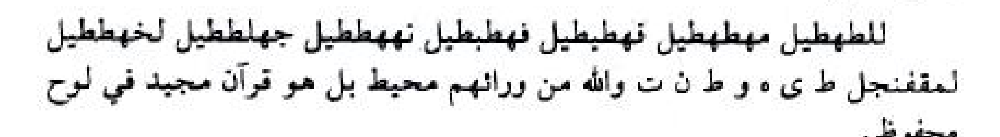
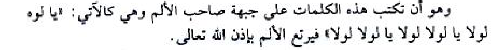
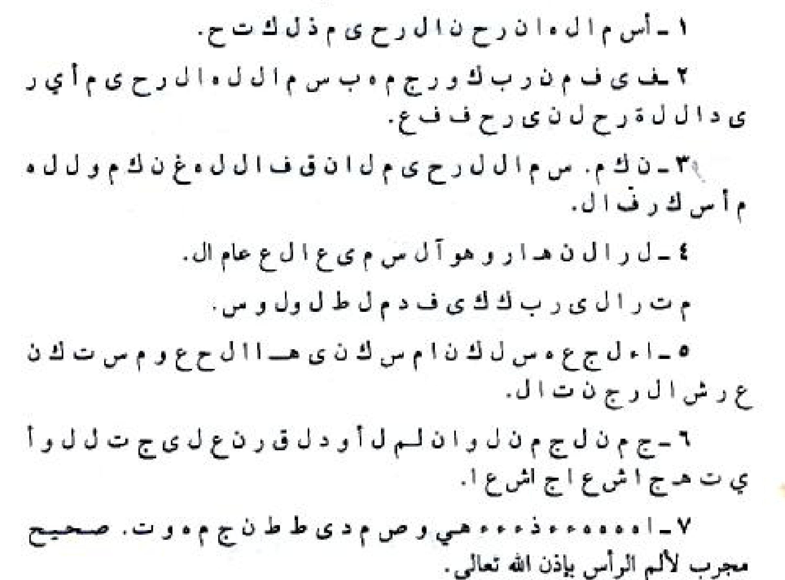

# Draf gabungan PDF halaman 128–132

## HALAMAN 128 — PDF hal. 128 / bagian — Lanjutan hirz dan amalan sakit kepala

### 1. TEKS ARAB BERHARAKAT

الرَّحْمَنِ الرَّحِيمِ قُلْ هُوَ اللَّهُ أَحَدٌ اللَّهُ الصَّمَدُ لَمْ يَلِدْ وَلَمْ يُولَدْ وَلَمْ يَكُنْ لَهُ كُفُوًا أَحَدٌ بِسْمِ اللَّهِ الرَّحْمَنِ الرَّحِيمِ قُلْ أَعُوذُ بِرَبِّ الْفَلَقِ مِنْ شَرِّ مَا خَلَقَ وَمِنْ شَرِّ غَاسِقٍ إِذَا وَقَبَ وَمِنْ شَرِّ النَّفَّاثَاتِ فِي الْعُقَدِ وَمِنْ شَرِّ حَاسِدٍ إِذَا حَسَدَ. أَيْضًا هَذِهِ الْأَسْمَاءُ وَهِيَ كَالْآتِي.

لِلْطَهْطِيلٍ مَهْطَهْطِيلٍ قَهْطَبْطِيلٍ فَهْطَبْطِيلٍ نَهَهْطَطِيلٍ جَهْلَطَطِيلٍ لَخَهْطَطِيلٍ لَمُقْفَنْجَلٍ ط ى ه و ط ن ت وَاللَّهُ مِنْ وَرَائِهِمْ مُحِيطٌ بَلْ هُوَ قُرْآنٌ مَجِيدٌ فِي لَوْحٍ مَحْفُوظٍ .

(أَيْضًا لِإِزَالَةِ أَوْجَاعِ الرَّأْسِ وَالشَّقِيقَةِ)

هُوَ أَنْ تَكْتُبَ فِي وَرَقَةٍ بَيْضَاءَ أَوْ حَمْرَاءَ وَيُعَلَّقُ عَلَى رَأْسِ صَاحِبِ الْأَلَمِ فَإِنَّهُ يَبْرَأُ بِإِذْنِ اللَّهِ تَعَالَى كَيْفِيَّةُ كِتَابَةِ هَذِهِ الْفَائِدَةِ هِيَ كَالْآتِي.

تَكْتُبُ الْبَسْمَلَةَ الشَّرِيفَةَ وَالسَّمَاءِ وَالطَّارِقِ إِلَى قَوْلِهِ تَعَالَى التَّرَائِبِ مِنْ ثُمَّ تُكَرِّرُ كِتَابَةً يَخْرُجُ مِنْ بَيْنِ الصُّلْبِ وَالتَّرَائِبِ ثَلَاثَ مَرَّاتٍ، كَذَلِكَ قَوْلُ يَخْرُجُ الضَّارِبُ وَالشَّقِيقَةُ مِنْ رَأْسِ حَامِلِ هَذَا الْحِجَابِ فُلَانِ ابْنِ فُلَانَةَ بِحَقِّ وَلَهُ مَا سَكَنَ فِي اللَّيْلِ وَالنَّهَارِ وَهُوَ السَّمِيعُ الْعَلِيمُ إِنْ يَشَأْ يُسْكِنِ الرِّيحَ فَيَظْلَلْنَ رَوَاكِدَ عَلَى ظَهْرِهَا إِنَّ فِي ذَلِكَ لَآيَاتٍ لِكُلِّ صَبَّارٍ شَكُورٍ أَلَمْ تَرَ إِلَى رَبِّكَ كَيْفَ مَدَّ الظِّلَّ لَوْ شَاءَ لَجَعَلَهُ سَاكِنًا سَاكِنًا سَاكِنًا ثُمَّ جَعَلْنَا الشَّمْسَ عَلَيْهِ دَلِيلًا ثُمَّ قَبَضْنَاهُ إِلَيْنَا قَبْضًا يَسِيرًا اسْكُنْ أَيُّهَا الصُّدَاعُ كَمَا سَكَنَ عَرْشُ الرَّحْمَنِ وَقِرَّ وَقِرَّ بِقَرَارِ اللَّهِ، ثُمَّ تَكْتُبُ بَعْدَ ذَلِكَ تِسْعِينَ صَادًا مِنْ غَيْرِ طَمْسٍ وَمَعَهُمْ هَذِهِ الْأَحْرُفُ: ر م ه ل ه. وَيُعَلَّقُ مَحَلَّ الْوَجَعِ فَإِنَّهُ يَزُولُ بِإِذْنِ اللَّهِ تَعَالَى.

(أَيْضًا فِي عِلَاجِ وَجَعِ الرَّأْسِ وَالشَّقِيقَةِ)

هُوَ أَنْ تَكْتُبَ قَوْلَهُ تَعَالَى ﴿وَلَهُ مَا سَكَنَ فِي اللَّيْلِ وَالنَّهَارِ وَهُوَ السَّمِيعُ الْعَلِيمُ﴾ اسْكُنْ أَيُّهَا الصُّدَاعُ كَمَا سَكَنَ الرِّيحُ لِسُلَيْمَانَ بْنِ دَاوُدَ عَلَيْهِ السَّلَامُ اسْكُنْ أَيُّهَا الصُّدَاعُ كَمَا سَكَنَ الْبُرَاقُ لِمُحَمَّدٍ صَلَّى اللَّهُ عَلَيْهِ وَسَلَّمَ اسْكُنْ كَمَا سَكَنَ عَرْشُ الرَّحْمَنِ ﴿أَلَمْ تَرَى إِلَى رَبِّكَ كَيْفَ مَدَّ الظِّلَّ﴾ إِلَى قَوْلِهِ تَعَالَى ﴿يَسِيرًا﴾ (سُورَةُ الْفُرْقَانِ) اسْكُنْ أَيُّهَا

### 2. TRANSLITERASI LATIN

Ar-rahmanir-rahimi Qul huwallahu ahadun Allahush-shamadu lam yalid wa lam yulad wa lam yakun lahu kufuwan ahadun Bismillahir-rahmanir-rahimi Qul a'udzu birabbil-falaqi min syarri ma khalaqa wa min syarri ghasiqin idza waqaba wa min syarrin-naffatsati fil-'uqadi wa min syarri hasidin idza hasada. Aidhan hadzihil-asma'u wa hiya kal-ati.

Lilthahthilin Mahthahthilin Qahthabthilin Fahthabthilin Nahahthathilin Jahlathathilin Lakhahthathilin Lamuqfanjalin Tha Ya Ha Wawu Tha Nun Ta Wallahu min wara'ihim muhithun bal huwa Qur'anun majidun fi lauhin mahfuzhin .

(Aidhan li-Izalati Auja'ir-Ra'si wasy-Syaqiqati)

Huwa an taktuba fi waraqatin baidha'a au hamra'a wa yu'allaqu 'ala ra'si shahibil-alami fa-innahu yabra'u bi-idznillahi ta'ala kaifiyyatu kitabati hadzihil-fa'idati hiya kal-ati.

Taktubul-basmalatasy-syarifata Was-sama'i wath-thariqi ila qaulihi ta'ala at-tara'ibi min tsumma tukarriru kitabatan yakhruju min bainish-shulbi wat-tara'ibi tsalatsa marratin, kadzalika qaulu yakhrujudh-dharibu wasy-syaqiqatu min ra'si hamili hadzal-hijabi Fulani-bni Fulanata bihaqqi Wa lahu ma sakana fil-laili wan-nahari wa huwas-sami'ul-'alimu In yasya' yuskinir-riha fayazhlalna rawakida 'ala zhahriha inna fi dzalika la-ayatin likulli shabbarin syakurin Alam tara ila rabbika kaifa maddazh-zhilla lau sya'a laja'alahu sakinan sakinan sakinan tsumma ja'alnasy-syamsa 'alaihi dalilan tsumma qabadhnahu ilaina qabdhan yasiran uskun ayyuhash-shuda'u kama sakana 'arsyur-rahmani wa qirra wa qirra biqararillahi, tsumma taktubu ba'da dzalika tis'ina shadan min ghairi thamsin wa ma'ahum hadzihil-ahrufu: Ra Mim Ha Lam Ha. Wa yu'allaqu mahallal-waja'i fa-innahu yazulu bi-idznillahi ta'ala.

(Aidhan fi 'Ilaji Waja'ir-Ra'si wasy-Syaqiqati)

Huwa an taktuba qaulahu ta'ala ﴿Wa lahu ma sakana fil-laili wan-nahari wa huwas-sami'ul-'alimu﴾ uskun ayyuhash-shuda'u kama sakanar-rihu li-Sulaimana-bni Dawuda 'alaihis-salamu uskun ayyuhash-shuda'u kama sakanal-Buraqu li-Muhammadin shallallahu 'alaihi wa sallama uskun kama sakana 'arsyur-rahmani ﴿Alam tara ila rabbika kaifa maddazh-zhilla﴾ ila qaulihi ta'ala ﴿yasiran﴾ (Suratul-Furqani) uskun ayyuha

### 3. TERJEMAHAN INDONESIA

Yang Maha Pengasih lagi Maha Penyayang. Katakanlah: "Dialah Allah, Yang Maha Esa. Allah adalah Tuhan yang bergantung kepada-Nya segala sesuatu. Dia tiada beranak dan tidak pula diperanakkan, dan tidak ada seorang pun yang setara dengan Dia." Dengan menyebut nama Allah Yang Maha Pengasih lagi Maha Penyayang. Katakanlah: "Aku berlindung kepada Tuhan Yang Menguasai subuh, dari kejahatan makhluk-Nya, dan dari kejahatan malam apabila telah gelap gulita, dan dari kejahatan wanita-wanita tukang sihir yang menghembus pada buhul-buhul, dan dari kejahatan pendengki bila ia dengki." Dan juga asma-asma ini, yaitu sebagai berikut:

لِلْطَهْطِيلٍ مَهْطَهْطِيلٍ قَهْطَبْطِيلٍ فَهْطَبْطِيلٍ نَهَهْطَطِيلٍ جَهْلَطَطِيلٍ لَخَهْطَطِيلٍ لَمُقْفَنْجَلٍ ط ى ه و ط ن ت Padahal Allah mengepung mereka dari belakang mereka. Bahkan yang didustakan mereka itu ialah Al-Qur'an yang mulia, yang tersimpan dalam Lauh Mahfuzh.

(Juga untuk Menghilangkan Sakit Kepala dan Migrain / Syaqiqah)

Yaitu engkau menulis pada selembar kertas berwarna putih atau merah, lalu digantungkan (ditempelkan) pada kepala orang yang menderita sakit tersebut, maka sesungguhnya ia akan sembuh dengan izin Allah Ta'ala. Tata cara penulisan faedah ini adalah sebagai berikut:

Engkau tulis Basmalah yang mulia dan surah Was-sama'i wath-thariq (Surah Ath-Thariq) sampai pada firman Allah Ta'ala: at-tara'ib (ayat 1 sampai 7), kemudian engkau ulangi penulisan ayat: yakhruju min bainish-shulbi wat-tara'ib (yang keluar dari antara tulang sulbi dan tulang dada) sebanyak tiga kali. Demikian pula dilanjutkan menulis kalimat: "Yakhrujudh-dharibu wasy-syaqiqatu min ra'si hamili hadzal-hijabi Fulani-bni Fulanata bihaqqi Wa lahu ma sakana fil-laili wan-nahari wa huwas-sami'ul-'alimu In yasya' yuskinir-riha fayazhlalna rawakida 'ala zhahriha inna fi dzalika la-ayatin likulli shabbarin syakurin Alam tara ila rabbika kaifa maddazh-zhilla lau sya'a laja'alahu sakinan sakinan sakinan tsumma ja'alnasy-syamsa 'alaihi dalilan tsumma qabadhnahu ilaina qabdhan yasiran uskun ayyuhash-shuda'u kama sakana 'arsyur-rahmani wa qirra wa qirra biqararillahi" (Keluarlah rasa nyeri yang berdenyut dan migrain/sakit kepala sebelah dari kepala pembawa hijab ini, yaitu Fulan bin Fulanah, dengan haq firman-Nya: "Dan milik-Nya lah segala apa yang diam pada waktu malam dan siang, dan Dialah Yang Maha Mendengar lagi Maha Mengetahui. Jika Dia menghendaki, niscaya Dia menenangkan angin, maka jadilah kapal-kapal itu terhenti di permukaan laut. Sesungguhnya pada yang demikian itu terdapat tanda-tanda kekuasaan-Nya bagi setiap orang yang banyak bersabar dan banyak bersyukur. Apakah kamu tidak memperhatikan penciptaan Tuhanmu, bagaimana Dia memanjangkan bayang-bayang; dan kalau Dia menghendaki niscaya Diaadikan bayang-bayang itu tetap diam, tetap diam, tetap diam, kemudian Kami jadikan matahari sebagai petunjuk atas bayang-bayang itu, kemudian Kami menarik bayang-bayang itu kepada Kami dengan tarikan yang mudah." Tenanglah/diamlah wahai sakit kepala sebagaimana tenangnya 'Arsy Tuhan Yang Maha Pengasih, dan menetaplah/redalah, menetaplah/redalah dengan ketetapan Allah). Kemudian setelah itu engkau tulis sembilan puluh huruf Shad (ص) tanpa menutup lubangnya (min ghairi thamsin), beserta huruf-huruf ini bersama mereka: ر م ه ل ه. Lalu digantungkan pada bagian yang sakit, maka sesungguhnya rasa sakit itu akan hilang dengan izin Allah Ta'ala.

(Juga tentang Pengobatan Sakit Kepala dan Migrain / Syaqiqah)

Yaitu engkau menulis firman Allah Ta'ala: ﴿Dan milik-Nya lah segala apa yang diam pada waktu malam dan siang, dan Dialah Yang Maha Mendengar lagi Maha Mengetahui﴾. Tenanglah/redalah wahai sakit kepala sebagaimana tenangnya angin bagi Nabi Sulaiman bin Dawud 'alaihis-salam. Tenanglah/redalah wahai sakit kepala sebagaimana tenangnya Buraq bagi Nabi Muhammad shallallahu 'alaihi wa sallam. Tenanglah/redalah sebagaimana tenangnya 'Arsy Tuhan Yang Maha Pengasih. ﴿Apakah kamu tidak memperhatikan penciptaan Tuhanmu, bagaimana Dia memanjangkan bayang-bayang﴾ sampai pada firman Allah Ta'ala: ﴿dengan tarikan yang mudah﴾ (Surah Al-Furqan: 45-46). Tenanglah/redalah wahai

### 4. TATACARA PRAKTIK LENGKAP

Berikut adalah panduan tata cara pengamalan untuk menghilangkan sakit kepala dan migrain (sakit kepala sebelah / syaqiqah) yang termuat pada halaman ini:

A. Amalan Penyempurnaan Hijab Surah Al-Ikhlash, Al-Falaq, dan Asma' Ath-Thahthiliyyah (Lanjutan dari Halaman 127)
1. Tulislah kelanjutan ayat dan asma berikut pada kertas hijab:
   - Basmalah dan Surah Al-Ikhlash lengkap.
   - Basmalah dan Surah Al-Falaq lengkap.
   - Rangkaian Asma' Sab'ah / Ath-Thahthiliyyah beserta huruf muqaththa'ah dan ayat penutupnya:
     لِلْطَهْطِيلٍ مَهْطَهْطِيلٍ قَهْطَبْطِيلٍ فَهْطَبْطِيلٍ نَهَهْطَطِيلٍ جَهْلَطَطِيلٍ لَخَهْطَطِيلٍ لَمُقْفَنْجَلٍ ط ى ه و ط ن ت وَاللَّهُ مِنْ وَرَائِهِمْ مُحِيطٌ بَلْ هُوَ قُرْآنٌ مَجِيدٌ فِي لَوْحٍ مَحْفُوظٍ

B. Amalan Hijab Kertas Putih atau Merah untuk Menghilangkan Sakit Kepala dan Migrain (Syaqiqah)
1. Siapkan selembar kertas bersih berwarna putih atau merah.
2. Dalam keadaan suci (berwudhu), tulislah rangkaian ayat, doa, dan huruf berikut secara berurutan:
   - Basmalah: بِسْمِ اللَّهِ الرَّحْمَنِ الرَّحِيمِ
   - Surah Ath-Thariq ayat 1 sampai 7, dengan mengulangi penulisan ayat ke-7 sebanyak 3 (tiga) kali:
     وَالسَّمَاءِ وَالطَّارِقِ وَمَا أَدْرَاكَ مَا الطَّارِقُ النَّجْمُ الثَّاقِبُ إِنْ كُلُّ نَفْسٍ لَمَّا عَلَيْهَا حَافِظٌ فَلْيَنْظُرِ الْإِنْسَانُ مِمَّ خُلِقَ خُلِقَ مِنْ مَاءٍ دَافِقٍ يَخْرُجُ مِنْ بَيْنِ الصُّلْبِ وَالتَّرَائِبِ يَخْرُجُ مِنْ بَيْنِ الصُّلْبِ وَالتَّرَائِبِ يَخْرُجُ مِنْ بَيْنِ الصُّلْبِ وَالتَّرَائِبِ
   - Lanjutkan dengan menulis kalimat taukil dan ayat-ayat penenang berikut:
     كَذَلِكَ يَخْرُجُ الضَّارِبُ وَالشَّقِيقَةُ مِنْ رَأْسِ حَامِلِ هَذَا الْحِجَابِ فُلَانِ ابْنِ فُلَانَةَ بِحَقِّ وَلَهُ مَا سَكَنَ فِي اللَّيْلِ وَالنَّهَارِ وَهُوَ السَّمِيعُ الْعَلِيمُ إِنْ يَشَأْ يُسْكِنِ الرِّيحَ فَيَظْلَلْنَ رَوَاكِدَ عَلَى ظَهْرِهَا إِنَّ فِي ذَلِكَ لَآيَاتٍ لِكُلِّ صَبَّارٍ شَكُورٍ أَلَمْ تَرَ إِلَى رَبِّكَ كَيْفَ مَدَّ الظِّلَّ لَوْ شَاءَ لَجَعَلَهُ سَاكِنًا سَاكِنًا سَاكِنًا ثُمَّ جَعَلْنَا الشَّمْسَ عَلَيْهِ دَلِيلًا ثُمَّ قَبَضْنَاهُ إِلَيْنَا قَبْضًا يَسِيرًا اسْكُنْ أَيُّهَا الصُّدَاعُ كَمَا سَكَنَ عَرْشُ الرَّحْمَنِ وَقِرَّ وَقِرَّ بِقَرَارِ اللَّهِ
   - Ketentuan penggantian lafaz فُلَانِ ابْنِ فُلَانَةَ:
      *Jika pasien yang sakit adalah laki-laki, ganti فُلَانِ ابْنِ فُلَانَةَ (Fulani-bni Fulanata) dengan nama pasien beserta nama ibu kandungnya.*
\*\*      Jika pasien yang sakit adalah perempuan, ganti dengan فُلَانَةَ بِنْتِ فُلَانَةَ (Fulanata binti Fulanata), yakni nama pasien beserta nama ibu kandungnya.
   - Selanjutnya, tulislah di bawahnya huruf Shad (ص) sebanyak 90 (sembilan puluh) kali dengan kepala huruf Shad yang terbuka/berlubang (tidak tertutup tinta/غير مطموسة).
   - Di akhir 90 huruf Shad tersebut, tulislah 5 huruf terpisah ini: ر م ه ل ه
3. Lipat kertas hijab tersebut dan gantungkan atau tempelkan tepat pada bagian kepala yang terasa sakit. Dengan izin Allah Ta'ala rasa sakit dan migrain tersebut akan segera hilang.

(Catatan: Adapun amalan kedua untuk pengobatan sakit kepala dan migrain pada bagian bawah halaman ini masih bersambung ke Halaman 129, sehingga tata cara praktiknya akan disajikan secara utuh pada Halaman 129).

## HALAMAN 129 — PDF hal. 129 / bagian — Lanjutan amalan sakit kepala

### 1. TEKS ARAB BERHARAKAT

الْوَجَعُ بِحَقِّ مَنْ يَقُولُ لِلشَّيْءِ كُنْ فَيَكُونُ ﴿وَضَرَبَ لَنَا مَثَلًا وَنَسِيَ خَلْقَهُ﴾ إِلَى قَوْلِهِ ﴿عَلِيمٌ﴾ (سُورَةُ يَاسِينَ آيَةُ ٧٧) أَيُّهَا الصُّدَاعُ وَالضَّارِبُ، وَالْوَجَعُ بِقُدْرَةِ اللَّهِ تَعَالَى اسْكُنْ بِتَوْرَاةِ مُوسَى وَإِنْجِيلِ عِيسَى وَفُرْقَانِ مُحَمَّدٍ صَلَّى اللَّهُ عَلَيْهِ وَسَلَّمَ وَاسْكُنْ بِلَا حَوْلَ وَلَا قُوَّةَ إِلَّا بِاللَّهِ الْعَلِيِّ الْعَظِيمِ.

(أَيْضًا فِي عِلَاجِ وَجَعِ الرَّأْسِ)

هُوَ أَنْ تَكْتُبَ «بِسْمِ اللَّهِ الرَّحْمَنِ الرَّحِيمِ بِسْمِ اللَّهِ دَوَاؤُكَ بِسْمِ اللَّهِ شِفَاؤُكَ بِسْمِ اللَّهِ شِفَاؤُكَ بِسْمِ اللَّهِ شِفَاؤُكَ حَسْبِيَ اللَّهُ وَكَفَى حَسْبِيَ اللَّهُ وَكَفَى بِسْمِ اللَّهِ دَوَاؤُكَ بِسْمِ اللَّهِ دَوَاؤُكَ بِسْمِ اللَّهِ دَوَاؤُكَ حَسْبِيَ اللَّهُ وَكَفَى حَسْبِيَ اللَّهُ وَكَفَى حَسْبِيَ اللَّهُ وَكَفَى وَنُنَزِّلُ مِنَ الْقُرْآنِ مَا هُوَ شِفَاءٌ وَرَحْمَةٌ لِلْمُؤْمِنِينَ قُلْ هُوَ لِلَّذِينَ آمَنُوا هُدًى وَشِفَاءٌ». (تُعَلَّقُ عَلَى صَاحِبِ الْوَجَعِ يَبْرَأُ بِإِذْنِ اللَّهِ تَعَالَى.

(أَيْضًا فَائِدَةٌ لِعِلَاجِ صُدَاعِ الرَّأْسِ)

وَهُوَ أَنْ تَكْتُبَ هَذِهِ الْحُرُوفَ وَتُوضَعَ عَلَى رَأْسِ الْمَرِيضِ يَرْتَفِعُ عَنْهُ الصُّدَاعُ بِعَوْنِ اللَّهِ تَعَالَى وَقُوَّتِهِ وَهِيَ هَذِهِ كَالْآتِي.

«دل دل دل ص د ق د ك ف ل م و و لا ع لا ك ا ا ل ك ا ح ح و د».

(أَيْضًا فَائِدَةٌ لِلصُّدَاعِ وَالْأَلَمِ فِي الرَّأْسِ)

وَهُوَ أَنْ تَكْتُبَ هَذِهِ الْكَلِمَاتِ عَلَى جَبْهَةِ صَاحِبِ الْأَلَمِ وَهِيَ كَالْآتِي: «يَا لُوهٍ لُولَا يَا لُولَا لُولَا يَا لُولَا لُولَا» فَيَرْتَعُ الْأَلَمُ بِإِذْنِ اللَّهِ تَعَالَى.

(أَيْضًا لِعِلَاجِ الْوَجَعِ النِّصْفِ فِي الرَّأْسِ)

هُوَ أَنْ تَكْتُبَ هَذِهِ الْآيَةَ الشَّرِيفَةَ ﴿وَكَلْبُهُمْ بَاسِطٌ ذِرَاعَيْهِ بِالْوَصِيدِ لَوِ اطَّلَعْتَ عَلَيْهِمْ لَوَلَّيْتَ مِنْهُمْ وَلَمُلِئْتَ مِنْهُمْ رُعْبًا﴾ وَتُعَلَّقُ لِجِهَةِ الْأَلَمِ فِي الرَّأْسِ وَهِيَ مُجَرَّبَةٌ لِذَلِكَ بِإِذْنِ اللَّهِ تَعَالَى.

### 2. TRANSLITERASI LATIN

al-waja'u bihaqqi man yaqulu lisy-syai'i kun fayakunu ﴿Wa dharaba lana matsalan wa nasiya khalqahu﴾ ila qaulihi ﴿'alimun﴾ (Suratu Yasina Ayatu sab'in wa sab'ina) ayyuhash-shuda'u wadh-dharibu, wal-waja'u biqudratillahi ta'ala uskun bi-Taurati Musa wa Injili 'Isa wa Furqani Muhammadin shallallahu 'alaihi wa sallama waskun bila haula wa la quwwata illa billahil-'aliyyil-'azhimi.

(Aidhan fi 'Ilaji Waja'ir-Ra'si)

Huwa an taktuba «Bismillahir-rahmanir-rahimi bismillahi dawa'uka bismillahi syifa'uka bismillahi syifa'uka bismillahi syifa'uka hasbiyallahu wa kafa hasbiyallahu wa kafa bismillahi dawa'uka bismillahi dawa'uka bismillahi dawa'uka hasbiyallahu wa kafa hasbiyallahu wa kafa hasbiyallahu wa kafa Wa nunazzilu minal-Qur'ani ma huwa syifa'un wa rahmatun lil-mu'minina Qul huwa lilladzina amanu hudan wa syifa'un». (Tu'allaqu 'ala shahibil-waja'i yabra'u bi-idznillahi ta'ala.

(Aidhan Fa'idatun li-'Ilaji Shuda'ir-Ra'si)

Wa huwa an taktuba hadzihil-hurufa wa tudha'a 'ala ra'sil-maridhi yartafi'u 'anhush-shuda'u bi'aunillahi ta'ala wa quwwatihi wa hiya hadzihi kal-ati.

«Dal-Lam Dal-Lam Dal-Lam Shad Dal Qaf Dal Kaf Fa Lam Mim Wawu Wawu Lam-Alif 'Ain Lam-Alif Kaf Alif Alif Lam Kaf Alif Ha Ha Wawu Dal».

(Aidhan Fa'idatun lish-Shuda'i wal-Alami fir-Ra'si)

Wa huwa an taktuba hadzihil-kalimati 'ala jabhati shahibil-alami wa hiya kal-ati: «Ya Luhin Lula Ya Lula Lula Ya Lula Lula» fayarta'ul-alamu bi-idznillahi ta'ala.

(Aidhan li-'Ilajil-Waja'in-Nishfi fir-Ra'si)

Huwa an taktuba hadzihil-ayatasy-syarifata ﴿Wa kalbuhum basithun dzira'aihi bil-washidi lawith-thala'ta 'alaihim lawallaita minhum wa lamuli'ta minhum ru'ban﴾ wa tu'allaqu lijihatil-alami fir-ra'si wa hiya mujarrabatun lidzalika bi-idznillahi ta'ala.

### 3. TERJEMAHAN INDONESIA

rasa sakit, dengan haq Dzat yang berfirman kepada sesuatu: "Jadilah!" maka jadilah ia. ﴿Dan dia membuat perumpamaan bagi Kami; dan dia lupa kepada kejadiannya﴾ sampai pada firman-Nya: ﴿Maha Mengetahui﴾ (Surah Yasin ayat 77-79). Wahai sakit kepala, rasa nyeri yang berdenyut, dan rasa sakit, dengan kekuasaan Allah Ta'ala tenanglah/redalah demi Taurat Musa, Injil 'Isa, dan Furqan (Al-Qur'an) Muhammad shallallahu 'alaihi wa sallam, dan tenanglah/redalah dengan kalimat: tiada daya dan tiada kekuatan melainkan dengan pertolongan Allah Yang Maha Tinggi lagi Maha Agung.

(Juga tentang Pengobatan Sakit Kepala)

Yaitu engkau menulis: «Bismillahir-rahmanir-rahimi bismillahi dawa'uka bismillahi syifa'uka bismillahi syifa'uka bismillahi syifa'uka hasbiyallahu wa kafa hasbiyallahu wa kafa bismillahi dawa'uka bismillahi dawa'uka bismillahi dawa'uka hasbiyallahu wa kafa hasbiyallahu wa kafa hasbiyallahu wa kafa Wa nunazzilu minal-Qur'ani ma huwa syifa'un wa rahmatun lil-mu'minina Qul huwa lilladzina amanu hudan wa syifa'un» (Dengan menyebut nama Allah Yang Maha Pengasih lagi Maha Penyayang. Dengan nama Allah obatmu, dengan nama Allah kesembuhanmu, dengan nama Allah kesembuhanmu, dengan nama Allah kesembuhanmu. Cukuplah Allah bagiku dan Dia telah mencukupi, cukuplah Allah bagiku dan Dia telah mencukupi. Dengan nama Allah obatmu, dengan nama Allah obatmu, dengan nama Allah obatmu. Cukuplah Allah bagiku dan Dia telah mencukupi, cukuplah Allah bagiku dan Dia telah mencukupi, cukuplah Allah bagiku dan Dia telah mencukupi. Dan Kami turunkan dari Al-Qur'an suatu yang menjadi penawar/kesembuhan dan rahmat bagi orang-orang yang beriman. Katakanlah: "Al-Qur'an itu adalah petunjuk dan penawar bagi orang-orang yang beriman"). (Digantungkan pada orang yang menderita sakit tersebut, niscaya ia akan sembuh dengan izin Allah Ta'ala).

(Juga Faedah untuk Mengobati Pusing / Sakit Kepala)

Yaitu engkau menulis huruf-huruf ini lalu diletakkan di atas kepala orang yang sakit, niscaya pusing (sakit kepala) tersebut akan terangkat darinya dengan pertolongan Allah Ta'ala dan kekuatan-Nya. Huruf-huruf tersebut adalah sebagai berikut:

«دل دل دل ص د ق د ك ف ل م و و لا ع لا ك ا ا ل ك ا ح ح و د».

(Juga Faedah untuk Pusing dan Rasa Nyeri di Kepala)

Yaitu engkau menulis kalimat-kalimat ini pada dahi (kening) orang yang menderita rasa sakit tersebut, yaitu sebagai berikut: «يَا لُوهٍ لُولَا يَا لُولَا لُولَا يَا لُولَا لُولَا» maka rasa sakit itu akan terangkat (hilang) dengan izin Allah Ta'ala.

(Juga untuk Mengobati Sakit Kepala Sebelah / Migrain)

Yaitu engkau menulis ayat yang mulia ini: ﴿Dan anjing mereka الصالح membentangkan kedua lengannya di muka pintu gua. Dan jika kamu menyaksikan mereka tentulah kamu akan berpaling dari mereka dengan melarikan diri dan tentulah hati kamu akan dipenuhi oleh ketakutan terhadap mereka﴾ (QS. Al-Kahfi: 18), lalu digantungkan (ditempelkan) pada sisi kepala yang terasa sakit. Amalan ini mujarab untuk keluhan tersebut dengan izin Allah Ta'ala.

### 4. TATACARA PRAKTIK LENGKAP

Berikut adalah panduan lengkap tata cara pengamalan 5 (lima) faedah pengobatan sakit kepala, pusing, dan migrain yang terdapat pada halaman ini:

A. Amalan Pertama: Pengobatan Sakit Kepala dan Migrain / Syaqiqah (Gabungan Akhir Halaman 128 dan Awal Halaman 129)
1. Siapkan selembar kertas bersih dalam keadaan suci (berwudhu).
2. Tulislah rangkaian ayat Al-Qur'an dan doa penenang sakit kepala berikut secara lengkap (dengan menyempurnakan penulisan ayat yang disingkat di dalam kitab):
   بِسْمِ اللَّهِ الرَّحْمَنِ الرَّحِيمِ وَلَهُ مَا سَكَنَ فِي اللَّيْلِ وَالنَّهَارِ وَهُوَ السَّمِيعُ الْعَلِيمُ اسْكُنْ أَيُّهَا الصُّدَاعُ كَمَا سَكَنَ الرِّيحُ لِسُلَيْمَانَ بْنِ دَاوُدَ عَلَيْهِ السَّلَامُ اسْكُنْ أَيُّهَا الصُّدَاعُ كَمَا سَكَنَ الْبُرَاقُ لِمُحَمَّدٍ صَلَّى اللَّهُ عَلَيْهِ وَسَلَّمَ اسْكُنْ كَمَا سَكَنَ عَرْشُ الرَّحْمَنِ أَلَمْ تَرَ إِلَى رَبِّكَ كَيْفَ مَدَّ الظِّلَّ وَلَوْ شَاءَ لَجَعَلَهُ سَاكِنًا ثُمَّ جَعَلْنَا الشَّمْسَ عَلَيْهِ دَلِيلًا ثُمَّ قَبَضْنَاهُ إِلَيْنَا قَبْضًا يَسِيرًا اسْكُنْ أَيُّهَا الْوَجَعُ بِحَقِّ مَنْ يَقُولُ لِلشَّيْءِ كُنْ فَيَكُونُ وَضَرَبَ لَنَا مَثَلًا وَنَسِيَ خَلْقَهُ قَالَ مَنْ يُحْيِي الْعِظَامَ وَهِيَ رَمِيمٌ قُلْ يُحْيِيهَا الَّذِي أَنْشَأَهَا أَوَّلَ مَرَّةٍ وَهُوَ بِكُلِّ خَلْقٍ عَلِيمٌ أَيُّهَا الصُّدَاعُ وَالضَّارِبُ، وَالْوَجَعُ بِقُدْرَةِ اللَّهِ تَعَالَى اسْكُنْ بِتَوْرَاةِ مُوسَى وَإِنْجِيلِ عِيسَى وَفُرْقَانِ مُحَمَّدٍ صَلَّى اللَّهُ عَلَيْهِ وَسَلَّمَ وَاسْكُنْ بِلَا حَوْلَ وَلَا قُوَّةَ إِلَّا بِاللَّهِ الْعَلِيِّ الْعَظِيمِ.
3. Lipat kertas tersebut dan gantungkan/tempelkan pada kepala orang yang sakit.

B. Amalan Kedua: Hijab Ayat Syifa' untuk Mengobati Sakit Kepala
1. Siapkan selembar kertas bersih, lalu tulislah kalimat dan ayat berikut:
   بِسْمِ اللَّهِ الرَّحْمَنِ الرَّحِيمِ بِسْمِ اللَّهِ دَوَاؤُكَ بِسْمِ اللَّهِ شِفَاؤُكَ بِسْمِ اللَّهِ شِفَاؤُكَ بِسْمِ اللَّهِ شِفَاؤُكَ حَسْبِيَ اللَّهُ وَكَفَى حَسْبِيَ اللَّهُ وَكَفَى بِسْمِ اللَّهِ دَوَاؤُكَ بِسْمِ اللَّهِ دَوَاؤُكَ بِسْمِ اللَّهِ دَوَاؤُكَ حَسْبِيَ اللَّهُ وَكَفَى حَسْبِيَ اللَّهُ وَكَفَى حَسْبِيَ اللَّهُ وَكَفَى وَنُنَزِّلُ مِنَ الْقُرْآنِ مَا هُوَ شِفَاءٌ وَرَحْمَةٌ لِلْمُؤْمِنِينَ قُلْ هُوَ لِلَّذِينَ آمَنُوا هُدًى وَشِفَاءٌ
2. Lipat dan gantungkan/ikatkan kertas tersebut pada kepala penderita sakit kepala.

C. Amalan Ketiga: Rajah Huruf untuk Mengangkat Pusing Kepala
1. Tulislah rangkaian huruf hijaiyah berikut pada selembar kertas bersih persis sesuai naskah:
   دل دل دل ص د ق د ك ف ل م و و لا ع لا ك ا ا ل ك ا ح ح و د
2. Letakkan kertas tersebut di atas kepala orang yang sakit pusing.

D. Amalan Keempat: Penulisan Asma' pada Dahi untuk Menghilangkan Nyeri dan Pusing Kepala
1. Tulislah langsung (menggunakan tinta yang suci/aman di kulit atau dengan ujung jari) pada dahi/kening orang yang sedang sakit kepala kalimat berikut:
   يَا لُوهٍ لُولَا يَا لُولَا لُولَا يَا لُولَا لُولَا
   (Ya Luhin Lula Ya Lula Lula Ya Lula Lula).
2. Dengan izin Allah Ta'ala rasa nyeri di kepalanya akan segera terangkat.

E. Amalan Kelima: Hijab Surah Al-Kahfi Ayat 18 Khusus untuk Sakit Kepala Sebelah (Migrain)
1. Tulislah potongan ayat 18 dari Surah Al-Kahfi berikut pada selembar kertas bersih:
   وَكَلْبُهُمْ بَاسِطٌ ذِرَاعَيْهِ بِالْوَصِيدِ لَوِ اطَّلَعْتَ عَلَيْهِمْ لَوَلَّيْتَ مِنْهُمْ وَلَمُلِئْتَ مِنْهُمْ رُعْبًا
2. Lipat kertas tersebut dan gantungkan atau tempelkan tepat pada sisi kepala (kanan atau kiri) yang mengalami migrain/sakit kepala sebelah. Amalan ini sangat mujarab dengan izin Allah Ta'ala.

## HALAMAN 130 — PDF hal. 130 / bagian — Huruf untuk sakit kepala dan awal bab penyakit mata

### 1. TEKS ARAB BERHARAKAT

(أَيْضًا بَابٌ لِعِلَاجِ الْوَجَعِ فِي الرَّأْسِ)

وَمِمَّا قِيلَ لِجِهَةِ عِلَاجِ الرَّأْسِ فِي هَذَا الْبَابِ : أَنَّهُ فَمَا وُجِدَ أَصَحُّ مِنْهُ وَهُوَ صَحِيحٌ مُجَرَّبٌ لِعِلَاجِ الْأَلَمِ وَالصُّدَاعِ فِي الرَّأْسِ : وَهُوَ أَنْ تَكْتُبَ هَذِهِ الْآيَاتِ وَالْأَسْمَاءَ الْمُبَارَكَةَ أَحْرُفٌ مُفَرَّقَةٌ عَلَى الشَّكْلِ الْآتِي.

١ - أ س م ا ل ه ا ن ر ح ن ا ل ر ح ى م ذ ل ك ت ح .

٢ - ف ى ف م ن ر ب ك و ر ج م ه ب س م ا ل ل ه ا ل ر ح ى م أ ي ر ى د ا ل ل ة ر ح ل ن ى ر ح ف ف ع .

٣ - ن ك م . س م ا ل ل ر ح ى م ل ا ن ق ف ا ل ل ه غ ن ك م و ل ل ه م أ س ك ر ف ا ل .

٤ - ل ر ا ل ن هـ ا ر و هـ و آ ل س م ى ع ا ل ع عام ا ل .

م ت ر ا ل ى ر ب ك ك ى ف د م ل ط ل و ل و س .

٥ - ا ء ل ج ع ه س ل ك ن ا م س ك ن ى هـ ا ا ل ح ع و م س ت ك ن ع ر ش ا ل ر ج ن ت ا ل .

٦ - ج م ن ل ج م ن ل و ا ن لـم ل أ و د ل ق ر ن ع ل ى ج ت ل ل و أ ي ت هـ ج ا ش ع ا ج اش ع ا .

٧ - ا ه ه ه ه ه ء ء ذ ء ء ء هـ ي و ص م د ى ط ط ن ج م ه و ت . صَحِيحٌ مُجَرَّبٌ لِأَلَمِ الرَّأْسِ بِإِذْنِ اللَّهِ تَعَالَى .

(بَابٌ فِي عِلَاجِ أَمْرَاضِ الْعَيْنَيْنِ وَهُوَ عِدَّةُ أَبْوَابٍ)

وَفِي كِتَابِ الْمِصْبَاحِ : عَنْ مُحَمَّدِ بْنِ الْجُعْفِيِّ عَنْ أَبِيهِ قَالَ : كُنْتُ كَثِيرًا مَا أَشْتَكِي عَيْنِي فَشَكَوْتُ ذَلِكَ إِلَى الْإِمَامِ جَعْفَرٍ الصَّادِقِ (عَلَيْهِ أَفْضَلُ الصَّلَوَاتِ وَالسَّلَامِ) فَقَالَ : أَلَا أُعَلِّمُكَ دُعَاءً لِدُنْيَاكَ وَآخِرَتِكَ وَيُكْفَى بِهِ وَجَعُ عَيْنِكَ قُلْتُ بَلَى قَالَ تَقُولُ فِي دُبُرِ الْفَجْرِ وَالْمَغْرِبِ : اللَّهُمَّ إِنِّي أَسْأَلُكَ بِحَقِّ مُحَمَّدٍ وَآلِ مُحَمَّدٍ أَنْ تُصَلِّيَ عَلَى مُحَمَّدٍ وَآلِ مُحَمَّدٍ وَأَسْأَلُكَ أَنْ تَجْعَلَ النُّورَ فِي بَصَرِي وَالْبَصِيرَةَ فِي

### 2. TRANSLITERASI LATIN

(Aidhan Babun li-'Ilajil-Waja'i fir-Ra'si)

Wa mimma qila lijihati 'ilajir-ra'si fi hadzal-babi : Annahu fama wujida ashahhu minhu wa huwa shahihun mujarrabun li-'ilajil-alami wash-shuda'i fir-ra'si : Wa huwa an taktuba hadzihil-ayati wal-asma'al-mubarakata ahrufun mufarraqatun 'alasy-syaklil-ati.

Wahidun - Alif Sin Mim Alif Lam Ha Alif Nun Ra Ha Nun Alif Lam Ra Ha Ya Mim Dzal Lam Kaf Ta Ha .

Itsnani - Fa Ya Fa Mim Nun Ra Ba Kaf Wawu Ra Jim Mim Ha Ba Sin Mim Alif Lam Lam Ha Alif Lam Ra Ha Ya Mim Alif Ya Ra Ya Dal Alif Lam Lam Ta-Marbuthah Ra Ha Lam Nun Ya Ra Ha Fa Fa 'Ain .

Tsalatsatun - Nun Kaf Mim . Sin Mim Alif Lam Lam Ra Ha Ya Mim Lam Alif Nun Qaf Fa Alif Lam Lam Ha Ghain Nun Kaf Mim Wawu Lam Lam Ha Mim Alif Sin Kaf Ra Fa Alif Lam .

Arba'atun - Lam Ra Alif Lam Nun Ha Alif Ra Wawu Ha Wawu Alif-Madd Lam Sin Mim Ya 'Ain Alif Lam 'Ain 'Ain-Alif-Mim Alif Lam .

Mim Ta Ra Alif Lam Ya Ra Ba Kaf Kaf Ya Fa Dal Mim Lam Tha Lam Wawu Lam Wawu Sin .

Khamsatun - Alif Hamzah Lam Jim 'Ain Ha Sin Lam Kaf Nun Alif Mim Sin Kaf Nun Ya Ha Alif Alif Lam Ha 'Ain Wawu Mim Sin Ta Kaf Nun 'Ain Ra Syin Alif Lam Ra Jim Nun Ta Alif Lam .

Sittatun - Jim Mim Nun Lam Jim Mim Nun Lam Wawu Alif Nun Lam-Mim Lam Alif Wawu Dal Lam Qaf Ra Nun 'Ain Lam Ya Jim Ta Lam Lam Wawu Alif Ya Ta Ha Jim Alif Syin 'Ain Alif Jim Alif-Syin 'Ain Alif .

Sab'atun - Alif Ha Ha Ha Ha Ha Hamzah Hamzah Dzal Hamzah Hamzah Hamzah Ha Ya Wawu Shad Mim Dal Ya Tha Tha Nun Jim Mim Ha Wawu Ta . Shahihun mujarrabun li-alamir-ra'si bi-idznillahi ta'ala .

(Babun fi 'Ilaji Amradhil-'Ainaini wa Huwa 'Iddatu Abwabin)

Wa fi Kitabil-Mishbahi : 'An Muhammadi-bnil-Ju'fiyyi 'an abihi qala : Kuntu katsiran ma asytaki 'aini fasyakautu dzalika ilal-Imami Ja'farinish-Shadiqi ('alaihi afdhalush-shalawati was-salami) faqala : Ala u'allimuka du'a'an lidunyaka wa akhiratika wa yukfa bihi waja'u 'ainika qultu bala qala taqulu fi duburil-fajri wal-maghribi : Allahumma inni as'aluka bihaqqi Muhammadin wa ali Muhammadin an tushalliya 'ala Muhammadin wa ali Muhammadin wa as'aluka an taj'alan-nura fi bashari wal-bashirata fi

### 3. TERJEMAHAN INDONESIA

(Juga Bab untuk Mengobati Rasa Sakit di Kepala)

Dan di antara hal yang disebutkan untuk pengobatan kepala di dalam bab ini: Bahwasanya tidak ditemukan yang lebih shahih darinya, dan amalan ini shahih lagi mujarab untuk mengobati rasa nyeri dan pusing (sakit kepala) di kepala: Yaitu engkau menulis ayat-ayat dan asma-asma yang penuh berkah ini dengan huruf-huruf yang terpisah (ahruf mufarraqah) mengikuti bentuk berikut ini:

١ - أ س م ا ل ه ا ن ر ح ن ا ل ر ح ى م ذ ل ك ت ح .

٢ - ف ى ف م ن ر ب ك و ر ج م ه ب س م ا ل ل ه ا ل ر ح ى م أ ي ر ى د ا ل ل ة ر ح ل ن ى ر ح ف ف ع .

٣ - ن ك م . س م ا ل ل ر ح ى م ل ا ن ق ف ا ل ل ه غ ن ك م و ل ل ه م أ س ك ر ف ا ل .

٤ - ل ر ا ل ن هـ ا ر و هـ و آ ل س م ى ع ا ل ع عام ا ل .

م ت ر ا ل ى ر ب ك ك ى ف د م ل ط ل و ل و س .

٥ - ا ء ل ج ع ه س ل ك ن ا م س ك ن ى هـ ا ا ل ح ع و م س ت ك ن ع ر ش ا ل ر ج ن ت ا ل .

٦ - ج م ن ل ج م ن ل و ا ن لـم ل أ و د ل ق ر ن ع ل ى ج ت ل ل و أ ي ت هـ ج ا ش ع ا ج اش ع ا .

٧ - ا ه ه ه ه ه ء ء ذ ء ء ء هـ ي و ص م د ى ط ط ن ج م ه و ت .

Amalan ini shahih lagi mujarab untuk sakit kepala dengan izin Allah Ta'ala.

(Bab tentang Pengobatan Penyakit-Penyakit Kedua Mata, dan di Dalamnya Terdapat Beberapa Bab)

Di dalam kitab Al-Mishbah disebutkan: Dari Muhammad bin Al-Ju'fi dari ayahnya, ia berkata: "Aku dahulu sangat sering mengeluhkan sakit pada mataku, lalu aku mengadukan hal tersebut kepada Imam Ja'far Ash-Shadiq (semoga shalawat dan salam paling utama tercurah kepada beliau). Maka beliau berkata: 'Maukah engkau kuajarkan sebuah doa untuk kebaikan duniamu dan akhiratmu serta dengannya rasa sakit pada matamu akan disembuhkan (dicukupkan)?' Aku menjawab: 'Tentu mau.' Beliau berkata: 'Ucapkanlah setiap selesai shalat Subuh (Fajar) dan shalat Maghrib: Ya Allah, sesungguhnya aku memohon kepada-Mu dengan haq (kemuliaan) Muhammad dan keluarga Muhammad agar Engkau melimpahkan shalawat kepada Muhammad dan keluarga Muhammad, dan aku memohon kepada-Mu agar Engkau menjadikan cahaya pada penglihatanku, mata hati (bashirah) pada

### 4. TATACARA PRAKTIK LENGKAP

Berikut adalah panduan tata cara pengamalan untuk mengobati sakit kepala dan pusing yang termuat secara lengkap pada halaman ini:

A. Amalan Rajah Huruf Terpisah (Ahruf Mufarraqah) untuk Mengobati Nyeri dan Sakit Kepala (Pusing)

1. Siapkan selembar kertas bersih dalam keadaan suci (berwudhu).

2. Tulislah 7 (tujuh) baris rangkaian huruf-huruf hijaiyah terpisah (asrar huruf dari ayat-ayat dan asma-asma berkah) persis sebagaimana bentuk yang tertera pada naskah tanpa diubah:

   - Baris 1: أ س م ا ل ه ا ن ر ح ن ا ل ر ح ى م ذ ل ك ت ح .

   - Baris 2: ف ى ف م ن ر ب ك و ر ج م ه ب س م ا ل ل ه ا ل ر ح ى م أ ي ر ى د ا ل ل ة ر ح ل ن ى ر ح ف ف ع .

   - Baris 3: ن ك م . س م ا ل ل ر ح ى م ل ا ن ق ف ا ل ل ه غ ن ك م و ل ل ه م أ س ك ر ف ا ل .

   - Baris 4: ل ر ا ل ن هـ ا ر و هـ و آ ل س م ى ع ا ل ع عام ا ل . م ت ر ا ل ى ر ب ك ك ى ف د م ل ط ل و ل و س .

   - Baris 5: ا ء ل ج ع ه س ل ك ن ا م س ك ن ى هـ ا ا ل ح ع و م س ت ك ن ع ر ش ا ل ر ج ن ت ا ل .

   - Baris 6: ج م ن ل ج م ن ل و ا ن لـم ل أ و د ل ق ر ن ع ل ى ج ت ل ل و أ ي ت هـ ج ا ش ع ا ج اش ع ا .

   - Baris 7: ا ه ه ه ه ه ء ء ذ ء ء ء هـ ي و ص م د ى ط ط ن ج م ه و ت .

3. Setelah selesai ditulis, lipat kertas tersebut dan gantungkan atau tempelkan/ikatkan pada kepala orang yang sedang mengalami sakit kepala atau pusing. Dengan izin Allah Ta'ala, sakit kepalanya akan sembuh.

(Catatan: Adapun amalan "Doa Pengobatan Penyakit Kedua Mata" dari kitab Al-Mishbah pada bagian bawah halaman ini masih bersambung ke Halaman 131, sehingga tata cara praktiknya akan disajikan secara lengkap pada halaman berikutnya).

## HALAMAN 131 — PDF hal. 131 / bagian — Doa dan amalan untuk mata

### 1. TEKS ARAB BERHARAKAT

دِينِي وَالْيَقِينَ فِي قَلْبِي وَالْإِخْلَاصَ فِي عَمَلِي وَالسَّلَامَةَ فِي نَفْسِي وَالسَّعَةَ فِي رِزْقِي وَالشُّكْرَ لَكَ أَبَدًا مَا أَبْقَيْتَنِي. ثُمَّ تَسْجُدُ سَجْدَتَيِ الشُّكْرِ وَقُلْ فِيهِمَا مَا شِئْتَ مِمَّا تَقَدَّمَ، فَإِذَا غَابَ الشَّفَقُ فَأَذِّنْ لِلْعِشَاءِ الْآخِرَةِ، وَقُلْ مَا تَقَدَّمَ ذِكْرُهُ وَذَلِكَ بَعْدَ الْأَذَانِ وَالْإِقَامَةِ، وَالْإِتْيَانِ بِالْفَرِيضَةِ وَبَعْدَ كُلِّ فَرِيضَةٍ (اسْتِحْبَابًا لِلْوُصُولِ إِلَى مَا هُوَ مَأْمُولٌ).

(أَيْضًا فِي عِلَاجِ مَرَضِ الْعُيُونِ)

هُوَ أَنْ يَقْرَأَ سُورَةَ التَّكْوِيرِ الْمُبَارَكَةَ عَلَى فِنْجَانِ مَاءِ وَرْدٍ (وَاحِدًا وَعِشْرِينَ مَرَّةً) مِنْ ثُمَّ يَمْسَحَ عَيْنَيْهِ بِشَيْءٍ مِنْهُ زَادَ نُورُ الْعَيْنِ وَكَمَا أَنَّهُ إِذَا قُرِئَتْ نَفْسُ السُّورَةِ الشَّرِيفَةِ عَلَى عَيْنٍ فِيهَا رَمَدٌ أَوْ مَرَضٌ شُفِيَتْ بِإِذْنِ الْبَارِئِ عَزَّ وَجَلَّ.

(أَيْضًا لِلشِّفَاءِ مِنْ أَمْرَاضِ الْعَيْنَيْنِ)

وَرَدَ فِي بِحَارِ الْأَنْوَارِ (مُجَلَّد ١٩) صَفْحَة ٦٥: الْكَافِي، عَنِ الْحُسَيْنِ بْنِ مُحَمَّدٍ، وَمُحَمَّدِ بْنِ يَحْيَى، عَنْ عَلِيِّ بْنِ مُحَمَّدِ بْنِ سَالِمٍ، عَنْ مُوسَى بْنِ عَبْدِ اللَّهِ بْنِ مُوسَى عَنْ مُحَمَّدِ بْنِ عَلِيِّ بْنِ جَعْفَرٍ، عَنِ الْإِمَامِ الرِّضَا (عَلَيْهِ أَفْضَلُ الصَّلَاةِ وَالسَّلَامِ) قَالَ: إِنَّمَا شِفَاءُ الْعَيْنِ قِرَاءَةُ الْحَمْدِ وَالْمُعَوِّذَتَيْنِ وَآيَةِ الْكُرْسِيِّ وَالْبَخُورِ بِالْقُسْطِ وَالْمُرِّ وَاللُّبَانِ.

(بَابٌ لِعِلَاجِ الضَّعْفِ فِي الْبَصَرِ)

رُوِيَ أَنَّهُ مَنْ أَرَادَ أَنْ يُشْفَى مِنَ الضَّعْفِ فِي بَصَرِهِ أَوْ رَمَدٍ أَصَابَهُ: فَلْيُقَابِلِ الْهِلَالَ أَوَّلَ لَيْلَةٍ أَوِ الثَّانِيَةَ أَوِ اللَّيْلَةَ الثَّالِثَةَ فَإِذَا رَآهُ فَلْيَمْسَحْ بِيَمِينِهِ عَلَى عَيْنَيْهِ وَهُوَ يَقْرَأُ أُمَّ الْقُرْآنِ سُورَةَ الْحَمْدِ عَشْرَ مَرَّاتٍ وَيُبَسْمِلُ فِي كُلِّ مَرَّةٍ، وَيُؤَمِّنُ فِي آخِرِهَا (مِنْ حَيْثُ النِّيَّةِ فِي الشِّفَاءِ) مِنْ ثُمَّ يَقْرَأُ قُلْ هُوَ اللَّهُ أَحَدٌ ثَلَاثَ مَرَّاتٍ، وَيَمْسَحُ عَلَى عَيْنَيْهِ وَيَقُولُ: شِفَاءٌ مِنْ كُلِّ دَاءٍ بِرَحْمَتِكَ يَا أَرْحَمَ الرَّاحِمِينَ سَبْعَ مَرَّاتٍ، فَإِنَّ اللَّهَ سُبْحَانَهُ وَتَعَالَى يُعَافِيهِ مِنْ كُلِّ دَاءٍ فِي بَصَرِهِ وَكُلِّ مَرَضٍ أَصَابَهُ وَاللَّهُ عَلَى كُلِّ شَيْءٍ قَدِيرٌ.

### 2. TRANSLITERASI LATIN

Dini wal-yaqina fi qalbi wal-ikhlasha fi 'amali was-salamata fi nafsi was-sa'ata fi rizqi wasy-syukra laka abadan ma abqaitani. Tsumma tasjudu sajdataisy-syukri wa qul fihima ma syi'ta mimma taqaddama, fa-idza ghaba asy-syafaqu fa-adzdzin lil-'isya'il-akhirati, wa qul ma taqaddama dzikruhu wa dzalika ba'dal-adzani wal-iqamati, wal-ityani bil-faridhati wa ba'da kulli faridhatin (istihbaban lil-wushuli ila ma huwa ma'mul).

(Aidhan fi 'ilaji maradhil-'uyun)

Huwa an yaqra'a suratat-Takwiri al-mubarakata 'ala finjani ma'i wardin (wahidan wa 'isyrina marratan) min tsumma yamsaha 'ainaihi bisyai'in minhu zada nurul-'aini wa kama annahu idza quri'at nafsus-suratisy-syarifati 'ala 'ainin fiha ramadun au maradhun syufiyat bi-idznil-Bari'i 'azza wa jalla.

(Aidhan lisy-syifa'i min amradhil-'ainain)

Warada fi Biharil-Anwar (mujallad 19) shafhah 65: al-Kafi, 'anil-Husaini bni Muhammad, wa Muhammadi bni Yahya, 'an 'Aliyyi bni Muhammadi bni Salim, 'an Musa bni 'Abdillahi bni Musa 'an Muhammadi bni 'Aliyyi bni Ja'far, 'anil-Imamir-Ridha ('alaihi afdhalush-shalati was-salam) qala: Innama syifa'ul-'aini qira'atul-hamdi wal-mu'awwidzataini wa ayatil-kursiyyi wal-bakhuri bil-qusthi wal-murri wal-luban.

(Babun li'ilajidh-dha'fi fil-bashar)

Ruwiya annahu man arada an yusyfa minadh-dha'fi fi basharihi au ramadin ashabahu: fal-yuqabilil-hilala awwala lailatin awits-tsaniyata awil-lailatats-tsalitsata fa-idza ra'ahu falyamsah biyaminihi 'ala 'ainaihi wa huwa yaqra'u ummal-Qur'ani suratal-hamdi 'asyra marratin wa yubasmilu fi kulli marratin, wa yu'amminu fi akhiriha (min haitsun-niyyati fisy-syifa') min tsumma yaqra'u qul huwallahu ahadun tsalatsa marratin, wa yamsahu 'ala 'ainaihi wa yaqulu: Syifa'un min kulli da'in birahmatika ya arhamar-rahimin sab'a marratin, fa-innallaha subhanahu wa ta'ala yu'afihi min kulli da'in fi basharihi wa kulli maradhin ashabahu wallahu 'ala kulli syai'in qadir.

### 3. TERJEMAHAN INDONESIA

[Lanjutan doa dari halaman 130:] agamaku, keyakinan dalam hatiku, keikhlasan dalam amalku, keselamatan diriku, kelapangan rezekiku dan rasa syukur kepada-Mu selama Engkau membiarkanku hidup. Kemudian lakukan dua sujud syukur dan ucapkan di dalamnya apa yang engkau kehendaki dari yang telah disebutkan. Ketika mega merah menghilang, kumandangkan azan untuk Isya dan ucapkan yang telah disebutkan tadi, setelah azan dan ikamah, pelaksanaan shalat wajib dan setelah setiap shalat wajib, sebagai anjuran untuk mencapai yang diharapkan.

(Juga tentang penanganan penyakit mata)

Bacalah Surah At-Takwir yang diberkahi pada secangkir air mawar sebanyak dua puluh satu kali, kemudian usapkan sedikit darinya ke kedua mata; disebutkan bahwa cahaya mata bertambah. Naskah juga menyatakan bahwa jika surah tersebut dibaca atas mata yang mengalami radang atau penyakit, mata itu sembuh dengan izin Sang Pencipta.

(Juga untuk kesembuhan penyakit kedua mata)

Dalam Bihar al-Anwar jilid 19 halaman 65 dikutip al-Kafi, dengan rangkaian perawi al-Husain bin Muhammad dan Muhammad bin Yahya, dari Ali bin Muhammad bin Salim, dari Musa bin Abdullah bin Musa, dari Muhammad bin Ali bin Ja'far, dari Imam ar-Ridha, yang berkata: kesembuhan mata adalah membaca Al-Hamd, dua surah perlindungan dan Ayat Kursi, serta memakai bakhur dari qusth, mur dan luban.

(Bab tentang penanganan lemahnya penglihatan)

Diriwayatkan: orang yang ingin sembuh dari lemahnya penglihatan atau radang yang menimpanya hendaknya menghadap hilal pada malam pertama, kedua atau ketiga. Ketika melihatnya, usap kedua mata dengan tangan kanan sambil membaca Ummul Qur'an, Surah Al-Hamd, sepuluh kali, membaca basmalah pada setiap kali dan mengucapkan amin di akhirnya dengan niat kesembuhan. Kemudian baca Qul Huwallahu Ahad tiga kali, usap kedua mata dan ucapkan tujuh kali: “Kesembuhan dari setiap penyakit dengan rahmat-Mu, wahai Yang Maha Penyayang di antara para penyayang.” Naskah menyatakan bahwa Allah akan menyembuhkannya; Allah Mahakuasa atas segala sesuatu.

### 4. CATATAN

- Bagian awal menyambung kalimat dari halaman 130; tidak dilengkapi dengan tebakan.
- Hitungan dalam naskah: 21, 10, 3 dan 7 kali. Nama-nama perawi dan rujukan masih memerlukan pemeriksaan akhir.
- Ini adalah riwayat naskah, bukan nasihat medis. Air mawar atau cairan yang tidak steril dapat membahayakan mata; periksakan keluhan mata kepada tenaga kesehatan.
- Tidak ada rajah pada halaman ini.

## HALAMAN 132 — PDF hal. 132 / bagian — Lemah penglihatan dan radang mata

### 1. TEKS ARAB BERHARAKAT

(أَيْضًا فِي عِلَاجِ ضَعْفِ الْبَصَرِ وَالرَّمَدِ فِي الْعَيْنَيْنِ)

رُوِيَ عَنْ عَبْدِ اللَّهِ ابْنِ مَسْعُودٍ أَنَّهُ قَالَ: اشْتَكَيْتُ مِنْ وَجَعِ عَيْنِي لِلنَّبِيِّ صَلَّى اللَّهُ عَلَيْهِ وَآلِهِ وَسَلَّمَ، فَقَالَ لِي انْظُرْ فِي الْمُصْحَفِ، فَنَظَرْتُ فِيهِ فَعَافَانِيَ اللَّهُ تَعَالَى.

(أَيْضًا فِي عِلَاجِ ضَعْفِ الْبَصَرِ)

وَفِي مُهَجِ الدَّعَوَاتِ لِابْنِ طَاوُوسٍ رَحِمَهُ اللَّهُ تَعَالَى قَالَ: وَجَدْتُ فِي مَجْمُوعِ ابْنِ عُقْبَةَ أَنَّ إِسْمَاعِيلَ الْحَضْرَمِيَّ عَمِيَ فَرَأَى فِي مَنَامِهِ قَائِلًا يَقُولُ لَهُ: قُلْ يَا قَرِيبُ يَا مُجِيبُ يَا سَمِيعَ الدُّعَاءِ يَا لَطِيفًا لِمَا تَشَاءُ رُدَّ عَلَيَّ بَصَرِي، فَقَالَ ذَلِكَ فَعَادَ إِلَيْهِ بَصَرُهُ (بِقُدْرَةِ اللَّهِ عَزَّ وَجَلَّ).

أَيْضًا قَالَ ابْنُ طَاوُوسٍ (رَحِمَهُ اللَّهُ تَعَالَى) وَرَأَيْتُ بِخَطِّ الرَّضِيِّ الْآوِيِّ (طَابَ ثَرَاهُ) مَا هَذَا لَفْظُهُ دُعَاءٌ عَلَّمَهُ النَّبِيُّ ﷺ أَعْمَى فَرَدَّ اللَّهُ بَصَرَهُ فَقَالَ لَهُ صَلِّ رَكْعَتَيْنِ ثُمَّ قُلْ: اللَّهُمَّ إِنِّي أَسْأَلُكَ وَأَدْعُوكَ وَأَرْغَبُ إِلَيْكَ وَأَتَوَجَّهُ إِلَيْكَ بِنَبِيِّكَ مُحَمَّدٍ ﷺ نَبِيِّ الرَّحْمَةِ يَا مُحَمَّدُ إِنِّي أَتَوَجَّهُ بِكَ إِلَى اللَّهِ رَبِّكَ وَرَبِّي لِيَرُدَّ بِكَ عَلَيَّ نُورَ بَصَرِي، فَرَدَّ اللَّهُ تَعَالَى عَلَيْهِ بَصَرَهُ مِنْ سَاعَتِهِ.

(أَيْضًا فِي عِلَاجِ ضَعْفِ الْبَصَرِ)

رُوِيَ فِي بَعْضِ الْكُتُبِ أَنَّ إِنْسَانًا ضَعُفَ بَصَرُهُ فَرَأَى فِي مَنَامِهِ قَائِلًا يَقُولُ لَهُ قُلْ: أُعِيذُ نُورَ بَصَرِي بِنُورِ اللَّهِ الَّذِي لَا يُطْفَأُ، وَامْسَحْ بِيَدِكَ عَلَى عَيْنَيْكَ وَأَتْبِعْهَا بِآيَةِ الْكُرْسِيِّ. (قَالَ فَصَحَّ بَصَرُهُ وَجُرِّبَ ذَلِكَ فَصَحَّتِ التَّجْرِبَةُ بِإِذْنِ اللَّهِ تَعَالَى).

(أَيْضًا بَابٌ فِي عِلَاجِ الرَّمَدِ فِي الْعَيْنَيْنِ)

رُوِيَ فِي بَعْضِ الْكُتُبِ الْمُعْتَبَرَةِ: أَنَّهُ مَنْ تَلَا اسْمَهُ تَعَالَى «الشَّكُورُ» عَلَى مَاءٍ نَظِيفٍ وَعَذْبٍ وَذَلِكَ (أَرْبَعِينَ مَرَّةً) وَغَسَلَتْ مِنْهُ الْعَيْنَيْنِ صَاحِبَةُ الرَّمَدِ بَرَأَتْ بِإِذْنِ اللَّهِ تَعَالَى.

### 2. TRANSLITERASI LATIN

(Aidhan fi 'ilaji dha'fil-bashari war-ramadi fil-'ainain)

Ruwiya 'an 'Abdillahi Ibni Mas'udin annahu qala: Isytakaitu min waja'i 'aini lin-Nabiyyi shallallahu 'alaihi wa alihi wa sallam, faqala li unzhur fil-mushhafi, fanazhartu fihi fa'afaniyallahu ta'ala.

(Aidhan fi 'ilaji dha'fil-bashar)

Wa fi Muhajid-Da'awati li Ibni Thawusin rahimahullahu ta'ala qala: Wajadtu fi majmu'i Ibni 'Uqbata anna Isma'ila al-Hadhramiyya 'amiya fara'a fi manamihi qa'ilan yaqulu lahu: Qul ya qaribu ya mujibu ya sami'ad-du'a'i ya lathifan lima tasya'u rudda 'alayya bashari, faqala dzalika fa'ada ilaihi basharuhu (biqudratillahi 'azza wa jalla).

Aidhan qala Ibnu Thawusin (rahimahullahu ta'ala) wa ra'aitu bikhaththir-Radhiyyil-Awiyyi (thaba tsarahu) ma hadza lafzhuhu du'a'un 'allamahun-Nabiyyu shallallahu 'alaihi wa sallam a'ma faraddallahu basharahu faqala lahu shalli rak'ataini tsumma qul: Allahumma inni as'aluka wa ad'uka wa arghabu ilaika wa atawajjahu ilaika binabiyyika Muhammadin shallallahu 'alaihi wa sallam nabiyyir-rahmati ya Muhammadu inni atawajjahu bika ilallahi rabbika wa rabbi liyarudda bika 'alayya nura bashari, faraddallahu ta'ala 'alaihi basharahu min sa'atihi.

(Aidhan fi 'ilaji dha'fil-bashar)

Ruwiya fi ba'dhil-kutubi anna insan-an dha'ufa basharuhu fara'a fi manamihi qa'ilan yaqulu lahu qul: U'idzu nura bashari binurillahil-ladzi la yuthfa'u, wamsah biyadika 'ala 'ainaika wa atbi'ha bi ayatil-kursiyyi. (Qala fashahha basharuhu wa jurriba dzalika fashahhatit-tajribatu bi-idznillahi ta'ala.)

(Aidhan babun fi 'ilajir-ramadi fil-'ainain)

Ruwiya fi ba'dhil-kutubil-mu'tabarati: annahu man tala ismahu ta'ala «asy-Syakur» 'ala ma'in nazhifin wa 'adzbin wa dzalika (arba'ina marratan) wa ghasalat minhul-'ainaini shahibat ur-ramadi bara'at bi-idznillahi ta'ala.

### 3. TERJEMAHAN INDONESIA

(Juga tentang penanganan lemahnya penglihatan dan radang pada kedua mata)

Diriwayatkan dari Abdullah bin Mas'ud bahwa ia berkata: Aku mengadukan sakit mataku kepada Nabi, semoga Allah melimpahkan shalawat dan salam kepada beliau dan keluarganya. Beliau berkata kepadaku, “Lihatlah mushaf.” Aku pun melihatnya, lalu Allah Ta'ala menyembuhkanku.

(Juga tentang penanganan lemahnya penglihatan)

Dalam Muhaj ad-Da'awat karya Ibnu Thawus, semoga Allah merahmatinya, disebutkan: Aku menemukan dalam kumpulan Ibnu 'Uqbah bahwa Ismail al-Hadhrami mengalami kebutaan. Dalam tidurnya ia melihat seseorang yang berkata: “Ucapkanlah: Wahai Yang Dekat, wahai Yang Mengabulkan, wahai Yang Mendengar doa, wahai Yang Mahalembut terhadap apa yang Engkau kehendaki, kembalikan penglihatanku kepadaku.” Ia pun mengucapkannya dan penglihatannya kembali, dengan kuasa Allah Yang Mahamulia dan Mahaagung.

Ibnu Thawus juga berkata bahwa ia melihat tulisan ar-Radhi al-Awi, semoga tanahnya harum, yang berbunyi: Sebuah doa yang diajarkan Nabi ﷺ kepada seorang buta, lalu Allah mengembalikan penglihatannya. Beliau berkata kepadanya: “Shalatlah dua rakaat, lalu ucapkan: Ya Allah, sesungguhnya aku memohon dan berdoa kepada-Mu, berharap kepada-Mu dan menghadap kepada-Mu dengan perantaraan Nabi-Mu Muhammad ﷺ, Nabi pembawa rahmat. Wahai Muhammad, sesungguhnya aku menghadap dengan perantaraanmu kepada Allah, Tuhanmu dan Tuhanku, agar Dia mengembalikan kepadaku cahaya penglihatanku dengan perantaraanmu.” Maka Allah Ta'ala mengembalikan penglihatannya saat itu juga.

(Juga tentang penanganan lemahnya penglihatan)

Diriwayatkan dalam sebagian kitab bahwa penglihatan seseorang melemah, lalu ia melihat dalam tidurnya seorang yang berkata: “Ucapkanlah: Aku memohon perlindungan bagi cahaya penglihatanku dengan cahaya Allah yang tidak padam. Usap kedua matamu dengan tanganmu dan susulkan dengan Ayat Kursi.” Disebutkan bahwa penglihatannya membaik dan hal itu dicoba, lalu berhasil dengan izin Allah Ta'ala.

(Juga bab tentang penanganan radang kedua mata)

Diriwayatkan dalam sebagian kitab yang dianggap terpercaya: siapa yang membaca nama-Nya, “Asy-Syakur”, pada air yang bersih dan tawar sebanyak empat puluh kali, lalu orang yang mengalami radang mata membasuh kedua matanya dengan air itu, ia sembuh dengan izin Allah Ta'ala.

### 4. CATATAN

- Teks ini adalah transkripsi dan terjemahan riwayat dalam naskah, bukan klaim medis yang telah diverifikasi. Jangan mengganti pemeriksaan atau pengobatan medis dengan amalan dalam naskah; air yang tidak steril dapat membahayakan mata.
- Ejaan nama dan redaksi, terutama الرضي الآوي dan kalimat terakhir, masih perlu pemeriksaan akhir pada scan.
- Tidak ada rajah pada halaman ini.
