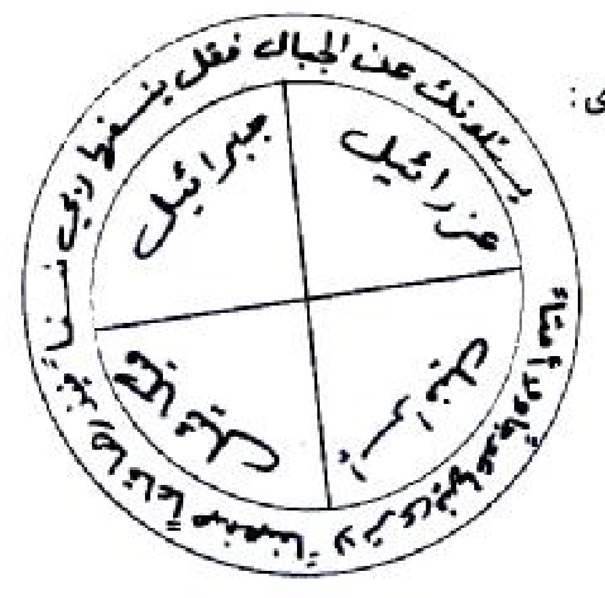

# Draf transkripsi PDF halaman 138–142

Transkripsi berdasarkan scan halaman 138–142. Rajah halaman 138 dipertahankan sebagai gambar; bagian tulisan yang belum pasti tidak ditebak.

## HALAMAN 138 — PDF hal. 138 / bagian — Sakit limpa dan rajah

### 1. TEKS ARAB BERHARAKAT

(فِي عِلَاجِ وَجَعِ الطِّحَالِ)

وَرَدَ فِي كِتَابِ طِبِّ الْأَئِمَّةِ (عَلَيْهِمْ أَفْضَلُ الصَّلَاةِ وَالسَّلَامِ) عَنْ مُحَمَّدِ بْنِ عَبْدِ اللَّهِ بْنِ مِهْرَانَ الْكُوفِيِّ، قَالَ: حَدَّثَنَا أَيُّوبُ عَنْ عَمْرُو بْنِ شِمْرٍ، عَنْ جَابِرٍ عَنْ أَبِي جَعْفَرٍ (عَلَيْهِ أَفْضَلُ السَّلَامِ) قَالَ: جَاءَ رَجُلٌ مِنْ خُرَاسَانَ إِلَى عَلِيِّ بْنِ الْحُسَيْنِ (عَلَيْهِمَا أَفْضَلُ السَّلَامِ) فَقَالَ يَا بْنَ رَسُولِ اللَّهِ حَجَجْتُ وَنَوَيْتُ عِنْدَ خُرُوجِي أَنْ أَقْصِدَكَ فَإِنَّ بِي وَجَعَ الطِّحَالِ وَأَنْ تَدْعُوَ لِي بِالْفَرَجِ، فَقَالَ لَهُ عَلِيُّ بْنُ الْحُسَيْنِ (عَلَيْهِمَا أَفْضَلُ الصَّلَاةِ وَالسَّلَامِ) قَدْ كَفَاكَ اللَّهُ ذَلِكَ وَلَهُ الْحَمْدُ، فَإِذَا أَحْسَسْتَ بِهِ فَاكْتُبْ هَذِهِ الْآيَةَ بِزَعْفَرَانٍ وَمَاءِ زَمْزَمَ وَاشْرَبْهُ، فَإِنَّ اللَّهَ تَعَالَى يَدْفَعُ عَنْكَ ذَلِكَ الْوَجَعَ «قُلِ ادْعُوا اللَّهَ أَوِ ادْعُوا الرَّحْمَنَ أَيًّا مَا تَدْعُوا فَلَهُ الْأَسْمَاءُ الْحُسْنَى وَلَا تَجْهَرْ بِصَلَاتِكَ وَلَا تُخَافِتْ بِهَا وَابْتَغِ بَيْنَ ذَلِكَ سَبِيلًا وَقُلِ الْحَمْدُ لِلَّهِ الَّذِي لَمْ يَتَّخِذْ وَلَدًا وَلَمْ يَكُنْ لَهُ شَرِيكٌ فِي الْمُلْكِ وَلَمْ يَكُنْ لَهُ وَلِيٌّ مِنَ الذُّلِّ وَكَبِّرْهُ تَكْبِيرًا».

(أَيْضًا فَائِدَةٌ لِعِلَاجِ وَجَعِ الطِّحَالِ)

وَهُوَ إِذَا رَأَيْتَ مَنْ يَشْتَكِي وَجَعَ الطِّحَالِ فَاكْتُبْ لَهُ هَذَا الطِّلَسْمَ الْمُبَارَكَ فِي وَرَقَةٍ بَيْضَاءَ نَقِيَّةٍ وَضَعِ الطِّلَسْمَ وَالْوَرَقَةَ فَوْقَ الطِّحَالِ مِنْ فَوْقِ الْقَمِيصِ ثُمَّ خُذْ مِلْعَقَةً جَدِيدَةً وَضَعْ فِيهَا قَلِيلًا مِنَ الرَّمَادِ وَضَعْ فَوْقَ الرَّمَادِ جَمْرَةَ نَارٍ ثُمَّ ضَعِ الْمِلْعَقَةَ فَوْقَ الطِّلَسْمِ فَإِنَّ النَّارَ يَحِسُّ بِهَا صَاحِبُ الطِّحَالِ إِنَّهَا دَاخِلَ جَوْفِهِ فَحَكِّمْهَا عَلَى قَدْرِ اسْتِطَاعَةِ الْمَرِيضِ وَتَحَمُّلِهِ وَلَوْ كَانَ نِصْفَ دَرَجَةٍ وَارْفَعْهَا فَإِنَّ الطِّحَالَ لَا يَمْكُثُ بَعْدَهَا حَتَّى يَنْقَلِعَ مَعَ الْغَائِطِ وَكَمَا قِيلَ وَوَرَدَ يَبْرَأُ صَاحِبُهُ مِنْهُ بِإِذْنِ اللَّهِ تَعَالَى. وَهَذِهِ هِيَ صِفَةُ الطِّلَسْمِ كَالشَّكْلِ الْآتِي:

وَهَذِهِ صُورَةُ الطِّلَسْمِ الْمَذْكُورِ كَمَا تَرَى:

### 2. TRANSLITERASI LATIN

(Fi 'ilaji waja'ith-thihal)

Warada fi kitabi Thibbil-A'immati ('alaihim afdhalush-shalati was-salam) 'an Muhammadi bni 'Abdillahi bni Mihranal-Kufiyyi, qala: haddatsana Ayyubu 'an 'Amri bni Syimrin, 'an Jabirin 'an Abi Ja'far ('alaihi afdhalus-salam) qala: ja'a rajulun min Khurasana ila 'Aliyyi bnil-Husain ('alaihima afdhalus-salam) faqala ya bna rasulillahi hajajtu wa nawaitu 'inda khuruji an aqshidaka fa-inna bi waja'ath-thihali wa an tad'u li bil-faraj, faqala lahu 'Aliyyu bnul-Husain ('alaihima afdhalush-shalati was-salam) qad kafakallahu dzalika wa lahul-hamd, fa-idza ahsasta bihi faktub hadzihil-ayata biza'faranin wa ma'i Zamzama wasyrabhu, fa-innallaha ta'ala yadfa'u 'anka dzalikal-waja': «Qulid'ullaha awid'ur-rahmana ayyan ma tad'u falahul-asma'ul-husna wa la tajhar bishalatika wa la tukhafit biha wabtaghi baina dzalika sabila. Wa quli alhamdu lillahil-ladzi lam yattakhidz waladan wa lam yakun lahu syarikun fil-mulki wa lam yakun lahu waliyyun minadz-dzulli wa kabbirhu takbira».

(Aidhan fa'idatun li'ilaji waja'ith-thihal)

Wa huwa idza ra'aita man yasytaki waja'ath-thihali faktub lahu hadzath-thilasm al-mubarak fi waraqatin baidha'a naqiyyatin wa dha'ith-thilasma wal-waraqata fauqath-thihali min fauqil-qamishi tsumma khudz mil'aqatan jadidatan wa dha' fiha qalilan minar-ramadi wa dha' fauqar-ramadi jamrata narin tsumma dha'il-mil'aqata fauqath-thilasmi fa-innan-nara yahissu biha shahibuth-thihali innaha dakhila jaufihi fahakkimha 'ala qadri istitha'atil-maridhi wa tahammulihi wa lau kana nishfa darajatin warfa'ha fa-innath-thihala la yamkutsu ba'daha hatta yanqali'a ma'al-gha'ithi wa kama qila wa warada yabra'u shahibuhu minhu bi-idznillahi ta'ala. Wa hadzihi hiya shifatut-thilasmi kasy-syaklil-ati.

Wa hadzihi shuratuth-thilasmil-madzkuri kama tara.

### 3. TERJEMAHAN INDONESIA

(Tentang sakit limpa)

Dalam kitab Thibb al-A'immah diriwayatkan melalui Muhammad bin Abdullah bin Mihran al-Kufi, Ayyub, Amr bin Syimr, Jabir dan Abu Ja'far: Seorang laki-laki dari Khurasan datang kepada Ali bin Husain dan berkata, “Wahai putra Rasulullah, aku telah berhaji dan ketika berangkat aku berniat mendatangimu, karena aku menderita sakit limpa; mohonkanlah kelapangan untukku.” Ali bin Husain berkata kepadanya, “Allah telah mencukupkanmu dari hal itu, dan segala puji bagi-Nya. Jika engkau merasakannya, tulislah ayat ini dengan za'faran dan air Zamzam, lalu minumlah; Allah Ta'ala akan menjauhkan sakit itu darimu: ‘Katakanlah: Serulah Allah atau serulah Ar-Rahman. Dengan nama mana pun kamu menyeru, Dia mempunyai nama-nama yang terbaik. Janganlah engkau mengeraskan dan jangan pula merendahkan bacaan shalatmu; carilah jalan di antara keduanya. Dan katakanlah: Segala puji bagi Allah yang tidak mengambil anak, tidak mempunyai sekutu dalam kerajaan-Nya, dan tidak mempunyai penolong karena kelemahan; agungkanlah Dia dengan sebesar-besarnya.’”

(Juga faedah tentang sakit limpa)

Naskah menyebut: jika melihat orang yang mengeluhkan sakit limpa, tuliskan rajah ini pada kertas putih bersih dan letakkan kertas itu di atas daerah limpa, di luar pakaian. Kemudian ambil sendok baru, letakkan sedikit abu di dalamnya dan bara api di atas abu, lalu letakkan sendok di atas rajah. Disebutkan bahwa orang yang sakit akan merasakan panas itu di dalam perutnya; aturlah sesuai kemampuan dan daya tahannya, walaupun setengah derajat, lalu angkat. Naskah mengklaim bahwa setelah itu limpa akan keluar bersama kotoran dan orang itu sembuh dengan izin Allah. 

Berikut gambar rajahnya; tulisan dan simbol di dalamnya dipertahankan dalam gambar tanpa diterjemahkan atau ditebak.

### 4. TATACARA PRAKTIK LENGKAP

1. Riwayat pertama menyebut penulisan bacaan dengan za'faran dan air Zamzam, lalu diminum.
2. Riwayat kedua menyebut rajah pada kertas putih di atas pakaian dan penggunaan sendok berisi abu serta bara. Gambar rajah dipertahankan sebagaimana scan. [TIDAK JELAS] Sebagian tulisan melingkar dan dalam rajah belum terbaca utuh; jangan ditebak.

Peringatan keselamatan: jangan menerapkan bara atau benda panas pada tubuh atau pakaian, dan jangan meminum tinta atau larutan yang tidak aman. Klaim bahwa limpa keluar bersama kotoran bukan keterangan medis yang dapat diandalkan; sakit perut kiri atau dugaan penyakit limpa harus diperiksa tenaga kesehatan.

## HALAMAN 139 — PDF hal. 139 / bagian — Sakit limpa, perut dan usus besar

### 1. TEKS ARAB BERHARAKAT

أَيْضًا فِي عِلَاجِ وَجَعِ الطِّحَالِ: هُوَ مَنْ دَاوَمَ عَلَى شُرْبِ كُوبٍ مِنْ مَغْلِي خَشَبِ شَجَرَةِ الطَّرْفَاءِ كُلَّ يَوْمٍ وَلِمُدَّةِ سَبْعَةِ أَيَّامٍ بِصُورَةٍ دَائِمَةٍ يَبْرَأُ مِنْ وَجَعِ الطِّحَالِ كَمَا وَرَدَ فِي ذَلِكَ.

(بَابٌ فِي عِلَاجِ وَجَعِ الْبَطْنِ)

رُوِيَ عَنِ النَّبِيِّ الْأَكْرَمِ ﷺ أَنَّهُ قَالَ: يَشْرَبُ شَرْبَةَ عَسَلٍ بِمَاءٍ حَارٍّ وَيُعَوِّذُهُ بِفَاتِحَةِ الْكِتَابِ سَبْعًا يُشْفَى إِنْ شَاءَ اللَّهُ تَعَالَى.

(أَيْضًا فِي عِلَاجِ وَجَعِ الْبَطْنِ)

عَنْ عَلِيٍّ (عَلَيْهِ أَفْضَلُ الصَّلَوَاتِ وَالسَّلَامِ) أَنَّهُ قَالَ يَشْرَبُ مَاءً حَارًّا وَيَقُولُ: «يَا اللَّهُ يَا اللَّهُ يَا اللَّهُ يَا رَحْمَنُ يَا رَحِيمُ يَا رَبَّ الْأَرْبَابِ يَا إِلَهَ الْآلِهَةِ مَلِكَ الْمُلُوكِ يَا سَيِّدَ السَّادَاتِ اشْفِنِي بِشِفَائِكَ مِنْ كُلِّ دَاءٍ وَسَقَمٍ فَإِنِّي عَبْدُكَ وَابْنُ عَبْدَيْكَ أَتَقَلَّبُ فِي قَبْضَتِكَ».

(بَابٌ فِي عِلَاجِ أَمْرَاضِ الْقَوْلَنْجِ وَالْمُسَمَّى الْقُولُونَ (مِصْرَانِ الْغَلِيظِ))

التَّعْرِيفُ وَمِنْ أَعْرَاضِهِ: اعْتِقَالُ الطَّبِيعَةِ وَانْسِدَادُ الْمِعَاءِ الْمُسَمَّى مِصْرَانَ الْغَلِيظِ مِنْ أَسْبَابِهِ كَثْرَةُ الرِّيَاحِ وَالنَّفْخِ فِي الْأَمْعَاءِ. (الْعِلَاجُ).

رُوِيَ عَنِ الْإِمَامِ الصَّادِقِ (عَلَيْهِ أَفْضَلُ الصَّلَاةِ وَالسَّلَامِ) تَكْتُبُ لَهُ الْفَاتِحَةَ وَالتَّوْحِيدَ وَالْمُعَوِّذَتَيْنِ ثُمَّ تَكْتُبُ «أَعُوذُ بِوَجْهِ اللَّهِ الْعَظِيمِ وَبِعِزَّتِهِ الَّتِي لَا تُرَامُ وَبِقُدْرَتِكَ الَّتِي لَا يَمْتَنِعُ مِنْهَا شَيْءٌ مِنْ شَرِّ هَذَا الْوَجَعِ وَمِنْ شَرِّ مَا فِيهِ» ثُمَّ تَشْرَبُهُ عَلَى الرِّيقِ (يُكْتَبُ بِالْمِسْكِ وَالزَّعْفَرَانِ وَمَاءِ الْوَرْدِ وَيُحَلُّ بِالْمَاءِ وَيُشْرَبُ) يُشْفَى بِعَوْنِ اللَّهِ تَعَالَى.

فِي عِلَاجِ وَجَعِ اللَّوَى (قِيلَ اللَّوَى الْوَجَعُ النَّاتِجُ عَنِ التُّخْمَةِ فِي الْمَعِدَةِ) وَعَنِ الْإِمَامِ مُوسَى الْكَاظِمِ (عَلَيْهِ أَفْضَلُ الصَّلَاةِ وَالسَّلَامِ) خُذْ مَاءً وَاقْرَأْ عَلَيْهِ ثَلَاثًا «يُرِيدُ اللَّهُ بِكُمُ الْيُسْرَ وَلَا يُرِيدُ بِكُمُ الْعُسْرَ أَوَلَمْ يَرَ الَّذِينَ كَفَرُوا أَنَّ السَّمَاوَاتِ وَالْأَرْضَ كَانَتَا رَتْقًا فَفَتَقْنَاهُمَا وَجَعَلْنَا مِنَ الْمَاءِ كُلَّ شَيْءٍ حَيٍّ أَفَلَا يُؤْمِنُونَ» ثُمَّ اشْرَبْهُ وَمُرَّ [يَتْبَعُ فِي الصَّفْحَةِ ١٤٠].

### 2. TRANSLITERASI LATIN

Aidhan fi 'ilaji waja'ith-thihal: huwa man dawama 'ala syurbi kubin min maghli khasyabi syajaratith-tharfa'i kulla yaumin wa limuddati sab'ati ayyamin bishuratin da'imatin yabra'u min waja'ith-thihal kama warada fi dzalik.

(Babun fi 'ilaji waja'il-bathn)

Ruwiya 'anin-nabiyyil-akram shallallahu 'alaihi wa sallam annahu qala: yasyrabu syarbata 'asalin bima'in harrin wa yu'awwidzhuhu bifatihatil-kitabi sab'an yusyfa in sya'allahu ta'ala.

(Aidhan fi 'ilaji waja'il-bathn)

'An 'Aliyyin ('alaihi afdhalush-shalawati was-salam) annahu qala yasyrabu ma'an harran wa yaqul: «Ya Allah ya Allah ya Allah ya Rahman ya Rahim ya rabbal-arbab ya ilahal-alihah malikal-muluk ya sayyidas-sadat isyfini bisyifa'ika min kulli da'in wa saqamin fa-inni 'abduka wabnu 'abdaika ataqallabu fi qabdhatik».

(Babun fi 'ilaji amradhil-qaulanji wal-musammal-quluna, mishranil-ghalizh)

At-ta'rifu wa min a'radhihi: i'tiqaluth-thabi'ati w insidadul-mi'a'il-musamma mishranal-ghalizh min asbabihi katsratur-riyahi wan-nafkhi fil-am'a'. (Al-'ilaj).

Ruwiya 'anil-imamish-Shadiq ('alaihi afdhalush-shalati was-salam) taktubu lahul-Fatihata wat-tauhida wal-mu'awwidzataini tsumma taktubu «a'udzu biwajhillahil-'azhimi wa bi'izzatihi allati la turamu wa biqudratikallati la yamtani'u minha syai'un min syarri hadzal-waja'i wa min syarri ma fihi» tsumma tasyrabuhu 'alar-riqi (yuktabu bil-miski waz-za'farani wa ma'il-wardi wa yuhallu bil-ma'i wa yusyrabu) yusyfa bi'aunillahi ta'ala.

Fi 'ilaji waja'il-lawa (qilal-lawa al-waja'un-natiju 'anit-tukhmati fil-ma'idah) wa 'anil-imami Musal-Kazhim ('alaihi afdhalush-shalati was-salam) khudz ma'an waqra' 'alaihi tsalatsan «yuridullahu bikumul-yusra wa la yuridu bikumul-'usra awalam yaralladzina kafaru annas-samawati wal-ardha kanata ratqan fafataqnahuma wa ja'alna minal-ma'i kulla syai'in hayyin afala yu'minun» tsummasyrabhu wa murra [lanjut halaman 140].

### 3. TERJEMAHAN INDONESIA

Juga tentang sakit limpa: disebutkan bahwa orang yang terus minum segelas rebusan kayu pohon tharfa setiap hari selama tujuh hari akan sembuh dari sakit limpa, sebagaimana diriwayatkan.

(Bab tentang sakit perut)

Diriwayatkan dari Nabi ﷺ: minumlah madu dengan air panas dan bacakan perlindungan dengan Surah Al-Fatihah tujuh kali; naskah menyebut kesembuhan jika Allah menghendaki.

(Juga tentang sakit perut)

Dari Ali: minum air panas dan ucapkan: “Ya Allah, ya Allah, ya Allah, wahai Yang Maha Pengasih, wahai Yang Maha Penyayang, wahai Tuhan para tuan, wahai Tuhan segala yang dipertuhan, Raja segala raja, wahai pemimpin para pemimpin, sembuhkan aku dengan kesembuhan-Mu dari setiap penyakit dan sakit. Sesungguhnya aku hamba-Mu, anak dari dua hamba-Mu, dan aku berada dalam genggaman-Mu.”

(Bab tentang penyakit qaulanj, yang disebut kolon atau usus besar)

Naskah mendefinisikan gejalanya sebagai tertahannya buang air dan tersumbatnya usus besar, serta menyebut banyaknya angin dan kembung dalam usus sebagai sebab. Berikut penanganan yang diriwayatkan.

Dari Imam ash-Shadiq: tuliskan Al-Fatihah, At-Tauhid dan dua surah perlindungan, kemudian tuliskan: “Aku berlindung dengan wajah Allah Yang Mahaagung, dengan kemuliaan-Nya yang tidak dapat dikalahkan dan dengan kekuasaan-Mu yang tiada sesuatu pun dapat menghindarinya, dari keburukan sakit ini dan dari keburukan yang ada padanya.” Kemudian diminum sebelum makan. Naskah menyebut tulisan dibuat dengan misik, za'faran dan air mawar, dilarutkan dalam air, lalu diminum; disebutkan sembuh dengan pertolongan Allah.

Tentang sakit al-lawa, yang dikatakan sebagai rasa sakit akibat kekenyangan pada perut, dari Imam Musa al-Kazhim: ambillah air dan baca padanya tiga kali: “Allah menghendaki kemudahan bagimu dan tidak menghendaki kesulitan bagimu. Tidakkah orang-orang kafir melihat bahwa langit dan bumi dahulu menyatu, lalu Kami pisahkan keduanya, dan Kami jadikan dari air setiap sesuatu yang hidup? Tidakkah mereka beriman?” Kemudian minumlah dan usapkan ... [bersambung halaman 140].

### 4. TATACARA PRAKTIK LENGKAP

1. Naskah menyebut rebusan pohon tharfa selama tujuh hari, serta madu dan air panas disertai pembacaan Al-Fatihah tujuh kali.
2. Doa kedua dibaca sebagaimana teks Arab di atas; riwayat usus besar menyebut tulisan surah dan doa yang dilarutkan.
3. Riwayat al-lawa menyebut membaca pada air tiga kali, lalu minum; kalimatnya bersambung pada halaman 140.

Peringatan keselamatan: sumbatan usus dan sakit perut berat memerlukan pemeriksaan medis segera. Jangan meminum ramuan, misik, tinta atau bahan lain yang keamanan dan takarannya tidak diketahui; hindari air yang terlalu panas.

## HALAMAN 140 — PDF hal. 140 / bagian — Sakit pinggang, sisi tubuh, pusar dan kandung kemih

### 1. TEKS ARAB BERHARAKAT

يَدَكَ عَلَى بَطْنِكَ تَتَعَافَى إِنْ شَاءَ اللَّهُ تَعَالَى (يُكْتَبُ ذَلِكَ بِالْمِسْكِ وَالزَّعْفَرَانِ وَمَاءِ الْوَرْدِ).

(بَابٌ فِي عِلَاجِ وَجَعِ الْخَاصِرَةِ)

عَنِ الْإِمَامِ الْبَاقِرِ (عَلَيْهِ أَفْضَلُ الصَّلَوَاتِ وَالسَّلَامِ) إِذَا فَرَغْتَ مِنْ صَلَوَاتِكَ فَضَعْ يَدَكَ مَوْضِعَ السُّجُودِ وَاقْرَأْ: «أَفَحَسِبْتُمْ أَنَّمَا خَلَقْنَاكُمْ عَبَثًا وَأَنَّكُمْ إِلَيْنَا لَا تُرْجَعُونَ فَتَعَالَى اللَّهُ الْمَلِكُ الْحَقُّ لَا إِلَهَ إِلَّا هُوَ رَبُّ الْعَرْشِ الْكَرِيمِ، وَمَنْ يَدْعُ مَعَ اللَّهِ إِلَهًا آخَرَ لَا بُرْهَانَ لَهُ بِهِ فَإِنَّمَا حِسَابُهُ عِنْدَ رَبِّهِ إِنَّهُ لَا يُفْلِحُ الْكَافِرُونَ وَقُلْ رَبِّ اغْفِرْ وَارْحَمْ وَأَنْتَ خَيْرُ الرَّاحِمِينَ».

(بَابٌ فِي عِلَاجِ وَجَعِ الْجَنْبِ)

هُوَ أَنْ يَكْتُبَ الْآيَةَ: «الَّذِينَ يَذْكُرُونَ اللَّهَ قِيَامًا وَقُعُودًا وَعَلَى جُنُوبِهِمْ» اسْكُنْ أَيُّهَا الْوَجَعُ عَنْ حَامِلِ كِتَابِي هَذَا بِاللَّهِ الْعَلِيِّ الْعَظِيمِ الَّذِي سَكَنَ لَهُ مَا فِي السَّمَاوَاتِ وَمَا فِي الْأَرْضِ، وَيُعَلَّقُ عَلَى الْجَنْبِ الْأَلِيمِ فَإِنَّهُ نَافِعٌ لِذَلِكَ بِعَوْنِ اللَّهِ.

(بَابٌ فِي عِلَاجِ وَجَعِ السُّرَّةِ)

وَعَنِ الْإِمَامِ الصَّادِقِ (عَلَيْهِ أَفْضَلُ الصَّلَاةِ وَالسَّلَامِ) ضَعْ يَدَكَ عَلَى الْوَجَعِ وَقُلْ ثَلَاثًا: «وَإِنَّهُ لَكِتَابٌ عَزِيزٌ لَا يَأْتِيهِ الْبَاطِلُ مِنْ بَيْنِ يَدَيْهِ وَلَا مِنْ خَلْفِهِ تَنْزِيلٌ مِنْ حَكِيمٍ حَمِيدٍ».

(بَابٌ فِي وَجَعِ الْمَثَانَةِ (الْبْرُوسْتَات))

أَيْضًا عَنِ الْإِمَامِ الصَّادِقِ (عَلَيْهِ أَفْضَلُ الصَّلَاةِ وَالسَّلَامِ) عَوِّذِ الْوَجَعَ إِذَا نِمْتَ ثَلَاثًا وَإِذَا انْتَبَهْتَ وَاحِدَةً بِقَوْلِهِ تَعَالَى «أَلَمْ تَعْلَمْ أَنَّ اللَّهَ عَلَى كُلِّ شَيْءٍ قَدِيرٌ أَلَمْ تَعْلَمْ أَنَّ اللَّهَ لَهُ مُلْكُ السَّمَاوَاتِ وَالْأَرْضِ وَمَا لَكُمْ مِنْ دُونِ اللَّهِ مِنْ وَلِيٍّ وَلَا نَصِيرٍ».

### 2. TRANSLITERASI LATIN

[Lanjutan:] Yadaka 'ala bathnika tata'afa in sya'allahu ta'ala (yuktabu dzalika bil-miski waz-za'farani wa ma'il-ward).

(Babun fi 'ilaji waja'il-khashirah)

'Anil-imamil-Baqir ('alaihi afdhalush-shalawati was-salam) idza faraghta min shalawatika fadha' yadaka mawdhi'as-sujudi waqra': «Afahasibtum annama khalaqnakum 'abatsan wa annakum ilaina la turja'un. Fata'alallahu al-malikul-haqqu la ilaha illa huwa rabbul-'arsyil-karim. Wa man yad'u ma'allahi ilahan akhara la burhana lahu bihi fa-innama hisabuhu 'inda rabbihi innahu la yuflihul-kafirun. Wa qul rabbighfir warham wa anta khairur-rahimin».

(Babun fi 'ilaji waja'il-janb)

Huwa an yaktubal-ayata: «Alladzina yadzkurunallaha qiyaman wa qu'udan wa 'ala junubihim» uskun ayyuhal-waja'u 'an hamili kitabi hadza billahil-'aliyyil-'azhim alladzi sakana lahu ma fis-samawati wa ma fil-ardh, wa yu'allaqu 'alal-janbil-alimi fa-innahu nafi'un lidzalika bi'aunillah.

(Babun fi 'ilaji waja'is-surrah)

Wa 'anil-imamish-Shadiq ('alaihi afdhalush-shalati was-salam) dha' yadaka 'alal-waja'i wa qul tsalatsan: «Wa innahu lakitabun 'aziz la ya'tihil-bathilu min baini yadaihi wa la min khalfihi tanzilun min hakimin hamid».

(Babun fi waja'il-matsanah, al-burustat)

Aidhan 'anil-imamish-Shadiq ('alaihi afdhalush-shalati was-salam) 'awwidzil-waja'a idza nimta tsalatsan wa idzantabahta wahidatan biqaulihi ta'ala «alam ta'lam annallaha 'ala kulli syai'in qadir alam ta'lam annallaha lahu mulkus-samawati wal-ardhi wa ma lakum min dunillahi min waliyyin wa la nashir».

### 3. TERJEMAHAN INDONESIA

[Lanjutan halaman 139:] Usapkan tanganmu pada perutmu; engkau akan sehat jika Allah menghendaki. Naskah menambahkan bahwa itu ditulis dengan misik, za'faran dan air mawar.

(Bab tentang sakit pinggang)

Dari Imam al-Baqir: setelah selesai shalat, letakkan tangan pada tempat sujud dan bacalah: “Apakah kamu mengira bahwa Kami menciptakanmu sia-sia dan kamu tidak akan dikembalikan kepada Kami? Mahatinggi Allah, Raja yang sebenarnya; tidak ada tuhan selain Dia, Tuhan Arasy yang mulia. Siapa yang menyeru tuhan lain bersama Allah tanpa bukti, perhitungannya ada pada Tuhannya; sungguh orang kafir tidak beruntung. Katakanlah: Tuhanku, ampunilah dan rahmatilah, dan Engkau sebaik-baik pemberi rahmat.”

(Bab tentang sakit pada sisi tubuh)

Tulislah ayat: “Mereka yang mengingat Allah sambil berdiri, duduk dan berbaring pada sisi mereka,” lalu: “Tenanglah wahai sakit dari pembawa tulisanku ini, demi Allah Yang Mahatinggi dan Mahaagung, yang bagi-Nya diam apa yang ada di langit dan di bumi.” Gantungkan pada sisi yang sakit; naskah menyebutnya bermanfaat dengan pertolongan Allah.

(Bab tentang sakit pusar)

Dari Imam ash-Shadiq: letakkan tangan pada tempat sakit dan ucapkan tiga kali: “Sesungguhnya ia adalah kitab yang mulia; kebatilan tidak datang kepadanya dari depan maupun dari belakang; diturunkan dari Yang Mahabijaksana, Maha Terpuji.”

(Bab tentang sakit kandung kemih, disebut prostat dalam naskah)

Dari Imam ash-Shadiq: bacakan perlindungan atas sakit ketika bermalam tiga kali dan ketika bangun sekali dengan firman-Nya: “Tidakkah engkau mengetahui bahwa Allah Mahakuasa atas segala sesuatu? Tidakkah engkau mengetahui bahwa milik Allah kerajaan langit dan bumi, dan tidak ada bagimu selain Allah pelindung maupun penolong?”

### 4. TATACARA PRAKTIK LENGKAP

1. Lanjutan dari halaman 139 menyebut mengusapkan tangan pada perut.
2. Riwayat sakit pinggang menyebut meletakkan tangan pada tempat sujud setelah shalat dan membaca ayat yang tercantum.
3. Untuk sisi tubuh naskah menyebut tulisan yang digantung; untuk pusar bacaan dibaca tiga kali dengan tangan pada tempat sakit.
4. Untuk kandung kemih naskah menyebut bacaan tiga kali ketika bermalam dan sekali ketika bangun.

Catatan keselamatan: keluhan kandung kemih, kesulitan berkemih dan nyeri perut atau pinggang memerlukan pemeriksaan kesehatan; istilah kandung kemih dan prostat dalam judul naskah bukan penetapan diagnosis.

## HALAMAN 141 — PDF hal. 141 / bagian — Sakit punggung dan anggota kaki

### 1. TEKS ARAB BERHARAKAT

(بَابٌ فِي عِلَاجِ وَجَعِ الظَّهْرِ)

عَنِ الْإِمَامِ الْبَاقِرِ (عَلَيْهِ أَفْضَلُ الصَّلَاةِ وَالسَّلَامِ) ضَعْ يَدَكَ عَلَيْهِ وَاقْرَأْ: «وَمَا كَانَ لِنَفْسٍ أَنْ تَمُوتَ إِلَّا بِإِذْنِ اللَّهِ كِتَابًا مُؤَجَّلًا وَمَنْ يُرِدْ ثَوَابَ الدُّنْيَا نُؤْتِهِ مِنْهَا وَمَنْ يُرِدْ ثَوَابَ الْآخِرَةِ نُؤْتِهِ مِنْهَا وَسَنَجْزِي الشَّاكِرِينَ» ثُمَّ يَقْرَأُ سُورَةَ الْقَدْرِ سَبْعًا.

(بَابٌ فِي عِلَاجِ وَجَعِ الْفَخِذَيْنِ)

أَيْضًا عَنِ الْإِمَامِ الْبَاقِرِ (عَلَيْهِ أَفْضَلُ السَّلَامِ) يَجْلِسُ فِي طَشْتٍ فِي الْمَاءِ الْمُسَخَّنِ وَيَضَعُ يَدَهُ عَلَى الْأَلَمِ وَيَقْرَأُ: «أَوَلَمْ يَرَ الَّذِينَ كَفَرُوا أَنَّ السَّمَاوَاتِ وَالْأَرْضَ كَانَتَا رَتْقًا فَفَتَقْنَاهُمَا وَجَعَلْنَا مِنَ الْمَاءِ كُلَّ شَيْءٍ حَيٍّ أَفَلَا يُؤْمِنُونَ».

(بَابٌ فِي عِلَاجِ وَجَعِ الرُّكَبِ)

عَنِ الْإِمَامِ الْبَاقِرِ (عَلَيْهِ أَفْضَلُ الصَّلَاةِ وَالسَّلَامِ) تَقُولُ بَعْدَ الصَّلَاةِ: «يَا أَجْوَدَ مَنْ أَعْطَى وَيَا خَيْرَ مَنْ سُئِلَ وَيَا أَرْحَمَ مَنِ اسْتُرْحِمَ ارْحَمْ ضَعْفِي وَقِلَّةَ حِيلَتِي وَعَافِنِي مِنْ وَجَعِي».

(بَابٌ فِي عِلَاجِ السَّاقَيْنِ)

عَنِ الْإِمَامِ الصَّادِقِ (عَلَيْهِ أَفْضَلُ السَّلَامِ) اقْرَأْ عَلَيْهِمَا سَبْعًا: «وَاتْلُ مَا أُوحِيَ إِلَيْكَ مِنْ كِتَابِ رَبِّكَ لَا مُبَدِّلَ لِكَلِمَاتِهِ وَلَنْ تَجِدَ مِنْ دُونِهِ مُلْتَحَدًا».

(فِي عِلَاجِ الْعَرَاقِيبِ وَبَاطِنِ الْقَدَمِ)

عَنِ الْإِمَامِ الْحُسَيْنِ (عَلَيْهِ أَفْضَلُ الصَّلَوَاتِ وَالسَّلَامِ) ضَعْ يَدَكَ عَلَى الْأَلَمِ إِذَا أَحْسَسْتَ بِهِ وَقُلْ: «بِسْمِ اللَّهِ وَبِاللَّهِ وَمَا قَدَرُوا اللَّهَ حَقَّ قَدْرِهِ وَالْأَرْضُ جَمِيعًا قَبْضَتُهُ يَوْمَ الْقِيَامَةِ وَالسَّمَاوَاتُ مَطْوِيَّاتٌ بِيَمِينِهِ سُبْحَانَهُ وَتَعَالَى عَمَّا يُشْرِكُونَ».

### 2. TRANSLITERASI LATIN

(Babun fi 'ilaji waja'izh-zhahr)

'Anil-imamil-Baqir ('alaihi afdhalush-shalati was-salam) dha' yadaka 'alaihi waqra': «Wa ma kana linafsin an tamuta illa bi-idznillahi kitaban mu'ajjala wa man yurid tsawabad-dunya nu'tihi minha wa man yurid tsawabal-akhirati nu'tihi minha wa sanajzisy-syakirin» tsumma yaqra'u suratal-Qadri sab'an.

(Babun fi 'ilaji waja'il-fakhidzain)

Aidhan 'anil-imamil-Baqir ('alaihi afdhalus-salam) yajlisu fi thasytin fil-ma'il-musakhkhani wa yadha'u yadahu 'alal-alami wa yaqra': «Awa lam yaralladzina kafaru annas-samawati wal-ardha kanata ratqan fafataqnahuma wa ja'alna minal-ma'i kulla syai'in hayyin afala yu'minun».

(Babun fi 'ilaji waja'ir-rukab)

'Anil-imamil-Baqir ('alaihi afdhalush-shalati was-salam) taqulu ba'dash-shalah: «Ya ajwada man a'tha wa ya khaira man su'ila wa ya arhama manisturhima irham dha'fi wa qillata hilati wa 'afini min waja'i».

(Babun fi 'ilajis-saqain)

'Anil-imamish-Shadiq ('alaihi afdhalus-salam) iqra' 'alaihima sab'an: «Watlu ma uhiya ilaika min kitabi rabbika la mubaddila likalimatihi wa lan tajida min dunihi multahada».

(Fi 'ilajil-'araqibi wa bathinil-qadam)

'Anil-imamil-Husain ('alaihi afdhalush-shalawati was-salam) dha' yadaka 'alal-alami idza ahsasta bihi wa qul: «Bismillahi wa billahi wa ma qadarullaha haqqa qadrihi wal-ardhu jami'an qabdhatuhu yaumal-qiyamati was-samawatu mathwiyyatun biyaminihi subhanahu wa ta'ala 'amma yusyrikun».

### 3. TERJEMAHAN INDONESIA

(Bab tentang sakit punggung)

Dari Imam al-Baqir: letakkan tangan pada tempat sakit dan baca: “Tidak ada satu jiwa pun yang mati kecuali dengan izin Allah, menurut ketetapan waktu. Siapa menghendaki ganjaran dunia, Kami berikan darinya; siapa menghendaki ganjaran akhirat, Kami berikan darinya; dan Kami akan memberi balasan kepada orang yang bersyukur.” Kemudian baca Surah Al-Qadr tujuh kali.

(Bab tentang sakit kedua paha)

Dari Imam al-Baqir: duduk dalam baskom berisi air hangat, letakkan tangan pada tempat sakit dan baca: “Tidakkah orang-orang kafir melihat bahwa langit dan bumi dahulu menyatu, lalu Kami pisahkan keduanya dan Kami jadikan dari air setiap sesuatu yang hidup? Tidakkah mereka beriman?”

(Bab tentang sakit lutut)

Dari Imam al-Baqir: setelah shalat ucapkan: “Wahai yang paling dermawan dalam memberi, wahai sebaik-baik yang dimintai, wahai yang paling penyayang ketika dimintai rahmat, kasihilah kelemahanku dan sedikitnya dayaku serta sehatkan aku dari sakitku.”

(Bab tentang kedua tungkai)

Dari Imam ash-Shadiq: baca tujuh kali atas keduanya: “Bacalah apa yang diwahyukan kepadamu dari kitab Tuhanmu; tidak ada yang dapat mengubah kalimat-kalimat-Nya, dan engkau tidak akan menemukan tempat berlindung selain Dia.”

(Tentang tumit dan telapak kaki)

Dari Imam al-Husain: letakkan tangan pada tempat sakit ketika merasakannya dan ucapkan: “Dengan nama Allah dan dengan pertolongan Allah. Mereka tidak mengagungkan Allah sebagaimana mestinya. Seluruh bumi dalam genggaman-Nya pada hari kiamat dan langit dilipat dengan tangan kanan-Nya. Mahasuci dan Mahatinggi Dia dari apa yang mereka persekutukan.”

### 4. TATACARA PRAKTIK LENGKAP

1. Untuk punggung: tangan diletakkan pada tempat sakit, bacaan yang tercantum dibaca, lalu Surah Al-Qadr tujuh kali.
2. Untuk paha: naskah menyebut air hangat, tangan pada tempat sakit dan bacaan yang tercantum.
3. Untuk lutut: doa dibaca setelah shalat; untuk kedua tungkai bacaan disebut tujuh kali.
4. Untuk tumit atau telapak kaki: tangan diletakkan pada tempat sakit dan bacaan diucapkan.

Catatan keselamatan: air terlalu panas dapat menyebabkan luka bakar. Nyeri berat, bengkak, mati rasa atau keluhan yang menetap perlu diperiksa tenaga kesehatan.

## HALAMAN 142 — PDF hal. 142 / bagian — Nyeri saraf, wasir, kutil dan luka

### 1. TEKS ARAB BERHARAKAT

(بَابٌ فِي عِلَاجِ عِرْقِ النَّسَا)

عَنِ الْإِمَامِ عَلِيٍّ (عَلَيْهِ أَفْضَلُ الصَّلَوَاتِ وَالسَّلَامِ) إِذَا أَحْسَسْتَ بِهِ فَضَعْ يَدَكَ عَلَيْهِ وَقُلْ: «بِسْمِ اللَّهِ الرَّحْمَنِ الرَّحِيمِ بِسْمِ اللَّهِ وَبِاللَّهِ أَعُوذُ بِاسْمِ اللَّهِ الْكَبِيرِ وَأَعُوذُ بِاسْمِ اللَّهِ الْعَظِيمِ مِنْ شَرِّ كُلِّ عِرْقٍ نَعَّارٍ وَمِنْ شَرِّ حَرِّ النَّارِ».

(فِي عِلَاجِ دَاءِ الْبَوَاسِيرِ)

عَنِ الْإِمَامِ عَلِيِّ بْنِ أَبِي طَالِبٍ (عَلَيْهِ أَفْضَلُ الصَّلَوَاتِ وَالسَّلَامِ) قُلْ عَلَيْهَا: «يَا جَوَادُ يَا مَاجِدُ يَا رَحِيمُ يَا قَرِيبُ يَا مُجِيبُ يَا بَارِئُ يَا رَاحِمُ صَلِّ عَلَى مُحَمَّدٍ وَآلِهِ وَارْدُدْ عَلَيَّ نِعْمَتَكَ وَاكْفِنِي أَمْرَ وَجَعِي».

(بَابٌ لِعِلَاجِ الثَّآلِيلِ)

عَنْ عَلِيِّ بْنِ مُوسَى الرِّضَا (عَلَيْهِ أَفْضَلُ الصَّلَاةِ وَالسَّلَامِ) خُذْ لِكُلِّ ثُؤْلُولٍ سَبْعَ شَعِيرَاتٍ وَاقْرَأْ عَلَى كُلِّ شَعِيرَةٍ مِنْ أَوَّلِ سُورَةِ الْوَاقِعَةِ وَهُوَ: «بِسْمِ اللَّهِ الرَّحْمَنِ الرَّحِيمِ إِذَا وَقَعَتِ الْوَاقِعَةُ لَيْسَ لِوَقْعَتِهَا كَاذِبَةٌ خَافِضَةٌ رَافِعَةٌ إِذَا رُجَّتِ الْأَرْضُ رَجًّا وَبُسَّتِ الْجِبَالُ بَسًّا فَكَانَتْ هَبَاءً مُنْبَثًّا» ثُمَّ قَوْلَهُ تَعَالَى «وَيَسْأَلُونَكَ عَنِ الْجِبَالِ فَقُلْ يَنْسِفُهَا رَبِّي نَسْفًا فَيَذَرُهَا قَاعًا صَفْصَفًا لَا تَرَى فِيهَا عِوَجًا وَلَا أَمْتًا» سَبْعًا، ثُمَّ خُذْ شَعِيرَةً شَعِيرَةً وَامْسَحْ بِهَا عَلَى الثُّؤْلُولِ ثُمَّ صُرَّهَا فِي خِرْقَةٍ وَارْبِطْ عَلَى الْخِرْقَةِ حَجَرًا وَأَلْقِهَا فِي كَنِيفٍ، وَقِيلَ وَيَنْبَغِي أَنْ تُعَالِجَ فِي مُحَاقِ الشَّهْرِ (أَيْ آخِرِ الشَّهْرِ).

(بَابٌ فِي عِلَاجِ الدَّمَامِيلِ وَالْقُرُوحِ)

عَنِ الْإِمَامِ الصَّادِقِ (عَلَيْهِ أَفْضَلُ الصَّلَاةِ وَالسَّلَامِ) أَنَّهُ مَنْ غَلَبَتْ عَلَيْهِ شَيْءٌ مِنْ ذَلِكَ فَلْيَقُلْ إِذَا أَوَى إِلَى فِرَاشِهِ: «أَعُوذُ بِوَجْهِ اللَّهِ الْعَظِيمِ وَكَلِمَاتِهِ التَّامَّاتِ الَّتِي لَا يُجَاوِزُهُنَّ بَرٌّ وَلَا فَاجِرٌ مِنْ شَرِّ كُلِّ ذِي شَرٍّ».

### 2. TRANSLITERASI LATIN

(Babun fi 'ilaji 'irqin-nasa)

'Anil-imami 'Aliyyin ('alaihi afdhalush-shalawati was-salam) idza ahsasta bihi fadha' yadaka 'alaihi wa qul: «Bismillahir-rahmanir-rahim bismillahi wa billahi a'udzu bismillahil-kabiri wa a'udzu bismillahil-'azhimi min syarri kulli 'irqin na'arin wa min syarri harrin-nar».

(Fi 'ilaji da'il-bawasir)

'Anil-imami 'Aliyyi bni Abi Thalib ('alaihi afdhalush-shalawati was-salam) qul 'alaiha: «Ya jawadu ya majidu ya rahimu ya qaribu ya mujibu ya bari'u ya rahimu shalli 'ala Muhammadin wa alihi wardud 'alayya ni'mataka wakfini amra waja'i».

(Babun li'ilajits-tsa'alil)

'An 'Aliyyi bni Musar-Ridha ('alaihi afdhalush-shalati was-salam) khudz likulli tsu'lulin sab'a sya'iratin waqra' 'ala kulli sya'iratin min awwali suratil-Waqi'ati wa huwa: «Bismillahir-rahmanir-rahim idza waqa'atil-waqi'ah laisa liwaq'atiha kadzibah khafidhatur-rafi'ah idza rujjatil-ardhu rajja wa bussatil-jibalu bassa fakanat haba'an munbatstsa» tsumma qaulahu ta'ala «wa yas'alunaka 'anil-jibali faqul yansifuha rabbi nasfa fayadzaruha qa'an shafshafa la tara fiha 'iwajan wa la amta» sab'an, tsumma khudz sya'iratan sya'iratan wamsah biha 'alats-tsu'luli tsumma shurraha fi khirqatin warbith 'alal-khirqati hajaran wa alqiha fi kanif, wa qila wa yanbaghi an tu'alija fi muhaqisy-syahri (ai akhirisy-syahr).

(Babun fi 'ilajid-damamili wal-quruh)

'Anil-imamish-Shadiq ('alaihi afdhalush-shalati was-salam) annahu man ghalabat 'alaihi syai'un min dzalika falyaqul idza awa ila firasyihi: «A'udzu biwajhillahil-'azhimi wa kalimatihit-tammatil-lati la yujawizuhunna barrun wa la fajirun min syarri kulli dzi syarr».

### 3. TERJEMAHAN INDONESIA

(Bab tentang nyeri saraf skiatika)

Dari Imam Ali: bila merasakan sakit itu, letakkan tangan di atasnya dan ucapkan: “Dengan nama Allah Yang Maha Pengasih, Maha Penyayang. Dengan nama Allah dan dengan pertolongan Allah. Aku berlindung dengan nama Allah Yang Mahabesar dan dengan nama Allah Yang Mahaagung dari keburukan setiap urat yang berdenyut dan dari buruknya panas api.”

(Tentang wasir)

Dari Imam Ali bin Abi Thalib: ucapkan padanya: “Wahai Yang Dermawan, wahai Yang Mulia, wahai Yang Penyayang, wahai Yang Dekat, wahai Yang Mengabulkan, wahai Pencipta, wahai Yang Mengasihi, limpahkanlah shalawat kepada Muhammad dan keluarganya, kembalikanlah nikmat-Mu kepadaku dan cukupkanlah aku dari urusan sakitku.”

(Bab tentang kutil)

Dari Ali bin Musa ar-Ridha: ambil tujuh butir jelai untuk setiap kutil dan bacakan pada setiap butir awal Surah Al-Waqi'ah: “Dengan nama Allah Yang Maha Pengasih, Maha Penyayang. Apabila peristiwa itu terjadi, tidak ada yang mendustakan terjadinya; ia merendahkan dan meninggikan. Apabila bumi diguncangkan dengan kuat dan gunung-gunung dihancurkan sehancur-hancurnya sehingga menjadi debu yang beterbangan.” Kemudian bacalah tujuh kali: “Mereka bertanya kepadamu tentang gunung-gunung; katakanlah: Tuhanku akan menghancurkannya sehancur-hancurnya, lalu menjadikannya dataran yang rata; engkau tidak melihat padanya tempat yang bengkok maupun yang tinggi.” Kemudian ambil butir demi butir dan usapkan pada kutil, bungkus dalam kain, ikatkan batu pada kain dan buang ke tempat buang air. Disebutkan pula agar dilakukan pada akhir bulan.

(Bab tentang bisul dan luka)

Dari Imam ash-Shadiq: orang yang banyak mengalami hal itu hendaknya ketika beranjak ke tempat tidur mengucapkan: “Aku berlindung dengan wajah Allah Yang Mahaagung dan kalimat-kalimat-Nya yang sempurna, yang tidak dapat dilampaui oleh orang baik maupun jahat, dari keburukan setiap pemilik keburukan.”

### 4. TATACARA PRAKTIK LENGKAP

1. Untuk nyeri saraf, naskah menyebut tangan diletakkan pada tempat sakit dan doa dibaca; untuk wasir disebut doa sebagaimana teks.
2. Untuk tiap kutil disebut tujuh butir jelai, pembacaan ayat, pengusapan dan pembungkusan; naskah menyebut akhir bulan.
3. Untuk bisul dan luka disebut bacaan ketika beranjak tidur.

Catatan keselamatan: jangan mengoleskan bahan kotor pada kutil atau luka. Periksakan luka bernanah, wasir berdarah, atau nyeri saraf disertai kelemahan dan gangguan berkemih kepada tenaga kesehatan.
