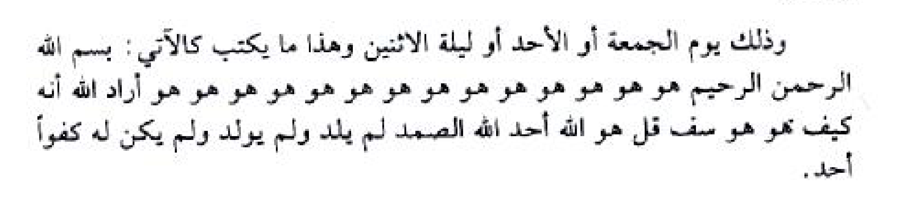

# Draf transkripsi PDF halaman 143–147

Transkripsi halaman 143–147 berdasarkan scan; bagian huruf dan pengulangan yang tidak pasti dipertahankan dalam potongan scan tanpa tebakan.

## HALAMAN 143 — PDF hal. 143 / bagian — Benjolan, penyakit kulit dan lanjutan perlindungan

### 1. TEKS ARAB BERHARAKAT

(بَابٌ فِي عِلَاجِ دَاءِ الْخَنَازِيرِ)

التَّعْرِيفُ عَلَى هَذَا الدَّاءِ: هُوَ أَوْرَامٌ صُلْبَةٌ جَافَّةٌ مُسْتَدِيرَةٌ أَكْثَرُ حُدُوثِهَا فِي الْعُرُوقِ وَالْإِبْطَيْنِ، وَقِيلَ أَيْضًا دَاءُ الْخَنَازِيرِ هُوَ شِبْهُ الْغُدَدِ فِي الْعُنُقِ. (الْعِلَاجُ لِذَلِكَ الدَّاءِ) رُوِيَ عَنِ الْإِمَامِ عَلِيِّ بْنِ مُوسَى الرِّضَا (عَلَيْهِ أَفْضَلُ الصَّلَاةِ وَالسَّلَامِ) قُلْ عَلَيْهَا: «يَا رَءُوفُ يَا رَحِيمُ يَا رَبُّ يَا سَيِّدِي».

(بَابٌ فِي عِلَاجِ السِّلْعَةِ)

التَّعْرِيفُ: قِيلَ السِّلْعَةُ هِيَ لَحْمَةٌ زَائِدَةٌ تَحْدُثُ فِي الْبَدَنِ كَالْغُدَّةِ تَجِيءُ وَتَذْهَبُ بَيْنَ اللَّحْمِ. (الْعِلَاجُ لِذَلِكَ الْآفَةِ مَا يَلِي).

عَنِ الْإِمَامِ جَعْفَرٍ الصَّادِقِ (عَلَيْهِ أَفْضَلُ الصَّلَاةِ وَالسَّلَامِ) هُوَ اغْتَسِلْ بَعْدَ صَوْمِ ثَلَاثَةِ أَيَّامٍ وَعِنْدَ الزَّوَالِ وَلْيَكُنْ خِرْقَةٌ (أَيْ قِطْعَةٌ مِنَ الْقُمَاشِ) نَظِيفَةٌ ثُمَّ صَلِّ أَرْبَعَ رَكَعَاتٍ تَقْرَأُ فِيهِنَّ مَا شِئْتَ فَإِذَا فَرَغْتَ فَأَلْقِ ثِيَابَكَ وَاتَّزِرْ بِالْخِرْقَةِ وَأَلْصِقْ خَدَّكَ عَلَى الْأَرْضِ وَقُلْ بِابْتِهَالٍ وَتَضَرُّعٍ وَخُشُوعٍ: «يَا وَاحِدُ يَا أَحَدُ يَا صَمَدُ يَا كَرِيمُ يَا جَبَّارُ يَا قَدِيمُ يَا قَرِيبُ يَا مُجِيبُ يَا أَرْحَمَ الرَّاحِمِينَ صَلِّ عَلَى مُحَمَّدٍ وَآلِهِ وَاكْشِفْ مَا بِي مِنْ ضُرٍّ وَأَلْبِسْنِي الْعَافِيَةَ الشَّافِيَةَ الْكَافِيَةَ فِي الدُّنْيَا وَالْآخِرَةِ وَامْنُنْ عَلَيَّ بِتَمَامِ النِّعْمَةِ وَاذْهَبْ مَا بِي فَقَدْ آذَانِي وَغَمَّنِي».

(بَابٌ فِي عِلَاجِ دَاءِ الْبَرَصِ)

عَنِ الْإِمَامِ الصَّادِقِ (عَلَيْهِ أَفْضَلُ السَّلَامِ) يَتَطَهَّرُ مَنْ بِهِ ذَلِكَ ثُمَّ يُصَلِّي رَكْعَتَيْنِ وَيَقُولُ: «يَا اللَّهُ يَا رَحْمَنُ يَا رَحِيمُ يَا سَامِعَ الْأَصْوَاتِ يَا مُعْطِيَ الْخَيْرَاتِ أَعْطِنِي خَيْرَ الدُّنْيَا وَالْآخِرَةِ وَقِنِي شَرَّ الدُّنْيَا وَالْآخِرَةِ وَأَذْهِبْ عَنِّي مَا أَجِدُ فَقَدْ غَاظَنِي وَأَحْزَنَنِي».

(أَيْضًا فَائِدَةٌ لِلْأَمْنِ مِنَ الْجُذَامِ وَالْبَرَصِ)

هُوَ أَنَّهُ قِيلَ: مَنْ كَتَبَ اسْمَهُ تَعَالَى «يَا بَارِئَ النُّفُوسِ بِلَا مِثَالٍ خَلَا مِنْ غَيْرِهِ» (وَذَلِكَ بِالْمِسْكِ وَالزَّعْفَرَانِ وَمَاءِ الْوَرْدِ) وَحَمَلَهُ مَعَهُ أَمِنَ مِنَ الْجُذَامِ وَالْبَرَصِ. كَذَلِكَ [يَتْبَعُ فِي الصَّفْحَةِ ١٤٤].

### 2. TRANSLITERASI LATIN

(Babun fi 'ilaji da'il-khanazir)

At-ta'rifu 'ala hadzad-da': huwa awramun shulbatun jaffatun mustadiratun aktsaru hudutsiha fil-'uruqi wal-ibthain, wa qila aidhan da'ul-khanaziri huwa syibhul-ghudadi fil-'unuq. (Al-'ilaju lidzalika ad-da') ruwiya 'anil-imami 'Aliyyi bni Musar-Ridha ('alaihi afdhalush-shalati was-salam) qul 'alaiha: «Ya ra'ufu ya rahimu ya rabbu ya sayyidi».

(Babun fi 'ilajis-sil'ah)

At-ta'rif: qila as-sil'atu hiya lahmatun za'idatun tahdutsu fil-badani kal-ghuddati taji'u wa tadzhabu bainal-lahm. (Al-'ilaju lidzalikal-afati ma yali).

'Anil-imami Ja'farinish-Shadiq ('alaihi afdhalush-shalati was-salam) huwa ightasil ba'da shaumi tsalatsati ayyamin wa 'indaz-zawali walyakun khirqatun (ai qith'atun minal-qumasyi) nazhifatun tsumma shalli arba'a raka'atin taqra'u fihinna ma syi'ta fa-idza faraghta fa-alqi tsiyabaka wat-tazir bil-khirqati wa alshiq khaddaka 'alal-ardhi wa qul bibtihalin wa tadharru'in wa khusyu': «Ya wahidu ya ahadu ya shamadu ya karimu ya jabbaru ya qadimu ya qaribu ya mujibu ya arhamar-rahimina shalli 'ala Muhammadin wa alihi waksyif ma bi min dhurrin wa albisnil-'afiyatas-syafiyatal-kafiyata fid-dunya wal-akhirati wamnun 'alayya bitamamin-ni'mati wadzhib ma bi faqad adzani wa ghammani».

(Babun fi 'ilaji da'il-barash)

'Anil-imamish-Shadiq ('alaihi afdhalus-salam) yatathahharu man bihi dzalika tsumma yushalli rak'ataini wa yaqul: «Ya Allah ya Rahman ya Rahim ya sami'al-ashwat ya mu'thiyal-khairat a'thini khairad-dunya wal-akhirati wa qini syarrad-dunya wal-akhirati wa adzhib 'anni ma ajidu faqad ghazhani wa ahzanani».

(Aidhan fa'idatun lil-amni minal-judzami wal-barash)

Huwa annahu qila: man kataba ismahu ta'ala «ya bari'an-nufusi bila mitsalin khala min ghairih» (wa dzalika bil-miski waz-za'farani wa ma'il-ward) wa hamalahu ma'ahu amina minal-judzami wal-barash. Kadzalika [lanjut halaman 144].

### 3. TERJEMAHAN INDONESIA

(Bab tentang penyakit khanazir)

Naskah mendefinisikan penyakit ini sebagai benjolan keras, kering dan bulat yang sering muncul pada urat dan ketiak; disebut pula sebagai sesuatu menyerupai kelenjar pada leher. Diriwayatkan dari Imam Ali bin Musa ar-Ridha agar mengucapkan padanya: “Wahai Yang Maha Pengasih, wahai Yang Maha Penyayang, wahai Tuhanku, wahai junjunganku.”

(Bab tentang benjolan atau sil'ah)

Naskah menyebut sil'ah sebagai daging tambahan yang muncul pada tubuh seperti kelenjar dan bergerak di antara daging. Penanganan yang disebut adalah sebagai berikut.

Dari Imam Ja'far ash-Shadiq: setelah berpuasa tiga hari dan ketika matahari tergelincir, mandilah; siapkan sehelai kain bersih dan shalatlah empat rakaat dengan bacaan yang dikehendaki. Setelah selesai, lepaskan pakaian dan kenakan kain sebagai sarung, tempelkan pipi ke tanah dan ucapkan dengan permohonan, kerendahan hati dan khusyuk: “Wahai Yang Esa, wahai Yang Tunggal, wahai tempat bergantung, wahai Yang Mulia, wahai Yang Mahaperkasa, wahai Yang Mahaada sejak dahulu, wahai Yang Dekat, wahai Yang Mengabulkan, wahai Yang Maha Penyayang di antara para penyayang, limpahkan shalawat kepada Muhammad dan keluarganya. Hilangkanlah mudarat yang ada padaku, kenakanlah kepadaku kesehatan yang menyembuhkan dan mencukupi di dunia dan akhirat, anugerahkan kepadaku kesempurnaan nikmat dan hilangkan apa yang ada padaku, karena ia telah menyakitiku dan menyedihkanku.”

(Bab tentang penyakit barash)

Dari Imam ash-Shadiq: orang yang mengalami hal itu bersuci, kemudian shalat dua rakaat dan berkata: “Ya Allah, wahai Yang Maha Pengasih, wahai Yang Maha Penyayang, wahai Yang Mendengar suara-suara, wahai Pemberi segala kebaikan, berikan kepadaku kebaikan dunia dan akhirat, lindungilah aku dari keburukan dunia dan akhirat dan hilangkan dariku apa yang kurasakan, karena hal itu telah menyusahkan dan menyedihkanku.”

(Juga faedah untuk perlindungan dari judzam dan barash)

Disebutkan bahwa siapa menulis nama-Nya «يَا بَارِئَ النُّفُوسِ بِلَا مِثَالٍ خَلَا مِنْ غَيْرِهِ» dengan misik, za'faran dan air mawar lalu membawanya, akan terlindung dari judzam dan barash. Demikian pula ... [bersambung halaman 144].

### 4. TATACARA PRAKTIK LENGKAP

1. Pada bagian khanazir naskah mencantumkan bacaan «يَا رَءُوفُ يَا رَحِيمُ يَا رَبُّ يَا سَيِّدِي».
2. Pada bagian sil'ah naskah menyebut puasa tiga hari, mandi, empat rakaat, kain bersih dan doa yang tercantum.
3. Pada bagian barash disebut bersuci, shalat dua rakaat dan membaca doa. Bagian penulisan nama berlanjut pada halaman berikutnya.

Catatan keselamatan: istilah penyakit ini berasal dari naskah dan tidak menetapkan diagnosis modern. Benjolan yang baru muncul, membesar atau menetap dan perubahan kulit perlu diperiksa tenaga kesehatan; riwayat bukan pengganti pengobatan.

## HALAMAN 144 — PDF hal. 144 / bagian — Penyakit kuning, penyakit paru dan anak

### 1. TEKS ARAB BERHARAKAT

مَنْ نَقَشَ هَذَا الِاسْمَ الْكَرِيمَ عَلَى لَوْحٍ مِنَ الْفِضَّةِ وَحَمَلَهُ مَنْ قَدْ أُصِيبَ بِالْعَيْنِ أَوِ الْحَسَدِ ذَهَبَ عَنْهُ ذَلِكَ بِإِذْنِ اللَّهِ تَعَالَى وَأَنْعَمَ عَلَيْهِ بِسَعَةِ الرِّزْقِ.

(بَابٌ فِي عِلَاجِ مَرَضِ الصُّفَيْرَةِ (الْيَرَقَانِ))

رُوِيَ فِي حَدِيثِ النَّبِيِّ الْأَكْرَمِ صَلَّى اللَّهُ عَلَيْهِ وَآلِهِ وَسَلَّمَ أَنَّهُ قَالَ: يَا عَلِيُّ مَنْ كَانَ فِي بَطْنِهِ مَاءٌ أَصْفَرُ فَكُتِبَ آيَةَ الْكُرْسِيِّ وَشَرِبَ ذَلِكَ الْمَاءَ يَبْرَأُ بِإِذْنِ اللَّهِ تَعَالَى.

(بَابٌ فِي عِلَاجِ دَاءِ السِّلِّ)

عَنِ الْإِمَامِ الصَّادِقِ (عَلَيْهِ أَفْضَلُ الصَّلَاةِ وَالسَّلَامِ) تَقُولُ عَلَى الْمَرَضِ ثَلَاثًا: «يَا اللَّهُ يَا رَبَّ الْأَرْبَابِ وَيَا سَيِّدَ السَّادَاتِ وَيَا إِلَهَ الْآلِهَةِ وَيَا مَلِكَ الْمُلُوكِ وَيَا جَبَّارَ السَّمَاوَاتِ وَالْأَرْضِ اشْفِنِي وَعَافِنِي مِنْ دَائِي هَذَا فَإِنِّي عَبْدُكَ وَابْنُ عَبْدِكَ أَتَقَلَّبُ فِي قَبْضَتِكَ نَاصِيَتِي بِيَدِكَ».

(بَابٌ خَاصٌّ فِي تَدْبِيرِ شُؤُونِ الطِّفْلِ مِنْ مَرَضٍ وَغَيْرِهِ)

١ - إِذَا الطِّفْلُ أَلَمَتْ بِهِ أَسْنَانُهُ أَثْنَاءَ النَّوْمِ يُكْتَبُ لَهُ هَذِهِ الْأَشْكَالُ كَالْآتِي، وَتُرْبَطُ بِهِمْ عَلَيْهِ وَهِيَ: «بِسْمِ اللَّهِ [TIDAK JELAS]».

٢ - أَيْضًا عِلَاجُ الطِّفْلِ بِحَالِ تَأَخُّرٍ عَنِ النُّطْقِ وَالْكَلَامِ: يُكْتَبُ لَهُ سُورَةُ الْإِسْرَاءِ الْمُبَارَكَةُ بِالْمِسْكِ وَالزَّعْفَرَانِ وَمَاءِ الزَّهْرِ أَوْ مَاءِ الْوَرْدِ عَلَى وَرَقٍ أَبْيَضَ نَقِيٍّ مِنْ ثَمَّ تُحَلُّ هَذِهِ الْكِتَابَةُ بِمَاءِ زَمْزَمَ الْمُبَارَكِ إِنْ وُجِدَ وَإِمَّا مَاءٌ عَادِيٌّ عَذْبٌ وَيَشْرَبُ مِنْهَا الطِّفْلُ وَتُغْسَلُ وَجْهُهُ بِمَائِهَا أَيْضًا فَيَنْطَلِقُ لِسَانُهُ بِحَوْلِ اللَّهِ وَقُدْرَتِهِ.

٣ - فِي حَالِ وَرَمِ الْخُصْيَةِ عِنْدَ الطِّفْلِ: أَلَا وَهُوَ إِذَا أُصِيبَ الطِّفْلُ بِوَرَمٍ وَانْتِفَاخٍ فِي إِحْدَى خُصْيَتَيْهِ، مِمَّا قِيلَ وَجُرِّبَ هُوَ أَنْ تَثْقُبَ أُذُنَهُ الَّتِي بِعَكْسِ الْخُصْيَةِ الْمُنْتَفِخَةِ وَذَلِكَ مِنْ جِرَّاءِ فَتْقٍ أَوْ غَيْرِهِ (مِثَالٌ) إِذَا وَرِمَتْ خُصْيَتُهُ الْيُمْنَى اثْقُبْ أُذُنَهُ الْيُسْرَى.

وَإِذَا وَرِمَتْ خُصْيَتُهُ الْيُسْرَى اثْقُبْ أُذُنَهُ الْيُمْنَى، وَإِذَا وَرِمَتِ الْخُصْيَتَانِ مَعًا [يَتْبَعُ فِي الصَّفْحَةِ ١٤٥].

### 2. TRANSLITERASI LATIN

[Lanjutan:] Man naqasya hadzal-ismal-karima 'ala lauhin minal-fidhdhati wa hamalahu man qad ushiba bil-'aini awil-hasadi dzahaba 'anhu dzalika bi-idznillahi ta'ala wa an'ama 'alaihi bisa'atir-rizq.

(Babun fi 'ilaji maradhish-shufairah, al-yaraqan)

Ruwiya fi haditsin-nabiyyil-akram shallallahu 'alaihi wa alihi wa sallama annahu qala: Ya 'Aliyyu man kana fi bathnihi ma'un ashfaru fakutiba ayatal-kursiyyi wa syariba dzalikal-ma'a yabra'u bi-idznillahi ta'ala.

(Babun fi 'ilaji da'is-sill)

'Anil-imamish-Shadiq ('alaihi afdhalush-shalati was-salam) taqulu 'alal-maradhi tsalatsan: «Ya Allah ya rabbal-arbabi wa ya sayyidas-sadati wa ya ilahal-alihati wa ya malikal-muluki wa ya jabbaras-samawati wal-ardhi isyfini wa 'afini min da'i hadza fa-inni 'abduka wabnu 'abdika ataqallabu fi qabdhatika nashiyati biyadik».

(Babun khashshun fi tadbiri syu'unith-thifli min maradhin wa ghairih)

1. Idzath-thiflu alamat bihi asnanuhu atsna'an-naumi yuktabu lahu hadzihil-asykalu kal-ati, wa turbathu bihim 'alaihi wa hiya: «Bismillahi [TIDAK JELAS]».

2. Aidhan 'ilajuth-thifli bihali ta'akhkhurin 'anin-nuthqi wal-kalam: yuktabu lahu suratul-Isra'il-mubarakatu bil-miski waz-za'farani wa ma'iz-zahri au ma'il-wardi 'ala waraqin abyadha naqiyyin min tsumma tuhallu hadzihil-kitabatu bima'i Zamzamal-mubaraki in wujida wa imma ma'un 'adiyyun 'adzbun wa yasyrabu minhath-thiflu wa tughsalu wajhuhu bima'iha aidhan fayanthaliqu lisanuhu bihaullahi wa qudratih.

3. Fi hali waramil-khush-yati 'indath-thifl: ala wa huwa idza ushibath-thiflu biwaramin wantifakhin fi ihda khushyataihi, mimma qila wa jurriba huwa an tatsquba udzunahul-lati bi'aksil-khushyatil-muntafikhati wa dzalika min jirra'i fatqin au ghairihi (mitsal) idza warimat khushyatuhul-yumna utsqub udzunahul-yusra.

Wa idza warimat khushyatuhul-yusra utsqub udzunahul-yumna, wa idza warimatil-khushyatani ma'an [lanjut halaman 145].

### 3. TERJEMAHAN INDONESIA

[Lanjutan halaman 143:] Disebutkan bahwa orang yang terkena pandangan buruk atau dengki membawa nama mulia yang diukir pada lempeng perak; hal itu dikatakan hilang dengan izin Allah dan ia diberi kelapangan rezeki.

(Bab tentang penyakit kuning)

Diriwayatkan dalam hadis Nabi ﷺ: “Wahai Ali, orang yang dalam perutnya terdapat air kuning, lalu Ayat Kursi ditulis dan air itu diminum, akan sembuh dengan izin Allah.”

(Bab tentang penyakit paru / sill)

Dari Imam ash-Shadiq: ucapkan tiga kali atas penyakit: “Ya Allah, Tuhan para tuan, pemimpin para pemimpin, Tuhan segala yang dipertuhan, Raja segala raja, Penguasa langit dan bumi, sembuhkan dan sehatkan aku dari penyakitku ini. Sesungguhnya aku hamba-Mu dan anak hamba-Mu, aku berada dalam genggaman-Mu dan ubun-ubunku dalam tangan-Mu.”

(Bab khusus tentang urusan anak, penyakit dan lainnya)

1. Jika gigi anak menyakitinya ketika tidur, naskah menyebut penulisan bentuk-bentuk yang diikatkan padanya. Rangkaian sesudah basmalah [TIDAK JELAS]; bentuknya disertakan sebagai gambar dan tidak ditebak.

2. Tentang anak yang terlambat berbicara, naskah menyebut penulisan Surah Al-Isra dengan misik, za'faran dan air bunga atau mawar pada kertas putih bersih. Tulisan itu dilarutkan dengan air Zamzam jika ada, atau air tawar biasa, lalu diminumkan dan diusapkan pada wajah anak; naskah mengklaim kemampuan bicara akan muncul dengan kuasa Allah.

3. Tentang pembengkakan salah satu buah zakar anak, naskah menyebut tindakan melubangi telinga pada sisi yang berlawanan dengan pembengkakan, baik akibat hernia maupun sebab lain. Contohnya, bila sisi kanan bengkak, telinga kiri dilubangi.

Bila sisi kiri bengkak, telinga kanan dilubangi. Jika keduanya bengkak ... [bersambung halaman 145].

### 4. TATACARA PRAKTIK LENGKAP

1. Teks awal meneruskan amalan nama dari halaman 143. Riwayat berikut menyebut Ayat Kursi dan doa yang dibaca tiga kali.
2. Bagian anak memuat bentuk huruf yang belum seluruhnya terbaca, tulisan Surah Al-Isra, serta riwayat pembengkakan yang berlanjut pada halaman 145.

Peringatan keselamatan: jangan melubangi telinga atau melukai anak untuk mengobati pembengkakan. Pembengkakan atau nyeri mendadak pada buah zakar adalah keadaan yang memerlukan pemeriksaan darurat; jangan menunda penanganan. Keterlambatan bicara perlu penilaian kesehatan dan tumbuh kembang, dan jangan memberikan larutan tinta atau bahan tak aman kepada anak.

## HALAMAN 145 — PDF hal. 145 / bagian — Lanjutan anak dan sengatan kalajengking

### 1. TEKS ARAB BERHARAKAT

اثْقُبِ الْأُذُنَيْنِ الْيُمْنَى وَالْيُسْرَى فَإِنَّهُ يَزُولُ الْوَرَمُ بِإِذْنِ اللَّهِ تَعَالَى وَكَمَا جَاءَ فِي الرِّوَايَةِ هَذَا مُجَرَّبٌ.

٤ - فَائِدَةٌ لِمُعَالَجَةِ بَوْلِ الْأَطْفَالِ لَيْلًا: هُوَ أَنْ يَنْقُشَ هَذِهِ الْأَشْكَالَ التَّالِيَةَ عَلَى قِطْعَةِ نُحَاسٍ أَوْ رَقِّ غَزَالٍ (جِلْدِ غَزَالٍ) مِنْ ثَمَّ تُوضَعُ فِي فِرَاشِ الطِّفْلِ (لِجِهَةِ رَأْسِهِ).

وَذَلِكَ يَوْمَ الْجُمُعَةِ أَوِ الْأَحَدِ أَوْ لَيْلَةَ الِاثْنَيْنِ وَهَذَا مَا يُكْتَبُ كَالْآتِي: «بِسْمِ اللَّهِ الرَّحْمَنِ الرَّحِيمِ [TIDAK JELAS: تَكْرَارُ هُوَ] أَرَادَ اللَّهُ أَنَّهُ كَيْفَ هُوَ هُوَ سَفْ قُلْ هُوَ اللَّهُ أَحَدٌ اللَّهُ الصَّمَدُ لَمْ يَلِدْ وَلَمْ يُولَدْ وَلَمْ يَكُنْ لَهُ كُفُوًا أَحَدٌ».

(بَابٌ فِي الْأَدْوِيَةِ النَّافِعَةِ لِعِلَاجِ لَسْعِ الْعَقَارِبِ وَالْحَيَّاتِ وَالْهَوَامِّ)

١ - عِنْدَ لَسْعِ الْعَقْرَبِ: يُؤْخَذُ كَمِّيَّةٌ مِنَ الْحَرْمَلِ وَتُدَقُّ وَمِنْ ثَمَّ يُوضَعُ مَكَانَ اللَّسْعَةِ بِشَكْلِ ضِمَادٍ فَإِنَّهُ نَافِعٌ لِذَلِكَ.

٢ - أَيْضًا ثَمَرَةُ التِّينِ غَيْرُ النَّاضِجِ (أَيِ الْفَجِّ) يُدَقُّ وَيُوضَعُ مَكَانَ اللَّسْعَةِ مُفِيدٌ.

٣ - أَيْضًا دَقِيقُ حَبِّ الْحُلْبَةِ مَمْزُوجٌ مَعَ خَلِّ الْعِنَبِ يُوضَعُ مِنْهُ مَكَانَ الْإِصَابَةِ فَإِنَّهُ نَافِعٌ لِذَلِكَ بِإِذْنِ اللَّهِ تَعَالَى.

٤ - الثُّومُ يُدَقُّ وَيُوضَعُ مَكَانَ اللَّسْعَةِ فَإِنَّهُ نَافِعٌ لِذَلِكَ، كَذَا الْبَصَلُ إِذَا دُقَّ.

٥ - رُوِيَ وَقِيلَ: أَنَّهُ مَنْ أَكَلَ فِجْلًا لَمْ تَضُرَّهُ لَسْعَةُ الْعَقْرَبِ.

٦ - مِنْ بَابِ التَّحْذِيرِ عِنْدَ لَسْعِ الْعَقَارِبِ أَوْ غَيْرِهَا هُوَ عَدَمُ تَنَاوُلِ الْكَرَفْسِ، لِأَنَّهُ قِيلَ مَنْ أَكَلَ كَرَفْسًا وَلَسَعَهُ عَقْرَبٌ أَوْ غَيْرُهُ مَاتَ فِي يَوْمِهِ أَوْ لَيْلَتِهِ.

٧ - رُوِيَ فِي بَعْضِ الْكُتُبِ: أَنَّ بَعْرَ الْغَنَمِ الْيَابِسَ إِذَا حُرِقَ وَعُجِنَ بِخَلٍّ وَطُلِيَ بِهِ مَكَانُ اللَّسْعَةِ نَفَعَهَا وَكَذَا مَاءُ الْفِجْلِ إِذَا دُقَّ الرُّؤُوسُ وَعَصَرَهَا مَاؤُهَا وَدَلَكَ بِهِ مَكَانَ اللَّسْعَةِ نَفَعَهَا.

### 2. TRANSLITERASI LATIN

[Lanjutan:] Utsqubil-udzunainil-yumna wal-yusra fa-innahu yazulul-waramu bi-idznillahi ta'ala wa kama ja'a fir-riwayati hadza mujarrab.

4. Fa'idatun limu'alajati bawlil-athfali lailan: huwa an yanqusha hadzihil-asykalat-taliyata 'ala qith'ati nuhasin au raqqi ghazalin (jildi ghazal) min tsumma tudha'u fi firasyith-thifli (lijihati ra'sih).

Wa dzalika yaumal-jumu'ati awil-ahadi au lailatal-itsnaini wa hadza ma yuktabu kal-ati: «Bismillahir-rahmanir-rahim [TIDAK JELAS: pengulangan huwa] aradallahu annahu kaifa huwa huwa saf qul huwallahu ahad allahush-shamad lam yalid wa lam yulad wa lam yakun lahu kufuwan ahad».

(Babun fil-adwiyatin-nafi'ati li'ilaji las'il-'aqaribi wal-hayyati wal-hawamm)

1. 'Inda las'il-'aqrab: yu'khadzu kammiyyatun minal-harmali wa tudaqqu wa min tsumma yudha'u makanan-las'ati bisyakli dhimadin fa-innahu nafi'un lidzalik.

2. Aidhan tsamaratut-tin ghairun-nadhij (ayil-fajj) yudaqqu wa yudha'u makanan-las'ati mufid.

3. Aidhan daqiqu habbil-hulbati mamzujun ma'a khallil-'inabi yudha'u minhu makanan-ishabati fa-innahu nafi'un lidzalika bi-idznillahi ta'ala.

4. Ats-tsumu yudaqqu wa yudha'u makanan-las'ati fa-innahu nafi'un lidzalik, kadzal-bashalu idza duqq.

5. Ruwiya wa qila: annahu man akala fijlan lam tadhurruhu las'atul-'aqrab.

6. Min babit-tahdziri 'inda las'il-'aqaribi au ghairiha huwa 'adamu tanawulil-karafsi, li-annahu qila man akala karafsan wa lasa'ahu 'aqrabun au ghairuhu mata fi yaumihi au lailatih.

7. Ruwiya fi ba'dhil-kutub: anna ba'ral-ghanamil-yabisa idza huriqa wa 'ujina bikhallin wa thuliya bihi makanan-las'ati nafa'aha wa kadza ma'ul-fijli idza duqqar-ru'usu wa 'asharaha ma'uha wa dalaka bihi makanan-las'ati nafa'aha.

### 3. TERJEMAHAN INDONESIA

[Lanjutan halaman 144:] Naskah menyebut kedua telinga dilubangi bila kedua buah zakar bengkak dan mengklaim pembengkakan akan hilang dengan izin Allah.

4. Tentang anak yang mengompol pada malam hari, naskah menyebut bentuk-bentuk diukir pada tembaga atau kulit kijang, lalu diletakkan dalam tempat tidur anak di dekat kepalanya.

Waktunya disebut hari Jumat atau Minggu atau malam Senin. Bacaan yang ditulis diawali basmalah, diikuti pengulangan «هو» yang jumlahnya [TIDAK JELAS], kemudian rangkaian dan Surah Al-Ikhlas sebagaimana scan. Bentuknya disertakan tanpa menebak jumlah pengulangan.

(Bab tentang obat yang disebut untuk sengatan kalajengking, ular dan binatang berbisa)

1. Untuk sengatan kalajengking, naskah menyebut harmal ditumbuk dan diletakkan sebagai balutan pada tempat sengatan.

2. Buah tin yang belum matang ditumbuk dan diletakkan pada tempat sengatan.

3. Tepung biji hulbah dicampur cuka anggur dan diletakkan pada tempat yang terkena.

4. Bawang putih ditumbuk dan diletakkan pada tempat sengatan; demikian juga bawang merah yang ditumbuk.

5. Diriwayatkan klaim bahwa orang yang makan lobak tidak akan dirugikan oleh sengatan kalajengking.

6. Naskah memperingatkan agar tidak makan seledri ketika tersengat, berdasarkan klaim bahwa orang yang makan seledri lalu tersengat akan meninggal hari atau malam itu.

7. Disebutkan kotoran domba kering dibakar, diaduk dengan cuka dan dioleskan; juga air perasan lobak digosokkan pada tempat sengatan. Keduanya diklaim bermanfaat.

### 4. TATACARA PRAKTIK LENGKAP

1. Naskah melanjutkan riwayat pembengkakan anak dan menyebut bentuk tulisan untuk mengompol. Jangan melakukan tindakan yang melukai anak.
2. Tujuh butir berikutnya adalah riwayat bahan untuk sengatan; klaim manfaat dan larangan di atas merupakan isi naskah, bukan petunjuk pertolongan medis.

Peringatan keselamatan: gigitan ular dan sengatan kalajengking dapat mengancam jiwa. Segera cari pertolongan medis, tenangkan dan batasi gerak korban, dan jangan menempelkan kotoran, bahan iritan atau ramuan pada luka. Jangan menunda perawatan dengan klaim makanan tertentu dapat mencegah racun.

## HALAMAN 146 — PDF hal. 146 / bagian — Lanjutan sengatan kalajengking dan gigitan ular

### 1. TEKS ARAB BERHARAKAT

٨ - وَرَدَ أَنَّهُ مَنْ أَكَلَ الثُّومَ وَالْبُنْدُقَ مَعَ بَعْضٍ يَنْفَعُ لَسْعَةَ الْعَقْرَبِ وَكَمَا قِيلَ كَذَا وَضْعُ الْفِضَّةِ عَلَى الْمَوْضِعِ الْمُصَابِ بِاللَّسْعَةِ نَفَعَهَا.

٩ - جَاءَ فِي بَعْضِ الرِّوَايَاتِ: أَنَّهُ مَنْ شَدَّ فِي سَرَاوِيلِهِ بُنْدُقَةً مِنْ حَبِّ الْبُنْدُقِ الْهِنْدِيِّ لَمْ يَضُرَّهُ بِهِ عَقْرَبٌ.

(أَيْضًا مِنَ الْأَدْوِيَةِ النَّافِعَةِ فِي عِلَاجِ لَسْعِ الْعَقَارِبِ)

هُوَ مَنْ أَخَذَ كَمِّيَّةً مِنَ الْفُلْفُلِ الْحَبِّ وَسَحَقَ نَاعِمًا وَخَلَطَ مَعَ زَيْتِ الزَّيْتُونِ نَفَعَهَا. كَذَا اسْتَفَّ قَلِيلًا مِنْ مِلْحِ الطَّعَامِ عَنْ طَرِيقِ الْفَمِ.

(أَيْضًا دَوَاءٌ لِعِلَاجِ لَسْعِ الْعَقَارِبِ)

أَنَّهُ رُوِيَ وَقِيلَ دَوَاءٌ عَجِيبٌ وَكَمَا جَاءَ مِنْ عَجِيبِ الْمَخْلُوقَاتِ أَنَّهُ مَنْ عَلَّقَ شَيْئًا مِنْ عُرُوقِ شَجَرَةِ الزَّيْتُونِ الْمُبَارَكَةِ عَلَى مَنْ لَسَعَتْهُ الْعَقْرَبُ يَبْرَأُ مِنْ سَاعَتِهِ.

أَيْضًا رُوِيَ فِي كِتَابِ لَفْظِ الْفَوَائِدِ: أَنَّهُ إِذَا شَرِبَ الْمَلْسُوعُ مِنَ الْعَقْرَبِ وَزْنَ رُبْعِ دِرْهَمٍ مِنْ نُشَادِرٍ قَدْ حُلَّ فِي زَيْتِ زَيْتُونٍ بَرِئَ. (وَكُلُّ هَذِهِ الْأَدْوِيَةِ تَتَعَلَّقُ فِي عِلَاجِ لَسْعِ الْعَقَارِبِ).

(أَمَّا بَابُ أَدْوِيَةِ لَسْعِ الْحَيَّاتِ هُوَ كَالْآتِي)

رُوِيَ فِي بَعْضِ الْكُتُبِ أَنَّهُ أَيِ الْمَلْسُوعَ مِنَ الْحَيَّةِ: يُسْقَى السَّمْنَ (الْبَلَدِيَّ) وَذَلِكَ مَمْزُوجٌ مَعَ الْعَسَلِ مُسَخَّنًا عَلَى نَارٍ خَفِيفَةٍ وَمِنْ ثَمَّ أَعْطِهِ (ثَلَاثَةَ دَرَاهِمَ مِنْ حَبِّ الْأُتْرُجِّ الْمَدْقُوقِ بِمَاءٍ) وَمِنْ ثَمَّ ضَمِّدْ مَوْضِعَ اللَّسْعَةِ بِالْبَصَلِ الْمَدْقُوقِ، أَوْ بِالْجُبْنِ الْعَتِيقِ.

أَيْضًا طَرِيقَةٌ ثَانِيَةٌ لِعِلَاجِ الْمَلْسُوعِ: هُوَ إِذَا أَمْكَنَ شَقُّ بُطُونِ فِرَاخِ الدَّجَاجِ الصِّغَارِ وَمِنْ ثَمَّ ضُمِّدَ بِهَا مَوْضِعُ اللَّسْعَةِ وَهِيَ حَارَّةٌ، وَمِنْ ثَمَّ أَطْلِ حَوْلَ الْعُضْوِ الْمُصَابِ بِالْخَلِّ وَالطِّينِ.

### 2. TRANSLITERASI LATIN

8. Warada annahu man akalats-tsuma wal-bunduqa ma'a ba'dhin yanfa'u las'atal-'aqrab wa kama qila kadza wadh'ul-fidhdhati 'alal-mawdhi'il-mushabi bil-las'ati nafa'aha.

9. Ja'a fi ba'dhir-riwayati annahu man syadda fi sarawilihi bunduqatan min habbil-bunduqil-hindiyyi lam yadhurruhu bihi 'aqrab.

(Aidhan minal-adwiyatin-nafi'ati fi 'ilaji las'il-'aqarib)

Huwa man akhadza kammiyyatan minal-fulfulil-habbi wa sahaqa na'iman wa khalatha ma'a zaitiz-zaituni nafa'aha. Kadza istaffa qalilan min milhith-tha'ami 'an thariqil-fam.

(Aidhan dawa'un li'ilaji las'il-'aqarib)

Annahu ruwiya wa qila dawa'un 'ajibun wa kama ja'a min 'aja'ibil-makhluqati annahu man 'allaqa syai'an min 'uruqi syajaratiz-zaitunil-mubarakati 'ala man lasa'at-hul-'aqrabu yabra'u min sa'atih.

Aidhan ruwiya fi kitabi Lafzhil-Fawa'id: annahu idza syaribal-malsu'u minal-'aqrabi wazna rub'i dirhamin min nusyadirin qad hulla fi zaiti zaitunin bari'a. (Wa kullu hadzihil-adwiyati tata'allaqu fi 'ilaji las'il-'aqarib).

(Amma babu adwiyati las'il-hayyati huwa kal-ati)

Ruwiya fi ba'dhil-kutubi annahu ayil-malsu'a minal-hayyah: yusqas-samna (al-baladiyya) wa dzalika mamzujun ma'al-'asali musakhkhanan 'ala narin khafifatin wa min tsumma a'thihi (tsalatsata darahima min habbil-utrujjil-madquqi bima') wa min tsumma dhammid mawdhi'al-las'ati bil-bashalil-madquqi, au bil-jubnil-'atiq.

Aidhan thariqatun tsaniyatun li'ilajil-malsu': huwa idza amkana syaqqu buthuni firakhid-dajajish-shighari wa min tsumma dhummida biha mawdhi'ul-las'ati wa hiya harratun, wa min tsumma athli hawlal-'udhwil-mushabi bil-khalli wath-thin.

### 3. TERJEMAHAN INDONESIA

8. Naskah menyebut makan bawang putih bersama hazelnut bermanfaat untuk sengatan kalajengking; disebut pula bahwa meletakkan perak pada tempat sengatan bermanfaat.

9. Dalam sebagian riwayat disebutkan klaim bahwa orang yang mengikat sebutir kacang India pada celananya tidak akan dicelakai kalajengking.

(Juga bahan yang disebut untuk sengatan kalajengking)

Lada butir ditumbuk halus dan dicampur minyak zaitun; naskah mengklaim manfaat. Disebut pula menelan sedikit garam makan.

(Juga obat untuk sengatan kalajengking)

Diriwayatkan dan dikatakan bahwa menggantungkan sesuatu dari akar pohon zaitun pada orang yang tersengat akan menyembuhkannya saat itu.

Dalam kitab Lafzh al-Fawa'id juga diriwayatkan klaim bahwa orang yang tersengat akan sembuh jika meminum seperempat dirham nusyadir yang dilarutkan dalam minyak zaitun. Naskah menyatakan seluruh keterangan itu berkaitan dengan sengatan kalajengking.

(Adapun bab bahan untuk gigitan ular)

Dalam sebagian kitab diriwayatkan pemberian minyak samin tradisional yang dicampur madu dan dihangatkan perlahan kepada orang yang digigit ular. Kemudian disebut memberikan tiga dirham biji utruj yang ditumbuk dengan air, lalu membalut tempat gigitan dengan bawang yang ditumbuk atau keju tua.

Naskah juga menyebut cara kedua: jika memungkinkan, membelah perut anak ayam, lalu menggunakan bagian itu dalam keadaan panas sebagai balutan pada tempat gigitan, dan mengoleskan cuka serta tanah liat di sekitar anggota tubuh yang terkena.

### 4. TATACARA PRAKTIK LENGKAP

1. Naskah melanjutkan dua butir tentang sengatan kalajengking dan menyebut lada, garam, akar zaitun dan nusyadir.
2. Bagian ular mencatat dua riwayat bahan dan balutan sebagaimana terjemahan, bukan prosedur medis yang telah dibuktikan.

Peringatan keselamatan: gigitan ular dan sengatan kalajengking dapat mengancam jiwa; segera cari pertolongan medis, tenangkan korban dan batasi gerak anggota tubuh yang terkena. Jangan menelan nusyadir atau bahan tak aman, memakai bahan hewan/kotoran pada luka, menyayat luka atau menunda layanan kesehatan.

## HALAMAN 147 — PDF hal. 147 / bagian — Gigitan ular dan sengatan serangga

### 1. TEKS ARAB BERHARAKAT

(أَيْضًا دَوَاءٌ لِعِلَاجِ لَسْعِ الْحَيَّةِ)

رُوِيَ أَنَّهُ مَاءُ النُّوشَادِرِ يُبْرِئُ مِنْ لَسْعَةِ الْحَيَّةِ وَالْعَقْرَبِ وَكَذَلِكَ إِذَا شُرِبَ مِثْقَالَيْنِ مِنْ حَبِّ الْأُتْرُجِّ، وَمِنْ ثَمَّ الثُّومُ يُحْرَقُ وَيُوضَعُ عَلَى لَسْعَةِ الْحَيَّةِ سَكَّنَهَا.

(أَيْضًا دَوَاءٌ لِعِلَاجِ لَسْعَةِ الْحَيَّةِ)

هُوَ أَنْ يُؤْخَذَ كَمِّيَّةٌ مِنْ نُخَالَةِ الْحِنْطَةِ وَمِنْ ثَمَّ تُمْزَجُ بِالْخَلِّ وَتُضَمَّدُ بِهِ مَوْضِعُ اللَّسْعَةِ أَنَّهُ يَنْفَعُهَا بِإِذْنِ اللَّهِ تَعَالَى. كَذَلِكَ رَمَادُ قُضْبَانِ الْكَرْمِ الْعِنَبِ مَمْزُوجًا مَعَ الْخَلِّ فَإِنَّهُ نَافِعٌ لِذَلِكَ.

أَيْضًا الْكُرَّاثُ أَوِ الْقِطْرَانُ مَخْلُوطًا بِالْمِلْحِ فَإِنَّهُ نَافِعٌ لِلسْعَةِ.

أَيْضًا يَنْفَعُ شُرْبُ حَسَاءِ دَقِيقِ الْحِنْطَةِ مُفِيدٌ.

(أَيْضًا مِنْ أَدْوِيَةِ لَسْعِ الْحَيَّاتِ)

أَلَا وَهُوَ بَيْضُ الدَّجَاجِ الْبَلَدِيِّ الطَّازِجِ إِذَا خَلَطَ صُفَارَهُ بِبَيَاضِهِ وَذُرَّ عَلَيْهِ مِلْحًا وَشُرِبَ مُسَخَّنًا عَلَى نَارٍ خَفِيفَةٍ يَنْفَعُ ذَلِكَ.

أَيْضًا أَكْلُ السِّمْسِمِ وَالْفِجْلِ نَافِعٌ لِذَلِكَ. أَيْضًا يَنْفَعُ مِنْهَا التَّخَتُّمُ بِالْفَيْرُوزَجِ يُؤْمِنُ مِنْ لَدْغَةِ الْعَقْرَبِ وَالْحَيَّةِ، وَكَذَا يَنْفَعُ مِنْ نَهْشَةِ الرُّتَيْلَاءِ.

أَيْضًا التَّضْمِيدُ بِعُصَارَةِ وَرَقِ الْآسِ أَخْضَرَ (شَجَرَةِ الرَّيْحَانِ) وَذَلِكَ فِي قِطْعَةِ قُمَاشٍ مِنَ الْكِتَّانِ رَقِيقَةٍ عَلَى طَاقَيْنِ، وَكَذَا حَبُّ الْآسِ وَوَرَقُهُ يَنْفَعُ.

أَيْضًا يُفِيدُ لَسْعَةَ الْحَيَّةِ بَعْرُ الْغَنَمِ الْجَافُّ وَالْمَحْرُوقُ بِالنَّارِ إِذَا عُجِنَ بِالْخَلِّ.

(أَيْضًا دَوَاءٌ لِعِلَاجِ لَدْغِ الزَّنَابِيرِ (الدَّبَابِيرِ) وَالزَّرْقَطِ وَالنَّحْلِ)

هُوَ أَنْ يُضَمَّدَ بِأَحْشَاءِ الْبَقَرِ، أَوْ بِوَاسِطَةِ الطَّلَاءِ بِزَيْتِ الزَّيْتُونِ، أَوِ التَّضْمِيدِ بِمِلْحِ الطَّعَامِ الْمَمْزُوجِ بِالْخَلِّ وَالْعَسَلِ وَالْكَافُورِ، أَوْ بَعْرِ الْمَاعِزِ الْمَدْقُوقِ نَاعِمًا مَمْزُوجًا مَعَ الْخَلِّ وَيُضَمَّدُ بِهِ مَوْضِعُ اللَّدْغِ.

### 2. TRANSLITERASI LATIN

(Aidhan dawa'un li'ilaji las'il-hayyah)

Ruwiya annahu ma'un-nusyadiri yubri'u min las'atil-hayyati wal-'aqrabi wa kadzalika idza syuriba mitsqalaini min habbil-utrujj, wa min tsummats-tsumu yuhraqu wa yudha'u 'ala las'atil-hayyati sakkanaha.

(Aidhan dawa'un li'ilaji las'atil-hayyah)

Huwa an yu'khadza kammiyyatun min nukhalatil-hinthati wa min tsumma tumzaju bil-khalli wa tudhammadu bihi mawdhi'ul-las'ati annahu yanfa'uha bi-idznillahi ta'ala. Kadzalika ramadu qudhbanil-karmil-'inabi mamzujan ma'al-khalli fa-innahu nafi'un lidzalik.

Aidhan al-kurratsu awil-qathranu makhluthan bil-milhi fa-innahu nafi'un lil-las'ah.

Aidhan yanfa'u syurbu hasa'i daqiqil-hinthati mufid.

(Aidhan min adwiyati las'il-hayyat)

Ala wa huwa baidhud-dajajil-baladiyyith-thaziji idza khalatha shufarahu bibayadhihi wa dzurra 'alaihi milhan wa syuriba musakhkhanan 'ala narin khafifatin yanfa'u dzalik.

Aidhan aklus-simsimi wal-fijli nafi'un lidzalik. Aidhan yanfa'u minhattakhattumu bil-fairuzaji yu'minu min ladghatil-'aqrabi wal-hayyah, wa kadza yanfa'u min nahsyatir-rutila'.

Aidhan at-tadhmidu bi'usharati waraqil-asi akhdhara (syajarati ar-raihan) wa dzalika fi qith'ati qumasyin minal-kattani raqiqatin 'ala thaqaini, wa kadza habbul-asi wa waraqahu yanfa'.

Aidhan yufidu las'atal-hayyati ba'rul-ghanamil-jaf wal-mahruqu bin-nari idza 'ujina bil-khall.

(Aidhan dawa'un li'ilaji ladghiz-zanabir (ad-dababir) waz-zarqath wan-nahl)

Huwa an yudhammada bi-ahsya'il-baqari, au biwasithatith-thila'i bizaitiz-zaitun, awit-tadhmidi bimilhit-tha'amil-mamzuji bil-khalli wal-'asali wal-kafur, au ba'ril-ma'izil-madquqi na'iman mamzujan ma'al-khalli wa yudhammadu bihi mawdhi'ul-ladgh.

### 3. TERJEMAHAN INDONESIA

(Juga obat yang disebut untuk gigitan ular)

Diriwayatkan klaim bahwa air nusyadir menyembuhkan gigitan ular dan sengatan kalajengking, demikian pula minum dua mitsqal biji utruj; lalu bawang putih dibakar dan diletakkan pada gigitan ular untuk menenangkannya.

(Juga obat yang disebut untuk gigitan ular)

Naskah menyebut bekatul gandum dicampur cuka dan dibalutkan pada tempat gigitan; abu ranting anggur yang dicampur cuka juga disebut bermanfaat.

Daun bawang atau ter yang dicampur garam juga diklaim bermanfaat untuk gigitan.

Minum kuah tepung gandum juga disebut bermanfaat.

(Juga bahan yang disebut untuk gigitan ular)

Naskah menyebut telur ayam kampung segar, kuning dan putihnya dicampur dan ditaburi garam, lalu diminum setelah dihangatkan pada api kecil.

Makan wijen dan lobak juga disebut bermanfaat. Memakai cincin batu pirus diklaim melindungi dari sengatan kalajengking, gigitan ular dan gigitan tarantula.

Disebut pula balutan dengan perasan daun as yang hijau pada kain linen tipis berlapis dua; biji dan daun as juga disebut bermanfaat.

Kotoran domba kering yang dibakar dan diaduk dengan cuka juga diklaim bermanfaat untuk gigitan ular.

(Juga bahan yang disebut untuk sengatan tawon dan lebah)

Naskah menyebut balutan dengan isi perut sapi, olesan minyak zaitun, balutan garam yang dicampur cuka, madu dan kapur barus, atau kotoran kambing yang ditumbuk halus dan dicampur cuka pada tempat sengatan.

### 4. TATACARA PRAKTIK LENGKAP

Naskah mencatat beragam bahan untuk gigitan ular dan sengatan serangga sebagaimana terjemahan di atas. Keterangan ini adalah riwayat sejarah, bukan petunjuk medis.

Peringatan keselamatan: segera cari pertolongan medis untuk gigitan ular atau reaksi berat akibat sengatan. Jangan menelan nusyadir, kapur barus atau bahan yang tidak aman; jangan mengoleskan kotoran atau jaringan hewan pada luka. Jangan menyayat, mengisap luka, atau menunda penanganan dengan ramuan.
